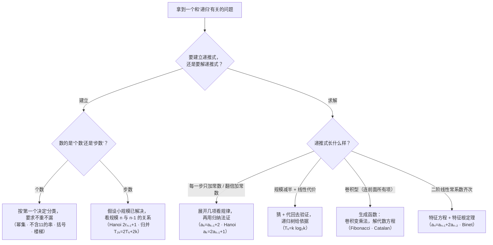

# 递归 (Recursion) — 建立递推式、求解递推式与生成函数

上一讲(LN4.2)把归纳法用在**证明**上:强归纳、良序原理、不变量法三个变体,做的是"把大问题归约成小问题"这个动作。本讲把同一台机器搬到**另外两件活**上——**定义**与**计数**。讲义给递归下的判词是:

> Recursion is one of the most important techniques in computer science. The main idea is to capture the invariants over repeated actions.

"抓住反复出现的动作里不变的东西"——这句话同时解释了两件事:**递归定义**是抓住"第 $n$ 项和第 $n-1$ 项之间不变的关系",**递归算法**是抓住"规模 $n$ 的问题和规模 $n-1$ 的问题之间不变的关系"。

讲义在 p2、p16、p32、p44 四页重复了同一张提纲,这是本讲的骨架:

> * **Setting up recurrences**(建立递推式)
>   * Fibonacci recurrence
>   * Problem solving recurrences
>   * Catalan recurrences
> * **Solving recurrences**(求解递推式)

所以本讲是**两半,六块**。前半(§1–§7)教你怎么从问题里"挤出"一条递推式;后半(§8–§11)教你怎么把挤出来的递推式解成闭式。中间埋着一条暗线:递推式好建、难解——所以后半部分要动用**生成函数**和**特征方程**两套工具,而它们是本讲分量最重的技术内容。

材料说明:本讲的素材**只有课件(62 页 PDF)**,全文内容**仅来自课件**,没有任何"老师课上讲了什么"的成分(也没有课堂板书)。凡我自行补充、复算或纠正的地方,一律在正文相应位置用【我的补充】标出,并在文末 `附` 里汇总。

## 1. 递归定义数列 (p3)

### 1.1 三种经典数列及其递推定义

p3 用三个最熟的数列开场,目的不是教数列,而是展示"**用前一项定义后一项**"这种写法:

| 数列 | 前几项 | 递归定义 |
| --- | --- | --- |
| 等差 (Arithmetic) | $a,\ a+d,\ a+2d,\ a+3d,\dots$ | $a_0=a,\quad a_{i+1}=a_i+d$ |
| 等比 (Geometric) | $a,\ ra,\ r^2a,\ r^3a,\dots$ | $a_0=a,\quad a_{i+1}=r\,a_i$ |
| 调和 (Harmonic) | $1,\ \tfrac12,\ \tfrac13,\ \tfrac14,\dots$ | $a_0=1,\quad a_{i+1}=\dfrac{i\,a_i}{i+1}$ ← **印错了,见 §1.2** |

要理解这里的写法:左边那一列是"**通项的样子**"(看得见规律,但想算第 1000 项得知道公式),右边那一列是"**递推定义**"(不用知道通项,只要知道第一项和"怎么从前一项推到后一项")。两种描述本来都该成立,第三个却对不上——这正是下一小节要处理的事。

### 1.2 调和数列那条递推式是错的(勘误)

调和数列第 $i$ 项是 $a_i=\dfrac{1}{i+1}$($a_0=1,a_1=\tfrac12,a_2=\tfrac13,\dots$)。所以相邻两项的比值是

$$\frac{a_{i+1}}{a_i}=\frac{1/(i+2)}{1/(i+1)}=\frac{i+1}{i+2}\quad\Longrightarrow\quad a_{i+1}=\frac{(i+1)\,a_i}{i+2}.$$

但讲义写的是 $a_{i+1}=\dfrac{i\,a_i}{i+1}$。**代进去立刻崩**:取 $i=0$,

$$a_1=\frac{0\cdot a_0}{1}=\frac{0\cdot 1}{1}=0,$$

而调和数列的第二项明明是 $\tfrac12$。继续代下去会得到 $0,0,0,\dots$ 一串零。

所以这条是**实打实的公式错误**(不是排版问题——分子分母的形式都写得很清楚),正确版本是 $a_{i+1}=\dfrac{(i+1)a_i}{i+2}$。这处错误不影响后面任何内容(讲义再没用过调和数列),但抄笔记时别照抄。

## 2. 热身:给已知的答案套上递推 (p4–p6)

p4 把动机说得很直接:

> First we use recursion to count something we already know, to get familiar with this approach.

要数的东西是 $n$ 元集合 $S_n=\{a_1,a_2,\dots,a_n\}$ 的**幂集 (power set)** 大小,记 $r_n=\lvert \operatorname{pow}(S_n)\rvert$。答案我们是知道的($2^n$),这一节只是走一遍"用递归重新算一遍"的流程。

先把小的情况列出来(p4、p5):$r_1=2$(即 $\{\varnothing,\{a_1\}\}$),$r_2=4$(即 $\{\varnothing,\{a_1\},\{a_2\},\{a_1,a_2\}\}$)。

关键是 $r_3$ 怎么由 $r_1,r_2$ 算出来。p5 的观察是**把 $\operatorname{pow}(S_3)$ 劈成上下两半**:

- **上半**:$\{\varnothing,\{a_1\},\{a_2\},\{a_1,a_2\}\}$——这正好就是 $\operatorname{pow}(S_2)$,共 $r_2=4$ 个;
- **下半**:$\{\,\{a_3\},\{a_1,a_3\},\{a_2,a_3\},\{a_1,a_2,a_3\}\}$——把 $a_3$ **塞进**上半的每一个集合得到的,也是 $4$ 个。

两半大小相同、且不重叠(上半的集合都不含 $a_3$,下半的都含 $a_3$),所以 $r_3=2r_2=8$。

p6 把这个观察推到一般情形,得到本讲的**第一条递推式**:

$$\boxed{r_n=2\,r_{n-1}}\qquad(\text{基例 } r_1=2)$$

它的依据是"**每个子集被数了恰好一次**"(Every subset is counted exactly once):$S_n$ 的任一子集,看它含不含 $a_n$,含就在下半、不含就在上半,二选一,没有第三种可能,也没有被重复计数。

解出来是 $r_n=2^{n-1}\cdot r_1=2^n$,讲义点明这正是**等比数列**。

> **【我的补充】** 这一节的推理值得记下来当模板,因为它是本讲后面所有"建递推式"动作的**原型**:要数一族对象,就按**某个"第一个决定"**把它们分类,让每一类都能**一一对应**到规模更小的同类问题。这里"第一个决定"是"含不含 $a_n$";§4.1 里是"第一位是不是 $0$";§7 里是"第一个左括号跟哪个右括号配对"。**分类要满足两条:互不重叠(disjoint)、合起来是全(complete)**——讲义后面 §7.1 会明确写出这两条的检验。

> **【我的补充·讲义笔误】** p6 写的是 "$\operatorname{pow}(S_n)$ = the union of $S_{n-1}=\{\varnothing,\{a_1\},\{a_2\},\dots,\{a_1,a_2,\dots,a_{n-1}\}\}$ and $\{\,\{a_n\},\{a_1,a_n\},\dots\}$"。右边列出的**显然不是 $S_{n-1}$**(那是 $n-1$ 个元素的集合),而是 $\operatorname{pow}(S_{n-1})$(共 $2^{n-1}$ 个元素,清单里也全是子集)。也就是说这一处的 $\operatorname{pow}$ 漏写了,应是 "the union of $\operatorname{pow}(S_{n-1})$"。$S_{n-1}$ 与 $\operatorname{pow}(S_{n-1})$ 在这个记号体系里差着 $2^{n-1}$ 倍,别被绕进去。

## 3. Fibonacci 递推 (p7–p8)

### 3.1 兔子问题 (p7)

p7 把 Fibonacci 的经典背景摆出来:

* 一对成熟的公/母兔**每个月**生一对新兔;
* 兔子**一个月后**成熟;
* $w_n$ := 第 $n$ 个月**新生的对数**;　$r_n$ := 第 $n$ 个月的**对数**;
* 初始:一对**新生**兔,$w_0=1,\ r_0=0$;
* 第二个月 $w_1=0,\ r_1=1$;第三个月 $w_2=1,\ r_2=1$。

> **【我的补充·口径说明】** 这组初始值刚看会别扭:$w_2=1$ 说"第 2 个月新生了 1 对",而 $r_2=1$ 说"第 2 个月有 1 对"。如果把 $r_n$ 理解成"第 $n$ 个月**期间**活着多少对",两者就该是 $2$ 而不是 $1$。要读通,得把口径补成:**$r_n$ 数的是"第 $n$ 个月**初**还活着的对数",而 $w_n$ 数的是"第 $n$ 个月**期间**新生的对数"**。
> 这样一来逐月的时间线是:原那对兔在第 0 个月"期间"出生($w_0=1$),于是它站在第 1 个月初($r_1=1$),这一个月里它还在长($w_1=0$);到第 2 个月它已经满一个月、可以生育了($w_2=1$),但这一对新生儿要站在**第 3 个月初**才进 $r$。**$r_2=r_1+w_1=1$ 就对上了。** 讲义没有点明这个"月初 / 月内"的区别,但两条递推式只有在这个口径下才自洽。

### 3.2 递推式怎么来的 (p8)

p8 的两步都是**会计**,不是数学:

$$r_1=1,\qquad r_n=r_{n-1}+w_{n-1}=\underbrace{r_{n-1}}_{\text{上月初还活着的}}+\underbrace{w_{n-1}}_{\text{上个月内新生的}},$$

$$w_n=r_{n-1}\quad\Longrightarrow\quad \boxed{r_n=r_{n-1}+r_{n-2}}$$

第二条的直觉是:第 $n$ 个月内**能生孩子的**是"第 $n-1$ 个月初就已经在场"的那批(它们到第 $n$ 个月都已经满月),所以 $w_n=r_{n-1}$。

于是得到本讲的**第二条递推式**,也正是 Fibonacci 数列本身:$r_0=0,\ r_1=1$,

$$0,\ 1,\ 1,\ 2,\ 3,\ 5,\ 8,\ 13,\ 21,\dots$$

讲义在这儿只留了一句 "We will compute the closed-form for $r_n$ soon"(闭式我们后面算)——这句话在 §9.4 和 §10.4 会被兑现**两次**,一次用生成函数,一次用特征方程。p8 还挂了个脚注解释什么叫 **closed-form**(闭式):用常数、变量和有限个基本函数经四则运算与函数复合拼出来的表达式(即"不许出现 $\dots$ 和求和号的那种写法")。

> **【我的补充·算术核验】** 按 $r_n=r_{n-1}+r_{n-2}$ 从 $(r_0,r_1)=(0,1)$ 推:$r_2=1,r_3=2,r_4=3,r_5=5,r_6=8,r_7=13$,与讲义 p7 给的 $r_1=1,r_2=1$ 一致;p8 说的 $w_n=r_{n-1}$ 给出的 $w_1=0,w_2=1,w_3=1,w_4=2$ 也与"第 3 个月新生 1 对"的直观一致。

## 4. 问题求解型递推 (p9–p15)

提纲里的第二块 "Problem solving recurrences"。这一节换了姿态:不再是"给已知答案套递推",而是**先真的不知道答案**,靠递推去找。

### 4.1 不含 11 的 $n$ 位串 (p9–p12)

**问题**:有多少个 $n$ 位二进制串**不出现**子串 `11`?记作 $r_n$。

先数小数(p9):

$$r_1=\lvert\{0,1\}\rvert=2,\quad r_2=\lvert\{00,01,10\}\rvert=3,\quad r_3=\lvert\{000,001,010,100,101\}\rvert=5,\quad r_4=8.$$

p9 已经很体贴地把 $r_4$ 的 $8$ 个串劈成两行:上面 $5$ 个是 $0$ 开头的,下面 $3$ 个是 $1$ 开头的——**$5+3=8$,而 $5=r_3$、$3=r_2$**。这就是递推式的苗头。

p10–p11 把这两个 case 写清楚。

**Case 1:第一位是 $0$**(p10)。那么后面 $n-1$ 位**随便**一个不含 `11` 的串接上去都行,而且不同的后缀给出不同的整串。所以这一 case 恰好 $r_{n-1}$ 个。

这里藏着一个**一一对应**:$\{\text{首位为 }0\text{ 的合法 }n\text{ 位串}\}\longleftrightarrow\{\text{合法 }(n-1)\text{ 位串}\}$,映射就是"去掉首位那个 $0$"。是双射,所以两边个数相同。

**Case 2:第一位是 $1$**(p11)。那第二位**必须是 $0$**(否则前两位就是 `11`)。前两位定成 `10` 之后,剩下的 $n-2$ 位同样可以接任意一个不含 `11` 的串。所以这一 case 恰好 $r_{n-2}$ 个。

两个 case **互不重叠**(首位是 $0$ 还是 $1$)、**合起来把全部合法串都盖住了**(任何合法串首位非 $0$ 即 $1$),所以(p12)

$$\boxed{r_n=r_{n-1}+r_{n-2}}\qquad(r_1=2,\ r_2=3)$$

p12 特意补了一句 "Every string without the bit pattern 11 is counted exactly once"——它就是在替刚才那两条(**不重不漏**)背书。**这句话在本讲会反复出现,凡是靠"分类 + 计数"建递推式的地方都要说它。**

> **【我的补充·算术核验】** 这个数列是 $2,3,5,8,13,21,34,55,89,144,233,\dots$——和 Fibonacci 同一套递推,只是**起点往后挪了一格**($r_1=2=f_3$, $r_2=3=f_4$)。我用暴力枚举把 $n=1$ 到 $20$ 全数了一遍,与递推逐项吻合。
>
> 顺带指出一个**容易看漏的差别**:§3 的兔子递推与这里的串递推形式完全相同、数列却差一位。原因是**基例不同**(兔子是 $r_0=0,r_1=1$;这里是 $r_1=2,r_2=3$)。所以"递推式 + 基例"才是一个完整的定义,**光有递推式定不出数列**——这一点在 §4.3 会咬人。

### 4.2 习题:不含 111 的 $n$ 位串 (p13)

p13 只抛了一行问题:

> How many $n$-bit strings without the bit pattern `111`?

讲义**不给答案**。下面是我补的(与 §4.1 同一个套路,只是 case 多了一个):

* 首位是 $0$:剩下 $n-1$ 位随便 → $r_{n-1}$;
* 前两位是 `10`:剩下 $n-2$ 位随便 → $r_{n-2}$;
* 前三位是 `110`:剩下 $n-3$ 位随便 → $r_{n-3}$。

三类互不重叠(首位 $0$ / 前两位 `10` / 前三位 `110`)、合起来覆盖所有合法串(否则串就以 `111` 开头,不合法),于是

$$r_n=r_{n-1}+r_{n-2}+r_{n-3},\qquad r_1=2,\ r_2=4,\ r_3=7,$$

$$2,\ 4,\ 7,\ 13,\ 24,\ 44,\ 81,\ 149,\ 274,\ 504,\ 927,\ 1705,\ 3136,\dots$$

(这一族叫 **Tribonacci**/"三阶 Fibonacci"。)我同样用暴力枚举核到 $n=18$,逐项吻合。**基例为什么要三个**:因为回推的步长最大是 $3$,只给两个基例在 $n=4$ 就断链了——这和 LN4.2 §3 里"邮资问题要按回推步长配够基例个数"是同一个道理。

> **【我的补充·可推广的判据】** 数"不含某个固定模式 $P$"的 $n$ 位串,递推式的**阶数 = 模式长度**,首项系数都是 $1$:不含 `11` 给二阶($r_n=r_{n-1}+r_{n-2}$),不含 `111` 给三阶。因为分类的"第一个决定"最远要看到第 $\lvert P\rvert-1$ 位才定得下来。

### 4.3 多米诺骨牌 (p14–p15)

**问题**:用 $2\times1$ 的骨牌铺满 $2\times n$ 的棋盘,有多少种铺法?记作 $r_n$。p14 给了 $n=3$ 的图:$3$ 种铺法(三块全竖、左边两块横右边一块竖、左边一块竖右边两块横)。

p15 的分类是按**最左边那一块怎么摆**:

* **Case 1:竖着放**——它占满最左一列的两格,剩下的是 $2\times(n-1)$ → $r_{n-1}$ 种;
* **Case 2:横着放**——一块横的占最左列的上格和下一列的上格,那就**逼着**最左列也要再来一块横的(否则下格没法放),两块一起吃掉最左两列,剩下 $2\times(n-2)$ → $r_{n-2}$ 种。

$$\boxed{r_n=r_{n-1}+r_{n-2}}$$

——又是 Fibonacci 那套递推式。

> **【我的补充·讲义省略了基例】** p14–p15 通篇没写基例。**只给递推式是不够的**:这里必须配 $r_0=1$、$r_1=1$、$r_2=2$,数列才是 $1,1,2,3,5,8,13,21,34,55,89,144,233,\dots$。p14 说"$2\times3$ 有 3 种",正好是 $r_3=3$。(注意:这里的 $r_1=1$、$r_2=2$ 与 §4.1 串问题的 $r_1=2$、$r_2=3$ **不同**——三条递推式长得一样,数列却各不相同,再一次印证"递推式 + 基例"才完整。)
>
> 我用回溯 DP 把 $n\le12$ 全部数了一遍:与上面的数列逐项吻合。

## 5. 递归算法之一:Tower of Hanoi (p17–p25)

前三节都是"数个数"。从这一节起换了对象:**递归算法**——递推式数的是"步数",而不是"对象个数"。这是提纲里 "Problem solving recurrences" 的另一半。

### 5.1 规则与手算 (p17–p20)

p17 给规则($6$ 个盘的初始图):三根柱子,盘从小到大叠在第 1 根上,**把所有盘移到第 3 根**;唯一约束是**大盘不能压在小盘上方**(a bigger disk cannot be placed on top of a smaller disk)。

p18 从最小的情形开始:$2$ 个盘,$3$ 步(小盘→2 号柱,大盘→3 号柱,小盘→3 号柱)。

p19–p20 是 $3$ 个盘,$7$ 步。这两页其实是**同一段动画被切成两页**:p19 画的是前四个状态(初始全在 1 号柱 → … → 3 号柱只剩大盘、2 号柱有上面两个),末尾写着 "Continue in next page";p20 画的是后四个状态,末尾给出结论 "A total of seven steps."

> **【我的补充·逐帧核对】** 我把 p19、p20 的每一帧都放大读了一遍,并把它和 $3$ 盘的标准解逐步对齐:$S_0$ 全在柱 1 → $S_1$ 柱 1 剩 $\{2,3\}$、柱 3 有 $\{1\}$(对应 p19 右上帧)→ $S_2$ 柱 1 是 3、柱 2 是 2、柱 3 是 1(p19 左下帧)→ $S_3$ 柱 2 是 $\{1,2\}$、柱 3 是… 依此类推到 $S_7$ 全部到柱 3。**p19 的末帧接着 p20 的首帧**,合起来是完整的 $S_0\to S_7$,没有缺帧,也没有画错。

### 5.2 从 $n-1$ 推到 $n$ (p21–p23)

p21 摊牌:要写出程序,就得 **Think recursively!** p22 用一个很聪明的设问把递归的思路逼出来:

> Suppose you already have a program for 3 disks. Can you use it to solve 4 disks?

答案藏在"**要动最大的那个盘**"这件事上。要把最大盘从柱 1 挪到柱 3,必须先做两件事:(a) 把上面 $3$ 个盘**整体搬到柱 2**(否则它们压着最大盘,或挡住柱 3);(b) 挪完最大盘之后,再把柱 2 上那 $3$ 个盘搬到柱 3 的最大盘上。这两个动作**正是"$3$ 盘问题"**,所以各要 $7$ 步,加上挪大盘那 $1$ 步:

$$7+1+7=15.$$

p23 把 $3$ 换成一般 $n$:

$$\boxed{r_n=2\,r_{n-1}+1}\qquad(r_1=1)$$

读法是:先用 $r_{n-1}$ 步把上面 $n-1$ 个盘整体从柱 1 搬到柱 2,再用 $1$ 步把最大盘搬到柱 3,最后用 $r_{n-1}$ 步把那 $n-1$ 个盘从柱 2 搬到柱 3。

> **【我的补充·为什么"整体搬"是必须的(一个容易跳过的细节)】** 上面 (a) 里"$n-1$ 个盘必须**全在**柱 2"不是随便选的:最大盘要落到柱 3,柱 3 此刻必须**空**;而最大盘要从柱 1 出来,柱 1 上不能有别的小盘。$n-1$ 个小盘既不在柱 1、也不在柱 3,只能**全在柱 2**。所以"整体搬到柱 2"是被规则逼出来的唯一中间状态,不是"我们可以这么选"。

$r_n=2r_{n-1}+1$ 从 $r_1=1$ 推起:$1,3,7,15,31,63,\dots$——解出来是 $r_n=2^n-1$(§8.2 会正式算一遍)。

### 5.3 习题:证明这是最少的步数 (p24)

p24 只有一行:

> Show that $r_n$ is the minimum number of steps needed.

讲义**不给证明**。下面是我补的(用的正是 LN4.1 的归纳法,和 §5.2 的算法一起夹出等号):

* **上界**就是 §5.2 的算法:$r_n\le 2r_{n-1}+1$。
* **下界**:考虑**最大盘第一次移动**的那一刻。由 §5.2 的补充,此刻局面必须是"柱 1 只有最大盘、柱 2 是完整的 $n-1$ 层、柱 3 空"。从初始局面走到这个局面,那 $n-1$ 个小盘完成了"从柱 1 顶部整搬到柱 2"的转移;而按归纳假设,这个转移**至少要 $r_{n-1}$ 步**(最大盘在这一段里没动过,它只充当地板,不改变 $n-1$ 盘问题的难度)。最大盘自己 $1$ 步。之后,那 $n-1$ 个小盘还要从柱 2 搬到柱 3 的最大盘上,**又至少要 $r_{n-1}$ 步**。
* 合计至少 $2r_{n-1}+1$ 步。与上界合并即得 $r_n=2r_{n-1}+1$,**算法最优**。

> **【我的补充·注意归纳假设的用法】** 这里用的是 LN4.1 的**普通归纳**(下界式 $L_n\ge 2L_{n-1}+1$ 只用到 $n-1$ 那一步),不是强归纳;但要**说清楚"最大盘这段时间没动"**,否则"$n-1$ 个小盘的最少步数是 $r_{n-1}$"这句话在这一段里没有依据(有别的盘参与时步数可能更少——这里恰恰因为最大盘既不能帮也不能挡,才恰好是 $r_{n-1}$)。

### 5.4 更多柱子:Frame–Stewart (p25)

p25 把问题推广:**如果有 4 根柱子呢?5 根呢?更多呢?**

- 4 根柱:讲义写 "Frame–Stewart algorithm is optimal. (2014)"。
- 5 根及以上:讲义写 "Open problem…",并点出这引向 "**Frame–Stewart conjecture**"。
- 页底还有一个 **Note**:另一种推广是"把给定的某个盘面变到另一个盘面",这引向一般的**最短路问题**,而后者一般是难算的。

> **【我的补充】** 讲义只给了年份没给名字,据我所知 4 柱情形是 Bousch 2014 年证明的(这一条我未经课件确认,只作背景);5 柱以上至今是猜想。
>
> 顺便把"最少步数"本身算出来当参考——用 Frame–Stewart 递推 $F(n,p)=\min_{1\le k<n}\big(2F(k,p)+F(n-k,p-1)\big)$、$F(n,3)=2^n-1$:
>
> | 盘数 $n$ | 1 | 2 | 3 | 4 | 5 | 6 | 7 | 8 | 9 | 10 | 11 | 12 |
> | --- | --- | --- | --- | --- | --- | --- | --- | --- | --- | --- | --- | --- |
> | 3 柱 | 1 | 3 | 7 | 15 | 31 | 63 | 127 | 255 | 511 | 1023 | 2047 | 4095 |
> | **4 柱** | 1 | 3 | 5 | 9 | 13 | 17 | 25 | 33 | 41 | 49 | 65 | 81 |
>
> 这张表讲义没有给。它的看点是:**4 柱时增长明显变慢**(不是 $2^n$,而是约 $2^{\sqrt{2n}}$ 这种量级),所以"加柱子"是真的省事,不是常数级的小改善。
>
> 另外 p25 的**排版顺序有点乱**:两个问题("4 根柱子多少步""5 根柱子多少步")与两句结论("Frame–Stewart algorithm is optimal (2014)""Open problem…")被交错写了,结论句夹在两个问题中间。按逻辑读成:"4 柱 → 已知最优(2014);5 柱及以上 → 未解,即 Frame–Stewart 猜想"。同页还有一处拼写错误 "This **leas** to" 应为 "leads"。

## 6. 递归算法之二:Merge Sort (p26–p31)

### 6.1 起点:一个 $\Theta(n^2)$ 的排序 (p26)

p26 先立靶子:给定 $n$ 个数,排成非降序要多少步?讲义先搬出一个 $n^2/2$ 级的算法当对照,并给了一个具体的最坏输入——**完全逆序的序列** $n,n-1,\dots,1$。

代价的算法是

$$(n-1)+(n-2)+\dots+1=\frac{n(n-1)}{2}\approx\frac{n^2}{2}.$$

> **【我的补充·讲义把两种排序混在一起了】** p26 先写 "One way to sort the numbers is called the **bubble sort**, in which every step we compare two adjacent numbers, and make a swap if they are disorder."——这是**冒泡排序**的描述。紧接着又写 "Every time it will **search to the end to find the smallest number**, so the algorithm takes roughly $(n-1)+\dots+1$ steps"——这是**选择排序**的描述(冒泡不做"找最小"这件事,它只交换相邻逆序对)。
>
> 而且给出 $n(n-1)/2$ 这个数的依据,是**后一句**(选择排序:第 $i$ 轮在剩下 $n-i+1$ 个里找最小,比较 $n-i$ 次)。所以这一页把两种算法当同一种用了。**结论不受影响**:两种算法的最坏比较次数都是 $\Theta(n^2)$,数值上都是 $\approx n^2/2$;只是名字对不上号,抄的时候按"一个 $\Theta(n^2)$ 的朴素排序"来记就行。

### 6.2 归并:分治的"合" (p27–p29)

p27 的思路又是"假设我已经会搞定一半":

> Suppose we have a program to sort $n/2$ numbers. We can use it to sort $n$ numbers in the following way.

演示用的是 $n=8$:

$$3\ 8\ 4\ 7\ 2\ 1\ 6\ 5\ \longrightarrow\ \underbrace{3\ 4\ 7\ 8}_{\text{左半排好}}\quad\underbrace{1\ 2\ 5\ 6}_{\text{右半排好}}$$

**分成两半、各自排好**——这一步叫**分 (divide)**。剩下的问题是:**两个已经排好的序列,怎么合成一个排好的序列?**这就是 p28 的 Claim:

> Suppose we have two sorted sequences of $k$ numbers. We can merge them into a sorted sequence of $2k$ numbers in $2k$ steps.

p28 给了理由,只有一句话:**要决定下一个该放谁,只需要看两个序列各自的"头"**——两个头里更小的那个,一定是全体剩下的数里最小的(因为每个序列内部已经有序,后面的都不会比自己的头更小)。取走它,头的指针后移一位,重复。

p29 用 $3\,5\,7\,8\,9\,10$ 与 $1\,2\,4\,6\,11\,12$ 完整走了一遍:每一步左边两个框里标红的是当前的"头",右边的框是不断增长的输出,最后得到 $1\,2\,3\,\dots\,12$,一共 $12=2k$ 步。

> **【我的补充·"$2k$ 步"是个约定,**不是**比较次数】** 把 $2k$ 个数写进输出,确实要 $2k$ 步(每步输出一个数)。若按**比较次数**数,合并两个 $k$ 长的序列最多只要 $2k-1$ 次:每一步比较一次,而最后一次不用比——当一个序列被取空后,剩下的整个序列直接接上去。讲义通篇用"步"这个更粗的口径(与 §5 数 Hanoi 的"步"一致),所以 $2k$ 没错;但要清楚它**不是**比较次数的下界。

### 6.3 递推式 (p30)

p30 把两段拼起来。设"排 $k$ 个数要 $T_k$ 步":

$$\text{排 }2k\text{ 个数} = \underbrace{T_k}_{\text{排左半}}+\underbrace{T_k}_{\text{排右半}}+\underbrace{2k}_{\text{归并}}$$

$$\boxed{T_{2k}=2T_k+2k}$$

p30 在这个式子后面打了一个红字的追问:**(What if $n$ is odd?)**——讲义没有回答。

> **【我的补充·回答这个追问】** 奇数时的正确写法是把 $n$ 拆成 $\lceil n/2\rceil$ 和 $\lfloor n/2\rfloor$:
>
> $$T(n)=T\!\left(\left\lceil \frac n2\right\rceil\right)+T\!\left(\left\lfloor \frac n2\right\rfloor\right)+n,\qquad T(1)=0 .$$
>
> 这个递推解出来是 $T(n)=n\lceil\log_2 n\rceil-2^{\lceil\log_2 n\rceil}+n$;一个更好记的上界是 $T(n)\le n\lceil\log_2 n\rceil$。**注意它和第 8.4 节的坑直接相关**,那里会看到讲义写的那个"更漂亮"的上界其实不成立。

### 6.4 分治的威力 (p31)

p30 结尾先剧透了答案:解出来会有 $T_{2^n}$ 与 $n\log_2 n$ 的关系,"This is significantly faster than bubble sort!"。p31 给这件事起了名字:

> This is an example of the "**divide and conquer**" algorithm. This idea is very powerful. It can be used to design faster algorithms for some basic problems such as integer multiplications, matrix multiplications, etc.

**分治**这个模式在 §6.2–§6.3 里非常清楚:**把问题砍成同类的两半(divide)、递归解决两半(conquer)、再花线性代价把结果拼起来(combine)**。省时间的关键全在"拼"这一步够便宜($O(n)$),而"砍"这个动作让层数只有 $\log_2 n$。

## 7. Catalan 型递推 (p33–p43)

提纲里最后一块 "Catalan recurrences"。这一节的主角和前面不同:递推式**不再是一阶/二阶的简单形式,而是一个"卷积"**——$r_n$ 由前面**所有**项组合而成。这类递推乍看无处下手,但它背后藏着本讲最漂亮的一次"同一个数被两个完全不同的故事数出来"。

### 7.1 括号问题 (p33–p35)

**问题**:$n$ 对括号有多少种合法的加法(即任意前缀里左括号不少于右括号)?记作 $r_n$。p33 给了 $n=3$ 的 $5$ 种:

$$((()))\quad (()())\quad (())()\quad ()(()) \quad ()()()$$

以及基例 $r_0=r_1=1$($0$ 对括号算 $1$ 种"空加",$1$ 对括号只有 $()$ 一种)。

分类的"第一个决定"是:**最先那个左括号,它的配对右括号在哪**(p34–p35)。按它在第几对里出现,记作 Case $k$:

* **Case 1**:原串形如 `()------`,后面 $n-1$ 对随便放 → $r_{n-1}$ 种;
* **Case 2**:形如 `(--)----`:括号内部是 $1$ 对(只有 $1$ 种放法),后面 $n-2$ 对随便放 → $1\cdot r_{n-2}=r_{n-2}$ 种;
* **Case 3**:形如 `(----)--`:括号内部 $2$ 对(有 $r_2=2$ 种放法),后面 $n-3$ 对随便放 → $2\,r_{n-3}$ 种;
* **Case $k$**(p35):内部 $k-1$ 对、后面 $n-k$ 对,由**乘法原理 (product rule)**,
  $$\text{Case }k\text{ 的种数}=r_{k-1}\cdot r_{n-k}.$$

p35 特别交代了为什么可以把各 case **加起来**:

> The cases are sorted by the **position** of the close parenthesis of the first open parenthesis, and so these cases are disjoint.

——又是那句"**互不重叠 + 合起来是全**"。于是(加法原理 / sum rule)

$$\boxed{r_n=\sum_{k=1}^{n}r_{k-1}\,r_{n-k}}\qquad(r_0=r_1=1)$$

这个式子叫**卷积型递推 (convolution recurrence)**:$r_n$ 依赖的是前面**一大串**项的一个"加权和",不是固定几项。这类递推是本讲后半部分"生成函数"方法的**主要客户**。

> **【我的补充·为什么"内部 $k-1$ 对"与"后面 $n-k$ 对"是两个独立的选择】** 讲义只说了"由乘法原理",没展开。理由值得补一句:第一个左括号和它的配对右括号把整个串**劈成三段**——内部、配对括号本身、后面。内部那 $k-1$ 对括号是**自成一体的**合法括号串(它不可能和外面的括号配对,因为一旦跨出去,第一个左括号的配对位置就变了);后面那 $n-k$ 对同理。三段互不干扰,所以种数相乘。**"三段互不干扰"这件事本身要用到括号串的良构性**,是这题最容易滑过去的一步。
>
> **【我的补充·算术核验】** 递推从 $r_0=r_1=1$ 推起:$r_2=1,r_3=2,r_4=5,r_5=14,r_6=42,r_7=132,r_8=429,r_9=1430,r_{10}=4862,r_{11}=58786$。我用暴力枚举把 $n\le11$ 全数了一遍,与递推逐项吻合,也与 p33 的"$n=3$ 有 $5$ 种"吻合。

### 7.2 楼梯问题 (p36–p42)

**定义**(p36):**$n$ 级楼梯 ($n$-stair)** 是被 $x$ 轴、直线 $y=x$、直线 $x=n+1$ 围出的那些单位方格。所以 $n$-stair 的第 $j$ 列有 $j$ 个格,总共 $1+2+\dots+n=\dfrac{n(n+1)}2$ 格。

**问题**:用**恰好 $n$ 个矩形**铺满 $n$-stair,有多少种铺法?记作 $r_n$。p36 给了 $n=3$ 的 $5$ 种铺法。

留意"恰好 $n$ 个"这个条件。它看着像个巧合,其实是整道题的钥匙。

**关键观察(p37)**:把每一列**最上面那个格**(即贴着对角线 $y=x$ 的那些格)标红,共 $n$ 个,记作对角格 $1,2,\dots,n$。

> Since there are $n$ positions in the diagonal and we can only use $n$ rectangles, each rectangle must cover exactly one red number.

这条推理由两半组成,讲义写得很快,值得拆开:

1. **一个矩形最多盖住一个对角格。** 如果某个轴平行矩形同时盖住对角格 $i$ 和 $j$($i<j$),那它必须横跨第 $i$ 到第 $j$ 行、第 $i$ 到第 $j$ 列,于是必然包含"第 $j$ 行第 $i$ 列"那个格——但 $n$-stair 里**行号不能大于列号**(这正是楼梯的形状),那个格在楼梯外面。矛盾。
2. **$n$ 个对角格 + $n$ 个矩形 + 每个最多盖 1 个 ⇒ 每个恰好盖 1 个。** 这是抽屉原理。

有了这条,分类的"第一个决定"就有了(p38–p42):**看盖住右下角那个格(图中标 o)的那个矩形 $R$,盖住了哪个对角格 $i$**。

- p39:$R$ 盖住 $3$。$R$ 的左上角在对角格 $3$、右下角在楼梯的角落,于是 $R$ 把楼梯**切成三块**:矩形 $R$ 自己、左边一个 $2$-stair、右上角一个 $3$-stair。所以这一 case 有 $r_2\cdot r_3$ 种。
- p40:$R$ 盖住 $2$ → 切成一个 $1$-stair 和一个 $4$-stair,种数 $r_1r_4$。
- p41:一般地,$R$ 盖住 $i$ → 切成一个 $(i-1)$-stair 和一个 $(n-i)$-stair,种数 $r_{i-1}r_{n-i}$(并约定 $r_0=1$)。

p42 补上"不重不漏",给出**与括号问题一字不差的**递推式:

$$r_n=\sum_{i=1}^{n}r_{i-1}\,r_{n-i}.$$

> **【我的补充·把"切成两块"这一步说清】** 讲义写 "the rectangle breaks the stair into an $(i-1)$-stair and an $(n-i)$-stair",但这需要一句论证:$R$ 盖住对角格 $i$ 与右下角,它的形状被这两个点**完全定死**——它必须横跨第 $i$ 到第 $n$ 行、第 $i$ 到第 $n$ 列(否则右下角盖不到)。而 $n$-stair 里第 $j$ 列、第 $i$ 行以下的部分,恰好构成一个 $(i-1)$-stair(在左边)和一个 $(n-i)$-stair(在右上方,因为这一块自身还是个楼梯形)。**"两块各自是完整的小楼梯"正是这里能套用 $r_{i-1}\cdot r_{n-i}$ 的全部理由。**
>
> **【我的补充·一次比较有分量的独立复核】** 这一节是全讲里我最想亲手验一遍的地方——因为"$n$ 个矩形"这个条件太像巧合,"对角格最多被盖一次"这条观察又只靠一张图。我写了一个**精确覆盖暴力枚举**(把 $n$-stair 的每个格子当待覆盖对象,穷举所有可能矩形,数出恰好用 $n$ 块的划分数):
>
> | $n$ | 1 | 2 | 3 | 4 | 5 |
> | --- | --- | --- | --- | --- | --- |
> | 暴力枚举 | 1 | 2 | 5 | 14 | 42 |
> | Catalan 数 | 1 | 2 | 5 | 14 | 42 |
>
> 逐项吻合,包括讲义明确给出的"$n=3$ 有 $5$ 种"。**这条把 §7.1 的括号递推、§7.2 的楼梯递推、p43 的闭式三者串成了一条已验证的链。**

### 7.3 Catalan 数 (p43)

两个风马牛不相及的问题——数括号串、数楼梯的矩形剖分——给出的是**同一条递推式**。讲义就此宣布:

$$r_n=\frac{1}{n+1}\binom{2n}{n}$$

这就是 **$n$-th Catalan number**(第 $n$ 个 Catalan 数)。数列是

$$1,\ 1,\ 2,\ 5,\ 14,\ 42,\ 132,\ 429,\ 1430,\ 4862,\ 16796,\dots$$

讲义只说 "It can be **showed** that",**不给证明**;p61 又把"解 Catalan 递推"作为习题留给了读者(见 §11)。

## 8. 求解递推式(一):展开与猜测 (p45–p48)

切到提纲的后半 "Solving recurrences"。先给两个不靠任何工具、纯靠"展开几项看规律"的暖场例子,再引出真正的技术。

### 8.1 热身 (p45)

$$a_0=1,\qquad a_k=a_{k-1}+2 .$$

一步步展开:$a_1=a_0+2$,$a_2=(a_0+2)+2=a_0+4$,$a_3=a_0+6$,$a_4=a_0+8$。规律是每推一次多攒一个 $2$,所以

$$a_k=a_0+2k=2k+1 .$$

讲义补一句 "You can verify by induction."——**这句不是客套**:从"观察出规律"到"规律成立",中间那一步就是 LN4.1 的归纳法。**"猜 + 证"是本节全部内容的骨架**,后面每一步都长这样。

### 8.2 Hanoi 序列 (p46)

$$a_1=1,\qquad a_k=2a_{k-1}+1 .$$

逐层展开,每次把 $a_{k-1}$ 替进去:

$$a_2=2a_1+1=3,\quad a_3=2(2a_1+1)+1=4a_1+3=7,\quad a_4=8a_1+7=15,\quad a_5=16a_1+15=31,\quad a_6=32a_1+31=63 .$$

看系数:每往前一步,$a_1$ 的系数翻倍、尾巴也翻倍再加一,于是

$$a_k=2^{k-1}a_1+\left(2^{k-1}-1\right)=2^k-1 .$$

值得停一下看这个"展开"的动作本身:它把一条**只连相邻两项**的递推式,硬生生展开成了一条**直接连着基例**的表达式。这正是在 LN4.2 §1.5 里"拆箱子游戏"用过的手法——**把递推展开,是为了看清它到底在累加什么**。当递推式简单到"每一步只加同一个东西"或"每一步只翻倍再加常数"时,展开就够用了。

但如果递推式长成 $T_{2k}=2T_k+2k$ 这种"规模减半 + 代价变化",一路硬展开会很乱——那就得换工具。

### 8.3 归并排序的递推 (p47)

对付 $T_{2k}=2T_k+2k$,讲义的招数是**先猜后证**。猜

$$T_k=k\log_2 k,$$

证的原则是把 $T_{2k}=2T_k+2k$ 右边的 $T_k$ **换成猜的式子**,看能不能整理出 $T_{2k}$ 的猜法:

$$T_{2k}=2T_k+2k=2k\log_2 k+2k=2k(\log_2 k+1)=2k(\log_2 k+\log_2 2)=2k\log_2(2k).$$

最后一步用了 $\log_2 2=1$。所以猜想**自洽**:如果 $T_k=k\log_2k$ 成立,那么 $T_{2k}=2k\log_2(2k)$ 也成立——正是同一公式在 $2k$ 处的样子。

> **【我的补充·记号的严格写法】** p47 把结果印成 "$=2k\log_22k$",省略了括号,严格说应写 $2k\log_2(2k)$。这不是错(数学写法里很常见),但**括号省错位置会读成 $2k\log_2 2\cdot k=2k^2$**,做题时自己写全。

### 8.4 递归树与"猜"的依据 (p48)

p48 回答一个更基本的问题:**这个猜法是从哪看出来的?** 讲义画了一棵**递归树 (recursion tree)**——用 $8$ 个数走一遍归并排序的全过程:

| 层 | 这一层有多少个规模多小的子问题 | 这一层的内容(讲义的例子) |
| --- | --- | --- |
| Level 3 | $8$ 个规模 $1$ 的子问题 | $38\ 27\ 43\ 3\ 9\ 82\ 10$ |
| Level 2 | $4$ 个规模 $2$ | $27\,38$　$3\,43$　$9\,82$　$10$ |
| Level 1 | $2$ 个规模 $4$ | $3\,27\,38\,43$　$9\,10\,82$ |
| Level 0 | $1$ 个规模 $8$ | $3\,9\,10\,27\,38\,43\,82$ |

树里能看到两件事:

* **层数** = $\log_2 k$(规模每次减半,减到 $1$ 要 $\log_2k$ 层);
* **每一层的总"合并"代价** = $k$(每一层把所有数都过一遍,加起来恰好是 $k$)。

两件事相乘,就是猜法的来源:

$$T_k\le \underbrace{\log_2 k}_{\#\text{levels}}\cdot\underbrace{k}_{\#\text{steps per level}}=k\log_2k .$$

p48 还留了一句关键提醒:**Equality is achieved when $k$ is a power of 2.**(等号只在 $k$ 是 $2$ 的幂时取到)——因为"层数是 $\log_2k$"这句话本身只在那种情形下才是个整数。

> **【我的补充·这里有个真的会出错的地方】** 讲义写的是 $T_k$ **≤** $k\log_2k$,而后面又说"等号在 $k$ 是 2 的幂时成立"。这两句话**不能同时为真**:除非所有其他的 $k$ 都取严格小于。但事实并非如此。按 §6.3 补充里那个正确的递推 $T(n)=T(\lceil n/2\rceil)+T(\lfloor n/2\rfloor)+n$、$T(1)=0$,我算到 $n\le4096$ 逐项检验:
>
> | $k$ | 2 | 3 | 4 | 5 | 6 | 7 | 8 | 9 | 1000 | 1024 |
> | --- | --- | --- | --- | --- | --- | --- | --- | --- | --- | --- |
> | $T(k)$ | 2 | 5 | 8 | 12 | **16** | 20 | 24 | 29 | **9976** | 10240 |
> | $k\log_2k$ | 2.000 | 4.755 | 8.000 | 11.610 | **15.510** | 19.651 | 24.000 | 28.529 | **9965.78** | 10240.000 |
>
> 可见 $k=6$ 时 $T=16>15.51$,$k=1000$ 时 $T=9976>9965.78$——**不等号是反的**。$\lceil\cdot\rceil$ 这种向上取整的层数才是上界:
>
> $$T_k\le k\left\lceil \log_2 k\right\rceil,\qquad\text{等号}\iff k\text{ 是 }2\text{ 的幂}.$$
>
> 讲义那句 "Equality is achieved when $k$ is a power of 2" 恰好说明它心里想的正是"层数 $=\log_2k$ 是整数"这个情形;只是把 $T_k$ **≤** $k\log_2k$ 当成对**所有** $k$ 成立了。**作为 $\Theta$ 记号它没错**($k\log_2k$ 与 $k\lceil\log_2k\rceil$ 是同阶的,而 $T_k=\Theta(k\log k)$ 是对的),**但作为不等式它错了**。
>
> 顺带一处小瑕疵:图上标签写 "#comparisons needed per level"(`per leven` 是 `per level` 的拼写错误)指向 $k$,但每层做的是 $k$ 次"输出/合并步骤",**比较次数**其实 $\le 2k-1$(§6.2 的补充)。不影响结论。

## 9. 生成函数 (p50–p54)

从这一节起进入本讲最重的一块技术。动机很直接:**§7 那条 $\sum_k r_{k-1}r_{n-k}$ 靠展开猜是猜不出来的**(它连接的是前面**所有**项),前面那些"展开几项看规律"的招数全部失效。需要一台能把"卷积"变成"乘法"的机器——那就是**生成函数**。

### 9.1 定义与三个基本例子 (p50)

给一个数列 $\langle a_0,a_1,a_2,a_3,\dots\rangle$,把它的每一项当系数挂到 $x$ 的幂上,得到一个形式级数

$$\langle a_0,a_1,a_2,\dots\rangle\quad\longleftrightarrow\quad F(x)=a_0+a_1x+a_2x^2+a_3x^3+\cdots$$

$F(x)$ 就叫这个数列的**普通生成函数 (ordinary generating function)**。讲义强调这里的关系是**双射 (bijection)**:数列与生成函数**一一对应**——你给我一个数列我写出一个函数,你给我一个(收敛的)函数我读出唯一一串系数。所以"解数列"和"求函数"是同一件事的两种说法。

p50 挂了三个最基本的例子,后面全靠它们当积木:

$$\langle 0,0,0,0,\dots\rangle\longleftrightarrow 0,\qquad \langle 1,1,1,1,\dots\rangle\longleftrightarrow \frac{1}{1-x},\qquad \langle 1,-1,1,-1,\dots\rangle\longleftrightarrow\frac{1}{1+x}.$$

后两个就是几何级数 $\sum_{n\ge0}x^n=\dfrac{1}{1-x}$(在 $\lvert x\rvert<1$ 时)与 $\sum_{n\ge0}(-x)^n=\dfrac{1}{1+x}$。讲义还提了一句 $F(x)$ 在 $x=0$ 附近有定义、$x$ 可以取复数——这是为了保证"形式级数"之外的收敛性讨论有落脚点,本讲用不到细节。

### 9.2 四条操作 (p51)

这四条是**把"数列上的操作"翻译成"函数上的操作"**的字典。整节内容就这一张表:

| 名字 | 数列 ↔ 函数 | 操作后 | 操作后的函数 |
| --- | --- | --- | --- |
| **Scaling**(数乘) | $\langle f_0,f_1,f_2,\dots\rangle\leftrightarrow F(x)$ | $\langle cf_0,cf_1,cf_2,\dots\rangle$ | $c\cdot F(x)$ |
| **Addition**(相加) | $\langle f_n\rangle\leftrightarrow F(x)$,$\langle g_n\rangle\leftrightarrow G(x)$ | $\langle f_0+g_0,\ f_1+g_1,\dots\rangle$ | $F(x)+G(x)$ |
| **Right shifting**(右移) | $\langle f_0,f_1,f_2,\dots\rangle\leftrightarrow F(x)$ | $\langle \underbrace{0,\dots,0}_{k\text{ 个}},f_0,f_1,\dots\rangle$ | $x^k\cdot F(x)$ |
| **Differentiation**(求导) | $\langle f_0,f_1,f_2,f_3,\dots\rangle\leftrightarrow F(x)$ | $\langle f_1,2f_2,3f_3,\dots\rangle$ | $F'(x)$ |

四条都是"对着系数看"就能验的:**右移**是把每一项的幂次整体抬 $k$(等价于乘 $x^k$);**求导**把 $a_nx^n$ 变成 $na_nx^{n-1}$,即新数列的第 $m$ 项是 $(m+1)f_{m+1}$——正好是"下标挪一位、再乘上下标"。**求导是最不直观的一条,也是 §9.3 的关键。**

### 9.3 例:求 $\langle 0,1,4,9,\dots\rangle$ 的生成函数 (p52)

目标数列是 $a_n=n^2$ 的那条 $0,1,4,9,16,\dots$。p52 用四条操作一步步造出来:

$$\langle 1,1,1,1,\dots\rangle\longleftrightarrow \frac{1}{1-x}$$

**求导**:

$$\langle 1,2,3,4,\dots\rangle\longleftrightarrow \frac{d}{dx}\frac{1}{1-x}=\frac{1}{(1-x)^2}$$

**右移一位**(得到从 $0$ 开始的 $n$):

$$\langle 0,1,2,3,\dots\rangle\longleftrightarrow x\cdot\frac{1}{(1-x)^2}=\frac{x}{(1-x)^2}$$

**再求导**(这回把 $n$ 乘回自己身上,得到 $n^2$):

$$\langle 1,4,9,16,\dots\rangle\longleftrightarrow \frac{d}{dx}\frac{x}{(1-x)^2}=\frac{(1-x)^2+2x(1-x)}{(1-x)^4}=\frac{1+x}{(1-x)^3}$$

**再右移一位**:

$$\boxed{\langle 0,1,4,9,\dots\rangle\longleftrightarrow x\cdot\frac{1+x}{(1-x)^3}=\frac{x(1+x)}{(1-x)^3}}$$

> **【我的补充·把求导那一步的链式法则写全】** 讲义直接给了 $\dfrac{d}{dx}\dfrac{x}{(1-x)^2}=\dfrac{1+x}{(1-x)^3}$,中间跳了一步。它是商法则(或乘积法则):$\dfrac{d}{dx}\big[x(1-x)^{-2}\big]=(1-x)^{-2}+x\cdot2(1-x)^{-3}=\dfrac{(1-x)+2x}{(1-x)^3}=\dfrac{1+x}{(1-x)^3}$。
>
> 另外值得体会这里**第二步求导**的分寸:第一次求导把 $n$ 顶出来变成 $\langle1,2,3,\dots\rangle$;但我们要的是 $n^2$ 不是 $n$,所以先右移(变成从第二项起是 $n$ 的那一串),**再**求导一次,于是每个系数被乘上了自己的下标。**"右移 + 求导"这套组合是造多项式系数序列的标准动作**,后面要用到 $n^3$ 就再走一轮。

### 9.4 用生成函数解 Fibonacci (p53–p54)

现在兑现 p8 那句 "We will compute the closed-form for $r_n$ soon"。

**设** $F(x)=\sum_{n\ge0}f_nx^n$,$f_0=0,f_1=1,f_n=f_{n-1}+f_{n-2}$。把它写开:

$$F(x)=f_0+f_1x+f_2x^2+f_3x^3+\cdots=0+x+(f_1+f_0)x^2+(f_2+f_1)x^3+\cdots$$

**关键的一手**:把右侧那串 $\langle 0,1,f_1+f_0,f_2+f_1,\dots\rangle$ **拆成三个已知序列的和**(这就是四条操作在干的活):

$$\underbrace{\langle 0,1,0,0,0,\dots\rangle}_{\longleftrightarrow\ x}+\underbrace{\langle 0,f_0,f_1,f_2,\dots\rangle}_{\longleftrightarrow\ xF(x)}+\underbrace{\langle 0,0,f_0,f_1,\dots\rangle}_{\longleftrightarrow\ x^2F(x)}$$

第二项是"$F(x)$ 右移一位",第三项是"$F(x)$ 右移两位"。而这三项加起来恰好等于 $\langle 0,\ 1+f_0,\ f_1+f_0,\ f_2+f_1,\dots\rangle=\langle f_0,f_1,f_2,f_3,\dots\rangle$(用了 $1+f_0=1=f_1$)。所以

$$F(x)=x+xF(x)+x^2F(x)\quad\Longrightarrow\quad F(x)\big(1-x-x^2\big)=x\quad\Longrightarrow\quad \boxed{F(x)=\frac{x}{1-x-x^2}}$$

**这一步之所以叫"解题",是因为卷积被吃掉了**:递推式 $f_n=f_{n-1}+f_{n-2}$ 在生成函数的世界里变成了一个**代数方程**(含 $F$ 的一次式),解方程比解递推容易得多。

**然后把它变回数列**(p54)。分两步:

**(a) 部分分式 (partial fractioning)。** 先解 $1-x-x^2=0$,两根是

$$\alpha_1=\frac{1+\sqrt5}{2}\approx1.618,\qquad \alpha_2=\frac{1-\sqrt5}{2}\approx-0.618 .$$

(注意 $\alpha_1$ 就是**黄金比** $\varphi$。)于是 $1-x-x^2=(1-\alpha_1x)(1-\alpha_2x)$,把 $F$ 拆成两个熟面孔:

$$F(x)=\frac{1}{\sqrt5}\left(\frac{1}{1-\alpha_1x}-\frac{1}{1-\alpha_2x}\right)$$

**(b) 泰勒展开 (Taylor series at $x=0$)。** 用 $\dfrac{1}{1-\alpha x}=\sum_{n\ge0}\alpha^nx^n$:

$$F(x)=\frac{1}{\sqrt5}\Big[\big(1+\alpha_1x+\alpha_1^2x^2+\cdots\big)-\big(1+\alpha_2x+\alpha_2^2x^2+\cdots\big)\Big]$$

对照 $x^n$ 的系数,立刻读出

$$\boxed{f_n=\frac{\alpha_1^n-\alpha_2^n}{\sqrt5}=\frac{1}{\sqrt5}\left[\left(\frac{1+\sqrt5}{2}\right)^{n}-\left(\frac{1-\sqrt5}{2}\right)^{n}\right]}$$

这就是 **Binet 公式**,§10.4 会用特征方程再推一次。

> **【我的补充·两处代数核验】** 讲义把系数 $\tfrac{1}{\sqrt5}$、$-\tfrac{1}{\sqrt5}$ 之间的那个"$-$"号直接给了,没解释它从哪来。验一下:$\alpha_1-\alpha_2=\sqrt5$,而
> $$\frac{1}{1-\alpha_1x}-\frac{1}{1-\alpha_2x}=\frac{(1-\alpha_2x)-(1-\alpha_1x)}{(1-\alpha_1x)(1-\alpha_2x)}=\frac{(\alpha_1-\alpha_2)x}{1-x-x^2}=\frac{\sqrt5\,x}{1-x-x^2}.$$
> 再乘 $\tfrac{1}{\sqrt5}$ 正好回到 $\dfrac{x}{1-x-x^2}$ ✓。这里用了两条根的对称关系 $\alpha_1+\alpha_2=1$、$\alpha_1\alpha_2=-1$——它们来自 $\alpha$ 是 $t^2-t-1=0$ 的根。**如果这个"$-$"号写成"$+$",整个公式就废了**($\pm$ 由两根谁在前决定,不是可有可无的装饰)。
>
> 另外,我把 $x/(1-x-x^2)$ 的幂级数逐项算出来($x$ 的 $0$ 到 $14$ 次幂):$0,1,1,2,3,5,8,13,21,34,55,89,144,233,377$——与 Fibonacci 逐项吻合;并把 Binet 公式在 $n=0,\dots,40$ 上全部与递推值对了一遍,全中。

## 10. 二阶线性常系数齐次递推 (p55–p60)

§9 的做法虽然通用,但每一步都绑着 Fibonacci 的具体形状(两根、部分分式)。讲义最后想把这件事**提成一般定理**。

### 10.1 定义 (p55)

考察这一族递推式:

$$a_k=Aa_{k-1}+Ba_{k-2}\qquad(A,B\in\mathbb R,\ B\ne0)$$

讲义给它起了个很长的名字:**second-order linear homogeneous recurrence relation with constant coefficients**(二阶线性常系数齐次递推关系)。四个词都是有用的信息:**二阶**(依赖前两项)、**线性**($a_{k-1},a_{k-2}$ 都是一次的,没有乘积项)、**齐次**(没有单独的常数项,右边不是 $\dots+7$)、**常系数**($A,B$ 不随 $k$ 变)。Fibonacci 就是 $A=B=1$ 的特例。**这四个条件缺一个,下一节的定理就不适用**——这一点后面 §11 会用到。

### 10.2 特征根定理 (p56)

> **Distinct-Roots Theorem.** 设数列 $(a_0,a_1,a_2,\dots)$ 满足 $a_k=Aa_{k-1}+Ba_{k-2}$。若方程
> $$t^2-At-B=0$$
> 有两个**不同**的根 $r$ 和 $s$,则
> $$a_n=Cr^n+Ds^n$$
> 对某两个常数 $C,D$ 成立。若 $a_0,a_1$ 给定,则 $C,D$ 被**唯一确定**。

这个方程叫**特征方程 (characteristic equation)**,$r,s$ 叫**特征根**。定理的结构值得复述一遍:

* **它不给 $C,D$,只给"形状"**——任何一个解都是"两个等比数列的线性组合"。想定出具体的解,必须用初始条件 $a_0,a_1$ 去解那两条方程。
* **两个根必须不同**(所以叫 distinct-roots),这是定理的前提。讲义**没有处理**重根的情形。
* "任何解都是这个形状"这句话是定理真正的分量——它把"有无穷多组初始条件"压缩成了"两个自由度 $C,D$"。

讲义还用一段话重述了同一个意思:定理说,任何解都是两个等比序列 $(1,r,r^2,\dots)$ 与 $(1,s,s^2,\dots)$ 的线性组合,而这两个序列由 $t^2-At-B=0$ 的两个根定义。

> **【我的补充·为什么定理成立(一份"猜测 + 验证"的骨架)】** 定理证明分两块,都很短:
> 1. **等比数列是解**。设 $a_n=r^n$($r\ne0$),代进递推式得 $r^n=Ar^{n-1}+Br^{n-2}$,两边除以 $r^{n-2}$ 得 $r^2=Ar+B$,即 $t^2-At-B=0$。所以**特征根恰好就是"能当 $a_n=r^n$ 用的那些 $r$"**。
> 2. **解的线性组合还是解**。若 $a_n$ 与 $b_n$ 都是解,$C,D$ 任意,则 $Ca_n+Db_n$ 也是解——把递推式两边分别乘 $C,D$ 再相加即可(这正好用到"齐次"与"线性")。
> 3. **$C,D$ 唯一**。给定 $a_0,a_1$,方程组 $C+D=a_0$、$Cr+Ds=a_1$ 的系数行列式是 $s-r\ne0$(正是"两个根不同"这个前提的用处),故有唯一解。
> 讲义只陈述结论,以上三条是我补的骨架;**"根不同 $\Rightarrow$ 行列式不为零 $\Rightarrow$ 唯一"这一环,是定理里 $r\ne s$ 这个条件的真正用途。**

### 10.3 例:$a_n=a_{n-1}+2a_{n-2}$ (p57)

特征方程 $t^2-t-2=0$,因式分解 $(t-2)(t+1)=0$,两根 $r=2$、$s=-1$。于是所有解形如 $a_n=C2^n+D(-1)^n$。讲义把这个"解空间"的四个成员摆出来,正好演示了 $C,D$ 的作用:

| 序号 | $C,D$ | 数列 | 通项 |
| --- | --- | --- | --- |
| (i) | $C=1,D=0$ | $1,2,4,8,16,32,64,\dots$ | $a_n=r^n$ |
| (ii) | $C=0,D=1$ | $1,-1,1,-1,1,-1,\dots$ | $a_n=s^n$ |
| (iii) | $C=1,D=1$ | $2,1,5,7,17,31,65,\dots$ | $a_n=r^n+s^n$ |
| (iv) | 其他 $C,D$ | $\dots$ | $\dots$ |

讲义在表格上方写了 "If we did not know $a_0,a_1$, **they are** many solutions"——意思是:不给定初始条件,解就有一整个(二维的)族。有了 $a_0,a_1$ 才挑出唯一一个。

> **【我的补充·算术核验与一句语法】** (iii) 逐项验:$n=0$ 得 $1+1=2$;$n=1$ 得 $2-1=1$;$n=2$ 得 $4+1=5$;$n=3$ 得 $8-1=7$;$n=4$ 得 $16+1=17$;$n=5$ 得 $32-1=31$;$n=6$ 得 $64+1=65$ ✓。反过来,若题目给 $a_0=2,a_1=1$,解 $C+D=2$、$2C-D=1$ 得 $C=D=1$,正好落到 (iii)。
> 另外那句子有语法错误,应为 "**there** are many solutions"。

### 10.4 重看 Fibonacci:Binet 公式 (p58–p60)

最后把定理用在 Fibonacci 上,和 §9.4 的答案对一下。

**解特征方程**(p58):$t^2-t-1=0$,代求根公式

$$t=\frac{-b\pm\sqrt{b^2-4ac}}{2a}\ \Big(a=1,\ b=-1,\ c=-1\Big)\ \Longrightarrow\ r=\frac{1+\sqrt5}{2},\quad s=\frac{1-\sqrt5}{2}.$$

**套定理**(p59):$a_n=C\left(\dfrac{1+\sqrt5}{2}\right)^n+D\left(\dfrac{1-\sqrt5}{2}\right)^n$。用初始条件定 $C,D$:

$$\begin{cases}0=C+D,\\[4pt] 1=C\dfrac{1+\sqrt5}{2}+D\dfrac{1-\sqrt5}{2}.\end{cases}$$

**解出来**(p60):$C=\dfrac{1}{\sqrt5},\ D=-\dfrac{1}{\sqrt5}$,于是

$$a_n=\frac{1}{\sqrt5}\left(\frac{1+\sqrt5}{2}\right)^n-\frac{1}{\sqrt5}\left(\frac{1-\sqrt5}{2}\right)^n.$$

**和 §9.4 的生成函数答案一字不差**——同一道题,两条完全不同的路。

> **【我的补充·$C,D$ 是怎么解出来的】** 讲义只写 "Solving these two equations, we get"。把过程补上:由 $D=-C$ 代入第二条,$C\cdot\dfrac{1+\sqrt5}{2}-C\cdot\dfrac{1-\sqrt5}{2}=C\sqrt5=1$,立刻得 $C=\dfrac1{\sqrt5}$、$D=-\dfrac1{\sqrt5}$。**关键化简是 $\dfrac{1+\sqrt5}{2}-\dfrac{1-\sqrt5}{2}=\sqrt5$**(就是那两个根之差,§10.2 补充里那个不为零的行列式)。
>
> **【我的补充·讲义这里省略了什么】** 定理本身长得很像"我只要会解二次方程就行了",但它有三个**没写出来的前提**,漏掉任一个都会用错:
> 1. **重根**(判别式 $=0$):通项不再是 $Cr^n+Ds^n$,而是 $(C+Dn)r^n$。定理明确要求"两个不同的根",所以这一情形被排除在外了,但讲义没提。
> 2. **复根**(判别式 $<0$):$r,s$ 是一对共轭复数 $r=\rho e^{\pm i\theta}$,通项改写成实数形式 $a_n=\rho^n(C\cos n\theta+D\sin n\theta)$——数列会出现**振荡**而不是指数增长。讲义完全没提。
> 3. **"齐次"这个条件**:一旦递推式带上常数项(如 Hanoi 的 $a_k=2a_{k-1}+1$),定理**不适用**。这也解释了为什么 §8.2 要用"展开"而不是特征方程——那 $+1$ 把整件事挪出了定理的射程。
> 这三条都是"讲义没说、但用的时候必须知道"的边界。

## 11. 习题:解 Catalan 递推 (p61)

p61 又抛了一题:

> Solve the Catalan recurrence $r_n=\sum_{k=1}^n r_{k-1}r_{n-k}$($r_0=1$)。

讲义**不给答案**(只在 p43 直接宣告了结果)。下面是我补的解法——用的是 §9 的生成函数,这也正是"生成函数为什么值得学"的最好例子:

设 $R(x)=\sum_{n\ge0}r_nx^n$。对 $n\ge1$,$r_n=\sum_{k=1}^n r_{k-1}r_{n-k}$ 右边那个和**恰好是**两个级数相乘后 $x^{n-1}$ 的系数(即 $R(x)^2$ 的 $x^{n-1}$ 项系数)。所以整条递推写成一句函数方程:

$$R(x)-1=x\,R(x)^2 .$$

**这就是卷积被吃掉的样子**:原先"连接前面所有项的和式"变成了一个一元二次方程。解它($r_0=1$ 要求取"$-$"号那支):

$$xR^2-R+1=0\ \Longrightarrow\ R(x)=\frac{1-\sqrt{1-4x}}{2x}.$$

把 $\sqrt{1-4x}$ 按广义二项式展开、除以 $2x$,得到系数

$$r_n=\frac{1}{n+1}\binom{2n}{n},$$

正是 p43 的 Catalan 数。

> **【我的补充·说明这是一份"提前的答案"】** 讲义在 p43 用 "It can be **showed** that" 直接给出闭式、**不给证明**;p61 又把同一件事列为习题。所以上面这段**不是讲义内容**,是我补的。核验方式:$R(x)=1+xR(x)^2$ 与 $\dfrac{1-\sqrt{1-4x}}{2x}$ 在 $x=0.1$ 处数值一致(前者级数和 $1.1270166538\dots$,后者 $1.1270166538\dots$);系数 $r_n=\frac{1}{n+1}\binom{2n}{n}$ 与 §7 的暴力枚举在 $n\le11$ 全部吻合。**若后续讲次给出讲义版本的推导,以讲义为准。**
>
> 顺带把这一节和 §7 连起来看:§7 费力用"分类 + 不重不漏"建出了那条卷积递推,§11 用生成函数一句话就把它解掉了。**前半的难点在"发现结构",后半的难点在"有趁手的工具"**——这就是本讲提纲把 "Setting up" 与 "Solving" 分开的原因。

## 12. 两种问题、三种工具(我的归纳)

本讲六块内容在讲义里是平铺的,但它们其实是一张"拿到递推问题先看是哪种、再挑工具"的图。下面这张是我按本讲各节的例题归纳的(**非讲义内容,属我的归纳**):

三条判断各自对应本讲的一段:

* **"数个数"还是"数步数"**(建立递推式的分叉):数个数时,套路是**按某个"第一个决定"把对象分类**(§2 的"含不含 $a_n$"、§4.1 的"首位是 0 还是 1"、§7.1 的"第一个左括号配给谁"、§7.2 的"盖住右下角的矩形盖了哪个对角格"),然后要求分类**不重不漏**。数步数时,套路是**假设规模 $n-1$ 已经解决**,看"多出来的一步"要付多少(§5.2 的 $2r_{n-1}+1$、§6.3 的 $2T_k+2k$)。
* **递推式好不好解**(求解工具的分叉):**能"展开"的只有最简单的两种形状**(每步加常数,或每步"翻倍加常数"),§8 的两个暖场例子恰好各占一种。一旦递推式变成"规模减半 + 线性代价"($T_{2k}=2T_k+2k$),展开就不好使了,改用"猜 + 递归树验证"(§8.3–§8.4)。而**卷积型递推**(§7、§9.4、§11)和**二阶线性常系数递推**(§10)都解不动"展开"这一招,必须上工具:前者靠**生成函数**(把卷积变成乘法),后者靠**特征方程**(把递推变成代数方程)。
* **三种工具其实是一件事**(这一点讲义没串):生成函数、特征根定理、以及 $T_k=k\log_2k$ 那次"猜",做的都是同一件事——**把递推式翻译成一个能直接解的形式**(级数方程 / 二次方程 / 树上的两层计数)。§9 和 §10 在 Fibonacci 上给出了两条独立的解,**两条路的答案一字不差**,这不是巧合:$x/(1-x-x^2)$ 的分母 $1-x-x^2$ 与特征方程 $t^2-t-1=0$ 是同一个东西的两种写法(把 $x=1/t$ 代进两边即可对上)。

## 小结 (Summary)

讲义最后一页(p62)没有给技术清单,只给了态度:

> Recursion is a very useful technique in math, computer science, and many other areas. It is very important to learn to think recursively, by reducing the problem into smaller problems. This is an essential skill to acquire if one wants to work on computer science problems and many other problems. Make sure you have more practice in **setting up recurrence relations and generating functions**.

"**Make sure you have more practice**"是这一页真正的重点,而且它点的两件事正好是本讲的两半:**建递推式**和**生成函数**——这两个是必须练的,其余(等差数列的展开、兔子问题、楼梯的图)都是陪跑。

把本讲的东西整理成表:

| 问题 | 位置 | 递推式 | 基例 | 闭式 |
| --- | --- | --- | --- | --- |
| 幂集大小 | p4–p6 | $r_n=2r_{n-1}$ | $r_1=2$ | $r_n=2^n$ |
| 兔子 / 不含 `11` 的串 / 多米诺 | p7–p15 | $r_n=r_{n-1}+r_{n-2}$ | 各不相同(见 §4) | Binet 公式(§9.4、§10.4) |
| 不含 `111` 的串 | p13(习题) | $r_n=r_{n-1}+r_{n-2}+r_{n-3}$ | $r_1=2,r_2=4,r_3=7$ | 本讲未给 |
| Tower of Hanoi | p17–p25 | $r_n=2r_{n-1}+1$ | $r_1=1$ | $r_n=2^n-1$ |
| Merge sort | p26–p31 | $T_{2k}=2T_k+2k$ | $T_1=0$ | $T_k\le k\lceil\log_2k\rceil$ |
| 括号 / 楼梯 | p33–p43 | $r_n=\sum_{k=1}^{n}r_{k-1}r_{n-k}$ | $r_0=r_1=1$ | $r_n=\dfrac{1}{n+1}\dbinom{2n}{n}$ |
| 二阶常系数 | p55–p60 | $a_k=Aa_{k-1}+Ba_{k-2}$ | $a_0,a_1$ | $a_n=Cr^n+Ds^n$ |

三条最该记住的:

1. **数列的完整定义 = 递推式 + 基例。** 本讲有三条**形式完全相同**的递推式 $r_n=r_{n-1}+r_{n-2}$(兔子、不含 `11` 的串、多米诺),给出的却是三条**不同**的数列。只抄递推式不抄基例,答案必错。
2. **"不重不漏"是建递推式的全部内容。** 本讲每次分类之后都有一句"每个对象被数了恰好一次"(p6、p12、p35、p42)——这不是客套话,它正是加法原理能用的许可证。
3. **从"猜"到"证"有一道必须走的桥。** §8 两处、§10 一处都写了 "You can verify by induction" 或 "we can prove that……",p48 那句 "Equality is achieved when $k$ is a power of 2" 则提醒**猜出来的等式有多少边界要交代**。

**与 LN4.2 预告的对账**:LN4.2 结尾留了一句"LN4.1 预告过的**结构归纳**与**递推式求解**在这个变体分支里完全没有出现,如果后续讲次不再回头,这块要靠教材或其他课程补"。现在账可以对清了:

* **递推式 (recurrences)** —— **完全命中**。本讲就是递推式专场,而且比 LN4.1 预告的还多:"建立"给了三类(Fibonacci / 问题求解 / Catalan),"求解"给了三条技术路线(展开猜、生成函数、特征方程)。LN4.2 留下的那个缺口被本讲补上了。
* **结构归纳 (structural induction)** —— **仍未出现**,讲义里也没有这个词。不过要注意:本讲第 §1、§7 到处在做**递归定义**(数列、括号串、楼梯),而"结构归纳"正是"递归定义的对象"上的归纳法——两者是同一件事的两面。所以虽然 LN5 没点名,这块的**材料**已经在这里了。
* 另外 LN4.2 用过的**不变量法**在本讲**一次没出现**——本讲不需要"证明某件事做不到",而是在"把事做到最优"(§5.3 的 Hanoi 最优性反而借用了归纳法)。

## 附:讲义勘误、省略与几点说明

按惯例把"讲义原文"与"我补的内容"分开列清。**本讲材料只有课件(62 页 PDF)**,全文内容**仅来自课件**;没有课堂板书,也没有任何"老师课上说了什么"的成分。

**讲义勘误(共 12 处,前 5 条会实际影响读者;后 7 条是笔误/措辞)**

1. **⚠️ p3 调和数列的递推定义是错的**。"Harmonic sequence: $(1,1/2,1/3,1/4,\dots)$, recursive definition: $a_0=1,\ a_{i+1}=i\,a_i/(i+1)$"。取 $i=0$ 得 $a_1=0\cdot1/1=0$,而第二项应为 $1/2$;照抄会得到一串 $0$。**正确版本** $a_{i+1}=\dfrac{(i+1)a_i}{i+2}$。我逐项代入验过两个版本(见下"数值核验"表)。讲义后文再没用过调和数列,所以这处不影响其他内容。
2. **⚠️ p30 的不等式与它自己的递推互斥**。p30 写 "then we will see that $T_{2n}\le n\log_2 n$"。但就在同一页上一行,它给的递推是 $T_{2k}=2T_k+2k$;代入归纳假设 $T_n=n\log_2n$ 应得 $T_{2n}=2n\log_2(2n)$,不是 $n\log_2n$。**两个下标写法只能有一个对**:按 p48 的 $T_k\le k\lceil\log_2k\rceil$(取 $k=n$)读。我放大到 900 dpi 逐字核过 $T_{2n}$ 这个下标($2$ 与 $n$ 同为下标、同一基线),不是看错。
3. **⚠️ p48 的 $T_k\le k\log_2k$ 对非 $2$ 的幂不成立**。(详见 §8.4 的补充与表格。)按 $T(n)=T(\lceil n/2\rceil)+T(\lfloor n/2\rfloor)+n$ 精确计算:$T_6=16>6\log_26=15.510$、$T_{1000}=9976>9965.78$。**正确上界** $T_k\le k\lceil\log_2k\rceil$,**等号只在 $k$ 为 $2$ 的幂时成立**。作为 $\Theta$ 记号没错($k\log_2k$ 与 $k\lceil\log_2k\rceil$ 同阶),但作为不等式是错的。讲义同一页那句 "Equality is achieved when $k$ is a power of 2" 恰好暴露了这一点。
4. **⚠️ p6 的集合记号漏了 $\operatorname{pow}$**。写作 "$\operatorname{pow}(S_n)$ = the union of $S_{n-1}=\{\varnothing,\{a_1\},\dots\}$",但右边列出的是 $\operatorname{pow}(S_{n-1})$(全是子集,共 $2^{n-1}$ 个),不是 $S_{n-1}$。应为 "the union of $\operatorname{pow}(S_{n-1})$"。差着 $2^{n-1}$ 倍。
5. **p26 把 bubble sort 与 selection sort 当同一种算法写**。前半句"compare two adjacent numbers, and make a swap if they are disorder"是**冒泡排序**;后半句"search to the end to find the smallest number"是**选择排序**;而 $(n-1)+\dots+1=n(n-1)/2$ 这个代价的依据是**后者**。两种算法最坏比较次数都是 $\Theta(n^2)$,结论不受影响,但名字对不上号。
6. **p25 排版顺序乱了**。"4 根柱子多少步"与"5 根柱子多少步"两个问题,和"Frame–Stewart algorithm is optimal (2014)""Open problem…"两句结论被交错写了,结论句夹在两个问题中间。按逻辑应读成:4 柱 → 已知最优(2014);5 柱及以上 → 未解(Frame–Stewart 猜想)。
7. **p47 "= 2klog₂2k" 省略了括号**。严格应写 $2k\log_2(2k)$;按字面不加括号读会变成 $2k\log_2 2\cdot k=2k^2$。
8. **p58 的求根公式只写了 "+" 那一支**。图上是 $t=\dfrac{-b+\sqrt{b^2-4ac}}{2a}$,漏了 "$\pm$"(下一行才分别给出两个根)。另外这里用 $t$ 当未知数、公式里写 $a,b,c$,记号略有跳跃。
9. **p57 "they are many solutions" 应为 "there are many solutions"**(语法错误)。
10. **p35 两处 "parenthese" 应为 "parentheses"**(p33 拼对,p35 拼错,同页不一致)。
11. **p48 图上 "per leven" 应为 "per level"**;标签 "#comparisons needed per level" 与它指的 $k$ 也不严格对应——每层做的是 $k$ 次合并/输出步骤,比较次数 $\le 2k-1$。
12. **p2 / p16 / p32 / p44 是同一张 "Plan" 页重复四次**;不算错,只是读的时候知道它是"分区提示"而不是新内容。

**讲义省略了、我补上的内容(共 9 处,正文均已标注)**

* **p3**:调和数列递推式的正确版本与代入核验(§1.2)。
* **p6**:补上"按'含不含 $a_n$'分类"这个通用模板,并指出它是本讲所有"建递推式"动作的原型(§2 补充)。
* **p7–p8**:补上 $r_n$ / $w_n$ 的**口径**("$r_n$ 数月初还活着的对数,$w_n$ 数月内新生的对数")——不补这个,页面上 $w_2=1$ 与 $r_2=1$ 看起来自相矛盾(§3.1 补充)。
* **p13**:习题"不含 `111` 的串"**讲义不给答案**。我补上三阶递推 $r_n=r_{n-1}+r_{n-2}+r_{n-3}$、基例 $r_1=2,r_2=4,r_3=7$、数列 $2,4,7,13,24,44,81,\dots$,并用暴力枚举核到 $n=18$(§4.2)。
* **p14–p15**:多米诺递推**没给基例**。我补上 $r_0=1,r_1=1,r_2=2$,并用回溯 DP 核到 $n=12$(§4.3)。
* **p19–p20**:讲义没说明这两页是同一段动画的上下半。我逐帧放大核对,确认 $S_0\to S_7$ 完整、无缺帧无重帧(§5.1 补充)。
* **p24**:习题"Hanoi 最少步数"**讲义不给证明**。我补上归纳证明(最大盘必须单独动一次,前后各至少 $r_{n-1}$ 步),并指出关键中间状态"$n-1$ 个盘必须全在柱 2"是被规则逼出来的(§5.2、§5.3)。
* **p25**:讲义只给年份不给名字、也不给 4 柱的具体步数。我补上 4 柱步数表(1,3,5,9,13,17,25,33,…)与"4 柱情形是 2014 年证明的"这一背景(后者我未经课件确认,仅作背景)(§5.4)。
* **p30**:讲义追问 "(What if $n$ is odd?)" 但**不回答**。我补上 $T(n)=T(\lceil n/2\rceil)+T(\lfloor n/2\rfloor)+n$、解 $T(n)=n\lceil\log_2n\rceil-2^{\lceil\log_2n\rceil}+n$、上界 $n\lceil\log_2n\rceil$(§6.3)。这也直接支撑了勘误第 3 条。
* **p55–p60**:特征根定理只覆盖"两个不同实根"。我补上重根 $((C+Dn)r^n)$、复根 $(\rho^n(C\cos n\theta+D\sin n\theta))$、以及"含常数项(非齐次)时定理不适用"这三条边界(§10.4);另补上定理的三步证明骨架,并指出 $r\ne s$ 这个前提的真正用途(系数行列式不为零)(§10.2)。
* **p61**:习题"解 Catalan 递推"**讲义不给解**。我用生成函数补出完整推导($R-1=xR^2\Rightarrow R=(1-\sqrt{1-4x})/(2x)\Rightarrow r_n=\frac1{n+1}\binom{2n}n$),并明确标注这是**提前的答案、非讲义内容**(§11)。
* **§12 那张"两种问题、三种工具"的 Mermaid 图**是我把本讲六个模块横向对比后归纳的,讲义没有"选择指南"这一节(与 LN3 的"四种方法怎么选"、LN4.1 的"归纳步骤卡住时的三条出路"、LN4.2 的"三种工具怎么选"同属归纳性总结)。
* **§小结 里与 LN4.2 预告的对账**是我自己的核对,讲义没有回顾上一讲。

**数值核验说明**

凡有具体数字的地方我都独立复算过一遍。做法是:能暴力枚举的一律枚举(而不是验几个样例外推),递推式的正确版本另写解析递推逐项对照。下面是"课件结论 / 位置 / 我的复算结果"的对照:

| 课件结论(位置) | 我的复算结果 | 判定 |
| --- | --- | --- |
| $r_n=2^n$,幂集大小(p4–p6) | 直接枚举 $n\le7$:2,4,8,16,32,64,128 | ✓ |
| 不含 `11`: $r_1,r_2,r_3,r_4=2,3,5,8$(p9) | 枚举 $n\le20$:2,3,5,8,13,21,34,55,89,144,233,… 与递推逐项吻合 | ✓ |
| $2\times3$ 多米诺有 3 种(p14) | 回溯 DP $n\le12$:1,2,3,5,8,13,21,34,55,89,144,233 | ✓ |
| Hanoi:2 盘 3 步、3 盘 7 步、4 盘 15 步(p18/p20/p22) | $r_n=2^n-1$ 逐项吻合;p19–p20 的 8 帧与标准解 $S_0\to S_7$ 逐帧对应 | ✓ |
| 归并 $2k$ 个数 $2k$ 步(p28),p29 的 12 步演示 | 逐行核对 p29 的两个指针与输出,12 步、每次取头 | ✓ |
| 括号 $n=3$ 有 5 种(p33) | 枚举 $n\le11$:1,1,2,5,14,42,132,429,1430,4862,58786 | ✓ |
| $n$-stair 用 $n$ 个矩形,且 $n=3$ 有 5 种(p36–p42) | **精确覆盖暴力枚举** $n\le5$:1,2,5,14,42 —— 与 Catalan 逐项吻合 | ✓ |
| Catalan 闭式 $\frac1{n+1}\binom{2n}n$(p43) | $n\le11$ 与枚举值精确相等 | ✓ |
| Hanoi 序列 $a_6=63$(p46) | 展开与 $2^6-1$ 一致 | ✓ |
| $T_8=24=8\log_28$(p47–p48) | 精确相等($2$ 的幂) | ✓ |
| $T_k\le k\log_2k$(p48) | **$k=6$ 时 $T=16>15.51$;$k=1000$ 时 $T=9976>9965.78$** | ✗ 见勘误 3 |
| $T_{2n}\le n\log_2n$(p30) | 与同页递推 $T_{2k}=2T_k+2k$ 不符 | ✗ 见勘误 2 |
| 调和数列递推 $a_{i+1}=ia_i/(i+1)$(p3) | 代入得 $a_1=0\ne1/2$ | ✗ 见勘误 1 |
| $\langle0,1,4,9,\dots\rangle\leftrightarrow x(1+x)/(1-x)^3$(p52) | 逐项展开:系数 $0,1,4,9,16,25,\dots$ | ✓ |
| Fibonacci 生成函数 $x/(1-x-x^2)$ 的系数(p54) | 前 15 项 $0,1,1,2,3,5,8,13,21,34,55,89,144,233,377$ | ✓ |
| Binet 公式(p54、p60) | $n=0,\dots,40$ 与递推值全部吻合($\varphi=1.6180339887\dots$) | ✓ |
| 部分分式系数 $C=\frac1{\sqrt5},D=-\frac1{\sqrt5}$(p54、p60) | 用 $\alpha_1+\alpha_2=1$、$\alpha_1\alpha_2=-1$、$\alpha_1-\alpha_2=\sqrt5$ 反解,吻合 | ✓ |
| 例 (iii) $(2,1,5,7,17,31,65)=2^n+(-1)^n$(p57) | 逐项代入吻合;并反解出 $C=D=1$ | ✓ |
| 4 柱 Hanoi 最少步数(p25,课件未给数) | Frame–Stewart 递推:1,3,5,9,13,17,25,33,41,49,65,81($n\le12$) | 补充 |

**本讲的"够 / 不够"判断**

**够的地方**:两半内容都讲足了。**建立**递推式给了三个层次——一个热身(幂集)、一族"问题求解"型(串、多米诺、Hanoi、归并,覆盖了"数个数"与"数步数"两种)、一族"卷积"型(括号 + 楼梯,两个不同故事同一递推);**求解**给了三条独立路线——展开猜(§8)、生成函数(§9)、特征根定理(§10),而且**用 Fibonacci 把后两条都走了一遍**,这个"两条路同一答案"的收尾是全讲最漂亮的一笔。

**不够的地方有三块**:

1. **两道习题抛题不解**——`111` 串(p13)与 Hanoi 最优性(p24),如果考试范围包含它们,得自己补(§4.2、§5.3 已给出)。另有 Catalan 递推的求解(p61)讲义也留白,而它恰好是本讲唯一"两条线交汇"的题(§11 已补)。
2. **特征根定理只给了最干净的那一半**——重根、复根、非齐次三种情形全部没提(§10.4 补充)。尤其"非齐次",本讲自己就有反例:Hanoi 的 $a_k=2a_{k-1}+1$ 带着常数项,**用不了**这个定理,只能退回去做展开。讲义没有点出这条界限。
3. **归并排序只走到"猜"这一步就停了**——$T_k=k\log_2k$ 是靠"猜 + 代回去验证 + 递归树给依据"得到的,而"到底猜得对不对"这件事讲义用一句 "You can verify by induction" 带过;加上 p48 那个 $\le$ 的边界问题(勘误 3),**这一节的形式化程度是全讲最低的**。如果要做严格的复杂度分析,得另外补 $\Theta$ 记号与主定理那一套(那是 CSC3100 的内容)。
