# 最大公约数 (Greatest Common Divisors) — 商余定理、欧几里得算法、gcd = spc 与水壶问题

上一讲(LN5)在做的事是"把大问题归约成小问题,然后解那条递推式"。这一讲把同一台机器对准一个具体得多的目标:**怎么算 $\gcd(a,b)$**。而且它不是新造一台机器——它用的是 LN4.2 里那三件工具的两次回收:

* **良序原理 (Well Ordering Principle)** 在 p20(证明 $\operatorname{spc}$ 存在并最小)和 p24(算术基本定理的唯一性)各出手一次;
* **不变量法 (Invariant Method)** 在 p37 与 p39 把 Die Hard 从"猜步骤"升级成"判不可能";
* **递归**在 p9 以 $\gcd(a,b)=\gcd(b,r)$ 的原型出现,而 p16 分析它的步数用的正是 LN5 §8 那招"每步缩固定比例,展开到边界"。

讲义全篇 43 页,结构上是一个**环形**:p1 抛出一个电影里的水壶谜题,p2–p26 去建数论机器,p27–p43 回来把谜题解掉并推广成一条 iff 定理。中间那 25 页看起来与谜题无关,最后却发现谜题的答案**就是**那条定理的一个实例。

材料说明:本讲的素材**只有课件(43 页 PDF)**,全文内容**仅来自课件**,没有任何"老师课上讲了什么"的成分(也没有课堂板书)。凡我自行补充、复算或纠正的地方,一律在正文相应位置用【我的补充】标出,并在文末 `附` 里汇总。

## 0. 本讲地图

*这一节回答：这 43 页该按什么顺序读，哪些节是主线、哪些是深化。*

讲义全篇 43 页是一条环线：p1 抛出谜题，p2–p26 建数论机器，p27–p43 回来解题，并把答案推广成一条 iff 定理。下表把笔记章节、讲义页、材料来源与配图对齐；表后的「三遍阅读路线」给出三种不同深度的读法。

| 笔记章节 | 讲义页 | 内容 | 材料来源 | 配图 |
| --- | --- | --- | --- | --- |
| §1 | p1, p27–p28 | 开场谜题与电影对白 | 课件原文 | — |
| §2 | p2 | 整除、约数、倍数 | 课件原文 + 我的补充($0$ 与负数) | — |
| §3 | p3 | 公约数、$\gcd$、一个 Claim | 课件原文 + 我补的证明 | — |
| §4 | p4–p5 | 商余定理、div/mod、向下取整 | 课件原文 + 我补的负数口径 | 图 4.1 |
| §5 | p6–p8 | 暴力算法 $\to$ 欧几里得的一跳 | 课件原文 | 图 5.1 |
| §6 | p9–p12 | 欧几里得算法与三道例题 | 课件原文 + 我的逐步复算 | 图 6.1 |
| §7 | p13–p14 | 正确性证明 | 课件原文 + 我的勘误 | 图 7.1 |
| §8 | p15–p16 | 效率分析 | 课件原文(链条有跳跃,我补全) + 我的扫描核验 | 图 8.1 |
| §9 | p17–p20 | 核心定理 $\gcd=\operatorname{spc}$ | 课件原文 + 我的勘误与补漏 | 图 9.1 |
| §10 | p21–p24 | 三次应用:Euclid 引理、素数整除、算术基本定理 | 课件原文 + 我补的存在性 | 图 10.1、图 10.2 |
| §11 | p25–p26 | 扩展欧几里得算法 | 课件原文 + 我的逐步复算 | — |
| §12 | p28–p37 | Die Hard 的解与 3/9 的不可能 | 课件原文 + 我的逐步核验 | 图 12.1 |
| §13 | p38–p43 | iff 定理与一般构造 | 课件原文 + 我的符号勘误与 BFS 核验 | 图 13.1 |
| §14 | — | 一条线、三个工具(我的归纳,含一张图) | **非讲义内容** | — |

> 表中「配图」只登记我为正文绘制的 PNG 概念图（图 x.y）；§14 的判据图是正文内的 mermaid 流程图，不占图号。

**三遍阅读路线**

| 遍次 | 目标 | 路线 |
| --- | --- | --- |
| 第一遍（主线） | 先拿到骨架：定义 → 算法 → 核心定理 → 应用 | §1 → §2 → §3 → §4 → §5 → §6（三道例题）→ §9.1–§9.3 → §12 → §13.1；§7–§8 的证明与效率、§10–§11 先跳过 |
| 第二遍（深化） | 补上「为什么对」「为什么快」与三次应用 | §7 → §8 → §9.4 → §10 → §11；回头用 §6 的 102/70 重跑 §7 的集合相等与 §8 的步数，用 §11 的 259/70 对照 §9 的 spc |
| 第三遍（考前） | 收束成一条线，查勘误与数值 | §14 → 小结表 → 附（先看勘误 1–3，再扫数值核验表与「够 / 不够」）→ 回看 §0 地图 |

## 1. 开场:一个电影里的水壶谜题 (p1, p27–p28)

*这一节回答：两只没有刻度、只能装满/倒空/互倒的水桶，凭什么能精确量出 4 加仑？*

p1 只有三行字和两只桶的图:

> 3 Gallon Jug　5 Gallon Jug　**Greatest Common Divisors**

也就是说,封面直接把"两只桶"和"最大公约数"并排放了。这个悬念要到 p27 才兑现。

p27 给出谜题的完整版本,用的是电影 *Die Hard with a Vengeance* 的台词。反派 Simon 的原文是:

> On the fountain, there are 2 jugs, one is 5-gallon and the other is 3-gallon. Fill one with exactly 4 gallons of water and place it on the scale then the timer will stop. **You must be precise; one ounce more or less will result in detonation.**

条件要一条不漏地读:桶是 3 加仑和 5 加仑,**没有刻度**;目标是让**某一只桶里恰好有 4 加仑**;水可以随便接、随便倒掉;差一盎司就爆炸。

p28 是两位主角的对白,Bruce 先给出一个"看起来行"的方案然后自己否掉:

> Bruce: We fill the 3-gallon jug exactly to the top, right? … now we pour this 3 gallons into the 5-gallon jug, giving us exactly 3 gallons in the 5-gallon jug, right? … We take the 3-gallon jug and fill it **a third of the way**…
> Samuel: No! He said, "Be precise." Exactly 4 gallons.

这段对白不是装饰,它精确地划出了**允许的操作集合**:装满(fill)、倒空(empty)、把一只桶倒进另一只直到一方空或另一方满(pour)。"倒三分之一"这种**依赖目测**的操作被明确排除。本讲后面所有的论证都只在这三种操作上进行。

> **【我的补充·为什么这一页值得单独讲】** 讲义把这个谜题放在 p1 与 p27 两处,而中间隔着 25 页数论。它其实在演示一种解题路线:遇到"能不能做到"的问题,**先别急着找步骤,先找一个不变量**。p28 的"三分之一"被否掉,正是因为"三分之一"破坏了这个不变量。这条思路在 §12 会以"每只桶里的水都是 3 的倍数"的形式出现,在 §13 会推广成"$\gcd(a,b)$ 的倍数"。

## 2. 整除 (Divisibility) (p2)

*这一节回答：$b\mid a$ 到底在说什么，$0$、负数和“任何数整除 0”算不算边界？*

p2 给本讲的第一批定义,一次给两个,并且立刻指出它们是同一件事的两种说法:

> For nonzero $b$, $b$ is a **divisor** of $a$ iff there is an integer $k$ such that $a=kb$. Denoted as $b \mid a$ or "$b$ divides $a$" or "$a$ is divided by $b$".
> For nonzero $b$, $a$ is a **multiple** of $b$ iff there is an integer $k$ such that $a=kb$.
> **$b$ is a divisor of $a$ iff $a$ is a multiple of $b$.**

三条读下来,真正的新内容只有一条:$a=kb$ 这个式子,从左边读叫"约数",从右边读叫"倍数"。记号 $\mid$ 读作 divides。

p2 给了三个例子,每个都在试探一条边界:

| 例子 | 结论 | 试探的是什么 |
| --- | --- | --- |
| $a=5,\ b=10$ | $a \mid b$ | 约数可以比被除数小 |
| $a=-3,\ b=11$ | $a \nmid b$ 且 $b \nmid a$ | **负数**也算:要求 $k$ 是整数,而 $11/(-3)$ 不是 |
| $a=0,\ b=30$ | $b \mid a$;"In fact, **any number divides 0**" | $0$ 也算:取 $k=0$ 即 $0=30\cdot 0$ |

> **【我的补充·"$b$ is a divided by $b$" 是措辞错误】** 讲义写的 "a is divided by b" 应为 "a is **divisible** by b"。"a is divided by b" 是除法运算的动作($a/b$),而这里说的是"能整除"这个性质。不影响数学,但别照抄到答卷上。

> **【我的补充·为什么定义里要写 "nonzero $b$"】** 把 $b=0$ 排除掉是有原因的:若允许 $b=0$,则"$0 \mid a$"按定义变成"存在 $k$ 使 $a=k\cdot 0=0$",于是 $0$ 只整除 $0$,而且 $\gcd(a,0)$ 一类的讨论会出现"所有整数都是 $0$ 的约数"这种没法取最大的集合。排除掉 $b=0$,整除关系就干净了。
> 顺带一个立刻用得上的推论:$\gcd(0,0)$ **没有定义**,因为按 p2 那句"any number divides 0",每个非零整数都是 $0$ 的约数,不存在"最大的公约数"。而 $\gcd(a,0)=a$($a\ne0$)是良好定义的,因为 $a$ 的约数只有有限个。p9 的算法基例正是踩在这条上。

> **【我的补充·约数总是成对出现】** 若 $b \mid a$,则 $-b \mid a$(把 $k$ 换成 $-k$)。所以约数集合关于原点对称,"最大的约数"必须限定在**正约数**里才有意义。讲义 p3 说"the **greatest** common divisor",又举了 $\gcd(3,11)=1$ 时说"the only **positive** common divisor is 1"——它默认了只数正的,但定义那一句没写。这是 §3 要处理的第一个坑。

## 3. 公约数与最大公约数 (p3)

*这一节回答：一堆公约数里，“最大”的那个凭什么存在，为什么只能数正约数？*

p3 把两个数的关系叠起来:

> $c$ is a **common divisor** of $a$ and $b$ means $c \mid a$ and $c \mid b$.
> The **greatest common divisor**, $\gcd(a,b)$, is defined as the greatest common divisor of $a$ and $b$.

第二句是**同义反复**——用"最大公约数"定义"最大公约数"。这是本讲第一处需要修补的地方(见文末勘误 3)。

四个例子把定义填实:

| $a$ | $b$ | 正公约数 | $\gcd$ |
| --- | --- | --- | --- |
| 8 | 10 | 1, 2 | 2 |
| 3 | 11 | 1 | 1 |
| 10 | 30 | 1, 2, 5, 10 | **10** |
| 10 | 30(同上) | — | 注意 $\gcd=a$ 的情形是允许的 |

第三行值得停一下:$\gcd(10,30)=10$ 说明**最大公约数可以等于较小的那个数**,它不必"比两个数都小"。一般地 $b \mid a \Rightarrow \gcd(a,b)=b$。

p3 最后挂了一个 Claim,它是 §10 那台机器的第一块零件:

> **Claim.** If $p$ is prime, and $p$ does not divide $a$, then $\gcd(p,a)=1$.

> **【我的补充·讲义没给证明,这里补上】** $p$ 是素数,所以 $p$ 的正约数只有 $1$ 和 $p$。$\gcd(p,a)$ 同时整除 $p$ 与 $a$,故只可能是 $1$ 或 $p$。若它等于 $p$,则 $p \mid a$,与前提矛盾。所以只能是 $1$。$\qquad\square$
> 这个论证的形状很值得记:**"约数集合被其中一个数卡死,再用排除法挑最大"**。§10 的 p22 会把它换成一台更大的机器(用 $\gcd=\operatorname{spc}$ 定理)重做一遍类似的事,那时会发现"只用约数集合"这条路走不通,必须动用线性组合。

> **【我的补充·$\gcd$ 良定义吗】** 定义说"最大的公约数",但没交代它存在。理由其实简单:$c \mid a$ 且 $c>0$ 蕴含 $c \le a$(当 $a\ne0$),所以正公约数是 $\{1,2,\dots,a\}$ 的非空子集($1$ 总在里面),有限非空整数集必有最大值。$a=b=0$ 是唯一例外,见 §2 的补充。

## 4. 商余定理 (Quotient–Remainder Theorem) (p4–p5)

*这一节回答：任意整数除以 $b$，商和余数为什么唯一，负数时余数该取什么？*

p4 给出本讲的**第一台发动机**,后面每一次除法都由它授权:

> **The Quotient-Remainder Theorem.** For $b>0$ and **any** $a$, there are **unique** integers
> $$q ::= \operatorname{quotient}(a,b),\qquad r ::= \operatorname{remainder}(a,b),\qquad a = qb + r \quad\text{and}\quad 0 \le r < b.$$

三点要盯住。第一,$b$ 必须为正,$a$ 可以是**任何**整数(包括负数和 $0$)。第二,$q$ 与 $r$ 被要求**唯一**——这是定理的实质部分,不是"随便除一下"。第三,余数的范围是 $0 \le r < b$,即**只能非负**。

配套的记号(p4 的青色框):

> We also say $q = a \ \mathbf{div}\ b$ and $r = a \ \mathbf{mod}\ b$.

以及 $q$ 的闭式(p4 右侧,粉色框用箭头指过去):

$$q = \left\lfloor \frac{a}{b} \right\rfloor,\qquad \text{Floor function } \lfloor x \rfloor : \text{the greatest integer that is } \le x .$$

于是 $r = a - qb$ 被自动确定。p4 还给了两个具体化的例子:

* $b=2$:存在唯一的 $q$ 使 $a = 2q$ 或 $a = 2q+1$ —— 这就是**奇偶性**的定义式(LN3 从这里开始);
* $b=3$:存在唯一的 $q$ 使 $a = 3q$ 或 $a = 3q+1$ 或 $a = 3q+2$。

p5 是这台定理的**几何图像**。一条数轴上标出 $-b,\ 0,\ b,\ 2b,\ \dots,\ kb,\ (k+1)b$,把整数切成一段段长 $b$ 的"块":

> Given any $b$, we can partition the integers into **blocks of $b$ numbers**. For any $a$, there is a unique "position" for this number.
> $q$ = the block which $a$ lies in,　$r$ = the offset in this block.
> Clearly, given $a$ and $b$, the numbers $q$ and $r$ are **uniquely determined**.

> **【我的补充·这张图证的是"唯一",不是"存在"】** 讲义最后一句只写了 uniquely determined,严格说它只讲了**唯一性**:一个点 $a$ 只能落进一个块,所以块号 $q$ 与块内偏移 $r$ 都只有一个可能值。**存在性**要另说:这些块要**铺满**整条数轴。因为 $b>0$,块 $[kb,\,(k+1)b)$ 当 $k$ 跑遍所有整数时确实覆盖 $\mathbb{Z}$(对任意 $a$,集合 $\{k: kb \le a\}$ 非空且有上界,由**良序原理/完备性**取最大者即为 $\lfloor a/b\rfloor$)。所以"图看起来显然"这件事,底下垫的还是良序原理。

> **【我的补充·负数怎么办(这是编程里最容易翻车的一处)】** 定理要求 $0\le r<b$,而 $\lfloor\cdot\rfloor$ 是**向下**取整,两者是配套的。取 $a=-7,\ b=3$:$\lfloor -7/3\rfloor = -3$,于是 $q=-3,\ r = -7-(-3)(3) = 2$,验算 $(-3)\cdot 3 + 2 = -7$ ✓,$0\le 2 < 3$ ✓。
> 若按"截断取整"(朝零方向)会得到 $q=-2,\ r=-1$,**违反** $r\ge0$。我实测过:Python 的 `//` 与 `%` 走的是向下取整,`-7//3 == -3`、`-7%3 == 2`,与讲义一致;而 C/Java 的 `/` 与 `%` 朝零截断,给出 `-2` 与 `-1`,与讲义的 $r$ **不同号**。写代码套本讲结论时,这是第一个要检查的口径。

把这段算术放到数轴上（图 4.1）：

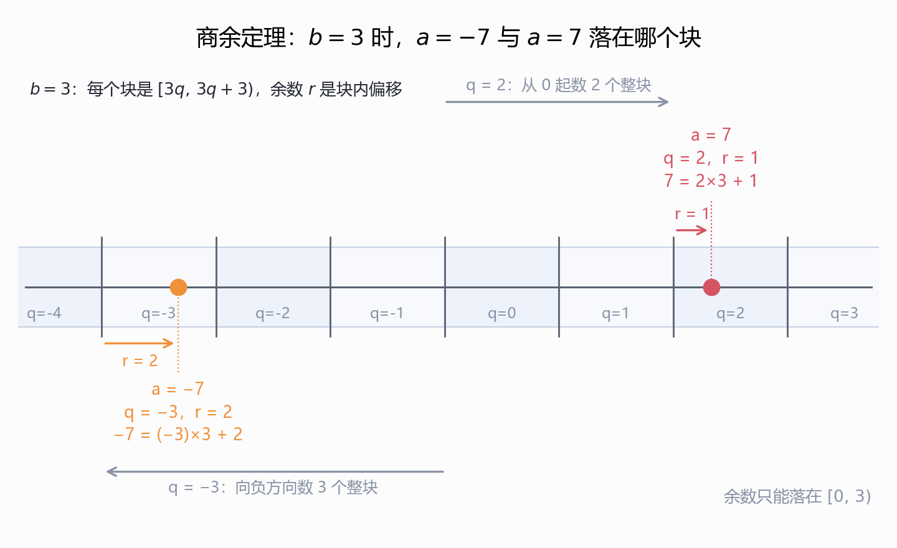
*图 4.1　$b=3$ 的块划分：$a=-7$ 落在块 $q=-3$、偏移 $r=2$，$a=7$ 落在块 $q=2$、偏移 $r=1$。我绘制；块图照 p5，负数口径按 p4 的 $q=\lfloor a/b\rfloor$ 复算；C/Java 的截断取整会给出 $r=-1$，与讲义不同。*

## 5. 从"试遍所有数"到欧几里得的一跳 (p6–p8)

*这一节回答：不试遍所有数，凭什么把 $(a,b)$ 换成 $(b,r)$ 而 $\gcd$ 不变，而且一定会停？*

p6 先把问题摆成算法题:

> Given $a$ and $b$, **how to compute $\gcd(a,b)$?** Maybe try every number? Not easy for large numbers… Do we have a better way to do it?

然后给出朴素算法(约定 $a \ge b > 0$):

```
gcd(a,b)
Let d = 1
1. If d | a and d | b, then store d.
2. Let d = d + 1
3. If d ≤ b, return to 1.
   else the answer = maximum of all stored "d"s
```

这段伪码的形状值得读准:先测 $d$、再自增、再判断 $d\le b$,所以实际测试的是 $d=1,2,\dots,b$ 共 $b$ 次(测完 $d=b$ 后 $d$ 变成 $b+1$,条件失败退出)。上界取 $b$ 而不是 $a$ 是因为 $\gcd(a,b)\le b$。p15 复述这段时补了一句"So the running time is about $b$ iterations"。

> **【我的补充·"maximum of all stored $d$'s" 其实不需要存】** $d$ 是递增扫的,所以最后存下的那个就是最大的。讲义这么写是为了让"取最大"这个动作在逻辑上显式,但实现时只要记一个变量。这不是错,只是冗余。

p7 开始改思路,只给两条分支:

> Let's say $a \ge b > 0$.
> 1. If $a = kb$, then $\gcd(a,b)=b$, and we are done.
> 2. Otherwise, by the Division Theorem, $a = qb + r$ where $r > 0$.

情形 1 就是 $\gcd = b$ 的平凡情况(见 §3 的 $\gcd(10,30)=10$)。情形 2 里 $r>0$ 是"否则"的直接翻译:若 $r=0$ 就回到情形 1。

p8 给出全讲最著名的一句话,并用三行彩色例子把它钉住:

> **Euclid: $\gcd(a,b) = \gcd(b,r)$!**

| $a$ | $b$ | 除法 | $\gcd(a,b)$ | $\gcd(b,r)$ |
| --- | --- | --- | --- | --- |
| 12 | 8 | $12 = 8 + 4$ | 4 | $\gcd(8,4)=4$ ✓ |
| 21 | 9 | $21 = 2\times 9 + 3$ | 3 | $\gcd(9,3)=3$ ✓ |
| 99 | 27 | $99 = 3\times 27 + 18$ | 9 | $\gcd(27,18)=9$ ✓ |

三行的配色是**有信息量的**:$a$ 红、$b$ 蓝、$r$ 绿,于是 $\gcd(\text{红},\text{蓝}) = \gcd(\text{蓝},\text{绿})$ 这个"整体左移一格"的动作,靠颜色就能一眼看清。这是讲义在这一页真正的表达方式——它不讲道理,先把**形状**给你看。

这一跳的“窗口滑动”可以画成两行（图 5.1）：

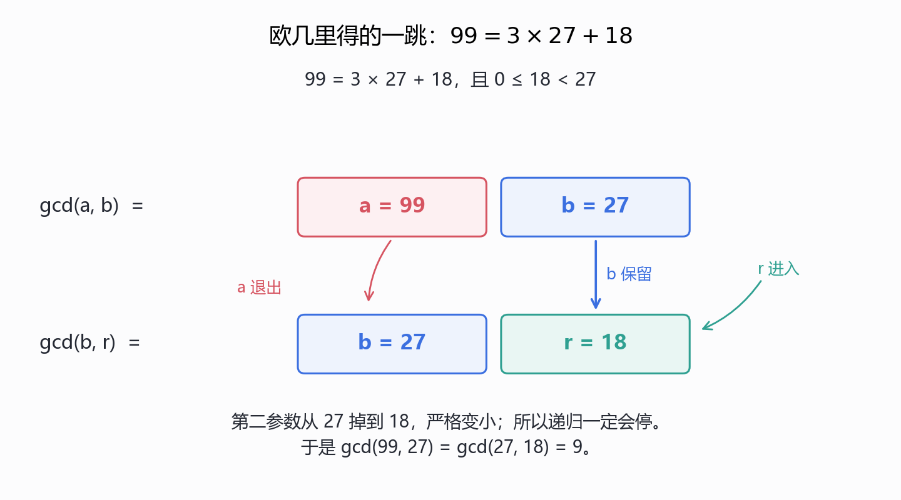
*图 5.1　欧几里得的一跳：$99=3\times27+18$，比较 $\gcd(99,27)$ 与 $\gcd(27,18)$ 的两个“窗口”，$a$ 退出、$b$ 保留、$r$ 进入，$27\to18$ 严格变小。我绘制；数据取 p8 表格第三行，并用 Python 复算。*

> **【我的补充·三行例子我都独立复算过】** $12\bmod 8 = 4$、$8\bmod 4=0$,链条 $\gcd(12,8)\to\gcd(8,4)\to\gcd(4,0)=4$;21 与 9 给 $3,0$,答案 3;99 与 27 给 $18,9,0$,答案 9。三例与表格完全一致。另外第三例值得多看一眼:$99 = 3\times 27 + 18$ 之后还要再走两步才到底,而 p8 只写了第一跳——它演示的是"这一跳成立",不是"整个算法"。

> **【我的补充·为什么这一跳"划算"】** 从 $b$ 换成 $r$,数值上从 $b$ 掉到 $r$,而 $r<b$ 是商余定理保证的。所以第二参数**严格变小**。光有这一条就足以保证算法会停(正整数不能无限下降,又是良序原理);至于"降得多快",是 §8 的事。

## 6. 欧几里得算法 (p9–p12)

*这一节回答：那一跳写成递归程序后长什么样，102/70、252/189、662/414 每一步怎么走？*

p9 把 p7–p8 的想法写成递归程序:

```
gcd(a,b)            Assumption: a > b ≥ 0
if b = 0, then answer = a.
else
    write a = qb + r          q = ⌊a/b⌋,  r = a − qb
    answer = gcd(b,r)
```

顶部还挂着两条被引用为已知结论的框:$a = qb + r$(§4)与 Euclid: $\gcd(a,b)=\gcd(b,r)!$(§5,p8)。

四个部件各有分工,值得逐个点名:

1. **前提 $a > b \ge 0$。** 注意它允许 $b=0$——基例正是为此而设。
2. **基例 $b=0$ 时答 $a$。** 依据是 $\gcd(a,0)=a$:一切整数整除 $0$(p2),所以 $a$ 与 $0$ 的公约数就是 $a$ 的约数,最大者为 $a$。
3. **递归步 $\gcd(b,r)$。** 把 $(a,b)$ 换成 $(b,r)$,而 $r<b$,所以第二参数严格下降。
4. **$q,r$ 的实际算法。** $q=\lfloor a/b\rfloor$、$r=a-qb$,这是 p4 那两条箭头指过来的公式。

> **【我的补充·这是一段"结构上递归、终止性靠良序"的代码】** LN5 教的递归三件套在这里齐了:**基例**($b=0$)、**递归步**(参数变小)、**终止性论证**(第二参数是严格下降的非负整数列,不可能无限降)。第三件 LN5 没强调,而本讲 p9 也没写——它把终止性藏在 $r<b$ 里。考试若要写"算法正确性",**终止性与正确性是两件事**,p13–p14 只处理后者。

p10–p12 是三道例题,格式统一:左边一列递归展开,右边一列对应的除法。

**Example 1(p10):$\gcd(102,70)$**

| 递归展开 | 除法 |
| --- | --- |
| $\gcd(102,70)$ | $102 = 70 + 32$ |
| $=\gcd(70,32)$ | $70 = 2\times 32 + 6$ |
| $=\gcd(32,6)$ | $32 = 5\times 6 + 2$ |
| $=\gcd(6,2)$ | $6 = 3\times 2 + 0$ |
| $=\gcd(2,0)$ | Return value: **2** |

把 102 与 70 的除法链画成几何剖分（图 6.1）：

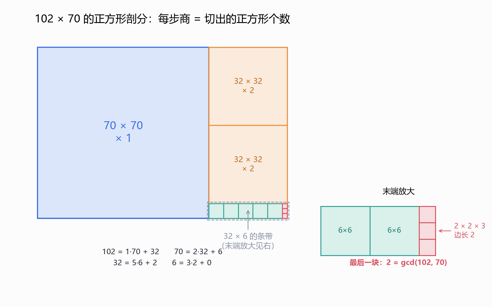
*图 6.1　$102\times70$ 的正方形剖分：$102=70+32$、$70=2\cdot32+6$、$32=5\cdot6+2$、$6=3\cdot2+0$，切出的正方形个数依次为 $1,2,5,3$，最后一块的边长 $2=\gcd(102,70)$。我绘制；数据取 p10 Example 1，逐刀剖分并用 Python 复核。*

**Example 2(p11):$\gcd(252,189)$** —— $252 = 1\times 189 + 63$,$189 = 3\times 63 + 0$,链条 $\gcd(252,189)\to\gcd(189,63)\to\gcd(63,0)$,返回 **63**。

**Example 3(p12):$\gcd(662,414)$** —— 五行除法:$662 = 1\times 414 + 248$,$414 = 1\times 248 + 166$,$248 = 1\times 166 + 82$,$166 = 2\times 82 + 2$,$82 = 41\times 2 + 0$,返回 **2**。

> **【我的补充·三道例题我逐行复算过】** 用 $\operatorname{divmod}$ 跑一遍:102/70 的余数序列是 $32,6,2,0$,答案 2 ✓;252/189 是 $63,0$,答案 63 ✓;662/414 是 $248,166,82,2,0$,答案 5 步、返回 2 ✓。**三例的每一行除法、每一个商、每一个余数都与课件一致,无笔误。**
> 顺带一个观察:Example 3 里前三个商都是 $1$,于是余数只是"减一次",降得很慢;到 $166 = 2\times 82 + 2$ 商突然变成 $2$,再下一步 $82 = 41\times 2$ 商变成 $41$,一步到底。**"商全是 1"就是最慢的情形**——这个直觉在 §8 会被精确化为"最坏输入是相邻 Fibonacci 数"。

## 7. 正确性:为什么欧几里得等式成立 (p13–p14)

*这一节回答：$\gcd(a,b)=\gcd(b,r)$ 为什么成立，$r=0$ 的出口为什么可以直接返回 $a$？*

p13–p14 分两种情况证明 p9 用的那条等式。

### 7.1 r = 0 的情形 (p13)

> Then $a = qb$, so $\gcd(a,b) = b$;
> $r = 0$, so $\gcd(b,r) = \gcd(b,0) = b$.
> Therefore, $\gcd(a,b) = \gcd(b,r)$.

这一支很短,但它是**基例能返回 $a$ 的理由**:$\gcd(b,0)=b$ 在这里被用了两次(一次在等式右端,一次藏在 p9 的程序里)。

### 7.2 r > 0 的情形 (p14)

p14 的写法是"两个方向各证一次包含",最后取集合相等:

> Let $d$ be a common divisor of $b,r$
> $\Rightarrow b = k_1 d$ and $r = k_2 d$ for some $k_1,k_2$.
> $\Rightarrow a = qb + r = qk_1 d + k_2 d = (qk_1 + k_2)d$ 　⟹ **$d$ is a common divisor of $a,b$**
>
> Let $d$ be a common divisor of $a,b$
> $\Rightarrow a = k_3 d$ and $b = k_1 d$ for some $k_1,k_3$.
> $\Rightarrow r = a - qb = k_3 d - qk_1 d = (k_3 - qk_1)d$ 　⟹ **$d$ is a common divisor of $b,r$**
>
> So, {common factors of $a,b$} = {common factors of $b,r$} $\Rightarrow \gcd(a,b) = \gcd(b,r)$.

结构上这是标准的**双向包含**:第一段说"任何 $(b,r)$ 的公约数也是 $(a,b)$ 的",第二段反过来。两段的骨架完全一样,只是把 $a=qb+r$ 解成 $r=a-qb$ 用了一次、用了反了一次。

双向包含证的是集合相等，不只是两个 $\gcd$ 相等（图 7.1）：

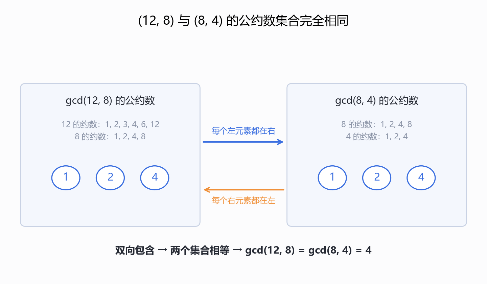
*图 7.1　用 $12$ 与 $8$ 看 p14 的双向包含：两组公约数都恰为 $\{1,2,4\}$，所以集合相等，$\gcd(12,8)=\gcd(8,4)=4$。我绘制；元素由 Python 枚举约数复核。*

> **【我的补充·这个证明其实比需要的更强】** 它证的不是"两个 $\gcd$ 相等",而是**整个公约数集合相等**。这比结论强得多,而且强出来的部分立刻有用:它意味着"求 $\gcd$"和"求公约数集合"是同一件事,于是 §9 讨论线性组合时可以自由替换。
> 另外注意 $d$ 可正可负,集合相等是对**所有**整数约数说的;取最大正元才得到 $\gcd$。

> **【我的补充·$r>0$ 这个分情况其实不必要】** 把 $r=0$ 代进 p14 的两段论证:$b = k_1 d$、$r = 0 = 0\cdot d$,第一段给 $a = qk_1 d$,第二段给 $r = (k_3 - qk_1)d$ 即 $0 = (\dots)d$,依然成立。所以"公约数集合相等"在 $r=0$ 时也真。**p13 那一段的作用不在逻辑上,而在算法上**:它告诉读者基例 $b=0$ 为什么可以**直接返回**而不必再递归。读这两页时把 p13 当成"递归的出口说明",把 p14 当成"递归步的引理",结构就顺了。

> **【我的补充·正确性 = 部分正确 + 终止】** p13–p14 只证明了"若算法停机,答案对"。停机性由 §5 末尾那条"第二参数严格下降"给出。讲义把这两件事分开写、也没点明它们要合起来才是完整证明,这是本讲在严谨性上最明显的一处留白。

## 8. 快不快:两步步进减半 (p15–p16)

*这一节回答：欧几里得算法到底多快，“两步减半”与 $2\log_2 b$ 是怎么推出来的？*

p15 复述朴素算法并给它的代价:"So the running time is about $b$ iterations."(约定 $a>b\ge0$。)

p16 是欧几里得的代价分析,全讲**推理最密**的一页。原文:

> Euclid's algorithm: **In two iterations, $a$,$b$ are decreased by half. (why?)**
> $$a = bq + r \ge b + r > 2r \quad\Longrightarrow\quad \gcd(a,b)=\gcd(b,r)\ \text{where}\ r < a/2$$
> Similarly, if $b = rq' + r'$, then $\gcd(b,r)=\gcd(r,r')$ where $r' < b/2$.
> Suppose the algorithm stops in $2k$ iterations. Then $2^{d} \ge 2^{k-1}$. (Suppose $2^{d+1} \ge b > 2^{d}$)
> So the running time is about $2\log_2 b$ iterations.
> **Exponentially faster!**

### 8.1 "(why?)" 那一步补全

不等式链 $a = bq + r \ge b + r > 2r$ 里用了两件事:$q \ge 1$(因为 $a>b>0$)所以 $bq\ge b$;以及 $r < b$,所以 $b + r > 2r$。合起来 $a > 2r$,即 $r < a/2$。

关键在于<b>"两步"这个词</b>:

* 第 1 步后状态是 $(b,r)$。此时**第一个**分量 $b$ 未必小于 $a/2$——所以一步不够。
* 第 2 步后状态是 $(r,r')$,其中 $r < a/2$(刚证),而 $r' < b/2 < a/2$(因为 $b\le a$)。

于是**两步之后,两个分量都小于 $a/2$**。这才是 "in two iterations, $a$,$b$ are decreased by half" 的确切含义——它讲的是"一对数同时减半",不是"其中一个减半"。

### 8.2 最后三行的推导链条

讲义只写了结论,中间是空的。按它的记号补全:设 $2^{d+1} \ge b > 2^{d}$(即 $d = \lfloor \log_2 b\rfloor$),算法在 $2k$ 步停止。由 8.1,每 2 步这对数减半一次,所以走满 $2(k-1)$ 步之后,第二个分量仍是一个**正整数**,于是

$$1 \;\le\; \frac{b}{2^{k-1}} \quad\Longrightarrow\quad b \;>\; 2^{k-1}.$$

结合 $2^{d+1} \ge b > 2^{k-1}$ 得 $d+1 > k-1$,即 $k-1 \le d$,也就是讲义那行 $2^{d} \ge 2^{k-1}$。解出 $k \le d+1$,步数 $2k \le 2(d+1) \approx 2\log_2 b$。**链条是通的,只是讲义把 $b>2^{k-1}$ 这一步整段省掉了**(见文末勘误 9)。

### 8.3 "Exponentially faster" 说的是什么

朴素算法 $b$ 步,欧几里得 $2\log_2 b$ 步。$b$ 与 $\log_2 b$ 之比是指数级的——但要说清楚**相对于什么**。输入的**长度**是位数 $n = \lceil \log_2 b \rceil$,于是朴素算法是 $O(2^{n})$ 步,欧几里得是 $O(n)$ 步。**指数与线性之比,所以"exponentially faster"指的是关于输入位数的加速比**,不是关于数值 $b$ 的。

> **【我的补充·我把 p16 的结论当命题扫了一遍】** 两件都验了。
> **(a) 减半引理**:对全部 $1\le b<500$、$b<a<3000$ 穷举,检查"$r<a/2$ 且 $r'<b/2$ 且 $r'<a/2$",**违例 0 条**。
> **(b) 步数上界**:定义 $\operatorname{steps}(a,b)$ 为除法次数。对 $2\le b<600$、$b<a<20000$ 全扫,$\operatorname{steps}(a,b) \le 2\log_2 b$ **违例 0 条**;随机 20 万组($b$ 到 $10^6$)也全部满足,最大比值 1.0 出现在 $(a,b)=(3,2)$。
> 所以 p16 那句"about $2\log_2 b$"作为**上界**是站得住的。

> **【我的补充·真正最坏的情形:相邻 Fibonacci 数(讲义未提)】** 我在每个 $b$ 上找使步数最大的 $a$,结果 $b = 5,8,13,21,34,55,89,144$ 时最优 $a$ 恰是 $8,13,21,34,55,89,144,233$ ——**全是相邻的 Fibonacci 数**。原因正是 §6 末尾那个观察:Fibonacci 序列相邻两项的商全是 $1$,余数只"减一次",降得最慢。定量地,$\operatorname{steps}(F_{i},F_{i-1}) = i-1$,而 $2\log_2 F_{i-1} \approx 1.386\,(i-1)$,比值趋于 $1/(2\log_2\varphi) \approx 0.72$。
> 换句话说:**讲义给的上界是对的,但离真值差一个常数因子 $1/0.72 \approx 1.39$;精确的最坏步数是 $\log_\varphi b \approx 1.44\,\log_2 b$。** 这条结论(以及"最坏输入是 Fibonacci 对")在数论里叫 **Lamé 定理**,是算法分析史上最早的非平凡复杂度结果之一。**这是讲义没有的内容。**
> 还有一条更隐蔽的:**"步数 $O(\log b)$"不等于"时间 $O(\log b)$"**。上面每一步都做一次除法,而 $b$ 有 $n$ 位时一次除法的代价是 $O(n^2)$ 位运算,所以总时间约 $O(n^3)$。讲义整页在数"iterations",从没提单次操作的价格——这是 §8 的口径边界,做复杂度题时要说明。

把“最坏输入是相邻 Fibonacci 数”画出来（图 8.1）：

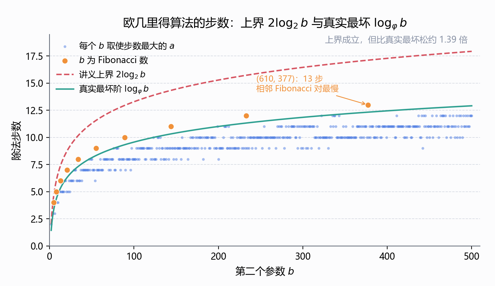
*图 8.1　对每个 $b\le500$ 穷举 $a$ 取最大除法步数：橙色点为相邻 Fibonacci 对，最坏在 $(a,b)=(610,377)$ 处取 $13$ 步；讲义上界 $2\log_2 b$ 成立但松约 $1.39$ 倍，真实最坏阶为 $\log_\varphi b$。我绘制；步数用 Python 递推扫描复核。*

## 9. gcd = spc:本讲的核心定理 (p17–p20)

*这一节回答：为什么“最大公约数”恰好等于“最小正整数线性组合”，两半各怎么证？*

### 9.1 一个新概念与一条定理 (p17)

p17 把"约数"这条线和"线性组合"这条线并排摆出来:

> **Greatest common divisor.** $d$ is a common divisor of $a$ and $b$ if $d \mid a$ and $d \mid b$. $\gcd(a,b)$ = greatest common divisor of $a$ and $b$.
> **Integer linear combination.** $d$ is an integer linear combination of $a$ and $b$ if $d = sa + tb$ for integers $s,t$.
> **Smallest positive integer linear combination.** $\operatorname{spc}(a,b)$ = smallest positive integer linear combination of $a$ and $b$.
>
> **Theorem.** $\gcd(a,b) = \operatorname{spc}(a,b)$.

两条线是**从相反方向逼近同一个数**。"约数"是**往下**看:哪些数能整除 $a$ 和 $b$。"线性组合"是**往上**看:$a$ 和 $b$ 的整数倍能拼出哪些数。一个取最大、一个取最小正,定理说这两个极端**碰在同一个数上**。

> **【我的补充·"spc" 这个缩写】** 讲义自造的记号,大概是 s**mallest** **p**ositive **c**ombination。它不是标准记号;标准文献里这个数一般不命名,而等式 $\gcd(a,b)=\min\{sa+tb>0\}$ 是 **Bézout 恒等式 (Bézout's identity)** 的常见表述。看到 spc 直接读成"最小正整系数线性组合"即可。

### 9.2 一个具体例子 (p18)

> For example, the greatest common divisor of 52 and 44 is 4. And 4 is an integer linear combination of 52 and 44: $6\cdot 52 + (-7)\cdot 44 = 4$. Furthermore, **no** integer linear combination of 52 and 44 is equal to a smaller positive integer.

代进去验:$6\times 52 = 312$,$7\times 44 = 308$,$312-308 = 4$ ✓;而 $\gcd(52,44) = 4$ ✓(链:$52 = 44+8$,$44 = 5\times 8 + 4$,$8 = 2\times 4$)。

§9.1 说的“往下取最大、往上取最小正”落在 52/44 上是这样（图 9.1）：

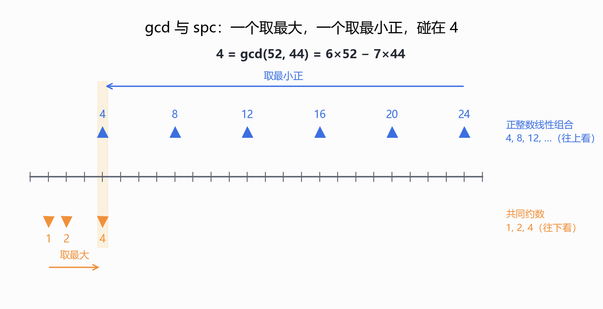
*图 9.1　52 与 44 的两条逼近路线：共同约数 $\{1,2,4\}$ 往下取最大得 $4$，正整数线性组合 $4,8,12,\dots$ 往上取最小正也得 $4$；$4=6\cdot52-7\cdot44$。我绘制；数值按 p18 复算。*

p18 还交代了证明路线,一个 $2\times 2$ 的布局:

> To prove the theorem, we will prove: $\gcd(a,b) \le \operatorname{spc}(a,b)$ 　$\gcd(a,b) \ge \operatorname{spc}(a,b)$
> $\gcd(a,b) \mid \operatorname{spc}(a,b)$ 　$\operatorname{spc}(a,b)$ divides $a$ and $b$

即两行**分别**是两条不等式的**依据**:上面那行是结论形状,下面那行是论证手段。

### 9.3 gcd ≤ spc (p19)

先证一条 Claim:

> **Claim.** If $d \mid a$ and $d \mid b$, then $d \mid sa+tb$ for any $s,t$.
> *Proof.* $d\mid a \Rightarrow a = dk_1$;$d \mid b \Rightarrow b = dk_2$。于是 $sa + tb = sdk_1 + tdk_2 = d(sk_1 + tk_2)$,故 $d \mid (sa+tb)$。

然后主论证只有一行:$d = \gcd(a,b)$ 整除 $a,b$,而 $f = \operatorname{spc}(a,b) = sa+tb$,由 Claim $d \mid f$,所以 $\gcd(a,b) \le \operatorname{spc}(a,b)$。

> **【我的补充·"整除"到"不大于"这一步需要一个前提】** $d \mid f \Rightarrow d \le f$ 只在 $d>0$ 且 $f>0$ 时成立。$f>0$ 由 $\operatorname{spc}$ 的定义("positive")保证,$d>0$ 由我们只数正约数保证(§2 末尾)。讲义 p19 的紫色框把这一节标成 "GCD | SPC",而页面标题写 "GCD ≤ SPC"——**两个都对,但中间那一步正是靠这两个正性前提跨过去的**。
> 更值得记的是这条 Claim 本身:它是本讲**第二次**出现"约数对线性组合封闭"(第一次是 p14 的 $a = qb+r$)。**这条性质是整台机器的枢轴**——§10 的三次应用、§13 的水壶不变量,全部直接引用它。

### 9.4 gcd ≥ spc (p20)

方向反过来,策略写在最上面:"We will prove that $\operatorname{spc}(a,b)$ is **actually a common divisor** of $a$ and $b$."先证它整除 $a$:

> 1. By the Division Theorem (since $a \ge \operatorname{spc}(a,b)$), $a = q \times \operatorname{spc}(a,b) + r$ and $\operatorname{spc}(a,b) > r \ge 0$.
> 2. Let $\operatorname{spc}(a,b) = sa + tb$.
> 3. Then $r = a - q\times\operatorname{spc}(a,b) = a - q\times(sa+tb) = (1-qs)a + qtb$.　← **符号印错了,见下**
> 4. So $r$ is an integer linear combination of $a$ and $b$ with $\operatorname{spc}(a,b) > r$.
> 5. This is only possible when $r = 0$.
>
> Similarly, $\operatorname{spc}(a,b) \mid b$. Thus, $\operatorname{spc}(a,b)$ divides both $a$ and $b$, which follows $\operatorname{spc}(a,b) \le \gcd(a,b)$.

这五步的核心是**反证 + 最小性**:把 $\operatorname{spc}$ 当除数做一次带余除法,余数 $r$ 被证明"仍然是 $a,b$ 的整系数线性组合",而它又比 $\operatorname{spc}$ 小;既然 $\operatorname{spc}$ 是**最小正**线性组合,唯一的出路是 $r$ 不是正的,即 $r=0$。**"最小性"当武器用,这是本讲最漂亮的一手。**

> **【我的补充·第 3 步有一个实打实的符号错误】** 展开 $a - q(sa+tb) = a - qsa - qtb = (1-qs)a - qt\,b$,讲义写成 "$+qtb$",第二项的符号印反了。用 p18 自己的例子验:$a=52$、$b=44$、$\operatorname{spc}=4=6\cdot 52 + (-7)\cdot 44$(即 $s=6$、$t=-7$),$52 = 13\times 4 + 0$,所以 $q=13$、$r=0$。
> 按讲义的写法:$(1-13\cdot 6)\cdot 52 + 13\cdot(-7)\cdot 44 = -77\cdot 52 - 91\cdot 44 = -4004 - 4004 = -8008 \ne 0$。
> 按改正后的写法:$-77\times 52 - (13\times(-7))\times 44 = -4004 + 4004 = 0 = r$ ✓。
> **结论不受影响**——因为第 4 步只需要"$r$ 是某个整系数线性组合",系数符号写错不改变这一事实。但抄公式的人会抄错,所以记成 $r = (1-qs)a - (qt)b$。(见文末勘误 1。)

> **【我的补充·第 1 步括号里那句 "since $a \ge \operatorname{spc}(a,b)$" 为什么成立】** 讲义没证。理由:$a = 1\cdot a + 0\cdot b$ **本身就是一个正整数线性组合**(前提是 $a>0$),而 $\operatorname{spc}(a,b)$ 是所有正线性组合里最小的,故 $\operatorname{spc}(a,b) \le a$。
> 这一句顺手暴露了定理的**适用范围**:要 $a,b$ 不全为 $0$。若 $a=b=0$,唯一的线性组合是 $0$,没有正的,spc 不存在,而定理无从谈起。
> 同理还有一件讲义没交代的事:**$\operatorname{spc}(a,b)$ 存在吗?** 存在性靠的正是**良序原理**——正线性组合的集合非空(上面刚说 $a$ 自己就在里面),而 $\mathbb{Z}_{>0}$ 的每个非空子集都有最小元。这与 LN4.2 §4 用的是同一条公理。**这是讲义没写的第 1 处省略。**

## 10. 这台机器的三次出手 (p21–p24)

*这一节回答：$\gcd=\operatorname{spc}$ 这台机器能拆开哪三把锁——Euclid 引理、素数整除、唯一分解？*

定理证完,p21–p24 连做三个应用,难度递增,而且**后一个用前一个**。

### 10.1 Euclid 引理的引理 (p21)

> **Lemma.** If $\gcd(a,b)=1$ and $\gcd(a,c)=1$, then $\gcd(a,bc)=1$.
> *Proof.* By the Theorem, there exist $s,t,u,v$ such that $sa + tb = 1$ and $ua + vc = 1$. So $(sa+tb)(ua+vc) = 1$. Expanding LHS gives $saua + savc + tbua + tbvc = 1$, hence $(sau + svc + tbu)a + (tv)\,bc = 1$. This implies $\operatorname{spc}(a,bc)=1$. By Theorem, we have $\gcd(a,bc)=1$.

读法:两个"等于 1"的式子**相乘**,再**重新归项**——把每一项里含 $a$ 的因子提出来,剩下的唯一不含 $a$ 的项是 $tbvc = (tv)(bc)$。于是拼出"$a$ 的倍数 + $bc$ 的倍数 = 1"。

> **【我的补充·"拼出 1"为什么就够】** 一旦 $1 = sa' + t'bc$,由 §9.3 的 Claim,$\gcd(a,bc)$ 整除右边 $=1$,所以 $\gcd(a,bc)=1$。也就是说这个证明其实**没绕完** spc 那一圈——它只要"1 是线性组合"就够了。讲义最后两句"implies spc = 1, by Theorem gcd = 1"是**多走了一步**,但方向没错。
> 另注:展开式里 $saua$ 是 $sua^2$、$tbua$ 是 $tua\cdot b$,提公因子 $a$ 后系数是 $su\,a + sv\,c + tb\,u$,讲义写的 $(sau + svc + tbu)$ 与之一致 ✓。我逐项对过。

### 10.2 素数整除 (p22)

> **Lemma.** $p$ prime and $p \mid ab$ implies $p \mid a$ or $p \mid b$.

讲义的排版把证明的关键一步画成了**带括注的树**:

> *proof.* W.l.o.g, assume $p$ does not divide $a$. Then $\gcd(p,a)=1$.
> So by **Theorem**, there exist $s$ and $t$ such that
> $$sa + tp = 1$$
> $$(sa)b + (tp)b = b$$
> $$\underbrace{\phantom{(sa)b}}_{p \mid ab}\quad \underbrace{\phantom{(tp)b}}_{p \mid p}$$
> Hence $p \mid b$.

也就是:整条式子乘以 $b$;第一项 $(sa)b = s(ab)$ 被 $p$ 整除(因为 $p \mid ab$),第二项 $(tp)b = t(pb)$ 被 $p$ 整除(因为 $p \mid p$);两项之和是 $b$,故 $p \mid b$。"W.l.o.g" 用在这里是对的:$p \mid ab$ 关于 $a,b$ 对称,所以只需处理"$p$ 不整除 $a$"这一支,另一支已经是要证的结论之一。

这棵“两个整除来源”的树可以画成三段（图 10.1）：

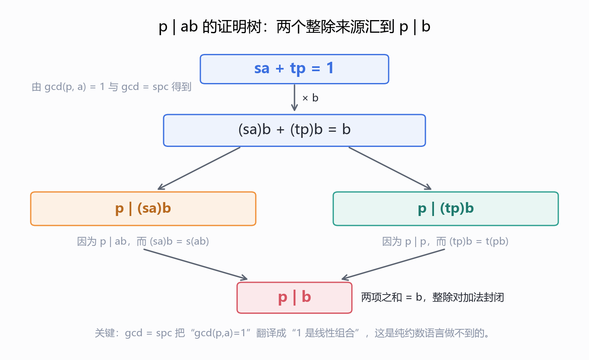
*图 10.1　把 p22 的带括注证明树重排：$sa+tp=1$ 乘 $b$ 后，左项被 $p\mid ab$ 整除，右项被 $p\mid p$ 整除，两项之和为 $b$，故 $p\mid b$。我绘制；逻辑照 p22 原文。*

> **【我的补充·这一步为什么非用定理不可】** §3 那个 Claim 只告诉我们 $\gcd(p,a)=1$。从"$\gcd=1$"到"存在 $s,t$ 使 $sa+tp=1$"**不是关于约数的陈述,而是关于线性组合的陈述**,只有 $\gcd=\operatorname{spc}$ 能给。**这正是本讲要费两页证明这条定理的原因**:素数"整除乘积必整除其一"这条看似显然的性质,在纯约数语言里是**证不出来的**(它等价于唯一分解,而唯一分解比"整除"深)。

> **Corollary.** If $p$ is prime, and $p \mid a_1 a_2 \cdots a_m$ then $p \mid a_i$ for some $i$.

从 $m=2$ 推到一般 $m$,是**归纳**:$p \mid a_1\cdots a_m$,把 $a_1\cdots a_{m-1}$ 看成一个整体,用 $m=2$ 的情形,得 $p \mid a_m$ 或 $p \mid a_1\cdots a_{m-1}$,后者用归纳假设。**讲义直接给了 Corollary 没写这一步**,而它恰好是下一节要用的。

### 10.3 算术基本定理 (p23–p24)

> **Fundamental Theorem of Arithmetic.** Every integer $n>1$ has a **unique** factorization into primes: $n = p_0 p_1 \cdots p_k$ with $p_0 \le p_1 \le \cdots \le p_k$. ($p_i$ might duplicate.)
> Example: $61394323221 = 3\cdot 3\cdot 3\cdot 7\cdot 11\cdot 11\cdot 37\cdot 37\cdot 37\cdot 53$.

> **【我的补充·这个例子我乘了一遍】** $3^3\cdot 7\cdot 11^2\cdot 37^3\cdot 53 = 27\cdot 7\cdot 121\cdot 50653\cdot 53 = 61{,}394{,}323{,}221$,与课件**精确相等**;反过来对 $61394323221$ 做试除,得到的素因子多重集也正是 $\{3,3,3,7,11,11,37,37,37,53\}$。这个数挑得不随便:它同时演示了"重复($3^3$)、跨度过大($37^3$)、以及单个大素因子($53$)"三种情况。

p24 证唯一性,用的是**良序原理 + 最小反例**:

> *Proof.* Suppose there is a number with two different factorizations. By Well Ordering Principle, we choose the **smallest** such $n>1$:
> $$n = p_1 p_2 \cdots p_k = q_1 q_2 \cdots q_m$$
> Since $n$ is smallest, we must have that $p_i \ne q_j$ **all** $i,j$ (Otherwise, we can obtain a smaller counterexample.)
> Since $p_1 \mid n = q_1 q_2 \cdots q_m$, so by Corollary $p_1 \mid q_i$ for some $i$.
> Since both $p_1$, $q_i$ are prime numbers, we must have $p_1 = q_i$.
> **contradiction!**

p24 上"contradiction!" 这个橙色框伸出**两条箭头**,分别指回 "$p_i \ne q_j$ all $i,j$" 和 "$p_1 = q_i$"——图直接把矛盾的**两端**标出来了,这是本页排版本身在提供的信息。

推理的四个关节:

1. **取最小反例** $n$(良序原理,前提是反例集合非空)。
2. **两个分解没有公共素因子**。因为若 $p_i = q_j$,把这个公共因子约掉,得到 $n/p_i$ 的两个不同分解,而 $n/p_i < n$,与 $n$ 的最小性矛盾。
3. **$p_1$ 整除右边乘积**,由 §10.2 的 Corollary,$p_1$ 整除某个 $q_i$。
4. **素数整除素数只能相等**:$p_1 \mid q_i$ 且两者都是素数,故 $p_1 = q_i$,与第 2 条冲突。

把“最小反例 + 两条分支”画成一张图（图 10.2）：

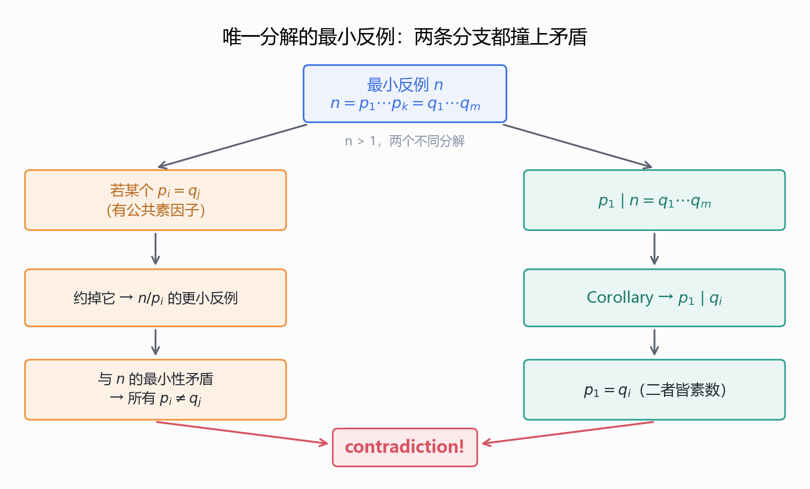
*图 10.2　把 p24 的最小反例论证画成两条分支：左边若有公共素因子 $p_i=q_j$，约掉后得到更小的反例，与 $n$ 的最小性矛盾，所以所有 $p_i\ne q_j$；右边由 $p_1\mid q_1\cdots q_m$ 与 Corollary 得 $p_1\mid q_i$，素数整除素数故 $p_1=q_i$，与左边冲突。我绘制；逻辑照 p24 原文。*

> **【我的补充·第 2 步里"约掉后仍是不同分解"要交代一句】** 若约掉公共因子后两边变**相同**了,那 $n$ 本来就不是反例。所以"约掉后仍不同"与"$n$ 是反例"是同一件事的两个方向,逻辑闭合。另外要保证 $n/p_i > 1$(否则"更小的反例"落在定理范围外):若 $n = p_i$,那 $n$ 只有一种分解(单个素数),不会是反例。
> **这一页只证了唯一性,没有证存在性。** 定理陈述 "Every integer $n>1$ **has** a unique factorization" 里那个 "has" 是空的。存在性的证明同样短,顺手补上:

> **【我的补充·存在性(讲义未给)】** 对 $n$ 做**强归纳**(LN4.2 §2)。$n=2$ 时 $2$ 本身是素数。设结论对一切 $2 \le m < n$ 成立。若 $n$ 是素数,已分解完;否则 $n = ab$,其中 $1 < a \le b < n$,两个因子都严格小于 $n$,由归纳假设各自可分解为素数之积,拼接即得 $n$ 的素分解。$\square$
> 注意这里用的是**强归纳**——因为 $a$ 与 $b$ 是"某个"因子而非 $n-1$,需要"$<n$ 的全部成立"。这与 LN4.2 §3 里"每个 $n\ge2$ 可分解为素数之积"是同一道题,而本讲把它当定理的另一半**默认**了。**这是讲义没写的第 2 处省略。**

## 11. 扩展欧几里得算法 (p25–p26)

*这一节回答：定理只说 $s,t$ 存在，怎样一边跑欧几里得一边把 $s,t$ 算出来？*

p25 开门见山:

> **How can we write $\gcd(a,b)$ as an integer linear combination?** This can be done by **extending** the Euclidean algorithm.

定理保证了这样的 $s,t$ **存在**,扩展欧几里得给出**怎么找到它们**。

### 11.1 例 1:a = 259, b = 70 (p25)

先照 §6 跑欧几里得,再**边跑边**把每个余数改写成 $a,b$ 的组合:

| 除法 | 改写成 $a,b$ 的组合 |
| --- | --- |
| $259 = 3\cdot 70 + 49$ | $49 = a - 3b$ |
| $70 = 1\cdot 49 + 21$ | $21 = b - 49 = b - (a-3b) = -a + 4b$ |
| $49 = 2\cdot 21 + 7$ | $7 = 49 - 2\cdot 21 = (a-3b) - 2(-a+4b) = 3a - 11b$ |
| $21 = 7\cdot 3 + 0$ | done, $\gcd = 7$ |

**答案:$\gcd(259,70) = 7 = 3\cdot 259 + (-11)\cdot 70 = 777 - 770$** ✓

### 11.2 例 2:a = 899, b = 493 (p26)

| 除法 | 改写成 $a,b$ 的组合 |
| --- | --- |
| $899 = 1\cdot 493 + 406$ | $406 = a - b$ |
| $493 = 1\cdot 406 + 87$ | $87 = b - 406 = b - (a-b) = -a + 2b$ |
| $406 = 4\cdot 87 + 58$ | $58 = 406 - 4\cdot 87 = (a-b) - 4(-a+2b) = 5a - 9b$ |
| $87 = 1\cdot 58 + 29$ | $29 = 87 - 1\cdot 58 = (-a+2b) - (5a-9b) = -6a + 11b$ |
| $58 = 2\cdot 29 + 0$ | done, $\gcd = 29$ |

**答案:$\gcd(899,493) = 29 = (-6)\cdot 899 + 11\cdot 493 = -5394 + 5423$** ✓

> **【我的补充·两例全部独立复算,并且我注意到一个方法上的细节】** 我用标准的扩展欧几里得(同时维护 $(s,t)$ 三元组)跑了一遍:$(259,70) \to (g,s,t) = (7,\,3,\,-11)$,$(899,493) \to (29,\,-6,\,11)$,**与课件两例逐字一致**。除法链的每一行商与余数也都对。
> 值得注意的**是做法本身**:讲义**不是**"跑完再回代(back-substitute)",而是**每算出一个新余数,立刻把它表成 $a,b$ 的组合**。这两种做法等价,但**前向法更好用**——回代法要在最后从下往上穿一遍整条链,极易在负号上出错;前向法每一步只依赖上两行,局部性最好。第二例的 $58 = 5a-9b$ 一步同时用到 $406$ 与 $87$ 两行的结果,就是这个"只依赖上两行"的体现。
> 另一个可核对的细节:例 2 里 $29$ 出现在<b>倒数第二次</b>除法之前,而"done"标在下一行 $58 = 2\cdot 29 + 0$。也就是说<b>$\gcd$ 是最后一个非零余数</b>,判停条件是"下一步余数为 0",这与 p9 那段程序里 $b=0$ 才返回是一致的。

> **【我的补充·解不唯一】** p18 给 $\gcd(52,44)=4$ 的表示是 $6\cdot 52 - 7\cdot 44$,而我用扩展欧几里得跑出来是 $(-5)\cdot 52 + 6\cdot 44$。两个都对。原因是若 $sa+tb = g$,则 $(s + kb/\!\gcd)\,a + (t - ka/\!\gcd)\,b = g$ 对任意整数 $k$ 都成立——**解构成一条一维整数格**。这一点在 §13 结尾会变成"能不能让 $s>0$"的关键。

## 12. 回到 Die Hard:不变量法收网 (p28–p37)

*这一节回答：3/5 桶的六步解为什么有效，换成 3/9 桶为什么立刻变成“不可能”？*

p27–p28 的谜题与对白见 §1。p29–p34 是**解答本身**,一页一个状态,记号是有序对 $(L,B)$——$L$ 是 3 加仑小桶、$B$ 是 5 加仑大桶。

| 页 | 操作 | 状态 $(L,B)$ | 核验 |
| --- | --- | --- | --- |
| p29 | Start with empty jugs | $(0,0)$ | — |
| p29 | Fill the big jug | $(0,5)$ | $B$ 装满 ✓ |
| p30 | Pour from big to little | $(3,2)$ | 倒 3 加仑,$5-3=2$ ✓ |
| p31 | Empty the little | $(0,2)$ | ✓ |
| p32 | Pour from big to little | $(2,0)$ | 把 2 全倒进空的小桶 ✓ |
| p33 | Fill the big jug | $(2,5)$ | ✓ |
| p34 | Pour from big to little | $(3,\mathbf{4})$ | 小桶已有 2,只需 1 加仑即满,$5-1=4$ ✓ |

p34 标着 **"Done!!"**,大桶里恰好 4 加仑。

六步解与 3/9 的可达状态可以并排看（图 12.1）：

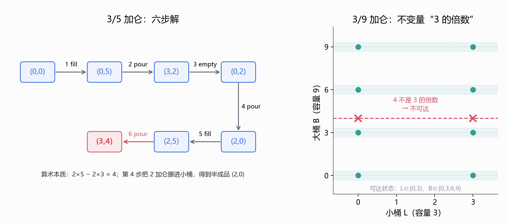
*图 12.1　3/5 加仑水壶的六步解与 3/9 加仑的不可能性。左图逐步模拟 p29–p34 的状态 $(L,B)$；右图用 BFS 枚举 3/9 的全部可达状态，共 8 个，都是 3 的倍数，目标 4 不在其中。我绘制。*

> **【我的补充·六步我逐步模拟过,与课件一致】** 关键点在 p32→p33→p34 这三步:先制造"小桶里已有 2 加仑"这个**半成品状态**,再装满大桶,最后只从大桶里"取走"3 加仑中缺的那 1 加仑。整套动作的算术本质是 $2\times 5 - 2\times 3 = 4$,即 $4$ 是 $3$ 与 $5$ 的一个整系数线性组合。
> **另外给一个讲义没给的第二解**:用 §13 的通用配方反过来,$4 = 3\times 3 - 1\times 5$,所以"$3$ 加仑桶装满倒进 $5$ 加仑桶,重复 3 次、中途倒空 $5$ 加仑桶 1 次"也能得到 4 加仑。我模拟过:$3\to(0,3)$、$6\to(0,1)$(满则空)、$9\to(0,4)$,大桶剩 4 ✓。**同一道题有两条路,而两条路都对应 $\gcd(3,5)=1$ 的一个 Bézout 表示。**

### 12.1 换一只桶:p35–p37

p35 把 5 加仑桶**划掉**,换成 9 加仑桶:

> What if you have a 9 gallon jug instead? **Can you do it? Can you prove it?**

注意它要的是两件事:**能不能**、以及**证明**。p36 只列出装备("3-Gallon Jug / 9-Gallon Jug / Supplies: Water"),p37 给答案:

> **Invariant Method.** Invariant: the number of gallons in each jug is a **multiple of 3**. i.e., $3 \mid L$ and $3 \mid B$ (3 divides both $L$ and $B$).
> **Corollary.** It is impossible to have exactly 4 gallons in one jug.
> **Bruce Dies!**

这正是 LN4.2 §5 的不变量法原样出场:不找步骤,而是找一个**开局成立、且三种操作都保持**的性质,再用它把目标排除掉。

> **【我的补充·讲义只宣告了不变量,没验证它对三种操作都保持——这里补上】** 开局 $(0,0)$,$3\mid 0$ ✓。设某时刻 $3\mid L$ 且 $3\mid B$:
> * **装满 $L$**:$L$ 变成 $3$,$3\mid 3$ ✓;$B$ 不动 ✓。**装满 $B$**:$B$ 变成 $9$ ✓。
> * **倒空任一只**:变成 $0$ ✓。
> * **$L$ 倒入 $B$**:倒的量是 $\min(L,\,9-B)$。若 $L \le 9-B$,则 $L\to 0$ ✓、$B \to B+L$ ✓(两个 3 的倍数之和);若 $L > 9-B$,则 $B\to 9$ ✓、$L \to L-(9-B) = L+B-9$ ✓(三个 3 的倍数之差)。倒过来的情形同理。
> 于是**任何可达状态**都满足 $3\mid L$ 且 $3\mid B$。而 $4$ 不是 3 的倍数,所以"某只桶里恰好 4 加仑"不可达 ✓。
> 这个补法有个可复用的形状:**证明不变量时,真正要检查的永远是"混合操作"(这里是倒水),因为装满/倒空只把某个分量换成容量或 0。**

## 13. 一般化解:iff 定理与构造 (p38–p43)

*这一节回答：哪些 $(a,b,k)$ 能倒出 $k$，怎样照着 $\gcd$ 与 Bézout 表示把步骤造出来？*

p38 把问题推广:

> **Generalized Die Hard.** Can Bruce form 3 gallons using 21 and 26-gallon jugs? **This question is not so easy to answer without number theory.**

p39 把 §12 那个"3 的倍数"抽象成两层:

> **Invariant in Die Hard Transition.** Suppose that we have water jugs with capacities $B$ and $L$. Then the amount of water in each jug is always an **integer linear combination** of $B$ and $L$.
> **Lemma.** $\gcd(a,b)$ divides any integer linear combination of $a$ and $b$. *Let $d = \gcd(a,b)$. Then $d\mid a$ and $d\mid b$, so $d \mid ax+by$.*
> **Corollary.** The amount of water in each jug is a multiple of $\gcd(a,b)$.

层次要分清:**不变量的强版本**是"每只桶里的水是容量的整线性组合",**弱版本**是"是 $\gcd$ 的倍数"。弱版本由强版本 + §9.3 那条 Claim 立刻得到。而**强版本才是能反过来说"能做到"的那一半**(见 p43)。

p40 用两个例子把"必要条件"和"充分条件"的差别挑明:

> *Given jug of 3 and jug of 9, is it possible to have exactly 4 gallons in one jug?* **NO**, because $\gcd(3,9)=3$, and 4 is not a multiple of 3.
> *Given jug of 21 and jug of 26, is it possible to have exactly 3 gallons in one jug?* $\gcd(21,26)=1$, and 3 is a multiple of 1, **so this means possible??**

那个 "??" 是全讲最重要的两个字符。必要条件成立**不等于**结论成立——除非有另一条定理背书。紧接着:

> **Theorem.** Given water jugs of capacity $a$ and $b$ with $a \le b$, it is possible to have exactly $k$ ($\le b$) gallons in one jug **if and only if** $k$ is a multiple of $\gcd(a,b)$.

"if and only if" 意味着两半都要证:**only if** 是 p39 的 Corollary;**if** 由 p41–p43 的**显式构造**给出。

### 13.1 构造:21 与 26 加仑桶,目标 3 加仑 (p41–p42)

> $\gcd(21,26) = 1 \Rightarrow 5\times 21 - 4\times 26 = 1 \Rightarrow \mathbf{15}\times 21 - \mathbf{12}\times 26 = 3$
>
> Repeat **15** times:
> 1. Fill the 21-gallon jug.
> 2. Pour all the water in the 21-gallon jug into the 26-gallon jug. Whenever the 26-gallon jug becomes full, empty it out.

第一步是拿 $\gcd=1$ 的 Bézout 表示 $5\cdot 21 - 4\cdot 26 = 105 - 104 = 1$ ✓,整体乘 3 得 $15\cdot 21 - 12\cdot 26 = 315 - 312 = 3$ ✓。

p42 给"为什么最后剩 3"的**计数论证**:

> **Claim.** There must be exactly 3 gallons left after this process.
> 1. Totally we have filled $15\times 21$ gallons.
> 2. We pour out $t$ multiple of 26 gallons.
> 3. The 26 gallon jug can only hold the volume between 0 and 26.
> 4. So $t$ must be 12.
> 5. And there is exactly 3 gallons left.

逻辑是:总进水量 $315$ 固定;水**只能**以"倒空 26 加仑桶"的方式离开系统,而每次离开恰好 $26$ 加仑;过程结束时 21 加仑桶是空的(每一轮都把它倒干净),所以全部剩余水都在 26 加仑桶里,而它的容量限制给出 $0 \le 315 - 26t \le 26$。解这个不等式:$t = 12$ 唯一($t=11$ 得 $29>26$,$t=13$ 得 $-23<0$),剩余 $315 - 312 = 3$ ✓。

> **【我的补充·我把这套流程真的跑了一遍】** 模拟"装 21 → 全倒入 26 → 满则空并继续倒完",15 轮之后的状态是:**倒空 26 加仑桶 12 次,桶里剩 3 加仑** ✓,与 p42 的 $t=12$、"exactly 3 gallons left" 完全吻合。
> 顺手把机制说清楚:第 $j$ 轮结束时大桶里的水是 $(21j) \bmod 26$。所以整个过程等价于**用带余除法把 $21j$ 除以 $26$**,而"倒空次数"就是商。这也解释了"whenever it becomes full, empty it out"为什么允许**一次倒水中途空桶**——它正是在模拟"商可以大于 1"。

把 15 轮的“加 21、满则倒空”画成锯齿（图 13.1）：

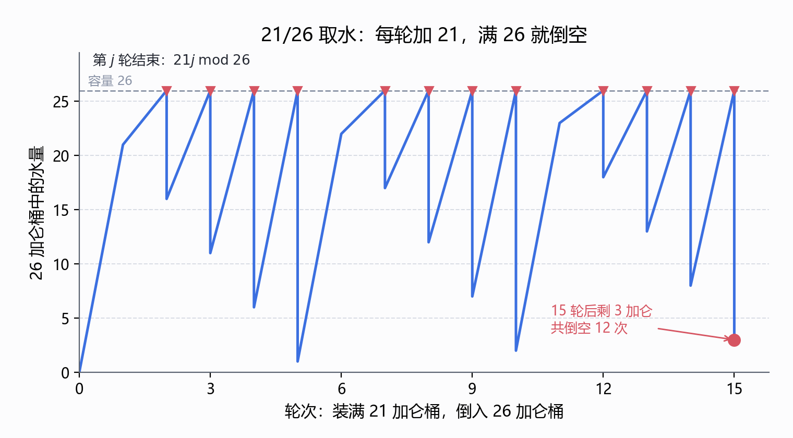
*图 13.1　21 与 26 加仑桶的 15 轮流程：第 $j$ 轮结束 26 加仑桶中的水量为 $21j\bmod26$，锯齿每次触顶 26 就倒空，共倒空 12 次，末态 $(0,3)$。我绘制；逐轮模拟复核，与 p42 的 $t=12$ 一致。*

### 13.2 一般配方 (p43)

> Given two jugs with capacity $A$ and $B$ with $A \le B$, the target is $C$.
> **If $\gcd(A,B)$ does not divide $C$, then it is impossible.**
> Otherwise, compute $C = sA + tB$. (**We can always make $s > 0$.**)
> Repeat **$s$** times: 1. Fill the $A$-gallon jug. 2. Pour all the water in the $A$-gallon jug into the $B$-gallon jug. Whenever the $B$-gallon jug becomes full, empty it out.
> The $B$-gallon jug will be emptied exactly **$t$** times. After that, there will be exactly $C$ gallons in the $B$-gallon jug.

> **【我的补充·$s$ 与 $t$ 的符号必须统一,而讲义这里前后不一致】** p41 与 p42 用的是 $C = sA - tB$ 的形状($3 = 15\times 21 - 12\times 26$,$t=12$ 是**正**的倒空次数)。p43 把式子写成 $C = sA + tB$,却照抄了"emptied exactly $t$ times"。按 p43 自己的加号写法,应当是 **"$-t$ 次"**(因为此时 $t<0$)。两种读法算出的次数都是 12,但**照字面执行 p43 会得到"倒空 $-12$ 次"**。(见文末勘误 2。)
> 正确的统一表述:$C = sA + tB$ 且 $s>0$,则 $t \le 0$,倒空次数为 $\lvert t\rvert = -t$。

> **【我的补充·"We can always make $s>0$" 为什么对(讲义没证)】** 若 $(s,t)$ 是一组解,则对任意整数 $m$,$(s + mB',\ t - mA')$ 也是解,其中 $A' = A/\gcd(A,B)$、$B' = B/\gcd(A,B)$。取 $m$ 足够大就能把 $s$ 顶成正的。所以这句括号里的话**成立**,但它依赖"解集是一条整数格线"这个结构(§11 末尾已提到)。
> 还要补一条前提:$0 \le C \le B$(定理 p40 里有 $k\le b$,p43 忘了写)。否则 $C = sA \bmod B$ 的余数永远落在 $[0,B)$ 内,取不到 $C$。

> **【我的补充·整条 iff 定理我做了穷举核验】** 对全部 $1 \le A \le B \le 12$、$1 \le C \le B$(共 **650** 组),我用 BFS 枚举所有可达状态(六种操作:装满/倒空任一只、双向倒水),再与"$C$ 是 $\gcd(A,B)$ 的倍数"这条判据比对:**650 组全部一致,0 处反例。** 其中 $C = B$ 的平凡情形也算进去了。
> 这个核验同时覆盖了两个方向:"only if" 没有任何可达状态违背判据,"if" 在全部小情形下都能真的走到。

## 14. 一条线、三个工具(我的归纳)

*这一节回答：十四节内容能否压成一条主线、三个工具，遇到新题该先问哪两个问题？*

本讲 43 页在讲义里是"定义 → 定理 → 算法 → 应用"的平铺,但把它们串起来看,其实是一条线:**"整除"这件事太弱,所以要引入"线性组合";两者在 $\gcd=\operatorname{spc}$ 处会合,会合点同时给出算法(扩展欧几里得)和应用(唯一分解、水壶问题)。** 下面是我按本讲各节归纳的判据图(**非讲义内容,属我的归纳**):

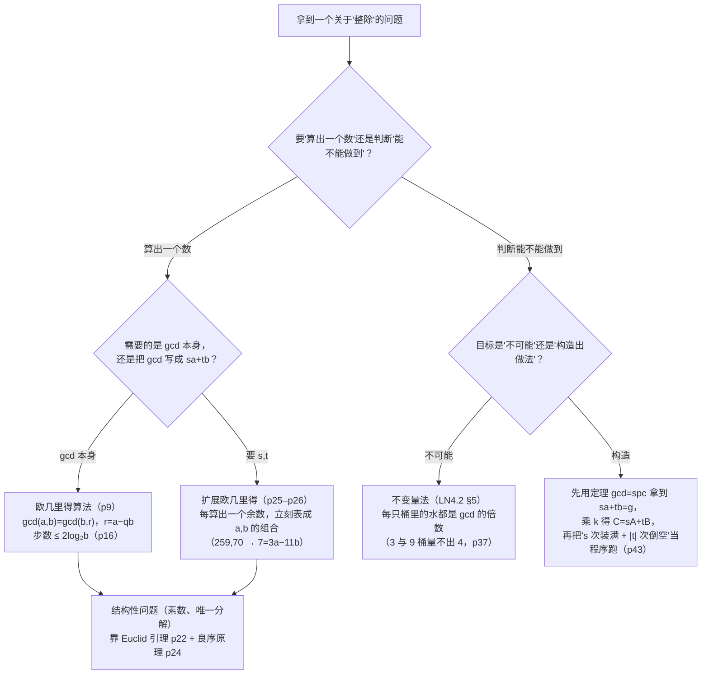

三条最该记住的:

1. **"约数往下、组合往上"是本讲的全部结构。** §2–§3 全在往下(谁整除谁),§9 起全在往上(谁能拼出谁),p17 那条定理是两者的**唯一接口**。之后每一次应用(p21、p22、p43)都是"我需要一个整系数恒等式"→ 回到接口取。
2. **最小性可以当反证武器。** p20 用"比 $\operatorname{spc}$ 小的正线性组合不存在"逼出 $r=0$;p24 用"最小反例"逼出 $p_1 = q_i$;LN4.2 的良序原理是同一招。**这三处用的是同一个逻辑动作,不是三个技巧。**
3. **必要条件与充分条件之间隔着一次构造。** p40 那个 "??" 是全讲最好的一课:"$\gcd$ 整除 $k$" 只给了必要性;真正把它变成"能做到"的是 p43 那段**可以照着跑的程序**。iff 定理的证明永远是两段,别把第一段当成全部。

## 小结 (Summary)

*这一节回答：本讲哪些结论必须能默写，它们各自挂在哪一页、服务于哪一步？*

讲义最后一页(p43)没有给总结清单,它把收尾交给了"通用配方"。把本讲的东西整理成表:

| 概念 / 结果 | 位置 | 陈述 | 用途 |
| --- | --- | --- | --- |
| 整除 $b \mid a$ | p2 | $\exists k\in\mathbb{Z},\ a=kb$($b\ne0$) | 全讲的地基 |
| 任何数整除 $0$ | p2 | $0 = b\cdot 0$ | 支撑 $\gcd(a,0)=a$ |
| 公约数、$\gcd(a,b)$ | p3 | 最大的正公约数 | 定义 |
| Claim:素数不相除则互素 | p3 | $p$ prime, $p\nmid a \Rightarrow \gcd(p,a)=1$ | §10.2 的引子 |
| 商余定理 | p4–p5 | $a=qb+r$,$0\le r<b$,$q,r$ 唯一 | 每一次除法 |
| $\operatorname{div}$ / $\operatorname{mod}$ | p4 | $q=\lfloor a/b\rfloor$,$r=a-qb$ | 算法实现 |
| 欧几里得的一跳 | p8 | $\gcd(a,b)=\gcd(b,r)$ | 本讲主角 |
| 欧几里得算法 | p9–p12 | 递归,$b=0$ 返回 $a$ | 例:102/70→2,252/189→63,662/414→2 |
| 正确性 | p13–p14 | 公约数**集合**相等 | 双向包含 |
| 效率 | p15–p16 | 朴素 $b$ 步;欧几里得 $\le 2\log_2 b$ 步 | "指数级更快" |
| $\operatorname{spc}(a,b)$ | p17 | 最小正整系数线性组合 | 新工具 |
| **核心定理** | p17–p20 | $\gcd(a,b)=\operatorname{spc}(a,b)$ | 后面三个应用全靠它 |
| Euclid 引理 | p21 | $\gcd(a,b)=\gcd(a,c)=1 \Rightarrow \gcd(a,bc)=1$ | 唯一分解的螺丝 |
| 素数整除 | p22 | $p\mid ab \Rightarrow p\mid a$ 或 $p\mid b$;推广到 $m$ 个因子 | 唯一分解的螺丝 |
| 算术基本定理 | p23–p24 | 唯一素分解(存在 + 唯一) | 数论的地基 |
| 扩展欧几里得 | p25–p26 | 边跑边表成 $sa+tb$ | 例:$7=3a-11b$,$29=-6a+11b$ |
| Die Hard 解 | p29–p34 | 六步,$(3,4)$ | 谜题 |
| 不变量:3 的倍数 | p37 | $3\mid L$ 且 $3\mid B$ | 3/9 桶量不出 4 |
| 一般不变量 | p39 | 每只桶里的水是 $\gcd$ 的倍数 | iff 的 only-if 半 |
| **Die Hard 定理** | p40 | $k\le b$ 可达 $\iff \gcd(a,b) \mid k$ | iff 双向 |
| 通用配方 | p41–p43 | $C=sA+tB$,$s$ 次装满、$\lvert t\rvert$ 次倒空 | iff 的 if 半 |

**与 LN5 结尾的对账。** LN5 的 `附` 里我留了三条判断,现在可以逐条结算:

* **"结构归纳 (structural induction) 仍未出现"** —— **本讲仍未出现**,讲义里也没有这个词。不过 §11 的扩展欧几里得(每步依赖上两步、正确性对递归深度归纳)和 §7 的终止性论证,都是结构归纳**正在发生而未被点名**的场合。这块缺口到 LN6 结束依然没补,得靠教材或其他课程。
* **"不变量法在本讲一次没出现"** —— 这条说的是 LN5,而**本讲把它请回来了**,而且请了两次:p37 的"3 的倍数"、p39 的"$\gcd$ 的倍数"。LN4.2 §5 教的"找一个开局成立、操作保持、目标不满足的量"在这里是**教科书式的复用**,连"证不变量要重点检查混合操作"这条 §12 补的经验,也和 LN4.2 骨牌那道题的形状一致。
* **"良序原理"** —— **命中,而且比预期用得更广**。LN4.2 用它证 $\sqrt 2$ 无理(最小反例),本讲用它证 spc 存在(§9.4)、证唯一分解(§10.3)、还隐含地证欧几里得算法停机(§5 末尾)。**一条公理,四处出手**,这是本讲与前面讲次最紧的接缝。
* 额外一条:LN5 全讲的**递归**在本讲有了离散数学版的落点——§6 那段 $\gcd(a,b)\to\gcd(b,r)$ 是 LN5 之后**第一个真正需要分析步数的递归程序**,而 p16 的"每两步减半 + 展开到边界"正是 LN5 §8 的展开法。

## 附:讲义勘误、省略与几点说明

*这一节回答：讲义哪里写错、哪里省略，我补的内容又用什么数值核验过？*

按惯例把"讲义原文"与"我补的内容"分开列清。**本讲材料只有课件(43 页 PDF)**,全文内容**仅来自课件**;没有课堂板书,也没有任何"老师课上说了什么"的成分。

### 讲义勘误（11 处）

前 3 条会实际影响读者;其余是措辞与严谨性。

1. **⚠️ p20 第 3 步的符号错了。** 原文 "$r = a - q\times(sa+tb) = (1-qs)a + qtb$"。展开 $a - qsa - qtb$,第二项系数应为 $-qt$,不是 $+qt$。我用 p18 自己的例子回校:$a=52$、$b=44$、$\operatorname{spc}=4$($s=6,t=-7$)、$q=13$、$r=0$。按讲义写法得 $-8008$,按改正写法 $(1-qs)a-(qt)b$ 得 $0=r$ ✓。**结论不受影响**(第 4 步只要"$r$ 是某个整系数线性组合"),但公式别照抄。
2. **⚠️ p43 与 p41/p42 的符号约定互相矛盾。** p41 写 $3 = 15\times 21 - 12\times 26$、p42 说"倒空 $t=12$ 次",用的是 $C=sA-tB$;p43 把式子写成 $C = sA + tB$ 却照抄"the B-gallon jug will be emptied exactly $t$ times"。按 p43 的加号写法应是 **"$-t$ 次"**(此时 $t<0$)。照字面执行 p43 会得到"倒空 $-12$ 次"。
3. **⚠️ p3 的 $\gcd$ 定义是同义反复。** 原文 "The greatest common divisor, $\gcd(a,b)$, is defined as the greatest common divisor of $a$ and $b$"——用被定义项解释自己。而且没交代两条前提:(i) 只数**正**公约数(否则 §2 说的 $\pm$ 成对会让"最大"失去意义);(ii) $a,b$ 不全为 $0$。p3 自己在 $\gcd(3,11)$ 那行写了 "the only **positive** common divisor is 1",说明作者心里有 (i),只是定义句漏了。
4. **p2 "a is divided by b" 应为 "a is divisible by b"。** 前者是"被除"的动作,后者才是"可整除"的性质。
5. **前提条件三页三个样。** p6/p7 写 "Let's say $a \ge b > 0$",p8 写 "Let's say $a \ge b$",p9 的程序头写 "Assumption: $a > b \ge 0$"。三处**互不相同**:第一个排除 $b=0$ 却允许 $a=b$,第二个两个都允许,第三个排除 $a=b$ 却允许 $b=0$。对算法而言 p9 的版本最贴合程序(基例需要 $b=0$),但 $a=b>0$ 会被 p9 排除,而它显然该返回 $a$。
6. **p14 把 "common divisors" 写成 "common factors"。** 最后一行 "{common **factors** of $a,b$} = {common factors of $b,r$}"。factor 在英文里更常指"素因子",而这里说的是全体约数。前两段的措辞("common divisor")是对的,只有这一行不一致。
7. **p19 标题与框标签不一致。** 页面标题 "GCD ≤ SPC",紫色框却写 "GCD | SPC"。两者都对,但**从 $\mid$ 推到 $\le$ 需要"$\operatorname{spc}$ 为正、$\gcd$ 为正"**,讲义没写这两个前提。
8. **p16 的推导链条缺两环。** (i) "In two iterations, $a$,$b$ are decreased by half" 需要说清是"两步后**两个**分量都 $<a/2$",单看 $r<a/2$ 只降了一个分量;(ii) "Then $2^d \ge 2^{k-1}$" 前面缺一句 "$b > 2^{k-1}$"(由"$2(k-1)$ 步后仍是正整数"得到),否则从 $2^{d+1}\ge b>2^d$ 推不出那个不等式。我在 §8.1–§8.2 把两环补上了。
9. **p23 与 p24 的下标约定不一致,且 p24 只证了一半。** p23 写 $n = p_0 p_1\cdots p_k$($k+1$ 个因子,从 $0$ 起),p24 写 $n = p_1\cdots p_k = q_1\cdots q_m$(从 $1$ 起)。更重要的是:**p24 的标题是 "There is a unique factorization",证明只覆盖了唯一性,"存在性"(每个 $n>1$ 至少有一个素分解)整页没证。** 见下"省略"第 4 条。
10. **p42 "We pour out t multiple of 26 gallons" 应为 "t multiples of 26 gallons"**(单复数)。
11. **p4/p5 的图只证了唯一性,没证存在性。** p5 结尾 "Clearly, given $a$ and $b$, the numbers $q$ and $r$ are uniquely determined" 与 p4 定理里的 "unique" 一致,但**存在性**(块要铺满整条数轴)图里看不出来,而它同样依赖良序原理。另外 p5 的图只画了 $a>0$ 的情形,而定理允许任意整数 $a$。

### 讲义省略、我补上的内容（10 处）

正文均已标注。

* **p3**:Claim "素数不相除则互素"讲义不给证明,我用"素数的正约数只有 $1$ 与自身"补上(§3)。
* **p2–p3**:$\gcd$ 何时良定义、$\gcd(0,0)$ 为何不存在、约数成对出现所以必须限定正约数(§2、§3)。
* **p4–p5**:$a<0$ 时 $\lfloor a/b\rfloor$ 与 $r\ge0$ 的配套关系,以及 Python(向下取整)与 C/Java(朝零截断)在 $-7\bmod 3$ 上**结果不同号**这个实现陷阱(§4)。
* **p9**:递归算法的三件套(基例 / 递归步 / **终止性**),并指出 p13–p14 只证了"部分正确",停机性藏在 $r<b$ 里(§6、§7)。
* **p16**:(i) "两步减半"与 "$2^d\ge 2^{k-1}$" 两处缺失的推导(§8.1、§8.2);(ii) "exponentially faster" 是**相对于输入位数**而言(§8.3);(iii) 单次除法不是 $O(1)$,真实位复杂度约 $O(n^3)$;(iv) **最坏输入是相邻 Fibonacci 数**,精确最坏步数 $\approx 1.44\log_2 b$(Lamé 定理)。**这一整块是讲义没有的。**
* **p17–p20**:$\operatorname{spc}$ 的**存在性**靠良序原理、$\operatorname{spc}\le a$ 的理由($a$ 自己就是正线性组合)、定理需要"$a,b$ 不全为 $0$"、以及 p20 那处符号错误的数值回校(§9)。
* **p22**:Corollary(从 $m=2$ 推广到 $m$ 个因子)讲义直接给结论,我补上它靠的是**归纳**(§10.2)。
* **p23–p24**:**存在性证明讲义完全没给**,我用强归纳补上(§10.3);另补 p24 第 2 步"约掉公共因子后仍是不同分解、且 $n/p_i>1$"这两句被省略的交代。
* **p25–p26**:指出讲义用的是**前向代入**而非教科书常见的"跑完再回代",并说明前者为何更稳;补上"Bézout 表示不唯一"及其结构(§11)。
* **p29–p34**:六步逐帧核验,并额外给一条**讲义没给的第二解** $4 = 3\times 3 - 1\times 5$(§12)。
* **p37**:不变量"是 3 的倍数"讲义**只宣告、未验证对三种操作封闭**,我逐条补上,并总结出"要重点检查混合操作"这条可复用的经验(§12.1)。
* **p43**:"We can always make $s>0$" 讲义用一句括号带过,我补上它靠解集 $(s+mB',\,t-mA')$ 这条格线;$C\le B$ 这个前提 p43 漏写,我从 p40 补回(§13.2)。
* **§14 那张判据图**是我把本讲十四个模块横向对比后归纳的,讲义没有"选择指南"这一节(与 LN3 的"四种方法怎么选"、LN4.1 的"归纳步骤卡住时的三条出路"、LN4.2 的"三种工具怎么选"、LN5 的"两种问题、三种工具"同属归纳性总结)。
* **§小结 里与 LN5 结尾的对账**是我自己的核对,讲义没有回顾上一讲。

### 数值核验

凡有具体数字的地方我都独立复算过一遍。做法是:能穷举的一律穷举(而不是验几个样例外推),涉及"能不能做到"的判定用 BFS 枚举全部可达状态,涉及"步数上界"的命题用记忆化递推扫满区间。下面是"课件结论 / 位置 / 我的复算结果"的对照:

| 课件结论(位置) | 我的复算结果 | 判定 |
| --- | --- | --- |
| $5\mid 10$、$-3\nmid 11$、$30\mid 0$(p2) | 逐条按 $a=kb$ 解 $k$:2、无整数解、0 | ✓ |
| $\gcd(8,10)=2$、$\gcd(3,11)=1$、$\gcd(10,30)=10$(p3) | 与 `math.gcd` 一致 | ✓ |
| $b=2$、$b=3$ 的商余分形(p4) | $a=0..11$ 逐个 $\operatorname{divmod}$,余数覆盖 $0..b-1$ 且不重 | ✓ |
| $12=8+4$,$\gcd(12,8)=\gcd(8,4)=4$(p8) | 链 $12,8,4,0$ → 4 | ✓ |
| $21=2\times 9+3$,$\gcd(21,9)=\gcd(9,3)=3$(p8) | 链 $21,9,3,0$ → 3 | ✓ |
| $99=3\times 27+18$,$\gcd(99,27)=\gcd(27,18)=9$(p8) | 链 $99,27,18,9,0$ → 9 | ✓ |
| $\gcd(102,70)=2$(p10) | 余数列 $32,6,2,0$ | ✓ |
| $\gcd(252,189)=63$(p11) | 余数列 $63,0$ | ✓ |
| $\gcd(662,414)=2$(p12) | 余数列 $248,166,82,2,0$ | ✓ |
| $a=bq+r\ge b+r>2r \Rightarrow r<a/2$(p16) | 穷举 $b<500$、$a<3000$:违例 **0** 条 | ✓ |
| 步数 $\le 2\log_2 b$(p16) | 穷举 $b<600$、$a<20000$:违例 **0** 条;随机 20 万组最大比值 1.0 | ✓ |
| $6\cdot 52 + (-7)\cdot 44 = 4$,$\gcd(52,44)=4$(p18) | $312-308=4$ ✓;$\gcd=4$ ✓ | ✓ |
| $r=(1-qs)a+qtb$(p20) | 代 $a=52,b=44,q=13$ 得 $-8008\ne 0$;改 $-qt$ 得 $0$ | ✗ 见勘误 1 |
| $\gcd(259,70)=7=3a-11b$(p25) | 扩展欧几里得给 $(7,3,-11)$;$777-770=7$ | ✓ |
| $\gcd(899,493)=29=-6a+11b$(p26) | 扩展欧几里得给 $(29,-6,11)$;$-5394+5423=29$ | ✓ |
| $61394323221 = 3^3\cdot 7\cdot 11^2\cdot 37^3\cdot 53$(p23) | 正乘 $=61394323221$;反向试除得同一多重集 | ✓ |
| 六步 $(0,0)\to(0,5)\to(3,2)\to(0,2)\to(2,0)\to(2,5)\to(3,4)$(p29–p34) | 逐帧模拟,水量守恒、每步都是三种操作之一 | ✓ |
| 3/9 桶量不出 4(p37) | BFS 全部可达状态 $\{(L,B)\}$,无一分量为 4 | ✓ |
| $5\times 21-4\times 26=1$,$15\times 21-12\times 26=3$(p41) | $105-104=1$ ✓;$315-312=3$ ✓ | ✓ |
| 15 轮后倒空 12 次、剩 3 加仑(p42) | 模拟:倒空 12 次,末态 $(0,3)$ | ✓ |
| Die Hard iff 定理(p40) | $1\le A\le B\le 12$、$1\le C\le B$ 共 **650** 组 BFS 比对判据:违例 **0** 组 | ✓ |
| "emptied exactly $t$ times"($C=sA+tB$)(p43) | 与 p41/p42 的 $C=sA-tB$ 约定冲突,按加号应为 $-t$ | ✗ 见勘误 2 |
| $-7 = 3\times(-3) + 2$,$q=\lfloor -7/3\rfloor=-3$(p4 公式在负数上的推广) | Python `//`、`%` 给 $-3,2$ ✓;C 式截断给 $-2,-1$ ✗ | 补充 |
| 最坏输入为相邻 Fibonacci 数(讲义未提) | 每个 $b<200$ 上取最大步数的 $a$:$5\!\to\!8,8\!\to\!13,13\!\to\!21,21\!\to\!34,34\!\to\!55,55\!\to\!89,89\!\to\!144,144\!\to\!233$ | 补充 |

### 本讲的「够 / 不够」

**够的地方。** 主线讲得很足。**定义层**(整除、公约数、商余定理)一次给清,并配了试探边界的例子($-3\nmid 11$、$30\mid 0$)。**算法层**给了朴素版与欧几里得版,三道例题从 4 步到 5 步、从"商全 1"到"商突然变大",覆盖有意识。**正确性**用双向包含证了比结论更强的"公约数集合相等"。**核心定理** $\gcd=\operatorname{spc}$ 给了完整的两半证明,而且 p18 先用 $52/44$ 把结论**具体化**再抽象证明,这个顺序是对的。p21–p24 的三个应用一次比一次深,把定理的价值演示足了。**收尾的水壶问题**从"给答案"(p29–p34)到"给不变量"(p37)到"给 iff 定理与构造"(p40–p43),三段递进是全讲结构最完整的一块。

**不够的地方有三块:**

1. **算法分析只到"步数"就停了。** p16 数的是 iterations,从没说一次除法多少钱;也没说最坏输入长什么样(§8 补充:Fibonacci 对、Lamé 定理、位复杂度 $O(n^3)$)。而且 p16 那三行推导缺两环(勘误 8)。**如果考试只考"跑一遍欧几里得",够了;如果要考"为什么是 $O(\log b)$",得自己把 §8.1–§8.2 的链条补出来。**
2. **算术基本定理只证了一半**(勘误 9):唯一性讲得干净,存在性完全没提。而"存在性用强归纳"这件事恰好和 LN4.2 重复出现,是**讲义体系里一个真实的断点**——同一件工具在两个讲次各用一次,却从没被点明是同一件。
3. **$\gcd=\operatorname{spc}$ 定理的两个技术前提都没交代**:$\operatorname{spc}$ 的存在性(靠良序原理)与 $a\ge\operatorname{spc}(a,b)$ 的理由。定理本身讲透了,但它的**适用边界**(要 $a,b$ 不全为 $0$、只数正约数)全靠读者自己补。**下一步建议**:把本讲的 $\operatorname{spc}$ 论证与 LN4.2 §4 的良序原理并排读一遍,再顺手把"同余运算 $(\mathbb{Z}/n\mathbb{Z})$ 上的整除"作为下一站的入口——商余定理 p4 那句 "$q = \lfloor a/b\rfloor$、$r = a\bmod b$" 已经给同余留好了门,而本讲没有走进去。

### 图片登记

**表中 10 张图全部由我绘制，非讲义图**（matplotlib 输出，绘图脚本另存于本地，不随笔记发布）。图号按所在节编排，同一节多图顺延。

| 图号 | 文件名 | 所在节 | 一句话内容 |
| --- | --- | --- | --- |
| 图 4.1 | `CSC3001-L6-可视化01-商余定理数轴.png` | §4 | $b=3$ 的块划分，$a=-7$ 与 $a=7$ 的 $q,r$ 落点 |
| 图 5.1 | `CSC3001-L6-可视化02-欧几里得一跳.png` | §5 | 99 与 27 的窗口滑动：$a$ 退出、$b$ 保留、$r$ 进入 |
| 图 6.1 | `CSC3001-L6-可视化03-欧几里得正方形剖分.png` | §6 | 102×70 的正方形剖分，正方形个数 1,2,5,3 对应四个商 |
| 图 7.1 | `CSC3001-L6-可视化04-公约数集合相等.png` | §7 | 12/8 与 8/4 的公约数集合相等，双向包含 |
| 图 8.1 | `CSC3001-L6-可视化05-最坏步数.png` | §8 | 每个 $b$ 的最大步数、Fibonacci 点与 $2\log_2 b$、$\log_\varphi b$ |
| 图 9.1 | `CSC3001-L6-可视化06-gcd与spc双向.png` | §9.2 | 52/44 的共同约数与正线性组合在 4 处会合 |
| 图 10.1 | `CSC3001-L6-可视化07-素数整除证明树.png` | §10.2 | $p\mid ab$ 的证明树，两个整除来源汇到 $p\mid b$ |
| 图 10.2 | `CSC3001-L6-可视化08-唯一分解反证树.png` | §10.3 | 唯一分解最小反例的两条矛盾分支 |
| 图 12.1 | `CSC3001-L6-可视化09-DieHard状态图.png` | §12 | 3/5 六步状态图与 3/9 的 8 个可达状态 |
| 图 13.1 | `CSC3001-L6-可视化10-水壶锯齿.png` | §13.1 | 21/26 的 15 轮锯齿，倒空 12 次、末态剩 3 |
