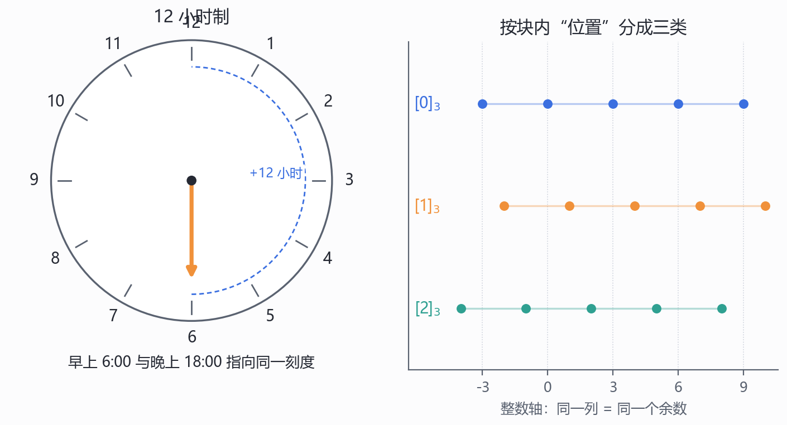
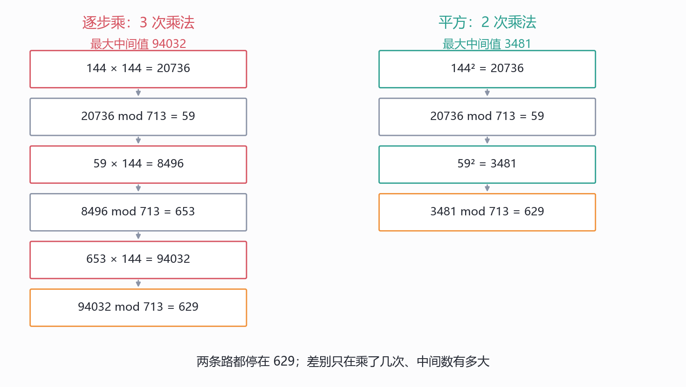
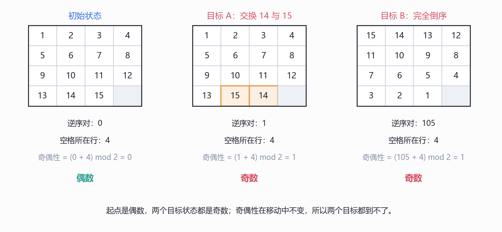
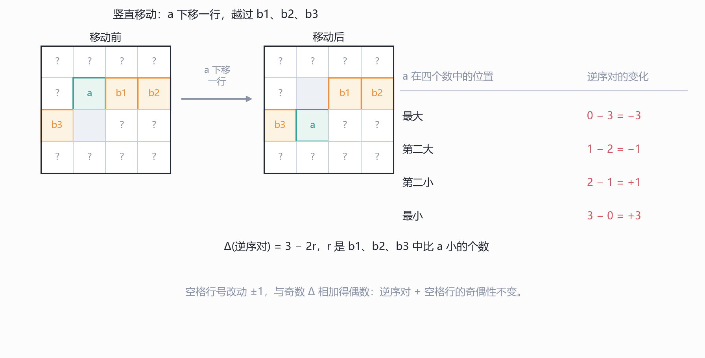
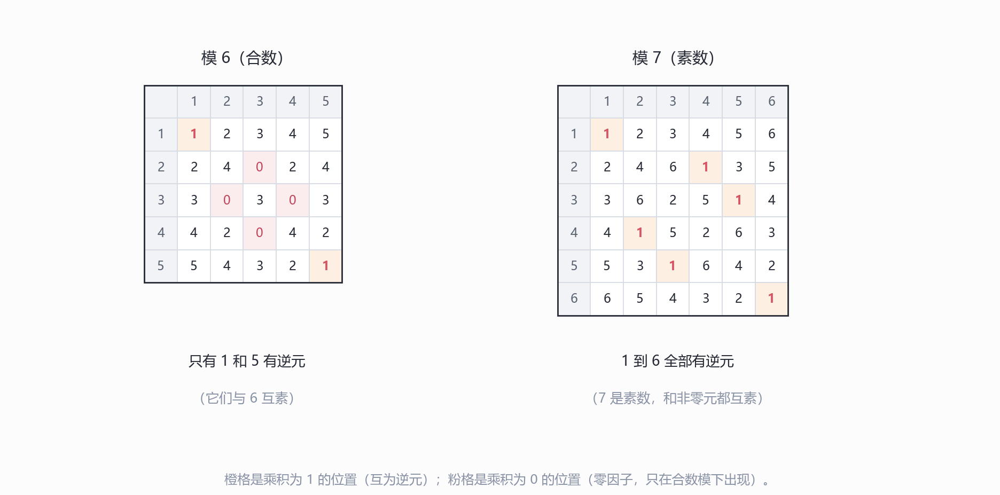
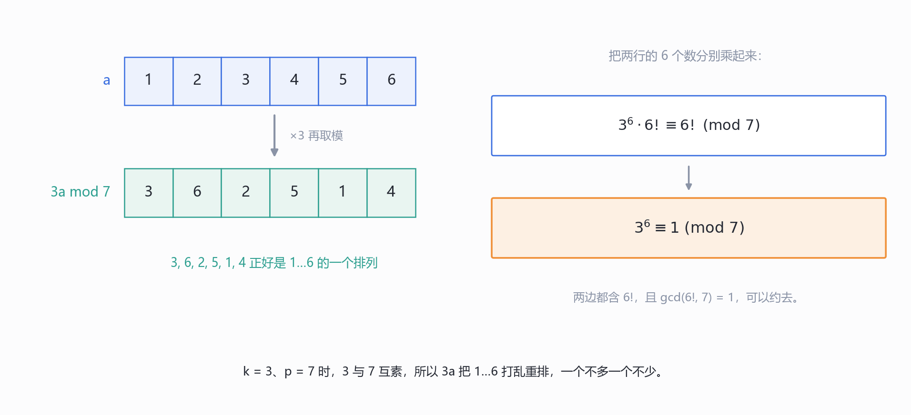
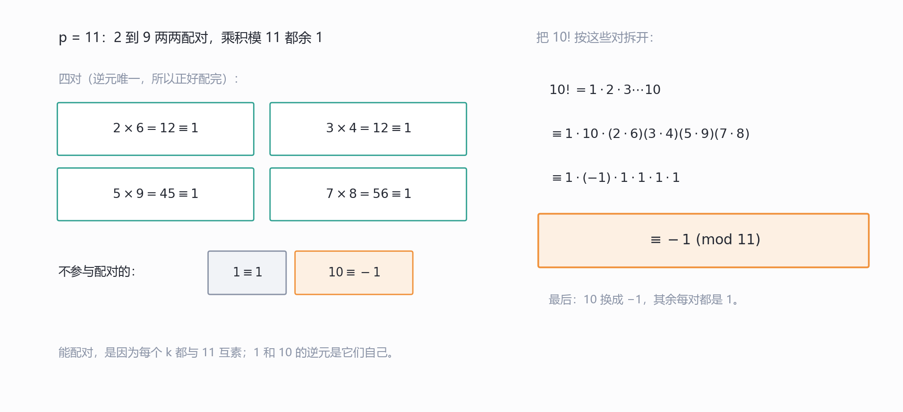
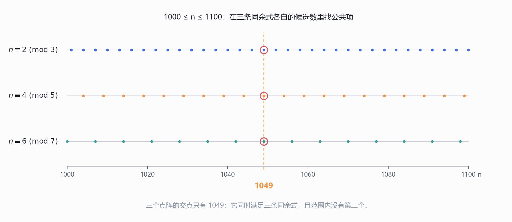
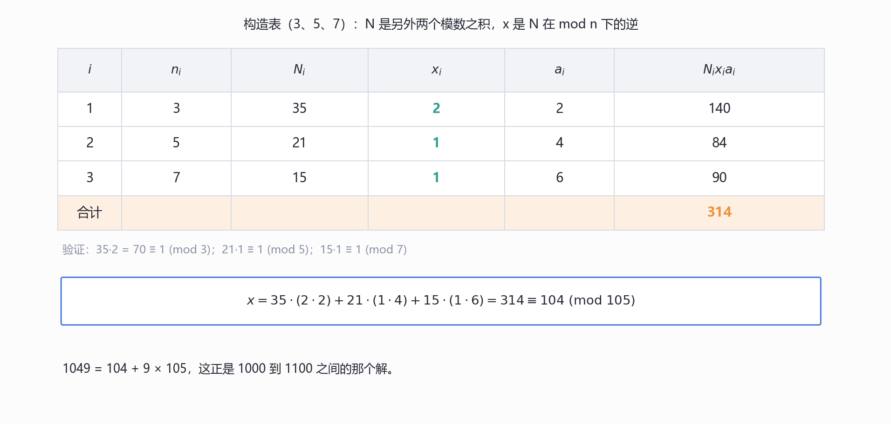
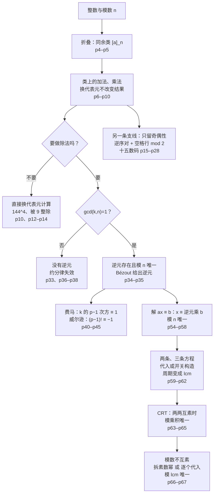

# 模算术 (Modular Arithmetic) 与中国剩余定理 — 同余、逆元、费马与威尔逊、韩信点兵

上一讲(LN6)把 $\gcd$ 这台机器拆到了底：商余定理、欧几里得算法、$\gcd=\operatorname{spc}$、扩展欧几里得。结尾留了一句话，说商余定理的 $q=\lfloor a/b\rfloor$、$r=a\bmod b$ 已经给"同余运算"留好了门，下一站就从那扇门进去。这一讲(LN7)正是那一站。

67 页可以分成四段。p3–p14 建"折叠"的语言：先把整数按余数折成 $n$ 个格子(同余类)，再证明格子上的加法、乘法是良定义的，最后拿"被 9 整除"做第一个应用。p15–p28 离开数论，用同一套折叠去看十五数码(15-puzzle)，把"能不能从初始局面走到目标局面"变成一条奇偶性判断。p30–p45 回到数论，处理"模 $n$ 下能不能除"的问题：逆元存在的条件是互素，逆元唯一，由此得到费马小定理与威尔逊定理。p47–p67 是收尾的大戏：韩信点兵引出一组同余方程，先解一个，再解两个、三个，最后抽象成中国剩余定理(Chinese Remainder Theorem, CRT)，并把模数不互素的情形也收进去。

这一讲有两个"第一次"。第一次把"相等"放宽：两个数不必真的相等，只要差是 $n$ 的倍数，就当作同一个东西；后面所有的运算都要重新检查"换个代表元还成不成立"。第一次系统处理"方程组"：一个同余方程只有一个未知数，但两个、三个方程要同时满足时，解的结构、唯一性、模数之间的关系都成了新问题。讲义把这两件事放在同一讲，是因为它们共用同一台机器：**同余类**。

材料说明：本讲的素材**只有课件(67 页 PDF)**，全文内容**仅来自课件**，没有课堂板书，也没有任何"老师课上讲了什么"的成分。凡我自行补充、复算或纠正的地方，一律在正文相应位置用【我的补充】标出，并在文末 `附` 里汇总。

## 0. 本讲地图

*这一节回答：这 67 页该按什么顺序读，哪几节是主线、哪几节是深化。*

全讲是一条"折叠—运算—解方程"的直线，中间插了一个十五数码的应用。下表把笔记章节、讲义页、材料来源与配图对齐；表后的「三遍阅读路线」给出三种不同深度的读法。

| 笔记章节 | 讲义页 | 内容 | 材料来源 | 配图 |
| --- | --- | --- | --- | --- |
| §1 | p3–p5 | 12 小时钟、同余类与划分、同余的定义 | 课件原文 + 我的补充(关系与运算的区别) | 图 1.1 |
| §2 | p6–p10 | 加法与乘法保同余、$144^4$ 的两种算法 | 课件原文 + 我的复算与快速幂说明 | 图 2.1 |
| §3 | p12–p14 | 应用一：被 9 整除的判别法 | 课件原文 + 我的补充(3 与 11) | — |
| §4 | p15–p28 | 应用二：十五数码与不变量 | 课件原文 + 我的补充(奇偶公式依赖棋盘宽度) | 图 4.1、图 4.2 |
| §5 | p30–p38 | 逆元：定义、存在条件、唯一性、约分 | 课件原文 + 我补的 p33 证明 | 图 5.1 |
| §6 | p40–p41 | 费马小定理与置换证明 | 课件原文 + 我的补充(用费马求逆元) | 图 6.1 |
| §7 | p42–p45 | 威尔逊定理：两个方向与配对证明 | 课件原文 + 我的勘误(p=1)与补证(p=2) | 图 7.1 |
| §8 | p47–p53 | 韩信点兵：故事与方程组 | 课件原文 + 我的背景补充(孙子算经) | 图 8.1 |
| §9 | p54–p58 | 一个同余方程：三种情形与解的个数 | 课件原文 + 我的解集结构说明 | — |
| §10 | p59–p62 | 两个、三个方程：代入法与直接构造 | 课件原文 + 我的两种构造对照 | — |
| §11 | p63–p65 | 中国剩余定理：构造与唯一性 | 课件原文 + 我补的 "(Why?)" | 图 11.1 |
| §12 | p66–p67 | 模数不互素：拆素数幂与逐个代入 | 课件原文 + 我的 lcm 说明 | — |
| §13 | — | 一条线：折叠、逆元、拼合(我的归纳) | **非讲义内容** | — |

> 表中「配图」只登记我为正文绘制的 PNG 概念图(图 x.y)；§13 的流程图是正文内的 mermaid,不占图号。

**三遍阅读路线**

| 遍次 | 目标 | 路线 |
| --- | --- | --- |
| 第一遍(主线) | 先拿到骨架：定义 → 运算 → 逆元 → 解方程 → 拼合 | §1 → §2 → §3 → §4.1–§4.3、§4.6 → §5.1–§5.4 → §6 → §8 → §9 → §10 → §11.1–§11.2；§4.4–§4.5 的移动分析、§5.5–§5.6 的约分、§7 的威尔逊、§12 先跳过 |
| 第二遍(深化) | 补上"为什么不变""为什么唯一" | §4.4–§4.5 → §5.5–§5.6 → §7(含 p=1 的边界)→ §11.3 → §12；回头用 1049 重跑 §9–§11 的每一步 |
| 第三遍(考前) | 收束成一条线，查勘误与数值 | §13 → 小结表 → 附(先看勘误 1–3，再扫数值核验表与「够 / 不够」)→ 回看 §0 地图 |

## 1. 从钟表到同余 (p3–p5)

*这一节回答：为什么"早上 6 点"和"晚上 6 点"可以是同一个值，这种"折叠"怎样写成一条可判断真假的等式？*

p3 只有一只 12 小时制的钟面，和一句旁白：

> But this could be also 6 o'clock in the morning, when we should have breakfast. In this case, we actually view two 6 o'clock as one single value in a clock. This is the idea of modular arithmetic!

钟面上只有 12 个刻度。早上 6:00 与晚上 18:00 时针都指在"6"，从 6:00 走 12 小时回到 18:00，再走 12 小时又回到 6:00。真正被观察到的不是"走了几个小时"，而是"停在第几个刻度"。用算术的话说：两个时刻 $a$ 与 $b$ 在钟面上指同一刻度，当且仅当 $a-b$ 是 12 的倍数。$18-6=12$，$30-18=12$，$6-18=-12$，都成立。**"差是 12 的倍数"这件原本要被丢掉的信息，在这里被拿来当成了相等的标准**——这就是模算术的起点。

p4 把这个想法写成集合。讲义先给出同余类的定义(这一页用 $b$ 表示模数，p5 起改用 $n$，是同一个东西)：

> Congruence class of a modulo b: $[a]_b = \{\,a+kb \mid k\in\mathbb{Z}\,\}$.
> Given any $b>0$, we can partition the integers into blocks of $b$ numbers. For any $a$, there is a unique "position" for this number.
> Grouping the integers that are in the same "position" of each $b$-block forms a partition of integers. E.g. $\mathbb{Z} = [0]_3 \cup [1]_3 \cup [2]_3$. Denoted by $\mathbb{Z}_3 = \{[0]_3, [1]_3, [2]_3\}$.

先把记号读破：$[a]_b$ 是一个**集合**，里面装着所有"与 $a$ 相差 $b$ 的整数倍"的整数。以 $b=3$、$a=1$ 为例，$[1]_3 = \{\dots,-5,-2,1,4,7,10,\dots\}$。$k$ 跑遍所有整数，所以这个集合向两边都无限延伸；它不是一个数，是无穷多个数扎成的一捆。

"position"这个词是 p4 的钥匙。把整数按每 $b$ 个一段切开，$a$ 落在某一段的某个位置；所有落在**同一个位置**的整数，恰好组成一个同余类。$b=3$ 时有三条轨道：$[0]_3$ 是 $0,3,6,\dots$ 和 $-3,-6,\dots$；$[1]_3$ 是 $1,4,7,\dots$；$[2]_3$ 是 $2,5,8,\dots$。三条轨道不重叠，合起来正好是全部整数，这就是**划分**(partition)：每一类非空、两两不交、并集是全集。讲义把这写成 $\mathbb{Z} = [0]_3 \cup [1]_3 \cup [2]_3$，再把这三个类装进一个集合，记作 $\mathbb{Z}_3$。

这里有一个初学者最容易滑过去的点：$\mathbb{Z}_3$ 只有 **3 个元素**，它的元素是三个**类**，不是无穷多个整数。$[0]_3$ 与 $[3]_3$ 是同一个类(因为 $3-0=3$ 是 3 的倍数)，写两个名字，指的是同一捆数。LN6 的图 4.1 画的商余分块，正是这张图；当时关心的是"$a$ 落在哪一块、块内偏移多少"，现在关心的是"哪些数落在同一个位置"。同一张图，换了一个问题。

钟表的折叠可以画成图 1.1：左边是钟面，右边是把整数按模 3 的余数排成三行。

*图 1.1　左：12 小时钟把早上 6:00 与晚上 18:00 折到同一刻度，虚线标出"+12 小时"回到原处；右：模 3 把整数按余数分成三条轨道 $[0]_3$、$[1]_3$、$[2]_3$，同一列的数余数相同。我绘制；钟面按 p3，轨道按 p4 的划分重画。*

图 1.1 右边要横着看：**同一列**的数属于同一个类。$-3,0,3,6,9$ 在同一列，它们除以 3 的余数都是 0；$1,4,7$ 在同一列，余数都是 1。行与行之间没有交集，所有整数都能在某一列找到位置，这正是"划分"的两个要件。

p5 给出本讲最重要的定义，一句话把"同一位置"变成可判断真假的命题：

> **Definition** $a \equiv b \ (\mathrm{mod}\ n)$ iff $n \mid (a-b)$.
> e.g. $12 \equiv 2 \ (\mathrm{mod}\ 10)$, $107 \equiv 207 \ (\mathrm{mod}\ 10)$, $7 \equiv 1 \ (\mathrm{mod}\ 2)$, $1 \equiv -1 \ (\mathrm{mod}\ 2)$, $13 \equiv -1 \ (\mathrm{mod}\ 7)$, $-15 \equiv 0 \ (\mathrm{mod}\ 5)$.

符号 $\equiv$ 读作"同余于"，整句读作"$a$ 与 $b$ 模 $n$ 同余"。定义本身只用到整除：不看 $a,b$ 谁大谁小，只看**差**能不能被 $n$ 整除。这解释了为什么例子里的"余数"可以写成负数、也可以写成 0：

| 同余式 | $a-b$ | 谁整除谁 |
| --- | --- | --- |
| $12 \equiv 2 \ (\mathrm{mod}\ 10)$ | $10$ | $10 \mid 10$ |
| $107 \equiv 207 \ (\mathrm{mod}\ 10)$ | $-100$ | $10 \mid -100$ |
| $7 \equiv 1 \ (\mathrm{mod}\ 2)$ | $6$ | $2 \mid 6$ |
| $1 \equiv -1 \ (\mathrm{mod}\ 2)$ | $2$ | $2 \mid 2$ |
| $13 \equiv -1 \ (\mathrm{mod}\ 7)$ | $14$ | $7 \mid 14$ |
| $-15 \equiv 0 \ (\mathrm{mod}\ 5)$ | $-15$ | $5 \mid -15$ |

最后两行值得停一下。$13 \equiv -1 \ (\mathrm{mod}\ 7)$ 成立，但 $13$ 除以 $7$ 的余数是 $6$，不是 $-1$。这不是矛盾：同余关系允许你用 **$-1$ 这个代表元**去说话，而"取余数"这个运算只交出一个固定的答案。下一段把这个区别说清楚。

> **【我的补充·同余是关系，mod 是运算，两者别混】** $a \equiv b \ (\mathrm{mod}\ n)$ 是一句**判断**(真或假)；$a \bmod n$ 是一个**数**(LN6 p4 的余数，永远落在 $0$ 到 $n-1$)。$13 \equiv -1 \ (\mathrm{mod}\ 7)$ 为真，而 $13 \bmod 7 = 6$；$6$ 与 $-1$ 只差 $7$，是同一个类的两个代表元。后面做计算时，把 $999$ 换成 $5$、把 $141$ 换成 $-2$，用的都是"同余允许换代表元"；而写程序的 `%` 只给 $0$ 到 $n-1$ 的那个代表元。两者可以互换，但要知道自己在换什么。
>
> 同余与余数的关系可以精确地写成一句话：$a \equiv b \ (\mathrm{mod}\ n)$ 当且仅当 $a \bmod n = b \bmod n$。证明只需用商余定理：LN6 p4 说 $a = q_1n + r_1$、$b = q_2n + r_2$，其中 $0 \le r_1,r_2 < n$。于是 $a-b = (q_1-q_2)n + (r_1-r_2)$，$n \mid (a-b)$ 等价于 $n \mid (r_1-r_2)$；而 $\lvert r_1-r_2\rvert < n$，一个绝对值小于 $n$ 的数能被 $n$ 整除，只能是 $0$，所以 $r_1 = r_2$。这条等价关系把"位置相同"与"余数相同"钉在了一起。

> **【我的补充·同余关系是等价关系】** 定义里的三条性质都成立：自反($a-a=0$，$n \mid 0$)、对称($n \mid (a-b)$ 则 $n \mid (b-a)$)、传递(若 $n \mid (a-b)$ 且 $n \mid (b-c)$，则 $n \mid (a-c)$)。所以同余类是**等价类**，$\mathbb{Z}_n$ 是商集，"划分"不是巧合，是等价关系的标准产物。传递性的证明只用了一次分配律：$(a-b)+(b-c)=a-c$，两个 $n$ 的倍数相加仍是 $n$ 的倍数。后面 §2 证的加法、乘法保同余，是同一类"把 $n$ 的倍数攒起来"的动作。

> **【我的补充·定义里的 $n$ 该多大】** 讲义只写 $n \mid (a-b)$，没说 $n$ 的范围。若 $n=0$，则 $0 \mid (a-b)$ 等价于 $a-b=0$，也就是 $a=b$，这不是同余的本意；若 $n<0$，它与 $\lvert n\rvert$ 给出同一关系。通常约定 $n \ge 2$(至少 $n>0$)，本讲后面所有除法、逆元、CRT 都默认这一点。

## 2. 同余的加法与乘法 (p6–p10)

*这一节回答：两个同余式相加、相乘，结果为什么仍然同余；$144^4 \bmod 713$ 怎样算得更省？*

### 2.1 加法保同余 (p6–p7)

p6 先把结论摆出来，再用三组例子试它：

> **Lemma.** If $a \equiv c \ (\mathrm{mod}\ n)$, and $b \equiv d \ (\mathrm{mod}\ n)$ then $a+b \equiv c+d \ (\mathrm{mod}\ n)$.

三组例子分别是：

> Example 1: $12 \equiv 2 \ (\mathrm{mod}\ 10)$, $25 \equiv 5 \ (\mathrm{mod}\ 10)$ $\Rightarrow$ $12+25 \equiv 2+5 \equiv 7 \ (\mathrm{mod}\ 10)$.
> Example 2: $87 \equiv 2 \ (\mathrm{mod}\ 17)$, $222 \equiv 1 \ (\mathrm{mod}\ 17)$ $\Rightarrow$ $87+222 \equiv 2+1 \equiv 3 \ (\mathrm{mod}\ 17)$.
> Example 3: $101 \equiv 2 \ (\mathrm{mod}\ 11)$, $141 \equiv -2 \ (\mathrm{mod}\ 11)$ $\Rightarrow$ $101+141 \equiv 0 \ (\mathrm{mod}\ 11)$.

第一组把 $12$ 换成 $2$、把 $25$ 换成 $5$，相加得 $7$；直接算 $37 \bmod 10$ 也是 $7$。第二组 $87+222=309$，$309 = 17\times 18+3$，余 $3$；右边 $2+1=3$。第三组 $101+141=242 = 11\times 22$，余 $0$；右边 $2+(-2)=0$。三组的共同形状是：**先各自换代表元，再算，与先算再取模，结果同余**。

p7 的证明只有四行，但每一行都在做"把差写成 $n$ 的倍数"：

> $a \equiv c \ (\mathrm{mod}\ n) \Rightarrow a = c+nx$ for some integer $x$.
> $b \equiv d \ (\mathrm{mod}\ n) \Rightarrow b = d+ny$ for some integer $y$.
> To show $a+b \equiv c+d \ (\mathrm{mod}\ n)$, it is equivalent to showing that $n \mid (a+b-c-d)$.
> Consider $a+b-c-d$. $a+b-c-d = (c+nx)+(d+ny)-c-d = nx+ny$. It is clear that $n \mid nx+ny$. Therefore, $n \mid a+b-c-d$. We conclude that $a+b \equiv c+d \ (\mathrm{mod}\ n)$.

证明里最关键的一句是第二行"等价于证明 $n \mid (a+b-c-d)$"。这不是显然的，它是 p5 定义的**反方向使用**：要证同余，就证整除差。于是整个证明变成一道代数题：把 $a,b$ 用 $c+nx$、$d+ny$ 代进去，差里的 $c,d$ 抵消，只剩 $n(x+y)$，当然是 $n$ 的倍数。

$$
a+b-c-d = (c+nx)+(d+ny)-c-d = n(x+y).
$$

写成这样，证明就没什么神秘了：**同余式相加，本质上是两个"$n$ 的倍数"相加**。

### 2.2 乘法保同余 (p8–p9)

p8 把加号换成乘号，结论仍然成立：

> **Lemma.** If $a \equiv c \ (\mathrm{mod}\ n)$, and $b \equiv d \ (\mathrm{mod}\ n)$ then $ab \equiv cd \ (\mathrm{mod}\ n)$.

三组例子：

> Example 1: $9876 \equiv 6 \ (\mathrm{mod}\ 10)$, $17642 \equiv 2 \ (\mathrm{mod}\ 10)$ $\Rightarrow$ $9876\times 17642 \equiv 6\times 2 \equiv 2 \ (\mathrm{mod}\ 10)$.
> Example 2: $10987 \equiv 1 \ (\mathrm{mod}\ 2)$, $28663 \equiv 1 \ (\mathrm{mod}\ 2)$ $\Rightarrow$ $10987\times 28663 \equiv 1 \ (\mathrm{mod}\ 2)$.
> Example 3: $999 \equiv 5 \ (\mathrm{mod}\ 7)$, $674 \equiv 2 \ (\mathrm{mod}\ 7)$ $\Rightarrow$ $999\times 674 \equiv 5\times 2 \equiv 3 \ (\mathrm{mod}\ 7)$.

第三组的多余数 $10$ 又要折一次：$10 \equiv 3 \ (\mathrm{mod}\ 7)$。这说明引理可以**连续使用**：乘出来的结果不必先化成 $0$ 到 $n-1$，可以继续换代表元，直到好算为止。第一组更直接：$6\times 2=12 \equiv 2 \ (\mathrm{mod}\ 10)$，而 $9876\times 17642$ 的真实乘积是 $174\,233\,592$，个位确实是 $2$。引理让你不必算出这个九位数。

p9 的证明与加法同构，只是代数长一点：

> $ab-cd = (c+nx)(d+ny)-cd = cd+dnx+cny+n^2xy-cd = n(dx+cy+nxy)$.

展开时四项分别是 $cd$、$c\cdot ny$、$nx\cdot d$、$nx\cdot ny$；前两项的 $cd$ 与减掉的 $cd$ 抵消，剩下三项都含因子 $n$。于是 $n \mid (ab-cd)$，按定义 $ab \equiv cd$。

> **【我的补充·这两条引理其实在说"运算与代表元无关"】** 同余类 $[a]_n$ 里有无穷多个代表元。要在类上定义加法 $[a]_n+[b]_n = [a+b]_n$，必须先回答一个问题：换一个代表元，结果会不会变？两条引理正是这个问题的答案：若 $a'\equiv a$、$b'\equiv b$，则 $a'+b'\equiv a+b$、$a'b'\equiv ab$，所以类的和、类的积与代表元的选择无关。用术语说，加法与乘法在 $\mathbb{Z}_n$ 上是**良定义**(well-defined)的。这不是技术细节，而是后面一切运算的许可证：§5 的逆元、§6 的费马、§11 的 CRT,都默认"可以随便换代表元"。讲义没有点破这一点，但它把两条引理放在最前面，顺序是对的。

### 2.3 应用：$144^4 \bmod 713$ (p10)

p10 是两道练习题，同一个数，两种算法：

> $144^4 \ (\mathrm{mod}\ 713) = 144\cdot 144\cdot 144\cdot 144 \ (\mathrm{mod}\ 713) = 20736\cdot 144\cdot 144 \ (\mathrm{mod}\ 713) = 59\cdot 144\cdot 144 \ (\mathrm{mod}\ 713) = 8496\cdot 144 \ (\mathrm{mod}\ 713) = 653\cdot 144 \ (\mathrm{mod}\ 713) = 94032 \ (\mathrm{mod}\ 713) = 629 \ (\mathrm{mod}\ 713)$.
> $20736\cdot 20736 \ (\mathrm{mod}\ 713) = 59\cdot 59 \ (\mathrm{mod}\ 713) = 3481 \ (\mathrm{mod}\ 713) = 629 \ (\mathrm{mod}\ 713)$.
> Make a smart use of the modular arithmetic will significantly reduce the complexity!

左边是"逐步乘"：每乘一次 $144$，立刻把结果化到 $713$ 以内，再做下一次。右边是"先平方"：$144^4 = (144^2)^2$，先算 $144^2 = 20736$，取模得 $59$；再算 $59^2 = 3481$，取模得 $629$。两条路都停在 $629$，但走法不同：左边乘了 3 次，最大中间值 $94032$；右边乘了 2 次，最大中间值 $3481$。

*图 2.1　$144^4 \bmod 713$ 的两条计算链：左边逐次乘（3 次乘法，最大中间值 94032），右边先平方再平方（2 次乘法，最大中间值 3481），都停在 629。我绘制；每一步按 p10 复算，并用 $144^4 = 429981696$ 除以 713 核对余数。*

两条链的每一步都只用到 §2.2 的乘法引理：把 $20736$ 换成 $59$、把 $8496$ 换成 $653$，都是"同余允许换代表元"。真正被省掉的是**大数乘法**：若老老实实算 $144^4$，得到 $429\,981\,696$，再做一次除法；而右边全程只乘两位数，中间值不超过 $713^2$。

> **【我的补充·这套办法叫快速幂】** p10 只演示了指数为 4 的情形，但"平方—乘"可以推广到任何指数：把指数写成二进制，从高位到低位，每读一位做一次平方，读到 1 再乘一次底数，乘完立刻取模。算 $a^k \bmod n$ 只需 $O(\log k)$ 次乘法，中间值始终小于 $n^2$。这正是 RSA 之类密码学能处理几百位指数的原因；若按"逐步乘"要乘 $k$ 次，指数一大就完全算不动。讲义那句 "significantly reduce the complexity" 说的是同一件事，只是没有展开。

## 3. 应用一：被 9 整除 (p12–p14)

*这一节回答：为什么一个数能被 9 整除，只要看它各位数字之和？*

p12 先抛出观察，再给两个例子：

> A number is divisible by 9 if and only if the sum of its digits is divisible by 9?
> Example 1. $9333234513171$ is divisible by 9. $9+3+3+3+2+3+4+5+1+3+1+7+1 = 45$ is divisible by 9.
> Example 2. $128573649683$ is not divisible by 9. $1+2+8+5+7+3+6+4+9+6+8+3 = 62$ is not divisible by 9.
> A coincidence? **NO**. This can be proved easily using modular arithmetic.

两个数字和分别是 $45$ 与 $62$。$45 = 9\times 5$，所以第一个数能被 9 整除；$62 = 9\times 6+8$，所以第二个数不能。讲义用 "A coincidence? NO" 把问题留住，下一句给出钥匙：$10 \equiv 1 \ (\mathrm{mod}\ 9)$。

p13 把 $n$ 写成十进制展开。设

$$
n = d_k10^k + d_{k-1}10^{k-1} + \cdots + d_110 + d_0
$$

其中每个 $d_i$ 是 $0$ 到 $9$ 的数字。要证 $n$ 与数字和同余，只需逐项看 $d_i10^i$。因为 $10 \equiv 1 \ (\mathrm{mod}\ 9)$，由乘法引理，$10^i \equiv 1^i = 1 \ (\mathrm{mod}\ 9)$；再乘上 $d_i$，得 $d_i10^i \equiv d_i \ (\mathrm{mod}\ 9)$。这一步是 p13 那串式子的核心：

> Note that $d_i10^i \bmod 9 \equiv (d_i \bmod 9)(10^i \bmod 9) \bmod 9 \equiv (d_i \bmod 9)(10 \bmod 9)\cdots(10 \bmod 9) \bmod 9 \equiv d_i \bmod 9 \ (\mathrm{mod}\ 9)$.

p14 把所有项加起来。由加法引理，和的同余等于同余的和：

$$
n \equiv d_k10^k + \cdots + d_110 + d_0 \equiv d_k + d_{k-1} + \cdots + d_1 + d_0 \quad (\mathrm{mod}\ 9).
$$

于是 $n$ 与它的数字和模 9 同余。两边同时看"能不能被 9 整除"：$n \equiv 0 \ (\mathrm{mod}\ 9)$ 当且仅当数字和 $\equiv 0 \ (\mathrm{mod}\ 9)$。**一个同余式同时给出了两个方向**，不需要分开证"若"和"仅若"——这是同余语言比"试除"省事的地方。

这条证明的结构值得记住：它没有对 $n$ 做归纳，也没有逐位分析，只做了两件事——把 $10$ 换成 $1$，再用加法、乘法引理把替换**传到每一项、再传到整个和**。§2 的两条引理在这里第一次真正出力。

> **【我的补充·同样的骨架给出 3 与 11】** 把模数换成 $3$：$10 \equiv 1 \ (\mathrm{mod}\ 3)$，逐字重复上面的证明，得到"被 3 整除当且仅当数字和能被 3 整除"。把模数换成 $11$：$10 \equiv -1 \ (\mathrm{mod}\ 11)$，于是 $10^i \equiv (-1)^i \ (\mathrm{mod}\ 11)$，符号一正一负交替，得到
>
> $$
> n \equiv d_0 - d_1 + d_2 - d_3 + \cdots \quad (\mathrm{mod}\ 11).
> $$
>
> 也就是说，被 11 整除看"交替和"。例如 $2728$：$8-2+7-2 = 11$，能被 11 整除，而 $2728 = 11\times 248$。讲义只讲了 9，但三个判别法是同一个证明换了模数，值得一起记。

> **【我的补充·p13/p14 的 "mod 9 (mod 9)" 记号】** 讲义末行写成 "$\equiv (d_k+\cdots+d_0) \bmod 9 \ (\mathrm{mod}\ 9)$"，两个 "mod 9" 挨在一起：前一个是取余运算，后一个是同余的模。意思能懂，但读起来容易误以为要取两次模。写成 $n \equiv d_k+\cdots+d_0 \ (\mathrm{mod}\ 9)$ 就够了，因为左边本来就是"$n$ 模 9 的余数等于数字和模 9 的余数"。这是记号问题，不影响结论。

## 4. 应用二：十五数码与不变量 (p15–p28)

*这一节回答：十五数码的初始局面能不能走到"只交换 14 和 15"的目标局面，凭什么一个奇偶性就能判死？*

### 4.1 规则、状态与问题 (p15–p16, p18)

p15 给出游戏规则，一句话：

> **Rule:** Can move a numbered square to the empty one when they are adjacent.

棋盘是 $4\times 4$，放了 $1$ 到 $15$ 十五个编号方块，剩下一格是空的。每一步只能把**与空格相邻**的方块滑进空格，等价地说，空格与上下左右某个方块交换位置。不能拿起方块，不能斜着走，不能一次滑两格。

p16 摆出两个局面：左边是初始局面，方块按 $1,2,\dots,15$ 的顺序排好，空格在右下角；右边是目标局面，其他都不变，**只把 $14$ 和 $15$ 交换了**。然后问：

> Is there a sequence of moves that allows you to change the initial configuration to the target configuration?

p18 把"局面"写成形式化的状态。一个状态记作

$$
S = ((a_1,a_2,\dots,a_{15}),\ (i,j))
$$

第一个分量是把棋盘按**从上到下、从左到右**读一遍、**跳过空格**得到的 $15$ 个数的序列；第二个分量是空格的位置，$(i,j)$ 表示第 $i$ 行第 $j$ 列，行列都从 $1$ 数起。讲义特意注明 "(4,4) as (row, column)"。于是初始状态是 $((1,2,3,\dots,14,15),(4,4))$，目标状态是 $((1,2,3,\dots,15,14),(4,4))$：两个状态的序列只差最后两个数，空格都在 $(4,4)$。

这个记法有一个容易忽略的约定：序列里**没有空格**，所以十五个数一个不少；空格的位置单独记。后面数逆序对时，数的就是这 $15$ 个数，空格不参与。

### 4.2 不变量法 (p17)

p17 把证明方法写成三步：

> 1. Find properties (the invariants) that are satisfied throughout the whole process.
> 2. Show that the target do not satisfy the properties.
> 3. Conclude that the target is not achievable.
> What is the invariant in this game?? This is usually the hardest part of the proof.

**不变量**(invariant)是一个"开局成立、每一步都保持"的性质。若目标局面不满足它，那么无论走多少步都到不了目标——因为每走一步性质都还在，目标却偏偏没有。这三步在 LN4.2 与 LN6 里都出现过(LN6 用它证明 3 加仑与 9 加仑量不出 4 加仑)，这里是第三次复用。真正难的是第一步：性质那么多，挑哪一个？

讲义在 p18 给了一个提示："the two states have different parity"(两个状态的奇偶性不同)。p19 才把"奇偶性"定义清楚。

### 4.3 逆序对与状态的奇偶性 (p18–p20, p27)

p19 先定义"逆序对"：

> Given a sequence, a pair is "disordered" if the first element is larger. For example, the sequence $(1,2,4,5,3)$ has two disorder pairs, $(4,3)$ and $(5,3)$.
> More formally, given a sequence $(a_1,a_2,\dots,a_n)$, a pair $(i,j)$ is disordered if $i<j$ but $a_i > a_j$.

"逆序对"(disorder pair,也常叫 inversion)是**位置在前、数值反而更大**的一对数。序列 $(1,2,4,5,3)$ 里，$4$ 在 $3$ 前面且 $4>3$，是一对；$5$ 在 $3$ 前面且 $5>3$，是第二对；其他对都按从小到大排，不是逆序对。所以一共 $2$ 对。

然后定义状态的奇偶性：

> Given a state $S = ((a_1,a_2,\dots,a_{15}),(i,j))$, Parity of $S$ = (number of disorder pairs $+$ $i$) mod $2$.

也就是**逆序对的个数加上空格所在的行号**，再取模 $2$。$i$ 是空格的**行**号(不是列)，这一点很关键：后面会看到，水平移动不改变行号，竖直移动把行号改变 $1$。

按这个定义算三个状态：

| 状态 | 序列 | 逆序对个数 | 空格行 $i$ | $(\text{逆序对}+i)\bmod 2$ |
| --- | --- | --- | --- | --- |
| 初始 | $1,2,\dots,14,15$ | $0$ | $4$ | $0$，偶 |
| 目标 A(交换 14、15) | $1,2,\dots,13,15,14$ | $1$ | $4$ | $1$，奇 |
| 目标 B(完全倒序) | $15,14,\dots,2,1$ | $105$ | $4$ | $1$，奇 |

目标 B 的 $105$ 是这样算的：序列完全倒过来，每一对都是逆序对，共 $\binom{15}{2} = 105$ 对；讲义用另一种算法，固定第一个数 $15$，它比后面 $14$ 个数都大，贡献 $14$ 对；再看 $14$，贡献 $13$ 对；依此类推，$14+13+\cdots+1 = (14+1)\times 14/2 = 105$。两种算法结果相同。

*图 4.1　三个状态的逆序对、空格行与奇偶性：初始 $0+4$ 为偶，交换 14 与 15 后 $1+4$ 为奇，完全倒序 $105+4$ 为奇。我绘制；数字按 p27 复算，$105 = 14+13+\cdots+1$。*

图 4.1 把三个状态并排放，是为了看清一件事：**三个状态的空格都在第 4 行**，所以奇偶性的差别全部来自逆序对。初始是 $0$ 对，目标 A 只多了 $1$ 对，目标 B 多了 $105$ 对。$105$ 是奇数，所以目标 B 的奇偶性与初始相反；目标 A 的 $1$ 也是奇数，同样相反。若奇偶性真的在每一步都不变，这两个目标就都到不了。

### 4.4 水平移动不改变任何东西 (p22)

p22 先处理简单的情形。空格在同一行内左右移动，与它交换的方块也在同一行内移动一格：

> Horizontal movement does not change anything…

这句话要拆成两半看。第一，**序列不变**：序列是跳过空格、按行读出来的；方块只是在本行内挪了一格，本行方块的左右顺序没有变，所以 $15$ 个数的序列一模一样，逆序对个数不变。第二，**行号不变**：空格还在第 $i$ 行。两项都不变，奇偶性自然不变。

所以水平移动的贡献是 $\Delta(\text{逆序对}) = 0$、$\Delta i = 0$。真正要小心的是竖直移动。

### 4.5 竖直移动：四种情形 (p23–p25)

p23 画出竖直移动的几何。空格与它上方或下方的方块 $a$ 交换，$a$ 因此移动一行；在"按行读"的顺序里，$a$ 会跨过三个方块 $b_1,b_2,b_3$。讲义写：

> Row number is changed by 1.
> To count the change on #disorder pairs, we need to discuss 4 cases, depending on the relative order of $a$ among $\{a,b_1,b_2,b_3\}$.

先把"跨过三个"数清楚。设棋盘宽为 $4$，空格在第 $i$ 行第 $j$ 列，$a$ 在相邻行。$a$ 移动后占据空格原来的格子 $(i,j)$。与 $a$ 的先后顺序发生变化的方块有两批：在 $a$ 离开的那一行里、位于第 $j$ 列**右边**的方块，共 $4-j$ 个；在 $a$ 进入的那一行里、位于第 $j$ 列**左边**的方块，共 $j-1$ 个。两批合起来 $(4-j)+(j-1) = 3$ 个，正好是 $b_1,b_2,b_3$。这个 $3$ 与 $j$ 无关，是 $4$ 列棋盘的结构性事实。

对每一个 $b$ 来说，$a$ 与它的先后顺序**整个翻了过来**：移动前 $a$ 在 $b$ 前面，移动后 $a$ 在 $b$ 后面。于是这一对是不是逆序对，取决于 $a$ 与 $b$ 谁大：

* 若 $b<a$：移动前 $(a,b)$ 是逆序对(前大后小)，移动后 $(b,a)$ 不是，逆序对**减少 1**。
* 若 $b>a$：移动前不是，移动后 $(b,a)$ 是，逆序对**增加 1**。

设三个 $b$ 中有 $r$ 个比 $a$ 小，那么有 $3-r$ 个比 $a$ 大。总变化是

$$
\Delta(\text{逆序对}) = (3-r) - r = 3-2r.
$$

$r$ 只能取 $0,1,2,3$，四种情形正好对应 p24 的四条：

| $a$ 在 $\{a,b_1,b_2,b_3\}$ 中的位置 | $r$ | $\Delta(\text{逆序对})$ | 讲义的说法 |
| --- | --- | --- | --- |
| 最大 | $3$ | $3-6 = -3$ | decrease by three |
| 第二大 | $2$ | $3-4 = -1$ | decrease by one |
| 第二小 | $1$ | $3-2 = +1$ | increase by one |
| 最小 | $0$ | $3-0 = +3$ | increase by three |

四种情形的 $\Delta$ 都是奇数($\pm 1$ 或 $\pm 3$)。同时，空格的行号 $i$ 改变 $\pm 1$，也是奇数。两个奇数相加是偶数，所以

$$
\Delta\bigl((\text{逆序对}) + i\bigr)
$$

是偶数，取模 $2$ 不变。**这就是"任何一步都保持奇偶性"的证明。** 水平移动已经在 §4.4 单独处理($\Delta = 0$)，竖直移动的四种情形覆盖了所有可能，归纳起来，任意一串移动都不改变奇偶性。

*图 4.2　竖直移动：$a$ 下移一行，跨过 $b_1,b_2,b_3$，逆序对变化为 $3-2r$（$r$ 是三个 $b$ 中比 $a$ 小的个数）；空格行号同时变 $\pm 1$，两者相加为偶数。我绘制；四种情形按 p24，$3-2r$ 是我把四行合成的一条公式。*

图 4.2 右边的表就是上面的四行。左边画的是 $a$ 下移的情形；$a$ 上移时，前后顺序整个反过来，$\Delta$ 取相反数，仍然是 $\pm 1$ 或 $\pm 3$，结论不变。

> **【我的补充·p25 的措辞漏了限定语】** p25 写 "If there are 3/2/1/0 disorder pairs in the current state, there will be 0/1/2/3 disorder pairs in the next state."。这里的 $3/2/1/0$ 指的是**四个方块 $\{a,b_1,b_2,b_3\}$ 内部**的逆序对数，不是整个状态的逆序对数——整个状态可能是 $105$ 对，不可能是 $3$ 对。读的时候要在心里补上 "among these four tiles"。数学没错，措辞少了限定语，我把它记在文末勘误里。

### 4.6 公式里的"空格行"为什么必需(我的补充)

讲义的公式是 $(\text{逆序对}) + i$，为什么一定要加 $i$？只数逆序对不够吗？答案与棋盘的**宽度**有关。

把上面的论证推广到宽为 $w$ 的棋盘。一次竖直移动，$a$ 跨过的方块数是 $(w-j)+(j-1) = w-1$，不再是 $3$；于是

$$
\Delta(\text{逆序对}) = (w-1) - 2r,
$$

其中 $r$ 是这 $w-1$ 个方块中比 $a$ 小的个数。它的奇偶性是 $(w-1) \bmod 2$。另一方面，空格行号改变 $\pm 1$，奇偶性改变 $1$。两者相加：

* 若 $w$ 是**偶数**，$w-1$ 是奇数，$\Delta(\text{逆序对})$ 是奇数，与行号的变化一奇一奇相加为偶，$(\text{逆序对}) + i$ 的奇偶性不变。$w=4$ 时 $w-1 = 3 \equiv 1$，正是讲义的公式。
* 若 $w$ 是**奇数**，$w-1$ 是偶数，$\Delta(\text{逆序对})$ 恒为偶数，逆序对的奇偶性**自己**就不变；这时再加 $i$ 反而会被行号的 $\pm 1$ 破坏。

所以讲义的 $+i$ 是 $4$ 列棋盘(偶宽度)的产物；一般的守恒量是 $(\text{逆序对}) + (w-1)\cdot i$ 的奇偶性。$w=4$ 时 $w-1 \equiv 1$，就是 $+i$；$w=3$ 时 $w-1 \equiv 0$，只剩逆序对。

这不是纸面推理，可以拿 $3\times 3$ 的八数码验证。我对八数码做了**完全 BFS**：从复原态出发，恰好能到达 $9!/2 = 181440$ 个状态(总状态数是 $9! = 362880$，正好一半)。这 $181440$ 个状态里，逆序对的奇偶性只有一种，而"逆序对 + 空格行"的奇偶性**两种都出现**——说明后者在 $3\times 3$ 上根本不是不变量，前者才是。反过来，在 $4\times 4$ 上随机走 $20000$ 步，"逆序对 + 空格行"零违例(每一步都核对)。两个实验的代码与结果都记在文末数值核验表里。

这个补充解释了两件事：一是 p24 的四种情形为什么是 $3$，而不是随便一个数；二是为什么不能把公式照搬到别的棋盘尺寸上。

### 4.7 两个目标状态都到不了 (p27)

p27 把计算写全：

> 初始：${\rm \#disorder\ pairs} = 0$，Row of empty square $= 4$，Parity is even.
> 目标(完全倒序)：${\rm \#disorder\ pairs} = 14+13+12+\cdots+1 = (14+1)\cdot 14/2 = 105$，Row of empty square $= 4$，Parity is odd.
> **Impossible!**

初始状态的奇偶性是 $(0+4)\bmod 2 = 0$(偶)，倒序目标是 $(105+4)\bmod 2 = 1$(奇)。奇偶性在每一步都不变，所以从偶状态出发永远到不了奇状态。p16 那个只交换 $14$ 与 $15$ 的目标 A,逆序对是 $1$，奇偶性也是奇，同样到不了。

这里有一个逻辑上的先后：p20 写 "Clearly, the two states have different parity"，但"clearly"的账其实是 p27 才结的。p20 只给了提示，p27 才把 $0$ 与 $105$ 算出来。读讲义时不要把 p20 当成证明。

### 4.8 反过来的问题：同奇偶是否可达 (p28)

p28 追问：

> If two configurations have the same parity, is it true that we can always move from one to the other? **YES!** The solution however requires considerably more sophisticated mathematics.

也就是说，奇偶性不只是必要条件，还是**充分**条件：两个状态奇偶性相同，就一定可以互相到达。这个 "YES" 讲义没有证，它明确说需要更复杂的数学。

> **【我的补充·为什么这个 YES 难证，以及它到底在说什么】** 不变量只证明了"奇偶性不同 ⇒ 到不了"，这是 **only-if** 方向。要证 "同奇偶 ⇒ 到得了"，得真的构造一条路径，或者证明状态图的连通性。这件事的答案是：十五数码的全部 $16!$ 个状态被奇偶性分成两半，每一半各有 $16!/2 = 10\,461\,394\,944\,000$ 个状态(约 $10^{13}$)，同一半内部任意两个状态互通，两半之间一步都走不过去。所以奇偶性是这个游戏的**唯一**障碍，没有第二个隐藏的不变量。
>
> $10^{13}$ 太大，不可能像八数码那样做完全 BFS,所以我只验证了小棋盘：八数码的 $181440 = 9!/2$ 个可达状态正好是一半，与"奇偶性是唯一障碍"一致。$4\times 4$ 的完整验证需要群论(置换的奇偶性)，不是本讲的范围。这里要提醒的是：**不要把 §4.5 的不变量证明当成 p28 的证明**，它只证了一半。

## 5. 乘法逆元 (p30–p38)

*这一节回答：模 $n$ 下能不能做"除法"，哪些数有逆元，逆元为什么唯一，什么时候可以约分？*

### 5.1 定义与第一个例子 (p30)

p30 先在模 3 下试了一个数：

> The multiplicative inverse of $a \not\equiv 0 \ (\mathrm{mod}\ n)$ is an integer $a'$ such that $a\cdot a' \equiv 1 \ (\mathrm{mod}\ n)$.
> For example, $2\times 5 \equiv 1 \ (\mathrm{mod}\ 3)$, so $5$ is a multiplicative inverse of $2$ modulo $3$ (and vice versa).

**乘法逆元**(multiplicative inverse)是"模 $n$ 下把 $a$ 乘回 $1$"的那个数。$2\times 5 = 10 = 3\times 3+1$，所以 $2\times 5 \equiv 1 \ (\mathrm{mod}\ 3)$，$5$ 是 $2$ 的逆元；$2\times 5$ 也说明 $2$ 是 $5$ 的逆元，两者互为逆元。记号上，讲义用 $a'$，有的书用 $a^{-1}$；注意它不是分数 $\frac{1}{a}$——模算术里没有分数，它是一个**整数**，只是碰巧乘起来同余于 $1$。

$5$ 不是唯一的：$-1$ 也行，因为 $2\times(-1) = -2 \equiv 1 \ (\mathrm{mod}\ 3)$；$8$ 也行。所有这些数相差 $3$ 的倍数，属于同一个同余类。所以后面说"逆元唯一"，指的是**模 $n$ 意义下唯一**，不是只有一个整数。

p31 立刻追问：

> Does every integer have a multiplicative inverse in modular arithmetic?

答案是否定的。§5.2 用两张表把"谁有、谁没有"摆出来。

### 5.2 两张乘法表 (p31–p32)

p31 画了 $\mathbb{Z}_5$ 与 $\mathbb{Z}_6$ 的乘法表，并把乘积为 $1$ 的格子圈出来。$\mathbb{Z}_5$ 的 $1$ 到 $4$ 每个数都圈到了一个 $1$；$\mathbb{Z}_6$ 只有 $1$ 和 $5$ 有圈，$2,3,4$ 都没有。讲义的结论写成一行表：

> $a$: 1 2 3 4 5; $a'$: 1 X X X 5, where X denotes no inverse (mod 6).

p32 只问了一句 "What is the pattern?"。把两张表并排看，规律就出来了：$\mathbb{Z}_6$ 里有逆元的是 $1$ 和 $5$，它们都与 $6$ **互素**；$2,3,4$ 都与 $6$ 有大于 $1$ 的公因数，都没有逆元。$\mathbb{Z}_5$ 里 $1,2,3,4$ 都与 $5$ 互素，所以全有逆元。猜想到这里：逆元存在与否，只看 $\gcd(a,n)$。

图 5.1 把 $\mathbb{Z}_6$ 与 $\mathbb{Z}_7$ 的乘法表并排画出来：橙色格子是乘积为 $1$ 的位置，粉色格子是乘积为 $0$ 的位置。$\mathbb{Z}_6$ 的粉色格子(零因子)正好落在 $2,3,4$ 与 $3,4$ 的交叉处；$\mathbb{Z}_7$ 一个粉色格子都没有，每个非零元都有一块橙色。

*图 5.1　模 6（合数）与模 7（素数）的乘法表：橙格乘积为 $1$（互为逆元），粉格乘积为 $0$（零因子，只在合数模下出现）。我绘制；讲义 p31 画的是 $\mathbb{Z}_5$ 与 $\mathbb{Z}_6$，这里换成 $\mathbb{Z}_6$ 与 $\mathbb{Z}_7$，数值逐一复算。*

图 5.1 里 $\mathbb{Z}_6$ 那一块，第 2 行第 3 列的 $0$ 与第 3 行第 2 列的 $0$ 是同一件事的两面：$2\times 3 \equiv 0 \ (\mathrm{mod}\ 6)$。两个非零的数乘出 $0$，说明它们都"吞掉"了 $6$ 的因子，这样的数不可能有逆元——若 $2$ 有逆元 $y$，两边乘 $y$ 会得到 $3 \equiv 0$，矛盾。这条直觉在 §5.3 会被写成一般证明。

### 5.3 不互素就没有逆元 (p33)

p33 用 $2$ 与 $6$ 做了反证：

> Suppose it has a multiplicative inverse $y$. Then $2y \equiv 1 \ (\mathrm{mod}\ 6)$ $\Rightarrow$ $2y = 1+6x$ for some integer $x$ $\Rightarrow$ $2y-6x = 1$. This is a contradiction as LHS is even while RHS is odd.

左边 $2y-6x = 2(y-3x)$ 是偶数，右边是 $1$，不可能相等。这个论证的要点不是"$2$ 特殊"，而是"$2$ 与 $6$ 的公因数 $2$ 整除左边的一切，却不整除 $1$"。把它推广：

> **Claim.** If integers $k,n$ are not coprime (i.e. $\gcd(k,n) \ge 2$), then $k$ does not have a multiplicative inverse modulo $n$.
> **Proof.** Same as above. Leave as an exercise.

讲义把证明留成练习，这里补上。设 $g = \gcd(k,n) \ge 2$。若 $k$ 有逆元 $y$，则 $ky \equiv 1 \ (\mathrm{mod}\ n)$，即存在整数 $x$ 使 $ky = 1+nx$，也就是

$$
ky - nx = 1.
$$

因为 $g \mid k$ 且 $g \mid n$，所以 $g$ 整除左边 $ky-nx$；但 $g \ge 2$，不可能整除 $1$。矛盾。所以 $k$ 没有逆元。$\qquad\square$

$2$ 与 $6$ 的例子就是 $g=2$ 的特殊情形。这条 Claim 给出的是**必要性**：不互素一定没有逆元。下一节证**充分性**：互素一定有逆元。

### 5.4 互素就有逆元：Bézout 出手 (p34)

> **Theorem.** If $\gcd(k,n) = 1$, then there is $k'$ such that $k\cdot k' \equiv 1 \ (\mathrm{mod}\ n)$, where $k'$ is an inverse of $k$ modulo $n$.
> **Proof:** Since $\gcd(k,n)=1$, there exist $s$ and $t$ so that $sk+tn = 1$. So $tn = 1-sk$. This means $n \mid 1-sk$. This means $1-sk \equiv 0 \ (\mathrm{mod}\ n)$. This means $1 \equiv sk \ (\mathrm{mod}\ n)$. So $k' = s$ is a multiplicative inverse of $k$ modulo $n$.

这个证明只有五步，但第一步就借了 LN6 最重的一台机器：$\gcd(k,n)=1$ 时，存在整数 $s,t$ 使 $sk+tn=1$。这正是 LN6 §9 的定理 $\gcd = \operatorname{spc}$(gcd 是最小正整系数线性组合)，也是 LN6 §11 扩展欧几里得算法能算出来的东西。讲义在这一页的角落写了 "$\gcd(k,n)=\operatorname{spc}(k,n)$"，提醒读者出处。

后面的四步是一条等式变形链：

$$
sk+tn = 1 \ \Longrightarrow\ tn = 1-sk \ \Longrightarrow\ n \mid (1-sk) \ \Longrightarrow\ 1-sk \equiv 0 \ (\mathrm{mod}\ n) \ \Longrightarrow\ sk \equiv 1 \ (\mathrm{mod}\ n).
$$

每一步都只用到定义：$tn$ 是 $n$ 的倍数，所以 $1-sk$ 是 $n$ 的倍数；按 p5，$n \mid (1-sk)$ 就是 $1-sk \equiv 0$；移项得 $sk \equiv 1$。于是 $s$ 就是 $k$ 的逆元。

举个具体例子：$k=3$、$n=7$。扩展欧几里得给出 $5\times 3 + (-2)\times 7 = 1$，即 $s=5$、$t=-2$。于是 $5$ 是 $3$ 的逆元；$3\times 5 = 15 = 2\times 7+1 \equiv 1 \ (\mathrm{mod}\ 7)$ ✓。这也说明逆元不必在 $0$ 到 $n-1$ 内，把 $s$ 取模 $n$ 就得到那个范围内的代表元。

把 §5.3 与 §5.4 合起来：

$$
k \text{ 在模 } n \text{ 下有逆元} \iff \gcd(k,n) = 1.
$$

这条等价关系是本讲的枢纽。§5.5 说逆元唯一，§5.6 说什么时候可以约分，§6 的费马、§7 的威尔逊、§9 的解方程，全都从这里分叉。

### 5.5 逆元唯一 (p35)

> **Theorem.** If there is a $k'$ such that $k\cdot k' \equiv 1 \ (\mathrm{mod}\ n)$, then this $k'$ is unique modulo $n$.
> **Proof:** If both $k_1$ and $k_2$ are multiplicative inverses of $k$ modulo $n$, then $kk_1 \equiv kk_2 \equiv 1 \ (\mathrm{mod}\ n)$. Then $k(k_1-k_2) \equiv 0 \ (\mathrm{mod}\ n)$. Then $k_1k(k_1-k_2) \equiv 0 \ (\mathrm{mod}\ n)$. Because $k_1k$ is $1$ modulo $n$, we have $(k_1-k_2) \equiv 0 \ (\mathrm{mod}\ n)$.

证明里有一个漂亮的小动作：要证 $k_1 \equiv k_2$，最直接的想法是"两边约掉 $k$"，但**约分律正是还没证的东西**，不能先用。讲义的绕法是两边乘 $k_1$：$k_1k(k_1-k_2) \equiv 0$，而 $k_1k \equiv 1$，于是 $1\cdot(k_1-k_2) \equiv 0$。$k_1$ 是 $k$ 的逆元，乘上去不改变"是不是 $0$"，却把 $k$ 换成了 $1$。

"unique modulo $n$" 的意思是：任意两个逆元相差 $n$ 的倍数。$3$ 在模 $7$ 下的逆元是 $5$，$12$、$-2$、$19$ 也都是，它们同属 $[5]_7$。所以写逆元时通常写 $[5]_7$ 或 $5 \ (\mathrm{mod}\ 7)$，不写具体的整数。

### 5.6 什么时候可以约分 (p36–p38)

p36 先承认同余与相等很像：

> Note that $\equiv \ (\mathrm{mod}\ n)$ behaves similarly to $=$. If $a \equiv b \ (\mathrm{mod}\ n)$, then $a+c \equiv b+c \ (\mathrm{mod}\ n)$. If $a \equiv b \ (\mathrm{mod}\ n)$, then $ac \equiv bc \ (\mathrm{mod}\ n)$.
> However, if $ac \equiv bc \ (\mathrm{mod}\ n)$ and $c \not\equiv 0 \ (\mathrm{mod}\ n)$, it is not necessarily true that $a \equiv b \ (\mathrm{mod}\ n)$. For example, $4\cdot 2 \equiv 1\cdot 2 \ (\mathrm{mod}\ 6)$, but $4 \not\equiv 1 \ (\mathrm{mod}\ 6)$.

前两条就是 §2 的两条引理($c$ 分别取加法、乘法的角色)。第三条是**约分律失效**：$4\times 2 = 8$、$1\times 2 = 2$，$8-2 = 6$ 是 $6$ 的倍数，所以 $4\cdot 2 \equiv 1\cdot 2 \ (\mathrm{mod}\ 6)$；但 $4-1 = 3$ 不是 $6$ 的倍数，所以 $4 \not\equiv 1 \ (\mathrm{mod}\ 6)$。$c=2$ 虽然不是 $0$，却带着 $6$ 的因子 $2$，把两边的差"藏"进了模数里。

p37 追问：什么时候会发生这种事？

> This means $(a-b)k = ak-bk \equiv 0 \ (\mathrm{mod}\ n)$. So $(a-b)k$ is divisible by $n$. Since $0 \le a,b < n$ and $a \ne b$, it implies that $0 < \lvert a-b\rvert < n$. This is possible only when $n$ and $k$ share a common divisor, that is, $\gcd(n,k) \ge 2$!

这段话的意思是：$n \mid (a-b)k$，而 $a-b$ 本身**不够大**($0<\lvert a-b\rvert<n$)，所以 $n$ 的因子必须由 $k$ 来补。若 $\gcd(n,k)=1$，则 $n$ 无处可躲，只能整除 $a-b$，与 $0<\lvert a-b\rvert<n$ 矛盾。所以约分失效的根源，还是 $n$ 与 $k$ 不互素。

p38 给出正面结论：

> **Claim.** If $i\cdot k \equiv j\cdot k \ (\mathrm{mod}\ n)$ and $\gcd(k,n) = 1$, then $i \equiv j \ (\mathrm{mod}\ n)$.
> **Proof.** Since $\gcd(k,n)=1$, there exists $k'$ such that $kk' \equiv 1 \ (\mathrm{mod}\ n)$. $i\cdot k \equiv j\cdot k \ (\mathrm{mod}\ n)$ $\Rightarrow$ $i\cdot k\cdot k' \equiv j\cdot k\cdot k' \ (\mathrm{mod}\ n)$ $\Rightarrow$ $i \equiv j \ (\mathrm{mod}\ n)$.

证明就是"两边乘逆元"：$k$ 与 $n$ 互素，所以 $k$ 有逆元 $k'$；乘上去，左边的 $kk'$ 变成 $1$，约分完成。这与普通等式的"两边除以一个非零数"完全对应，只不过"非零"要换成"与模数互素"。

p38 还留了一句评论：

> For example, multiplicative inverse always exists if $n$ is a prime! This makes arithmetic modulo prime a field, a structure that "behaves like" real numbers. Arithmetic modulo prime is very powerful in coding theory.

模素数时，$1$ 到 $p-1$ 都与 $p$ 互素，所以每个非零元都有逆元，$\mathbb{Z}_p$ 是一个**域**(field)——四则运算齐全、约分合法，行为像实数。这是密码学与编码理论偏爱素数模的原因。不过这句话有个小口子：$k \equiv 0 \ (\mathrm{mod}\ p)$ 时 $k$ 没有逆元，所以准确说法是"每个**非零元**都有逆元"；见文末勘误。

一个把 §5.3–§5.6 串起来的例子：解 $2x \equiv 2 \ (\mathrm{mod}\ 6)$。这里 $\gcd(2,6)=2 \ne 1$，不能直接约掉 $2$。但方程并非无解：$x=1$ 时 $2\equiv 2$；$x=4$ 时 $8\equiv 2$。所以解是 $x \equiv 1$ 或 $4 \ (\mathrm{mod}\ 6)$，即 $x \equiv 1 \ (\mathrm{mod}\ 3)$。**约分律失效，不等于方程无解**；解的结构会从"一个类"变成"多个类"，这正是 §9 要处理的事。

## 6. 费马小定理 (p40–p41)

*这一节回答：素数模下，$k^{p-1}$ 为什么总是 $1$，这个结论怎样用"重排"证出来？*

### 6.1 从"可以约分"到"重排" (p40)

p40 把 §5.6 的约分律用在 $p-1$ 个数上：

> If $p$ is a prime and $\gcd(k,p) = 1$, then we can cancel $k$. So $k \ (\mathrm{mod}\ p), 2k \ (\mathrm{mod}\ p), \dots, (p-1)k \ (\mathrm{mod}\ p)$ are all different.
> This yields that $k \ (\mathrm{mod}\ p), 2k \ (\mathrm{mod}\ p), \dots, (p-1)k \ (\mathrm{mod}\ p)$ must be a permutation of $1,2,\dots,(p-1)$ (each number appears exactly once).

先把"all different"证出来。若 $ik \equiv jk \ (\mathrm{mod}\ p)$，其中 $1 \le i<j \le p-1$，由 p38 的 Claim($\gcd(k,p)=1$)可以约掉 $k$，得 $i \equiv j \ (\mathrm{mod}\ p)$。但 $0<j-i<p$，两个不同的个位数不可能同余，矛盾。所以这 $p-1$ 个乘积两两不同。

它们又都落在 $1$ 到 $p-1$ 之间(每个都是"某个数乘 $k$ 再取模 $p$"的结果，不可能是 $0$，因为 $k$ 与 $p$ 互素、$i$ 也与 $p$ 互素)。$p-1$ 个互不相同的数，正好填满 $p-1$ 个格子，所以是 $1,2,\dots,p-1$ 的一个**排列**(permutation)：每个数出现且只出现一次。

图 6.1 用 $p=7$、$k=3$ 演示这件事：$1$ 到 $6$ 乘 $3$ 再取模 $7$，得到 $3,6,2,5,1,4$，正好是 $1$ 到 $6$ 换了个顺序。

*图 6.1　$p=7$、$k=3$ 的置换：$3a \bmod 7$ 把 $1,\dots,6$ 重排为 $3,6,2,5,1,4$；两行相乘得 $3^6\cdot 6! \equiv 6!$，约去 $6!$ 得 $3^6 \equiv 1$。我绘制；数值按 p40–p41 复算。*

### 6.2 证明 (p41)

p41 把定理与证明并排：

> **Theorem.** Let $p$ be a prime and $\gcd(k,p)=1$. Then $k^{p-1} \equiv 1 \ (\mathrm{mod}\ p)$.
> **Proof.**
> $1\cdot 2\cdots(p-1) \equiv (k \bmod p)\cdot(2k \bmod p)\cdots((p-1)k \bmod p) \ (\mathrm{mod}\ p)$
> $\equiv (k\cdot 2k\cdots(p-1)k) \ (\mathrm{mod}\ p)$
> $\equiv (k^{p-1})\cdot 1\cdot 2\cdots(p-1) \ (\mathrm{mod}\ p)$.
> Since $1,2,\dots,(p-1)$ are coprime with $p$, they can be cancelled on both sides, we have $1 \equiv k^{p-1} \ (\mathrm{mod}\ p)$.

三行分别做了三件事。第一行把 $1\cdot2\cdots(p-1)$ 换成"重排后的那串乘积"：因为 §6.1 证明了后者是前者的一个排列，两串数乘起来相等(乘法交换律)，所以同余。第二行把每个 $(ik \bmod p)$ 的"取模"去掉：由 §2.2 的乘法引理，$ik \bmod p \equiv ik \ (\mathrm{mod}\ p)$，乘在一起仍然同余。第三行把 $k$ 全部提到前面：$(k)(2k)\cdots((p-1)k) = k^{p-1}\cdot(1\cdot2\cdots(p-1))$。

于是两边都是 $k^{p-1}\cdot(p-1)!$ 与 $(p-1)!$。要约掉 $(p-1)!$，需要它与 $p$ 互素：$1,2,\dots,p-1$ 中没有 $p$ 的倍数，所以每个都与 $p$ 互素，乘积也与 $p$ 互素(§5.6 的约分律可以连着用，或直接对 $(p-1)!$ 用一次)。约掉之后：

$$
k^{p-1} \equiv 1 \ (\mathrm{mod}\ p).
$$

这条结论叫**费马小定理**(Fermat's little theorem)。名字里的 "little" 是为了与费马大定理区分；它不是"小一号的定理"，而是另一条完全不同的命题。

> **【我的补充·定理的前提可以写成 $p \nmid k$】** 讲义写 $\gcd(k,p)=1$。因为 $p$ 是素数，$\gcd(k,p)=1$ 等价于"$p$ 不整除 $k$"。若 $p \mid k$，则 $k^{p-1} \equiv 0$，定理不成立，所以这个前提不能丢。另外 $k$ 可以是负数或大于 $p$ 的数，定理只关心 $k \bmod p$；例如 $p=7$、$k=10$ 时 $10 \equiv 3$，结论与 $k=3$ 相同。

> **【我的补充·用费马小定理求逆元】** 若 $p$ 是素数且 $p \nmid k$，则 $k^{p-2}$ 就是 $k$ 的逆元：
>
> $$
> k\cdot k^{p-2} = k^{p-1} \equiv 1 \ (\mathrm{mod}\ p).
> $$
>
> 所以模素数时，求逆元不必跑扩展欧几里得，直接算一次快速幂即可。$p=7$、$k=3$：$3^5 = 243 = 7\times 34+5$，余 $5$；而 $3\times 5 = 15 \equiv 1 \ (\mathrm{mod}\ 7)$ ✓。这与 §5.4 用 Bézout 得到的 $5$ 是同一个答案。两条路都通：一条靠扩展欧几里得，一条靠费马 + 快速幂；后者在素数模下更快。

## 7. 威尔逊定理 (p42–p45)

*这一节回答：$(p-1)! \equiv -1 \ (\mathrm{mod}\ p)$ 为什么恰好刻画了素数，配对证明怎样绕开"逆元等于自己"的几个数？*

### 7.1 定理与"if"方向 (p42)

> **Theorem.** $p$ is a prime if and only if $(p-1)! \equiv -1 \ (\mathrm{mod}\ p)$.

这是一个 **iff** 定理：左边"$p$ 是素数"，右边"阶乘同余于 $-1$"。两个方向都要证。p42 先证 "if"：若右边成立，则 $p$ 是素数。逆否地，假设 $p$ 不是素数，证右边不成立。

> We first consider the "if" side. Wlog, suppose $p$ is not a prime and $p \ge 6$. (Exercise: to complete the proof for $p < 6$.) Then $p = qr$ for some $2 \le q,r < p$.
> If $q \ne r$, then both $q$ and $r$ appear in $(p-1)!$, and so $(p-1)! \equiv 0 \ (\mathrm{mod}\ p)$.
> If $q = r$, then $p = q^2 > 2q$ (since $p \ge 6$). Then both $q$ and $2q$ are in $(p-1)!$, and so again $(p-1)! \equiv 0 \ (\mathrm{mod}\ p)$.

先看 $q \ne r$ 的情形。$p$ 是合数，可以分解成 $p=qr$，其中 $q,r$ 都大于 $1$、小于 $p$。$q$ 与 $r$ 都在 $1,2,\dots,p-1$ 里面，所以都出现在 $(p-1)!$ 的乘积中；乘积含因子 $qr = p$，所以 $(p-1)!$ 是 $p$ 的倍数，即 $(p-1)! \equiv 0 \ (\mathrm{mod}\ p)$。$0$ 与 $-1$ 不同余($p \ge 2$ 时)，所以右边不成立。

再看 $q = r$ 的情形。此时 $p = q^2$，$q$ 只在阶乘里出现一次，不能直接凑出 $q^2$。讲义的补丁是再找一个 $2q$：$p \ge 6$ 时 $q \ge 3$，于是 $2q < q^2 = p$，所以 $2q$ 也落在 $1$ 到 $p-1$ 内；而 $q \ne 2q$，两个因子都在阶乘里，乘积含 $q\cdot 2q = 2q^2 = 2p$，仍是 $p$ 的倍数。所以同样 $(p-1)! \equiv 0 \ (\mathrm{mod}\ p)$。

两个分支合起来：合数 $p \ge 6$ 一定使 $(p-1)! \equiv 0 \not\equiv -1$。所以右边成立时，$p$ 不能是 $p \ge 6$ 的合数。

但这里有一个漏洞：讲义说 "Wlog ... $p \ge 6$"，把 $p < 6$ 的情形留成练习。**这不是"不妨设"**，而是真真切切少了几个情形。$p=1,2,3,4,5$ 要逐个检查：

| $p$ | $(p-1)!$ | $(p-1)! \bmod p$ | $p$ 是素数？ | 右边成立？ |
| --- | --- | --- | --- | --- |
| $1$ | $0! = 1$ | $0$ | 否 | 成立(模 $1$ 下 $0 \equiv -1$) |
| $2$ | $1! = 1$ | $1$ | 是 | 成立($1 \equiv -1$) |
| $3$ | $2! = 2$ | $2$ | 是 | 成立($2 \equiv -1$) |
| $4$ | $3! = 6$ | $2$ | 否 | 不成立($2 \not\equiv 3$) |
| $5$ | $4! = 24$ | $4$ | 是 | 成立($4 \equiv -1$) |

$p=4$ 是合数，右边不成立，与定理一致。$p=2,3,5$ 是素数，右边成立，也一致。**唯一的麻烦是 $p=1$**：$0! = 1$，而模 $1$ 下所有整数都同余($1 \equiv 0$、$-1 \equiv 0$)，所以右边"$(p-1)! \equiv -1$"竟然成立，但 $1$ 不是素数。定理按字面在 $p=1$ 处是假的。修法很简单：定理要求 $p \ge 2$。这是文末勘误的第 1 条。

### 7.2 引理：$x^2 \equiv 1$ 只有两个解 (p43)

"only if" 方向(素数 ⇒ 右边)要用一条引理：

> **Lemma.** Let $p$ be a prime number. Then $x^2 \equiv 1 \ (\mathrm{mod}\ p)$ if and only if $x \equiv 1 \ (\mathrm{mod}\ p)$ or $x \equiv -1 \ (\mathrm{mod}\ p)$.
> **Proof.** $x^2 \equiv 1 \ (\mathrm{mod}\ p)$ $\Leftrightarrow$ $p \mid x^2-1 = (x-1)(x+1)$ $\Leftrightarrow$ $p \mid (x-1)$ or $p \mid (x+1)$ $\Leftrightarrow$ $x \equiv 1 \ (\mathrm{mod}\ p)$ or $x \equiv -1 \ (\mathrm{mod}\ p)$.

证明的关键是中间那个"或"：$p$ 整除乘积 $(x-1)(x+1)$，则 $p$ 整除其中一个因子。这条性质叫 **Euclid 引理**,LN6 p22 证过，它成立的唯一理由是 $p$ 是素数。若 $p$ 是合数，结论立刻失败：模 $8$ 时 $3^2 = 9 \equiv 1$、$5^2 = 25 \equiv 1$、$7^2 = 49 \equiv 1$，$x=3,5,7$ 都是解，远不止 $\pm 1$ 两个。所以这条引理不能脱离"$p$ 是素数"使用。

引理还有一个等价的说法：模素数下，**自己乘自己等于 $1$ 的数只有 $1$ 和 $-1$**。换句话说，除了这两个数，每个数的逆元都**不是它自己**。这正是 §7.3 配对时需要的性质：$2$ 到 $p-2$ 之间的数可以两两配成"互为逆元"的对，不会有一个数落单。

### 7.3 配对证明 (p44–p45)

p44 先用 $p=11$ 把想法演一遍：

> $10! \equiv 1\cdot2\cdot3\cdot4\cdot5\cdot6\cdot7\cdot8\cdot9\cdot10 \ (\mathrm{mod}\ 11)$
> $\equiv 1\cdot10\cdot(2\cdot6)\cdot(3\cdot4)\cdot(5\cdot9)\cdot(7\cdot8) \ (\mathrm{mod}\ 11)$
> $\equiv 1\cdot(-1)\cdot(1)\cdot(1)\cdot(1)\cdot(1) \ (\mathrm{mod}\ 11)$
> $\equiv -1 \ (\mathrm{mod}\ 11)$.
> Except for $1$ and $10$, the remaining are paired up into multiplicative inverses!

四对是 $(2,6)$、$(3,4)$、$(5,9)$、$(7,8)$：它们的乘积分别是 $12,12,45,56$，除以 $11$ 都余 $1$。$1$ 与 $10$ 不配对：$1$ 的逆元是 $1$，$10$ 的逆元是 $10$(即 $-1$)，它们自己和自己配。所以 $10!$ 拆成 $1\cdot10$ 乘上四个 $1$，等于 $-1$。

图 7.1 把 $p=11$ 的配对画出来：左边四对，右边 $1$ 和 $10$ 两个"自逆"的数。

*图 7.1　$p=11$ 的配对：$2,\dots,9$ 分成四对，乘积都为 $1$；$1$ 和 $10$ 单独留下，$10 \equiv -1$，所以 $10! \equiv -1 \ (\mathrm{mod}\ 11)$。我绘制；按 p44 的 $10!$ 计算逐项复算。*

p45 把 $p=11$ 推广到任意奇素数：

> **Proof.** Consider an odd prime $p$. Each $k$ from $1$ to $p-1$ has a multiplicative inverse. In particular, each $k$ between $2$ and $p-2$ has an inverse $k' \ne k$ by the lemma. Since $p$ is odd, the numbers from $2$ to $p-2$ can be grouped into pairs $\{a_1,b_1\},\{a_2,b_2\},\dots,\{a_{(p-3)/2},b_{(p-3)/2}\}$ so that $a_ib_i \equiv 1 \ (\mathrm{mod}\ p)$.
> Therefore, $(p-1)! \equiv 1\cdot(p-1)\cdot2\cdot3\cdots(p-3)\cdot(p-2) \ (\mathrm{mod}\ p)$
> $\equiv 1\cdot(p-1)\cdot(a_1b_1)\cdot(a_2b_2)\cdots(a_{(p-3)/2}b_{(p-3)/2}) \ (\mathrm{mod}\ p)$
> $\equiv 1\cdot(-1)\cdot(1)\cdot(1)\cdots(1) \ (\mathrm{mod}\ p)$
> $\equiv -1 \ (\mathrm{mod}\ p)$.

三段话对应三件事。第一，**$2$ 到 $p-2$ 的每个数都有逆元**：$p$ 是素数，每个 $1$ 到 $p-1$ 的数都与 $p$ 互素，由 §5.4 都有逆元。第二，**逆元不等于自己**：若 $k' = k$，则 $k^2 \equiv 1$，由 §7.2 的引理 $k \equiv \pm1$，与 $2 \le k \le p-2$ 矛盾。所以每个 $k$ 的逆元是**另一个**数，可以两两配对，不会出现"自己配自己"的落单。第三，**$1$ 与 $p-1$ 单独留下**：$1$ 的逆元是 $1$，$p-1 \equiv -1$ 的逆元是 $p-1$(因为 $(-1)^2 = 1$)，正好是乘积中的 $1\cdot(-1)$。

配对数也数得出来：$2$ 到 $p-2$ 一共 $p-3$ 个数，两两配对，$(p-3)/2$ 对。$p=11$ 时是 $4$ 对，与图 7.1 一致。

### 7.4 边界：$p=2$、$p=1$ 与 $p=4$ (我的补充)

p45 的证明开头写了 "Consider an **odd** prime $p$"。$p=2$ 被漏掉了。$p=2$ 时 $(p-1)! = 1! = 1$，$1 \equiv -1 \ (\mathrm{mod}\ 2)$，右边成立；$2$ 是素数，左边也成立。定理在 $p=2$ 处是对的，只是上面的配对证明不覆盖它(范围 $2$ 到 $p-2$ 是空的)。补一行验证即可。

$p=1$ 是真正的问题：定理按字面在 $p=1$ 处**假**，因为它把 $1$ 判成了"满足右边"，而 $1$ 不是素数。修法是把定理写成"$p \ge 2$ 时，$p$ 是素数当且仅当 $(p-1)! \equiv -1 \ (\mathrm{mod}\ p)$"。这一条不是吹毛求疵：若不修，任何引用威尔逊定理做"素数判定"的算法都会把 $1$ 误判为素数。

$p=4$ 值得单独看。$3! = 6 \equiv 2 \ (\mathrm{mod}\ 4)$，不等于 $-1$(即 $3$)，所以右边不成立，与"$4$ 不是素数"一致。p42 的证明在 $q=r$ 分支要求 $p = q^2 > 2q$，即 $q \ge 3$；$p=4$ 时 $q=2$，$4 > 4$ 不成立，证明在这一分支恰好失效——但结论仍然对，因为 $(p-1)! \equiv 2 \not\equiv 0$，根本不满足"$\equiv 0$"那条矛盾路径。换句话说，$p=4$ 不是反例，只是 p42 的证明方法覆盖不到它；真正需要修的是 $p=1$。

> **【我的补充·威尔逊定理能当素数判定吗】** 能，但不实用。$(p-1)!$ 增长极快，$p=100$ 时已经是 $158$ 位数，算阶乘比试除慢得多。它的价值在理论：它给出了"素性"的一个**充要条件**，把"素数"这个乘法概念翻译成了阶乘的同余式，是后面许多数论结论的样板。实际做素性测试用的是 Miller–Rabin 之类的概率算法，不是这条定理。

## 8. 韩信点兵 (p47–p53)

*这一节回答：一队士兵按 3、5、7 报数分别余 2、4、6，怎样从"大约 1000 人"里定出 1049？*

### 8.1 故事 (p47–p48)

p47 是标题页 "Chinese Remainder Theorem"，配了一张韩信骑马像和几排小兵；p48 把故事讲全：

> In Ancient China, there was a General named Han Xin, who led an army of 1500 soldiers in a battle. An estimated 400–500 soldiers died in the battle. When the soldiers stood 3 in a row, there were 2 soldiers left over. When they lined up 5 in a row, there were 4 soldiers left over. When they lined up 7 in a row, there were 6 soldiers left over. Han Xin immediately said, "There are 1049 soldiers."

故事里有三个数要抓住：战前 $1500$ 人；估计阵亡 $400$ 到 $500$ 人，所以剩下的人数 $x$ 满足 $1000 \le x \le 1100$；三种排队方式的余数分别是 $2,4,6$。韩信没有一个个数，而是把三个余数拼在一起，直接报出 $1049$。

先做一次一致性检查：$1500-1049 = 451$，落在 $400$ 到 $500$ 之间，与"估计阵亡 $400$–$500$"相符。这个检查不能证明 $1049$ 是对的，但能排除"故事编得离谱"的可能。

> **【我的补充·这个故事有出处】** 这个问题的原型是《孙子算经》里的"物不知数":"今有物不知其数，三三数之剩二，五五数之剩三，七七数之剩二，问物几何？"。宋代秦九韶在《数书九章》里给出了一般解法(大衍求一术)，西方把它称为中国剩余定理。讲义只讲了韩信的故事，没有提《孙子算经》；补在这里，是为了说明"CRT"这个名字不是随便起的。

p49–p52 把三种排队方式画成小兵方阵，每种都剩下余数那么多个；p52 最后写 "We have 1049 soldiers. How did he figure this out?!"。p53 把问题抽象成方程组：

> $x \equiv 2 \ (\mathrm{mod}\ 3)$, $x \equiv 4 \ (\mathrm{mod}\ 5)$, $x \equiv 6 \ (\mathrm{mod}\ 7)$, $1000 \le x \le 1100$.
> How to solve this system of modular equations?

图 8.1 把 $1000$ 到 $1100$ 之间的三条候选数列出来：每条同余式挑出一串数(蓝色每 3 个、橙色每 5 个、青色每 7 个)，三串数的公共成员只有一个，就是 $1049$。

*图 8.1　$1000 \le n \le 1100$ 内三条同余式各自的候选数；三行的公共点只有 $1049$。我绘制；用 Python 枚举这 101 个数逐一核对。*

### 8.2 问题的形状 (p53)

这个方程组与 §5、§9 的单个方程不同：未知数只有一个 $x$，但要同时满足三个同余式。三个模数 $3,5,7$ 两两互素，这是它能被漂亮解出的关键。$1000 \le x \le 1100$ 是"范围条件"，它不改变方程组的解集，只用来从无穷多个解里挑出唯一一个。

后面的路线是：p54–p58 先学会解**一个**方程；$p59$–$p62$ 解两个、三个方程，用两种手算方法；$p63$–$p65$ 把方法抽象成中国剩余定理，并证明解的唯一性；$p66$–$p67$ 处理模数不互素的一般情形。韩信的问题会在 §10.4 被算出来，答案是 $x \equiv 104 \ (\mathrm{mod}\ 105)$，加上范围条件得 $1049$。

## 9. 一个方程：$ax \equiv b \ (\mathrm{mod}\ n)$ (p54–p58)

*这一节回答：一条同余方程什么时候有解，有解时解有多少个，怎样把解写出来？*

### 9.1 六个例子与一张体检表 (p54)

p54 先把这一节的对象框出来：

> $ax \equiv b \ (\mathrm{mod}\ n)$
> We start with a system of just one equation

然后把六个方程与答案左右并排：

> $2x \equiv 3 \ (\mathrm{mod}\ 7)$　→　$x = 5+7v$ for any integer $v$
> $5x \equiv 6 \ (\mathrm{mod}\ 9)$　→　$x = 3+9v$ for any integer $v$
> $4x \equiv -1 \ (\mathrm{mod}\ 5)$　→　$x = 1+5v$ for any integer $v$
> $4x \equiv 2 \ (\mathrm{mod}\ 6)$　→　$x = 2+3v$ for any integer $v$
> $10x \equiv 2 \ (\mathrm{mod}\ 7)$　→　$x = 3+7v$ for any integer $v$
> $3x \equiv 1 \ (\mathrm{mod}\ 6)$　→　no solutions

"for any integer $v$" 这句话的意思是：右边不是一个数，而是一整族数。$x = 5+7v$ 与 $x \equiv 5 \ (\mathrm{mod}\ 7)$ 是同一句话的两种写法，前者把"无穷多个解"写成了带参数的式子，后者写成了一个类。$v$ 是自由变量，取遍所有整数；每换一个 $v$，就得到同一个类里的另一个代表元。

六条逐一代回去都对得上。$2\cdot5 = 10 \equiv 3 \ (\mathrm{mod}\ 7)$；$5\cdot3 = 15 \equiv 6 \ (\mathrm{mod}\ 9)$；$4\cdot1 = 4 \equiv -1 \ (\mathrm{mod}\ 5)$（负余数 $-1$ 与 $4$ 是同一个类）；$4\cdot2 = 8 \equiv 2 \ (\mathrm{mod}\ 6)$，而且 $4(2+3v) = 8+12v$ 的两项分别余 $2$ 与 $0$；$10\cdot3 = 30 \equiv 2 \ (\mathrm{mod}\ 7)$。最后一条 $3x \equiv 1 \ (\mathrm{mod}\ 6)$ 不一样：左边永远是 $3$ 的倍数，右边不是，两者之差 $3x-1$ 不可能被 $3$ 整除，更不可能被 $6$ 整除。

第一个值得注意的现象在"周期"上：前三条解的周期分别是 $7,9,5$，正好等于模数；第四条解的周期是 $3$，只有模数 $6$ 的一半；第六条没有解。三种现象正好对应下面三种情形。把每条方程的 $g = \gcd(a,n)$ 算出来排成表，规律就清楚了：

| 方程 | 讲义给的解 | $g=\gcd(a,n)$ | $g$ 是否整除 $b$ | $n/g$ | 模 $n$ 下解的个数 |
| --- | --- | --- | --- | --- | --- |
| $2x \equiv 3 \ (\mathrm{mod}\ 7)$ | $x=5+7v$ | 1 | 是 | 7 | 1 |
| $5x \equiv 6 \ (\mathrm{mod}\ 9)$ | $x=3+9v$ | 1 | 是 | 9 | 1 |
| $4x \equiv -1 \ (\mathrm{mod}\ 5)$ | $x=1+5v$ | 1 | 是 | 5 | 1 |
| $4x \equiv 2 \ (\mathrm{mod}\ 6)$ | $x=2+3v$ | 2 | 是 | 3 | 2 |
| $10x \equiv 2 \ (\mathrm{mod}\ 7)$ | $x=3+7v$ | 1 | 是 | 7 | 1 |
| $3x \equiv 1 \ (\mathrm{mod}\ 6)$ | 无解 | 3 | 否 | — | 0 |

读表的方法：最后一列数的是"在 $0$ 到 $n-1$ 这一段里能找到几个解"。$g=1$ 的几条只有一个；$4x \equiv 2 \ (\mathrm{mod}\ 6)$ 的 $g=2$，确实有两个（$x \equiv 2$ 与 $x \equiv 5$，模 $6$）；最后一条 $g=3$ 却不整除 $b=1$，一个也没有。**"解的个数等于 $g$"与"有解要求 $g$ 整除 $b$"，是这张表里两条不同的规律**，前者管数量，后者管有无。

### 9.2 情形一：$\gcd(a,n)=1$ (p55)

> **Case 1: $\gcd(a,n)=1$.**
> Note that $a$ can be replaced by $a \bmod n$, so we may assume $0 < a < n$. e.g. $103x \equiv 6 \ (\mathrm{mod}\ 9)$ ⟺ $4x \equiv 6 \ (\mathrm{mod}\ 9)$.
> Since $\gcd(a,n)=1$, there exists a multiplicative inverse $a'$ for $a$. Hence we can multiply $a'$ on both sides of the equation to obtain $x \equiv a'b \ (\mathrm{mod}\ n)$.
> Therefore, a solution always exists when $a$ and $n$ are coprime.

四句话对应四个动作。

第一句换系数。$a$ 与 $a \bmod n$ 相差 $n$ 的倍数，由 §2 的乘法引理，$ax$ 与 $(a \bmod n)x$ 也相差 $n$ 的倍数，所以整条方程换掉系数后真假不变。这一步把系数压到 $0 < a < n$，后面的逆元都在这个范围里找。$103$ 除以 $9$ 余 $4$，于是 $103x \equiv 6$ 与 $4x \equiv 6 \ (\mathrm{mod}\ 9)$ 等价。

第二句找逆元。$\gcd(a,n)=1$，由 §5.4（也就是 LN6 §11 的 Bézout 定理），存在整数 $a'$ 使 $a'a \equiv 1 \ (\mathrm{mod}\ n)$。这个 $a'$ 就是 §5 定义的乘法逆元。

第三句两边乘 $a'$。依据还是乘法引理：$a'a \equiv 1$ 意味着 $a'ax \equiv x$，左边一收拾就剩 $x$，右边是 $a'b$。这一步之所以能做，全靠 $a'$ 存在；若 $a$ 不可逆，两边乘任何东西都消不掉 $a$。

第四句下结论。既然 $a'$ 一定存在，$x \equiv a'b$ 就一定给出一个解；而且任何两个解相差 $n$ 的倍数（把两条方程相减即得），所以解在模 $n$ 下唯一。**互素时不用管 $b$ 是什么，任何 $b$ 都有解，且恰有一个类。**

拿 p55 的例子走完：$4$ 在模 $9$ 下的逆元是 $7$（$4\cdot7 = 28 \equiv 1$），所以 $x \equiv 7\cdot6 = 42 \equiv 6 \ (\mathrm{mod}\ 9)$。代回 $4\cdot6 = 24 \equiv 6$ ✓。讲义只写了化简那一步，求解与代回是我补的。

### 9.3 情形二：$\gcd(a,n)=c>1$ (p56–p57)

$c>1$ 时 $a$ 不可逆，§9.2 的方法整条失效。讲义按"$c$ 是否整除 $b$"分成两支。

**Case 2a：$c$ 整除 $b$。** 讲义给了一条等价链：

> $ax \equiv b \ (\mathrm{mod}\ n)$
> ⟺ $ax = b+nk$ for some integer $k$
> ⟺ $a_1cx = b_1c + n_1ck$
> ⟺ $a_1x = b_1 + n_1k$
> ⟺ $a_1x \equiv b_1 \ (\mathrm{mod}\ n_1)$

第一行把同余写成整数方程，多引入一个整数 $k$：$ax-b$ 是 $n$ 的倍数，倍数就是 $k$。第二行把 $a,b,n$ 都写成 $c$ 的倍数：$a = a_1c$，$b = b_1c$，$n = n_1c$。第三行整条方程除以 $c$——这是**等式**两边同除，完全合法。第四行把"$a_1x - b_1$ 是 $n_1$ 的倍数"翻译回同余。

关键是新方程的系数与模数：$\gcd(a_1,n_1)=1$（LN6 里"同除 gcd"的那条性质），于是回到 Case 1，解出 $x \equiv a_1' b_1 \ (\mathrm{mod}\ n_1)$。

> **【我的补充·模数会缩小，这一步最容易被做错】** 很多人把 $ax \equiv b \ (\mathrm{mod}\ n)$ 两边除以 $c$ 时只除系数与右边，忘了模数也要除。$4x \equiv 2 \ (\mathrm{mod}\ 6)$ 除以 $2$ 得到的是 $2x \equiv 1 \ (\mathrm{mod}\ 3)$，**不是** $2x \equiv 1 \ (\mathrm{mod}\ 6)$。原因就在链子的第三行：$6$ 除以 $2$ 是 $3$，"差是 $6$ 的倍数"除以 $2$ 之后变成"差是 $3$ 的倍数"；$6$ 的倍数除以 $2$ 一定是 $3$ 的倍数，但不一定是 $6$ 的倍数。少除模数会丢掉解：模 $6$ 下真正的解是 $2$ 和 $5$，只留 $2x \equiv 1 \ (\mathrm{mod}\ 6)$ 的话连一个都解不出来（$1$ 是奇数）。

**Case 2b：$c$ 不整除 $b$。** 同样的开头，走到 $a_1cx = b + n_1ck$ 时把 $b$ 单独留在一边：

> $b = (a_1x - n_1k)c$
> This is a contradiction as RHS is divisible by $c$ while LHS is not.
> So there is no solutions in this case.

右边括号里是整数，所以右边被 $c$ 整除；左边 $b$ 不被 $c$ 整除，矛盾。注意这条论证的强度：它不是"这个方法解不出来"，而是"**任何整数 $x$ 都不可能满足**"。$3x \equiv 1 \ (\mathrm{mod}\ 6)$ 就是这一支：$c = 3$，$3 \nmid 1$，无论 $x$ 取什么，$3x-1$ 都不是 $3$ 的倍数。

### 9.4 定理：解的完整结构 (p58)

> **Theorem.** Given integers $a, b, n$, the above equation has a solution if and only if $\gcd(a,n) \mid b$. Moreover, the solutions are all of the form $y \ (\mathrm{mod}\ n/\gcd(a,n))$.

定理有两个断言。第一是**有无**：$g = \gcd(a,n)$ 整除 $b$ 时有解，不整除时无解——这正是 Case 2a 与 Case 2b 合起来。第二是**形状**：所有解构成一个类，模数是 $n/g$，不是 $n$。$y$ 指任意一个具体解（§9.2 或 Case 2a 算出来的那个），"$y \ (\mathrm{mod}\ n/g)$"指集合 $\{\,y + k(n/g) \mid k\in\mathbb{Z}\,\}$。

为什么模数恰好是 $n/g$：Case 2a 把方程化成了 $a_1x \equiv b_1 \ (\mathrm{mod}\ n_1)$，其中 $n_1 = n/g$ 且 $\gcd(a_1,n_1)=1$；Case 1 给出这个新方程在模 $n_1$ 下唯一的一个类。所以解的"周期"就是 $n_1$。这也解释了 §9.1 的表：$4x \equiv 2 \ (\mathrm{mod}\ 6)$ 的 $g=2$，周期 $6/2=3$，$x \equiv 2 \ (\mathrm{mod}\ 3)$，在 $0$ 到 $5$ 里有 $2$ 和 $5$ 两个代表。

由此得到一个计数公式：模 $n$ 下解的个数等于 $n \div (n/g) = g$。**解的个数只由 $\gcd(a,n)$ 决定，与 $b$ 无关**（只要 $g$ 整除 $b$）。这也是为什么"$g$ 整除 $b$"与"有 $g$ 个解"要分开记：前者是有无的开关，后者是数量的公式。

> **【我的补充·"$y \ (\mathrm{mod}\ n/g)$"这句话该怎么读】** p58 的写法容易被误读成"$y$ 对 $n/g$ 取余"，好像 $y$ 是个余数。它不是：$y$ 是任意一个解，整个短语指的是"以 $n/g$ 为模的那个同余类"。作为整数集合它是无限的（$y, y\pm n/g, y\pm 2n/g,\dots$）；作为 $\mathbb{Z}_n$ 的子集它是 $g$ 个类。两层读法都对，只是所在的集合不同。我判断这句话**本身没有错**，只是省掉了"类"字；不列入勘误，读的时候补上即可。

### 9.5 与 LN6 的线性丢番图方程对照 (我的补充)

把同余式翻译成等式，$ax \equiv b \ (\mathrm{mod}\ n)$ 就是 $ax - ny = b$，这是 LN6 §9 研究过的**线性丢番图方程**（未知数 $x,y$ 都取整数）。LN6 的定理说：它有解当且仅当 $\gcd(a,n) \mid b$，而且所有解可以由一个特解加上齐次解生成。两处说的是同一件事，连条件都一字不差。

LN6 的解法是扩展欧几里得：先求 $s,t$ 使 $sa + tn = g$，若 $g \mid b$，则 $x_0 = s\,(b/g)$ 是一个特解。以 $4x \equiv 2 \ (\mathrm{mod}\ 6)$ 为例，$g=2$，而 $4\cdot(-1) + 6\cdot1 = 2$，所以 $s=-1$，$x_0 = -1\cdot(2/2) = -1 \equiv 5 \ (\mathrm{mod}\ 6)$。代回 $4\cdot5 = 20 \equiv 2$ ✓。这与 §9.3 化到 $2x \equiv 1 \ (\mathrm{mod}\ 3)$、$x \equiv 2 \ (\mathrm{mod}\ 3)$ 得到的 $2,5$ 是同一组解。

两条路线其实是一套计算：LN6 的 $s$ 就是 $a/g$ 在模 $n/g$ 下的逆元，只是 LN6 没有用"逆元"这个词。LN7 把它命名、单独拿出来讲，是因为后面要拿它做除法、做 CRT，需要一个能直接引用的对象。**同一台机器，LN6 用来解方程，LN7 用来定义一种新的运算。**

## 10. 两个、三个方程 (p59–p62)

*这一节回答：两条同余式要同时成立，怎样把它们压成一条；三条又怎样？*

### 10.1 先化简，再检查冲突 (p59)

p59 把两条方程的一般形状写成 $c_1x \equiv d_1 \ (\mathrm{mod}\ m_1)$ 与 $c_2x \equiv d_2 \ (\mathrm{mod}\ m_2)$，然后说：

> First we can reduce each equation to its simple form when possible. Of course, there may be no solutions sometimes.

"simple form"指 $x \equiv a_i \ (\mathrm{mod}\ n_i)$，系数为 $1$。能不能化，用 §9.4 的定理判断：$\gcd(c_i,m_i)$ 必须整除 $d_i$；能化时，化出来的模数是 $m_i/\gcd(c_i,m_i)$。所以**化简这一步本身就会筛掉一批无解的系统**。

讲义给了两个无解的例子。第一个是 $x \equiv 1 \ (\mathrm{mod}\ 3)$ 与 $x \equiv 2 \ (\mathrm{mod}\ 3)$：模数相同、余数不同，一个整数不可能同时落在两个不同的类里，直接冲突。

第二个是 $x \equiv 1 \ (\mathrm{mod}\ 6)$ 与 $x \equiv 2 \ (\mathrm{mod}\ 4)$。这两个余数看起来"不同但也许能凑"，其实不行：第一条说 $x = 1+6k$，是奇数；第二条说 $x = 2+4j$，是偶数。矛盾出在奇偶性上。用 §9.4 的语言看，$\gcd(6,4)=2$，而两个余数之差 $1-2 = -1$ 不被 $2$ 整除，所以无解。**模数不互素时，冲突可以藏在公因子里，光看余数看不出来**，这条规律在 §12 会展开成一条判别法。

### 10.2 代入法 (p60)

p60 解一个具体的系统：

> $x \equiv 2 \ (\mathrm{mod}\ 3)$，$x \equiv 4 \ (\mathrm{mod}\ 7)$
> Then $x = 2+3u$ and $x = 4+7v$ for some integers $u, v$.
> $2+3u = 4+7v$　=>　$3u = 2+7v$　=>　$3u \equiv 2 \ (\mathrm{mod}\ 7)$
> Note that 5 is a multiplicative inverse for 3 modulo 7. We multiply 5 on both sides to get: $u \equiv 5\cdot2 \equiv 3 \ (\mathrm{mod}\ 7)$
> =>　$u = 3 + 7w$
> Therefore, $x = 2+3u = 2+3(3+7w) = 11+21w$.
> So any $x \equiv 11 \ (\mathrm{mod}\ 21)$ is a solution.

拆开看。第一步把两条同余式各写成一族数：$x \equiv 2 \ (\mathrm{mod}\ 3)$ 就是 $x = 2+3u$，$u$ 是新的自由变量；第二条同理。第二步让两个表达式相等——同一个 $x$ 有两个名字，让它们相等就消掉了 $x$，只剩 $u$ 与 $v$。第三步整理成 $3u = 2+7v$，再对模 $7$ 取同余：$7v$ 那一项整块消失，变成 $3u \equiv 2 \ (\mathrm{mod}\ 7)$。第四步两边乘 $3$ 的逆元 $5$（$3\cdot5 = 15 \equiv 1$），得 $u \equiv 10 \equiv 3 \ (\mathrm{mod}\ 7)$。第五步把 $u$ 写回一族数 $u = 3+7w$，代回 $x = 2+3u$ 得 $x = 11+21w$。

检查：$11$ 除以 $3$ 余 $2$，除以 $7$ 余 $4$，两条都满足。$21 = 3\cdot7$，正是两个模数之积。

p60 末尾留了一个问题，这个问题是整节的枢纽：

> Where did we use the assumption that $n_1$ and $n_2$ are coprime?

答案在第四步与第五步之间。一般地，把 $x = a_1+n_1u$ 代入第二条得 $n_1u \equiv a_2-a_1 \ (\mathrm{mod}\ n_2)$；要解出 $u$，就得用 $n_1$ 在模 $n_2$ 下的逆元，这要求 $\gcd(n_1,n_2)=1$。也正因为互素，$u$ 被确定到模 $n_2$ 这一整层，回代后 $x$ 的周期才是 $n_1n_2$。**"互素"用在了除法上，它的回报是"周期等于乘积"。**

不互素时会发生什么，看一个例子：$x \equiv 1 \ (\mathrm{mod}\ 4)$ 与 $x \equiv 3 \ (\mathrm{mod}\ 6)$。写成 $x = 1+4u$，代入得 $4u \equiv 2 \ (\mathrm{mod}\ 6)$；$\gcd(4,6)=2$ 整除 $2$，有解。化到 $2u \equiv 1 \ (\mathrm{mod}\ 3)$，$u \equiv 2 \ (\mathrm{mod}\ 3)$，$u = 2+3w$，于是 $x = 9+12w$。$9$ 除以 $4$ 余 $1$、除以 $6$ 余 $3$ ✓，周期是 $12 = \operatorname{lcm}(4,6)$，不是 $24$。互素时 $\operatorname{lcm}$ 恰好等于乘积，所以这个差别在 §10.2 的例子中看不见。

### 10.3 直接构造 (p61)

p61 换了一条完全不同的路：不解方程，直接"拼"一个解出来。

> In fact, we can construct such an $x$ directly. Set $x = 3\cdot a + 7\cdot b$.
> When $x$ is divided by 3, the remainder is determined by the second term. And when $x$ is divided by 7, the remainder is determined by the first term.
> How do we choose $a$ so that $3a$ has remainder 4 when divided by 7? This is just asking $3a \equiv 4 \ (\mathrm{mod}\ 7)$ => $a \equiv 5\cdot4 \equiv 6 \ (\mathrm{mod}\ 7)$.
> Similarly, we have $7b \equiv 2 \ (\mathrm{mod}\ 3)$ => $b \equiv 2 \ (\mathrm{mod}\ 3)$.
> So the answer is $x = 3a+7b \equiv 3\cdot6 + 7\cdot2 \ (\mathrm{mod}\ 21) \equiv 32 \ (\mathrm{mod}\ 21) \equiv 11 \ (\mathrm{mod}\ 21)$.

设计思路是"让每一项只在一个模数下起作用"。$x = 3a+7b$ 里，$3a$ 被 $3$ 整除，所以它对"模 $3$ 的余数"没有贡献；$7b$ 被 $7$ 整除，对"模 $7$ 的余数"没有贡献。于是模 $3$ 时只剩 $7b$，模 $7$ 时只剩 $3a$——两个未知数被拆到了两个模数上，各自解一条小方程。

模 $3$ 这一边：$x \equiv 7b \equiv b \ (\mathrm{mod}\ 3)$（因为 $7 \equiv 1$），要余 $2$，故 $b \equiv 2 \ (\mathrm{mod}\ 3)$。模 $7$ 这一边：$x \equiv 3a \ (\mathrm{mod}\ 7)$，要余 $4$，故 $3a \equiv 4 \ (\mathrm{mod}\ 7)$；$3$ 的逆元是 $5$，$a \equiv 20 \equiv 6 \ (\mathrm{mod}\ 7)$。取 $a=6$、$b=2$，$x = 18+14 = 32$，而 $32 \equiv 11 \ (\mathrm{mod}\ 21)$，与 §10.2 的答案一致。

32 与 11 差 $21$，是同一个类的两个代表。§10.2 得到 $11+21w$，这里得到 $32$，谁都没错。把这里的 $a,b$ 换成"标准 CRT"的写法（$7$ 的逆元是 $1$，$3$ 的逆元是 $5$），还能拼出 $x = 7\cdot1\cdot2 + 3\cdot5\cdot4 = 74$，$74 \equiv 11 \ (\mathrm{mod}\ 21)$，仍是同一个类。**同一个解可以有很多张脸，模 $21$ 之下它们是同一张。**

### 10.4 三个方程与韩信的数 (p62)

p62 把构造法推到三个方程。韩信的系统是 $x \equiv 2 \ (\mathrm{mod}\ 3)$、$x \equiv 4 \ (\mathrm{mod}\ 5)$、$x \equiv 6 \ (\mathrm{mod}\ 7)$，讲义设

> $x = 5\cdot7\cdot a + 3\cdot7\cdot b + 3\cdot5\cdot c$

三个系数 $35,21,15$ 的选法与两方程时同理：$35 = 5\cdot7$ 被 $5$ 和 $7$ 整除，只在模 $3$ 时"活着"；$21 = 3\cdot7$ 只在模 $5$ 时活着；$15 = 3\cdot5$ 只在模 $7$ 时活着。每一项是一个模数上的"开关"，三个开关互不干扰。

于是三条小方程各自独立：

> $35a \equiv 2 \ (\mathrm{mod}\ 3)$，$21b \equiv 4 \ (\mathrm{mod}\ 5)$，$15c \equiv 6 \ (\mathrm{mod}\ 7)$
> => $2a \equiv 2 \ (\mathrm{mod}\ 3)$，$b \equiv 4 \ (\mathrm{mod}\ 5)$，$c \equiv 6 \ (\mathrm{mod}\ 7)$
> => $a \equiv 1 \ (\mathrm{mod}\ 3)$，$b \equiv 4 \ (\mathrm{mod}\ 5)$，$c \equiv 6 \ (\mathrm{mod}\ 7)$

三条都只做了"把系数换成它模 $n$ 的余数"这一步：$35 \equiv 2 \ (\mathrm{mod}\ 3)$，$21 \equiv 1 \ (\mathrm{mod}\ 5)$，$15 \equiv 1 \ (\mathrm{mod}\ 7)$。第三条与第二条的系数直接变成 $1$，所以 $b,c$ 的答案就是余数本身。第一条还要除以 $2$：模 $3$ 下 $2$ 的逆元是 $2$，$a \equiv 2\cdot2 = 4 \equiv 1$。

回代：

> $x = 35a+21b+15c \equiv 35\cdot1 + 21\cdot4 + 15\cdot6 \ (\mathrm{mod}\ 3\cdot5\cdot7) \equiv 209 \ (\mathrm{mod}\ 105)$

$35+84+90 = 209$，而 $209 = 2\cdot105 - 1$，所以 $x \equiv 104 \ (\mathrm{mod}\ 105)$。验算 $104$：除以 $3$ 余 $2$，除以 $5$ 余 $4$，除以 $7$ 余 $6$，三条全中。

> Since Han Xin knew that $1000 \le x \le 1100$, he concluded that $x = 1049$.
> Wait, but how did he know that there was no other solutions?

这一步我补全：解是 $104+105k$。要让 $1000 \le 104+105k \le 1100$，即 $896 \le 105k \le 996$，两边除以 $105$ 得 $8.53 \le k \le 9.49$，整数只有 $k=9$，$x = 104+945 = 1049$。**区间长度 $100$ 小于步长 $105$，所以最多命中一个**；若区间再宽一点，就会出现两个候选。这个"至多一个"的论证只用到步长，不依赖解的唯一性定理；§11.3 会证明更强的结论：整个解集就是一个模 $105$ 的类。

> **【我的补充·韩信的数为什么这么好算】** 三个余数 $2,4,6$ 恰好都是各自模数减一：$2 = 3-1$，$4 = 5-1$，$6 = 7-1$。也就是说三条式子合起来只是一句话：$x \equiv -1 \ (\mathrm{mod}\ 3)$、$x \equiv -1 \ (\mathrm{mod}\ 5)$、$x \equiv -1 \ (\mathrm{mod}\ 7)$。三个模数两两互素，故 $x \equiv -1 \ (\mathrm{mod}\ 105)$，即 $x = 105k-1$。落在 $[1000,1100]$ 里的是 $1050-1 = 1049$。这也解释了 $209$ 为什么是 $210-1$：讲义算出的第一个正代表，正是"比 $105$ 的倍数小一"的那个数。若余数不是这种特殊形状，就得老老实实走上面的构造。

## 11. 中国剩余定理 (p63–p65)

*这一节回答：$k$ 条模数两两互素的同余式，为什么一定有解，且解在模 $n_1n_2\cdots n_k$ 下唯一？*

### 11.1 定理的陈述 (p63)

> **Theorem.** Let $n_1,n_2,\dots,n_k$ be mutually coprime. Then the system $x \equiv a_1 \ (\mathrm{mod}\ n_1), \dots, x \equiv a_k \ (\mathrm{mod}\ n_k)$ has a unique solution modulo $n$, where $n = n_1n_2\cdots n_k$.
> We will give a proof when $k=3$, but it can be extended easily to any $k$.

"mutually coprime"是**两两互素**：任意两个 $n_i,n_j$ 的 gcd 都是 $1$，不要求全体一起看时才互素（后者是更弱的条件，但在 $k=2$ 时两者相同）。定理包含两半：**存在性**（一定有解）与**唯一性**（解在模 $n$ 下只有一个类）。讲义先构造一个解，再证唯一。

### 11.2 构造：三个开关 (p64)

> Let $N_1 = n_2n_3$，$N_2 = n_1n_3$，$N_3 = n_1n_2$.
> Since $N_i$ and $n_i$ are coprime, there exist $x_1,x_2,x_3$ such that $N_1x_1 \equiv 1 \ (\mathrm{mod}\ n_1)$，$N_2x_2 \equiv 1 \ (\mathrm{mod}\ n_2)$，$N_3x_3 \equiv 1 \ (\mathrm{mod}\ n_3)$.
> Let $x = N_1(x_1a_1) + N_2(x_2a_2) + N_3(x_3a_3)$.
> Note that $n_1$ divides both $N_2$ and $N_3$, so $x \equiv N_1(x_1a_1) \equiv a_1 \ (\mathrm{mod}\ n_1)$. Similarly, $x \equiv a_2 \ (\mathrm{mod}\ n_2)$，$x \equiv a_3 \ (\mathrm{mod}\ n_3)$.

$N_i$ 的定义是"除 $n_i$ 以外所有模数之积"。$N_1 = n_2n_3$ 不含 $n_1$ 的因子，所以它与 $n_1$ 互素（两两互素，$n_1$ 与 $n_2$、$n_3$ 都互素，由 LN6 §10.1 的引理，$n_1$ 与乘积 $n_2n_3$ 也互素）；于是 $N_1$ 在模 $n_1$ 下有逆元 $x_1$。三个逆元各管一个模数。

为什么 $x$ 对？固定第一个模数看：$N_2 = n_1n_3$ 与 $N_3 = n_1n_2$ 都含因子 $n_1$，所以后两项模 $n_1$ 全是 $0$；只剩第一项 $N_1x_1a_1 \equiv 1\cdot a_1 = a_1$。对第二、第三个模数同理。**每个 $N_ix_i$ 是一个"单位开关"：在自己那个模数下等于 $1$，在另外两个模数下等于 $0$。** 这就像 $\mathbb{Z}_n$ 里的一组标准基向量，$x$ 是把系数 $a_i$ 按这组基展开。

图 11.1 用 $n = (3,5,7)$、$a = (2,4,6)$ 跑一遍完整的构造：

*图 11.1　CRT 构造的三行账：$N_i$ 为"除自己以外所有模数之积"，$x_i$ 为 $N_i$ 在模 $n_i$ 下的逆元，$N_ix_ia_i$ 三项相加得 $314$，即 $104 \ (\mathrm{mod}\ 105)$。我绘制；每个逆元与乘积都按 p64 的式子逐项复算。*

表里三个逆元值得逐个看：$N_1 = 35$ 模 $3$ 余 $2$，$2$ 的逆元是 $2$（$2\cdot2 = 4 \equiv 1$）；$N_2 = 21$ 模 $5$ 余 $1$，逆元是 $1$；$N_3 = 15$ 模 $7$ 余 $1$，逆元也是 $1$。所以乘积项是 $35\cdot2\cdot2 = 140$、$21\cdot1\cdot4 = 84$、$15\cdot1\cdot6 = 90$，总和 $314$。$314 - 3\cdot105 = -1$，即 $314 \equiv 104 \ (\mathrm{mod}\ 105)$，与 §10.4 直接构造得到的 $104$ 完全一致。**两条完全不同的路线给出同一个类**，这不是巧合：p64 的构造就是 p62 的"开关"思路写成一般形式。

### 11.3 唯一性：把 "(Why?)" 补上 (p65)

> • Let $x, y$ be solutions to the above system.
> • Then $x-y \equiv 0 \ (\mathrm{mod}\ n_i)$ for each $i$.
> • Hence $n_i \mid x-y$ for each $i$.
> • Since $n_1,n_2,\dots,n_k$ are mutually coprime, it follows that $n_1n_2\cdots n_k \mid x-y$. **(Why?)**
> • Therefore, $x \equiv y \ (\mathrm{mod}\ n_1n_2\cdots n_k)$.

那个 "(Why?)" 问的是：每个 $n_i$ 都整除 $m = x-y$，为什么乘积也整除 $m$？这一步需要一条引理。

> **【我的补充·补上 (Why?) 的三步】** 
> **第一步（两条整除合成一条）**：若 $a \mid m$、$b \mid m$ 且 $\gcd(a,b)=1$，则 $ab \mid m$。证明：写 $m = bt$，由 $a \mid bt$ 与 $\gcd(a,b)=1$ 得 $a \mid t$（这条"互素可约"是 LN6 §10.2"$p \mid ab \Rightarrow p \mid a$ 或 $p \mid b$"的推广，用 Bézout 写 $1 = sa+tb$、两边乘 $t$ 即可）；设 $t = au$，则 $m = abu$。
> **第二步（两两互素升级为整体互素）**：$n_1$ 与 $n_2,\dots,n_k$ 都互素，由 LN6 §10.1 的引理（两个都与 $a$ 互素的数，乘积也与 $a$ 互素）反复使用，得 $\gcd(n_1,\,n_2n_3\cdots n_k)=1$。也就是说，乘积的"新因子"与已合并的部分始终互素。
> **第三步（归纳）**：设 $M_j = n_1n_2\cdots n_j$。$j=2$ 时用第一步；若 $M_j \mid m$ 且 $n_{j+1} \mid m$，由第二步 $\gcd(M_j,n_{j+1})=1$，再用第一步得 $M_jn_{j+1} \mid m$。归纳到 $j=k$ 即得乘积整除 $m$。
> 
> 讲义把这整段压缩成了一个 "(Why?)"，是因为它在 LN6 已经铺垫过（互素乘积、素数整除）；但**"两两互素"这个条件恰好只在这一步被用到**，跳过它就看不出定理为什么必须假设两两互素。

反例说明这个条件不能丢：$x \equiv 0 \ (\mathrm{mod}\ 2)$ 与 $x \equiv 0 \ (\mathrm{mod}\ 4)$ 的解是 $x \equiv 0 \ (\mathrm{mod}\ 4)$；$x=0$ 与 $x=4$ 都是解，差 $4$ 不被乘积 $8$ 整除。所以"解在模乘积下唯一"是假的，正确的模数是 $\operatorname{lcm}(2,4) = 4$。**两两互素时 lcm 等于乘积，两种说法才合流。**

### 11.4 一般 $k$ 与代价 (我的补充)

$k$ 任意时构造逐字照搬：$N_i = n/n_i$，$x_i$ 是 $N_i$ 在模 $n_i$ 下的逆元，$x = \sum_{i=1}^{k} N_ix_ia_i$。验证方法与 $k=3$ 相同：模 $n_i$ 时，除了第 $i$ 项，其余每一项都含因子 $n_i$，全部归零。唯一性用 §11.3 的归纳。

代价是 $k$ 次求逆，每次一次扩展欧几里得，$O(\log n)$；此外要算 $k$ 个 $N_i$，可以先用总乘积 $n$ 除，也可以边乘边算。真正昂贵的是大数乘法，不是这些逆元。理论上 CRT 的价值不在速度，而在**结构**：它把模 $n_1n_2\cdots n_k$ 的问题拆成 $k$ 个互不干扰的小模数问题，$\mathbb{Z}_n \cong \mathbb{Z}_{n_1}\times\cdots\times\mathbb{Z}_{n_k}$。这个同构是后面学 RSA、快速傅里叶变换时反复出现的工具。

## 12. 模数不互素的一般系统 (p66–p67)

*这一节回答：三条同余式的模数 $10,15,84$ 有公因子，CRT 不能直接用，怎么办？*

### 12.1 拆成素数幂，去掉重复的 (p66)

p66 的问题写在一只框里：

> What if $n_1,n_2,\dots,n_k$ are **not** mutually coprime?

例子是 $x \equiv 3 \ (\mathrm{mod}\ 10)$、$x \equiv 8 \ (\mathrm{mod}\ 15)$、$x \equiv 5 \ (\mathrm{mod}\ 84)$。三步处理。

**第一步，把每个模数拆成素数幂。** $10 = 2\cdot5$，$15 = 3\cdot5$，$84 = 4\cdot3\cdot7$（注意是 $4 = 2^2$，不是两个 $2$）。依据是一条一句话的引理：若 $x \equiv a \ (\mathrm{mod}\ m)$ 且 $d \mid m$，则 $x \equiv a \ (\mathrm{mod}\ d)$——因为 $m \mid x-a$、$d \mid m$ 推出 $d \mid x-a$。所以每条同余式可以"降"到模数的任何因子上去读。

**第二步，把降下来的式子全部列出。** 讲义给七条，标号 (a) 到 (g)：

> (a) $x \equiv 3 \ (\mathrm{mod}\ 2) \equiv 1 \ (\mathrm{mod}\ 2)$
> (b) $x \equiv 3 \ (\mathrm{mod}\ 5)$
> (c) $x \equiv 8 \ (\mathrm{mod}\ 3) \equiv 2 \ (\mathrm{mod}\ 3)$
> (d) $x \equiv 8 \ (\mathrm{mod}\ 5) \equiv 3 \ (\mathrm{mod}\ 5)$
> (e) $x \equiv 5 \ (\mathrm{mod}\ 4) \equiv 1 \ (\mathrm{mod}\ 4)$
> (f) $x \equiv 5 \ (\mathrm{mod}\ 3) \equiv 2 \ (\mathrm{mod}\ 3)$
> (g) $x \equiv 5 \ (\mathrm{mod}\ 7)$

七条分别来自：$10$ 拆出 (a)(b)，$15$ 拆出 (c)(d)，$84$ 拆出 (e)(f)(g)。**(a) 与 (e) 管同一个素数 $2$ 的两个幂，(b) 与 (d) 管 $5$，(c) 与 (f) 管 $3$，(g) 管 $7$。**

**第三步，删掉多余的。** 讲义给了三句判断：

> (e) is stronger than (a). (b) and (d) are the same. (c) and (f) are the same.

"(e) 比 (a) 强"的意思是 (e) 蕴含 (a)：$x \equiv 1 \ (\mathrm{mod}\ 4)$ 的 $x$ 一定是奇数，自动满足 $x \equiv 1 \ (\mathrm{mod}\ 2)$；反过来不成立（$3$ 满足 (a) 不满足 (e)）。所以留 (e) 删 (a)。(b)(d) 都是 $x \equiv 3 \ (\mathrm{mod}\ 5)$，(c)(f) 都是 $x \equiv 2 \ (\mathrm{mod}\ 3)$，各留一条即可。

删完剩下四条：$x \equiv 1 \ (\mathrm{mod}\ 4)$、$x \equiv 3 \ (\mathrm{mod}\ 5)$、$x \equiv 2 \ (\mathrm{mod}\ 3)$、$x \equiv 5 \ (\mathrm{mod}\ 7)$。模数 $4,5,3,7$ 两两互素，乘积 $420$，可以用 CRT 了。讲义直接给出答案：

> The answer is $173 \ (\mathrm{mod}\ 420)$.

我逐条验 $173$：$173 = 4\cdot43+1$ ✓；$173 = 5\cdot34+3$ ✓；$173 = 3\cdot57+2$ ✓；$173 = 7\cdot24+5$ ✓。再验原系统：$173 = 17\cdot10+3$ ✓；$173 = 11\cdot15+8$ ✓；$173 = 2\cdot84+5$ ✓。七条与三条全部对上，$420 = 4\cdot3\cdot5\cdot7$ 是化简后四个模数之积，由 §11.3 唯一。

> **【我的补充·删哪一条有讲究】** 留下的必须是**同一个素数里幂次最高的那条**。$2$ 这一族有 (a) 模 $2$ 与 (e) 模 $4$，留 (e)；如果反过来留 (a) 删 (e)，就丢掉了"模 $4$ 余 $1$"这条信息，解集会被放大成模 $210$。同理，若两条关于同一个素数幂的式子余数不同（比如一条说模 $4$ 余 $1$、另一条说模 $4$ 余 $3$），那就直接无解，不存在"删一条"的余地。**拆素数幂的好处正在这里：冲突会在同一个素数幂上正面撞车，不会藏在公因子里。**
>
> 一般地，系统有解的充要条件是：对每一对 $i,j$，$a_i \equiv a_j \ (\mathrm{mod}\ \gcd(n_i,n_j))$；有解时解在模 $\operatorname{lcm}(n_1,\dots,n_k)$ 下唯一。本系统逐对检查：$\gcd(10,15)=5$，$3 \equiv 8 \ (\mathrm{mod}\ 5)$ ✓；$\gcd(10,84)=2$，$3 \equiv 5 \ (\mathrm{mod}\ 2)$ ✓；$\gcd(15,84)=3$，$8 \equiv 5 \ (\mathrm{mod}\ 3)$ ✓。三对都通过，所以有解；$\operatorname{lcm}(10,15,84) = 420$，与上面的乘积一致。

### 12.2 不分解的方法 (p67)

p67 给了一条完全绕开因式分解的路。还是那个系统，从第三条出发：

> From the third equation we have $x = 5+84u$.
> Plug it into the second equation gives $5+84u \equiv 8 \ (\mathrm{mod}\ 15)$ => $9u \equiv 3 \ (\mathrm{mod}\ 15)$.
> Solving this gives $u \equiv 2 \ (\mathrm{mod}\ 5)$ => $u = 2+5v$.
> Hence, $x = 5+84u = 5+84(2+5v) = 173+420v$.
> Plug it into the first gives $173+420v \equiv 3 \ (\mathrm{mod}\ 10)$ => $420v = -170 \ (\mathrm{mod}\ 10)$.
> This equation is always true.
> So we conclude that $x = 173+420v$, or equivalently $x \equiv 173 \ (\mathrm{mod}\ 420)$.

逐步看。$x = 5+84u$ 只是把第三条写成"族"的形式。代入第二条得 $84u \equiv 3 \ (\mathrm{mod}\ 15)$；$84$ 模 $15$ 余 $9$（$84 = 5\cdot15+9$，$8-5 = 3$ 也可直接看出），所以是 $9u \equiv 3 \ (\mathrm{mod}\ 15)$。这里 $\gcd(9,15) = 3$ 整除 $3$，用 §9.3 的 Case 2a：整条除以 $3$，模数也除以 $3$，得 $3u \equiv 1 \ (\mathrm{mod}\ 5)$；$3$ 的逆元是 $2$，$u \equiv 2 \ (\mathrm{mod}\ 5)$。于是 $u = 2+5v$，回代

$$x = 5+84(2+5v) = 173+420v.$$

$420$ 是从哪来的？$84\cdot5 = 420$，其中 $5$ 是 $u$ 的周期。它不是硬凑的：$\operatorname{lcm}(84,15) = 84\cdot15/\gcd(84,15) = 84\cdot15/3 = 420$，正是两个模数的最小公倍数。**每合并一条方程，周期就换成"旧周期与新模数的 lcm"。**

最后把 $x = 173+420v$ 代进第一条：$173$ 模 $10$ 余 $3$，$420$ 是 $10$ 的倍数，所以左边恒等于 $3$，与右边相同。$420v \equiv -170 \ (\mathrm{mod}\ 10)$ 化简后是 $0 \equiv 0$，"always true"，$v$ 不受任何限制。故解集是 $173+420v$，即模 $420$ 的一个类。

> **【我的补充·p67 的一处笔误】** 倒数第二行写的是 "$420v = -170 \ (\mathrm{mod}\ 10)$"，等号应为同余号 $\equiv$：这是两个整数模 $10$ 同余，不是相等。数值上 $-170 \equiv 0 \ (\mathrm{mod}\ 10)$、$420 \equiv 0 \ (\mathrm{mod}\ 10)$，两边确实同余，结论不受影响。列入勘误。

### 12.3 两条路线对照 (我的补充)

| 项目 | 拆素数幂 + CRT | 逐个代入 |
| --- | --- | --- |
| 要不要分解模数 | 要 | 不要 |
| 解的方程个数 | 拆出的素数幂个数 | $k-1$ |
| 冲突在哪暴露 | 同一个素数幂上的两条余数 | 某一步方程无解 |
| 周期怎么来 | 各素数幂之积，等于 lcm | 每步乘 lcm，自动得到 |
| 适合 | 手算、看清结构 | 大数、写程序、证 CRT |

两条路线在本例给出同一个 $173$，模数都是 $420$。p67 末尾说这个方法"can also be used to prove the Chinese remainder theorem"：模数两两互素时，每一步的 $\gcd$ 都是 $1$，方程必然有解，周期逐步乘成乘积，$k-1$ 步之后剩下的 $v$ 完全自由——存在性与唯一性一起证完，而且不需要预先知道 $420$ 是 lcm。

值得一提的是"不分解"的实际意义：分解一个大整数是困难的（RSA 的安全性就建立在这上面），而辗转相除、求逆元都是多项式时间的。p67 的方法只用了后者，所以它能直接推广到模数很大的情形；p66 的方法要先知道 $10 = 2\cdot5$、$84 = 4\cdot3\cdot7$，手算方便，机器上反而不合适。

## 13. 一条线:折叠、逆元、拼合(我的归纳)

*这一节回答：十三节内容能否压成一台机器、三张许可证，遇到新题该先问哪三个问题？*

本讲 67 页在讲义里是"定义 → 运算 → 应用 → 逆元 → 解方程"的平铺，串起来却是一台机器：**先把整数按模数折叠成同余类，再在类上做加法与乘法；一旦要"除"，必须先向 Bézout 申请逆元；一旦要"同时满足几条"，就把约束一层层合并，模数从 $n$ 变成 $n/g$，再变成 $\operatorname{lcm}$ 或乘积。** 十五数码看似离题，其实是同一台机器最粗的一档：模 $2$。

*这张图是我整理的，课件没有画。*

四条最该记住的:

1. **换代表元是免费的，但只在加法与乘法上免费。** §2 的两条引理是许可证：$a\equiv a'$、$b\equiv b'$ 时，$a+b\equiv a'+b'$、$ab\equiv a'b'$。除法没有这张许可证；§5.6 的反例 $4\cdot2\equiv1\cdot2\ (\mathrm{mod}\ 6)$ 却 $4\not\equiv1$ 说明，约分要另外申请，条件正是 $\gcd(k,n)=1$。
2. **"有没有逆元"是二值判定，不是程度问题。** §5.3 与 §5.4 合起来给出 $k$ 在模 $n$ 下有逆元 $\iff\gcd(k,n)=1$；§5.5 再说逆元在模 $n$ 下唯一。没有"部分可逆"这种状态。模素数时每个非零元都可逆，$\mathbb{Z}_p$ 才成为域；模合数时，零因子会让约分失效。
3. **解集的模数会缩小，这是最容易做错的一步。** 一个方程 $ax\equiv b\ (\mathrm{mod}\ n)$ 有解时，解集是模 $n/g$ 的一个类，在 $0$ 到 $n-1$ 里有 $g$ 个代表；两个方程合并后周期是 $\operatorname{lcm}$；CRT 在模数两两互素时，$\operatorname{lcm}$ 恰好等于乘积。韩信的三条式子最后落在模 $105$ 上，$105$ 是 $3\cdot5\cdot7$，也是 $\operatorname{lcm}(3,5,7)$。
4. **十五数码是同一台机器的 $\mathrm{mod}\ 2$ 版。** 逆序对数加空格行号，把每个局面折成 $0$ 或 $1$；水平移动两项都不变，竖直移动的逆序对变化 $3-2r$ 与行号的 $\pm1$ 都是奇数，和是偶数。折叠得足够粗，所以任何一步都翻不过去。§4.6 还提醒：这个 $+i$ 依赖棋盘宽度为偶数，$3\times3$ 上要改成只看逆序对。

## 小结 (Summary)

*这一节回答：本讲哪些结论必须能默写，它们各自挂在哪一页、服务于哪一步？*

讲义最后一页(p67)停在一个例子上，没有给总结清单。把本讲的东西整理成表:

| 概念 / 结果 | 位置 | 陈述 | 用途 |
| --- | --- | --- | --- |
| 同余类 $[a]_n$ | p4 | $\{\,a+kn\mid k\in\mathbb{Z}\,\}$ | 折叠的单位 |
| 同余的定义 | p5 | $a\equiv b\ (\mathrm{mod}\ n)\iff n\mid(a-b)$ | 全讲的地基 |
| 加法、乘法保同余 | p6–p9 | 同余式可逐项相加、相乘 | 换代表元的许可证 |
| 被 9 整除 | p12–p14 | $n$ 与数字和模 $9$ 同余 | 第一个应用 |
| 不变量法三步 | p17 | 找性质 → 目标不满足 → 不可达 | 十五数码、LN4.2、LN6 |
| 状态奇偶性 | p19 | $(\text{逆序对}+\text{空格行})\bmod 2$ | 十五数码的不变量 |
| 竖直移动的变化 | p23–p25 | $\Delta(\text{逆序对})=3-2r$，行号变 $\pm1$ | 奇偶性不变的证明 |
| 逆元的定义 | p30 | $aa'\equiv1\ (\mathrm{mod}\ n)$ | 模下除法 |
| 逆元存在条件 | p33–p34 | 有逆元 $\iff\gcd(k,n)=1$ | 本讲枢纽 |
| 逆元唯一 | p35 | 任意两个逆元模 $n$ 同余 | 记号 $a^{-1}$ 合法 |
| 约分律 | p36–p38 | $ik\equiv jk$ 且 $\gcd(k,n)=1$ $\Rightarrow$ $i\equiv j$ | 费马证明的螺丝 |
| 费马小定理 | p40–p41 | $p$ 素数、$p\nmid k$ $\Rightarrow$ $k^{p-1}\equiv1\ (\mathrm{mod}\ p)$ | 求逆、素性 |
| 威尔逊定理 | p42–p45 | $p\ge2$ 素数 $\iff(p-1)!\equiv-1\ (\mathrm{mod}\ p)$ | 素性的充要条件 |
| 一个方程 | p54–p58 | 有解 $\iff g\mid b$；解模 $n/g$；共 $g$ 个 | 化简方程 |
| 解的个数 | p58 | 模 $n$ 下恰有 $g=\gcd(a,n)$ 个解 | 计数 |
| 两个方程的代入法 | p60 | 消去 $x$，解出参数，回代 | 手算 |
| 直接构造 | p61 | $x=3a+7b$，每项只在一个模数下"活着" | CRT 的雏形 |
| 韩信的数 | p62 | $x\equiv209\equiv104\ (\mathrm{mod}\ 105)$，$x=1049$ | 故事收尾 |
| CRT | p63–p65 | 两两互素 $\Rightarrow$ 模乘积下唯一 | 拼合方程 |
| 非互素系统 | p66–p67 | 拆素数幂或逐个代入；模 $\operatorname{lcm}$ 唯一 | 一般情形 |
| 素数模是域 | p38 | 每个非零元有逆元，四则运算齐全 | 密码学、编码 |

**与 LN6 结尾的对账。** LN6 的 `附` 末尾留了一句判断，现在可以结算:

* **"同余运算 $(\mathbb{Z}/n\mathbb{Z})$ 是下一站的入口"** —— **命中**。LN7 从 p3 的钟表一路建到 $\mathbb{Z}_n$，把 LN6 那句"商余定理已经给同余留好了门"真的走了进去。§2 的两条引理正是"类上的运算良定义"的证明。
* **"扩展欧几里得是算 $s,t$ 的机器"** —— **命中，而且换了一个用途**。LN6 用它解线性丢番图方程；LN7 §5.4 用它证明逆元存在，§9.2 再用逆元解同余方程。同一台机器，LN6 用来"求一个特解"，LN7 用来"发一张除法许可证"。
* **"不变量法还会回来"** —— **命中，第三次复用**。LN4.2 的骨牌、LN6 的水壶之后，§4 用它处理十五数码；三步配方(p17)与 LN6 p37 的"3 的倍数"是同一条逻辑。
* **"结构归纳 (structural induction) 仍未出现"** —— **仍未点名**。不过 §4.5 的"水平 + 竖直覆盖所有移动"与 §11.3 的唯一性归纳，都是归纳在发生而未被点名的场合；这块缺口到 LN7 结束依然没补。
* **"良序原理"** —— **本讲没有再用**。LN6 用它证 $\operatorname{spc}$ 存在、唯一分解，LN7 的证明全部走构造与等式变形，没有最小反例。两讲对比可以看出：良序原理是"存在性"的工具，而 LN7 的主题是"给定存在之后怎么算"。
* 额外一条：LN6 说"算术基本定理的存在性没证"，LN7 也没有补。两讲的缺口是同一个，不是两个。

## 附:讲义勘误、省略与几点说明

*这一节回答：讲义哪里写错、哪里省略，我补的内容又用什么数值核验过？*

按惯例把"讲义原文"与"我补的内容"分开列清。**本讲材料只有课件(67 页 PDF)**，全文内容**仅来自课件**；没有课堂板书，也没有任何"老师课上说了什么"的成分。

### 讲义勘误（6 处）

前 3 条会实际影响读者；其余是措辞与严谨性。

1. **⚠️ p42–p45 的威尔逊定理少了 $p\ge2$。** 原文写 "$p$ is a prime if and only if $(p-1)!\equiv-1\ (\mathrm{mod}\ p)$"。$p=1$ 时 $0!=1$，而模 $1$ 下所有整数同余，右边竟然成立，但 $1$ 不是素数。所以定理按字面在 $p=1$ 处为假。修法：写成"$p\ge2$ 时，$p$ 是素数 $\iff(p-1)!\equiv-1\ (\mathrm{mod}\ p)$"。这不是吹毛求疵——若拿它做素性判定，不修就会把 $1$ 判成素数。数值表见 §7.1。
2. **⚠️ p42 的 "Wlog ... $p\ge6$" 不是"不妨设"。** 讲义把 $p<6$ 的情形留成练习，但 $p=4$ 恰好落在 $q=r$ 分支的缝隙里：$p=4$ 时 $q=2$，$p=q^2>2q$ 不成立($4>4$ 为假)，证明覆盖不到它。结论仍然对($3!=6\equiv2\not\equiv-1\ (\mathrm{mod}\ 4)$)，但必须逐项检查 $p=1,2,3,4,5$ 才能补全。写 "Wlog" 会让学生以为 $p<6$ 可以自动略过。
3. **⚠️ p25 的 "3/2/1/0 disorder pairs" 漏了限定语。** 原文 "If there are 3/2/1/0 disorder pairs in the current state, there will be 0/1/2/3 disorder pairs in the next state."。这里的 $3/2/1/0$ 指的是**四个方块 $\{a,b_1,b_2,b_3\}$ 内部**的逆序对数，不是整个状态的逆序对数——整个状态可能有 $105$ 对。应补 "among these four tiles"。数学没错，措辞少了限定语。
4. **p38 的 "multiplicative inverse always exists if $n$ is a prime" 应为"每个非零元都有逆元"。** $k\equiv0\ (\mathrm{mod}\ p)$ 时 $k$ 没有逆元($0\cdot x\equiv1$ 无解)。$\mathbb{Z}_p$ 是域，说的是**非零元**构成乘法群；这句话若照字面读，会把 $0$ 也算进去。
5. **p45 的配对证明只覆盖奇素数。** 原文 "Consider an odd prime $p$"，$p=2$ 被漏掉。$p=2$ 时 $1!=1\equiv-1\ (\mathrm{mod}\ 2)$，定理成立，只是 $2$ 到 $p-2$ 是空区间，配对证明无从下手。补一行验证即可。
6. **p67 倒数第二行把同余号写成了等号。** 原文 "$420v = -170\ (\mathrm{mod}\ 10)$"，应为 "$420v\equiv-170\ (\mathrm{mod}\ 10)$"。$420v$ 并不恒等于 $-170$；两边模 $10$ 都余 $0$，同余成立。结论 "always true" 不受影响。

另有一处**表述顺序**问题，不算错:p20 写 "Clearly, the two states have different parity"，但 $0$ 与 $105$ 的计算到 p27 才出现。p20 只是提示，读的时候不要把 "clearly" 当成已经证完。

### 讲义省略、我补上的内容（13 处）

正文均已标注。

* **§1**:同余是**关系**、$\bmod$ 是**运算**，两者别混；同余关系是等价关系(自反、对称、传递)；定义里的 $n$ 应约定 $n\ge2$。
* **§2**:两条引理其实在说加法、乘法在 $\mathbb{Z}_n$ 上**良定义**；$144^4$ 的"平方—乘"可推广为快速幂，$O(\log k)$ 次乘法。
* **§3**:同样的骨架给出被 $3$、被 $11$ 整除的判别法(交替和)；并指出 p13/p14 的 "mod 9 (mod 9)" 记号重复。
* **§4**:p25 的"四个方块内部"限定；推广到宽 $w$ 的棋盘，$\Delta=(w-1)-2r$，守恒量是 $(\text{逆序对})+(w-1)i$ 的奇偶性，所以 $+i$ 只适用于偶宽度；八数码完全 BFS(181440 个可达状态)与 $4\times4$ 随机 $20000$ 步的核验。
* **§5**:p33 的 Claim 证明补全($g\mid ky-nx$ 却 $g\nmid1$)；$3$ 在模 $7$ 下的逆元 $5$ 的 Bézout 算法；约分失效的根源是 $\gcd(n,k)\ge2$；$2x\equiv2\ (\mathrm{mod}\ 6)$ 有 $x\equiv1,4$ 两个类。
* **§6**:费马的前提可写成 $p\nmid k$；模素数求逆元的第二条路 $k^{p-2}$ 加快速幂。
* **§7**:$p=1$、$p=2$、$p=4$ 三个边界逐个检查；威尔逊定理不适合做实用素性测试(阶乘增长太快)。
* **§8**:《孙子算经》"物不知数"的出处；$1500-1049=451$ 落在阵亡估计内的一致性检查。
* **§9**:解的完整结构(模 $n/g$ 一个类、模 $n$ 下 $g$ 个代表)；与 LN6 线性丢番图方程的对照；p58 "$y\ (\mathrm{mod}\ n/g)$" 的正确读法。
* **§10**:不互素的两方程例子 $x\equiv1\ (\mathrm{mod}\ 4)$、$x\equiv3\ (\mathrm{mod}\ 6)$，解是模 $12$ 而非 $24$；直接构造与标准 CRT 的两种拼法；韩信区间"长度小于步长所以至多一个"的论证。
* **§11**:补上唯一性证明里的 "(Why?)" 三步(两条整除合成、两两互素升级、归纳)；$x\equiv0\ (\mathrm{mod}\ 2)$ 与 $x\equiv0\ (\mathrm{mod}\ 4)$ 的 lcm 反例；一般 $k$ 的构造与代价。
* **§12**:一般系统的有解判据 $a_i\equiv a_j\ (\mathrm{mod}\ \gcd(n_i,n_j))$；为什么必须留同一素数里幂次最高的那条；不分解方法在机器上的实际价值(分解难、辗转相除易)。
* **§13**:那张流程图是我把十三节横向对比后归纳的，讲义没有"选择指南"这一节。

### 数值核验

凡有具体数字的地方我都独立复算过一遍。做法是：能穷举的一律穷举(而不是验几个样例外推)，涉及"能不能做到"的判定用 BFS 枚举全部可达状态。下面是"课件结论 / 位置 / 我的复算结果"的对照:

| 课件结论(位置) | 我的复算结果 | 判定 |
| --- | --- | --- |
| $144^4\bmod713=629$(p10) | 逐步乘与先平方都得 $629$；$144^4=429981696$ | ✓ |
| $9333234513171$ 的数字和 $45$(p12) | 原数模 $9$ 余 $0$，数字和 $45$ | ✓ |
| $128573649683$ 的数字和 $62$(p12) | 原数模 $9$ 余 $8$，数字和 $62$ | ✓ |
| $2728$ 被 $11$ 整除(我的补充) | 交替和 $8-2+7-2=11$；$2728=11\times248$ | ✓ |
| 十五数码三个状态的逆序对 $0,1,105$(p27) | 逐对计数：$0$、$1$、$\binom{15}{2}=105$ | ✓ |
| 奇偶性 $0+4$ 偶、$1+4$ 奇、$105+4$ 奇(p27) | 逐项取模，分别为 $0,1,1$ | ✓ |
| 竖直移动四种情形 $\Delta=-3,-1,+1,+3$(p24) | 按 $3-2r$，$r=3,2,1,0$ | ✓ |
| 八数码可达状态 $9!/2=181440$(我的补充) | 完全 BFS：$181440$；逆序对奇偶只有一种，"逆序对 + 空格行"两种都出现 | ✓ |
| $4\times4$ 上随机 $20000$ 步不变量零违例(我的补充) | 每步核对，违例 $0$ | ✓ |
| 十五数码总状态 $16!/2$(我的补充) | $10461394944000$ | ✓ |
| 威尔逊表 $p=1,\dots,5$(p42–p45) | $0!,1!,2!,3!,4!$ 分别模 $p$：$0,1,2,2,4$；$p=1$ 暴露勘误 1 | ✓/✗ |
| $p=11$ 的四对逆元(p44) | $2\cdot6=12$、$3\cdot4=12$、$5\cdot9=45$、$7\cdot8=56$，都 $\equiv1$ | ✓ |
| 模 $8$ 时 $3^2,5^2,7^2$ 都 $\equiv1$(我的补充) | $9,25,49$ 除以 $8$ 都余 $1$ | ✓ |
| 六个方程的解(p54) | 逐个枚举：$5$、$3$、$1$、$\{2,5\}$、$3$、无解 | ✓ |
| $x\equiv2\ (\mathrm{mod}\ 3)$、$x\equiv4\ (\mathrm{mod}\ 7)$(p60) | 模 $21$ 下唯一解 $11$ | ✓ |
| 韩信 $209\equiv104\ (\mathrm{mod}\ 105)$(p62) | $209=2\cdot105-1$；$[1000,1100]$ 内唯一 $1049$ | ✓ |
| CRT 三项 $140+84+90=314$(p64) | 逆元 $2,1,1$；$314\equiv104\ (\mathrm{mod}\ 105)$ | ✓ |
| $173\ (\mathrm{mod}\ 420)$(p66) | 七条化简式与三条原式全部满足；$\operatorname{lcm}(10,15,84)=420$ | ✓ |
| $k^{p-2}$ 求逆元(我的补充) | $p=7,k=3$：$3^5=243\equiv5$，$3\cdot5\equiv1$ | ✓ |
| $5\cdot3+(-2)\cdot7=1$(我的补充) | $15-14=1$ | ✓ |
| p67 "$420v=-170$" | 按等号不成立；按同余号两边都 $\equiv0\ (\mathrm{mod}\ 10)$ | ✗ 见勘误 6 |

### 本讲的「够 / 不够」

**够的地方。** 定义层给得干净：同余、同余类、逆元、域，一层层往上，没有跳步。运算层用两条引理把"换代表元"合法化，再用 $144^4$ 演示省算法的实际收益。逆元层是全讲最完整的一块：必要性(p33)与充分性(p34)合起来给出充要条件，唯一性(p35)与约分律(p38)各有一条独立证明，费马与威尔逊是这条线的两个出口。解方程层从"一个方程三种情形"到"两个、三个方程"，再到 CRT 与非互素系统，梯度清楚；p66–p67 的两个例子把"拆素数幂"与"逐个代入"的取舍讲透了。

**不够的地方有三块:**

1. **p28 的 "YES!" 只宣告、不证明。** 讲义自己说需要 "considerably more sophisticated mathematics"，但没有说那是什么。要补这一半，得引入置换的奇偶性(sign of a permutation)与状态图的连通性；结论是 $16!$ 个状态被奇偶性分成两半，每半 $16!/2\approx10^{13}$ 个状态互通。我用八数码的完全 BFS 验证了小棋盘的一半，$4\times4$ 的完整证明不在本讲范围。**若考试只考"到不了"，§4.5 够了；若考"同奇偶是否一定到得了"，得另找群论材料。**
2. **威尔逊定理的边界条件三处都不严。** $p=1$ 使定理为假，$p=2$ 不在配对证明里，$p=4$ 落在 $q=r$ 分支的缝隙里。结论都是对的，但"iff"定理的边界必须自己补(勘误 1、2、5)。**拿它做素性判定之前，先把 $p\ge2$ 写进前提。**
3. **非互素系统的"一般判据"只给了例子，没有给定理。** p66 用 $10,15,84$ 演示了拆素数幂，p67 用同一个系统演示了逐个代入；但"什么时候有解、解模什么唯一"的一般陈述(逐对 $a_i\equiv a_j\ (\mathrm{mod}\ \gcd(n_i,n_j))$，解模 $\operatorname{lcm}$ 唯一)讲义没有写。我在 §12.1 补上了，但那是我的归纳，不是讲义原文。**下一步建议**：把这一条与 CRT 并排记住——CRT 是"互素时的特例"，一般情形永远是"先查兼容性，再取 lcm"。

### 图片登记

**表中 9 张图全部由我绘制，非讲义图**(matplotlib 输出，绘图脚本另存于本地，不随笔记发布)。图号按所在节编排，同一节多图顺延。

| 图号 | 文件名 | 所在节 | 一句话内容 |
| --- | --- | --- | --- |
| 图 1.1 | `CSC3001-L7-可视化01-时钟与模3划分.png` | §1 | 12 小时钟的折叠与模 $3$ 的三条余数轨道 |
| 图 2.1 | `CSC3001-L7-可视化02-144四次方两种算法.png` | §2.3 | $144^4\bmod713$ 的逐次乘与先平方两条链 |
| 图 4.1 | `CSC3001-L7-可视化03-十五数码的奇偶性.png` | §4.3 | 初始、交换 $14/15$、完全倒序三个状态的逆序对与奇偶性 |
| 图 4.2 | `CSC3001-L7-可视化04-竖直移动的四种情况.png` | §4.5 | $a$ 下移跨过 $b_1,b_2,b_3$，四种情形与 $3-2r$ |
| 图 5.1 | `CSC3001-L7-可视化05-模6与模7的乘法表.png` | §5.2 | 模 $6$ 的零因子与模 $7$ 的全员可逆 |
| 图 6.1 | `CSC3001-L7-可视化06-费马小定理的排列证明.png` | §6.1 | $p=7,k=3$ 把 $1,\dots,6$ 重排，两边约去 $6!$ |
| 图 7.1 | `CSC3001-L7-可视化07-威尔逊定理的配对.png` | §7.3 | $p=11$ 的四对逆元与 $1,10$ 两个自逆元 |
| 图 8.1 | `CSC3001-L7-可视化08-韩信点兵的三个点阵.png` | §8.1 | $[1000,1100]$ 内三条同余式的候选数与唯一公共点 $1049$ |
| 图 11.1 | `CSC3001-L7-可视化09-中国剩余定理的构造表.png` | §11.2 | CRT 的 $N_i,x_i,a_i$ 三行账，合计 $314\equiv104$ |
