# 图论初步 (Introduction to Graphs) — 七桥问题、度与握手引理、同构、树与欧拉回路

上一讲(LN7)把商余定理推进成一整套模算术:同余类、逆元、费马与威尔逊、中国剩余定理。本讲(LN8)不再沿数论走,而是另起一条线:**图论 (graph theory)**。两讲共用同一个问题意识——在一个有限结构里能走多远——但工具完全换了:上一讲用同余折叠整数,本讲用顶点与边描述连接。

79 页课件的目录(p2)只有七行:七桥问题、图与度、同构、路径/圈/连通、树、欧拉回路、有向图。它看起来像七个并列的话题,其实是一条**完整的论证链**:

* p3–p11 用一个真实城市的故事提出一个问题:**能不能走遍每条边恰好一次**;
* p13–p19 把“图”与“度”定义清楚,并用**握手引理**给出第一个不可能性判据;
* p21–p28 讨论“两张图什么时候是同一张”(同构),这是给“图”这个概念划定边界;
* p30–p34 补上路径、连通、圈,让“走遍”这个词有精确含义;
* p36–p42 研究“最小的连通图”——树,它是后面归纳的落脚点;
* p44–p73 用 Claim 1、Claim 2、Claim 3 证明**欧拉定理**,把 p3 的问题彻底回答;
* p75–p79 把边加上方向,给出有向图的对应概念,并把有向欧拉问题留成练习。

所以本讲的骨架是:**一个问题 → 一套语言 → 一条定理 → 一个推广**。前 11 页与最后 30 页首尾呼应,中间 30 多页是为那条定理准备工具。

材料说明:本讲的素材**只有课件(79 页 PDF)**,全文内容**仅来自课件**,没有课堂板书,也没有任何“老师课上讲了什么”的成分。凡我自行补充、复算或纠正的地方,一律在正文相应位置用【我的补充】标出,并在文末 `附` 里汇总。

## 0. 本讲地图

*这一节回答：这 79 页该按什么顺序读，哪些页是主线、哪些是铺垫。*

讲义全篇 79 页是一条“故事—语言—定理—推广”的直线：p3 提出七桥问题，p13 起建图论语言，p44 起证明欧拉定理，p79 把问题推广到有向图。下表把笔记章节、讲义页、材料来源与配图对齐；表后的「三遍阅读路线」给出三种不同深度的读法。

| 笔记章节 | 讲义页 | 内容 | 材料来源 | 配图 |
| --- | --- | --- | --- | --- |
| §1 | p3–p11 | 七桥问题、欧拉的奇偶论证、一笔画、1736 定理 | 课件原文 + 我补的“连通”精确化与几笔画 | 图 1.1 |
| §2 | p13–p19 | 图的定义、三种图、子图、邻接与度、握手引理、度序列 | 课件原文 + 我的穷举核验 | 图 2.1、图 2.2 |
| §3 | p21–p28 | 同构：定义、四个问题、判定策略、GI 的难度 | 课件原文 + Babai 2015 与 Petersen 观察 | 图 3.1 |
| §4 | p30–p34 | 路径、简单路径、连通、分量、圈、最短路 | 课件原文 + 我补的最短路证明 | 图 4.1 |
| §5 | p36–p42 | 森林/树、叶、最长路径、$m=n-1$、唯一路径、逆命题 | 课件原文 + 我补的基例与森林公式 | 图 5.1、图 5.2 |
| §6 | p44–p73 | 欧拉回路定理、五环分解、拼接、Claim 1–3 | 课件原文 + 我补的 Claim 1 与 Case 1 细节 | 图 6.1、图 6.2 |
| §7 | p75–p79 | 有向图、入/出度、弱/强连通、有向圈、练习 | 课件原文 + p79 练习答案 | 图 7.1 |
| §8 | — | 一条线：建模 → 度 → 不变量 → 连通 → 树 → Euler | **非讲义内容** | mermaid |

> 表中「配图」只登记我为正文绘制的 PNG 概念图（图 x.y）；§8 的流程图是正文内的 mermaid，不占图号。

**三遍阅读路线**

| 遍次 | 目标 | 路线 |
| --- | --- | --- |
| 第一遍（主线） | 先拿到骨架：故事 → 度 → 连通 → Euler 定理 | §1 → §2.1–§2.3 → §4.1–§4.2 → §5.1–§5.2 → §6.1–§6.2 → §6.6；§3、§5.3–§5.5、§6.3–§6.5 先跳过 |
| 第二遍（深化） | 补上“为什么对”：握手引理、同构、树归纳、Claim 1–3 | §2.4–§2.6 → §3 → §5.3–§5.5 → §6.3–§6.5 → §7 |
| 第三遍（考前） | 收束成一条线，查勘误与数值 | §8 → 小结表 → 附（先看勘误 1–3，再扫数值核验表与「够 / 不够」）→ 回看 §0 地图 |

## 1. 七桥问题:欧拉的奇偶论证 (p3–p11)

*这一节回答：一张城市地图上，能不能设计一条路线，把七座桥每座都恰好走一次？*

### 1.1 从地图到图 (p3–p5)

p3 只有一句话和一张地图:

> Is it possible to walk with a route that crosses each bridge exactly once?

柯尼斯堡 (Königsberg) 被河分成四块陆地,七座桥把它们连起来。p4 是两个短句:

> Forget unimportant details.
> Forget even more.

这两句是全讲的第一次抽象。第一句丢掉桥的长度、宽度、材质;第二句丢掉陆地的形状、面积、方向。剩下的只有“哪块陆地和哪块陆地之间有几座桥”。p5 把剩下的东西命名:

> 一个 **顶点 (vertex / node / point)**;一条 **边 (edge / line)**;七座桥就是七条边 $e_1,\dots,e_7$。

于是原问题变成:

> 在一个由点和边组成的图形里,找一条**走遍每条边恰好一次**的路线。

这句话里有两个词要分开:**顶点可以重复走,边不能重复走**。这正是“七桥”与“旅行商”一类问题的区别。后面 p30 会把“走法”正式定义成 path,但这里先用日常语言。

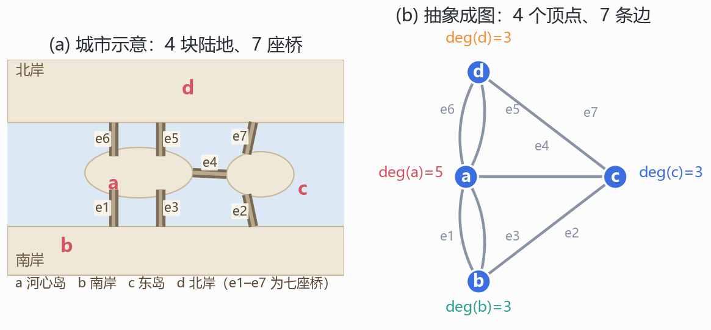
*图 1.1　七桥问题的两步抽象：(a) 四块陆地 a、b、c、d 与七座桥 $e_1$–$e_7$，a 是河心岛，b 是南岸，c 是东岛，d 是北岸；(b) 抽象成 4 个顶点、7 条边的多重图，a 的度为 5，b、c、d 的度都是 3。我绘制；桥的配对按 1736 年的城市布局（a 到 b 两座、a 到 d 两座、a 到 c 一座、其余各一座），度数用 Python 逐条数过。*

图 1.1 的关键在 (b)：**同一个顶点对之间可以有好几条边**。a 与 b 之间有两座桥，a 与 d 之间也有两座桥；抽象成图时不能把它们并成一条，否则度数就丢了。这样的图叫**多重图 (multigraph)**，p14 会正式区分。七桥图是多重图，不是简单图，这一点在 §6 会再次出现。

### 1.2 欧拉的“中间点”论证 (p6–p7)

p6 假设有这样一条路线，于是它有起点和终点。对每一个“中间点” $v$：

> there must be the same number of incoming and outgoing edges, and so $v$ must have even number of edges.

把这句话展开：路线每次经过 $v$，总是“从一条边进来，再从另一条边出去”；一次经过用掉两条边。若经过 $k$ 次，就用掉 $2k$ 条边；若 $v$ 根本不在路线上，用掉 $0$ 条。所以中间点用掉的边数是偶数。只有起点和终点可能“只出不进”或“只进不出”，各多出奇数条，因此：

> 一条走遍所有边的路线，最多只能有两个奇度点。

p7 把它用到七桥图上：四个顶点 a、b、c、d 的度分别是 5、3、3、3，全是奇数，超过两个，所以不存在这样的路线。欧拉因此证明七桥问题无解。

这里要注意，“度”是**顶点上连着的边数**，不是“经过的次数”。在七桥图里，a 的度是 5：两条到 b、两条到 d、一条到 c。

> **【我的补充·“中间点”论证的三种收尾】** 把起点、终点是否重合分开看，结论更清楚：(i) 起点 = 终点（闭路线），所有点都是“中间点”，全部偶数度；(ii) 起点 ≠ 终点，起点与终点各多一条“半截边”，恰好两个奇度点；(iii) 路线根本不存在，就无从谈起。p6 只说了中间点，没说起点和终点，这三句是把省略的部分补上。它同时说明：这个论证只给出**必要条件**——它排除七桥，但还不能保证“0 或 2 个奇度点”一定走得通。充分性要等到 p44。

### 1.3 反方向：为什么“连通”是必需的 (p8–p11)

p8 把问题翻过来：

> Is it always possible to find such a walk if there are at most two vertices with odd number of edges?
> One-line drawing problem

p9 的回答是 **NO!**，p10 加上一个条件后又变成 **YES!**：

> Is it always possible ... if the graph is “connected” and there are at most two vertices with odd number of edges?
> YES!

p11 收束成定理：

> **Euler's theorem.** A graph has an Eulerian path if and only if it is “connected” and has at most two vertices with an odd number of edges.

并注了一句历史：

> This theorem was proved in 1736, and was regarded as the starting point of graph theory.

p9 那个“NO”的例子，课件其实画出来了，而且画的就是后来 p45 那五个环：左边蓝、黄、黑三个环连成一组，右边绿、红两个环连成另一组，两组之间没有交点。每个交点都是两个环十字相交，度数为 4；所有顶点都是偶度，奇度点 0 个，但一条路线走完左边三个环之后，人在左边，碰不到右边两个环。这就是“at most two odd 不够”的最小图示——它和 p45 的图只差一处：p45 把五个环连成一排，p9 在第三、第四个环之间断开。

数一下两张图的差别（这也解释了为什么“连通”不是装饰）：p9 的两组环共 6 个交点、12 条边，全部度为 4，但分成 2 个连通分量，所以没有欧拉路线；p45 的五个环连成一排，共 8 个交点、16 条边，全部度为 4，只有 1 个分量，所以有欧拉回路。局部的度数一模一样，唯一变的是连通性。

> **【我的补充·“连通”到底管什么】** 反例必须是**两个都含边的分量**，不能是“一个三角形加一个孤立点”。孤立点不连任何边，而欧拉路线只要求“走遍每条边”，它完全可以不经过孤立点。所以定理里的 “connected” 精确说是：**所有边落在同一个连通分量里**（等价于“去掉孤立点后连通”）。按字面的“整张图连通”，一个三角形加一个孤立点会被误判成“无解”，其实它有欧拉回路。我用 $n\le6$ 的全部图穷举过：所有顶点度为偶数、去掉孤立点后连通、且确有孤立点的图共 **322** 个，它们在字面“连通”下会被判成无解，但都存在欧拉回路。这个精度问题在 §6.1 还会展开，并记入勘误 2。

> **【我的补充·一笔画与几笔画】** p8 把问题叫作 one-line drawing（一笔画）。定理其实还告诉我们**从哪里下笔**：0 个奇度点时，从任意顶点出发都能回到出发点；2 个奇度点时，必须从一个奇度点出发、在另一个奇度点收笔（否则走不完全部边）。若一张连通图有 $2k$ 个奇度点，就需要 $k$ 笔：每一笔最多消掉两个奇度端点，把 $2k$ 个奇度点两两配成虚边、对每对用一次欧拉路径即可。七桥图有 4 个奇度点，所以至少要两笔——这也是“七桥不能一笔画完”的另一种说法。

## 2. 图、度与握手引理 (p13–p19)

*这一节回答：一张图到底是什么，顶点的“度”怎么数，为什么所有顶点的度加起来一定是偶数？*

### 2.1 图的定义 (p13)

p13 给本讲的中心定义：

> A graph $G=(V,E)$ consists of: a set of vertices $V$; a set of undirected edges $E$, such that elements in $E$ are unordered pairs $(a,b)\in V^2$, $a\ne b$.

例子是 $V(G)=\{a,b,c,d,e,f\}$，$E(G)=\{ad,af,bd,be,cd,ce,df\}$；边 $ab$ 存在时称 $a,b$ **相邻 (adjacent / neighbours)**。

读法：$ad$ 是 $\{a,d\}$ 的简写，不是有序对；边没有方向。p13 把“无序对”写成 $(a,b)$ 是记号上的一个小毛病（见勘误 5），读的时候按集合 $\{a,b\}$ 理解。

这个图有 7 条边，度分别是 $\deg(a)=\deg(b)=\deg(c)=\deg(e)=\deg(f)=2$，$\deg(d)=4$，度和 $2+2+2+4+2+2=14=2\times7$，正好是握手引理（§2.5）的一个实例。

### 2.2 三种图与子图 (p14–p15)

p14 画了三种：

* **simple graph**：无重边、无自环、无方向；
* **multi-graph**：允许重边 (parallel edges) 与自环 (loop)；
* **directed graph (digraph)**：边有方向。

并给了一条全课程通用的约定：

> Unless otherwise specified, all graphs in this course are simple.

p15 定义子图：

> A graph $G'=(V',E')$ is a subgraph of $G=(V,E)$ if $V'\subseteq V$ and $E'\subseteq E$.

例子：$G'=(\{a,d\},\{ad\})$ 是子图；$G'=\varnothing$ 也是子图。最后一句提醒：

> Reminder: $G'$ has to be a graph to be a subgraph.

> **【我的补充·这句提醒不是废话】** 若只按“$V'\subseteq V$、$E'\subseteq E$”检查，取 $V'=\{a\}$、$E'=\{ad\}$ 也满足两个包含，但它不是图：边 $ad$ 的端点 $d$ 不在 $V'$ 里。正确的写法是 $E'\subseteq E\cap\binom{V'}{2}$，其中 $\binom{V'}{2}$ 是 $V'$ 的全部二元子集。p15 那句提醒正是在补这个洞。另外两个边界：空图 $\varnothing$（无顶点、无边）是每个图的子图；每个图也是自己的子图。

### 2.3 邻接、邻居集与度 (p16)

p16：

> degree of a vertex = number of incident edges; an edge $uv$ is incident with $u$ and $v$; the neighbour set $N(v)$ is the set of vertices adjacent to it.

例子：$N(a)=\{d,f\}$，$N(d)=\{a,b,c,f\}$，$N(e)=\{b,c\}$；$\deg(d)=4$，$\deg(a)=\deg(c)=\deg(e)=\deg(f)=2$，$\deg(b)=4$。

然后是一个关键的问句：

> the degree of a vertex $v$ = the number of neighbours of $v$?
> For multigraphs, NO. For simple graphs, YES. (loops count twice.)

这句话是本讲最容易翻车的地方：

* 简单图里，一条边恰好贡献一个邻居，所以度 = 邻居数；
* 多重图里，两条平行边只算一个邻居，但度加 2；
* 自环不给新邻居，却给度加 2。

p16 的图是在 p13 的图上给 b 加了一个自环：$\deg(b)$ 从 2 变成 4，而 $N(b)$ 仍然是 $\{d,e\}$。这就是“度不等于邻居数”的最小例子。

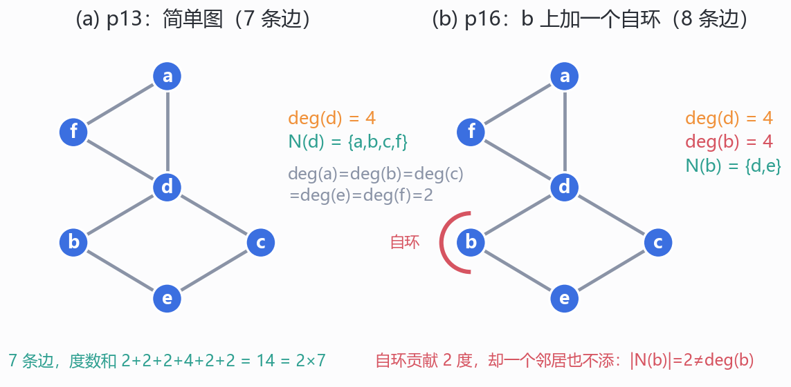
*图 2.1　(a) 把 p13 的图重画成平面形式：三角形 $a$–$d$–$f$ 加四边形 $d$–$b$–$e$–$c$–$d$，7 条边，$\deg(d)=4$，$N(d)=\{a,b,c,f\}$；(b) 在 b 上添一个自环，$\deg(b)=2+2=4$，但 $N(b)=\{d,e\}$ 一个邻居也没多。我绘制；两张图的边集都按 p13、p16 的列表逐条核对。*

### 2.4 度序列：四个问题 (p17)

p17 连问四个“存不存在这样的图”：

> $(2,2,2)$? $(3,3,3,3)$? $(2,2,1)$? $(2,2,2,2,1)$?

前两个 YES，后两个 NO。YES 的构造很容易：$(2,2,2)$ 取三角形 $C_3$，$(3,3,3,3)$ 取完全图 $K_4$。NO 的共同点是**和为奇数**：$2+2+1=5$，$2+2+2+2+1=9$。p17 只问 “What's wrong with these sequences?”，答案在下一页。

> **【我的补充·度序列的定义】** 课件直接用“degree sequence”这个词，没有定义。通常把它定义为**顶点度数的非增序列**，例如 $K_4$ 的度序列是 $(3,3,3,3)$，$C_3$ 是 $(2,2,2)$。排序是为了比较：两张图同构，度序列必须逐项相同。反过来不成立（§3.3 给两个反例）。一个序列能否由简单图实现，叫**图实现问题 (graph realization)**；简单图有 Erdős–Gallai 判据，本讲不需要，但知道“有判据”这件事可以防止用几个例子外推。

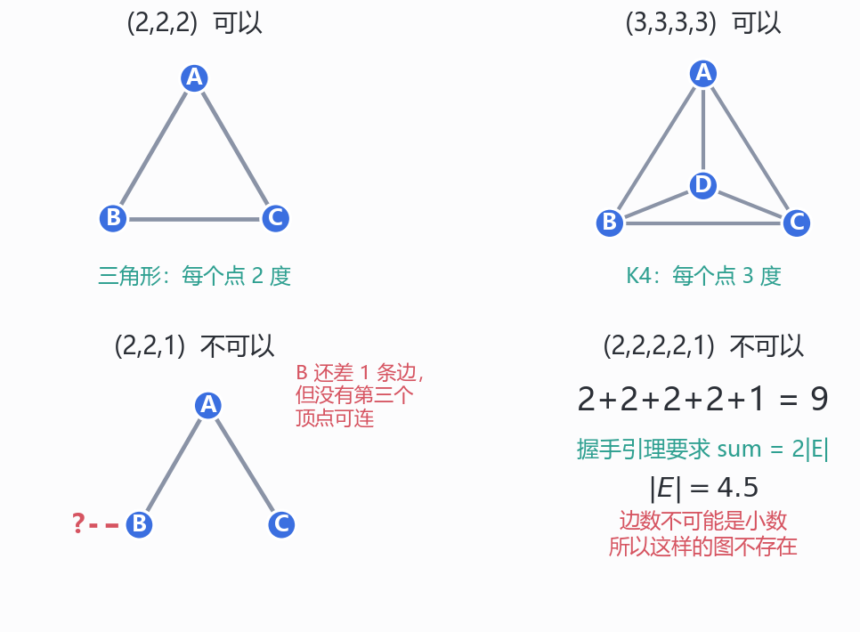
*图 2.2　p17 的四个问题：(2,2,2) 由三角形实现，(3,3,3,3) 由 $K_4$ 实现；(2,2,1) 的度和为 5，画到一半会剩下一个接不上的“半条边”；(2,2,2,2,1) 的度和为 9，$|E|=4.5$，连边数都不是整数。我绘制；前两个给出显式构造，后两个用握手引理排除。*

### 2.5 握手引理 (p18)

p18：

> **Lemma.** For any graph, $\displaystyle\sum_{v\in V}\deg(v)=2|E|$.
> **Corollary.** 1. Sum of degree is an even number. 2. Number of odd degree vertices is even.

证明用**双重计数 (double counting)**：每条边有两个端点，给两个端点的度各贡献 1，所以总和里每条边被数两次；自环的两个端点相同，也是贡献 2。

推论 2 的证明：偶数度顶点的度和是偶数，总和 $2|E|$ 是偶数，所以奇数度顶点的度和是偶数；一堆奇数相加为偶数，当且仅当奇数的个数是偶数。

七桥图：$5+3+3+3=14=2\times7$，四个奇度点，偶数个，符合推论 2；但“最多两个”不满足，所以无解。p17 的两个 NO 序列也是同一个道理：和为奇数，违反推论 1。

注意：握手引理对**任意**图成立（简单图、多重图、有向图的无向化），不依赖连通性。它是本讲的第一个“不变量”：不论怎么画、怎么给顶点改名，度和边数的这个关系不变。

### 2.6 和为偶数就够了吗 (p19)

p19：

> Question. Given a degree sequence, if the sum of degree is even, is it true that there is always a graph with such a degree sequence?
> For simple graphs, NO, consider the degree sequence $(3,1)$.
> For multigraphs with self loops, YES!

$(3,1)$ 为什么不可能：两个顶点，简单图最多一条边，每个点的度最多 1，不可能有 3。多重图里可以：在 $u$ 上放一个自环（度加 2），再连一条 $uv$（度加 1），得到 $\deg(u)=3$、$\deg(v)=1$。

> **【我的补充·“偶数就够”对多重图为什么成立】** 把每个顶点复制成 $\deg(v)$ 个“线头 (stub)”，总共有偶数个线头；两两配对，每一对线头连成一条边；同一顶点的两个线头配对就是一个自环。所以任意偶数和序列都能由带自环的多重图实现。这个构造也说明 p19 的 “with self loops” 不是随口加的：不允许自环时，像 $(2)$ 这样的单顶点序列（一个点、度 2）就实现不了；一般需要“最大度不超过其余度之和”。所以精确的说法是：**和为偶数是简单图的必要条件，是带自环多重图的充分必要条件**。

## 3. 同构:什么时候两张图是“同一张” (p21–p28)

*这一节回答：两张画得完全不同的图，凭什么说是同一个对象；又凭什么证明它们不是？*

### 3.1 同一张图的两种画法 (p21)

p21 用同一个 6 顶点图做了三件事：

* 左边一张画法：99 在下方，257、122 在上方，306、67、145 在下方围成三角；
* 右边一张画法：99 被移到中间，五个点围在四周；
* 下面把顶点改名：257 → Albert，122 → Grant，145 → Sharat，306 → Sonya，67 → Christos，99 → Jessica。

三张图标为 “Same graph (different drawings)” 与 “Same graph (different labels)”。这张图有 9 条边：99 与其余五个点都相连（5 条），257–122（1 条），306、67、145 两两相连（3 条）。度数分别是 $\deg(99)=5$，$\deg(257)=\deg(122)=2$，$\deg(145)=\deg(306)=\deg(67)=3$。

p22 给出理由：

> All that matters is the connections. Graphs with the same connections are isomorphic.
> Informally, two graphs are isomorphic if they are the same after renaming.

应用：fingerprint checking、molecules testing……也就是“把结构当成指纹”。分子结构里，原子是顶点、化学键是边；两张“看起来不一样”的结构图可能是同一个分子。

### 3.2 同构的定义 (p23–p26)

p23–p25 用两张“宠物—食物”图演示。左边四个点 Dog、Pig、Cow、Cat，五条边：Dog–Pig、Dog–Cow、Dog–Cat、Pig–Cat、Cow–Cat；右边四个点 Beef、Hay、Corn、Tuna，五条边：Hay–Beef、Hay–Tuna、Beef–Tuna、Beef–Corn、Corn–Tuna。映射是

$$f(\text{Dog})=\text{Beef},\qquad f(\text{Cat})=\text{Tuna},\qquad f(\text{Cow})=\text{Hay},\qquad f(\text{Pig})=\text{Corn}.$$

p24 问 “Edge preserved?”：原图有的边，映射后仍有边，答案 YES；p25 问 “Non-Edge preserved?”：原图没有的边，映射后也没有，答案也是 YES。两次都检查，是因为定义是“当且仅当”。

p26 定义：

> $G_1$ isomorphic to $G_2$ means there is a one-to-one mapping (isomorphism) of the vertices that is edge-preserving.
> $\exists$ one-to-one mapping $f:V_1\to V_2$; $u$—$v$ in $E_1$ iff $f(u)$—$f(v)$ in $E_2$.

记号：$G_1\cong G_2$。三个要素：**双射**、**保边**、**保非边**（合起来就是“当且仅当”的两半）。

四个问题：

* 同构 ⇒ 顶点数相同？YES；
* 同构 ⇒ 边数相同？YES；
* 同构 ⇒ 度序列相同？YES；
* 度序列相同 ⇒ 同构？NO。

前三个的理由：双射把顶点一一对上，边也一一对上；$v$ 的每条边 $vu$ 对应 $f(v)$ 的边 $f(v)f(u)$，所以 $\deg(v)=\deg(f(v))$。第四个的反例见 §3.3。

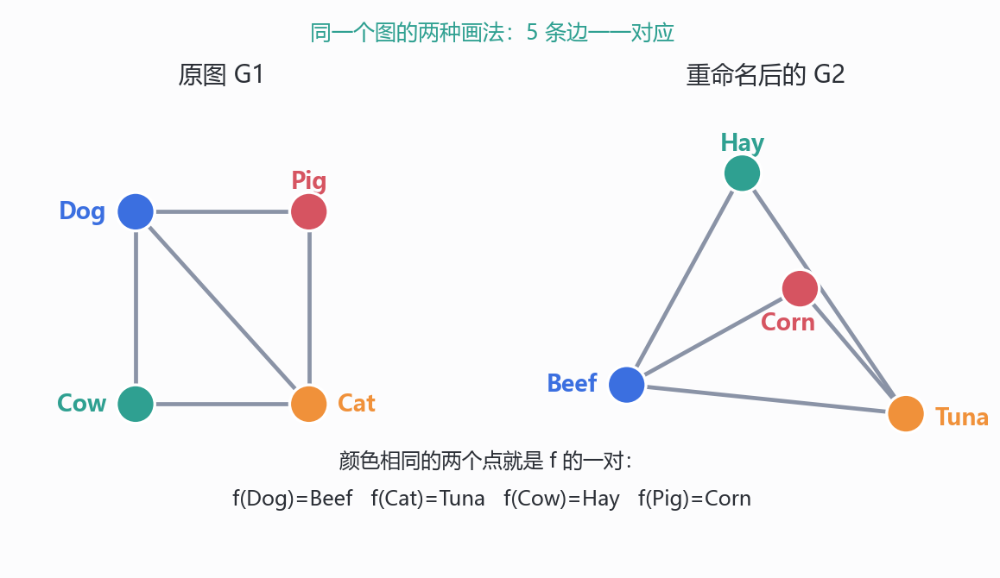
*图 3.1　p23–p25 的同构：左边宠物图与右边食物图各 5 条边，按 $f(\text{Dog})=\text{Beef}$、$f(\text{Cat})=\text{Tuna}$、$f(\text{Cow})=\text{Hay}$、$f(\text{Pig})=\text{Corn}$ 逐条对应，颜色相同的点就是 $f$ 的一对。我绘制；两图的边集按 p23 的图重画，5 条边逐条核对。*

> **【我的补充·“one-to-one”与双射】** 现代英文里 one-to-one 常指**单射 (injective)**，不要求满射；同构需要的是**双射 (bijection)**。课件在 p26 前已经问过“顶点数相同吗”，所以在“两图顶点数相同”的语境下，单射自动是双射，结论不受影响；但把 “one-to-one mapping” 当成定义照抄，遇到顶点数不同的两张图就会把“三角形嵌入 $K_4$”误认成同构。这是措辞问题，记入勘误 6。

### 3.3 证明同构与证明不同构 (p27)

p27 两句话：

> How to show two graphs are isomorphic? Find a mapping and show that it is edge preserving.
> How to show two graphs are not isomorphic? Find some isomorphic-preserving property (topological property) which is satisfied in one graph but not in the other.

例子：左边是“四边形加一条对角线”，度序列 $(3,3,2,2)$；右边是 $K_4$，度序列 $(3,3,3,3)$。度序列不同，所以不同构。左边那两个红点的度是 2，另外两个蓝点的度是 3；课件在图下只写了 “degree 2”，标的是红点，不是整张图的度序列。

“同构不变量”清单：顶点数、边数、度序列、连通分量数、三角形数、围长 (girth)、是否二分、直径、自同构数……任何一个不同，就可以判不同构；**全部相同，仍不能保证同构**。

> **【我的补充·同度序列但不同构的两个标准例子】**
> 1. $C_6$ 与两个 $C_3$：都是 2-正则、6 个顶点、6 条边；前者连通（1 个分量），后者 2 个分量，所以不同构。区分它们的不变量是**连通分量数**。
> 2. $K_{3,3}$ 与三棱柱 $C_3\times K_2$：都是 3-正则、6 个顶点、9 条边；$K_{3,3}$ 没有三角形，三棱柱有 2 个三角形（围长 4 对 3），所以不同构。区分它们的不变量是**三角形数**（或围长）。
>
> 这两个例子说明：度序列只是第一个筛子，不是判据。p27 说的 “topological property” 就是“同构不变量”；考试里判不同构，最常用的是度序列、分量数、三角形数、围长这四个。

### 3.4 为什么判定同构很难 (p28)

p28 给五张 10 顶点图 $G_1,\dots,G_5$，问 “Which is isomorphic to $G_1$?”，并写：

> Testing graph isomorphism is not easy – The problem is not known to be solvable in polynomial time and not known to be NP-complete (this is called NP-intermediate).

读法：图同构 (graph isomorphism, GI) 是 NP 里的问题；它既不知道有没有多项式算法，也不知道是不是 NP-完全。这类问题叫 NP-intermediate（NP 中间问题）。

> **【我的补充·2015 年 Babai 的准多项式算法】** 2015 年 László Babai 给出了图同构的准多项式 (quasi-polynomial) 算法，运行时间约为 $2^{O((\log n)^3)}$，后来经过修正与简化；它仍然不是多项式算法，所以课件“not known to be solvable in polynomial time”这句话至今仍然成立。另一方面，“NP-intermediate”这个标签隐含了“GI 不在 P 里”这一未解猜想；能确定的是：GI 是 NP 的，且**除非多项式层级塌缩，GI 不是 NP-完全的**（Boppana–Håstad–Zachos, 1987）。所以更稳的说法是：GI 在 NP 中，不在已知的 P 中，也不在已知的 NP-完全问题里；2015 年后它已知在准多项式时间内可解。

> **【我的补充·$G_1$ 是谁】** 我把 $G_1$ 的边读了出来：外五边形 $1$–$2$–$3$–$4$–$5$，内五边形 $6$–$7$–$8$–$9$–$10$，再加五条匹配边 $1$–$6$、$2$–$9$、$3$–$7$、$4$–$10$、$5$–$8$。用 networkx 验证，它同构于 **Petersen 图**：3-正则、15 条边、围长 5、120 个自同构、非二分。这解释了这道挑战为什么难——Petersen 图的度序列是 $(3,\dots,3)$，好几个干扰项也都是 3-正则，光看度序列分不出来。课件没有印出“哪一张与 $G_1$ 同构”的答案，五张图又是一张低分辨率位图，所以我不在这里猜答案；能确定的是 $G_1$ 本身。

## 4. 路径、连通与圈 (p30–p34)

*这一节回答：什么叫“从 $u$ 走到 $v$”，什么叫“整张图连在一起”，以及为什么最短路不会绕圈？*

### 4.1 路径与简单路径 (p30–p31)

p30：

> Path: sequence of adjacent vertices.

写法 $v_0v_1\cdots v_k$，其中每个 $v_iv_{i+1}\in E$；长度是边数 $k$；端点是 $v_0,v_k$。路径允许重复顶点，也允许重复边（在简单图里，重复顶点往往意味着重复边，但不是必然）。

p31：

> Simple Path: all vertices different.

简单路径的长度为 $k$ 时有 $k+1$ 个不同顶点；因为顶点不重复，边也不会重复。注意两个边界：一个顶点 $v_0$ 自己算长度 0 的路径；一条边算长度 1 的路径。这两个边界在归纳证明里常用。

### 4.2 连通与连通分量 (p32)

p32：

> Vertices $v,w$ are connected iff there is a path that starts at $v$ and ends at $w$.
> A graph is connected iff every pair of vertices are connected.

连通是顶点之间的关系；整张图连通，要求**每一对**顶点都有路径。孤立点只和自己连通。

连通分量 (connected component)：极大的连通子图。p32 的定义是：

> A connected component of $G$ is a connected subgraph of $G$ while adding any other vertex to which is no longer connected.

这句话的意思是“再加任何一个顶点就不再连通”，也就是**极大 (maximal)**。更干净的写法：分量是 $G$ 的一个连通子图，且不存在包含它的更大的连通子图。p32 的例子有 3 个分量：左边 8 个顶点的一个分量，中间一个孤立点，右边 4 个顶点的一个分量。于是：

> a graph is connected if and only if it has only 1 connected component.

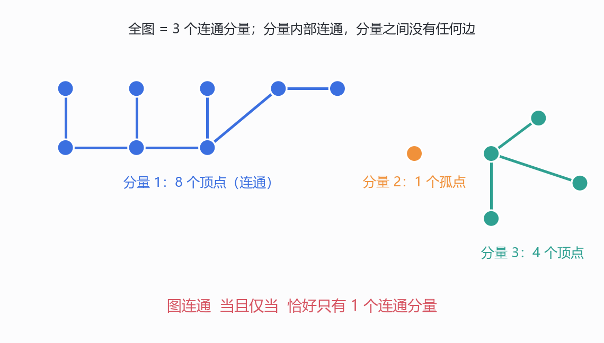
*图 4.1　p32 的“3 connected components”：左边 8 个顶点连成一片，中间一个孤立点自己是一个分量，右边 4 个顶点连成一片；分量内部连通，分量之间没有任何边。我绘制；顶点数与分量数按 p32 重画。*

> **【我的补充·连通是等价关系】** p32 说“Every graph consists of disjoint connected pieces”，但没有证明。证明只要三条性质：(i) 每个点与自己连通（长度 0 的路径）；(ii) 对称，$u$ 到 $v$ 的路径反过来就是 $v$ 到 $u$；(iii) 传递，$u$ 到 $v$ 与 $v$ 到 $w$ 的路径在 $v$ 处接起来就是 $u$ 到 $w$。所以“连通”是顶点集上的等价关系，连通分量就是等价类；等价类自然两两不交、并起来是全图。这就是“disjoint pieces”的出处。

### 4.3 圈 (p33)

p33 给了两个版本：

> A (simple) cycle is a connected graph whose vertices are all of degree 2.
> A (simple) cycle in a graph is a connected subgraph whose vertices are all of degree 2.
> (The meaning varies with the context)

第一个把圈当成一张**独立的图**；第二个把圈当成某张图里的**子图**。两处的“度 2”都是**相对于圈自己**算的，不是相对于原图——这一点很容易混：一条圈上的顶点在原图里可能度为 3，但它在圈这个子图里只连着圈上的两条边。

记号：$u\cdots v\cdots w\cdots u$。同一个圈可以从任意顶点开始，所以 $v\cdots w\cdots u\cdots v$ 是同一个圈。长度为 $k$ 的圈有 $k$ 个顶点、$k$ 条边；简单图里 $k\ge3$。

> For multigraphs, a loop is a cycle.

自环是长度为 1 的圈（一个顶点、一条边，度 2）；两条平行边是长度为 2 的圈。这两种在简单图里都不存在，但在多重图里必须承认，否则 p45 的“五环”讲不通（见 §6.2）。

### 4.4 最短路一定是简单路 (p34)

p34：

> A path between $u$ and $v$ is shortest if it uses the minimum number of edges among all $u$-$v$ paths.
> Is a shortest path between two vertices always simple?
> Idea: remove the cycle will make the path shorter.

证明（反证）：设 $P$ 是一条最短路。若 $P$ 上某个顶点出现两次，记为 $x\cdots x$，那么这一小段是一个圈；把这段圈删掉，剩下的序列仍然是 $u$ 到 $v$ 的路径，边数严格变少，与“最短”矛盾。所以最短路没有重复顶点，是简单路。

> **【我的补充·三个细节】** (i) 最短路存在：有限图里，路径长度的集合是自然数的非空子集，良序原理保证有最小元（LN4.2）。(ii) 删圈后仍然是一条**路径**：删除的是从第一次到第二次出现 $x$ 的整段，前后两段在 $x$ 处接上。(iii) “最短”是按边数，不是按权重；带权最短路是另一个问题（Dijkstra 算法），本讲不涉及。

## 5. 树:无圈的连通图 (p36–p42)

*这一节回答：一个“最小”的连通图长什么样，它有多少条边，为什么这些条件是等价的？*

### 5.1 森林与树 (p36–p37)

p36：

> Graphs with no cycles? A forest.
> Connected graphs with no cycles? A tree.

森林的每个连通分量是树；树是连通的森林。

p37：

> A leaf is a vertex of degree 1.

课件用 “more leaves / even more leaves” 堆例子。叶是树归纳的抓手：每个至少两个顶点的树都有叶（§5.3）。

### 5.2 用路径刻画树 (p38)

p38：

> Theorem. A graph is a tree if there is a unique simple path between every pair of vertices.

课件的论证是两个问句：

> Can there be no path between $u$ and $v$? NO.
> Can there be more than one simple path between $u$ and $v$? NO. This will create cycles.

展开：

* 没有路径 ⇒ 不连通 ⇒ 不是树；
* 两条不同的简单路径 ⇒ 把它们的并集里的某一段拼起来会出现圈。更具体：设 $P_1\ne P_2$ 都是 $u$–$v$ 的简单路径，取它们第一个分叉点和之后第一个汇合点，中间两段不同的路径合成一个圈。

反方向：若图有圈 $C$，取 $C$ 上两个不同顶点 $u,v$，沿圈的两条弧是两条不同的简单路径，违反唯一性。所以唯一简单路径 ⇒ 无圈；有路径 ⇒ 连通；于是是树。

注意课件标题写的是 “if” 而不是 “if and only if”，但 p42 把它列为等价刻画，实际是当且仅当。

### 5.3 树必有叶：最长路径论证 (p39)

p39：

> Can a tree have no leaves? Then every vertex has degree at least 2.
> Go to unvisited vertices as far as possible. Finitely many vertices → there is a cycle. NO.

展开成最长路径证明：取树 $T$ 中一条**最长**的简单路径 $v_0v_1\cdots v_k$。

* 若 $k\ge1$，端点 $v_0$ 的每个邻居都必须在这条路径上；否则把那个邻居接到 $v_0$ 前面，得到更长的路径，矛盾。
* 若 $v_0$ 不是叶，又因为它至少有一个邻居 $v_1$，所以 $\deg(v_0)\ge2$；于是 $v_0$ 还连着某个 $v_i$，$i\ge2$。那么 $v_0v_1\cdots v_iv_0$ 是一个圈，与树无圈矛盾。
* 所以 $v_0$ 的度只能是 1，即叶。

> **【我的补充·$n=1$ 的例外】** 单点树 $K_1$ 连通、无圈，但没有度为 1 的顶点（它的度是 0），所以“树必有叶”应写成“**至少两个顶点**的树必有叶”。课件的 “NO” 对 $K_1$ 不成立。这是本讲需要补边界的地方之一，记入勘误 9。

> **【我的补充·“走到底”版本】** 课本的另一种写法：从任意顶点出发，反复走到没去过的邻居；因为顶点有限，总会停下。停下的顶点如果还有两个已访问的邻居，就会形成一个圈；所以它至多有一个已访问邻居，在树里只能是叶。这与最长路径论证是同一件事的两种叙述：一个用“极大”，一个用“走到不能再走”。

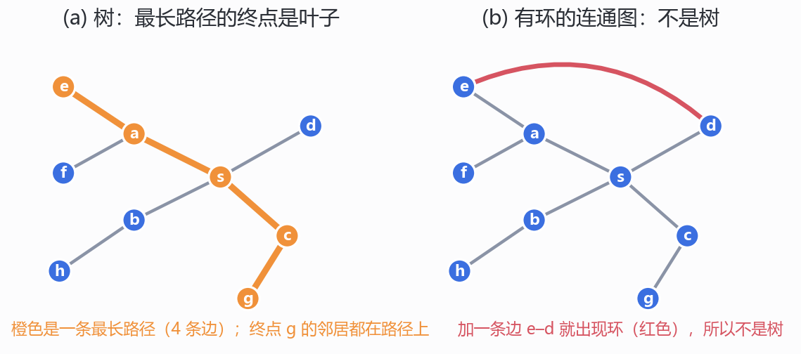
*图 5.1　(a) 一棵 9 个顶点的树，橙色路径 $e$–$a$–$s$–$c$–$g$ 是最长路径（4 条边），终点 $g$ 的邻居都在路径上；(b) 同一条树再加一条红边 $e$–$d$，立刻出现圈 $e$–$a$–$s$–$d$–$e$，不再是树。我绘制；树的边集与最长路径用 networkx 的直径复核。*

### 5.4 树的边数：$m=n-1$ (p40–p41)

p40 先约定记号：

> We usually use $n$ to denote the number of vertices, and use $m$ to denote the number of edges.

然后问 “$m=n-1$?”。p41 的归纳：

* 取一片叶 $v$；
* $T-v$ 连通？YES；
* $T-v$ 有圈？NO；
* 所以 $T-v$ 是树，顶点数 $n-1$；由归纳假设，它有 $(n-1)-1=n-2$ 条边；
* 加上 $v$ 的那一条边，$T$ 有 $n-1$ 条边。

> **【我的补充·把归纳补完整】**
> * **基例**：$n=1$ 时 $m=0=n-1$；或者从 $n=2$ 开始，一条边。
> * **$T-v$ 连通**：设 $x,y\ne v$。$T$ 中 $x$ 到 $y$ 的简单路径若经过 $v$，它必须从 $v$ 的唯一一条边进、同一条边出，这就不是简单路径了；所以路径不经过 $v$，仍在 $T-v$ 中。故 $T-v$ 连通。
> * **$T-v$ 无圈**：子图继承无圈性。
> * **归纳**：对 $n-1$ 个顶点的树用归纳假设，得 $m(T-v)=n-2$；$T$ 比 $T-v$ 多恰好一条边（$v$ 的唯一关联边），所以 $m(T)=n-1$。
>
> 课件把“连通/无圈”两个 YES 和基例都省了，考试写证明时要补上。

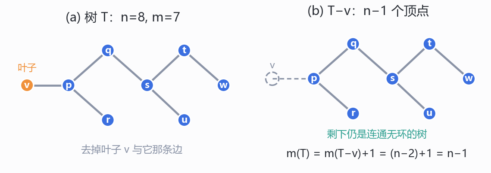
*图 5.2　(a) 树 $T$：$n=8$、$m=7$，橙色点 $v$ 是叶；(b) 删去 $v$ 与它那条边，剩下一棵 $n-1=7$ 个顶点的树，$m(T)=m(T-v)+1=(n-2)+1=n-1$。我绘制；边集按 p41 的删叶归纳构造。*

### 5.5 逆命题与三个等价刻画 (p42)

p42 把两条刻画并列：

> A graph is a tree iff there is a unique simple path between every pair of vertices.
> A graph is a tree iff it is connected and has $n-1$ edges.
> (We have proved one direction, how about the converse?)

逆命题：设 $G$ 连通且有 $n-1$ 条边。若 $G$ 有圈，就沿着圈删边，每删一条仍连通，直到无圈；得到的 $H$ 是树，由前一定理 $H$ 有 $n-1$ 条边。但 $H$ 至少删过一条边，所以 $G$ 的边数 $\ge n$，与 $|E(G)|=n-1$ 矛盾。故 $G$ 无圈，是树。

> **【我的补充·森林公式与第四种刻画】** 若 $G$ 是森林，有 $c$ 个连通分量，则 $m=n-c$：对每个分量用 $m_i=n_i-1$ 相加即可。于是有四种等价说法：
> * 树 ⇔ 连通 + 无圈（定义）；
> * 树 ⇔ 任意两点之间恰有一条简单路径（p38）；
> * 树 ⇔ 连通 + $m=n-1$（p42）；
> * 树 ⇔ 无圈 + $m=n-1$（由森林公式，$m=n-1$ 迫使 $c=1$）。
>
> 第四条课件没写，但它把“连通”这个前提从第三条里解放出来，是判树时最好用的形式。

## 6. 欧拉回路:从五环分解到 Claim 3 (p44–p73)

*这一节回答：为什么“连通 + 奇度点 0 或 2 个”不仅必要而且充分，证明是怎样把一张任意图拆成一个个圈再拼回去的？*

### 6.1 定理的两种写法与一个前提 (p44)

p44 把定理写成两种：

> A graph has an Eulerian path iff it is connected and has at most two vertices with an odd number of edges.
> A connected graph has an Eulerian path iff it has zero or two vertices with odd degrees.

两种写法等价，因为连通图里“恰好一个奇度点”不可能（握手引理推论 2）。p44 自己问：

> Can a graph have only 1 odd-degree vertex?

答案就是“不能”。所以 “at most two” 在连通图里就是 “0 or 2”。

p44 还交代了证明策略与范围：

> Proof by induction. We first consider the case of Eulerian cycle (a cycle that visits each edge exactly once).
> Here we only discuss simple graphs, but the technique can be easily generalized to multigraphs.

“Proof by induction” 这句话要拆开看：真正被归纳的是 Claim 2（对边数归纳）；Claim 1 是构造，Claim 3 是归约。整条证明不是一次归纳。

> **【我的补充·“连通”要精确成“所有边在同一个连通分量里”】** 和 §1.3 是同一个问题，这里说透。定理按字面要求“整张图连通”，但一个孤立点不连任何边，欧拉路线根本不必经过它。所以正确的条件是：**非孤立顶点诱导的子图连通**（所有边在同一个分量里）。反过来，如果两个分量都含边，就真的无解。穷举 $n\le6$ 的全部图，我找到 **322** 个“全偶 + 忽略孤立点后连通、且确有孤立点”的图，它们在字面“连通”下会被判成无解，实际都有欧拉回路；而“两个含边分量”的图，暴力搜索全部失败。这个修正不影响七桥、$K_5$ 这些例子（它们没有孤立点），但影响判定的正确性，记入勘误 2。
>
> 另外，p44 说“只讨论简单图”，可七桥图本身是多重图。定理对多重图同样成立，自环算 2 度、两条平行边算 2 条边；Claim 2 的“沿着未用的边走”在多重图里也照样能走，只是“一个圈”可能是 2-环或自环。

### 6.2 例子：五个环 (p45–p52)

p45 的图是五个圆环排成一排，相邻的环相交于两点；图上标了 1–16，共 16 条边。p46 说：

> Note that the edges can be partitioned into five simple cycles.
> Vertices of the same color represent the same vertices.

这句话里的“five simple cycles”要数一数：五个环的长度分别是 $2,4,4,4,2$，加起来正好 16 条边。8 个交点就是 8 个顶点，每个交点被两个环共用、每个环在交点处贡献两条边，所以每个顶点的度都是 4。首尾两个环只与邻居相交于两点，各只有两条边，是**2-环**——也就是说，这张图其实是多重图，不是简单图。p44 那句“technique can be easily generalized to multigraphs”正好兜住这个例子；但 p46 把它叫 “simple cycles”，措辞是松的（见勘误 3）。

这五个环就是 p9 用来回答“NO”的那五个环，只是 p9 把它们分成 3+2 两组（6 个交点、12 条边、2 个分量），p45 把它们连成一排（8 个交点、16 条边、1 个分量）。两张图所有顶点的度都是 4；把断口接上，欧拉路线就从“不存在”变成“存在”。这是全讲对“连通”最直观的一次演示。

p47–p52 演示构造：

* 先走环 1；
* 再走环 2；
* 在环 2 上遇到与环 3 的交点时，“绕”进环 3，走完一圈回到交点，再继续环 2；
* 环 4、环 5 同理。

边号 1–16 的顺序正好是：

$$1;\quad 2,3;\quad 4,5;\quad 6,7;\quad 8,9;\quad 10,11;\quad 12,13;\quad 14,15;\quad 16.$$

读法：环 1 的两条边是 1 和 16（最外层），环 2 是 2、3 与 14、15，环 3 是 4、5 与 12、13，环 4 是 6、7 与 10、11，环 5 是 8、9（最内层）。这是一对**嵌套的括号**：进一个环，绕一圈，回到交点，再继续外层。所谓 “detour” 就是这个括号结构；p47–p52 的十张图只是把这个括号一层层画出来。

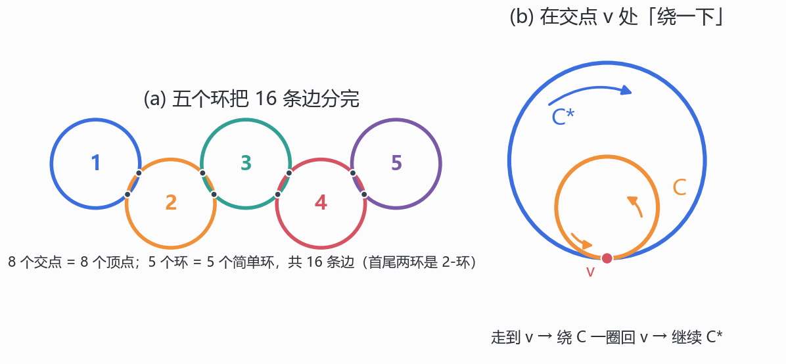
*图 6.1　(a) p45 的五个环：8 个交点、16 条边，五个环的长度为 $2,4,4,4,2$，首尾两个是 2-环；(b) p53 的拼接：已有闭迹 $C^*$ 与一个圈 $C$ 在顶点 $v$ 相交，走到 $v$ 后绕 $C$ 一圈回到 $v$，再继续 $C^*$。我绘制；环的个数、交点数、边数按 p45–p52 的编号复算，拼接顺序按 p53 的文字。*

### 6.3 拼接引理 (p53)

p53：

> In general, if we have a “partial Eulerian cycle” $C^*$, and it intersects with a cycle $C$ on a vertex $v$, then we can include the cycle $C$ in the “partial Eulerian cycle” $C^*$.
> First follow $C^*$ until we visit $v$, then follow $C$ until we go back to $v$, and then follow $C^*$ from $v$ to the end.

操作上就是：把 $C^*$ 在 $v$ 处剪开，插入整个 $C$。拼接后仍是一条**闭迹 (closed trail)**：边不重复、首尾相接，但顶点可以重复。这里要区分 p33 的“简单圈”和 p44 的“欧拉回路”：前者顶点不重复，后者允许重复顶点，只要求边不重复。

三个细节：

* $C$ 必须用**尚未用过**的边，否则会重复；
* $C$ 与 $C^*$ 至少要有一个公共**顶点**（不是公共边）；
* 拼接后起点可以仍取 $C^*$ 的起点，闭迹的长度增加 $|E(C)|$。

> **【我的补充·为什么总能找到与 $C^*$ 相交的圈】** 在 Claim 1 的归纳里，这一点由 $G$ 连通保证。设已用的边集是 $C^*$，剩下的边非空。每个顶点在剩下的子图里的度 = 原度 − 已用边数；每加入一个圈，每个顶点的度减 0 或 2，所以剩下的子图仍然**全偶**。若剩下的边与 $C^*$ 没有公共顶点，那么任何一条剩下的边都不碰 $C^*$ 的顶点，$G$ 就被分成“$C^*$ 的顶点”和“剩下边的端点”两堆，中间没有边，与 $G$ 连通矛盾。所以存在一个剩下的边碰到的 $C^*$ 顶点 $v$；从 $v$ 出发沿剩下的边走，因为全偶，不会卡住，第一次回到 $v$ 就得到一个经过 $v$ 的圈 $C$。这就是 p53 拼接能一直进行下去的理由，也是 Claim 1 严格证明的核心。

### 6.4 Claim 1 与 Claim 2 (p54–p67)

p54：

> Claim 1. If the edges of a connected graph can be partitioned into simple cycles, then we can construct an Eulerian cycle.
> Claim 2. If every vertex is of even degree, then the edges can be partitioned into simple cycles.

p67 说 Claim 2 已用归纳证明，Claim 1 只是 “informally proved”。所以严格来说，课件把 Claim 1 的细节留给了读者；下面把它补齐。

**Claim 2 的证明**（p55、p66）：

* 从任意顶点出发，沿未用的边走，能走多远走多远；有限个顶点 ⇒ 迟早回到走过的顶点，得到第一个圈 $C$；
* 删去 $C$ 的边，得到 $G'$；每个顶点的度要么不变，要么减 2，所以仍是偶数；
* $G'$ 的边更少，由归纳假设，$G'$ 的边能分成圈 $C_1,\dots,C_k$；
* 加上 $C$，$G$ 的边分成 $k+1$ 个圈。

细节：

* **基例**：没有边时，分成 0 个圈。
* **为什么不会卡住**：走到非起点 $w$ 时，进入 $w$ 用了一条边，而 $w$ 的度是偶数，已用的边成对出现，所以还有未用的边可以离开。这就是“偶数度”在证明里的唯一用处。
* **为什么得到简单圈**：在第一次重复顶点之前，顶点都不重复；第一次重复给出一个闭合段，内部无重复。
* **删圈后可能出现孤立点**，不影响“分边”。

p56–p65 的十帧就是把这个归纳画出来：每帧删掉一个圈，度数始终全偶，直到 p65 只剩最后一个圈。

**Claim 1 的证明**（补全）：

* 对圈数 $k$ 归纳。$k=1$ 时，唯一的圈就是欧拉回路。
* $k>1$：已拼好的闭迹 $C^*$ 用了若干圈；由 §6.3 的补充，剩下的圈中必有一个与 $C^*$ 有公共顶点；在那个顶点处按 p53 拼接。
* 拼接后闭迹仍覆盖且只覆盖已用的边；圈数增加 1。归纳到 $k$ 个圈，得到欧拉回路。

**把两条合起来**：若 $G$ 连通且全偶，由 Claim 2 把边分成圈，再由 Claim 1 拼成欧拉回路。这就是欧拉回路定理的充分性。必要性（回路 ⇒ 全偶）就是 p6 的“中间点”论证：闭回路没有端点，每个点都是中间点。

### 6.5 两个奇度点：Claim 3 (p68–p73)

p68 处理“0 或 2”中的“2”：

> How can we deal with this case? We can reduce it to the zero vertex case!

p69–p71 **Case 1：$u,v$ 相邻。**

* 删掉边 $uv$，得到 $H=G-uv$。$u,v$ 的度各减 1，变成偶数；其余不变。所以 $H$ 全偶。
* 问：$H$ 连通吗？
  * **YES**（p70）：$H$ 有欧拉回路；从 $u$ 出发走遍回路回到 $u$，再走 $uv$ 到 $v$，得到 $u$–$v$ 的欧拉路径。
  * **NO**（p71）：$H$ 恰好分成两个分量，一个含 $u$，一个含 $v$；每个分量连通且全偶，各有欧拉回路；从 $u$ 走完第一分量回到 $u$，过 $uv$ 到 $v$，再走完第二分量，仍然得到 $u$–$v$ 的欧拉路径。
* 两种情形都成功，所以 Case 1 不需要“$H$ 连通”这个额外假设。

p72 **Case 2：$u,v$ 不相邻。**

* 加一条**虚边** $uv$（图中没有这条边，只是证明工具），得到 $G+uv$；它仍简单、连通，且 $u,v$ 的度各加 1 变成偶数，全图全偶。
* 由欧拉回路定理，$G+uv$ 有欧拉回路；这条回路经过虚边 $uv$。
* 把虚边删掉，回路断成一条从 $u$ 到 $v$ 的路径，它用的正好是 $G$ 的全部边，每条一次。
* 所以 $G$ 有 $u$–$v$ 的欧拉路径。

p73：“So we are finally done!” 由 0 个奇度点（Claim 1 + Claim 2）与 2 个奇度点（Claim 3）合成充分性；必要性是 p6–p7 的走法论证加连通性。

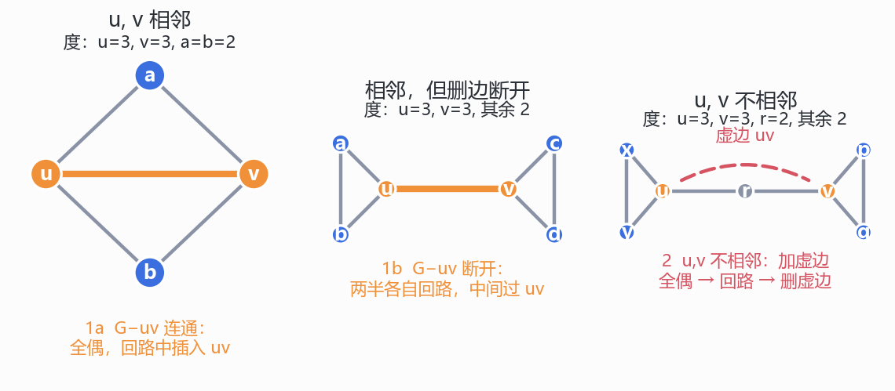
*图 6.2　Claim 3 的三条路：(1a) $u,v$ 相邻且 $G-uv$ 连通——四点完全图删去橙色边 $uv$ 后是一个 4-圈，全偶，回路中插入 $uv$；(1b) $u,v$ 相邻但 $G-uv$ 断开——两个三角形用 $uv$ 相连，两半各自有欧拉回路，中间过 $uv$；(2) $u,v$ 不相邻——加一条虚边 $uv$ 后全偶，走欧拉回路再删虚边。我绘制；三种情形的度数都逐点核过。*

### 6.6 定理的用法：三个判定 (p11, p44)

把定理整理成判定流程：

1. 忽略孤立点，看所有边是否在同一个连通分量里（否则 NO）；
2. 数奇度点的个数：0 → 有欧拉回路；2 → 有欧拉路径；其他 → NO。

判断“有没有”是 $O(n+m)$ 的；构造一条回路用 Hierholzer 算法，也是 $O(n+m)$（本讲不要求实现，但值得知道）。

例：

* 七桥图：度 5、3、3、3，四个奇度点 → NO。
* $K_4$：四个 3 → NO。
* $K_5$：五个 4，连通 → 有欧拉回路。一条是 $0,1,2,0,3,1,4,2,3,4,0$。
* $K_{2,3}$：度 2、2、2、3、3 → 两个奇度点，有欧拉路径。
* 五个环的例子：8 个顶点全度 4、16 条边 → 有欧拉回路，长度 16。

> **【我的补充·“几笔画”的一般公式】** 连通图有 $2k$ 个奇度点，就至少需要 $k$ 笔；把奇度点两两配成虚边，对每一对用一次欧拉路径，正好 $k$ 笔。$k=0$ 时一笔画成并回到起点，$k=1$ 时一笔画成但起点终点不同，$k=2$ 时两笔。七桥图 $k=2$，所以“两笔画完”是可以做到的，“一笔画完”不行。

## 7. 有向图:箭头改变了一切 (p75–p79)

*这一节回答：边一旦有方向，度、路径、连通、圈各自要改成什么样子？*

### 7.1 有向图的定义 (p75)

p75：

> A digraph $G=(V,A)$ consists of a set of vertices $V$ and a set of directed edges (arcs) $A$.

例子：$V=\{a,b,c,d,e,f\}$，$A=\{da,fa,db,eb,dc,ec,fd\}$。记号 $da$ 表示从 $d$ 指向 $a$ 的弧，不是 $d$ 和 $a$ 的无序对。

> For an arc $uv$, $u$ is the tail, $v$ is the head. $v$ is an out-neighbor of $u$, and $u$ is an in-neighbor of $v$.

注意：$uv$ 与 $vu$ 是两条不同的弧；有向图里没有“边 $uv$”这种对称说法。

### 7.2 入度与出度 (p76)

> out-degree = number of out-neighbours; in-degree = number of in-neighbours.

p76 的例子：$\deg^-(a)=2$、$\deg^+(a)=0$；$\deg^-(d)=1$、$\deg^+(d)=3$。

记号：$\deg^-(v)$ 入度，$\deg^+(v)$ 出度。无向图的度 $\deg(v)$ 在这里要拆成两个数。

> **【我的补充·有向握手引理】** 每条弧贡献一个出度、一个入度，所以
>
> $$\sum_{v\in V}\deg^+(v)=\sum_{v\in V}\deg^-(v)=|A|.$$
>
> 这是 p18 的无向握手引理的有向版；它保证“有向欧拉回路”的必要条件“每个点入度 = 出度”是自洽的（两边的总和自动相等）。

### 7.3 有向路径 (p77)

> Directed path: a sequence $v_1,\dots,v_k$ such that there is an arc from $v_i$ to $v_{i+1}$ for each $i$.
> Simple directed path: a directed path with no repeated vertices.

和无向路径的唯一区别：每一步必须**顺着箭头**走。所以“$u$ 能到 $v$”不保证“$v$ 能到 $u$”。

### 7.4 弱连通、强连通与有向圈 (p78)

p78 三个定义：

> A digraph is weakly connected if replacing its arcs by undirected edges results in a connected simple graph.
> A directed cycle is a connected digraph that the out-degree and in-degree are both 1 for every vertex.
> A digraph is strongly connected if there is a direct path between any ordered pair of vertices.

逐个读：

* **弱连通 (weakly connected)**：把箭头擦掉，底层的无向图连通。它只要求“忽略方向能走通”。
* **强连通 (strongly connected)**：任意有序对 $(u,v)$ 都有 $u\to v$ 的**有向**路径。这里 “direct path” 是 “directed path” 的笔误（勘误 1）。
* **有向圈 (directed cycle)**：每个顶点入度 = 出度 = 1 的连通有向图。和无向的 p33 一样，这也是“作为一张独立的图”的定义；说“图中的有向圈”时，入度、出度要在子图里算。

强连通 ⇒ 弱连通，反之不成立：一条 $1\to2\to3$ 的链弱连通，但从 3 回不到 1。

p78 的四顶点例子，弧集是 $\{12,14,24,32,43,31\}$：

* $(1,4,3)$：$1\to4\to3\to1$，是有向圈；
* $(2,4,3)$：$2\to4\to3\to2$，是有向圈；
* $(1,2,3)$：有 $1\to2$，但没有 $2\to3$（弧是 $3\to2$），不是；
* $(1,2,4)$：有 $1\to2$、$2\to4$，但没有 $4\to1$（弧是 $1\to4$），不是。

两个圈共用弧 $43$；图里把 $43$ 画了两遍（一条实线、一条虚线），只是为了标出它同时属于两个圈，原图里它是一条弧。这个例子还是强连通的：$1\to2\to4\to3\to1$ 走遍四个顶点，所以任意两点互相可达。

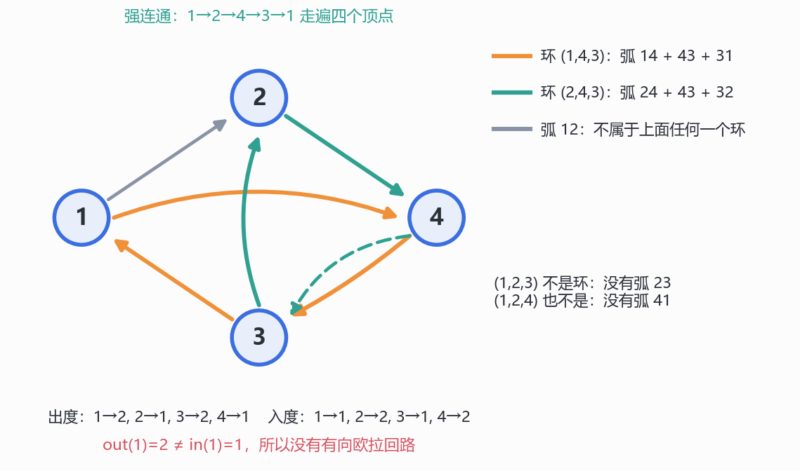
*图 7.1　p78 的四顶点有向图：弧 $12,14,24,32,43,31$。橙色圈 $(1,4,3)$ 用弧 $14,43,31$，青色圈 $(2,4,3)$ 用弧 $24,43,32$，两圈共用 $43$（所以画了两遍）；灰弧 $12$ 不属于任何一个圈。出度 $2,1,2,1$ 与入度 $1,2,1,2$ 不成对，因此没有有向欧拉回路。我绘制；弧集、度数、两个圈按 p78 逐条核对。*

### 7.5 p79 的练习：有向欧拉回路

p79：

> Given a directed graph, when is it possible to have a directed cycle that visits every arc exactly once?
> This is similar to the case of simple graphs. We leave this extension to the audience as an exercise.

> **【我的补充·练习的答案】** 一个有向图有“走遍每条弧恰好一次”的有向闭迹，当且仅当：
> 1. 忽略方向后，所有弧在同一个弱连通分量里（孤立点不影响）；
> 2. 每个顶点 $\deg^+(v)=\deg^-(v)$。
>
> 证明照抄无向版：由 (2)，沿未用的弧走不会卡住（每个点进入一次就还能离开一次），第一次重复给出一个有向圈；删去这个圈后，每个点的入度、出度仍然相等；归纳把所有弧分成有向圈，再用拼接引理接起来。必要性：一条有向闭迹在每个顶点进一次、出一次，所以入 = 出；弱连通是显然的。
>
> 如果只要求“有向欧拉路径”（起点、终点可以不同），条件改成：弱连通，且恰有两个顶点 $u,v$ 满足 $\deg^+(u)=\deg^-(u)+1$、$\deg^-(v)=\deg^+(v)+1$，其余点入 = 出。这是把无向版 Claim 3 的“两个奇度点”换成“两个不平衡点”。我用 3 个顶点的全部 64 个有向图与暴力搜索比对过，0 个反例（见附）。

## 8. 一条线:建模 → 度 → 不变量 → 连通性 → 树 → Euler(我的归纳)

*这一节回答：如果把 79 页压成一张图，本讲的六个概念之间是什么关系？*

这一节是我自己的整理，课件没有对应页，也没有画过这张依赖图。

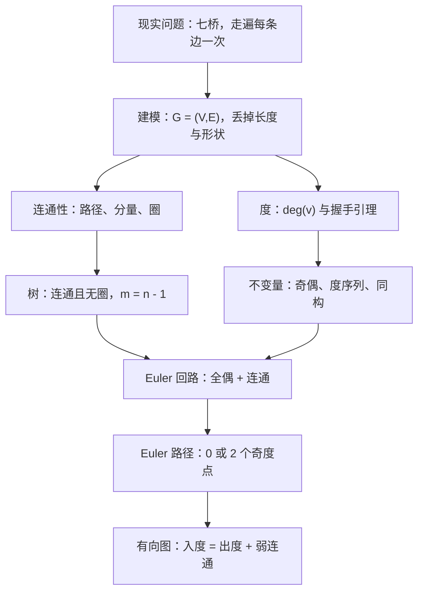

*这张图是我整理的，课件没有画；它只表示概念之间的依赖，不占图号。*

三个“遇到新题先问”的问题：

1. **这张图允许什么？** 简单图、多重图、有向图，三种规则不同。自环算 2 度、平行边只算一个邻居；有向图的度要拆成入度和出度。看清题目默认哪一种（p14 的约定是简单图）。
2. **度能排除什么？** 握手引理给奇偶障碍；度序列给同构的第一道筛子；欧拉定理给“0 或 2 个奇度点”的判据。度是**局部信息**，但它常常决定全局的可能性。
3. **连通性够不够？** 欧拉定理要“所有边在一个分量里”；树要“连通 + 无圈”；最短路要“先连通，再谈最短”。连通性是把局部信息拼成整体的黏合剂。

还有一个贯穿全讲的共同动作：**取极值，然后矛盾**。p34 取“最短路”，重复顶点就删圈变短；p39 取“最长路径”，端点就必须是叶；p41 删叶归纳；p42 删圈直到树；p53 把“部分回路”扩到最大；p72 加一条虚边把“两个奇度点”化成“零个奇度点”。这些证明表面各不相干，底层都是同一句话：**在一个有限结构里取极大或极小，边界处一定发生点什么**。这也是 LN4.2 良序原理、LN6 水壶不变量之后，第三次用同一种思想。

## 小结 (Summary)

*这一节回答：本讲哪些结论必须能默写，它们各自挂在哪一页、服务于哪一步？*

讲义 p79 没有总结页，它把最后一节留成练习。把本讲的东西整理成表：

| 概念 / 结果 | 位置 | 陈述 | 用途 |
| --- | --- | --- | --- |
| 图 $G=(V,E)$ | p13 | 顶点集 + 无向边集，边是无序对 | 全讲的地基 |
| 相邻、$N(v)$ | p13、p16 | 有边相连；邻居集 | 定义度 |
| 度 $\deg(v)$ | p16 | 关联边数；自环算 2 | 握手引理 |
| 度 ≠ 邻居数 | p16 | 多重图里平行边只算一个邻居 | 防错 |
| 握手引理 | p18 | $\sum_v\deg(v)=2\lvert E\rvert$ | 奇偶判据 |
| 推论 1、2 | p18 | 度和为偶；奇度点个数为偶 | 排除 $(2,2,1)$ |
| 度序列 | p17 | 度的非增序列 | 同构的第一道筛子 |
| $(3,1)$ | p19 | 简单图不可能；带自环多重图可以 | 说明“偶数不够” |
| 同构 | p26 | 双射 + 保边（当且仅当） | “同一张图” |
| 同构不变量 | p27 | 顶点数、边数、度序列、分量、三角形…… | 判不同构 |
| 路径 / 简单路径 | p30–p31 | 相邻顶点序列；顶点不重复 | 连通的定义 |
| 连通 / 分量 | p32 | 每对顶点有路径；极大连通子图 | 连通性 |
| 圈 | p33 | 连通且每点度 2（作为图或子图） | Euler 的积木 |
| 最短路必简单 | p34 | 重复顶点 ⇒ 删圈变短 | 矛盾法 |
| 森林 / 树 | p36 | 无圈；连通且无圈 | 结构 |
| 叶 | p37 | 度为 1 的顶点 | 归纳抓手 |
| 树必有叶 | p39 | $n\ge2$ 的树有叶 | 删叶归纳 |
| 树的边数 | p41 | $m=n-1$ | 判树 |
| 唯一简单路径 | p38、p42 | 树 ⇔ 任意两点恰有一条简单路径 | 等价刻画 |
| 连通 + $n-1$ | p42 | 连通且 $m=n-1$ ⇒ 树 | 等价刻画 |
| 欧拉回路定理 | p44 | 连通 + 全偶 ⇔ 欧拉回路 | 核心 |
| Claim 1 | p53–p54 | 圈分解 ⇒ 可拼成欧拉回路 | 充分性上半 |
| Claim 2 | p55、p66 | 全偶 ⇒ 边可分成圈 | 充分性下半 |
| Claim 3 | p69–p72 | 两个奇度点 ⇒ 有欧拉路径 | 路径情形 |
| 欧拉路径定理 | p11、p44 | 连通 + 0 或 2 个奇度点 | 七桥的答案 |
| 有向图 | p75 | 顶点 + 弧（有序对） | 推广 |
| 入度 / 出度 | p76 | 进 / 出的弧数 | 有向握手 |
| 弱 / 强连通 | p78 | 擦掉方向连通 / 任意有序对可达 | 有向连通性 |
| 有向圈 | p78 | 每个点入 = 出 = 1 的连通有向图 | 有向 Euler 的积木 |
| 有向欧拉回路 | p79 练习 | 弱连通 + 每点入 = 出 | 本讲留给读者的推广 |

**与课程主线的接缝。**

* **LN7 的收尾**停在模算术与 CRT；本讲没有再沿数论走，而是开了图论这条新线。从 LN8 自身看，它是「离散结构」这条线的转折点：前面几讲研究数（整除、同余），这里开始研究**关系**（点与点的连接）。
* **不变量法第四次出现**。LN4.2 的骨牌染色、LN6 水壶问题的「3 的倍数」、LN7 十五数码的奇偶性，到本讲 p6–p7 的「中间点进出配对」、p18 的奇偶、p27 的同构不变量，都是「找一个在操作下不变、但目标状态不满足的量」。本讲把它拆成了两种：**数值不变量**（度和、度序列）与**结构不变量**（分量数、三角形数、围长）。
* **归纳**第一次落在“图”这种结构上。p41 对树删叶归纳、p66 对边数归纳、Claim 1 对圈数归纳。LN4.1 的强归纳、LN4.2 的最小反例在这里都有对应的动作；课件没有点名“结构归纳”，但删叶归纳就是结构归纳的一个实例——树删掉叶仍是树，这正是“结构变小而保持类型”的典型。
* **反证与极值**：p34 的最短路、p39 的最长路、p42 的“删到树”、p72 的“加虚边”，四次都是“取极值（或造一个更大的结构），然后矛盾”。这与 LN6 用良序原理证 spc 存在、证唯一分解是同一套逻辑。
* **计数**：握手引理是双重计数；LN6 的 $\gcd=\operatorname{spc}$ 用双向包含，本质也是“两边互相数”。本讲第一次把“数边”变成了定理。
* 往前看：本讲只到树与欧拉回路，图论这条线在课程里才刚开头；同构、匹配、平面图等更深的题目不在本讲范围内，我不预设后面讲次的内容。

## 附:讲义勘误、省略与几点说明

*这一节回答：讲义哪里写错、哪里省略，我补的内容又用什么数值核验过？*

按惯例把“讲义原文”与“我补的内容”分开列清。**本讲材料只有课件（79 页 PDF）**，全文内容**仅来自课件**；没有课堂板书，也没有任何“老师课上说了什么”的成分。

### 讲义勘误（9 处）

前 3 条会实际影响判定；其余是措辞、边界与严谨性。

1. **⚠️ p78 的 “direct path” 应为 “directed path”。** 原文 “A digraph is strongly connected if there is a direct path between any ordered pair of vertices.” 前一句 p77 刚定义 “Directed Path”，p78 的 “direct path” 是漏了 -ed。direct path 在英文里会被读成“直接路径（不经过中间点）”，那是完全不同的概念；强连通要求的是“有向路径”，可以经过任意多个中间点。**这一条会改变定义**，不是纯笔误。
2. **⚠️ p11、p44 的 “connected” 要精确成“所有边在同一个连通分量里”。** 按字面“整张图连通”，一个三角形加一个孤立点会被判成“无欧拉回路”，但它显然有（孤立点不连边，不必经过）。我穷举 $n\le6$ 的全部图：满足“全偶 + 忽略孤立点后连通”的图里，有 **322** 个在字面“连通”下会被误判；而两个分量都含边的图，暴力搜索全部无解。所以定理应写成“所有边在一个分量里 + 0 或 2 个奇度点”。p44 的“只讨论简单图”也不影响这条修正。
3. **⚠️ p45–p52 的“five simple cycles”其实包含两个 2-环，例子是多重图。** p44 明说 “Here we only discuss simple graphs”，p46 却说边能分成五个 simple cycles。数一下：五个环的长度是 $2,4,4,4,2$，首尾两个环只与邻居交于两点，各只有两条边，是平行边构成的 2-环；简单图里没有 2-环。8 个顶点、16 条边、每点度 4，也只有在多重图里才自洽。p44 的“technique can be easily generalized to multigraphs”正好兜住，但“simple cycles”这个词是松的。
4. **p41 的归纳没有基例，两个 “YES” 也没有证明。** “Is $T-v$ a tree? 1. connected? YES 2. cycle? NO” 两句都只给结论；“By induction” 之前也没有交代 $n=1$（或 $n=2$）的基例。完整的证明见 §5.4 的补充。
5. **p13 把“无序对”写成 $(a,b)\in V^2$。** 圆括号是有序对的记号；无序对应该写成 $\{a,b\}\subseteq V$（或 $\{a,b\}\in\binom{V}{2}$），并注明 $a\ne b$。这不影响后面的例子，但定义句本身自相矛盾。
6. **p26 的 “one-to-one mapping” 应为 “bijection”。** one-to-one 在现代用法里常指单射；同构需要双射。课件紧接着问“顶点数相同吗”，说明作者心里想的是双射；但定义句照字面读不够。
7. **p27 左图下的 “degree 2” 不完整。** 左图是“四边形加一条对角线”，四个顶点的度是 $3,3,2,2$，不是全部为 2；课件用红色标出两个度 2 的点，标的是这两个点。真正用来判不同构的是**度序列** $(3,3,2,2)\ne(3,3,3,3)$，不是“有一个点度为 2”。
8. **p32 的分量定义语法不完整。** 原文 “a connected subgraph of $G$ while adding any other vertex to which is no longer connected” 缺主语，也不好读；标准定义是“极大的连通子图”，即不存在包含它的更大的连通子图。意思能猜到，但别照抄。
9. **p39 的 “Can a tree have no leaves? NO” 对 $K_1$ 不成立。** 单点树连通、无圈，度为 0，没有叶。正确说法是“至少两个顶点的树必有叶”；最长路径论证也默认了 $k\ge1$。这是本讲唯一一个需要补顶点数边界的结论。

### 讲义省略、我补上的内容（12 处）

正文均已标注。

* **p4–p5**：抽象的两步（丢长度、丢形状）只给了口号，没有说“保留什么”。我补上：保留的是“哪两块陆地之间有桥、有几座”，也就是连接关系与重数；丢掉的是几何信息（§1.1）。
* **p6–p7**：中间点论证只说了中间点。我补上起点、终点是否重合的三种收尾，以及“这只给出必要条件”（§1.2）。
* **p9–p11**：“at most two odd” 单独不成立的反例（两个不相连的三角形），以及“孤立点无害”的精确化（§1.3、§6.1）。
* **p13、p15**：子图定义需要 $E'\subseteq E\cap\binom{V'}{2}$；空图是每个图的子图；每个图是自己的子图（§2.2）。
* **p16**：自环对度的贡献是 2、对邻居集的贡献是 0；平行边只算一个邻居（§2.3）。
* **p18**：握手引理的双重计数证明与推论 2 的证明；并指出它对多重图、有向图的无向化都成立（§2.5）。
* **p19**：“偶数就够”对带自环多重图成立的线头构造；以及不允许自环时 $(2)$ 这类序列的反例（§2.6）。
* **p21**：p21 那张 6 顶点图的 9 条边与度序列（$5,3,3,3,2,2$），以及“same graph”其实是“同构”（§3.1）。
* **p28**：Babai 2015 的准多项式算法、GI 不是 NP-完全（除非多项式层级塌缩）的已知结果；以及 $G_1$ 是 Petersen 图的验证（§3.4）。
* **p34**：最短路存在的良序理由、删圈后仍是路径、以及“最短”是按边数不是按权重（§4.4）。
* **p39、p41、p42**：$K_1$ 的边界；$T-v$ 连通与无圈的证明；归纳基例；森林公式 $m=n-c$ 与第四种等价刻画（§5.3–§5.5）。
* **p53、p55、p69–p72**：Claim 1 的完整证明（为什么总能找到与 $C^*$ 相交的圈）；Claim 2 里“为什么不会卡住”；Claim 3 的 Case 1 两个子情形如何各自收尾（§6.3–§6.5）。
* **p79**：练习的答案（有向欧拉回路的充要条件），以及有向欧拉路径的版本（§7.5）。
* **§8 的依赖图**是我把本讲七个模块横向对比后归纳的，课件没有“总结”这一节（与 LN6 的“一条线、三个工具”、LN5 的“两种问题、三种工具”同属归纳性总结）。

### 数值核验

凡有具体数字的地方我都独立复算过一遍。做法是：能穷举的一律穷举（而不是验几个样例外推）；涉及“有没有欧拉路线”的判定用 DFS 枚举全部边序或用 Hierholzer 自写实现；涉及同构的用 networkx 的 `is_isomorphic` 与自写的度序列/三角形数交叉检查。下面是“课件结论 / 位置 / 我的复算结果”的对照：

| 课件结论（位置） | 我的复算结果 | 判定 |
| --- | --- | --- |
| p13 的度：$a,b,c,e,f$ 为 2，$d$ 为 4，度和 14（p13） | 逐条数边：$2+2+2+4+2+2=14=2\times7$；$N(d)=\{a,b,c,f\}$ | ✓ |
| p16 加自环后 $\deg(b)=4$，度和 16（p16） | $\deg(b)=2+2=4$；$N(b)=\{d,e\}$ 不变；度和 $16=2\times8$ | ✓ |
| $(2,2,2)$、$(3,3,3,3)$ 可实现（p17） | 三角形、$K_4$ 的度序列逐项相同 | ✓ |
| $(2,2,1)$、$(2,2,2,2,1)$ 不可实现（p17） | 度和为 5、9，均为奇数；穷举 $n\le5$ 无实现 | ✓ |
| 握手引理与两条推论（p18） | 穷举 $n\le6$ 的全部 **33,867** 个图：违例 **0**；恰有一个奇度点的图 **0** 个 | ✓ |
| $(3,1)$ 简单图不可实现（p19） | 2 个顶点的简单图最多 1 条边；穷举确认无解 | ✓ |
| $(3,1)$ 带自环多重图可实现（p19） | 自环 $u$ + 边 $uv$：度 $3,1$ | ✓ |
| 四个同构问题 YES/YES/YES/NO（p26） | 前三个由双射直接推出；第四个用 $C_6$ 与 $2C_3$ 反例 | ✓ |
| p27 的两图不同构 | 度序列 $(3,3,2,2)$ 对 $(3,3,3,3)$，不同 | ✓ |
| 同度序列不同构（我补） | $C_6$ 与 $2C_3$：分量 1 对 2；$K_{3,3}$ 与三棱柱：三角形 0 对 2，围长 4 对 3 | 补充 |
| p28 的 $G_1$（p28） | 读出 15 条边，networkx 判定同构于 Petersen 图；3-正则、围长 5、120 个自同构、非二分 | ✓（我读的边集） |
| p32 的 3 个分量（p32） | 左 8 顶点、中 1 孤立点、右 4 顶点；分量间无边 | ✓ |
| 最短路必为简单路（p34） | 对 $n\le5$ 的全部连通图做 BFS，比较最短路与简单路：违例 **0** | ✓ |
| $n\ge2$ 的树有叶（p39） | 穷举 $n\le6$ 的全部 **1,442** 棵带标号树：无叶的只有 $K_1$；$n\ge2$ 违例 **0** | ✓（边界见勘误 9） |
| 树的 $m=n-1$（p41） | 1,442 棵树中 $m\ne n-1$ 的 **0** 棵；每棵树的 $T-v$ 仍是树 | ✓ |
| 连通 + $m=n-1$ ⇒ 树（p42） | 穷举 $n\le6$：连通且 $m=n-1$ 但有圈的图 **0** 个 | ✓ |
| 欧拉路径判据（p11、p44） | 穷举 $n\le5$ 的全部图，DFS 枚举边序：与“0 或 2 个奇度点 + 边连通”不符 **0** 个 | ✓ |
| 欧拉回路判据（p44） | 穷举 $n\le6$ 的全部图，自写 Hierholzer：不符 **0** 个；其中 **322** 个因孤立点被字面“连通”误判（勘误 2；初稿写 327，逐图重数后修正） | ✓ |
| 七桥图无解（p7） | 度 $5,3,3,3$，四个奇度点；DFS 无欧拉路径 | ✓ |
| $K_4$ 无、$K_5$ 有、$K_{2,3}$ 有（我补的例子） | $K_4$ 四个 3；$K_5$ 全 4，回路 $0,1,2,0,3,1,4,2,3,4,0$；$K_{2,3}$ 度 $3,3,2,2,2$ | ✓ |
| 五环图有欧拉回路（p45–p52） | 8 顶点、16 边、全度 4；自写 Hierholzer 得到长度 16 的回路 | ✓ |
| p78 的入/出度与两个有向圈（p78） | 入度 $1,2,1,2$、出度 $2,1,2,1$；$(1,4,3)$、$(2,4,3)$ 是圈，$(1,2,3)$、$(1,2,4)$ 不是；强连通 | ✓ |
| 有向欧拉回路判据（p79 练习） | 3 个顶点的全部 **64** 个有向图，与暴力搜索比对：违例 **0** | 补充 |
| 树 ⇔ 唯一简单路径（p38、p42） | 穷举 $n\le5$ 的全部图：违例 **0** | ✓ |

### 本讲的「够 / 不够」

**够的地方。** 主线讲得很足。**故事层**用一个真实问题开场，p4 的两句“忘掉细节”把建模过程讲得比多数教材直白。**定义层**（图、度、邻接、子图、路径、连通、圈、树、有向图）一次给全，而且 p16 专门用“度 = 邻居数吗”这个问句把多重图的坑挖出来。**核心定理**的架构是完整的：Claim 2 用归纳分圈，Claim 1 用拼接合圈，Claim 3 用“删边 / 加虚边”把两个奇度点化归到零个奇度点；三段各司其职，p45–p52 的十张图把“拼接”演示得非常具体。**同构**部分四个问题与两个判定方向（找映射 / 找不变量）也是考试直接能用的。

**不够的地方有四块：**

1. **欧拉定理的证明只到“架构”级。** Claim 1 明说只是 informally proved，p53 的拼接没有证明“总能找到相交的圈”；Claim 2 的“走不出去”没有解释偶数度为什么保证不卡住；Claim 3 的 Case 1 两个子情形只有 “YES!” 和 “NO!”，没有写怎么把两段回路接起来。这三处我在 §6.3–§6.5 补全；如果考试要求写完整证明，不能只写课件的三行。
2. **“连通”的边界没有交代。** p11 和 p44 都把 connected 当成人人都懂，但孤立点会让字面判定出错（322 个反例）。这不是吹毛求疵：判题时若输入带孤立点，按字面写会 WA。
3. **树的归纳缺基例与两个“YES”的证明**（勘误 4）；森林公式 $m=n-c$ 与“无圈 + $m=n-1$ ⇒ 树”这条最好用的判据都没写。
4. **图同构的复杂度只有一句话。** p28 的 NP-intermediate 是 2015 年之前的图景；Babai 之后应补上“准多项式可解”，否则读者会以为这个问题完全没进展。另外 p28 的挑战没有答案，五张图又是位图，想核对只能自己读边。

**下一步建议**：把本讲的判定流程写成一个小程序（输入邻接表，输出“无 / 欧拉路径 / 欧拉回路”并给出一条路线），用 Hierholzer 实现；再把 p28 的五张图逐个读边、用同构算法核对，顺便体会“度序列相同但不同构”的干扰项是怎么设计的。这两件事做完，本讲的“判定”与“构造”两条线就都落地了。

### 图片登记

**表中 10 张图全部由我绘制，非讲义图**（matplotlib 输出，绘图脚本另存于本地，不随笔记发布）。图号按所在节编排，同一节多图顺延。

| 图号 | 文件名 | 所在节 | 一句话内容 |
| --- | --- | --- | --- |
| 图 1.1 | `CSC3001-L8-可视化01-七桥地图与抽象图.png` | §1.1 | 四块陆地、七座桥；抽象成 4 顶点 7 边多重图，度 $5,3,3,3$ |
| 图 2.1 | `CSC3001-L8-可视化02-度数手算与自环.png` | §2.3 | p13 图的平面重画；加自环后 $\deg(b)=4$ 而 $N(b)$ 不变 |
| 图 2.2 | `CSC3001-L8-可视化03-度序列四个问题.png` | §2.4 | 四个度序列：两个可实现，两个被奇偶性排除 |
| 图 3.1 | `CSC3001-L8-可视化04-同构映射牛羊图.png` | §3.2 | 宠物图与食物图的同构映射，5 条边逐条对应 |
| 图 4.1 | `CSC3001-L8-可视化05-三个连通分量.png` | §4.2 | 8 顶点分量、孤立点、4 顶点分量，共 3 个分量 |
| 图 5.1 | `CSC3001-L8-可视化06-树与最长路径.png` | §5.3 | 树的最长路径 $e$–$a$–$s$–$c$–$g$；加一条边就成圈 |
| 图 5.2 | `CSC3001-L8-可视化07-删叶归纳.png` | §5.4 | $n=8$ 的树删去叶 $v$ 得 $n=7$ 的树，$m=n-1$ |
| 图 6.1 | `CSC3001-L8-可视化08-五环分解与绕行拼接.png` | §6.2–§6.3 | 五环 8 交点 16 边；在交点 $v$ 处绕 $C$ 一圈再回 $C^*$ |
| 图 6.2 | `CSC3001-L8-可视化09-两个奇度点三种情形.png` | §6.5 | Claim 3 的 1a、1b、2 三种情形 |
| 图 7.1 | `CSC3001-L8-可视化10-有向图与两个有向环.png` | §7.4 | 四顶点有向图；两个有向圈共用弧 $43$；无有向欧拉回路 |

<!--LN8-APPEND-->
