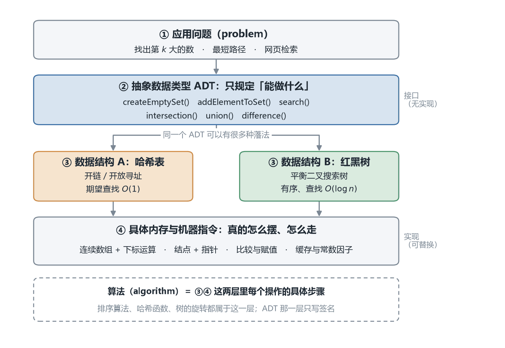
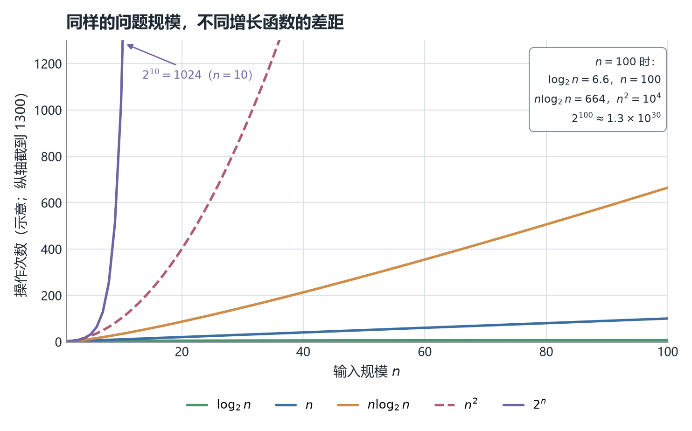
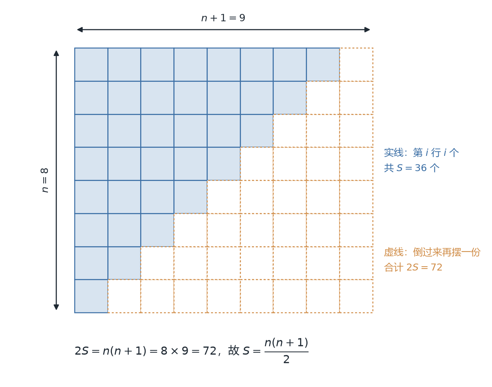

# CSC3100 Lecture 1 课堂笔记：Introduction（课程导论）

> 本讲覆盖课件 `lecture 1 (introduction).pdf`（共 44 页）的**第 24 页起**：课程定位、抽象数据类型（ADT）、数据结构与算法的关系、全课路线图与教学计划、选第 k 大数的案例，以及数学复习（指数、对数、级数、证明方法）。第 1–23 页是教师与 TA 介绍、评分构成、OJ 与竞赛、学术诚信等行政内容，本笔记只在 §1 用一句话带过，不展开。
>
> 页码一律指 PDF 页码。正文里以补充类 alert（NOTE / TIP / IMPORTANT）呈现的内容是课件没有、由我补充或推导的内容；文末「诚实备注」逐条列了它们的归属。

## 0. 一句话概括本讲在讲什么

这是全课第一讲，没有"上一讲"可以回扣。它要回答的是三个更基本的问题：**这门课为什么存在、它用什么语言描述问题、描述完之后靠什么工具判断好坏。**

一句话：这门课教的不是"把程序写出来"，而是"在给定内存布局的前提下，用代价算得清的算法把程序写到足够快"；本讲先立起 **问题 → ADT → 数据结构 → 内存** 这四级台阶，再把后面十几周要用的数学工具发下来。

前半段（p.24–39）立骨架：先给一句课程定义（p.29），用路线规划和网页检索两个例子把它压实（p.27–28）；再引入 ADT 这个"只谈能做什么"的概念（p.30–32），把数据结构定义成 ADT 的实现、算法定义成操作的实现（p.33）；最后用"选第 k 大数"把抽象踩到地上——两个都能跑的程序，在一百万个元素面前都跑不完（p.37–38）。后半段（p.40–44）发工具：指数、对数、等差与等比级数、三种证明方法，四页压缩成"公式表"。

本讲地图：§1–§5 是概念线，§6–§8 是工具线。

| 页码 | 本节 | 这一块在回答什么 |
| --- | --- | --- |
| p.24–29 | §1 这门课要解决什么问题 | 为什么值得学，它在解决哪一类问题 |
| p.30–32 | §2 抽象：把"能做什么"和"怎么做"分开 | 怎样才能先不谈内存就把问题说清楚 |
| p.33–34 | §3 ADT、数据结构、算法 | 三个词各指哪一层，谁实现谁 |
| p.35–36 | §4 怎么定义"高效" | "快"是可测量的吗，全课要走过哪些结构 |
| p.37–39 | §5 案例：选第 k 大的数 | 一个能跑的程序可以有多慢 |
| p.40–41 | §6 指数与对数 | 复杂度的"字母表" |
| p.42–43 | §7 级数 | 循环嵌套时为什么常出现 $n^2/2$ |
| p.44 | §8 三种证明方法 | 凭什么说一个命题真或假 |
| — | §9 本讲要点小结 | 一页纸收口 |

## 1. 这门课要解决什么问题（p.24-29）

这一节回答"我为什么要坐在这里"：先给一句能记住的话，再拿三个场景压实。

### 1.1 一句课程定义

这门课的定义只有一句（p.29）：

> This course is about how to use computing resources and tools to solve practical problems correctly and efficiently.

拆开看是三个词：**正确**（correctly）、**高效**（efficiently）、**实际**（practical）。三者缺一不可——不正确的程序没有价值，不正确但很快的程序是灾难，正确但慢到用不了的程序在工程上等于不存在。要做到这三点，靠的是两种能力（p.29）：

| 能力 | 课件原文 | 它在课里对应什么 |
| --- | --- | --- |
| 逻辑与数学 | Logical thinking and math | 分析算法对不对、有多快（§6–§8 的工具，后面讲复杂度） |
| 数据结构、算法与编程 | Good at data structures, algorithms, and programming | 把方案真的写出来、跑起来（作业与 OJ） |

课程定位上还有一句：这是计算机专业的**必修课**（required course），也是计算机科学里最基础的课程之一。

### 1.2 三个场景，和一个反常识的结论

"这门课很有用"的例子举了三个（p.26），只展开了前两个：

| 场景 | 输入 | 输出 | 课件给的线索 |
| --- | --- | --- | --- |
| 路线规划（p.27） | 一个路网（road network）、起点节点（source node）、终点节点（destination node） | 一条路径（path），即一串边（edges），总距离最短 | 建模成图（graph），后面讲图算法 |
| 网页检索（p.28） | 查询关键词（query keywords）、约 30 万亿（$30 \times 10^{12}$）个网页 | 与关键词匹配的文档 | 预先建一个索引结构（index structure），而"索引结构就是一个数据结构" |
| 身份证校验（p.26） | 只写了"在 14 亿人里验证一个中国身份证号" | —— | 课件没有展开 |

这两个例子的价值在于把"数据结构"变成了可测量的东西。网页检索这条尤其干净：30 万亿个网页，每次查询从头扫一遍就是 $3\times10^{13}$ 次比较的量级，而实际是秒级返回——差的不是 CPU 快了多少倍，是**有没有那个索引结构**。第三个例子课件只写了一行，没给输入输出，也没说用什么结构，我不替它补全。

三个例子背后是同一条主张（p.26）：

> No single data structure fits all scenarios.

课件给的对照只有两行：数组（array）**对查找友好**（前提是已排好序），**对更新不友好**；链表（list）反过来，**对更新友好**，**对查找不友好**。为什么"友好"是这个方向的，课件没算，这里补一张最小代价表【补】——严格的定义与推导在渐近记号那一讲，这张表只用最朴素的计数：

| 操作 | 数组（连续存放） | 链表（结点 + 指针） |
| --- | --- | --- |
| 按下标取第 $i$ 个 | $O(1)$：一次地址加法 | $O(i)$：从头走 $i$ 步 |
| 在有序数组 / 有序链表中查找 | $O(\log n)$：二分 | $O(n)$：只能顺序走 |
| 在头部插入一个元素 | $O(n)$：后面全体后移一格 | $O(1)$：改两个指针 |
| 在中间插入（已知位置） | $O(n)$：挪后半段 | $O(1)$：改两个指针（若已持有前驱） |

这张表就是"没有万能结构"的全部内容：数组把代价花在"挪动"上，链表把代价花在"走路上"。选型的唯一依据是**这段程序主要做哪种操作**。

## 2. 抽象：把「能做什么」和「怎么做」分开（p.30-32）

这一节回答一个看起来不像技术问题的问题：**为什么可以先不谈内存，就把一个数据类型说清楚？** 答案是把"能做什么"和"怎么做到"当成两件独立的事。

### 2.1 分离：抽象性质 vs 实现细节

这一节的标题就是问题本身——"How to separate?"——而回答只有一句定义：

> A clear separation between the abstract properties of a data type and the concrete details of its implementation.

课件用智能手机打比方，这个比方值得逐项对一遍，因为它把"用户该知道什么"划得很清楚：

| 用户**不需要**知道 | 用户**只需要**知道 |
| --- | --- |
| 通话是怎么接通的（CPU、内存、电池、电线怎么协作） | 打电话：输入对方号码 |
| 手机怎么接入互联网 | 上网：打开浏览器 |
| 数据在手机里怎么存 | —— |

这个比方的锋利之处在于：**用户知道的那些事，恰好就是"接口"**。"输入号码就能通话"是一条约定，"打开浏览器就能上网"是另一条；接口一旦定下，内部换 4G 还是 5G、换什么存储芯片，用户都不用重新学一遍。

### 2.2 封装：三个好处

这个分离落实成一个有名字的机制（p.31）：ADT 是为了**封装**（encapsulation），也叫**信息隐藏**（information hiding）。它由两条要求构成：

- ADT 及其操作的实现可以被**局部化**（localized）到程序的一个区块里，不和其它代码混在一起；
- 所有使用这个 ADT 的过程（procedures）可以**安全地忽略**它的实现细节。

"局部化"是说实现只有一处，改只改一处；"安全地忽略"是说调用方不需要、也不被允许依赖内部长什么样。两条合起来才有三个好处：

| 好处 | 课件原文 | 具体是什么意思 |
| --- | --- | --- |
| 对用户友好 | User-friendly | 使用者不必懂"上网的机制"也能上网；不必懂哈希也能用集合 |
| 对设计者友好 | Designer-friendly | 设计者可以换内部机制而**不影响**任何使用者，只要接口不变 |
| 保护 | Protection | "others cannot know your secrets!"——外部拿不到内部数据，也改不坏 |

第三条有硬后果：如果外部能直接改内部数组，"集合里没有重复元素"这种不变式（invariant）随时可能被破坏，所有基于它的推理都作废。封装买的是**推理的可靠性**。

### 2.3 ADT 只声明操作：IntegerSet

把上面的话说成可操作的形式（p.32）：一个 ADT 只提供**操作的声明**（definition of operations），内容只有三样——每个操作（函数）的名字、参数（arguments）的类型、返回结果的类型。它**不揭示**任何内部实现：集合内部是数组、链表还是树？交集是怎么算出来的？这些都可以有很多种做法。

课件给的例子是一个只声明操作的接口，声明"整数集合"这个抽象类型（下面给出四种语言的同一份声明，没有任何一种带实现）：

::: code-group

```java [Java]
interface IntegerSet {                            // 只有签名：名字 + 参数类型 + 返回类型
    IntegerSet createEmptySet();                  // 创建一个空集合
    IntegerSet addElementToSet(int elem);         // 往集合里加一个元素
    Boolean search(int elem);                     // 查询某整数是否在集合中
    IntegerSet intersection(IntegerSet setA, IntegerSet setB);   // 求交集
    IntegerSet setUnion(IntegerSet setA, IntegerSet setB);       // 求并集
    IntegerSet difference(IntegerSet setA, IntegerSet setB);     // 求差集
}
```

```python [Python]
class IntegerSet:                              # 只有签名：方法名 + 参数类型 + 返回类型
    def createEmptySet(self) -> "IntegerSet": raise NotImplementedError
    def addElementToSet(self, elem: int) -> "IntegerSet": raise NotImplementedError
    def search(self, elem: int) -> bool: raise NotImplementedError
    def intersection(self, setA, setB) -> "IntegerSet": raise NotImplementedError
    def setUnion(self, setA, setB) -> "IntegerSet": raise NotImplementedError
    def difference(self, setA, setB) -> "IntegerSet": raise NotImplementedError
```

```cpp [C++]
struct IntegerSet {                               // 只有签名：全是纯虚函数，没有数据成员
    virtual ~IntegerSet() = default;
    virtual IntegerSet* createEmptySet() = 0;
    virtual IntegerSet* addElementToSet(int elem) = 0;
    virtual bool search(int elem) const = 0;
    virtual IntegerSet* intersection(const IntegerSet* setA, const IntegerSet* setB) const = 0;
    virtual IntegerSet* setUnion(const IntegerSet* setA, const IntegerSet* setB) const = 0;
    virtual IntegerSet* difference(const IntegerSet* setA, const IntegerSet* setB) const = 0;
};
```

```c [C]
#include <stdbool.h>

typedef struct IntegerSet IntegerSet;             /* 只有签名：内部布局完全没有定 */

IntegerSet* createEmptySet(void);
IntegerSet* addElementToSet(const IntegerSet* setA, int elem);
bool search(const IntegerSet* setA, int elem);
IntegerSet* intersection(const IntegerSet* setA, const IntegerSet* setB);
IntegerSet* setUnion(const IntegerSet* setA, const IntegerSet* setB);   /* union 是 C 关键字 */
IntegerSet* difference(const IntegerSet* setA, const IntegerSet* setB);
```

:::

每一行都只有"操作名 + 参数类型 + 返回类型"，没有一个字提到内部结构。这七行就是全部约定，它同时规定了两件事：

- **能做什么**：建空集、加元素、查元素、求交、求并、求差，仅此六件事；
- **不能做什么**：没有"取第 $i$ 个元素"，也没有"求最小值"。**接口里没写的操作，使用方就不该假设它存在**——这正是后面要区分"可索引的 List"与"只能顺序走的 List"的原因。

> [!NOTE] 补充：语言层面的小注
> 这份声明写的是 `Boolean`（首字母大写），在 Java 里那是包装类 `java.lang.Boolean`，而基本类型是 `boolean`。作为伪代码不影响理解，但真正落成 Java 接口时应该写 `boolean`。

## 3. ADT、数据结构、算法：三个词怎么对齐（p.33-34）

这一节把三个天天被混用的词各归其位。判断标准只有一句：**它在回答"能做什么"，还是"怎么摆"，还是"怎么算"。**



*图 1　本讲的骨架：同一个 ADT 往下可以分成多种数据结构，再往下落到同一种内存与指令上。"一对多"只发生在 ② → ③ 这一步，③ → ④ 是"必须选一个"。*

### 3.1 数据结构 = ADT 的实现（p.33）

定义只有一行：**数据结构（data structure, DS）是 ADT 的实现**（implementation）。同一个 ADT 可以有多个不同的实现，最常见的两组是：

| ADT | 可选的实现 | 这个选择在换什么 |
| --- | --- | --- |
| List ADT（列表） | ArrayList（数组列表）或 LinkedList（链表） | 按下标访问快，还是插入删除快 |
| Set ADT（集合） | Hash Table（哈希表）或 Red-Black Tree（红黑树） | 期望 $O(1)$ 但无序，还是 $O(\log n)$ 但有序 |

右边那列是我补的【补】，课件只列了名字。**换实现不是换代码风格，是换"哪种操作便宜"的价格表**：哈希表把元素按哈希值打散，"找某个元素"极快，但"找最小"要扫遍所有桶；红黑树维持有序，"找最小"是 $O(\log n)$，代价是插入要旋转调整。

同一页还有半句容易跳过的话：选哪种实现取决于你最常做哪些操作。这是定义，不是建议——**数据结构的"好"永远相对于一组操作负载而言**。

### 3.2 算法 = ADT 中操作的实现（p.33）

紧接的一句定义（p.33）：**算法（algorithm）是 ADT 中操作的实现**。排序（sorting）最能把这句话说成一台机器：

| 位置 | 内容 |
| --- | --- |
| 输入 | 一个数列 $a_1, a_2, \ldots, a_n$ |
| 机器 | Sorting Algorithm |
| 输出 | 输入序列的一个**排列**（permutation，即重新排序后的版本）$\langle a_1', a_2', \ldots, a_n' \rangle$，满足 $a_1' \leq a_2' \leq \ldots \leq a_n'$ |

"输出是输入的**排列**"不是修辞，是约束：排序**不许增加、删除、改写元素**，只能重排。所以判断排序算法对不对，第一件事不是快不快，而是输出是否恰好是输入的一个重新排列（多重集不变），第二件事才是非降序。

分工也就清楚了：数据结构决定"怎么摆"，算法决定"每一步怎么走"；同一个 ADT、同一种数据结构上仍可以有不同的算法——在数组上找第 $k$ 大，可以先排序再取，也可以不排序（§5）。

### 3.3 三者的对照与本课程覆盖的结构（p.34）

| | ADT | 数据结构（DS） | 算法（algorithm） |
| --- | --- | --- | --- |
| 回答什么 | 能做什么 | 数据怎么摆 | 每个操作怎么一步步算 |
| 是否唯一 | 一个 ADT 对应多种实现 | 一个 DS 对应多种算法 | 一个问题对应多种算法 |
| 本讲例子 | IntegerSet（p.32） | 哈希表 / 红黑树（p.33） | 排序（p.33） |
| 换了会怎样 | 使用者要改代码 | 快慢的价格表变了 | 快慢与正确性都可能变 |

本课程要覆盖的结构被列成一行：数组、链表、栈、队列、树、图等（p.34）。它紧接前面的定义，因为**先有"ADT 是一族接口"，才谈得上"要学哪几族接口"**。

这张清单对应到 p.36 的教学计划是下面这样【补】（周次取自 p.36，结构名取自 p.34，两边课件没有连起来）：

| 结构 | 出现在第几周 | 那一周的课件标题 |
| --- | --- | --- |
| 数组 arrays | 第 2 周 | Arrays, insertion/merge sort |
| 链表 lists | 第 4 周 | List |
| 栈与队列 stacks, queues | 第 5 周 | Stack, queues |
| 树 trees | 第 7、9 周 | Trees |
| 哈希 hashing | 第 10 周 | Hashing |
| 图 graphs | 第 11–13 周 | Graphs |

## 4. 怎么定义「高效」（p.35-36）

这一节回答"高效"这个词能不能被测量。如果不能，前面所有"对更新不友好"的说法都只是感觉。

### 4.1 一句话的答案，和一个要等很久的定义

答案在第一行就给了（p.35）：**时间复杂度分析**（time complexity analysis）。但只有这五个字，没有定义、没有记号、没有例子——真正的定义要等到渐近记号那一讲（本课程中对应 "asymptotic notations" 那一次课）。

所以这一节现在能给的是**直觉**，不是定义。下面这张图只做一件事：让你在看到 $n\log n$ 和 $n^2$ 时，脑子里有一个高度差。



*图 2　五条常见增长函数在 $n \le 100$ 上的对比。纵轴截到 1300，所以 $2^n$ 在 $n=10$（$1024$）之后就越过纵轴上限；$n^2$ 到 $n=36$ 才 $1296$。注意 $n=100$ 时 $n\log_2 n = 664$ 而 $2^{100} \approx 1.3\times 10^{30}$——差 27 个数量级。此图只给直觉，$O$、$\Omega$、$\Theta$ 的严格定义在渐近记号那一讲。*

读这张图要抓三件事，不是记曲线形状：

- **谁在上只在某个区间内成立。** $n\log_2 n$ 只在 $n>2$ 之后才超过 $n$；比较增长必须先说"当 $n$ 足够大"。
- **常数的差距可以被规模抹平，量级的差距不能。** 把 $n$ 从 100 加到 1000，$n$ 变 10 倍，$n^2$ 变 100 倍，$2^n$ 变 $2^{900}$ 倍。
- **指数是最先失控的那一个。** $2^n$ 在 $n=10$ 就撞到纵轴上限，$n=100$ 时约 $1.3\times10^{30}$——这不是"慢一点"，是"永远跑不完"。

### 4.2 六个结构的擅长与不擅长（p.35）

"没有万能结构"这句话被扩成一张六行清单（p.35），这是整门课的路线图：

| 数据结构 | 擅长 | 不擅长 | 课件给的关键技术 |
| --- | --- | --- | --- |
| Array（数组） | 排序、查找 | 更新（插入/删除） | 课件未给 |
| List（链表） | 更新 | 查找、排序 | 课件未给 |
| Stack / Queue（栈 / 队列） | 某些特定类型的更新 | 查找、排序 | 课件未给 |
| Trees（树） | —— | —— | Heap & binary search trees |
| Hash Tables（哈希表） | —— | —— | Hash functions |
| Graphs（图） | —— | —— | Graph algorithms |

后三行课件只写了"关键技术"，所以表里留空。这不是排版失误：前三行在说"代价的取舍"，后三行在说"这一族要用哪些技术"，两件事不在同一个维度（见「诚实备注」一·3）。

课件随后把"高效操作"收成两类：**排序**（sorting）是独立主题，后面会连续几讲；**不同结构上的查找与更新**（searching / updates）不单独讲，而是在学每种结构时顺带讨论它的代价。

### 4.3 教学计划与三条贯穿全课的问题（p.36）

14 周的暂定安排（p.36）明确标注"仅供参考，教师有权调整"。把它压成两栏：

| 周 | 内容 | 周 | 内容 |
| --- | --- | --- | --- |
| 1 | 课程概述、Java 基础 | 8 | 期中考试（midterm） |
| 2 | 数组、插入排序与归并排序 | 9 | 树 |
| 3 | 时间复杂度 | 10 | 哈希 |
| 4 | 链表（List） | 11 | 图 |
| 5 | 栈与队列 | 12 | 图 |
| 6 | 更多排序算法 | 13 | 图、其它数据结构 |
| 7 | 树 | 14 | 总复习 |

两个信号值得注意：**排序占了第 2、6 两周，中间夹着第 3 周的时间复杂度**——先用具体算法把"数操作"演一遍再抽象成记号，顺序是刻意的；**图占了第 11–13 三周**，是全课最重的一块，也是 §1.2 路线规划例子的正主。

同一页还列了三条贯穿全课的问题（p.36），它们其实是三个层次的同一件事：

| 问题 | 它在问什么 | 靠什么回答 |
| --- | --- | --- |
| 怎么估计一个程序的时间开销 | 能不能不运行就预测快慢 | 时间复杂度分析（§6–§8 的工具） |
| 怎么为实际问题挑合适的数据结构 | 一堆结构里选哪个 | §3 的三层关系 + §4.2 的价格表 |
| 有哪些提升程序速度的技术 | 结构选对了还能不能更快 | 具体结构的技巧（后面每讲一点） |

## 5. 案例：选第 k 大的数（p.37-39）

这一节用一个十几行就能写完的程序，说明"能跑"和"够快"之间可以差多远。它也是全讲唯一一个把"正确"与"够快"同时摆上桌的例子。

### 5.1 问题

问题陈述只有一行（p.37）：给定 $N$ 个数，找出其中第 $k$ 大的数，其中 $N > k$。

> [!NOTE] 补充：两个默认约定
> 两个约定课件没写、不写就有歧义：
>
> - **$k$ 从 1 开始数**。否则“第 $k$ 大”在 $k=0$ 时没有意义。后面“返回位置 $k$ 上的元素”也是按 1 开始的位置理解。
> - **元素是否互异**。允许重复时，“第 $k$ 大”可以指“降序第 $k$ 个位置”或“第 $k$ 大的不同取值”。课件默认前者（解法二直接与“第 $k$ 位元素”比较），本文同。

### 5.2 解法一：先整体排序

1. 把 $N$ 个数读进一个数组；
2. 将数组按**降序**（descending order）排序；
3. 返回位置 $k$ 上的元素。

全部排好之后，第 $k$ 大的自然待在第 $k$ 个位置上。代价完全由排序决定，而课件**没有说用什么排序**——这一点在 §5.5 会变成关键。

### 5.3 解法二：只维护前 k 大

1. 先读入**前 $k$ 个**元素放进数组，按降序排序；
2. 对剩下 $N-k$ 个元素**逐个**处理：
   - 如果它小于或等于数组中第 $k$ 位的元素（即当前的第 $k$ 大），直接丢弃——它不可能进入前 $k$ 名；
   - 否则，把它插入到数组中它该在的位置，并把数组末尾（原来的第 $k$ 大）**挤出去**（bump out）；
3. 全部处理完后，返回数组第 $k$ 位的元素。

它只用一个长度为 $k$ 的小数组维护"当前的前 $k$ 名"。工作量分两块：开头对 $k$ 个元素排序，以及后面最多 $N-k$ 次"插入 + 挤出"，每次插入要在长度 $k$ 的数组里挪位置。

### 5.4 两个自然的问题（p.38）

这一节没有直接比较两个解法，而是先问"怎么比较"：

| 问题 | 两条路 | 各自能回答什么 | 代价 |
| --- | --- | --- | --- |
| 哪个解法更好？ | 模拟（by simulation） | 在这台机器、这组数据上谁快 | 要真的实现、真的跑 |
| | 理论分析（by theoretical analysis） | 规模变大时谁先崩 | 要建模、要数操作 |
| 就算某个更好，它够好吗？ | 模拟：$N=10^6$、$k=5\times 10^5$ | 直接给出"够不够"的判决 | 可能跑不完 |

第二问是重点。课件给的结论是：用一百万（$1{,}000{,}000$）个元素、$k=500{,}000$ 做模拟，**两个算法都没能在合理时间内跑完**。这把"哪个更好"的比较题变成了"两个都不行"的存在性危机。

### 5.5 为什么两个都跑不完：把账算出来

> [!NOTE] 补充
> 本节整节为补充内容，课件只给结论、没给这笔账。

课件只给结论、没给账。补上这笔账才能看出这句话的含义（下列数字按量级估，不是实测）：

| 解法 | 主要工作量 | 在 $N=10^6$、$k=5\times10^5$ 下的量级 |
| --- | --- | --- |
| 解法一（先排序） | 一次排序 | 用归并/堆排序：$N\log_2 N \approx 2.0\times10^{7}$；用插入排序这类简单排序：$N^2 = 10^{12}$ |
| 解法二（维护前 $k$） | $N-k$ 次插入，每次最多挪 $k$ 个 | $(N-k)\cdot k \approx 5.0\times10^{11}$ |

这张表暴露了一件事：**"两个都跑不完"只有在解法一用 $O(N^2)$ 的排序时才成立。** 如果解法一用的是 $O(N\log N)$ 的排序，$2\times 10^7$ 次操作在任何机器上都是零点几秒的事，根本轮不到"跑不完"。课件没有交代模拟用的是哪种排序，所以这句话不能当"解法一也慢"的证据读——它最多说明"那次实验里，两个实现都不够快"。

真正成立、也真正值得记住的是另一半：**解法二的代价与 $k$ 成正比，而 $k$ 可以大到 $N/2$**。这时 $Nk \approx N^2/2$，它和"用简单排序的解法一"是同一个量级。也就是说，解法二省下的那点工作，在最坏情况下会被 $k$ 本身吃掉。

### 5.6 结论（p.38–39）

两句很短的话收口（p.38）：

> Writing a working program is not good enough!
>
> The optimum solution: a correct algorithm with minimum resources and minimum running time.

第一句是全课口号，第二句是它的定义：最优解不是"最快的代码"，而是**正确**且**资源最少、运行时间最短**的算法。"最少"是相对一组资源约束说的——内存、时间、实现复杂度都在里面，只是后面主要盯时间。

这一讲最后只留下一个问题（p.39）：**存不存在更好的算法，能找出第 $k$ 大的数？** 问题提出来了，答案没有给。

> [!NOTE] 补充：quickselect 预告
> 后面确实有更好的做法：基于划分（partition）的选择算法（常叫 quickselect）平均 $O(N)$、最坏 $O(N^2)$；要最坏也 $O(N)$，可以用“中位数的中位数”（median of medians）那套选主元的方法。**这是提前给的答案，不是课件内容**；如果后面的讲次给出了课件版本，以课件为准。
>
> 为什么它快：它不去排序，只递归进入“第 $k$ 大一定在”的那一半，所以每层的总工作量按 $N + N/2 + N/4 + \cdots \le 2N$ 收敛——这正是 §7 等比级数要给的结论。

## 6. 数学复习之一：指数与对数（p.40-41）

概念线走完，剩下四页是工具。这一节是复杂度的"字母表"：后面每个 $O(\cdot)$ 都由这两类函数拼出来。

### 6.1 指数：五条法则（p.40）

五条法则一条不落（p.40）：

| 法则 | 读法 | 什么时候会踩坑 |
| --- | --- | --- |
| $X^{A}X^{B} = X^{A+B}$ | 同底相乘，指数相加 | —— |
| $\dfrac{X^{A}}{X^{B}} = X^{A-B}$ | 同底相除，指数相减 | 忘了 $A<B$ 时结果是负指数 |
| $(X^{A})^{B} = X^{AB}$ | 幂的幂，指数相乘 | 与上一条混淆，把 $(X^A)^B$ 写成 $X^{A+B}$ |
| $X^{N} + X^{N} = 2X^{N} \neq X^{2N}$ | 两份 $X^N$ 是 $2X^N$，**不是**指数翻倍 | 最常错的一条 |
| $2^{N} + 2^{N} = 2^{N+1}$ | 上一条在 $X=2$ 时的特例 | —— |

第四条是"加法不是乘法"的典型陷阱。取 $N=3$：$2^3+2^3 = 16$，而 $2^{6} = 64$，差 4 倍；到 $N=30$ 时两者差的已经是 $2^{29}$ 倍——一个还能算，一个算不了。

第五条在算法分析里出现得极频繁：两个开销相同的子问题合并成一层，$T+T=2T$；若 $T=2^N$，就是 $2^N+2^N=2^{N+1}$——量级仍是 $2^N$，那个 2 被指数吸收掉了。

### 6.2 对数的定义与底（p.41）

先给定义，再给约定。定义是：

$$
X^{A} = B \quad \text{if and only if} \quad \log_X B = A
$$

也就是说，$\log_X B$ 回答的问题是"$X$ 的多少次方等于 $B$"。这里 $X$ 是底数（base），$B$ 是真数，$A$ 是对数值。

紧接着是一句红字，也是全课最实用的一条约定：**所有 log 都以 2 为底，除非另有说明**（All log are to be base 2 unless specified otherwise）。

> [!IMPORTANT] 重要：log 以 2 为底的直觉
> 为什么要这样约定？因为计算机里最常见的动作是“把规模对半分”：$N$ 个元素对半切，切到只剩 1 个需要 $\lceil \log_2 N \rceil$ 刀；反过来，一棵有 $h$ 层的二叉树最多有 $2^{h-1}$ 个叶子。所以 $\log_2 N$ 在复杂度里的含义不是“某个数学函数”，而是“**对半切的次数**”。换成以 10 为底，只是把所有值除以 $\log_2 10 \approx 3.32$（即乘 $0.301$）。

### 6.3 换底公式与四条常用等式（p.41）

| 等式 | 内容 | 它在复杂度里的用处 |
| --- | --- | --- |
| 换底 | $\log_A B = \dfrac{\log_C B}{\log_C A}$（$C>0$） | 换底只差一个常数因子，所以 $O(\log_2 n)$ 与 $O(\log_{10} n)$ 是同一个量级 |
| 乘积 | $\log AB = \log A + \log B$ | 把乘法降成加法；连乘的规模常这样拆开 |
| 商 | $\log (A/B) = \log A - \log B$ | 对半分一次就是减一个常数 |
| 与线性的比较 | $\log x < x, \quad \forall x > 0$ | 对数增长永远慢于线性，这是二分查找快的根源 |

换底说明"底数"只是**单位**，不是**量级**——所以课件敢直接规定"都按 2 算"，这也是后面写 $O(\log n)$ 不必注明底数的原因：底数被常数因子吃掉了。

### 6.4 四个要背下来的数值（p.41）

$$
\log 1 = 0, \quad \log 2 = 1, \quad \log 1024 = 10, \quad \log 65536 = 16
$$

$1024=2^{10}$ 是"1K"，$65536=2^{16}$ 是"16 位能表示的个数"。它们的用处是估量级：$\log_2 10^6 \approx 20$，即"最多对半切 20 次"。

## 7. 数学复习之二：级数（p.42-43）

这一节回答一个具体的疑问：循环嵌套时，操作次数为什么常写成 $n^2/2$ 或 $n^2/6$，而不是干脆的 $n^2$？

### 7.1 两个必背求和公式（p.42）

| 公式 | 结果 | 常见场景 |
| --- | --- | --- |
| $\displaystyle\sum_{i=1}^{N} i$ | $\dfrac{N(N+1)}{2}$ | 单层循环里内层次数递减：$n+(n-1)+\cdots+1$ |
| $\displaystyle\sum_{i=1}^{N} i^2$ | $\dfrac{N(N+1)(2N+1)}{6}$ | 双重循环里内层也随 $i$ 变 |

第一个公式不需要背，它可以"看"出来：



*图 3　$\sum_{i=1}^{n} i = n(n+1)/2$ 的几何证明（这里 $n=8$）：实线是第 $i$ 行摆 $i$ 个方块的阶梯，虚线是把它旋转 180° 再摆一份，两块正好拼成 $n \times (n+1) = 8\times 9 = 72$ 的矩形，所以 $S = 72/2 = 36$。*

这就是高斯配对法的图形版：把阶梯倒过来补成矩形，矩形面积是 $n(n+1)$，阶梯只占一半。它同时说明 $n(n+1)$ 从哪来（$n$ 行、每行比上一行多一个）和为什么除以 2（两份拼一份）。

### 7.2 例题：求 $2+5+8+\ldots+(3k-1)$（p.42）

这是公差为 3 的等差数列。课件的技巧是把它"拆"成能套公式的形状——每一项 $3i-1$ 拆成 $3i$ 减 $1$：

$$
2+5+8+\ldots+(3k-1) = 3(1+2+3+\ldots+k) - (\underbrace{1+1+1+\ldots+1}_{k \text{ 个}})
$$

前半部分套 §7.1 的第一个公式，后半部分是 $k$ 个 1：

$$
= \frac{3k(k+1)}{2} - k
$$

到这里课件就停了。把它化简到底会更好用【补】：

$$
\frac{3k(k+1)}{2} - k = \frac{3k^2+3k-2k}{2} = \frac{k(3k+1)}{2}
$$

> [!NOTE] 补充：代回验算
> 把 $k=5$ 代回去验一下：左边 $2+5+8+11+14 = 40$，右边 $5\times16/2 = 40$。

遇到 $\sum (ai+b)$ 这种形状，永远是先拆成 $a\sum i + b\sum 1$ 再各用一条公式——这个手法在复杂度分析里会反复用。

### 7.3 等比级数：公式、推导与上界（p.43）

公比为 $A$、从 $i=0$ 加到 $N$ 的求和公式：

$$
\sum_{i=0}^{N} A^{i} = \frac{1 - A^{N+1}}{1 - A}
$$

注意下标从 0 开始，所以一共 $N+1$ 项，分子是 $1 - A^{N+1}$（最高次幂比项数少一）。这是最容易记错的地方：项数是 $N+1$，幂次是 $N$。

**推导**（课件的错位相消法）。设

$$
S = 1 + A + A^{2} + \ldots
$$

两边同乘 $A$，得到一份"整体右移一格"的副本：

$$
AS = A + A^{2} + A^{3} + \ldots
$$

两式相减，中间所有项两两抵消，只剩首项和尾项。对**有限和** $S_N = \sum_{i=0}^{N} A^i$ 而言：

$$
S_N - A S_N = 1 - A^{N+1} \quad\Longrightarrow\quad S_N = \frac{1-A^{N+1}}{1-A}
$$

**重要推论**：当 $0 < A < 1$ 时，

$$
\sum_{i=0}^{N} A^{i} \leq \frac{1}{1-A}
$$

> [!NOTE] 补充：上界为什么与 $N$ 无关
> 理由只有一行：$A^{N+1} > 0$，所以 $1 - A^{N+1} < 1$，分子永远小于 1。也就是说，**衰减的几何级数有一个与 $N$ 无关的上界**——加多少项都不会超过 $\frac{1}{1-A}$。取 $A=1/2$，上界是 2，而前 21 项的和是 $1.99999905$，已经贴住了这个上界但永远超不过。

这个结论最典型的用法是"每层工作量减半"的递归【补】：

$$
N + \frac{N}{2} + \frac{N}{4} + \cdots \leq 2N
$$

它说明这类算法的总工作量是 $O(N)$ 而不是 $O(N\log N)$：层数虽多，后面的层加起来还不如第一层。§5.6 的 quickselect 靠的就是这一条。

## 8. 数学复习之三：三种证明方法（p.44）

最后一页给三件武器：一件用来**推翻**命题，两件用来**确立**命题。证算法正确性、证复杂度界，都从这三件里选。

### 8.1 证伪：反例法（proof by counter example）

要证明一个命题是假的，只需找出**一个**具体反例。课件用斐波那契数（Fibonacci number）演示：

$$
F_0 = 1, \quad F_1 = 1, \quad F_{k+1} = F_k + F_{k-1}
$$

数列是 $1, 1, 2, 3, 5, 8, \ldots$。要推翻命题"$F_k \leq k^2$"，算到一个反例就够了：

$$
F_{11} = 144 > 11^2 = 121
$$

一个反例就足以推翻全称命题，没有讨价还价的余地——哪怕前 10 个 $k$ 都成立。

> [!NOTE] 补充：第一个反例扫描
> 顺手扫一遍：$k=1$ 到 $10$ 时 $F_k \leq k^2$ 全部成立（$F_{10}=89 \leq 100$），$k=11$ 是**第一个**反例；如果允许 $k=0$，那 $F_0 = 1 > 0^2 = 0$ 从一开始就不成立。

### 8.2 证真之一：归纳法（proof by induction）

课件给两步：

1. **基准情形**（base case）：证明命题对最小的输入（如 $k=1$）成立；
2. **归纳假设**（inductive hypothesis）：假设命题对 $k$ 成立，推导出它对 $k+1$ 也成立。

两步合起来覆盖所有自然数，像多米诺骨牌：第一张倒下，并且每张都能推倒下一张。

> [!WARNING] 课件笔误：归纳第二步的名称
> 术语提醒：第二步真正做的是“**用**假设推出 $k+1$”，它叫**归纳步骤**（inductive step）；“归纳假设”只是这一步里假设的那句话。课件把第二步标成 “(2) inductive hypothesis”，容易让人以为写一句“假设成立”就完事（见「诚实备注」一·1）。

还有一处细节：若第二步要用到**不止一个**更小情形（如证 $F_{k+1}$ 要用到 $F_k$ 与 $F_{k-1}$），就要用**强归纳法**（strong induction），假设"对所有小于 $k$ 的都成立"。课件没区分这两种。

### 8.3 证真之二：反证法（proof by contradiction）

同样两步：

1. **假设**命题是假的（assume it is false）；
2. 从这个假设出发推理，**推出矛盾**（show that this assumption is false）——矛盾说明假设站不住脚，原命题只能是真的。

注意课件第 2 步的原文是 "show that **this assumption** is false"，字面上有点绕：要证的是"假设为假"，也就是"原命题为真"。读的时候不要理解成"证明假设成立"。

### 8.4 三种方法怎么分工

| 方法 | 用来证什么 | 要做的事 | 本课程后面用在哪 |
| --- | --- | --- | --- |
| 反例法 | 推翻全称命题 | 找一个具体反例 | 判断某个界"不成立"、找出算法反例 |
| 归纳法 | 确立对全体自然数成立的命题 | 基准 + 归纳步骤 | 证循环不变式、证递归式的解 |
| 反证法 | 确立命题（常用于"不可能"类结论） | 假设反面，推出矛盾 | 证下界（"不可能比这更快"） |

一句话分工：**归纳法证"我的算法每一步都对"，反证法证"没有更快的算法"，反例法打掉错误猜想**。第三种最省时间——写证明之前先试几个小例子。

## 9. 本讲要点小结

**这门课的关键词是"代价"，不是"代码"。** 一句课程定义（p.29）说的是"正确且高效地用计算资源解决实际问题"；"高效"在 p.35 被落成时间复杂度分析，而"没有一种数据结构适合所有场景"（p.26）说的正是代价的取舍：数组把代价花在挪动上，链表把代价花在走路上。

**ADT 是把"能做什么"从"怎么做"里切出来的那一刀。** p.30 的智能手机比方、p.31 的三好处、p.32 的 IntegerSet，说的都是同一件事：先定签名再谈实现。代价是使用者不能依赖内部结构。

**数据结构是 ADT 的实现，算法是操作的实现。** 同一个 List ADT 可以是 ArrayList 或 LinkedList，同一个 Set ADT 可以是哈希表或红黑树（p.33）；同一个排序问题可以有插入、归并等不同算法。三个词不是同义词，是三层：接口、摆法、步骤。

**"能跑"和"够快"之间可以差几十个数量级。** 选第 $k$ 大的两个解法在 $N=10^6$、$k=5\times10^5$ 下都跑不完（p.38）。把账算出来会发现"解法一也慢"只在用 $O(N^2)$ 排序时成立，而解法二的 $Nk$ 在 $k$ 接近 $N$ 时退化到 $N^2/2$ 量级——这两点都说明：**不比量级，就没有"哪个更好"这回事。**

**数学工具是提前发的，不是等用到再补。** 指数的五条法则里最容易错的是 $X^N+X^N = 2X^N$；对数默认以 2 为底，因为 $\log_2 N$ 就是"对半切的次数"；等差求和 $\sum i = n(n+1)/2$ 可以用阶梯拼矩形看出来；等比求和的上界 $\sum A^i \le 1/(1-A)$ 解释了"每层减半的算法为什么是线性的"。

**证明方法只有三件，但要选对。** 推翻命题找一个反例（$F_{11}=144>121$），确立命题用归纳或反证。归纳法的第二步是"用假设推出 $k+1$"，不是"写一句假设"——这是课件措辞容易误导的地方，也是考试最容易失分的地方。

**本讲留了两个钩子。** "时间复杂度分析"只有名字没有定义（p.35）；"有没有更好的算法"完全没有回答（p.39），只在 §5.6 给了课外答案。这两处是真正"没讲完"的地方，不是遗漏。

---

## 本讲核心概念速查表

| 概念 | 英文原名 | 一句话解释 | 课件位置 |
| --- | --- | --- | --- |
| 抽象数据类型 | abstract data type, ADT | 只声明操作的名字、参数类型、返回类型，不揭示实现 | p.32 |
| 数据结构 | data structure, DS | ADT 的一种实现，决定数据在内存里怎么摆 | p.33 |
| 算法 | algorithm | ADT 中某个操作的具体执行步骤 | p.33 |
| 封装 / 信息隐藏 | encapsulation / information hiding | 实现局部化，调用方可以安全地忽略细节 | p.31 |
| 接口 / 签名 | interface / signature | 操作名 + 参数类型 + 返回类型 | p.32 |
| 排列 | permutation | 排序的输出必须是输入的重新排列，元素多重集不变 | p.33 |
| 时间复杂度分析 | time complexity analysis | 衡量"高效"的工具，本讲只给名字 | p.35 |
| 最短路径 | shortest path | 路线规划的输出：总距离最短的一串边 | p.27 |
| 索引结构 | index structure | 让网页检索从"扫全部"变成"查表"的那个数据结构 | p.28 |
| 模拟 vs 理论分析 | simulation / theoretical analysis | 前者测这台机器，后者看规模变大时谁先崩 | p.38 |
| 最优解 | optimum solution | 正确，且资源最少、运行时间最短 | p.38 |
| 指数法则 | exponent rules | $X^AX^B=X^{A+B}$ 等五条，含 $X^N+X^N=2X^N$ | p.40 |
| 以 2 为底 | base 2 | 本课所有 log 的默认底数 | p.41 |
| 换底公式 | change of base | $\log_A B = \log_C B / \log_C A$，只差常数因子 | p.41 |
| 等差级数 | arithmetic series | $\sum_{i=1}^{N} i = N(N+1)/2$ | p.42 |
| 平方和 | sum of squares | $\sum_{i=1}^{N} i^2 = N(N+1)(2N+1)/6$ | p.42 |
| 等比级数 | geometric series | $\sum_{i=0}^{N} A^i = (1-A^{N+1})/(1-A)$ | p.43 |
| 衰减级数的上界 | geometric bound | $0<A<1$ 时和不超过 $1/(1-A)$，与 $N$ 无关 | p.43 |
| 反例法 | proof by counter example | 一个反例即可推翻全称命题 | p.44 |
| 归纳法 | proof by induction | 基准情形 + 归纳步骤 | p.44 |
| 反证法 | proof by contradiction | 假设命题为假，推出矛盾 | p.44 |

## 核心直觉（如果只能记住五句话）

1. **数据结构的选择永远是"用哪种操作的代价换哪种操作的代价"。** p.26 那两行是价格表的一角，p.35 的六行清单是它的展开。看到一个新结构，先问"它把什么做便宜了、把什么做贵了"。

2. **ADT 是"承诺"，数据结构是"兑现方式"，算法是"兑现的步骤"。** 三者不是并列的名词，而是一条从"能做什么"到"怎么摆"再到"怎么算"的链——这条链就是图 1，也是整门课的目录。

3. **不比量级，就没有"哪个更好"这回事。** 选第 $k$ 大的两个解法在 $N=10^6$ 时都跑不完，但慢的原因完全不同：一个是排序的量级，一个是 $Nk$ 在 $k\approx N/2$ 时的退化。**"哪个更好"必须先说清"在什么规模、什么实现下"。**

4. **$\log$ 以 2 为底不是习惯，是因为它等于"对半切的次数"。** 这一条把对数和后面所有分治算法连起来：看到 $\log n$ 就想"还能切几次"，看到 $\sum A^i \le 1/(1-A)$ 就想"后面几层加起来不如第一层多"。

5. **证明只有三件工具，用错工具比不会证明更费时间。** 推翻猜想先找反例（$F_{11}=144>121$ 一个就够）；确立对全体 $n$ 成立的命题用归纳（基准 + 用假设推出 $k+1$）；证"不可能更快"用反证。写之前先跑三个小例子，通常能省一半推导。

## 中英术语对照

| 中文 | 英文 |
| --- | --- |
| 抽象数据类型 | abstract data type (ADT) |
| 数据结构 | data structure |
| 算法 | algorithm |
| 封装 | encapsulation |
| 信息隐藏 | information hiding |
| 实现 | implementation |
| 接口 / 签名 | interface / signature |
| 排列 | permutation |
| 排序 | sorting |
| 查找 / 更新 | searching / updates |
| 数组 / 链表 | array / list |
| 栈 / 队列 | stack / queue |
| 哈希表 | hash table |
| 红黑树 | red-black tree |
| 索引结构 | index structure |
| 路网 / 源节点 / 终点节点 | road network / source node / destination node |
| 最短路径 | shortest path |
| 时间复杂度分析 | time complexity analysis |
| 底数 / 真数 | base / argument (of a logarithm) |
| 换底公式 | change of base |
| 等差级数 / 等比级数 | arithmetic series / geometric series |
| 反例法 | proof by counter example |
| 归纳法 / 归纳假设 / 归纳步骤 | proof by induction / inductive hypothesis / inductive step |
| 反证法 | proof by contradiction |
| 基准情形 | base case |
| 斐波那契数 | Fibonacci number |

## 附：诚实备注

以下内容**完全来自课件** `lecture 1 (introduction).pdf`（44 页，本笔记覆盖 p.24–44），不含教师口述内容。课件这一部分的公式多以图片形式嵌入（p.40–43 四页的文本层抽出来是散落的单字符），所以这几页我都渲染成 170 dpi 的图逐页读过，可疑处（p.42 的例题、p.43 的推导、p.44 的归纳法两步）再单独放大核对。

### 一、课件的笔误与不一致

1. **p.44 把归纳法的第二步标成了 "inductive hypothesis"。** 原文是 "(2) inductive hypothesis"，与 "(1) proving a base case" 并列。但第二步要做的是"**用**假设推出 $k+1$"，名字是**归纳步骤**（inductive step）；"归纳假设"只是这一步里假设的那句话。按原文读，很容易写完假设就收工，漏掉真正的推导——这是本讲唯一一处会影响做题的措辞问题。

2. **p.43 的推导对象前后不一致：左边写成无限和，结论用的却是有限和的不等式。** 原文 "Let S = 1+A+A²+……(1)"（省略号表示无限），接着 "Subtracting (1) and (2), we get S-AS <= 1"。若 $S$ 真是无限和，$S-AS$ 应**等于** 1；只有读成有限和 $S_N$，才有 $S_N - A S_N = 1 - A^{N+1} \le 1$。结论 $S \le 1/(1-A)$ 本身是对的（公式框里给的也是有限和 $\sum_{i=0}^{N}$），所以 §7.3 按有限和写，并点明了这个差别。

3. **p.35 的六行清单不是同一个维度，不能当"技术清单"读。** 前三行给的是"擅长 / 不擅长"，后三行给的是"关键技术"（Heap & binary search trees / Hash functions / Graph algorithms），而 Array 与 List 的"关键技术"一格是空的。所以 §4.2 我把后三行的擅长/不擅长留空——课件没写，我不替它填。

4. **p.26 与 p.35 对 List 的描述不同粒度。** p.26 写 "not friendly to search"，p.35 写 "not in searching/**sorting**"——后者多算了排序。不算矛盾（排序本来就要反复比较移动），但引用时要注意是哪一页。

5. **p.44 的斐波那契初值与教材不同（不是错，是记号差异）。** 课件用 $F_0=1, F_1=1$，所以 $F_{11}=144$；CLRS 3rd ed. 定义 $F_0=0, F_1=1$，同一串数整体后移一位（CLRS 的 $F_{11}=89$、$F_{12}=144$）。**这条会影响抄公式**：照 CLRS 编号该写 $F_{12}=144$，而 $144$ 恰好等于 $12^2$，反例要再挪到 $F_{13}=233>169$ 才成立。

6. **两处纯排版/拼写小问题。** p.37 第 1) 步写 "read N number into an array"，应为 "numbers"；p.32 的接口写 `Boolean search(...)`，Java 里那是包装类，基本类型是 `boolean`。都不影响理解，照抄进代码时注意后一处。

### 二、课件未给、由我补充的内容

- **数组与链表的代价表**（§1.2）：p.26 只给"friendly / not friendly"两句定性，我补了四种操作各自 $O(1)$ 还是 $O(n)$ 的对照。严格定义要等渐近记号那一讲，这张表只用最朴素的计数。
- **§3.1 右列"这个选择在换什么"、§3.3 的结构与周次对应表**：p.33 只列两组名字（ArrayList/LinkedList、Hash Table/Red-Black Tree），p.34 只列结构名、p.36 只列周次，两边课件没有连起来，这两处是我补的。
- **p.39 的答案**（§5.6）：quickselect 平均 $O(N)$、最坏 $O(N^2)$、中位数的中位数最坏 $O(N)$。**这是提前给的答案，不是课件内容**；课件在 p.39 只提问、不回答。
- **选第 $k$ 大的两笔账**（§5.5）：$N\log_2 N \approx 2.0\times10^7$、$N^2=10^{12}$、$Nk=5.0\times10^{11}$。课件只说"两个都没跑完"，没有给量级，也没有说模拟用的是哪种排序——这一点直接影响这句话该怎么读。
- **"$k$ 从 1 开始"与"重复元素怎么算"两个约定**（§5.1）、**例题化简到 $k(3k+1)/2$ 并对 $k=5$ 验算**（§7.2）：前者课件没写、不写就有歧义，后者课件停在 $3k(k+1)/2-k$。
- **有限和与无限和的区别、$A=1/2$ 的数值**（§7.3）：课件写的是无限和的省略号，但结论是有限和的上界；$A=1/2$ 时前 21 项和 $1.99999905$ 是我算的。
- **$N+N/2+N/4+\cdots \le 2N$ 这个例子**（§7.3）：课件只给抽象不等式，没给算法里的用法。
- **$F_k \le k^2$ 的第一个反例扫描**（§8.1）：我扫了 $k=1$ 到 $20$，确认 $k=11$ 是 $k\ge1$ 的第一个反例；若允许 $k=0$，则 $F_0=1>0$ 更早就成立。
- **强归纳法、`Boolean`/`boolean`、以 2 为底的直觉**（§8.2、§2.3、§6.2）：课件分别只讲了一种归纳、写了大写的 `Boolean`、也只说"log 都以 2 为底"而不解释为什么，这三处解释都是我加的。
- **三张图（图 1、图 2、图 3）**：全部由我用 matplotlib 画，脚本在 `_scripts/CSC3100-L1_figs.py`，图里的数字都是脚本算出来的。课件没有这三张图。

### 三、数值核验说明

只列有结论价值的几条：

| 课件结论 | 位置 | 我的复算结果 |
| --- | --- | --- |
| $2+5+8+\ldots+(3k-1) = \frac{3k(k+1)}{2}-k$ | p.42 | 对 $k=1,2,5,10,100$ 逐项相加与公式比对，五次全部相等（$k=5$ 时两边都是 $40$）；化简后等价于 $k(3k+1)/2$ |
| $F_{11}=144>11^2=121$ | p.44 | 按课件定义 $F_0=F_1=1$ 递推，$F_{11}=144$ 正确；扫描 $k=1\ldots20$，$k=11$ 是 $k\ge1$ 的第一个反例（$F_{10}=89\le100$） |
| "两个算法都没能在合理时间内跑完"（$N=10^6, k=5\times10^5$） | p.38 | 解法二约 $Nk=5.0\times10^{11}$ 次操作，确实跑不完；但解法一若用 $O(N\log N)$ 排序只需约 $2.0\times10^7$ 次，零点几秒即可——这句话只有在解法一用 $O(N^2)$ 排序时才成立，课件未说明用的是哪种排序 |
| $\sum_{i=0}^{N} A^i \le \frac{1}{1-A}$（$0<A<1$） | p.43 | $A=1/2$ 时上界为 $2$，前 $21$ 项和为 $1.99999905$，严格小于 $2$ 且单调逼近 |
| $\log 1024=10$、$\log 65536=16$ | p.41 | $2^{10}=1024$、$2^{16}=65536$，一致（这两个值只用来估量级，不单独展开） |

另外有一处是**我改自己的错**，不是课件的错：原稿把 p.26 的 "1.4 billion people" 写成"一百三四十亿人"——那是 130–140 亿，比 14 亿大了一个数量级，正确是 **14 亿**。本稿 §1.2 已改。

### 四、与上一讲笔记的对账

本讲是 Lecture 1，**没有上一讲可比**，所以改为反向对账：本讲许下的承诺，后面几讲是否兑现。判据只用文件名与目录结构（没有逐字重读后面每一讲），凡涉及具体内容的判断都标了"仅文件名层面"。

| 本讲说过的话 | 后面实际情况 | 判定 |
| --- | --- | --- |
| "时间复杂度是第 3 周的主题"（§4.1） | 目录里 `lecture 5 (asymptotic notations).pdf` 就是这套记号；教学计划第 3 周写 "Time complexity" | 命中（计划与讲义标题一致，但实际讲次编号与周次不是一一对应） |
| "第 2 周：数组、插入/归并排序"（§4.3） | 目录里有 `lecture 3 (arrays).pdf`、`lecture 4 (insertion sort and merge sort).pdf` | 命中（仅文件名层面） |
| "第 4 周 List、第 5 周 Stack/Queue"（§4.3） | 目录里有 `lecture 7 (list).pdf`、`lecture 8 (list).pdf`、`lecture 9 (stack).pdf`、`lecture 10 (queue).pdf` | 部分命中：内容对得上，但链表被拆成了两讲 |
| "图与最短路后面专门讲"（§1.2） | 到 `lecture 10` 为止还没进入图 | 未命中（不是计划变更，只是进度还没到；第 11–13 周才是图） |
| "没有万能结构：数组擅长查找、链表擅长更新"（§1.2） | `CSC3100-Lecture7` 的笔记里有 array 与 linked list 的内存布局对比 | 命中（仅文件名层面） |

### 五、本讲笔记的覆盖度判断

**够的部分**：ADT、数据结构、算法这三层讲透了（定义、IntegerSet 与排序机器两个例子、对照表）；"没有万能结构"从口号展开成了带代价的表；数学四页逐条覆盖，公式一条不漏，且都给了"什么时候会踩坑"。

**不够的部分**，有三处：

- **p.39 的提问没有答案。** 课件问完就翻页了，§5.6 给的是课外答案（quickselect / 中位数的中位数），不是课件内容，考试按课件出题时别拿它当标准答案。
- **三个应用场景只展开了两个。** 身份证校验在 p.26 只有一行，输入输出、用什么结构都没说，本笔记也没有替它补全（补了就是编）。
- **"高效"只有名字，没有定义。** 讲到"时间复杂度分析"这五个字就结束了（p.35），本讲的图 2 只能给直觉。真正能用来算的东西（$O$、$\Omega$、$\Theta$、最坏/平均）全在渐近记号那一讲。

**建议的下一步**（按性价比排序）：

1. **合上讲义，把 IntegerSet 的六个操作各写一句"如果用数组实现要多少步、用哈希表呢"**。这一步能把 §2 与 §3 焊在一起，而且不需要任何新知识——只是把 §1.2 那张代价表套到 §2.3 的接口上。
2. **不看笔记重算 $2+5+\ldots+(3k-1)$，并对 $k=5$ 验算**。这是本讲唯一一道完整的推导题，能独立写出来，§7 的两个求和公式就稳了。
3. **给"$F_k \le k^2$"自己找第一个反例，不许看 11**。从 $k=1$ 往上算，手算到 $k=11$ 大约需要两分钟；这个动作练的是"反例法"的手感，而不是记住那个数。
