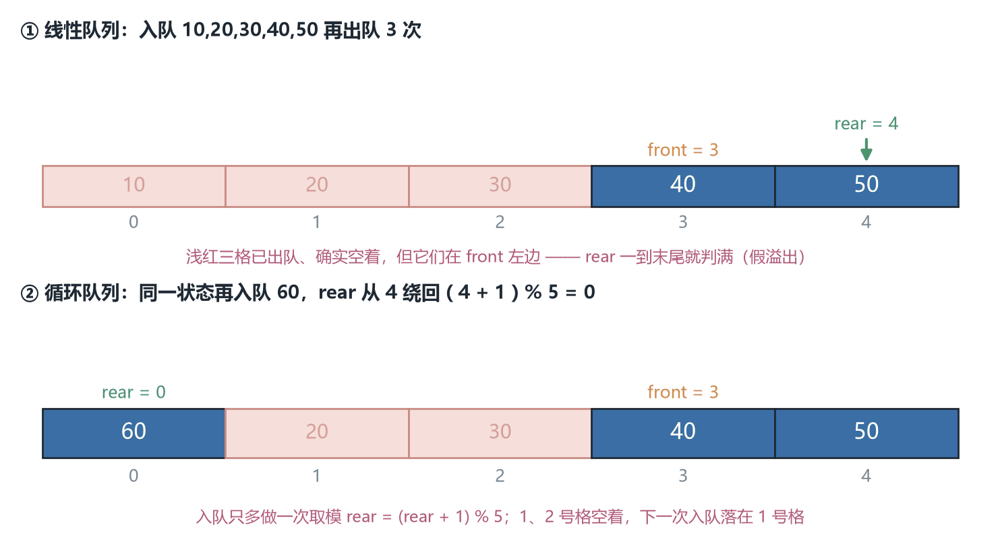
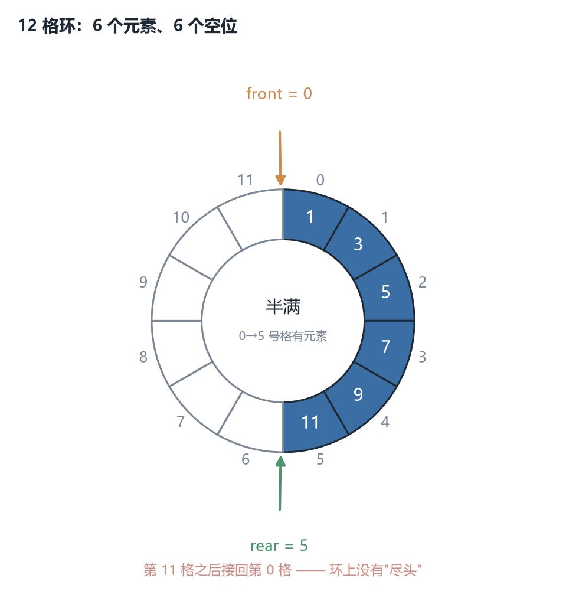
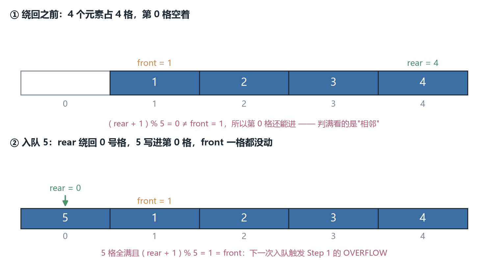
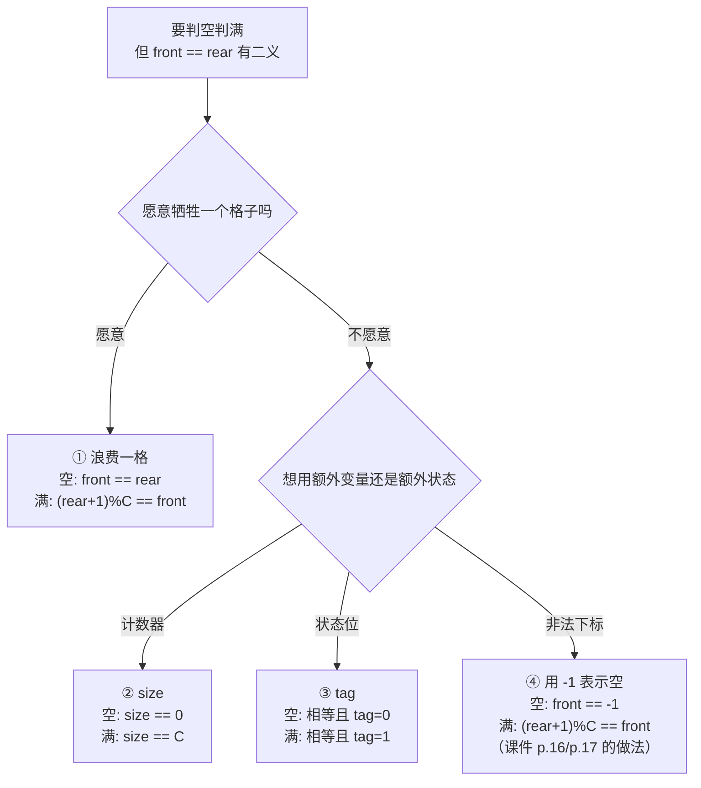
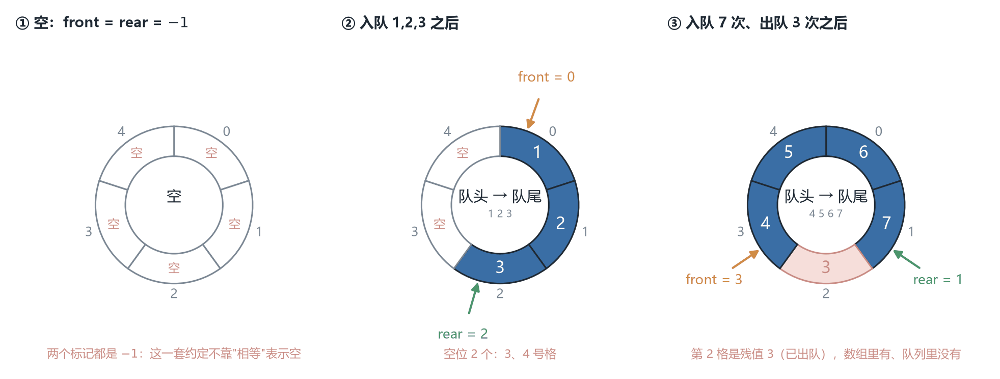
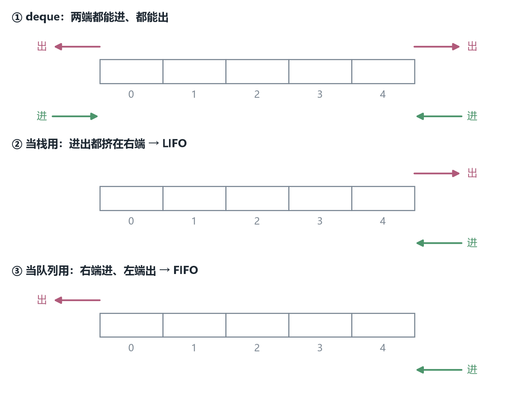
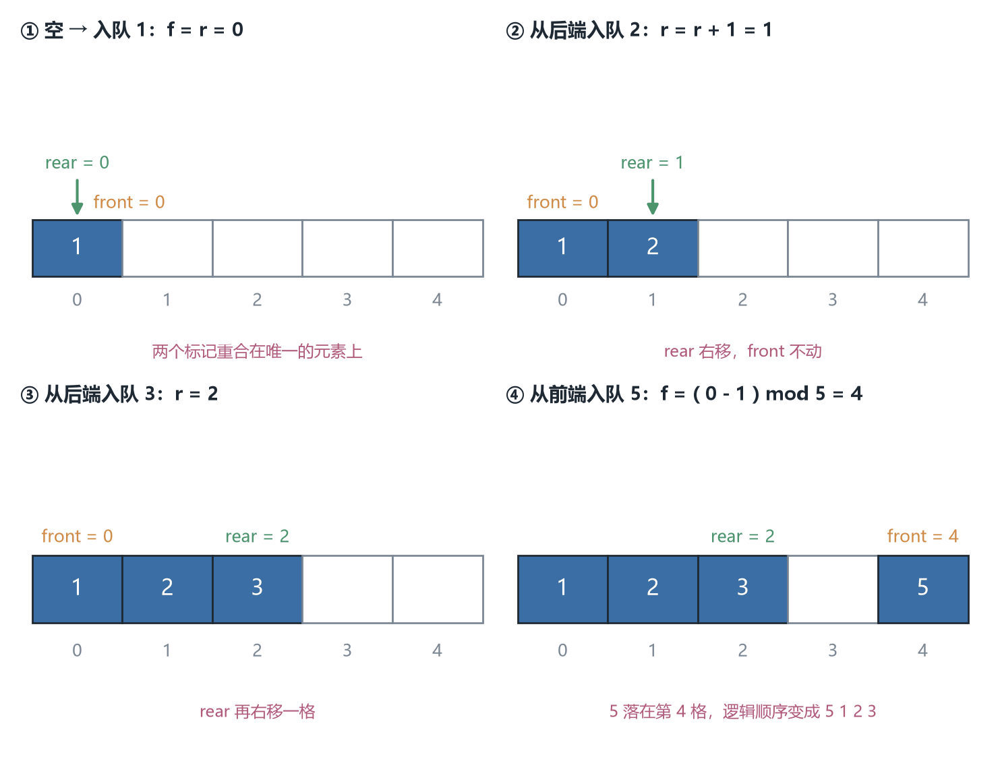
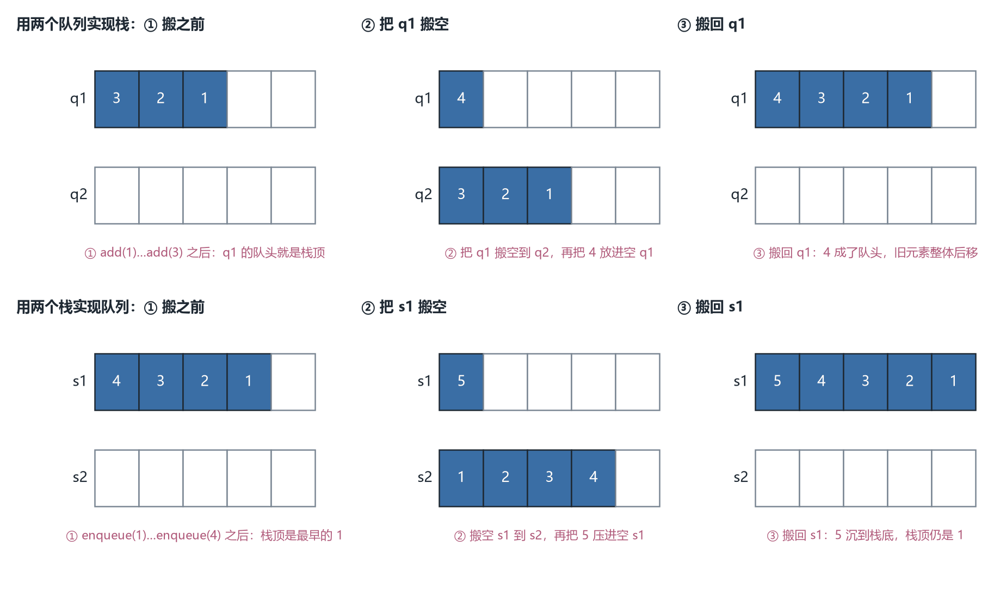

# CSC3100 Lecture 10 课堂笔记：Queue（队列）

> **材料构成**：本讲基于课件整理，不含教师口述内容；课件 `lecture 10 (queue).pdf` 共 32 页。这 32 页的文字层只有约 10 K 字符，因为**示意图与 Java 代码基本都以图片形式存在**——所以我把 32 页全部按 170 dpi 渲染成图逐页读过；其中 p.10、p.19、p.28、p.30 四页代码又按 420–900 dpi 分区裁切，逐行核过变量名、花括号与比较运算符。凡是我看不清的地方，文末都写明了，没有靠猜补。
>
> **课件结构**：目录（p.2）→ 现实中的队列（p.3）→ 队列 ADT 与 FIFO（p.4）→ 计算机里的应用（p.5）→ 线性队列的四步演示（p.6）→ 两条实现路线（p.7）→ 链表的三个操作（p.8）→ isEmpty / isFull（p.9）→ 链表实现的 Java 代码与输出（p.10）→ 数组实现的字段与两条规则（p.11）→ "假溢出"与两条解法（p.12）→ 循环队列的定义（p.13）→ 为什么要绕回去（p.14）→ 循环队列的应用（p.15）→ 入队伪代码（p.16）→ 出队伪代码（p.17）→ 一个完整的数字例子（p.18）→ 循环队列的 Java 实现（p.19）→ 优先队列（p.20-22）→ 双端队列（p.23-27）→ 两道练习（p.28-31）→ 阅读与下一讲（p.32）。
>
> **已知课件问题**：p.28 的练习里 `for (int i = 0; i <= keys.length; i++)` 把 5 个元素当成 6 个来取，多出的那一次会打出一行 "Underflow!" 并直接结束程序；p.8 的 `enqueue` 伪代码写作 `insert(Q.L, e)`，与 L7 那个"按位置插入"的 `insert(x, p)` 对不上，而且全页没有提"尾指针"；p.11、p.16、p.19 三处对 `front` 的含义各说一套。其余几条（`createQueue` 的 `capacity` 参数从未使用、p.12 承诺的 length 变量从未出现、p.19 的数组写死 100）都在文末「附：诚实备注」里逐条列出，并注明我凭什么这么判。
>
> **来源标注约定**：正文里凡以补充类 alert（NOTE / TIP / IMPORTANT / CAUTION）呈现的内容，都是课件没有、由我补充或推导的内容（包括七张配图、一张流程图与全部复算）；没有标注的，都是课件上写着的。页码一律指课件页码（与 PDF 阅读器页码一致）。

## 0. 一句话概括本讲在讲什么

上一讲把<b>栈（stack）</b>讲完了：只能在一端进出，因此<b>最近进来的先出去</b>（Last-In-First-Out, LIFO）。这一讲讲它的对偶——<b>队列（queue）</b>：在一端进、另一端出，因此<b>最早进来的先出去</b>（First-In-First-Out, FIFO）。两者的接口一样小（队列只有 enqueue / dequeue 两个更新），两个操作都一样是 $O(1)$，但它们对应的是两类完全不同的现实问题：栈对应"回退、嵌套、撤销"，队列对应"排队、缓冲、调度"。

但本讲真正的难点不在定义，而在**实现**——具体说，是一个栈根本不会遇到的麻烦：

用数组存队列时，`front` 和 `rear` 都只会**往后走**。出队 100 次之后，`front` 前面留下了 100 个空位，可它们永远回不来：`rear` 一到数组末尾，队列就"满"了，尽管数组大部分是空的。这个现象叫**假溢出（false overflow）**，本讲一半的篇幅（p.11 到 p.19，九页）都在解决它，答案是**循环队列（circular queue）**——让下标到末尾之后绕回 0，也就是把数组当成一个环来用。

绕回去只改了一行取模，却立刻带来一个新问题：`front == rear` 到底表示"空"还是"满"？这一个问题在教材里能引出四五种写法，而课件在 p.11、p.16、p.19 三页分别用了三种不同的约定——这正是本讲最容易埋下 off-by-one 的地方，也是本文 §7.3 与 §9 要逐格对账的原因。

一句话：**栈与队列的接口只差一个"从哪一头取"，但队列的数组实现必须回答"空位怎么回收"；循环队列用一个取模换来空间的复用，代价是"空/满"的判据必须重新定义。**

## 1. 从"公平"到 FIFO：队列是什么（p.2-4）

### 1.1 先看两个现实场景（p.3）

课件 p.3 放了两张图，各配一句话：

> 商店里排队买东西的顾客队列，**先来的先被服务**（the customer that came first is served first）。
>
> 公交站排队上车的学生的队列，**先来的先上车**（the student that came first gets on first）。

这两句话里真正关键的不是"排队"，而是**先来的先被服务这条规则**。队列这个数据结构存在的理由，就是把这件在人类社会里靠"道德与秩序"维持的事，变成一条机器可以无条件执行的规则。它要保证的是**公平性（fairness）**：没有任何一个元素可以插队，也没有任何一个元素会被无限期地饿死——只要它进了队，它前面的人迟早会被处理完。

这一点值得多想一秒钟，因为它解释了为什么队列在操作系统里无处不在：**当你没有办法让所有人都立刻被服务时，"按到达顺序服务"是最容易证明其正确性、也最容易向用户交代的调度策略**。CPU 调度、打印机、网络包转发，用的都是这条规则（或它的变体）。

### 1.2 队列 ADT：两个"受限更新"（p.4）

队列 ADT 的定义（p.4）与上一讲栈几乎逐字相同，只是把 Push/Pop 换成了 Enqueue/Dequeue：

> A queue stores a set $S$ of elements that have **two constrained updates**:
> - `Enqueue(e)`: insert a new element $e$ into $S$
> - `Dequeue()`: remove the **least recently inserted** element from $S$, and return it

然后是那两条性质：

> Queue follows **First-In-First-Out (FIFO)**: the first element being enqueued into a queue is the first element dequeued.
>
> We add from one end, called the **rear**, and delete from the other end, called the **front**.

逐句拆开。

**"two constrained updates"（两个受限的更新）**——这个词组是整段定义里最要紧的。它说的不是"队列有两个操作"，而是"队列**只允许**这两种改动"。你不能在第 3 个元素前面插一个、不能把中间某个元素改掉、不能按下标取第 5 个。一个数据结构允许的操作越少，它能给出的保证就越强，实现也就越便宜——这就是队列两个操作都能做到 $O(1)$ 的根本原因（§1.3 展开）。

**"the least recently inserted"（最近最少被插入的，也就是最早进来的）**——注意这个措辞：它用的是"最久没被插入"而不是"最早被插入"。两者在队列里是同一件事，但这个说法暗示了一种更一般的视角：**按"多久没被碰过"排序**。这个视角在缓存淘汰（LRU）里会再次出现；队列是它最简单的一种（只按插入时间排，不因为被访问而提前）。

**FIFO 与 rear/front**——这两句是同一个事实的两种说法：FIFO 说的是**语义**（谁先出），rear/front 说的是**几何**（从哪进、从哪出）。语义与几何在这里是等价的，因为"只在一端进、另一端出"恰好能保证"先进先出"：设元素按 $e_1, e_2, \ldots, e_n$ 的顺序从 rear 进入，那么它们离开 front 的顺序必然是 $e_1, e_2, \ldots, e_n$。

定义旁边的示意图把这件事画成了一条彩色的横条：左端标 `Dequeue (Deletion)` 与 `Front`，右端标 `Enqueue (Insertion)` 与 `Rear`，中间四五个色块表示元素。**这张图是全讲所有实现的总纲**：后面无论用链表还是数组，画的都只是"怎么把这条横条塞进内存"。

> [!NOTE] 补充：为什么"受限"反而是优点
> 这句话听起来反直觉：一个数据结构能做的事越少，怎么会越好？理由是**约束换来的是可预测性**。一个普通的表（L7 的 List）允许在任意位置插入删除，于是每个操作都要考虑"位置在哪、前驱是谁"，代价是 $O(n)$；队列砍掉了"任意位置"这个自由度，于是"插入点"永远固定在 rear、"删除点"永远固定在 front，两个位置都可以用一个变量直接记住，操作就变成了 $O(1)$。

这条思路在本课程里会反复出现：栈砍掉了"另一端"，队列砍掉了"中间"，后面讲优先队列时砍掉的是"顺序由到达时间决定"（改成由优先级决定）。**每砍掉一个自由度，就换来一类操作变便宜。**

### 1.3 栈与队列：一对只差一个字的孪生结构

> [!NOTE] 补充
> 本节为补充内容：这张对照表与下面的分析由笔记整理，课件未讲。

把 L9 的栈定义与 p.4 的队列定义并排放，会发现它们几乎是同一个模板填出来的：

| | 栈（L9 p.4） | 队列（本讲 p.4） |
| --- | --- | --- |
| 存储的是什么 | a set $S$ of elements | a set $S$ of elements |
| 更新的数量 | two constrained updates | two constrained updates |
| 加入 | `Push(e)`: add a new element to $S$ | `Enqueue(e)`: insert a new element into $S$ |
| 取出 | `Pop()`: removes the **most recently** added element | `Dequeue()`: remove the **least recently inserted** element |
| 顺序性质 | LIFO | FIFO |
| 几何图像 | 只在一端（top）进出 | 一端进（rear）、另一端出（front） |
| 两个操作代价 | 均为 $O(1)$ | 均为 $O(1)$ |

差别只有一处：**取出的是"最近"还是"最久"**。但这一处差别让两者的实现难度完全不同：

- 栈的两个操作都发生在**同一端**，所以只需要一个标记（`top` 或 `head.next`）就够；
- 队列的两个操作发生在**两端**，所以数组实现需要两个标记（`front` 与 `rear`），链表实现需要两个引用（`head`，以及一个指向表尾的 `tail` 或 `rear`）——**而这个"第二个引用"正是本讲链表实现的核心（§4.2）**。

换句话说，队列比栈多出来的那一点点复杂度，全部来自"两端"这两个字。

## 2. 队列在计算机里用在哪（p.5）

应用一共三类（p.5），配了三张图标（MP3、Windows 徽标、打印机）：

**作为缓冲区（buffer）**：MP3 播放器、CD 播放器等等。课件说的是"用来维护媒体播放器里的播放列表，以便往列表里加歌、从列表里删歌"（used to maintain the play list in media players in order to add and remove the songs from the play-list）。

**用在操作系统里（used in OS）**：多个数据传输任务（multiple data transmission tasks）；调度 CPU、GPU 这类共享资源（scheduling shared resources like CPU and GPU）。

**打印机**：假设有一台打印机被多个用户共享，一次只能服务一个请求。任何打印请求到来时，如果打印机正忙，请求就进入队列；打印机空闲时，从队列里取一个请求来处理。

第三类值得展开，因为它是"队列作为缓冲"的最小完整模型：

- **到达**（arrival）：请求随时可能来，速度不可控；
- **服务**（service）：打印机一次只能处理一个，速度基本固定；
- **队列**：夹在两者之间，把"到达速率"与"服务速率"解耦。

> [!NOTE] 补充：队列把"拒绝"变成"等待"
> 如果到达比服务快，没有队列的话，第二个请求只能被拒绝（或者把打印机"卡住"）；有了队列，请求可以先存着，等打印机空出来再处理——**队列把"拒绝"变成了"等待"**。

但这句话有个前提：**队列必须是有限的**。如果到达速率长期大于服务速率，队列会一直变长，最终把内存吃光。所以真实的缓冲区长这样：队列满了就丢包（网络）或拒绝任务（线程池）。这也解释了为什么"队列长度"是一个重要的工程指标——它直接等于**排队延迟**：队列越长，新来的请求要等越久。**队列不是免费的午餐，它只是把"立刻失败"换成了"稍后成功"，代价是延迟与内存。**

> [!NOTE] 补充：播放列表其实不是队列
> 课件把"维护播放列表"算作队列的应用，但严格说播放列表允许"下一首""上一首""随机播放""从中间删一首"，并不遵守 FIFO——它更接近 L7 的双向链表。真正用队列的是**流媒体缓冲**：解码器把数据按顺序放进缓冲、播放器按同样顺序取出，这里才有严格的 FIFO 与"生产者—消费者"关系。本文按课件原文记录这条应用，但读者不必把它当成队列的典型例子。

## 3. 线性队列：一条不回头的线（p.6-7）

### 3.1 四步演示（p.6）

这一页先用一句话定性（p.6）：

> A **linear queue** is generally referred to as queue, or a linear data structure that follows the FIFO.

然后用一个四步的例子演示：队列 $Q$ 里最初只有一个元素 `A`，依次执行

1. `Enqueue 'B'`
2. `Enqueue 'C'`
3. `Dequeue`

四步的格子与标记是：

| 状态 | 格子内容 | front 指向 | rear 指向 | 说明 |
| --- | --- | --- | --- | --- |
| 初始 | `A` | A | A | 只有一个元素，front 与 rear 重合 |
| 入队 B | `A B` | A | B | rear 右移一格 |
| 入队 C | `A B C` | A | C | rear 再右移一格 |
| 出队 | `B C` | B | C | front 右移一格，返回 `A` |

这个例子里藏着一个后面会一直用到的观察：**`front` 与 `rear` 重合不一定是空队列**——初始状态它们就重合在一个元素上。这个"重合"的歧义在循环队列里会变成"判空还是判满"的死结（§7.3）。

还有一个细节值得指出：**出队之后，`A` 所在的那一格就再也用不上了**。这是"线性队列"这个名字的另一层含义——所有下标只增不减，队列在数组里像一个只会向前爬的窗口。§5.2 的图 1 会把这个现象画成正式的图。

### 3.2 两条实现路线（p.7）

两条实现路线（p.7）只有两行：

> How to implement queues?
> - Option 1: Linked list
> - Option 2: Arrays

与 L9 的栈完全一样的两条路线。选哪条，取决于你更怕什么：链表怕指针开销与缓存不友好（L7 §2.3 算过这笔账），数组怕容量固定与"假溢出"。本讲后面会看到，**队列在数组上的麻烦比栈大得多**——因为栈只在一端动，`top` 一直加就行，加到头就真的满了；队列在两端动，`front` 扫过的空间白白浪费。

> [!NOTE] 补充："线性"指的是下标单调
> 英文 linear queue 里的 linear 不是"线性表"的线性，而是"**下标单调**"的意思：`front` 与 `rear` 在整个生命周期里只增不减，元素在数组中的位置随时间是单调右移的。循环队列打破的正是这一点——它让下标在到达末尾后回到 0，于是窗口可以永远向前滚。所以"循环队列"不是另一种数据结构，它只是**给同一个队列换了一套下标运算**。

## 4. 链表实现：为什么必须多存一个尾指针（p.8-10）

### 4.1 三个操作的伪代码（p.8）

链表版（p.8）用的是一条**带哨兵结点的单链表**（L7 §10.3）：`Q.L` 是那条链，`Q.L.head` 是哨兵，真正的第一个元素在 `Q.L.head.next`。三个操作分别是：

三个操作都保留课件伪代码原文，不改成四语言：这段伪代码本身就是诚实备注第 2 条的考点（`insert(Q.L, e)` 少了位置参数），而且依赖课件没有给出的 List ADT。

```text
Algorithm: createQueue(capacity)
1  Q <- allocate new memory for queue
2  Q.L <- allocate new memory for list
3  return Q

Algorithm: enqueue(Q, e)
1  insert(Q.L, e)

Algorithm: dequeue(Q)
1  if isEmpty(Q.L) error "Queue empty"
2  frontNode = Q.L.head.next
3  frontElement = frontNode.element
4  delete(Q.L, frontNode)
5  return frontElement
```

三句话的说明（课件正文）：

> **createQueue**: create a linked list $L$
> **enqueue**: add $e$ to the end of the linked list
> **dequeue**: retrieve the first element, i.e., $L.head.next.element$, and delete the first node, i.e., $L.head.next$.

逐条看。

**`createQueue(capacity)` 里的 `capacity` 一次都没用到。** 链表不需要预先定容量，这是它的优点（L7 §2.3），所以这个参数是多余的——它是从数组实现那边抄过来的签名。同一页 p.9 又说 `isFull` 永远返回 false，两处合起来才自洽：**链表队列没有"满"这个概念**。

**`enqueue` 的语义是"加到链表的末尾"。** 注意课件正文与伪代码在这里有一个落差：正文说得很清楚是 the end，但伪代码只有一句 `insert(Q.L, e)`，**没有说插到哪个位置**。而 L7 的 `insert` 签名是 `insert(int x, int p)`——需要第二个参数 `p` 表示位置。这里 `Q.L` 是链表、`e` 是元素，位置参数根本不在。这一处不一致的后果很实际：**照这句伪代码写出来的代码，enqueue 是 $O(n)$ 的**（理由见 §4.2）。文末诚实备注第 2 条把这一点记全了。

**`dequeue` 为什么是 $O(1)$。** 它取的是 `Q.L.head.next`——哨兵的**下一个**结点。这个位置的好处是：要删掉它，需要改的是"它的前驱"的 `next`，而它的前驱**就是哨兵**，我们手里一直有哨兵的引用。所以删除不需要遍历。这正是 L7 §10.3 讲哨兵时说的"把表头这个特例消掉"：**在有哨兵的链表里，"删除第一个元素"和"删除中间某个元素"是同一段代码**。

### 4.2 尾指针：本讲最容易漏讲的一点

> [!NOTE] 补充：尾指针为什么必需
> 这一小节补的是课件**从头到尾没有明说、但 p.10 那份 Java 实现不得不做**的一件事。

**问题**：队列要求"从 rear 进"。在链表里，rear 就是表尾。那么"把新结点挂到表尾"要几步？

如果这条链**只有 `head`（哨兵）一个入口**，答案是：必须先从头走到最后一个结点，再改它的 `next`。走这一趟要访问 $n$ 个结点，所以

$$\text{enqueue} = O(n)$$

而 dequeue 是 $O(1)$。一个"半个操作 $O(1)$、半个操作 $O(n)$"的队列，是不能用的——队列的每一次入队都要扫全表，$10^6$ 个元素时一次入队要走一百万步。

**解法**：多存一个指向表尾的引用，课件里叫 `rear`（p.10 的 Java 就是这么写的）。于是入队变成三行：

::: code-group

```java [Java]
Node node = new Node(item);   // 新结点的 next 已经是 null（构造器保证）
rear.next = node;             // 旧尾巴指向新结点
rear = node;                  // rear 自己前移
```

```python [Python]
node = Node(item)             # 新结点的 next 已经是 None（构造器保证）
rear.next = node              # 旧尾巴指向新结点
rear = node                   # rear 自己前移
```

```cpp [C++]
Node* node = new Node(item);  // 新结点的 next 已经是 nullptr（构造器保证）
rear->next = node;            // 旧尾巴指向新结点
rear = node;                  // rear 自己前移
```

```c [C]
#include <stdlib.h>

Node* node = malloc(sizeof(Node));   // C 没有构造器：手工开结点、填两个字段
node->data = item; node->next = NULL;
rear->next = node;            // 旧尾巴指向新结点
rear = node;                  // rear 自己前移
```

:::

三步，与队列长度无关，所以是 $O(1)$。

**代价是什么？** 单链表加了尾指针之后，"在表尾删除"仍然是 $O(n)$（要改 `rear` 的前一个结点的 `next`，而单链表回不去——L7 §7.3）。但队列**从不从 rear 删除**，它只从 front 删除。所以这笔代价对队列来说是**白拿的**：多加 4 个字节，换来 enqueue 从 $O(n)$ 降到 $O(1)$，而且永远用不到它的缺点。

**这就是"队列 = 链表 + 尾指针"这句话的全部内容。** 课件自始至终没有把这句话正面写出来：伪代码（p.8）里没有，Java（p.10）里写了代码但没有解释。本文把它补在这里，是因为**没有这句话，读者会以为 p.8 那个 `insert(Q.L, e)` 真的能 $O(1)$ 完成**。

**还有一个必须点出的坑：队列空了以后，尾指针必须重置。**

想象队列里只剩一个元素，执行 dequeue：

::: code-group

```java [Java]
Node temp = front;
front = front.next;        // front 变成 null —— 队列空了
if (front == null) {
    rear = null;           // 关键：把 rear 也清掉
}
```

```python [Python]
temp = front
front = front.next            # front 变成 None —— 队列空了
if front is None:
    rear = None               # 关键：把 rear 也清掉
```

```cpp [C++]
Node* temp = front;
front = front->next;          // front 变成 nullptr —— 队列空了
if (front == nullptr) {
    rear = nullptr;           // 关键：把 rear 也清掉
}
```

```c [C]
Node* temp = front;
front = front->next;          // front 变成 NULL —— 队列空了
if (front == NULL) {
    rear = NULL;              // 关键：把 rear 也清掉
}
```

:::

如果不写 `rear = null`，`rear` 仍然指着那个刚被摘下来的结点。这不只是"野引用"的洁癖问题，在这份代码里它会**直接造成故障**：p.10 的 `isEmpty()` 写的是

::: code-group

```java [Java]
return rear == null && front == null;
```

```python [Python]
return rear is None and front is None
```

```cpp [C++]
return rear == nullptr && front == nullptr;
```

```c [C]
return rear == NULL && front == NULL;
```

:::

`front` 已经是 `null` 了，但 `rear` 还非空，于是 `isEmpty()` 返回 **false**——队列明明是空的，它却说不空。下一次 dequeue 就会执行 `Node temp = front;` 拿到 `null`，再 `temp.data` 就抛 `NullPointerException`。

所以那两行 `if (front == null) { rear = null; }` 不是可选的保险，而是 **`isEmpty()` 能正确工作的前提**。这是本讲链表实现里唯一一处"不写就崩"的地方。

### 4.3 判空与判满（p.9）

这一页只有两行（p.9）：

> **isEmpty**: return true if the linked list is empty, otherwise return false
> **isFull**: always return NO

这两行同样保留伪代码：`isEmpty` 只是转发给链表的 `isEmpty`，而那个链表 ADT 的方法体课件没给，改写成真码就得替课件补一整套链表。

```text
Algorithm: isEmpty(Q)
1  return isEmpty(Q.L)

Algorithm: isFull(Q)
1  return false
```

`isEmpty(Q)` 只是把判断转发给链表自己的 `isEmpty`，所以它的代价取决于链表怎么判空（有哨兵时是 `head.next == null`，$O(1)$）。

`isFull` 永远返回 false，因为链表可以一直 `new Node` 下去，理论上没有上限。

> [!CAUTION] 注意：没有上限等于上限是内存
> **但"没有上限"在工程上等于"上限是内存"**：一个不设上限的队列在生产者快于消费者时会一直吃内存，直到 OOM。真实的实现要么给一个容量上限（满了拒绝或阻塞），要么把队列落到磁盘（消息队列）。课件这一行是**数据结构层面**的正确答案，不是**系统层面**的正确答案，两者不要混。

顺带说一句：p.9 的 `isFull` 与 p.8 的 `createQueue(capacity)` 是矛盾的——既然永远不满，`capacity` 是干什么用的？这是课件前后没有对齐的一处（诚实备注第 3 条）。

### 4.4 Java 实现与输出（p.10）

完整的 Java 实现（p.10）有 47 行主体，另有 `peek` / `isEmpty` / `main` 与运行输出。我按 420 dpi 分区裁切核过每一行（缩进按原文，行号是原图的行号）：

::: code-group

```java [Java]
// A Linked List Node
class Node {
    int data;            // integer data
    Node next;           // pointer to the next node
    public Node(int data) {
        // set data in the allocated node and return it
        this.data = data;
        this.next = null;
    }
}

class Queue {
    private static Node rear = null, front = null;

    // Utility function to dequeue the front element
    public static int dequeue() {       // delete at the beginning
        if (front == null) {
            System.out.print("\nQueue Underflow");
            System.exit(1);
        }
        Node temp = front;
        System.out.printf("Removing %d\n", temp.data);
        // advance front to the next node
        front = front.next;
        // if the list becomes empty
        if (front == null) {
            rear = null;
        }
        // deallocate the memory of the removed node and
        // optionally return the removed item
        int item = temp.data;
        return item;
    }

    // Utility function to add an item to the queue
    public static void enqueue(int item) {   // insertion at the end
        // allocate a new node in a heap
        Node node = new Node(item);
        System.out.printf("Inserting %d\n", item);
        // special case: queue was empty
        if (front == null) {
            // initialize both front and rear
            front = node;
            rear = node;
        } else {
            // update rear
            rear.next = node;
            rear = node;
        }
    }

    // Utility function to return the top element in a queue
    public static int peek() {
        // check for an empty queue
        if (front != null) {
            return front.data;
        } else {
            System.exit(1);
        }
        return -1;
    }

    // Utility function to check if the queue is empty or not
    public static boolean isEmpty() {
        return rear == null && front == null;
    }
}

class Main {
    public static void main(String[] args) {
        Queue q = new Queue();
        q.enqueue(1);
        q.enqueue(2);
        q.enqueue(3);
        q.enqueue(4);
        System.out.printf("The front element is %d\n", q.peek());
        q.dequeue();
        q.dequeue();
        q.dequeue();
        q.dequeue();
        if (q.isEmpty()) {
            System.out.print("The queue is empty");
        } else {
            System.out.print("The queue is not empty");
        }
    }
}
```

```python [Python]
import sys


# A Linked List Node
class Node:
    def __init__(self, data):
        self.data = data
        self.next = None


class Queue:
    rear = None                  # 对应 Java 的 static 字段：这里只有一份队列
    front = None

    @staticmethod
    def dequeue():
        if Queue.front is None:
            print("\nQueue Underflow", end="")
            sys.exit(1)
        temp = Queue.front
        print("Removing %d" % temp.data)
        Queue.front = Queue.front.next
        if Queue.front is None:
            Queue.rear = None
        item = temp.data
        return item

    @staticmethod
    def enqueue(item):
        node = Node(item)
        print("Inserting %d" % item)
        if Queue.front is None:
            Queue.front = node
            Queue.rear = node
        else:
            Queue.rear.next = node
            Queue.rear = node

    @staticmethod
    def peek():
        if Queue.front is not None:
            return Queue.front.data
        sys.exit(1)
        return -1                # 与 Java 版一样：这一行永远执行不到

    @staticmethod
    def is_empty():
        return Queue.rear is None and Queue.front is None


def main():
    Queue.enqueue(1)
    Queue.enqueue(2)
    Queue.enqueue(3)
    Queue.enqueue(4)
    print("The front element is %d" % Queue.peek())
    Queue.dequeue()
    Queue.dequeue()
    Queue.dequeue()
    Queue.dequeue()
    print("The queue is empty" if Queue.is_empty() else "The queue is not empty", end="")


if __name__ == "__main__":
    main()
```

```cpp [C++]
#include <cstdio>
#include <cstdlib>

// A Linked List Node
struct Node {
    int data;
    Node* next;
    Node(int data) : data(data), next(nullptr) {}   // 新结点的 next 恒为 nullptr
};

class Queue {
    static Node* rear;
    static Node* front;
public:
    static int dequeue() {
        if (front == nullptr) {
            printf("\nQueue Underflow");
            exit(1);                                 // 对应 Java 的 System.exit(1)
        }
        Node* temp = front;
        printf("Removing %d\n", temp->data);
        front = front->next;
        if (front == nullptr) {
            rear = nullptr;
        }
        int item = temp->data;
        delete temp;                                 // C++ 没有 GC，摘下的结点要自己回收
        return item;
    }

    static void enqueue(int item) {
        Node* node = new Node(item);
        printf("Inserting %d\n", item);
        if (front == nullptr) {
            front = node;
            rear = node;
        } else {
            rear->next = node;
            rear = node;
        }
    }

    static int peek() {
        if (front != nullptr) {
            return front->data;
        } else {
            exit(1);
        }
        return -1;
    }

    static bool isEmpty() {
        return rear == nullptr && front == nullptr;
    }
};

Node* Queue::rear = nullptr;
Node* Queue::front = nullptr;

int main() {
    Queue q;
    q.enqueue(1);
    q.enqueue(2);
    q.enqueue(3);
    q.enqueue(4);
    printf("The front element is %d\n", q.peek());
    q.dequeue();
    q.dequeue();
    q.dequeue();
    q.dequeue();
    if (q.isEmpty()) {
        printf("The queue is empty");
    } else {
        printf("The queue is not empty");
    }
    return 0;
}
```

```c [C]
#include <stdio.h>
#include <stdlib.h>
#include <stdbool.h>

// A Linked List Node
typedef struct Node {
    int data;
    struct Node* next;
} Node;

static Node* rear = NULL;
static Node* front = NULL;

static Node* nodeNew(int data) {
    Node* n = malloc(sizeof(Node));
    n->data = data;
    n->next = NULL;              // 新结点的 next 恒为 NULL
    return n;
}

int dequeue(void) {
    if (front == NULL) {
        printf("\nQueue Underflow");
        exit(1);                 // 对应 Java 的 System.exit(1)
    }
    Node* temp = front;
    printf("Removing %d\n", temp->data);
    front = front->next;
    if (front == NULL) {
        rear = NULL;
    }
    int item = temp->data;
    free(temp);                  // C 没有 GC，摘下的结点要自己 free
    return item;
}

void enqueue(int item) {
    Node* node = nodeNew(item);
    printf("Inserting %d\n", item);
    if (front == NULL) {
        front = node;
        rear = node;
    } else {
        rear->next = node;
        rear = node;
    }
}

int peek(void) {
    if (front != NULL) {
        return front->data;
    } else {
        exit(1);
    }
    return -1;
}

bool isEmpty(void) {
    return rear == NULL && front == NULL;
}

int main(void) {
    enqueue(1);
    enqueue(2);
    enqueue(3);
    enqueue(4);
    printf("The front element is %d\n", peek());
    dequeue();
    dequeue();
    dequeue();
    dequeue();
    if (isEmpty()) {
        printf("The queue is empty");
    } else {
        printf("The queue is not empty");
    }
    return 0;
}
```

:::

这段程序的运行输出（p.10）是：

```text
Inserting 1
Inserting 2
Inserting 3
Inserting 4
The front element is 1
Removing 1
Removing 2
Removing 3
Removing 4
The queue is empty
```

逐段看。

**`private static Node rear = null, front = null;`** 一句声明两个引用，都初始化为 `null`。`front` 指向队头结点（注意：**这里没有哨兵**），`rear` 指向队尾结点。空队列时两个都是 `null`——这就是 §4.2 那条不变式的另一半：**空 ⟺ 两个都 null**。

> [!NOTE] 补充：为什么字段是 static 的
> Java 里 `static` 字段属于类而不属于对象，所以所有 `Queue` 实例共用同一份 `front`/`rear`。这份代码里只有一个 `q`，所以看不出问题；但如果你 `new Queue()` 两次，两个队列会互相串。更麻烦的是 `enqueue` / `dequeue` / `peek` / `isEmpty` 也都是 `static`：`main` 里 `q.enqueue(1)` 这种写法其实是"通过实例访问静态方法"，`javac` 能编过但会给出警告。正确的写法是把字段与方法都改成非静态，或者干脆全用 `Queue.enqueue(1)`。这是教学代码的简化，不是课件想讲的点，但读的时候要知道。

**`dequeue()` 的第一步是判空。** `if (front == null)` 就打印 "Queue Underflow" 并 `System.exit(1)` 直接退出进程。这是一种很粗暴的错误处理：**调用者拿不到任何返回值，也没法恢复**（在 GUI 或服务器里这样写会直接杀掉整个程序）。更常见的做法是抛异常或返回一个特殊值——p.19 的数组版本就是返回 `-9999`，但那又有别的问题（§9）。

**`Node temp = front;` 与 `front = front.next;`** 这两行是 L7 §7.1 那个"绕过"动作：先把要删的结点存进 `temp`（否则改完 `front` 就找不到了），再让 `front` 跳过它。

**`if (front == null) { rear = null; }`** 就是 §4.2 讲的那两行，**不能省**。

**`int item = temp.data; return item;`** 返回被删元素的值。注意 `temp.next` 没有被清空——不需要，因为没有任何活变量再指向它（`front` 已经跳过、`temp` 即将出作用域），垃圾回收器会处理（L7 §7.1）。

**`enqueue()` 的空表分支**：`if (front == null) { front = node; rear = node; }`。这一支同时初始化两个引用。注意它用的判据是 `front == null`，而不是 `rear == null`——两者在正确维护的前提下等价（§4.2 说了为什么必须等价）。

**非空分支三行**：`rear.next = node; rear = node;` 加上构造器已经置好的 `node.next = null`，正好是 §4.2 那三步。**顺序不能反**：先让旧尾巴指向新结点，再移动 `rear`；反过来的话，`rear` 已经指向新结点，`rear.next = node` 就变成"新结点指向自己"，造出一个自环，同时旧尾巴与整条链断开（这与 L7 §6.2 的"先接新的、再断旧的"是同一条规则）。

**`peek()` 里的 `return -1;`** 看起来像是"空队列时返回 -1"，其实**永远执行不到**：`if` 分支里 `return`，`else` 分支里 `System.exit(1)`，两条路都不落到最后一行。它存在只是因为 Java 要求"所有路径都要有返回值"，编译器看到 `else` 里只是调了一个方法、不知道它会退出，所以要求补一句。

> [!TIP] 技巧：不可达的 return
> **这种"不可达的 return"在 Java 里很常见**，读代码时不要把它当成"空队列返回 -1"的语义。

**`main` 的顺序**：入队 1、2、3、4 → 打印队头（1）→ 出队 4 次 → 判空。输出与我按代码手推的结果完全一致：入队顺序 1→4，出队顺序也是 1→4，**这就是 FIFO 的直接证据**（对照 L9 的栈，同样的输入会输出 4→1）。

### 4.5 两种链表实现其实是两份不同的设计（p.8 与 p.10 的对照）

把 p.8 的伪代码与 p.10 的 Java 放在一起看，会发现它们对"队头在哪"的回答并不相同：

| | p.8 的伪代码 | p.10 的 Java |
| --- | --- | --- |
| 有没有哨兵 | **有**（`Q.L.head` 是哨兵，队头是 `head.next`） | **没有**（`front` 直接指队头） |
| 空队列怎么表示 | `Q.L` 为空（`head.next == null`） | `front == null && rear == null` |
| 队头怎么取 | `Q.L.head.next.element` | `front.data` |
| 删除队头要改谁 | 哨兵的 `next` | `front` 这个变量本身 |
| 尾指针 | 全文没提 | `rear` |
| 代价 | 多一个哨兵结点，但删除逻辑统一 | 省一个结点，但"删队头"要单独处理 `front` 变量 |

> [!NOTE] 补充：哪一种更好
> 从 L7 §10.3 的结论看，**哨兵版更稳**：它把"删第一个"变成"删哨兵的下一个"，与"删中间"是同一段代码，于是"队列空了"这种边界只在一个地方出现。p.10 的版本省了一个结点，但代价是 `front` 这个变量本身要参与修改——而"改变量"和"改对象"在 L7 §3.3 里被专门提醒过是最容易混的两件事。

不过就本讲的教学意图而言，p.10 的版本更直观：`front` 与 `rear` 两个名字与 p.6 的示意图一一对应，读者不用先在脑子里把"哨兵"这一层剥掉。**两份代码不是谁对谁错，是同一个 ADT 的两种实现**——这恰好是 §1.2 那句"ADT 不规定怎么存"的实例。

### 4.6 链表队列的复杂度

> [!NOTE] 补充：链表队列的复杂度
> 课件没有给这张表（p.8 与 p.9 都只是伪代码）。按 p.10 的实现逐个数：

| 操作 | 做了什么 | 代价 |
| --- | --- | --- |
| `enqueue(e)` | `new Node` + 两次赋值（空表时两次赋值给 front/rear） | $\Theta(1)$ |
| `dequeue()` | 一次判空 + 三次赋值 + 一次返回 | $\Theta(1)$ |
| `peek()` | 一次判空 + 读 `front.data` | $\Theta(1)$ |
| `isEmpty()` | 两次比较 | $\Theta(1)$ |
| `isFull()` | 直接返回 `false` | $\Theta(1)$ |

空间上，每个元素一个 `Node`：4 字节 `data` + 4 字节 `next`（按课件的 4 字节指针假设），加上对象头就是 L7 §2.3 算过的 24 字节。**队列本身只多两个引用（`front`、`rear`），与元素个数无关**——这是链表实现最漂亮的地方：它没有任何"预留"。

对照数组实现：数组版同样每个操作 $O(1)$，但要多付一份"预留"（容量 $C$ 而实际只有 $n$ 个元素，浪费 $C-n$ 格）。所以两者的取舍与 L7 §16 那张表完全一致：**链表赢在"不预留"，数组赢在"每元素更小、且缓存友好"。**

## 5. 数组实现与"假溢出"（p.11-12）

### 5.1 字段与两条操作规则（p.11）

数组版的类骨架（p.11）只有四个字段：

::: code-group

```java [Java]
public class QueueArray {
    int capacity;
    int front, rear;
    ElementType[] array;
}
```

```python [Python]
class QueueArray:
    def __init__(self):
        self.capacity = 0
        self.front = 0
        self.rear = 0
        self.array = []          # Java 侧是 ElementType[]；Python 无类型，什么都能放
```

```cpp [C++]
class QueueArray {
public:
    int capacity;
    int front, rear;
    int* array;                  // 泛型 ElementType[] 退化为 int*
};
```

```c [C]
typedef struct {
    int capacity;
    int front, rear;
    int* array;                  // 泛型 ElementType[] 退化为 int*
} QueueArray;
```

:::

右边是一张示意图：一条 9 格的数组，第 3、4、5、6 格里依次是 `5 2 7 1`，`front` 的箭头指向第 3 格的 `5`，`rear` 的箭头指向第 6 格的 `1`。**左边三格与右边两格都是空的**——这张图就是下一节"假溢出"的伏笔。

下面两条规则是（原文）：

> - To **enqueue** an element X: Increase `rear`, then set `array[rear] = X`
> - To **dequeue** an element: Return the value of `array[front]`, and then increase `front`

这里有三个约定必须一次记牢，否则后面每一个下标都会差一位：

1. **`front` 指向队头元素本身**（不是"队头的前一格"）。证据是 dequeue 的第一句就是 `return array[front]`——先取值，再移动。
2. **`rear` 指向队尾元素本身**（不是"下一个空位"）。证据是 enqueue 的顺序：**先加 `rear`，再写 `array[rear]`**。所以新元素写在"新的 rear"上，rear 永远指着最后一个有效元素。
3. **两个标记都只增不减**，没有任何取模。

> [!IMPORTANT] 重要：初值必须是 $-1$
> p.11 没说。p.16 才给出"初始 `front = rear = -1`"，p.19 的 Java 又给成 `0`。这一点是后面三页互相打架的根源（§7.3、§9、诚实备注第 4 条）。按 p.11 这两条规则的写法，**唯一自洽的初值是 $-1$**：第一次 enqueue 时 `rear` 加一变成 0，写 `array[0]`，正好落在第一格；如果初值是 0，第一次就会写进 `array[1]`，第 0 格永远空着。

按这套约定，队列里的元素就是 `array[front..rear]` 这一段连续区间，元素个数是 $rear - front + 1$。**这个公式只在"没有绕回"时成立**，绕回之后要改成取模（§7.1）。

### 5.2 假溢出：`front` 前面的空位永远用不上（p.12）

这一页（p.12）的标题是 **"Problem: may run out of rooms"**，正文两句：

> If the first several elements are deleted, we cannot insert more elements even though the space is available.

图是这样的：5 格的数组里放着 `10 20 30`（在第 0、1、2 格），`front` 指 10、`rear` 指 30；删除 10 之后，`20 30` 落到第 1、2 格，`front` 也跟着右移到 20。此时**第 0 格空出来了**，第 3、4 格也还空着——一共 3 个空位，但**只要 `rear` 走到第 4 格，队列就会被判定为满**。



*图 1　上半：5 格数组里入队 10,20,30,40,50 再出队 3 次，`front = 3`、`rear = 4`，前三个格子确实空着，可它们在 `front` 左边——线性队列的下标只增不减，这三格永远够不到。下半：循环队列在同一状态再入队 60，`rear` 从 4 绕回 $(4+1) \bmod 5 = 0$，空位立刻被复用。全部下标与数值均由脚本模拟得出。*

这个现象叫**假溢出（false overflow）**：数组明明没满，队列却报告满。原因不在容量，而在**下标是单向的**。

> [!NOTE] 补充：假溢出的定量账
> 设数组容量为 $C$，队列一共入队过 $E$ 次、出队过 $D$ 次，那么 `rear` 的位置是 $E-1$（从 $-1$ 起算），而当前元素个数是 $E-D$。假溢出发生在 $E-1 = C-1$（即 $E = C$）时，此时元素个数只有 $C-D$。取 $C=5$、$D=3$，就得到 p.12 那个例子：`rear` 已经到 4，可队列里只有 $5-3=2$ 个元素，**浪费了 3 格**。极端情况下 $D$ 可以很大，浪费的格子可以接近整个数组——也就是说，**线性队列的"有效容量"会随着出队次数增加而衰减到 0**。

### 5.3 课件给的两条解法（p.12）

> **Two solutions:**
> - Keep `front` always at 0 by shifting the contents up the queue, but this solution is inefficient
> - Use a circular queue (wrap around & use a length variable to keep track of the queue length)

**解法一：搬家。** 每次出队之后，把剩下所有元素整体左移一格，让 `front` 永远停在 0。这样 `rear` 就等价于"元素个数减一"，永不越界。代价是每次出队 $O(n)$ 次赋值——队列本来出队是 $O(1)$，这一搬就退化成了 $O(n)$。课件自己判了"inefficient"，判得对。

**解法二：绕回去。** 让下标到末尾之后回到 0，也就是把数组当成一个环。这是本讲后半段的全部内容。

> [!CAUTION] 注意：length 变量这个坑
> 课件这句话里有个坑：**`use a length variable`**。它把"绕回"与"用一个 length 变量记录长度"并列成同一个解法，但这两件事是**独立的**：

- "绕回"解决的是**下标越界**（`rear` 到末尾之后往哪走）；
- "length 变量"解决的是**判空判满**（绕回之后 `front == rear` 有歧义，见 §7.3）。

也就是说，绕回是**必须**的，length 变量只是**三种判空判满方案之一**。而课件后面 p.16、p.17 的伪代码用的是"$-1$ 表示空"，p.19 的 Java 用的是"浪费一格"，**都没有用 length 变量**。所以这句话的承诺在后文并未兑现（诚实备注第 5 条）。本文 §7.3 会把三种方案并列比较。

## 6. 循环队列：把数组首尾接起来（p.13-15）

### 6.1 定义（p.13）

> All the nodes are represented as circular.
> - Similar to the linear queue except that the **last element is connected to the first one**.
> - A.k.a. **Ring Buffer** as its ends are connected, forming a continuous ring.

> **Drawback of a linear queue is overcome**
> - If the empty space is available in a circular queue, the new element can be added in an empty space by simply incrementing the value of `rear`.



*图 2　p.13 的 12 格环：0 到 5 号格依次是 1、3、5、7、9、11，6 到 11 号格空着，`front = 0`、`rear = 5`——6 个元素、6 个空位，正好半满；第 11 格之后接回第 0 格，环上没有"尽头"。*

这张图想让人一眼看出的是：**环上的每一格地位相同，没有哪一格是"尽头"**。

一句话总结这一页：**循环队列与线性队列的唯一差别是"最后一个格子接回第一个格子"**；结构上只改了这一个箭头，工程上却换来了一整个数组的复用。

### 6.2 为什么必须绕回去（p.14）

紧接着（p.14）用一个 5 格的例子把 p.12 的抽象说法落到具体数字上：

> - In this array, there are only **two** elements and other **three** positions are empty.
> - The `rear` is at the **last position** of the queue.
> - If we try to insert the element, it will show that there are **no empty spaces**.
>
> **Solution**: We can insert the new element in the **first available position**, and update the `rear`.

这个局面与图 1 上半是同一种：5 格数组，第 0、1、2 格空，第 3 格是 `1`，第 4 格是 `2`，`Front = 3`、`Rear = 4`（图 1 里这两个元素是 40 与 50）；而环上第 4 格的下一个就是第 0 格。

这一段的价值在于它把"假溢出"说成了一句大白话：**只有 2 个元素、3 个空位，却插不进去**。原因仅仅是 `rear` 站在了数组的物理末尾。而解法也只有一句：**往"第一个可用的位置"插，也就是第 0 格**，然后把 `rear` 更新成 0。

### 6.3 循环队列用在哪（p.15）

**内存管理（memory management）**：循环队列比线性队列更有效地管理内存，因为它把元素放到"没被用过的位置"（placing the elements in a location which is unused）。

**交通系统（traffic system）**：每个红绿灯按顺序一盏一盏亮，绿灯一分钟、黄灯一分钟、红灯，红灯之后又是绿灯。

> [!NOTE] 补充：这两条要打个折
> 红绿灯其实不存数据，它只是"三个状态按固定顺序循环"，用一个 `state = (state + 1) % 3` 就够，不需要队列。它算作"循环"的直观类比可以，算作队列的应用则勉强。真正典型的环形缓冲（ring buffer）应用是**音频/视频流的缓冲**、**网络包的接收队列**、**生产者—消费者之间的传递**、以及**日志的滚动写入**（写满一圈就覆盖最旧的）。这几样的共同点是：**数据只在两端动、容量固定、旧数据可以被覆盖**——最后一条正是环形缓冲与普通循环队列的差别：普通循环队列满了会拒绝，环形缓冲满了会覆盖。

## 7. 循环队列的入队、出队与"判空还是判满"（p.16-17）

### 7.1 入队：四步伪代码（p.16）

入队的伪代码（p.16）分四步，旁边还有四条要点。

这一段保留伪代码原样：§7.1 逐行拆的就是它的 Step 1–4，改写成真码会把正文引用的步骤编号拆散。

```text
Step 1: IF (REAR+1)%MAX = FRONT
        Write "OVERFLOW"
        Goto step 4
        [End OF IF]

Step 2: IF FRONT = -1 and REAR = -1
        SET FRONT = REAR = 0
        ELSE
        SET REAR = (REAR + 1) % MAX
        [END OF IF]

Step 3: SET QUEUE[REAR] = VAL

Step 4: EXIT
```

右边的四条要点是：

> - First, check whether the queue is **full** or not
> - Initially set both `front` and `rear` to **-1**
> - To insert the **first** element, both `front` and `rear` are set to **0**
> - To insert a new element, the `rear` gets incremented

逐行读。

**Step 1 是"判满"。** 条件是 $(REAR+1) \bmod MAX = FRONT$，意思是"`rear` 的下一格就是 `front`"。这个判据的含义是：**`rear` 不能追上 `front`**——两者一旦相邻（`rear` 在 `front` 前一格），就认为满了。于是环上永远至少有 1 格是空的。

**Step 2 是"分两种情况移动 `rear`"。** 如果两个标记都是 $-1$（空队列），插的是第一个元素，直接把两个都设成 0（元素写在 0 号格）；否则把 `rear` 往前推一格，**并对 `MAX` 取模**——这一句就是"绕回去"。

**Step 3 是"写值"。** 注意它写在 Step 2 **之后**，所以写的是"新的 `rear`"那一格，与 p.11 的"先加后写"一致。

**Step 4 只是出口**（伪代码的写法，Java 里没有对应物）。



*图 3　"绕回去"的那一步（5 格数组）：上幅 4 个元素（1、2、3、4）占 4 格、第 0 格空着，`front = 1`、`rear = 4`；下幅入队 5，`rear` 绕回 0 号格、5 写进第 0 格，`front` 一格没动。此时 5 格全满且 $(rear+1) \bmod 5 = 1 = front$，下一次入队就是 OVERFLOW。*

图 3 演示的正是"绕回去"的那一步：插入前是 4 个元素（1、2、3、4）占着 4 格、另有 1 格空着，`front` 指向队头、`rear` 指向队尾；插入 5 之后，`rear` 从数组末端**绕回 0 号格**，5 写进那一格，而 `front` 一格都没动。此时 `front` 与 `rear` 相邻，**下一次入队就会触发 Step 1 的 OVERFLOW**。

> [!CAUTION] 注意：先判满再移动 rear
> **Step 1 与 Step 2 的顺序不能反。** 如果先移动 `rear` 再判满，那么判满时 `rear` 已经被加过一次，判据会整体偏移一格，结果是"少存一个元素"或"多存一个并覆盖队头"。这类"检查—修改"的顺序问题与 L7 §6.2 的"先接新的、再断旧的"是同一类错误：**凡是判据依赖于某个变量的旧值，就必须在修改它之前判断。**

### 7.2 出队：四步伪代码（p.17）

出队的伪代码（p.17）是入队的镜像：

同样保留伪代码：§7.2 逐条引用的是它的 Step 1–3 与 Step 3 里那三个分支。

```text
Step 1: IF FRONT = -1
        Write "UNDERFLOW"
        Goto Step 4
        [END of IF]

Step 2: SET VAL = QUEUE[FRONT]

Step 3: IF FRONT = REAR
        SET FRONT = REAR = -1
        ELSE
        IF FRONT = MAX -1
        SET FRONT = 0
        ELSE
        SET FRONT = FRONT + 1
        [END of IF]
        [END of IF]

Step 4: EXIT
```

右边的三条要点：

> - First, check whether the queue is **empty** or not, and if the queue is empty, we cannot perform the dequeue operation
> - When the element is deleted, the value of `front` gets incremented by 1
> - If there is **only one element** left to be deleted, then the `front` and `rear` are reset to **-1**

逐条读。

**Step 1 是"判空"，判据是 `FRONT = -1`。** 注意它**不是** `front == rear`——这一点非常要紧，理由见 §7.3。

**Step 2 先取值再移动**，与 p.11 的"return `array[front]`, then increase `front`"一致：`front` 指向队头元素本身。

**Step 3 分三支**：只剩一个元素时（`FRONT = REAR`）两个标记一起清成 $-1$（回到空队列的状态）；否则 `front` 加一，加到头（`MAX-1`）就绕回 0；其余情况直接加一。

> [!NOTE] 补充：Step 3 第一支的作用
> **Step 3 的第一支为什么必须存在。** 如果不写它，最后一个元素出队后 `front` 会变成 `rear+1`（或者绕回 0 之后与 `rear` 错开），队列进入一个"既不是空、也没有元素"的怪状态：`front` 不为 $-1$（所以判空失败），但 `front` 与 `rear` 的关系又不对（所以遍历会出错）。**这一支就是"$-1$ 表示空"这套方案的代价**：它必须靠一个专门的分支把状态复位。

### 7.3 判空与判满：`front == rear` 到底是什么意思

这是本讲唯一一个真正需要"想清楚"的地方，值得单独写一节。

**问题的根源**：入队让 `rear` 前进、出队让 `front` 前进。如果两者都对着"元素"（p.11 的约定），那么

- 队列**空**的时候，没有任何元素，`front` 与 `rear` 没有元素可指——在很多写法里就被写成"两者相等"；
- 队列**满**的时候，`rear` 绕一圈追上了 `front`——两者也相等。

**同一个等式对应两种截然不同的状态**，这就是歧义的来源。解决办法只有一条：**额外引入一点信息**，把这两种情况区分开。区别只在于这点信息存在哪：

| 方案 | 额外信息 | 判空 | 判满 | 容量 | 代价 |
| --- | --- | --- | --- | --- | --- |
| ① 浪费一格 | 不需要（用"相邻"表示满） | `front == rear` | `(rear+1) % C == front` | $C-1$ | **永远少用一个格子**；`C=1` 时一格都用不了 |
| ② 计数器 | 一个 `size` 整数 | `size == 0` | `size == C` | $C$ | 每次入队/出队各多一次加减；多 4 字节 |
| ③ 状态标记 | 一个 `tag` 布尔位 | `front == rear && tag == 0` | `front == rear && tag == 1` | $C$ | 每次操作都要维护 `tag`，最容易写错 |
| ④ 空用 $-1$ 哨兵值 | 用"$-1$"这个非法下标 | `front == -1` | `(rear+1) % C == front` | $C$ | 出队到空时要专门复位（p.17 Step 3 那一支） |

**课件用的是哪一种？** 这是必须逐页核的地方，因为三页的答案不一样：

- **p.12** 口头承诺的是 ②（"use a length variable"）；
- **p.16 / p.17 的伪代码** 实际用的是 ④（`-1` 表示空，判满仍用"相邻"）；
- **p.19 的 Java** 实际用的是 ①（`front = rear = 0` 起手，判空 `front == rear`，判满 `(rear+1) % n != front`）。

这三种方案**不能混用**。最典型的错误是"判空用 `front == rear`、判满也用 `rear+1 == front`、初值却给 $-1$"——那样第一次入队之后 `front` 与 `rear` 都等于 0，队列立刻被判成空。



*这张图是我整理的，课件没有画。课件只在 p.12 提了一句"用一个 length 变量"，p.16/p.17 与 p.19 又各自换了方案，四种解法的对比与代价是我按这三页的代码归纳的。*

> [!TIP] 技巧：四种方案怎么选
> 如果只求"不容易写错"，选 ②：`size` 是唯一一个"看一眼就知道答案"的变量，判空判满各一次比较，不需要在脑子里推 `front` 与 `rear` 的相对位置。如果内存极其紧张（比如嵌入式里的环形缓冲），选 ①：它一个字节都不多花，代价是容量少一格——注意课件 p.19 的 `main` 就是用 `new CircularQ(size + 1)` 把这一格补回来的（§9）。③ 的 `tag` 方案在教材里常见，但它是四种里最容易在"连续两次入队""入队后立刻出队"这类序列上写错的，工程上很少用。

### 7.4 逐操作模拟：容量 5、入队 7 次、出队 3 次

> [!NOTE] 补充
> 本节为补充内容，课件未讲——序列模拟与两套约定的对比由笔记用脚本算出。

抽象地讨论"能不能进"很容易糊过去，所以这一节把 p.16/p.17 的伪代码逐字实现成脚本，跑一个具体序列，把每一步的 `front`、`rear` 与数组内容都记下来。序列是：

$$\text{enqueue}(1), \text{enqueue}(2), \text{enqueue}(3), \text{enqueue}(4), \text{enqueue}(5), \text{dequeue}, \text{dequeue}, \text{dequeue}, \text{enqueue}(6), \text{enqueue}(7)$$

数组长度 $MAX = 5$，初始 `front = rear = -1`。按 p.16/p.17 的规则逐步执行：

| 步 | 操作 | 执行前的 $(front, rear)$ | 执行后的 $(front, rear)$ | 发生了什么 | 队列内容（队头→队尾） |
| --- | --- | --- | --- | --- | --- |
| 1 | `enqueue(1)` | $(-1, -1)$ | $(0, 0)$ | 首插：两个标记都置 0，写 `Q[0]` | 1 |
| 2 | `enqueue(2)` | $(0, 0)$ | $(0, 1)$ | `rear` 加一，写 `Q[1]` | 1 2 |
| 3 | `enqueue(3)` | $(0, 1)$ | $(0, 2)$ | 写 `Q[2]` | 1 2 3 |
| 4 | `enqueue(4)` | $(0, 2)$ | $(0, 3)$ | 写 `Q[3]` | 1 2 3 4 |
| 5 | `enqueue(5)` | $(0, 3)$ | $(0, 4)$ | **判满失败**（$(3+1) \bmod 5 = 4 \ne 0$），所以能进；写 `Q[4]` | 1 2 3 4 5 |
| 6 | `dequeue` | $(0, 4)$ | $(1, 4)$ | 返回 `Q[0] = 1`，`front` 加一 | 2 3 4 5 |
| 7 | `dequeue` | $(1, 4)$ | $(2, 4)$ | 返回 2 | 3 4 5 |
| 8 | `dequeue` | $(2, 4)$ | $(3, 4)$ | 返回 3 | 4 5 |
| 9 | `enqueue(6)` | $(3, 4)$ | $(3, 0)$ | $(4+1) \bmod 5 = 0 \ne 3$，`rear` **绕回 0**，写 `Q[0]` | 4 5 6 |
| 10 | `enqueue(7)` | $(3, 0)$ | $(3, 1)$ | `rear` 到 1，写 `Q[1]` | 4 5 6 7 |

末态：`front = 3`、`rear = 1`，数组是 `[6, 7, 3, 4, 5]`，逻辑上是 `4 5 6 7` 四个元素。**注意数组里那个 `3` 是出队时留下的残值，它不在队列里**——数组内容与队列内容是两回事，图 4 第 ③ 幅特意把这格画成了残值色，这是看图时最容易误判的一点。



*图 4　同一个 5 格环的三个状态：① 空，`front = rear = -1`；② 入队 1、2、3 之后，`front = 0`、`rear = 2`；③ 走完整个序列后的末态，`front = 3`、`rear = 1`，数组 `[6, 7, 3, 4, 5]`、队列里是 `4 5 6 7`，第 2 格的 3 是出队残值（浅红）。*

这张表回答了三个具体问题：

**第一，第 5 次入队能不能进？能。** 因为判满的判据是"`rear` 的下一格是不是 `front`"，而第 5 次之前 `rear = 3`、`front = 0`，$(3+1) \bmod 5 = 4 \ne 0$，所以 `rear` 合法地前进到 4，数组写满 5 格。

**第二，5 格的数组到底能装几个元素？在 p.16/p.17 这套约定下是 5 个**（不是 4 个）。原因见 §7.3：这套约定用"$-1$"表示空，不用"`front == rear`"表示空，所以不需要牺牲那一格。这一点与很多教材（以及 p.19 的 Java）不同——**同一个"容量 5"，两种约定的实际容量是 5 和 4**，这个差别足以让一段"看起来照抄课件"的代码在边界上错一次。

**第三，`front` 只在出队时动、`rear` 只在入队时动。** 第 9 步 `rear` 从 4 绕回 0 时 `front` 停在 3 不动，队头仍然是 4——这就是"循环"的全部含义：**两个指针各自绕圈，谁追上谁就说明"满"或"空"。**

顺便把两种约定放在同一个序列上对比，差别一目了然：

| 步 | p.16/p.17 的约定（$(-1,-1)$ 起手） | p.19 Java 的约定（$(0,0)$ 起手，浪费一格） |
| --- | --- | --- |
| 1 | `enqueue(1)` → $(0,0)$，1 在 `Q[0]` | `enqueue(1)` → $(0,1)$，1 在 `Q[1]` |
| 4 | `enqueue(4)` → $(0,3)$，4 在 `Q[3]` | `enqueue(4)` → $(0,4)$，4 在 `Q[4]` |
| 5 | `enqueue(5)` → $(0,4)$，**成功** | `enqueue(5)` → **判满，拒绝**（$(4+1) \bmod 5 = 0 = front$） |
| 10 | 末态 $(3,1)$，剩 `4 5 6 7` | 末态 $(3,1)$，剩 `4 6 7`（5 从未进队） |

最后一行值得盯一眼：**两种约定跑同一个操作序列，最后队列里的元素都不一样**（`4 5 6 7` 对 `4 6 7`）。所以"我按课件写的"这句话没有意义——**必须说清是哪一页的约定**。
## 8. 一个完整的循环队列例子（p.18）

接下来的整页（p.18）用 `10 20 30 40 50 60 70` 这一串数字把 p.16/p.17 的伪代码完整走了一遍，一共八个状态。我把每个状态的数组与标记抄成下表（括号里是我按伪代码复算出来的 `front`/`rear`）：

| 状态 | 做了什么 | 数组内容 | `front` | `rear` |
| --- | --- | --- | --- | --- |
| ① | 初始（空） | 全空 | $-1$ | $-1$ |
| ② | 入队 10 | `10 _ _ _ _` | 0 | 0 |
| ③ | 入队 20、30 | `10 20 30 _ _` | 0 | 2 |
| ④ | 入队 40 | `10 20 30 40 _` | 0 | 3 |
| ⑤ | 入队 50 | `10 20 30 40 50` | 0 | 4 |
| ⑥ | 出队两次（10、20） | `_ _ 30 40 50` | 2 | 4 |
| ⑦ | 入队 60 | `60 _ 30 40 50` | 2 | 0 |
| ⑧ | 入队 70 | `60 70 30 40 50` | 2 | 1 |

第 ⑦ 步是整个例子的关键：数组的**前两格刚才被腾空**（10、20 出队了），`rear` 却已经站在 4。此时执行入队 60，Step 2 的 `ELSE` 分支算出 $(4+1) \bmod 5 = 0$，于是 `rear` 绕回 0，60 写进第 0 格。**60 出现在 10 原来的第 0 格**，而 `front` 仍然指着 2 号格的 30——队头没有变，只是队尾绕到了它前面。

第 ⑧ 步再入队 70，`rear` 到 1。此时 5 格全满（`60 70 30 40 50`），`front = 2`、`rear = 1`，`(1+1) \bmod 5 = 2 = front`，**下一次入队就会 OVERFLOW**。

> [!NOTE] 补充：这套约定下容量就是 5
> **这一页顺带证明了一件事：课件这套约定下，容量为 5 的数组能存 5 个元素。** 第 ⑤ 步已经把 5 格写满（`10 20 30 40 50`），而它并没有报满；第 ⑧ 步又把 5 格写满一次（`60 70 30 40 50`），也没有报满。这与我 §7.4 的模拟结论一致——**p.16/p.17 用的是"$-1$ 表示空"，不是"浪费一格"**。很多同学照着"循环队列要浪费一格"的常识去读这一页，会觉得第 ⑤ 格就该报满了；课件用图否掉了这个常识。

再来一件值得单独说的事：**第 ⑥ 步里 `10` 与 `20` 那两格并没有被清空**（真实执行时它们还留着旧值），只是 `front` 越过了它们。所以"数组里有什么"与"队列里有什么"是两件事，看图时以 `front`/`rear` 划出的区间为准。这一点在 p.19 的输出里看不到，但在调试时是最常见的困惑来源——打印整个数组会看到"已经出队的元素还在"。

## 9. 循环队列的 Java 实现（p.19）

接下来（p.19）是一份完整可交互的程序。代码按 430 dpi 分区核过，缩进按原文：

::: code-group

```java [Java]
import java.io.*;
public class CircularQ {
    int Q[] = new int[100]; // [!code warning]
    int n, front, rear;

    public CircularQ(int nn) {
        n = nn;
        front = rear = 0;
    }

    public void enqueue(int v) {
        if ((rear + 1) % n != front) {
            rear = (rear + 1) % n;
            Q[rear] = v;
        }
        else
            System.out.println("Queue is full !");
    }

    public int dequeue() {
        int v;
        if (front != rear) {
            front = (front + 1) % n;
            v = Q[front];
            return v;
        }
        else
            return -9999;
    }

    public void disp() {
        int i;
        if (front != rear) {
            i = (front + 1) % n;
            while (i != rear) {
                System.out.println(Q[i]);
                i = (i + 1) % n;
            }
            System.out.println(Q[i]);
        }
        else
            System.out.println("Queue is empty !");
    }
}

class Main {
    public static void main(String args[]) throws IOException {
        BufferedReader br = new BufferedReader(new InputStreamReader(System.in));
        System.out.print("Enter the size of the queue : ");
        int size = Integer.parseInt(br.readLine());
        CircularQ call = new CircularQ(size + 1);
        int choice;
        boolean exit = false;
        while (!exit) {
            System.out.print("\n1 : Add\n2 : Delete\n" +
                             "3 : Display\n4 : Exit\n\nYour Choice : ");
            choice = Integer.parseInt(br.readLine());
            switch (choice) {
                case 1:
                    System.out.print("\nEnter number to be added : ");
                    int num = Integer.parseInt(br.readLine());
                    call.enqueue(num);
                    break;
                case 2:
                    int popped = call.dequeue();
                    if (popped != -9999)
                        System.out.println("\nDeleted : " + popped);
                    else
                        System.out.println("\nQueue is empty !");
                    break;
                case 3:
                    call.disp();
                    break;
                case 4:
                    exit = true;
                    break;
                default:
                    System.out.println("\nWrong Choice !");
                    break;
            }
        }
    }
}
```

```python [Python]
import sys


class CircularQ:
    def __init__(self, nn):
        self.Q = [0] * 100           # 与课件一样：数组写死 100 格，与 n 无关 # [!code warning]
        self.n = nn
        self.front = 0               # 约定：front 指向队头的"前一格"
        self.rear = 0

    def enqueue(self, v):
        if (self.rear + 1) % self.n != self.front:
            self.rear = (self.rear + 1) % self.n
            self.Q[self.rear] = v
        else:
            print("Queue is full !")

    def dequeue(self):
        if self.front != self.rear:
            self.front = (self.front + 1) % self.n
            v = self.Q[self.front]
            return v
        return -9999

    def disp(self):
        if self.front != self.rear:
            i = (self.front + 1) % self.n
            while i != self.rear:
                print(self.Q[i])
                i = (i + 1) % self.n
            print(self.Q[i])
        else:
            print("Queue is empty !")


def main():
    print("Enter the size of the queue : ", end="")
    size = int(input())
    call = CircularQ(size + 1)
    exit_flag = False
    while not exit_flag:
        print("\n1 : Add\n2 : Delete\n3 : Display\n4 : Exit\n\nYour Choice : ", end="")
        choice = int(input())
        if choice == 1:
            print("\nEnter number to be added : ", end="")
            num = int(input())
            call.enqueue(num)
        elif choice == 2:
            popped = call.dequeue()
            if popped != -9999:
                print("\nDeleted : %d" % popped)
            else:
                print("\nQueue is empty !")
        elif choice == 3:
            call.disp()
        elif choice == 4:
            exit_flag = True
        else:
            print("\nWrong Choice !")


if __name__ == "__main__":
    main()
```

```cpp [C++]
#include <iostream>
using namespace std;

class CircularQ {
    int Q[100];                  // 与课件一样：数组写死 100 格，与 n 无关 // [!code warning]
    int n, front, rear;
public:
    CircularQ(int nn) {
        n = nn;
        front = rear = 0;        // 约定：front 指向队头的"前一格"
    }

    void enqueue(int v) {
        if ((rear + 1) % n != front) {
            rear = (rear + 1) % n;
            Q[rear] = v;
        }
        else
            cout << "Queue is full !" << endl;
    }

    int dequeue() {
        int v;
        if (front != rear) {
            front = (front + 1) % n;
            v = Q[front];
            return v;
        }
        else
            return -9999;
    }

    void disp() {
        int i;
        if (front != rear) {
            i = (front + 1) % n;
            while (i != rear) {
                cout << Q[i] << endl;
                i = (i + 1) % n;
            }
            cout << Q[i] << endl;
        }
        else
            cout << "Queue is empty !" << endl;
    }
};

int main() {
    cout << "Enter the size of the queue : ";
    int size;
    cin >> size;
    CircularQ call(size + 1);
    int choice;
    bool quit = false;
    while (!quit) {
        cout << "\n1 : Add\n2 : Delete\n3 : Display\n4 : Exit\n\nYour Choice : ";
        cin >> choice;
        switch (choice) {
            case 1: {
                cout << "\nEnter number to be added : ";
                int num;
                cin >> num;
                call.enqueue(num);
                break;
            }
            case 2: {
                int popped = call.dequeue();
                if (popped != -9999)
                    cout << "\nDeleted : " << popped << endl;
                else
                    cout << "\nQueue is empty !" << endl;
                break;
            }
            case 3:
                call.disp();
                break;
            case 4:
                quit = true;
                break;
            default:
                cout << "\nWrong Choice !" << endl;
                break;
        }
    }
    return 0;
}
```

```c [C]
#include <stdio.h>

typedef struct {
    int Q[100];                  /* 与课件一样：数组写死 100 格，与 n 无关 */ /* [!code warning] */
    int n, front, rear;
} CircularQ;

void qInit(CircularQ* c, int nn) {
    c->n = nn;
    c->front = c->rear = 0;      /* 约定：front 指向队头的"前一格" */
}

void enqueue(CircularQ* c, int v) {
    if ((c->rear + 1) % c->n != c->front) {
        c->rear = (c->rear + 1) % c->n;
        c->Q[c->rear] = v;
    }
    else
        printf("Queue is full !\n");
}

int dequeue(CircularQ* c) {
    int v;
    if (c->front != c->rear) {
        c->front = (c->front + 1) % c->n;
        v = c->Q[c->front];
        return v;
    }
    else
        return -9999;
}

void disp(CircularQ* c) {
    int i;
    if (c->front != c->rear) {
        i = (c->front + 1) % c->n;
        while (i != c->rear) {
            printf("%d\n", c->Q[i]);
            i = (i + 1) % c->n;
        }
        printf("%d\n", c->Q[i]);
    }
    else
        printf("Queue is empty !\n");
}

int main(void) {
    CircularQ call;
    int size, choice, quit = 0;
    printf("Enter the size of the queue : ");
    if (scanf("%d", &size) != 1) return 1;
    qInit(&call, size + 1);
    while (!quit) {
        printf("\n1 : Add\n2 : Delete\n3 : Display\n4 : Exit\n\nYour Choice : ");
        if (scanf("%d", &choice) != 1) break;
        switch (choice) {
            case 1: {
                int num;
                printf("\nEnter number to be added : ");
                if (scanf("%d", &num) != 1) return 1;
                enqueue(&call, num);
                break;
            }
            case 2: {
                int popped = dequeue(&call);
                if (popped != -9999)
                    printf("\nDeleted : %d\n", popped);
                else
                    printf("\nQueue is empty !\n");
                break;
            }
            case 3:
                disp(&call);
                break;
            case 4:
                quit = 1;
                break;
            default:
                printf("\nWrong Choice !\n");
                break;
        }
    }
    return 0;
}
```

:::

运行输出（用户输入 `5`，然后连续加 `31`、`28`、`9`、`56`，最后显示）：

```text
Enter the size of the queue : 5

1 : Add
2 : Delete
3 : Display
4 : Exit

Your Choice : 1

Enter number to be added : 31
...
Your Choice : 3
31
28
9
56
```

### 9.1 这份代码用的是第三套约定

把 p.19 与前面两页放在一起，会发现它换了一套完全不同的下标约定：

| | p.11 的两条规则 | p.16/p.17 的伪代码 | p.19 的 Java |
| --- | --- | --- | --- |
| `front` 指向 | 队头元素 | 队头元素 | **队头的"前一格"（一个空格）** |
| `rear` 指向 | 队尾元素 | 队尾元素 | 队尾元素 |
| 初始值 | 未说明（按规则应为 $-1$） | $-1$/$-1$ | **0/0** |
| 判空 | — | `front == -1` | `front == rear` |
| 判满 | — | `(rear+1) % MAX == front` | `(rear+1) % n == front` |
| 实际容量 | — | $n$ | $n-1$ |

**"`front` 指向队头前一格"这个结论是怎么看出来的？** 三个证据：

1. `dequeue()` 是**先移后取**：`front = (front + 1) % n;` 然后 `v = Q[front];`。如果 `front` 指向队头元素，这一句会漏掉队头、多取一个。
2. `disp()` 从 `i = (front + 1) % n` 开始打印，说明第一个真正的元素在 `front + 1`。
3. 构造器把 `front = rear = 0`，第一次入队后 `rear = 1`、元素写在 `Q[1]`——第 0 格从头到尾没被用过。

这套约定是教材里很常见的写法（"front 指向队头的前一个空位"），它的好处是**判空变成一次简单的 `front == rear`**，不需要 $-1$ 这个魔法值；代价是**永远浪费一格**，而且 `front` 的含义与 p.11 那张图正好差一位。

`main` 里那句 `new CircularQ(size + 1)` 就是为了把浪费的那一格补回来：用户输入 5，实际 `n = 6`，可用容量 5。**这是一个很聪明但很容易被忽略的细节**——如果不加这个 1，用户输入 5 就只能存 4 个，而且程序不会报错，只会在第 5 个元素时莫名其妙地打 "Queue is full !"。

> [!TIP] 技巧：模数与容量分开记
> **换个角度看：这份代码里其实有两个"容量"。** `n` 是**数组长度**（决定取模的模数），`n - 1` 是**可用容量**（决定最多存几个）。课件通篇没区分这两个概念，p.16 的伪代码里 `MAX` 既是数组长度又是容量（因为它不浪费格子）。读代码时把"模数"与"容量"分开记，几乎所有 off-by-one 都会自动消失。

### 9.2 三个真问题

这份代码能跑（输出与代码一致），但有三处值得记下来：

**第一，数组被写死成 100 格，与 `n` 无关。** `int Q[] = new int[100];` 是字段初始化，而 `n` 来自用户输入。如果用户输入 `size = 200`，那么 `n = 201`，取模的模数是 201，可数组只有 100 格——`Q[rear]` 迟早会抛 `ArrayIndexOutOfBoundsException`。正确写法是在构造器里 `Q = new int[n];`。这是一个**潜伏的崩溃**：默认输入（小于 100）永远不会触发，所以测试时看不出来。

**第二，用 `-9999` 当"空队列"的返回值。** `dequeue()` 在空的时候返回 `-9999`，`main` 靠 `if (popped != -9999)` 判断是否成功。问题是：**如果用户真的入队了 `-9999` 这个数，出队时它会被当成"队列为空"**，于是打印 "Queue is empty !" 而不是 "Deleted : -9999"。这是"用合法值域里的一个值当哨兵"的经典缺陷。正确做法是抛异常（`NoSuchElementException`）或返回 `Integer`（用 `null` 表示空）。

**第三，`disp()` 在"满"的边界上依赖一个巧合。** `while (i != rear)` 从 `front + 1` 走到 `rear` 之前，最后再补一句 `System.out.println(Q[i])` 打印 `rear` 那一格。这在"队列非空"时总是对的（包括满的时候），但如果 `front` 与 `rear` 恰好满足某种特殊关系……其实这里没有问题：因为判空用的是 `front != rear`，一旦进入分支就至少有一个元素，而 `rear` 一定在环上可达。**我核过这一支，它是对的**——写在这里是为了说明"我核过"，不是凑一条错误。

> [!NOTE] 补充：复杂度
> 三个操作都是 $\Theta(1)$（`enqueue` 一次取模一次赋值、`dequeue` 一次取模一次读、`disp` 是 $O(k)$ 其中 $k$ 是元素个数）。空间是 $O(C)$，且**没有任何指针开销**——这就是数组版相对链表版唯一但决定性的优势：每个元素只占 4 字节，而不是 L7 §2.3 算的 24 字节。

## 10. 优先队列（p.20-22）

### 10.1 定义：把"谁先出"从时间改成优先级（p.20）

> Behaves similarly to normal queue, except that **each element has some priority**.
> - The priority of the elements in a priority queue will determine the order in which elements are removed from the queue
> - The element with the **highest priority** would dequeue first
> - **Thus, it does not follow the FIFO principle**
>
> Only supports **comparable** elements.
> - Elements can be arranged either in an ascending or descending order.

三句话要拆开看。

**第一，"每个元素有一个优先级"。** 这是队列 ADT 的一次"解约束"：普通队列的出场顺序完全由**到达时间**决定（先来先走），优先队列把这个顺序改由**元素自身的某个属性**决定。换句话说，队列是"按时间排序"，优先队列是"按优先级排序"——**两者都是"每次取出当前最该取的那个"，只是"最该"的定义不同**。

**第二，"最高优先级先出，因此不遵守 FIFO"。** 这一点最容易误会。优先队列**不是**"不排队"，它仍然是"取出一个元素"的结构，只是取谁由优先级决定。如果所有元素的优先级都相同，它就退化成一个普通队列（FIFO）——但只在优先级相等时才如此。

> [!CAUTION] 注意：大小顶方向相反
> **"优先级高"是数值大还是数值小？** 课件没说死，它把选择权交给使用者：p.21 明确写 "smaller number has higher priority"（数值越小优先级越高）。这是**约定**，不是定义的一部分。C++ 的 `priority_queue` 默认是"大顶"（数值越大越优先），Java 的 `PriorityQueue` 默认是"小顶"（数值越小越优先）——**同一个概念，两个标准库的默认方向相反**，跨语言写代码时这是最常见的 bug 来源之一。

**第三，"只支持可比较的元素"。** 因为要判断"谁优先级最高"，元素之间必须能比大小。这也是它与普通队列的另一个差别：普通队列对元素**没有任何要求**（什么都能排），优先队列要求元素实现某种全序。

> [!CAUTION] 注意：Comparable 缺失是运行时错误
> **"可比较"在 Java 里意味着什么。** 要么元素类型实现 `Comparable<T>`（`compareTo`），要么在构造 `PriorityQueue` 时传一个 `Comparator<T>`。如果两者都没有，运行时会在比较的那一刻抛 `ClassCastException`——注意它**不是编译期错误**，因为 `PriorityQueue` 的泛型擦除之后并不知道你的类型能不能比。这个坑在作业里很常见。

### 10.2 一个具体例子（p.21）

具体例子（p.21）用一串升序排列的数演示四个操作：

> Consider a priority queue with the following values arranged in ascending order (**smaller number has higher priority**):
> $$1, 3, 4, 8, 14, 22$$

然后四个操作，每一步右边给出操作之后的队列状态：

| 操作 | 课件原文的理由 | 操作后的队列 |
| --- | --- | --- |
| `poll()` | 元素 `1` 优先级最高，被移除 | `3, 4, 8, 14, 22` |
| `add(2)` | 2 是当前最小的数，因此获得最高优先级 | `2, 3, 4, 8, 14, 22` |
| `poll()` | 移除 `2`，它优先级最高 | `3, 4, 8, 14, 22` |
| `add(5)` | 升序下 5 插在 4 之后（5 比 4 大、比 8 小），因此是"第三高优先级" | `3, 4, 5, 8, 14, 22` |

四步都对。值得注意的是 `add(5)` 那句解释里的"第三高优先级"：队列是 `3 4 5 8 14 22`，5 排在第三位，也就是"第三小的数"，而"数值越小优先级越高"，所以它确实是**第三高**。这个换算很容易说反（"第三小"≠"第三高"，除非你已经记住方向），课件在这里没有绕错。

> [!NOTE] 补充：两种实现的代价
> **这一页其实偷偷揭示了优先队列的两种实现代价。** 注意 `poll()` 之后队列**仍然有序**、`add(2)` 之后**插到了中间**。这说明课件心里的模型是"**始终维持有序**"：
>
> - 如果用一个**有序数组**：`poll()` 取第一个是 $O(1)$，但 `add` 要找到位置并挪动后面的元素，是 $O(n)$；
> - 如果用一个**无序数组**：`add` 直接追加是 $O(1)$，但 `poll` 要找最大/最小，是 $O(n)$；
> - 两种"数组做法"总有一个操作是 $O(n)$。这就是 p.22 要引出堆的原因。

### 10.3 四种实现，以及为什么"堆最好"（p.22）

> **Four different ways**
> - Array
> - Linked list
> - Binary search tree
> - Heap data structure
>
> **Heap is the most efficient way**（we will learn it later）

课件只给了这张清单和一个结论，没有给任何复杂度。

> [!NOTE] 补充：四种实现的复杂度
> **把这张清单的代价补上**（这里只列数量级，不展开实现，因为课件明说"以后学"）：

| 实现 | `add` | `poll`（取最高优先级） | 说明 |
| --- | --- | --- | --- |
| 无序数组 | $O(1)$（追加） | $O(n)$（线性找最值） | 插入快、取出慢 |
| 有序数组 | $O(n)$（找位置 + 搬移） | $O(1)$（取头） | 插入慢、取出快 |
| 无序链表 | $O(1)$（头插） | $O(n)$（遍历） | 与无序数组同理，但每元素更贵 |
| 有序链表 | $O(n)$（找位置） | $O(1)$（取头） | 与有序数组同理 |
| 二叉搜索树 | 平均 $O(\log n)$ | 平均 $O(\log n)$ | 最坏 $O(n)$（退化成链，见 L7 §15） |
| **堆（heap）** | $O(\log n)$ | $O(\log n)$ | **最坏也是 $O(\log n)$**，且常数小、可存数组里 |

所以"堆最好"的准确说法是：**它是唯一一个"两个操作都不超过 $O(\log n)$、且最坏情况也成立"的实现**——二叉搜索树平均能做到，但最坏会退化。课件那句 "Heap is the most efficient way" 省掉了"最坏情况"与"两个操作都要快"这两个前提，读的时候要自己补上。

> [!TIP] 技巧：现阶段不要提前展开堆
> 课件在 p.22 只写到"以后学"（we will learn it later），没有给讲次号，本文也不替它编一个。你现在只需要记住两件事：① 优先队列的**接口**只有"加一个"和"取最高优先级"两个；② 用数组或链表实现时，总有一个操作要 $O(n)$，所以需要一个新结构。

## 11. 双端队列（p.23-25）

### 11.1 定义（p.23）

> **Double ended queue (Deque)** is a linear data structure, which is a **generalized queue**.
> - **It does not follow the FIFO principle**
> - Insertion and deletion can occur from **both ends**



*图 5　三种容器用的是同一个 5 格数组，差别只在开几个口：① deque 两端各有一进一出；② 当栈用，进出都挤在右端（LIFO）；③ 当队列用，右端进、左端出（FIFO）。*

图 5 的第 ① 幅就是 deque：一条 5 格的横条（下标 0 到 4），左右两端各一进一出——**两端都能进、都能出**。

"generalized queue"（广义队列）这个说法很准确：deque 把队列的两条限制都放开了（"只在 rear 进"和"只在 front 出"），所以**栈与队列都是 deque 的特例**（§11.2）。反过来，deque 因为约束最少，能表达的东西最多，但也就失去了"FIFO 一定成立"这个保证——**它不自动保证任何顺序，顺序取决于你怎么用它。**

> [!TIP] 技巧：deque 读作 "deck"
> 英文 "deque" 读作 "deck"（像一副牌），不是 "de-queue"（那会与"出队"的 dequeue 混淆）。这两个词在代码里差一个字母，在论文里是两件事，写作业时注意别打错。

### 11.2 作为栈、作为队列（p.24）

> **Used as stack**
> - The insertion and deletion operation can be performed from **one side**
> - The stack follows the **LIFO** rule in which both the insertion and deletion can be performed only from one end
>
> **Used as queue**
> - The insertion can be performed on one end, and the deletion can be done on **another** end
> - The queue follows the **FIFO** rule in which the element is inserted on one end and deleted from another end

这一页是全讲逻辑上最漂亮的一页：**它用一个结构同时解释了前九讲的栈与本讲的队列**。

- 只用**一端**（比如都从 rear 进、从 rear 出）→ 后进先出 → **栈**；
- 用**两端**（rear 进、front 出）→ 先进先出 → **队列**。

也就是说，栈与队列的差别不在"存了什么"，而在"**用了几个口**"：一个口是栈，两个口对口是队列。图 5 的第 ②、③ 幅把这件事画得很清楚：第 ② 幅只开右端一进一出（栈），第 ③ 幅左端出、右端进（队列）。

> [!NOTE] 补充：这个视角的实际用处
> 它解释了为什么 Java 的 `ArrayDeque` 可以同时当栈和队列用（p.28 的练习就用 `ArrayDeque` 当队列），也解释了为什么 `java.util.Stack` 被官方建议"用 `ArrayDeque` 代替"（`Stack` 是同步的、基于 `Vector`，慢）。**一个 deque 能顶两个结构用，是因为它把"两端"这件事做成了原语。**

### 11.3 六个操作（p.25）

deque 的完整接口（p.25）是六个方法：

| 方法 | 作用 |
| --- | --- |
| `enqueue_front()` | 从前端插入元素 |
| `enqueue_rear()` | 从后端插入元素 |
| `dequeue_front()` | 从前端删除元素 |
| `dequeue_rear()` | 从后端删除元素 |
| `getfront()` | 返回前端的元素（不删除） |
| `getrear()` | 返回后端的元素（不删除） |

六个操作分三对：两个插入、两个删除、两个查看。

> [!NOTE] 补充：get 系列是"只看不动"
> **注意 `getfront` / `getrear` 是"只看不动"**——它们与 `dequeue_*` 的区别只在于"删不删"。这类"peek"型操作在实现上就是"读一下数组那一格再返回"，代价 $O(1)$，但它让"我想知道队头是谁但不想取走"变成一次合法操作（L9 的栈也有对应的 `top()`）。

**这六个方法都能做到 $O(1)$ 吗？** 用数组 + 两个下标（`front` 与 `rear`）可以：两端插入就是在 `front` 上减一或在 `rear` 上加一，两端删除就是反过来。但**下标会往两个方向跑**，所以两端都要做环绕——这就是 §12 的内容。

## 12. 双端队列的两端操作怎么环绕（p.26-27）

这两页是 deque 版的"p.16/p.17"，同样用 5 格数组、同样用 `f`/`r` 两个标记。

### 12.1 从前端插入（p.26）

> - Initially, the double ended queue is empty; both `front` and `rear` are $-1$, i.e., $f = r = -1$.
> - Suppose we have inserted element 1, then $f = 0$ and $r = 0$.
> - To insert the element from the rear end, increment the rear, i.e., `rear = rear + 1`. Now, the rear is pointing to the second element, and the front is pointing to the first element.
> - To again insert the element from the rear, first increment the rear, and now rear points to the third element.
> - To insert the element from the front end, ... **decrement the value of front by 1**. Then the front points to $-1$ location, which is not any valid location in an array. So, set the front as $(n-1)$, which is equal to 4 as $n$ is 5.



*图 6　deque 从前端插入的四帧（5 格数组）：① 空 → 入队 1，`f = r = 0`；② 从后端入队 2，`r = 1`；③ 从后端入队 3，`r = 2`；④ 从前端入队 5，`f = (0-1) mod 5 = 4`，5 落在第 4 格，逻辑顺序变成 `5 1 2 3`。*

图 6 画出了这四个状态：`1`（$f=0, r=0$）→ `1 2`（$f=0, r=1$）→ `1 2 3`（$f=0, r=2$）→ `5 1 2 3`（第 4 格是 5，$f=4, r=2$）。

最后一步是这一页的全部重点：**从前端插入时 `front` 要减一，减到 $-1$ 就绕到 $n-1$**。于是新元素 `5` 落在第 4 格，而队列的逻辑顺序变成 `5 1 2 3`（从 `front=4` 出发，绕一圈到 `rear=2`）。

> [!CAUTION] 注意：负数取模陷阱
> **为什么这里不能直接写 `front = (front - 1) % n`。** 在 Java、C、Python 里，负数取模的行为不一样：Java 与 C 的 `-1 % 5` 是 $-1$（不是 4），Python 的 `-1 % 5` 才是 4。所以"前端插入"这条语句必须写成

::: code-group

```java [Java]
front = (front - 1 + n) % n;   // 先加 n 保证非负 // [!code highlight]
```

```python [Python]
front = (front - 1 + n) % n   # Python 的 % 取地板，本来非负；+n 只为与 Java 同形 # [!code highlight]
```

```cpp [C++]
front = (front - 1 + n) % n;   // 先加 n 保证非负（C++ 的 % 向零截断，-1 会得 -1） // [!code highlight]
```

```c [C]
front = (front - 1 + n) % n;   /* 先加 n 保证非负（C 的 % 向零截断，-1 会得 -1） */ /* [!code highlight] */
```

:::

或者像课件那样用 `if` 判断。**这是循环队列里唯一一处"取模不能直接用"的地方**——`rear` 加一取模永远安全，`front` 减一取模在 Java/C 里会得到负数。作业里因为这一点而数组越界的，几乎每一届都有。

### 12.2 从前端/后端删除（p.27）

> - Suppose the front is pointing to the last element. To delete an element from the front, set `front = front + 1`. Currently, the front is 4, and it becomes 5 which is not valid. Therefore, if front points to the last element, then front is set to **0** for delete operation.
> - To delete the element from rear end, then **decrement** the rear value by 1, i.e., `rear = rear - 1`.
> - Suppose the rear is pointing to the first element. To delete the element from the rear end, set `rear = n - 1` where $n$ is the size of the array.

三张图分别演示三种情形，我逐格核过：

| 情形 | 删除前 | 删除后 | 是否符合预期 |
| --- | --- | --- | --- |
| 从前端删（`front` 在末尾 4） | `1 2 3 _ 5`，$f=4$，$r=2$ | `1 2 3 _ _`，$f=0$，$r=2$ | 是。`front` 从 4 加一到 5 越界，绕回 0，队头变成 1 |
| 从后端删（`rear` 在 2） | `1 2 3 _ _`，$f=0$，$r=2$ | `1 2 _ _ _`，$f=0$，$r=1$ | 是。`rear` 减一，队尾变成 2 |
| 从后端删（`rear` 在 0） | `1 _ _ 2 3`，$f=3$，$r=0$ | `_ _ _ 2 3`，$f=3$，$r=4$ | 是。删掉第 0 格的 1 之后，队尾变成第 4 格的 3 |

第三行是最容易看错的一行。删除前的队列是"从 `front=3` 出发、绕到 `rear=0`"，即 `2 3 1`（第 3 格是 2、第 4 格是 3、第 0 格是 1）。从后端删掉的是 **1**（它在逻辑上是最后一个，虽然物理上在第 0 格），`rear` 从 0 减一变成 $-1$，绕回 $n-1 = 4$，于是队尾变成第 4 格的 3——剩下的队列是 `2 3`。**物理位置与逻辑顺序在这里完全脱钩**，只能靠"从 front 走到 rear"来读。

> [!NOTE] 补充：为什么用 if 不用取模
> 因为一次插入/删除只会让下标**越界一格**（$n$ 变成 $-1$，或 $n-1$ 变成 $n$），所以一个 `if` 就够。写成取模也等价：`rear = (rear + 1) % n` 与"若 rear 到 n 则置 0"是同一件事。两者的差别只在**可读性**与**负数取模的陷阱**（§12.1）。课件选了 `if`，好处是绕回的动作是显式的、看得见；坏处是代码长一倍。

> [!NOTE] 补充：deque 的判空判满
> p.26/p.27 只讲了四个操作，**没有讲怎么判空判满**——但这是必须回答的，因为 deque 的两端都在动，`f == r` 在"1 个元素"与"满"之间同样有歧义。按课件的约定（$f=r=-1$ 表示空、$f$ 与 $r$ 都指向元素），判满应当是 $(r+1) \bmod n = f$，容量 $n-1$；判空是 $f = -1$。这与 §7.3 的方案 ④ 完全同构。课件没有写这一句，属于"留给读者"的部分。

## 13. 两道练习：队列与栈互相实现（p.28-31）

最后是两道对称的练习题（p.28 到 p.31），各配一段完整代码与一张过程图。这两道题的价值在于：**它们把"栈与队列的差别只有一个口"这句话变成了可执行的构造**。

### 13.1 用两个队列实现栈（p.28-29）

::: code-group

```java [Java]
import java.util.ArrayDeque;
import java.util.Queue;
// Implement stack using two queues
class Stack<T> {
    Queue<T> q1, q2;
    // Constructor
    public Stack() {
        q1 = new ArrayDeque<>();
        q2 = new ArrayDeque<>();
    }
    // Insert an item into the stack
    void add(T data) {
        // Move all elements from the first queue to the second queue
        while (!q1.isEmpty()) {
            q2.add(q1.peek());
            q1.poll();
        }
        // Push the given item into the first queue
        q1.add(data);
        // Move all elements back to the first queue from the second queue
        while (!q2.isEmpty()) {
            q1.add(q2.peek());
            q2.poll();
        }
    }
    // Remove the top item from the stack
    public T poll() {
        // if the first queue is empty
        if (q1.isEmpty()) {
            System.out.println("Underflow!");
            System.exit(0);
        }
        // return the front item from the first queue
        T front = q1.peek();
        q1.poll();
        return front;
    }
}

class Main {
    public static void main(String[] args) {
        int[] keys = { 1, 2, 3, 4, 5 };
        // insert the above keys into the stack
        Stack<Integer> s = new Stack<Integer>();
        for (int key : keys) {
            s.add(key);
        }
        for (int i = 0; i <= keys.length; i++) { // [!code warning]
            System.out.println(s.poll());
        }
    }
}
```

```python [Python]
import sys
from collections import deque          # Python 的 ArrayDeque 等价物


# Implement stack using two queues
class Stack:
    def __init__(self):
        self.q1 = deque()
        self.q2 = deque()

    def add(self, data):
        while self.q1:                       # 把 q1 全部搬到 q2
            self.q2.append(self.q1.popleft())
        self.q1.append(data)                 # 新元素进空的 q1，它是队头
        while self.q2:                       # 再全部搬回 q1
            self.q1.append(self.q2.popleft())

    def poll(self):
        if not self.q1:
            print("Underflow!")
            sys.exit(0)
        front = self.q1.popleft()            # 队头就是栈顶
        return front


def main():
    keys = [1, 2, 3, 4, 5]
    s = Stack()
    for key in keys:
        s.add(key)
    for _ in range(len(keys) + 1):           # 与课件一致：多走一次，第 6 次打印 Underflow! # [!code warning]
        print(s.poll())


if __name__ == "__main__":
    main()
```

```cpp [C++]
#include <iostream>
#include <queue>
#include <cstdlib>
using namespace std;

// Implement stack using two queues
class Stack {
    queue<int> q1, q2;               // Java 侧是 Queue<T>，这里退化为 int
public:
    void add(int data) {
        while (!q1.empty()) {        // 把 q1 全部搬到 q2
            q2.push(q1.front());
            q1.pop();
        }
        q1.push(data);               // 新元素进空的 q1，它是队头
        while (!q2.empty()) {        // 再全部搬回 q1
            q1.push(q2.front());
            q2.pop();
        }
    }

    int poll() {
        if (q1.empty()) {
            cout << "Underflow!" << endl;
            exit(0);
        }
        int front = q1.front();
        q1.pop();
        return front;
    }
};

int main() {
    int keys[] = { 1, 2, 3, 4, 5 };
    Stack s;
    for (int key : keys) {
        s.add(key);
    }
    for (int i = 0; i <= 5; i++) {   // 与课件一致：多走一次，第 6 次打印 Underflow! // [!code warning]
        cout << s.poll() << endl;
    }
    return 0;
}
```

```c [C]
#include <stdio.h>
#include <stdlib.h>

/* C 的标准库没有队列，这里先给一个定容循环队列（用法与 Java 的 ArrayDeque 一致） */
#define QCAP 64
typedef struct {
    int a[QCAP];
    int head, tail, size;
} Queue;

void qInit(Queue* q) { q->head = q->tail = q->size = 0; }
int  qEmpty(Queue* q) { return q->size == 0; }
void qPush(Queue* q, int v) { q->a[q->tail] = v; q->tail = (q->tail + 1) % QCAP; q->size++; }
int  qFront(Queue* q) { return q->a[q->head]; }
void qPop(Queue* q) { q->head = (q->head + 1) % QCAP; q->size--; }

/* Implement stack using two queues */
typedef struct {
    Queue q1, q2;
} Stack;

void stackInit(Stack* s) { qInit(&s->q1); qInit(&s->q2); }

void add(Stack* s, int data) {
    while (!qEmpty(&s->q1)) {        /* 把 q1 全部搬到 q2 */
        qPush(&s->q2, qFront(&s->q1));
        qPop(&s->q1);
    }
    qPush(&s->q1, data);             /* 新元素进空的 q1，它是队头 */
    while (!qEmpty(&s->q2)) {        /* 再全部搬回 q1 */
        qPush(&s->q1, qFront(&s->q2));
        qPop(&s->q2);
    }
}

int poll(Stack* s) {
    if (qEmpty(&s->q1)) {
        printf("Underflow!\n");
        exit(0);
    }
    int front = qFront(&s->q1);
    qPop(&s->q1);
    return front;
}

int main(void) {
    int keys[] = { 1, 2, 3, 4, 5 };
    Stack s;
    int i;
    stackInit(&s);
    for (i = 0; i < 5; i++) {
        add(&s, keys[i]);
    }
    for (i = 0; i <= 5; i++) {       /* 与课件一致：多走一次，第 6 次打印 Underflow! */ /* [!code warning] */
        printf("%d\n", poll(&s));
    }
    return 0;
}
```

:::

**思路（图 7 上排把它画得很清楚）**：栈要求"新元素在最前面"，而队列只能"从尾巴加"。所以 `add(data)` 分三步：

1. 把 `q1` 里的元素**全部**搬到 `q2`（`q1` 清空）；
2. 把新元素放进**空的** `q1`——此时它是 `q1` 里唯一的元素，也就是队头；
3. 把 `q2` 的元素**全部**搬回 `q1`。

搬回来之后，`q1` 的队头就是刚加进来的 `data`，后面依次是原来的元素。于是 `poll()` 只要取 `q1` 的队头——**队头就是栈顶**。



*图 7　两道练习各取最后一步（`add(4)` 与 `enqueue(5)`）的三帧。上排：用两个队列实现栈——搬空 `q1`、新元素独占 `q1`、搬回后 `q1 = 4 3 2 1`（队头 4 就是栈顶）。下排：用两个栈实现队列——搬空 `s1`、`5` 独占 `s1`、搬回后 `s1 = 5 4 3 2 1`（栈顶 1 就是最早的元素）。*

图 7 上排正是这三步：`q1 = 3 2 1`（队头在左）→ `q1 = 4`、`q2 = 3 2 1` → `q1 = 4 3 2 1`。

> [!NOTE] 补充：为什么这样就是栈
> 关键的不变式是：**`q1` 的队头永远是最后加进来的元素**。归纳一下：空的时候成立（没有元素）；`add(x)` 之后 `q1` 的队头是 `x`（因为 `x` 是第一个进空 `q1` 的），其余元素按原顺序跟在后面（因为搬运保持顺序）；`poll()` 取走队头之后，剩下的队头正好是"上一个加进来的"（归纳假设）。所以 `poll()` 的顺序是"后进先出"。

**这里有一个真 bug：`for (int i = 0; i <= keys.length; i++)`。** `keys.length` 是 5，`i` 取 0、1、2、3、4、5 共 **6 次**，而栈里只有 5 个元素。第 6 次 `poll()` 时 `q1` 已经空了，于是走进 `if (q1.isEmpty())` 分支，打印 "Underflow!" 并 `System.exit(0)` 直接结束进程。

所以这段代码的真实输出是：

```text
5
4
3
2
1
Underflow!
```

而不是"打印 5 4 3 2 1 就正常结束"。**应为 `i < keys.length`。** 这个错误的危害在于它**不会崩**（`System.exit(0)` 的退出码还是 0），所以不看输出根本发现不了——程序"成功"退出了，只是末尾多打了一行。文末诚实备注第 1 条记录了这一处，并说明我是怎么核的（650 dpi 放大 + 按 `poll()` 的分支逐次计数）。

> [!NOTE] 补充：代价是 $O(n)$ 的 add
> 每次入栈都要把全部元素搬两遍（$2n$ 次操作），所以 `add` 是 $O(n)$、`poll` 是 $O(1)$。这与真正的栈正好相反（栈是 `push` 与 `pop` 都 $O(1)$）。练习题的目的不是"造一个更好的栈"，而是**证明"两个队列足以模拟一个栈"**——也就是证明队列的表达能力不比栈弱。

### 13.2 用两个栈实现队列（p.30-31）

::: code-group

```java [Java]
import java.util.Stack;
// Implement a queue using two stacks
class Queue<T> {
    private Stack<T> s1, s2;
    // Constructor
    Queue() {
        s1 = new Stack<>();
        s2 = new Stack<>();
    }
    // Add an item to the queue
    public void enqueue(T data) {
        // Move all elements from the first stack to the second stack
        while (!s1.isEmpty()) {
            s2.push(s1.pop());
        }
        // push item into the first stack
        s1.push(data);
        // Move all elements back to the first stack from the second stack
        while (!s2.isEmpty()) {
            s1.push(s2.pop());
        }
    }
    // Remove an item from the queue
    public T dequeue() {
        // if the first stack is empty
        if (s1.isEmpty()) {
            System.out.println("Underflow!");
            System.exit(0);
        }
        // return the top item from the first stack
        return s1.pop();
    }
}

class Main {
    public static void main(String[] args) {
        int[] keys = { 1, 2, 3, 4, 5 };
        Queue<Integer> q = new Queue<Integer>();
        // insert above keys
        for (int key : keys) {
            q.enqueue(key);
        }
        System.out.println(q.dequeue());   // print 1
        System.out.println(q.dequeue());   // print 2
    }
}
```

```python [Python]
import sys


# Implement a queue using two stacks
class Queue:
    def __init__(self):
        self.s1 = []                 # 用 list 当栈，append/pop 在尾部，都是 O(1)
        self.s2 = []

    def enqueue(self, data):
        while self.s1:               # 把 s1 全部搬到 s2（顺序反转一次）
            self.s2.append(self.s1.pop())
        self.s1.append(data)         # data 落在 s1 的栈底
        while self.s2:               # 再全部搬回 s1（又反转一次，回到原顺序）
            self.s1.append(self.s2.pop())

    def dequeue(self):
        if not self.s1:
            print("Underflow!")
            sys.exit(0)
        return self.s1.pop()         # 栈顶就是最早的元素


def main():
    keys = [1, 2, 3, 4, 5]
    q = Queue()
    for key in keys:
        q.enqueue(key)
    print(q.dequeue())               # 打印 1
    print(q.dequeue())               # 打印 2


if __name__ == "__main__":
    main()
```

```cpp [C++]
#include <iostream>
#include <stack>
#include <cstdlib>
using namespace std;

// Implement a queue using two stacks
class Queue {
    stack<int> s1, s2;               // Java 侧是 Stack<T>，这里退化为 int
public:
    void enqueue(int data) {
        while (!s1.empty()) {        // 把 s1 全部搬到 s2（顺序反转一次）
            s2.push(s1.top());
            s1.pop();
        }
        s1.push(data);               // data 落在 s1 的栈底
        while (!s2.empty()) {        // 再全部搬回 s1（又反转一次，回到原顺序）
            s1.push(s2.top());
            s2.pop();
        }
    }

    int dequeue() {
        if (s1.empty()) {
            cout << "Underflow!" << endl;
            exit(0);
        }
        int top = s1.top();          // 栈顶就是最早的元素
        s1.pop();
        return top;
    }
};

int main() {
    int keys[] = { 1, 2, 3, 4, 5 };
    Queue q;
    for (int key : keys) {
        q.enqueue(key);
    }
    cout << q.dequeue() << endl;     // 打印 1
    cout << q.dequeue() << endl;     // 打印 2
    return 0;
}
```

```c [C]
#include <stdio.h>
#include <stdlib.h>

/* C 的标准库没有栈，这里先给一个定容栈（用法与 Java 的 Stack 一致） */
#define SCAP 64
typedef struct {
    int a[SCAP];
    int size;
} Stack;

void stackInit(Stack* s) { s->size = 0; }
int  stackEmpty(Stack* s) { return s->size == 0; }
void stackPush(Stack* s, int v) { s->a[s->size++] = v; }
int  stackPop(Stack* s) { return s->a[--s->size]; }

/* Implement a queue using two stacks */
typedef struct {
    Stack s1, s2;
} Queue;

void queueInit(Queue* q) { stackInit(&q->s1); stackInit(&q->s2); }

void enqueue(Queue* q, int data) {
    while (!stackEmpty(&q->s1)) {    /* 把 s1 全部搬到 s2（顺序反转一次） */
        stackPush(&q->s2, stackPop(&q->s1));
    }
    stackPush(&q->s1, data);         /* data 落在 s1 的栈底 */
    while (!stackEmpty(&q->s2)) {    /* 再全部搬回 s1（又反转一次，回到原顺序） */
        stackPush(&q->s1, stackPop(&q->s2));
    }
}

int dequeue(Queue* q) {
    if (stackEmpty(&q->s1)) {
        printf("Underflow!\n");
        exit(0);
    }
    return stackPop(&q->s1);         /* 栈顶就是最早的元素 */
}

int main(void) {
    int keys[] = { 1, 2, 3, 4, 5 };
    Queue q;
    int i;
    queueInit(&q);
    for (i = 0; i < 5; i++) {
        enqueue(&q, keys[i]);
    }
    printf("%d\n", dequeue(&q));     /* 打印 1 */
    printf("%d\n", dequeue(&q));     /* 打印 2 */
    return 0;
}
```

:::

**思路**：队列要求"最老的先出"，而栈只能"从顶上加、从顶上取"。所以 `enqueue(data)` 要让 `data` 沉到**栈底**：

1. 把 `s1` 全部搬到 `s2`（顺序被反转一次）；
2. 把 `data` 压进**空的** `s1`——它在栈底；
3. 把 `s2` 全部搬回 `s1`（再反转一次，回到原顺序），于是 `data` 被压在最下面，`s1` 的栈顶是最老的元素。

图 7 下排是这三帧：`s1 = 4 3 2 1`（栈顶在右）→ `s1 = 5`、`s2 = 1 2 3 4` → `s1 = 5 4 3 2 1`（栈顶是 1）。最后 `dequeue()` 弹出 1，**正是最早进来的**——FIFO 成立。

> [!NOTE] 补充：两次反转的好处
> 搬到 `s2` 时顺序被反转一次，搬回来又反转一次，**净效果是顺序不变，但新元素被塞到了最底下**。这正是"用栈模拟队列"的全部技巧：**你想让一个元素排到队头，就把它放到栈底；而"放到栈底"的办法是先清空、再放、再倒回。**

> [!NOTE] 补充：p.30 代码的代价
> p.30 的代码比 p.28 的干净，但代价同样是 $O(n)$ 的 `enqueue`。每次入队都要搬两遍，$2n$ 次操作。经典的"两个栈实现队列"有更快的写法：`enqueue` 只往 `s1` 压（$O(1)$），`dequeue` 时如果 `s2` 空了就把 `s1` 全部倒进 `s2` 再弹（摊还 $O(1)$）。课件选的是"每次都搬"的版本，**正确但慢**；它没有讲摊还分析，所以本文也不展开，只记一句：**同一个 ADT 可以有代价差很多的实现，这正是 L5 那套渐进记号存在的理由。**

### 13.3 两道练习合起来说明了什么

> [!NOTE] 补充
> 本节为补充内容，课件未讲——"能互相模拟但代价不对称"的结论由笔记归纳。

把 p.28 与 p.30 并排看，能得到一个比"两道编程题"更强的结论：

| | 用两个队列实现栈（p.28） | 用两个栈实现队列（p.30） |
| --- | --- | --- |
| 谁是"天然顺序" | 队列的 FIFO | 栈的 LIFO |
| 要伪造的是 | LIFO | FIFO |
| 手法 | 加新元素时把它搬到"队头" | 加新元素时把它沉到"栈底" |
| 搬运用到几次反转 | 0 次（队列搬运保序） | 2 次（栈搬运反转两次 = 保序） |
| `add`/`enqueue` 代价 | $O(n)$ | $O(n)$ |
| `poll`/`dequeue` 代价 | $O(1)$ | $O(1)$ |
| 结论 | 队列 ⊇ 栈 | 栈 ⊇ 队列 |

最后两行是这一节真正想说的话：**两种结构在"能表达什么"上是等价的**——用两个队列能造出栈，用两个栈能造出队列。但**代价不对称**：无论哪个方向，都有一个操作从 $O(1)$ 退化到 $O(n)$。所以"能模拟"不等于"该模拟"：**该用栈的地方就用栈，该用队列的地方就用队列**，模拟只在面试题与证明里出现。

## 14. 本讲要点小结（p.32）

结尾页（p.32）只有两行：

> **Reading**: Chapter 10, textbook
> **Next lectures**: Sorting algorithms

阅读是教材第 10 章（CLRS 第 3 版的"Elementary Data Structures"，栈、队列、链表、有根树都在这一章），下一讲开始讲排序。

> [!NOTE] 补充：CLRS 第 10 章的编排
> **这一章的编排值得注意**：CLRS 把栈与队列放在同一章，正是因为它们的 ADT 几乎是同一个模板（§1.3 那张表），差别只在"从哪一端取"。所以复习时把两者对着看，比分开背有效率。

把全讲压成一条线：

1. **队列 = 两个受限更新 + FIFO**（p.4）。语义上是"先来先服务"，几何上是"rear 进、front 出"。
2. **链表实现 = 链表 + 尾指针**（p.8-10）。没有尾指针，enqueue 是 $O(n)$；有了它，两个操作都 $O(1)$。**代价是队列空了必须重置尾指针**，否则 `isEmpty()` 会撒谎。
3. **数组实现的麻烦是"假溢出"**（p.11-12）：`front` 扫过的格子永远回不来，`rear` 一到末尾就误判为满。
4. **循环队列用一次取模解决它**（p.13-14）：`rear = (rear + 1) % C`。
5. **绕回之后 `front == rear` 有二义**（p.16-17），必须靠"浪费一格 / `size` / `tag` / `-1` 哨兵"其中之一来区分空与满。**课件三页用了三套，不能混用。**
6. **优先队列把"谁先出"从时间改成优先级**（p.20-22），它不遵守 FIFO；数组与链表实现总有一个操作是 $O(n)$，所以需要堆（以后讲）。
7. **deque 两端都能进出**（p.23-27），栈与队列都是它的特例；前端插入要用 `(front - 1 + n) % n`，直接写 `(front - 1) % n` 在 Java/C 里会得到负数。

## 本讲核心概念速查表

| 概念 | 英文原名 | 一句话解释 | 课件位置 |
| --- | --- | --- | --- |
| 队列 | queue | 只允许在两端各做一种更新的受限容器：一端进、另一端出 | p.4 |
| 先进先出 | First-In-First-Out (FIFO) | 最早入队的元素最早出队 | p.4 |
| 队尾 | rear | 只允许插入的那一端 | p.4 |
| 队头 | front | 只允许删除的那一端 | p.4 |
| 两个受限更新 | two constrained updates | 队列只允许 enqueue 与 dequeue，不许中间插入、不许按下标改 | p.4 |
| 入队 | enqueue | 在 rear 加一个元素；链表版要靠尾指针才 $O(1)$ | p.4、p.8、p.16 |
| 出队 | dequeue | 从 front 取走一个元素并返回 | p.4、p.8、p.17 |
| 缓冲区 | buffer | 把"到达速率"与"服务速率"解耦的中间存储 | p.5 |
| 线性队列 | linear queue | 下标只增不减的队列，`front` 与 `rear` 从不回退 | p.6 |
| 假溢出 | false overflow | 数组没满但 `rear` 已到末尾，于是被判为满 | p.12 |
| 循环队列 | circular queue | 让下标到末尾后绕回 0 的队列，又名环形缓冲 | p.13 |
| 环形缓冲 | ring buffer | 端点相连、形成持续环绕的缓冲；满时可选择覆盖最旧数据 | p.13 |
| 取模环绕 | wrap around | `rear = (rear + 1) % C`，把数组当环用 | p.16 |
| 判空判满歧义 | ambiguous empty/full | 绕回后 `front == rear` 既可能是空也可能是满 | p.16-17、p.19 |
| 尾指针 | rear pointer | 指向链表最后一个结点的引用；没有它 enqueue 是 $O(n)$ | p.10（§4.2【补】） |
| 上溢 / 下溢 | overflow / underflow | 满时入队叫上溢，空时出队叫下溢 | p.10、p.16-17 |
| 优先队列 | priority queue | 出场顺序由优先级而非到达时间决定，不遵守 FIFO | p.20-22 |
| 堆 | heap | 两种操作最坏都不超过 $O(\log n)$ 的优先队列实现 | p.22 |
| 双端队列 | double ended queue (deque) | 两端都能插入与删除的广义队列 | p.23-27 |
| 广义队列 | generalized queue | 放开"只在一端操作"这条限制之后的队列 | p.23 |
| 用两个队列实现栈 | stack using two queues | 每次入栈把元素搬到队头，证明队列表达能力不弱于栈 | p.28-29 |
| 用两个栈实现队列 | queue using two stacks | 每次入队把元素沉到栈底，两次反转抵消 | p.30-31 |

## 核心直觉（如果只能记住五句话）

1. **队列比栈多出来的全部复杂度，都来自"两端"这两个字**——栈只在一端动，一个标记就够；队列两头都动，所以数组版要两个标记、链表版要两个引用。

2. **链表实现里那个尾指针不是优化，是必需品**：没有它，enqueue 必须走到表尾，退化成 $O(n)$；而它带来的唯一缺点（没法 $O(1)$ 删表尾）队列永远用不到。

3. **假溢出的根源不是容量不够，而是下标单向**：线性队列的有效容量会随出队次数一路衰减到 0，所以问题不在"加多少格"，而在"让下标能回头"。

4. **循环队列只用一次取模换来空间复用，代价是把"空/满"的判据重新定义**——绕回之后 `front == rear` 有二义，必须额外引入一点信息（少用一格 / `size` / `tag` / $-1$ 哨兵）才能区分。课件三页用了三套，混用就出错。

5. **栈与队列的差别不在"存了什么"，而在"用了几个口"**：一个口是栈，两个口对口是队列，两端全开是 deque；所以两个队列能造出栈、两个栈能造出队列，但无论哪个方向都有一个操作从 $O(1)$ 退化到 $O(n)$——能模拟不等于该模拟。

## 中英术语对照

| 英文 | 中文 | 备注 |
| --- | --- | --- |
| queue | 队列 | 本讲主题 |
| enqueue | 入队 | 加在 rear；课件也叫 insert / add |
| dequeue | 出队 | 从 front 取走；课件也叫 delete / poll |
| front | 队头 / 前端 | 删除端；三页课件对"指向元素还是指向空格"说法不同 |
| rear | 队尾 / 后端 | 插入端，与 tail 同义 |
| FIFO (First-In-First-Out) | 先进先出 | 队列的顺序性质 |
| LIFO (Last-In-First-Out) | 后进先出 | 上一讲栈的顺序性质，用来对照 |
| constrained updates | 受限更新 | ADT 定义里的关键词：只允许两种改动 |
| linear queue | 线性队列 | 下标单调的队列 |
| circular queue | 循环队列 | 下标绕回的队列 |
| ring buffer | 环形缓冲 | 循环队列的工程别名；满时通常覆盖最旧数据 |
| wrap around | 环绕 / 绕回 | 下标越界后回到 0 |
| false overflow | 假溢出 | 数组未满却判满 |
| overflow / underflow | 上溢 / 下溢 | 满时入队 / 空时出队 |
| priority queue | 优先队列 | 按优先级而非到达时间出场 |
| heap | 堆 | 优先队列的高效实现，本讲只提及 |
| binary search tree | 二叉搜索树 | 课件列出的优先队列实现之一 |
| deque (double ended queue) | 双端队列 | 读作 deck，不是 de-queue |
| generalized queue | 广义队列 | deque 的另一个名字 |
| sentinel / dummy head | 哨兵结点 / 头结点 | p.8 的伪代码用，p.10 的 Java 没用 |
| buffer | 缓冲区 | 队列在系统里的典型角色 |

## 附：诚实备注

本讲基于课件整理，不含教师口述内容。下面五块分别说：课件哪里有错、哪些是我补的、我算了哪些课件没给的数、与上一讲的对账、以及这份笔记够不够。

### 一、课件的笔误与不一致（共 10 条）

前 5 条是**真会算错或算崩**的问题，后 5 条是口径与措辞层面的不一致。每条都写了判据。

1. **p.28 的循环上界多走一次**（真错，已用 Java 复现）。原文 `for (int i = 0; i <= keys.length; i++)`，`keys.length = 5`，`i` 取 0 到 5 共 6 次，而栈里只有 5 个元素。第 6 次 `poll()` 走进空栈分支，打印 "Underflow!" 并 `System.exit(0)`。**应为 `i < keys.length`。** 判据：把 p.28 的类逐字抄下来跑一遍，输出确实是 5 4 3 2 1 之后多一行 `Underflow!`。这个错隐蔽，因为退出码仍是 0，"程序跑通了"的错觉极强。

2. **p.8 的 `enqueue` 伪代码缺位置参数**（真错）。伪代码只有 `insert(Q.L, e)`，而同一份课件 L7 的签名是 `insert(x, p)`，第二个参数是位置。正文写的是 "add $e$ to the end"，可伪代码里"末尾"这个信息无处安放。**照抄这句伪代码写出来的 enqueue 是 $O(n)$**（要么遍历到表尾，要么插入到表头从而根本错序）。判据：与 L7 p.13 的 `insert` 签名逐字对照。

3. **p.8 的 `createQueue(capacity)` 参数从未使用，且与 p.9 的 `isFull` 矛盾**。链表实现不需要预容量，p.9 又说 `isFull` 永远返回 false——"永远不满"与"预留容量"两句话不能同时成立。判据：p.8 的伪代码体只有两行 allocate，`capacity` 一次没出现。

4. **p.19 的数组被写死成 100 格，与 `n` 无关**（真会崩，已用 Java 复现）。`int Q[] = new int[100];` 是字段初始化，而 `n` 来自用户输入。输入 `size = 200` 时 `n = 201`，`rear` 迟早超过 99：实测**第 100 次入队**抛 `ArrayIndexOutOfBoundsException: Index 100 out of bounds for length 100`。**应在构造器里写 `Q = new int[n];`。** 判据：`new CircularQ(201)` 后连续入队 150 次。

5. **p.19 用 $-9999$ 当"空队列"的返回值**（真会误判，已用 Java 复现）。`main` 靠 `if (popped != -9999)` 判断出队是否成功；若用户真的入队了 $-9999$，出队时它会被当成"队列为空"。实测：入队 $-9999$、再 `dequeue()` 返回 $-9999$，`main` 判为"空队列"。**这是"拿合法值域里的一个值当哨兵"的经典缺陷**，正确做法是抛异常或返回 `Integer`（用 `null`）。

6. **p.11、p.16、p.19 三页对 `front` 的说法各一套**（口径不一致）。p.11 的两条规则是"`front` 指向队头元素、先取值再移动"，但**没说初值**；p.16 说"初值都是 $-1$"；p.19 的 Java 用 `front = rear = 0`，且 `front` 指向队头的**前一格**（证据：`dequeue` 是先 `front+1` 再取值，`disp` 从 `front+1` 开始打印）。三者的实际容量分别是"未定义 / $n$ / $n-1$"。判据：p.19 那三条证据互证。

7. **p.12 承诺的 `length` 变量在后文没有兑现**。原文 "use a circular queue (wrap around & **use a length variable** to keep track of the queue length)"，但 p.16/p.17 的伪代码用 $-1$ 表示空、p.19 的 Java 用浪费一格，**两处都没有 length 变量**。而且"绕回"与"用 length 记长度"本来就是两件独立的事：前者解决下标越界，后者只是判空判满的三种方案之一。

8. **p.22 那句 "Heap is the most efficient way" 省掉了两个前提**。准确说法是"唯一一个**两个操作最坏都不超过** $O(\log n)$ 的实现"——二叉搜索树平均也是 $O(\log n)$，但最坏会退化成链。课件只说结论没说条件，读者容易误以为堆在任何意义下都最优。

9. **p.26/p.27 讲了 deque 的四个操作，但没讲判空判满**。deque 两端都在动，`f == r` 在"1 个元素"与"满"之间有同样的歧义，而这两页一个字没提。按它自己的约定（$f = r = -1$ 表示空）推，判满应是 $(r+1) \bmod n = f$、容量 $n-1$，与 §7.3 的方案 ④ 同构——**但这句是我推的，不是课件写的**。

10. **三处"应用"举例偏松**。(a) p.5 把"维护播放列表"算作队列的应用，但播放列表有"上一首 / 随机 / 从中间删"，不遵守 FIFO；(b) p.15 把红绿灯算作循环队列的应用，可它不存数据，只是三个状态循环；(c) p.10 的代码字段与方法全用 `static`，一个进程里只能有一个队列，而 `main` 里写的是 `q.enqueue(1)`（通过实例访问静态方法）。三处都不影响本讲主线，但举例时别照搬。

### 二、课件未给、由我补充的内容

以下都已在正文以补充类 alert（NOTE / TIP / IMPORTANT / CAUTION）呈现，这里按小节索引：

- **§1.3** 栈与队列的逐项对照表（同一模板的两个填充）。
- **§2** "队列把拒绝变成等待，代价是延迟与内存"；以及"播放列表其实不是队列"。
- **§3.2** "线性"指的是下标单调，不是"线性表"。
- **§4.2** **尾指针为什么必需**（课件只写了代码，没写理由）；以及**队列空了必须重置 `rear`**，否则 p.10 的 `isEmpty()` 会返回 false，下一次 `dequeue` 抛 `NullPointerException`。这是本讲唯一"不写就崩"的地方。
- **§4.4** `static` 带来的单实例限制；`peek()` 里那句 `return -1` 为什么永远执行不到。
- **§4.5** p.8 的哨兵版与 p.10 的无哨兵版对照（两份不同的设计，不是谁抄错）。
- **§4.6** 链表队列的复杂度表（课件没给）。
- **§5.1** `front`/`rear` 初值必须是 $-1$ 的推导（p.11 没说，p.16 才给）。
- **§5.2** 假溢出的定量账：$E$ 次入队 $D$ 次出队后只剩 $C-D$ 个元素，有效容量衰减到 0。
- **§5.3** "绕回"与"length 变量"是两件独立的事。
- **§6.3** 环形缓冲与循环队列的差别：满了"拒绝"还是"覆盖最旧"。
- **§7.1** 判满与移动 `rear` 的顺序不能反。
- **§7.2** p.17 Step 3 第一支（只剩一个元素时两个标记一起清成 $-1$）为什么必须存在。
- **§7.3** **判空判满的四种方案对比表**（浪费一格 / `size` / `tag` / $-1$ 哨兵），以及"课件三页用了三套、不能混用"的对账。这是本讲我自己加的最重的一块。
- **§7.4** 容量 5 的逐操作模拟 + 两套约定在同一序列上的对比（脚本复算，见下一节）。
- **§8** 从 p.18 的八格图反推"这套约定下容量就是 $n$ 而不是 $n-1$"。
- **§9.1** "`front` 指向队头前一格"的三条证据；以及"模数"与"容量"两个概念必须分开记。
- **§9.2** 三个真问题（数组写死、$-9999$ 哨兵、`disp` 的边界——第三条我核过是对的，写出来是为了说明"核过了"，不是凑数）。
- **§10.1** "优先级高"在数值上是大还是小是**约定**；Java 的 `PriorityQueue` 与小顶/大顶的方向差异；`Comparable` 缺失是运行时而非编译期错误。
- **§10.3** 六种实现的复杂度表（课件只给清单与结论）。
- **§11.2** 为什么 Java 官方建议用 `ArrayDeque` 代替 `Stack`。
- **§12.1** **负数取模陷阱**：Java/C 的 $-1 \bmod 5 = -1$，必须写 `(front - 1 + n) % n`。
- **§12.2** deque 的判空判满（课件缺）。
- **§13.1 / §13.2 / §13.3** 两道练习的不变式证明、代价 $O(n)$、以及"两个方向都能模拟但代价不对称"的结论；顺带指出标准写法（摊还 $O(1)$）与课件写法（每次搬两遍）的差别。
- **§5.2 / §6.1 / §7.1 / §7.4 / §11.1 / §12.1 / §13.1** 七张配图（图 1-图 7）：全部由脚本按讲义数据现算重绘（`_scripts/CSC3100-L10_figs.py`），不是课件原图截图。

### 三、数值核验说明

这一节只记真正复算过、且结果与课件或直觉有出入的地方。

**（1）§7.4 的逐操作模拟。** 把 p.16/p.17 的伪代码逐字实现成脚本（`D:\University\Year 2\CSC3100\_scripts\CSC3100-L10_sim.py`），对序列 `enqueue 1..5, dequeue ×3, enqueue 6, enqueue 7`、容量 5 跑一遍。结论：末态 $(\text{front}, \text{rear}) = (3, 1)$，数组物理内容是 `[6, 7, 3, 4, 5]`，队列逻辑内容 `4 5 6 7`（4 个元素）。**注意数组里的 `3` 是出队残值**，不在队列里。

**（2）同一序列跑两套约定，结果不同。** 约定 A（p.16/p.17，$-1$ 表示空）容量 5 能存满 5 个；约定 B（p.19，$(0,0)$ 起手、浪费一格）第 5 次入队就判满，末态只剩 `4 6 7`。**3 个元素 vs 4 个元素**——同一个操作序列、同样"容量 5"，两种约定给出不同的队列内容。所以"我按课件写的"这句话必须补上"哪一页"。

**（3）p.18 的八格图与 p.16/p.17 的伪代码自洽。** 第 ⑤ 格把 5 格写满（`10 20 30 40 50`）没有报满，第 ⑧ 格又把 5 格写满（`60 70 30 40 50`）也没有报满，两次都是 `(rear+1) % 5 != front`。这反证了这套约定的容量是 5 而不是 4，与（1）一致。

**（4）p.28 循环多走一次，用 Java 实测确认。** 5 个元素、6 次循环，第 6 次进入空栈分支；成功弹出 5 次后打印 `Underflow!`。

**（5）p.19 的两处缺陷，用 Java 实测确认。** 输入 `size = 200` 时 `n = 201`，第 100 次入队抛 `ArrayIndexOutOfBoundsException`（`Index 100 out of bounds for length 100`）；入队 $-9999$ 后 `dequeue()` 返回 $-9999$，`main` 误判为"空队列"。核验程序见 `_L10_java/L10Verify.java`（工作区临时目录，未随笔记发布）。

### 四、与上一讲笔记的对账

| 上一讲（Lecture 9）说过的话 | 本讲实际情况 | 判定 |
| --- | --- | --- |
| p.31 "下一讲：Queue（也是 Chapter 10）" | 本讲正是 Queue；p.32 的阅读仍是 Chapter 10 | **命中** |
| L9 的阅读建议："读 CLRS Ch10 §10.1，看它怎么用数组同时实现栈与队列" | 本讲 p.11-p.19 九页正是"数组实现队列"（假溢出 → 循环队列），是这条建议的正式展开 | **命中** |
| L9【补】建议"给数组栈加倍增扩容，实测 $n=1024$ 总复制 1275 次" | 本讲的数组队列**没有**动态扩容这条线，它用固定环 + 浪费一格/$-1$ 哨兵解决空间问题 | **未命中**（本讲不承接扩容话题） |
| L9：空栈 `pop` 时课件返回 `null` | 本讲对"空容器出错"给了两种新写法：p.10 `System.exit(1)`、p.19 返回 $-9999$ | **不一致**（三处口径互不相同，同一门课没有统一约定——这一点值得单独记一笔） |
| L9 讲后缀表达式求值（栈的第二个应用） | 本讲没有表达式类应用；队列的应用是缓冲、调度、打印队列 | 不适用（两条应用线各自独立） |

补一条跨讲观察：L9 与 L10 的课件都没有对"空容器操作"给出统一策略（`null` / 退出进程 / 魔法值 $-9999$），而这三者在工程上的安全性差别很大（退出进程在服务器里是灾难）。**这不是某一讲的错，是这两讲合起来的缺口。**

### 五、本讲笔记的覆盖度判断

**够的部分**：假溢出 → 循环队列 → 判空判满 这条主线是完整的，p.18 的八格例子与 p.28/p.30 的两道练习给足了可执行材料；§7.3 的四种方案对比与 §7.4 的逐操作模拟把最容易糊过去的边界钉死了。

**不够的四块**：

1. **全讲没有一处复杂度分析**。32 页里没有出现 $O(\cdot)$ 与代码并排的写法，"两个操作都是常数时间"只能自己从代码看出来。对一门刚从 L5-L6 学完渐进记号的课，这个回落很明显。
2. **三种 `front` 约定始终没有被拍板**。这是本讲最大的实际风险：p.11、p.16、p.19 各一套，而作业/考试只会有一个正确答案。课件本该在某一页说"本课统一采用第 X 种"，它没有。
3. **deque 的判空判满缺席**（p.26/p.27 只讲四个操作）。
4. **环形缓冲的真实语义（满了覆盖最旧）没有讲**。p.13 提到了 ring buffer 这个名字，但没讲"覆盖"与"拒绝"的区别——而这正是环形缓冲在音视频、日志、嵌入式里被广泛使用的原因。

**建议的下一步**：

1. **遮住 §7.4 的表，用纸笔重推容量 5 那个序列**，推到第 9 步（`rear` 从 4 绕回 0）时停一下，问自己"此时队列里有几个元素、能不能再进一个"。
2. **把 p.19 的三处缺陷改对**（`Q = new int[n]`、抛异常代替 $-9999$、`size + 1` 那处保留但注明），然后用"空队列出队 / 满队列入队 / 差一格满 / 刚绕回"四种边界各测一遍。
3. **手写一份 `size` 方案的循环队列**（判空 `size == 0`、判满 `size == C`），与课件那份并排，体会"多存一个整数换掉所有 off-by-one"这句话。
4. **给 deque 补上判空判满**（§12.2 给了推法），再用 5 格数组把 p.26/p.27 那三张图各走一遍，特别确认"物理位置与逻辑顺序脱钩"这件事。
5. **读 CLRS Ch10 §10.1**（上一讲就建议过），重点看它用数组同时实现栈与队列时的写法，与本讲的三种约定对照——CLRS 选的是哪一种，为什么。
