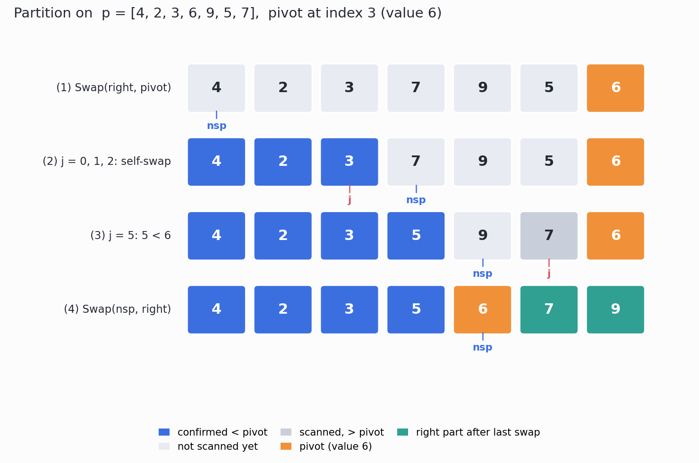
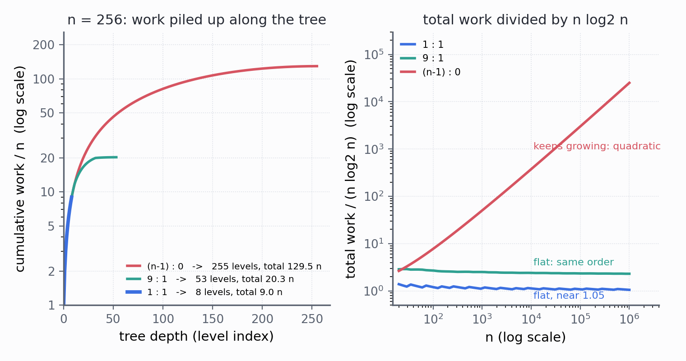
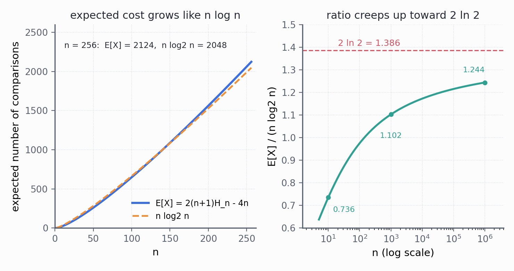

# CSC3100 Lecture 11 课堂笔记：QuickSort（快速排序）

> **材料构成**：本讲基于课件（PDF/PPT）整理，不含教师口述内容；课件 `lecture 11 (quicksort).pdf` 共 35 页。这 35 页的文字层约 14.1 K 字符，但**公式、伪代码与递归树几乎全部以图片形式存在**——p.9-11、p.13-18、p.19-21、p.22-28、p.29-30、p.32-35 的关键内容都不在文字层里，所以我把 35 页全部按 160 dpi 渲染成图逐页读过；其中 p.8、p.19、p.20、p.21、p.24、p.28、p.29、p.35 八页又按 300–400 dpi 分区裁切，逐个核过下标、运算符与括号。凡是我看不清的地方，文末都写明了，没有靠猜补。
>
> **课件结构**：目录（p.2）→ 排序问题与"平均快、最坏慢"（p.3）→ 确定性算法 vs 随机化算法（p.4）→ flipCoin 与随机算法的代价（p.5）→ 期望运行代价 $E[X]$（p.6）→ 分治三步与 $S_1$、$v$、$S_2$（p.7）→ 十元素实例（p.8）→ quicksort 伪代码与一次划分（p.9）→ partition 伪代码与逐帧状态（p.10-11）→ 与归并排序对比（p.12）→ 另一种实现：median-of-three（p.13）→ 双指针划分的两条规则（p.14）→ 收尾与"相等元素之问"（p.15）→ 十元素双指针逐帧（p.16-18）→ `median3` 与带 `CUTOFF` 的 Java 实现（p.19-20）→ 练习（p.21）→ 最坏划分（p.22）→ 最好划分（p.23）→ 9:1 划分（p.24）→ 指示变量与期望比较次数（p.25-28）→ 五种排序的对比表（p.29）→ 比较模型的下界（p.30）→ 阅读与下一讲（p.31）→ 决策树下界（p.32-35）。
>
> **已知课件问题**：p.14 与 p.15 的文字说"跳过比 pivot 小/大的元素"，而 p.20 的代码用的是 `a[i] <= pivot` 与 `a[j] > pivot`，相等元素的实际归属与文字不符；p.15 自己提出了"相等元素怎么办"却没有回答。p.3 说最坏情况 "very unlikely"，可是对全相等的输入，本讲 p.20 的代码必然退化到约 $n^2/4$，与随机化无关。p.29 把快排的额外空间记作 $O(1)$，漏掉了递归栈。其余几条（p.24 的下界写法、p.35 的 $+1$、p.13 缺少前置条件）都在文末「附：诚实备注」里逐条列出，并注明我凭什么这么判。
>
> **来源标注约定**：正文里凡标 **【补】** 的段落，都是课件没有、由我补充或推导的内容（包括三张配图与全部复算）；没有标注的，都是课件上写着的。页码一律指课件页码（与 PDF 阅读器页码一致）。

## 0. 一句话概括本讲在讲什么

L4 把**插入排序（insertion sort）**与**归并排序（merge sort）**讲完了，并在文末留下一句悬案：L3 说过"快排平均 $O(N\log N)$，我们不证明它"。L10 插进来讲了队列，本讲回到排序，把这句话补上——而且补得比 L3 承诺的更多：不只证明了平均 $O(n\log n)$，还把它算到了常数，$E[X]\approx 1.386\,n\log_2 n$。

一句话：**快速排序（QuickSort）随便挑一个元素当基准（pivot），扫一遍数组，把"不大于 pivot"的放左边、"> pivot"的放右边，pivot 落到它最终该在的位置；然后对左右两半各做同样的事。** 它不需要额外数组（in place），常数比归并小，实际跑得比归并快 2–3 倍（p.12）；代价是**最坏会退化成 $n^2$**（p.22），而且**不稳定**（p.29）。

这一讲真正值得学的，是它回答问题的**顺序**，这条顺序本身就是一套方法论：

1. 先承认"最坏很糟"，并说清楚"我们说它快"到底是什么意思——**平均（average）**，而不是最坏（p.3）；
2. 为了把"平均"变成可以计算的东西，引入**随机化算法（randomized algorithm）**与**期望运行代价（expected running cost）**，并用一个抛硬币的小例子把"期望"练一遍（p.4-6）；
3. 给出算法骨架与两种划分写法（Lomuto 式把 pivot 换到末尾，p.10-11；Hoare 式双指针，p.14-18）；
4. 把工程上的两个改良讲清楚：**三数取中（median-of-three）**选 pivot（p.13、p.19），**小区间改用插入排序**（`CUTOFF`，p.20）；
5. 用三种划分比例算三遍递推式：最坏 $n^2$、最好 $n\log n$、9:1 仍是 $n\log n$（p.22-24）；
6. 用**指示变量（indicator random variable）**把期望比较次数算成一个闭式，再用调和级数（harmonic series）收尾（p.25-28）；
7. 最后反过来问：**能不能比 $n\log n$ 更快？** 用**决策树（decision tree）**证明比较类排序的下界是 $\Omega(n\log n)$（p.30-35）。

所以本讲的标题虽然是"快排"，但它的后半段（p.25-35）其实是**算法分析**的一课：一个"平均而言最优"的算法，和一个"任何比较排序都逃不掉"的下界，正好从两头把 $n\log n$ 夹住。

本讲地图：

| 页码 | 本节 | 这一块在回答什么 |
| --- | --- | --- |
| p.2 | 目录 | 本讲分四块：主要特征、随机化实现、确定性实现、复杂度分析 |
| p.3 | 排序问题 | 快排承诺什么：平均 $O(n\log n)$、最坏 $O(n^2)$ |
| p.4 | 确定性 vs 随机化 | 同一个输入为什么可能跑出不同的代价 |
| p.5 | flipCoin | 随机算法的"最坏情况"为什么没意义，只能谈期望 |
| p.6 | 期望代价 | $E[X]=4=O(1)$ 是怎么算出来的 |
| p.7 | 分治三步 | 快排的"分、治、合"分别是什么，为什么"合"是空的 |
| p.8 | 十元素实例 | 递归树长什么样：pivot 65 把数组切成两半 |
| p.9 | quicksort 伪代码 | 六行骨架，以及"一次划分"的输入输出 |
| p.10-11 | partition（Lomuto 式） | pivot 换到末尾、`nextsmallpos` 怎么维护 |
| p.12 | 与归并对比 | 同样 $O(n\log n)$，为什么快排快 2–3 倍 |
| p.13 | median-of-three | 为什么要挑"中位数"，为什么把它藏到倒数第二个位置 |
| p.14-15 | 双指针划分 | $i$、$j$ 各跳过什么、什么时候交换、什么时候收尾 |
| p.16-18 | 双指针逐帧 | 十个数的完整一轮，每一帧的数组与指针 |
| p.19-20 | Java 实现 | `median3` 的三次交换、`CUTOFF` 分支、插入排序收尾 |
| p.21 | 练习 | 七个数，自己走一遍带 `CUTOFF` 的完整流程 |
| p.22 | 最坏划分 | $T(n)=T(1)+T(n-1)+n$ 为什么是 $\Theta(n^2)$ |
| p.23 | 最好划分 | $2T(n/2)+\Theta(n)$ 为什么是 $\Theta(n\log n)$ |
| p.24 | 9:1 划分 | 划分很不均匀，为什么仍然是 $\Theta(n\log n)$ |
| p.25-28 | 期望分析 | 一对元素被比较的概率为什么是 $2/(j-i+1)$ |
| p.29 | 五种排序对比 | 时间、空间、稳定性放在一张表里看 |
| p.30 | 能否更快 | 比较类排序有没有下界 |
| p.31 | 阅读与下一讲 | Chapter 7；下一讲继续排序（Chapter 8） |
| p.32-35 | 决策树下界 | $n!$ 个叶子如何逼出 $\Omega(n\log n)$ |

## 1. 目录：本讲的四块拼图（p.2）

p.2 的目录只有四行，但它的排序方式透露了讲课的逻辑：

> Main features of QuickSort
> Randomized implementation of QuickSort
> Deterministic implementation of QuickSort
> Time complexity analysis of QuickSort

先"是什么"，再"随机版怎么写"，再"确定版怎么写"，最后"为什么快"。这个顺序和多数教材相反——教材通常先给确定性的 Lomuto 或 Hoare 版本，再补一句"随机化可以避免最坏情况"。课件反过来，是因为它想让"平均"这个概念先立住：**快排的所有好处都是期望意义下的**，如果先讲实现，读者会误以为那六行伪代码本身就保证 $n\log n$。

四块之间还有一条不明显的线：**"随机化实现"与"确定性实现"不是两个算法，而是同一条分治骨架的两种取值方式**。p.9 的骨架里 `pivot ← RANDOM(left, right)` 是随机版；p.20 的 Java 把这一行换成 `median3(a, left, right)`，就是确定版。骨架、划分、递归调用全都不变，变的只有"pivot 从哪来"，以及由此决定的复杂度结论（期望 vs 最坏）。读这一讲时把这条线记住，后面 p.22-28 的三段分析就不会散。

另外值得一提的是，p.2 的第三行用的是 "deterministic implementation" 而不是 "median-of-three"——说明课件把 median-of-three 与 `CUTOFF` 这些都归入"工程上怎么把随机版落成一个确定性版本"，而不是当成新算法。这也解释了为什么 p.13 只有四行字、p.19-20 直接给代码：它们在这条线里是"实现细节"，不是"新知识点"。

## 2. 先把话说清楚：快排到底承诺什么（p.3-6）

### 2.1 一句"平均快、最坏慢"的承诺（p.3）

p.3 重新摆出排序问题：给 $n$ 个元素，输出它们的一个排列，使元素按非降序排列。这一页没有新内容，真正的新内容是页面上的一句评价：

> average $O(n\log n)$, worst $O(n^2)$ (but very unlikely)

这句话有三个词需要拆开：

**average（平均）**。在 L4 里，"平均"是对**输入**取的：假设 $n$ 个元素的所有 $n!$ 种排列等可能出现，算代价的期望。快排的"平均"还有第二种取法：输入固定，**pivot 是随机选的**，对随机数取期望。两种取法在"元素互不相同"时给出同一个结果（p.25-28 的证明就是对随机 pivot 取的），但第二种更强：它不要求输入服从任何分布，**对每一个具体输入，代价的期望都是 $O(n\log n)$**。这一点是随机化算法最值钱的地方，也是 p.4 要讲的。

**worst（最坏）**。最坏是 $\Theta(n^2)$，不是一个"理论上可能"的边角：如果每次 pivot 都恰好是当前区间的最小值（或最大值），数组会被切成"空"与"$n-1$"两半，递归深度 $n$，每层扫一遍，总量就是 $1+2+\cdots+n$（p.22 会算）。

**very unlikely（非常不可能）**。这句话在**随机 pivot** 的模型下成立：连续 $n$ 次都抽到最小值的概率小到可以忽略。但它有一个容易被忽略的前提——**输入里的键互不相同，且 pivot 的选择与键的分布无关**。如果输入是"全部相等"，那么无论抽到哪个位置当 pivot，划分都会退化成 $1$ 与 $n-2$（或 $0$ 与 $n-1$），随机化一点忙都帮不上。本讲 p.20 的代码就是这种情况，实测 $n=256$ 的全相等输入要 16511 次比较，约为 $0.252\,n^2$，详见文末诚实备注与 §15。

所以 p.3 这句话的准确读法是：**在最常见的"键互不相同、pivot 随机"的模型下，最坏情况几乎不会发生；但只要输入里有大量重复键，最坏情况就由输入决定，与运气无关。** 这个区别在考试里经常被拿来出判断题。

### 2.2 确定性算法与随机化算法（p.4）

p.4 给出定义上最要紧的一句：**确定性算法（deterministic algorithm）对同一个输入，每次运行的每一步都相同；随机化算法（randomized algorithm）不是**——它内部调用了随机数，同一个输入可能走出不同的路径，因此**运行代价（running cost）本身是一个随机变量（random variable）**。

课件在这里引入了本讲唯一一个"新原语"：

$$
\text{pivot} \leftarrow \text{RANDOM}(\text{left}, \text{right})
$$

`RANDOM(x, y)` 的含义是：**等概率地返回区间 $[x,y]$ 里的一个整数**。它有 $y-x+1$ 个可能取值，每个的概率都是 $1/(y-x+1)$。把这一行放进 p.9 的骨架，整个算法就成了随机化算法；把它换成 `median3(...)`，就变回确定性算法。

"代价是随机变量"这句话，初读像是文字游戏，实际上它改变了我们**能问的问题**。对确定性算法，我们问"最坏多少、平均多少"；对随机化算法，"最坏多少"这个问题依然能问（这一次运行恰好抽得很差），但它往往没有信息量——极端情况下算法可能永远不终止。p.5 就用一个极端的例子把这件事讲透。

### 2.3 flipCoin：一个"最坏情况无意义"的例子（p.5）

p.5 给了一段只有三行的伪代码：

```
Algorithm: flipCoin()
1  r ← RANDOM(0, 1)
2  while r != 1
3      r = RANDOM(0, 1)
```

它反复抛一枚均匀硬币（0 与 1 各半），直到出现 1 为止。课件用它说明两件事：

**第一，最坏情况可以无限长。** 如果运气差到每次都抛 0，这个循环永远不停。这种事发生的概率是 $0$（严格说是概率为 $0$ 的极限事件），但它是"可能"的。所以对随机化算法，**最坏运行时间这个指标会失效**——你不能说"最坏是无穷大，所以这个算法不好"，因为那个"最坏"的概率小到没有实际意义。

**第二，有意义的问题是期望代价。** 课件在 p.5 最后一行写得很直白：in randomized algorithms, we consider the expected running cost（在随机算法里，我们考虑的是期望运行代价）。这就是本讲后半段所有分析的口径。

这里有一个容易被跳过的细节：**"代价"数的是什么？** p.6 把它定成"基本操作的次数（number of basic operations）"，并且把**一次循环**记成 **2 个**基本操作——一次 `RANDOM` 调用，一次 `r != 1` 的比较。所以下面算出来的 $X$ 只取偶数：$2,4,6,\dots$。这个"2"不是随便写的，它是课件对"基本操作"的口径，换成别的口径，$E[X]$ 会差一个常数倍，但仍然是 $O(1)$。

### 2.4 把 $E[X]=4$ 算出来（p.6）

p.6 的推导只有五行，但每一步都值得复述，因为 p.25-28 的期望分析用的是同一套语言。

设 $X$ 是 `flipCoin` 的运行代价（基本操作数）。要让代价等于 $2i$，必须**前 $i-1$ 次都抛到 0、第 $i$ 次抛到 1**，而每次抛掷独立、概率各半，所以

$$
\Pr[X = 2i] = \left(\frac{1}{2}\right)^{i-1}\cdot\frac{1}{2} = \frac{1}{2^{i}},\qquad i=1,2,3,\dots
$$

这正是**几何分布（geometric distribution）**：前 $i-1$ 次失败、第 $i$ 次成功。有了分布就能算期望：

$$
E[X] = \sum_{i=1}^{\infty} 2i\cdot\Pr[X=2i] = 2\sum_{i=1}^{\infty}\frac{i}{2^{i}}
$$

剩下的就是一个标准的幂级数。由

$$
\sum_{i=0}^{\infty} x^{i} = \frac{1}{1-x}\quad(\lvert x\rvert < 1)
$$

两边求导再乘 $x$，得到

$$
\sum_{i=1}^{\infty} i\,x^{i} = \frac{x}{(1-x)^{2}}
$$

代入 $x=1/2$：

$$
\sum_{i=1}^{\infty}\frac{i}{2^{i}} = \frac{1/2}{(1/2)^{2}} = 2
$$

于是

$$
E[X] = 2\times 2 = 4 = O(1)
$$

这个结果的含义值得说三遍：**一个最坏情况下会死循环的算法，期望代价是常数。** 这就是"随机化算法只能谈期望"的最好例证。同时也提醒我们，期望小不代表每次都快——偶尔会有一次跑很久，只是那种情况的总概率小。

顺带一个直觉版本，不用级数也能得到答案：第一次抛掷一定发生（1 次）；之后"是否还要再抛"是一个概率 $1/2$ 的事件，所以**期望抛掷次数** $T$ 满足 $T = 1 + \frac{1}{2}T$，解得 $T=2$；每次抛掷记 2 个基本操作，所以 $E[X]=2T=4$。这个"用期望的线性方程代替级数"的技巧，在算快排的递归期望时还会用到（§13 的递归树其实就是它的连续版本）。

## 3. 分治的骨架：分、治、合（p.7-8）

### 3.1 三句话讲完的想法（p.7）

p.7 把快排写成标准的分治（divide-and-conquer）三步，并且明确加了一个前提：**假设所有元素互不相同（distinct elements）**。

> 1. **Divide**：随便挑一个元素 $v$ 作为基准（pivot），把剩下的元素分成两堆——$S_1$ 里全是小于 $v$ 的，$S_2$ 里全是大于 $v$ 的；
> 2. **Conquer**：递归地把 $S_1$ 和 $S_2$ 排好；
> 3. **Combine**：什么都不用做。

第三步是快排与归并排序最大的差别。归并排序的"合"是一个需要专门设计的线性过程（L4 §11 的 `merge`），因为两半排好之后还得把它们交错着拼起来；快排的"合"是空的，因为在**分**的那一步就已经保证了"左边的都不大于右边的"——排好之后直接首尾相接就是答案。

这个差别带来两个后果，都值得提前记住：

**后果一：快排不需要额外数组。** 归并的 `merge` 必须借助一个临时数组（L4 §12.3），快排的划分在原地完成。这是 p.12 说"快排快 2–3 倍"的主要来源。

**后果二：快排的正确性完全押在"分"上。** 归并的正确性靠"合"（`merge` 的正确性），快排的正确性靠"分"（partition 的正确性）。所以这一讲花了两页伪代码（p.10-11）、五页图解（p.14-18）、两页 Java（p.19-20）反复讲同一个动作：**把数组分成"不大于 pivot"和"大于 pivot"两段**。只要这一步对了，剩下的递归就是套话。

### 3.2 一个十元素的例子（p.8）

p.8 用十个数字把整棵递归树画了出来。原数组按阅读顺序是

$$
[13,\ 81,\ 92,\ 43,\ 31,\ 65,\ 57,\ 26,\ 75,\ 0]
$$

第一次划分选 $65$ 当 pivot（它在数组里的下标是 5）。扫一遍之后，小于 $65$ 的六个元素聚到左边，大于 $65$ 的三个聚到右边，$65$ 自己卡在中间：

$$
\underbrace{[13,\ 43,\ 31,\ 57,\ 26,\ 0]}_{S_1}\quad 65\quad \underbrace{[81,\ 92,\ 75]}_{S_2}
$$

接下来对 $S_1$ 和 $S_2$ 各做一次同样的事（课件上写 "Do the same to select a pivot, ..."），最后把三块按顺序接起来，得到

$$
[0,\ 13,\ 26,\ 31,\ 43,\ 57,\ 65,\ 75,\ 81,\ 92]
$$

课件在这张图里画了三种箭头，各自对应分治的一步：从根节点向下的是 "Divide by partition"，从子节点继续向下的是 "Do the same to select a pivot, ..."，从子树向上汇到最终数组的是 "Combine"。**注意最后那个 "Combine" 箭头上没有任何操作**——它只是把三块按"左、pivot、右"的顺序写下来，这就是"合"是空的含义。

这张图还藏着一个值得说的话：$65$ 左右两边的元素个数是 6 和 3，比例大约 2:1。这不是最好（5:4），也不是最坏（0:9），但结果仍然是 $n\log n$ 级别的——p.24 会证明"只要比例是常数，哪怕是 9:1，都还是 $n\log n$"。所以看图时要问的不是"分得均不均"，而是"**分得均不均会不会改变量级**"。

### 3.3 为什么"分完就能拼"（正确性的一句话版本）

设划分之后 $S_1$ 里每个元素都 $\le v$，$S_2$ 里每个元素都 $>v$。如果 $S_1$、$S_2$ 分别已经排好序，那么

$$
S_1 \text{ 的最大值} \le v < S_2 \text{ 的最小值}
$$

所以把"排好的 $S_1$、$v$、排好的 $S_2$"直接接起来，整体就是有序的。这句话之所以成立，靠的是划分提供的**跨区不等式**：左边任意一个元素都不大于右边任意一个元素。归并排序没有这个性质（两半的元素是交错的），所以它必须"合"。

还有一半的正确性容易被漏掉：**元素不能丢、不能重**。快排的划分只做交换，不做覆盖，所以输出一定是输入的排列（permutation）——这一点与 L4 §4.7 讲插入排序时强调的"元素集合不变"是同一个要求。两半都满足，拼起来才满足。

## 4. 算法骨架：六行伪代码（p.9）

p.9 给的 `quicksort` 只有六行，是本讲所有内容的总纲：

```
Algorithm: quicksort(arr, left, right)
1  if left >= right
2      return
3  pivot ← RANDOM(left, right)   // randomly select a pivot from [left, right]
4  pivotNewposition = partition(arr, left, right, pivot)
5  quicksort(arr, left, pivotNewposition - 1)
6  quicksort(arr, pivotNewposition + 1, right)
```

逐行解释：

**第 1-2 行是基例（base case）。** 区间里只剩一个元素（`left == right`）或没有元素（`left > right`）时直接返回。为什么是 `>=` 而不是 `==`？因为第 5、6 行的调用**可能产生空区间**：如果 pivot 恰好落在 `left`，那么第 5 行调用的是 `quicksort(arr, left, left-1)`，`left > right`。把基例写成 `>=` 一次覆盖两种情况，省掉一次判断。

**第 3 行选的是"位置"而不是"值"。** `RANDOM(left, right)` 返回一个下标，`pivot` 是下标。这一点极易混：p.9 的例子写 "pivot = 3"，指的是下标 3（值是 6），而不是"pivot 等于 3"。后面 p.10 的 `pivotVal = arr[pivot]` 就是专门用来区分这两件事的——下标叫 `pivot`，值叫 `pivotVal`。

**第 4 行是整讲的重量级动作。** `partition` 把区间重排成"小的在左、大的在右、pivot 在中间"，并返回 pivot 的**最终位置**。这个位置有一个很强的性质：**它也是 pivot 在最终有序数组里的位置**，之后再也不需要移动它。所以第 5、6 行都把它排除在外。

**第 5-6 行是两次递归**，规模分别是 `pivotNewposition - left` 与 `right - pivotNewposition`。注意这两块加起来是 $n-1$（pivot 被挖掉了），不是 $n$。这个 "$-1$" 是后面所有递推式里的常数来源之一。

p.9 下半页给了一次划分的输入输出：

$$
[4,\ 2,\ 3,\ \mathbf{6},\ 9,\ 5,\ 7] \;\longrightarrow\; [4,\ 2,\ 3,\ 5,\ \mathbf{6},\ 7,\ 9]
$$

左边标着 `pivot = 3`（下标），右边标着 `pivotNewposition = 4`。$6$ 从下标 3 挪到了下标 4，左边三个都小于 6，右边两个都大于 6。这一页只给了结果，没给过程；过程在 p.10-11。

## 5. 第一种划分：把 pivot 换到末尾（p.10-11）

### 5.1 伪代码逐行读

p.10 的 `partition` 是这样的（课件编了 9 行号，只用了 7 行）：

```
Algorithm: partition(arr, left, right, pivot)
1  pivotVal = arr[pivot]                                  // record the pivot data
2  Swap(arr, right, pivot)                                // swap the pivot data and the last data
3  nextsmallpos = left                                    // next position for data smaller than pivotVal
4  for j from left to right - 1
5      if arr[j] < arr[right]
6          swap(arr, nextsmallpos, j)
7          nextsmallpos++
```

它的思路可以用一个比喻讲完：**手里拎着一个"小值口袋"，口袋的口子始终停在 `nextsmallpos`。** 从左到右扫每个元素，遇到比 pivot 小的，就把它换到口袋口上，口袋口往右挪一格；遇到不小于 pivot 的，跳过不管。扫完之后，"口袋"里就是所有小值，口袋口左边全是小值，右边全是大值，最后把 pivot 从末尾换到口袋口，就完成了。

逐行看几个设计决定：

**第 1-2 行：先把 pivot 挪到最右边。** 这一步的目的是让**扫描区间变成连续的一段** `[left, right-1]`。如果不挪，pivot 卡在中间，扫描就得分两段、还得跳过它。挪到末尾之后，`arr[right]` 就是 `pivotVal` 的"副本"，第 5 行的比较 `arr[j] < arr[right]` 实际上是在跟 pivot 比。课件在注释里写 "record the pivot data"，但真正被用的是末尾那个位置。

**第 3 行：`nextsmallpos` 是"口袋口"。** 它的初值是 `left`，含义是"下一个小于 pivot 的元素应该放到这里"。不变式（invariant）是：

$$
arr[\text{left}\dots \text{nextsmallpos}-1] < \text{pivotVal},\qquad arr[\text{nextsmallpos}\dots j-1] \ge \text{pivotVal}
$$

左边一段是"已确认的小值"，中间一段是"已扫描的大值"，`j` 右边是"还没看过的"，`arr[right]` 是 pivot。这四段的顺序在整个循环里不变。

**第 5-7 行：注意 `swap` 可能是"自己和自己换"。** 当 `j == nextsmallpos` 时（开头连续几个都小于 pivot 就会这样），`swap(arr, nextsmallpos, j)` 交换的是同一个位置，什么也没发生。这不是 bug，而是这个写法简洁的代价：它省掉了"如果 j 不等于 nextsmallpos 才交换"的分支判断。p.10 的第二帧就展示了这种情况（`nsp = 3, j = 3`）。

**第 8-9 行（课件留空但实际存在的收尾）：`Swap(arr, nextsmallpos, right)`，返回 `nextsmallpos`。** p.11 把这最后一步补上了。它的作用是：`nextsmallpos` 左边全是小值，右边全是大值，pivot 现在在末尾，把它换到 `nextsmallpos`，正好落在"小值与大值之间"。

### 5.2 七个数走一遍（p.10-11 的全部帧）

课件用 $[4,2,3,6,9,5,7]$、pivot 下标 3（值 6）演示。下表把每一帧都列出来，`nsp` 是 `nextsmallpos` 的缩写：

| 步骤 | j | arr[j] | 与 6 比较 | 动作 | 数组状态 | nsp |
| --- | --- | --- | --- | --- | --- | --- |
| 初始 | — | — | — | 记下 pivotVal = 6 | 4 2 3 6 9 5 7 | — |
| 换到末尾 | — | — | — | `Swap(right, pivot)` | 4 2 3 7 9 5 6 | 0 |
| 1 | 0 | 4 | 小于 | `swap(0,0)` 自换 | 4 2 3 7 9 5 6 | 1 |
| 2 | 1 | 2 | 小于 | `swap(1,1)` 自换 | 4 2 3 7 9 5 6 | 2 |
| 3 | 2 | 3 | 小于 | `swap(2,2)` 自换 | 4 2 3 7 9 5 6 | 3 |
| 4 | 3 | 7 | 大于 | 跳过 | 4 2 3 7 9 5 6 | 3 |
| 5 | 4 | 9 | 大于 | 跳过 | 4 2 3 7 9 5 6 | 3 |
| 6 | 5 | 5 | 小于 | `swap(3,5)` | 4 2 3 5 9 7 6 | 4 |
| 收尾 | — | — | — | `swap(4,6)` | 4 2 3 5 6 7 9 | 返回 4 |


*图 1　第一种划分（Lomuto 式）的四个关键帧，数组与 p.10-11 的例子完全一致；蓝格是"已确认小于 pivot"的一段，橙格是 pivot，灰格是"已扫描且大于 pivot"。我绘制，按 p.10 的伪代码重画。*

对照课件可以看到两个容易被忽略的细节：

**细节一：三次"自换"之后，`nsp` 追上了 `j`。** 前三帧里 `arr[j]` 都小，`swap` 都作用在同一个格子上，数组看起来没变，但 `nsp` 一步步从 0 走到 3。这正是"口袋口"在往前挪——口袋里的东西没变，只是口子跟着走。

**细节二：`j = 3`、`j = 4` 两个大值（7 和 9）留在原地，而小值 5 从 `j = 5` 被换到了 `nsp = 3`。** 这一换把 7 挤到了下标 5，数组从 `4 2 3 7 9 5 6` 变成 `4 2 3 5 9 7 6`。**注意 7 和 9 的相对顺序被改变了**——这是快排不稳定的根源：划分只保证"小的在左、大的在右"，不保证相等的元素保持原序（§15 会展开）。

**细节三：收尾的 `swap(4,6)` 把 6 从末尾换到下标 4。** 此时 `nsp = 4` 是整个数组中"第一个不小于 pivot 的位置"，6 换进去之后，左边 4 个全小于 6，右边 2 个全大于 6。返回 4，与 p.9 的 `pivotNewposition = 4` 对上了。

### 5.3 这一版的代价与局限

**比较次数固定。** `j` 从 `left` 扫到 `right-1`，每个非 pivot 元素恰好比一次，所以一轮划分的比较次数**恒为 $n-1$**，与数据长什么样无关。这一点与 L4 里插入排序的 $t_j$ 形成对比：插入排序的比较次数依赖数据，快排的划分不依赖；快排的"运气"全在**划分的位置**上，不在**划分的代价**上。这是理解 p.22-28 的关键——后面所有的分析都在算"划分把数组切成什么比例"，而不是"划分要扫几遍"。

**交换次数不超过 $n$。** 每次遇到小值最多换一次，收尾再换一次，所以一轮最多 $n$ 次交换。它是**原地（in place）**的，只需要常数个额外变量（`pivotVal`、`nextsmallpos`、`j`）。

**局限一：它对"相等"不友好。** 第 5 行是严格小于 `arr[j] < arr[right]`，相等的元素全被归到"大值"一侧。如果数组里全是相等的键，这一版会把它们全堆在右边，pivot 每次只前进一格，退化成 $n^2$。

**局限二：它对"已经有序"也不友好。** 如果数组已经升序，而 pivot 取的是第一个元素，那么每次划分都是 $0$ 与 $n-1$，同样退化。这两点合起来就是 p.3 那句 "very unlikely" 的真实边界：**随机化能救"有序输入"，但救不了"大量重复键"。**

**局限三：它多了一次"把 pivot 换到末尾"的交换。** 这一交换在逻辑上不必要（完全可以就地记住 pivot 的值），但换来了"扫描区间连续"这个好处。p.14 的第二种写法就是去掉了这次交换、改用双指针从两端往中间夹的版本。

## 6. 与归并排序对照（p.12）

p.12 只有一张两列的对比表，但它把"为什么工程上偏爱快排"讲清楚了：

| 维度 | MergeSort | QuickSort |
| --- | --- | --- |
| 额外空间 | 需要一个额外数组，排完还要拷回原数组 | 原地（in place），不需要额外数组 |
| 实际速度 | 基准 | 通常快 2–3 倍 |
| 复杂度 | 最坏也是 $O(n\log n)$ | 期望 $O(n\log n)$，最坏 $O(n^2)$ |

三点解释：

**第一，"需要一个额外数组"的代价不只是内存。** 归并的 `merge` 要把两半拷进临时数组、再拷回来（L4 §11），这是 $2n$ 次额外的读写；快排一趟只做交换。在现代机器上，内存带宽往往比算术更贵，所以"少读写一遍"能直接换成 2–3 倍的速度差。

**第二，"比较次数"其实快排更多。** 归并排序大约做 $n\log_2 n$ 次比较（L4 §10.4），快排的期望是 $1.386\,n\log_2 n$（§14），多了约 39%。但快排的比较是"顺序扫、局部性好"的，归并的比较要跨两个数组取，缓存命中率差。所以**比较次数少的算法不一定跑得快**——这是"渐进复杂度只描述增长量级，不描述常数"的又一个例子。

**第三，两者的风险方向相反。** 归并的最坏也是 $n\log n$，代价是空间；快排的空间是常数，代价是最坏会掉到 $n^2$。所以"选哪个"取决于你更怕哪一种：怕最坏（比如实时系统）就用归并或堆排序；怕内存、怕常数就用快排。p.29 会把五种排序放在一张表里，这张表就是从这个二选一扩出来的。

## 7. 第二种实现：三数取中，把 pivot 藏到倒数第二格（p.13）

### 7.1 四行字里的三个设计

p.13 的标题是 "other implementations"，正文只有四行：

> Set the pivot to the **median** among the first, center and last elements
> Exchange the second last element with the pivot
> Set pointer $i$ at the second element
> Set pointer $j$ at the third last element

这四行是一套完整的"防最坏情况"设计，每一行都在解决一个具体问题。

**第一行：pivot 取三个候选的中位数。** 为什么要取中位数？因为最坏情况的本质是"pivot 落在极端"（最大值或最小值）。如果候选只有一个（比如第一个元素），那么"已经有序的输入"每次都让第一个元素成为最小值，必然最坏。取三个位置的中位数之后，**要让 pivot 成为极端值，必须三个候选同时偏大或同时偏小**，这需要输入刻意构造。对"已经有序"这种最常见的坏输入，三数取中直接给出中间的 $n/2$ 位置，划分接近对半——最坏情况被"工程性地"推到了罕见输入上。这就是 p.13 说 "In practice, a good way is" 的含义：它不是理论保证，而是把坏运气挤到角落里。

**第二行：把中位数换到倒数第二个位置。** 这一句是四行里最难懂的一句，因为它跳过了前置条件。完整的逻辑是：

1. 三个候选在 `left`、`center = (left+right)/2`、`right` 三个位置；
2. 先用三次"比较—必要时交换"把这三个位置排好，使得 $a[\text{left}] \le a[\text{center}] \le a[\text{right}]$（p.19 的 `median3` 就是这三步）；
3. 此时中位数在 `center`，把它与 `right-1`（倒数第二个）交换。

交换的目的有两个。**第一，pivot 必须离开扫描区间。** 扫描区间是 `[left+1, right-2]`，pivot 如果留在 `center`（在区间内），扫描时就会把它当成普通元素搬来搬去。藏到 `right-1` 之后，它既不在区间里，又离得近，收尾时一次交换就能归位。**第二，`left` 与 `right` 两个端点被留下来当哨兵（sentinel）。** 排好三个候选之后，$a[\text{left}]$ 是三者最小、$a[\text{right}]$ 是三者最大。于是：

- $a[\text{left}] \le \text{pivot}$，所以 $j$ 向左扫到 `left` 一定会停下（它不会越过左边界）；
- $a[\text{right}] \ge \text{pivot}$，所以 $i$ 向右扫到 `right` 一定会停下（不会越界）。

这两条"哨兵保证"让内层循环不需要写边界判断——这是这个实现比 p.10 那一版更紧凑的原因，也是"为什么偏偏是倒数第二个"的答案：**只有把 pivot 放在 `right-1`，`right` 才能空出来当哨兵；只有三个候选排好序，`left` 和 `right` 才配当哨兵。**

**第三、四行：两个指针的起点。** $i$ 从第二个元素（`left+1`）开始，$j$ 从倒数第三个（`right-2`）开始。两端各留一个哨兵，`right-1` 留给 pivot，剩下的正好是 `[left+1, right-2]` 这段连续区间。三个数字 `left+1`、`right-2`、`right-1` 就是这么来的，不是随便挑的。

### 7.2 与教材（Weiss）的经典写法对照

如果读过 Weiss 的《Data Structures and Algorithm Analysis》，会发现它的快排与这里**骨架相同、细节不同**。Weiss 的版本同样是 median-of-three、同样把 pivot 藏到 `right-1`，但指针的初始化与移动方式是：

- $i$ 从 `left` 开始，$j$ 从 `right-1` 开始；
- 内层循环写成"先 `i++` 再比较"与"先 `j--` 再比较"（pre-increment 风格）；
- 靠两端哨兵保证不会越界，因此**不需要** `i <= j` 这样的保护条件。

课件 p.20 的版本是：

- $i$ 从 `left+1` 开始，$j$ 从 `right-2` 开始；
- 内层循环先判断 `i <= j` 再比较，**显式**防止越界；
- 收尾统一 `swap(a, i, right-1)`。

两种写法在"元素互不相同"时结果一样，差别在**边界与重复键**：Weiss 的"先自增再比较"在遇到等于 pivot 的元素时会停下并交换（等于被两边各分一半），课件的 `a[i] <= pivot` 会让等于的元素**一路被 $i$ 跳过**（等于全归左边）。后者在"全相等"输入上会退化成 $n^2/4$（§9.3 有实测），前者稍好一点，但同样不是 $n\log n$。**真正的解法是三路划分（three-way partition），本讲没有讲**——这一点在文末「诚实备注」里列为缺口。

## 8. 双指针划分：从两端往中间夹（p.14-18）

### 8.1 两条规则与一次收尾（p.14-15）

p.14 用三句话描述双指针的规则：

> While $i$ is on the left of $j$, move $i$ right, skipping over elements that are smaller than the pivot
> Move $j$ left, skipping over elements that are larger than the pivot
> When $i$ and $j$ have stopped, $i$ is pointing at a large element and $j$ at a small element

p.15 补上收尾与结论：

> If $i$ is to the left of $j$, swap $A[i]$ with $A[j]$ and continue
> When $i$ is larger than $j$, swap the pivot element with the element at $i$
> All elements to the left of pivot are smaller than pivot, and all elements to the right of pivot are larger than pivot
> What to do when some elements are equal to pivot?

把这三段话翻译成"每一轮在做什么"：

1. $i$ 从左往右走，**跳过小元素**，停在第一个"大元素"上；
2. $j$ 从右往左走，**跳过大元素**，停在第一个"小元素"上；
3. 如果 $i$ 还在 $j$ 左边，说明一个大的在左、一个小的在右，交换它们，两个人都"归位"，继续；
4. 如果 $i$ 越过了 $j$，说明所有小元素都已在左、大元素都已在右，把 pivot（藏在 `right-1`）换到 $i$，结束。

**这三句话里有两处与代码对不上，必须对照 p.20 才能读准。** 第一处：p.14 说"跳过比 pivot 小的元素"，p.20 的代码是 `while (i <= j && a[i] <= pivot) i++;`——跳过的条件是**小于等于**，所以等于 pivot 的元素也被 $i$ 跳过。第二处：p.14 说"跳过比 pivot 大的元素"，代码是 `while (i <= j && a[j] > pivot) j--;`——跳过的条件是**严格大于**，所以 $j$ 停在"小于等于 pivot"的元素上，**包括等于**。结果是：**等于 pivot 的元素会被归到左边**（因为 $i$ 跳过它们、$j$ 停在它们身上并把它们换到左边）。这就是 p.15 那个问题的答案，只不过课件把它留成了一个问号。

p.15 还有一句话在严格意义上不成立："左边都小于 pivot、右边都大于 pivot"。有重复键时，左边是"小于等于"，右边是"大于"。这句不严谨的表述与 p.10 那版的严格小于形成对照，也是文末列为"课件不一致"的第一条。

### 8.2 十个数字走一遍（p.16-18）

课件用 $[8,1,4,9,6,3,5,2,7,0]$ 演示完整的双指针划分。这一轮包含 **median3 的四次交换**（三次比较交换 + 一次把 pivot 藏到 `right-1`）+ **划分的两轮交换** + **一次收尾**，比 p.10 那版复杂得多，值得一帧一帧看。

**第一步：median3。** `left = 0`，`right = 9`，`center = (0+9)/2 = 4`，三个候选是 $a[0]=8$、$a[4]=6$、$a[9]=0$。

| 比较 | 是否交换 | 数组状态 |
| --- | --- | --- |
| 初始 | — | 8 1 4 9 6 3 5 2 7 0 |
| $a[4]=6 < a[0]=8$ | `swap(0,4)` | 6 1 4 9 8 3 5 2 7 0 |
| $a[9]=0 < a[0]=6$ | `swap(0,9)` | 0 1 4 9 8 3 5 2 7 6 |
| $a[9]=6 < a[4]=8$ | `swap(4,9)` | 0 1 4 9 6 3 5 2 7 8 |
| 中位数归位 | `swap(4,8)` | 0 1 4 9 7 3 5 2 6 8 |

最后一行是把 `center = 4` 与 `right-1 = 8` 交换，pivot $6$ 落到下标 8，同时 $a[0]=0$、$a[9]=8$ 成为两端哨兵。**p.16 的起始状态就是最后这一行。**

**第二步：划分。** $i$ 从 1 开始，$j$ 从 7 开始，扫描区间是 `[1,7]`。

| 步骤 | i | j | 动作 | 数组状态 |
| --- | --- | --- | --- | --- |
| 起始 | 1 | 7 | — | 0 1 4 9 7 3 5 2 6 8 |
| $i$ 推进 | 3 | 7 | 1、4 都 $\le 6$，$a[3]=9$ 停 | 0 1 4 9 7 3 5 2 6 8 |
| $j$ 推进 | 3 | 7 | $a[7]=2 \le 6$ 停 | 0 1 4 9 7 3 5 2 6 8 |
| 交换 | 3 | 7 | `swap(3,7)` | 0 1 4 2 7 3 5 9 6 8 |
| $i$ 推进 | 4 | 7 | $a[4]=7 > 6$ 停 | 0 1 4 2 7 3 5 9 6 8 |
| $j$ 推进 | 4 | 6 | $a[6]=5 \le 6$ 停 | 0 1 4 2 7 3 5 9 6 8 |
| 交换 | 4 | 6 | `swap(4,6)` | 0 1 4 2 5 3 7 9 6 8 |
| $i$ 推进 | 6 | 6 | $a[5]=3 \le 6$，$a[6]=7 > 6$ 停 | 0 1 4 2 5 3 7 9 6 8 |
| $j$ 推进 | 6 | 5 | $a[5]=3 \le 6$ 停，但 $i > j$ | 0 1 4 2 5 3 7 9 6 8 |
| 收尾 | 6 | 5 | `swap(6,8)` 归位 pivot | 0 1 4 2 5 3 6 9 7 8 |

结果：pivot 在下标 6，左边 $[0,1,4,2,5,3]$ 全部 $\le 6$，右边 $[9,7,8]$ 全部 $>6$。与 p.18 的图完全一致。

这一轮里有三个瞬间值得停下来看：

**第一个瞬间是"$i$ 和 $j$ 同时停住"的那一格。** 上表第 3 行，$i$ 停在 3（值 9），$j$ 停在 7（值 2），正好是"一个大的在左、一个小的在右"。交换之后，9 到了右边、2 到了左边，各就各位。这就是 p.14 最后一句 "i is pointing at a large element and j at a small element" 的画面。

**第二个瞬间是"$i$ 追上 $j$"的那一格。** 上表第 8 行，$i$ 从 5 走到 6，此时 $i = j = 6$，两个指针重合。代码里 `while (i <= j && ...)` 的保护条件让 $i$ 停在 6 而不是继续走到 7——如果没有这个保护，$i$ 会走进"大值区"甚至越界。

**第三个瞬间是"$i$ 越过 $j$"之后的那次交换。** 上表最后一行，$j$ 退到 5，$i$ 停在 6，$i > j$，循环结束。此时 $i = 6$ 恰好是"第一个大值的位置"，而 pivot 在 `right-1 = 8`，交换它们，pivot 就落在了大小两段的交界处。**注意这次交换的前提是 $a[6] = 7 > 6$**，把 7 换到下标 8 正好满足"右边全大于 pivot"。

### 8.3 为什么两个指针不会越界

这是双指针版本最容易让人不放心的地方：内层两个 `while` 如果只看 p.14 的文字，$i$ 一路往右、$j$ 一路往左，凭什么不会跑出数组？答案还是 §7.1 说的**哨兵**：

- $j$ 向左最多走到 `left`。因为 $a[\text{left}]$ 是三个候选里最小的，$a[\text{left}] \le \text{pivot}$，而 $j$ 的循环条件是 `a[j] > pivot`，走到 `left` 必然不满足，停。
- $i$ 向右最多走到 `right`。因为 $a[\text{right}]$ 是三者最大的，$a[\text{right}] \ge \text{pivot}$，而 $i$ 的循环条件是 `a[i] <= pivot`，走到 `right` 也不满足，停。

所以**即使去掉 `i <= j` 的保护，指针也不会越界**；加保护是为了让它们在"相遇"时提前停下，避免无意义地扫过对方已经归位的那一段。这与 Weiss 的写法（完全依赖哨兵、不写保护）是同一件事的两种表达。

### 8.4 一轮划分到底做了多少次比较

每个非 pivot 元素都会被 $i$ 或 $j$ 扫过一次（扫过之后它要么被确认"在正确的一侧"，要么被交换到另一侧然后不再被看），所以一轮划分的比较次数是 $\Theta(n)$，具体是 $n-1$ 次左右，再加上 median3 的 3 次比较与收尾的 1 次交换。**"左右扫描"不改变量级，只改变常数**——这一点与 p.10 那版一样。所以后面 p.22-28 的分析对两种实现都适用：**决定复杂度的是划分的比例，不是划分的写法。**

## 9. 完整实现：`median3` + `CUTOFF` + 插入排序收尾（p.19-20）

### 9.1 `median3`：三次比较把三个数排好

p.19 的代码只有十四行，但它同时完成了三件事：把三个候选排好、把中位数藏到 `right-1`、把两端变成哨兵。

```java
private static int median3(int[] a, int left, int right) {
    // Ensure a[left] <= a[center] <= a[right]
    int center = (left + right) / 2;
    if (a[center] < a[left])
        swap(a, left, center);
    if (a[right] < a[left])
        swap(a, left, right);
    if (a[right] < a[center])
        swap(a, center, right);

    // Place pivot at position right - 1
    swap(a, center, right - 1);
    return a[right - 1];
}
```

三行 `if` 是一个**排序网络（sorting network）**：先保证 `left` 与 `center` 有序，再用 `right` 与 `left` 比较把最小值放到 `left`，最后用 `right` 与 `center` 比较把剩下的两个排好。三步之后一定满足 $a[\text{left}] \le a[\text{center}] \le a[\text{right}]$，无需循环、无需分支嵌套。

`swap(a, center, right - 1)` 之后，中位数到了 `right-1`，而原来在 `right-1` 的元素被换到 `center`——它还在扫描区间内，会被正常扫到，不会丢。

这段代码有一个副作用值得指出：**它改变了 `a[left]`、`a[center]`、`a[right]`、`a[right-1]` 四个位置的内容**。p.21 的练习里，课件展示的中间状态 $1,7,4,5,0,2,9$ 就只是"第一次 `if` 交换之后"的样子，pivot 还没藏好。读那一页时如果不知道这段代码，会以为数组已经被划分过了。

### 9.2 主函数：`CUTOFF` 分支

p.20 的主函数：

```java
private static void quicksort(int[] a, int left, int right) {
    if (left + CUTOFF <= right) {
        int pivot = median3(a, left, right);
        // Begin partitioning
        int i = left + 1, j = right - 2;
        while (true) {
            while (i <= j && a[i] <= pivot) { i++; }
            while (i <= j && a[j] > pivot) { j--; }
            if (i > j) break;   // i meets j
            swap(a, i, j);
        }
        swap(a, i, right - 1);  // Restore pivot
        quicksort(a, left, i - 1);   // Sort small elements
        quicksort(a, i + 1, right);  // Sort large elements
    } else
        insertionSort(a, left, right);
}
```

四处关键设计：

**`left + CUTOFF <= right` 是"当前区间够长吗"的判断。** 它等价于 `right - left + 1 >= CUTOFF + 1`，即"元素个数大于 `CUTOFF`"。够长就递归划分，不够长就交给插入排序。这样做的理由是：递归到很小的时候，函数调用、`median3`、边界判断的固定开销已经超过了"多比较几次"的代价；而插入排序在十几个元素以内常数极小（L4 §14.1 量过交叉点，约 $n=18.5$）。**这是"混合排序（hybrid sort）"的标准形态**，也是 L4 p.31 那道练习在真实代码里的样子。

**`pivot` 在这里是"值"，不是"下标"。** `median3` 返回 `a[right-1]`，是一个元素值。这与 p.9、p.10 里 `pivot` 表示下标**同名不同义**，是课件里一处容易误导的地方（§9.4 会列出来）。

**两个内层 `while` 都带 `i <= j` 保护。** 前面说过，哨兵已经保证不越界，这个保护的作用是"相遇即停"。少了它，$i$ 会一直扫到 `right`，把已经在大值区的元素又搅一遍。

**`if (i > j) break;` 的位置在两次 `while` 之后、`swap` 之前。** 顺序不能换：必须先让两个指针各自走到位，再判断是否交叉；交叉了就退出，没交叉就交换。注释写 "i meets j"，严格说是 "i passes j"（$i$ 越过 $j$）——相遇只是其中一种情况。

**三个边界事实**（都可由代码推出，也是这段代码不需要 `left >= right` 基例的原因）：

1. `i` 初值是 `left+1`，只增不减，所以 `i - 1 >= left`，左递归区间非空；
2. `i` 最多到 `j+1 <= right-1`，所以 `i + 1 <= right`，右递归区间非空；
3. 长度不足 `CUTOFF+1`（即 $\le 3$）的区间不会被 `quicksort` 处理，而是直接进 `insertionSort`，而插入排序对长度 0 或 1 的区间天然安全。

### 9.3 代码审读：我跑了什么，发现了什么

为了确认这段代码真的对，我在 `.qoder/L11/verify.py` 里把它逐行翻译成 Python（保留 `CUTOFF`、`median3`、插入排序与原下标），然后做了三件事：

**第一，正确性模糊测试。** 随机生成 3000 个长度 0–200 的数组（含负数、含大量重复值），与 Python 内置 `sorted` 对比，**0 个不一致**。所以这段代码在"排序结果"上没有 bug。

**第二，全相等输入的开销。** 令所有元素相同，统计比较次数：

| n | 8 | 16 | 32 | 64 | 128 | 256 |
| --- | --- | --- | --- | --- | --- | --- |
| 比较次数 | 19 | 71 | 271 | 1055 | 4159 | 16511 |
| 与 $n^2$ 之比 | 0.297 | 0.277 | 0.265 | 0.258 | 0.254 | 0.252 |

比值稳定在 $1/4$ 附近，说明代价是 $\Theta(n^2)$，具体是 $n^2/4$ 量级。原因是：全相等时 $i$ 一路跳过所有元素直到与 $j$ 相遇，$j$ 几乎不动，pivot 每次只从右边剥掉一个元素（`right` 那个哨兵），区间从 $n$ 缩到 $n-2$，于是 $T(n) = T(n-2) + \Theta(n) = \Theta(n^2)$。**这个结论与"pivot 怎么选"无关**：随机选、三数取中，结果都一样，因为所有元素相等，划分位置由比较符号决定，而不是由值决定。

**第三，与 p.28 的期望公式对账。** 用 `Fraction` 精确算 $E[X] = 2(n+1)H_n - 4n$，在 $n = 3,5,10,100,1000$ 处与"逐项求和 $2\sum_{x=1}^{n-1}(n-x)/(x+1)$"完全相等（§14.4 有表）。注意这个公式对应的是"随机 pivot + 只数 pivot 比较"的理想模型，**不包含** `median3` 的 3 次比较与插入排序收尾的比较，所以它比实测值略小（$n=8$ 时公式 16.92，实测 19.99）。差的这 3 次正好是 `median3` 的三次比较。

### 9.4 这段代码与前面几页的对不上之处

读代码时我记下了四处"同名不同义"或"说法不一致"，都在文末有编号：

1. **`pivot` 的含义变了。** p.9 的 `pivot` 是下标（`RANDOM(left,right)` 的返回值），p.10 的 `pivot` 也是下标，p.20 的 `pivot` 是值（`median3` 的返回值）。同一个名字在两页之间换了类型。
2. **相等元素的处理没有文字说明。** p.14 的文字是"跳过小的/大的"，代码是"跳过 $\le$ / $>$"。文字读不出"等于归左边"这个结论。
3. **p.15 的结论过强。** "左边都小于、右边都大于"应为"左边都小于等于、右边都大于"。
4. **`CUTOFF` 没有给值。** p.20 直接用了这个常量，全讲没有说它等于几。本文在 §10 走 p.21 的练习时取 `CUTOFF = 3`，理由是：只有取 3，长度为 4 的区间才会继续递归，练习里那几个中间状态才对得上；取更大的值会让练习提前进入插入排序。**课件本身没有给这个数，这是我的取值**，换一个值不改变练习的最终结果，只改变中间步骤。

## 10. 练习：把 $5,7,4,1,0,2,9$ 完整走一遍（p.21）【补】

p.21 只给了两行提示：数组是 $[5,7,4,1,0,2,9]$，中间状态显示为 $1,7,4,5,0,2,9$，并注明 "5 will be selected as the pivot"，然后写 "Finish it by yourself"。课件没有给后续步骤，这一节我把整条路走完，取 `CUTOFF = 3`（理由见 §9.4 第 4 条）。

### 10.1 第一次调用：`quicksort(a, 0, 6)`

长度 7，`left + CUTOFF = 3 <= 6`，进入划分。

**median3 的三个候选**是 $a[0]=5$、$a[3]=1$、$a[6]=9$（`center = (0+6)/2 = 3`）。

| 比较 | 动作 | 数组 |
| --- | --- | --- |
| 初始 | — | 5 7 4 1 0 2 9 |
| $a[3]=1 < a[0]=5$ | `swap(0,3)` | 1 7 4 5 0 2 9 |
| $a[6]=9 < a[0]=1$ | 不换 | 1 7 4 5 0 2 9 |
| $a[6]=9 < a[3]=5$ | 不换 | 1 7 4 5 0 2 9 |
| 中位数归位 | `swap(3,5)` | 1 7 4 2 0 5 9 |

第二行就是课件展示的那个状态。此时三个候选已经有序（$1 \le 5 \le 9$），中位数 5 在下标 3，把它与 `right-1 = 5` 交换，pivot 就落到了下标 5，$a[0]=1$ 与 $a[6]=9$ 成为哨兵。

**划分**：$i$ 从 1 开始，$j$ 从 4 开始。

| 步骤 | i | j | 动作 | 数组 |
| --- | --- | --- | --- | --- |
| 起始 | 1 | 4 | — | 1 7 4 2 0 5 9 |
| $i$ | 1 | 4 | $a[1]=7 > 5$，停 | 1 7 4 2 0 5 9 |
| $j$ | 1 | 4 | $a[4]=0 \le 5$，停 | 1 7 4 2 0 5 9 |
| 交换 | 1 | 4 | `swap(1,4)` | 1 0 4 2 7 5 9 |
| $i$ | 4 | 4 | 4、2 都 $\le 5$，$a[4]=7$ 停 | 1 0 4 2 7 5 9 |
| $j$ | 4 | 3 | $a[4]=7 > 5$，退到 3；$i > j$ | 1 0 4 2 7 5 9 |
| 收尾 | 4 | 3 | `swap(4,5)` | 1 0 4 2 5 7 9 |

pivot 5 落在下标 4，左边 $[1,0,4,2]$ 都 $\le 5$，右边 $[7,9]$ 都 $>5$。两次递归：`quicksort(a,0,3)` 与 `quicksort(a,5,6)`。

### 10.2 左半边：`quicksort(a, 0, 3)`

长度 4，`0 + 3 <= 3` 成立，继续划分（这正是 `CUTOFF = 3` 的关键：若 `CUTOFF` 取 4，这里就直接进插入排序了）。

候选是 $a[0]=1$、$a[1]=0$、$a[3]=2$（`center = 1`）。

| 比较 | 动作 | 数组 |
| --- | --- | --- |
| 初始 | — | 1 0 4 2 |
| $a[1]=0 < a[0]=1$ | `swap(0,1)` | 0 1 4 2 |
| $a[3]=2 < a[0]=0$ | 不换 | 0 1 4 2 |
| $a[3]=2 < a[1]=1$ | 不换 | 0 1 4 2 |
| 中位数归位 | `swap(1,2)` | 0 4 1 2 |

中位数 1 落到 `right-1 = 2`，$a[0]=0$、$a[3]=2$ 是哨兵。划分时 $i = 1$，$j = 1$（区间 `[1,1]` 只有一个元素 4）：

| 步骤 | i | j | 动作 | 数组 |
| --- | --- | --- | --- | --- |
| 起始 | 1 | 1 | — | 0 4 1 2 |
| $i$ | 1 | 1 | $a[1]=4 > 1$，停 | 0 4 1 2 |
| $j$ | 1 | 0 | $a[1]=4 > 1$，退到 0；$i > j$ | 0 4 1 2 |
| 收尾 | 1 | 0 | `swap(1,2)` | 0 1 4 2 |

pivot 1 落在下标 1。两次递归：`quicksort(a,0,0)` 与 `quicksort(a,2,3)`。前者长度 1，$0+3 \le 0$ 不成立，进 `insertionSort(0,0)`，什么也不做；后者长度 2，也进 `insertionSort(2,3)`，把 $[4,2]$ 排成 $[2,4]$。

左半边最后是 $0,1,2,4$。

### 10.3 右半边与合并

`quicksort(a,5,6)` 长度 2，$5+3 \le 6$ 不成立，直接 `insertionSort(5,6)`，$[7,9]$ 已有序，不变。

整条路走完，数组是

$$
[0,\ 1,\ 2,\ 4,\ 5,\ 7,\ 9]
$$

元素与原来一致（无丢失、无重复），且升序。

### 10.4 这个练习想考什么

这个例子只有七个数，却把三件事都考到了：

**第一，`median3` 会改动数组。** 课件展示的 $1,7,4,5,0,2,9$ 既不是原数组，也不是划分后的数组，而是"三次比较中的第一次交换之后"的样子。不知道 `median3` 的人会以为课件写错了。

**第二，`CUTOFF` 决定了递归在哪里停。** 左半边长度 4 恰好还能再分一次，再往下的长度 1、2 就交给插入排序了。如果把 `CUTOFF` 改大，中间步骤会变，但最终结果不变——**这就是"混合排序只改常数、不改正确性"的具体样子**。

**第三，pivot 的位置是"最终位置"。** 5 落在下标 4、1 落在下标 1，之后再也没有被移动过（插入排序只处理它们两边的短区间）。这正是 §4 说的性质：划分一次，pivot 就永久归位。

## 11. 最坏情况：每次切掉一个（p.22）

### 11.1 递推式

p.22 把最坏情况写成

$$
T(n) = T(1) + T(n-1) + n
$$

含义是：pivot 恰好是当前区间的最小值（或最大值），划分之后一边是空的（只剩 pivot 自己，规模 1），另一边是 $n-1$ 个元素；划分本身花 $n$（扫一遍）。于是递归树退化成一条**链**：根是 $n$，往下一个 $n-1$，再往下 $n-2$，一直到 1。

每层的代价是这一层的规模，所以

$$
T(n) = n + (n-1) + (n-2) + \cdots + 1 = \frac{n(n+1)}{2} = \Theta(n^2)
$$

### 11.2 什么时候真的会发生

三种输入会让它发生：

1. **已升序 + pivot 取第一个元素。** 第一个元素是最小值，每次切掉一个。
2. **已降序 + pivot 取最后一个元素。** 同理。
3. **全部元素相等。** 这时无论取哪个位置，划分都只能剥掉一个（§9.3 实测 $n^2/4$）。

`median3` 能挡掉前两种：已升序时，$a[\text{left}]$、$a[\text{center}]$、$a[\text{right}]$ 的中位数是中间那个，划分接近对半。但 `median3` 挡不掉第三种——所有元素相等时，三个候选也相等，"中位数"就是它们自己。

**随机化能挡掉多少？** 对互不相同的键，随机 pivot 让"每次都抽到极端"的概率降到可以忽略；所以 p.3 说 "very unlikely"。但对重复键，随机化无效：问题不在"抽到哪个"，而在"比较符号把所有相等元素都推到一边"。**这是本讲最容易被忽略的一条边界**，也是 §15 那张表里"最坏 $O(n^2)$"背后的真实风险。

### 11.3 递归树的样子

$$
\begin{array}{c}
n\\
\downarrow\\
n-1\\
\downarrow\\
n-2\\
\vdots\\
1
\end{array}
$$

每一层只有一个节点，节点里写着"这一层要处理的元素个数"。总代价是把这一列的节点加起来，等于 $n(n+1)/2$。这与 L4 里"递归版插入排序"（L4 §7）的形状一样：**每层代价线性、层数线性，总量就是平方**。对照 p.23 的"每层线性、层数对数"，总量就是 $n\log n$——两页放在一起，正好说明"层数"才是决定量级的那一维。

## 12. 最好情况：每次对半切（p.23）

p.23 的递推式是

$$
T(n) = 2T\!\left(\frac{n}{2}\right) + \Theta(n)
$$

pivot 恰好是中位数，两边各 $n/2$，划分花 $\Theta(n)$。递归树是一棵**满二叉树**：第 $0$ 层 1 个节点、规模 $n$；第 $1$ 层 2 个、各 $n/2$；第 $k$ 层 $2^k$ 个、各 $n/2^k$。每一层的"规模之和"都是 $n$，一共 $\log_2 n$ 层，所以

$$
T(n) = \underbrace{n + n + \cdots + n}_{\log_2 n + 1 \text{ 层}} = \Theta(n\log n)
$$

这个结果与 L4 §10.4 归并排序的推导是同一个套路：**"规模减半、个数翻倍，每层总和不变"**。区别只在常数：归并每层要做 $n$ 次比较 + $n$ 次拷贝，快排每层只做 $n$ 次比较 + 少量交换。

有两点要补：

**第一，"最好情况"不可能被刻意制造。** 要知道中位数在哪，就得先排序——这就绕回去了。所以最好情况只是分析上的一个端点，不是可以追求的运行状态。真正能追求的是"平均接近最好"，这正是随机化与三数取中在做的事。

**第二，最好情况的 $\Theta(n\log n)$ 与最坏情况的 $\Theta(n^2)$ 之间，不是"要么最好要么最坏"。** 大多数划分介于两者之间，p.24 就来处理这个中间地带。

## 13. 9:1 划分：不均匀但仍然是 $n\log n$（p.24）

### 13.1 递推式与递归树

p.24 假设每次划分都按 9:1 分：

$$
Q(n) = Q\!\left(\frac{9n}{10}\right) + Q\!\left(\frac{n}{10}\right) + n
$$

递归树的形状是"歪的"：根是 $n$，左孩子 $9n/10$、右孩子 $n/10$；再往下，每个节点继续按 9:1 分。课件在树右边标了每一层的规模之和：前三层都是 $n$，再往下是 $\le n$，最后几层是 $\le n$。**"每层之和不超过 $n$"这件事是快排分析的核心**：在任意一层，每个元素恰好属于一个子问题，所以这一层所有子问题的规模加起来正好是 $n$（有子问题缩到 1 以下不再参与时，就小于 $n$）。

树有两条极端的路径：

- **最长路径**一直走 $9n/10$ 那一支，长度是 $\log_{10/9} n$；
- **最短路径**一直走 $n/10$ 那一支，长度是 $\log_{10} n$。

于是总量被夹在中间：

$$
n\left(\log_{10} n + 1\right) \;\le\; Q(n) \;\le\; n\left(\log_{10/9} n + 1\right)
$$

两边都是 $n\log n$ 的常数倍，所以 $Q(n) = \Theta(n\log n)$。

### 13.2 把常数算出来

两个对数换成以 2 为底，能看出"常数变大了多少"：

$$
\log_{10/9} n = \frac{\ln n}{\ln(10/9)} \approx 9.49\ln n \approx 6.58\log_2 n
$$

所以最长路径只比平衡情况多 $6.58$ 倍，**是一个常数倍，不是量级变化**。课件的上界可以写成

$$
Q(n) \le n\left(6.58\log_2 n + 1\right)
$$

即 $c_2 \approx 7.6$。这个界很松：它假设"最长路径上的每一层都花 $n$"，但实际上深层很多子问题已经缩到 1、不再参与，所以真实总量要小得多。**【补】按精确递推算**：设 $Q(n) = c\,n\ln n$，代入得

$$
c\,n\ln n = n + 0.9c\,n\ln(0.9n) + 0.1c\,n\ln(0.1n)
$$

两边除以 $n$ 并整理，$\ln n$ 的系数自动抵消，剩下

$$
1 + c\left(0.9\ln 0.9 + 0.1\ln 0.1\right) = 0
$$

而 $0.9\ln 0.9 + 0.1\ln 0.1 \approx -0.3251$，所以

$$
c = \frac{1}{0.3251} \approx 3.077,\qquad Q(n) \approx 3.077\,n\ln n \approx 2.13\,n\log_2 n
$$

也就是说：**9:1 划分的真实代价约为平衡划分的 2 倍**（$2.13$ 对 $1.05$），但仍然是 $n\log n$。这与"直觉上 9:1 很糟"的印象有差距——糟的是常数，不是量级。

### 13.3 下界那一行要小心

p.24 的下界写成

$$
Q(n) \ge n\sum_{i=0}^{\log_{10} n} 1 = n\left(\log_{10} n + 1\right)
$$

这个写法是**启发式**的：它把"最短路径有 $\log_{10} n$ 层"直接乘上"每层 $n$"，但沿最短路径的节点规模其实是 $n, 0.9n, 0.81n,\dots$，加起来只有约 $10n$，并不是 $n\log_{10} n$。结论 $Q(n) = \Theta(n\log n)$ 是对的，但严格的下界要用归纳法。**【补】归纳版本**：设 $Q(n) \ge c\,n\ln n$，则

$$
Q(n) \ge c\left(0.9n\ln(0.9n) + 0.1n\ln(0.1n)\right) + n = c\,n\ln n + n\left(1 - 0.3251c\right)
$$

只要 $c \le 3.0769$，右边就 $\ge c\,n\ln n$，归纳成立。取 $c = 1$ 即可，于是 $Q(n) = \Omega(n\log n)$。**上下界合起来才是 $\Theta$**——这也是为什么"递归树"只是找答案的工具，写证明时还得回到归纳。

### 13.4 三种划分放在一起看

| 划分比例 | 递推式 | 递归深度 | 总量 | 量级 |
| --- | --- | --- | --- | --- |
| $1:0$（最坏） | $T(n)=T(1)+T(n-1)+n$ | $n-1$ | $n(n+1)/2$ | $\Theta(n^2)$ |
| $9:1$ | $Q(n)=Q(9n/10)+Q(n/10)+n$ | $\log_{10/9} n$ | $\approx 3.08\,n\ln n$ | $\Theta(n\log n)$ |
| $1:1$（最好） | $T(n)=2T(n/2)+\Theta(n)$ | $\log_2 n$ | $\approx 1.05\,n\log_2 n$ | $\Theta(n\log n)$ |

这张表最值得记的是**中间那行**：从 1:1 变成 9:1，深度从 $\log_2 n$ 涨到 $6.58\log_2 n$，常数翻了 6 倍多，但量级纹丝不动；从 9:1 变成 1:0，深度从对数变成线性，量级立刻垮掉。**"常数倍的恶化"与"量级的恶化"之间有一道很宽的沟**，快排的鲁棒性就来自这道沟。


*图 2　左：$n=256$ 时三种划分的"累计代价 / n"随递归深度的增长（纵轴对数刻度），蓝线在 8 层后停住（总代价 $9.0n$），青线到 53 层（$20.3n$），红线到 255 层（$129.5n$）；右：总代价除以 $n\log_2 n$ 随 $n$ 的变化，1:1 稳定在 1.05 附近，9:1 在 2.3 附近并缓慢下降（离散求和的 $O(n)$ 修正；渐近值是 2.13，见 §13.2），最坏情况则一路涨。我绘制，递归树按 p.24 的实数拆分逐层求和。*

图 2 左图里三条线在开头是重合的，这不是画错：**三种划分在最上面几层的"每层规模之和"都等于 $n$**（每个元素在每层只属于一个子问题），所以累计代价在最初几层完全一样，差别从"某个子问题先缩到 1"开始才显现。右图把"常数"直接摊开：蓝、青两条是水平的（同阶），红线是上升的（不同阶）。这正是 §13.4 表格的图形版本。

## 14. 期望比较次数：从"数递归"到"数每一对"（p.25-28）

前面三节都在算"划分比例决定递归树长什么样"。这一节换一条路：**不递归，直接数比较**。这条路能给出一个闭式，而不是一个量级——这是本讲技术上最漂亮的一段，也是 L3 那句"平均 $O(N\log N)$，我们不证明它"的正式答案。

### 14.1 两个关键观察（p.25）

第一页先立两个事实：

**事实一：每个元素最多被选为 pivot 一次。** 一旦某个元素当了 pivot，它就落到最终位置，被排除在后续递归之外（p.9 第 5、6 行把它挖掉了）。所以"选 pivot"这个动作总共只发生 $n$ 次。

**事实二：比较只发生在"pivot 与同区间的其他元素"之间。** 划分时，pivot 要和当前区间里每个元素比一次（p.10 的 `arr[j] < arr[right]`，或 p.20 的 `a[i] <= pivot`、`a[j] > pivot`）。两个都不是 pivot 的元素之间**从不直接比较**。

这两条合起来说明：**总比较次数可以按"元素对"拆开数**——每一对元素要么被比较一次，要么一次也没有。这就是**指示变量（indicator random variable）**的用武之地。

课件把元素按大小重新编号：$e_x$ 表示第 $x$ 小的元素（the $x$-th smallest element）。**为什么要按大小编号，而不是按数组下标？** 因为快排的所有判断都是"比 pivot 大还是小"，只依赖相对次序，不依赖原始位置。按大小编号之后，"$e_i$ 与 $e_j$ 会不会被比较"只取决于 $i$ 与 $j$ 的间隔，与它们在数组里原来在哪无关。

### 14.2 一对元素什么时候会被比较（p.25-26）

设 $i<j$，问：$e_i$ 与 $e_j$ 在什么情况下会被比较？

课件的回答是一句话：

> $e_i$ and $e_j$ are not compared, if any element between them gets selected as a pivot before them

反过来就是：**$e_i$ 与 $e_j$ 被比较，当且仅当在 $\{e_i, e_{i+1}, \dots, e_j\}$ 这个集合里，第一个被选为 pivot 的是 $e_i$ 或 $e_j$。**

这句话值得用两种情形验证：

**情形一：夹在中间的元素先当 pivot。** 假设 $e_k$（$i<k<j$）先被选中。那么在以 $e_k$ 为 pivot 的那一轮划分里，$e_i$ 比 $e_k$ 小、$e_j$ 比 $e_k$ 大，两者被分到**不同的子区间**，从此再也不会出现在同一个递归调用里。既然比较只发生在同一区间内（事实二），它们就永远不会被比较。

**情形二：端点之一先当 pivot。** 假设 $e_i$ 先被选中。在它当 pivot 的那一轮，$e_j$ 还在同一个区间里（因为还没有任何中间元素把两者分开），划分会把 pivot 与区间内每个元素比一次，**$e_i$ 与 $e_j$ 因此被比较了一次**。$e_j$ 先被选中时同理。

两种情形穷尽了所有可能，所以"当且仅当"成立。

### 14.3 概率是 $2/(j-i+1)$（p.26-27）

既然"谁先被选中"是关键，就要问：在 $\{e_i,\dots,e_j\}$ 这 $j-i+1$ 个元素里，**第一个被选为 pivot 的是谁**？

由于每一轮都是在当前区间里**等概率**地选一个位置（`RANDOM(left, right)`），而这 $j-i+1$ 个元素此刻同处一个区间（在第一个被选中之前，它们没有被任何 pivot 分开），所以它们当中"谁先被选中"是**等可能的**——每个元素成为"这 $j-i+1$ 个里第一个被选中的"的概率都是

$$
\frac{1}{j-i+1}
$$

而符合"被比较"条件的只有两个端点，所以

$$
\Pr\left[e_i \text{ 与 } e_j \text{ 被比较}\right] = \frac{2}{j-i+1}
$$

这一步的直觉是"对称性"：随机的不是元素的**值**，而是选择的**顺序**；在一个固定的大小为 $m$ 的集合里，每个元素排在第一位的概率都是 $1/m$，与它们的值无关。

### 14.4 指示变量求和（p.27）

定义

$$
X_{i,j} = \begin{cases} 1, & e_i \text{ 与 } e_j \text{ 被比较}\\ 0, & \text{否则}\end{cases}
$$

总比较次数是所有对子的和：

$$
X = \sum_{1\le i<j\le n} X_{i,j}
$$

取期望，用**期望的线性性（linearity of expectation）**：

$$
E[X] = \sum_{1\le i<j\le n} E[X_{i,j}] = \sum_{1\le i<j\le n}\frac{2}{j-i+1}
$$

**这里最容易被忽略的一点是：线性性不需要独立性。** $X_{i,j}$ 之间显然不独立（一对被比较会影响另一对），但期望的线性性对任何随机变量都成立，所以照样能逐项相加。这是指示变量方法最值钱的地方——**把"整体行为"拆成"每个对子自己的概率"，不需要处理相关性**。

### 14.5 重排求和：按间隔分组（p.28）

剩下的纯粹是代数。按 $x = j-i$ 分组：间隔为 $x$ 的对子有 $(1,1+x), (2,2+x), \dots, (n-x,n)$，共 $n-x$ 个。于是

$$
E[X] = 2\sum_{x=1}^{n-1}\frac{n-x}{x+1}
$$

把分子拆开：$\frac{n-x}{x+1} = \frac{n+1}{x+1} - 1$（因为 $n-x = (n+1) - (x+1)$）。代入：

$$
E[X] = 2(n+1)\sum_{x=1}^{n-1}\frac{1}{x+1} - 2\sum_{x=1}^{n-1}1 = 2(n+1)\sum_{x=1}^{n-1}\frac{1}{x+1} - 2(n-1)
$$

而 $\sum_{x=1}^{n-1}\frac{1}{x+1} = \frac{1}{2}+\frac{1}{3}+\cdots+\frac{1}{n} = H_n - 1$（$H_n$ 是第 $n$ 个调和数）。所以

$$
E[X] = 2(n+1)(H_n - 1) - 2n + 2 = 2(n+1)H_n - 4n
$$

这与 p.28 的中间式 $2(n+1)\sum_{x=1}^{n-1}\frac{1}{x+1} - 2n + 2$ 是同一个东西，只是把 $\sum$ 收成了 $H_n$。

### 14.6 从 $H_n$ 到 $n\log n$

调和数有经典估计

$$
H_n = \ln n + \gamma + O\!\left(\frac{1}{n}\right),\qquad \gamma \approx 0.5772
$$

代入：

$$
E[X] = 2(n+1)\left(\ln n + \gamma\right) - 4n + O(1) = 2n\ln n + (2\gamma - 4)n + O(\log n)
$$

$2\gamma - 4 \approx -2.8456$，所以

$$
E[X] = 2n\ln n - 2.8456\,n + O(\log n)
$$

主项是 $2n\ln n$。换成以 2 为底：$\ln n = \ln 2\cdot\log_2 n$，所以

$$
E[X] \approx (2\ln 2)\,n\log_2 n \approx 1.3863\,n\log_2 n
$$

于是 $E[X] = \Theta(n\log n)$，常数是 $2\ln 2$。**这个 $1.386$ 就是"快排平均比归并多比较 39%"的出处**（§6 提到过）。

### 14.7 数值：收敛得很慢

把 $E[X] = 2(n+1)H_n - 4n$ 在几个 $n$ 上算出来，并与 $n\log_2 n$ 比：

| $n$ | $E[X]$ | $E[X]/(n\log_2 n)$ |
| --- | --- | --- |
| 3 | 2.667 | 0.561 |
| 5 | 7.400 | 0.637 |
| 10 | 24.437 | 0.736 |
| 100 | 647.850 | 0.975 |
| 1000 | 10985.913 | 1.102 |
| $10^6$ | 24785468 | 1.244 |

比值一路从 0.56 爬到 1.24，但**离 1.386 还差得远**。这不是算错，而是 $2\ln 2$ 只是极限值：由 §14.6 的展开，

$$
\frac{E[X]}{n\log_2 n} = 2\ln 2 - \frac{2.8456}{\log_2 n} + O\!\left(\frac{1}{n\log n}\right)
$$

修正项以 $1/\log_2 n$ 的速度消失。要让比值达到 1.37，需要 $\log_2 n \approx 2.8456/(1.3863-1.37) \approx 174$，即 $n \approx 2^{174}$——一个天文数字。**所以在任何现实规模上，实测比值都会明显低于 $1.386$**；只有做渐近分析时才能用这个常数。


*图 3　左：$E[X]=2(n+1)H_n-4n$ 与 $n\log_2 n$ 几乎重合（$n=256$ 时 2124 对 2048），说明同阶；右：比值随 $n$ 缓慢上升，红色虚线是极限 $2\ln 2=1.386$，$n=10$、$10^3$、$10^6$ 处分别为 0.736、1.102、1.244。我绘制，数据由 §14.7 的闭式计算。*

### 14.8 这个分析覆盖了什么、没覆盖什么

这段证明的假设必须说清楚，否则会被误用：

**假设一：键互不相同。** 证明里"$e_i$ 与 $e_j$ 被比较当且仅当端点先被选中"依赖"没有相等元素"。有重复键时，相等的元素会被分到同一边，$X_{i,j}$ 的概率不再是 $2/(j-i+1)$。这就是为什么 §9.3 的全相等输入会退化——**不是公式错了，是公式的前提不成立**。

**假设二：pivot 在当前区间里均匀随机。** p.20 的代码用的是 `median3`，不是随机。`median3` 会让期望比较次数**低于** $1.386\,n\log_2 n$（因为它刻意避开极端 pivot），但它的分析要复杂得多，本讲没有做。所以**"快排期望 $1.386\,n\log_2 n$"严格来说是对 p.9 那个随机版本说的，不是对 p.20 那个工程版本说的**。

**假设三：只数"与 pivot 的比较"。** `median3` 的三次比较、插入排序收尾的比较都没有算进去。这些是 $O(1)$ per call 与 $O(\text{CUTOFF}^2)$ per small subarray 的量，对总量级无影响，但会改变常数（§9.3 实测 $n=8$ 时公式 16.92、实测 19.99，差的 3 次就是 `median3`）。

把这三点记住，就不会出现"用 $1.386\,n\log_2 n$ 去预测一段实测比较次数、发现对不上、以为公式错了"的情况。

## 15. 五种排序放在一张表里（p.29）

### 15.1 表格原文

p.29 是一张五行六列的表，把本课程前面讲过的五种排序并排放：

| 排序算法 | 稳定性 | 最好 | 平均 | 最坏 | 额外空间 |
| --- | --- | --- | --- | --- | --- |
| Bubble sort | √ | $O(n)$ | $O(n^2)$ | $O(n^2)$ | $O(1)$ |
| Insertion sort | √ | $O(n)$ | $O(n^2)$ | $O(n^2)$ | $O(1)$ |
| Selection sort | × | $O(n^2)$ | $O(n^2)$ | $O(n^2)$ | $O(1)$ |
| MergeSort | √ | $O(n\log n)$ | $O(n\log n)$ | $O(n\log n)$ | $O(n)$ |
| QuickSort | × | $O(n\log n)$ | $O(n\log n)$ | $O(n^2)$ | $O(1)$ |

表的下面还有一段红字定义与一个反例：

> A sorting algorithm is said to be **stable**, if two objects with equal keys appear in the same order in sorted output, as they appear in the input array.
> Selection Sort: $5,\ 2,\ 3,\ 5^\star,\ 1 \Rightarrow 1,\ 2,\ 3,\ 5^\star,\ 5$

### 15.2 稳定性：定义与那个反例

**稳定性（stability）说的不是"值相等"，而是"身份"**：两个键相等的对象，在输入里谁在前，在输出里还得谁在前。$5^\star$ 这个星号就是"身份"的记号——它与另一个 5 键相等，但它是"带星的、后来的那个 5"。

课件用选择排序做反例，走一遍就明白了：

| 轮次 | 数组 | 动作 |
| --- | --- | --- |
| 初始 | 5 2 3 5* 1 | — |
| 第 1 轮 | 1 2 3 5* 5 | 最小值 1 在下标 4，与下标 0 的 5 交换 |
| 结束 | 1 2 3 5* 5 | 后四个已就位 |

第一轮把下标 0 的 5 扔到了末尾，越过了 $5^\star$。于是输出里 $5^\star$ 在前、5 在后，与输入相反——**不稳定**。根因是选择排序做了"远距离交换"：它把最小值直接换到前面，被换走的元素飞过了一堆元素，其中可能就有与它相等的。

这个反例解释了一件事：**稳定性不是"算法好不好"的问题，而是"有没有跨过相等元素"的问题。** 任何做远距离交换的排序都可能不稳定；任何"只在相邻位置搬动"或"相等时让路"的排序都稳定（冒泡、插入）。快排的划分是典型的远距离交换（§5.2 里 5 与 7 的那次交换就把 7 和 9 的相对位置改了），所以它不稳定。

### 15.3 逐格审这张表

这张表整体是对的，但有四格需要加注，否则会被误用。

**第一格：QuickSort 的最好情况写 $O(n\log n)$。** 对互不相同的键，最好情况确实是 $\Theta(n\log n)$（§12）。但如果允许重复键，"最好"就未必是这个值——全相等输入下，本讲的实现是 $n^2/4$（§9.3），比"平均"还差。表里其余各行用的是 $\Theta$ 口径（最好/平均/最坏都是紧的），快排这一行的"最好"却只是"上界"，**同一张表里混了两种口径**。

**第二格：QuickSort 的额外空间写 $O(1)$。** 这只算了划分用的常数个变量，没算**递归栈**。快排的递归深度期望是 $O(\log n)$，最坏是 $O(n)$（每次切掉一个时），所以真实额外空间是期望 $O(\log n)$、最坏 $O(n)$。L4 的表里这一格就写了"$O(n)$（临时数组）+ $O(\log n)$（栈）"，两份材料的口径不同。

**第三格：MergeSort 的额外空间写 $O(n)$。** 同样漏了递归栈的 $O(\log n)$。这是个小量，但"归并 $O(n)$、快排 $O(1)$"这种对比会让人误以为快排的空间优势是"常数对线性"，实际是"对数对线性"。

**第四格：Bubble sort 的最好情况 $O(n)$。** 这要求实现里带"整轮没有发生交换就提前退出"的判断（L3 讲过）。不带这个判断的冒泡，最好情况也是 $O(n^2)$。表里没写这个前提。

另外还有一处不是错、但值得说明：**Selection sort 的最好/平均/最坏三格都是 $O(n^2)$**，因为它的比较次数恒为 $n(n-1)/2$，与输入无关（L3 §11 算过）。这一行是整张表里唯一"三种情况完全一样"的，也是"不具适应性（not adaptive）"的准确含义。

### 15.4 与 L4、L12 两份材料对账

- **与 L4 的表**：L4 §14.3 只对比了插入与归并两列，五行里有两行重叠。重叠的两行中，"插入排序稳定、$O(n^2)$、$O(1)$"与"归并稳定、三列都是 $O(n\log n)$"完全一致；**唯一的口径差异是归并的额外空间**：L4 写"$O(n)$ 临时数组 + $O(\log n)$ 栈"，p.29 只写 $O(n)$。
- **与 L12 笔记里抄录的 p.28 十行总表**：重叠的五行（冒泡、插入、选择、归并、快排）**逐格一致**，连"快排额外空间 $O(1)$"这个同样的省略都一样。所以这不是某一讲的笔误，而是两份课件的共同口径——**省掉递归栈**。
- **一处跨讲的重复**：L11 p.29 的稳定性定义与反例，与 L12 p.29 的内容是同一段文字。也就是说同一个概念在相邻两讲各讲了一遍，复习时可以只看一处。

## 16. 能不能比 $n\log n$ 更快（p.30）

p.30 只有一句定理，没有证明：

> 基于比较的排序（comparison-based sorting）在最坏情况下至少需要 $\Omega(n\log n)$ 次比较。

这句话的分量在于它**给整门课的排序部分封了顶**：前面讲过的插入、归并、快排，最好也就是 $n\log n$；后面要讲的计数、桶、基数排序之所以能更快，是因为它们**不做比较**（它们直接拿键值当数组下标用），绕开了这条定理的前提。

p.30 只把结论摆出来，证明放在 p.32-35。这个安排是刻意的：先让你知道"有天花板"，再看天花板是怎么砌起来的。§18 会把证明拆开。

## 17. 阅读与下一讲（p.31）

p.31 只有两行：

> **Reading this week**: Chapter 7
> **Next lecture**: More sorting algorithms, chapter 8

阅读是教材第 7 章（排序），下一讲继续讲排序，进入第 8 章——按课件的说法是 "More sorting algorithms"，从 L12 的实际内容看，是 ShellSort、计数排序、桶排序、基数排序这些"非比较"或"半比较"的算法。

这里有一个跨讲的小观察值得记一笔：L10（队列）p.32 的阅读是 "Chapter 10"，而本讲是 "Chapter 7"。章号不同不是笔误，而是两讲引用的是不同教材/不同章节体系（队列属于"基本数据结构"那一块，排序属于"排序"那一章）。复习时按"知识点"找，不要按章号找。

## 18. 下界的证明：决策树（p.32-35）

### 18.1 把"算法"变成"树"（p.32）

要证明"任何比较排序都要 $\Omega(n\log n)$"，得先把"任何算法"变成一个可以数的东西。做法是**决策树（decision tree）**：

- 树的每个**内部节点**是一次比较，比如"$a_1 < a_2$ 吗"；
- 每个节点有两条出边，分别对应"是"与"否"；
- 每条从根到叶的路径，对应算法在某个输入上走的一串判断；
- 每个**叶子**对应一个输出（一个排列）。

p.32 先数"有多少种输出"：$n$ 个互不相同的键，所有可能的排列有 $n!$ 种。一个正确的排序算法对每一种输入都必须给出正确的排列，而**不同的排列必须落在不同的叶子上**——否则同一个叶子会对应两种输出，算法在其中一种输入上就错了。所以：

> 任何能排序 $n$ 个互异键的决策树，至少有 $n!$ 个叶子。

### 18.2 三个元素的例子（p.33-34）

课件用 $n=3$ 画了一棵完整的决策树：三个元素有 $3! = 6$ 种排列，所以树至少有 6 个叶子；一棵高为 4 的二叉树最多有 $2^{4-1} = 8$ 个叶子，装得下 6 个。这棵树的意思很直白：**最坏情况下要比较几次，就是树的高度**。$n=3$ 时最坏 3 次比较，正好等于 $\lceil \log_2 6\rceil = 3$。

这个例子还说明了一件事：**决策树不是"某一个算法"的树，而是"这一类算法"的树**。插入排序有它自己的树，归并排序有另一棵，但它们的叶子数都不少于 $n!$，所以它们的**高度**都不会低于 $\log_2 n!$——这就是"下界"的含义：不是"某个算法慢"，而是"所有算法都慢"。

### 18.3 高度至少是 $\log_2 n! + 1$（p.35）

p.35 的定理与证明：

> **Theorem**: Any decision tree that sorts $n$ distinct keys has a height of at least $\log_2 n! + 1$.
>
> **Proof**: 排序 $n$ 个键有 $n!$ 种可能结果，所以每棵决策树至少有 $n!$ 个叶子。决策树是二叉树，高度为 $k$ 时最多有 $2^{k-1}$ 个叶子。因此 $2^{k-1} \ge n!$，即 $k \ge \log_2 n! + 1$。

那个 $+1$ 是这份材料里最容易被问"为什么"的地方。它来自**高度的定义**：这里的高度按"层数/节点数"计——从根到叶经过 $k$ 个节点，就算高度 $k$。一棵高度为 $k$ 的二叉树，第 $1$ 层 1 个节点、第 $2$ 层最多 2 个、……、第 $k$ 层最多 $2^{k-1}$ 个，所以叶子最多 $2^{k-1}$ 个。如果改用"边数"计高度（根到叶经过 $k$ 条边），同样的树叶子最多 $2^{k}$ 个，结论就变成 $k \ge \log_2 n!$——**两种约定差 1，$+1$ 不是本质的**。文末把它列为"约定未声明"的一条。

### 18.4 从 $n!$ 到 $n\log n$

$k \ge \log_2 n!$ 还不是 $n\log n$，得估计 $\log_2 n!$。p.35 的链式不等式是

$$
\log_2 n! = \sum_{i=1}^{n}\log_2 i \;\ge\; \sum_{i=\lceil n/2\rceil}^{n}\log_2 i \;\ge\; \frac{n}{2}\cdot\log_2\frac{n}{2} = \Omega(n\log n)
$$

三步各有各的道理：

**第一步：丢掉前一半。** 所有项都是正的，只留后一半（$i$ 从 $n/2$ 到 $n$）当然变小，所以是 $\ge$。

**第二步：每项用最小值替代。** 后一半里最小的一项是 $\log_2(n/2)$，把每一项都换成它，和就变小，所以还是 $\ge$。这一步把"和"变成了"项数乘最小值"。

**第三步：数项数。** 从 $n/2$ 到 $n$ 一共有 $n/2$ 项，于是得到 $(n/2)\log_2(n/2)$，它对 $n$ 是 $\Omega(n\log n)$ 的（差一个常数与一个低阶项）。

顺带一个上界，用来看这个下界有多紧：因为每一项都 $\le \log_2 n$，所以 $\log_2 n! \le n\log_2 n$。上下界只差常数，所以 $\log_2 n! = \Theta(n\log n)$。更精确的 Stirling 公式给出 $\log_2 n! = n\log_2 n - 1.4427\,n + O(\log n)$，主项就是 $n\log_2 n$。

### 18.5 这条下界的三条边界

**边界一：只管"基于比较"的算法。** 决策树的每个节点都是一次"小于吗"的判断，所以它只覆盖"通过比较键来获取信息"的算法。计数排序、桶排序、基数排序不这样获取信息（它们直接读键值、算下标），所以不受这条下界约束，可以做到 $O(n+k)$ 或 $O(dn)$。**"比 $n\log n$ 更快"不是不可能，而是必须换一种信息获取方式。**

**边界二：管的是最坏情况。** 树的高度是"最长的那条路径"，对应最难的那个输入。平均情况可以更低（比如快排的期望是 $1.386\,n\log_2 n$，比最坏的 $n^2$ 好得多），但**没有任何比较排序能把最坏压到 $n\log n$ 以下**。

**边界三：键必须互不相同。** 有重复键时，可能的输出不是 $n!$ 个（相等的键互换不算新排列），叶子数的下界会变小，结论要重新推。这不影响"最坏 $\Omega(n\log n)$"这个大结论（可以构造互异输入），但提醒我们：**下界是对"最坏的那类输入"说的**。

把 §18 与 §14 接起来看，就得到本讲最完整的一句话：**快排的期望是 $1.386\,n\log_2 n$，而归并排序的最坏是 $n\log_2 n$，任何比较排序的最坏都不低于 $\log_2 n! \approx n\log_2 n$。三者从上下两个方向把 $n\log n$ 夹住，$n\log n$ 就是比较排序的"天花板也是地板"。**

## 19. 本讲要点小结

**快排的"合"是空的，所以它的全部正确性押在"分"上。** 归并排序靠 `merge` 保证正确，快排靠 partition 保证正确：只要划分之后"左边都不大于 pivot、右边都大于 pivot"，递归两半再接起来就一定有序（§3.3）。这也解释了为什么这一讲花了大半篇幅讲同一个动作的两个写法。

**划分的代价是固定的，变化的是划分的比例。** 无论哪种写法，一轮划分都是 $\Theta(n)$ 次比较、$O(n)$ 次交换（§5.3、§8.4）。所以复杂度分析里根本不用管"怎么扫"，只需要管"切成什么比例"——这是 p.22-28 所有分析的前提。

**"平均快"有三种口径，本讲用的是最强的那种。** p.3 说平均 $O(n\log n)$；p.4-6 把它变成"对随机 pivot 取期望"，于是**对每一个具体输入**（只要键互异）都有期望 $O(n\log n)$，不要求输入服从任何分布。这是随机化算法比"平均情况分析"更强的地方。

**期望比较次数可以精确算出来，不用解递推。** 关键两步：一对元素被比较当且仅当它是这段区间里最先被选中的两个端点之一（概率 $2/(j-i+1)$）；用指示变量的线性性把 $n!$ 种输入的平均变成 $\binom{n}{2}$ 个概率的和（§14）。最后得到

$$
E[X] = 2(n+1)H_n - 4n \approx 2n\ln n = (2\ln 2)\,n\log_2 n \approx 1.386\,n\log_2 n
$$

**最坏情况的触发器有两类，`median3` 只能挡住一类。** 有序/逆序输入靠"取首元素当 pivot"触发，`median3` 能挡；**全相等输入靠"比较符号把所有相等元素推到一边"触发，`median3` 与随机化都挡不住**（§9.3 实测 $n^2/4$）。这是 p.3 "very unlikely" 这句话的真实边界。

**9:1 划分仍然是 $n\log n$，只是常数翻倍。** 深度从 $\log_2 n$ 涨到 $\log_{10/9} n\approx 6.58\log_2 n$，总量约为 $2.13\,n\log_2 n$（§13.2）。从 9:1 再退到 1:0，深度才从对数变成线性，量级才垮——**常数恶化与量级恶化之间有一道很宽的沟**。

**工程上的快排是三样东西的混合：`median3` 选 pivot、两端哨兵、`CUTOFF` 以下改用插入排序。** 前两样让内层循环不用写边界判断（§7.1、§8.3），第三样把递归树的底层换成常数更小的算法（§9.2）。这正是 L4 p.31 那道"混合排序"练习的正式答案，只不过混合的对象从"归并 + 插入"换成了"快排 + 插入"。

**不稳定是远距离交换的直接后果。** 选择排序的反例 $5,2,3,5^\star,1\to 1,2,3,5^\star,5$ 与快排划分里 7、9 被换位（§5.2）是同一件事：一次交换跨过了相等元素，相对顺序就保不住了。

**比较排序有天花板，而且这个天花板是地板。** 决策树至少要有 $n!$ 个叶子，高度至少 $\log_2 n!+1$，而 $\log_2 n! = \Theta(n\log n)$（§18）。归并排序的最坏 $n\log n$ 恰好达到这个下界，所以"$n\log n$ 是比较排序的最优量级"不是经验之谈，而是定理。

**这张对比表要带着口径读。** 快排的 $O(1)$ 空间不算递归栈（真实是期望 $O(\log n)$、最坏 $O(n)$）；快排"最好 $O(n\log n)$"在有重复键时会失效；冒泡"最好 $O(n)$"要求提前退出（§15.3）。表本身没错，但它省掉的前提必须自己补上。

## 本讲核心概念速查表

| 概念 | 英文原名 | 一句话解释 | 课件位置 |
| --- | --- | --- | --- |
| 基准 | pivot | 划分时用来比较的那个元素；p.9 是下标，p.20 是值 | p.9、p.20 |
| 划分 | partition | 把区间重排成"不大于 pivot、pivot、大于 pivot"三段 | p.9-11、p.14-18 |
| 随机化算法 | randomized algorithm | 内部调用随机数，同一输入可能走出不同路径 | p.4 |
| 随机原语 | `RANDOM(x, y)` | 等概率返回 $[x,y]$ 中的一个整数 | p.4 |
| 期望运行代价 | expected running cost | 代价作为随机变量的期望 $E[X]$ | p.5-6 |
| 几何分布 | geometric distribution | "前 $i-1$ 次失败、第 $i$ 次成功"，概率 $1/2^i$ | p.6 |
| 三数取中 | median-of-three | 取首、中、尾三个候选的中位数当 pivot | p.13、p.19 |
| 哨兵 | sentinel | 两端留下的"一定能让指针停下"的元素 | p.13（隐含）、p.19 |
| 双指针划分 | two-pointer partition | $i$ 从左、$j$ 从右，各自跳过该留的元素，遇阻就交换 | p.14-18 |
| 小区间阈值 | `CUTOFF` | 区间长度不超过它时改用插入排序 | p.20 |
| 混合排序 | hybrid sort | 大区间快排、小区间插入排序 | p.20 |
| 原地 | in place | 只用常数个额外变量，不需要额外数组 | p.12 |
| 稳定性 | stability | 相等键在输出中保持输入时的相对顺序 | p.29 |
| 最坏划分 | worst-case split | 每次切掉 1 个，$T(n)=T(1)+T(n-1)+n$ | p.22 |
| 最好划分 | best-case split | 每次对半，$T(n)=2T(n/2)+\Theta(n)$ | p.23 |
| 9:1 划分 | 9-to-1 split | $Q(n)=Q(9n/10)+Q(n/10)+n$，仍是 $\Theta(n\log n)$ | p.24 |
| 递归树 | recursion tree | 每层写"这一层所有子问题的规模之和" | p.22-24 |
| 指示变量 | indicator random variable | 事件发生取 1、否则取 0，期望等于概率 | p.27 |
| 线性性 | linearity of expectation | 期望的和等于和的期望，不需要独立 | p.27 |
| 调和数 | harmonic number | $H_n=\sum_{k=1}^{n}1/k=\ln n+\gamma+O(1/n)$ | p.28 |
| 期望比较次数 | expected comparisons | $2(n+1)H_n-4n\approx 1.386\,n\log_2 n$ | p.28 |
| 决策树 | decision tree | 内部节点是比较、叶子是输出排列的二叉树 | p.32-34 |
| 下界 | lower bound | 任何比较排序的最坏比较次数都不低于 $\log_2 n!$ | p.30、p.35 |
| 比较模型 | comparison model | 只能通过"小于吗"获取信息，不能直接读键值当下标 | p.30 |
| 非比较排序 | non-comparison sort | 计数/桶/基数排序，绕开决策树下界 | §16（补充） |

## 核心直觉（如果只能记住五句话）

1. **快排不"合"，它把全部赌注压在"分"上。** 划分对了，递归就是套话；划分错了（比如相等元素全挤一边），递归再漂亮也救不回来。
2. **每层最多 $n$，层数决定量级。** 1:1 是 $\log_2 n$ 层，9:1 是 $6.58\log_2 n$ 层，1:0 是 $n$ 层；前两个同阶，第三个差一个量级。
3. **快排快是"期望"意义下的快，而期望的前提是"键互不相同"。** 一旦有大量重复键，最坏情况就由输入决定，随机化帮不上忙。
4. **平均比较次数是"数对子"数出来的，不是"解递推"解出来的。** 一对元素被比较的概率是 $2/(j-i+1)$，把 $\binom{n}{2}$ 个概率加起来，就得到 $1.386\,n\log_2 n$。
5. **$n\log n$ 既是天花板也是地板。** 归并排序达到了它，决策树证明谁都超不过它（在比较模型里）；想更快，只能换一种"不比较"的办法。

## 中英术语对照

| 中文 | 英文 | 备注 |
| --- | --- | --- |
| 快速排序 | QuickSort | 本讲主角 |
| 基准 / 枢轴 | pivot | p.9 是下标，p.20 是值 |
| 划分 | partition | 本讲出现两种写法 |
| 分治 | divide-and-conquer | 分、治、合三步 |
| 合并 | combine | 快排的这一步是空的 |
| 随机化算法 | randomized algorithm | 代价是随机变量 |
| 确定性算法 | deterministic algorithm | 同一输入每次相同 |
| 随机变量 | random variable | $X$ 表示代价 |
| 期望运行代价 | expected running cost | $E[X]$ |
| 几何分布 | geometric distribution | flipCoin 的分布 |
| 基本操作 | basic operation | 计数的单位 |
| 三数取中 | median-of-three | 首、中、尾取中位数 |
| 中位数 | median | 三个候选里大小居中的那个 |
| 哨兵 | sentinel | 保证指针不越界的端点元素 |
| 双指针 | two pointers | $i$ 与 $j$ 相向而行 |
| 小区间阈值 | cutoff | 小于它就用插入排序 |
| 混合排序 | hybrid sort | 快排 + 插入排序 |
| 插入排序 | insertion sort | 收尾用 |
| 归并排序 | merge sort | 对比对象 |
| 原地排序 | in-place sort | 不需要额外数组 |
| 稳定性 | stability | 相等键保持相对顺序 |
| 不稳定 | unstable | 快排、选择排序、堆排序 |
| 递归树 | recursion tree | 每层规模之和 |
| 递推式 | recurrence | 用自己定义自己 |
| 调和级数 | harmonic series | $1+1/2+\cdots+1/n$ |
| 调和数 | harmonic number | $H_n$ |
| 指示变量 | indicator random variable | 取值 0 或 1 |
| 期望的线性性 | linearity of expectation | 不需要独立性 |
| 决策树 | decision tree | 比较过程的二叉树 |
| 叶子 | leaf | 对应一个输出排列 |
| 高度 | height | 本讲按"层数"计，故有 $+1$ |
| 下界 | lower bound | $\Omega(n\log n)$ |
| 比较模型 | comparison model | 下界的适用范围 |
| 计数排序 | counting sort | 非比较，绕开下界 |
| 基数排序 | radix sort | 非比较，绕开下界 |

## 附：诚实备注

### 一、课件的笔误与不一致

下面每一条都注明"凭什么这么判"，判断依据是课件原文、相邻页的代码，或我跑出来的数。

**1. p.14 与 p.15 的文字描述和 p.20 的代码对不上。** p.14 说 $i$ 跳过"比 pivot 小的元素"、$j$ 跳过"比 pivot 大的元素"；p.20 的代码是 `while (... a[i] <= pivot) i++;` 与 `while (... a[j] > pivot) j--;`——$i$ 跳过的是"小于等于"，$j$ 跳过的是"严格大于"。差别只在"相等"上：按代码，相等元素会被 $i$ 跳过、被 $j$ 停在身上，最终归到左边。按文字读不出这个结论。p.15 最后一句 "All elements to the left of pivot are smaller" 也因此过强，应为"不大于"。

**2. p.3 的 "but very unlikely" 对全相等输入不成立。** 我按 p.20 的代码把全相等数组跑了 $n=8,16,32,64,128,256$，比较次数是 $19,71,271,1055,4159,16511$，与 $n^2$ 的比值稳定在 $0.25$ 附近（§9.3）。这不是"罕见"，而是**任何全相等输入都必然发生**，与 pivot 怎么选无关（三个候选相等，中位数还是它自己；随机抽也一样）。

**3. p.29 的表有四格省了前提。** 快排的额外空间 $O(1)$ 没算递归栈（真实是期望 $O(\log n)$、最坏 $O(n)$）；归并的 $O(n)$ 也没算 $O(\log n)$ 的栈；冒泡的"最好 $O(n)$"要求"整轮无交换就退出"这个实现前提；快排"最好 $O(n\log n)$"在有重复键时会被 $n^2/4$ 打破。前两条是口径问题（L4 的表写了栈，两份材料不一致），后两条是漏写前提。

**4. p.24 的下界那一行是启发式的。** 它写 $Q(n)\ge n\sum_{i=0}^{\log_{10}n}1=n(\log_{10}n+1)$，但沿最短路径的节点规模是 $n,0.9n,0.81n,\dots$，加起来只有约 $10n$，不是 $n\log_{10}n$。结论 $Q(n)=\Theta(n\log n)$ 正确，但严格证明要用归纳（§13.3 给了 $c\le 3.0769$ 的版本）。

**5. p.35 的 $+1$ 依赖"高度按层数计"这个未声明的约定。** 课件写"高度为 $k$ 的二叉树最多 $2^{k-1}$ 个叶子"，这是把根算作第 1 层。若按"边数"计高度，同样的树最多 $2^{k}$ 个叶子，结论变成 $k\ge\log_2 n!$。两种写法差 1，不影响 $\Omega(n\log n)$，但读者会以为 $+1$ 有独立的含义。

**6. p.13 的第二句缺前置条件。** "Exchange the second last element with the pivot" 只有在"三次比较已经把 $a[\text{left}]\le a[\text{center}]\le a[\text{right}]$ 排好、中位数在 `center`"之后才成立，而这句话在 p.13 完全没出现（它在 p.19 的代码里）。另外这句里的 "pivot" 指的是"中位数那个元素"，不是"某个位置上的值"，单看这一页无法确定。

**7. `pivot` 这个变量在两处是两种东西。** p.9 的 `pivot ← RANDOM(left, right)` 返回**下标**，p.10 的 `pivotVal = arr[pivot]` 也把它当下标；p.20 的 `int pivot = median3(...)` 返回的是**值**。同一个名字，类型换了，而且中间没有一句话提醒。

**8. `CUTOFF` 从头到尾没有取值。** p.20 直接 `if (left + CUTOFF <= right)`，全讲没有说它等于几；p.21 的练习又依赖这个值（我取 3 才能复现课件的中间状态）。这不是笔误，是漏给参数。

**9. p.21 的中间状态没有标注来源。** 课件显示 $1,7,4,5,0,2,9$ 并说 "5 will be selected as the pivot"，但这个状态只是 `median3` 第一次 `swap` 之后的样子，pivot 还不在 `right-1`。不熟悉 `median3` 的读者会以为数组已经被划分过一次。

**10. p.20 的注释 "i meets j" 不够准确。** 退出循环的条件是 $i>j$（越过），"相遇"（$i=j$）只是其中一种情形；上表 §8.2 的第 8-9 行就是"相遇后又各自走一步才越过"的例子。

**11. p.6 的 flipCoin 把"一轮循环"记成 2 个基本操作，但没有解释这个 2。** 从 $\Pr[X=2i]=1/2^i$ 与 $E[X]=2\sum i/2^i$ 反推，可以确定"2"来自"一次 $\mathrm{RANDOM}$ 调用 + 一次比较"；课件没有明说，读者容易以为 $X$ 就是抛掷次数。

### 二、课件未给、由我补充的内容

以下内容在课件上没有，是我推的、算的或画的，正文里都标了 **【补】** 或"我绘制"：

1. **p.21 练习的完整走法**（§10）。课件只给两行提示，我把两次递归、两次 `median3`、两次划分、三次插入排序全部列出。
2. **p.20 代码的复刻与测试**（§9.3）。用 Python 逐行翻译，跑了 3000 组随机数组（含负数与重复值），与内置排序对比，0 处不一致；全相等输入的比较次数表也是我跑的。
3. **全相等输入的 $n^2/4$ 解释。** 为什么不是 $n^2/2$：因为 `median3` 与哨兵让每次只剥掉右边一个元素，区间从 $n$ 缩到 $n-2$，所以是 $n^2/4$ 而不是 $n^2/2$。
4. **$E[X]$ 的闭式与 p.28 的中间式对齐**（§14.5）。课件停在 $2(n+1)\sum 1/(x+1)-2n+2$，我把它收成 $2(n+1)H_n-4n$，并给出了 $H_n$ 展开后的低阶项 $-2.8456n$。
5. **9:1 的真实常数**（§13.2）。解 $c\,n\ln n=n+0.9c\,n\ln(0.9n)+0.1c\,n\ln(0.1n)$ 得 $c=3.077$，即 $2.13\,n\log_2 n$；课件只给了量级与一个很松的 $c_2$。
6. **9:1 的严格下界**（§13.3）。用归纳法给出 $c\le 3.0769$ 的条件，补上 p.24 那一行的漏洞。
7. **$\log_{10/9}n\approx 6.58\log_2 n$ 与 $c_2\approx 7.6$**（§13.2）。课件没有把对数换成以 2 为底，常数看不出大小。
8. **与 Weiss 写法的对照**（§7.2）。Weiss 用 `left`、`right-1` 起步、先自增再比较、不写 `i <= j` 保护；课件用 `left+1`、`right-2` 起步、显式保护。两者在重复键上的行为不同。
9. **p.29 表的四点口径审读**（§15.3），以及与 L4、L12 两份材料的逐格对账（§15.4）。
10. **三张配图**（图 1-3），全部按 `image_pipeline` 的规范用 matplotlib 重画，图内文字用英文。

### 三、数值核验说明

所有复算脚本都在 `D:\University\Year 2\CSC3100\.qoder\L11\`，中间产物（文字层、整页渲染图）也在那里，没有留在课程根目录。

| 文件 | 用途 |
| --- | --- |
| `text.txt` | pymupdf 抽出的文字层，约 14.1 K 字符 |
| `pages\p01.png` … `p35.png` | 35 页按 160 dpi 渲染，逐页读过 |
| `p08_zoom_left.png` | p.8 左子树按 400 dpi 裁切，用来确认左侧是 6 个元素（不是 5 个） |
| `verify.py` | p.10 五帧、p.16-18 十帧、p.21 全流程、`median3`、3000 组模糊测试、全相等表、$E[X]$ 精确值与比值 |
| `trace.py` | 打印逐帧表格（与 §5.2、§8.2 的表一致） |
| `fig01.py`、`fig02.py`、`fig03.py` | 三张配图；图 2 的递归树求和、图 3 的 $E[X]$ 曲线都由脚本算 |

核过的数（都写在正文里）：p.10 的划分结果 `4 2 3 5 6 7 9` 与返回位置 4；p.16-18 的最终数组 `0 1 4 2 5 3 6 9 7 8` 与 pivot 位置 6；p.21 的最终数组 `0 1 2 4 5 7 9`；全相等表六个点；$E[X]$ 在 $n=3,5,10,100,1000$ 处与逐项和完全相等；比值在 $n=10,100,1000,10^4,10^5,10^6$ 处为 $0.736,0.975,1.102,1.172,1.215,1.244$；$2\ln 2=1.386294$；递归树在 $n=256$ 处的总量 $9.0n$、$20.3n$、$129.5n$（对应 8、53、255 层）。

**没能核的**：`CUTOFF` 的取值（课件没给，我取 3）；p.24 的 $c_2$ 具体取多少（课件只写 $c_2$）；`median3` 版本的期望常数（本讲没有分析，我也没有复算，只在 §14.8 说明它会比 $1.386$ 小）。

**一处口径提醒**：$E[X]=2(n+1)H_n-4n$ 只数"与 pivot 的比较"，不含 `median3` 的 3 次比较与插入排序收尾。所以 $n=8$ 时公式给 16.92，而按 p.20 代码实测是 19.99，差的 3 次正好是 `median3`。这不是公式错，是口径不同。

### 四、与上一讲笔记的对账

**先对最直接的一条**：L10（队列）p.32 的预告是 "Next lectures: Sorting algorithms"，本讲正是排序（快排），**命中**。但讲序上有一个跳变：L10 讲队列、L11 回头讲排序，中间没有过渡页，说明课程的排序线本来就分成两段（L3-L4 一段、L11-L12 一段）。这一点在复习时值得注意——快排的"入门版"其实在 L3 就出现过，本讲是它的"完整版"。

**与 L4 的三个悬案对账**：

| L4 留下的东西 | 本讲实际情况 | 判定 |
| --- | --- | --- |
| "L3 说快排平均 $O(N\log N)$，我们不证明它" | p.25-28 用指示变量给出完整证明，并算出常数 $2\ln 2$ | **命中** |
| p.31 的混合排序练习（插入 + 归并，$x$ 取多少） | p.20 给的是"快排 + 插入"的混合，`CUTOFF` 就是那个 $x$，但全讲没给取值，也没给最优值 | **部分命中** |
| "四类排序没有一张对比表" | p.29 给了五行（冒泡、插入、选择、归并、快排）一张表 | **命中** |
| "递推式只会解一个，系统方法在 L6" | 本讲直接用递归树解了三个（1:1、9:1、1:0），不再教方法 | **命中**（承接 L6） |
| L4 表里"归并额外空间 $O(n)$ + $O(\log n)$ 栈" | p.29 只写 $O(n)$ | **不一致**（口径差异，§15.4 已记） |

**与 L3 的两处对账**：

| L3 说过的话 | 本讲实际情况 | 判定 |
| --- | --- | --- |
| 选择排序不稳定（L3 笔记 §15 的判定，课件 p.78 未评价） | p.29 明确给 Selection sort 打叉，并给出 $5,2,3,5^\star,1$ 的反例 | **命中** |
| $N=8$ 时快排平均 33 次比较 | p.28 的公式给 16.92，按 p.20 代码实测 19.99 | **口径不同**，不是矛盾：L3 那次统计的可能是"比较 + 交换"的总次数，本讲只数比较 |

**与 L12 的对账**：L12 笔记抄录的 p.28 十行总表里，与本讲重叠的五行（冒泡、插入、选择、归并、快排）**逐格一致**，包括"快排额外空间 $O(1)$"这个同样的省略。两讲的稳定性定义与反例也是同一段文字（L11 p.29 与 L12 p.29）。所以这不是某一讲的疏漏，而是两份课件的共同口径——**统一按"不算递归栈"理解**，但心里要补上。

### 五、本讲笔记的覆盖度判断

**够的部分**：主线完整。算法骨架（p.9）→ 两种划分（p.10-11、p.14-18）→ 工程实现（p.19-20）→ 三种划分比例的分析（p.22-24）→ 期望的闭式（p.25-28）→ 横向对比（p.29）→ 下界（p.30-35），每一段都有可复算的数字或可手推的步骤。特别是 p.28 的重排求和、p.24 的递归树、p.35 的三步不等式，这三处是技术核心，课件给了原始材料，本文把它们拆到了每一步。

**不够的部分**（课件本身的缺口，不是笔记的缺口）：

1. **重复键没有解法。** p.15 提出了"相等元素怎么办"，但全讲没有给三路划分（three-way partition），也没有讲"相等元素全归一边"会让复杂度退化。这是本讲最大的实际缺口，因为真实数据里重复键极其常见。
2. **`CUTOFF` 没有取值、没有推导。** 为什么是 10 左右？它与 L4 量到的交叉点 $n=18.5$ 是什么关系？课件都没说。
3. **随机化与 `median3` 两条线没有合并。** p.9 用 `RANDOM`，p.13 用 `median3`，p.20 的代码是纯确定性的。三者能不能一起用（随机三数取中）？课件没提。
4. **期望分析的前提没有申明。** $1.386\,n\log_2 n$ 是对"随机 pivot + 互异键 + 只数 pivot 比较"说的，与 p.20 的实现不完全对应（§14.8）。课件把这段标成 "optional"，但没有说清它适用于哪个版本。
5. **空间复杂度没讲。** 递归栈的 $O(\log n)$ / $O(n)$ 全讲没有出现，p.29 的 $O(1)$ 也没有加注。
6. **下界只讲了比较模型。** 非比较排序（计数、桶、基数）只在 p.30 的定理措辞里被间接提到（"comparison-based"），没有展开——这要等 L12。
7. **没有讲"快排为什么在实践中比归并快"的量化证据。** p.12 只说 2–3 倍，没有给基准测试或缓存分析。

**建议的下一步**：

1. **手写一遍三路划分**（把数组分成"小于、等于、大于"三段），用全相等数组测一下：本讲 p.20 的代码要 16511 次比较（$n=256$），三路划分只要约 $n$ 次。这一对比能把"重复键是快排的真正软肋"钉死。
2. **把 `CUTOFF` 当参数扫一遍**（取 1、3、5、10、20、50），在同一台机器上计时，找出你自己的交叉点，与 L4 §14.1 的 18.5 对照。
3. **遮住 §14.5，从 $E[X]=2\sum_{x=1}^{n-1}(n-x)/(x+1)$ 自己推到 $2(n+1)H_n-4n$**，推完再对照；这一步是整讲最值得动手的代数练习。
4. **画一遍 $n=8$ 的 9:1 递归树**，在每层旁写"这一层有几个子问题、规模之和是多少"，画完应该能不看公式就说出"为什么 9:1 还是 $n\log n$"。
5. **用 $n=3$ 亲手画一棵决策树**（6 个叶子），数一数最坏要几次比较，再与 $\lceil\log_2 6\rceil=3$ 对照——这比读十遍"$n!$ 个叶子"都有用。


