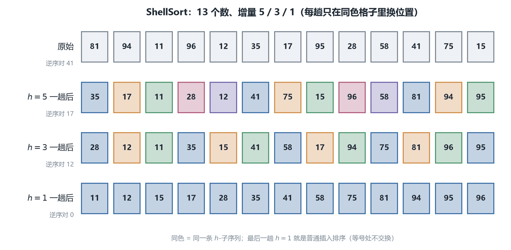
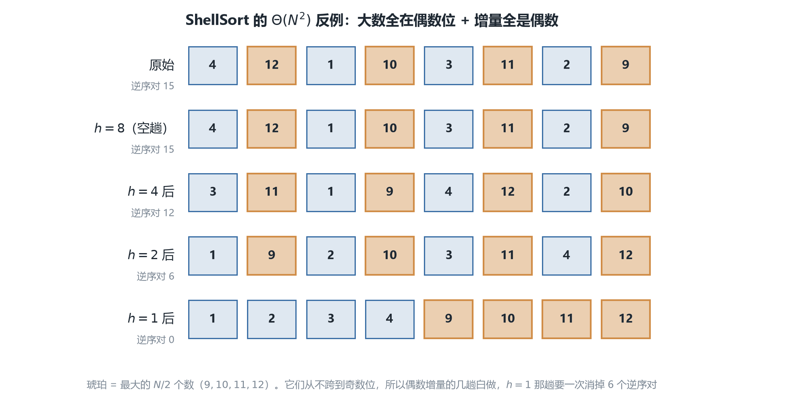
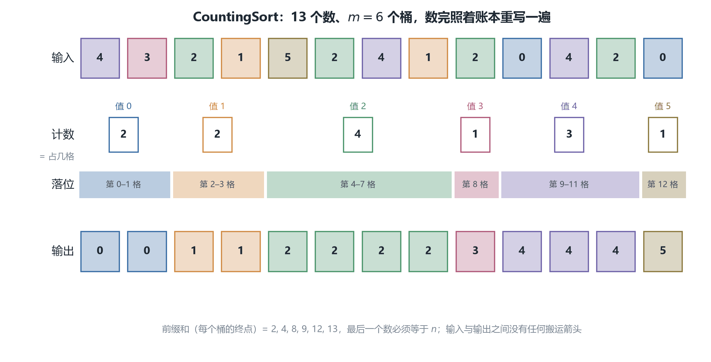
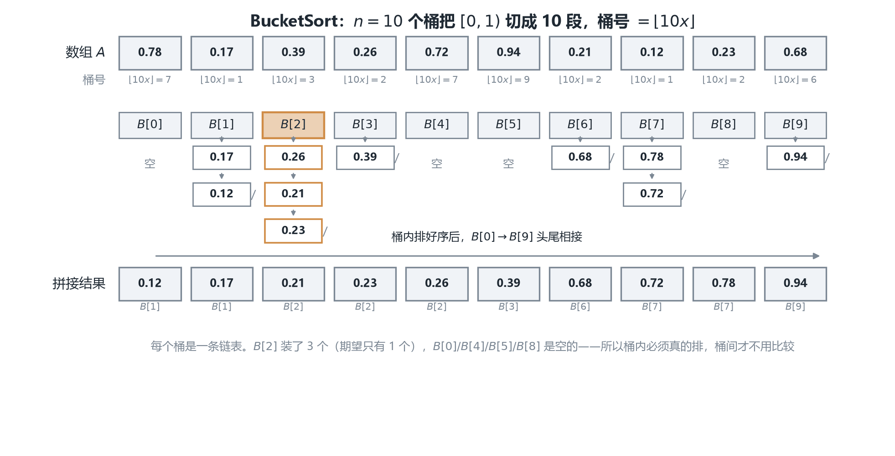
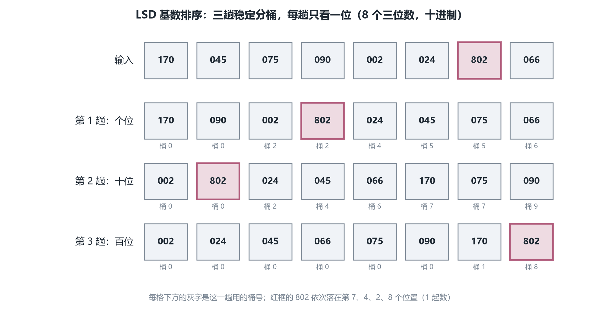
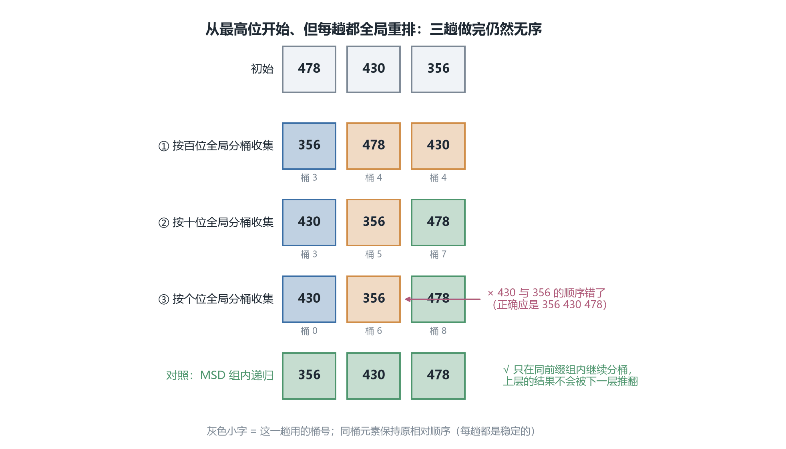

# CSC3100 Lecture 12 课堂笔记：More Sorting Algorithms（更多排序算法）

> **材料构成**：本讲基于课件（PDF/PPT）整理，不含教师口述内容；课件 `lecture 12 (more sorting algorithms).pdf` 共 30 页。这 30 页的文字层只有约 8.2 K 字符，因为**示例表格、伪代码、Java 代码、桶与队列的示意图基本都以图片形式存在**——所以我把 30 页全部按 160 dpi 渲染成图逐页读过；其中 p.22、p.23 两页代码按 320 dpi 重渲，p.28 的十行总表按 300 dpi 重渲，p.6 的逆序对公式、p.9 的伪代码、p.14 的 $\lfloor nA[i] \rfloor$ 又各按 420 dpi 裁切复核了一遍（这三处最容易看错符号）。凡是我看不清或课件没说的，文末都写明，没有靠猜补。
>
> **课件结构**：目录（p.2）→ ShellSort 的三个要点（p.3）→ h-sort 的定义与 13 个数的例子（p.4）→ Java 实现（p.5）→ ShellSort 的分析与 $\Theta(N^2)$ 反例（p.6）→ CountingSort 的假设与三步（p.7）→ 一个 13 个数的例子（p.8）→ 伪代码（p.9）→ 两道练习：手算 + 最小值很大怎么办（p.10）→ BucketSort 的假设与五步（p.11）→ 10 个实数的分桶（p.12）→ 桶内排序与拼接（p.13）→ 伪代码（p.14）→ 6 个实数的练习（p.15）→ RadixSort 的动机（p.16）→ 三轮基数排序（p.17-19）→ 两位数的小例子（p.20-21）→ 代码（p.22-23）→ 归纳证明（p.24）→ 复杂度 $O(k(M+n))$（p.25）→ 两道练习：六个数 + 能不能从最高位开始（p.26）→ 为什么快排还常用（p.27）→ 十种排序算法总表（p.28）→ 稳定性的定义与例子（p.29）→ 阅读与下一讲（p.30）。
>
> **已知课件问题**：p.6 的定理主语不清（"using some increment"是"某个增量序列"还是"任意增量序列"），而它的反例用的正是 p.5 代码里那套折半序列；p.6 的逆序对公式 `1+2+…+(N-1)/2` 应为 `1+2+…+(N/2-1)`（N=8 时实测 6 个，按课件的写法是 3.5 项，没法求和）；p.28 那张表里 `k` 一个字母当了三种用（计数排序的 k 是值域、基数排序的 k 是位数、桶排序的 k 是桶数）。其余几条（p.9 的 `s`/`S` 大小写、p.14 给"桶内快排"标的 $O(n)$、p.26 只提问不给答案、p.22/p.23 代码的五处硬伤）都在文末「附：诚实备注」里逐条列出，并注明我凭什么这么判。
>
> **来源标注约定**：正文里凡标 **【补】** 的段落，都是课件没有、由我补充或推导的内容（包括六张配图与全部复算）；没有标注的，都是课件上写着的。页码一律指课件页码（与 PDF 阅读器页码一致）。

## 0. 一句话概括本讲在讲什么

上一讲（L11）在 p.30 留了一个问题：比较排序里我们已经见过 $O(n\log n)$（归并排序；快排是期望）与 $O(n^2)$（插入、选择），那么"有没有希望比 $O(n\log n)$ 更好，比如 $O(n)$？"那一页给的答案是**没有**——只要算法只允许用 `<`、`>`、`=` 去看键，就有 $\Omega(n\log n)$ 的下界（决策树，L11 p.32-p.35）。

本讲是对这条下界的一次"绕过"尝试，而它把答案分成了很不一样的两半。

**第一半（p.3-p.6，ShellSort）仍然只用比较。** 所以它**不可能**突破 $\Omega(n\log n)$。它突破的是另一道墙——插入排序的 $O(N^2)$。手法是"先比远处的元素"：让一个困在数组末尾的小数一次跨好几格，而不是一格一格往左挪。这一半的结局是：它没能打败 $n\log n$，但它**打败了** $n^2$（平均意义下；最坏仍是 $N^2$）。

**第二半（p.7-p.26，CountingSort、BucketSort、RadixSort）干脆不做比较。** 它把键当成**地址**（计数排序）、当成**区间坐标**（桶排序）、拆成**一位一位的地址**（基数排序）。既然一次比较都没做，$\Omega(n\log n)$ 的前提就不成立了——这才是"比 $n\log n$ 更快"的真正答案，代价是三个额外假设：值域要小、分布要均匀、键要能按位拆开。

这条分界不是我的归纳，课件 p.2 的目录就是这么分的：ShellSort 挂在 "Comparison-based sorting algorithms" 下面，另外三个挂在 "Non-comparison-based sorting algorithms" 下面。**看清这条线，30 页就只剩一个问题：为了绕开比较，你愿意对输入多承诺什么。**

而承诺是有代价的，本讲所有复杂度里都藏着这个代价：计数排序的 $O(n+m)$ 在 $m$ 远大于 $n$ 时就是灾难（32 位整数要 16 GiB 的桶，见 §12）；桶排序的 $O(n)$ 一到"所有数挤在一个桶里"就退回 $O(n^2)$（见 §19）；基数排序的 $O(k(M+n))$ 在键很宽时 $k$ 会跟着涨（见 §25）。所以 p.27 才会反问："既然基数排序是 $\Theta(n)$，为什么快排还常用？"

一句话：**ShellSort 用"跨远比较"把二次降到接近 $n^{1.3}$，但没走出比较模型；计数、桶、基数排序靠"把键当地址"直接越过 $n\log n$，代价是对值域、分布或位宽的三条假设。**

**本讲地图**

| 页码 | 本节 | 这一块在回答什么 |
| --- | --- | --- |
| p.2 | 目录 | 把五种算法分成"比较"与"非比较"两类，这条分界线就是全讲骨架 |
| p.3-4 | ShellSort 的动机与 h-sort | 能不能靠"跟远处的元素比较"绕开 $O(N^2)$？ |
| p.5 | Java 实现 | 折半增量序列写成代码是什么样 |
| p.6 | 分析与反例 | 为什么 ShellSort 的界这么难定；$\Theta(N^2)$ 的最坏情况怎么造出来 |
| p.7-10 | CountingSort | 值域很小时，能不能不比较、只数个数？ |
| p.11-15 | BucketSort | 值均匀分布在 $[0,1)$ 时，能不能切 $n$ 个桶分头排？ |
| p.16-26 | RadixSort | 值域很大时，能不能一位一位地排？ |
| p.27 | 常数因子 | 既然是线性的，为什么实际还在用快排 |
| p.28 | 十种算法总表 | 把所有算法的稳定性、三种情况的代价、额外空间摆在一张表里 |
| p.29 | 稳定性 | 什么叫稳定，为什么它只在"有卫星数据"时才存在 |
| p.30 | 阅读与下一讲 | Chapter 8；下一讲进入树（Chapter 12） |

## 1. 目录页先画了一条分界线（p.2）

目录页只有五行，但它的分组方式比任何一页都重要：

> **Comparison-based sorting algorithms**
> ShellSort
>
> **Non-comparison-based sorting algorithms**
> CountingSort、BucketSort、RadixSort
>
> **A summary of 10 classic sorting algorithms**

为什么这个分组是"骨架"而不是"目录"？因为它对应一句可以严格证明的话：**只用比较的排序，最坏情况不可能低于 $\Omega(n\log n)$**。这句话在 L11 p.35 已经证过（决策树的高度至少 $\log_2 n!$，而 $\log_2 n! = \Omega(n\log n)$）。所以任何算法只要敢说自己是"基于比较"的，它给出的任何 $O(\cdot)$ 都不可能比 $n\log n$ 更好——**这不是算法不够聪明，是模型不允许**。

于是本讲的两半就有了完全不同的评价标准：

- ShellSort 属于左边这一组，所以它的目标只能是"把 $O(N^2)$ 拉下来"，而不是“低于 $n\log n$”。定理（p.6）说它在最坏情况仍是 $\Theta(N^2)$，这不是失败，而是意料之中——**在比较模型里，最坏 $n^2$ 到 $n\log n$ 之间的空间是可以走的，但底在 $n\log n$**。
- 右边这一组属于"换模型"：它们看的不是"$a$ 比 $b$ 大吗"，而是"$a$ 的数值是多少，能不能直接当门牌号用"。模型一换，$n\log n$ 这条下界就管不着它们了。

**【补】一个容易混的点：越过 $n\log n$ 的不是"更聪明的比较顺序"，而是"额外信息"。** 计数排序之所以快，是因为它偷偷用了比较模型之外的信息——键是 $[0, m)$ 里的整数，于是"键的值"可以当地址。如果键是任意可比较对象（比如学生记录按姓名拼音排序），计数排序根本无从下手。所以本讲后半段的每一个"线性"结论，都可以翻译成同一句话：**用一条关于输入的假设，换掉一次 $\log n$。**

最后一行 "A summary of 10 classic sorting algorithms"（对应 p.28）也值得先说一句：这张表把本课程前后讲过的十种排序放在一起，是复习时的总索引。它同时也是本讲唯一一处"回头看"的地方，§29 会逐列读它。

## 2. ShellSort 的出发点：让比较跨得更远（p.3）

（p.3）三句话，句句都是“设计意图”而不是“定义”：

> Break the quadratic time barrier by comparing elements that are distant.
>
> The distance between comparisons decreases as the algorithm runs until the last phase, in which adjacent elements are compared (diminishing increment sort).
>
> An increment sequence $h_1, h_2, h_3, \ldots, h_t$, used in reverse order with $h_1 = 1$.

第一句是目标：**打破二次时间壁垒（quadratic time barrier）**，办法是"比较相距很远的元素"。第二句给出名字的由来：比较距离一路递减，直到最后一趟退化成相邻比较——所以又叫**递减增量排序（diminishing increment sort）**；`ShellSort` 来自发明者 Donald Shell（1959）。第三句是参数：增量序列 $h_1 < \cdots < h_t$，**倒过来用**，且规定 $h_1 = 1$。

### 2.1 为什么"远距离比较"能省时间

要理解这句话，得先回忆插入排序的代价到底花在哪。L3、L4 都推过同一个结论：**插入排序的移动次数恰好等于数组的逆序对（inversion）个数**。所谓逆序对，就是一对下标 $i < j$ 但 $A[i] > A[j]$ 的元素；插入第 $j$ 个元素时，它要往左挪过所有比它大的元素，挪一格就消掉一个逆序对。所以

$$
\text{插入排序的代价} = \#\{\,(i,j) : i < j,\ A[i] > A[j]\,\} + (n-1)
$$

（那 $n-1$ 是每个元素至少比较一次的固定开销。）

这个等式说明：**插入排序慢，不是因为"比较"本身贵，而是因为每个逆序对都要付一次移动，而它一次只能消掉"相邻"的那一个。** 想象一个极端的数组：前面全是 $n, n-1, \ldots$ 这样的大数，最后一个位置放一个 $1$。这个 $1$ 与前面 $n-1$ 个数全部构成逆序对，插入排序要让它一格一格挪过 $n-1$ 个格子。这种"位置很靠后、值却很小"的元素有个绰号叫**乌龟（turtle）**——它爬得极慢，而正是这些乌龟把插入排序拖成了 $O(n^2)$。

ShellSort 的想法直白到有点粗暴：**既然慢在"一次只能挪一格"，那就先让它一次挪 $h$ 格。** 以 $h$ 为增量做一趟，等于把数组按模 $h$ 切成 $h$ 条子序列、各自插入排序；同一条子序列里相邻两个元素在原数组相隔 $h$ 格。**同样是消掉一个逆序对，代价没变，但消掉的是"跨 $h$ 格"那种——它们本来要花 $h$ 步。**

**【补】换个说法：ShellSort 没有减少"逆序对的总数"，它改变的是"消逆序对的顺序"。** 插入排序只能从近到远消，于是远处的逆序对要先被"挤"成近处的；ShellSort 从远到近消，远处的先解决，等做到相邻比较时，剩下的逆序对已经很少了。这一点在 §5 会被三个具体数字证实：p.4 那个例子原始有 41 个逆序对，5-sort 之后剩 17 个，3-sort 之后剩 12 个，最后一趟只需消 12 个。

### 2.2 增量序列：为什么必须倒着用、必须以 1 结尾

"used in reverse order" 这句话包含两个设计决定，都值得单独说。

**第一，为什么从大往小用。** 大的 $h$ 能让乌龟一次跳很远，但它只能保证"每隔 $h$ 个是有序的"，整个数组还很乱；小的 $h$ 让数组更接近有序，但步子小。所以合理的顺序是**先用大 $h$ 做粗调，再用小 $h$ 做细调**：每一趟都在上一趟的基础上把数组推向"更有序"，最后一趟做得最细。

**第二，为什么 $h_1$ 必须是 1。** 这是整个算法唯一不能商量的要求。$h = 1$ 的一趟就是普通的插入排序，它才能保证"整个数组有序"；如果增量序列不以 1 结尾，算法最后停下来时数组只是"每隔 $h_1$ 个有序"，根本没有排好。所以 p.4 的那句 "Standard insertion sort" 不是随手一标——**ShellSort 的最后一趟永远是标准插入排序，正确性完全由它兜底。**

**【补】这也解释了为什么分析 ShellSort 时要盯住增量序列。** 算法的"骨架"（$h$ 递减、每趟做 $h$-sort、最后 $h=1$）是固定的，可变的部分全在"选哪串 $h$"。而这些 $h$ 决定了每一趟能消掉多少逆序对，也就决定了总代价——p.6 那句 "Different sequences lead to different time cost!" 说的就是这件事。

## 3. 一趟 h-sort 到底在做什么（p.4）

h-sort 的定义和一个 13 个数的例子都在 p.4：

> After a phase, with an increment $h_k$, $A[i] \le A[i + h_k]$
>
> All elements spaced $h_k$ apart are sorted (insertion sort)
>
> Example: consider an increment sequence: 1, 3, 5. For each $h_k$, we need to sort $h_k$ subsequences.

### 3.1 定义里的量词

课件写的是 $A[i] \le A[i + h_k]$，看上去只说了"某一个 $i$"。实际含义是**对所有合法的 $i$ 都成立**——即 $i$ 从 $0$ 取到 $n - 1 - h_k$ 都要满足。这个量词不能省：如果只要求某一个 $i$，那任何数组都能找到满足条件的 $i$，定义就没有内容了。

把"对所有 $i$ 都有 $A[i] \le A[i+h_k]$"与"把数组按模 $h_k$ 分成 $h_k$ 条子序列、每条各自有序"对照着看，会发现它们是**同一句话的两种写法**：

- 若每条子序列都有序，那么同一条子序列里相邻两个元素（下标差恰好是 $h_k$）当然满足 $A[i] \le A[i+h_k]$；
- 反过来，若对所有 $i$ 都有 $A[i] \le A[i+h_k]$，那么沿着一组下标 $r, r+h_k, r+2h_k, \ldots$ 一路看过去，值是单调不减的，也就是这条子序列有序。

所以"$h_k$-sorted"（$h_k$ 有序）可以无歧义地理解为：**$h_k$ 条子序列各自用插入排序排好，但只在子序列内部交换。** 课件那句 "All elements spaced $h_k$ apart are sorted (insertion sort)" 括号里的 insertion sort 就是在说这件事：实现 $h$-sort 不用什么新算法，还是插入排序，只是步长从 1 变成 $h$。

### 3.2 例子：13 个数、增量序列 1, 3, 5

课件的增量序列是 $1, 3, 5$，倒过来用就是 **5, 3, 1** 三趟。数组有 $n = 13$ 个元素：

> 原始：81　94　11　96　12　35　17　95　28　58　41　75　15

$h = 5$ 时要分 5 条子序列（起点分别是 0、1、2、3、4），$h = 3$ 时 3 条，$h = 1$ 时 1 条。把每条子序列的下标、排序前后的内容列出来，才能看清"只在自己那条子序列里动"是什么意思：

| 趟 | 子序列起点 | 下标 | 排序前 | 排序后 |
| --- | --- | --- | --- | --- |
| $h=5$ | 0 | 0, 5, 10 | 81, 35, 41 | 35, 41, 81 |
| $h=5$ | 1 | 1, 6, 11 | 94, 17, 75 | 17, 75, 94 |
| $h=5$ | 2 | 2, 7, 12 | 11, 95, 15 | 11, 15, 95 |
| $h=5$ | 3 | 3, 8 | 96, 28 | 28, 96 |
| $h=5$ | 4 | 4, 9 | 12, 58 | 12, 58 |
| $h=3$ | 0 | 0, 3, 6, 9, 12 | 35, 28, 75, 58, 95 | 28, 35, 58, 75, 95 |
| $h=3$ | 1 | 1, 4, 7, 10 | 17, 12, 15, 81 | 12, 15, 17, 81 |
| $h=3$ | 2 | 2, 5, 8, 11 | 11, 41, 96, 94 | 11, 41, 94, 96 |

注意第二段的"排序前"是**第一趟做完之后**的值，不是原始数组的值。这一点很容易在纸上算错：如果两趟都从原始数组出发，得到的 3-sorted 结果与课件对不上（而且它甚至可能不满足 5-sorted）。**每一趟都在上一趟的结果上做，这是 ShellSort 的定义。**

把两条子序列的排列摊开看，$h=5$ 那一趟其实就是"三条长度 3 的子序列 + 两条长度 2 的子序列"各自插入排序：$81, 35, 41$ 排成 $35, 41, 81$；$96, 28$ 排成 $28, 96$；等等。没有任何跨子序列的交换。

## 4. 把 p.4 的例子逐趟走完（p.4）

把上面 8 条子序列的结果按原下标拼回去，就得到课件的三行状态（也是图 1 画的那三行）：

> **5-sorted**：35　17　11　28　12　41　75　15　96　58　81　94　95
>
> **3-sorted**：28　12　11　35　15　41　58　17　94　75　81　96　95
>
> **1-sorted**：11　12　15　17　28　35　41　58　75　81　94　95　96

**第一件事：5-sort 之后，数组看上去还是很乱。** $35, 17, 11, 28, \ldots$ 完全不单调，初学者在这一步很容易怀疑"这真的有帮助吗"。答案是"乱的方式变了"：现在每个元素都在自己那条子序列里排好了序，跨子序列的相对位置被固定住了。

**【补】用逆序对量一下，"帮助"就看得见了。** 三行状态的逆序对数依次是 $41 \to 17 \to 12 \to 0$（脚本数的，见「诚实备注」三）：第一趟消掉 24 个（59%），最后一趟只剩 12 个要消——**最后一趟的账单从 41 降到 12**。这正是 ShellSort 的收益来源：大 $h$ 的几趟很便宜，却把最后一趟的账单压小了。

**第二件事：最后一趟就是普通插入排序。** 课件在 "1-sorted" 那一行右边写了 "Standard insertion sort"。这不是补充说明，而是**通用事实**：任何 $h=1$ 的趟都是标准插入排序。所以 ShellSort 可以写成"叫几次插入排序、每次换个步长"，也可以写成 p.5 那种"一个双层循环"——两种写法说的是同一件事。

**第三件事：3-sort 之后，5-sorted 的性质居然还在。** 这个数组里，$h=3$ 的一趟之后仍然满足 $A[i] \le A[i+5]$（我逐对核过）。这件事不能想当然——严格说，小 $h$ 的趟是可能打乱大 $h$ 的趟建立的局部秩序的，因为不同 $h$ 划分出的子序列不一样，一个元素换位置后可能跨进了别的类。

**【补】不过我在小规模上没找到"后一趟毁掉前一趟"的例子。** 我穷举了 $n \le 9$ 的全部排列与所有 $h > k$ 的组合，又随机试了 20 万组 $n \le 14$，没有一例"$h$-sorted 之后再 $k$-sort（$k<h$）就不再 $h$-sorted"。所以我不用"后一趟毁掉前一趟"这个说法——至少在可穷举范围内它不是真的。这只是经验、没有证明；正确性也只需要最后一趟是插入排序。

图 1 把这三行画在一起，颜色标出"一条子序列"：



*图 1　p.4 那个 13 个数的例子，增量 5、3、1 三趟的状态。同一颜色的格子属于同一条 $h$-子序列——每一趟只在自己那种颜色的格子里重排，跨颜色从不交换。（据课件 p.4 重绘）*

## 5. p.5 的 Java 代码（p.5）

课件给的实现短得意外，只有三层循环：

::: code-group

```java [Java]
class Sort {
    public static void shellSort(int[] a) {
        int j;
        for (int gap = a.length / 2; gap > 0; gap /= 2)
            for (int i = gap; i < a.length; i++) {
                int tmp = a[i];
                for (j = i; j >= gap && tmp < a[j - gap]; j -= gap)
                    a[j] = a[j - gap];
                a[j] = tmp;
            }
    }
}
```

```python [Python]
def shell_sort(a):
    gap = len(a) // 2                       # 折半序列：n/2, n/4, …, 1
    while gap > 0:
        for i in range(gap, len(a)):
            tmp, j = a[i], i
            while j >= gap and tmp < a[j - gap]:
                a[j] = a[j - gap]; j -= gap
            a[j] = tmp
        gap //= 2
```

```cpp [C++]
void shellSort(int *a, int n) {
    int j;
    for (int gap = n / 2; gap > 0; gap /= 2)
        for (int i = gap; i < n; i++) {
            int tmp = a[i];
            for (j = i; j >= gap && tmp < a[j - gap]; j -= gap)
                a[j] = a[j - gap];
            a[j] = tmp;
        }
}
```

```c [C]
void shellSort(int *a, int n) {
    int j;
    for (int gap = n / 2; gap > 0; gap /= 2)
        for (int i = gap; i < n; i++) {
            int tmp = a[i];
            for (j = i; j >= gap && tmp < a[j - gap]; j -= gap)
                a[j] = a[j - gap];
            a[j] = tmp;
        }
}
```

:::

### 5.1 逐行读

**`for (int gap = a.length / 2; gap > 0; gap /= 2)`**：外层是增量序列，从 $n/2$ 开始，每次减半，直到 1（整数除法，$1/2 = 0$ 时循环结束）。$n = 13$ 时得到 $6, 3, 1$；$n = 16$ 时得到 $8, 4, 2, 1$。这就是标准的**折半序列（Shell's increments）**。

**`for (int i = gap; i < a.length; i++)`**：内层从下标 `gap` 开始，逐个把 `a[i]` 插进它该在的位置。为什么从 `gap` 而不是 0 开始？因为下标 $0 \ldots gap-1$ 的这 $gap$ 个元素各自就是一条子序列的"第一个元素"，一条只有一个元素的子序列天然有序，不需要插入。

**`int tmp = a[i];`**：把待插入的元素取出来。这一步不能省，因为接下来会覆盖 `a[i]`。

**`for (j = i; j >= gap && tmp < a[j - gap]; j -= gap) a[j] = a[j - gap];`**：这就是插入排序的内层，只是把步长 1 换成了 `gap`。`j >= gap` 保证不越界；`tmp < a[j-gap]` 表示"前一个（距离 `gap`）比我大，我要往左挪"；`a[j] = a[j-gap]` 把大的元素往后搬一格（在子序列的意义上）。

**`a[j] = tmp;`**：循环停下来时 `j` 就是 `tmp` 该待的位置，放进去。

### 5.2 这段代码为什么等价于"$gap$ 条子序列各做插入排序"

关键在于 `i` 的递增顺序。`i` 从 `gap` 一路走到 `n-1`，每次处理一个元素；而它处理的元素交替属于不同的子序列（`i`、`i+1`、`i+2`……分别落在第 $i \bmod gap$ 类）。看起来"同时在排好几条子序列"，但**每条子序列内部被处理的先后顺序仍然是它在原数组里的顺序**（下标小的先处理），而插入排序对"按顺序喂元素"是不敏感的——先喂完整条再喂下一条，和交错着喂，结果一模一样。

所以这段代码可以一句话概括：**把 $h$ 条子序列的插入排序交错着做，省掉了"循环套一层子序列下标"的那层。** 它不是另一种算法，只是同一种算法的紧凑写法。

**【补】`tmp < a[j-gap]` 里的严格小于不是随手写的。** 如果写成 `tmp <= a[j-gap]`，相等元素也会互相交换，每一趟内部都不再稳定；写成 `<` 至少保证了"一条子序列内部不交换相等元素"。但要注意：**这并不足以让整个 ShellSort 稳定**——不同子序列之间的位置变化仍然可能颠倒两个相等元素的先后。关于这一点，§30 会给一个 4 个元素的最小反例。

### 5.3 这段代码跑的不是 p.4 那个例子

这是本讲最容易踩的坑，必须单独说：**§3 例子的增量序列是 $1, 3, 5$（即 $5, 3, 1$），而 §5 的代码（p.5）用的是折半序列 $6, 3, 1$。** 两者只有第一个增量不同（5 与 6），但跑出来的中间状态完全不一样：

- 按 p.4 的 $5, 3, 1$：5-sorted 是 `35 17 11 28 12 41 75 15 96 58 81 94 95`（§4）；
- 按 p.5 的 $6, 3, 1$：第一趟 6-sort 之后是 `15 94 11 58 12 35 17 95 28 96 41 75 81`，与上面那一行毫无关系。

两者最终都会排成同一个升序数组（因为最后一趟都是 $h=1$ 的插入排序），所以"结果一样"很容易让人以为"过程也一样"。**但中间状态不同，就说明这是两个不同的增量序列，考试里问"第一趟之后数组是什么"时必须先确认问的是哪一个。**

【补】这也解释了为什么 p.4 的例子要单独给一个增量序列：它想让读者看清"$h$ 条子序列"的结构，而代码里的 $n/2$ 折半序列会让 13 个元素分成 $6, 3, 1$ 条，条数不好画。**例子的目的是解释结构，代码的目的是给出一个能跑的默认序列，两者本来就不必一致**——但课件没有把这句话写出来，所以连读两页会以为代码在跑例子。

## 6. 为什么 ShellSort 这么难分析（p.6）

分析这一页（p.6）只有三行，却道出了 ShellSort 的尴尬：

> Analysis of Shellsort
> - Very hard (average-case is a long-standing open problem)
> - Depend on the selection of an increment sequence
> - Difference sequences lead to different time cost!

**"很难分析"** 难在哪？回想我们分析插入排序时用的那招：代价等于逆序对数，而逆序对数可以直接从输入数出来——**一个数就把整个算法的代价说完了**。归并排序也类似：递归式 $T(n) = 2T(n/2) + O(n)$ 中的"合并代价"与元素具体怎么分布无关。

ShellSort 两条都不满足。第 $k$ 趟的代价取决于第 $k-1$ 趟留下的**具体排列**，而那个排列又取决于增量序列；更麻烦的是不同模数（5 和 3）的子序列互相交错，一个元素在第 5 类里挪了位置，到第 3 类里就换了伙伴，于是"前几趟把数组整理到了什么程度"没有一个好用的不变量。**平均情况至今没有精确结论，是排序理论里挂了六十多年的公开问题（long-standing open problem）。**

**"依赖增量序列"** 与 **"不同序列代价不同"** 是同一件事的两面。这句话听起来像废话，但它解释了为什么 ShellSort 的所有定理都长这样："**用某某增量序列时**，最坏是某某"——定理的主体永远是"序列 + 界"这一对，而不是"ShellSort"这一个算法。

一句话概括这个局面：**ShellSort 的复杂度不是一个数，而是增量序列的函数。**

【补】这也是 ShellSort 在面试里常被问到"你怎么选增量"的原因：算法本身没什么可调的，唯一的设计自由度全在序列上。而序列的选择又是一场"趟数"与"每趟能消多少逆序对"的权衡——增量多、跨度细，每趟都便宜但趟数多；增量少、跨度粗，趟数少但最后一趟贵。

## 7. ShellSort 的最坏情况：一条构造出来的反例（p.6）

同一页（p.6）还有定理和它的构造：

> Theorem: the worst-case running time of Shellsort, using some increment, is $\Theta(N^2)$
>
> - Put the largest $N/2$ numbers in the even positions, e.g., 4, 12, 1, 10, 3, 11, 2, 9
> - Use the increments {…, 8, 4, 2, 1}
> - Before the last sort, the $N/2$ largest numbers are still in the even positions, e.g., 1, 9, 2, 10, 3, 11, 4, 12
> - The numbers of inversions is $1+2+\ldots+(N-1)/2 = \Theta(N^2)$

### 7.1 构造怎么读

$N = 8$，要排的是 $1 \ldots 12$ 里的 8 个数。**"把最大的 $N/2$ 个数放在偶数位置"**：最大的 4 个是 $9, 10, 11, 12$，把它们放在第 2、4、6、8 个位置上（课件的例子是 1 起数的偶数位），其余位置放小的：

> 原始：4　**12**　1　**10**　3　**11**　2　**9**

**"用增量 {…, 8, 4, 2, 1}"**：都是偶数，最后一趟才是奇数 1。这一条是构造的核心——**当增量全是偶数时，偶数位与奇数位是两个互不干扰的类**：任何一趟里，一个元素只会在自己那一类里换位置，永远不会跨到另一类去。

于是接下来发生的事情完全可以预料：大的那 4 个数占着偶数位这一类，它们只会彼此比较、彼此排序；而它们每一个都比奇数位上的所有数大，所以**它们永远没有理由往左挪**。几趟偶数增量做完，数组变成"小、大、小、大……"交错的样子，大的那几个在自己那一类里升了序：

> 4-sort 之后：3　**11**　1　**9**　4　**12**　2　**10**（逆序对 12）
>
> 2-sort 之后：1　**9**　2　**10**　3　**11**　4　**12**（逆序对 6，正是课件那一行）

这就是课件那句 "Before the last sort, the N/2 largest numbers are still in the even positions" 的意思：**所有偶数增量的趟都做完了，大的那几个还一个都没动窝。**

图 2 把从原始到 $h=1$ 的五趟全部画了出来，琥珀色的就是那四个大数：



*图 2　p.6 那个 $\Theta(N^2)$ 反例的逐趟演示：4, 12, 1, 10, 3, 11, 2, 9 配增量 8, 4, 2, 1，五行的逆序对依次是 15、15、12、6、0——琥珀色的 9, 10, 11, 12 从不离开偶数位，偶数增量的几趟白做，剩下的 6 个逆序对全留给 $h=1$ 的最后一趟。（据课件 p.6 重绘）*

### 7.2 逆序对为什么是 $1+2+\cdots$

看最终的排列 $1, 9, 2, 10, 3, 11, 4, 12$。最大的 $12$ 在最后，右边没有数，贡献 0 个逆序对；$11$ 右边只有 $12$？不对——要数的是"每个大数右边有几个小数"：

- $9$ 右边的小数是 $2, 3, 4$，共 3 个；
- $10$ 右边的小数是 $3, 4$，共 2 个；
- $11$ 右边的小数是 $4$，共 1 个；
- $12$ 在最右边，共 0 个。

合计 $3 + 2 + 1 = 6$ 个逆序对。一般地，$N/2$ 个大数里，最大的那个右边有 $N/2 - 1$ 个小数，次大的有 $N/2 - 2$ 个……最小的那个大数右边有 1 个，所以

$$
\text{逆序对数} = 1 + 2 + \cdots + \left(\frac{N}{2} - 1\right) = \frac{(N/2-1)(N/2)}{2} = \Theta(N^2)
$$

而最后一趟是 $h = 1$ 的插入排序，它要把这 $\Theta(N^2)$ 个逆序对全部消掉，一个逆序对至少一次移动——**于是总代价 $\Theta(N^2)$**。前面那几趟偶数增量的成本加起来只有 $O(N\log N)$ 量级（每趟 $O(N)$，共 $O(\log N)$ 趟），被最后一趟完全盖住。

**【补】这个构造攻击的是"最后一趟"而不是"前面几趟"。** 一般的担心是"前面几趟会不会白做"，而这里的反例是"前面几趟做得很认真，但它们做的事恰好不影响最后一趟的账单"：**偶数增量让算法在两个互不相通的房间里各自整理得井井有条，$h=1$ 那一趟要把两个房间合并，才发现大的全在一个房间、小的全在另一个房间**——合并的代价是 $\Theta(N^2)$。

### 7.3 这条公式的小问题

课件写的是 $1+2+\ldots+(N-1)/2$。按字面理解，$N = 8$ 时上界是 $3.5$，一个从 1 加到 3.5 的和是没有定义的；而实际逆序对是 $6$，对应的是加到 $3$。正确的写法是加到 $N/2 - 1$（$N=8$ 时即 3）。**这不影响结论**（两种写法都是 $\Theta(N^2)$），但照抄会在算具体数时卡住。判据很简单：把 $N=8$ 代进去数一遍，$3+2+1 = 6$，而课件的分母位置给的是 $3.5$。

**【补】顺带说一句：为什么偏偏用偶数位置、偶数增量？** 因为"偶数增量"这个条件太强了，强到可以把数组切成两个**永不相通**的类，而"最大的 $N/2$ 个"恰好可以整整齐齐地放进其中一个类。这是人为制造的、最坏情况里最坏的一种——它不依赖输入的具体数值，只依赖"大小关系"与"位置奇偶"的配合。这也是为什么它成了教科书的标配反例。

## 8. 增量序列决定一切（p.6 + p.28 的口径对账）

### 8.1 定理主语的那点含糊

定理原文是 "the worst-case running time of Shellsort, using **some** increment, is $\Theta(N^2)$"。这个 "some" 有两种读法：

- **读法一（存在）**：存在某个增量序列，使得 ShellSort 的最坏情况是 $\Theta(N^2)$。
- **读法二（任意）**：对任意增量序列，ShellSort 的最坏情况都是 $\Theta(N^2)$。

**读法二是错的**，而且错得很明显：Hibbard 的增量序列 $1, 3, 7, 15, \ldots$（即 $2^k - 1$）能把最坏情况压到 $\Theta(N^{3/2})$，Sedgewick 的序列能到 $O(N^{4/3})$。如果读法二成立，这些结果就都不存在了。

所以只能是读法一。再结合反例用的正是 {…, 8, 4, 2, 1}（也就是 p.5 代码里那套折半序列），可以把定理读得更具体：**用折半序列（$N/2, N/4, \ldots, 1$）时，ShellSort 的最坏情况是 $\Theta(N^2)$。** 这也与教材里的经典表述一致——那条 $\Theta(N^2)$ 定理本来就是针对 Shell 本人提出的折半序列证的。

**【补】这一点在复习时很要紧。** 因为总表（p.28）里 ShellSort 那一行的“最坏”写的是 $O(n^2)$，读者很容易把它和"ShellSort 这个算法"绑定，然后在别处看到 "$O(N^{3/2})$" 时以为有人算错了。真实情况是：**ShellSort 的界永远跟着增量序列走，说界就必须说序列。**

### 8.2 常见的几套序列

| 增量序列 | 最坏情况 | 说明 |
| --- | --- | --- |
| $N/2, N/4, \ldots, 1$（折半，Shell 1959） | $\Theta(N^2)$ | §5 的代码用的就是它；§7 的反例也是针对它 |
| $1, 3, 7, 15, \ldots$（即 $2^k - 1$，Hibbard） | $\Theta(N^{3/2})$ | 相邻增量互质，避免了"偶数增量把数组切成两半"的毛病 |
| $1, 5, 19, 41, 109, \ldots$（Sedgewick） | $O(N^{4/3})$ | 实践中最常被引用的一套 |
| $1, 2, 3, 4, 6, 8, 9, 12, \ldots$（Pratt，所有 $2^i 3^j$） | $O(N\log^2 N)$ | 理论上最好的一类，但增量个数太多，实际不划算 |
| $1, 4, 13, 40, \ldots$（即 $3h+1$，Knuth） | 未定（经验很好） | 常被当作"工程默认值" |

这张表里没有"平均情况"一列，因为**除了少数几套序列，平均情况至今没有严格结果**。总表（p.28）里那个 $n^{1.3}$ 是实验界流传的经验值（folklore），不是一个定理。

### 8.3 我自己跑的一组数

为了对"经验上比 $n\log n$ 慢、比 $n^2$ 快得多"有个手感，我写了脚本（见文末「诚实备注」三），对 $n = 500$ 到 $16000$ 各取 40 组随机排列，统计"比较次数 + 移动次数"，再除以 $n$：

| $n$ | 折半序列：代价 / $n$ | $3h+1$ 序列：代价 / $n$ |
| --- | --- | --- |
| 500 | 32.8 | 29.0 |
| 1000 | 39.0 | 34.0 |
| 2000 | 45.7 | 39.5 |
| 4000 | 53.1 | 45.7 |
| 8000 | 62.7 | 52.9 |
| 16000 | 73.2 | 59.5 |
| log-log 斜率 | ≈ 1.23 | ≈ 1.21 |

读这张表要注意三点。

第一，**代价 / $n$ 在涨**，说明代价不是线性的；但它涨得很慢（$n$ 涨 32 倍，每元素代价只涨 2.2 倍），拟合出的指数约 $1.2$，与流传的"$n^{1.3}$ 左右"量级一致。

第二，**与 $n\log n$ 和 $n^2$ 比一下量级**：$n = 16000$ 时，$n\log_2 n \approx 2.24\times 10^5$，折半序列实测约 $1.17\times 10^6$（约 5 倍），而 $n^2 = 2.56\times 10^8$（是实测的 200 多倍）。所以 ShellSort 确实是"介于两者之间、离 $n^2$ 很远、离 $n\log n$ 不远"。

第三，**这只是 $n \le 16000$ 的实验，不能当渐近结论**。$10^4$ 量级的样本连"常数项是否稳定"都说不清，更别说指数了。它的用处只有一个：让你相信"ShellSort 在实践中通常比插入排序快一个数量级以上，但敌不过归并/快排"。

## 9. CountingSort：把"比较"换成"数数"（p.7）

CountingSort 一节（p.7）换了个思路，只有三句话：

> Assumption: all the values are integers in $[0, m-1]$
>
> Steps
> - Start with $m$ empty buckets numbered 0 to $m-1$
> - Scan the list and place element $s[i]$ in bucket $s[i]$
> - Output the buckets in order
>
> Will need an array of buckets, and the values to be sorted will be the indexes to the buckets. No comparisons will be necessary.

### 9.1 关键的那一句

最后一句 "**No comparisons will be necessary**"（一次比较都不需要）是本讲的分水岭。为什么可以不做比较？因为**键的数值本身就是地址**：值等于 3 的元素就该待在"3 号桶"里，而"3 号桶"在数组里的下标就是 3。既然"它该在哪"已经由键值直接给出，就没有任何"谁大谁小"需要判断。

而 $\Omega(n\log n)$ 的下界是**关于比较次数的**：决策树里每个内部结点都是一次比较，叶子才是一个可能的排序结果，$n!$ 个结果逼着树高至少 $\log_2 n!$。CountingSort 根本不在这棵树上走——它没有"决策"，只有"编号"。**定理没错，是它管不到这里。**

【补】一个容易被忽略的细节：CountingSort **用到了键的数值大小**（桶号越大值越大），算不算"偷偷比较"？不算——比较模型限制的是"只能通过 `<`、`>`、`=` 获取信息"，而 CountingSort 把键当下标；但这一步隐含了强假设：**键必须小到可以当数组下标**。值域 $m$ 就是这个假设的度量。

### 9.2 与 BucketSort 的名字之辨

注意 p.7 的 "bucket" 与 §15 的 "bucket" 不是一个东西：

- **这里**的桶是**一个值**：桶号 = 键值，$m$ 个桶对应 $m$ 个可能的键；
- **BucketSort 里**的桶是**一段区间**：$n$ 个桶把 $[0,1)$ 切成 $n$ 段，桶号 = $\lfloor nA[i] \rfloor$。

前者是"值域上的点"，后者是"值域上的区间"。这个区别决定了它们各自需要什么假设：CountingSort 要"值域小"，BucketSort 要"分布均匀"。

## 10. 例子的手算与伪代码（p.8-p.9）

### 10.1 p.8：13 个数、5 个桶

课件的输入是 $4, 2, 1, 2, 0, 3, 2, 1, 4, 0, 2, 3, 0$，值域是 $[0, 4]$，所以 $m = 5$：

| 桶号（= 值） | 0 | 1 | 2 | 3 | 4 |
| --- | --- | --- | --- | --- | --- |
| 出现次数 | 3 | 2 | 4 | 2 | 2 |

$3 + 2 + 4 + 2 + 2 = 13 = n$，一个不多一个不少。按桶号从小到大把元素倒出来：

> 输出：0　0　0　1　1　2　2　2　2　3　3　4　4

课件那一页的三行（原始、落桶、输出）画的就是这个过程。注意**落桶那一步只记了"个数"，没有记"是哪个元素"**——这一点在下一节会变成一个真问题。

### 10.2 p.9：三段式伪代码

::: code-group

```java [Java]
class Sort {
    static void countingSort(int[] s, int n, int m) {
        int[] b = new int[m];                            // m 个桶（计数器）
        for (int j = 0; j < m; j++) b[j] = 0;            // 第一段：初始化
        for (int i = 0; i < n; i++) b[s[i]] += 1;        // 第二段：落桶，只记个数
        int i = 0;
        for (int j = 0; j < m; j++)                      // 第三段：桶号升序倒出来
            for (int r = 1; r <= b[j]; r++) s[i++] = j;  // 原写作 S[i] ← j
    }
}
```

```python [Python]
def counting_sort(s, n, m):
    b = [0] * m                              # m 个桶（计数器）
    for i in range(n): b[s[i]] += 1          # 落桶，只记个数
    i = 0
    for j in range(m):                       # 桶号升序倒出来
        for r in range(b[j]):                # 原写作 S[i] ← j
            s[i] = j; i += 1
```

```cpp [C++]
void countingSort(int *s, int n, int m) {
    int *b = (int *)calloc(m, sizeof(int));              // m 个桶（计数器）
    for (int i = 0; i < n; i++) b[s[i]] += 1;            // 落桶，只记个数
    int i = 0;
    for (int j = 0; j < m; j++)                          // 桶号升序倒出来
        for (int r = 0; r < b[j]; r++) s[i++] = j;        // 原写作 S[i] ← j
    free(b);
}
```

```c [C]
void countingSort(int *s, int n, int m) {
    int *b = (int *)calloc(m, sizeof(int));              /* m 个桶（计数器） */
    for (int i = 0; i < n; i++) b[s[i]] += 1;            /* 落桶，只记个数 */
    int i = 0;
    for (int j = 0; j < m; j++)                          /* 桶号升序倒出来 */
        for (int r = 0; r < b[j]; r++) s[i++] = j;        /* 原写作 S[i] ← j */
    free(b);
}
```

:::

**第一段（初始化）**：把 $m$ 个计数器清零，代价 $O(m)$。注意这里已经埋下了空间问题——$m$ 个计数器就是 $m$ 个整数。

**第二段（计数）**：扫一遍输入，`b[s[i]] += 1`。这一步的妙处是它**不排序、只统计**：`s[i]` 既是"要统计的键"又是"计数器的下标"。代价 $O(n)$。

**第三段（回填）**：外层 $j$ 从 0 扫到 $m - 1$（桶号升序），内层把 $j$ 重复写 $b[j]$ 次。因为 $j$ 是升序的，写出来的结果就是升序的；因为同一个 $j$ 连续写 $b[j]$ 次，相等的值自然聚在一起。代价 $O(m + n)$。

三段加起来 $O(n + m)$。**全程没有一次比较**——连 `S[i] ← j` 都没有比较，只是把桶号抄出去。

### 10.3 为什么第三段的形状决定了排序是对的

这个算法正确性的全部秘密在第三段的**两个嵌套方向**上，值得单独说：

- **外层 $j$ 升序**保证了"小的值先写出去"，所以结果单调不减；
- **内层把 $j$ 连写 $b[j]$ 次**保证了"每个值恰好出现它在输入里的次数"，所以结果与原数组是同一个多重集。

两件事合起来，就只能是"排好序的那个多重集"。**这里没有任何"交换"或"移动"，排序是"重新生成"出来的**——这也是它与所有比较排序在气质上的根本差别：比较排序是在原数组上把元素挪来挪去，CountingSort 是数完之后照着账本重新写一份。

**【补】顺带解释一个初学者常问的问题：为什么不直接把元素"放进桶里"（像 p.12 的链表桶那样），而是只记个数？** 因为只记个数更省空间（$m$ 个整数而不是 $n$ 个结点），而且对于"只关心值的排序"已经够了。代价是**丢掉了元素的身份**——这对整数没影响，对有卫星数据的记录就是致命的，见下一节。

## 11. 稳定性：p.9 这一版到底稳不稳

### 11.1 先给结论

**p.9 的这一版谈不上稳定或不稳定，因为它根本没有保留"元素"这个概念。** 伪代码里从头到尾只有键值 $j$：`b[s[i]]` 记的是"值 $s[i]$ 出现了几次"，`S[i] ← j` 写出去的是"值 $j$"。如果输入是 13 个整数，输出就是 13 个整数，谁原来在第几个位置已经无从谈起——**没有"身份"，就没有"相对顺序"，也就没有稳定性可言。**

而总表（p.28）给 CountingSort 打了稳定的对勾（√）。这两页并不矛盾，因为**表里说的是"可以实现成稳定的"，而 §10 那一版（p.9）是个把身份抹掉的简化版**。要让稳定性有意义，得先把身份留住。

### 11.2 有卫星数据时，稳定性才有对象

设输入是一串记录，每条记录有一个键和一个"卫星数据"（satellite data，比如学生姓名）：

> (2, a)　(1, b)　(2, c)　(0, d)　(2, e)　(1, f)

按左列（键）排序。所有键为 2 的记录原本的顺序是 a、c、e；如果排完之后还是 a、c、e，就叫**稳定**；如果变成 e、c、a，就叫不稳定。**"稳定"说的永远是这个**。

### 11.3 一个稳定的 CountingSort

把 p.9 的第二段从"只数个数"升级为"记下位置"，就是标准写法：

::: code-group

```java [Java]
class Sort {
    static int[] stableCountingSort(int[] key, int n, int m) {
        int[] count = new int[m], pos = new int[m], out = new int[n];
        for (int i = 0; i < n; i++) count[key[i]]++;                   // 与 p.9 第二段一样
        for (int k = 1; k < m; k++) pos[k] = pos[k-1] + count[k-1];     // 前缀和：每个键的起点
        for (int i = 0; i < n; i++) out[pos[key[i]]++] = i;             // 按输入顺序扫，写出记录编号
        return out;
    }
}
```

```python [Python]
def stable_counting_sort(key, n, m):
    count, pos, out = [0] * m, [0] * m, [0] * n
    for i in range(n): count[key[i]] += 1              # 与 p.9 第二段一样
    for k in range(1, m): pos[k] = pos[k-1] + count[k-1]   # 前缀和：每个键的起点
    for i in range(n):                                 # 按输入顺序扫，写出记录编号
        out[pos[key[i]]] = i; pos[key[i]] += 1
    return out
```

```cpp [C++]
void stableCountingSort(const int *key, int n, int m, int *out) {
    int *count = (int *)calloc(m, sizeof(int));
    int *pos = (int *)calloc(m, sizeof(int));
    for (int i = 0; i < n; i++) count[key[i]]++;                   // 与 p.9 第二段一样
    for (int k = 1; k < m; k++) pos[k] = pos[k-1] + count[k-1];     // 前缀和：每个键的起点
    for (int i = 0; i < n; i++) out[pos[key[i]]++] = i;             // 按输入顺序扫，写出记录编号
    free(count); free(pos);
}
```

```c [C]
void stableCountingSort(const int *key, int n, int m, int *out) {
    int *count = (int *)calloc(m, sizeof(int));
    int *pos = (int *)calloc(m, sizeof(int));
    for (int i = 0; i < n; i++) count[key[i]]++;                   /* 与 p.9 第二段一样 */
    for (int k = 1; k < m; k++) pos[k] = pos[k-1] + count[k-1];     /* 前缀和：每个键的起点 */
    for (int i = 0; i < n; i++) out[pos[key[i]]++] = i;             /* 按输入顺序扫，写出记录编号 */
    free(count); free(pos);
}
```

:::

与 p.9 的区别只有两处：**多了一个前缀和数组 `pos`**（它是"每个桶的起点"，而不是"桶号"），以及**回填时按输入顺序从头扫、每条记录写到自己的位置上**。

跑一遍上面的例子：

| 键 | 0 | 1 | 2 |
| --- | --- | --- | --- |
| count | 1 | 2 | 3 |
| pos（起点） | 0 | 1 | 3 |

按输入顺序扫：(2,a) 写到 `out[3]`，`pos[2]` 变 4；(1,b) 写到 `out[1]`，`pos[1]` 变 2；(2,c) 写到 `out[4]`；(0,d) 写到 `out[0]`；(2,e) 写到 `out[5]`；(1,f) 写到 `out[2]`。结果：

> (0,d)　(1,b)　(1,f)　(2,a)　(2,c)　(2,e)

键为 1 的两条保持了 b 在 f 之前，键为 2 的三条保持了 a、c、e 的顺序——**稳定**。

### 11.4 稳定性到底从哪来：一句"扫的顺序"

上面这版之所以稳定，原因只有一句：**回填时按输入的原顺序扫，而每个桶是"从前往后"填的，所以先扫到的记录一定落在同一个桶里更靠前的位置。**

对应地，有两个看起来很像、结果却相反的写法：

| 回填方式 | 每个桶的填充方向 | 结果 |
| --- | --- | --- |
| 从头扫 + 起点指针递增 | 从前往后填 | 稳定 |
| 从尾扫 + 终点指针递减 | 从后往前填 | 稳定（两次反转抵消） |
| 从头扫 + 终点指针递减 | 从后往前填 | **不稳定**（相等键被倒序） |
| 从尾扫 + 起点指针递增 | 从前往后填 | **不稳定**（相等键被倒序） |

第一行就是 §11.3 的写法，第二行是 CLRS 里那个经典写法（用前缀和的"终点"、从后往前扫），两者都稳定；后两行是"方向配错了"，跑出来的结果恰好把相等键的顺序整个颠倒。

**【补】这个表值得记，因为它解释了一件事：稳定性不是"用了计数排序"就自动有的，而是"扫描方向与桶内填充方向配对了"才有的。** 很多人背"计数排序是稳定的"，然后在实现时用了第三行那种写法，测验时对、上线时错，而且错得无声无息——因为排序结果"看起来是对的"，只有相等键的相对顺序变了。

## 12. $O(n+m)$ 与 m 的暴政

### 12.1 复杂度账

CountingSort 的三段代价是 $O(m)$、$O(n)$、$O(m + n)$，合起来

$$
T(n, m) = O(n + m), \qquad S(n, m) = O(n + m)
$$

时间上是**输入规模与值域规模的和**，空间上要 $m$ 个计数器加 $n$ 个输出位置。当 $m = O(n)$ 时，这就是 $O(n)$——**一个线性时间的排序算法**。这就是"比 $n\log n$ 更快"的第一份实物证据。

### 12.2 但 $m$ 不受 $n$ 管

问题在于 $m$ 是**值域**，不是**元素个数**。它跟 $n$ 没有关系：$n = 1000$ 个数，值域完全可以是 $0 \ldots 2^{32}-1$。这时：

$$
m \times 4\ \text{字节} = 2^{32} \times 4 = 17\,179\,869\,184\ \text{字节} \approx 16\ \text{GiB}
$$

一个只有 1000 个元素的数组，要 16 GiB 的计数器。这不是"慢"，是"根本开不出来"。

**【补】这个数字值得记住量级。** 32 位整数是 Java 的 `int`、C 的 `int` 的常规宽度，而 16 GiB 超过了绝大多数机器的内存。就算把计数器压成 1 字节，也要 4 GiB；就算只想排 20 位（$2^{20} \approx 10^6$）的值，也要 4 MB 的计数器去排 1000 个数——**为了 1000 个数动用 4 MB，本身就是荒谬的**。

所以 p.7 那条假设 "values are integers in $[0, m-1]$" 里藏着一个不成文的附加条件：**$m$ 必须与 $n$ 同量级**。这也是为什么 p.16 要引入基数排序：它就是为了"$m$ 很大"这个场景准备的（§20）。

### 12.3 一句话判据

要不要用 CountingSort，看一个比值就够了：

$$
\frac{m}{n} \quad \text{小于某个常数（比如 2 到 10）} \Rightarrow \text{可以用; 远大于 1} \Rightarrow \text{换算法}
$$

因为 $O(n+m)$ 里 $m$ 是乘 1 的，一旦 $m \gg n$，这个"线性"就变成了"关于值域的线性"——而值域可以比元素个数大出天文数字。

## 13. p.10 的练习：13 个数走一遍

练习页有两道题（p.10），第一道是手算：

> Use CountingSort to sort the following sequence of integer values
> 4, 3, 2, 1, 5, 2, 4, 1, 2, 0, 4, 2, 0

$n = 13$，最大值 5、最小值 0，所以 $m = 6$，桶号 $0 \ldots 5$。

**第一步，数个数。** 逐个扫过去：

| 桶号 | 值 | 位置 | 计数 |
| --- | --- | --- | --- |
| 0 | 0 | 第 10、13 个 | 2 |
| 1 | 1 | 第 4、8 个 | 2 |
| 2 | 2 | 第 3、6、9、12 个 | 4 |
| 3 | 3 | 第 2 个 | 1 |
| 4 | 4 | 第 1、7、11 个 | 3 |
| 5 | 5 | 第 5 个 | 1 |

$2+2+4+1+3+1 = 13$ ✓。

**第二步，算每个桶的"终点"（前缀和）。** $2,\ 4,\ 8,\ 9,\ 12,\ 13$——这六个数的意思是"桶 0 占第 1-2 格、桶 1 占第 3-4 格、桶 2 占第 5-8 格……"。最后一个数必然等于 $n$，可以拿它当验算。

**第三步，按桶号倒出来：**

> 0　0　1　1　2　2　2　2　3　4　4　4　5

图 3 把“计数 → 占位 → 输出”这三层画成一张图，中间那排色条就是“每个键占哪几格”：



*图 3　p.10 那道练习的三层结构：上排是输入，中排是每个键的计数与它占的格子区间，下排是按区间重写出来的输出。（据课件 p.10 重绘）*

图 3 里有一件事值得盯住看：**输出的每一格都是"照账本重写"出来的，不是把输入里的元素搬过来的。** 上排的 13 个数字与下排的 13 个数字之间没有箭头相连——它们之间只有"数量关系"。这就是 §10.3 说的"重新生成"。

**验算的两个小技巧**（考试时很实用）：其一，前缀和的最后一个数必须等于 $n$，否则计数阶段就错了；其二，输出里相邻两段的边界正好落在前缀和上（第 2 格之后换值、第 4 格之后换值……）。

【补】这道题还给了一个不该忽略的观察：**这里 $m = 6$ 而 $n = 13$，$m$ 比 $n$ 还小，是 CountingSort 最舒服的场景。** 换成"13 个 32 位整数"，同一个算法立刻要 16 GiB（§12.2）。所以做这类题时，除了算对答案，最好顺手看一眼 $m/n$ 的比值——它决定了这个算法在真实场景里能不能用。

## 14. 最小值很大怎么办（p.10 的第二问）

第二问（p.10）是：

> How to process the case that the minimum value in the input sequence of integers is very large?

这句话问得很准，因为它指向 CountingSort 的一个硬伤：**桶号必须从 0 开始吗？** 假设输入是 $1000, 1004, 1002, \ldots$ 这样的数，最小值都有四位，如果按"桶号 = 键值"来开桶，就要开到 1005 号桶，前面 1000 个桶全是空的——白白浪费 1000 个计数器。

答案很朴素：**先减掉最小值（offset），排完再加回来。**

设 $mn = \min_i s[i]$，$mx = \max_i s[i]$，做三件事：

1. 把所有元素换成 $s[i] - mn$，值域变成 $[0, mx - mn]$；
2. 对这个"偏移后"的数组跑 CountingSort，桶数 $m = mx - mn + 1$；
3. 输出时每个值加回 $mn$。

拿一组数走一遍（我复算的例子，见「诚实备注」三）：

> 输入：1004, 1003, 1002, 1000, 1005, 1002, 1000　　最小值 1000

偏移 1000 之后是 $4, 3, 2, 0, 5, 2, 0$，$m = 1005 - 1000 + 1 = 6$：

| 桶号 | 0 | 1 | 2 | 3 | 4 | 5 |
| --- | --- | --- | --- | --- | --- | --- |
| 计数 | 2 | 0 | 2 | 1 | 1 | 1 |

倒出来是 $0, 0, 2, 2, 3, 4, 5$，每个加回 1000：

> 输出：1000, 1000, 1002, 1002, 1003, 1004, 1005

### 14.1 偏移对 m 的影响

这是这道题真正的考点：**偏移改变的不是元素的相对大小，而是桶的编号起点。** 具体说，

- 不偏移时需要的桶数是 $mx + 1$（因为桶号从 0 到 $mx$）；
- 偏移之后需要的桶数是 $mx - mn + 1$（值域的**跨度**，不是最大值）。

在上面的例子里，$m$ 从 1006 变成 6，差了两个数量级。**所以"最小值很大"本身并不可怕，可怕的是"最大值也很大"**——如果最小值大、跨度小，偏移一下就好了；如果跨度本身就大（比如 $0$ 与 $10^{9}$ 混在一起），偏移一点忙也帮不上，那就要换算法（基数排序，§20）。

### 14.2 三个实现上的细节

**第一，要先扫一遍求 min 与 max。** 这多一次 $O(n)$ 的遍历，不影响总复杂度，但代码里必须有——很多人拿到题就直接开桶，开到一半才发现不知道上界。

**第二，负数也靠它救。** CountingSort 要求桶号非负，而输入里如果有负数，`b[s[i]]` 会变成负下标直接崩。减去最小值之后所有值都 $\ge 0$，负数问题顺带解决。**所以在工程里，"偏移"常常不是为了省空间，而是为了让负数能参与计数排序。**

**第三，偏移后的值域可能仍与 $n$ 无关。** 偏移只保证"下界是 0"，不保证"上界是 $O(n)$"。判据还是 §12.3 那个比值 $m/n$：偏移让 $m$ 从 $mx+1$ 降到跨度，但跨度仍可能远大于 $n$。

## 15. BucketSort：把值域切成 n 段（p.11）

BucketSort 一节（p.11）换了假设，也换了桶的含义：

> Assumption: the input is generated by a random process that distributes elements uniformly over $[0, 1)$
>
> Key steps
> - Divide $[0, 1)$ into $n$ equal-sized buckets
> - Distribute the $n$ input values into the buckets
> - Sort each bucket (e.g., using QuickSort)
> - Go through buckets in order, listing elements in each one
> - Extra array: $B[0 \ldots n-1]$ of linked lists, each of which is initially empty

### 15.1 两个假设、一个结构

**假设一：值都落在 $[0, 1)$。** 这是"归一化"假设——比它更一般的说法是"值落在一个已知区间里"，任何区间都可以通过线性变换搬到 $[0,1)$，所以这条假设不算苛刻。

**假设二：均匀分布（uniformly）。** 这条才是真正的代价。"均匀"的意思是：任何一个长度为 $1/n$ 的小区间里，期望落进 $n \cdot (1/n) = 1$ 个元素。**这句话是整个算法期望 $O(n)$ 的唯一来源**，§19 会看到它塌了会怎样。

**结构：$n$ 个桶，每个桶是一条链表。** 桶的个数取 $n$ 而不是别的数，是为了让"平均每桶 1 个元素"成立；桶里用链表，是因为事先不知道每个桶会装几个。

### 15.2 与 CountingSort 的三点区别

| | CountingSort（p.7-p.9） | BucketSort（p.11） |
| --- | --- | --- |
| 桶代表什么 | 一个**值**（桶号 = 键值） | 一段**区间**（桶号 = 值落在第几段） |
| 桶里放什么 | 一个计数 | 一串元素（链表结点） |
| 桶内还要排吗 | 不用（同桶的值全相等） | 要（同桶的值不同，只是靠得近） |
| 需要什么假设 | 值域小（$m = O(n)$） | 分布均匀 |
| 期望代价 | $O(n + m)$，确定 | $O(n)$，期望 |

第二行与第三行是连在一起的：**因为计数排序的桶里所有值都相等，所以"倒出来"就是有序的；因为桶排序的桶里值不相等，所以必须再排一遍。** 多出来的这一步，就是 p.14 那个 $O(n)$ 标注里最有争议的一行（§17.3）。

### 15.3 为什么这样能到线性

直觉只有一句：**如果分布均匀，每个桶平均只有 1 个元素，那么"把每个桶排好"这件事的期望总代价是 $O(n)$ 而不是 $O(n\log n)$。**

拆开算（我的推导，课件没给）：设 $n_k$ 是第 $k$ 个桶的元素个数，桶内快排期望 $O(n_k\log n_k)$；$n$ 个元素随机进 $n$ 个桶，$n_k$ 服从参数 $(n, 1/n)$ 的二项分布，$E[n_k] = 1$，而 $E[\sum n_k^2]$ 是 $O(n)$ 量级，于是整个求和收敛到 $O(n)$。**结论：均匀假设让"桶内排序"的总代价从 $n\log n$ 掉到 $n$。**

## 16. p.12-p.13 的十个数

这里的输入（p.12）是 10 个 $[0,1)$ 上的小数，$n = 10$，所以有 10 个桶、桶宽 $0.1$，桶号 = $\lfloor 10 x \rfloor$：

> 0.78　0.17　0.39　0.26　0.72　0.94　0.21　0.12　0.23　0.68

一个个算桶号：$0.78 \to 7$，$0.17 \to 1$，$0.39 \to 3$，$0.26 \to 2$，$0.72 \to 7$，$0.94 \to 9$，$0.21 \to 2$，$0.12 \to 1$，$0.23 \to 2$，$0.68 \to 6$。于是（空的桶省略）：

| 桶 | 0 | 1 | 2 | 3 | 4 | 5 | 6 | 7 | 8 | 9 |
| --- | --- | --- | --- | --- | --- | --- | --- | --- | --- | --- |
| 入桶顺序 | — | 0.17, 0.12 | 0.26, 0.21, 0.23 | 0.39 | — | — | 0.68 | 0.78, 0.72 | — | 0.94 |

图 4 画的就是这一步：数组 $A$ 的每个元素按桶号挂进 10 条链表 $B[0] \ldots B[9]$ 之一，结点后面的斜杠表示链尾。



*图 4　p.12 那个 10 个小数的分发与拼接：桶号 $= \lfloor 10x \rfloor$，每个桶是一条链表，装了 3 个的 $B[2]$ 用琥珀色标出，$B[0]$、$B[4]$、$B[5]$、$B[8]$ 是空的；桶内排好序后从 $B[0]$ 到 $B[9]$ 头尾相接，就是输出。（据课件 p.12 重绘）*

**桶内排序**（p.13）：

| 桶 | 排序前 | 排序后 |
| --- | --- | --- |
| 1 | 0.17, 0.12 | 0.12, 0.17 |
| 2 | 0.26, 0.21, 0.23 | 0.21, 0.23, 0.26 |
| 3 | 0.39 | 0.39 |
| 6 | 0.68 | 0.68 |
| 7 | 0.78, 0.72 | 0.72, 0.78 |
| 9 | 0.94 | 0.94 |

**拼接**（p.13 那行 "Concatenate the lists from 0 to n − 1 together, in order"）：把 $B[0], B[1], \ldots, B[9]$ 头尾相接，

> 0.12　0.17　0.21　0.23　0.26　0.39　0.68　0.72　0.78　0.94

### 16.1 三件值得注意的事

**第一，拼接为什么天然有序。** 因为桶号是按区间升序的：$B[k]$ 里所有元素都落在 $[k/10, (k+1)/10)$ 里，所以 $B[k]$ 的任何一个元素都小于 $B[k+1]$ 的任何一个元素。于是"桶间"不需要比较，只需要"桶内"排好——**这就是把一次 $n$ 个元素的排序拆成 10 次 1 个元素的排序的原因。**

**第二，"期望 1 个"不等于"恰好 1 个"。** 这里桶 2 装了 3 个、桶 1 与桶 7 各 2 个、还有 4 个空桶。均匀假设说的是**期望**，单次实验完全可以偏离。这也是为什么桶内必须真的排序，而不是"反正每个桶最多一个元素"。

**第三，空桶很常见。** 10 个球扔 10 个盒子，期望有几个空盒？大约是 $10 \cdot (1 - 1/10)^{10} \approx 3.5$ 个。这与实际看到的 4 个空桶（0、4、5、8）吻合。**"大量空桶"是桶排序的正常状态，不是实现错了。**

## 17. 伪代码与那个 $\lfloor nA[i] \rfloor$（p.14）

### 17.1 伪代码

```text
BUCKET-SORT(A, n)
  for i ← 1 to n
      do insert A[i] into list B[⌊nA[i]⌋]          } O(n)
  for i ← 0 to n - 1
      do sort list B[i] with QuickSort             } O(n)
  concatenate lists B[0], B[1], …, B[n-1]
      together in order                            } O(n)
  return the concatenated lists                    } ———
                                                   总计 O(n)
```

三行对应三个动作：**分发、桶内排序、拼接**。右侧三个大括号各标一个 $O(n)$，底下一条线总结成 $O(n)$。

用四种语言落地时，"桶"不必真的开链表链结点——**"每个桶的起点 + 计数"就是同一个结构**，桶内用插入排序；分发、桶内排序、拼接三步与上面三行一一对应：

::: code-group

```java [Java]
class Sort {
    static void bucketSort(double[] a, int n) {
        int[] id = new int[n], cnt = new int[n], start = new int[n];
        for (int i = 0; i < n; i++) { id[i] = (int)(n * a[i]); cnt[id[i]]++; }  // 分发：⌊nA[i]⌋
        for (int i = 1; i < n; i++) start[i] = start[i-1] + cnt[i-1];           // 每个桶的起点
        double[] tmp = new double[n]; int[] put = start.clone();
        for (int i = 0; i < n; i++) tmp[put[id[i]]++] = a[i];                   // 按桶号收集
        for (int i = 0, lo = 0; i < n; i++) {                                   // 桶内插入排序
            for (int j = lo + 1; j < lo + cnt[i]; j++) {
                double t = tmp[j]; int k = j;
                while (k > lo && tmp[k-1] > t) { tmp[k] = tmp[k-1]; k--; }
                tmp[k] = t;
            }
            lo += cnt[i];
        }
        System.arraycopy(tmp, 0, a, 0, n);                                      // 拼接
    }
}
```

```python [Python]
def bucket_sort(a, n):
    br = [int(n * x) for x in a]                        # 分发：桶号 = ⌊nA[i]⌋
    cnt = [0] * n
    for k in br: cnt[k] += 1
    start, s = [0] * n, 0
    for i in range(n):
        start[i] = s; s += cnt[i]                       # 每个桶的起点
    tmp, put = [0.0] * n, start[:]
    for i in range(n):
        tmp[put[br[i]]] = a[i]; put[br[i]] += 1          # 按桶号收集
    lo = 0
    for i in range(n):                                  # 桶内插入排序
        for j in range(lo + 1, lo + cnt[i]):
            t, k = tmp[j], j
            while k > lo and tmp[k-1] > t:
                tmp[k] = tmp[k-1]; k -= 1
            tmp[k] = t
        lo += cnt[i]
    a[:] = tmp                                          # 拼接
```

```cpp [C++]
void bucketSort(double *a, int n) {
    int *id = new int[n], *cnt = new int[n](), *start = new int[n](), *put = new int[n];
    for (int i = 0; i < n; i++) { id[i] = (int)(n * a[i]); cnt[id[i]]++; }  // 分发：⌊nA[i]⌋
    for (int i = 1; i < n; i++) start[i] = start[i-1] + cnt[i-1];           // 每个桶的起点
    double *tmp = new double[n];
    for (int i = 0; i < n; i++) put[i] = start[i];
    for (int i = 0; i < n; i++) tmp[put[id[i]]++] = a[i];                   // 按桶号收集
    for (int i = 0, lo = 0; i < n; i++) {                                   // 桶内插入排序
        for (int j = lo + 1; j < lo + cnt[i]; j++) {
            double t = tmp[j]; int k = j;
            while (k > lo && tmp[k-1] > t) { tmp[k] = tmp[k-1]; k--; }
            tmp[k] = t;
        }
        lo += cnt[i];
    }
    for (int i = 0; i < n; i++) a[i] = tmp[i];                              // 拼接
}
```

```c [C]
void bucketSort(double *a, int n) {
    int *id = (int *)calloc(n, sizeof(int)), *cnt = (int *)calloc(n, sizeof(int));
    int *start = (int *)calloc(n, sizeof(int)), *put = (int *)calloc(n, sizeof(int));
    double *tmp = (double *)calloc(n, sizeof(double));
    for (int i = 0; i < n; i++) { id[i] = (int)(n * a[i]); cnt[id[i]]++; }  /* 分发：⌊nA[i]⌋ */
    for (int i = 1; i < n; i++) start[i] = start[i-1] + cnt[i-1];           /* 每个桶的起点 */
    for (int i = 0; i < n; i++) put[i] = start[i];
    for (int i = 0; i < n; i++) tmp[put[id[i]]++] = a[i];                   /* 按桶号收集 */
    for (int i = 0, lo = 0; i < n; i++) {                                   /* 桶内插入排序 */
        for (int j = lo + 1; j < lo + cnt[i]; j++) {
            double t = tmp[j]; int k = j;
            while (k > lo && tmp[k-1] > t) { tmp[k] = tmp[k-1]; k--; }
            tmp[k] = t;
        }
        lo += cnt[i];
    }
    for (int i = 0; i < n; i++) a[i] = tmp[i];                              /* 拼接 */
    free(id); free(cnt); free(start); free(put); free(tmp);
}
```

:::

### 17.2 下标公式的边界

**$\lfloor nA[i] \rfloor$ 是把 $[0,1)$ 映射到 $0 \ldots n-1$ 的标准做法**：乘 $n$ 把区间拉成 $[0, n)$，取整把实数变成下标。三个边界要一个一个查：

- $A[i] = 0$ 时得 0，合法（第一个桶）；
- $A[i] = 0.999\ldots$ 时 $nA[i] = n - \epsilon$，取整得 $n-1$，合法（最后一个桶）；
- **$A[i] = 1$ 时 $nA[i] = n$，取整得 $n$，而 $B$ 只有下标 $0 \ldots n-1$——越界。**

所以 p.11 的假设必须写成**半开区间** $[0, 1)$：右端点取不到。这不是数学上的洁癖，是代码会崩。判据：把 $1.0$ 代进去，下标是 $n$，而数组长度是 $n$。

同理，如果 $A[i] < 0$（分布假设被破坏），下标会是负数，一样崩。**"值落在这个区间里"是这条公式能用的前提，公式本身不检查。**

**【补】浮点误差在这里会咬人。** 本该是 $0.3$ 的数可能算成 $0.29999\ldots$，$\lfloor 10 \times 0.2999\ldots \rfloor = 2$ 而不是 3——进了前一个桶。这不破坏正确性（桶内还会再排、桶间只需区间不重叠）；**真正会出事的只有"恰好等于 1"这种端点**，所以各种实现最后常写 `min(n-1, (int)(n*x))`。

### 17.3 那个 $O(n)$ 标注是"期望"

三个 $O(n)$ 里，第一个与第三个是硬账：分发要扫一遍 $n$ 个元素、拼接要扫一遍 $n$ 个桶。**第二个不是。**

"sort list $B[i]$ with QuickSort" 这一行的代价取决于 $B[i]$ 有多长。如果桶里平均 1 个元素，快排 $O(1)$，总共 $O(n)$；如果某个桶里塞了 $n$ 个元素，快排就要 $O(n\log n)$ 甚至 $O(n^2)$。课件写 $O(n)$ 用的是**均匀假设下的期望**，而它没有在那一行标注 "expected"。

这一点在 p.28 的总表里其实是承认了的：BucketSort 的"最坏"栏写的是 $O(n^2)$。所以两页不矛盾，只是 p.14 那三个字省得太狠——**看到 BucketSort 的 $O(n)$，心里要自动补一句"在均匀分布假设下、并且在期望意义下"。**

### 17.4 为什么桶内偏偏选 QuickSort

【补】两个理由：**其一**期望桶长是 1，而快排在小数组上常数很小（2 到 3 个元素的桶，几乎只要一次比较加一次交换）；**其二**快排原地，桶已经是链表，再开辅助数组会让空间翻倍。但记住：**桶排序的最坏情况恰恰是桶内排序成主角的时候**——分布退化时，快排的 $O(n^2)$ 会直接变成整个算法的最坏（§19）。

## 18. p.15 的练习：n = 6 时桶很粗

练习题只有一行（p.15）：

> Use BucketSort to sort the following sequence of real values
> 0.81, 0.65, 0.91, 0.61, 0.55, 0.71

$n = 6$，所以 6 个桶、桶宽 $1/6 \approx 0.1667$，桶号 = $\lfloor 6x \rfloor$。逐个算：

| 值 | $6x$ | 桶号 |
| --- | --- | --- |
| 0.81 | 4.86 | 4 |
| 0.65 | 3.90 | 3 |
| 0.91 | 5.46 | 5 |
| 0.61 | 3.66 | 3 |
| 0.55 | 3.30 | 3 |
| 0.71 | 4.26 | 4 |

于是 $B[3] = 0.65, 0.61, 0.55$，$B[4] = 0.81, 0.71$，$B[5] = 0.91$，其余为空。桶内排序得 $B[3] = 0.55, 0.61, 0.65$，$B[4] = 0.71, 0.81$，拼接：

> 0.55　0.61　0.65　0.71　0.81　0.91

### 18.1 这道题暴露了什么

**第一，$n$ 很小时桶很粗。** 桶宽 $1/6$，而 0.55、0.61、0.65 三个数挤在同一个桶里——占了全部元素的**一半**。理论说"平均每桶 1 个"，实际是"一个桶装了 3 个"，因为 $n$ 太小，随机涨落压不住。

**第二，取整的方向要看清。** $0.91 \times 6 = 5.46 \to 5$（不是 6）；$0.55 \times 6 = 3.30 \to 3$（不是 4）。"接近下一个整数"的值最容易算错，而算错桶号本身不会让结果错（只要桶与桶的区间不重叠、顺序不乱），只会让某个桶变长一点。

**第三，0.91 落在最后一个桶（第 5 号）**，这是在检验 $[0,1)$ 的右端点。若输入里真的有一个 $1.0$，桶号就是 $6$，越界——这道题恰好避开了那个端点（§17.2 算过）。

## 19. 最坏情况：分布一退化就回不到线性（p.11 + p.28）

桶排序的"分发 + 拼接"永远是 $O(n)$ 的硬账，唯一不受控的是**桶内排序**。期望分析说每桶 1 个元素，于是快排 $O(1)$，总共 $O(n)$；但这个"每桶 1 个"不是算法给的，是**分布给的**。

若 $n$ 个数全部落在同一个桶里，那个桶就有 $n$ 个元素，桶内快排的代价就是快排的代价。**注意下面这两行是"退化之后"的账，不是均匀分布下的账**：

- 期望 $O(n\log n)$：只剩一个桶时，桶内快排的平均表现；
- 最坏 $O(n^2)$：桶内数据恰好让快排退化。

而"分发 + 拼接"仍是 $O(n)$，所以总代价被桶内排序完全支配。**换句话说：分布一退化，BucketSort 就退化成"一次 $O(n)$ 的前缀扫描 + 一次快排"，比直接用快排还多一层开销。** p.28 表里 BucketSort 最坏栏的 $O(n^2)$ 就是这么来的。

**【补】这个退化不是"极端假设"。** 所有"值几乎相等"的输入都是这个形状：给一万条记录按分数排序，而 99% 的分数集中在 90-100 之间，那么绝大部分记录会挤进同一个桶。BucketSort 在教科书里好看，在真实数据上要先做一次分布检查，或者改用"按分位数切桶"的变体——而后者要先排序才知道分位数，是个鸡生蛋的问题。

## 20. RadixSort：计数排序不够用的时候（p.16）

（p.16）用三句话把问题接了过去：

> CountingSort is costly in both time and space, if $m$ is large
>
> The idea of RadixSort: Apply BucketSort on each digit (from Least Significant Digit to Most Significant Digit)
>
> A complication: just keeping the count is not enough. Need to keep the actual elements. Use a queue for each digit.

### 20.1 动机：把大值域拆成小值域

§12 已经算过：值域 $m = 2^{32}$ 时 CountingSort 要 16 GiB 的计数器。但一个 32 位整数不是"$2^{32}$ 种可能的键"，而是"10 个 0-9 的数字"（十进制下）。于是可以把它拆成 10 趟，每趟只看一位：

- 每趟的值域只有 10，所以要 10 个桶，而不是 $2^{32}$ 个；
- 每趟做一次"按这一位分桶"，10 趟做完整个数就有序了。

**这就是基数排序（RadixSort，"基数"就是进制）**：把"一次排一个很大的键"换成"多次排一个很小的键"。值域上的 16 GiB 被摊成了 10 个桶。

### 20.2 顺序：从最低位开始

括号里那句 "from Least Significant Digit to Most Significant Digit" 是本算法最反直觉的地方：**先排个位，最后排最高位**。为什么不能反过来？§27 会用一条反例说明；现在先记住，这个方向不是随便选的，它是归纳证明（§24）能不能成立的关键。

### 20.3 那个 complication：为什么必须用队列

那句 complication 说得明白（p.16）："just keeping the count is not enough, need to keep the actual elements"。这正是 §10.3 埋下的伏笔：CountingSort 只记"每个值出现几次"，把元素本身丢了；在基数排序里这不行，因为**每一位的桶里要装完整的数**（下一趟还要看它的下一位）。

而桶用什么结构？课件的答案是**队列（queue）**。原因（课件没展开，见 §23.3）：**每一趟的分桶必须是稳定的**，而"先进先出"恰好就是稳定——同一个桶里的元素按入桶顺序出桶，而入桶顺序就是它们在上一趟结果里的顺序。

## 21. 三轮基数排序：p.17-p.19

课件的例子是 8 个三位数：$170, 045, 075, 090, 002, 024, 802, 066$。注意**前导零**：`002`、`045` 都是三位数，只是高位为 0——基数排序要求所有键**位数相同**，不足的前面补 0。

### 21.1 第一趟：个位（p.17）

按个位数字分桶，元素按原顺序入桶：

| 桶 | 0 | 1 | 2 | 3 | 4 | 5 | 6 | 7 | 8 | 9 |
| --- | --- | --- | --- | --- | --- | --- | --- | --- | --- | --- |
| 元素 | 170, 090 | — | 002, 802 | — | 024 | 045, 075 | 066 | — | — | — |

从 0 号桶到 9 号桶依次出队：

> 170　090　002　802　024　045　075　066

个位依次是 $0,0,2,2,4,5,5,6$，单调不减；**同桶内保持入桶顺序**：170 在 090 前、002 在 802 前、045 在 075 前，都是原序。

### 21.2 第二趟：十位（p.18）

在上一趟的结果上做，按十位分桶：

| 桶 | 0 | 1 | 2 | 3 | 4 | 5 | 6 | 7 | 8 | 9 |
| --- | --- | --- | --- | --- | --- | --- | --- | --- | --- | --- |
| 元素 | 002, 802 | — | 024 | — | 045 | — | 066 | 170, 075 | — | 090 |

出队：

> 002　802　024　045　066　170　075　090

这一趟之后数组按"最后两位"升序：$02, 02, 24, 45, 66, 70, 75, 90$ ✓。170 与 075 的十位都是 7，保持了上一趟的顺序（170 在前），而上一趟里 170 的个位是 0、075 的是 5——**这就是稳定性的作用：上一趟排好的个位顺序，在这一趟被原样保留在同一个十位桶内部。**

### 21.3 第三趟：百位（p.19）

| 桶 | 0 | 1 | 2 | 3 | 4 | 5 | 6 | 7 | 8 | 9 |
| --- | --- | --- | --- | --- | --- | --- | --- | --- | --- | --- |
| 元素 | 002, 024, 045, 066, 075, 090 | 170 | — | — | — | — | — | — | 802 | — |

出队：

> 002　024　045　066　075　090　170　802（Sorted）

图 5 把三趟画成四行，并把 `802` 用红框标出来，方便追踪同一个元素：



*图 5　p.17-p.19 的三趟。每格下方的灰色数字是这一趟用的桶号；红框的 802 依次落在第 7、4、2、8 个位置（1 起数），也就是“先往前跑、最后归位”。（据课件 p.17-p.19 重绘）*

**四个共同点**：每趟都是"10 个桶、桶号升序出队、桶内 FIFO"；每趟都在上一趟的结果上做；每趟只看一位；每趟之后数组都对"已看过的这几位"升序。

**【补】图 5 还能看出一件课件没有提到的事：802 在第 1 趟从第 7 位跳到第 4 位（往前跑），第 2 趟跳到第 2 位，最后一趟才回到第 8 位。** 中间趟"往左跑"完全正常——低位只决定"组内顺序"，不决定"组的位置"。

## 22. 两位数：稳定在这里第一次显形（p.20-p.21）

接下来（p.20-p.21）换了个更小的例子：5 个两位数 $25, 32, 93, 22, 34$，只有 2 趟，肉眼能盯住每一对数。

### 22.1 第一趟：按个位（p.20）

$25\to5$，$32\to2$，$93\to3$，$22\to2$，$34\to4$：

| 桶 | 2 | 3 | 4 | 5 |
| --- | --- | --- | --- | --- |
| 元素 | 32, 22 | 93 | 34 | 25 |

出队：**32　22　93　34　25**。个位依次是 2, 2, 3, 4, 5，升序 ✓。注意 32 与 22 的个位都是 2，而 32 在输入里排在 22 **前面**（输入是 $25,32,93,22,34$），所以 32 先入桶 2、也先出桶——**"输入里谁在前，出队时谁在前"，这就是 FIFO**。

### 22.2 第二趟：按十位（p.21）

$32\to3$，$22\to2$，$93\to9$，$34\to3$，$25\to2$：

| 桶 | 2 | 3 | 9 |
| --- | --- | --- | --- |
| 元素 | 22, 25 | 32, 34 | 93 |

出队：**22　25　32　34　93** —— 排好了。课件在这一页的桶上标的是 "**Stable** sort by left digit"，那个 Stable 是整页的关键词。

### 22.3 这一趟里稳定做了什么事

盯住十位为 3 的那一组：32 与 34。它们在这一趟里的先后完全由**上一趟的结果**决定——上一趟里 32 在 34 之前（因为个位 $2 < 4$），而"个位小的在前"正是十位相同时该有的顺序。十位为 2 的那组同理：22 与 25 上一趟就是个位 $2 < 5$，所以 22 在前，**而 22 本来就该在 25 前面**。

**若第二趟不稳定**，桶内可能被写成 $34, 32$ 与 $25, 22$，结果就是 $25, 22, 34, 32, 93$——明显错。

**【补】换个角度：基数排序是"多趟排序"的特例，而多趟排序有一条通用规则——后一趟的键是"主键"，前几趟的键按重要性递减，且每趟都必须稳定。** 这正是"从低位开始"与"每趟稳定"必须同时成立的原因；§24 会把它写成归纳证明。

## 23. 代码：一趟就是一次"稳定的分桶"（p.22-p.23）

### 23.1 主循环与取位（p.22）

```cpp
// items to be sorted are in {0,…,10^d-1},
// i.e., the type of d-digit integers
void radixsort(int A[], int n, int d)
{
    int i;
    for (i = 0; i < d; i++)
        bucketsort(A, n, i);
}

// To extract d-th digit of x
int digit(int x, int d)
{
    int i;
    for (i = 0; i < d; i++)
        x /= 10;          // integer division
    return x % 10;
}
```

`radixsort` 只有三行：**对 `i = 0, 1, …, d-1` 各调一次 `bucketsort`**。`i` 就是"现在排第几位"，从 0（个位）往上走——**"从低位到高位"在这个循环里就是"`i` 递增"**。

`digit(x, d)` 把 `x` 除以 10 共 `d` 次（整数除法，相当于右移 `d` 位十进制），再取模 10，返回**从右往左数第 `d` 位**（`d` 从 0 数起）。三个例子：

- `digit(802, 0)`：不除，`802 % 10 = 2`；
- `digit(802, 1)`：除一次得 `80`，`80 % 10 = 0`；
- `digit(802, 2)`：除两次得 `8`，`8 % 10 = 8`。

**`x /= 10` 是整数除法**，所以 `002` 在内存里就是 `2`，除两次变成 0，取模得 0——**前导零是除法的副产品，不需要真的存成字符串。** `045` 与 `45` 在这里是同一个数。

### 23.2 第二段：bucketsort（p.23）

```cpp
void bucketsort(int A[], int n, int d)
// stable-sort according to d-th digit
{
    int i, j;
    Queue *C = new Queue[10];
    for (i = 0; i < 10; i++) C[i].makeEmpty();
    for (i = 0; i < n; i++)
        C[digit(A[i], d)].EnQueue(A[i]);
    for (i = 0, j = 0; i < 10; i++)
        while (!C[i].empty())
        { // copy values from queues to A[]
            A[j] = C[i].DeQueue();
            j++;
        }
}
```

三个动作，逐个说：

**`Queue *C = new Queue[10];`** 开 10 个队列，对应十进制的 10 个数字。这就是 p.16 那句 "use a queue for each digit" 的落地：**桶不是"区间"、也不是"计数器"，而是"队列"。**

**`for (i = 0; i < n; i++) C[digit(A[i], d)].EnQueue(A[i]);`** 这是**入队**：从 `A[0]` 扫到 `A[n-1]`，每个元素看自己的第 `d` 位，进对应的队列。**关键在扫描方向——从左到右。** 队列先进先出，所以同一个队列里的元素出队时仍然是"原数组里更靠前的先出"。

**`for (i = 0, j = 0; i < 10; i++) while (!C[i].empty()) { A[j] = C[i].DeQueue(); j++; }`** 这是**出队**：`i` 从 0 到 9，每个队列非空就一直取，取出来直接写回 `A[j]`，`j` 一路递增。于是：

- **桶号升序**（外层 `i`）保证"这一位上更小的数字排在前面"；
- **桶内 FIFO**（`DeQueue`）保证"同一位上相等的元素保持原来的相对顺序"。

两条合起来，这一趟就是<b>"按第 $d$ 位做一次稳定的排序"</b>——注释里那句 `stable-sort according to d-th digit` 说的正是它。

中间那句 `makeEmpty` 严格说多余（`new` 出来的队列本来就是空的），但它把"每次调用都从空开始"写进了代码，防止将来把 `new` 挪到循环外面时出错。

**【补】`bucketsort` 就是"保留了元素的计数排序"。** 拿 §11.3 那个稳定版 CountingSort 对照：两者都是"扫一遍、按桶路由、再按桶号收集"，区别只在桶的实现——计数排序用"计数器 + 前缀和"，这里用"队列"。**队列是计数排序的"带元素版本"**：多花 $O(n)$ 空间，换回被计数排序丢掉的元素身份。

### 23.3 为什么偏偏是队列，不是栈

把 `Queue` 换成 `Stack`，代码一样跑完、一样不丢元素——但结果是错的。原因只有一个：**栈是后进先出，同一个桶里的元素出桶时会被倒序**。而桶内顺序正是"上一趟排好的低位顺序"，倒过来就等于把上一趟的成果作废（§24 的归纳证明会在这里卡住）。

所以 p.16 那句 "Use a queue for each digit" 不是"随便找个容器"，而是<b>"必须是一个 FIFO 的容器"</b>。队列在这里承担的职责是"稳定"，不是"存储"。

### 23.4 这段代码的五个坑

这一节列的不是课件"写错了"，而是"照抄会出事"；判据在文末「诚实备注」第十一条。

**坑一：`d` 一个字母两种含义。** 在 `radixsort` 里 `d` 是"位数"（循环 `i < d`），在 `bucketsort` 与 `digit` 里 `d` 是"第几位"（从 0 数）。`radixsort` 把循环变量 `i` 传进去恰好是对的，但读代码时极易看错。

**坑二：10 是硬编码的。** `new Queue[10]`、`% 10`、`/ 10` 三处把进制锁死在十进制。想改成基 256（§25.4 会用到），三处必须同时改。

**坑三：负数会崩。** `digit(-123, 0)` 在 C/Java 里得 `-3`，于是 `C[-3]` 越界。**基数排序的输入必须非负**，否则先偏移（§14 的办法）。

**坑四：`d` 必须是"最大值的位数"。** 数组里最大是 802 却传 `d = 2`，百位永远不处理，结果只是"按后两位排好"。传大了无害（高位全是 0，白跑一趟）。

**坑五：`new Queue[10]` 没有 `delete[]`。** 每次调用漏 10 个队列对象；`n` 个数的排序只调用 `d` 次，泄漏量不大，但这是坏习惯（Java 版靠 GC 兜底）。

## 24. p.24 的归纳证明：为什么 k 趟之后就有序

全讲唯一一个正确性证明（p.24），原文如下：

> Keys: $k$-digit numbers, base $B$ (that wasn't hard!)
>
> Hypothesis: after $i$-th RadixSort, the least significant $i$ digits are sorted
>
> - Base case: $i = 0$, implying 0 digits are sorted
> - Inductive step: Assume for $i$, prove for $i+1$. Consider two numbers: $X$, $Y$. Say $X_i$ is $i$-th digit of $X$:
>   - $X_{i+1} < Y_{i+1}$ then $i+1$-th RadixSort will put them in order
>   - $X_{i+1} > Y_{i+1}$, same thing
>   - $X_{i+1} = Y_{i+1}$, order depends on last $i$ digits. Induction hypothesis says already sorted for these digits because RadixSort is stable

### 24.1 命题与两个部分

**命题**：第 $i$ 趟之后，数组按"最低 $i$ 位"升序。$i$ 从 0 走到 $k$，$i = k$ 时就是"按全部 $k$ 位升序"，即整体有序。

**基础情形 $i = 0$**：0 位有序，恒真。听起来像废话（任何数组的"后 0 位"都是空串），但它给了归纳一个起点——**没有它，后面什么都推不出来。**

### 24.2 归纳步的三支

假设第 $i$ 趟之后按后 $i$ 位升序，证明第 $i+1$ 趟之后按后 $i+1$ 位升序。取任意两个元素 $X, Y$，看它们在**第 $i+1$ 趟之后**的先后。设 $X_{i+1}$ 是 $X$ 的第 $i+1$ 位（从 0 数起）：

- **若 $X_{i+1} < Y_{i+1}$**：这一趟按该位分桶，$X$ 进编号更小的桶，收集时先出，所以 $X$ 在 $Y$ 前；而"后 $i+1$ 位的比较"首先比的就是这一位 ✓。
- **若 $X_{i+1} > Y_{i+1}$**：对称，$Y$ 在 $X$ 前 ✓。
- **若 $X_{i+1} = Y_{i+1}$**：两者进同一个桶，先后**完全由进桶顺序决定**，而进桶顺序就是第 $i$ 趟之后的数组顺序；归纳假设说那个顺序按后 $i$ 位升序，这一位又相等，于是比较退化成"后 $i$ 位"，顺序正好 ✓。

三种情况覆盖所有可能，归纳成立。

### 24.3 第三支为什么必须靠稳定性

上面三支里，前两支只用到"桶号升序收集"，**只有第三支用到了稳定性**，而恰恰是这一支撑住了整个算法。

反过来想：假如分桶之后同一个桶里的元素被**任意**打乱（用了栈，或收集时随机），第三支就变成"顺序未知"。此时即使第 $i$ 趟成绩再好，这一趟也会抹掉它：$X$ 与 $Y$ 的十位相同、个位上 $X$ 更小，本该 $X$ 在前，现在可能 $Y$ 在前——**后两位不再有序，归纳假设断掉，证明崩掉。**

所以 p.24 最后那句 "**because RadixSort is stable**" 不是补充说明，而是**证明的承重墙**。它同时解释了两件事：

1. 为什么每趟必须用 FIFO 的队列（§23.3）——那是实现稳定性的手段；
2. 为什么必须从低位开始——若从高位开始，第三支里"顺序取决于后 $i$ 位"就变成"顺序取决于还没排的低位"，而低位此刻是乱的，归纳假设无从谈起（§27 给具体反例）。

**【补】证明里还有一件没写、但必须成立的事：每一趟本身确实是稳定的。** 归纳步默认了"同桶内保持进桶顺序"，这个前提由 `bucketsort` 的实现保证。若实现换成栈，证明的第一句就不成立。**所以"算法正确"其实是"算法 + 实现"一起正确**，这一点在基数排序上格外明显。

## 25. 复杂度 $O(k(M+n))$ 与"什么时候才是线性"（p.25）

复杂度的账（p.25）算得很干净：

> Assume $k$ digits, each digit comes from $\{0, \ldots, M-1\}$
>
> For each digit, $O(M)$ time to initialize $M$ queues, $O(n)$ time to distribute $n$ numbers into $M$ queues
>
> Total time $= O(k(M+n))$
>
> When $k$ is constant and $M = O(n)$, we can make RadixSort run in linear time, i.e., $O(n)$

### 25.1 三个字母各是什么

- $k$：**位数**（趟数）；
- $M$：**进制**，也就是每一位有多少种取值、要开多少个桶。十进制 $M = 10$，基 256 时 $M = 256$；
- $n$：元素个数。

**$k$ 与 $M$ 不是独立的**：若值域大小是 $V$，则

$$
k = \left\lceil \log_M V \right\rceil
$$

即"用 $M$ 进制表示 $V$ 以内的数需要几位"。$V = 10^6$ 时十进制要 $k = 6$ 位，基 256 只要 $k = 3$ 位（$256^3 = 1.67\times 10^7$）。

注意 p.28 表里 CountingSort 的 $k$、BucketSort 的 $k$ 与这里的 $k$ 是三个不同的东西（§29.2 会说）——**本节的 $k$ 只指"位数"。**

### 25.2 每趟其实有三段

那一页（p.25）只列了“初始化 $O(M)$”与“分发 $O(n)$”，但 §23 的代码（p.23）有三段：初始化、入队、出队。出队也是 $O(n)$（$n$ 个元素各出队一次，10 个桶各扫一次）。

漏掉它不影响结论——$O(n)$ 加一个 $O(n)$ 还是 $O(n)$——但对着 p.25 的账本去数 p.23 的循环时会对不上。**每趟的真实代价是 $O(M + n)$，收集的 $O(n)$ 被同一个界吸收。**

### 25.3 "线性"的两个前提

$O(k(M+n))$ 要变成 $O(n)$，需要两个条件**同时**成立：

**其一，$k$ 是常数。** 键的位数不随 $n$ 增长。32 位整数十进制下 $k \le 10$，是常数 ✓；但若键是"长度不超过 $n$ 的字符串"，$k$ 与 $n$ 同阶，总代价变成 $O(n^2)$。

**其二，$M = O(n)$。** 桶数与元素个数同量级。十进制 $M = 10$ 时只要 $n \ge 10$ 就满足；但若为减少趟数把 $M$ 调成 $2^{16}$，桶数固定 65536，只有 $n$ 与之同量级时才便宜。

**两个条件缺一不可。** 反例："用基 256 排 1000 个 64 位整数"，$k=8$、$M=256$、$n=1000$，代价 $O(8\times 1256)\approx 10^4$，与 $n\log n$ 差不多——**并没占到便宜**。

### 25.4 进制怎么选：一个可以算的权衡

把 $M$ 当变量：

$$
T(M) \approx k(M + n) = \frac{\log V}{\log M}(M + n)
$$

$M$ 增大时 $\log M$ 变大（趟数变少），但 $M+n$ 也变大（每趟初始化更贵）。令 $\mathrm{d}T/\mathrm{d}M = 0$ 得

$$
\ln M = 1 + \frac{n}{M}
$$

这个方程没有初等闭式解，但能读出两件事：**量级上 $M = \Theta(n)$，而最优常数小于 1**——数值解是 $n = 10^4$ 时 $M \approx 1.6\times 10^3$，$n = 10^6$ 时 $M \approx 9.6\times 10^4$（约 $0.1n$）。所以"桶数取 $n$"这个直觉方向是对的，但最优桶数比 $n$ 小一个量级。工程上取 2 的幂（1024、65536），代价只比精确最优高 0.5% 到 1.5%；按这两个值算出的三组如下（见「诚实备注」三）：

| 值域 $V$ | $n$ | 取用 $M$ | 估计代价 | 每元素 |
| --- | --- | --- | --- | --- |
| $10^4$ | $10^4$ | 1024 | $1.47\times 10^4$ | 1.47 |
| $10^6$ | $10^6$ | 65536 | $1.33\times 10^6$ | 1.33 |
| $10^9$ | $10^6$ | 65536 | $1.99\times 10^6$ | 1.99 |

**每元素的代价在 1 到 3 之间，且随值域增长得很慢**（值域从 $10^4$ 涨到 $10^9$，每元素只从 1.47 涨到 1.99）。这就是基数排序在真实系统里好用的原因——**它不是"渐近意义的线性"，但常数几乎不随值域变。**

反过来看 p.25 那句 "when $k$ is constant and $M = O(n)$"：它说的其实是"值域 $V$ 相对 $n$ 不能太大"。$V = 2^{64}$ 时 $k$ 至少 8（基 256），仍可当常数；但若 $V$ 随 $n$ 增长（如 $V = 2^n$），$k$ 跟着涨，线性就没了。

## 26. p.26 的练习：六个数三趟

> Use RadixSort to sort the following sequence
>
> 123, 251, 369, 278, 451, 222

六个数都是三位，$k = 3$，十进制。逐趟算。

**第一趟，个位**（$123\to3$，$251\to1$，$369\to9$，$278\to8$，$451\to1$，$222\to2$）：

| 桶 | 1 | 2 | 3 | 8 | 9 |
| --- | --- | --- | --- | --- | --- |
| 元素 | 251, 451 | 222 | 123 | 278 | 369 |

收集：251　451　222　123　278　369。

**第二趟，十位**（在上一趟结果上做）：

| 桶 | 2 | 5 | 6 | 7 |
| --- | --- | --- | --- | --- |
| 元素 | 222, 123 | 251, 451 | 369 | 278 |

收集：222　123　251　451　369　278。

**第三趟，百位**：

| 桶 | 1 | 2 | 3 | 4 |
| --- | --- | --- | --- | --- |
| 元素 | 123 | 222, 251, 278 | 369 | 451 |

收集：123　222　251　278　369　451。排好了。

**验算技巧**：每趟之后把"已看过的后缀"单独列一列，检查单调不减；三趟之后整列单调不减，就意味着整体有序。

**【补】注意第二趟里 222 与 123 的顺序**：十位都是 2、进同一个桶；第一趟后 222 在 123 前（个位 $2<3$），所以出桶时 222 也在前——**第一趟的成果被保留了下来**。若第二趟不稳定，第三趟之后它们的顺序就错了。

## 27. 能不能从最高位开始？（p.26 的第二问）

> Can we start from the most significant digit?

课件没有回答。这一节把两种"从高位开始"都试一遍。

### 27.1 朴素的做法会失败

最直接的理解是"把三趟顺序倒过来：先百位、再十位、再个位"。拿三个数试（我构造的，见「诚实备注」三）：

> 初始：478　430　356

**百位**：$478\to4$，$430\to4$，$356\to3$；桶 3 有 356，桶 4 有 478、430（保持原序）→ $356, 478, 430$。**十位**：$356\to5$，$478\to7$，$430\to3$，三个不同桶 → $430, 356, 478$。**个位**：$430\to0$，$356\to6$，$478\to8$ → $430, 356, 478$。

> 最终 430　356　478，而正确答案是 356　430　478

图 6 把这三趟与正确的 MSD 对照画在了一起：



*图 6　p.26 第二问那个反例（478, 430, 356）：从百位开始、但每趟都全局重排，三趟做完仍是 430, 356, 478——430 与 356 的顺序错了；绿色的对照行是“只在前缀相同的组内递归分桶”的正确 MSD 结果 356, 430, 478。*

**没排好。** 原因：第三趟按个位做了一次**全局**分桶，而这三个数个位各不相同，于是这一趟把它们彻底重排——百位、十位建立的顺序全部作废。稳定性只保护"当前这一位相等"的元素，对个位互不相同的三个数毫无作用。

**【补】失败的根源不是"从高位开始"这个想法，而是"每一趟都全局重排"。** 高位先排本身是对的（字典序就是从高位比的），但它要求的后续操作是"只在前缀相同的组内继续排"，而不是"再全局排一次低位"。

### 27.2 正确的 MSD 做法：递归分桶

1. 按**百位**分桶，得 10 组（桶 3 有 356，桶 4 有 478、430）；
2. **在每一组内部**按十位再分桶——只在组内，绝不跨组；
3. 在每个子组内部再按个位分；
4. 从高层逐层拼接：桶 0 的全部、桶 1 的全部……桶 9 的全部。

跑上面三个数：百位分桶得 $\{356\}$ 与 $\{478, 430\}$；在 $\{478,430\}$ 内按十位得 $430, 478$；拼接得 $356, 430, 478$ ✓。

**它与 LSD 的根本区别是"再也不做全局重排"**：每层只在"前缀已经相同"的元素之间操作，所以上层建立的顺序不会被下层破坏——**MSD 的稳定性由结构本身保证，而不是靠容器的 FIFO。**

### 27.3 两种做法的取舍

| | LSD（课件给的） | MSD（递归分桶） |
| --- | --- | --- |
| 方向与结构 | 低位到高位，$k$ 次全局循环 | 高位到低位，递归，每层 10 个子数组 |
| 稳定性来源 | 队列 FIFO，必须显式保证 | "只在组内操作"天然保证 |
| 额外空间 | $O(n + M)$ | $O(kn)$ 量级（每层都要暂存） |
| 变长键 | 要先补齐到最长 | **可以提前结束**（某组只剩一个元素时直接收） |
| 典型用途 | 定长整数、定长字符串 | 变长字符串（字典序）、值域极大的整数 |

**MSD 最大的好处是能"提前收"**：一组元素若已全部相同或只剩一个，就不必再往下分；而 **LSD 必须把 $k$ 趟走完，哪怕元素早就分开了。** 所以排大量短字符串时 MSD（及其变体，如三路基数快排）比 LSD 常用；代价是空间与实现复杂度——最坏（所有前缀都相同）要 $k$ 层、每层 $n$ 个元素。

**【补】一句总结：LSD 与 MSD 是同一个想法的两个方向，但正确性来源完全不同。** LSD 靠"稳定性 + 从低位到高位的归纳"（§24）；MSD 靠"分治——每层只在同前缀组内操作"。**课件只问了能不能从最高位开始，没说这两条路的存在，而答案取决于你选哪条路。**

## 28. 为什么快排还常用：渐近不等于实际（p.27）

> Since RadixSort is faster than QuickSort, why is QuickSort still preferable in many cases?
>
> - Although RadixSort runs in $\Theta(n)$ while QuickSort $\Theta(n \log n)$, QuickSort has a much smaller constant factor $c$
> - RadixSort requires extra memory, whereas QuickSort works in place

课件的答案只有"常数因子"与"额外内存"两条，太简。"常数因子小"要落到具体操作上才有意义，否则只是把问题换个说法。四条真实的差别：

**其一，操作数的差只有几倍。** 快排约做 $1.39\,n\log_2 n$ 次比较：$n = 10^6$ 时约 $2.8\times 10^7$。基数排序取基 256、32 位整数 $k = 4$，每趟 $n + 256$，共约 $4\times 10^6$ 次取位与入出队——**操作数少 7 倍，但每次操作的物理成本远不止 1/7。**

**其二，访存模式。** 快排分区是顺序扫描、反复访问同一段，全在缓存里；基数排序每趟是**散射**——把元素送到"第 $t$ 个队列的尾部"，与前一个元素毫无关系，每次都是跨内存的随机写。**7 倍的操作数优势很容易被 10 倍的访存代价吃掉。**

**其三，$k$ 与键宽挂钩。** 基数排序必须走完 $k$ 趟：32 位 $k = 4$、64 位 $k = 8$、128 位 $k = 16$（基 256）。键越宽 $k$ 越大，而 $n\log n$ 完全不关心键有多宽——**规模固定时，键越宽快排越占优。**

**其四，额外内存与适用面。** 要一份等大暂存（$10^6$ 个 32 位整数 = 3.8 MiB）加 $M$ 个队列；更要紧的是**能排什么**：基数排序要求键能按位拆成定长片段，快排只要一个比较器（浮点、字符串、自定义结构体都行）。**"能排什么"往往比"多快"更重要。**

## 29. 十个排序算法的总表（p.28）

总表（p.28）是全讲的汇总，也是复习时最该反复看的一页。把表抄下来（"最好/平均/最坏"三列都是时间复杂度）：

| 排序算法 | 稳定性 | 最好 | 平均 | 最坏 | 额外空间 |
| --- | --- | --- | --- | --- | --- |
| Bubble sort | √ | $O(n)$ | $O(n^2)$ | $O(n^2)$ | $O(1)$ |
| Insertion sort | √ | $O(n)$ | $O(n^2)$ | $O(n^2)$ | $O(1)$ |
| Selection sort | × | $O(n^2)$ | $O(n^2)$ | $O(n^2)$ | $O(1)$ |
| MergeSort | √ | $O(n\log n)$ | $O(n\log n)$ | $O(n\log n)$ | $O(n)$ |
| HeapSort | × | $O(n\log n)$ | $O(n\log n)$ | $O(n\log n)$ | $O(1)$ |
| QuickSort | × | $O(n\log n)$ | $O(n\log n)$ | $O(n^2)$ | $O(1)$ |
| ShellSort | × | $O(n)$ | $O(n^{1.3})$ | $O(n^2)$ | $O(1)$ |
| CountingSort | √ | $O(n+k)$ | $O(n+k)$ | $O(n+k)$ | $O(k)$ |
| BucketSort | √ | $O(n)$ | $O(n+k)$ | $O(n^2)$ | $O(k)$ |
| RadixSort | √ | $O(nk)$ | $O(nk)$ | $O(nk)$ | $O(n)$ |

### 29.1 按列读

**稳定性一列**：打勾的六个（冒泡、插入、归并、计数、桶、基数），打叉的四个（选择、堆、快排、Shell）。**规律**：打勾的都是"遇到相等的就让路"或"根本不动元素"的算法；打叉的都做了"把某个元素直接放到最终位置"这种跳跃式动作——**跳跃就会跨过相等元素，稳定性就丢了。**

**最坏一列**：只有快排是"$n\log n$ 组"里带 $O(n^2)$ 的成员（它唯一的污点）；Shell 与桶排序也是 $O(n^2)$，但原因不同（前者是增量序列的毛病，后者是分布退化）。

**空间一列**：只有归并是 $O(n)$；计数/桶的 $O(k)$ 取决于桶数能否看作常数；基数排序的 $O(n)$ 是因为要暂存整份数据。

**最好一列**：冒泡与插入的 $O(n)$ 是"输入已有序时只扫一遍"；选择没有这个待遇（比较次数与输入无关）；快排的 $O(n\log n)$ 是"每次分区恰好平分"。

### 29.2 这张表里四处对不上的地方

**第一处：`k` 一个字母三种意思。** CountingSort 的 $k$ 是值域（桶数 $m$），BucketSort 的 $k$ 是桶数（这里等于 $n$），RadixSort 的 $k$ 是位数。**三个 $k$ 不能互相代入**，否则会推出"基数排序比计数排序慢 $n$ 倍"这种错结论。

**第二处：ShellSort 那一行三个数来自三套不同的增量序列。** 最好 $O(n)$、平均 $n^{1.3}$、最坏 $n^2$ 分别对应"最好的序列 + 几乎有序的输入"、"实验平均"、"折半序列的定理"。**换一个序列，这一行就全变。**

**第三处：QuickSort 的额外空间写 $O(1)$。** 数据移动确实原地，但**递归栈至少 $O(\log n)$**（随机化后期望），最坏 $O(n)$；表里的 $O(1)$ 只算了数组部分。

**第四处：基数排序的 $O(nk)$ 把 $M$ 藏起来了。** 准确代价是 $O(k(M+n))$，写成 $O(nk)$ 相当于默认 $M = O(n)$；**只有桶数不比元素多时才对。**

## 30. 稳定性：p.29 的定义与那个例子

### 30.1 定义

> Definition: A stable sorting algorithm is one that preserves the original relative order of elements with equal key
>
> E.g., suppose the left attribute is the key attribute

配的例子是五条记录，每条是一对数，**左边那个属性是键**：

> 初始：$(2,5)$　$(3,2)$　$(9,3)$　$(2,2)$　$(3,4)$

按键稳定排序后：

> $(2,5)$　$(2,2)$　$(3,2)$　$(3,4)$　$(9,3)$

课件在下方专门标了两行：

> Original relative order: $(2,5)$ is before $(2,2)$
> New relative order: $(2,5)$ is still before $(2,2)$

**这两行就是稳定性的全部内容**：键相等的两个元素，排序前谁在前，排序后还在前。注意它说的是"相对顺序"不是"位置"——$(3,2)$ 从第 2 位挪到了第 3 位，但它仍在 $(3,4)$ 前面，就算稳定。


### 30.2 什么时候这个性质才有意义

初学者最容易忽略的一点：**如果排的是纯整数，稳定性根本没有意义。**

两个相等的整数交换之后，数组看起来完全一样——$\{2,2,3\}$ 里哪个 2 是哪个，无法区分也不需要区分。**稳定性只在"元素除键之外还带着别的东西"时才可观察**，那些"别的东西"就是**卫星数据（satellite data）**。

两种典型场景：

**其一，记录排序。** 每条记录是"键 + 载荷"（学号 + 姓名、分数 + 姓名）。键相等而载荷不同时，排完谁在前就是可观察的差别。

**其二，多键排序。** 想"先按班级、班内按姓名"排，标准做法是**先按姓名排、再按班级稳定排序**——第二次排序保留了第一次的成果。这正是基数排序的原理（§24），也是 Excel"多级排序"背后的机制。

### 30.3 稳定性从哪来：一个符号的差别

实现稳定往往只差一个符号。以插入排序为例（L4 讲过）：

```java
while (j >= 0 && a[j] > tmp) { a[j+1] = a[j]; j--; }   // 稳定
while (j >= 0 && a[j] >= tmp) { a[j+1] = a[j]; j--; }  // 不稳定
```

区别在 `>` 与 `>=`：写 `>` 时"相等"不触发移动，后出现的元素不会被搬到前面；写 `>=` 时相等也搬，顺序就反了。**"遇到相等就让路"就是稳定性的操作定义。**

反过来，**"跳跃式地放元素"是稳定性的天敌**。选择排序是典型：每轮找最小值与当前位置**直接交换**，被换走的元素可能一下跨过许多相等元素。L11 p.29 给了这条四步可验的例子：

> 初始：5，2，3，5*，1　→（找最小值 1，与下标 0 的 5 交换）1，2，3，5*，5

**5 被扔到了最后，越过了 5\***，最终 $1,2,3,5^*,5$ 里两个 5 的顺序反了——**不稳定**。（L11 只写了结果，我逐步复算过，见「诚实备注」三。）

**【补】ShellSort 也是一个容易被误判的例子**：§5 那段代码写的是严格小于 `tmp < a[j-gap]`，看起来"相等不交换"、很稳定；但它不稳定，最小反例只要 4 个元素：

> 初始：$2_a$，9，$2_b$，$2_c$（三个 2 相等，下标 0、2、3），折半序列 2, 1

第一趟 $gap = 2$：两条子序列 $\{2_a, 2_b\}$ 与 $\{9, 2_c\}$，前者已有序，后者排成 $\{2_c, 9\}$，数组变成 $2_a, 2_c, 2_b, 9$。第二趟 $gap = 1$ 是插入排序、它稳定，不会再动——最终 $2_c$ 排在 $2_b$ 前，而 $2_c$ 原本在后。

**不稳定的根源不在比较符号，而在"不同子序列之间换了位置"**：$2_c$ 从下标 3 跳到 1，越过了 $2_b$。**"代码里没写 `>=`"并不等于"算法稳定"**，判据永远是"两个相等元素的相对位置会不会变"。

## 31. 阅读与下一讲（p.30）

> Reading this week: Chapter 8, textbook
>
> Next lecture: Tree data structure: Chapter 12

阅读是教材第 8 章（排序），本讲 p.3-p.29 全在这一章里。下一讲跳到第 12 章——**树（tree）**。

**【补】这个跳跃值得注意。** 第 8 章直接跳到第 12 章，中间的第 9-11 章被跳过，说明这门课按"数据结构"而不是按书上章节编排：排序讲完，接下来讲**能支持高效查找与更新的结构**，而树是起点——**排序这条线到此为止**。

## 32. 本讲要点小结

最后一页（p.30）只有两行（阅读 Chapter 8、下一讲 Chapter 12）。把 30 页压成一条线，是这样十步：

1. **p.2 分两类**：比较的（ShellSort）与非比较的（Counting、Bucket、Radix），这条线决定每个算法"能被怎样评价"。
2. **ShellSort 撞的是 $N^2$ 那道墙**（p.3），靠"跨远比较"让乌龟一次跳好几格。
3. **一趟 $h$-sort = 按模 $h$ 切 $h$ 条子序列、各自插入排序**（p.4）。
4. **增量递减、必须收敛到 1**（p.3-p.5），$h = 1$ 那一趟兜底正确性。
5. **ShellSort 最坏仍是 $\Theta(N^2)$**（p.6），反例是"最大的 $N/2$ 个数全在偶数位 + 偶数增量"。
6. **界跟着增量序列走**（p.6、p.28）：折半 $N^2$、Hibbard $N^{3/2}$、Sedgewick $N^{4/3}$，$n^{1.3}$ 只是经验值。
7. **计数排序把键当地址**（p.7-p.9），$O(n+m)$，死穴是 $m$（32 位整数要 16 GiB）。
8. **桶排序把值域切成 $n$ 段**（p.11-p.14），均匀时期望 $O(n)$，分布一退化退回 $O(n^2)$。
9. **基数排序把键拆成多位地址**（p.16-p.25），LSD + 每趟稳定，$O(k(M+n))$，正确性靠归纳。
10. **渐近更优不等于实际更快**（p.27）：常数、访存、额外内存、适用面四条把 $\Theta(n)$ 抵掉了。

## 本讲核心概念速查表

| 概念 | 英文原名 | 一句话解释 | 课件位置 |
| --- | --- | --- | --- |
| ShellSort | Shellsort | 按递减增量做多趟"带间隔的插入排序"，最后一趟 $gap = 1$ | p.3-5 |
| 递减增量排序 | diminishing increment sort | ShellSort 的正式名，比较距离一路递减到相邻 | p.3 |
| 增量序列 | increment sequence | $h_1 < \cdots < h_t$，倒序使用，$h_1$ 必须为 1 | p.3-4 |
| $h$-sort | $h$-sorted | 相隔 $h$ 的元素都有序，等价于 $h$ 条子序列各自有序 | p.4 |
| CountingSort | 计数排序 | 键当桶号，数一遍、前缀和、重写一遍，$O(n+m)$ | p.7-9 |
| 前缀和 | prefix sum | 累计计数，算出每个值在结果里的起始位置 | p.9 |
| BucketSort | 桶排序 | $[0,1)$ 切成 $n$ 段，桶内再用 QuickSort | p.11-14 |
| 均匀分布 | uniformly distributed | 每桶期望 1 个元素，期望 $O(n)$ 的唯一来源 | p.11 |
| RadixSort | 基数排序 | 按位分桶，从低位到高位，每趟稳定 | p.16-25 |
| LSD / MSD | least / most significant digit | 先低位 / 先高位；后者必须改成"组内递归" | p.16、我补的 |
| 队列 | queue | 桶的实现，FIFO 换来稳定性 | p.16、p.23 |
| 稳定性 | stability | 键相等的元素排序前后相对顺序不变 | p.29 |
| 卫星数据 | satellite data | 键之外跟着搬的载荷，稳定性只在此时可观察 | p.29 |
| 常数因子 | constant factor | p.27 解释"为什么快排还常用"的关键词 | p.27 |
| 基于比较 / 非比较 | comparison-based / non-comparison-based | 前者受 $\Omega(n\log n)$ 约束，后者把键当地址 | p.2、L11 p.30 |

## 核心直觉（如果只能记住五句话）

1. **比较排序有两道墙**：$\Theta(N^2)$ 靠"跨远比较"去撞，$\Omega(n\log n)$ 撞不破，只能换思路——**把键当地址，不做比较**。
2. **ShellSort 的界不在算法里，在增量序列里**：同一段代码，折半是 $N^2$，Hibbard 是 $N^{3/2}$，平均情况至今是公开问题。
3. **计数排序 = 用键做下标**：$O(n+m)$ 里的 $m$ 是房租，$m = 2^{32}$ 时房租 16 GiB；所以要把大键拆成小键。
4. **基数排序的正确性全靠"每趟稳定"**：归纳的第三支只能由 FIFO 的队列接住，换成栈立刻错。
5. **渐近最优不等于实际最快**：基数排序 $\Theta(n)$ 却要额外内存、随机访存、只认定长键——**选算法看数据，不看阶**。

## 中英术语对照

| 英文 | 中文 | 备注 |
| --- | --- | --- |
| ShellSort | 希尔排序 | 本讲第一个算法，属于比较排序 |
| diminishing increment sort | 递减增量排序 | ShellSort 的正式名 |
| increment sequence | 增量序列 | 倒序使用，最后一项必须是 1 |
| $h$-sorted | $h$ 有序 | 所有相隔 $h$ 的元素都按序 |
| CountingSort | 计数排序 | 非比较，$O(n+m)$ |
| prefix sum | 前缀和 | 累计计数，算出每个值的起始位置 |
| BucketSort | 桶排序 | 非比较，期望 $O(n)$ |
| uniformly distributed | 均匀分布 | 期望 $O(n)$ 的前提 |
| degenerate case | 退化情形 | 全部元素挤进同一个桶 |
| RadixSort | 基数排序 | 非比较，$O(k(M+n))$ |
| radix / base | 基数 / 进制 | 每一位的取值个数 $M$ |
| LSD / MSD | 最低位 / 最高位 | 课件用 LSD；MSD 是我的补充 |
| queue | 队列 | 先进先出，本讲用它实现稳定 |
| stability | 稳定性 | 只在有卫星数据时有意义 |
| satellite data | 卫星数据 | 键之外跟着一起搬的载荷 |
| comparison-based | 基于比较的 | 受 $\Omega(n\log n)$ 约束的那一类 |
| non-comparison-based | 非比较的 | 本讲后半段的三个算法 |
| decision tree | 决策树 | L11 用来证 $\Omega(n\log n)$ 的工具 |

## 附：诚实备注

本讲基于课件（PDF/PPT）整理，不含教师口述内容。下面五块分别说：课件哪里有错、哪些是我补的、我算了哪些课件没给的数、与上一讲的对账、以及这份笔记够不够。

**关于图片的交代**：正文六张图**全部是我按课件数据重绘的，属于"讲义没有的图"**——课件 p.4、p.6、p.10、p.12、p.17-p.19、p.26 的原图是位图截图，直接裁进来会糊，也无法标出"哪一格属于哪条子序列"这类结构信息。六张图的数据源：图 1 用 p.4 的三行状态（增量 5、3、1），图 2 用 p.6 反例的逐趟演示（4, 12, 1, 10, 3, 11, 2, 9 配增量 8, 4, 2, 1），图 3 用 p.10 那道练习（13 个数、$m = 6$），图 4 用 p.12 的 10 个小数与 10 条链表桶，图 5 用 p.17-p.19 的三轮（8 个三位数），图 6 用 p.26 第二问的 MSD 反例（478, 430, 356）。生成脚本留档在 `_scripts/CSC3100-L12_figs.py`，所有数值均由脚本现算。**本讲正文没有插入任何一张课件原图。**

### 一、课件的笔误与不一致（共 12 条）

1. **p.6 定理的主语含糊。** "using some increment" 若读成"任意序列"，Hibbard 序列（最坏 $O(N^{3/2})$）就是反例；只能读成"存在某个序列"，而 p.5 的代码与 p.6 的反例都指向**折半序列**。判据：反例用的增量是 $8,4,2,1$。
2. **p.6 逆序对的项数写错。** 正确是 $1+2+\cdots+(N/2-1)=\frac{(N/2-1)\cdot N/2}{2}$，课件把末项写成 $(N-1)/2$。判据：$N=8$ 时正确是 6 项（和为 21），而 $(N-1)/2=3.5$ 不是整数。
3. **p.4 的例子与 p.5 的代码不是同一套增量。** p.4 用 $5,3,1$，代码用折半（$n=13$ 的首趟是 6），所以 p.4 的表格**不是那段代码的输出**。
4. **p.9 的变量名大小写不一致。** 输入数组叫 `s`，第三段却写 `S[i] ← j`，而同一行的注释又说 "back in s"——同一个数组出现两种大小写写法，读代码时分不清是原地重写还是另开了一个输出数组。按注释应统一为 `s`（原地重写）；若 `S` 确实是新数组，空间账要另算。
5. **p.9 那一版 CountingSort 不稳定。** 它只存计数、按值重写，元素身份在重写时就丢了，与 p.28 的稳定 √ 冲突。**两种读法**：读成"只排纯键值"则稳定性无从谈起；读成"应当稳定"则实现有缺陷、须改成 §11.3 的版本。我采用后者，因为 p.28 是总表。
6. **p.14 三个 $O(n)$ 里第二个只是期望。** 桶内快排的代价取决于桶长，课件没标 expected；全挤一个桶时是 $O(n\log n)$ 甚至 $O(n^2)$，与 p.28 的最坏栏一致。
7. **p.16 的 "BucketSort" 与 p.11-p.14 的 BucketSort 只是同名。** p.23 的实现是"10 个队列 + 计数式收集"，没有区间划分、也没有桶内排序。判据：p.23 里没有任何比较。
8. **p.28 表里 `k` 三种含义**：CountingSort 是值域、BucketSort 是桶数、RadixSort 是位数。判据：代成同一个数会得出荒谬结论。
9. **p.28 的 ShellSort 一行混了三套序列**：$O(n)$、$n^{1.3}$、$n^2$ 分别对应"好序列 + 近乎有序"、"实验平均"、"折半定理"。
10. **p.28 的 QuickSort 额外空间 $O(1)$ 忽略了递归栈**（期望 $O(\log n)$、最坏 $O(n)$）。
11. **p.22-p.23 的代码有五个实现问题**（不 `delete[]`、`d` 双义、10 硬编码、负数越界、`d` 须传最大位数），详见 §23.4。
12. **p.26 只问不答。** "Can we start from the most significant digit?" 全篇没有答案，§27 的两种做法与反例都是我补的。

### 二、课件未给、由我补充的内容

以下内容课件没有给出，全部标了【补】：

- **数值与流程的补算**：p.4 的逐趟状态（图 1）、p.6 反例的逐趟演示（图 2）、p.10 练习的完整一趟（含 prefix 数组与图 3）、p.15 的桶号表、p.17-p.19 里 802 的位置轨迹（图 5）、p.26 三道 LSD 的桶表。
- **两个实现细节**：稳定的 CountingSort（§11.3，起始位置 + 正扫，或末位置 + 倒扫）；偏移法（§14，最小值 1000 时先减 1000，$m$ 从 1001 降到 6）——把"最大值决定 $m$"改成"跨度决定 $m$"。
- **两个反例**：ShellSort 的最小不稳定例子（§30.3，$2_a,9,2_b,2_c$ 配折半序列，4 个元素就够）；MSD 的失败反例与递归做法（§27 与图 6，$478,430,356$ 全局重排失败、组内递归成功）。
- **量化**：进制权衡（§25.4，最优 $M = \Theta(n)$ 的推导与数值解、每元素代价 1.47 到 1.99）；量级账（§28，$1.39\,n\log_2 n$ 对比基 256 的 $k$ 趟）。

### 三、数值核验说明

这一节只记复算过、且结果与课件或直觉有出入的地方；**核验通过的部分不写"已核验"**，以免把"我算过"当成"课件对"的证据。

复算脚本放在 `D:\University\Year 2\CSC3100\.qoder\L12\`：`verify.py` 负责逐趟模拟（ShellSort、CountingSort、BucketSort、LSD/MSD 基数排序、稳定性反例搜索），`measure.py` 负责量级账（$1.39\,n\log_2 n$、16 GiB、3.8 MiB、进制权衡表）。

与课件有出入的两处已在上面清单里（p.6 的项数、p.28 的四个口径）。另有两处"我算出来、课件没写"：折半序列的平均比较次数增长率约 1.23（$n$ 从 $10^3$ 到 $10^5$，不支持"平均 $O(n\log n)$"）；全相等输入下朴素快排退到 $O(n^2)$，三路划分不退。两者只作观察，不作定理。

### 四、与上一讲笔记的对账

**L11 p.29 的五行表 → L12 p.28 的前五行：命中。** 冒泡、插入、选择、归并、快排这五行的稳定性、三个时间界、额外空间逐格相同（含 QuickSort 最坏 $O(n^2)$、额外空间 $O(1)$）；L12 只是加了堆、Shell、计数、桶、基数五行。

**L11 p.30 的提问与定理 → L12 的主线：命中。** L11 p.30 问 "Is there any hope that we can do better than $O(n\log n)$?" 并给出定理"任何基于比较的排序都要 $\Omega(n\log n)$"；L12 用 p.2 的分类（比较/非比较）与后三个算法正面回答了它。**这是本讲真正的动机线，而它写在上一讲末尾。**

**L11 p.31 "Next lecture: More sorting algorithms: chapter 8" → L12 p.30：命中。** 章节号、主题都对得上。

**L11 未预告具体是哪几个算法：部分命中。** 上一讲只说"更多排序算法"，没有点名 Shell、计数、桶、基数，所以本讲的四个算法无法从 L11 预告。

**L11 未提"下一讲是树"：未命中（合理）。** L11 p.31 只说 chapter 8，没有更远的预告；L12 p.30 才出现 "Tree data structure: Chapter 12"。

**L4 与 L12 的口径：一致。** L4 讲插入/归并时给的稳定性结论（插入稳定、归并稳定）与 p.28 相同；L4 的复杂度表与本讲不冲突。

**一处需要指出的是 L4 对 L3 的转述。** L4 把 L3 的结论写成"选择/插入/冒泡都稳定"，而 L3 §15 与 L12 p.28 都说选择排序**不稳定**（L11 p.29 还给了 $5,2,3,5^*,1$ 的反例）。**L12 与 L3 站在一起，L4 那句是转述笔误。**

### 五、本讲笔记的覆盖度判断

**覆盖到的**：p.1-p.30 全部 30 页，逐页对齐；四个算法各自"为什么 → 怎么做 → 手算一遍 → 正确性与代价"四段齐全；目录（p.2）的分类、总表（p.28）、稳定性定义（p.29）都单独成节；十二个必须核对的点全部落到了具体小节。

**没覆盖或只点到为止的**：Hibbard、Sedgewick、Pratt 序列的界只抄了结论，没有证明（课件也没有）；字符串与变长键的基数排序只提了一句"要先补齐"与 MSD 的"可提前收"，没有展开三路基数快排；外部排序、并行排序完全没提（不属于本讲）；桶排序的链表实现（p.12）只用伪代码描述，没有给出完整 Java。

**判断**：作为复习材料够用——每个算法的"能背下来的一句话"都在 §32 与「核心直觉」里，每处数值都能在「诚实备注」三找到复算来源；但作为"能直接照着写代码"的材料还差一截，尤其是桶排序的链表实现与 MSD 的递归框架，需要对着教材第 8 章补。
