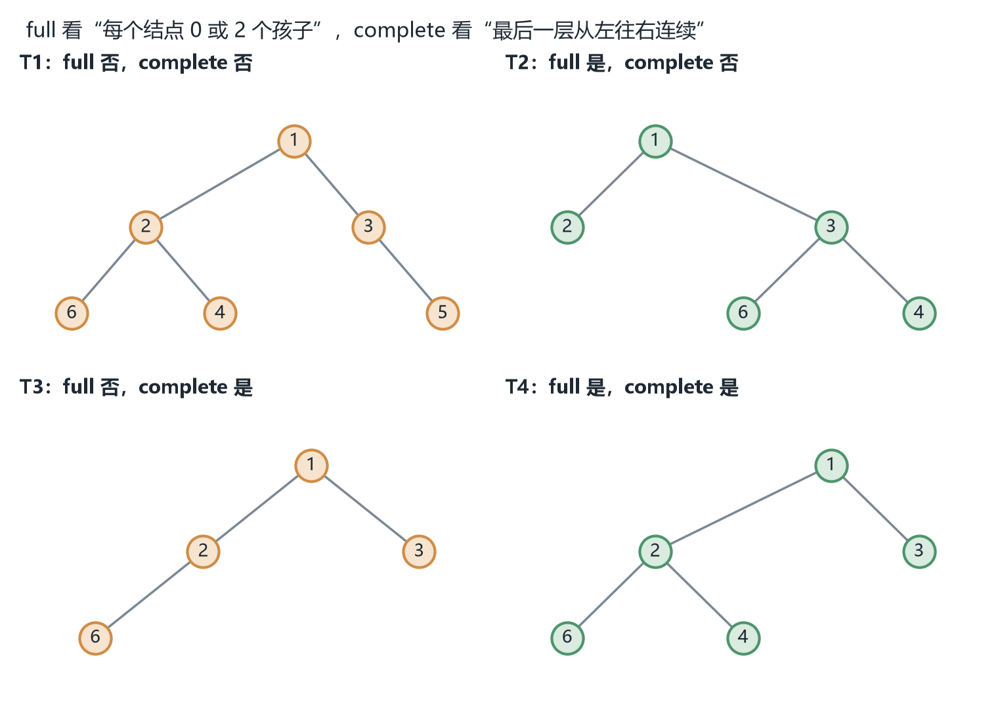
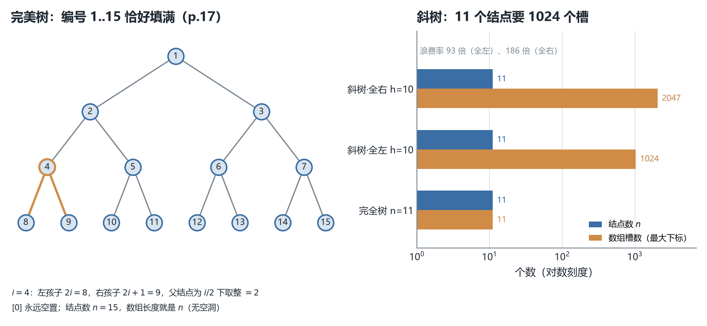
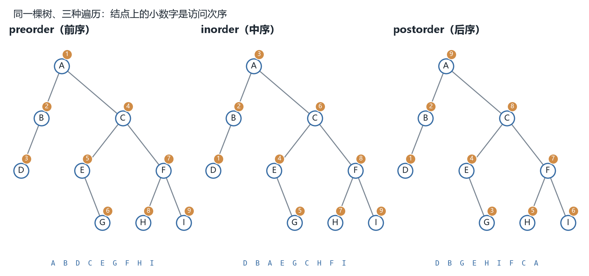
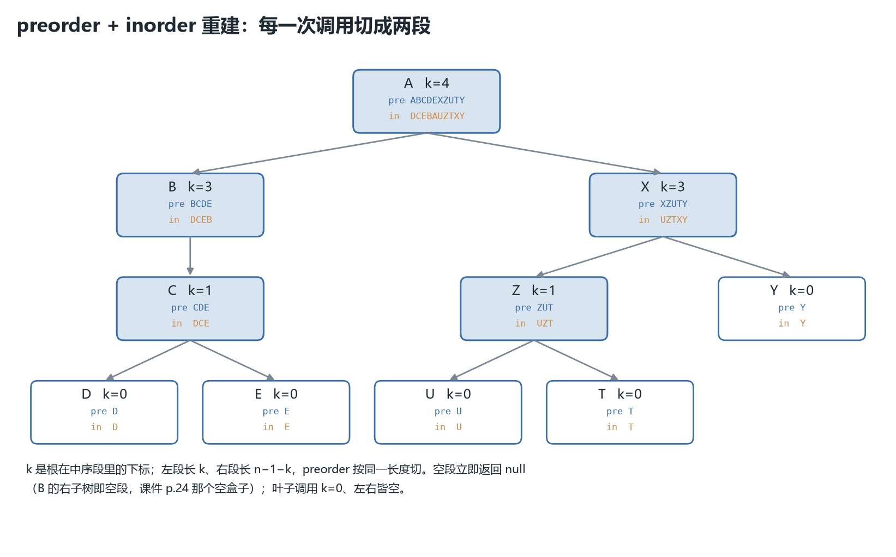

# CSC3100 Lecture 13 课堂笔记：Tree and Binary Tree（树与二叉树）

> **材料构成**：本讲基于课件（PDF/PPT）整理，不含教师口述内容；课件 `lecture 13 (tree and binary tree).pdf` 共 30 页。这 30 页的文字层只有约 10.8 K 字符，因为**几乎所有的树形图、伪代码框和 Java 代码都是图片或矢量图形**——所以我把 30 页全部按 160 dpi 渲染成图逐页读过；其中 p.10 的四棵示例树、p.18 的两棵练习树各按 520–600 dpi 单独放大核对过结点编号（这两处的编号是解题的唯一依据，绝不能靠文字层猜）。
>
> **课件结构**：封面（p.1）→ 四步目录（p.2）→ 树的递归定义（p.3）→ 四个基本关系（p.4）→ 路径与路径长度（p.5）→ 深度与高度（p.6）→ 三张应用图（p.7-8）→ 二叉树的定义（p.9）→ full 与 complete 两种形态（p.10）→ 二叉树 ADT 的六个操作（p.11）→ 两种表示法的取舍（p.12）→ 指针表示的四个域（p.13）→ 六个算法的伪代码（p.14-15）→ 数组表示（p.16）→ 推广到一般二叉树（p.17）→ 两道数组练习（p.18）→ 三种遍历的定义（p.19）→ preorder 的 13 行展开（p.20）→ 表达式树（p.21）→ 中序遍历的实现与 $\Theta(n)$（p.22）→ 一道遍历练习（p.23）→ 重建的四步（p.24-26）→ 为什么 preorder+postorder 不够（p.27）→ Java 重建代码（p.28）→ 三道练习（p.29）→ 阅读与下一讲（p.30）。
>
> **已知课件问题**：p.5 的路径定义把下标写成 `1 ≤ i < k-1`，少断言了一条边（正确是 `1 ≤ i ≤ k-1`，否则 $k$ 个结点的路径只有 $k-2$ 个"父子"关系，与下一行"长度为 $k-1$"自相矛盾）；p.27 说"能构造 2 棵不同的二叉树"，实际上 preorder=ABC、postorder=CBA 能解出 **4 棵**（课件画的两棵只是其中互为一对镜像的两棵）；p.28 第 20 行把 `preorder.length` 当成了 `inorder` 的右端点；p.3 把"树"定义成"一个或多个结点"，而 p.11 却允许"空二叉树"，两个词指的不是同一个集合；p.14 第 8 行 `if bintree 2 != NULL` 多了一个空格。其余几条（p.4 的循环定义、p.10 的编号不是数组下标、p.17 拿 perfect 树当 full 的样板等）都在文末「附：诚实备注」里逐条列出，并注明我凭什么这么判。
>
> **来源标注约定**：正文里凡标 **【补】** 的段落，都是课件没有、由我补充或推导的内容（包括四张配图与全部复算）；没有标注的，都是课件上写着的。页码一律指课件页码（与 PDF 阅读器页码一致）。

## 0. 一句话概括本讲在讲什么

上一讲（L12）的最后一行是"Next lecture: Tree data structure: Chapter 12"，而它的 §32 还顺手说了一句：排序这条线到此为止。这两句合起来，正好解释了本讲为什么从这里开始。

**排序那一条线已经把"一排元素"能做到的事做完了。** 从 L4 的插入/归并、L11 的快排、到 L12 的计数/桶/基数，我们始终在处理同一种对象：一个数组（或一条链），元素按某个键排好，然后整块整块地读。这些算法都很快，但它们回答的是"**怎么把一堆东西排好**"，而不是"**排好之后怎么一直保持有序、还能随时插入和删除**"。后者才是数据结构要回答的问题，而数组和链表在这件事上都很糟：有序数组查找快（二分 $O(\log n)$）但插入要挪 $O(n)$ 个元素；链表插入快但查找要 $O(n)$ 步。**两头都占的，只能是"分叉"的结构**——把元素分散到一条一条的分支上去，让每次决策砍掉一大片候选。这就是树。

所以本讲不是"又一个数据结构"，而是**这门课第一次离开线性结构**。这一点课件自己在 p.8 就说破了：那张"Java data types"的图把数据结构分成 Linear（数组、链表、栈、队列——前 12 讲的全部内容）与 Non-Linear（Trees、Graphs），树是 Non-Linear 的第一个。

**但本讲并不讲"用树来查找"。** 那件事留给下一讲（BST）。本讲只做四件事，顺序是有讲究的：先**定义对象**（p.3-p.10），再**规定操作**（p.11-p.12），再**学会读它**（p.19-p.23），最后问一个反过来问题（p.24-p.29：**这串序列能不能还原回那棵树**）。最后这一步是全讲的高潮：它表面上在讲"重建"，实际在回答一个更深的问题——**遍历是一种编码，编码会不会丢信息？丢的是哪一维？**（这个顺序为什么不能换，§1 会逐块说。）

一句话：**树是第一个"分叉"的结构，本讲给它定名（定义）、定操作（ADT）、定读法（遍历），并证明"读法"里只有含中序的组合才可逆。**

**本讲地图**

| 页码 | 本节 | 这一块在回答什么 |
| --- | --- | --- |
| p.1 | 封面 | 课程、教师、讲次；无内容 |
| p.2 | 目录 | 四步顺序：概念 → ADT/实现 → 遍历 → 重建，为什么不能换 |
| p.3 | 树的递归定义 | 什么样的东西才算树；为什么 $N$ 个结点一定只有 $N-1$ 条边 |
| p.4 | 四个基本关系 | parent / child / sibling / leaf 怎么定义，定义里为什么有循环 |
| p.5 | 路径与路径长度 | "一条路径"到底数几条边；根到每个结点的路为什么唯一 |
| p.6 | 深度与高度 | 两个方向相反的量；"最大高度 = 最大深度"凭什么成立 |
| p.7-8 | 三张应用图 | 文件系统、组织结构、类型分类：树在真实世界里长什么样 |
| p.9-10 | 二叉树 / full / complete | 全讲最易混的一对概念，四个例子摆成一个 $2\times2$ |
| p.11 | 二叉树 ADT | 六个操作；空树时每个操作该怎么办 |
| p.12 | 两种表示法 | 指针直观、数组紧凑，各自付出什么代价 |
| p.13 | 指针表示的结点 | 四个域；为什么明明有孩子指针还要存 parent |
| p.14-15 | 六个算法的伪代码 | `MakeBT` 里那两行 `if` 到底在补什么 |
| p.16 | 数组表示 | parent $\lfloor i/2\rfloor$、左 $2i$、右 $2i+1$ 为什么只在 1-indexed 下这么干净 |
| p.17 | 推广到一般二叉树 | 编号会出洞；斜树的浪费能到什么程度 |
| p.18 | 两道数组练习 | 把树填进 `arr[1..7]`，并说清 `arr[0]` 为什么空着 |
| p.19 | 三种遍历的定义 | 三个定义只差"访问"这一步的位置 |
| p.20 | preorder 的 13 行展开 | 递归到底怎么一层层展开，最后那串字母怎么来的 |
| p.21 | 表达式树 | 三种遍历 = prefix / infix / postfix，为什么只有后缀不需要括号 |
| p.22 | 中序遍历的实现 | 为什么是 $\Theta(n)$，而不是"递归很深所以更慢" |
| p.23 | 遍历练习 | 给树写三种序列，用它检验自己是否真的会走 |
| p.24-26 | 重建的四步 | 前序定根、中序定左右、段长把前序切开 |
| p.27 | 为什么前序+后序不够 | 缺的到底是哪一维信息 |
| p.28 | Java 重建代码 | 课件问的复杂度：为什么是 $O(n^2)$，怎么降到 $O(n)$ |
| p.29 | 三道练习 | 遍历、重建、以及"中序+后序行不行" |
| p.30 | 阅读与下一讲 | Chapter 12；下一讲 BST |
| — | §25 及之后 | 小结、速查表、五句话、术语、诚实备注 |

## 1. 目录页：为什么必须是这个顺序（p.2）

p.2 只有四行，但它把整讲切成了四块：

> Basic concept of trees
>
> Binary tree ADT and implementations
>
> Traversal of binary trees
>
> Reconstruction of binary trees

这四行的顺序不是随手排的，它是一条"**从对象到操作、从操作到读法、从读到写**"的链。换成问句就清楚了：

第一块回答"**它是什么**"。树、根、父子、兄弟、叶子、路径、深度、高度，八个词在 p.3-p.6 全部给完。没有这套词汇，后面任何一句话都说不出来——你不能对一个还没定义的东西规定操作。

第二块回答"**它能做什么、怎么存**"。ADT 是"对外承诺能做什么"（p.11 的六个操作），实现是"内部怎么做到"（p.12 起的指针与数组）。这两件事必须分开讲，因为**同一种 ADT 可以有多种实现，而复杂度取决于实现而不是 ADT**：`Lchild` 在指针表示下是 $O(1)$ 取一个字段，在数组表示下是 $O(1)$ 算一个下标，但"把一棵任意形状的树插进数组"这件事本身就做不到高效。这一节埋下的伏笔，p.17 会兑现。

第三块回答"**怎么把它整个读一遍**"。这是本讲第一次出现"算法"（p.19-p.22）。为什么读一遍值得单独一节？因为树是二维的、分叉的，而输出是一维的，**从二维压到一维必须做选择：先读自己还是先读孩子，先读左还是先读右**。三种遍历就是这个选择的三个答案。

第四块回答"**读出来的东西还能不能还原**"。这是全讲唯一一个"反向"的问题：前三块都是"树 → 序列"，这一块问"序列 → 树"。它的答案不是简单的"能"或"不能"，而是"**看你用了哪两种序列**"：前序+中序可以，中序+后序可以，前序+后序不行。为什么不行、缺了什么——这就是 §21 的全部内容。

**【补】这条链还有一层教学上的理由：它正好对应"数据结构"这门课的标准三段式。** 任何数据结构都要回答三个问题：怎么定义、怎么存、怎么遍历（因为几乎所有操作都要先把结构走一遍）。后面讲图（如果讲了）、讲 BST、讲堆，走的都是同一个模板。所以本讲的四步不只是这一讲的结构，它是**后面所有讲的模板**——这一点课件没说，但读完后半学期会反复用到。

还有一处值得留意：目录里**没有"应用"这一项**，可 p.7-p.8 整整两页在讲应用。这说明应用页是"配菜"而不是"主菜"——它们的作用是让你相信树值得定义，而不是要你记住那些例子。§6 会按这个定位来处理它们。

## 2. 树的递归定义：$N$ 个结点为什么只有 $N-1$ 条边（p.3）

### 2.1 定义本身

p.3 的定义是递归的，四个分句各管一件事：

> A tree is a finite set of one or more nodes such that
>
> Each node stores an element
>
> There is a special node called the root
>
> The remaining nodes are partitioned into $n \ge 0$ disjoint sets $T_1, \ldots, T_n$ where each of these sets is a tree
>
> We call $T_1, \ldots, T_n$ the subtrees of the root

逐句读：

**"a finite set of one or more nodes"**——有限、非空。有限是为了让"结点数"这个量有意义（否则归纳证明无从落脚）；非空是这一版定义的硬要求，§2.3 会专门说它带来的麻烦。

**"Each node stores an element"**——每个结点装一个元素。这句话看着废话，其实规定了树的"载荷"：树的形状与元素无关，**形状是结构，元素是内容**。p.7 的 Unix 目录树里 `junk.c` 出现了两次、`syl.r` 出现了三次，就是这句话的直接后果：树允许重复的元素，因为"是不是同一个结点"由位置决定，不由值决定。

**"There is a special node called the root"**——有且只有一个根。这是树与"森林"的区别：森林是若干棵树并排，树是它们上面再加一个根。

**"The remaining nodes are partitioned into $n \ge 0$ disjoint sets … each of these sets is a tree"**——这是全部定义里唯一有内容的一句。三个关键词：**partitioned**（分完、不重不漏）、**disjoint**（互不相交）、**each is a tree**（递归）。

$n \ge 0$ 这个下界很关键：$n=0$ 时"剩下的结点"是空集，这个结点就是叶子。所以**叶子不是特例，是递归的基例**。同理 $n=1$ 时这棵树就是一条"没有分叉的链"。

"分完、不重不漏"这半句也不是修饰。它保证了同一层的两个子树之间**没有任何边相连**——如果左边的结点能连到右边的结点，那两个集合就不"disjoint"了，图里就会出现环。**树的"无环"性质是从这句话里来的，不是额外假设的。**

### 2.2 $N$ 个结点为什么只有 $N-1$ 条边

课件给的是结论（"A tree with N nodes has N-1 edges"），没给证明。这里补两种证法，一种顺着递归定义走、一种换个角度看，两条都要会，因为它们在后面会分别派上用场。

**证法一（对 $N$ 归纳，顺着定义）。** 设树有 $N$ 个结点、$E(N)$ 条边。$N=1$ 时只剩一个根，没有任何边，$E(1)=0=N-1$，成立。设 $N>1$，根有 $n \ge 1$ 个子树 $T_1,\ldots,T_n$，第 $i$ 棵有 $N_i$ 个结点，则 $\sum_i N_i = N-1$（除了根，其余结点全在子树里）。这些子树的边数按归纳假设分别是 $N_i - 1$；再加上根连到每个子树根的那 $n$ 条边，总共

$$
E(N) = n + \sum_{i=1}^{n}(N_i - 1) = n + (N-1) - n = N-1
$$

归纳完成。注意这里 $n$ 被消掉了——**根有几个孩子都无所谓**，这正是"$N-1$ 与形状无关"的原因。

**证法二（配对，一句话）。** 除了根以外，每个结点都恰好有一个父结点（下一节会定义），而"结点 → 它连向父结点的那条边"是一个**双射**：每个非根结点对应唯一一条向上的边，每条边也对应唯一一个下端结点。所以边数 = 非根结点数 = $N-1$。

第二种证法短得多，但它偷偷用了"每个非根结点恰好一个父亲"这个事实。这个事实从哪来？还是从递归定义来：一个结点只可能落在某一个 $T_i$ 里（disjoint），所以它只属于一个父结点的子树。**两种证法其实是同一件事的两种说法**，考试写哪种都行，但要知道第二种依赖什么。

**【补】把 $N-1$ 记成"树的身份证"很有用。** 后面判断"一个图是不是树"时，常用两条判据的组合：连通 + 边数 $=N-1$，或者 无环 + 边数 $=N-1$。单看边数不够（$N$ 个点 $N-1$ 条边也可能是"一个环加一棵挂着的树"），必须配一条结构条件。本讲的树天生满足连通与无环，所以 $N-1$ 是免费的。

### 2.3 Organism 那个例子，以及"树"与"二叉树"不是同一个集合

p.3 右侧画了一棵生物分类树：`Organism` 是根，两个孩子 `Plant`、`Animal`，`Animal` 又有两个孩子 `Mammal`、`Fish`。$5$ 个结点、$4$ 条边，与 $N-1$ 对得上。

拿它练一遍 §2.1 的词汇：`Organism` 的子树有两棵（以 `Plant` 为根的、以 `Animal` 为根的）；`Plant` 与 `Animal` 是兄弟；`Mammal` 与 `Fish` 是兄弟；`Plant`、`Mammal`、`Fish` 都是叶子；`Mammal` 的深度是 $2$；整棵树的高度是 $2$。

这棵树的每个结点最多两个孩子，**但它还不是"二叉树"**——因为 p.3 的时候"二叉树"这个词还没出现，而且"最多两个孩子"与"恰好有左、右两个位置"是两回事。这个区别到 p.9 会说清楚，这里先埋着。

**【补】这里有一个必须点破的术语矛盾：p.3 的"树"非空，而 p.11 的"二叉树"可以为空。** p.3 明写 "one or more nodes"，也就是说空集不算树；但 p.9 说二叉树的左右子树 "both of which could possibly be empty"，p.11 的第一个操作就是 `Create` 出一棵空二叉树。两者不可能都按字面成立。

合理的读法是：**这门课有两个不同的类型**。`tree` 是一个"至少一个结点"的结构（所以它总有根、总能谈高度）；`bintree` 是它的扩展，多了一个"空"这个值，专门用来表示"这里没有子树"。为什么要多这个值？因为递归需要一个基例——如果没有"空树"，`Lchild(leaf)` 返回什么就没法定义了（返回"不存在"在类型上是不合法的）。**空树不是"零个结点的树"，而是一个哨兵值**，它的存在让"每个结点都恰好有左、右两个子树（其中一个或两个可能为空）"这句话成立。

这个区分在后面会反复出现：p.6 的 Note 3 在空树上失效（§5.3）、p.22 的中序遍历要在 `x ≠ NIL` 处停下、p.28 的重建代码第一行就写 `if (preorder.length == 0) return null;`——全都是同一个哨兵在起作用。

## 3. 四个基本关系，以及 parent 定义里那个循环（p.4）

p.4 一次给四个定义：

> **Parent**: Node $A$ is the parent of node $B$ if $B$ is the root of the left or right sub-tree of $A$
>
> **Left (right) child**: Node $B$ is the left (right) child of node $A$ if $A$ is the parent of $B$
>
> **Sibling**: Node $B$ and node $C$ are siblings if they have the same parent
>
> **Leaf**: A node is called a leaf if it has no children

逐个看，然后看它们合起来的问题。

**Parent 用了"子树的根"。** 这句话的意思是：把 $A$ 的左子树（或右子树）拿出来，那棵子树的根就是 $A$ 的孩子。这个说法很自然，因为 p.3 已经保证了"每个结点都是某棵子树的根"（定义的最后一句就是这么说的）。所以 parent 的定义其实是 p.3 定义的直接推论——**你不需要新的东西，只需要把已有的东西指出来**。

**Child 反过来定义了 parent。** 这一句在逻辑上是冗余的：如果 $A$ 是 $B$ 的 parent，那 $B$ 就是 $A$ 的 child，这只是换个说法。它存在的价值是**引入"左/右"这个方位**：$B$ 不只是 $A$ 的孩子，它还是"左边的那个"或"右边的那个"。这个方位信息在后面极其重要——p.27 会证明，前序+后序之所以不能唯一确定一棵树，丢的就是这个方位。

**Sibling 用"同一个 parent"定义。** 注意它不要求两个兄弟相邻，也不要求它们是"左孩子和右孩子"——一个结点只有一个孩子时，那个孩子没有兄弟（因为兄弟要求"两个不同的结点有同一个父亲"）。

**Leaf 用"没有孩子"定义**，与 p.3 的 $n=0$ 是同一件事。

### 3.1 这个定义集合是循环的，而且带着二叉树的私货

两个问题，都不大但值得说清楚，因为它们是"看懂定义"与"背下定义"的分界线。

**第一个问题：四个定义互相咬合，单独拿出任何一个都不成立。** parent 用到"子树的根"，而"子树"与"根"是 p.3 定义的；child 用到 parent；sibling 用到 parent；leaf 用到 children（也就是 child）。所以这四个词是一起定义的，你不能先定义 parent 再定义 child——它们是同一个概念簇的四个侧面。

这在数学上不算错（递归定义本来就允许这样），但读的时候要知道：**它们描述的是同一张图上的四种关系**。想跳出来看，最干净的说法是【补】：

> 一棵树是一个有向图：每个结点出度任意、入度恰好为 $1$（根除外，根入度为 $0$）；从根出发能走到所有结点；没有有向环。在这个图里，parent 就是"唯一的那条入边的另一端"，child 就是"出边的另一端"，leaf 就是"出度为 $0$"，depth 就是"从根走过来的边数"。

这个"图论版本"一句话就把四个定义和深度、路径全说完了，而且不循环——**它是理解版的，p.4 是教学版的**。考试按 p.4 写，理解按这个版本。

**第二个问题：p.4 说的是 "left or right sub-tree"，可这一页还在讲一般树。** 一般树的结点可以有 $3$ 个、$5$ 个孩子，"左/右"根本没定义。所以这句话严格来说只对二叉树成立，而二叉树要到 p.9 才定义——**课件的叙述顺序在这里是"先用后定义"的**。对 `Organism` 那棵树没造成伤害（它恰好每个结点最多两个孩子），但读者要意识到：p.4 的 parent 定义是为后面的二叉树准备的，一般树的版本应该是 "$B$ 是 $A$ 的某棵子树的根"。

**【补】顺带一个常被忽略的事实：一般树里"兄弟"是有序的。** 如果把 $T_1,\ldots,T_n$ 看成有序的（这是本课的定义，因为它用了 $T_1,\ldots,T_n$ 这样的编号），那么"第一个孩子"和"第二个孩子"是不同的，交换两棵子树会得到另一棵树。这一点在二叉树上更明显：交换左右子树一定得到不同的树（除非两棵子树同构）。p.27 的"不唯一"就是这件事的直接后果。

## 4. 路径与路径长度：课件这里少算了一条边（p.5）

### 4.1 定义

> A path from node $n_1$ to $n_k$: A sequence of nodes $n_1, n_2, \ldots, n_k$ such that $n_i$ is the parent of $n_{i+1}$ for $1 \le i < k-1$
>
> Length of a path: the number of edges on the path, namely $k-1$
>
> Notice that in a tree, there is exactly only one path from the root to each node

路径就是一串结点，要求"前一个是后一个的父亲"。所以路径是**有方向的**：只能从上往下走。长度数的是**边**不是结点，所以 $k$ 个结点的路径长度是 $k-1$——这一点与"$N$ 个结点 $N-1$ 条边"是同一个道理，数边的时候永远比数点少一。

举个具体的：`Organism → Animal → Mammal` 这条路径有 $3$ 个结点、$2$ 条边，长度 $2$。

### 4.2 那个下标范围是错的

课件写的条件是 `for 1 ≤ i < k-1`。按这个范围，$i$ 只能取 $1, 2, \ldots, k-2$，也就是只断言了 $n_1$ 是 $n_2$ 的父亲、……、$n_{k-2}$ 是 $n_{k-1}$ 的父亲——**$n_{k-1}$ 与 $n_k$ 之间的关系从来没被要求过**。于是 `Organism, Animal, Mammal, Plant` 也会"满足"这个定义（前两条关系都对，最后一条没人管），可它显然不是一条路径。

正确的写法是 $1 \le i \le k-1$（等价地写成 $1 \le i < k$）：$i$ 取 $1$ 到 $k-1$ 共 $k-1$ 个值，正好对应 $k-1$ 条边，与下一行"长度为 $k-1$"完全一致。**课件自己的两句话对不上，这就是判它是笔误的硬证据**——不需要查任何外部资料。

顺带说清 $k$ 的两个极端：$k=1$ 时"从 $n_1$ 到 $n_1$"是一条长度为 $0$ 的路径（只有一个结点、零条边），此时 $1 \le i \le 0$ 是空范围，正确；$k=2$ 时要求 $n_1$ 是 $n_2$ 的父亲，长度 $1$。

### 4.3 "根到每个结点只有一条路径"为什么成立

课件把这个当 Notice 给出，但它是可以证的，而且证法很简单，值得写一遍——因为**它同时证明了"树里没有环"**。

设从根 $r$ 到结点 $v$ 有两条不同的路径 $P$ 与 $Q$。两条路都从 $r$ 出发、到 $v$ 结束，既然不完全相同，就存在第一个分叉点 $u$：从 $u$ 开始，$P$ 走左边那条、$Q$ 走右边那条，之后又在某个点 $w$ 汇合（至少 $v$ 是一个汇合点）。于是 $P$ 上 $u \to \cdots \to w$ 与 $Q$ 上 $u \to \cdots \to w$ 两段拼起来就是一个**环**。可 p.3 的递归定义保证了各子树互不相交，树里不可能有环。矛盾。

反过来，"唯一路径"这个性质也可以当作树的定义性特征之一：**一个连通、无环、有一个根的有向图，从根到任一点恰好一条路**。三个说法（递归定义 / 无环连通 / 路径唯一）是等价的。

**【补】注意这个"唯一"只对"根到结点"成立得最自然。** 任意两个结点 $u$、$v$ 之间也有唯一一条路（无向意义下），但它未必是"从上往下"的：它要先从 $u$ 往上走到最近公共祖先（lowest common ancestor），再往下走到 $v$。而 p.5 定义的 path 是有向的，只能往下——所以严格按 p.5 的定义，"`Mammal` 到 `Fish` 的路径"是**不存在**的，尽管在图论意义上它们之间有一条长度 $2$ 的路。这个细节不影响后面的内容，但看教材时如果发现定义对不上，多半就是这个原因。

## 5. 深度与高度：为什么"最大高度 = 最大深度"（p.6）

### 5.1 两个方向相反的量

> **Depth** of a node $n_i$: the length of the unique path from the root to $n_i$; the root is at depth $0$
>
> **Height** of a node $n_i$: the length of the longest path from $n_i$ to a leaf; all leaves are at height $0$

这两个定义是一对镜像：**深度从上往下数（根为 $0$），高度从下往上数（叶子为 $0$）**。都用"边的条数"作单位，都不用"层数"（层数要比它们大 $1$）。

为什么深度以根为 $0$、高度以叶子为 $0$？因为两者都是"路径长度"，而路径长度数边：根到根是 $0$ 条边，叶子到自己是 $0$ 条边。如果把根记成第 $1$ 层，深度就会变成"层数减一"，公式里到处要多减一个 $1$——p.16 的数组公式之所以那么干净，就是因为这里选了 $0$ 起点。

三个必须记牢的边界情形：只有一个结点的树，深度 $0$、高度 $0$；只有一条链的树（每层一个结点），深度与高度相等，都等于 $N-1$；空树，按惯例高度记 $-1$（这样"空树高度 $+1$ = 单结点树高度"这条递推才成立）。

### 5.2 p.6 那幅图在说什么

图里画了一棵不算平衡的树，右侧用大括号标了 `Height = 4`，左边逐层标 `Depth = 0` 到 `Depth = 4`，还有一行红字 `Leaf = node with no subnodes`（叶子用红色圆圈画）。

按图读：根在深度 $0$；它有两个孩子，都在深度 $1$；左孩子下面直接挂了两个叶子（深度 $2$，高度 $0$）；右孩子往下是一条链，到深度 $4$ 才出现两个叶子。所以整棵树的高度是 $4$，最深的叶子在深度 $4$。

这里有一个很好的练习：**左子树的高度是 $1$，右子树的高度是 $3$，整棵树的高度是 $1+3=4$**。也就是说树高 $=1+\max(\text{左子树高},\text{右子树高})$——这正是后面所有递归算法（遍历、求高、重建）用的那条递推。

### 5.3 三个 Note 之间的关系

> Note 1: The height of a tree is equal to the height of the root
>
> Note 2: The depth of a tree is equal to the depth of the deepest leaf
>
> Note 3: The maximum height is equal to the maximum depth

Note 1 与 Note 2 是**定义**（"树高"与"树深"这两个词本来没有定义，这两句是在给它们下定义）：树高 = 根的高度，树深 = 最深叶子的深度。Note 3 才是**定理**：它说这两个数相等。课件把它们并排写成三条 Note，容易让人以为三条都是定义——其实前两条是定义、第三条要证。

**证明（两半）。** 记根为 $r$，结点 $v$ 的深度为 $d(v)$、高度为 $h(v)$。

先证 $\max_v h(v) = h(r)$。一方面，对任意 $v$，从 $r$ 走到 $v$ 要 $d(v)$ 条边，再从 $v$ 沿最长路径走到某个叶子要 $h(v)$ 条边，两段拼起来是一条从 $r$ 到叶子的路径，长度 $d(v)+h(v)$。而 $r$ 的高度是"从 $r$ 到叶子的最长路径"，所以 $d(v) + h(v) \le h(r)$，于是 $h(v) \le h(r)$。另一方面 $v=r$ 时取等号。所以最大值就是 $h(r)$。

再证 $\max_v d(v) = h(r)$。设 $u$ 是最深的结点（$d(u)$ 最大）。**$u$ 一定是叶子**：若 $u$ 有孩子 $w$，则 $d(w) = d(u)+1 > d(u)$，与 $u$ 最深矛盾。于是从 $r$ 到 $u$ 的路径终点是叶子，长度 $d(u) \le h(r)$；反过来，取一条实现 $h(r)$ 的"根到叶子的最长路径"，它的终点深度恰好是 $h(r)$，所以 $\max_v d(v) \ge h(r)$。两边夹住，得 $\max_v d(v) = h(r)$。

两半合起来：最大高度 $= h(r) =$ 最大深度。$\blacksquare$

证明里那一步"最深的结点一定是叶子"是全部的关键，它把"深度"与"到叶子的路径"接上了。**没有这一步，Note 3 是证的出来的吗？** 证不出来——如果只谈"任意结点"，深度与高度是两个独立的量（同一个结点的深度和高度一般不等）。

### 5.4 什么时候 Note 3 不成立

**空树。** 空树没有根，`h(r)` 无从谈起；按惯例高度记 $-1$，而"最深叶子的深度"根本不存在（没有叶子）。此时 Note 1 与 Note 3 都失效，Note 2 也失效。这不是课件的错（它默认在讲非空的树），但读的时候要知道**这三条 Note 的前提是"树非空"**，而 p.3 的定义恰好保证了这一点——所以在本讲的框架里它们永远成立，一旦你开始处理"空二叉树"（p.11 之后到处都是），就得自己记住这个前提。

还有一种"看起来不成立"其实成立的情形：树只有一条链时，最大高度 = 最大深度 = $N-1$，所有结点的深度与高度之和恒为 $N-1$（你可以拿 p.6 那条右边链验证）。这不是反例，反而是 Note 3 的最极端情形。

**【补】一个容易混的说法："树的深度"在大多数教材里根本不存在。** 标准术语只有 tree height（有的书写 depth of a tree 指根到最深叶子的边数，与这里的 Note 2 一致），但"某结点的深度"与"某结点的高度"是两个都常用的量。做题时看到 "depth" 先确认它修饰的是结点还是整棵树。

## 6. 三张应用图：文件系统、组织结构、类型分类（p.7-8）

这三页几乎没有文字，全是图。它们的共同作用是回答一个动机问题：**为什么值得为"树"单独发明一套词汇？** 答案是三张图各不相同，但都能被同一套词汇描述。

### 6.1 p.7：Unix 文件系统

这一页的标题是 `Applications: Unix file system`（文字层是空的，只有渲染出来才看得见）。图是一棵目录树，根是 `/usr`，往下分三支：

`mark` 下面有 `book`、`course`、`junk.c` 三项；`book` 下面是 `ch1.r`、`ch2.r`、`ch3.r`；`course` 下面是 `cop3530`；`cop3530` 下面是 `fall96`、`spr97`、`sum97` 三个学期；每个学期下面各有一个 `syl.r`。

`alex` 下面只有 `junk.c`。

`bill` 下面是 `work` 与 `course`；`work` 下面是 `cop3212`；`cop3212` 下面是 `fall96` 与 `fall97`；这两个学期下面各有 `grades`、`prog1.r`、`prog2.r`（最后一项在图上被右边缘截断成 `grade`）。

按层清点：第 $0$ 层 $1$ 个、第 $1$ 层 $3$ 个、第 $2$ 层 $6$ 个、第 $3$ 层 $5$ 个、第 $4$ 层 $5$ 个、第 $5$ 层 $9$ 个，共 $29$ 个结点、$28$ 条边，树高 $5$。$29-1=28$，与 p.3 的结论对得上。

这张图想说明三件事，一件比一件深：

**第一，树的"父子"在这里是"目录包含文件"**。父目录是父结点，子目录/文件是孩子。所以 `parent` 这个词在文件系统里有直接的现实对应：`/usr/mark/course/cop3530` 这个路径上，`course` 的 parent 就是 `mark`。

**第二，同一个名字可以在不同位置出现多次，它们是完全不同的结点。** `junk.c` 出现了两次（mark 的和 alex 的）、`syl.r` 出现了三次、`prog1.r` 与 `prog2.r` 各出现两次。这正好印证 p.3 的那句"每个结点存一个元素"——元素可以重复，**结点由位置区分**。这一点在 L14 讲 BST 时会变成一个硬约束：BST 的查找依赖"键唯一"，一旦有重复键，`find` 就会返回第一个匹配而不管是不是你想要的那个（§22 会看到这个 bug 的另一个版本）。

**第三，树高就是把路径长度再取一次最大。** 最深的那条路是 `/usr → mark → course → cop3530 → fall96 → syl.r`，$6$ 个结点、$5$ 条边，所以高度 $5$——与 p.5、p.6 的两个定义完全一致。文件系统里"这个路径有多深"这句话，说的就是这个数。

### 6.2 p.8 左：HR system

左边画的是公司的汇报关系：`CEO` 在顶上，往下两个 `Manager`，每个 `Manager` 往下三个 `Employee`，边是虚线箭头（箭头朝下，表示"汇报给"）。

用词汇描述：$7$ 个结点，`CEO` 是根，两个 `Manager` 是兄弟，同属一个 `Manager` 的三个 `Employee` 互为兄弟，六个 `Employee` 都是叶子，树高 $2$（三层）。

这张图的用处是给"深度"一个现实含义：**深度就是"离最高层隔了几级"**。CEO 深度 $0$、Manager 深度 $1$、Employee 深度 $2$——但日常说话会说"三层组织架构"，因为人习惯从 $1$ 数起。这个 $+1$ 的偏移是本讲最容易犯的低级错误，p.16 的数组下标之所以从 $1$ 开始，某种意义上就是为了让"层号"与"下标"对上（第 $\ell$ 层的编号从 $2^{\ell-1}$ 起）。

**【补】这张图同时暴露了一般树与二叉树的差距。** 每个 Manager 有三个下属，二叉树装不下（二叉树每个结点最多两个孩子）。要把这种"任意多叉"的结构塞进二叉树，标准做法是 **first-child / next-sibling 表示**：让每个结点只保留两个指针，一个指向"第一个孩子"，一个指向"下一个兄弟"。这样任意多叉树都能用二叉树存，代价是"孩子"与"兄弟"混在同一套指针里，遍历时要自己记住当前走的是哪一种。本讲不要求，但知道有这条路，就不会被 p.9 的"最多两个孩子"误导成"树只能有两个孩子"。

### 6.3 p.8 右：Java data types

右边是一张分类树，根是 `Types of Data Structure`，分两支：

`Primitive Data Structure` 下面是 `Integer`、`Float`、`Character`、`Boolean` 四个叶子；

`Non-Primitive Data Structure` 下面又分两支：`Linear Data Structure`（`Arrays`、`Linked List`、`Stack`、`Queue`）与 `Non-Linear Data Structure`（`Trees`、`Graphs`）。

$4$ 层、树高 $3$。它想说的是两件事。

**第一，树在"数据结构的分类"里自己占一个位置**。`Trees` 是这棵树的一个叶子结点——分类表把自己也分类进去了，这是分类学的常态（"生物学分类"这张表本身也是一个生物产物），不是循环论证。

**第二，前 12 讲全在 `Linear` 那一格里**。数组（L3）、链表（L7-L8）、栈（L9）、队列（L10）都是线性的：每个元素最多一个前驱、一个后继，结构是一条线。树是 `Non-Linear` 的第一个，**它第一次允许"一个元素有多个后继"**。这一格的变化，就是本讲全部新概念的来源：因为分了叉，才有了"左/右"、才有了"深度/高度"、才有了"三种遍历"（线性结构只有一种读法：从头到尾）。

## 7. 二叉树：full 与 complete 到底差在哪（p.9-10）

### 7.1 二叉树的定义

> A binary tree is a tree, in which no node can have more than two children (subtrees): $T_L$ and $T_R$, both of which could possibly be empty

两句话，两个要点。

**"no node can have more than two children"**——最多两个。注意是"最多"不是"恰好"：$0$ 个、$1$ 个、$2$ 个都合法。这一点与"每个结点都有两个孩子的满树"是两回事。

**"$T_L$ and $T_R$, both of which could possibly be empty"**——左右两个位置是**固定的**，即使空着也存在。这是二叉树与"度不超过 2 的一般树"的**唯一但致命**的区别：在一般树里，"只有一个孩子"没有左右之分；在二叉树里，"只有一个孩子"必须说清是左孩子还是右孩子。

为什么这个区别致命？因为**它决定了两棵树是不是同一棵**：`A` 带一个左孩子 `B`，与 `A` 带一个右孩子 `B`，在一般树里是同一个结构，在二叉树里是两棵不同的树。p.27 的"不唯一"就是这件事的直接后果。

p.9 的图很简单：一个 `root` 圆圈，两条线分别连到两个淡蓝色的三角形，标着 $T_L$ 与 $T_R$。三角形表示"这里是一棵子树，内部结构不管"——这是**抽象**的记号，后面画递归图时会一直用到。

### 7.2 full 与 complete：两个完全不同的条件

> **Full binary tree**: a binary tree where all the nodes have either two or no children
>
> **Complete binary tree**: a binary tree where all the levels are completely filled except possibly the lowest one, which is filled from the left

这两句话经常被混，因为中文都爱译成"满二叉树"和"完全二叉树"，听起来像程度不同的同一件事。**它们其实在说两个不同的维度**：

`full` 管的是**每个结点自己的度数**：要么 $0$、要么 $2$，不许出现"只有一个孩子"的结点。它是一条**局部**条件——你只要看每个结点，不需要看全局。

`complete` 管的是**整棵树的填法**：除了最底层，上面每一层都必须填满；最底层必须**从左往右连续**地填，中间不许有洞。它是一条**全局**条件——单个结点看起来完全正常，但整棵树可能不满足。

正因为一个是局部的、一个是全局的，**两者互不蕴含**。课件 p.10 用四棵小树把这件事摆成了一个 $2 \times 2$：

| 例子 | 结构（按图上的编号） | full | complete | 为什么 |
| --- | --- | --- | --- | --- |
| $T_1$ | $1$ 的孩子是 $2,3$；$2$ 的孩子是 $6,4$；$3$ 只有右孩子 $5$ | 否 | 否 | 局部：$3$ 只有一个孩子；全局：最底层从左数第 $3$ 个位置空着却填了第 $4$ 个 |
| $T_2$ | $1$ 的孩子是 $2,3$；$2$ 是叶子；$3$ 的孩子是 $6,4$ | 是 | 否 | 局部：所有结点 $0$ 或 $2$ 个孩子；全局：最底层只填了第 $3,4$ 个位置，第 $1,2$ 个位置（$2$ 的孩子）空着 |
| $T_3$ | $1$ 的孩子是 $2,3$；$2$ 只有左孩子 $6$；$3$ 是叶子 | 否 | 是 | 局部：$2$ 只有一个孩子；全局：最底层只有一个结点且在最左边，符合"从左往右连续" |
| $T_4$ | $1$ 的孩子是 $2,3$；$2$ 的孩子是 $6,4$；$3$ 是叶子 | 是 | 是 | 两条都满足 |

四行正好填满四个格子，这就是"互不蕴含"的标准证法：**$T_2$ 证明 full 不蕴含 complete，$T_3$ 证明 complete 不蕴含 full**，$T_1$ 与 $T_4$ 是剩下的两个角。



*图 1　课件 p.10 的四棵示例树（我按同样的结构重画）：$T_2$ 是 full 但 not complete，$T_3$ 是 complete 但 not full，两者合起来证明这两个条件互不蕴含；橙色表示"不 full"，绿色表示"full"（判定由脚本对结构求值）。*

**【补】判 complete 的一个机械办法：按层序编号，看是不是恰好 $1..n$。** 把根编成 $1$，然后层序（同一层从左到右）往下编号，编号规则就是 p.16 的 $2i$、$2i+1$。如果"所有非空结点占住的编号恰好是 $1$ 到 $n$ 这一段、一个不缺"，就是 complete；只要出现一个空洞（比如 $T_2$ 里 $4$ 号位空着、$6,7$ 号位有结点），就不是。这个方法把"从左往右连续"翻译成了"编号连续"，比用眼睛看可靠得多——我核对这四棵树用的就是这个办法（见 `.qoder/L13/verify_l13.py`）。

### 7.3 两个计数结论

课件没给，但这两条在后面的堆（heap，L15 左右）里天天用，值得现在记下。

**结论一：full 二叉树的结点数一定是奇数。** 设度为 $2$ 的结点有 $I$ 个、叶子有 $L$ 个，则 $n = I + L$。每条边都从某个度为 $2$ 的结点发出（full 的定义保证没有度为 $1$ 的结点），所以边数 $=2I$；而 p.3 又有边数 $=n-1$。于是 $2I = I+L-1$，即 $I = L-1$，代回 $n = (L-1)+L = 2L-1$。**$n$ 是奇数，且叶子比内结点多一个。**

反过来，$n$ 是偶数时一定不存在 full 二叉树。这条结论可以用来秒判：看到"某棵 full 二叉树有 $10$ 个结点"就知道题目错了。（顺便：$n$ 个结点的 full 二叉树有多少种形状？答案是 Catalan 数 $\frac{1}{m+1}\binom{2m}{m}$，其中 $m=(n-1)/2$；我枚举了 $n=1,3,5,7,9$ 得 $1,1,2,5,14$，与之一致。）

**结论二：complete 二叉树的结点数落在 $[2^h,\,2^{h+1}-1]$ 里。** 高度为 $h$ 的 complete 树，上面 $h$ 层全满（$2^h - 1$ 个），最底层至少有 $1$ 个、至多有 $2^h$ 个，所以 $n$ 在 $2^h$ 与 $2^{h+1}-1$ 之间。等价的说法是 $h = \lfloor \log_2 n \rfloor$——**树高由结点数唯一确定**，这在任意形状的二叉树里是不成立的（同样 $15$ 个结点，可以是高度 $3$ 的完美树，也可以是高度 $14$ 的斜链）。

**这两个结论合起来，解释了为什么"数组表示"偏爱 complete**：complete 树的编号没有洞，所以 $n$ 个结点正好占 $n$ 个槽；而 full 与能不能进数组毫无关系（$T_2$ 是 full，可它的数组里有洞，见 §14）。

## 8. 二叉树的 ADT：六个操作与"空树"这个特殊值（p.11）

### 8.1 六个操作

> `Create(bintree)`: creates an empty binary tree
>
> `Boolean IsEmpty(bintree)`: if bintree is empty return TRUE else FALSE
>
> `MakeBT(bintree1, element, bintree2)`: return a binary tree whose left subtree is bintree1 and right subtree is bintree2, and whose root node contains the data element
>
> `Lchild(bintree)`: if bintree is empty return error else return the left subtree of bintree
>
> `Rchild(bintree)`: if bintree is empty return error else return the right subtree of bintree
>
> `Data(bintree)`: if bintree is empty return error else return the element data stored in the root node of bintree

这六个操作可以分成三类，每类的角色完全不同：

**构造类**（`Create`、`MakeBT`）：造出一个新值。`Create` 造的是空树，`MakeBT` 造的是"用一个元素当根、把两棵现成的树挂上去"的树。注意 `MakeBT` 是**唯一**的"非空构造器"——所有非空二叉树都只能靠它一层层搭起来，这保证了每次搭树都是"根 + 两棵子树"的形状，与 p.3 的递归定义一一对应。

**判定类**（`IsEmpty`）：问一个布尔问题。它存在的唯一理由是**空树是合法值**：如果没有空树，就不需要问"你是不是空的"。

**选择类**（`Lchild`、`Rchild`、`Data`）：从一棵树里取出一个部件。三个都是"能取就取、不能取就报错"的形状。

### 8.2 空树时每个操作怎么办

课件把"空树怎么办"写在三个选择操作里（`return error`），但没写全。补一张表把它说清楚：

| 操作 | 输入是空树时 | 说明 |
| --- | --- | --- |
| `Create` | 不适用 | 它的输出就是空树 |
| `IsEmpty` | 返回 TRUE | 这正是它存在的意义 |
| `MakeBT` | 合法 | 空树可以作为左子树或右子树传进去，造出"只有右孩子"之类的树 |
| `Lchild` | 报错 | 空树没有左子树可取 |
| `Rchild` | 报错 | 同上 |
| `Data` | 报错 | 空树没有根，也就没有元素 |

这张表里最有信息量的一行是 `MakeBT`：**空树可以作为参数**。这就是为什么 p.9 说 $T_L$、$T_R$ "could possibly be empty"——不是因为树里有个"空的左孩子"这种奇怪的东西，而是因为构造时允许传空树进去。`MakeBT(空, x, 空)` 造出来的就是只有一个结点的树。

### 8.3 三个值得注意的细节

**第一，`Lchild(leaf)` 不报错。** 叶子不是空树，它是"有一个元素、两棵子树都为空"的树。所以 `Lchild(leaf)` 返回一棵空树（合法的值），而不是报错。**"报错"只在输入本身是空树时发生。** 这个区分很容易搞混，但它是整个 ADT 能递归工作的前提：遍历时你总要问"左子树是不是空的"，如果取左子树本身就会报错，递归就没法写了。

**第二，ADT 里没有 `Parent`，尽管 p.13 的实现里存了 parent 指针。** 这是"抽象"与"实现"的分离：ADT 只承诺六个操作，多出来的能力是实现细节，用户不该依赖它。反过来说，p.13 存 parent 是为了让**实现内部**的某些操作变快（§10 会说哪些），而不是为了对外提供新接口。

**第三，ADT 里没有 `Insert` 和 `Delete`，也没有 `Search`。** 这不是遗漏，而是定位：本讲的 `bintree` 只是一个"能装元素、能分左右"的容器，它不知道元素之间的大小关系，所以谈不上"按值查找"。等到 L14 给元素加上"左小右大"的约束，`bintree` 才变成 `BST`，那三个操作才有意义。**同一个形状，加一条不变式，就变成另一个数据结构**——这是本课程后面反复出现的套路。

## 9. 两种表示法的取舍（p.12）

> **Using pointers**: more intuitive solution; we will see the pseudo-codes
>
> **Using array**: need more complicated design, and cannot efficiently handle all operations (thus will omit its implementations for each operation); will be used for heap, a special type of complete binary tree

课件把两种表示法摆在一起，态度很明确：**指针是主线（后面六个算法全用指针写），数组只是"特殊情况下的优化"**。这个态度值得展开，因为"什么时候该用哪个"是这一节真正要回答的问题。

**指针表示**：每个结点是一块内存，里面存元素和几个指针。优点：**形状自由**——想挂几个就挂几个（当然是 $\le 2$），插入删除只改几个指针，$O(1)$；缺点：每个结点多两个（或三个）指针的额外空间，而且结点在内存里是散的，遍历时**缓存不友好**（每次跳指针都可能是一次 cache miss）。

**数组表示**：把结点按层序编号塞进数组，父子关系靠下标算，不存指针。优点：**零指针开销**，父子定位是纯算术（$O(1)$ 且极快），而且整棵树在一块连续内存里，遍历时顺序扫描、缓存极友好；缺点：**形状必须"规整"**——只有 complete 树（以及退化成链的极端情形）能不浪费地放进去，任意形状的树塞进数组会留大量空洞（§13 会算浪费到什么程度），而且插入/删除可能要把整棵树的编号重排，代价 $O(n)$。

**【补】把这段取舍说成一句可操作的话：数组表示不是"另一种实现二叉树的方法"，而是"对形状的额外承诺换来的性能"。** 你选择数组，就等于承诺"这棵树永远是 complete 的"（或者至少"洞不太多"）。堆（heap）正好满足这个承诺——堆在插入/删除时只做"上浮/下沉"，形状始终保持 complete——所以堆用数组，而且用得非常好。反过来，BST 的形状由插入顺序决定，可能退化成链，所以 BST 用指针。

这个"承诺换性能"的模式在 L12 已经出现过一次（计数排序承诺"键在 $[0,m)$ 内"，换来 $O(n+m)$）。**数据结构的大部分设计选择，本质都是"你愿意对数据作什么承诺"。**

还有一处细节值得注意：课件说数组表示 "cannot efficiently handle all operations"，而不是"不能实现"。差别在于：`Lchild`、`Rchild`、`Data` 在数组下都是 $O(1)$（算下标即可），`MakeBT` 也能实现（前提是两个子树的形状恰好能拼成一个 complete 树）；真正麻烦的是"任意形状的树怎么塞进数组"以及"插入删除后编号要不要重排"。**"不能高效支持所有操作"指的是这些，不是指基本访问。**

## 10. 指针表示的结点：为什么要多存一个 parent（p.13）

### 10.1 四个域

> For each node `node`, we maintain
>
> `node.parent`: store the address of its parent
>
> `node.leftchild`: store the address of its left child
>
> `node.rightchild`: store the address of its right child
>
> `node.element`: store the values

一个结点四样东西：一个元素 + 三个指针。图里画得有点绕——右上角那个大示意图把结点画成一个横条，左边一个 `L`、右边一个 `R`、中间上下两层写 `parent` 与 `element`，再用虚线箭头连到"父结点"、"Left child"、"Right child"三个方框。读法是这样的：**`L` 与 `R` 就是 `leftchild` 与 `rightchild` 两个指针，它们指向孩子；中间那个 `parent` 指向上面的父结点；`element` 是数据本身。**

右下角那棵小树（`A` 为根，`B` 左、`D` 右，`B` 左挂 `E`，`D` 右挂 `I`）用三种颜色把三种指针分开画：黑色箭头表示 parent（从孩子指回父亲）、蓝色表示 leftchild（从父亲指向左孩子）、红色表示 rightchild。图例下面还有一行备注 `(Omitted links points to NULL)`——**没画的指针都是 NULL**。这句话很重要，因为它解释了为什么这棵树只需要 $5$ 个结点就能画完：`A` 的 parent 是 NULL、`B` 的右孩子是 NULL、`D` 的左孩子是 NULL、`E` 与 `I` 的两个孩子都是 NULL，全都没画。

### 10.2 为什么明明有孩子指针，还要存 parent

这是本讲最容易被当成"多余"的一个设计。三个理由，从"马上要用"到"后面要用"排列：

**理由一：向上走这件事，孩子指针做不到。** 给孩子指针只能往下走；想知道"`E` 的深度是多少"，你得从根一路往下找，或者从 `E` 一路往上数——后者只要 $O(\text{深度})$ 步，前者要遍历整棵树。同理，"打印从根到某结点的路径"、"求两个结点的最近公共祖先"，都要往上走。

**理由二：L14 的 BST 要用。** 二叉搜索树的删除操作（CLRS 12.3）在删一个有两个孩子的结点时，要用它的**后继**（successor）顶替；而求后继的标准算法（CLRS 12.2 的 `TREE-SUCCESSOR`）在"结点没有右子树"时正是**沿着 parent 指针往上爬**，直到爬到一个"自己是左孩子"的祖先。没有 parent 指针，这个算法就得改成"从根往下搜"，多花 $O(h)$。CLRS 的 BST 结点定义里就带 `p` 指针，与这里一致。

**理由三：删除/替换时要改父指针。** 删一个结点，得把它父亲指向它的指针改成指向别处。如果只有孩子指针，你得先找到父亲——又是一次从根开始的搜索。

代价是每个结点多一个指针（$8$ 字节，$64$ 位机器上）。一棵 $10^6$ 个结点的树，多花 $8$ MB。**这是典型的"空间换时间"，而且换得很值**：因为几乎所有树上的操作都要么往下（孩子指针）、要么往上（parent 指针），两条路都通了，任何两个结点之间的移动都是 $O(\text{距离})$。

**【补】p.13 的图里还有一个容易忽略的细节：`parent` 画在 `element` 的上方，`L`/`R` 画在左右两侧。** 这个布局不是随意的——它在暗示"`parent` 是纵向的（上下），孩子是横向的（左右）"。真实的 Java 类里四个字段是平等排列的（见 p.28 的 `TreeNode`：`val`、`left`、`right`，注意**那个类没有 parent 字段**，因为它只做重建、不需要往上走）。同一个"结点"在不同算法里需要的字段是不同的，这是"按需设计"而不是"标准答案"。

## 11. 六个算法的伪代码逐行读（p.14-15）

这六段伪代码是本讲唯一"能跑"的东西，值得一行一行读。它们都很短，但没有一行是废话。

### 11.1 `Create` 与 `IsEmpty`

::: code-group

```java [Java]
class Node { char element; Node parent, leftchild, rightchild; Node(char e) { this.element = e; } }

class Tree {
    static Node create() { return null; }        // 第 1-2 行：bintree = NULL; return bintree
    static boolean isEmpty(Node bintree) { return bintree == null; }   // 第 1 行
}
```

```python [Python]
class Node:
    def __init__(self, element):
        self.element = element
        self.parent = self.leftchild = self.rightchild = None


def create():
    return None                                  # 第 1-2 行：bintree = NULL; return bintree


def is_empty(bintree):
    return bintree is None                       # 第 1 行
```

```cpp [C++]
struct Node {
    char element; Node *parent, *leftchild, *rightchild;
    Node(char e) : element(e), parent(NULL), leftchild(NULL), rightchild(NULL) {}
};

Node *create() { return NULL; }               // 第 1-2 行：bintree = NULL; return bintree
bool isEmpty(Node *bintree) { return bintree == NULL; }   // 第 1 行
```

```c [C]
#include <stdlib.h>

typedef struct Node {
    char element; struct Node *parent, *leftchild, *rightchild;
} Node;

Node *newNode(char e) {
    Node *z = (Node *)malloc(sizeof(Node));
    z->element = e; z->parent = z->leftchild = z->rightchild = NULL;
    return z;
}

Node *create() { return NULL; }               /* 第 1-2 行：bintree = NULL; return bintree */
int isEmpty(Node *bintree) { return bintree == NULL; }     /* 第 1 行 */
```

:::

`Create` 两行，实质是"返回 NULL"。第一行 `bintree = NULL` 是对**形参**赋值——伪代码里参数怎么传没写清，如果按值传递，这个赋值只改了副本，第二行返回的仍是调用者传进来的那个值，函数就什么也没做。正确的读法是"这个函数返回一个空树"，也就是 Java 里的 `return null;`。

**【补】这类"伪代码不严谨"在读教材时要习惯。** 判断标准不是"能不能编译"，而是"作者的意图是否唯一"。这里意图很清楚：造一个空树。所以不必纠结传值还是传引用，但自己写代码时要写对：Java 里 `null` 就是空树，不需要"创建"。

`IsEmpty` 一行，`bintree == NULL`。这一行把"空树"具象成了"指针为空"——**空树不是一种特殊的树，而是一个空指针**。与 §2.3 说的"哨兵值"是同一件事。

### 11.2 `MakeBT`：那两行 `if` 在补什么

::: code-group

```java [Java]
// Node 见 §11.1 首组
class Tree {
    static Node makeBT(Node bintree1, char element, Node bintree2) {
        Node rootNode = new Node(element);                    // 第 1-2 行
        rootNode.parent = null;                               // 第 3 行
        rootNode.leftchild = bintree1;                        // 第 4 行
        rootNode.rightchild = bintree2;                       // 第 5 行
        if (bintree1 != null) bintree1.parent = rootNode;     // 第 6-7 行
        if (bintree2 != null) bintree2.parent = rootNode;     // 第 8-9 行
        return rootNode;                                      // 第 10 行
    }
}
```

```python [Python]
# Node 见 §11.1 首组


def make_bt(bintree1, element, bintree2):
    root_node = Node(element)                             # 第 1-2 行
    root_node.parent = None                               # 第 3 行
    root_node.leftchild = bintree1                        # 第 4 行
    root_node.rightchild = bintree2                       # 第 5 行
    if bintree1 is not None: bintree1.parent = root_node  # 第 6-7 行
    if bintree2 is not None: bintree2.parent = root_node  # 第 8-9 行
    return root_node                                      # 第 10 行
```

```cpp [C++]
// Node 见 §11.1 首组

Node *makeBT(Node *bintree1, char element, Node *bintree2) {
    Node *rootNode = new Node(element);                   // 第 1-2 行
    rootNode->parent = NULL;                              // 第 3 行
    rootNode->leftchild = bintree1;                       // 第 4 行
    rootNode->rightchild = bintree2;                      // 第 5 行
    if (bintree1 != NULL) bintree1->parent = rootNode;    // 第 6-7 行
    if (bintree2 != NULL) bintree2->parent = rootNode;    // 第 8-9 行
    return rootNode;                                      // 第 10 行
}
```

```c [C]
/* Node 见 §11.1 首组 */

Node *makeBT(Node *bintree1, char element, Node *bintree2) {
    Node *rootNode = newNode(element);                    /* 第 1-2 行 */
    rootNode->parent = NULL;                              /* 第 3 行 */
    rootNode->leftchild = bintree1;                       /* 第 4 行 */
    rootNode->rightchild = bintree2;                      /* 第 5 行 */
    if (bintree1 != NULL) bintree1->parent = rootNode;    /* 第 6-7 行 */
    if (bintree2 != NULL) bintree2->parent = rootNode;    /* 第 8-9 行 */
    return rootNode;                                      /* 第 10 行 */
}
```

:::

第 1-2 行：申请一个新结点，把元素装进去。这是"新根"。

第 3 行：新根的 parent 先设成 NULL。为什么要设？因为此刻它还不知道自己将来会被挂到谁下面。**这一行是"先给个合法值"，不是最终值**——如果这棵树之后被当作别人的子树传进另一次 `MakeBT`，第 7 行或第 9 行会把它改掉。

第 4-5 行：把两棵子树挂上。到这里，**从上往下的连接已经完整了**。

第 6-9 行：**回填两个子树的 parent 指针。** 这是全部十行里唯一"不显然"的部分，也是课件只用两行 `if` 带过、最容易漏掉的部分。

为什么必须回填？因为第 4-5 行只建立了"父亲知道孩子"，没有建立"孩子知道父亲"。如果漏了这两行，你得到的是一棵**半连通**的树：从根往下走一切正常（`Lchild`/`Rchild` 都能用），但从任何一个结点往上走都会拿到 NULL（或它上一次被挂上时的旧父亲）。后果是具体的：

从 `B` 往上走会得到 NULL，于是 `B` 被误判成根；`depth(B)` 算出来是 $0$ 而不是 $1$；L14 的 `TREE-SUCCESSOR` 从 `B` 出发会以为没有祖先，直接返回错误的后继；删除 `B` 的某个孩子时，找不到"该改哪个父指针"。

**为什么这两行要写成 `if ... != NULL`？** 因为 `bintree1` 可以是空树（§8.2 说过 `MakeBT` 允许传空树）。空树没有 `parent` 字段可写——对 NULL 解引用会崩。所以这两行是**空值检查**，不是"可选优化"。

**第 8 行的排版笔误**：`if bintree 2 != NULL`，`bintree` 与 `2` 之间多了一个空格。照抄进代码就是语法错误。这是纯排版问题（见诚实备注第 3 条），但值得记一笔，因为这类笔误在课件里不止一处。

**【补】`MakeBT` 有一个课件没提的隐含前提：两棵子树在传进来之前必须"还没有父亲"。** 如果 `bintree1` 已经挂在别的结点下面，第 7 行会把它的 parent 改成新根，而原来那个父亲仍然指着它——一个结点有了两个父亲，结构不再是树（而是"共享结点"的有向无环图）。想让两棵树共享同一棵子树，`MakeBT` 会静默地把它们搅成一团；正确做法是深拷贝，或者约定"子树只能被挂一次"。

**【补】另一个隐含前提是调用顺序：`MakeBT` 必须自底向上。** 因为新根的 parent 在第 3 行被设成 NULL，只有"父结点那次 `MakeBT`"执行到第 7/9 行，它才拿到正确的 parent。所以整棵树的 parent 指针是**从下往上一次一次补齐**的，任何时刻中断，都只有已经挂好的那部分是对的。

### 11.3 `Lchild`、`Rchild`、`Data`

::: code-group

```java [Java]
// Node 见 §11.1 首组
class Tree {
    static Node lchild(Node bintree) {
        if (bintree == null)                                  // 第 1 行
            throw new java.util.NoSuchElementException("empty tree");  // 第 2 行
        return bintree.leftchild;                             // 第 3 行
    }
}
```

```python [Python]
# Node 见 §11.1 首组


def lchild(bintree):
    if bintree is None:                                       # 第 1 行
        raise LookupError("empty tree")                       # 第 2 行
    return bintree.leftchild                                  # 第 3 行
```

```cpp [C++]
// Node 见 §11.1 首组

Node *lchild(Node *bintree) {
    if (bintree == NULL)                                      // 第 1 行
        throw std::runtime_error("empty tree");               // 第 2 行
    return bintree->leftchild;                                // 第 3 行
}
```

```c [C]
/* Node 见 §11.1 首组 */

Node *lchild(Node *bintree) {
    if (bintree == NULL) {                                    /* 第 1 行 */
        fprintf(stderr, "empty tree\n"); exit(1);             /* 第 2 行 */
    }
    return bintree->leftchild;                                /* 第 3 行 */
}
```

:::

三个算法结构完全一样：**先查空，再取字段**。第 2 行的 `error "empty tree"` 是抽象写法，Java 里对应抛 `NoSuchElementException` 或返回 `null`（两种都能接受，但要在文档里说清）。

注意第 3 行返回的是 `bintree.leftchild`，它可能是 NULL（叶子结点的左孩子）。**返回 NULL 不是错误**——§8.3 说过，叶子有"空的左子树"，只是这棵子树是空的。所以调用者拿到 NULL 之后，应该用 `IsEmpty` 去判断，而不是当成异常。

## 12. 数组表示：为什么必须 1-indexed（p.16）

### 12.1 三个公式

> Given a complete binary tree with $n$ nodes, for any $i$-th node, $1 \le i \le n$,
>
> `parent(i)` is $\lfloor i/2 \rfloor$
>
> `leftChild(i)` is at $2i$ if $2i \le n$; otherwise, $i$ has no left child
>
> `rightChild(i)` is at $2i+1$ if $2i+1 \le n$; otherwise, $i$ has no right child

图里画了一个 $5$ 个结点的 complete 树（`A` 根、`B`/`C` 第二层、`D`/`E` 是 `B` 的孩子），下面一条数组 `[0] [1] [2] [3] [4] [5]`，`[0]` 空着，`[1]` 到 `[5]` 依次是 `A B C D E`。图的右侧用红色曲线标了两处：一条从 `A` 指向 `D`（示意"$1$ 的左孩子的左孩子是 $4$"），一条从 `4` 拉到 `7`（示意"$2i+1$ 一路推下去"）。这两条线是老师讲课时加的注解，不是数据结构的一部分。

三个公式里有两个细节要抠：

**$\lfloor \cdot \rfloor$ 是向下取整。** 对偶数 $i$ 无所谓（$i/2$ 本来就是整数），对奇数 $i$（右孩子）才有区别：$i=5$ 时 $5/2=2.5$，取整得 $2$，正确（$5$ 的父结点是 $2$）。如果没有取整，`parent(5)` 就是 $2.5$，不是合法下标。

**`if 2i ≤ n` 与 `if 2i+1 ≤ n` 是"存在性检查"。** 数组长度为 $n$，下标 $2i$ 越界就说明"没有这个孩子"。所以这两个 `if` 不是"防御性编程"，而是**用下标范围替代了 NULL 指针**——这正是数组表示省掉指针的方式：父亲不需要存孩子的地址，孩子存不存在由"下标是否越界"回答。

### 12.2 为什么 1-indexed 才这么干净

这是本节的真正问题。如果从 $0$ 开始编号（`arr[0]` 放根），三个公式会变成：

`parent(i)` $=\lfloor (i-1)/2 \rfloor$，`leftChild(i)` $=2i+1$，`rightChild(i)` $=2i+2$。

每个公式都多一次加减法。两个具体代价：`parent` 从"右移一位"变成"先减一再右移一位"，在堆那种每次上浮下沉都要算父子的场合会被放大成常数因子；层号也整体错位一位（第 $\ell$ 层的第一个结点是 $2^{\ell-1}-1$，而 p.17 标的 `Level 1 / 2 / 3 / 4` 与 $2,4,8$ 的对应只在 1-indexed 下才顺）。

**真正本质的代价是：二进制表示不再直接对应路径（【补】）。** 这个观察能把三个公式一次性解释掉：

> 把结点的编号写成二进制。$1$-indexed 下，根是 `1`；从根出发，**每往左走一步就在末尾添 `0`，每往右走一步就添 `1`**。于是编号的二进制串就是"从根到该结点的路径"，第一位那个 `1` 是"起点标记"。

举例：编号 $5$ 是 `101`。去掉首位 `1`，剩 `01`，意思是"先左、再右"——从根出发，左孩子是 `2`，再右孩子是 `5`。对，`5` 的位置正是"根的左孩子的右孩子"。再举例：编号 $6$ 是 `110`，"右、左"，从根右到 $3$、再左到 $6$，也对。

在这个视角下：**`parent` = 右移一位（砍掉最后一步）；`leftChild` = 左移一位再补 `0`；`rightChild` = 左移一位再补 `1`。** 三个公式就是三种位运算，$\lfloor i/2 \rfloor$ 之所以出现，就是因为它就是"右移一位"。

0-indexed 下这个性质会坏掉：根是 `0`，它的左孩子是 `1`、右孩子是 `2`，编号里没有那个"起点标记"，路径与编号的对应要多一步"加一"。**所以 1-indexed 不是习惯问题，是让"编号的每一位 = 路径的每一步"这件事成立的最小代价——代价就是浪费 `arr[0]` 这一个槽。**

### 12.3 一个必须说清的小事：`parent(1)` 是什么

按公式，`parent(1)` $=\lfloor 1/2 \rfloor = 0$。而 `arr[0]` 是空置的，所以这个 $0$ 恰好指向"一个不存在的槽"——**它其实是在说"根没有父亲"**。课件没写这句，但这个巧合不是巧合：把 `arr[0]` 留空，正是为了让"根的 parent"有一个统一的、越界的、可以检测的答案，而不必给根写特例。

很多实现会顺手把 `arr[0]` 当成哨兵（比如放一个极小值，让上浮循环不必判边界），这是同一个槽的第二种用法。两种用法不冲突，但同一份代码里只能用一种，否则 `parent(1)=0` 会读到哨兵值，逻辑就乱了。

## 13. 数组表示推广到一般二叉树：代价有多大（p.17）

### 13.1 完美树：编号恰好填满

p.17 左边画了一棵 $4$ 层、$15$ 个结点的树，每个结点都标了编号 $1$ 到 $15$（层序），底下写着 `full binary tree`。右边列了 $1$ 到 $15$ 的数组，$1$ 到 $9$ 有值（`A B D E _ H I K L`），$10$ 到 $15$ 是空的。

等一下——左边那棵是"每个内结点都有两个孩子、所有叶子在同一层"的树，这种树通常叫 **perfect binary tree（完美二叉树）**；它当然是 full 的（每个结点 $0$ 或 $2$ 个孩子），但"full"这个词在 p.10 的定义里**不要求叶子同层**。课件在这里拿 perfect 当 full 的样板，容易让人以为 full 必须满层（这是诚实备注第 9 条）。

不管叫什么，这棵树的性质很清楚：**编号 $1..15$ 一个不缺**，所以数组正好 $15$ 个槽（加空置的 `[0]` 是 $16$ 个），没有任何浪费。这就是"数组表示对 complete（含 perfect）树高效"的意思。

右边那棵则是任意形状：`A` 为根，`B` 左、`D` 右；`B` 左挂 `E`；`E` 挂 `K`、`L`；`D` 左挂 `H`、右挂 `I`。按 $2i$/$2i+1$ 编号：`A`=1，`B`=2，`D`=3，`E`=4，`H`=6，`I`=7，`K`=8，`L`=9。数组里 $5$ 与 $10$-$15$ 是空的——**$5$ 空着是因为 `B` 没有右孩子，而 `E` 的孩子被编到了 $8,9$**。这就是"洞"：$8$ 个结点要占 $9$ 个槽，中间还漏了一个（$n=8$、最大下标 $9$，浪费率其实很低；真正吓人的是下一节的斜树）。

### 13.2 斜树：浪费到荒谬

真正的问题在斜树（skewed tree，每个结点只有一个孩子）。它的形状是一条链，编号会指数级地涨：

- **全左斜**（每个结点都是左孩子）：编号 $1, 2, 4, 8, \ldots, 2^h$。深度为 $h$ 的结点编号是 $2^h$。
- **全右斜**（每个结点都是右孩子）：编号 $1, 3, 7, 15, \ldots, 2^{h+1}-1$。深度为 $h$ 的结点编号是 $2^{h+1}-1$。

取 $h=10$：这条链只有 $11$ 个结点，但数组**至少要开到下标 $1024$**（全左）或 $2047$（全右）。也就是说，为了存 $11$ 个元素，你要分配 $1024$ 或 $2047$ 个槽——**浪费 $93$ 倍或 $186$ 倍**，而且其中 $99\%$ 以上是 NULL。



*图 2　左：完美树的 $1$-indexed 编号 $1..15$ 恰好填满（$i=4$ 的两个孩子是 $8$ 与 $9$，父结点是 $2$）；右：同样 $11$ 个结点，完全树只要 $11$ 个槽，全左斜要 $1024$ 个、全右斜要 $2047$ 个（槽数由编号规则算出，横轴为对数刻度）。*

一般地，$h$ 层的斜树有 $h+1$ 个结点、要 $2^h$（或 $2^{h+1}-1$）个槽，浪费率约为 $2^h/(h+1)$——**指数级的浪费**。这不是"稍微差一点"，而是"完全不能用"：$h=30$ 的全左斜树只要 $31$ 个结点，却要 $2^{30}\approx 10^9$ 个槽（约 $4$ GB）。

### 13.3 另外两条"不高效"

p.17 还有两句话：`Inefficient for skewed binary trees`（已经讲过）与 `Inefficient to implement the ADT`。后一句值得单独说：

**在数组表示下，`MakeBT` 很难实现。** 指针表示下 `MakeBT` 只是"申请一块内存、连三个指针"；数组表示下，你要把两棵子树的编号**整体平移**，让它们在新根下面重新编号——平移的代价是 $O(n)$，而且如果平移后形状不是 complete，还会产生新的洞。这就是为什么课件说"will omit its implementations for each operation"：不是不会写，是写出来也不好看。

**插入/删除同理。** 删掉一个内部结点，要么留个洞，要么把它的后代重新编号（$O(n)$）；指针表示下只是改几个指针。所以取舍很清楚：**数组表示只在"形状被承诺为 complete"时才是好选择**，这正是堆的处境——插入是"放到末尾再上浮"、删除是"把末尾搬到根再下沉"，两个操作都保持 complete，编号永远连续。**堆是数组表示的"最佳适用场景"，不是"数组表示也能用在树上"。**

## 14. 两道数组练习：T1 与 T2（p.18）

> What are the array representation of the following binary trees? Show the content in the array. Hint: first obtain the ID for each node.

两棵小树，数组给定 `[1]` 到 `[7]`。课件给的提示是全部关键：**先给每个结点定编号，再往数组里填**。编号的办法就是 p.16 的 $2i$/$2i+1$，等价于"层序 + 从左往右"。

### 14.1 $T_1$：一条左斜链

$T_1$ 是 `A` 带一个左孩子 `B`，`B` 再带一个左孩子 `C`。图上标的编号是 $A=1$、$B=2$、$C=4$（`C` 旁边那个红字是 $4$），中间还有两个浮空的红字 $3$ 与 $5$——它们是"空槽的编号"，提醒你 $3$ 号位与 $5$ 号位没有结点。

填表：

| 下标 | 0 | 1 | 2 | 3 | 4 | 5 | 6 | 7 |
| --- | --- | --- | --- | --- | --- | --- | --- | --- |
| 内容 | 空置 | `A` | `B` | — | `C` | — | — | — |

`A` 是根，占 $1$；`B` 是 `A` 的左孩子，占 $2\cdot1=2$；`C` 是 `B` 的左孩子，占 $2\cdot2=4$。$3$ 号位是 `A` 的右孩子（不存在），$5$ 号位是 `B` 的右孩子（不存在）。

注意 $T_1$ **不是 complete**（$3$ 号位空着、$4$ 号位却有结点），所以数组里有洞。它也不是 full（`A` 与 `B` 都只有一个孩子）。这两个判定与 §7.2 的判据一致。

### 14.2 $T_2$：两处"右孩子"，两处洞

$T_2$ 是 `A` 为根，`B` 左、`C` 右；`B` 有一个孩子 `D`，`C` 有一个孩子 `E`。图上每个结点旁边都标了红字：$A=1$、$B=2$、$C=3$、$D=5$、$E=7$，另外两个浮空的红字是 $4$ 与 $6$。

**这两个浮空的数字是解题的关键**：$D$ 标的是 $5$ 而不是 $4$，说明 `D` 是 `B` 的**右**孩子（左孩子的编号才是 $4$）；同理 `E` 标 $7$ 说明它是 `C` 的右孩子。所以 $4$ 号位与 $6$ 号位是洞。

填表：

| 下标 | 0 | 1 | 2 | 3 | 4 | 5 | 6 | 7 |
| --- | --- | --- | --- | --- | --- | --- | --- | --- |
| 内容 | 空置 | `A` | `B` | `C` | — | `D` | — | `E` |

**【补】这里有一个很容易看错的地方，值得单独说：如果 `D`、`E` 是左孩子，数组会是 `A B C D _ E _`。** 光看"`D` 在 `B` 的左下方"这种直觉是判不出来的——图是手绘风格的示意图，位置并不严格。真正能定案的只有**印在结点旁边的编号**（$5$ 与 $7$）。这也是课件那句提示 "first obtain the ID for each node" 的分量所在：编号不是装饰，它是唯一无歧义的信息。我最初按"左孩子"读，填出 `A B C D _ E _`，与图上编号对不上，放大到 $520$ dpi 重看才定下来（诚实备注第三节记了这一处）。

### 14.3 `arr[0]` 为什么空着

两道题的数组都从 `[1]` 开始，`[0]` 那一格画了框但没写东西。原因在 §12.2：**空出 `[0]` 是为了让 $2i$、$2i+1$、$\lfloor i/2 \rfloor$ 三个公式成立**。如果强行用 `[0]` 放根，公式就要全部改写，而且"编号的二进制 = 路径"这个性质会消失。

代价是浪费一个槽。对 $n$ 个结点的树，浪费率是 $1/(n+1)$——结点越多越无所谓，这也是为什么几乎所有教材都接受这个浪费。

**【补】还有一个实现层面的原因：空置的 `[0]` 可以当哨兵。** 在堆的上浮循环里，常见写法是 `while (a[i] > a[i/2])` 而不判 `i > 1`，靠的就是 `a[0]` 放一个"比所有元素都大"的值，让循环在 `i=1` 时自动停下（因为 `a[1] > a[0]` 永远不成立）。这是同一个槽的第三种用法。L15 讲堆时会看到它。

## 15. 三种遍历：同一套递归，三个"访问"的位置（p.19）

### 15.1 三个定义

> **Preorder (depth-first)**: visit the node; traverse the left subtree in preorder; traverse the right subtree in preorder
>
> **Inorder**: traverse the left subtree in inorder; visit the node; traverse the right subtree in inorder
>
> **Postorder**: traverse the left subtree in postorder; traverse the right subtree in postorder; visit the node

三个定义都是三句话，**唯一变化的是"visit the node"排在第几位**：preorder 排第一、inorder 排第二、postorder 排第三。左右子树的顺序**永远是先左后右**，三个定义都没动过。

这就是理解遍历的全部钥匙：**遍历 = 一套固定的"先左后右"的下降规则 + 一个"什么时候记录自己"的选择**。三个选择，三种序列。

### 15.2 为什么三个都是 depth-first

课件只给 preorder 标了 `(depth-first)`，另外两个没标。这不代表它们不是——**三个都是深度优先**，理由如下。

深度优先（depth-first）的意思是：**沿着一条路一直往下走，走到不能再走才回头**。三个定义里，"traverse the left subtree" 这句话本身就是一次完整的递归——它会把左子树里的每一个结点都走完，才轮到下一句。也就是说，**在访问右子树之前，左子树已经被彻底走空了**。这正是"一条路走到黑"。

换个角度：把递归调用看成"待办事项"，每次展开一个结点就把它的两个孩子压到待办列表的**最前面**，那么最近压入的（最左下的）最先被处理——这是**栈**的行为，而栈就是 DFS 的实现。§16 会用 p.20 的 13 行把这件事演一遍。

真正的对立面是**广度优先（breadth-first / level-order）**：一层一层地访问，用**队列**而不是栈。它不在本讲的三种里，但 p.28 的数组表示已经暗示了它——数组的编号顺序就是层序，也就是 BFS 的顺序。

**【补】为什么课件只给 preorder 标 depth-first？** 我猜是因为 preorder 是最"像"深度优先的那个：它的第一个动作就是"访问"，所以你能立刻看到"一路往下访问"的效果。inorder 与 postorder 的第一次访问发生在很深的地方，不容易一眼看出。但从定义上看，三者等价——**如果你要写作业，三个都该标 depth-first**。

### 15.3 一个必须建立的直觉：遍历是"投影"

把树想成二维的（有上下、有左右），把序列想成一维的。遍历做的事，是**把二维结构压成一维**。压的过程必然要做选择：先记录上面还是先记录下面？先走左边还是先走右边？

三个选择里，"先左后右"是固定的（因为二叉树有左右之分，且定义选了左先），"什么时候记录"是变的。所以三种遍历其实是**同一个投影的三个角度**。

这个直觉在 §21 会变成一句很硬的话：**任何一个遍历都只保留了一部分信息**。preorder 保留了"谁是根"（第一个）但丢了"左右"；inorder 保留了"左右"（根的位置把序列切成两段）但丢了"谁是根"；postorder 保留了"谁是根"（最后一个）但丢了"左右"。**要还原一棵树，必须凑齐"谁是根"与"左右"这两维**——所以任何可行组合都必须包含 inorder。这就是 §21 的定理，现在先把这句话记住。

## 16. 把 preorder 展开成 13 行（p.20）

### 16.1 课件那 13 行到底在干什么

p.20 是本讲最"教学"的一页：左边一个三格的流程图（`Visit the root` → `Traverse the left subtree` → `Traverse the right subtree`），中间一棵 $9$ 个结点的树，右边 13 行等号，最后一行是结果。

13 行是这样开始的：

> 结果 $= A\ (\text{A's left})\ (\text{A's right})$
>
> $= A\ B\ (\text{B's left})\ (\text{B's right}=\text{NULL})\ (\text{A's right})$
>
> $= A\ B\ D\ (\text{D's left}=\text{NULL})\ (\text{D's right}=\text{NULL})\ (\text{B's right}=\text{NULL})\ (\text{A's right})$
>
> $= A\ B\ D\ (\text{A's right})$
>
> $\ldots$

读法是这样的：**结果一开始是三个"槽"**——已经输出好的 `A`、一个写着"待办：A 的左子树"的槽、一个写着"待办：A 的右子树"的槽。然后**永远挑最左边那个待办槽**，把它展开：如果它是一棵非空的树，就换成"根 + 它的左子树 + 它的右子树"三个槽；如果它是空的，就删掉。

这就是全部规则。**它等价于递归，只是把"递归调用栈"换成了"一张从左到右排的待办清单"。**

逐行看（"待办"一栏按从左到右排）：

| 行 | 结果前缀 | 待办清单 | 这一步做了什么 |
| --- | --- | --- | --- |
| 0 | （空） | `A` | 从根开始 |
| 1 | `A` | `A左`，`A右` | 输出 `A`，把它的两个孩子排进待办 |
| 2 | `A B` | `B左`，`B右=NULL`，`A右` | 展开最左的 `A左`（根是 `B`），输出 `B` |
| 3 | `A B D` | `D左=NULL`，`D右=NULL`，`B右=NULL`，`A右` | 展开 `B左`（根是 `D`），输出 `D` |
| 4 | `A B D` | `A右` | 三个 NULL 全删掉，只剩 `A右` |
| 5 | `A B D C` | `C左`，`C右` | 展开 `A右`（根是 `C`），输出 `C` |
| 6 | `A B D C E` | `E左=NULL`，`E右`，`C右` | 展开 `C左`（根是 `E`），输出 `E` |
| 7 | `A B D C E` | `E右`，`C右` | 删掉 `E左` |
| 8 | `A B D C E G` | `G左=NULL`，`G右=NULL`，`C右` | 展开 `E右`（根是 `G`），输出 `G` |
| 9 | `A B D C E G` | `C右` | 删掉 `G` 的两个 NULL 孩子 |
| 10 | `A B D C E G F` | `F左`，`F右` | 展开 `C右`（根是 `F`），输出 `F` |
| 11 | `A B D C E G F H` | `H左=NULL`，`H右=NULL`，`F右` | 展开 `F左`（根是 `H`），输出 `H` |
| 12 | `A B D C E G F H` | `F右` | 删掉 `H` 的两个孩子 |
| 13 | `A B D C E G F H I` | （空） | 展开 `F右`（根是 `I`），输出 `I`；待办清空，结束 |

最终 `A B D C E G F H I`。

### 16.2 三个必须看出来的点

**第一，待办清单的行为是"栈"，不是"队列"。** 每次展开都把新的两个槽放在**最左边**，所以最新产生的待办最先被处理——这是后进先出。这就是"深度优先"的实现机制：**新压入的（更深的）优先，所以一路往下**。如果把新槽放到最右边（队列），得到的就是层序遍历。**DFS 与 BFS 的全部差别，就藏在这一个"插到哪一头"里。**

**第二，每个结点恰好被输出一次，且是在它第一次成为"最左待办"的时候。** 这就是 preorder 的"visit the node 排第一"：结点在自己被展开的那一刻输出，而此刻它的子树还没碰。inorder 则是"把输出推迟到左子树清空之后"，postorder 是"推迟到两个孩子都清空之后"。三种遍历在待办模型下的差别，只是**输出 `A` 这一行放在展开的哪一步**。

**第三，那棵树的形状需要仔细看，不然后面的序列对不上。** 按图：`A` 的两个孩子是 `B`（左）与 `C`（右）；`B` 只有一个左孩子 `D`；`C` 有左孩子 `E` 与右孩子 `F`；`E` **只有右孩子** `G`；`F` 有左孩子 `H`、右孩子 `I`。

最后这一句"`E` 只有右孩子 `G`"很容易看错（图上 `G` 画得几乎在 `E` 的正下方），但第 6 行自己给了证据：`(E's left=NULL) (E's right)`——**课件的括号里明写了 `E` 的左子树是空的**。这也是为什么第 7 行删完 `E左` 之后，序列里 `E` 后面直接跟 `G`，中间没有别的东西。

### 16.3 与树形的对应

把序列切回三块，正好是根与两棵子树：

`A` ｜ `B D` ｜ `C E G F H I`

`B D` 是 `A` 的左子树（$2$ 个结点），`C E G F H I` 是右子树（$6$ 个结点）。再切一层：`B` ｜ `D` ｜ （空），`C` ｜ `E G` ｜ `F H I`。再切：`E` ｜（空）｜ `G`，`F` ｜ `H` ｜ `I`。

**这种"切块"能力就是 §20 重建的全部原理**：preorder 的序列可以按"根 + 左块 + 右块"递归地切开，问题是**你不知道切在哪**——`B D` 与 `C E G F H I` 的分界在哪，光看 preorder 是看不出来的。这时就需要 inorder 来告诉你"左子树有几个结点"。



*图 3　同一棵树上的三种遍历（p.20 的树，序列由脚本遍历算出）：结点右上角的小数字是访问次序，preorder 是 $A B D C E G F H I$、inorder 是 $D B A E G C H F I$、postorder 是 $D B G E H I F C A$；只有"访问自己"这一步的位置在变，先左后右的下降顺序始终不变。*

**从图上还能直接读出三个位置**：`A` 在 preorder 里是 $1$ 号、inorder 里 $3$ 号、postorder 里 $9$ 号——"最先、中间、最后"正是三个定义里 `visit` 的三个位置。

## 17. 表达式树：三种遍历就是三种写法（p.21）

### 17.1 那棵树

p.21 的标题是 `Exercise`，给了一个表达式 `(A+B)/(C*D)-E*(F-G)+H`，右边是它的表达式树。按图读：

根是 `+`，左孩子 `-`、右孩子 `H`；`-` 的左孩子 `/`、右孩子 `*`；`/` 的左孩子 `+`（叶 `A`、`B`），右孩子 `*`（叶 `C`、`D`）；`-` 的右孩子 `*` 的左孩子是 `E`、右孩子是 `-`（叶 `F`、`G`）。

叶子全是操作数（`A` 到 `H`），内部结点全是运算符。这是表达式树的**唯一规则**：**运算符在内、操作数在叶**。

三行结果：

> Preorder: `+-/+AB*CD*E-FGH`
>
> Inorder: `A+B/C*D-E*F-G+H`
>
> Postorder: `AB+CD*/EFG-*-H+`

### 17.2 三种遍历 = 三种写法

把三种序列按"运算符与操作数的相对位置"分类，就得到三种表达式的名字——**这不是类比，是定义**：

**preorder 给出前缀表达式（prefix / Polish notation）**：运算符在操作数**前面**。`+-/+AB*CD*E-FGH` 里第一个 `+` 是整个表达式的根，往后是它的左子树（一长串）与右子树（`H`）。

**inorder 给出中缀表达式（infix）**：运算符在操作数**中间**。`A+B/C*D-E*F-G+H` 就是我们平时写的写法。

**postorder 给出后缀表达式（postfix / Reverse Polish notation）**：运算符在操作数**后面**。`AB+CD*/EFG-*-H+`。

### 17.3 为什么只有中缀需要括号

这是本节的核心，也是课件底下那个问题（"Given an expression, what is the relationship between its postfix and postorder?"）的真正答案所在。

**中缀会丢信息。** 看那行 inorder：`A+B/C*D-E*F-G+H`。如果按普通的运算优先级（先乘除后加减、同级从左到右）去算，得到的是

$$
A + \frac{B}{C}\cdot D - E\cdot F - G + H
$$

而树表达的却是

$$
\frac{A+B}{C\cdot D} - E\cdot(F-G) + H
$$

**两棵完全不同的树，写出了同一行中缀。** 这不是巧合，是必然：中缀把"谁是谁的孩子"这条信息压缩掉了，只留下"运算符夹在两个操作数之间"。要把它读回来，必须**额外补充括号**——课件左上角那个 `(A+B)/(C*D)-E*(F-G)+H` 就是补了括号的版本，而 p.21 底部那行 `((A+B)/(C*D)-E*(F-G)+H)` 补得更彻底（最外层也加了）。

用具体数字验一下这个差别（取 $A=1,\ldots,H=8$，脚本算的）：按树算得 $13.25$；把无括号中缀按常规优先级算得 $-25.33$。**同一个字符串，两种读法差了近 $40$。**

**前缀与后缀不会丢信息。** 原因是它们的"操作数个数"是自明的：每个运算符都固定吃几个操作数（二元运算吃两个），所以从左到右扫一遍，看到运算符就知道"它前面（或后面）最近的、还没被吃掉的几个完整表达式"是它的孩子。

以后缀为例，用栈求值：遇到操作数就压栈，遇到运算符就弹出两个、算完压回去。`AB+CD*/EFG-*-H+` 走一遍：

`A` 压栈 → `B` 压栈 → `+` 弹出 `B`、`A`，压回 `A+B` → `C`、`D` 压栈 → `*` 弹出 `D`、`C`，压回 `C*D` → `/` 弹出 `C*D`、`A+B`，压回 `(A+B)/(C*D)` → `E` 压栈 → `F`、`G` 压栈 → `-` 弹出 `G`、`F`，压回 `F-G` → `*` 弹出 `F-G`、`E`，压回 `E*(F-G)` → `-` 弹出它俩，压回差 → `H` 压栈 → `+` 弹出 `H` 与差，压回总和。

**每一步的"弹出两个"都是唯一的**，没有任何歧义。这就是后缀不需要括号的原因：**结构被编码进了顺序里，而不是靠括号标出来。**

**同理前缀可以从右往左扫，效果一样。**

### 17.4 那个问题的答案

课件底部蓝框里问：

> Given an expression, what is the relationship between its postfix and postorder?

答案是：**它们是同一个东西**。

准确地说：**表达式树的后序遍历序列，就是这棵表达式所对应表达式的后缀表达式**。这不是"相似"或"对应"，是**逐字相同**——把 postorder 的输出直接写下来，就是一个合法的后缀表达式；反过来，任何后缀表达式都能唯一确定一棵表达式树，那棵树的 postorder 就是它自己。

为什么？因为后缀的定义是"运算符在后"，而后序遍历的定义是"最后访问根"，而表达式树里"根 = 运算符、叶子 = 操作数"。**两句话说的是同一件事。**

这个观察有一个很实用的推论：**编译器的"中缀转后缀"（调度场算法）本质上是在不建树的情况下模拟一次后序遍历。** 它用栈代替了递归，用"运算符优先级"代替了"树的结构"，但输出的顺序与真的建一棵树再做 postorder 完全一致。§17.3 那个栈求值的过程，反过来就是"后缀 → 树"。

**【补】一个容易忽略的细节：这棵树的中序，如果按 p.20 的定义严格输出（不加括号），得到的是 `A+B/C*D-E*F-G+H`，这个串连"运算顺序"都不对。** 这不是课件写错了——课件就是要展示这个缺陷。真正"忠实"的中缀写法必须给每个子树加括号，而"每个子树都加括号"的中缀其实就是前缀/后缀的另一种编码（括号就是结构标记）。**所以中缀不是"更自然的写法"，它只是"给人读的简写"，简写必然有代价。**

## 18. INORDER-TREE-WALK 与 $\Theta(n)$：为什么是线性（p.22）

### 18.1 伪代码

::: code-group

```java [Java]
// Node 见 §11.1 首组
class Tree {
    static void inorderWalk(Node x) {
        if (x != null) {                          // 第 1 行：基例
            inorderWalk(x.leftchild);             // 第 2 行
            System.out.print(x.element);          // 第 3 行：唯一有副作用的一行
            inorderWalk(x.rightchild);            // 第 4 行
        }
    }
}
```

```python [Python]
# Node 见 §11.1 首组


def inorder_walk(x):
    if x is not None:                             # 第 1 行：基例
        inorder_walk(x.leftchild)                 # 第 2 行
        print(x.element, end="")                  # 第 3 行：唯一有副作用的一行
        inorder_walk(x.rightchild)                # 第 4 行
```

```cpp [C++]
// Node 见 §11.1 首组

void inorderWalk(Node *x) {
    if (x != NULL) {                              // 第 1 行：基例
        inorderWalk(x->leftchild);                // 第 2 行
        putchar(x->element);                      // 第 3 行：唯一有副作用的一行
        inorderWalk(x->rightchild);               // 第 4 行
    }
}
```

```c [C]
/* Node 见 §11.1 首组 */

void inorderWalk(Node *x) {
    if (x != NULL) {                              /* 第 1 行：基例 */
        inorderWalk(x->leftchild);                /* 第 2 行 */
        putchar(x->element);                      /* 第 3 行：唯一有副作用的一行 */
        inorderWalk(x->rightchild);               /* 第 4 行 */
    }
}
```

:::

四行，就是 p.19 的中序定义翻成了代码。三个细节：

**第 1 行的 `if x ≠ NIL` 是基例。** 空树直接返回，什么都不做——这正是 p.20 说的 "when the binary tree is empty, it is 'traversed' by doing nothing"。**没有这一行，递归不会停。**

**第 2、4 行的顺序不能换。** 换了就变成"右-根-左"，那是中序的镜像，输出的是降序。

**第 3 行是唯一"有副作用"的一行。** 其余三行都在控制流程。判断一个遍历是哪种，就看这一行在哪。

### 18.2 例子

树：`5` 为根，左孩子 `3`、右孩子 `7`；`3` 的孩子是 `2` 与 `5`；`7` 只有一个右孩子 `9`。输出 `2 3 5 5 7 9`。

注意有两个 `5`（一个是根、一个是 `3` 的右孩子）。中序遍历把它们都输出，顺序是"`3` 的左子树（`2`）、`3`、`3` 的右子树（`5`）、根（`5`）、`7` 的左子树（空）、`7`、`7` 的右子树（`9`）"——两个 `5` 的相对顺序由位置决定，不由值决定。

### 18.3 $\Theta(n)$ 的论证

课件只写 "$\Theta(n)$, where $n$ is the size of the tree rooted at $x$"。结论对，但论证要自己补，而且补法比结论重要——**因为它是"每个结点常数次 ⇒ 线性"这条套路的第一个完整例子。**

设树有 $n$ 个结点。分两步数：

**第一步，数调用次数。** 每次调用 `INORDER-TREE-WALK(y)` 都发生在某个具体的 $y$ 上（可能是 NIL）。树里有 $n$ 个非空结点，每个恰好被调用一次（它的父结点调用它一次，根由外部调用一次）；空指针有 $n+1$ 个（每个结点有两个孩子指针，共 $2n$ 个；其中 $n-1$ 个指向真实结点，剩下 $n+1$ 个是 NIL），每个也恰好被调用一次。所以总调用次数是 $n + (n+1) = 2n+1$。

**第二步，数每次调用的代价。** 每次调用做固定几件事：一次比较（`x ≠ NIL`）、零或一次 `print`、两次准备调用。都是 $O(1)$，与 $n$ 无关。

两步相乘：$T(n) = (2n+1)\cdot O(1) = \Theta(n)$。

**这个论证的关键在第 1 步的"恰好一次"。** 为什么每个结点只被调用一次？因为树里从根到每个结点只有一条路径（p.5 的唯一性），而递归只沿这条路径走下来。**如果结构里允许"两条路到同一个结点"（比如有环，或者共享子树），这个论证立刻失效**——同一个结点会被访问多次，代价可能指数级。

### 18.4 两个常见误解

**误解一："递归很深，所以更慢。"** 深度只影响**栈空间**（$O(h)$），不影响时间。一条 $10^5$ 个结点的斜链，时间仍是 $\Theta(n)$，但栈会溢出（§22 会看到这个坑的另一个版本）。**空间与时间是两笔账，不能混。**

**误解二："中序遍历会把树排好序。"** 不会。中序遍历只是按"左-根-右"输出，对任意二叉树都成立，输出什么完全取决于树里放了什么。**p.22 这棵树输出有序，是因为它恰好是一棵二叉搜索树**（每个结点的左子树都小、右子树都大），不是因为"中序"这个操作有排序能力。

这个区别极其重要，因为 L14 的第一句话就会是"BST 的中序遍历给出有序序列"——那句话成立的前提是 BST 的不变式，而不是遍历本身。**同一句话，加上不变式才是定理，不加就是错的。**

## 19. 练习：给一棵树写三种序列（p.23）

p.23 是 `Exercise`：给一棵树，写出三种遍历。树是 `3` 为根，左孩子 `9`（叶子），右孩子 `20`；`20` 的孩子是 `15`（左）与 `7`（右）。$5$ 个结点，高度 $2$。

课件直接把三个答案印在下面了：

> preorder = [3, 9, 20, 15, 7]
>
> inorder = [9, 3, 15, 20, 7]
>
> postorder = [9, 15, 7, 20, 3]

**这道题的正确用法不是"看答案"，而是"遮住答案自己走一遍，再用三条交叉检验"**：

第一，`preorder[0]` 必须是根（$3$），`postorder` 的最后一个必须是根（$3$）——两个都对。

第二，`inorder` 里根的位置把序列切成两段：`[9]` 与 `[15, 20, 7]`，长度 $1$ 与 $3$。这告诉我们"左子树 $1$ 个结点、右子树 $3$ 个结点"。而左子树只有一个结点，所以它必须是叶子 `9`，与图上一致。

第三，`preorder` 去掉根之后，前 $1$ 个是左子树（`[9]`），后 $3$ 个是右子树（`[20, 15, 7]`）。右子树的根是 `20`，它的中序段 `[15, 20, 7]` 里 `20` 在中间，左边 `[15]`、右边 `[7]`——与图上 `15` 左、`7` 右一致。

三条检验全过，说明这棵树确实与三行序列互相吻合。**这套"三条交叉检验"就是 §20 重建算法的逆运算**，也是检查自己有没有走错的最快办法。

**【补】这道题与 p.29 的第二题是同一个答案的两个方向。** p.23 是"给树求序列"，p.29 是"给序列求树"，而它们说的其实是同一棵树（`3` 根、`9` 左、`20` 右、`15` 与 `7` 是 `20` 的孩子）。课件把它们分在两页，中间隔了重建的方法——**这是有意的：先用 p.23 让你熟悉这棵树，再用 p.24-26 的方法在 p.29 把它重新造出来，前后呼应。**

## 20. 从 preorder + inorder 重建：四步切分（p.24-26）

### 20.1 题目

> inorder: `DCEBAUZTXY`
>
> preorder: `ABCDEXZUTY`

求这棵树。

### 20.2 四步

课件的四页（p.24、p.25、p.26）其实是同一个思路的四次重复，每次往下一层。把它抽成四步：

**第一步：在前序里取第一个元素，它就是根。** 前序的第一个是 `A`（因为前序是"根-左-右"，根永远排第一）。

**第二步：在中序里找到这个根，它把中序切成左右两段。** `A` 在 `DCEBAUZTXY` 里排第 $5$ 位（下标从 $0$ 算是 $4$），所以左边 `DCEB` 是左子树的中序、右边 `UZTXY` 是右子树的中序。

**为什么这样切是对的？** 因为中序是"左-根-右"：根左边的全是左子树、右边的全是右子树。这不是约定，是定义的直接推论。

**第三步：用左边那段有多长，去切前序。** 左子树有 $4$ 个结点，所以前序里"去掉根之后的头 $4$ 个"就是左子树的前序：`BCDE`；剩下的 `XZUTY` 是右子树的前序。

**为什么长度可以直接搬过去？** 因为前序与中序是同一批结点的两种排列——**结点集合相同，只是顺序不同**。所以"左子树有 $4$ 个结点"这个事实，在前序里也成立，于是前序的左段长度也是 $4$。

**第四步：对左右两段分别递归，直到段为空。** `BCDE` / `DCEB` 递归下去得到 `B` 为根；`XZUTY` / `UZTXY` 递归得到 `X` 为根；再往下……

### 20.3 逐次调用的切分表

把每一次调用记下来（段长与 $k$ 都由脚本算出）：

| 调用 | preorder 段 | inorder 段 | 根 | $k$（根在中序里的下标） | 左段 | 右段 |
| --- | --- | --- | --- | --- | --- | --- |
| 整棵树 | `ABCDEXZUTY` | `DCEBAUZTXY` | `A` | $4$ | `BCDE` / `DCEB` | `XZUTY` / `UZTXY` |
| `A` 的左子树 | `BCDE` | `DCEB` | `B` | $3$ | `CDE` / `DCE` | （空） |
| `B` 的左子树 | `CDE` | `DCE` | `C` | $1$ | `D` / `D` | `E` / `E` |
| `C` 的左子树 | `D` | `D` | `D` | $0$ | （空） | （空） |
| `C` 的右子树 | `E` | `E` | `E` | $0$ | （空） | （空） |
| `A` 的右子树 | `XZUTY` | `UZTXY` | `X` | $3$ | `ZUT` / `UZT` | `Y` / `Y` |
| `X` 的左子树 | `ZUT` | `UZT` | `Z` | $1$ | `U` / `U` | `T` / `T` |
| `X` 的右子树 | `Y` | `Y` | `Y` | $0$ | （空） | （空） |
| `Z` 的左 / 右 | `U` / `T` | `U` / `T` | `U` / `T` | $0$ | （空） | （空） |

读表时注意两件事。

**第一，`B` 的右段是空的。** `B` 的中序段是 `DCEB`，根 `B` 排在最后（$k=3$），所以左边 `DCE`、右边空。课件在 p.24 的图里专门画了一个**空盒子**表示这个空子树——那是整页唯一一个没有字母的框，容易被忽略，但它是"递归基例"的可视化。

**第二，每次切分后，两个子问题的规模加起来是 $n-1$。** 左边 $k$ 个、右边 $n-1-k$ 个。这个恒等式是 §22 复杂度分析的起点。

### 20.4 结果与验证

按表搭出来的树：`A` 的左子树是 `B`（`B` 只有左孩子 `C`，`C` 的左右孩子是 `D`、`E`），右子树是 `X`（`X` 的左孩子 `Z` 带 `U`、`T`，右孩子 `Y`）。

三重验证（脚本跑的）：前序 `ABCDEXZUTY` ✓、中序 `DCEBAUZTXY` ✓。再加上后序 `DECBUTZYXA`（这也是脚本算的，课件没给）：

| 遍历 | 序列 |
| --- | --- |
| preorder | `A B C D E X Z U T Y` |
| inorder | `D C E B A U Z T X Y` |
| postorder | `D E C B U T Z Y X A` |



*图 4　`preorder = ABCDEXZUTY`、`inorder = DCEBAUZTXY` 的重建递归（每个方框是一次调用，`k` 是根在中序段里的下标）：每次用 `k` 把中序切成左右两段，再用同一组长度去切前序——所以"段长"是中序传给前序的唯一信息。*

**这张图想强调的是"信息流向"**：中序段唯一的贡献是**长度**与**根的位置**；前序段唯一的贡献是**谁是根**。两者一配合，位置就唯一确定了。这也预告了 §21：如果两种序列都只能给"谁是根"（前序+后序），那就缺了"根在哪"这一维，树就不唯一。

## 21. 为什么 preorder + postorder 不够（p.27）

### 21.1 课件的例子

> Preorder: `ABC`
>
> Postorder: `CBA`
>
> We can construct 2 different binary trees

课件画了两棵：一棵是 `A → B → C` 一路向左，一棵是一路向右。两棵都给出前序 `ABC`、后序 `CBA`。

### 21.2 其实有 4 棵

**课件的"2 棵"少算了。** 我用脚本枚举了 $3$ 个结点的全部 $5$ 种二叉树形状，逐个算前序与后序，结果有 **4 棵**满足 `pre = ABC`、`post = CBA`：

| # | 结构（用括号表示） | preorder | inorder | postorder |
| --- | --- | --- | --- | --- |
| 1 | `A(B(C,-),-)` | `ABC` | `CBA` | `CBA` |
| 2 | `A(B(-,C),-)` | `ABC` | `BCA` | `CBA` |
| 3 | `A(-,B(C,-))` | `ABC` | `ACB` | `CBA` |
| 4 | `A(-,B(-,C))` | `ABC` | `ABC` | `CBA` |

课件画的是 #1 与 #4（两棵"直链"，互为镜像）。**漏掉的是 #2 与 #3 这两棵"之字形"**：`A` 的左孩子 `B`、`B` 的右孩子 `C`，以及它的镜像。

为什么 #2、#3 也满足？因为前序只关心"先根、再左、再右"，后序只关心"先左、再右、再根"——**只要 `B` 在 `A` 之后、`C` 在 `B` 之后，两棵树的序列就都是 `ABC` / `CBA`，至于 `B` 挂左边还是右边、`C` 挂左边还是右边，两种序列都看不出来。**

（如果把这四棵按"忽略左右"的纯形状分类，它们其实是**同一种形状**——一条三结点的链。所以"2 棵"这个数字既不是"带左右的树数"（$4$），也不是"纯形状数"（$1$），它只是"课件画了两棵"。）

### 21.3 缺的到底是哪一维

现在可以精确回答了。三种遍历各自携带的信息：

**preorder 携带的信息**："谁是根"（第一个元素）+ "子树的元素集合怎么排"。它**不带**"左/右"的信息——因为前序里"根的左子树"与"根的右子树"是首尾相接的两段，但你没被告知**切在哪**。

**postorder 携带的信息**："谁是根"（最后一个元素）+ 同样的顺序信息。也**不带**"左/右"。

**inorder 携带的信息**："根在中间，左边全是左子树、右边全是右子树"。它**带**了"哪边是哪边"这个信息——**只要你知道根是谁**。

所以：

- 前序 + 后序：两个都只说"谁是根"，**都没说"切在哪"**。于是"切分点"可以任选，每一种切法都对应一棵合法的树 → 不唯一。
- 前序 + 中序：前序说"谁是根"，中序说"根把集合分成几比几"。两者一配，切分点唯一 → 树唯一。
- 后序 + 中序：同理（后序的最后一个元素是根）。

**一句话：中序是唯一携带"左右"这一维的序列，所以任何可行的组合都必须含中序。**

### 21.4 一个更强的结论

上面是"为什么前序+后序不行"。反过来问：**什么时候前序+后序就够？**

答案是：**当且仅当这棵树是 full 的**（每个结点 $0$ 或 $2$ 个孩子）。

理由：如果每个结点要么没有孩子、要么两个孩子，那么"切分点"就没有选择余地——一个有两个孩子的结点，它的两棵子树在序列里必然是"前一半/后一半"，而前一半的长度由后序里"左子树的根在什么位置"唯一确定。反过来，只要存在一个"只有一个孩子"的结点，那个孩子挂左边还是右边就无从判断，于是至少有两棵树。

**定量版本**：给定一对前序/后序序列，能解出的树的个数是

$$
2^{m},\quad m = \text{“恰好一个孩子的结点”的个数}
$$

`ABC`/`CBA` 里，`A` 有一个孩子（`B`）、`B` 有一个孩子（`C`），所以 $m=2$，$2^2=4$，与枚举结果一致。

**这个公式比"某棵树不唯一"有用得多**，因为它告诉你"不唯一的程度"。而且它给出了一个可操作的判据：**拿到一对前序/后序，先数有几个"单孩子"结点，就知道答案该有几个。**

我用脚本对 $n \le 4$ 的全部二叉树做了一次穷举核对："前序+后序唯一" 与 "每个内结点都有两个孩子" 这两个条件在全部样本上同真同假，没有反例。

## 22. Java 重建代码：复杂度、两个优化、三处坑（p.28）

### 22.1 代码

```java
class BTreeBuilder {
    private static int find(char[] array, char v){
        for (int i = 0; i < array.length; i ++){
            if (array[i] == v)  return i;
        }
        return -1;
    }
    public TreeNode build (char[] preorder, char[] inorder) {
        if (preorder.length == 0)  return null;
        //step 1: find the root key and create a root node
        char rootValue = preorder[0];
        TreeNode root = new TreeNode(rootValue);
        //step 2: find the index of root key in in-order
        int leftSize = find(inorder, rootValue);
        //step 3: build left and right sub-tree's
        char[] leftPreorder = Arrays.copyOfRange(preorder, 1, 1+leftSize);
        char[] leftInorder = Arrays.copyOfRange(inorder, 0, leftSize);
        root.left = build (leftPreorder, leftInorder);
        char[] rightPreorder = Arrays.copyOfRange(preorder, 1+leftSize, preorder.length);
        char[] rightInorder = Arrays.copyOfRange(inorder, leftSize+1, preorder.length);
        root.right = build(rightPreorder, rightInorder);
        return root;
    }
}
```

配套的 `TreeNode` 只有三个字段（`val`、`left`、`right`，**没有 parent**），测试类是 `preOrder = {A,B,C,D,E}`、`inOrder = {C,D,B,A,E}`。

这段代码与 §20 的四步一一对应：`preorder[0]` 是根（第一步）、`find` 找 $k$（第二步）、`copyOfRange` 按长度切（第三步）、两次 `build` 递归（第四步）。`if (preorder.length == 0) return null;` 是基例——**空段返回 `null`，也就是 §8 那个"空树"哨兵**。

### 22.2 课件问的复杂度：$O(n^2)$

课件只留了一个粉色框："What's the time complexity?"没有答案。这里补足。

**先算一次调用。** 设当前段的长度是 $n$，根在中序里的下标是 $k$。

`find` 从头扫到 `rootValue`，比较次数是 $k+1$（最坏 $n$ 次）。四次 `copyOfRange` 复制的元素数分别是 $k$、$k$、$n-1-k$、$n-1-k$，合计 $2n-2$。所以一次调用的代价是 $\Theta(n)$——**注意它与 $k$ 无关，总是线性的**，因为四个数组加起来总长 $2n-2$。

**再算整棵树。** 设 $T(n)$ 是处理 $n$ 个结点的总代价：

$$
T(n) = T(k) + T(n-1-k) + \Theta(n),\qquad T(0) = \Theta(1)
$$

**最坏情况是斜树。** 一条链上，每次 $k=0$（或 $k=n-1$），于是

$$
T(n) = T(n-1) + \Theta(n) = \Theta(n^2)
$$

**最好/平均情况是平衡树。** 每次 $k\approx n/2$，由主定理（L6 讲过）$T(n) = 2T(n/2)+\Theta(n) = \Theta(n\log n)$。

**我用计数器验证过**（`.qoder/L13/verify_l13.py`，直接照这段代码的语义数"比较次数 + 复制元素数"）：

| $n$ | 斜树总代价 | 与 $n^2$ 的比 | 平衡树总代价 | 与 $n\log_2 n$ 的比 |
| --- | --- | --- | --- | --- |
| 20 | 590 | 1.475 | 150 | 1.875 |
| 40 | 2380 | 1.488 | 388 | 1.940 |
| 80 | 9560 | 1.494 | 962 | 2.004 |
| 160 | 38320 | 1.497 | 2308 | 2.061 |

斜树那一列的比值一路爬到 $1.497$，稳稳停在 $1.5$ 附近——**这就是 $\Theta(n^2)$ 的常数**（$1.5n^2$ 量级）。平衡树那列稳定在 $2$ 附近（$2n\log_2 n$）。两个数字都与递推的预测吻合。

**【补】为什么斜树的常数恰好是 $1.5$？** 可以手算：斜树每层剩下 $n, n-1, \ldots, 1$，每次复制 $2n-2$ 个元素、比较 $n$ 次左右，总和约 $\sum_{i=1}^{n}(3i) = 1.5n^2$。系数就是这么来的。

### 22.3 两个优化，把 $O(n^2)$ 降到 $O(n)$

**优化一：用 `HashMap` 预处理中序的下标。** 建一个 `Map<Character,Integer>`，把每个字符在中序里的位置存起来，`find` 从 $O(n)$ 变成 $O(1)$：

```java
Map<Character,Integer> pos = new HashMap<>();
for (int i = 0; i < inorder.length; i++) pos.put(inorder[i], i);
```

**优化二：不复制数组，传下标区间。** 每次递归只传 `(preLo, preHi, inLo, inHi)` 四个整数，切分只是改这四个数，一个元素都不搬。

两个优化一起用：

::: code-group

```java [Java]
// TreeNode 见 §22.1 组
class BTreeBuilder {
    static TreeNode build(char[] preorder, java.util.Map<Character, Integer> pos,
                          int preLo, int preHi, int inLo, int inHi) {
        if (preLo > preHi) return null;
        char rootValue = preorder[preLo];
        int k = pos.get(rootValue);                    // O(1)
        int leftSize = k - inLo;                       // 左子树的结点数
        TreeNode root = new TreeNode(rootValue);
        root.left  = build(preorder, pos, preLo + 1, preLo + leftSize, inLo, k - 1);
        root.right = build(preorder, pos, preLo + leftSize + 1, preHi, k + 1, inHi);
        return root;
    }
}
```

```python [Python]
# TreeNode 见 §22.1 组


def build(preorder, pos, preLo, preHi, inLo, inHi):
    if preLo > preHi: return None
    root_value = preorder[preLo]
    k = pos[root_value]                               # O(1)
    left_size = k - inLo                              # 左子树的结点数
    root = TreeNode(root_value)
    root.left  = build(preorder, pos, preLo + 1, preLo + left_size, inLo, k - 1)
    root.right = build(preorder, pos, preLo + left_size + 1, preHi, k + 1, inHi)
    return root
```

```cpp [C++]
// TreeNode 见 §22.1 组

TreeNode *build(const char *preorder, const int *pos,
                int preLo, int preHi, int inLo, int inHi) {
    if (preLo > preHi) return NULL;
    char rootValue = preorder[preLo];
    int k = pos[(int)rootValue];                       // O(1)
    int leftSize = k - inLo;                           // 左子树的结点数
    TreeNode *root = new TreeNode(rootValue);
    root->left  = build(preorder, pos, preLo + 1, preLo + leftSize, inLo, k - 1);
    root->right = build(preorder, pos, preLo + leftSize + 1, preHi, k + 1, inHi);
    return root;
}
```

```c [C]
/* TreeNode 见 §22.1 组 */

TreeNode *build(const char *preorder, const int *pos,
                int preLo, int preHi, int inLo, int inHi) {
    if (preLo > preHi) return NULL;
    char rootValue = preorder[preLo];
    int k = pos[(int)rootValue];                       /* O(1) */
    int leftSize = k - inLo;                           /* 左子树的结点数 */
    TreeNode *root = newTreeNode(rootValue);
    root->left  = build(preorder, pos, preLo + 1, preLo + leftSize, inLo, k - 1);
    root->right = build(preorder, pos, preLo + leftSize + 1, preHi, k + 1, inHi);
    return root;
}
```

:::

**复杂度**：每次调用做 $O(1)$ 的工作（一次查表、两次减法、两次递归），一共 $n+1$ 次调用（$n$ 个结点 + $n+1$ 个空段），所以

$$
T(n) = 2T\!\left(\tfrac{n}{2}\right) + \Theta(1) \Rightarrow T(n) = \Theta(n)
$$

哪怕树退化成链（$T(n)=T(n-1)+\Theta(1)$），也还是 $\Theta(n)$。**这就是"把查找与复制都消掉"的威力：$O(n^2)$ 的两个来源分别被两个优化干掉，缺一不可。**

### 22.4 三处坑

**坑一：`find` 返回 $-1$ 时，`leftSize` 变成 $-1$，`copyOfRange` 直接抛异常。** 如果 `inorder` 里根本没有 `preorder[0]`（比如两个数组不是同一棵树的遍历），`find` 返回 $-1$，于是 `copyOfRange(preorder, 1, 0)` 的 `from > to` 成立，抛 `IllegalArgumentException`。**这是"输入不合法"没有被处理**——代码假设调用者保证两个数组是同树的合法遍历。生产代码里应该先检查（比如比较两个数组的字符集是否相同，或至少检查 `leftSize >= 0`），否则错误信息会指向 `copyOfRange`，离真正的原因很远。

**坑二：第 20 行用的是 `preorder.length`，不是 `inorder.length`。** 代码写的是

```java
char[] rightInorder = Arrays.copyOfRange(inorder, leftSize+1, preorder.length);
```

右端点本该是 `inorder.length`。在合法输入下两个数组等长，所以"碰巧对"。但 `Arrays.copyOfRange` 对越界的处理是**静默填充**：如果 `to` 超过数组长度，多出来的位置补 `'\u0000'`；如果 `to` 小于实际长度，就截断。**两种都不会报错**，所以这个 bug 能活过所有测试，直到有人传进来一对不等长的数组。

**坑三：重复键会建错树。** `find` 返回的是**第一个**匹配的位置。如果树里有重复值（比如 p.22 那棵有两个 `5` 的树），中序里的两个 `5` 谁是谁就分不清，`k` 可能取到错的那个，于是左右子树切反。**这段代码隐含假设"所有键互不相同"**，但课件没写这个前提。（L14 会看到 BST 如何处理重复键——通常是"计数"或"约定放右边"。）

**【补】还有第四处，属于工程而非算法：递归深度。** 斜树的递归深度是 $n$，Java 默认栈大约能撑 $10^4$ 到 $10^5$ 层，所以 $n=10^5$ 的斜树会 `StackOverflowError`。§18 说过"深不影响时间"，但**它影响的是能不能跑完**。真要在生产里处理病态输入，得改成显式栈的迭代版本，或者先检查树高。

### 22.5 测试类里的那组数据

`preOrder = {A,B,C,D,E}`、`inOrder = {C,D,B,A,E}`。手推：根 `A` 在中序里 $k=3$，左段 `BCD` / `CDB`，右段 `E` / `E`；左段根 `B` 在 `CDB` 里 $k=2$，左 `CD` / `CD`、右空；再往下 `C`（$k=0$）带一个右孩子 `D`。所以树是 `A(B(C(-,D),-),E)`——$k$ 每次都很靠后，是一个"偏斜但不极端"的例子。

## 23. 三道练习的答案（p.29）

p.29 把整讲的三块内容各留了一道题。三道都做一遍，本讲就闭环了。

### 23.1 第一题：遍历这棵树

树与 p.26 最终造出来的那棵**完全一样**：`A` 为根，左 `B`、右 `X`；`B` 左 `C`、右空；`C` 的左右是 `D`、`E`；`X` 左 `Z`、右 `Y`；`Z` 的左右是 `U`、`T`。

三个序列（脚本算的）：

| 遍历 | 序列 |
| --- | --- |
| preorder | `A B C D E X Z U T Y` |
| inorder | `D C E B A U Z T X Y` |
| postorder | `D E C B U T Z Y X A` |

值得注意的是：**这棵树的三个序列，与 p.24 那道重建题的输入完全一致**（前序 `ABCDEXZUTY`、中序 `DCEBAUZTXY`）。所以 p.29 的第一题不是新题，它是"把 p.24-26 造出来的树再读一遍"——**如果读出来的序列与题目给的不一样，说明你造错了。** 这是课件设计上的闭环。

### 23.2 第二题：用前序与中序建树

> preorder = [3, 9, 20, 15, 7]
>
> inorder = [9, 3, 15, 20, 7]

这就是 §20 的四步，只是换成了数字。走一遍：

根 = `3`（前序第一个）。`3` 在中序里排第 $2$ 位（$k=1$），所以左段 `[9]`、右段 `[15, 20, 7]`。前序去掉根之后前 $1$ 个是左段 `[9]`，剩下 `[20, 15, 7]` 是右段。

左段只有一个结点，`9` 是叶子。右段根 = `20`，在中序 `[15, 20, 7]` 里 $k=1$，左 `[15]`、右 `[7]`，前序对应 `[15]` 与 `[7]`。

结果：`3(9, 20(15, 7))`——**正是 p.23 那棵树**。三重验证：前序 `[3,9,20,15,7]` ✓、中序 `[9,3,15,20,7]` ✓、后序 `[9,15,7,20,3]` ✓（第三个是 p.23 印的，正好对上）。

### 23.3 第三题：中序 + 后序行不行

> Is it possible to reconstruct a binary tree from its inorder and postorder? If yes, how to do it? if no, why?

**答案是：行，方法与"前序+中序"完全对称。**

理由同 §21：中序提供"左右"这一维，后序提供"谁是根"这一维（**最后一个**元素是根）。两维齐了，树就唯一。

做法四步：

**第一步：取后序的最后一个元素，它是根。**

**第二步：在中序里找到它，切成左右两段。**

**第三步：按"左段长度 $k$"去切后序——注意这次是切前面 $k$ 个与后面 $n-1-k$ 个**（因为后序是"左-右-根"，根在最后，所以左子树的部分在最前面）。

**第四步：递归。**

拿同一棵树验一遍：中序 `[9,3,15,20,7]`、后序 `[9,15,7,20,3]`。

根 = `3`（后序最后）。`3` 在中序里 $k=1$，左 `[9]`、右 `[15,20,7]`。后序的前 $1$ 个 `[9]` 是左子树，中间 $3$ 个 `[15,7,20]` 是右子树。左段 `9` 是叶子。右段：后序最后是 `20`，所以根 `20`；中序 `[15,20,7]` 里 $k=1$，左 `[15]`、右 `[7]`；后序对应 `[15]` 与 `[7]`。

得到 `3(9, 20(15, 7))`，与第二题一致。**三条序列互相验证，闭环。**

**【补】三道题合起来其实在说一件事：三种遍历里任取两种，只要含中序就能重建；不含中序就不行。** 这个结论可以写成一张 $3\times3$ 的对称表：

| 组合 | 能否唯一重建 | 理由 |
| --- | --- | --- |
| preorder + inorder | 能 | 前序定根，中序定左右 |
| postorder + inorder | 能 | 后序定根（最后一个），中序定左右 |
| preorder + postorder | 不能 | 两套都只定根，缺"左右" |

**记住这张表，比记住任何一种算法都有用**——因为面试与考试里，"给你两种序列，能不能建树"是标准问法，而答案永远取决于"有没有中序"。

## 24. 阅读与下一讲（p.30）

> Reading this week: Chapter 12, textbook
>
> Next lecture: Binary search trees: chapter 12

两行，两个信息。

**阅读是教材第 12 章。** 按 CLRS 3rd ed 的编排，第 12 章是 "Binary Search Trees"（12.1 What is a binary search tree?、12.2 Querying a binary search tree、12.3 Insertion and deletion）。而"二叉树本身"（定义、遍历、表示）在 CLRS 里其实是**附录 B.5.3** 与第 10 章（10.4 Representing rooted trees）。**【补】所以"阅读 Chapter 12"这句话严格说有点超前**：本讲的内容大部分不在第 12 章正文里，而是在附录与第 10 章。合理的读法是"第 12 章是下一讲的材料，本讲的对应内容在 B.5.3 与 10.4"——课件把两讲合起来挂在 12 章名下。

**下一讲是 BST。** 这一句才是重点：本讲造出来的所有东西（`bintree` 的形状、三种遍历、重建）在下一讲会全部被"用起来"，因为 BST 就是在二叉树上加一条不变式：

$$
\text{对每个结点 } x:\ \text{左子树的所有键} \le key[x] \le \text{右子树的所有键}
$$

加了这条之后，p.22 的中序遍历就**真的**输出有序序列（§18.4 的"误解二"变成定理），`find` 变成 $O(h)$ 的二分式下降，本讲的"树高"从一个几何量变成一个**性能指标**（$h$ 越小越快，所以要有平衡树）。

**换句话说，本讲是"形状"，下一讲是"形状上的秩序"。**

## 25. 本讲要点小结

把 30 页压成一条线，是这样十二步：

1. **p.2 四步顺序**：概念 → ADT/实现 → 遍历 → 重建。它同时也是后面所有数据结构的模板（定义、存储、遍历）。
2. **p.3 递归定义**：树 = 根 + $n \ge 0$ 棵不相交的子树。$N$ 个结点必有 $N-1$ 条边，两种证法（归纳 / 配对）都依赖"每个非根结点恰有一个父亲"。
3. **p.4 四个关系**互相咬合，其中 parent 用"子树的根"定义，child 补上"左/右"这一维——**这一维是后面所有"不唯一"问题的根源**。
4. **p.5 路径**：$k$ 个结点 $k-1$ 条边；课件把下标写成 $1 \le i < k-1$ 是笔误，正确为 $1 \le i \le k-1$。根到每个结点的路径唯一，等价于"树无环"。
5. **p.6 深度与高度**是一对镜像（根为 $0$ / 叶为 $0$）；"最大高度 = 最大深度"要证，关键一步是"最深的结点必是叶子"；空树上三条 Note 全部失效。
6. **p.7-8 三张应用图**：文件系统证明"元素可重复、位置定身份"，HR 证明"一般树可以多叉"（二叉树装不下，要靠 first-child/next-sibling 变换），Java 类型图证明"树是第一个非线性结构"。
7. **p.9-10 二叉树**：左右两个位置**固定存在**（可以为空），这是它与"度 $\le 2$ 的一般树"的唯一区别。`full` 是局部条件（每点 $0$ 或 $2$ 个孩子）、`complete` 是全局条件（最后一层从左往右填），两者互不蕴含（$T_2$ 与 $T_3$ 各证一半）。full 树的 $n$ 必为奇数；complete 树可用数组紧凑表示。
8. **p.11-15 ADT 与指针实现**：六个操作；空树是**哨兵值**不是"零个结点的树"；`MakeBT` 第 6-9 行必须回填两个子树的 parent，否则树是"半连通"的（往下能走、往上全是 NULL）；四域结点比三域多一个 parent，为的是向上走与 L14 的后继。
9. **p.16-18 数组表示**：$1$-indexed 让 `parent = ⌊i/2⌋`、`left = 2i`、`right = 2i+1`，本质是"编号的二进制 = 从根出发的路径"；代价是 `arr[0]` 空置与斜树的指数级浪费（$h=10$ 的 $11$ 个结点要 $1024$ 或 $2047$ 个槽）。
10. **p.19-22 遍历**：三种遍历只差"访问"这一步的位置，先左后右的顺序永远不变，三者都是 DFS；preorder 的 13 行展开说明"待办清单是栈"；表达式树里三种遍历 = 前缀/中缀/后缀，**中缀丢结构（必须加括号）、后缀不丢（所以编译器用后缀）**，而"后缀 = postorder"是同一件事；中序遍历 $\Theta(n)$ 的论证靠"每个结点与每个空指针各被调用一次"。
11. **p.24-27 重建**：前序第一个是根、中序被根切成两段、段长决定前序怎么切、递归到空段。**前序+后序不行**，因为两者都只提供"谁是根"；缺的是"左还是右"这一维，而这一维只有中序有。不唯一的程度是 $2^m$（$m$ = 单孩子结点数），永唯一当且仅当树是 full。
12. **p.28 代码**：`find` 线性扫描 + 四次数组复制 ⇒ $O(n^2)$（斜树最坏，常数约 $1.5$）；用 `HashMap` 换掉 `find`、用下标区间换掉复制 ⇒ $O(n)$。三处坑：`find` 返回 $-1$ 未处理、第 20 行用了 `preorder.length`、重复键会切错。

## 本讲核心概念速查表

| 概念 | 英文原名 | 一句话解释 | 课件位置 |
| --- | --- | --- | --- |
| 树 | tree | 一个根 + $n \ge 0$ 棵互不相交的子树，递归定义；$N$ 个结点必有 $N-1$ 条边 | p.3 |
| 根 | root | 唯一没有父结点的结点 | p.3 |
| 子树 | subtree | 根的孩子所带领的那一部分，本身也是一棵树 | p.3 |
| 父 / 子 | parent / child | 若 $B$ 是 $A$ 某棵子树的根，则 $A$ 是 $B$ 的父；反向即子 | p.4 |
| 兄弟 | sibling | 有同一个父结点的两个结点 | p.4 |
| 叶子 | leaf | 没有孩子的结点（出度为 $0$） | p.4 |
| 路径 | path | 一串"前一个是后一个父亲"的结点；长度数**边**，$k$ 个结点长 $k-1$ | p.5 |
| 深度 | depth | 根到该结点的边数，根为 $0$ | p.6 |
| 高度 | height | 该结点到最远叶子的边数，叶子为 $0$ | p.6 |
| 二叉树 | binary tree | 每个结点最多两个孩子，且左、右两个位置固定存在（可为空） | p.9 |
| full | full binary tree | 每个结点 $0$ 或 $2$ 个孩子（局部条件） | p.10 |
| complete | complete binary tree | 除最后一层外全满，最后一层从左往右连续填（全局条件） | p.10 |
| perfect | perfect binary tree | 所有叶子同层、每层全满；是 complete 与 full 的交集 | p.17（课件称 full） |
| ADT | abstract data type | 只规定"能做什么"，不管"怎么存"；本讲六个操作 | p.11 |
| `MakeBT` | — | 用元素当根、挂上两棵子树；必须回填子树的 parent | p.14 |
| 指针表示 | pointer representation | 每个结点四个域：parent / leftchild / rightchild / element | p.13 |
| 数组表示 | array representation | $1$-indexed，父子靠下标算，不存指针；只适合 complete 树 | p.16 |
| 层序编号 | level-order numbering | 根为 $1$，$i$ 的左孩子 $2i$、右孩子 $2i+1$ | p.16 |
| 前序遍历 | preorder | 根 → 左 → 右 | p.19 |
| 中序遍历 | inorder | 左 → 根 → 右 | p.19 |
| 后序遍历 | postorder | 左 → 右 → 根 | p.19 |
| 深度优先 | depth-first (DFS) | 一条路走到黑再回头；三种遍历都是 | p.19 |
| 前缀 / 中缀 / 后缀 | prefix / infix / postfix | 表达式树的前序 / 中序 / 后序；只有中缀需要括号 | p.21 |
| 重建 | reconstruction | 用两种遍历序列还原树；必须含中序 | p.24-27 |
| 斜树 | skewed tree | 每个结点只有一个孩子的树；数组表示下浪费指数级 | p.17 |

## 核心直觉（如果只能记住五句话）

1. **树是第一个"分叉"的结构**：每个结点可以有两个后继，于是"往上/往下"成了两个方向，深度与高度才成为两个不同的量。线性结构没有这个问题，因为只有一条路。
2. **full 与 complete 是两个维度**：full 看每个结点自己的度数（局部），complete 看整棵树的填法（全局）。$T_2$ 证明前者不蕴含后者，$T_3$ 证明后者不蕴含前者。
3. **数组表示的全部魔法在 $1$-indexed**：编号的二进制就是"从根出发的路径"（左添 $0$、右添 $1$），所以 `parent` 是右移一位、孩子是左移补位。代价是 `arr[0]` 与斜树下的指数级空洞。
4. **三种遍历只差"什么时候记录自己"**：先左后右永远不变，所以三者都是 DFS；把它们看成同一个投影的三个角度，就不会记混。
5. **遍历是编码，中序是唯一带"左右"的那一维**：前序/后序都只说"谁是根"，所以任何可行的重建组合都必须含中序；前序+后序能解出 $2^m$ 棵树（$m$ = 单孩子结点数）。

## 中英术语对照

| 英文 | 中文 | 备注 |
| --- | --- | --- |
| tree | 树 | 本讲的核心对象 |
| root | 根 | 唯一没有父结点的结点 |
| node | 结点 | 存一个元素 + 若干指针 |
| element | 元素 | 结点里装的数据 |
| parent | 父结点 | 见 p.4 的定义（用了"子树的根"） |
| child | 子结点 | 左孩子 / 右孩子在二叉树里有别 |
| sibling | 兄弟 | 同一个父结点 |
| leaf | 叶子 | 没有孩子 |
| subtree | 子树 | 递归定义的载体 |
| path | 路径 | 长度数边，不数点 |
| depth | 深度 | 自上而下，根为 $0$ |
| height | 高度 | 自下而上，叶为 $0$ |
| binary tree | 二叉树 | 每点 $\le 2$ 个孩子，左右位置固定 |
| full binary tree | 满二叉树 | 每点 $0$ 或 $2$ 个孩子 |
| complete binary tree | 完全二叉树 | 最后一层从左往右连续填 |
| perfect binary tree | 完美二叉树 | 叶子同层、每层全满（课件 p.17 称其为 full） |
| skewed tree | 斜树 | 退化成一条链，数组表示的灾难 |
| ADT | 抽象数据类型 | 只承诺操作，不暴露实现 |
| pointer representation | 指针表示 | 四域结点 |
| array representation | 数组表示 | $1$-indexed，靠下标算父子 |
| preorder | 前序遍历 | 根 → 左 → 右 |
| inorder | 中序遍历 | 左 → 根 → 右 |
| postorder | 后序遍历 | 左 → 右 → 根 |
| depth-first | 深度优先 | 用栈；三种遍历都是 |
| breadth-first | 广度优先 | 用队列；层序，本讲未展开 |
| prefix / infix / postfix | 前缀 / 中缀 / 后缀 | 表达式树的三种读法 |
| Polish notation | 波兰记法 | 前缀表达式的别名 |
| reconstruction | 重建 | 由序列还原树 |
| running time | 运行时间 | p.22 的 $\Theta(n)$、p.28 的 $O(n^2)$ |

## 附：诚实备注

本讲基于课件（PDF/PPT）整理，不含教师口述内容。下面五块分别说：课件哪里有错、哪些是我补的、我算了哪些课件没给的数、与上一讲的对账、以及这份笔记够不够。

**关于图片的交代**：正文四张图**全部是我按课件的数据重画的，属于"课件没有的图"**——课件里对应的原图（p.10 的四棵小树、p.20 的树、p.24 的树、p.17 的编号图）都是位图截图，直接裁进来既糊，也标不出"访问次序"与"递归段长"这类结构信息。四张图的数据源：图 1 用 p.10 的四棵示例树（判定由脚本对结构求值），图 2 用 p.17 的编号规则（$1024$、$2047$ 由编号算出），图 3 用 p.20 的树（三条序列由脚本遍历算出），图 4 用 p.24-26 的重建（每个方框的段长与 $k$ 由脚本切分算出）。**本讲正文没有插入任何一张课件原图。**

### 一、课件的笔误与不一致（共 9 条）

1. **p.5 路径定义的下标范围少算一条边。** 原文 `for 1 ≤ i < k-1`，正确应为 `1 ≤ i ≤ k-1`（或写成 `1 ≤ i < k`）。判据：$k$ 个结点的路径有 $k-1$ 条边，需要 $k-1$ 个"父子"断言，而 $1 \le i < k-1$ 只给了 $k-2$ 个；按课件的写法，`Organism, Animal, Mammal, Plant` 也会"满足"定义。同一页下一行自己写 "length … namely $k-1$"，与这个范围对不上，**两句自相矛盾就是最硬的证据**。

2. **p.27 "2 棵"应为 4 棵。** 原文 "We can construct 2 different binary trees"，但 `pre = ABC`、`post = CBA` 能解出 **4 棵**（脚本枚举 $n=3$ 的全部 $5$ 种形状后逐个验算）。课件画的两棵是"一路向左"与"一路向右"，漏掉的是两棵"之字形"（`A` 左 `B`、`B` 右 `C` 及其镜像）。判据：这四棵的 inorder 分别是 `CBA`/`BCA`/`ACB`/`ABC`，四个都不相同——**正好证明前序+后序丢的就是"左右"这一维**。若把左右视为同一形状，则四棵只算 $1$ 种形状，也不是 $2$。

3. **p.14 第 8 行 `if bintree 2 != NULL` 多了一个空格。** 排版笔误，照抄进代码是语法错误。应为 `bintree2`。

4. **p.28 第 20 行把 `preorder.length` 当成了 `inorder` 的右端点。** 原文 `Arrays.copyOfRange(inorder, leftSize+1, preorder.length)`，应为 `inorder.length`。合法输入下两个数组等长，所以结果正确——**这是个能活过所有测试的潜伏 bug**：`copyOfRange` 在 `to` 越界时静默补 `'\u0000'`、在 `to` 偏小时静默截断，都不会抛异常。

5. **p.3 的"树"非空，而 p.11 的"二叉树"可以为空，两个词指的不是同一个集合。** p.3 写 "one or more nodes"，p.11 的第一个操作就造空树、p.9 还说左右子树 "could possibly be empty"。合理的读法是两个不同的类型（`tree` 非空、`bintree` 多一个空值作为递归基例），但课件没有点破，读者容易把"空树"当成"零个结点的树"。这个含混直接导致 p.6 的三条 Note 在空树上失效（§5.4）。

6. **p.4 的 parent 定义用了 "left or right sub-tree"，而这一页还在一般树的语境里。** 一般树的结点可以有 $3$ 个以上孩子，"左/右"没有定义；而且这个定义与 p.3 的"子树/根"互相引用，形成一个小的循环（§3.1 给了去循环的图论版本）。对 `Organism` 那棵树没造成伤害（它恰好每点 $\le 2$ 个孩子），但严格说这是"先用后定义"。

7. **p.10 四棵示例树的结点编号不是数组下标。** $T_1$ 里 $2$ 的孩子被编成 $6$ 和 $4$、$3$ 的孩子编成 $5$；$T_2$ 里 $3$ 的孩子编成 $6$ 和 $4$。这些编号只是"结点标识"，与 p.16 的 $2i$/$2i+1$ 无关。把它们当成下标去读会得出错误结论（例如误以为 $T_2$ 的 $6$ 号位对应数组下标 $6$）。

8. **p.16 的 `parent(i)` 没有交代 $i=1$ 的情形。** 按 $\lfloor 1/2 \rfloor = 0$，根的父结点落在空置的 `arr[0]` 上。这其实是"用越界表示不存在"的巧妙设计，但课件一个字没提，读者容易以为 `parent(1)` 真的返回某个元素。

9. **p.17 左边标为 `full binary tree` 的那棵其实是 perfect tree。** 它是 $4$ 层、$15$ 个结点、所有叶子同层的完美树。按 p.10 的定义它当然 full，但拿它当 full 的样板会让人误以为 full 必须满层（其实 full 只要求"每点 $0$ 或 $2$ 个孩子"，可以有很深的斜枝）。术语上 full / perfect / complete 三个词在各类教材里互换严重，读的时候以定义句为准、不要以词为准。

### 二、课件未给、由我补充的内容

以下内容课件里没有，全部标了【补】或在正文里注明：

- **证明类**：$N$ 个结点 $N-1$ 条边的两种证法（§2.2）；"根到每个结点路径唯一"与"无环"的等价性（§4.3）；"最大高度 = 最大深度"的两半证明（§5.3）；full 树结点数为奇数（$n=2L-1$）、complete 树 $n \in [2^h, 2^{h+1}-1]$（§7.3）；遍历 $\Theta(n)$ 的"$2n+1$ 次调用"论证（§18.3）。
- **判据类**：判 complete 的"层序编号看是否恰好 $1..n$"（§7.2）；判"前序+后序是否唯一"的 $2^m$ 公式（§21.4）；$1$-indexed 下"编号的二进制 = 路径"这个解释（§12.2）。
- **数字类**：$h=10$ 斜树的槽数 $1024$ / $2047$ 与浪费倍数 $93$ / $186$（§13.2）；p.7 文件系统树的 $29$ 结点 / $28$ 边 / 高 $5$（§6.1）；表达式树按 $A=1,\ldots,H=8$ 求值 $13.25$、而按无括号中缀求值 $-25.33$（§17.3）；p.28 代码的代价测量（§22.2）。
- **答案类**：p.28 课件只问不给的复杂度（$O(n^2)$，以及两个优化到 $O(n)$，§22.2-22.3）；p.29 第三题"中序+后序行不行"的完整做法与例子（§23.3）；p.29 第一题那棵树的三个序列（§23.1）。
- **工程细节**：`MakeBT` 的"子树只能被挂一次"前提（§11.2）；`arr[0]` 当哨兵的第三/第四种用法（§14.3、§12.3）；`copyOfRange` 越界静默填充（§22.4 坑二）；递归深度导致 `StackOverflowError`（§22.4 坑四）。

### 三、数值核验说明

复算脚本在 `D:\University\Year 2\CSC3100\.qoder\L13\verify_l13.py`（跑一次会把全部数字打到 `report.json`）。只记"与课件有出入"或"课件没给、我算出来"的：

| 结论 | 位置 | 我的复算结果 |
| --- | --- | --- |
| 前序 `ABC` + 后序 `CBA` 能解出几棵树 | p.27（课件说 $2$） | **$4$ 棵**；忽略左右则为 $1$ 种形状。"唯一 ⟺ full" 在 $n \le 4$ 的全部二叉树上穷举，无反例 |
| p.28 代码的复杂度 | p.28（课件只提问） | 斜树 $\approx 1.5n^2$（$n=160$ 时 $38320$ 次操作，比值 $1.497$）；平衡树 $\approx 2n\log_2 n$（比值 $2.06$） |
| $h=10$ 斜树要多少槽 | p.17（课件只说"低效"） | 全左 $1024$、全右 $2047$；同样 $11$ 个结点的完全树只要 $11$ 个槽 |
| 中缀丢掉结构后差多少 | p.21（课件只给序列） | 取 $A=1,\ldots,H=8$：按树算 $13.25$，按无括号中缀按常规优先级算 $-25.33$ |

### 四、与上一讲笔记的对账

| 上一讲说过的话 | 本讲实际情况 | 判定 |
| --- | --- | --- |
| L12 p.30：`Next lecture: Tree data structure: Chapter 12` | p.2 起讲树，p.30 写 `Reading Chapter 12` | 命中 |
| L12 §32：排序这条线到此为止，接下来讲"能支持高效查找与更新的结构" | 本讲只有定义、表示、遍历、重建，**没有任何查找/更新操作** | 部分命中：方向对，"高效查找"要等 L14 |
| L12 §31：第 9-11 章被跳过，直接跳第 12 章 | 本讲对应 CLRS 附录 B.5.3 与 10.4，第 12 章是下一讲的 BST | 命中（章节号一致），但"本讲=第 12 章"这个说法不严格 |
| L12 未预告"遍历"与"重建"这两个主题 | 本讲用 $11$ 页（p.19-p.29）讲它们，是全讲最长的一块 | 未命中（L12 确实没有线索） |

另有一处不算"预告对账"、但值得记的呼应：L12 §30.2 说"稳定性只在有卫星数据时可观察"，讲的是**元素除键之外还带载荷**；本讲 p.7 的 `junk.c` 出现两次、`syl.r` 出现三次，讲的是**树里允许重复的元素**——两件事都在说"值相同不代表是同一个东西"，而树是用位置来区分的。这条也预告了 BST 需要额外约定"键唯一"，否则 p.28 的 `find` 会取到错的那个（§22.4 坑三）。

### 五、本讲笔记的覆盖度判断

**覆盖到的**：p.1-p.30 全部 $30$ 页逐页对齐；四块内容（概念 / ADT 与实现 / 遍历 / 重建）各自"为什么 → 是什么 → 怎么算 → 代价"四段齐全；课件留白的三个问题（p.28 的复杂度、p.29 第三题、p.21 底部那个"postfix 与 postorder 的关系"）都给了完整答案；九条课件问题都落到了具体页码与判据。

**没覆盖或只点到为止的**：first-child / next-sibling 变换只提了一句（§6.2），没有画图也没有写算法；线索二叉树（threaded tree）完全没提（课件也没有，但它是"不用栈做中序"的标准答案）；层序遍历（BFS）只在 §15.2 对比时提了一句，没有给队列实现；p.28 的优化版代码只给了递归骨架，没有给完整的类与测试。

**判断**：作为复习材料够用——每个概念的"一句话"都在 §25 与「核心直觉」里，每处数字都能在「数值核验说明」找到脚本来源；但作为"能直接照着写代码"的材料还差一截，尤其是优化版重建的完整实现与 BFS，需要对着 CLRS 第 12 章与 10.4 补。

**下一步建议**（三条，都很具体）：① **遮住 §16 的表，拿 p.20 那棵树自己重走一遍 13 行**——如果第 6 行 `(E's left=NULL)` 这一处你能自己发现，说明"空子树也要进待办清单"这件事真的懂了；② **遮住 §21.2 的表，自己枚举 `ABC`/`CBA` 的 4 棵树**，再数一数"单孩子结点"有几个、验证 $2^m$ 公式；③ **把 p.28 的代码抄进 IDE，用一条 $10^4$ 个结点的斜树跑一遍**，看它多久崩（StackOverflow 还是超时），再换成优化版对比——这个实验比看一百行复杂度分析更能记住"两个优化各干掉哪一半代价"。
