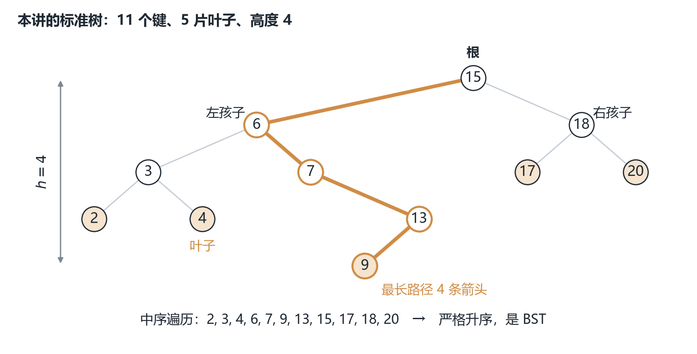
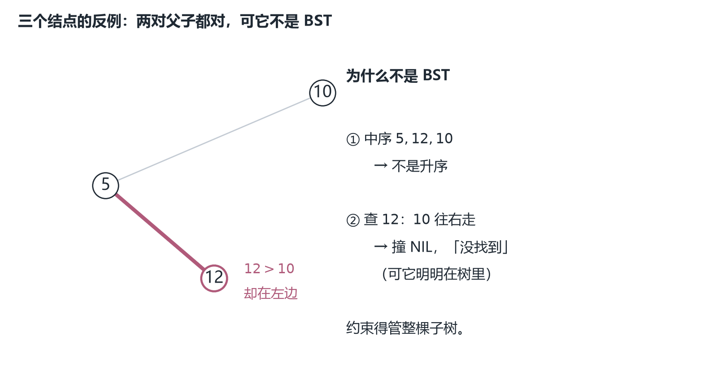
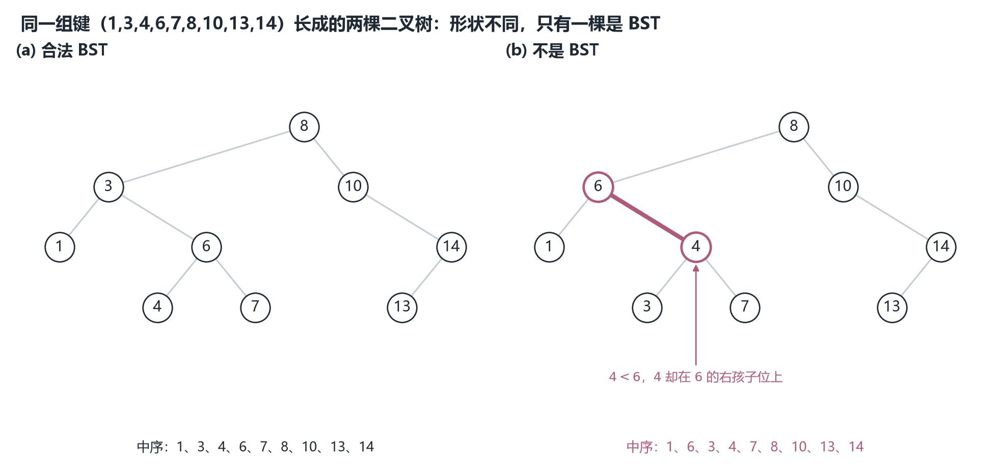
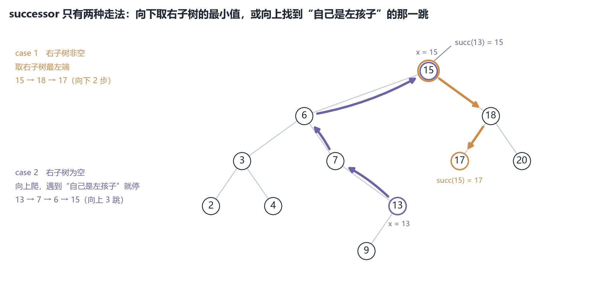
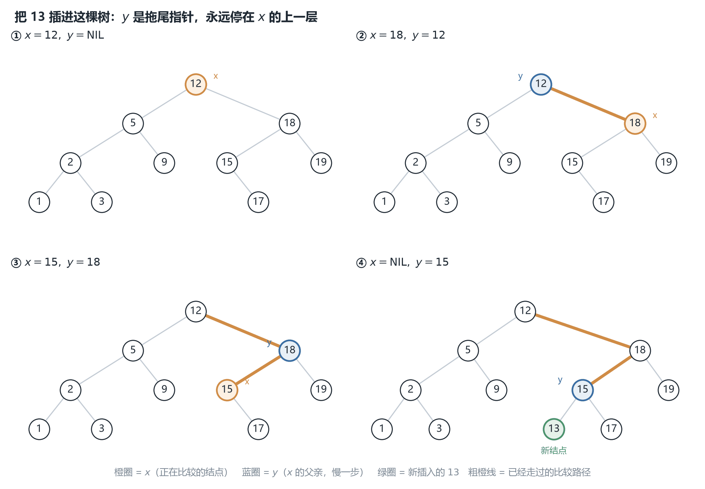
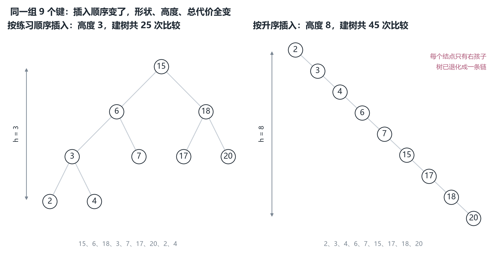
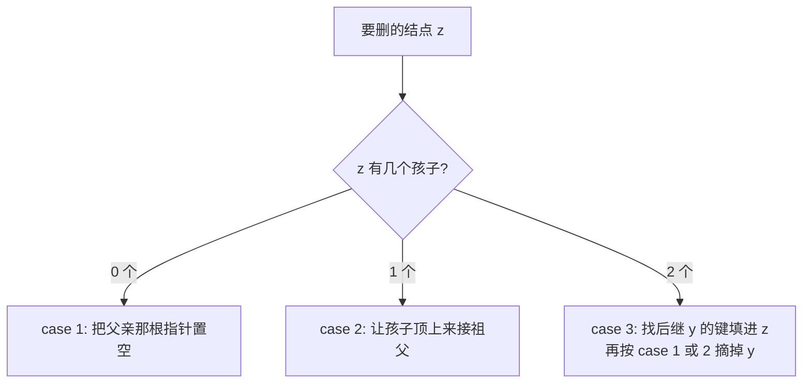
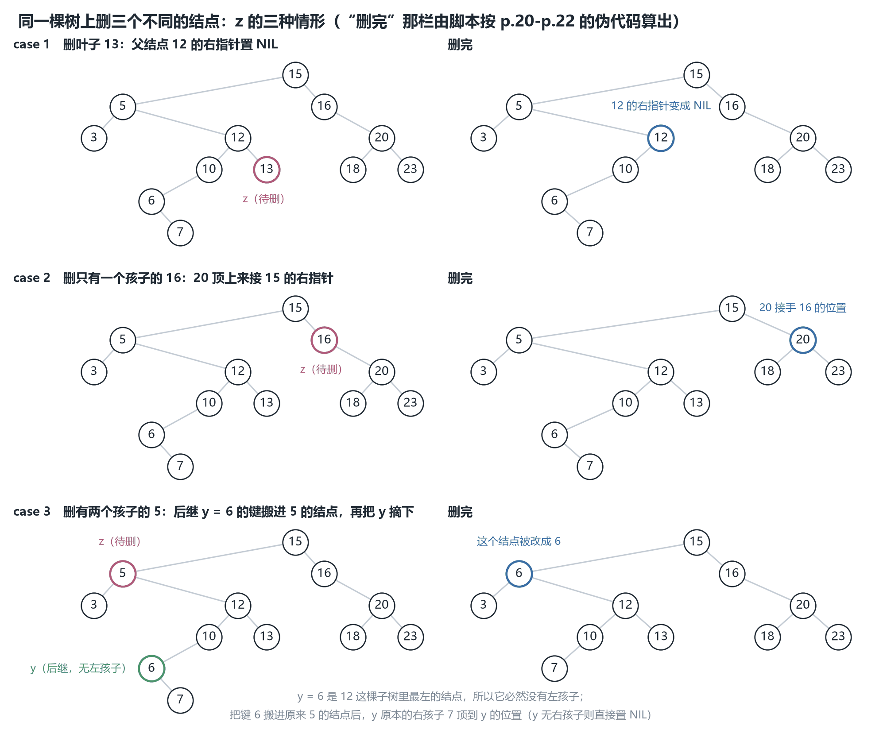
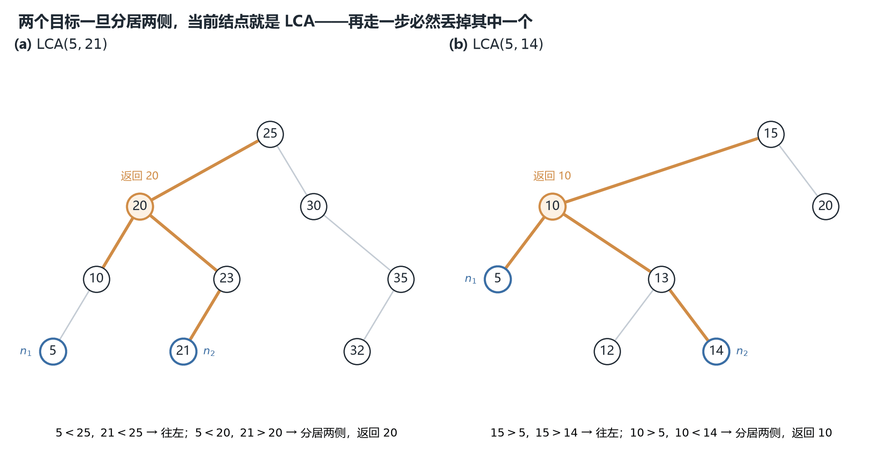

# CSC3100 Lecture 14 课堂笔记：Binary Search Tree（二叉搜索树）

> **怎么读**：手边不需要课件，也不需要先学过上一讲。§0 把要用到的基础词全部补齐，§1–§8 是主线，§9–§10 是课堂练习与答案。所有树、表、代码都在正文里给全了。
>
> **材料**：基于课件 `lecture 14 (binary search tree).pdf`（30 页）整理，不含教师口述。课件里的树图与伪代码大多是图片，已逐页放大核读。
>
> **关于这一版**：2026-11-04 重写的精简版。删掉的是**解释性长文**（逐行伪代码解读、证明、对拍实验、九条勘误的展开、跨讲对账）；**示例代码全部保留且补齐四语言**，因为学完这一讲要能自己写代码。八张配图、手算例子与练习答案都在。需要那些长文看 `_backup/CSC3100-Lecture14-课堂笔记_精简前_2026-11-04.md`。

## 0. 零基础先补七个词

先看一棵具体的树，后面半讲都用它：



*图 1　本讲的标准树。橙线是最长的一条路径 $15\to6\to7\to13\to9$：数它有 $4$ 条箭头，所以树高 $h=4$。填色的 $2,4,9,17,20$ 是 5 片叶子，其余结点都有孩子。中序读出来是 $2,3,4,6,7,9,13,15,17,18,20$，严格升序。*

| 词 | 英文 | 大白话 |
| --- | --- | --- |
| 结点 | node | 存一个数字的小格子。数字叫 **键 key**，另外带三根"箭头"（指针）：`left` 指左孩子、`right` 指右孩子、`p` 指回父亲 |
| 空 | NIL / null | 箭头指向"没有"。图 1 里 `7` 没有左孩子，那根箭头就是 NIL |
| 子树 | subtree | 某个结点**连同它下面的全部后代**，整体看也是一棵树 |
| 树高 | height, $h$ | 从根到最深叶子走过的**箭头条数**。只有一个结点时 $h=0$；这棵树最长路径 $15\to6\to7\to13\to9$ 是 4 条箭头，$h=4$ |
| 中序遍历 | inorder | 按「左子树 → 根 → 右子树」把键念出来。这棵树念出来是 $2,3,4,6,7,9,13,15,17,18,20$ |
| 大 O | $O(\cdot)$ | 「最多大概要走这么多步」。$O(h)$ 是最多走约 $h$ 步，$O(n)$ 是最多把 $n$ 个结点扫一遍 |
| 递归 | recursion | 函数自己调自己，先处理孩子再回到自己。初学可以先当成「顺着箭头一层层走」 |

> 为了省地方，后面把树写成 `15(6(3(2,4), 7(-,13(9,-))), 18(17,20))`：规则是 **`结点(左子树, 右子树)`**，`-` 表示空。图 1 和这一行是同一棵树。

> **关于代码**：下面每个算法都给 **Java / Python / C++ / C 四栏**，点标签切换。四栏是**同一个算法**，变量名、边界、返回值语义一致；读懂任意一栏就够，其余是写作业时对照语法用的（本课程主语言是 Java）。每组代码都假定 §5 那个 `Node` 已定义，注释里的「第 N 行」指课件伪代码的行号。全部片段都真编译、真跑过且四语言输出一致，见文末备注。

**为什么需要新结构？** 排好序的数组查得快（二分 $O(\log n)$），但插一个元素要把后面全部右移，$O(n)$；链表插删快，找位置却要 $O(n)$。本讲想找一个「查、插、删都快」的结构，办法就是给二叉树加一条关于大小的规矩。

## 1. 本讲地图

**一句话：BST = 二叉树 +「左边全小、右边全大」；有了这条规矩，查找、最值、前驱后继、插入、删除全都只要沿一条路径走 $O(h)$ 步。但树高 $h$ 最大能到 $n$，所以讲完必须接着讲平衡树。**

| 节 | 在回答什么 |
| --- | --- |
| §2 | 这条规矩到底加在谁身上（整棵子树，不是左右孩子） |
| §3 | 为什么值得为它专门造一个数据结构 |
| §4 | 七个操作是什么；为什么说 $h$ 是全部性能的命门 |
| §5 | 查找、求最小最大：沿一条路往下走 |
| §6 | 前驱、后继：第一次需要「往上爬」 |
| §7 | 插入：两个指针，挂成一个新叶子 |
| §8 | 删除：三种情形，难在「补洞」 |
| §9 | 最低公共祖先 LCA：有序性把 $O(n)$ 压成 $O(h)$ |
| §10 | 三道课堂练习与答案 |
| §11 | 复杂度总账，以及为什么下一讲是 AVL |

## 2. BST 是什么：一条约束（p.3）

课件的定义原文两句：

> BST is a binary tree such that for each node $T$, the key values in its **left subtree** are *smaller* than the key value of $T$, and the key values in its **right subtree** are *larger*.

翻成中文：**对每个结点，它左子树里的每一个键都比它小，右子树里的每一个键都比它大。**

三个词要抠准：

- **对每个结点**：不是抽查几个，是树上每个结点都得满足。
- **子树**：不是「左孩子」，是「左孩子以及它下面的一切」。
- **smaller / larger 是严格的**：本讲按严格不等号，不允许重复键。真要实现重复键，必须规定「相等往哪边走」并且全篇一致（§7 会看到课件自己在这点上前后矛盾）。

### 2.1 为什么非得管「整棵子树」

最常见的误解是把定义读成「左孩子比自己小、右孩子比自己大」。这条件太弱。看三个结点的反例：



*图 2　只有三个结点的反例。$5<10$、$12>5$，两对父子关系单独拿出来看都对，可是 $12>10$ 却落在 $10$ 的左子树里（画成红色的那条边）。*

对着图 2 逐个检查父子对：$5<10$ 且在左边 ✓，$12>5$ 且在右边 ✓，**两对全对**。可这棵树不是 BST：

- 中序念出来是 $5,12,10$，**不是升序**；
- 更实在的检验：找 $12$，从根 $10$ 出发因 $12>10$ 往右走，右边是 NIL，于是返回「没找到」——**明明在树里却搜不到自己装着的键**。

> [!IMPORTANT] 重要：判据只有一条
> **跑一次中序遍历，输出严格升序 $\iff$ 这棵树是 BST。** 因为查找时每往下走一步，都要能断定「被扔掉的那一侧绝不可能有目标」，而这只有「整棵子树都在同一侧」才保证得了。

### 2.2 同一组键，可以长成不同形状



*图 3　同一组键 $1,3,4,6,7,8,10,13,14$ 长成的两棵树。(a) 中序 $1,3,4,6,7,8,10,13,14$ 升序，是合法 BST；(b) 的 $4$ 挂在 $6$ 的右孩子位却比 $6$ 小，中序 $1,6,3,4,7,8,10,13,14$ 乱序，不是 BST。*

> [!WARNING] 课件笔误：它把 (b) 当成合法 BST
> 课件这一页的 (b) 画错了：$4<6$ 却放在右孩子位，$3$ 也落进了 $6$ 的右子树。把 $4$ 与 $6$ 的标签对调，就变成另一棵合法形状——这才是这一页本来想给的「同一组键、两种合法形状」的对照。

> [!TIP] 练习 A · 参考答案
> **问**：`8(3(1, 6(4,7)), 10(-, 14(13,-)))` 是 BST 吗？
> **答**：是。中序读出来是 $1,3,4,6,7,8,10,13,14$，严格升序；逐点也对，比如 $3$ 的右子树 $\{4,6,7\}$ 全在 $(3,8)$ 之间。

## 3. 为什么值得为这条约束单造一个结构

**值钱的不是「快」，是「有序」**——原文是 "because of its **ordered** structure"。

| 你能问的问题 | 哈希表 | 堆 | BST |
| --- | --- | --- | --- |
| 按键查一个值 | $O(1)$ | 不行 | $O(h)$ |
| 按顺序全部遍历 / 找前驱后继 | 不行 | 不行 | 可以 |
| 找「刚好比 $x$ 大的」「区间 $[a,b]$ 内所有键」 | 不行 | 不行 | 可以 |
| 插入 / 删除 | $O(1)$ | $O(\log n)$ | $O(h)$ |

单论「查一个键」，哈希表 $O(1)$ 比 BST 快；但哈希表只能按精确值取，答不了任何「按顺序」的问题。Java 里 `TreeMap` / `TreeSet` 的 `first()`、`floor()`、`ceiling()`、`subSet()`，全靠 BST 的有序性；`HashMap` 一个都给不了。数据库的 B+ 树索引、要随时回答「当前最小值 / 第 $k$ 小」的数据流，也是同一条理由。

> [!TIP] 技巧：选型口诀
> **只要最大或最小 → 堆；只要按键取值 → 哈希表；要「顺序上的邻居」或范围查询 → BST。** 把优先队列列进 BST 的应用时，说的是「BST 也能做」；实践中优先队列几乎都用堆，常数小得多。

## 4. 七个操作，和它们的命门 $h$（p.5、p.23）

BST 要支持七个**动态集合**（dynamic set，即能插能删的集合）操作：

| 操作 | 中文 | 干什么 | 会不会改树 |
| --- | --- | --- | --- |
| `searchKey` | 查找 | 按键找结点，找不到返回 NIL | 不改 |
| `findMin` / `findMax` | 求最小 / 最大 | 一路向左 / 一路向右 | 不改 |
| `predecessor` / `successor` | 前驱 / 后继 | 按大小找「上一个 / 下一个」 | 不改 |
| `insert` / `delete` | 插入 / 删除 | 加一个键 / 摘一个键 | 改 |

**七个全是 $O(h)$**，因为每个操作都是「沿某条路径走若干步」，而路径最长就是树高。这一句话是本讲的总账，也是它的全部问题。

$h$ 能有多大？$n$ 个结点时：

$$
\lceil \log_2(n+1) \rceil - 1 \;\le\; h \;\le\; n-1
$$

下界的来由：高度 $h$ 的二叉树最多装 $2^{h+1}-1$ 个结点，反过来 $n$ 个结点至少要 $\lceil\log_2(n+1)\rceil-1$ 层。上界就是所有结点排成一条链。取 $n=10^6$：最平衡时 $h=19$，最坏时 $h=999999$——**同一段查找代码，代价差五万倍**。

> [!IMPORTANT] 重要
> **BST 的性能全挂在「树有多高」这一个数上，而这条规矩本身完全不保护树高。** "expected height is $\log n$" 要读成「输入顺序随机时是 $\Theta(\log n)$」，实际系数约 $3$；只要输入已经有序，树必然是链，七个操作全部退化成 $\Theta(n)$，和链表一样。

> [!TIP] 练习 B · 参考答案
> **问**：9 个结点的 BST，$h$ 最小可能是多少？最大呢？
> **答**：最小 $\lceil\log_2 10\rceil-1=4-1=3$（三层填满），最大 $9-1=8$（一条链）。

## 5. 查找与最值：沿一条路往下走（p.6-9）

回到 §0 那棵树：$15(6(3(2,4),7(-,13(9,-))),18(17,20))$。找 $13$ 的过程：

| 步 | 当前结点 | 比较 | 动作 |
| --- | --- | --- | --- |
| 1 | $15$ | $13<15$ | 往左到 $6$ |
| 2 | $6$ | $13>6$ | 往右到 $7$ |
| 3 | $7$ | $13>7$ | 往右到 $13$ |
| 4 | $13$ | $13=13$ | 找到，返回这个结点 |

**规矩只有一条：比当前小往左，比当前大往右，相等就停下；走到 NIL 说明不存在。** 这条规矩能成立，靠的正是「另一侧整棵子树里绝不可能有目标」。

::: code-group

```java [Java]
class Node { int key; Node left, right, p; Node(int k) { this.key = k; } }

class BST {
    static Node find(Node x, int k) {
        if (x == null || k == x.key) return x;        // 第 1-2 行
        if (k < x.key) return find(x.left, k);        // 第 3-4 行
        else           return find(x.right, k);       // 第 5-6 行
    }
}
```

```python [Python]
class Node:
    def __init__(self, key, p=None):
        self.key = key
        self.left = self.right = None
        self.p = p


def find(x, k):
    if x is None or k == x.key: return x        # 第 1-2 行
    if k < x.key: return find(x.left, k)        # 第 3-4 行
    return find(x.right, k)                     # 第 5-6 行
```

```cpp [C++]
struct Node {
    int key; Node *left, *right, *p;
    Node(int k) : key(k), left(NULL), right(NULL), p(NULL) {}
};

Node *find(Node *x, int k) {
    if (x == NULL || k == x->key) return x;      // 第 1-2 行
    if (k < x->key) return find(x->left, k);     // 第 3-4 行
    return find(x->right, k);                    // 第 5-6 行
}
```

```c [C]
#include <stdlib.h>

typedef struct Node { int key; struct Node *left, *right, *p; } Node;

Node *newNode(int k) {
    Node *z = (Node *)malloc(sizeof(Node));
    z->key = k; z->left = z->right = z->p = NULL;
    return z;
}

Node *find(Node *x, int k) {
    if (x == NULL || k == x->key) return x;      /* 第 1-2 行 */
    if (k < x->key) return find(x->left, k);     /* 第 3-4 行 */
    return find(x->right, k);                    /* 第 5-6 行 */
}
```

:::

每往下走一层做一次比较，最多 $h+1$ 层，所以是 $O(h)$ 时间；上面的递归写法还要额外 $O(h)$ 的栈空间。

> [!TIP] 技巧：把递归改成循环
> 把递归版里两处 `return find(...)` 改成 `x = ...`、外面套一层 `while (x != NIL && k != key[x])`，就是迭代版：时间仍是 $O(h)$，额外空间从 $O(h)$ 的递归栈降到 $O(1)$。真实实现都用这个。

**求最小 / 最大更简单：一路向左 / 一路向右，连键都不用比。**

::: code-group

```java [Java]
// Node 见 §5
class BST {
    static Node findMin(Node x) {
        while (x.left != null) x = x.left;    // 第 1-2 行
        return x;                             // 第 3 行
    }
    static Node findMax(Node x) {             // p.9：左边换成右边
        while (x.right != null) x = x.right;
        return x;
    }
}
```

```python [Python]
# Node 见 §5


def find_min(x):
    while x.left is not None: x = x.left    # 第 1-2 行
    return x                                # 第 3 行


def find_max(x):                            # p.9：左边换成右边
    while x.right is not None: x = x.right
    return x
```

```cpp [C++]
// Node 见 §5

Node *findMin(Node *x) {
    while (x->left != NULL) x = x->left;     // 第 1-2 行
    return x;                                // 第 3 行
}
Node *findMax(Node *x) {                     // p.9：左边换成右边
    while (x->right != NULL) x = x->right;
    return x;
}
```

```c [C]
/* Node 见 §5 */

Node *findMin(Node *x) {
    while (x->left != NULL) x = x->left;     /* 第 1-2 行 */
    return x;                                /* 第 3 行 */
}
Node *findMax(Node *x) {                     /* p.9：左边换成右边 */
    while (x->right != NULL) x = x->right;
    return x;
}
```

:::

为什么对？只要还有左孩子，左孩子就比自己小，自己肯定不是最小；走到没有左孩子时，下面没有更小的了，而所有祖先都比自己大。§0 那棵树的最小是 $2$（$15\to6\to3\to2$），最大是 $20$（$15\to18\to20$）。

> [!NOTE] 补充：一个后面要用的结构事实
> **最小值所在的结点一定没有左孩子，最大值所在的结点一定没有右孩子。** 在 `find_min` 里它是循环的终止条件，到 §8 的删除 case 3 里，它会变成正确性前提。另外「最小值」不一定是叶子——它可能有右子树。

> [!TIP] 练习 C · 参考答案
> **问**：在 §0 那棵树里找 $12$，要比几次？
> **答**：走 $15\to6\to7\to13\to9$，到 $9$ 的左孩子是 NIL 才停，比较 5 次，返回「不存在」。失败的查找要比成功的多走到那个空位。

## 6. 前驱与后继：第一次要「往上爬」（p.10-12）

**后继** successor($x$) = 比 $x$ 大的键里最小的那个；**前驱** predecessor($x$) = 比 $x$ 小的键里最大的那个。也就是**中序序列里 $x$ 的下一个 / 上一个**。

以 §0 那棵树为例：中序是 $2,3,4,6,7,9,13,15,17,18,20$，所以 $13$ 的后继是 $15$，$15$ 的后继是 $17$，$9$ 的前驱是 $7$。难点在于：**要直接从结点指针算出来，不能先把中序跑一遍。**

| 情形 | 后继（找下一个更大） | 前驱（找上一个更小） |
| --- | --- | --- |
| case 1：右 / 左子树非空 | 取**右子树的最小值**（一路向左） | 取**左子树的最大值**（一路向右） |
| case 2：右 / 左子树为空 | 沿父亲链**向上爬**，直到「自己是**左**孩子」，返回那一跳的父亲 | 向上爬，直到「自己是**右**孩子」，返回那一跳的父亲 |
| 一路爬到根之上 | $x$ 是最大元素，返回 NIL | $x$ 是最小元素，返回 NIL |

三个具体例子（都在 §0 那棵树上）：

- $\text{successor}(15)=17$，case 1：$15$ 有右子树 $\{17,18,20\}$，其最小值 $18\to17$ 得 $17$。
- $\text{successor}(13)=15$，case 2：$13$ 无右子树，往上 $13$ 是 $7$ 的右孩子（继续）、$7$ 是 $6$ 的右孩子（继续）、$6$ 是 $15$ 的**左**孩子（停），返回 $15$。**爬了三跳。**
- $\text{successor}(9)=13$，case 2：$9$ 是 $13$ 的左孩子，一跳就停。



*图 4　同一棵树上两种 case：$\text{successor}(15)=17$ 向下走到右子树最左端；$\text{successor}(13)=15$ 沿祖先链向上爬三跳，第一次「自己是左孩子」就停（$13\to7\to6\to15$）。*

::: code-group

```java [Java]
// Node 见 §5；findMin 见 §5
class BST {
    static Node successor(Node x) {
        if (x.right != null) return findMin(x.right);   // 第 1-2 行
        Node y = x.p;                                   // 第 3 行
        while (y != null && x == y.right) {             // 第 4 行：两个条件不能换
            x = y; y = y.p;                             // 第 5-6 行
        }
        return y;                                       // 第 7 行
    }
}
```

```python [Python]
# Node 见 §5；find_min 见 §5


def successor(x):
    if x.right is not None: return find_min(x.right)   # 第 1-2 行
    y = x.p                                            # 第 3 行
    while y is not None and x is y.right:              # 第 4 行：两个条件不能换
        x, y = y, y.p                                  # 第 5-6 行
    return y                                           # 第 7 行
```

```cpp [C++]
// Node 见 §5；findMin 见 §5

Node *successor(Node *x) {
    if (x->right != NULL) return findMin(x->right);  // 第 1-2 行
    Node *y = x->p;                                  // 第 3 行
    while (y != NULL && x == y->right) {             // 第 4 行：两个条件不能换
        x = y; y = y->p;                             // 第 5-6 行
    }
    return y;                                        // 第 7 行
}
```

```c [C]
/* Node 见 §5；findMin 见 §5 */

Node *successor(Node *x) {
    if (x->right != NULL) return findMin(x->right);  /* 第 1-2 行 */
    Node *y = x->p;                                  /* 第 3 行 */
    while (y != NULL && x == y->right) {             /* 第 4 行：两个条件不能换 */
        x = y; y = y->p;                             /* 第 5-6 行 */
    }
    return y;                                        /* 第 7 行 */
}
```

:::

**前驱的代码就是把上面左右全部反过来**（`right`↔`left`、`find_min`↔`find_max`、循环条件 `x is y.right`↔`x is y.left`）：

::: code-group

```java [Java]
// Node 定义见 §5；findMax 见本节开头
class BST {
    static Node predecessor(Node x) {
        if (x.left != null) return findMax(x.left);
        Node y = x.p;
        while (y != null && x == y.left) {      // 一直爬到「自己是右孩子」
            x = y; y = y.p;
        }
        return y;
    }
}
```

```python [Python]
# Node 定义见 §5；find_max 见本节开头
def predecessor(x):
    if x.left is not None:
        return find_max(x.left)
    y = x.p
    while y is not None and x is y.left:      # 一直爬到「自己是右孩子」
        x, y = y, y.p
    return y
```

```cpp [C++]
// Node 定义见 §5；findMax 见本节开头
Node *predecessor(Node *x) {
    if (x->left != NULL) return findMax(x->left);
    Node *y = x->p;
    while (y != NULL && x == y->left) {     // 一直爬到「自己是右孩子」
        x = y; y = y->p;
    }
    return y;
}
```

```c [C]
/* Node 定义见 §5；findMax 见本节开头 */
Node *predecessor(Node *x) {
    if (x->left != NULL) return findMax(x->left);
    Node *y = x->p;
    while (y != NULL && x == y->left) {     /* 一直爬到「自己是右孩子」 */
        x = y; y = y->p;
    }
    return y;
}
```

:::

> [!CAUTION] 注意：本讲最容易写错的一行
> **case 2 是「一直爬到条件满足」，不是「看一眼父亲」。** $\text{successor}(13)$ 的父亲是 $7$，答案是 $15$；$\text{predecessor}(9)$ 的父亲是 $13$，答案是 $7$。只爬一跳就会得到一个比自己还小（或还大）的数，一眼就知道错了。循环里 `y is not None` 必须写在前面，否则爬到根之上会去解引用 NIL。

> [!NOTE] 补充：parent 指针不是浪费
> 上一讲有人问「结点里多存一个指回父亲的指针有什么用」——答案就在 case 2：没有 `p`，只能从根重新查一遍。另外，从最小值开始反复调用 successor 直到 NIL，就是**不用栈的中序遍历**，访问全部 $n$ 个结点的总代价是 $O(n)$ 而不是 $O(nh)$。

> [!TIP] 练习 D · 参考答案
> **问**：$\text{predecessor}(15)$ 与 $\text{predecessor}(7)$ 各是多少，各走哪个 case？
> **答**：$\text{predecessor}(15)=13$，case 1（左子树最大值：$6\to7\to13$）；$\text{predecessor}(7)=6$，case 2（$7$ 没有左孩子，且它是 $6$ 的右孩子，一跳就停）。

## 7. 插入：两个指针，挂成一个新叶子（p.13-16）

**插入的位置永远是一个空指针（新叶子）。** 已有结点之间的父子关系一个都不动，所以「找位置」就是一次查找，只要挂对地方就不会破坏 BST 性质。

**为什么必须两个指针？** 让 $x$ 一路往下走，走到 NIL 时你手里是一个空指针，可「挂到树上」需要知道**改谁的孩子指针**。所以再放一个 $y$，比 $x$ 慢一步，永远是 $x$ 的父亲；$x$ 走到空位时，$y$ 正好停在要改指针的那个结点上。一句话：**拖尾指针 $y$ 的作用是「记住该改哪个空槽」**。



*图 5　把 $13$ 插进 $12(5(2(1,3),9),18(15(-,17),19))$ 的四帧。橙圈是 $x$（正在比较），蓝圈是 $y$（$x$ 的父亲，慢一步）。比较路径 $12\to18\to15$，第 ④ 帧 $x$ 走到 NIL、$y$ 停在 $15$，新结点 $13$ 就挂成 $15$ 的左孩子。*

::: code-group

```java [Java]
// Node 见 §5
class BST {
    static Node insert(Node root, Node z) {          // z 的左右孩子须先置 null
        Node y = null, x = root;                     // 第 1-2 行
        while (x != null) {                          // 第 3 行
            y = x;                                   // 第 4 行：必须在比较之前
            x = (z.key < x.key) ? x.left : x.right;  // 第 5-8 行：相等键往右
        }
        z.p = y;                                     // 第 9 行
        if (y == null) root = z;                     // 第 10-11 行：T 本来是空树
        else if (z.key < y.key) y.left = z;          // 第 13-14 行
        else y.right = z;                            // 第 15-16 行
        return root;
    }
}
```

```python [Python]
# Node 见 §5


def insert(root, z):                                # z 的左右孩子须先置 None
    y, x = None, root                               # 第 1-2 行
    while x is not None:                            # 第 3 行
        y = x                                       # 第 4 行：必须在比较之前
        x = x.left if z.key < x.key else x.right     # 第 5-8 行：相等键往右
    z.p = y                                         # 第 9 行
    if y is None: root = z                          # 第 10-11 行：T 本来是空树
    elif z.key < y.key: y.left = z                   # 第 13-14 行
    else: y.right = z                                # 第 15-16 行
    return root
```

```cpp [C++]
// Node 见 §5

Node *insert(Node *root, Node *z) {              // z 的左右孩子须先置 NULL
    Node *y = NULL, *x = root;                      // 第 1-2 行
    while (x != NULL) {                             // 第 3 行
        y = x;                                      // 第 4 行：必须在比较之前
        x = (z->key < x->key) ? x->left : x->right;  // 第 5-8 行：相等键往右
    }
    z->p = y;                                       // 第 9 行
    if (y == NULL) root = z;                        // 第 10-11 行：T 本来是空树
    else if (z->key < y->key) y->left = z;           // 第 13-14 行
    else y->right = z;                               // 第 15-16 行
    return root;
}
```

```c [C]
/* Node 见 §5 */

Node *insert(Node *root, Node *z) {              /* z 的左右孩子须先置 NULL */
    Node *y = NULL, *x = root;                      /* 第 1-2 行 */
    while (x != NULL) {                             /* 第 3 行 */
        y = x;                                      /* 第 4 行：必须在比较之前 */
        x = (z->key < x->key) ? x->left : x->right;  /* 第 5-8 行：相等键往右 */
    }
    z->p = y;                                       /* 第 9 行 */
    if (y == NULL) root = z;                        /* 第 10-11 行：T 本来是空树 */
    else if (z->key < y->key) y->left = z;           /* 第 13-14 行 */
    else y->right = z;                               /* 第 15-16 行 */
    return root;
}
```

:::

> [!CAUTION] 注意：代码里没写、实现时却必须做的三件事
> ① 新结点 $z$ 的 `left` / `right` / `p` 要先清零，否则它带着旧指针进树；② **相等键往哪边走必须全篇统一**——本讲两处规定正好相反（文字版说往左、代码版写往右，见文末备注），照抄会出错；③ 若按「集合」语义（键已存在就不做事），要额外加一次相等判断，课件的写法是「多重集」，重复键会挂成一串。

### 7.1 插入顺序决定树的形状

同一组键，换个顺序插，树可以完全不一样。拿这组键练一遍 $15,6,18,3,7,17,20,2,4$：



*图 6　按练习顺序插入，得 $15(6(3(2,4),7),18(17,20))$，高 $3$、建树共 25 次比较；按升序 $2,3,4,6,7,15,17,18,20$ 插入，每个新键都比之前所有键大，退化成一条右斜链，高 $8$、共 45 次比较。*

**单次插入 $O(h)$。建整棵树的总账**：把 $n$ 个键全插进去，随机顺序约 $\Theta(n\log n)$，有序输入是 $1+2+\cdots+n=\Theta(n^2)$。这个 $\Theta(n\log n)$ 和快速排序的期望比较次数完全一样，不是巧合——「第一个键当根，小的进左、大的进右，两边递归」和「以第一个键为轴做快排划分」是同一个过程。

> [!TIP] 练习 E · 参考答案
> **问**：按 $15,6,18,3,7,17,20,2,4$ 插入，结果树是什么？高度多少？
> **答**：$15(6(3(2,4),7),18(17,20))$，最长路径 $15\to6\to3\to2$ 共 3 条箭头，高 $3$，正好达到 §4 的下界。中序 $2,3,4,6,7,15,17,18,20$ 升序，再次验证 §2.1 那条判据。

## 8. 删除：三种情形，难在「补洞」（p.17-22）

删除给定的结点 $z$（通常先查一次拿到指针）。按「$z$ 有几个孩子」分三种情形，也就是按「洞有多难补」排的：



*这张分支图是我整理的，课件没有画。*

| 情形 | 怎么做 | 关键提醒 |
| --- | --- | --- |
| case 1：叶子 | 父亲指向它的那个指针置 NIL | 若 $z$ 是根，把根置 NIL（树变空） |
| case 2：一个孩子 | 让孩子直接接到祖父上（叫「过继」transplant） | **两头都要改**：父亲的孩子指针、孩子的 `p` 指针 |
| case 3：两个孩子 | 用**后继** $y$ 的键覆盖 $z$，再按 case 1/2 把 $y$ 摘掉 | $y$ 是右子树最小值，一定没有左孩子，所以删它绝不会再碰到 case 3 |

下面三个例子用的是另一棵树（**注意它和 §0 那棵标准树不是同一棵**）：

$$
15\big(5(3,\;12(10(6(-,7),-),\;13)),\;16(-,\;20(18,23))\big)
$$

- **case 1，删 $13$**（叶子）：把 $12$ 的右指针置 NIL，其余不动。
- **case 2，删 $16$**（只有右孩子 $20$）：把 $15$ 的右指针改指 $20$，并把 $20$ 的 `p` 改指 $15$。
- **case 3，删 $5$**（有 $3$ 和 $12$ 两个孩子）：后继是右子树最左端 $12\to10\to6$，即 $y=6$。把 $6$ 的键搬进原来 $5$ 的结点，再按 case 2 把 $y$ 摘掉（$y$ 有右孩子 $7$，让 $7$ 接上 $10$）。结果 $15(6(3,12(10(7,-),13)),16(-,20(18,23)))$。



*图 7　在同一棵树上删三个不同的结点：case 1 删叶子 $13$、case 2 删只有一个孩子的 $16$、case 3 删有两个孩子的 $5$（后继 $y=6$）。蓝色圈出的是接手的那个结点。*

> [!IMPORTANT] 重要：被删的是「键」，摘掉的是「结点」
> case 3 里 $z$ 这个结点**还留在原来的位置**，父亲、左右孩子全没变，只是 `key` 从 $5$ 换成了 $6$；真正从树上消失的是 $y$。这叫**复制式删除**（copy-deletion）。两个后果要记住：键之外的其它数据（卫星数据）必须和键一起搬；外部若存着「键为 $6$ 的那个结点」的指针，删完就失效了。

### 8.1 照课件写：三段伪代码与四语言实现

课件把三种情形各写成一段伪代码，合起来才是一个完整的 `delete(z)`。考试常要求读伪代码，所以三段的原文与可运行版本都放在这里。**注意**：注释里的 `[!code warning]` 标出的两行是课件自己的坑，见本节的 CAUTION。

**case 1：`z` 没有孩子。** 把父亲指向它的那个指针置 NIL；`z` 是根时把根置 NIL。

```text
1.  if left[z] = NIL and right[z] = NIL        // z has no child
2.      if p[z] = NIL then root[T] = NIL
3.      else
4.          if z = left[p[z]]
5.              left[p[z]] = NIL
6.          else
7.              right[p[z]] = NIL
```

::: code-group

```java [Java]
// Node 见 §5
class BST {
    static Node deleteLeaf(Node root, Node z) {              // case 1：叶子
        if (z.left != null || z.right != null) return root;  // 第 1 行
        if (z.p == null) root = null;                        // 第 2 行：z 是根
        else if (z == z.p.left) z.p.left = null;             // 第 4-5 行
        else z.p.right = null;                               // 第 6-7 行
        z.p = null;                                          // 课件没写：删完清指针
        return root;
    }
}
```

```python [Python]
# Node 见 §5


def delete_leaf(root, z):                               # case 1：叶子
    if z.left is not None or z.right is not None: return root  # 第 1 行
    if z.p is None: root = None                          # 第 2 行：z 是根
    elif z is z.p.left: z.p.left = None                  # 第 4-5 行
    else: z.p.right = None                               # 第 6-7 行
    z.p = None                                           # 课件没写：删完清指针
    return root
```

```cpp [C++]
// Node 见 §5

Node *deleteLeaf(Node *root, Node *z) {          // case 1：叶子
    if (z->left != NULL || z->right != NULL) return root;  // 第 1 行
    if (z->p == NULL) root = NULL;                         // 第 2 行：z 是根
    else if (z == z->p->left) z->p->left = NULL;           // 第 4-5 行
    else z->p->right = NULL;                               // 第 6-7 行
    z->p = NULL;                                           // 课件没写：删完清指针
    return root;
}
```

```c [C]
/* Node 见 §5 */

Node *deleteLeaf(Node *root, Node *z) {          /* case 1：叶子 */
    if (z->left != NULL || z->right != NULL) return root;  /* 第 1 行 */
    if (z->p == NULL) root = NULL;                         /* 第 2 行：z 是根 */
    else if (z == z->p->left) z->p->left = NULL;           /* 第 4-5 行 */
    else z->p->right = NULL;                               /* 第 6-7 行 */
    z->p = NULL;                                           /* 课件没写：删完清指针 */
    return root;
}
```

:::

**case 2：`z` 只有一个孩子。** 让孩子顶上来接祖父，**并且**把孩子的 `p` 改指祖父（两头都要改）。

```text
1.  if left[z] = NIL and right[z] != NIL        // z has one right child
2.      y = right[z]
3.      if p[z] = NIL
4.          root[T] = y
5.      else
6.          p[y] = p[z]
7.          if z = left[p[z]]
8.              left[p[z]] = y
9.          else
10.             right[p[z]] = y
11. if left[z] != NIL and right[z] = NIL        // z has one left child
12.     y = left[z]
13.     if p[z] = NIL
14.         root[T] = y
15.     else
16.         p[y] = p[z]
17.         if z = left[p[z]]
18.             left[p[z]] = y
19.         else
20.             right[p[z]] = y
```

::: code-group

```java [Java]
// Node 见 §5
class BST {
    static Node deleteOne(Node root, Node z) {           // case 2：一个孩子
        Node y = (z.left != null) ? z.left : z.right;    // 第 2 / 12 行
        if (z.p == null) {                               // 第 3-4 行：z 是根
            root = y; y.p = null;                        // 补：课件漏了 p[y]=NIL [!code warning]
        } else {
            y.p = z.p;                                   // 第 6 / 16 行
            if (z == z.p.left) z.p.left = y;             // 第 7-8 行
            else z.p.right = y;                          // 第 9-10 行
        }
        z.left = z.right = z.p = null;
        return root;
    }
}
```

```python [Python]
# Node 见 §5


def delete_one(root, z):                          # case 2：一个孩子
    y = z.left if z.left is not None else z.right     # 第 2 / 12 行
    if z.p is None:                                   # 第 3-4 行：z 是根
        root, y.p = y, None                           # 补：课件漏了 p[y]=NIL [!code warning]
    else:
        y.p = z.p                                     # 第 6 / 16 行
        if z is z.p.left: z.p.left = y                # 第 7-8 行
        else: z.p.right = y                           # 第 9-10 行
    z.left = z.right = z.p = None
    return root
```

```cpp [C++]
// Node 见 §5

Node *deleteOne(Node *root, Node *z) {             // case 2：一个孩子
    Node *y = (z->left != NULL) ? z->left : z->right;   // 第 2 / 12 行
    if (z->p == NULL) {                                 // 第 3-4 行：z 是根
        root = y; y->p = NULL;                          // 补：课件漏了 p[y]=NIL [!code warning]
    } else {
        y->p = z->p;                                    // 第 6 / 16 行
        if (z == z->p->left) z->p->left = y;            // 第 7-8 行
        else z->p->right = y;                           // 第 9-10 行
    }
    z->left = z->right = z->p = NULL;
    return root;
}
```

```c [C]
/* Node 见 §5 */

Node *deleteOne(Node *root, Node *z) {             /* case 2：一个孩子 */
    Node *y = (z->left != NULL) ? z->left : z->right;   /* 第 2 / 12 行 */
    if (z->p == NULL) {                                 /* 第 3-4 行：z 是根 */
        root = y; y->p = NULL;                          /* 补：课件漏了 p[y]=NIL [!code warning] */
    } else {
        y->p = z->p;                                    /* 第 6 / 16 行 */
        if (z == z->p->left) z->p->left = y;            /* 第 7-8 行 */
        else z->p->right = y;                           /* 第 9-10 行 */
    }
    z->left = z->right = z->p = NULL;
    return root;
}
```

:::

**case 3：`z` 有两个孩子。** 先用后继 $y$ 的键覆盖 $z$，再按前两种情形把 $y$ 摘掉；第 3 行把「$y$ 就是右孩子」与「$y$ 在更深处」分开，前者改 `right[z]`、后者改 `left[p[y]]`（因为更深处时 $y$ 必是左孩子）。

```text
1.  if left[z] != NIL and right[z] != NIL        // z has two children
2.      y <- TREE-SUCCESSOR(z)                    // left-most node in right tree
3.      if p[y] = z
4.          right[z] = right[y]
5.          if right[y] != NIL
6.              p[right[y]] = z
7.      else
8.          if right[y] = NIL
9.              left[p[y]] <- NIL
10.         else
11.             x <- right[y]
12.             p[x] <- p[y]
13.             left[p[y]] <- x
14.     key[z] <- key[y]                          // copy y's data into z
```

::: code-group

```java [Java]
// Node 见 §5；successor 见 §6
class BST {
    static Node deleteTwo(Node root, Node z) {            // case 3：两个孩子
        Node y = successor(z);                            // 第 2 行：右子树最左
        if (y.p == z) {                                   // 第 3 行：y 就是 z 的右孩子
            z.right = y.right;                            // 第 4 行
            if (y.right != null) y.right.p = z;           // 第 5-6 行
        } else if (y.right == null) {                     // 第 8-9 行
            y.p.left = null;                              // 原文第 8 行写作 = [!code warning]
        } else {                                          // 第 10-13 行
            Node x = y.right;
            x.p = y.p; y.p.left = x;
        }
        z.key = y.key;                                    // 第 14 行：copy y's data
        y.left = y.right = y.p = null;
        return root;
    }
}
```

```python [Python]
# Node 见 §5；successor 见 §6


def delete_two(root, z):                          # case 3：两个孩子
    y = successor(z)                                # 第 2 行：右子树最左
    if y.p is z:                                    # 第 3 行：y 就是 z 的右孩子
        z.right = y.right                           # 第 4 行
        if y.right is not None: y.right.p = z       # 第 5-6 行
    elif y.right is None: y.p.left = None           # 第 8-9 行（原文第 8 行写作 =）[!code warning]
    else:                                           # 第 10-13 行
        x = y.right
        x.p, y.p.left = y.p, x
    z.key = y.key                                   # 第 14 行：copy y's data
    y.left = y.right = y.p = None
    return root
```

```cpp [C++]
// Node 见 §5；successor 见 §6

Node *deleteTwo(Node *root, Node *z) {            // case 3：两个孩子
    Node *y = successor(z);                          // 第 2 行：右子树最左
    if (y->p == z) {                                 // 第 3 行：y 就是 z 的右孩子
        z->right = y->right;                         // 第 4 行
        if (y->right != NULL) y->right->p = z;       // 第 5-6 行
    } else if (y->right == NULL) {                   // 第 8-9 行
        y->p->left = NULL;                           // 原文第 8 行写作 = [!code warning]
    } else {                                         // 第 10-13 行
        Node *x = y->right;
        x->p = y->p; y->p->left = x;
    }
    z->key = y->key;                                 // 第 14 行：copy y's data
    y->left = y->right = y->p = NULL;
    return root;
}
```

```c [C]
/* Node 见 §5；successor 见 §6 */

Node *deleteTwo(Node *root, Node *z) {            /* case 3：两个孩子 */
    Node *y = successor(z);                          /* 第 2 行：右子树最左 */
    if (y->p == z) {                                 /* 第 3 行：y 就是 z 的右孩子 */
        z->right = y->right;                         /* 第 4 行 */
        if (y->right != NULL) y->right->p = z;       /* 第 5-6 行 */
    } else if (y->right == NULL) {                   /* 第 8-9 行 */
        y->p->left = NULL;                           /* 原文第 8 行写作 = [!code warning] */
    } else {                                         /* 第 10-13 行 */
        Node *x = y->right;
        x->p = y->p; y->p->left = x;
    }
    z->key = y->key;                                 /* 第 14 行：copy y's data */
    y->left = y->right = y->p = NULL;
    return root;
}
```

:::

### 8.2 更好写：把三种情形合成一段

照抄课件要记 41 行伪代码。更省事的写法是**先把 case 3 化成「搬键 + 摘一个最多只有一个孩子的结点」**，之后三种情形就只剩同一段代码了。这也是下面这份实现能避开课件两个 bug 的原因：

::: code-group

```java [Java]
// 依赖：Node（§5）、successor（§6）
class BST {
    static Node deleteNode(Node root, Node z) {
        if (z.left != null && z.right != null) {    // case 3：搬键，化归成 0/1 个孩子
            Node y = successor(z);
            z.key = y.key;
            z = y;
        }
        Node child = (z.left != null) ? z.left : z.right;
        if (z.p == null) root = child;
        else if (z == z.p.left) z.p.left = child;
        else z.p.right = child;
        if (child != null) child.p = z.p;           // 两头都要改
        z.left = z.right = z.p = null;
        return root;
    }
}
```

```python [Python]
# 依赖：Node（§5）、successor（§6）
def delete_node(root, z):
    if z.left is not None and z.right is not None:   # case 3：搬键，化归成 0/1 个孩子
        y = successor(z)
        z.key = y.key
        z = y
    child = z.left if z.left is not None else z.right
    if z.p is None:         root = child
    elif z is z.p.left:     z.p.left = child
    else:                   z.p.right = child
    if child is not None:   child.p = z.p            # 两头都要改
    z.left = z.right = z.p = None
    return root
```

```cpp [C++]
// 依赖：Node（§5）、successor（§6）
Node *deleteNode(Node *root, Node *z) {
    if (z->left != NULL && z->right != NULL) {    // case 3：搬键，化归成 0/1 个孩子
        Node *y = successor(z);
        z->key = y->key;
        z = y;
    }
    Node *child = (z->left != NULL) ? z->left : z->right;
    if (z->p == NULL) root = child;
    else if (z == z->p->left) z->p->left = child;
    else z->p->right = child;
    if (child != NULL) child->p = z->p;          // 两头都要改
    z->left = z->right = z->p = NULL;
    return root;
}
```

```c [C]
/* 依赖：Node（§5）、successor（§6） */
Node *deleteNode(Node *root, Node *z) {
    if (z->left != NULL && z->right != NULL) {    /* case 3：搬键，化归成 0/1 个孩子 */
        Node *y = successor(z);
        z->key = y->key;
        z = y;
    }
    Node *child = (z->left != NULL) ? z->left : z->right;
    if (z->p == NULL) root = child;
    else if (z == z->p->left) z->p->left = child;
    else z->p->right = child;
    if (child != NULL) child->p = z->p;          /* 两头都要改 */
    z->left = z->right = z->p = NULL;
    return root;
}
```

:::

> [!NOTE] 补充：case 3 也可以用前驱
> 课件在 p.19 用蓝框补了一句：*We can also replace it by "Find z's predecessor y (rightmost node in z's left subtree)"*——**取 $z$ 的左子树最右端（前驱）来顶替也完全成立**，两边对称，同样只需删一个最多只有一个孩子的结点。§11 那个「随机选前驱或后继」的解法，就建立在这条对称性上。

> [!CAUTION] 注意：课件伪代码里两个真 bug（本笔记的代码已避开）
> ① **删根且只有一个孩子时漏了把新根的 `p` 置 NIL**：新根还指着已删掉的老根，紧接着查一次后继会返回一个**已经被删除的键**。② **case 3 第 8 行把 `==` 写成了 `=`**：照抄成代码，要么走进 else 分支后解引用空指针直接崩，要么静默丢掉一整棵右子树且不报错。详细复现与对拍数据见精简前的备份版 §12。

> [!TIP] 练习 F · 参考答案
> **问**：删有两个孩子的结点时，为什么后继 $y$ 不可能还有左孩子？
> **答**：$y$ 是右子树的**最小值**，而 §5 已经说过最小值一定没有左孩子；若 $y$ 有左孩子 $w$，则 $w<y$ 且 $w$ 也在右子树里，和「$y$ 最小」矛盾。所以摘 $y$ 只会是 case 1 或 case 2，case 3 不会套娃。

## 9. 最低公共祖先 LCA（p.29）

**LCA**（lowest common ancestor）= 最低的、同时以两个目标结点为后代的结点。「后代」包含自己，所以其中一个正好是另一个的祖先时，答案就是那个祖先。

BST 里不用遍历整棵树，从根往下一路比较就行。设当前结点是 $x$，目标是 $a,b$：

| 情况 | 动作 |
| --- | --- |
| $x>a$ 且 $x>b$ | 两个都在左边，LCA 也在左边 → 往左 |
| $x<a$ 且 $x<b$ | 两个都在右边，LCA 也在右边 → 往右 |
| 其余 | 返回 $x$ |

第三种情况为什么一定是答案？因为此时两个目标**分居 $x$ 两侧**（或其中一个就是 $x$）：$x$ 还同时罩着它们，但再往下走一步就必然丢掉一个，所以 $x$ 就是「最低」的那个。一共走不超过 $h$ 步，代价 $O(h)$。



*图 8　橙线是算法走过的比较路径，填色结点是答案。左：求 $\mathrm{LCA}(5,21)$，$25$ 处两者都小往左，$20$ 处一左一右，返回 $20$。右：求 $\mathrm{LCA}(5,14)$，$15$ 处都小往左，$10$ 处一左一右，返回 $10$。*

图 8 左边那棵树是 $25(20(10(5,-),23(21,-)),30(-,35(32,-)))$，四个答案可以自己走一遍：$\mathrm{LCA}(5,21)=20$、$\mathrm{LCA}(10,30)=25$、$\mathrm{LCA}(5,32)=25$、$\mathrm{LCA}(10,23)=20$。

::: code-group

```java [Java]
// Node 定义见 §5
class BST {
    static Node lca(Node root, int a, int b) {
        Node x = root;
        while (x != null) {
            if (a < x.key && b < x.key) x = x.left;
            else if (a > x.key && b > x.key) x = x.right;
            else return x;
        }
        return null;
    }
}
```

```python [Python]
# Node 定义见 §5
def lca(root, a, b):
    x = root
    while x is not None:
        if a < x.key and b < x.key:      x = x.left
        elif a > x.key and b > x.key:    x = x.right
        else:                            return x
    return None
```

```cpp [C++]
// Node 定义见 §5
Node *lca(Node *root, int a, int b) {
    Node *x = root;
    while (x != NULL) {
        if (a < x->key && b < x->key) x = x->left;
        else if (a > x->key && b > x->key) x = x->right;
        else return x;
    }
    return NULL;
}
```

```c [C]
/* Node 定义见 §5 */
Node *lca(Node *root, int a, int b) {
    Node *x = root;
    while (x != NULL) {
        if (a < x->key && b < x->key) x = x->left;
        else if (a > x->key && b > x->key) x = x->right;
        else return x;
    }
    return NULL;
}
```

:::

> [!NOTE] 补充：有序性值多少钱
> **普通二叉树**（没有大小关系）求 LCA 只能后序遍历整棵树，逐个结点问「左子树找到几个、右子树找到几个、我自己是不是」，是 $O(n)$；BST 每比较一次就能扔掉一整棵子树，是 $O(h)$。$n=10^6$ 时约 40 步对 100 万步——这就是「有序」两个字的价钱。注意：若某个目标键根本不在树里，这个算法会给出一个看似合理的错答案，严格实现要先查两次确认存在。

## 10. 三道课堂练习（附答案）

### 10.1 数叶子（p.26）

::: code-group

```java [Java]
// Node 见 §5
class BST {
    static int countLeaf(Node p) {
        if (p == null) return 0;                          // 空树没有叶子
        if (p.left == null && p.right == null) return 1;   // 叶子
        return countLeaf(p.left) + countLeaf(p.right);
    }
}
```

```python [Python]
# Node 见 §5


def count_leaf(p):
    if p is None: return 0                          # 空树没有叶子
    if p.left is None and p.right is None: return 1  # 叶子
    return count_leaf(p.left) + count_leaf(p.right)
```

```cpp [C++]
// Node 见 §5

int countLeaf(Node *p) {
    if (p == NULL) return 0;                          // 空树没有叶子
    if (p->left == NULL && p->right == NULL) return 1;  // 叶子
    return countLeaf(p->left) + countLeaf(p->right);
}
```

```c [C]
/* Node 见 §5 */

int countLeaf(Node *p) {
    if (p == NULL) return 0;                          /* 空树没有叶子 */
    if (p->left == NULL && p->right == NULL) return 1;  /* 叶子 */
    return countLeaf(p->left) + countLeaf(p->right);
}
```

:::

三个分支恰好覆盖所有情况（空 / 叶子 / 至少一个孩子），互斥且穷尽，所以递归一定能停。§0 那棵树有 5 片叶子（$2,4,9,17,20$）。代价 $O(n)$，因为每个结点访问一次。

> [!TIP] 参考答案：它和 BST 有关系吗
> **没有。** 这段函数一次键都没比较过，对**任意二叉树**都成立。BST 只是让「中序遍历」的输出恰好升序，不改变「哪些结点是叶子」这种纯结构事实。区分「二叉树层面的事实」和「BST 层面的事实」，是本讲最容易混的一处。

### 10.2 用 BST 排序（p.28）

算法两行：**把数组一个个插进 BST，再中序遍历输出。** 正确性直接来自 §2.1 的判据（BST 的中序必升序）。

课件的五行伪代码：

```text
1.  Sort(A[ ])
2.      initialize a BST T
3.      for i = 1 to n
4.          insert(A[i]) into T
5.      inorder-tree-walk(T)
```

照它落成的四语言版本（`for i = 1 to n` 已改成各语言惯用的 0-based 下标）：

::: code-group

```java [Java]
// Node 见 §5；insert 见 §7
class BST {
    static void inorder(Node x, int[] out, int[] n) {
        if (x == null) return;
        inorder(x.left, out, n); out[n[0]++] = x.key; inorder(x.right, out, n);
    }
    static void treeSort(int[] a) {
        Node root = null;                                  // 第 2 行：initialize a BST T
        for (int i = 0; i < a.length; i++)                  // 第 3-4 行：A 从 0 开始
            root = insert(root, new Node(a[i]));
        int[] n = {0};
        inorder(root, a, n);                                // 第 5 行
    }
}
```

```python [Python]
# Node 见 §5；insert 见 §7


def inorder(x, out):
    if x is None: return
    inorder(x.left, out); out.append(x.key); inorder(x.right, out)


def tree_sort(a):
    root = None                                     # 第 2 行：initialize a BST T
    for v in a:                                     # 第 3-4 行：A 从 0 开始
        root = insert(root, Node(v))
    out = []
    inorder(root, out)                              # 第 5 行
    return out
```

```cpp [C++]
// Node 见 §5；insert 见 §7

void inorder(Node *x, int *out, int &n) {
    if (x == NULL) return;
    inorder(x->left, out, n); out[n++] = x->key; inorder(x->right, out, n);
}
void treeSort(int *a, int len) {
    Node *root = NULL;                               // 第 2 行：initialize a BST T
    for (int i = 0; i < len; i++)                    // 第 3-4 行：A 从 0 开始
        root = insert(root, new Node(a[i]));
    int n = 0;
    inorder(root, a, n);                             // 第 5 行
}
```

```c [C]
/* Node 见 §5；insert 见 §7 */

void inorder(Node *x, int *out, int *n) {
    if (x == NULL) return;
    inorder(x->left, out, n); out[(*n)++] = x->key; inorder(x->right, out, n);
}
void treeSort(int *a, int len) {
    Node *root = NULL;                               /* 第 2 行：initialize a BST T */
    for (int i = 0; i < len; i++)                    /* 第 3-4 行：A 从 0 开始 */
        root = insert(root, newNode(a[i]));
    int n = 0;
    inorder(root, a, &n);                            /* 第 5 行 */
}
```

:::

> [!TIP] 参考答案：复杂度与实际表现
> 最坏 $\Theta(n^2)$（输入已有序，见 §7.1）；最好与平均都是 $\Theta(n\log n)$，这正好是比较排序的下界；空间 $\Theta(n)$。**实践中比快排慢得多**：每个结点要单独 `new` 一块内存，比较时要顺着指针跳到随机地址，缓存命中率极低，而快排在连续数组里原地交换。它只在这两种场合划算：数据本来就是一条条到达、要边收边保持有序；或者排完还要反复做前驱后继、范围查询——**价值不在排序，在排完那棵树还在**。

### 10.3 插入和删除的操作次序能交换吗（p.27）

| | 换顺序后 |
| --- | --- |
| 删两个键 | **键集合一定相同**（集合减法可交换），但**树形常常不同**：case 3 里「搬谁来填洞」取决于当时的树形，而树形取决于先删了谁；树高不同，后续每次查找的代价也就不同 |
| 插两个键 | **一般不同**，先插的那个会成为父亲。只有当树里已存在一个键严格夹在两者之间时，两条查找路径才会提前分开，结果才相同 |

> [!TIP] 参考答案：一个能自己画出来的反例
> 树里只有根 $10$，插 $5$ 和 $7$：先 $5$ 后 $7$ 得 $10(5(-,7))$，先 $7$ 后 $5$ 得 $10(7(5,-))$——两棵不同。改成插 $5$ 和 $15$，两种顺序都得 $10(5,15)$——因为一个走左、一个走右，互不干扰。**「两个键都在根的同一侧就不影响形状」是错的**，上面第一组就是反例。

## 11. 总账，以及下一讲为什么是 AVL（p.23-25、p.30）

| 操作 | BST | 有序数组 | 链表 |
| --- | --- | --- | --- |
| 按键查 | $O(\log n)$ * | $O(\log n)$ | $O(n)$ |
| 插入 | $O(\log n)$ * | $O(n)$ | $O(n)$ |
| 删除 | $O(\log n)$ * | $O(n)$ | $O(n)$ |
| 按顺序遍历 | $O(n)$ | $O(n)$ | $O(n)$ |

`*` 是这张表的脚注 "assuming $h=O(\log N)$"——**它是额外假设，不是 BST 自带的性质**。这一列去掉星号就错了。数组那一列没有星号：二分查找靠下标随机访问，$O(\log n)$ 是无条件的；但插入要整体挪元素，瓶颈在「挪」不在「找」。链表插入本身只改两个指针，贵在「找位置」。课件原表还有 `Constructor` / `IsFull` / `IsEmpty` 三行，三种结构都是 $O(1)$（只看一个计数器，与元素个数无关），这里略去。

> [!IMPORTANT] 重要：一句话收束
> **BST 不是每一项都最优，它是唯一一个「查、插、删、按顺序走」四项都不差的结构**——代价是那个星号，也就是树高没人管。

$h$ 失控有三条路：输入已有序（直接成链）、随机顺序（约 $3\log_2 n$，比理论下界多三倍）、以及**反复删除会系统性地让左子树更深**——case 3 永远从右子树取后继来补，每删一次右边就少一个结点，左边一个不少。课件给了三条路：**① 每次随机选后继或前驱来顶替**（抛硬币，让「总从右边扣」变成两边各扣一半；课件自己标了 *not rigorous and not prove it yet!!*，因为它治不了「输入本来就有序」这个病根）；**② AVL 树**；**③ 红黑树**。后两者给每个结点加一条能**局部检查、局部修补**的平衡条件，插入删除后用旋转把树高强行压到 $O(\log n)$。

**下一讲：AVL 树（教材 CLRS 3rd ed 第 12 章）。** 本讲给了「秩序」，下一讲补「平衡」。

## 本讲核心概念速查表

| 概念 | 英文 | 一句话 | 课件位置 |
| --- | --- | --- | --- |
| 二叉搜索树 | binary search tree (BST) | 二叉树 +「左子树全小、右子树全大」 | p.3 |
| BST 性质 | BST property | 约束的是整棵子树，不是左右孩子 | p.3 |
| 中序判据 | inorder test | 中序严格升序 $\iff$ 是 BST | p.3、我补的 |
| 树高 | height, $h$ | 根到最深叶子的箭头条数，七个操作全是 $O(h)$ | p.5、p.23 |
| 查找 | searchKey / find | 小往左、大往右，走到 NIL 就是没有 | p.6-7 |
| 最值 | findMin / findMax | 一路向左 / 一路向右；最小值必无左孩子 | p.8-9 |
| 后继 / 前驱 | successor / predecessor | 中序里的下一个 / 上一个；case 2 要一路往上爬 | p.10-12 |
| 拖尾指针 | trailing pointer | 比 $x$ 慢一步的 $y$，记住该改哪个空槽 | p.13、p.15 |
| 插入 | insert | 永远挂成新叶子，不动已有父子关系 | p.13-15 |
| 删除三情形 | delete case 1/2/3 | 叶子摘掉 / 孩子过继 / 后继顶替 | p.17-19 |
| 复制式删除 | copy-deletion | 搬键不搬结点，外部指针可能失效 | p.19、p.22 |
| 最低公共祖先 | lowest common ancestor (LCA) | 三分支下降 $O(h)$，普通二叉树要 $O(n)$ | p.29 |
| 平衡树 | balanced BST | AVL / 红黑树，把 $h$ 压成 $O(\log n)$ | p.25、p.30 |

## 核心直觉（如果只能记住五句话）

1. **约束管的是整棵子树**：$10$ 左挂 $5$、$5$ 右挂 $12$，每个父子对都合法，可 $12$ 在 $10$ 的左边，中序 $5,12,10$ 一票否决。
2. **七个操作全是 $O(h)$，而 $h$ 可以是 $n$**：最好 $\Theta(\log n)$、最坏 $n-1$，BST 的全部性能都挂在树高这一个数上。
3. **后继的 case 2 是「往上爬」，不是「往上跳一步」**：爬到「自己是左孩子」那一跳为止，答案是那一跳的父亲。
4. **删除难在补洞**：case 3 用后继顶替，所以**被删的是键、摘掉的是结点**；又因总从右边取，反复删除会把树压偏。
5. **有序性的价值不只是查得快**：它让「前驱后继 / 范围查询 / LCA / 排序」都变成沿一条路径走，这是哈希表和堆都给不了的。

## 中英术语对照

| 英文 | 中文 | 备注 |
| --- | --- | --- |
| binary search tree (BST) | 二叉搜索树 | 二叉树加一条有序约束 |
| node / key / pointer | 结点 / 键 / 指针 | 结点存键，指针指向孩子与父亲 |
| NIL / null | 空 | 没有孩子的那根箭头 |
| root / leaf / subtree | 根 / 叶子 / 子树 | 子树包含下面所有后代 |
| height | 树高 | 按边数算，叶子高 $0$ |
| inorder traversal | 中序遍历 | 左–根–右 |
| dynamic set | 动态集合 | 支持插入删除的集合 |
| searchKey / findMin / findMax | 查找 / 求最小 / 求最大 | 沿一条路径下降 |
| predecessor / successor | 前驱 / 后继 | 中序里的上一个 / 下一个 |
| trailing pointer | 拖尾指针 | 插入时慢一步的 $y$ |
| transplant | 过继 / 移植 | 让祖父直接收养孙辈 |
| copy-deletion | 复制式删除 | 搬键不搬结点 |
| satellite data | 卫星数据 | 键之外跟着一起搬的数据 |
| tree sort | 树排序 | 建树 + 中序，平均 $n\log n$、最坏 $n^2$ |
| lowest common ancestor (LCA) | 最低公共祖先 | 三分支下降 $O(h)$ |
| AVL tree / red-black tree | AVL 树 / 红黑树 | 平衡 BST，下一讲 |

## 附：与课件的逐页对照

2026-11-04 用 `lecture 14 (binary search tree).pdf`（30 页）逐页复核过一遍：文本层全读 + 30 页渲染成图扫读 + p.3 / p.17 / p.19 / p.24 / p.29 按 400–450 dpi 裁切放大核数字。

| 课件页 | 本笔记 | 核对结果 |
| --- | --- | --- |
| p.2 目录 | §1 地图 | 四行大纲齐 |
| p.3 定义与两棵树 | §2、图 3 | 定义逐字一致；(a) 中序 $1,3,4,6,7,8,10,13,14$ 合法，(b) 的 $4$ 挂在 $6$ 右孩子位、$3$ 落在 $6$ 右子树，非法 |
| p.4 三个应用 | §3 | indexing / sorted stream / TreeMap·TreeSet·Priority queue 齐 |
| p.5 七操作与 $\Theta(\log n)$ / $\Theta(n)$ | §4 | 七个操作名、"expected height is $\log n$"、linear chain 都对齐，并补了 $h$ 的上下界 |
| p.6-9 查找与最值 | §5 | 找 $13$ 路径 $15\to6\to7\to13$、Minimum $=2$、Maximum $=20$ 逐字一致 |
| p.10-12 前驱后继 | §6 | 六个例子答案一致（$17,15,13$ / $13,7,6$），两个 case 的措辞一致；补了 predecessor 的四语言代码 |
| p.13-16 插入 | §7 | 四帧的 $x$/y 走位、练习序列、伪代码十六行一致 |
| p.17-22 删除 | §8 | p.17 删 $13$、p.18 删 $16$、p.19 删 $5$（$y=6$、$x=7$）逐图核过；三段伪代码与四语言实现全部搬回 |
| p.23 复杂度 | §4、§11 | 七个 $O(h)$ 与 "similar to a linked list" 齐 |
| p.24 对照表 | §11 | 六行数值与脚注 `*assuming h = O(logN)` 一致；前三行 $O(1)$ 略去并注明 |
| p.25 删除偏置与三解法 | §11 | 三个解法齐（含随机选前驱/后继及其 "not rigorous" 原注） |
| p.26-29 四道练习 | §9、§10 | count_leaf / 交换性 / BST 排序 / LCA 都给了答案；p.29 四个答案 $20,25,25,20$ 与第二棵树 $\mathrm{LCA}(5,14)=10$ 都核过 |
| p.30 阅读 | §11 | Chapter 12、AVL-tree 齐 |

**补充进正文的三处**（原精简版漏了）：case 3 可用前驱顶替（p.19 蓝框）、p.25 的解法一（随机选前驱/后继）、p.24 表格前三行 $O(1)$ 的取舍说明。

## 附：诚实备注

**一、这一版删了什么、为什么。** 原版 2065 行 / 156 KB，每个操作都配「四语言代码 + 逐行解读 + 复杂度推导 + 对拍实验」。零基础读者被长文淹没，所以本版**只砍文字**：三段删除伪代码的逐行解读、400 棵树 / 1270 次删除的对拍数据、期望高度实测表、删除偏置模拟表、九条笔误的展开、跨讲对账、数值核验表、稳定性与交换性的证明。**示例代码一律不砍**：原版 9 组 `Java / Python / C++ / C` code-group 全部搬回，另外补了原版没有的 `predecessor`、统一版 `delete`、`lca` 三组，共 **12 组四语言代码**，加上课件 4 段伪代码。需要那些长文请看备份版。

**二、课件里三处会影响答案的问题**（正文已就地处理，此处集中列出）：

| 位置 | 问题 | 影响 |
| --- | --- | --- |
| p.3 | 第二棵「示例 BST」把 $4$ 挂在 $6$ 的右孩子位却更小，中序乱序 | 它不是 BST，把 $4$ 与 $6$ 对调才成立（§2.2） |
| p.21 | 删根且只有一个孩子时漏置 `p[y] = NIL` | 新根的父亲悬空，后续查后继会返回已删除的键（§8） |
| p.22 | case 3 第 8 行把 `==` 写成 `=` | 照抄成代码会崩或静默丢子树（§8） |

另外 p.13 文字与 p.15 代码对「相等键往哪边走」的规定相反，p.5 的 "expected height is $\log n$" 只在量级上成立（实际系数约 3）；这两处不影响本讲结论，但实现与估性能时要当心。

**三、代码与图。** `_scripts/CSC3100-L14-4lang-compile-check.py` 从笔记里抽出全部 12 组四语言片段，拼成 4 份完整程序，用 `javac 21` / `g++ 15.2` / `gcc 15.2` / `Python 3.13` **真编译、真运行**，四份输出逐字一致：`find13=13 min=2 max=20 succ15=17 pred9=7 leaf=5 lca=15`。删除、两种插入顺序的高 $3/8$ 与代价 $25/45$、§2.1 反例、1000 组随机删除的三条不变量、删根后 parent 清空、四个 LCA 答案、数叶子边界，由 `_scripts/CSC3100-L14-lite-selfcheck.py` 的 27 项检查验证（全 PASS）。**验证的边界**：四语言对拍只跑了这一组查询，没有把每个操作在四种语言里各跑一遍；删除与排序的正确性由 Python 侧覆盖。八张配图全部由 `_scripts/CSC3100-L14_figs.py` 生成，树形与坐标是脚本按定义算出来的（不是描课件位图），正文没有插入任何课件原图。其中**图 1（§0 标准树）与图 2（三结点反例）是课件没画、我补的两棵**，用来替代原先的字符画；图 3–8 按课件给出的键集重画。

**四、够 / 不够。** 作为**学完能写代码**，够：每个操作都有四语言可抄的实现，删除既有「照课件的三段版」也有「更好写的统一版」，另有 §5/§6/§7/§8/§9/§10 的手算例子与五道练习答案。作为**写一棵能上生产的 BST**，还差三件事：(a) 重复键与「键已存在」的策略要自己定死；(b) 卫星数据、外部引用、内存释放这些工程语义；(c) 一套真实测试用例（可从 `_scripts/CSC3100-L14-lite-selfcheck.py` 起步）。

**下一步建议**：遮住 §8 的答案，在图 7 那棵树上手推四次删除（依次删 $16$、$5$、$12$、$15$），每步写下后继 $y$ 是谁、改了哪几根指针；再把 §6 的后继/前驱对偶表默写一遍。这两件事比再读一遍笔记有用。
