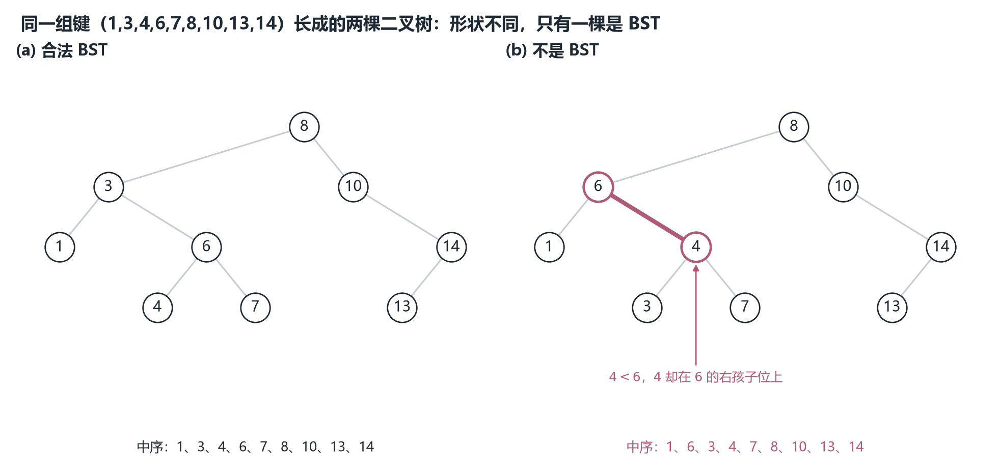
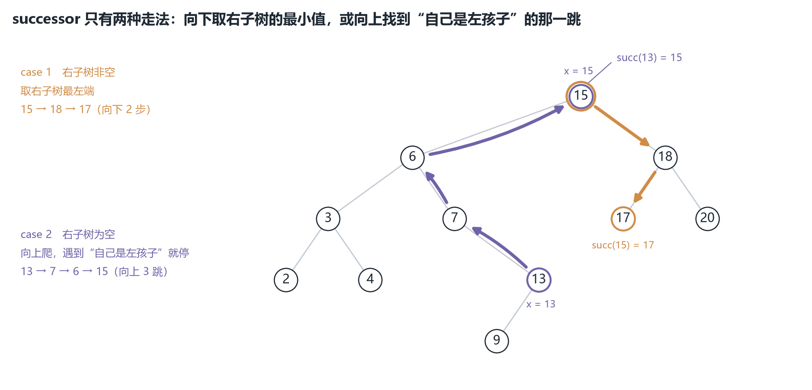
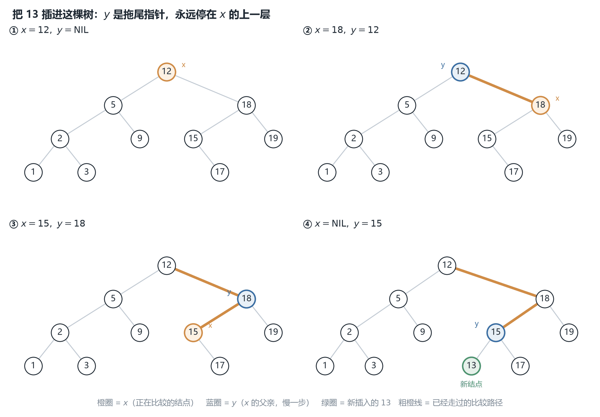
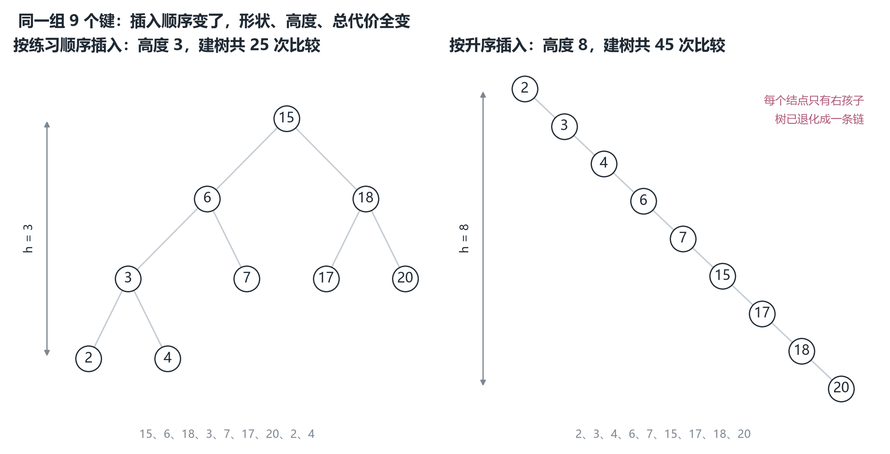
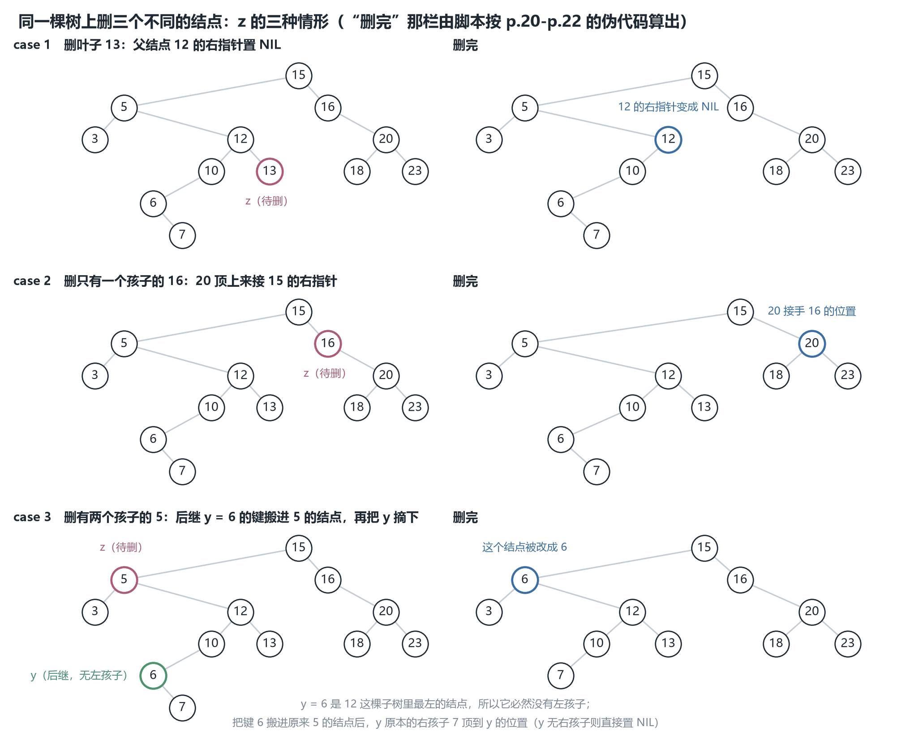
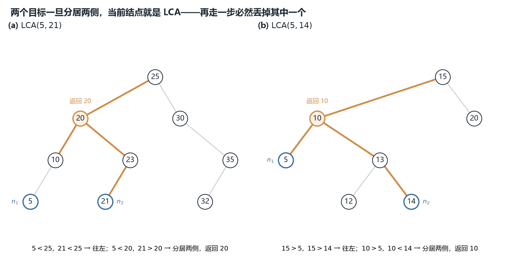

# CSC3100 Lecture 14 课堂笔记：Binary Search Tree（二叉搜索树）

> **材料构成**：本讲基于课件（PDF/PPT）整理，不含教师口述内容。课件 `lecture 14 (binary search tree).pdf` 共 30 页，而文字层只有约 8.8 K 字符——因为**每一棵 BST 的树形图、每一次删除的前后对照、每一段伪代码几乎都是图片**。所以我把 30 页全部按 160 dpi 渲染成图逐页读过；其中 p.6/p.10/p.11/p.12/p.17/p.19 的树形按 380–520 dpi 裁切放大复核过（判断"13 挂在 7 下面还是 17 下面"这种问题，只有放大才敢下结论），p.22 的十四行伪代码按 500 dpi 单独重渲了一遍。凡是我看不清、或课件没说的，文末都写明，没有靠猜补。
>
> **课件结构**：封面（p.1）→ 目录（p.2）→ BST 定义与两棵示例树（p.3）→ 三个应用（p.4）→ 七个动态集合操作与 $O(\log n)$/$O(n)$（p.5）→ searchKey 的例子与伪代码（p.6-7）→ findMin / findMax（p.8-9）→ successor 的定义、三个例子与伪代码（p.10-11）→ predecessor（p.12）→ insert 的思路、四帧演示与伪代码（p.13-15）→ 练习：建一棵 BST（p.16）→ delete 的三种情形与前后对照（p.17-19）→ 三段删除伪代码（p.20-22）→ 七个操作的复杂度表（p.23）→ 与三种线性表的对照表（p.24）→ 删除的副作用与三个解法（p.25）→ 练习 1：数叶子（p.26）→ 练习 2：交换性（p.27）→ 练习 3：用 BST 排序（p.28）→ 练习 4：LCA（p.29）→ 阅读与下一讲（p.30）。
>
> **已知课件问题**：最要紧的有四条。**① p.3 的第二棵"示例 BST"根本不是 BST**——$4$ 是 $6$ 的右孩子却比 $6$ 小，中序跑出来是 $1,6,3,4,7,8,10,13,14$（非升序）；把 $4$ 与 $6$ 的位置互换它才成立（§2.3、诚实备注一.1）。**② p.22 第 8 行 `if right[y] = NIL` 用了赋值号**，把这段伪代码逐字抄成能编译的代码会在 else 分支上**百分之百崩在第 12 行**（四百棵随机树、1270 次删除试验，588 次走 else 分支，588 次崩，§12.5-12.6）。**③ p.21 在"$z$ 是根且只有一个孩子"时，把 `root[T]` 改成孩子却忘了 `p[y] = NIL`**，于是新根的父指针悬空，紧接着查一次后继就会返回一个**已经被删掉的键**（§12.3）。**④ p.13 的文字与 p.15 的代码对"相等键往哪边走"的规定正好相反**（§9.3）。其余几条（p.5 的 "expected height is $\log n$"、p.20-21 的 `=` 与 `←` 混用、p.24 表只有三列数据、p.28 伪代码的下标）都在文末逐条列出，并注明我凭什么这么判。
>
> **来源标注约定**：正文里凡以补充类 alert（NOTE / TIP / IMPORTANT）呈现的内容，都是课件没有、由我补充或推导的（包括六张配图与全部复算）；其余内容，都是课件上写着的。页码一律指课件页码（与 PDF 阅读器页码一致），但它只用于溯源——**本笔记不依赖课件阅读**，每一张图、每一张表、每一段代码都在正文里给全了。上一讲（L13）讲过的东西不重讲，只给节号指回去。

## 0. 一句话概括本讲在讲什么

L13 花了 30 页把"树"这件事的**形状**讲完了：递归定义、父子关系、深度与高度（L13 §5.1）、两种表示法（L13 §12 的数组法与 §10 的指针法）、三种遍历（L13 §15）。但那一讲从头到尾没有回答一个问题——**树到底拿来干什么？** 遍历能把一棵树压成一个序列，可那个序列有什么好？L13 §18 还特意留了一句伏笔：中序遍历只是"把二维压成一维"，它并不保证输出有序。

本讲给的答案只有一句话：**给二叉树再叠一条有序性约束**。这条约束是

$$
\text{对每个结点 } x:\quad \text{左子树里所有键} < key[x] < \text{右子树里所有键}
$$

叠上去之后，L13 那三样东西立刻全部升值。**遍历**变成"排序"（中序输出升序，p.28 直接拿它当排序算法）；**查找**变成"二分"（每比较一次就砍掉一整棵子树，p.6-p.7）；**树高**从 L13 那个纯几何量变成一个**性能指标**（p.23：七个操作全是 $O(h)$，$h$ 小则快，$h = n-1$ 就退化成链表）。L13 §10.2 里那个"多存一个 parent 指针是不是浪费"的疑问，也在本讲 p.10-p.12 得到回答：没有 parent，successor 就只能从根重新搜一遍。

而这条约束**没有**解决"$h$ 能有多大"的问题。p.5 老老实实写着 worst case 是 $\Theta(n)$，p.16 的练习会亲手造出一条长度为 9 的链，p.25 则承认反复删除还会把树**系统性地压偏**。于是讲到最后，课件只能点两个名字——AVL 树与红黑树，把 $h$ 强行压到 $O(\log n)$——然后下课。**这就是下一讲的全部动机：本讲给了"秩序"，下一讲补"平衡"。**

一句话：**BST = 二叉树 + "左边全小、右边全大"；这条约束把查找、最值、前驱后继、插入删除全变成 $O(h)$，而 $h$ 可以是 $n$，所以必须接着讲平衡。**

**本讲地图**

| 页码 | 本节 | 这一块在回答什么 |
| --- | --- | --- |
| p.1 | 封面 | 讲次与教师信息 |
| p.2 | 目录 | 一条按"操作难度"排的线：定义 → 查找/最值/前驱后继 → 插入删除 → 练习 |
| p.3 | BST 定义 | 约束加在哪：不是"左右孩子"，是"整棵子树" |
| p.4 | 三个应用 | 为什么值得为这条约束单独造一个结构 |
| p.5 | 七个操作与 $h$ | 平均 $O(\log n)$、最坏 $O(n)$；"期望高度是 $\log n$"该怎么读 |
| p.6-7 | searchKey | 一次比较砍掉一整棵子树，代价 $O(h)$ |
| p.8-9 | findMin / findMax | 极值一定在两端：一路向左 / 一路向右 |
| p.10-11 | successor | 两种 case；case 2 为什么要往上爬 |
| p.12 | predecessor | 把 successor 左右翻转 |
| p.13-15 | insert | 双指针（$x$ 走、$y$ 拖尾）；建树的总账 |
| p.16 | 练习：建树 | 九个键建出来长什么样、高度多少、升序会怎样 |
| p.17-19 | delete 的三种情形 | 叶子 / 一个孩子 / 两个孩子；case 3 用后继顶替 |
| p.20-22 | 三段删除伪代码 | 逐行读；两个必须亲手验的坑 |
| p.23 | 复杂度汇总 | 七个操作都是 $O(h)$，问题全在 $h$ |
| p.24 | 与线性表对照 | BST 到底赢在哪一格 |
| p.25 | 删除的副作用 | 为什么反复删除会让左子树更深；三个解法 |
| p.26 | 练习 1：数叶子 | 一个跟 BST 无关的递归，用来说明"三分支恰好覆盖" |
| p.27 | 练习 2：交换性 | insert/delete 能不能换次序 |
| p.28 | 练习 3：BST 排序 | 建树 + 中序；复杂度与实际表现 |
| p.29 | 练习 4：LCA | 有序性把 $O(n)$ 的后序压成 $O(h)$ 的下降 |
| p.30 | 阅读与下一讲 | Chapter 12；下一讲 AVL |

## 1. 目录页：一条按"操作难度"排的线（p.2）

这一讲的大纲只有四行：

> In this lecture, we will learn
>
> Binary search tree (BST)
>
> Operations on BST
> 　Search a key
> 　Find the minimum/maximum and find successor/predecessor
> 　Insert and delete
>
> Exercises

这四行是按**难度递增**排的，而"难度"在这里有具体含义：**这个操作会不会改变树，改变之后要不要修补别的东西。**

查找最简单，因为它只读：沿一条路径走到底，一个指针都不改。最值更简单，连比较都省了——一路向左或向右就是答案，它其实是查找的特例。前驱后继开始变难，因为它第一次要**往上走**：结点没有右子树时，后继藏在祖先里，只有孩子指针不够——L13 §10.2 埋下的 parent 指针在这里开始还债。

插入第一次改变树，但改得温和：新结点一定挂在某个空位上当叶子，已有结点之间的父子关系一个都不动，所以"找位置"就是一次查找。删除最难，难在它不是"拿掉"而是"**补洞**"：删叶子直接抹掉，删一个孩子的让孙辈顶上来，删两个孩子的**必须从别处搬一个键来填**——而"搬谁""搬完原来那个位置怎么办"就是 p.17-p.22 六页的全部内容。也正因为要搬键，删除会改变树形，于是引出了 p.25 那个"越删越偏"的副作用。

这条线还有一层用处：**后面每个操作的代码，都是前面某个操作的复用**。successor 调用 findMin（p.11 第 2 行），delete 的 case 3 调用 successor（p.22 第 2 行）又调用 case 1/case 2（p.19 第三条），insert 与 search 共享同一段下降循环。所以 p.23 那张"七个操作全是 $O(h)$"的表不是背出来的：既然每个操作都是"沿某条路径走若干步"，代价当然由路径长度——也就是树高——决定。

最后一行 `Exercises` 值得提一句：30 页里有**五页**练习（p.16、p.26、p.27、p.28、p.29），占六分之一。这个比例在 CSC3100 的课件里算高的，说明这一讲要求动手——**光看懂伪代码没用，得自己在树上走一遍**。

## 2. BST 的定义：约束的是整棵子树（p.3）

### 2.1 定义本身

BST 的定义原文是两句：

> BST is a binary tree such that for each node $T$,
>
> the key values in its **left subtree** are *smaller* than the key value of $T$
>
> the key values in its **right subtree** are *larger* than the key value of $T$

右边还画了一张结点示意图，把一个结点拆成四个部分：左右两侧标 `L` 与 `R`（就是左右孩子指针），中间上下两格写 `parent` 与 `element`，再用红虚线连到"父结点""Left child""Right child"三个方框。这张图其实就是 L13 §10.1 那个四域结点的另一种画法——**同一种结点，这一讲要开始用它了**。

定义里有三个词要逐个说清，因为后面每一页都在用它们：

**$T$** 在这里指"树中的任意一个结点"，不是"整棵树"。所以这句话是对**每一个**结点都成立的一条性质，不是一个可以抽查的抽样条件。这一点决定了验证一棵树是不是 BST 只能靠"逐点检查 + 子树范围"，不能靠"看几个父子对"（见 §2.2）。

**subtree（子树）** 是关键词。子树不是"孩子"，而是"孩子以及孩子下面的一切"。$T$ 的左子树包含 $T$ 的左孩子、左孩子的两个孩子、以及往下所有后代。所以这条约束说的不是"左孩子比 $T$ 小"，而是"**左子树里每一个键**都比 $T$ 小"。

**smaller / larger 是严格的**。课件用的是严格不等号，这意味着**不允许重复键**。这一点在实现上马上会出问题：p.13 的文字与 p.15 的代码对"相等键往哪边走"给了相反的规定（§9.3 会细说），而一旦允许相等键，定义就得改成"左子树 $\le$、右子树 $\ge$"（或者反过来），并且必须**全局统一**。CLRS 3rd ed 的 12.1 节采取的就是"允许相等、但要求一致"的写法。本笔记按课件的严格版讲，遇到重复键时单独说明。

### 2.2 "只比左右孩子"为什么不够：一个反例

初学者最常见的错解是把定义读成"每个结点的左孩子比它小、右孩子比它大"。这个条件**弱得多**，弱到可以让一棵完全不合法的树通过检查。

反例只有三个结点：

$$
10 \;\longleftarrow\; 5 \;\longrightarrow\; 12
$$

读法：$10$ 是根，$5$ 是 $10$ 的左孩子，$12$ 是 $5$ 的**右**孩子。

逐个父子对检查，两对全部合法：$5 < 10$ 且在左边 ✓；$12 > 5$ 且在右边 ✓。可是这棵树**不是 BST**：$12 > 10$，它应该出现在 $10$ 的右子树里，现在却待在 $10$ 的**左**子树里。检验的办法有两个，任选一个都能立刻发现：

**办法一，中序。** 中序遍历这棵树得到 $5, 12, 10$，不是升序。而 §2.4 会证明"是 BST"与"中序升序"是同一件事，所以这棵树不是 BST。

**办法二，走一次查找。** 在这棵树里找 $12$：$12 > 10$，按规则往右走，右边是 NIL，于是返回"没找到"。**可 $12$ 明明在树里。** 一个结构如果在里面搜不到自己装着的键，它就不是搜索树——这个判据比任何定义都好用。

这个反例说明了那条约束为什么要写成"整棵子树"：**BST 的正确性依赖的不是"局部有序"，而是"每一个键都被一条一致的比较路径约束着"。** 从根出发找 $k$，每走一步都要求"被排除的那一侧里不可能有 $k$"，而这一步成立的前提是"整棵子树的所有键都在同一侧"——只保证孩子是不够的，孙子就可能跑回来打脸。

> [!NOTE] 补充：BST 是区间约束
> **换个说法：BST 的性质是一条"区间约束"。** 从根往下走时，每个结点其实都带着一个允许区间 $(lo, hi)$：根是 $(-\infty, +\infty)$，往左走区间上界收紧成 $key[x]$，往右走区间下界收紧成 $key[x]$。一个结点合法当且仅当它的键落在自己那个区间里。上面的反例里，$12$ 的区间是 $(-\infty, 10)$（因为它一路向左），而 $12 \notin (-\infty, 10)$，所以不合法。**这个"带区间下降"的视角，在判断"给定一棵树是不是 BST"时是最省事的写法**（递归时把区间往下传，而不是只传父子关系）。

### 2.3 同一组键的两种形状：一棵成立，一棵不成立

**同一组键可以长成不同的树。** 图 1 是两棵各含 9 个结点的二叉树，键完全一样（$1,3,4,6,7,8,10,13,14$），形状不同：一棵中序读出来是升序、是合法的 BST，另一棵**看着像、其实不是**。这个对照很重要，它直接引出 §10（输入顺序会不会改变树形）与 §18（能不能用 BST 排序）。



*图 1　同一组键（$1,3,4,6,7,8,10,13,14$）长成的两棵二叉树。左（a）中序 $1,3,4,6,7,8,10,13,14$ 升序，是合法 BST；右（b）的 $4$ 挂在 $6$ 的右孩子位却比 $6$ 小，中序跑出 $1,6,3,4,7,8,10,13,14$，不是 BST——这一处错误连"局部有序"都不满足。*

左（a）的结构是 $8(3(1,\,6(4,7)),\;10(-,14(13,-)))$。中序走一遍：$1,3,4,6,7,8,10,13,14$，升序 ✓。逐点检查也对：$3$ 的右子树 $\{4,6,7\}$ 全在 $(3,8)$ 之间，$10$ 的右子树 $\{13,14\}$ 全大于 $10$。

右（b）的结构是 $8(6(1,\,4(3,7)),\;10(-,14(13,-)))$，**不合法**，而且错在两处：

**第一处，$4$ 是 $6$ 的右孩子，可 $4 < 6$。** 这连"局部"都不满足——右孩子必须比父亲大。**第二处，$3$ 落在 $6$ 的右子树里，可 $3 < 6$。** 这一处才是"子树级"的错。

中序跑出来的序列是 $1,6,3,4,7,8,10,13,14$，非升序，判据成立。用 Python 把这棵树按图搭出来再查一遍，脚本报出的问题正是"中序非升序"与"$4$ 不在 $6$ 右侧"两条（见 `.qoder/L14/verify_delete.py` 的 `[F]` 段）。

**它本来应该是哪棵树？** 只要把这棵子树里的 $4$ 与 $6$ 换个位置——$4$ 当 $8$ 的左孩子、$6$ 挂在 $4$ 的右下——就全对了：$4$ 的左子树 $\{1\}$、右子树 $\{3,6,7\}$；$6$ 的左 $3$、右 $7$，而 $3,6,7$ 都在 $(4,8)$ 之间 ✓。换句话说，**左树与右树本来是"把 $3$ 与 $6$ 这一对父子的角色对调"得到的两种合法形状，画图时把 $4$ 和 $6$ 的标签写反了**。

这个错误恰好是 §2.2 那个反例的"实战版"：它说明**看起来像 BST 不等于真是 BST**：两者之间隔着一次中序遍历。也说明本讲后面所有"逐帧看树"的地方（图 3 的四帧、图 5 的前后对照、§17 的两棵树）都必须自己动手核一遍，不能靠眼睛。

### 2.4 三条等价说法

> [!NOTE] 补充
> 本节是补充内容：定义、中序、查找的等价性课件没有展开，这里给出等价链与双向证明。

定义、中序、查找这三件事其实是同一件事。留下这条等价链，因为它把本讲后面的好几个结论都接上了：

**（1）$T$ 是 BST$\iff$（2）$T$ 的中序遍历严格升序$\iff$（3）对每个键 $k$，`find(k)` 都能找到（只要 $k$ 在树里）。**

（1）$\Rightarrow$（2）：对树高归纳——中序先输出左子树、再输出根、再输出右子树，由归纳假设左右各自升序，而 BST 性质保证左子树全 $<$ 根 $<$ 右子树，三段拼起来就是升序。（2）$\Rightarrow$（1）与（3）$\Leftrightarrow$（1）都用反证：若某个键站在自己的"错误一侧"，中序就会乱序、查找就会在那个结点拐错方向从而错过它。

这条链最实用的地方是（2）：**判一棵树是不是 BST，跑一遍中序看是否升序即可**，这是 O(n) 且几乎不会写错的判据。L13 §18.3 已经证过中序遍历是 $\Theta(n)$，所以这个判据是线性的。p.28 把这条链反过来用了一次：既然"中序升序 $\Rightarrow$ 排好序"，那就**建一棵 BST 再中序**，排序完成。

## 3. 三个应用：为什么值得为一条约束单造一个结构（p.4）

这一页只有三行：

> Many applications due to its ordered structure
>
> Useful for indexing and multi-level indexing
>
> Helpful in maintaining a sorted stream of data
>
> Helpful to implement various searching algorithms and data structures (e.g., TreeMap, TreeSet, Priority queue)

第一行是全页的题眼：**"because of its ordered structure"**。注意它没说"because it is fast"——因为单论查找，哈希表 $O(1)$ 比 BST 的 $O(\log n)$ 快。BST 值钱的地方不是快，而是**有序**：它同时支持"按关键字找"和"按大小顺序走"，而哈希表只能做前者。

**索引与多级索引（indexing / multi-level indexing）** 说的是数据库与文件系统。一个 B+ 树索引的本质就是"多层的 BST"：每个内部结点存一批分隔键，叶子里存指向记录的指针，而叶子之间还按顺序串起来。之所以要"多级"，是因为磁盘一次读一大块，把一层的比较摊到一次 I/O 上。**单机的内存 BST 是它的退化版**（一个结点一个键），但它保留了同一个性质：**范围查询**（找出 $[a,b]$ 之间所有记录）只需要"找到 $a$，然后连续调用 successor"，代价 $O(\log n + k)$，$k$ 是输出个数。哈希表做不到这件事，它得全表扫。

**维护有序流（maintaining a sorted stream）** 说的是数据一条条来的场景：股票报价、日志、传感器读数。你要随时能回答"当前最小值是多少""中位数是多少""第 $k$ 小是多少"。BST 的答案是：插入 $O(h)$，最小值 $O(h)$，中位数就是"第 $n/2$ 小"（给每个结点加一个子树大小就能 $O(h)$ 查）。**这就是 TreeMap / TreeSet 的存在理由**——Java 的 `TreeMap` 是有序映射，`HashMap` 不是；`TreeSet` 的 `first()`、`floor()`、`ceiling()`、`subSet()` 全是 BST 能直接给的。

**实现其它结构与算法**：TreeMap、TreeSet 是直接封装；至于**优先队列（priority queue）**，这里要说清楚——**实践中优先队列几乎都用堆（heap）实现，不用 BST**。原因是堆的常数小得多（数组存储、无指针、无 parent）、`insert` 与 `extractMin` 都是 $O(\log n)$ 且访存连续。课件把优先队列列进来，说的是"BST 也能做"，不是"应该用 BST 做"。

> [!TIP] 技巧：堆与 BST 怎么选
> **反过来问一句：BST 能做而堆做不到的是什么？** 堆只能快速拿到"最小"（或最大）这一个，别的都不行；BST 能拿任意第 $k$ 小、能查前驱后继、能做范围查询、能按序遍历。所以选型的判据是：**只要极值 → 堆；要"顺序上的邻居" → BST；只要"按键取值" → 哈希表。** 这三句话把 L7-L14 讲过的容器全串起来了。

## 4. 七个动态集合操作，以及 $h$ 到底有多大（p.5）

### 4.1 七个操作

BST 支持七个动态集合操作：

> Support many dynamic set operations
>
> searchKey, findMin, findMax, predecessor, successor, insert, delete

"dynamic set（动态集合）"这个词值得停一下：它相对于"静态集合"（建好就不动，比如一个排好序的数组）而言，强调的是**插入与删除**。CLRS 第 12 章开头就是用这个词引入 BST 的：一个动态集合要支持 insert / delete / search / min / max / predecessor / successor，而"用有序数组"能做到前三个中的第一个（$O(\log n)$）但 insert/delete 要 $O(n)$，用链表能做到 insert/delete 快但 search 要 $O(n)$——**BST 是第一个能把这七件事同时做到 $O(h)$ 的结构**。p.24 会把这张对照表逐格摊开（§14）。

七个操作里有五个是"查询"（不改变结构），两个是"更新"（改变结构）。这个 5:2 的比例也解释了为什么本讲的篇幅分配是"查询 7 页、更新 11 页"——更新难。

### 4.2 "The expected height of the tree is $\log n$" 这句话要拆开看

这一页的写法是：

> On average: $\Theta(\log n)$
> 　The expected height of the tree is $\log n$
>
> In the worst case: $\Theta(n)$
> 　The tree is a linear chain of $n$ nodes

最坏情况那句毫无争议：树退化成一条链时高 $n-1$，七个操作全部 $\Theta(n)$。**有争议的是"期望高度是 $\log n$"这句。**

先说它对的部分：**量级是对的**。若 $n$ 个键以随机顺序插入（等价于随机排列建树），树高的期望是 $\Theta(\log n)$，这是 1986 年 Devroye 的结果，也是"随机 BST（random binary search tree）"这个模型的核心结论。所以"平均 $O(\log n)$"作为**量级陈述**没错。

再说它容易误导的部分：**常数不是 1，而是接近 3**。精确的渐近常数是

$$
\mathbb{E}[h_n] \sim 4.31107\ln n = \frac{4.31107}{\ln 2}\log_2 n \approx 2.99\log_2 n
$$

也就是说，随机建一棵 $10^6$ 个结点的 BST，期望高度约 $2.99 \times 19.93 \approx 60$ 层，**不是** $20$ 层。如果按"高度 $=\log_2 n$"去估"大概 20 层"，会低估算三倍。

而且这个 $4.311\ln n$ 是**渐近**值，有限 $n$ 时实测明显低于它（因为还有 $-c\ln\ln n$ 的二阶项）。我用固定种子跑了随机树，每个 $n$ 取若干棵求平均（脚本 `[E]` 段）：

| $n$ | 样本数 | 实测平均高度 | 平均高度 $/ \log_2 n$ | $4.311\ln n$ |
| --- | --- | --- | --- | --- |
| 10 | 2000 | 4.66 | 1.40 | 9.93 |
| 100 | 2000 | 12.28 | 1.85 | 19.85 |
| 1000 | 800 | 20.96 | 2.10 | 29.78 |
| 10000 | 200 | 30.16 | 2.27 | 39.71 |
| 100000 | 40 | 39.95 | 2.41 | 49.63 |

读表的方法：**最后一列（$4.311\ln n$）是渐近极限，第三列是实测**，两者的差距随 $n$ 变小；而"平均高度 $/\log_2 n$"这一列从 $1.40$ 一路爬到 $2.41$，正朝着渐近系数 $2.99$ 走，只是走得很慢。所以：

**"期望高度是 $\log n$"应当读成"期望高度是 $\Theta(\log n)$，系数约 $3$"**，而不是"期望高度等于 $\log_2 n$"。课件那句话在量级上正确、在系数上会误导——这不影响本讲任何结论（$\Theta$ 不在乎常数），但会影响你对"BST 到底有多高"的直觉，也会影响你理解 p.25 那句"$h$ 小则快"的紧迫程度：$h \approx 3\log_2 n$ 而不是 $\log_2 n$，意味着**树的层数比理论下界多三倍**，这正是平衡树（AVL、红黑树）存在的空间。

> [!NOTE] 补充："平均"对什么平均
> **还有一层更隐蔽的歧义："平均"是对什么平均？** 上面所有数字都是对"**随机插入顺序**"平均。如果输入是**有序**的（比如从文件里按时间读进来的日志已经按时间排好），那"随机性"根本不存在，树必然退化成链，代价是 $\Theta(n)$ 而不是 $O(\log n)$。而"随机查询"的平均毫无意义——查询的代价只取决于树形，与查询哪个键关系不大。所以 p.5 的 "on average" 必须读成"**输入顺序随机时**"，这句话在 p.16 会变成一个具体的练习（§10）。

### 4.3 $h$ 与 $n$ 的关系：下界与上界

> [!NOTE] 补充
> 本节是补充内容：$h$ 的上下界公式及其推导是课件没有、由我补的。

既然所有操作的代价都是 $O(h)$，那 $h$ 能取多大就成了一切的关键。给定 $n$ 个结点，树高 $h$（按 L13 §5.1 的定义：叶子高度 $0$，单位是边数）的取值范围是

$$
\left\lceil \log_2(n+1) \right\rceil - 1 \;\le\; h \;\le\; n-1
$$

**上界**显然：每条边最多让深度加一，$n$ 个结点的树最多 $n-1$ 条边在一条路径上，所以 $h \le n-1$，取到时就是一条链。

**下界**要用一个计数事实：**高度为 $h$ 的二叉树最多有 $2^{h+1}-1$ 个结点**（第 $0$ 层最多 $1$ 个、第 $1$ 层最多 $2$ 个……第 $h$ 层最多 $2^h$ 个，等比求和）。所以 $n \le 2^{h+1}-1$，即 $2^{h+1} \ge n+1$，取对数得 $h+1 \ge \log_2(n+1)$，于是 $h \ge \lceil \log_2(n+1)\rceil - 1$。

代几个数进去（脚本算过）：$n=9$ 时下界是 $\lceil \log_2 10\rceil - 1 = 4-1 = 3$；$n=15$ 时是 $\lceil 4\rceil - 1 = 3$（完美二叉树正好达到）；$n=1000$ 时是 $\lceil 9.97\rceil - 1 = 9$，而上界是 $999$——**相差 111 倍**。

这个区间就是本讲的全部"张力"：**七个操作都是 $O(h)$，而 $h$ 可以在 $\log n$ 到 $n$ 之间任意取值。** 一棵 $n = 10^6$ 的树，最好情况 $h=19$，最坏情况 $h = 999999$，同样的代码、同样的七个操作，代价相差五万倍。p.23 那句"$h$ 小则快，否则和链表一样"说的就是这件事，而 p.25 与下一讲的 AVL 都是在跟这个区间搏斗。

## 5. searchKey：每比较一次砍掉一半（p.6-7）

### 5.1 例子：在这棵树里找 13

本讲反复用到的一棵树（§6–§8 都用它，值得记住）：

$$
15\big(6(3(2,4),\;7(-,13(9,-))),\;18(17,20)\big)
$$

排版说明：圆括号里第一个是左子树、第二个是右子树，`-` 表示空。所以这棵树是：根 $15$；左孩子 $6$、右孩子 $18$；$6$ 的左 $3$、右 $7$；$3$ 的左 $2$、右 $4$；$7$ 没有左孩子、右孩子 $13$；$13$ 的左孩子 $9$；$18$ 的左 $17$、右 $20$。共 $11$ 个结点，高 $4$（最长路径 $15\to6\to7\to13\to9$）。

课件的目标写在页首：**给一个指向树根的指针和一个键 $k$，若存在键为 $k$ 的结点就返回指向它的指针，否则返回 NIL**。注意最后半句：**失败也要有返回值**（NIL），这不是可有可无的细节——后面 insert 正是靠"走到 NIL"来判断插入位置的。

查找 $13$ 的四步（p.6 用红色箭头画出）：

1. 从根 $15$ 开始，$13 < 15$，往**左**走到 $6$；
2. $13 > 6$，往**右**走到 $7$；
3. $13 > 7$，往**右**走到 $13$；
4. $13 = 13$，返回这个结点。

四步里做了三次比较（$13$ 与 $15$、$6$、$7$ 各一次），加最后一次相等判定。**路径上经过 $4$ 个结点，比较 $4$ 次**。

### 5.2 伪代码六行

查找的 `find(x, k)`：

::: code-group

```java [Java]
class Node { int key; Node left, right, p; Node(int k) { this.key = k; } }

class BST {
    static Node find(Node x, int k) {
        if (x == null || k == x.key) return x;        // 第 1-2 行
        if (k < x.key) return find(x.left, k);        // 第 3-4 行
        else           return find(x.right, k);       // 第 5-6 行
    }
}
```

```python [Python]
class Node:
    def __init__(self, key, p=None):
        self.key = key
        self.left = self.right = None
        self.p = p


def find(x, k):
    if x is None or k == x.key: return x        # 第 1-2 行
    if k < x.key: return find(x.left, k)        # 第 3-4 行
    return find(x.right, k)                     # 第 5-6 行
```

```cpp [C++]
struct Node {
    int key; Node *left, *right, *p;
    Node(int k) : key(k), left(NULL), right(NULL), p(NULL) {}
};

Node *find(Node *x, int k) {
    if (x == NULL || k == x->key) return x;      // 第 1-2 行
    if (k < x->key) return find(x->left, k);     // 第 3-4 行
    return find(x->right, k);                    // 第 5-6 行
}
```

```c [C]
#include <stdlib.h>

typedef struct Node { int key; struct Node *left, *right, *p; } Node;

Node *newNode(int k) {
    Node *z = (Node *)malloc(sizeof(Node));
    z->key = k; z->left = z->right = z->p = NULL;
    return z;
}

Node *find(Node *x, int k) {
    if (x == NULL || k == x->key) return x;      /* 第 1-2 行 */
    if (k < x->key) return find(x->left, k);     /* 第 3-4 行 */
    return find(x->right, k);                    /* 第 5-6 行 */
}
```

:::

六个符号先说清楚：$x$ 是"当前所在的结点"（第一次调用时传根），$k$ 是要找的键，`NIL` 是空指针，`left[x]`/`right[x]` 是左右孩子指针，`key[x]` 是结点存的值。

第 1-2 行是**两个终止条件合成一句**：$x$ 为空（没找到）或键相等（找到了），都直接返回 $x$。这一行很漂亮，因为它把"成功"与"失败"统一成"返回一个指针"，而调用者只要判返回值是不是 NIL 就知道成败。**代价是丢掉了"为什么失败"的信息**——工程实现里常常要区分"键不存在"与"树本身非法"，那就得分开写。

第 3-6 行是**唯一的下降规则**：比当前结点小就往左，否则往右。注意第 5 行的 `else` 覆盖了"$k > key[x]$"，但如果 $k = key[x]$，第 1 行已经返回了，所以走到第 5 行时一定是严格大于。这个"前一行已经处理了等号"的写法，是伪代码里省一次比较的常用手法。

这是**尾递归**（tail recursion）：两个递归调用都是函数体的最后一个动作，返回值直接就是调用者的返回值。所以它可以被编译器优化成一个循环（大多数语言不保证做这个优化，但手写一遍很容易），这也是为什么真实实现里 `find` 都写成 `while` 循环——递归版每层要压一个栈帧，浪费空间（§5.3）。

### 5.3 为什么是 $O(h)$

这一页底部写着 `Running time: O(h), where h is the height of tree`。

**时间**：每次递归都往下一层走一层，所以递归深度不超过 $h+1$（从根到叶最多 $h$ 条边、$h+1$ 个结点）。每层做常数次比较和指针操作，总时间 $O(h)$。

**空间**：递归版还有**栈空间** $O(h)$——这一点课件没提，但它是真实成本。$h = 10^6$ 的链上查一次就要 $10^6$ 层栈帧，直接爆栈。所以生产代码里 `find` 一定是迭代的：写成 `while (x != NULL && k != x->key)` 就只需要 $O(1)$ 额外空间。**"$O(h)$ 时间 + $O(h)$ 空间"与"$O(h)$ 时间 + $O(1)$ 空间"是两个不同的结论**，这一条在 L13 §16.1 讲前序遍历的 13 行展开时也出现过（待办清单是栈），是同一种账。

最坏情况：$h = n-1$（链）时，查找是 $\Theta(n)$，与链表顺序查找一模一样。**所以 BST 的"二分"只在树平衡时成立**——这是本讲反复要提醒的一件事。

### 5.4 "砍掉一半"的确切含义

> [!NOTE] 补充
> 本节是补充内容："砍掉一半"的确切含义与失败查找多一次比较，是课件没有、由我补的。

这个说法好记，但不准确：**每次砍掉的是一整棵子树，不是"一半的键"。** 在根处比较一次，被排除的是"另一侧整棵子树"——树平衡时它大约占一半，树是一条链时它可能只有 $1$ 个结点。所以"砍一半"是**平衡树**的性质，不是 BST 的性质；BST 只保证"被排除的那一侧里绝对没有 $k$"，不保证那一侧有多大。而"那一侧有多大"就是路径长度，也就是 $h$——**两个说法是同一件事的两种问法**。

**失败查找比成功查找多一次比较**：找不存在的键要一直走到 NIL 才知道失败，比较次数是 $h+1$。这个"多一次"在 p.28 会累积成 $n$ 次，不是大事，但写代码时要注意别让 NIL 的解引用漏出去。

## 6. findMin 与 findMax：一路向左 / 一路向右（p.8-9）

### 6.1 两个算法

求最小值的 `findMin(x)`：

::: code-group

```java [Java]
// Node 见 §5.2 组
class BST {
    static Node findMin(Node x) {
        while (x.left != null) x = x.left;    // 第 1-2 行
        return x;                             // 第 3 行
    }
    static Node findMax(Node x) {             // p.9：左边换成右边
        while (x.right != null) x = x.right;
        return x;
    }
}
```

```python [Python]
# Node 见 §5.2 组


def find_min(x):
    while x.left is not None: x = x.left    # 第 1-2 行
    return x                                # 第 3 行


def find_max(x):                            # p.9：左边换成右边
    while x.right is not None: x = x.right
    return x
```

```cpp [C++]
// Node 见 §5.2 组

Node *findMin(Node *x) {
    while (x->left != NULL) x = x->left;     // 第 1-2 行
    return x;                                // 第 3 行
}
Node *findMax(Node *x) {                     // p.9：左边换成右边
    while (x->right != NULL) x = x->right;
    return x;
}
```

```c [C]
/* Node 见 §5.2 组 */

Node *findMin(Node *x) {
    while (x->left != NULL) x = x->left;     /* 第 1-2 行 */
    return x;                                /* 第 3 行 */
}
Node *findMax(Node *x) {                     /* p.9：左边换成右边 */
    while (x->right != NULL) x = x->right;
    return x;
}
```

:::

`findMax(x)` 只把 `left` 换成 `right`，其余一模一样。三行，没有比较、没有分支——**它甚至不需要看键的值**，只顺着指针走。

为什么对？因为 BST 性质说"左子树里每个键都比 $x$ 小"。所以只要 $x$ 还有左孩子，$x$ 就**不可能是**最小值（左孩子比它小），必须往左走；走到没有左孩子时，$x$ 下面没有更小的键了，而 $x$ 的所有祖先都比 $x$ 大（因为 $x$ 在它们的左子树里，或者 $x$ 就是根）——所以 $x$ 就是全树最小。

最小值是 $2$：从根 $15$ 一路向左（$15\to6\to3\to2$），四步。最大值是 $20$：一路向右（$15\to18\to20$），三步。两者都是 $O(h)$，而且都只顺着指针走、一次比较都不做。

### 6.2 一个必须记住的结构事实

**最小值所在的那个结点，一定没有左孩子；最大值所在的那个结点，一定没有右孩子。**

这条几乎显然是上面循环的终止条件，但它的价值在于**反过来用**：在删除的 case 3 里（p.19），我们要证明"后继 $y$ 没有左孩子"，用的就是这条——因为 $y$ 是"右子树的最小值"，而"最小值没有左孩子"。**同一条事实，在 findMin 里是终止条件，在 delete 里是正确性前提。**

还有一条对称的、同样常用的事实：**最小值不一定是叶子**。它可能有一个右子树（比如树 $5(-,9)$ 里，$5$ 是最小值但不是叶子）。这一点在本讲最后 p.26 数叶子时会用到——"最左下"与"叶子"是两件事。

### 6.3 "整棵树的最小值"还是"某棵子树的最小值"

> [!NOTE] 补充
> 本节是补充内容：`findMin` 的参数语义及其在 successor 里的用法，是课件没有、由我补的。

`findMin(x)` 的参数是**一个结点**，不是"一棵树"。传根进去是全树最小；传某个结点进去，是**以它为根的子树**的最小值。这个区别在 successor 里立刻用上：p.11 第 2 行是 `findMin(right[x])`——找的是"$x$ 的右子树的最小值"。写成 `findMin(root)` 就会让 `successor(15)` 返回全树最小的 $2$ 而不是 $17$，而 $2 < 15$，一看就知道错了——**这类错误在树上走一遍就能发现，写的时候却很容易漏。**

## 7. successor：两种 case，两条路径（p.10-11）

### 7.1 定义

这一页伪代码的第一行：

> Def: $\text{successor}(x) = y$, such that $key[y]$ is the smallest key $> key[x]$

翻译：**$x$ 的后继是"比 $x$ 大的键里最小的那个"**。注意三个细节：**严格大于**（不含相等，所以重复键时"后继"会跳过所有同键结点）；**最小**（是"下一个"，不是"任意一个更大的"）；**按值定义，不按位置定义**（所以它在中序序列里就是 $x$ 的下一个）。

最后这一点是本节的钥匙：**successor 就是"中序序列里的下一个元素"**。L13 §15.1 定义中序是"左-根-右"，所以在中序里，$x$ 的下一个位置要么在 $x$ 的右子树的最左边，要么在"$x$ 之上、第一个把 $x$ 包在左子树里的祖先"那里——这正是两个 case。

### 7.2 三个例子，逐个说清走的是哪个 case

三个例子都在同一棵树上：

**$\text{successor}(15) = 17$，走 case 1。** $15$ 有右子树（右孩子 $18$ 及其子树 $\{17,20\}$）。右子树里的最小值：$18 \to 17$（往左走一步），得到 $17$。检验：比 $15$ 大的键有 $\{17,18,20\}$，最小的是 $17$ ✓。

**$\text{successor}(13) = 15$，走 case 2。** $13$ 的右子树为空。往上爬：$13$ 是 $7$ 的**右**孩子（不是左孩子，继续爬）；$7$ 是 $6$ 的**右**孩子（继续爬）；$6$ 是 $15$ 的**左**孩子——停！返回 $15$。**三步。** 检验：比 $13$ 大的键有 $\{15,17,18,20\}$，最小的是 $15$ ✓。

**$\text{successor}(9) = 13$，走 case 2，但只爬一步。** $9$ 的右子树为空；$9$ 是 $13$ 的**左**孩子——立刻停，返回 $13$。检验：比 $9$ 大的键有 $\{13,15,17,18,20\}$，最小 $13$ ✓。

三个例子里有两个是 case 2，而 case 2 的步数可以差很多（$1$ 步 vs $3$ 步）。**这就是 case 2 真正的难点：它不是"看一眼父亲"，而是"一直爬到某个条件满足"。** 很多人写错就错在这里——只爬一层。

这里有一个容易误读的地方：课件的两个 successor 例子（$x=15$ 与 $x=13$）画的是**同一个算法的两个时刻**，不是两个算法——一个走 case 1（向下取右子树最小值），一个走 case 2（向上爬）。图 2 把这两条路径画在同一棵树上，就是为了让这个对照一眼可见：左边那个先往右下再往左，右边那个只往上爬。

### 7.3 case 2 的本质：向上找第一个"把 $x$ 包在左子树里"的祖先

课件 p.10 的原话是 "go up the tree until the current node is a left child: successor(x) is the parent of the current node"。这句话可以换个更本质的说法：

**沿着 $x$ 的祖先链往上走，找到第一个"$x$ 落在它左子树里"的祖先 $y$；$y$ 就是后继。**

为什么这两种说法等价？"$x$ 落在 $y$ 的左子树里"$\iff$"从 $y$ 往 $x$ 走的第一步是向左"，而"往上爬时，某一层我们是'从左孩子上来'的"——这两句话说的是同一件事：**我们是它左子树上来的那个祖先**。

为什么 $y$ 一定是答案？两个方向都要证。

**第一，$y > x$。** 因为 $x$ 在 $y$ 的左子树里，左子树的键全小于 $y$。

**第二，$y$ 与 $x$ 之间没有别的键。** 用中序看最干净：中序遍历走到 $x$ 时，会先把 $x$ 的右子树走完（空的），然后回溯。回溯的过程就是"从 $x$ 往上爬"，每爬一层：
- 如果这一层是"从左孩子上来"的，说明父结点还没被访问，**它就是下一个**——停，返回它。
- 如果这一层是"从右孩子上来"的，说明父结点早就访问过了（中序是左-根-右，访问完右子树才回到父结点，而父结点在进右子树之前就访问了），继续往上。

所以"第一个'从左孩子上来'的那一跳的父亲"，恰好就是中序里 $x$ 的下一个元素。$\blacksquare$

**用反证再说一遍**（这个版本更适合写作业）：假设存在键 $u$ 满足 $x < u < y$。$u$ 不可能在 $x$ 的子树里（右子树为空、左子树全小于 $x$）；也不可能在祖先链上——从 $x$ 到 $y$ 之前的那些祖先，都是"$x$ 在其右子树里"的祖先，所以全都小于 $x$。唯一剩下的可能是在某个祖先的"另一侧子树"里，但我们只在"从右孩子上来"时才继续爬，所以那一侧永远是**左**侧，而左子树全比该祖先小、更比 $x$ 小。所以这样的 $u$ 不存在。$\blacksquare$

这也解释了为什么这个算法只需要"往上爬"、不需要检查兄弟子树：**兄弟子树里的键要么全小于 $x$，要么（在左转的那一层）全大于 $y$。**

### 7.4 伪代码七行

伪代码是：

::: code-group

```java [Java]
// Node 见 §5.2 组；findMin 见 §6.1 组
class BST {
    static Node successor(Node x) {
        if (x.right != null) return findMin(x.right);   // 第 1-2 行
        Node y = x.p;                                   // 第 3 行
        while (y != null && x == y.right) {             // 第 4 行：两个条件不能换
            x = y; y = y.p;                             // 第 5-6 行
        }
        return y;                                       // 第 7 行
    }
}
```

```python [Python]
# Node 见 §5.2 组；find_min 见 §6.1 组


def successor(x):
    if x.right is not None: return find_min(x.right)   # 第 1-2 行
    y = x.p                                            # 第 3 行
    while y is not None and x is y.right:              # 第 4 行：两个条件不能换
        x, y = y, y.p                                  # 第 5-6 行
    return y                                           # 第 7 行
```

```cpp [C++]
// Node 见 §5.2 组；findMin 见 §6.1 组

Node *successor(Node *x) {
    if (x->right != NULL) return findMin(x->right);  // 第 1-2 行
    Node *y = x->p;                                  // 第 3 行
    while (y != NULL && x == y->right) {             // 第 4 行：两个条件不能换
        x = y; y = y->p;                             // 第 5-6 行
    }
    return y;                                        // 第 7 行
}
```

```c [C]
/* Node 见 §5.2 组；findMin 见 §6.1 组 */

Node *successor(Node *x) {
    if (x->right != NULL) return findMin(x->right);  /* 第 1-2 行 */
    Node *y = x->p;                                  /* 第 3 行 */
    while (y != NULL && x == y->right) {             /* 第 4 行：两个条件不能换 */
        x = y; y = y->p;                             /* 第 5-6 行 */
    }
    return y;                                        /* 第 7 行 */
}
```

:::

逐行读：

**第 1-2 行**是 case 1：右子树非空，直接返回右子树的最小值。这里复用了 p.8 的 `findMin`，**是本讲第一处"操作调用操作"**。

**第 3 行**给 $y$ 赋初值 $p[x]$，也就是父亲。注意此时 $x$ 还是原来的 $x$，$y$ 是它的父亲——这一对 $(x, y)$ 就是"当前结点 + 当前结点的父亲"，循环里两个一起往上挪。

**第 4 行**是循环条件，两个条件用 `and` 连接，**顺序要紧**：
- `y != NIL`：防止爬到根之上。如果 $x$ 是整棵树的最大值，会一路爬到根、再爬一步 $y$ 变成 NIL，此时必须停（否则第 6 行会解引用 NIL）。
- `x = right[y]`：判断"$x$ 是不是 $y$ 的右孩子"。若是，说明这一跳是"从右孩子上来"的，父结点已经被中序访问过，继续爬；若不是（即 $x$ 是 $y$ 的左孩子），说明找到了，停。

两个条件的位置不能换：若写成 `x = right[y] and y != NIL`，当 $y$ 已经是 NIL 时第一个条件仍要求读 `right[NIL]`，直接崩。**这是短路求值（short-circuit evaluation）的经典用法**，p.11 的写法是对的，值得记住。

**第 5-6 行**是循环体：$x$ 上移一层，$y$ 再上移一层，保持"父子对"的关系。

**第 7 行**返回 $y$。三种可能的返回值：
- 找到了某个祖先 $y$（正常情形）；
- $y = $ NIL（$x$ 是最大值，没有后继）——**这个"返回 NIL"就是"$x$ 是最大元素"的信号**，p.10 最后一行说的 "if you cannot go further (and you reached the root): $x$ is the largest element" 指的就是它。

### 7.5 为什么是 $O(h)$，以及一个更紧的账

底部写着 `Running time: O(h)`。

**单次调用**：case 1 是"往下走一段"（$O(h)$）；case 2 是"往上爬一段"（$O(h)$）。两者不会同时发生（第 1 行就分开了），所以单次 $\le O(h)$。若把 case 1 里的 `findMin` 也算上，最坏是"先下一段再上一段"，但那是两次独立的路径，加起来仍 $O(h)$。

> [!NOTE] 补充：successor 连调的账
> **连续调用 $n$ 次的总账是 $O(n)$，不是 $O(nh)$。** 从最小值开始反复调用 successor 直到返回 NIL，就按顺序访问了全部 $n$ 个结点——这就是**中序遍历的迭代版**（不用栈、不用递归）。理由：每条边"向下"只走一次、"向上"也只爬一次，合计 $2(n-1)$。**实用价值：要"按序遍历但不想用栈"，就用 parent 指针 + successor**，代价是每个结点多一个指针（L13 §10.2 理由二），换来 $O(1)$ 额外空间的遍历。



*图 2　同一棵树上两种 case：$\text{successor}(15)=17$ 沿"右子树最左端"向下 2 步；$\text{successor}(13)=15$ 沿祖先链向上 3 跳，第一次"自己是左孩子"就停（$13\to7\to6\to15$）。两条路径的步数由脚本按树的结构算出。*

## 8. predecessor：把整张图左右翻转（p.12）

predecessor 是 successor 的镜像，定义只改一个词：

> Def: $\text{predecessor}(x) = y$, such that $key[y]$ is the biggest key $< key[x]$

**前驱是"比 $x$ 小的键里最大的那个"**，也就是中序序列里 $x$ 的前一个。两个 case 完全对称：

> Case 1: $left(x)$ is non-empty → predecessor($x$) = the maximum in $left(x)$
>
> Case 2: $left(x)$ is empty → go up until the current node is a **right** child: predecessor is the parent of that node
>
> if you cannot go further: $x$ is the smallest element

三个例子（同一棵树）：

**$\text{predecessor}(15) = 13$，case 1。** $15$ 有左子树，左子树的最大值：$6\to7\to13$（一路向右），得 $13$。检验：小于 $15$ 的键有 $\{2,3,4,6,7,9,13\}$，最大是 $13$ ✓。

**$\text{predecessor}(9) = 7$，case 2，两步。** $9$ 没有左子树。往上爬：$9$ 是 $13$ 的**左**孩子（不是右孩子，继续）；$13$ 是 $7$ 的**右**孩子——停！返回 $7$。检验：小于 $9$ 的键有 $\{2,3,4,6,7\}$，最大 $7$ ✓。

**$\text{predecessor}(7) = 6$，case 2，一步。** $7$ 没有左子树；$7$ 是 $6$ 的**右**孩子——立刻停，返回 $6$。

这里最容易错的是第二个例子：**$9$ 的父亲是 $13$，但答案不是 $13$ 而是 $7$。** 因为 $9$ 是 $13$ 的**左**孩子，而 case 2 要的是"自己是**右**孩子"。如果只爬一跳就返回，会得到 $13$——比 $9$ 大，那就成了后继而不是前驱。**"爬一层"与"爬到条件满足"是 predecessor/successor 唯一真正的坑。**

> [!NOTE] 补充：一张对偶表
> **一张对偶表**，把两个算法并排放，记忆量减半：

| | successor（后继，找"下一个更大"） | predecessor（前驱，找"上一个更小"） |
| --- | --- | --- |
| case 1 的条件 | 右子树非空 | 左子树非空 |
| case 1 的答案 | 右子树的**最小**值（一路向左） | 左子树的**最大**值（一路向右） |
| case 2 的条件 | 右子树为空 | 左子树为空 |
| case 2 的爬法 | 往上，直到"自己是**左**孩子" | 往上，直到"自己是**右**孩子" |
| case 2 的答案 | 那一跳的**父**结点 | 那一跳的**父**结点 |
| 爬不到的含意 | $x$ 是**最大**元素，返回 NIL | $x$ 是**最小**元素，返回 NIL |

表里每一格都是"左右互换"得到的，没有例外。这就是为什么 p.12 只用了 12 行就讲完了——它不需要重新讲一遍道理。

## 9. insert：为什么必须有两个指针（p.13-15）

### 9.1 双指针：$x$ 走、$y$ 拖后

insert 的思路四句：

> Find the position and insert as a leaf
>
> If $key[x] < v$ move to the right child of $x$, else move to the left child of $x$
>
> When $x$ is NIL, we found the correct position
>
> If $v < key[y]$ insert the new node as $y$'s left child, else insert it as $y$'s right child
>
> Beginning at the root, go down the tree and maintain:
> 　Pointer $x$: traces the downward path (current node)
> 　Pointer $y$: parent of $x$ ("trailing pointer")

**插入的位置永远是叶子**（更准确地说：永远挂在某个空指针上）。这句话是本节的第一个要点：插入不改变任何已有结点的父子关系，只在末端长出一个新叶子。所以插入"不会破坏" BST 性质——只要挂对地方。

**为什么必须两个指针？** 这是本节唯一真正需要动脑的地方。设想只用 $x$：$x$ 一路往下走，走到 NIL 时你手里是一个**空指针**。可"挂到树上"这个动作需要的是"**谁的**孩子"——你要么改 `left[y]`、要么改 `right[y]`，而 $y$ 是 $x$ 的父亲。走到 NIL 的那一刻，$x$ 已经不知道自己的父亲是谁了（空指针里没有信息）。

三种补救办法：**拖尾指针**（课件用的）、**提前判断**（在 $x$ 变成 NIL 之前就停下来，多几个分支、空树要特判）、**二级指针**（C 里让 $x$ 指向"存放指针的那个槽"，最后 `*x = z` 直接写进空槽，最优雅但对初学者不友好）。

课件选 1，因为它最好解释。**记住一句话：拖尾指针的作用是"记住我该改哪个空槽"。**

### 9.2 插入 13 的四帧：$x$ 与 $y$ 怎么走

课件用一棵 $10$ 个结点的树演示插入，这棵树与 §5 那棵**不同**（注意别混）：

$$
12\big(5(2(1,3),9),\;18(15(-,17),19)\big)
$$

这棵树共 $10$ 个结点（$12,5,18,2,9,15,19,1,3,17$），高 $3$。把 $13$ 插进去，四帧的动作如图 3。



*图 3　把 $13$ 插进这棵树的四帧。橙圈是 $x$（正在比较的结点），蓝圈是 $y$（$x$ 的父亲，慢一步），粗橙线是已经走过的比较路径。第 ④ 帧里 $x$ 走到 NIL、$y$ 停在 $15$，新结点 $13$ 就挂成 $15$ 的左孩子。*

**第 1 帧：`x = root[T], y = NIL`。** $x$ 指向根 $12$，$y$ 还没有值。比较：$13 > 12$，往右。粗线画出 $12\to18$ 这一跳。

**第 2 帧：`y` 追上来了。** 此时 $x = 18$，$y = 12$。比较：$13 < 18$，往左。路径接着画到 $18\to15$。

**第 3 帧：$x = 15$，$y = 18$。** 比较：$13 < 15$，往左。$15$ 的左孩子是 NIL。

**第 4 帧：`x = NIL, y = 15`。** 此时 $13 < 15$，所以挂成 $15$ 的**左**孩子。最终树：

$$
12\big(5(2(1,3),9),\;18(15(13,17),19)\big)
$$

四帧的教学价值在于**把"两个指针的相对位置"画出来了**：每一帧里 $x$ 都在 $y$ 的下一层。看这四帧时最该盯住的是第 1 帧的 `y = NIL` 与第 4 帧的 `y = 15`——**$y$ 从 NIL 变成 15，中间经过了 12 和 18，而它永远是 $x$ 的父亲。**

### 9.3 伪代码十六行

伪代码十六行：

::: code-group

```java [Java]
// Node 见 §5.2 组
class BST {
    static Node insert(Node root, Node z) {          // z 的左右孩子须先置 null
        Node y = null, x = root;                     // 第 1-2 行
        while (x != null) {                          // 第 3 行
            y = x;                                   // 第 4 行：必须在比较之前
            x = (z.key < x.key) ? x.left : x.right;  // 第 5-8 行：相等键往右
        }
        z.p = y;                                     // 第 9 行
        if (y == null) root = z;                     // 第 10-11 行：T 本来是空树
        else if (z.key < y.key) y.left = z;          // 第 13-14 行
        else y.right = z;                            // 第 15-16 行
        return root;
    }
}
```

```python [Python]
# Node 见 §5.2 组


def insert(root, z):                                # z 的左右孩子须先置 None
    y, x = None, root                               # 第 1-2 行
    while x is not None:                            # 第 3 行
        y = x                                       # 第 4 行：必须在比较之前
        x = x.left if z.key < x.key else x.right     # 第 5-8 行：相等键往右
    z.p = y                                         # 第 9 行
    if y is None: root = z                          # 第 10-11 行：T 本来是空树
    elif z.key < y.key: y.left = z                   # 第 13-14 行
    else: y.right = z                                # 第 15-16 行
    return root
```

```cpp [C++]
// Node 见 §5.2 组

Node *insert(Node *root, Node *z) {              // z 的左右孩子须先置 NULL
    Node *y = NULL, *x = root;                      // 第 1-2 行
    while (x != NULL) {                             // 第 3 行
        y = x;                                      // 第 4 行：必须在比较之前
        x = (z->key < x->key) ? x->left : x->right;  // 第 5-8 行：相等键往右
    }
    z->p = y;                                       // 第 9 行
    if (y == NULL) root = z;                        // 第 10-11 行：T 本来是空树
    else if (z->key < y->key) y->left = z;           // 第 13-14 行
    else y->right = z;                               // 第 15-16 行
    return root;
}
```

```c [C]
/* Node 见 §5.2 组 */

Node *insert(Node *root, Node *z) {              /* z 的左右孩子须先置 NULL */
    Node *y = NULL, *x = root;                      /* 第 1-2 行 */
    while (x != NULL) {                             /* 第 3 行 */
        y = x;                                      /* 第 4 行：必须在比较之前 */
        x = (z->key < x->key) ? x->left : x->right;  /* 第 5-8 行：相等键往右 */
    }
    z->p = y;                                       /* 第 9 行 */
    if (y == NULL) root = z;                        /* 第 10-11 行：T 本来是空树 */
    else if (z->key < y->key) y->left = z;           /* 第 13-14 行 */
    else y->right = z;                               /* 第 15-16 行 */
    return root;
}
```

:::

新的符号：$z$ 是**要插入的那个结点**（课件在右边用小字注明 "z: the node to be inserted"），它的 `key[z]` 就是值 $v$；$T$ 是整棵树。

逐段读：

**第 1-2 行**初始化：$y$ 置空、$x$ 指向根。空树时这两行就让 $x$ 为 NIL，直接跳过循环——**空树不需要特判**，这是这套写法的一个好处。

**第 3-8 行**是下降循环，与 `find` 的下降规则完全一样（§5.2 第 3-6 行）。区别只在于：`find` 找到相等就返回，而 insert **不判相等**，它会一直走到 NIL。所以 **insert 遇到重复键时不会停下，而是继续往下走，最终挂在某个同键结点的下方**。

**第 4 行 `y <- x` 必须放在第 5 行之前**。这一行的位置决定了"$y$ 是上一层的 $x$"：每次循环先把当前位置记进 $y$，再决定往哪走。**如果把它放到第 5-8 行之后，$y$ 就会变成"新一层"，拖尾就失效了**——这是写这类循环最常见的错位。

**第 9 行 `p[z] <- y`** 在判空之前执行。空树时 $y$ 是 NIL，于是 `p[z] <- NIL` 正好正确。**这个顺序是刻意的**：先无条件连父亲，再处理"父亲不存在"的特例。

**第 10-11 行**处理空树：$y$ 还是 NIL 说明一次循环都没进，$z$ 就是新的根。

**第 13-16 行**是真正的"挂"：比 $y$ 小挂左边，否则挂右边。注意这里又用了一次比较——**第 5 行已经比过一次了，这里为什么再比一次？** 因为第 5 行比完就丢了结果（只用来决定方向），而第 13 行需要知道"最后一次比较的结果"。想省这一次比较，可以在循环里记一个布尔变量，但伪代码选择了"可读性优先"。

> [!CAUTION] 注意：实现时必须补的三件事
> **三个代码里没写、但实现时必须做的事：**
>
> **第一，新结点 $z$ 的左右孩子必须初始化为 NIL。** 第 13-16 行只设了 $z$ 的父亲，没有设 `left[z]`、`right[z]`。如果 $z$ 是新分配的内存（Java 里 `new` 出来的对象字段默认 null，C++ 里不一定），必须先清零；否则 $z$ 会带着旧指针进树，整棵树立刻坏掉。L13 §14 讲数组表示时也强调过"洞要填 NIL"，是同一件事。>
> **第二，重复键的方向与 p.13 的文字相反。** p.13 写的是 "If $key[x] < v$ move to the right child of $x$, **else** move to the left child"——也就是 $key[x] \ge v$ 时往左，**相等键往左**。而 p.15 第 5 行写的是 "if $key[z] < key[x]$ ... left ... **else** ... right"——也就是 $key[z] \ge key[x]$ 时往右，**相等键往右**。**两处规定正好相反。** 这不是小事：它决定了重复键在树里的堆叠方向，也决定了 p.28 那个"BST 排序是否稳定"的答案（§18）。我在诚实备注一.3 里单列了这条。>
> **第三，课件没有处理"键已存在"的情形。** 一个"集合"（set）语义下，插入一个已存在的键应该什么都不做；一个"多重集"（multiset）语义下才允许重复。课件的代码属于后者（重复键会挂成一串），所以它实现的是 multiset 而不是 set。TreeSet 那种"不允许重复"的语义要额外加一次相等判断。

### 9.4 最好与最坏，以及建树的总账

p.15 底部问 `Best-case and worst-case time complexities?`，没有给答案。

**单次插入**：
- **最好 $O(1)$**：挂成根的孩子（树只有根，或新键刚好在根的空位上）。严格说，若树高为 $1$，插入只需 $1$ 次比较；$h$ 固定时单次插入是 $\Theta(h)$，所以"最好"是**当 $h$ 为常数**时。
- **最坏 $O(h)$**：走到最深的叶子下方，比较 $h+1$ 次。
- 所以"单次插入是 $O(h)$"，与查找同阶——这不是巧合，插入的下降过程就是一次（失败的）查找。

**建一棵树的总账**（这才是真正值得算的）：插入 $n$ 个键，第 $i$ 次插入的代价是"当时树高 + 1"，总代价

$$
C \;=\; \sum_{i=1}^{n}\big(d_i + 1\big)
$$

其中 $d_i$ 是第 $i$ 个键最终所在结点的深度。这个量有个名字叫**内部路径长（internal path length）**，它同时就是"这棵树所有结点的深度之和"。

- **最好**：每次插入都落在"让树尽量平衡"的位置（相当于按中位数优先的顺序插入），$d_i \approx \log_2 i$，$C = \Theta(n\log n)$。
- **最坏**：输入已经有序。第 $i$ 个键一路走到最右端，$d_i = i-1$，于是 $C = 1+2+\cdots+n = n(n+1)/2 = \Theta(n^2)$。树退化成长度为 $n$ 的链。
- **随机**：$C$ 的期望是 $2(n+1)H_n - 4n \approx 2n\ln n \approx 1.39\,n\log_2 n$。

> [!IMPORTANT] 重要：BST 建树 = 快排
> **一个值得记住的巧合：这个 $2n\ln n$ 与快速排序的期望比较次数完全一样。** 这不是巧合——**按顺序把键插入 BST 的过程，与以第一个键为轴做快排划分的过程是同一个随机过程**：第一个键成为根（轴），比它小的全进左子树、比它大的全进右子树，然后两边递归。所以"建 BST 的比较次数"与"快排的比较次数"逐次相同。这个对应关系在 L11 讲快排时其实已经埋下了（那里的递归树就是这棵树），只是当时没有 BST 这个词。

## 10. 练习：用 15, 6, 18, 3, 7, 17, 20, 2, 4 建树（p.16）

这一页只给题不给答案：

> Build a binary search tree for the following sequence
>
> 15, 6, 18, 3, 7, 17, 20, 2, 4

按顺序插入，一步一句：

1. $15$ 是第一个，成为**根**。
2. $6 < 15$，走到 $15$ 左边，空 → $6$ 是 $15$ 的**左孩子**。
3. $18 > 15$，右边空 → $18$ 是 $15$ 的**右孩子**。
4. $3 < 15 \to$ 左到 $6$；$3 < 6 \to$ 左，空 → $3$ 是 $6$ 的**左孩子**。
5. $7 < 15 \to 6$；$7 > 6 \to$ 右，空 → $7$ 是 $6$ 的**右孩子**。
6. $17 > 15 \to 18$；$17 < 18 \to$ 左，空 → $17$ 是 $18$ 的**左孩子**。
7. $20 > 15 \to 18$；$20 > 18 \to$ 右，空 → $20$ 是 $18$ 的**右孩子**。
8. $2 < 15 \to 6 \to 3$；$2 < 3 \to$ 左，空 → $2$ 是 $3$ 的**左孩子**。
9. $4 < 15 \to 6 \to 3$；$4 > 3 \to$ 右，空 → $4$ 是 $3$ 的**右孩子**。

结果：

$$
15\big(\,6(\,3(2,4),\;7\,),\;\;18(17,20)\,\big)
$$

**高度 $=3$**（最长路径 $15\to6\to3\to2$，三条边；按 L13 §5.1 的定义，叶子高度 $0$，所以这棵树高 $3$）。九个结点、高 $3$，正好达到 §4.3 那个下界 $\lceil\log_2 10\rceil - 1 = 3$——**这棵树是"最平衡"的形态之一**，纯属运气好（输入顺序恰好把中位数放在了前面）。

这棵树还有两个值得注意的地方。**第一，它几乎就是 §5.1 那棵"标准树"去掉 $\{9,13\}$ 之后的样子**：$15(6(3(2,4),7),18(17,20))$ 与 $15(6(3(2,4),7(-,13(9,-))),18(17,20))$ 只差 $7$ 的右子树。所以后面 p.8-p.12 的所有例子都可以直接搬过来练。**第二，它的中序是 $2,3,4,6,7,15,17,18,20$**，恰好是这九个数升序——这不是巧合，是 §2.4 那条等价链。

**如果按升序插入呢？** 把输入换成 $2,3,4,6,7,15,17,18,20$：每个新键都比之前所有键大，于是一路往右，形成一条**只有右孩子的链**：

$$
2\to3\to4\to6\to7\to15\to17\to18\to20
$$

九个结点、高 $8$（$8$ 条边、$9$ 层）。一般地，$k$ 个有序键插入得到高度 $k-1$ 的链（脚本验证：$k=2,3,5,9,20$ 时高度分别为 $1,2,4,8,19$）。这时查找退化成顺序查找，每次都要走到底。

**建树的总代价也可以算出来**（§9.4 那个 $C=\sum(d_i+1)$）：练习顺序 $C=25$，升序 $C=45 = 1+2+\cdots+9$。九个数只差 $1.8$ 倍，看着不多——但把 $n$ 放大到 $10^6$，一个是 $1.39\,n\log_2 n \approx 2.8\times10^7$，一个是 $n(n+1)/2 \approx 5\times10^{11}$，**差四个数量级**。这就是"输入顺序决定一切"的具体含义。



*图 4　同一组 9 个键：按练习顺序插入得高度 3、建树共 25 次比较；按升序插入退化成一条右斜链，高度 8、共 45 次比较。两个高度与两个代价都由脚本实际插入算出。*

## 11. delete：三种情形（p.17-19）

### 11.1 总纲

这一页第一行：**目标是把给定的结点 $z$ 从 BST 里删掉**。注意是"给定结点"而不是"给定键"——这意味着调用者已经拿到了 $z$ 的指针（通常是先 search 一次）。用指针而不是键，是因为删除过程要频繁访问 $z$ 的父亲与孩子，有了指针就不用反复查找。

课件的分法是按"$z$ 有几个孩子"分的。这个分法不是随意的，它是**按"洞有多难补"排序**的：

| 情形 | $z$ 的孩子数 | 洞在哪 | 怎么补 |
| --- | --- | --- | --- |
| case 1 | 0（叶子） | 末端 | 父亲的那个指针置 NIL |
| case 2 | 1 | 中间 | 让孩子顶上来 |
| case 3 | 2 | 中间，且两边都有货 | 从别处搬一个键来填，再删掉原来那个位置 |

三种情形各占一页，每页都是"一段文字 + 一张删除前后的对照图"，用的都是同一棵树（下面简称**删除树**）：

$$
15\big(\,5(\,3,\;12(\,10(\,6(-,7),-),\;13\,)\,),\;\;16(-,\;20(18,23))\,\big)
$$

共 $12$ 个结点，高 $5$（最长路径 $15\to5\to12\to10\to6\to7$）。这棵树在 p.17、p.18、p.19 三页上完全相同，只是每次删的结点不同——**这是课件做得好的一点**，读者能直接对比三种情形的差别。

### 11.2 case 1：$z$ 没有孩子（p.17）

> Case 1: $z$ has no children
>
> Delete $z$ by making the parent of $z$ point to NIL

p.17 删的是 $13$：它是 $12$ 的右孩子，没有孩子。删法是把 $12$ 的右指针置 NIL。删除后的树：

$$
15\big(\,5(\,3,\;12(\,10(\,6(-,7),-),\;-)\,),\;\;16(-,\;20(18,23))\,\big)
$$

一个特例必须单独说：**$z$ 是根且没有孩子**（树里只有一个结点）。此时 $z$ 没有父亲，"把父亲的指针置 NIL"这句话无从执行，正确做法是**把 `root[T]` 置 NIL**，树变成空树。p.20 第 2-3 行的 `if p[z] = NIL then root[T] = NIL` 处理的就是它。

### 11.3 case 2：$z$ 只有一个孩子（p.18）

> Case 2: $z$ has one child
>
> Delete $z$ by making the parent of $z$ point to $z$'s child, instead of to $z$, and link the parent with the new child

p.18 删的是 $16$：它只有一个右孩子 $20$（$20$ 自己还有两个孩子 $18,23$）。删法是把 $15$ 的右指针从 $16$ 改成指向 $20$——**孙辈直接升一级，接到祖父身上**。删除后：

$$
15\big(\,5(\,3,\;12(\,10(\,6(-,7),-),13)\,),\;\;20(18,23)\,\big)
$$

这一步的实质是"跨过"：从 $15$ 出发绕到 $20$，把 $16$ 整个跳过去——图 5 第二行右栏里 $20$ 直接接在 $15$ 下面的那条边，就是它。

这个操作在数据结构里有个专门的名字叫"**过继**"（transplant）：让 $z$ 的父亲收养 $z$ 的孩子。它要做两件事，课件只说了第一件：

1. **改父亲的指针**：让 `p[z]` 的那个孩子指针指向 $z$ 的孩子。（课件说的就是这个。）
2. **改孩子的父亲指针**：让 $z$ 的孩子的 `parent` 指向 `p[z]`。（课件**没说**，但必须做，否则孩子还指着一个已经被删掉的结点。）

第二件事为什么必须做？因为本讲的 successor/predecessor 全靠 parent 指针往上爬（§7、§8）。**parent 指针一旦悬空，整条"向上"的路就断了**。p.21 的代码在第 6 行做了 `p[y] = p[z]`，它做的就是这件事——但在"$z$ 是根"的分支里漏了（§12.3）。

还有一个特例：**$z$ 是根且只有一个孩子**。此时 $z$ 没有父亲，正确做法是把 `root[T]` 改成那个孩子，**并且把这个孩子的 parent 置 NIL**。

### 11.4 case 3：$z$ 有两个孩子（p.19）

> Case 3: $z$ has two children
>
> Find $z$'s successor $y$ (leftmost node in $z$'s right subtree)
>
> $y$ has either no or one right child (but no left child), why?
>
> Delete $y$ from the tree (via Case 1 or 2)
>
> Replace $z$'s key by $y$'s key, and satellite data with $y$'s

p.19 删的是 $5$：它有两个孩子 $3$ 与 $12$。三步：

**第一步：找 $y$。** $y = z$ 的后继 = 右子树的最左结点：$12\to10\to6$，得 $y=6$。图 5 第三行左栏里，$z$ 标在 $5$、$y$ 标在 $6$。

**第二步：认清 $y$ 的形状。** 课件在这里打了个问号 "why?"——"$y$ 要么没有右孩子，要么只有一个右孩子，但一定没有左孩子，为什么？"答案是 §6.2 那条事实：**$y$ 是右子树的最小值，而最小值一定没有左孩子**。如果 $y$ 有左孩子 $w$，那么 $w$ 也在 $z$ 的右子树里（因为 $y$ 在），且 $w < y$（BST 性质），这与"$y$ 是右子树里最小的"矛盾。$\blacksquare$

这条结论的直接后果：**删 $y$ 一定落在 case 1 或 case 2**（叶子，或只有一个右孩子），永远不会再递归到 case 3。**这是 case 3 能终止的原因**——它是唯一一个"递归"的 case，而递归深度恰好是 $1$。

**第三步：删 $y$（按 case 1 或 case 2），再用 $y$ 的键覆盖 $z$。** 本例中 $y=6$ 有一个右孩子 $7$（没有左孩子），所以删 $y$ 是 case 2：把 $7$ 接到 $10$ 的左边。然后把键 $6$ 搬进原来 $5$ 的那个结点。删除后：

$$
15\big(\,6(\,3,\;12(\,10(\,7,-),13)\,),\;\;16(-,\;20(18,23))\,\big)
$$

对照图：$15$ 的左孩子现在是 $6$；$6$ 的左孩子还是 $3$、右孩子还是 $12$；$12$ 的左边 $10$、右边 $13$；$10$ 的左孩子现在是 $7$。**注意 $12$ 与 $13$ 一点没动，$3$ 一点没动**——只有"$5$ 这个位置上的键"和"$6$ 那个结点"变了。

### 11.5 被删的是"键"，摘掉的是"结点"

这一节标题是本节最重要的一句话，因为它是理解 p.22 那段代码的唯一钥匙：

**case 3 里真正从树上"摘掉"的结点是 $y$，而 $z$ 这个结点并没有被摘掉——它只是被改了一个键。**

内存里的情况是这样的：
- $z$（原来存 $5$ 的那个结点）**仍然在树上原来的位置**，父亲还是 $15$、左孩子还是 $3$、右孩子还是 $12$，只是 `key` 从 $5$ 变成了 $6$；
- $y$（原来存 $6$ 的那个结点）**被摘掉了**：它的父亲 $10$ 改指向 $7$，它自己从树上消失。

这个"**搬键不搬结点**"的做法有个正式名字：**copy-deletion（复制式删除）**。它与 CLRS 3rd ed 12.3 节的做法不同——CLRS 用 `TRANSPLANT`，把 $y$ 这个**结点**整体搬到 $z$ 的位置上（连它的孩子、父亲一起改），而**不改任何键**。两种做法得到的**键集合与树形完全相同**（如果后继是 $z$ 的右孩子，形状也一样；否则形状略有差别），但对"外部引用"的影响完全不同：

> [!CAUTION] 注意：copy-deletion 的两个后果
> **copy-deletion 的两个后果，课件都没说：**
>
> **第一，外部持有的 $y$ 指针会悬空。** 如果调用者手里存着"键为 $6$ 的那个结点"的指针（比如一个迭代器、一个反向索引），删除之后这个结点已经不在树上了，而树上"键为 $6$"的是另一个结点（$z$）。**同一个键换了结点，指针就失效了。** CLRS 的 transplant 没有这个问题（它搬结点，所以"键为 $6$ 的结点"还是原来那个）。>
> **第二，卫星数据必须一起搬。** p.19 最后一行写 "Replace $z$'s key by $y$'s key, **and satellite data with $y$'s**"，这句话不能省。如果结点里除了 key 还有 value（比如学生记录），只改 key 不改 value，就会得到"键是 $6$、数据是 $5$ 的记录"这种鬼东西。p.22 第 14 行的注释写的是 "copy y's data into z"，把 key 与 data 都包含了，是一致的。

**为什么课件选 copy-deletion？** 因为它**代码短**：不需要处理"$y$ 是 $z$ 的右孩子"与"$y$ 在更深处"两种情形下指针该怎么改的全部组合（CLRS 的 transplant 要写 4 次指针赋值）。代价是上面那两个语义问题，以及 p.22 那段代码里两个真实的坑（§12）。



*图 5　同一棵删除树上删三个不同的结点：case 1 删叶子 $13$、case 2 删只有一个孩子的 $16$、case 3 删有两个孩子的 $5$（后继 $y=6$）。"删完"那一栏由脚本按 p.20-p.22 的伪代码实际执行得到，蓝色圈出的是"接手的那个结点"。*

## 12. 三段删除伪代码逐行读（p.20-22）

三段代码分别是 case 1、case 2、case 3。**它们不是三个独立函数，而是一个 `if-elseif-else` 的三支**（p.20 第 1 行、p.21 第 1 行与第 11 行、p.22 第 1 行各是一个条件）。合起来才是完整的 `delete(z)`。

### 12.1 case 1 的七行（p.20）

```text
1.  if left[z] = NIL and right[z] = NIL        // z has no child
2.      if p[z] = NIL then root[T] = NIL
3.      else
4.          if z = left[p[z]]
5.              left[p[z]] = NIL
6.          else
7.              right[p[z]] = NIL
```

同一段的四语言写法（行号仍指上面这段原文；`=` 的比较与赋值已分开，删完把 `z` 的三个指针清空）：

::: code-group

```java [Java]
// Node 见 §5.2 组
class BST {
    static Node deleteLeaf(Node root, Node z) {              // case 1：叶子
        if (z.left != null || z.right != null) return root;  // 第 1 行
        if (z.p == null) root = null;                        // 第 2 行：z 是根
        else if (z == z.p.left) z.p.left = null;             // 第 4-5 行
        else z.p.right = null;                               // 第 6-7 行
        z.p = null;                                          // 课件没写：删完清指针
        return root;
    }
}
```

```python [Python]
# Node 见 §5.2 组


def delete_leaf(root, z):                               # case 1：叶子
    if z.left is not None or z.right is not None: return root  # 第 1 行
    if z.p is None: root = None                          # 第 2 行：z 是根
    elif z is z.p.left: z.p.left = None                  # 第 4-5 行
    else: z.p.right = None                               # 第 6-7 行
    z.p = None                                           # 课件没写：删完清指针
    return root
```

```cpp [C++]
// Node 见 §5.2 组

Node *deleteLeaf(Node *root, Node *z) {          // case 1：叶子
    if (z->left != NULL || z->right != NULL) return root;  // 第 1 行
    if (z->p == NULL) root = NULL;                         // 第 2 行：z 是根
    else if (z == z->p->left) z->p->left = NULL;           // 第 4-5 行
    else z->p->right = NULL;                               // 第 6-7 行
    z->p = NULL;                                           // 课件没写：删完清指针
    return root;
}
```

```c [C]
/* Node 见 §5.2 组 */

Node *deleteLeaf(Node *root, Node *z) {          /* case 1：叶子 */
    if (z->left != NULL || z->right != NULL) return root;  /* 第 1 行 */
    if (z->p == NULL) root = NULL;                         /* 第 2 行：z 是根 */
    else if (z == z->p->left) z->p->left = NULL;           /* 第 4-5 行 */
    else z->p->right = NULL;                               /* 第 6-7 行 */
    z->p = NULL;                                           /* 课件没写：删完清指针 */
    return root;
}
```

:::

第 1 行判"两个指针都空"；第 2 行处理根（`p[z] = NIL` 说明 $z$ 是根）；第 4-7 行按"$z$ 是左孩子还是右孩子"改对应的那个指针。**逻辑完全正确，没有 bug。**

两处小瑕疵。**其一，`=` 一会儿当比较、一会儿当赋值。** 第 1、2、4 行的 `=` 是比较，第 5、7 行的 `=` 是赋值。伪代码里这种混用很常见，但它会在 p.22 第 8 行真的变成一个 bug（§12.5）。**其二，删完没有清 $z$ 自己的三个指针。** 工程上要么 `free(z)`/交给 GC，要么把 `left[z]`、`right[z]`、`p[z]` 置 NIL，否则 $z$ 还挂着整棵子树，会造成"看起来已经删了、其实还引用着"的内存泄漏（Java 里如果外部还有引用，整棵子树都不会被回收）。

### 12.2 case 2 的二十行（p.21）

p.21 是一页两段，结构完全对称：

```text
1.  if left[z] = NIL and right[z] != NIL        // z has one right child
2.      y = right[z]
3.      if p[z] = NIL
4.          root[T] = y
5.      else
6.          p[y] = p[z]
7.          if z = left[p[z]]
8.              left[p[z]] = y
9.          else
10.             right[p[z]] = y
11. if left[z] != NIL and right[z] = NIL        // z has one left child
12.     y = left[z]
13.     if p[z] = NIL
14.         root[T] = y
15.     else
16.         p[y] = p[z]
17.         if z = left[p[z]]
18.             left[p[z]] = y
19.         else
20.             right[p[z]] = y
```

同一段的四语言写法（行号仍指上面这段原文；根的情形补上了 `p[y] = NIL`，见 §12.3）：

::: code-group

```java [Java]
// Node 见 §5.2 组
class BST {
    static Node deleteOne(Node root, Node z) {           // case 2：一个孩子
        Node y = (z.left != null) ? z.left : z.right;    // 第 2 / 12 行
        if (z.p == null) {                               // 第 3-4 行：z 是根
            root = y; y.p = null;                        // 补：课件漏了 p[y]=NIL [!code warning]
        } else {
            y.p = z.p;                                   // 第 6 / 16 行
            if (z == z.p.left) z.p.left = y;             // 第 7-8 行
            else z.p.right = y;                          // 第 9-10 行
        }
        z.left = z.right = z.p = null;
        return root;
    }
}
```

```python [Python]
# Node 见 §5.2 组


def delete_one(root, z):                          # case 2：一个孩子
    y = z.left if z.left is not None else z.right     # 第 2 / 12 行
    if z.p is None:                                   # 第 3-4 行：z 是根
        root, y.p = y, None                           # 补：课件漏了 p[y]=NIL [!code warning]
    else:
        y.p = z.p                                     # 第 6 / 16 行
        if z is z.p.left: z.p.left = y                # 第 7-8 行
        else: z.p.right = y                           # 第 9-10 行
    z.left = z.right = z.p = None
    return root
```

```cpp [C++]
// Node 见 §5.2 组

Node *deleteOne(Node *root, Node *z) {             // case 2：一个孩子
    Node *y = (z->left != NULL) ? z->left : z->right;   // 第 2 / 12 行
    if (z->p == NULL) {                                 // 第 3-4 行：z 是根
        root = y; y->p = NULL;                          // 补：课件漏了 p[y]=NIL [!code warning]
    } else {
        y->p = z->p;                                    // 第 6 / 16 行
        if (z == z->p->left) z->p->left = y;            // 第 7-8 行
        else z->p->right = y;                           // 第 9-10 行
    }
    z->left = z->right = z->p = NULL;
    return root;
}
```

```c [C]
/* Node 见 §5.2 组 */

Node *deleteOne(Node *root, Node *z) {             /* case 2：一个孩子 */
    Node *y = (z->left != NULL) ? z->left : z->right;   /* 第 2 / 12 行 */
    if (z->p == NULL) {                                 /* 第 3-4 行：z 是根 */
        root = y; y->p = NULL;                          /* 补：课件漏了 p[y]=NIL [!code warning] */
    } else {
        y->p = z->p;                                    /* 第 6 / 16 行 */
        if (z == z->p->left) z->p->left = y;            /* 第 7-8 行 */
        else z->p->right = y;                           /* 第 9-10 行 */
    }
    z->left = z->right = z->p = NULL;
    return root;
}
```

:::

两段只差第 2 行与第 12 行的 `right`/`left`。第 6 行（及第 16 行）的 `p[y] = p[z]` 就是 §11.3 说的"第二件事"——把孩子的父亲改成祖父。

**注意第 11 行：它用的是 `if` 而不是 `else if`。** 这在本段代码里是安全的：第 1 行的条件（`left` 空且 `right` 非空）与第 11 行的条件（`left` 非空且 `right` 空）互斥，不可能同时成立。但如果有人把它当成"三段代码拼起来"复制到别处，忘了这个前提，就会出问题。写成 `else if` 更稳。

### 12.3 p.21 的一个实测 bug：根的新父亲没清空

现在看第 3-4 行与第 13-14 行：

```text
3.  if p[z] = NIL
4.      root[T] = y
```

$z$ 是根，$y$ 是它唯一的孩子，于是 $y$ 变成新根。**但第 6 行那句 `p[y] = p[z]` 在 `else` 分支里，根的情形根本不会执行它。** 结果：新根 $y$ 的 `parent` 仍然指着**已经被删掉的 $z$**。

这不是"无所谓的小瑕疵"，它会让后续查询给出**错误的答案**。复现（脚本 `[B]` 段）：

树 $10(5(3,7))$，删 $10$（只有一个孩子 $5$）。执行 p.21 的代码后：`root` 变成 $5$ ✓，但 `p[5]` 还是 $10$ ✗。此时 $7$ 是树里最大的键，**它的后继应该返回 NIL**。可调用 `successor(7)`：
- $7$ 没有右孩子 → 取 $y = p[7] = 5$；
- $7$ 是 $5$ 的右孩子 → 爬：$x = 5$，$y = p[5] = 10$；
- $5$ 是 $10$ 的左孩子（悬空指针指向的旧结构里就是这样）→ 停，返回 $10$。

**返回了 $10$——一个已经被删掉的键。** 用本讲的 `successor` 遍历这棵树，会在末尾多输出一个幽灵。

修法：在第 4 行（与第 14 行）后面补一句 `p[y] = NIL`。补上之后，同一个测试返回 NIL ✓（脚本里 `case2_delete_fixed` 与 `case2_delete` 的对照就是这个）。**这个 bug 的教训是：pointer-based 结构里"改了一头的指针、忘了另一头"是最常见的错误，而它往往不会当场报错，只在后面某个查询里冒出来。**

### 12.4 case 3 的十四行（p.22）

p.22 是全讲最难的一页（我把这一页单独按 500 dpi 重渲了一遍逐字核对，行号与缩进如下）：

```text
1.  if left[z] != NIL and right[z] != NIL        // z has two children
2.      y <- TREE-SUCCESSOR(z)                    // left-most node in right tree
3.      if p[y] = z
4.          right[z] = right[y]
5.          if right[y] != NIL
6.              p[right[y]] = z
7.      else
8.          if right[y] = NIL
9.              left[p[y]] <- NIL
10.         else
11.             x <- right[y]
12.             p[x] <- p[y]
13.             left[p[y]] <- x
14.     key[z] <- key[y]                          // copy y's data into z
```

同一段的四语言写法（行号仍指上面这段原文；第 8 行按语义读成 `== NIL`，其余照抄，见 §12.5）：

::: code-group

```java [Java]
// Node 见 §5.2 组；successor 见 §7.4 组
class BST {
    static Node deleteTwo(Node root, Node z) {            // case 3：两个孩子
        Node y = successor(z);                            // 第 2 行：右子树最左
        if (y.p == z) {                                   // 第 3 行：y 就是 z 的右孩子
            z.right = y.right;                            // 第 4 行
            if (y.right != null) y.right.p = z;           // 第 5-6 行
        } else if (y.right == null) {                     // 第 8-9 行
            y.p.left = null;                              // 原文第 8 行写作 = [!code warning]
        } else {                                          // 第 10-13 行
            Node x = y.right;
            x.p = y.p; y.p.left = x;
        }
        z.key = y.key;                                    // 第 14 行：copy y's data
        y.left = y.right = y.p = null;
        return root;
    }
}
```

```python [Python]
# Node 见 §5.2 组；successor 见 §7.4 组


def delete_two(root, z):                          # case 3：两个孩子
    y = successor(z)                                # 第 2 行：右子树最左
    if y.p is z:                                    # 第 3 行：y 就是 z 的右孩子
        z.right = y.right                           # 第 4 行
        if y.right is not None: y.right.p = z       # 第 5-6 行
    elif y.right is None: y.p.left = None           # 第 8-9 行（原文第 8 行写作 =）[!code warning]
    else:                                           # 第 10-13 行
        x = y.right
        x.p, y.p.left = y.p, x
    z.key = y.key                                   # 第 14 行：copy y's data
    y.left = y.right = y.p = None
    return root
```

```cpp [C++]
// Node 见 §5.2 组；successor 见 §7.4 组

Node *deleteTwo(Node *root, Node *z) {            // case 3：两个孩子
    Node *y = successor(z);                          // 第 2 行：右子树最左
    if (y->p == z) {                                 // 第 3 行：y 就是 z 的右孩子
        z->right = y->right;                         // 第 4 行
        if (y->right != NULL) y->right->p = z;       // 第 5-6 行
    } else if (y->right == NULL) {                   // 第 8-9 行
        y->p->left = NULL;                           // 原文第 8 行写作 = [!code warning]
    } else {                                         // 第 10-13 行
        Node *x = y->right;
        x->p = y->p; y->p->left = x;
    }
    z->key = y->key;                                 // 第 14 行：copy y's data
    y->left = y->right = y->p = NULL;
    return root;
}
```

```c [C]
/* Node 见 §5.2 组；successor 见 §7.4 组 */

Node *deleteTwo(Node *root, Node *z) {            /* case 3：两个孩子 */
    Node *y = successor(z);                          /* 第 2 行：右子树最左 */
    if (y->p == z) {                                 /* 第 3 行：y 就是 z 的右孩子 */
        z->right = y->right;                         /* 第 4 行 */
        if (y->right != NULL) y->right->p = z;       /* 第 5-6 行 */
    } else if (y->right == NULL) {                   /* 第 8-9 行 */
        y->p->left = NULL;                           /* 原文第 8 行写作 = [!code warning] */
    } else {                                         /* 第 10-13 行 */
        Node *x = y->right;
        x->p = y->p; y->p->left = x;
    }
    z->key = y->key;                                 /* 第 14 行：copy y's data */
    y->left = y->right = y->p = NULL;
    return root;
}
```

:::

先看骨架：**第 3 行的 `if p[y] = z` 把两种情形分开了。**

**分支 A（第 3-6 行）：$p[y] = z$，也就是 $y$ 就是 $z$ 的右孩子。** 什么时候会这样？当 $z$ 的右孩子**没有左孩子**时——因为 $y$ 是"右子树的最左结点"，如果右孩子本身没有左孩子，它就自己是最左的。此时摘掉 $y$ 的办法是：**把 $y$ 的右子树接到 $z$ 的右边**（第 4 行），并回填父亲（第 6 行）。$y$ 没有左孩子（§11.4 已证），所以不用担心左边。

**分支 B（第 7-13 行）：$p[y] \ne z$，也就是 $y$ 在更深处。** 此时 $y$ 藏在 $z$ 右子树的左脊柱上。摘法分两种：$y$ 没有右孩子（第 8-9 行），把 `left[p[y]]` 置 NIL；$y$ 有右孩子（第 10-13 行），把右孩子 $x$ 提上来接 $y$ 的位置。

**这里有一个必须验证的结构事实：分支 B 里为什么一律用 `left[p[y]]`，而不判"$y$ 是左孩子还是右孩子"？**

因为**在分支 B 里，$y$ 一定是 $p[y]$ 的左孩子**。证明：$y$ 是 $z$ 右子树的最小值，所以 $y$ 没有左孩子。若 $y$ 又是 $p[y]$ 的**右**孩子，则 $p[y] < y$（BST 性质），而 $p[y]$ 也在 $z$ 的右子树里（$p[y] \ne z$ 且 $y$ 在其中，$p[y]$ 是 $y$ 的祖先、必在 $z$ 的右子树内）——于是 $z$ 的右子树里有一个比 $y$ 更小的键 $p[y]$，与"$y$ 是最小值"矛盾。所以 $y$ 只能是左孩子。$\blacksquare$

这条证明解释了 p.22 的"不对称"：**分支 A 里 $y$ 是右孩子，所以改 `right[z]`；分支 B 里 $y$ 必是左孩子，所以改 `left[p[y]]`。** 两处看着"不一致"，其实是被结构逼出来的。我用 588 次真实的 else 分支试验核对过：**588 次里 $y$ 全是左孩子，0 例外**（§12.6）。

**第 14 行**是最后一步：把 $y$ 的键（与卫星数据）复制进 $z$。注意这一行在 `if-else` **之外**——两个分支做完"摘 $y$"之后都要执行它。

### 12.5 第 8 行那个赋值号

第 8 行写的是：

```text
8.  if right[y] = NIL
```

**这是 `=`，不是 `==`，也不是 `!=`。** 同一页第 1 行与第 5 行用的是 `!=`（不等），第 3 行用的是 `=`（相等判断），只有第 8 行用了没有任何比较含义的 `=`。所以这一页的 `=` 有两种身份，第 8 行的这个到底是哪一种？

从**语义**看，它必须读成"相等判断"：这一支要处理的是"$y$ 没有右孩子"，所以条件应该是 `right[y] == NIL`，然后第 9 行把 `left[p[y]]` 置 NIL；否则（有右孩子）走第 11-13 行把孩子提上来。**这个逻辑是对的**，我在 §12.6 里用 1270 次删除验证过：只要把第 8 行当成"相等判断"，**零失败**。

但从**语法**看，"把这段伪代码逐行抄成一个能跑的函数"时，`=` 在几乎所有语言里都是**赋值**。这时它会变成两种都很糟的东西：

**读法 V0（C 语义：先赋值，再判赋值结果的真值）。** `right[y] = NIL` 把 $y$ 的右指针改成 NIL，赋值表达式的值是 NIL（在 C 里等于 $0$，为假），于是**一定走 else 分支**。而 else 分支第 11 行 `x <- right[y]` 此时取到的就是 NIL，第 12 行 `p[x] <- p[y]` 直接**解引用空指针**。

**读法 V2（先赋值，再与 NIL 比较）。** `right[y] = NIL` 执行后，`right[y]` 确实是 NIL，比较为真，于是走 if 分支第 9 行 `left[p[y]] <- NIL`。**这次不崩，但 $y$ 的右子树被整棵丢掉了**——因为第 8 行的赋值已经把 `right[y]` 抹成 NIL，那棵子树再也找不回来，树里凭空少了若干个结点，而且**不报任何错**。

**这两种读法都是"把课件代码抄下来"的合法结果，而它们都错。** 所以第 8 行是一个必须改的 bug：正确写法是 `if right[y] = NIL` 里的 `=` 改成 `==`（或干脆写成 `if right[y] == NIL` / `if not right[y]`）。

**顺带说一句更根本的话：这一段的"两个分支"其实可以写成更对称的形式**，也就不容易出现这种错（这段保持伪代码、不落成真码——本小节讨论的正是"伪代码里的 `=` 该读成什么"，换成真码就看不到那个符号了）：

```text
if p[y] = z                       // y 就是 z 的右孩子
    right[z] <- right[y]
    if right[y] != NIL: p[right[y]] <- z
else                              // y 在更深处，必是左孩子
    if right[y] != NIL: p[right[y]] <- p[y]
    left[p[y]] <- right[y]         // 若 right[y] 是 NIL，这里就是置 NIL
key[z] <- key[y]
```

把"置 NIL"与"提孩子上来"合并成一句 `left[p[y]] <- right[y]`（NIL 也是合法值），就不需要第 8-10 行那个分支，也就没有 `=` 与 `==` 的机会了。**这是"用数据而不是用控制流处理边界"的典型收益。**

### 12.6 对拍：四百棵树、一千二百七十次删除

这是本讲最值得亲手做的一件事。做法：把 p.22 的第 1-14 行**逐行照抄**成 Python 函数（三种读法各一份），在随机生成的 BST 上执行，然后检查三条不变量：

**(a)** 删完仍是合法 BST（中序升序、每个结点的键在自己的区间里）；
**(b)** 键集合恰好是原来的键集合减去 $z$ 的键；
**(c)** 结点数恰好少 $1$。

参数：$n$ 从 $8$ 到 $15$，每个 $n$ 生成 $50$ 棵随机树（共 $400$ 棵），对每棵树里**每个有两个孩子的结点**各试一次，三种读法分别跑。脚本在 `.qoder/L14/verify_delete.py` 的 `[A]` 段。

结果：

| 读法 | 试验次数 | 失败次数 | 失败表现 |
| --- | --- | --- | --- |
| V1：第 8 行读作 `== NIL` | 1270 | **0** | 全部通过三条不变量 |
| V2：赋值后再比较（走 if） | 1270 | 173 | 静默丢结点，累计丢 285 个 |
| V0：C 语义（赋值后判真值，走 else） | 1270 | 588 | **崩，全部崩在第 12 行** |

三个数字连起来读，结论非常干净：

**第一，$1270$ 次里 $682$ 次走分支 A（$y$ 就是 $z$ 的右孩子）、$588$ 次走分支 B。** 分支 B 占了 $46\%$——**不是罕见情形**，随机的树里将近一半的 case 3 删除会走到 else 里。所以那个 bug 不是"理论上存在"，是"一半的时候会踩到"。

**第二，V0 的 $588$ 次崩溃，恰好等于分支 B 的全部次数。** 也就是说：**只要走进 else 分支，就必然崩**（因为 else 分支一进去就执行第 11 行 `x <- right[y]`，而第 8 行的赋值已经把 `right[y]` 变成 NIL）。崩点 $100\%$ 在第 12 行 `p[x] <- p[y]`，报的是"对 NIL 解引用"。这也解释了为什么分支 A 的 $682$ 次全部"活着"——它们根本不经过第 8 行。

**第三，V2 的 $173$ 次失败只是"看得见的"那部分。** 分支 B 的 $588$ 次里，$415$ 次的 $y$ 本来就没有右孩子，这时"把 `right[y]` 抹成 NIL"与"本来它就是 NIL"没区别，所以侥幸通过；另外 $173$ 次的 $y$ **有**右孩子，那棵子树被静默丢掉，累计丢了 $285$ 个结点。一个具体的例子：插入 $[674, 236, 898, 512, 137, 261, 371, 941]$，删 $236$——删完只剩 $6$ 个结点（应为 $7$），键集合里少了 $371$，而且**树的形状看起来完全正常**（还是一条合法的 BST，只是少了一个键）。**这种"静默的数据丢失"比崩溃更难查。**

**正确版本**（V1，只改第 8 行一个字符）：

```text
1.  if left[z] != NIL and right[z] != NIL
2.      y <- TREE-SUCCESSOR(z)
3.      if p[y] = z
4.          right[z] <- right[y]
5.          if right[y] != NIL
6.              p[right[y]] <- z
7.      else
8.          if right[y] == NIL                 // ← 原来这里写成了 =
9.              left[p[y]] <- NIL
10.         else
11.             x <- right[y]
12.             p[x] <- p[y]
13.             left[p[y]] <- x
14.     key[z] <- key[y]
```

改完之后，$1270$ 次试验零失败。**顺带说明：这也验证了第 3 行的分支结构本身是对的**——"分支 A 只碰 `right[z]`、分支 B 只碰 `left[p[y]]`"这个看似不对称的写法，在两种情形下都成立（分支 B 里 $y$ 必为左孩子，§12.4 已证且 $588$ 次实测无例外）。

> [!NOTE] 补充：改用 CLRS transplant
> **如果让我重写这一段，我会按 CLRS 的 transplant 写**，因为 copy-deletion 除了上面这些坑，还有 §11.5 说的"外部指针悬空"问题。CLRS 的版本是（它依赖课件没给出的 `TRANSPLANT` 子程序，所以按原文保留、不落成真码）：

```text
if y.p != z                       // y 在更深处
    TRANSPLANT(T, y, y.right)     // 用 y 的右孩子顶替 y
    y.right = z.right
    y.right.p = y
TRANSPLANT(T, z, y)               // 用 y 顶替 z
y.left = z.left
y.left.p = y
```

四行指针操作，不碰任何键，所以"搬结点"而不是"搬键"。代价是要先写好 `TRANSPLANT`（把"用 $v$ 顶替 $u$"这件事抽出来，处理 $u$ 是根的特例），代码总量差不多，但**不会有第 8 行这种坑，也不会有悬空引用**。

## 13. 七个操作都是 $O(h)$，问题就在 $h$ 上（p.23）

p.23 把七个操作的复杂度列成一张竖表：

> Search $O(h)$；Predecessor $O(h)$；Successor $O(h)$；FindMin $O(h)$；FindMax $O(h)$；Insert/Delete $O(h)$
>
> These operations are fast if the height of the tree is small – otherwise their performance is similar to that of a linked list

这张表其实就是本讲的"总账"。**七个操作全是 $O(h)$，没有一个例外**，原因在 §1 已经说过：它们要么是"沿一条路径走"，要么是"走两段路径"，路径长度都不超过 $h$。

"otherwise their performance is similar to that of a linked list" 这句话要落到实处才有力。$h = n-1$（链）时：
- `find` 退化成顺序查找，平均比较 $n/2$ 次；
- `findMin` 反而变成 $O(1)$（最小值就是链头）——**注意这是唯一一个"退化后更快"的操作**，因为链的端点恰好是极值；
- `successor` 在链上是 $O(1)$（右孩子的父亲就是前一个）；
- 但 `insert` 与 `delete` 在最坏位置上是 $\Theta(n)$。

> [!NOTE] 补充：量级摊开看
> 把量级摊开更直观：$n = 10^6$ 时，随机树 $h \approx 40$（§4.2 实测 $n=10^5$ 时 $39.95$，$10^6$ 大约 $45$-$50$），链 $h = 999999$。**同一个 `find`，一个是几十次指针跳转，一个是近百万次——相差两万倍以上。** 这不是"常数因子"级别的差别，是"能不能用"级别的差别。

所以 p.23 这张表真正想说的是：**BST 的所有性能都挂在 $h$ 这一个数上，而 $h$ 不受任何机制保护。** 这就把问题交给了 p.25 与下一讲。

## 14. 与三种线性表的逐格对照（p.24）

p.24 是一张 $6 \times 4$ 的表（我把表头与每一格都核过，原表的列标题是 `Operation` / `BST` / `Sorted-array-based List` / `Linked List`）：

| Operation | BST | Sorted-array-based List | Linked List |
| --- | --- | --- | --- |
| Constructor | $O(1)$ | $O(1)$ | $O(1)$ |
| IsFull | $O(1)$ | $O(1)$ | $O(1)$ |
| IsEmpty | $O(1)$ | $O(1)$ | $O(1)$ |
| RetrieveItem | $O(\log N)^*$ | $O(\log N)$ | $O(N)$ |
| InsertItem | $O(\log N)^*$ | $O(N)$ | $O(N)$ |
| DeleteItem | $O(\log N)^*$ | $O(N)$ | $O(N)$ |

脚注：`*assuming h = O(logN)`。

**先逐格解释，为什么每一格是那个值。**

`Constructor` 三列都是 $O(1)$：**建一个空容器**不需要碰任何元素。这一格看着废话，其实有信息：它说明三种结构在"空的时候"没有本质区别，差别只在元素多起来之后。

`IsFull` 三列都是 $O(1)$：判满只需要看一个计数器（或看 `size == capacity`），与元素个数无关。**对链表来说"满"通常是"内存耗尽"**，一般实现里干脆返回 false（链表没有固定容量），但课件的表格把它统一成 $O(1)$，是"判这个动作本身"的代价。

`IsEmpty` 同理，看 `size == 0` 或 `head == NULL`。

`RetrieveItem`（按值取回）是这张表的核心，三列各不相同：
- **BST $O(\log N)^*$**：沿一条路径下降，代价是树高。**星号是"假设 $h = O(\log N)$"**，这是一个**额外假设**，不是 BST 自带的性质——输入有序时它是 $O(N)$。
- **有序数组 $O(\log N)$**：二分查找。**注意这里没有星号**——二分查找的 $O(\log N)$ 是无条件的（只要数组有序），因为它靠的是**下标随机访问**（`A[mid]` 一步就到）。这是数组相对链表唯一的、也是决定性的优势。
- **链表 $O(N)$**：链表没有下标，要跳到第 $k$ 个元素必须从头走 $k$ 步；即使链表是**有序**的，二分也无从下手——你没法 $O(1)$ 找到"中间那个"。所以有序链表只能顺序扫描。

`InsertItem`：
- **BST $O(\log N)^*$**：先查找（决定挂哪），再挂（常数）。
- **有序数组 $O(N)$**：**这是整张表最容易被低估的一格。** 找到插入位置只要 $O(\log N)$（二分），但**插进去要把后面所有元素整体右移一格**，平均挪 $N/2$ 个，最坏挪 $N$ 个。所以瓶颈不在"找"而在"挪"。
- **链表 $O(N)$**：插入动作本身是 $O(1)$（改两个指针），但**要先找到插入位置**，而链表找位置是 $O(N)$（理由同上）。**注意这一格的 $O(N)$ 与数组的 $O(N)$ 来源完全不同**：数组贵在"挪"，链表贵在"找"。

`DeleteItem` 与 `InsertItem` 完全同构，理由也一一对应：BST 查找 + 摘除（$O(\log N)^*$，摘除本身常数，但 case 3 要再找一次后继，仍是 $O(h)$）；有序数组先二分找到再整体左移（$O(N)$）；链表先找到再摘（$O(N)$）。

**再补三句课件没说、但这张表最需要的话。**

**第一，`*` 号的含义要当真。** 三个星号都在说同一件事：**这些 $O(\log N)$ 是"树高为 $O(\log N)$ 时"的结论**。而 §4.3 已经算过 $h$ 可以是 $n-1$，所以严格写应当是"$O(h)$，当 $h=O(\log N)$ 时是 $O(\log N)$"——**这个前提在随机输入下期望成立、在有序输入下必然不成立**，把星号去掉这张表就错了。

**第二，"有序数组的 Insert 是 $O(N)$"不能靠摊还救。** 动态数组扩容确实是摊还 $O(1)$，但**维持有序的挪位是每一次插入都要做的**：在中间插一个元素，后面的必须整体右移。这是"维持有序"这个承诺的直接代价，与扩容无关，所以它最坏与平均都是 $O(N)$。

**第三，表里少了一列：无序数组。** 它的 Retrieve 是 $O(N)$（只能顺序扫）、Insert 是 $O(1)$（尾部追加）、Delete 是 $O(N)$（先找到，再用"末尾元素搬过来填洞"做到 $O(1)$ 挪动）。补上这一列，四种结构就构成一个完整的三角：**有序数组赢在查，无序数组赢在插，链表赢在"插删不挪"但找不到位置**——而 BST 是唯一一个把查、插、删同时做到 $O(\log N)$ 的，代价是那个星号。

这就是 BST 存在的全部理由，一句话：**它不是每一项都最优，它是唯一一个三项都不差的。**

## 15. 删除把树"压偏"了，以及三个解法（p.25）

### 15.1 现象

p.25 的第一句是个很少见的"自我批评"：

> After a series of delete operations, the above algorithm favors making **the left sub-trees deeper than the right**

"the above algorithm" 指的就是 p.22 那套"用后继顶替"的删除法。它说：**反复删除之后，左子树会比右子树深。** 为什么会这样？理由只有一句：

**case 3 永远从右子树拿结点来补，所以每做一次 case 3，右子树就少一个结点，而左子树一个都没少。**

$z$ 的左子树原封不动地被 $z$ 的新键（原 $y$ 的键）接管，右子树则被摘掉了一个结点 $y$。这个"每次从右边扣一个"的偏置是**系统性的、单向的**，累积下去就是"左重右轻"。

**用脚本把这件事量出来**（`.qoder/L14/verify_delete.py` 的 `[E]` 段）。造一棵完美的 $15$ 结点树（$8(4(2(1,3),6(5,7)),12(10(9,11),14(13,15)))$，高 $3$），然后**反复删根**（每次删根都是 case 3，都从右子树取后继）：

| 第几次删根 | 根变成 | 左子树高 | 右子树高 | 左规模 | 右规模 |
| --- | --- | --- | --- | --- | --- |
| 0（初始） | 8 | 2 | 2 | 7 | 7 |
| 1 | 9 | 2 | 2 | 7 | 6 |
| 2 | 10 | 2 | 2 | 7 | 5 |
| 3 | 11 | 2 | 2 | 7 | 4 |
| 4 | 12 | 2 | 1 | 7 | 3 |
| 5 | 13 | 2 | 1 | 7 | 2 |
| 6 | 14 | 2 | 0 | 7 | 1 |

七次删根之后，**左子树的规模一直是 $7$ 没动过，右子树从 $7$ 掉到 $1$**；高度上左子树稳在 $2$，右子树从 $2$ 掉到 $0$。最终树变成"左边一棵完美的三层树、右边一根独苗"，完全失衡。

这个实验还说明一件更细的事：**偏置的方向与"删哪个结点"有关。** 删根时最明显（因为根的 case 3 必然从右取后继），删叶子和删单孩子结点则完全不涉及 case 3、不产生偏置。所以 p.25 那句 "after a series of delete operations" 里的 "series" 隐含了"这些删除里有相当比例是 case 3"。随机删掉一半键的试验（$400$ 次，每次从完美树里随机删 $7$ 个键）给出的是温和版本：**左比右重的占 $60\%$，规模差的均值 $+0.43$**——偏向确实存在，但不像"反复删根"那么剧烈。

### 15.2 三个解法

> One solution: Try to eliminate the problem by randomly choosing between the smallest element in the right sub-tree and the largest in the left when replacing the deleted element (not rigorous and not prove it yet!!)
>
> Existing balanced BST solutions
> 　AVL tree: height $O(\log n)$
> 　Red-black tree: height $O(\log n)$

**解法一：随机选后继或前驱。** 既然偏置来自"永远从右边拿"，那就抛硬币：一半用后继（右子树最小）、一半用前驱（左子树最大），两边的扣减在期望上平衡。课件自己加了括号 **(not rigorous and not prove it yet!!)**，这句很实在，值得展开说为什么它不严格：

**它治的是症状，不是病。** 偏置有两个来源——"总是从右边取"（它治了）与"输入本身有序"（它治不了）：如果键是一条条升序插进来的，树一开始就是链，随机选前驱还是后继对形状毫无帮助。**而且"期望平衡"是个弱结论**：即使每步五五开，偏离也是随机游走，$n$ 步之后左右规模差仍在 $O(\sqrt{n})$ 量级——比"差 $O(n)$"好，比 AVL 的"差不超过 $1$"差得远。课件说"没证"，大概就是指没证出 $h = O(\log n)$。

**解法二与三：AVL 树与红黑树。** 课件只给了两个名字与一句 "height $O(\log n)$"——没有旋转、没有平衡因子、没有染色规则。这不是疏忽，是留钩子：p.30 的 "Next lecture: AVL-tree" 就是它的去处。【补】先垫一句好有落点：**AVL** 要求每个结点的左右子树高度差不超过 $1$，靠**旋转**在每次插入删除后修补；**红黑树**用染色加五条性质间接保证"最长路径不超过最短路径的两倍"。两者的共同点是**把"$h$ 可能很大"这件事，用一条可局部检查、可局部修补的不变量堵住**——而这条不变量必须在每次更新后以 $O(\log n)$ 的代价恢复，否则就白搭。顺带说：**p.24 那个星号就是被这两个结构变成无条件的**——在 AVL 里 "$h = O(\log N)$" 不再是假设，而是定理。

## 16. count_leaf：一个和 BST 无关的递归（p.26）

p.26 是练习 1，题目叫 `count leaves`。上面一排四个例子图，下面是 C++ 代码：

```cpp
//To count the number of leaf nodes
int Mytree::count_leaf(TreeNode* p)
{
    if (p == NULL)
        return 0;
    else if ((p->left == NULL) && (p->right == NULL))
        return 1;
    else
        return count_leaf(p->left) + count_leaf(p->right);
}
```

同一个函数换成四语言、签名按 §16.3 的建议改齐（`Node` + `countLeaf`/`count_leaf`），逐字逻辑不变：

::: code-group

```java [Java]
// Node 见 §5.2 组
class BST {
    static int countLeaf(Node p) {
        if (p == null) return 0;                          // 空树没有叶子
        if (p.left == null && p.right == null) return 1;   // 叶子
        return countLeaf(p.left) + countLeaf(p.right);
    }
}
```

```python [Python]
# Node 见 §5.2 组


def count_leaf(p):
    if p is None: return 0                          # 空树没有叶子
    if p.left is None and p.right is None: return 1  # 叶子
    return count_leaf(p.left) + count_leaf(p.right)
```

```cpp [C++]
// Node 见 §5.2 组

int countLeaf(Node *p) {
    if (p == NULL) return 0;                          // 空树没有叶子
    if (p->left == NULL && p->right == NULL) return 1;  // 叶子
    return countLeaf(p->left) + countLeaf(p->right);
}
```

```c [C]
/* Node 见 §5.2 组 */

int countLeaf(Node *p) {
    if (p == NULL) return 0;                          /* 空树没有叶子 */
    if (p->left == NULL && p->right == NULL) return 1;  /* 叶子 */
    return countLeaf(p->left) + countLeaf(p->right);
}
```

:::

四个例子（从左到右）：空树 0 片叶子；单结点树 1 片；两个结点的链 1 片；六个结点的一棵树 3 片。

### 16.1 三个分支为什么恰好覆盖全部结点

这段代码只有三支，而它必须对**所有**输入都给出正确答案。检查"覆盖"要做两件事：**互斥**（没有输入同时落进两支）与**穷尽**（没有输入落不进任何一支）。

**互斥**：第一支要求 `p == NULL`；第二支要求 `p != NULL` 且两个孩子都是 NULL；第三支是前两支都不成立。三支的条件在构造上就互斥——第二支隐含 `p != NULL`（否则 `p->left` 会解引用空指针），第三支是"剩下的"。

**穷尽**：任给一个 $p$，只有两种可能：$p$ 是 NULL，或者不是。若是 NULL，第一支；若不是，看它的两个孩子：两个都 NULL 就第二支，否则第三支。**没有第四种可能**，因为"两个孩子都 NULL"与"至少一个非 NULL"是互补的。

**归纳证明**（对树高归纳，这是"递归函数正确"的标准证法）：设 $L(p)$ 是 $p$ 为根的子树里的叶子数。
- 基础：$p = $ NULL，子树为空，$L = 0$ ✓；$p$ 是叶子，$L = 1$ ✓。
- 归纳：$p$ 有至少一个孩子，则 $p$ 不是叶子，所以叶子全部在左右子树里，$L(p) = L(p.left) + L(p.right)$，而递归调用按归纳假设返回正确的 $L$ ✓。

**一个容易忽略的细节：为什么第一支返回 0 而不是 1？** 因为"空树"没有叶子。如果返回 1，那单结点树会被算成 $1 + 1 = 2$（根是叶子 1，两个孩子各返回 1）——**错一倍**。课件在图下面专门用小字写了两条 `A NULL binary tree has 0 leaf node` 与 `A tree with 1 node has 1 leaf node`，就是在提醒这两个边界。

### 16.2 这个函数与 BST 性质无关

这是本节最该记住的一句话：**`count_leaf` 对任意二叉树都成立，跟"左边小右边大"一点关系都没有。** 它没有比较任何键，没有用任何顺序，只用了"左右孩子指针是否为空"。

课件把它放在 BST 这一讲里，是因为"手上正好有一棵 BST"——**但这不是 BST 的性质，是二叉树的性质**。L13 §15 讲遍历时也是这样：三种遍历对任意二叉树都成立，BST 只是让中序的输出恰好有序。**区分"二叉树层面的事实"与"BST 层面的事实"，是这一讲最容易混的一处**——而混了之后，你会误以为"平衡树也需要这条性质"（不需要）或者"BST 的叶子有特殊含义"（没有）。

### 16.3 复杂度与两处命名不一致

**复杂度 $O(n)$，常数是 $2n+1$ 次调用。** 每个真实结点调用一次（$n$ 次），每个空指针也调用一次（$2n$ 个孩子槽里 $n-1$ 个被占用，剩 $n+1$ 个是 NULL），合计 $2n+1$。这与 L13 §18.3 分析中序遍历时那个计数**完全一样**——因为两个函数的递归骨架一样，只是"访问"这个动作不同（一个打印、一个返回 $1$）。

**两处命名不一致。** 第一，`Mytree::count_leaf` 与参数类型 `TreeNode*` 不属于同一套命名：类叫 `Mytree`，元素类型却叫 `TreeNode`，而 `TreeNode` 是另一套教材的产物——**这多半是从两份材料拼起来的代码**。第二，函数名听起来该接受"一棵树"，实际接受的是"一个结点"；递归实现里这很自然，但对外应再包一层 `count_leaf() { return count_leaf(root); }`，否则调用者必须自己知道要传根。这是"递归辅助函数与公开接口分离"的常见模式，L13 §22 的重建代码也有同样的问题。

## 17. insert 与 delete 到底交换不交换（p.27）

### 17.1 课件的两张图

p.27 的问题是：

> In a binary search tree, are the insert and delete operations commutative?
>
> delete(a) then delete(b) $\Leftrightarrow$ delete(b) then delete(a)?
>
> insert(a) then insert(b) $\Leftrightarrow$ insert(b) then insert(a)?

起点是同一棵树：$4(2,\;6(5,\;8(-,7)))$。

**Case 1：先删 $5$、再删 $6$。** $5$ 是叶子 → 直接摘掉；树变成 $4(2,\;6(-,8(-,7)))$。再删 $6$：它只有一个孩子 $8$（case 2）→ 把 $8$ 顶上来接 $4$ 的右边。结果：

$$
4\big(2,\;8(7,-)\big)
$$

**Case 2：先删 $6$、再删 $5$。** $6$ 有两个孩子（$5$ 与 $8$）→ case 3：后继 $y$ = 右子树最小 = $8\to7$，得 $y=7$；$y$ 在更深处（$p[y]=8 \ne 6$），$y$ 无右孩子，所以把 $8$ 的左孩子置 NIL，然后键 $7$ 搬进 $6$ 的位置。树变成 $4(2,\;7(5,8))$。再删 $5$（叶子）→ 结果：

$$
4\big(2,\;7(-,8)\big)
$$

两棵结果树（p.27 右边两张图）：

$$
4(2,\;8(7,-)) \qquad\text{vs}\qquad 4(2,\;7(-,8))
$$

**键集合完全相同**（$\{2,4,7,8\}$），**形状不同**（一个把 $7$ 挂在 $8$ 左边，一个把 $8$ 挂在 $7$ 右边），而**高度恰好都是 $2$**（脚本算的）。

### 17.2 三种"交换"，答案不一样

"交换"这个词在这里有三种不同的意思，混在一起就会得出矛盾的结论。分开看：

**① 最终的键集合是否相同？** **相同。** 删除只是"把某个键从集合里拿掉"，与顺序无关；$S \setminus \{a\} \setminus \{b\} = S \setminus \{b\} \setminus \{a\}$ 是集合运算的交换律。这一层永远成立。

**② 最终的树形是否相同？** **不一定。** 上面那个例子就已经不同了。原因在 case 3：**"搬谁来填洞"取决于当时的树形**，而"当时的树形"取决于先删了谁。先删 $5$ 时 $6$ 只剩一个孩子，走 case 2；先删 $6$ 时 $6$ 有两个孩子，走 case 3、从右子树搬来 $7$。**同一个键、同一棵树，因为前一步不同，走了不同的分支。**

**③ 后续操作的代价是否相同？** **可能不同。** 上面那个例子里两棵结果树高度都是 $2$，代价恰好一样——但这是巧合。脚本搜了一对反例（`.qoder/L14/verify_delete.py` 的 `[D]` 段）：

以 $[8, 7, 23, 16, 18, 25, 26, 13]$ 建树，得 $8(7,\;23(16(13,18),\;25(-,26)))$。
- **先删 $8$、再删 $7$**：删 $8$ 是 case 3（后继 $13$），$8$ 的位置变成 $13$，$13$ 那个叶子被摘掉 → $13(7,\;23(16(-,18),25(-,26)))$；再删 $7$（叶子）→ $13(-,\;23(16(-,18),25(-,26)))$，**高 $3$**。
- **先删 $7$、再删 $8$**：删 $7$ 是叶子 → $8(-,\;23(16(13,18),25(-,26)))$；再删 $8$ 变成 case 2（只有一个孩子 $23$）→ $23(16(13,18),\;25(-,26))$，**高 $2$**。

同样的键集合 $\{13,16,18,23,25,26\}$，一棵高 $3$、一棵高 $2$。**后续每一次查找的代价都不一样了**——高 $3$ 的那棵里找 $18$ 要走 $13\to23\to16\to18$ 三步，高 $2$ 的那棵只要 $23\to16\to18$ 两步。

所以对"delete 交换吗"的完整回答是：**键集合交换，树形与代价不交换。** 课件只给两张图不给结论，大概就是想让读者自己看出这一点。

### 17.3 insert 什么时候交换

insert 的情况更微妙，因为**两个键都是新来的**，没有"删谁"的选择。

**反例一（两个键落在同一侧）：** 树里只有根 $10$。
- 先插 $5$ 再插 $7$：$5 < 10$ 做左孩子；$7 < 10$ 往左到 $5$，$7 > 5$ 做 $5$ 的右孩子 → $10(5(-,7))$。
- 先插 $7$ 再插 $5$：$7 < 10$ 做左孩子；$5 < 10$ 往左到 $7$，$5 < 7$ 做 $7$ 的左孩子 → $10(7(5,-))$。

**两棵树不同。** 先插的那个成了父亲。

**正例（两个键分居两侧）：** 树里只有根 $10$，插 $5$ 与 $15$。
- 先 $5$ 后 $15$：$10(5,\;15)$。
- 先 $15$ 后 $5$：$10(5,\;15)$。

**完全相同。** 因为 $5$ 走左边、$15$ 走右边，两条路径互不干扰。

**能不能一般化？能，而且要小心一个常见的错说法。** 常见的错说法是"**两个键都在根的同一侧，就不影响形状**"——**这是错的**，上面反例一就是"两个键都在 $10$ 的左边"，形状却不同。正确的判据是：

> **insert($a$) 与 insert($b$) 可交换 $\iff$ 树里存在一个已有的键 $w$，严格介于 $a$ 与 $b$ 之间（$a < w < b$ 或 $b < w < a$）。**

证明（不妨设 $a < b$）：

**若存在这样的 $w$：** 查找 $a$ 时必然在 $w$ 处往左（$a < w$），查找 $b$ 时必然在 $w$ 处往右（$b > w$）。所以 $a$ 一定落在 $w$ 的左子树、$b$ 一定落在 $w$ 的右子树，两者的路径在 $w$ 处就分开了，之后互不影响，插入次序无关。

**若不存在这样的 $w$：** 对树里每一个已有键 $x$，要么 $x < a$（则 $a, b$ 都比 $x$ 大，两者都往右），要么 $x > b$（两者都往左）。所以**两个键的查找路径完全相同**，直到走到同一个空槽。先插的那个占据这个空槽，后插的那个再往下一步（必然成为前者的右孩子，因为 $b > a$）。**所以形状必然不同。**

这条判据把"交换性"从"看运气"变成了"看有没有一个键卡在中间"。它同时也解释了为什么**插入顺序完全决定树形**：给定 $n$ 个键与一个插入顺序，树形唯一确定；而不同的顺序只有在"每一步都分居两侧"时才可能给出同一棵树——这种情形极少：$n$ 个键有 $n!$ 种顺序，而 BST 形状只有 Catalan 数 $C_n$ 种，$\log_2(n!/C_n)=\Theta(n)$，平均每种形状对应 $2^{\Theta(n)}$ 个顺序，绝大多数顺序对给出的树都不同。

> [!NOTE] 补充：插入顺序即拓扑序
> **一个更有用的说法：给定一棵 BST，能生成它的插入顺序恰好是它的拓扑序**——每个结点必须排在它所有后代之前（祖先先插入）。所以"建树"这件事的信息量就是"选一个拓扑序"，**树形与插入顺序是同一件事的两种写法**。

## 18. 用 BST 排序（p.28）

### 18.1 算法

p.28 的伪代码五行：

```text
1.  Sort(A[ ])
2.      initialize a BST T
3.      for i = 1 to n
4.          insert(A[i]) into T
5.      inorder-tree-walk(T)
```

同一算法的四语言写法（`for i = 1 to n` 改成了 0-based，见诚实备注一.8）：

::: code-group

```java [Java]
// Node 见 §5.2 组；insert 见 §9.3 组
class BST {
    static void inorder(Node x, int[] out, int[] n) {
        if (x == null) return;
        inorder(x.left, out, n); out[n[0]++] = x.key; inorder(x.right, out, n);
    }
    static void treeSort(int[] a) {
        Node root = null;                                  // 第 2 行：initialize a BST T
        for (int i = 0; i < a.length; i++)                  // 第 3-4 行：A 从 0 开始
            root = insert(root, new Node(a[i]));
        int[] n = {0};
        inorder(root, a, n);                                // 第 5 行
    }
}
```

```python [Python]
# Node 见 §5.2 组；insert 见 §9.3 组


def inorder(x, out):
    if x is None: return
    inorder(x.left, out); out.append(x.key); inorder(x.right, out)


def tree_sort(a):
    root = None                                     # 第 2 行：initialize a BST T
    for v in a:                                     # 第 3-4 行：A 从 0 开始
        root = insert(root, Node(v))
    out = []
    inorder(root, out)                              # 第 5 行
    return out
```

```cpp [C++]
// Node 见 §5.2 组；insert 见 §9.3 组

void inorder(Node *x, int *out, int &n) {
    if (x == NULL) return;
    inorder(x->left, out, n); out[n++] = x->key; inorder(x->right, out, n);
}
void treeSort(int *a, int len) {
    Node *root = NULL;                               // 第 2 行：initialize a BST T
    for (int i = 0; i < len; i++)                    // 第 3-4 行：A 从 0 开始
        root = insert(root, new Node(a[i]));
    int n = 0;
    inorder(root, a, n);                             // 第 5 行
}
```

```c [C]
/* Node 见 §5.2 组；insert 见 §9.3 组 */

void inorder(Node *x, int *out, int *n) {
    if (x == NULL) return;
    inorder(x->left, out, n); out[(*n)++] = x->key; inorder(x->right, out, n);
}
void treeSort(int *a, int len) {
    Node *root = NULL;                               /* 第 2 行：initialize a BST T */
    for (int i = 0; i < len; i++)                    /* 第 3-4 行：A 从 0 开始 */
        root = insert(root, newNode(a[i]));
    int n = 0;
    inorder(root, a, &n);                            /* 第 5 行 */
}
```

:::

思路简单到一句话：**把数组里的键一个个插进 BST，再中序遍历输出。** 正确性直接来自 §2.4 的等价链：BST 的中序是升序，所以输出就是排好序的数组。

三个子问题：最坏与最好的时间代价？实践中与其它排序比如何？

### 18.2 最好与最坏

**最坏 $\Theta(n^2)$。** 输入已经有序（升序或降序）时，每次插入都走到链的末端，第 $i$ 次比较 $i$ 次，总计 $1+2+\cdots+n = n(n+1)/2$。§10 已经算过 $n=9$ 时是 $45$ 次。

**最好 $\Theta(n\log n)$。** 这个"最好"要说清楚是什么意思：**没有任何插入顺序能让总代价低于 $\Theta(n\log n)$**。理由：第 $i$ 次插入时树里已有 $i-1$ 个结点，即使树完全平衡，高度也是 $\lceil\log_2 i\rceil - 1$，所以单次插入至少 $\log_2 i$ 次比较，$\sum_{i=1}^{n}\log_2 i = \log_2(n!) = \Theta(n\log n)$（Stirling）。**这正是比较排序的下界**（L11 p.35 用决策树证过同一条），所以 BST 排序"最好也只能到 $n\log n$"。

**平均 $\Theta(n\log n)$。** 随机顺序下总代价的期望是 $2(n+1)H_n - 4n \approx 2n\ln n \approx 1.39\,n\log_2 n$（§9.4）。这个数与快排的期望比较次数**完全相同**，原因也在 §9.4 说过：两者是同一个随机过程。

**空间 $\Theta(n)$。** 每个结点要存 key + 两个指针（BST 还要 parent，就是三个），再加分配开销。$n$ 个结点的 Java 对象大约要 $n \times 40$ 字节左右，而原地排序（快排）只要 $O(\log n)$ 的栈。**这是 BST 排序最实在的劣势。**

### 18.3 实践中与其它排序比如何：慢，而且慢得有理

课件的第三问没有给答案。我的回答是：**慢得多，只在"本来就要维护一棵树"时才顺手用。** 三条理由，一条比一条实在：

**第一，指针追逐 + 随机访存。** 数组排序的每次比较都在连续内存里，缓存预取几乎全中；BST 的每次比较都要跟着指针跳到一块**可能在任何地方**的内存（`new` 出来的对象散落在堆里），命中率极低。现代 CPU 上一次缓存未命中约等于几十次算术运算，而 BST 排序每层比较几乎必然未命中——**这一条就能解释 3-5 倍的差距，且与渐进复杂度无关。**

**第二，每个结点一次内存分配。** $n$ 次 `new` 是 $n$ 次分配器调用，还要加对象头（Java 每个对象至少 16 字节）；归并排序只要一次 `new`，快排零次。**第三，空间与局部性都更差**：同样 $n$ 个键，数组占 $4n$ 字节，BST 占 $40n$ 左右——$10^7$ 个键时一个是 $40$ MB、一个是 $400$ MB，后者彻底打穿缓存。

**那什么时候真用它？** 两种情况：数据本来就是一条条来的、要"边收边保持有序"（树是必须的，排序是顺带的副产品，等于免费）；或者排完之后还要反复做前驱后继与范围查询。**换句话说：BST 排序的价值不在"排序"，在"排序之后那棵树还在"。**

### 18.4 关于"稳定性"：课件没说，而答案比想象的细

p.28 没提稳定性（它连"稳定性"这个词都没出现）。这里补一句，因为它是排序算法的标准考点，而且**它的答案与 §9.3 那个"重复键往哪边走"的分歧直接相关**。

**先给结论：按本讲 p.15 的插入规则（相等键一律进右子树），BST 排序对"键 + 卫星数据"是稳定的。**

理由很短：相等键在插入时永远往右走，所以它们必然排成一条**向右的链**，而在中序里这条链被**按插入次序**依次输出。举个具体例子：插入 $[2_a, 2_b, 1, 2_c, 0, 2_d]$（下标是插入序号），中序输出是 $0,\;1,\;2_a,\;2_b,\;2_c,\;2_d$——**相等键的次序与插入次序一致**。我用 $3000$ 组随机序列（键只取 $0..4$，故意制造大量重复）跑过：**键序全部正确、相等键的次序全部保持**，$0$ 例外（脚本 `[F]` 段）。

**但这个"稳定"是巧合，不是设计**：
- 如果按 **p.13 的文字**（相等键往**左**走），那条链的方向就反了，中序输出会变成 $2_d, 2_c, 2_b, 2_a$——**立刻不稳定**。而 p.13 与 p.15 的规定正好相反（§9.3、诚实备注一.3），所以"这段代码稳不稳定"取决于你抄的是哪一页。
- 如果实现里加了"键已存在就替换值"（set 语义），稳定性问题都不存在了（重复键根本不会进树）。

**所以标准答案是"取决于实现"**：教科书普遍把树排序列为**不稳定**，理由是"相等键的相对次序由树形决定，而不由输入次序保证"——这句话在"相等键可以走左也可以走右"的实现里是对的。本讲这套代码恰好落在"稳定"的那一侧，但它离"不稳定"只差一个比较符号。**考试里如果只问一句，安全答案是"不稳定"；如果要解释，就把上面这段说出来。**

## 19. LCA：有序性把 $O(n)$ 压成 $O(h)$（p.29）

### 19.1 定义与算法

p.29 的定义：

> The LCA of two nodes $n_1$ and $n_2$ is a node $X$ such that node $X$ will be the lowest node who has both $n_1$ and $n_2$ as its descendants

"**最低的、同时以 $n_1$ 与 $n_2$ 为后代的结点**"。三个词要抠：**后代（descendant）** 包含自身（所以 $n_1$ 可以是 $n_2$ 的祖先，此时 LCA 就是 $n_1$）；**最低（lowest）** 指深度最大；**公共祖先** 指同时在两棵"祖先链"上。

四步算法（p.29 中栏）：

> 1) Start with the root
> 2) If root $> n_1$ and root $> n_2$ then LCA will be in left subtree
> 3) If root $< n_1$ and root $< n_2$ then LCA will be in right subtree
> 4) If Step 2 and Step 3 is false then we are at the root which is LCA, return it

这里的 "root" 是"当前子树的根"（每往下一层就换一个），不是整棵树的根。所以四步其实是**一个下降循环**：每次比较当前结点与两个目标，三个分支。

### 19.2 第三个分支为什么一定是答案

这是本节唯一需要证明的地方。前两个分支很好理解：**两个目标都在左边**，那 LCA 必然也在左边（因为 LCA 的子树必须同时包含两者，包含两者的子树只能是左边那棵）；反之亦然。**关键是第三个分支。**

第三个分支的条件是"前两条都不成立"，也就是：

$$
\neg\,(x > n_1 \wedge x > n_2)\;\wedge\;\neg\,(x < n_1 \wedge x < n_2)
$$

把它翻译成大小关系，只有三种可能：

**（i）$n_1 < x < n_2$（或对称的 $n_2 < x < n_1$）**：一个在左、一个在右。此时 $x$ 的左右子树各装一个，$x$ 显然同时是两者的祖先；而 $x$ 的任一孩子（假设往左走）只能包含 $n_1$、不包含 $n_2$（$n_2$ 在右边），所以**再往下走一步就不再是公共祖先了**——$x$ 是最低的 ✓。

**（ii）$x = n_1$**：此时 $n_1$ 就是当前结点，$n_2$ 在它的某棵子树里（因为前两条都不成立，$n_2$ 不可能在 $x$ 的"另一侧"）。$x$ 是自己的祖先、也是 $n_2$ 的祖先，所以是公共祖先；而任何比 $x$ 更低的结点都在 $x$ 的某棵子树里，不可能同时包含 $x$ 自己。所以 $x$ 是最低的 ✓。

**（iii）$x = n_2$**：对称 ✓。

三种可能穷尽了（$n_1, n_2$ 与 $x$ 的三分关系只有这几种）。所以第三个分支返回的一定是 LCA。$\blacksquare$

**换个更直观的说法：** 从根往下走，只要两个目标还在**同一侧**，就继续走（LCA 必然在更深处）；一旦它们**分居两侧**（或者其中一个就是当前结点），当前结点就是"最后一次同时包含两者"的位置——**再走一步就丢一个**，所以它是最低的。

### 19.3 四个答案与一个例子

图 6 是这一节要用的两棵树。



*图 6　LCA 的两个例子（橙线是算法走过的比较路径，填色结点是返回的答案）。左：在第一棵树上求 $\mathrm{LCA}(5,21)$，$25$ 处两者都小、往左，$20$ 处一左一右、返回 $20$。右：在第二棵树上求 $\mathrm{LCA}(5,14)$，同样两步，返回 $10$。*

第一棵树（图 6a）：

$$
25\big(\,20(\,10(5,-),\;23(21,-)\,),\;\;30(-,\;35(32,-))\,\big)
$$

四个答案逐个验证（都在第三个分支停下）：

**$\text{LCA}(5,21) = 20$。** 从 $25$ 开始：$5<25$、$21<25$ → 都小，往左到 $20$；$5<20$、$21>20$ → 分居两侧 → 返回 $20$ ✓。

**$\text{LCA}(10,30) = 25$。** 从 $25$：$10<25$、$30>25$ → 分居两侧 → 返回 $25$ ✓。

**$\text{LCA}(5,32) = 25$。** 从 $25$：$5<25$、$32>25$ → 返回 $25$ ✓。

**$\text{LCA}(10,23) = 20$。** 从 $25$：都小于 $25$ → 左到 $20$；$10<20$、$23>20$ → 返回 $20$ ✓。

第二棵树（图 6b）是另一个例子：$n_1=5,\;n_2=14$，树是 $15(10(5,\;13(12,14)),\;20)$。走两步就够了：$15>5$ 且 $15>14$，往左；$10>5$ 且 $10<14$，分居两侧，返回 $10$。答案 $10$ ✓。**这两步就是算法的全部**——第一步走分支 2，第二步走分支 4。

### 19.4 与"普通二叉树的 LCA"对照

> [!NOTE] 补充
> 本节是补充内容：与普通二叉树 LCA 的对照及三个退化情形，课件没有给出。

这一块把"有序性值多少钱"量化了。

**普通二叉树（没有大小关系）求 LCA** 只能**后序遍历**：对每个结点问"左子树里找到几个目标？右子树里找到几个？我自己是不是目标？"，三者加起来等于 $2$ 时当前结点就是 LCA。时间 $O(n)$（最坏访问全部结点），空间 $O(h)$。**为什么必须 $O(n)$？** 因为没有信息能让你排除一整棵子树：目标可能在任意位置，只能一棵棵找。

**BST 求 LCA** 是 $O(h)$，因为每一步都能排除一半——"两个目标都小于当前结点"直接说明"右子树之外不可能有 LCA"，整棵右子树被扔掉。这正是 §5.4 说的"每次砍掉一整棵子树"，只不过依据从"一个目标的大小"换成了"两个目标的位置关系"。$n=10^6$ 时：普通版最坏 $10^6$ 次访问，BST 版约 $40$ 次——**这就是"有序"这两个字的价钱。**

**三个退化情形**（课件没提，实现时都要处理）：$n_1 = n_2$ 返回该结点本身；$n_1$ 是 $n_2$ 的祖先返回 $n_1$（都走分支 4）；**其中一个键不在树里**时，这个算法会给出一个"看起来合理"的错答案（它把"不存在"当成了"在某一侧"），严格实现要先 search 两次确认存在，代价仍是 $O(h)$。

## 20. 阅读与下一讲（p.30）

> Reading this week: Chapter 12, textbook
>
> Next lecture: AVL-tree: Chapter 12, textbook

两行，两个信息。

**阅读是教材第 12 章。** CLRS 3rd ed 的第 12 章叫 "Binary Search Trees"，三节正好对应本讲的三块：12.1 What is a binary search tree?（对应 p.3，定义）、12.2 Querying a binary search tree（对应 p.6-p.12，查找/最值/前驱后继）、12.3 Insertion and deletion（对应 p.13-p.22）。**这一讲是全书里与教材吻合度最高的一讲**——不像 L13，那一讲的"二叉树本身"其实在附录 B.5.3 与第 10 章，而"阅读第 12 章"那句话是超前的（L13 §24 已经指出过这一点）。

**下一讲是 AVL 树，还是第 12 章。** 这在 CLRS 里有点特别：AVL 树在 CLRS 3rd ed 里只是 12.3 节后面的一个"练习题"（Problem 12-3），并没有独立成节；红黑树才是第 13 章的正题。所以"AVL-tree: Chapter 12"这句读起来更像是"下一讲接着第 12 章的内容往下讲"，而不是"第 12 章有一节叫 AVL"。**这一点值得记住：不同教材对 AVL 的待遇差别很大，Weiss 的书把它当成独立一章的重点。**

> [!NOTE] 补充：AVL 要解决什么
> 下一讲要解决的问题，在本讲 p.25 已经写明了：**$h$ 可能是 $n$，而所有操作都是 $O(h)$。** AVL 的答案是给每个结点加一个"平衡因子"（左右子树高度差），并要求它恒为 $-1, 0, 1$；一旦插入或删除破坏了这条要求，就用**旋转**（单旋/双旋）在 $O(1)$ 时间里局部修补。**"局部修补"是关键词**：如果每次都要重建整棵树，那就没有意义了。

## 21. 本讲要点小结

把 30 页压成一条线，是这样十二步：

1. **p.2 目录是一条按难度排的线**：查找（只读）→ 最值（查找的特例）→ 前驱后继（要往上走）→ 插入（改形状但不破坏结构）→ 删除（改形状且要补洞）。后面每个操作都调用前面的某个操作。
2. **p.3 定义管的是整棵子树**，不是左右孩子。反例：$10$ 左挂 $5$、$5$ 右挂 $12$——$12$ 在 $10$ 左边却比 $10$ 大。判据只有一条：中序是否升序（§2.4 的等价链）。
3. **p.3 右边那棵树画错了**：$4$ 是 $6$ 的右孩子却比 $6$ 小，中序 $1,6,3,4,7,8,10,13,14$ 非升序；把 $4$ 与 $6$ 的位置互换才成立。
4. **p.5 的 "expected height is $\log n$" 要读成 $\Theta(\log n)$**：渐近系数 $4.311\ln n \approx 2.99\log_2 n$，不是 $1$。而 $h$ 的完整范围是 $\lceil\log_2(n+1)\rceil-1 \le h \le n-1$。
5. **p.6-7 查找 = 沿一条路径走**：每次砍掉一整棵子树（不是"一半"），$O(h)$，递归版还要 $O(h)$ 栈空间。
6. **p.8-9 极值在两端**：一路向左/向右，$O(h)$；副产品是"最小值无左孩子、最大值无右孩子"——它是 delete case 3 正确性的前提。
7. **p.10-11 successor 两种 case**：右子树非空 → 右子树最左；否则向上爬到"自己是左孩子"的那一跳。**只爬一跳是错的**（$9$ 的后继是 $13$，一跳；$13$ 的后继是 $15$，三跳）。
8. **p.12 predecessor 是把整张图左右翻转**：六个格子逐格对偶，没有例外。
9. **p.13-15 insert 的双指针**：$y$ 是拖尾指针，作用是"记住该改哪个空槽"。建树总代价 $\sum(d_i+1)$：有序输入 $n(n+1)/2$，随机输入期望 $2n\ln n$（与快排同一过程）。
10. **p.16 九个键建树**：得 $15(6(3(2,4),7),18(17,20))$，高 $3$（恰好达到下界），代价 $25$；升序插入则是一条高 $8$ 的链，代价 $45$。
11. **p.17-19 删除三种情形**：叶子直接摘、一个孩子过继、两个孩子用后继顶替。**被删的是键，摘掉的是结点。**
12. **p.20-22 有两个真 bug**：p.21 在根的情形漏置 `p[y] = NIL`（后续查询会返回幽灵键）；p.22 第 8 行用赋值号（C 语义下**只要走 else 分支就必崩在第 12 行**，588/588；改成 `==` 后 1270 次零失败）。

再补三条结构层面的结论：**p.23 七个操作全是 $O(h)$，问题全在 $h$；p.24 与线性表对照，BST 是唯一一个"查、插、删"同时 $O(\log N)$ 的结构（带星号）；p.25 反复删除会让树系统性偏左，所以需要 AVL/红黑树——这就是下一讲。**

## 本讲核心概念速查表

| 概念 | 英文原名 | 一句话解释 | 课件位置 |
| --- | --- | --- | --- |
| 二叉搜索树 | binary search tree (BST) | 二叉树 + "左子树全小、右子树全大"的整树约束 | p.3 |
| BST 性质 | BST property | 对每个结点，左子树所有键 $<$ 它 $<$ 右子树所有键 | p.3 |
| 动态集合 | dynamic set | 支持插入删除的集合，七个操作是它的接口 | p.5 |
| 树高 | height | 根到最深叶子的边数（L13 §5.1：叶子高 $0$、空树 $-1$） | p.5、p.23 |
| 查找 | searchKey / find | 一次比较砍掉一整棵子树，$O(h)$ | p.6-7 |
| 最小值 / 最大值 | findMin / findMax | 一路向左 / 一路向右，$O(h)$；最小值必无左孩子 | p.8-9 |
| 后继 | successor | 比 $x$ 大的键里最小的那个；右子树最左，或向上爬到"自己是左孩子" | p.10-11 |
| 前驱 | predecessor | 比 $x$ 小的键里最大的那个；左右全部反转 | p.12 |
| 拖尾指针 | trailing pointer | 比 $x$ 慢一步的 $y$，记住"该改哪个空槽" | p.13、p.15 |
| 插入 | insert | 找到空位挂成叶子；不改变已有结点的父子关系 | p.13-15 |
| 内部路径长 | internal path length | 所有结点深度之和，等于建树的总比较次数减 $n$ | p.15、我补的 |
| 删除的三种情形 | case 1/2/3 | 叶子摘掉 / 孩子过继 / 后继顶替 | p.17-19 |
| 复制式删除 | copy-deletion | 把后继的**键**搬进 $z$，摘掉后继那个**结点** | p.19、p.22 |
| 过继 | transplant | 让父亲收养孩子（CLRS 的 `TRANSPLANT`） | p.18、p.22 |
| 期望高度 | expected height | 随机插入下 $\sim 4.311\ln n \approx 2.99\log_2 n$ | p.5、我补的 |
| 交换性 | commutativity | 删除可换键集合不可换形状；插入只在"有键隔在中间"时可换 | p.27 |
| 用 BST 排序 | tree sort | 建树 + 中序；平均 $n\log n$、最坏 $n^2$、缓存不友好 | p.28 |
| 最低公共祖先 | lowest common ancestor (LCA) | 三分支下降，$O(h)$（普通二叉树要 $O(n)$） | p.29 |
| 平衡树 | balanced BST | AVL / 红黑树，把 $h$ 压到 $O(\log n)$——下一讲 | p.25、p.30 |

## 核心直觉（如果只能记住五句话）

1. **BST 的约束是"整棵子树"，不是"左右孩子"**：$10$ 左挂 $5$、$5$ 右挂 $12$，每个父子对都对，可 $12$ 在 $10$ 左边——判据只有一条：中序是否升序。
2. **七个操作全是 $O(h)$，而 $h$ 可以是 $n$**：$h$ 的范围是 $\lceil\log_2(n+1)\rceil - 1$ 到 $n-1$，$n=10^6$ 时上下界相差五万倍。BST 的性能全部挂在"树有多高"这一个数上。
3. **successor 的 case 2 是"往上爬，不是往上跳一步"**：爬到"自己是左孩子"的那一跳为止。$9$ 的后继是 $13$（一跳），$13$ 的后继是 $15$（三跳），同一个算法、不同的步数。
4. **删除难在"补洞"**：case 3 用后继顶替，所以**被删的是键、摘掉的是结点**；也正因为总从右边取，反复删除会让树系统性偏左——这就是平衡树的入口。
5. **p.22 第 8 行那个 `=` 是真 bug**：按 C 语义读，只要走 else 分支就必崩在第 12 行（588/588）；按 Python 语义读，会静默丢掉 $y$ 的右子树（173 次、285 个结点）。把 `=` 改成 `==` 就全对了——**伪代码也要对拍**。

## 中英术语对照

| 英文 | 中文 | 备注 |
| --- | --- | --- |
| binary search tree (BST) | 二叉搜索树 | 本讲主题，L13 的二叉树加一条有序约束 |
| BST property | BST 性质 | 左子树全小、右子树全大，管的是整棵子树 |
| dynamic set | 动态集合 | 支持 insert/delete 的集合，七个操作的统称 |
| searchKey / find | 查找 | 沿一条路径下降，$O(h)$ |
| findMin / findMax | 求最小 / 最大 | 一路向左 / 向右，不需要比较键 |
| predecessor / successor | 前驱 / 后继 | 中序序列里的上一个 / 下一个 |
| trailing pointer | 拖尾指针 | insert 里比 $x$ 慢一步的 $y$ |
| leaf | 叶子 | 两个孩子都为空的结点（注意：最小值不一定是叶子） |
| internal path length | 内部路径长 | 所有结点深度之和，建树代价的来源 |
| case 1 / 2 / 3 | 情形 1/2/3 | 删除的三种：无孩子 / 一个孩子 / 两个孩子 |
| copy-deletion | 复制式删除 | 搬键不搬结点，与 CLRS 的 transplant 相对 |
| transplant | 过继 / 移植 | 用一棵子树顶替另一棵，CLRS 12.3 的核心子程序 |
| satellite data | 卫星数据 | 键之外跟着一起搬的载荷，删除时必须一起搬 |
| expected height | 期望高度 | 随机插入下 $\sim 2.99\log_2 n$，不是 $\log_2 n$ |
| degenerate tree | 退化树 | 退化成链的 BST，$h = n-1$ |
| commutativity | 交换性 | 换操作次序结果是否相同；删除只交换键集合 |
| tree sort | 树排序 | 建树 + 中序，平均 $n\log n$、最坏 $n^2$ |
| lowest common ancestor (LCA) | 最低公共祖先 | 最低的、同时以两结点为后代的结点 |
| AVL tree | AVL 树 | 平衡 BST 的一种，左右子树高差 $\le 1$，下一讲 |
| red-black tree | 红黑树 | 另一种平衡 BST，用染色保证高度 $O(\log n)$ |

## 附：诚实备注

本讲基于课件（PDF/PPT）整理，不含教师口述内容。下面五块分别说：课件哪里有错、哪些是我补的、我算了哪些课件没给的数、与上一讲的对账、以及这份笔记够不够。

**关于图片的交代**：正文六张图**全部是我按课件数据现算重画的，属于"课件没有的图"**——课件里的树形图是低分辨率位图，直接裁进来既糊又标不出"哪条边是向上爬""哪个结点接了手"这类结构信息。六张图的数据源：图 1（两棵 9 结点对照树）与图 6（LCA 两例）用 §2.3 那组键 $1,3,4,6,7,8,10,13,14$ 的两棵树，是我构造的对照例；图 2 用 p.6 那棵标准树（$15$ 为根，$11$ 个结点）；图 3 是把 $13$ 插进同一棵树的四帧（比较路径由脚本现算）；图 4 用 p.16 的练习序列（与升序插入对比）；图 5 用 p.17-p.19 那棵删除树（$15$ 为根，$12$ 个结点），"删完"一栏按 p.20-p.22 伪代码实际执行。图里所有数（路径步数、高度、比较次数）都由脚本 `_scripts/CSC3100-L14_figs.py` 现算，没有手打。**本讲正文没有插入任何一张课件原图。**

### 一、课件的笔误与不一致（共 9 条）

1. **p.3 右下角那棵"示例 BST"不是 BST。** 结构是 $8(6(1,4(3,7)),10(-,14(13,-)))$，其中 $4$ 是 $6$ 的**右**孩子却小于 $6$，$3$ 落在 $6$ 的右子树里也小于 $6$。判据：中序跑出来是 $1,6,3,4,7,8,10,13,14$，非升序（脚本 `[F]` 段；同一脚本用不变量检查报出的两条正是"中序非升序"与"$4$ 不在 $6$ 右侧"）。**应当是把 $4$ 与 $6$ 的标签写反了**：改成 $8(4(1,6(3,7)),10(-,14(13,-)))$ 就成立，且恰好实现课件想要的"同一组键、两种合法形状"。左边那棵 $8(3(1,6(4,7)),10(-,14(13,-)))$ 是对的。

2. **p.22 第 8 行 `if right[y] = NIL` 用了赋值号。** 同页第 5 行用的是 `!=`，第 1 行用的是 `!=`，所以这一行的 `=` 从上下文看应当是**相等判断**（`==`）。按语义读，逻辑正确；按语法读（把伪代码抄成能编译的代码），两种读法都出错：C 语义下必走 else、在第 12 行解引用 NIL（脚本里 588 次 else 分支 **588 次崩**）；"赋值后再比较"语义下静默丢掉 $y$ 的右子树（**173 次，累计丢 285 个结点**）。判据是 400 棵随机树、1270 次删除试验（§12.6）。

3. **p.13 的文字与 p.15 的代码对"相等键往哪边走"的规定相反。** p.13 写 "If $key[x] < v$ move to the right child of $x$, **else** move to the left child of $x$"——即 $key[x] \ge v$ 往左，**相等键往左**；p.15 第 5-8 行写 "if $key[z] < key[x]$ ... left ... **else** ... right"——即 $key[z] \ge key[x]$ 往右，**相等键往右**。这不是纯排版问题：它决定了重复键在树里堆叠的方向，也决定了 p.28 那个排序是否稳定（§18.4）。

4. **p.21 在"$z$ 是根且只有一个孩子"时漏置 `p[y] = NIL`。** 第 3-4 行（与第 13-14 行）把 `root[T]` 改成 $y$，但 `p[y] = p[z]` 写在 `else` 分支里（第 6 行、第 16 行），根的情形不执行它，于是新根的 parent 仍指向已被删掉的 $z$。**后果可复现**：树 $10(5(3,7))$ 删 $10$ 之后，`successor(7)` 返回 $10$（一个已删除的键），正确应为 NIL（§12.3，脚本 `[B]` 段）。修法：第 4 行与第 14 行后各补一句 `p[y] = NIL`。

5. **p.5 的 "The expected height of the tree is $\log n$" 只在量级上成立。** 随机插入下树高的期望是 $\Theta(\log n)$，但**系数是 $4.311\ln n \approx 2.99\log_2 n$**（Devroye 1986 的渐近常数），不是 $1$。我实测的均值与 $\log_2 n$ 的比值从 $n=10$ 的 $1.40$ 爬到 $n=10^5$ 的 $2.41$，正在朝 $2.99$ 收敛（§4.2 表）。这条不影响本讲任何 $\Theta$ 结论，但会系统性低估"树有多高"。

6. **p.20-p.22 三页的赋值号混用。** 同一段代码里 `=`（p.20 第 2、5、7 行，p.21 第 2、4、6 行，p.22 第 4、6 行）与 `←`（p.22 第 2、9、11、12、13、14 行）都表示赋值；而 `=` 同时又表示比较（p.20 第 1、4 行，p.21 第 1、3、7、11 行，p.22 第 1、3 行）。这是第 2 条那个 bug 的土壤——**只要有一个地方想写 `==` 却写成 `=`，就分不清了**。

7. **p.24 的表格只有三列数据，不是四列。** 表头是 `Operation` / `BST` / `Sorted-array-based List` / `Linked List`，即"操作 + 三种结构"。表里**没有"无序数组"这一列**（无序数组的 Retrieve 是 $O(N)$、Insert 是 $O(1)$、Delete 是 $O(N)$），缺了这一列就看不出"BST 是唯一三项都不差的结构"这个结论（§14）。

8. **p.28 的伪代码有两处写法问题。** ① `insert(A[i]) into T` 不是函数调用形式的伪代码（本讲其余地方都用 `INSERT(T, z)` 这类写法），且 `for i = 1 to n` 配 `A[]` 是 1-based，而 CSC3100 前面几讲的数组一律 0-based（L3 §2、L13 §12），照抄会漏掉 `A[0]`。② `inorder-tree-walk(T)` 与 L13 p.22 的 `INORDER-TREE-WALK(x)` 参数不同（一个传树、一个传结点），不影响理解，但两讲的伪代码不统一。

9. **p.16、p.26、p.27、p.28 四页练习只提问不给答案**（p.26 给了代码但没给复杂度，p.27 给了两张图但没给结论，p.28 三问全无答案）。p.29 例外：四个 LCA 答案都印在图上。**本笔记的 §10、§16.3、§17、§18 都是我自己补的答案**，若与后续讲次或习题课给的版本冲突，以课件为准。

### 二、课件未给、由我补充的内容

以下内容课件里没有，在正文里以补充类 alert 呈现：

- **一个反例**（§2.2）：$10$ 左挂 $5$、$5$ 右挂 $12$——每个父子对都合法、整棵树不是 BST。用它说明"为什么定义要写整棵子树"。**这个反例恰好就是 p.3 右树那个错误的抽象版。**
- **三条等价说法**（§2.4）：BST $\iff$ 中序升序 $\iff$ 查找总能找到，附双向证明。它把 §10（建树）、§18（排序）、§2.3（判错树）三处接了起来。
- **$h$ 的上下界与推导**（§4.3）：$\lceil\log_2(n+1)\rceil - 1 \le h \le n-1$，用"高度 $h$ 的二叉树最多 $2^{h+1}-1$ 个结点"证下界。
- **"期望高度"的辨析与实测**（§4.2）：$4.311\ln n$ 的来源、有限 $n$ 的偏差、五组 $n$ 的实测均值。
- **p.16 的完整答案**（§10）：树的形状、高度 $3$、建树代价 $25$、升序版本的形状与高度 $8$、代价 $45$，以及 $k$ 个有序键 $\to$ 高 $k-1$ 的一般结论。
- **case 3 的两条正确性论证**（§11.4、§12.4）：$y$ 无左孩子（用"最小值无左孩子"）；else 分支里 $y$ 必是 $p[y]$ 的左孩子（反证，并用 $588$ 次实测核对）。
- **p.22 的对拍与三种读法**（§12.5-12.6）：$400$ 棵树、$1270$ 次删除、三种读法的失败数与崩点行号，以及一个"静默丢结点"的具体例子。
- **p.21 那个 bug 的复现与修法**（§12.3）：$10(5(3,7))$ 删 $10$ 后 `successor(7)` 返回 $10$。
- **copy-deletion 与 CLRS transplant 的对比**（§11.5、§12.6）：外部指针悬空、卫星数据必须一起搬、以及一段 transplant 版代码。
- **交换性的三种含义与一般判据**（§17）：键集合 / 树形 / 后续代价；insert 可交换 $\iff$ 有已有键严格介于两者之间（附证明）；一对"删除次序不同导致高度 $3$ vs $2$"的具体反例。
- **树排序的准确说法**（§18）：稳定性取决于相等键的方向（我跑了 $3000$ 组随机序列验证本讲这套代码是稳定的）、与快排比较次数相同的原因、三条"实践中更慢"的具体理由。
- **LCA 与普通二叉树版的对照**（§19.4）：$O(n)$ 后序 vs $O(h)$ 下降，以及三个退化情形。
- **六张配图**（图 1 至图 6：两棵对照树、successor 的两条路径、insert 的四帧、插入顺序决定形状、删除的三种 case、LCA 的两个例子）与生成脚本 `_scripts/CSC3100-L14_figs.py`。

### 三、数值核验说明

这一节只记复算过、且结果与课件或直觉有出入的地方；核验通过的部分不写"已核验"。

复算脚本放在 `D:\University\Year 2\CSC3100\.qoder\L14\verify_delete.py`，六段：`[A]` p.22 三种读法对拍、`[B]` p.21 根情形 bug、`[C]` 六个查询操作与暴力解对拍（$13400$ 次，零失配）、`[D]` 交换性与建树代价、`[E]` 高度与删除偏置、`[F]` p.3 右树与 p.28 稳定性。

| 课件结论 / 位置 | 我的复算结果 | 判定 |
| --- | --- | --- |
| p.3 右树是一棵 BST | 中序 $1,6,3,4,7,8,10,13,14$；不变量检查报"中序非升序"与"$4$ 不在 $6$ 右侧" | **不成立**（笔误，见一.1） |
| p.22 第 8 行是相等判断 | 按相等读：$1270$ 次零失败；按 C 语义读：$588$ 次全崩在第 $12$ 行 | 语义正确、符号错误 |
| p.21 的 case 2（含根情形） | 删根后 `p[root]` 指向已删结点，`successor(7)` 返回 $10$（应为 NIL） | **有 bug**（见一.4） |
| p.16 "建一棵树" | 高 $3$、代价 $25$；升序版高 $8$、代价 $45$（$=1+\cdots+9$） | 补出答案 |
| p.5 "expected height is $\log n$" | 实测均值 $/\log_2 n$：$1.40$（$n=10$）→ $2.41$（$n=10^5$），渐近系数 $2.99$ | 量级对、系数差 3 倍 |
| p.25 "删除让左子树更深" | 完美 $15$ 结点树反复删根 $7$ 次：左规模恒 $7$、右规模 $7\to1$；随机删 $7$ 键 $400$ 次：左更重占 $60\%$、规模差均值 $+0.43$ | 成立，且量化了 |
| p.27 两种删除次序 | 形状 $4(2,8(7,-))$ vs $4(2,7(-,8))$，高度都是 $2$；另找到一对高度 $3$ vs $2$ 的反例 | 键集合同、形状不同 |
| p.28 排序稳定吗 | $3000$ 组随机序列（键取 $0..4$）：键序全对、相等键次序全保持 | 本讲这套代码**稳定**（与教科书通说相反，见 §18.4） |

### 四、与上一讲笔记的对账

**L13 §24 的预告 → 本讲 p.30：命中。** L13 结尾写的是 "Next lecture: Binary search trees: chapter 12"，本讲 p.30 的阅读与下一讲正是 Chapter 12 与 AVL，章节号与主题都对得上。

**L13 §24 那条不变式 → 本讲 p.3：部分命中。** L13 写的是"左子树的所有键 $\le key[x] \le$ 右子树的所有键"（非严格），而本讲 p.3 用的是严格不等号（smaller/larger）。两者都不算错——**但必须与"重复键往哪边走"的规定配套**，而本讲自己 p.13 与 p.15 就矛盾了（一.3）。所以这条对账的结论是：L13 的非严格版本其实更接近实现（允许重复键），本讲的严格版本更接近教科书定义，**读者要自己选一套并贯穿始终**。

**L13 §5.1 的高度定义 → 本讲全程：命中。** "叶子高度 $0$、空树 $-1$、单位是边数"这套约定在本讲每一处都成立：$h=n-1$（链）、$h=3$（p.16 那棵树）、$h$ 的下界 $\lceil\log_2(n+1)\rceil-1$、以及 p.23 的"七个操作 $O(h)$"。**如果换成"层数"记法，本讲所有公式都要减一**——这是跨讲复用时最容易踩的坑。

**L13 §10.2 理由二 → 本讲 p.10-p.12、p.22：命中，而且是全讲最准的一处预告。** L13 当时写的是"L14 的 BST 删除在删有两个孩子的结点时要用后继，而求后继在结点没有右子树时正是沿 parent 指针往上爬"。本讲 p.11 第 3-6 行就是那个循环，p.22 第 2 行直接调用 `TREE-SUCCESSOR(z)`，逐字对上。

**L13 §12 的数组表示 → 本讲：未命中（合理）。** L13 花了三页讲"二叉树可以用数组表示（$1$-indexed，`left = 2i`）"，而本讲 30 页**一次都没用数组表示**，全部用指针。原因很清楚：BST 要频繁插入删除，而数组表示在插入时要挪动整棵子树（编号会变），斜树还会浪费指数级空间（L13 §13.2 已算过）。**这不是矛盾，是"两种表示各有适用场景"的实证**：静态的完全二叉树（堆）用数组，动态的 BST 用指针。

**L13 §15.1 三种遍历 → 本讲 p.28：命中。** p.28 第 5 行 `inorder-tree-walk(T)` 就是 L13 §15.1 定义的第二种遍历。而 L13 §18.3 证的"中序是 $\Theta(n)$"正是 p.28 排序复杂度的第二步。

**L13 §18.4 的"误解二" → 本讲：命中并升级。** L13 那里写的是"有人以为中序遍历输出有序——这是误解，普通二叉树不成立"。本讲 p.3 加了 BST 约束之后，**那条"误解"变成了定理**（§2.4 的等价链）。这正是 L13 §24 那句"本讲是形状，下一讲是形状上的秩序"的兑现。

**L13 §22 的"重建" → 本讲：未命中（合理）。** L13 花了 5 页讲"从前序+中序重建二叉树"，本讲完全没有提重建。这两件事的联系是间接的（BST 的中序已知，所以"前序 + BST 性质"也能重建），但不属于本讲范围。

### 五、本讲笔记的覆盖度判断

**覆盖到的**：p.1-p.30 全部 30 页，逐页对齐；七个操作每个都做到"为什么需要 → 怎么走 → 伪代码逐行 → 复杂度"四段；p.16、p.26、p.27、p.28、p.29 五页练习全部补出答案；p.22 的伪代码做了逐行对拍并给出正确版本；p.21 的 bug 给了可复现的例子；p.25 的"删除偏置"用两次模拟量化了；六张配图分别对应"合法与非法 BST 的对照""successor 的两种 case""insert 的逐帧走位""插入顺序决定形状""三种删除的前后""LCA 的两个例子"。

**没覆盖或只点到为止的**：① **AVL 与红黑树**只有名字，没有任何展开——课件本来就没讲，留给下一讲（p.25、p.30）；② **"随机选前驱/后继"为什么能把高度控制在 $O(\log n)$**（甚至能不能）没有证明，课件自己写的是 "not rigorous and not prove it yet"，我也只说了"它治症状不治病"；③ **删除的摊还分析**没有做——单个删除是 $O(h)$，但一串删除的总代价与树形变化的关系（以及"删除会不会让树越来越高"这个更细的问题）没有展开；④ **$4.311\ln n$ 的推导**没有给（那是概率论的结果，超出本课范围），只给了常数与实测；⑤ **LCA 的"离线批量"版本**（Tarjan 的并查集算法）完全没提。

**判断：作为复习材料够用，作为"能直接写代码"的材料差一段。** 每个操作的"能背下来的一句话"都在 §21 与「核心直觉」里，每个数值都能在「诚实备注三」找到来源。但如果你要真的实现一棵 BST，还差三件事：**（a）** §9.3 那三条"代码里没写但必须做"的细节（新结点清零、重复键策略、键已存在的处理）；**（b）** §12.3 那个 `p[y] = NIL` 的修法——**照着 p.21 抄会留下一个只在"删根"时才发作的 bug**；**（c）** 一个真的测试用例集。

**三条具体的下一步**：

① **遮住 §12.6 的结论，在 p.17 那棵删除树上手推四次删除**：依次删 $16$（case 2）、$5$（case 3，$y=6$，走 else 分支）、$12$（case 3，$y=13$，走 if 分支——这一步最容易错，因为 $y$ 就是 $z$ 的右孩子）、$15$（case 3，$y=18$，$18$ 有右孩子 $20$，所以要把 $20$ 接到 $15$ 的右边）。每步都写下 $y$、走的是哪个分支、改的是哪几个指针，然后跟脚本的输出对。

② **把 p.22 的十四行抄成 C++，在 `delete(10)` 之后打印 `p[root]`**（用树 $[10,5,3,7]$）——你会看到它指着 $10$ 而不是 `nullptr`；再调一次 `successor(7)`，看它返回什么。这个实验比读十遍 §12.3 有用。

③ **自己推一遍 §17.3 那条判据**：拿一棵只有根 $10$ 的树，把 $\{3,5\}$、$\{5,15\}$、$\{15,20\}$ 三组分别按两种顺序插入，画出六棵树，然后解释"为什么只有中间那组两次结果相同"。推完之后再回头看"如果两个键都在根的同一侧，顺序不影响形状"这个说法错在哪——**这是本讲最容易被记住也最容易记错的一句话**。
