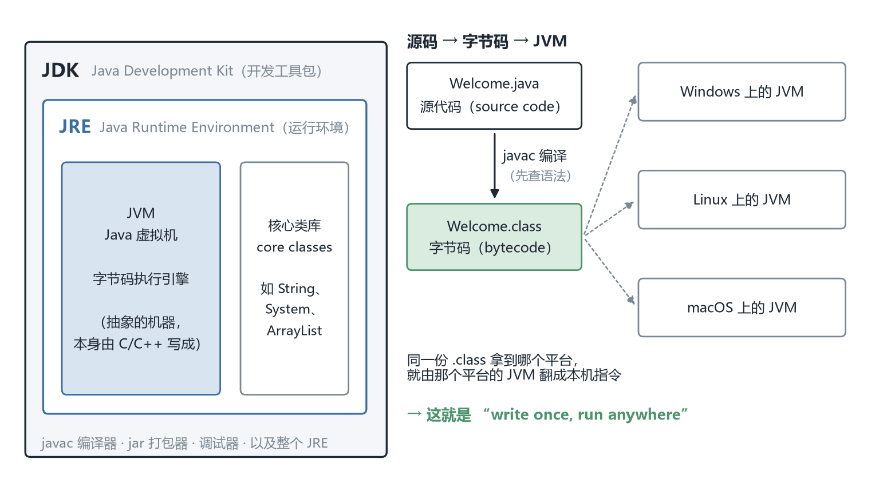
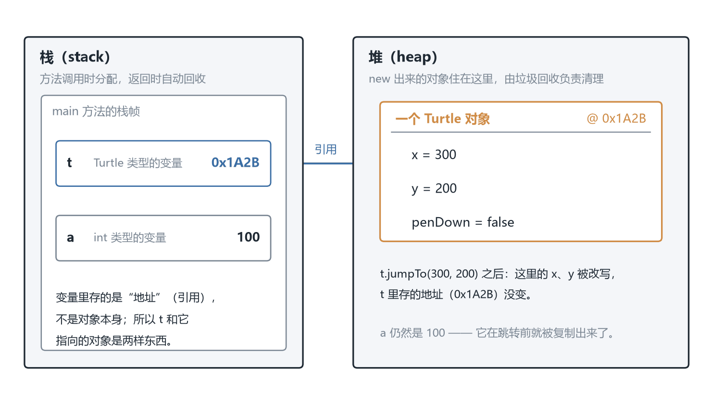

# CSC3100 Lecture 2 课堂笔记：Java Basics（Java 基础）

> 本讲基于课件整理，不含教师口述内容。材料是 `lecture 2 (java basics).pdf` 一份，共 87 页，其中约一半页面是 Eclipse 截图与代码截图（纯文字层抽不到内容），所以全文的代码都是我逐页渲染、按 300–430 dpi 局部放大之后逐行转写的。课件结构分七块：为什么用 Java 与"学/不学"的边界（p.1-5）、JDK/JRE/JVM 与第一次运行（p.6-16）、关键字·声明·语句（p.17-28）、类·对象·方法·异常·杂项（p.29-43）、一个完整的文件读写模板（p.44）、十二个迷你程序（p.47-71）、File 类与字节流/字符流（p.72-87）。
>
> **必须先说的一件事：课件第 1 页用红字写着"本讲材料不进入期中与期末考"（Materials of this lecture are NOT included in the midterm and final exams）。** 这条要照字面信，但别读成"不用学"——后面每一讲的算法都要用这套语法写成 Java，考卷上也确实可能出现"写出这段代码的输出"这类题。合理的投入方式是：**语法细节扫一遍、能读懂能改写；把力气留给 §7（类与对象）、§8（异常）、§14（十二个程序）这三块，因为它们是后面所有代码的地基。**
>
> 课件有若干笔误与前后不一致（p.61 声称"两种方式"但两个例子其实是同一种、p.66 的标点清单与 p.67 的代码对不上、p.58 的一句断言被 p.62 自己的例子推翻等），已逐条列在文末「诚实备注」一，每条都写明我是怎么判出来的。
>
> 来源标注约定：正文里凡标 **【补】** 的段落，都是课件没有写、由我补充、推导或复算出来的内容；没有标注的叙述以课件页码为准。

## 0. 一句话概括本讲在讲什么

上一讲（Lecture 1）停在"设计层"：抽象数据类型（Abstract Data Type, ADT）规定一个数据结构"能做什么"，数据结构是它的实现，算法是每个操作的具体步骤。整讲没有一行可运行的代码。

这一讲往下走一层，回答实现层的第一个问题：**用什么语言、以什么语法把这些设计写出来？** 答案是 Java，而课件只教这门语言里"够用来实现数据结构与算法"的那一小块（p.5）。

所以这是一门工具课，不是考点课——p.1 就在标题页写了"本讲材料不进入期中与期末考"。它的价值不在被考，而在于后面每一讲的算法最终都要落成 §2.3 那样的 Java：读不懂那七行，后面所有代码都读不下去；读懂了，剩下 86 页都只是在那七行上加东西——加变量、加循环、加一个类、套一个 try。

### 0.1 本讲地图

本讲严格按课件页序走一条线：§1 动机与"学/不学"的边界（p.1-5）→ §2 JDK/JRE/JVM 与第一次运行（p.6-11）→ §3 在 IDE 里跑通（p.12-16）→ §4 关键字（p.17-19）→ §5 变量与声明（p.20-25）→ §6 条件与循环（p.26-28）→ §7 类与对象（p.29-35）→ §8 异常（p.36-37）→ §9 输出、包、注释（p.38-40）→ §10 数组与 ArrayList（p.41-42）→ §11 `this`（p.43）→ §12 文件读写模板（p.44）→ §13 快捷键与自学材料（p.45-46）→ §14 十二个迷你程序（p.47-71）→ §15 File 类与流（p.72-87）→ §16 小结。

## 1. 为什么用 Java 学数据结构（p.1-5）

### 1.1 标题页上的那句红字（p.1）

课件第 1 页除了标题、作者与单位，只有一行括号里的说明：本讲材料不进入期中与期末考。这是全课唯一一次对某一讲做这样的声明，值得单独记下来。

它的含义是"考试不考 JVM 的定义、关键字的数量、File 类有哪些方法"，而不是"可以不看"——p.3 第一句就是"这门课不只是读和写，我们要靠**实现**数据结构与算法来写代码"。

### 1.2 三条理由（p.3）

课件给了三条"为什么选 Java"的理由，每条都值得展开一点，因为它们决定了后面代码的写法。

**第一，这门课要写代码，不只是读代码。** 数据结构这门课的传统教法是伪代码（pseudocode），但伪代码跑不起来，也就无法验证"我这个实现到底是 $O(n)$ 还是 $O(n^2)$"。所以要选一门真语言。

**第二，Java 是最常用的编程语言之一，而且相对好学。** "相对好学"这部分在 p.4 展开成了具体条目（见 1.3）。

**第三，Java 与平台无关**——课件用的原话是"写一次，到处运行"（write once, run anywhere）。这一条是 Java 的招牌，也是本讲第二节要拆开讲的东西：**真正跨平台的是编译出来的字节码，不是执行字节码的那个 JVM**（p.6 右下角专门加了这句注解）。

课件还列了 Java 的用武之地（安卓、企业软件、科学计算、Hadoop/Spark 等）。这一段在回答"学它有没有用"，与数据结构无关，记住 Hadoop/Spark 是用 Java 写的大数据框架即可。

### 1.3 优势清单，以及每条优势的代价（p.4）

课件列了七条优势。逐条看，并且补上它没说的另一面（这些"另一面"是我加的，标【补】）：

| 课件的说法 | 什么意思 | 【补】代价或例外 |
| --- | --- | --- |
| 更容易学（easier to learn） | 语法规整、没有指针运算 | 规矩多：所有代码必须写在类里（p.34），一个文件一个 public 类 |
| 没有指针，更安全（no pointer, safer） | 不能做 `p++` 这种地址运算，越界由运行时检查 | 代价是数组越界这类错误从"编译期"推到了"运行期"，写的时候看不出来 |
| 自动内存管理，含垃圾回收（garbage collection） | 不用 `free` / `delete` | 你控制不了它什么时候回收，也就控制不了程序什么时候卡一下 |
| 跨平台（cross platforms） | 同一份 `.class` 到处跑 | 前提是那边装了对应版本的 JVM；"一次编写"仍要"到处测试" |
| 标准库更强（more powerful standard libraries） | 集合、字符串、文件、网络都有现成的 | 库太多，初学时容易不知道什么时候该自己写 |
| Java 与 IDE 常常免费 | OpenJDK + Eclipse / VS Code | 版本众多，装错版本是新手第一个坑（见 §2.5 与诚实备注一第 2 条） |
| 常用于科研（Hadoop、Spark） | 大数据生态建立在 JVM 上 | —— |

这里有一个看似矛盾的地方值得先解释掉：p.4 把"垃圾回收"列为优势，p.5 却把"Garbage collection"列进"本课不学"的清单。两者不冲突——**p.4 说的是"你不用自己管内存"，p.5 说的是"我们不教你 GC 内部怎么标记、怎么分代回收"**。你会用它，但不会实现它。

### 1.4 会学什么、不学什么（p.5）——这份清单决定了后面代码长什么样

这是全讲最该抄全的一页。课件把它分两栏：

**会学（What will we learn?）**：JDK、JVM、JRE；关键字（keywords）；简单声明（simple declarations）；语句（statements）；类与对象（classes / objects）；方法（methods）；异常（exceptions）。

**不学（What will we NOT learn?）**：接口（Interface）、抽象类（Abstract class）、继承（Inheritance）、图形界面（GUI）、多线程（Multi-thread）、垃圾回收（Garbage collection）、网络通信（Network communication）、网页设计（Web design）、安卓应用开发（Android Apps development），后面还有省略号与"Many others"。

课件在这两栏下面写了一句总结："**只聚焦于本课实现数据结构与算法所需的那部分 Java 基础知识！**"

这句话的分量比它看起来重得多。它意味着后面 14 周你看到的所有 Java 代码都受三条约束，而这三条约束会直接改变代码的形状：

**第一，不讲继承（inheritance）⇒ 后面的数据结构一律用组合（composition），不用继承。** 组合的意思是"一个类里放另一个类的对象作为字段"，p.35 的 `ConfunDemo3` 就是最小例子（`Person` 带 `name`、`age`，别的类想用一个人就声明一个 `Person` 变量）。组合只需要"有一个"（has-a），继承要求"是一个"（is-a）；后面写链表时 `Node` 里放 `Node next` 就是组合。【补】

**第二，不讲接口（interface）与抽象类 ⇒ 课程代码里不会出现 `Comparable`、`Iterator`、`Comparator` 这类"靠接口做多态"的写法。** 真实 Java 排序是"元素实现 `Comparable`、算法调 `compareTo`"；本课没有这条路径，比较逻辑会直接写在排序算法里。读 CLRS 伪代码不会觉得缺什么，读真实 Java 库才会觉得"怎么到处是 `implements`"。【补】

**第三，不讲 GUI / 多线程 / 网络 ⇒ 本课所有程序的输入输出只有三种：控制台（`System.out`）、文件（p.44 与 §15）、以及命令行参数（p.34 的 `args`）。** 你在作业里看到的"从文件读、往文件写"的模板，就是这条约束的产物。

还有一条容易忽略的：**p.7 会把"继承""多态"列为面向对象的特征，而 p.5 说不学。** 这不是自相矛盾——p.7 是在给"面向对象"这套词汇表，p.5 是在划本课的使用范围。你会认识这些词，但不会用它们写代码。

## 2. JDK、JRE、JVM：一个程序怎么跑起来（p.6-11）

### 2.1 三个缩写的包含关系（p.6）

课件给了三个定义，措辞值得逐字读：

- **JDK（Java Development Kit，Java 开发工具包）**：一个软件开发环境，用来开发 Java 应用与小程序（applets）。
- **JRE（Java Runtime Environment，Java 运行环境）**：提供执行一个 Java 应用所需的最小条件，由 JVM、核心类库（core classes）等组成。
- **JVM（Java Virtual Machine，Java 虚拟机）**：一台并不物理存在的抽象机器，一份**规范**（specification），它提供"Java 字节码可以在其中执行"的运行环境。

叠起来就是包含关系：**JDK ⊃ JRE ⊃ JVM**，而 JRE 里除了 JVM 还有核心类库（`String`、`System`、`ArrayList` 就住在里面）。所以"装了 JDK 就一定有 JRE"成立，"只装 JRE 就不能编译"也成立——编译用的 `javac` 在 JDK 里，不在 JRE 里。

课件右下角加了一句全讲最关键的注解：**"Java 是平台无关的，但 JVM 是平台相关的。"** 这是理解"跨平台"的钥匙。



*图 1　左边是 p.6 的三层包含关系（JDK ⊃ JRE ⊃ JVM + 核心类库）；右边是 p.8 与 p.10 的流程：源码被 `javac` 编译成字节码，同一份字节码交给各平台自己的 JVM 执行。平台无关的是中间那个 `.class`，不是 JVM。*

### 2.2 跨平台的是字节码，不是 JVM（p.8）

课件把 Java 与 C/C++ 对照着说：C/C++ 被编译成**某个平台特有的机器码**，换个 CPU 架构或操作系统就得重新编译；Java 被编译成**字节码（bytecode）**——一种不属于任何真实 CPU 的指令集，由 JVM 在执行时翻译成本机指令，所以同一份 `.class` 能在 Windows、Linux、macOS 上跑。课件还给了一句更抽象的说法："Java 是一个跑在硬件平台之上的**软件平台**"，由运行时环境（runtime environment）与应用程序接口（API）两部分构成。

【补】别把"跨平台"想得太神奇：**它把移植工作从应用开发者转移到了 JVM 实现者身上。** 每个平台都要有人写一个符合规范的 JVM，只要两个 JVM 都守规范，同一份字节码的行为就该一致。反过来说，依赖平台的地方（默认字符编码、换行符、路径分隔符）照样会"在我机器上能跑"——p.44 写死 `/Users/yxfang/...`、p.80 写死 `D:\\testout.txt`，就是在演示这个坑：**字节码跨平台，路径不跨平台。**

### 2.3 第一个程序的三行骨架（p.9）

```java
class Welcome { … }                              // 1. 声明一个名为 Welcome 的类
public static void main(String args[ ]) { … }    // 2. 声明 main 方法
System.out.println("Welcome to Java!");          // 3. 往控制台打印一行
```

课件对第二条只加了一句："Java 的 main 方法是任何 Java 程序的入口（entry point）。"这句话背后的机制值得拆开，因为后面每段代码都要套这个壳。

**`class Welcome`**：Java 里所有代码都必须待在类里（p.34）。`class` 是关键字，`Welcome` 是类名，按惯例首字母大写——p.15 的对话框专门警告过这一点，而 p.16 生成的 `hello` 恰好是反例（能编译，不合惯例）。

**`public`**：访问修饰符，表示对外可见。入口必须能被 JVM 从外面调用，所以必须是 `public`（§7.5）。

**`static`**：表示这个方法属于**类**而不是某个对象。JVM 启动时还没有任何对象，只能"按类名找人"——`java Welcome` 的意思是"加载 Welcome 类、直接调它的 main"，中间没有 `new` 的机会。p.34 的说法是"调用 main 时它不与对象关联，而与类关联"。

**`void`**：返回类型，表示不返回任何值。

**`main`**：方法名。JVM 认的就是这四个字母，写成 `Main` 或 `mian` 都不算入口。

**`String args[ ]`**：一个参数，类型是 `String` 数组，名字叫 `args`，接的是命令行上多出来的词：`java Welcome hello world` 会把 `hello`、`world` 装进 `args`。`String args[ ]` 与 `String[] args` 等价，前者是 C 风格写法，课件两处都用过。

**`System.out.println(...)`**：拆成四段读。`System` 是 JDK 提供的类（在 `java.lang` 包里，自动导入）；`out` 是 `System` 的静态字段，类型 `PrintStream`；`println` 是 `PrintStream` 的方法，打印后换行（`print` 不换行，§9）；括号里是参数。整句读作"调用 System 的 out 字段的 println 方法"。

**分号与花括号**：分号结束一条语句，花括号把若干语句组成块。p.9 第三条漏了分号（课件写作 `System.out.println("Welcome to Java!")`），真写代码必须补——诚实备注一第 10 条登记了这处。

### 2.4 编译与运行的完整回路（p.10）

p.10 是全讲信息量最大的一张图，把"写代码 → 跑起来"画成带反馈的回路，中间两个红框分别装"源码"与"字节码"。四段：

**① 写源码、存盘。** 源码（source code）是 `.java` 文件，样例就是 §2.3 那三行。

**② 编译。** `javac Welcome.java`。成功则产出 `Welcome.class`；失败则报编译错误，沿图上标"if compile errors occur"的线回到第 ① 步。

**③ 运行。** `java Welcome`（**不带** `.class` 后缀）。JVM 读入字节码、逐条解释执行。

**④ 看结果。** 输出 `Welcome to Java!`；图上另一条线标"if runtime errors or incorrect result"——运行期出错或结果不对，也得回去改。

图中间夹了一段**字节码清单**，这是整页最值得看的东西（课件没解释，我逐行拆开【补】）：

```text
Method Welcome()
  0 aload_0
  …
Method void main(java.lang.String[])
  0 getstatic #2 …
  3 ldc #3 <String "Welcome to Java!">
  5 invokevirtual #4 …
  8 return
```

第一段是 `Method Welcome()`——**课件里根本没写构造器，字节码里却有一个**，这正是 p.31 那句"It is not mandatory to write a constructor"的底层原因：你不写，编译器就自动生成一个无参构造器（default constructor）。`aload_0` 把第 0 号局部变量压栈，而实例方法与构造器的第 0 号局部变量固定是 `this`；省略号那行按惯例是 `invokespecial`，调父类 `Object` 的构造器。

第二段左边那些 0、3、5、8 不是"第几条指令"，而是**指令在字节码里的起始偏移（字节）**。偏移跳 3、2、3 是因为长度不同：`getstatic` 带 2 字节常量池下标（共 3 字节）、`ldc` 带 1 字节（共 2 字节）、`invokevirtual` 带 2 字节（共 3 字节）、`return` 不带参数（1 字节）。**读懂这几个偏移，才算把字节码当成"指令流"而不是"源码的另一种写法"。**

三条指令做的事：`getstatic #2` 取静态字段（`System.out`）；`ldc #3` 把常量池第 3 项（字符串）压栈；`invokevirtual #4` 调用实例方法（`println`）；`return` 结束方法。

### 2.5 装环境（p.11）

四步：装一个 JDK（推荐 OpenJDK，课件举例 "Java SE DK 26"，原文如此，见诚实备注）；设 `JAVA_HOME` 指向 JDK 安装根目录（形如 `C:\Program Files\Java\jdk___VERSION`）；把 `%JAVA_HOME%\bin` 加进 `PATH`；验证安装（课件写的是"e.g., on Mac"）。然后装 IDE：Eclipse（作者原话"my personal choice"）、VS Code、甚至记事本。

【补】三步里最容易出问题的是第 3 步：`JAVA_HOME` 本身对 `javac` 没用（它只是给 Maven、Gradle 看的），真正让命令行找得到 `javac` 的是 `PATH` 里那一项——这就是"设了 JAVA_HOME 还是 command not found"的原因。

## 3. 在 IDE 里跑通第一个程序（p.12-16）

这五页全是 Eclipse 截图，课件没有配文字，要点只有四条：

**① 建工程**（p.12-13）：`File → New → Java Project`。p.13 的对话框里 JRE 选 "Use an execution environment JRE: **JavaSE-14**"（截图来自 2020 年前后，Java 14 于 2020 年 3 月发布）；底部 "Create module-info.java file" 是 Java 9 的模块系统，本课用不到，【补】自己建工程时取消勾选更省事。Eclipse 的"工程"对应磁盘上一个文件夹，源码放 `src` 里。

**② 建类**（p.14-15）：右键工程 `New → Class`，Package 填 `helloworld`、Name 填 `hello`。刚填完对话框顶部就弹出警告："Type name is discouraged. By convention, Java type names usually start with an uppercase letter"——**这只是提醒，不是错误**。勾上 "public static void main(String[] args)" 让 IDE 生成 §2.3 那个壳。Superclass 一栏写着 `java.lang.Object`——**每个类默认继承 `Object`**，这正是 p.7 那句"`Object` 是根类"在 IDE 里的样子（`toString()`、`equals()` 都来自它，§5.7）。

**③ 生成结果**（p.16）：代码 11 行，第 1 行 `package helloworld;` 对应 `src/helloworld/` 目录，第 3 行 `public class hello` 的类名小写（与文件名一致是硬要求，小写只是不合惯例），第 6 行 `// TODO Auto-generated method stub` 可以删。

**④ 运行**（p.16）：点绿色三角，Console 面板显示 `<terminated> hello [Java Application] …` 与 `hello world!`。第一行是 IDE 告诉你"进程已结束"，第二行才是程序输出——**初学者最容易把 `<terminated>` 那行当成输出**。

## 4. 关键字：Java 的保留字（p.17-19）

### 4.1 先说清楚"关键字"是什么（p.17）

课件的定义是：关键字（keywords）是"充当代码钥匙的特定单词"，**不能用作变量名或对象名**。这句话的后半截是实用信息：`int int = 3;` 编译不过，`class class {}` 也编译不过。

课件把关键字按用途分了五组，p.17 讲第一组：基本类型（primitive types）。

| 关键字 | 课件原文 | 位数 | 【补】取值范围 / 说明 |
| --- | --- | --- | --- |
| `int` | 32 位有符号整数 | 32 | $-2^{31}$ 到 $2^{31}-1$，即 $-2147483648$ 到 $2147483647$（约 $\pm 2.1\times 10^{9}$） |
| `boolean` | 布尔类型（`true` 或 `false`） | 规范未定 | 只有两个值，不能与整数互转（C 语言里 `0` 当假、非 `0` 当真，Java 不行） |
| `double` | 64 位浮点数 | 64 | IEEE 754 双精度，约 15–16 位有效十进制数字 |
| `char` | 无符号 16 位 Unicode 字符 | 16 | $0$ 到 $65535$，是**无符号**的，所以能存 `'中'` 这类字符 |
| `short` | 16 位整数 | 16 | $-32768$ 到 $32767$ |
| `long` | 64 位整数 | 64 | 约 $\pm 9.22\times 10^{18}$；字面量要加 `L` 后缀，如 `1234567890123L` |
| `float` | 32 位浮点数 | 32 | 约 7 位有效十进制数字；字面量要加 `f` 后缀，如 `3.14f` |
| `byte` | 8 位数据 | 8 | $-128$ 到 $127$ |

这 8 个就是 Java 全部的**基本类型**（primitive types）。它们不是对象，没有方法，也不住在堆里——这一点与 p.7 的"一切都是对象"直接冲突，见诚实备注一第 1 条。

【补】表里有三处课件没写但很实用的细节：

- **`int` 是默认整数类型**：`3` 是 `int`、`3L` 才是 `long`；`3.14` 是 `double`（不是 `float`），要 `float` 必须写 `3.14f`——所以 `float f = 3.14;` 编译报错（窄化可能丢精度）。
- **`char` 是无符号的**，所以 `char c = -1;` 不合法；而 `short s = -1;` 合法。
- **整数溢出不会报错，会静默回绕**。`int x = 2147483647; x = x + 1;` 得到 $-2147483648$。这个坑在后面讲"数组下标上界"和"二分搜索的 `mid = (lo+hi)/2` 会溢出"时会反复出现。

### 4.2 循环、条件、类与对象的关键字（p.18）

p.18 分三组：

**循环（loops）**：`for`（创建一个 for 循环：一个变量初始化、一个布尔表达式、一个自增）；`while`（测试布尔表达式，为真就执行语句）；`continue`（跳过本轮剩下的代码，直接进入下一轮）；`break`（跳出当前循环或 switch）。课件配了两个片段：`for (int x = 0; x < 10; x = x + 1)` 与 `while (x < 10)`。

**条件（conditions）**：`if`（测试条件，为真则执行 if 块）；`else`（表示 if 语句的另一分支）。

**类与对象**：`class`（声明一个类）；`new`（创建新对象）。

【补】两点：`break` 只跳出**最内层**循环、`continue` 只跳过**当前这一轮**（p.54 的素数判定里就有 `break`）；`for` 的第三部分课件写成完整赋值 `x = x + 1`，与惯用的 `x++` 等价（p.27 注释过"Shortcut for `k = k + 1`"）。

### 4.3 异常与"其它"（p.19）

**异常（exceptions）**：`try`（开始一段要被检查的代码，后面必须跟 `catch` 或 `finally`）；`catch`（捕获 try 抛出的异常，只能跟在 try 后面）；`finally`（无论有没有异常都执行的块）。

**其它（others）**：`import`（把别的包里的类/接口引入当前源码，使其可被直接使用）；`package`（声明一个包，包里装类）；`public`（访问修饰符，表示任何地方都能访问，作用域最宽）；`return`（方法执行完毕时返回）；`null`（表示一个引用没有指向任何东西）。

这里有一处需要更正：**`null` 不是关键字，是字面量（literal）**——详见诚实备注一第 3 条。`true`、`false` 同理（p.22 用到了 `b = true;`，p.19 却没有把它们列进来）。

### 4.4 这张表没列全（p.17-19 的整体判断）【补】

三页加起来大约列了 25 个词，而 Java 语言规范（Java Language Specification, JLS §3.9）的关键字表有 50 个上下（不同版本略有增减）。缺的那些并不是不重要，而是**在本课用不到**或者**在后面几页才出现**：

- 缺 `do`、`switch`、`case`、`default`：所以本课的循环只有 `for` 与 `while`，多分支只有 `if-else if-else`；
- 缺 `static`、`void`、`final`、`this`、`throw`、`throws`：它们分别出现在 p.23、p.30、p.15、p.43、p.36、p.86；
- 缺 `extends`、`implements`、`instanceof`、`enum`、`assert`、`synchronized` 等：本课完全用不到。

所以正确的读法是：**p.17-19 是"本课会用到的关键字清单"，不是"Java 关键字全集"。** 遇到没见过的词，去查 JLS 而不是怀疑自己漏看了一页。

## 5. 变量与声明（p.20-25）

### 5.1 变量是什么（p.20）

课件的三句话一句比一句具体：变量是一个**数据容器**（data container），在程序执行期间存放数据值；每个变量都被赋予一个**数据类型**（data type），它规定了能存什么类型、多大量的值；变量是数据在内存中的**位置的名字**（a memory location name of the data）。

第三句是地基：**变量不是数据本身，而是"某块内存"的名字。** 写 `y = x` 是"把 x 那块内存的内容抄一份到 y"，不是让两者变成同一块。对基本类型这个区别看不出来，对对象就是天大的区别（§7.8、§7.9）。

课件说使用变量分两步：**声明（declaration）**与**初始化（initialization）**。

### 5.2 声明语句的三个零件（p.21）

```java
int m, n;          // Two integer variables
double x, Y;       // Two real coordinates
boolean b;         // Either 'true' or 'false'
char ch;           // A character, such as 'P' or '@'
```

课件用三个红框分别指向 `char ch;` 里的**类型**、**变量名**、**分号**。一行可以声明多个同类型变量，用逗号隔开。

【补】三点：① **声明只是占位，不给值**；局部变量在赋值前**不能读**，`int x; System.out.println(x);` 编译报错 "might not have been initialized"（这与 C 的"随机值"不同，Java 直接用编译器挡掉）。② **字段（类里、方法外的变量）有默认值**：数字是 `0`、`boolean` 是 `false`、引用是 `null`；所以 p.35 的 `Person` 即使不写构造器，`name` 也会是 `null`。③ **`double x, Y;` 里的 `Y` 是大写**——Java 区分大小写，所以这是两个不同的名字，能编译但一看就像笔误，后文一律按 `x`、`y` 讲。

### 5.3 数值表达式与整数除法（p.22）

```java
n = 3 * (5 + 2);
x = y / 3.14159265;
n = m % 8;        // Modulo, i.e. n is now (m mod 8)
b = true;
ch = 'x';
```

`%` 是取余，后面会在哈希函数与判奇偶里反复出现。`'x'` 是**单引号**（一个 `char`），`"x"` 是双引号（一个 `String`），两者类型不同，不能互相赋值。

下半页是全讲最实用的坑：

```java
double f;
f = 1 / 3;        // f is now 0.0
f = 1.0 / 3.0;    // f is now 0.333333333...
```

课件的标题是"Division operator has two different things"（原文如此，"has"应为"does"），意思是除号 `/` 有两种行为。**规则是看两边操作数的类型，不看左边变量的类型**：`1 / 3` 两边都是 `int`，做整数除法，商 0 余 1，**小数部分直接丢掉（向零截断）**，结果 `0`，再赋给 `double f` 就成了 `0.0`；而 `1.0 / 3.0` 两边都是 `double`，得 `0.3333333333333333`。

这条规则解释了后面两处代码为什么那样写：p.28 写 `sum + 1.0 / i`（写 `1 / i` 的话 $i \ge 2$ 时全是 0，和恒等于 1）；p.27 的 `term / k` 没问题，因为 `term` 本身是 `double`，`double / int` 会自动把 `int` 提升为 `double`。

【补】取模也有符号问题：`-7 % 8` 在 Java 里是 `-7`（结果符号跟被除数走），不是数学上的 `1`；哈希函数里要保证非负得写 `(key % M + M) % M`。

### 5.4 三种变量：局部、实例、静态（p.23）

```java
class Guru99 {
    static int a = 1;      // static variable
    int data = 99;         // instance variable
    void method() {
        int b = 90;        // local variable
    }
}
```

| 种类 | 定义位置 | 归属 | 何时初始化 |
| --- | --- | --- | --- |
| 局部变量（local） | 方法体内部 | 属于这一次方法调用 | 必须自己赋值 |
| 实例变量（instance） | 类里、方法外，**不带** `static` | 属于每一个对象（object specific） | 对象创建时给默认值 |
| 静态变量（static） | 类里、方法外，**带** `static` | 属于类本身（class specific） | 程序开始时一次 |

课件对静态变量还加了一句："这些变量应该最先初始化，在任何实例变量之前"——意思是**加载顺序**：类先被加载、静态变量先初始化，然后才谈得上创建对象。

【补】假设有三个对象 `o1`、`o2`、`o3`：`o1.data`、`o2.data`、`o3.data` 是**三块不同的内存**；`Guru99.a` 只有**一块**，改一处三处都变；`b` 只在 `method()` 执行期间存在，方法一返回就没了。这也解释了 p.49 的 `n1`、`n2`、`n3` 为什么是 `static`——它们要跨方法调用共享状态。

### 5.5 类型转换（p.24）

**规则一：把实数值赋给整数变量，需要强制转换（cast）。**

```java
double radians;
int degrees;
…
degrees = radians * 180 / 3.14159265;               // Error
degrees = (int) (radians * 180 / 3.14159265);       // OK
```

第一行报错不是"算不出来"，而是**可能丢信息**：`double` 有小数、`int` 没有，赋值会截掉小数，编译器不允许这种静默损失。加 `(int)` 就是声明"我知道会丢，照做"。

**规则二：把整数赋给实数变量不需要转换**（`double d = 3;` 合法）。因为 `int → double` 不丢信息，`double` 的整数范围远大于 `int`。

【补】① **`(int)` 是截断，不是四舍五入**：`(int) 3.9` 得 `3`，`(int) -3.9` 得 `-3`（向零取整）；要四舍五入用 `Math.round(3.9)`，它返回 `long`。② **转换的是"值"不是"变量类型"**：`(int) x` 不改变 `x` 的类型。③ **`char` 与 `int` 可以互转**，这就是 §14.9 那两个 ASCII 例子能工作的原因：`int ch1 = 'a';` 得 97（隐式拓宽），`(char) 87` 得 `'W'`（显式窄化）。

### 5.6 字符串（p.25）

课件的两句话："字符串是一串字符，或者说是一个字符数组"；"用 `String` 类来处理字符串"。上半页演示前者：

```java
char[] arrSample = {'R', 'O', 'S', 'E'};
String strSample_1 = new String(arrSample);
```

下半页演示两个基本操作：

```java
String str1 = "Software";
String str2 = "Testing";
System.out.println(str1 + str2);        // SoftwareTesting
System.out.println(str1.concat(str2));  // SoftwareTesting
```

两种写法结果一样：`+` 是编译器给的语法糖（一边是 `String` 时，`+` 变成拼接，另一边自动转字符串），`concat` 是 `String` 的方法。

【补】三点：① **`String` 不是基本类型，是类**，所以 `String s = "abc"` 里的 `s` 是引用（§7.8）。② **`String` 不可变**：`str1.concat(str2)` **不改** `str1`，它返回新字符串；想让 `str1` 变得写 `str1 = str1.concat(str2);`——这是 p.71 那行的前提。③ **`+` 的优先级陷阱**：`"sum = " + 1 + 2` 输出 `sum = 12`（从左到右先拼成字符串），`"sum = " + (1 + 2)` 才输出 `sum = 3`。

### 5.7 String 与 StringBuilder，`==` 与 `.equals()`（p.25、p.57、p.69 的延伸）【补】

这一小节课件没有系统讲，但它是初学者第一大坑，也直接关系到后面哈希与查找的正确性。触发点是两处课件代码：p.57 用 `original.equals(reverse)` 判断内容是否相同，p.69 用 `StringBuffer` 逐字符改。**课件直接用了这两样东西，却没解释为什么不能写 `==`、为什么要用 `StringBuffer`。**

**为什么 `==` 判断不了字符串相等。** `==` 的含义是"两边的值是否相同"。对基本类型，"值"就是数字本身；对引用类型，"值"是**地址**，所以 `==` 问的是"是不是指向同一个对象"，不是"内容是否相同"。

```java
String a = "abc";
String b = "abc";
String c = new String("abc");

a == b              // true  —— 两个字面量指向常量池里同一个对象
a == c              // false —— new 一定在堆上造一个新对象
a.equals(c)         // true  —— equals 比的是内容
```

第一行为什么是 `true`？因为源码里的字符串字面量（literal）被放进**字符串常量池（string constant pool）**，同样的字面量只存一份，`a` 与 `b` 拿到同一个地址；而 `new String("abc")` 明确要求"再造一个"，于是堆上多了一个内容相同、地址不同的对象。

所以 **比较字符串内容永远用 `.equals()`**。`String` 重写了从 `Object` 继承的 `equals`，改成逐字符比较；`==` 无法重写，语义在语言层面就定死了。p.57 那行是正确写法；若写成 `original == reverse`，因为 `reverse` 是循环里拼出来的新对象，结果**永远是 false**，任何输入都会输出 "isn't a palindrome"。顺带一句：`"abc".equals(x)` 比 `x.equals("abc")` 安全——前者在 `x` 为 `null` 时返回 `false`，后者抛异常。

**为什么拼接要用 StringBuilder / StringBuffer。** `String` 不可变，每次 `+` 都要"新造一个字符串、把两段都抄进去"。循环里这样写：

```java
String s = "";
for (int i = 0; i < n; i++) {
    s = s + "x";        // 第 i 轮要抄 i 个字符
}
```

总共抄 $1 + 2 + \cdots + n = \frac{n(n+1)}{2}$ 个字符，是 $O(n^2)$。换成 `StringBuilder`：

```java
StringBuilder sb = new StringBuilder();
for (int i = 0; i < n; i++) {
    sb.append("x");     // 均摊 O(1)
}
String s = sb.toString();
```

它内部维护可变的字符数组，容量不够时按倍数扩容（均摊 $O(1)$），整体 $O(n)$。p.69 的 `StringBuffer` 是它的线程安全版本（方法带 `synchronized`），单线程下 `StringBuilder` 更快；本课不讲多线程（p.5），两者等价。p.69 用 `StringBuffer` 的真正理由是**它要按下标改字符**（`setCharAt`），而 `String` 没有这个方法；这也解释了 p.57 为什么用"从后往前 `charAt` 再拼接"的笨办法反转，而没用 `StringBuilder.reverse()`。

## 6. 语句：条件与循环（p.26-28）

### 6.1 if 与 if-else（p.26）

课件先说"语句可以用 `{ }` 组成块（blocks）"，然后给 if 的写法：

```java
if (n == 3)
    x = 3.2;
```

三条注意事项（课件原文的 Note）：

1. **没有 `then` 关键字**（与 Pascal、某些伪代码不同）；
2. **条件必须是布尔类型，并且写在圆括号里**——`if (n)` 在 Java 里编译不过（C 语言里"非零即真"的写法不成立）；
3. **比较用 `==`**，不是 `=`。`=` 是赋值，`if (n = 3)` 在 Java 里编译不过（因为 `n = 3` 的类型是 `int`，不是 `boolean`）——这是 Java 比 C 安全的地方，C 里这个错误能编译通过并静默改变量。

比较运算符课件列了六个：`>`、`<`、`==`、`>=`、`<=`、`!=`。注意 `=` 不在其中——它不是比较。

p.26 下半页给了 if-else 的例子：

```java
if (x != 0)
    y = 3.0 / x;    // Executed when x is non-zero
else
    y = 1;          // Executed when x is zero
```

这个例子的用途是**防除零**：`x` 为 0 时走 `else`，避免 `3.0 / 0`（对 `double` 来说 `3.0/0` 不抛异常，结果是 `Infinity`；对 `int` 来说 `3/0` 会抛 `ArithmeticException`——见 §8）。另外 `y = 1;` 把一个 `int` 赋给（推测是 `double` 的）`y`，不报错，因为这是 §5.5 的"整数赋给实数不需要转换"。

【补】两条初学者最容易踩的：

- **不加花括号时，`if` 只管下一行。** `if (x > 0) x = 1; y = 2;` 里的 `y = 2` 与条件无关，永远执行。这就是为什么本书后面所有代码都老老实实写花括号。
- **`else` 与最近的 `if` 配对**（dangling else）。多层嵌套时靠缩进看不出来，靠花括号才靠得住。

### 6.2 布尔表达式（p.27）

课件给了三行对照：与（and）写作 `&&`；或（or）写作两个竖线；非（not）写作 `!`。

配的例子是：

```java
int x, y;
boolean b;
…
if ((x <= 9 || y > 3) && !b) {
    b = true;
}
```

这一行把三种运算叠在一起。读法是：先算括号里的 `x <= 9 || y > 3`（`||` 的优先级低于比较），再算 `!b`，最后 `&&`。`!b` 的意思是"b 为 false 时，`!b` 为 true"，所以整个条件读作"（x 不大于 9 或 y 大于 3）**且** b 还是 false"。

【补】两点：

- **`&&` 与 `||` 是短路的（short-circuit）**：`a && b` 在 `a` 为 false 时根本不看 `b`；`a || b` 在 `a` 为 true 时根本不看 `b`。这不是优化，而是语义——`if (p != null && p.x > 0)` 之所以安全，就是因为左边为 false 时右边不会执行。如果写成 `&`（非短路版），`p` 为 `null` 时会直接抛 `NullPointerException`。
- 布尔变量不要与 `true` 比较：`if (b == true)` 就是 `if (b)`，`if (!b)` 就是"b 为假"。

### 6.3 while 循环：算 $e$（p.27）

课件用 while 循环算 $e^{1}$，标题强调的是"需要停止条件（stopping criterion）"：

```java
// Calculate exp(1). End when the term is less than 0.00001
double sum = 0.0;
double term = 1.0;
int k = 1;
while (term >= 0.00001) {
    sum = sum + term;
    term = term / k;
    k++;                      // Shortcut for 'k = k + 1'
}
```

这段代码用泰勒级数算 $e$：

$$
e^{x} = \sum_{j=0}^{\infty}\frac{x^{j}}{j!}
$$

取 $x = 1$ 就是 $\sum_{j\ge 0} 1/j! = 1 + 1 + \frac12 + \frac16 + \frac1{24} + \cdots$。代码里的三个变量各有分工：`sum` 累加已经算出的项，`term` 是**当前要加的那一项**，`k` 是计数器。

关键是 `term` 与 `k` 的关系：初始 `term = 1.0`（即 $1/0!$），循环体先把它加进 `sum`，再执行 `term = term / k`。第一轮 `k = 1` 得 $1/1!$，第二轮 `k = 2` 得 $1/2!$……所以**第 $m$ 轮加进去的项是 $1/(m-1)!$**。

【补】课件只给了"什么时候停"，没给"停在哪里、结果多准"。我按同一份代码逐轮算了一遍：循环体执行 **9 次**，退出时 `term = 1/9! ≈ 2.76e-6 < 1e-5`，`sum = 2.71827876984127`。与 $e = 2.718281828459045$ 相比，绝对误差 $3.06\times 10^{-6}$。

这个误差不是巧合：被丢掉的第一项就是 $1/9! \approx 2.76\times 10^{-6}$，后面所有项加起来约 $3.1\times 10^{-7}$，合计约 $3.06\times 10^{-6}$。**所以"截断阈值取 $10^{-5}$"实际给出的是 $10^{-6}$ 量级的精度——阈值管的是"最小的那一项有多大"，不是"总误差有多大"。** 这个观察在后面讲数值算法时还会用到。

还有一个细节：`term / k` 是 `double` 除以 `int`，`k` 会被提升为 `double`（§5.3），不会退化成整数除法；若写成 `term = 1 / k;`，$k \ge 2$ 时结果永远是 0，循环第二轮就结束——这是这段代码最容易被"改坏"的地方。

### 6.4 for 循环：调和级数（p.28）

课件把 for 循环拆成三个部分：**`i` 的初值**、**停止条件**、**每一轮怎么改 `i`**。例子是算 $1 + \frac12 + \frac13 + \cdots + \frac1{100}$：

```java
// Calculate 1 + (1/2) + (1/3) + ... + (1/100)
int i;
double sum = 0.0;
for (i = 1; i <= 100; i++) {
    sum = sum + 1.0 / i;
}
```

三部分对应得清清楚楚：`i = 1`（初值）、`i <= 100`（停止条件，注意是 `<=`，因为要包含第 100 项）、`i++`（每轮加 1）。

`sum = sum + 1.0 / i;` 里的 `1.0` 是这一页的灵魂：写成 `1 / i` 的话，$i \ge 2$ 时整数除法得 0，`sum` 会恒等于 1.0。课件没有解释这一点，但它与 p.22 的"整数除法"是同一件事。

【补】这个和叫**调和级数（harmonic series）**，记作 $H_n$。$H_{100}$ 的精确值是 $5.187377517639621$（我按同一段代码逐项加得），而用渐近式 $\ln n + \gamma$ 估算得 $5.18239$（$\gamma \approx 0.5772$ 是欧拉常数），差约 $0.005$——**$n = 100$ 时渐近式已经能给出前三位，但还不够精确**。这个级数增长极慢：$H_n$ 要到 $n \approx 1.5\times 10^{43}$ 才达到 100，这也是为什么"调和级数发散"这件事在数值上几乎看不出来。

【补】`i` 通常在 for 里声明（`for (int i = 0; ...)`），作用域就限制在循环内；p.41 与 p.48 把 `int i;` 提到外面属于 C 语言留下的习惯。

## 7. 类与对象（p.29-35）

### 7.1 类是图纸，对象是房子（p.29）

课件的定义：**类（class）是一张蓝图或原型（blueprint or prototype），它定义了某一类 Java 对象共有的变量与方法**；**对象（object）是类的一个标本（specimen），即类的一个实例（instance）**。

p.29 右侧的手绘图把 `DOG` 这个类分成上下两半：上半是数据成员（Breed、Size、Age、Color），下半是方法（Eat()、Sleep()、Sit()、Run()）。一个类就是这两样东西：**它知道什么**（字段）与**它能做什么**（方法）。

【补】这里要把上一讲的 ADT 接上，否则两讲是断开的：**L1 的 ADT 是"能做什么"的清单，本讲的 `class` 就是它在 Java 里的落地形式**——字段对应状态、方法对应操作、`private` 对应信息隐藏（p.33 那句"属性一般应保持 private"就是 L1 的封装）。课件从 p.29 起只讲 Java，没做这个连接。

类与对象的区别可以一句话记住：**类只存在于源码里，对象才占用内存。** 写 `class Dog { … }` 时内存里没有任何一条狗；`new Dog()` 时才真的造出一条。

### 7.2 一个类声明里有什么（p.30）

类声明包含一组**属性**（attributes，也叫实例变量 instance variables）与一组**函数**（functions，Java 里叫方法 methods）。方法是三类：**main**（`public static void main(String [ ] args){…}`，程序入口、`static`）、**构造器**（`public Turtle( ){…}`，与类同名、无返回类型）、**一般方法**（`public void jumpTo(int newX, int newY) {...}`，干活的）。读任何一个类，先找这三样：`main` 决定"怎么跑起来"，构造器决定"对象出生时什么样"，一般方法决定"对象能干什么"。

### 7.3 构造器（p.31）

课件的定义：构造器是一个**特殊的方法**，用来初始化刚创建的对象，**在对象分配完内存之后立刻被调用**；它可以用来把对象初始化成想要的值或默认值；**一个类不写构造器也可以**。

两条规则：**名字必须与类名相同**；**不能有返回值，连 `void` 都不能写**。第二条最容易写错——`public void Turtle() { … }` 不是构造器，是一个"碰巧叫 Turtle、返回 void"的普通方法，`new Turtle()` 不会调用它。

【补】三点：① **不写构造器时编译器自动生成一个无参构造器**，它什么也不做（只调父类构造器），§2.4 字节码里的 `Method Welcome()` 就是它。② **一旦你自己写了任意一个构造器，编译器就不再自动生成无参版**：p.35 的 `Person` 只有 `Person(String n, int m)`，此时 `new Person()` 会编译报错。③ **构造器可以重载**（同名不同参数），p.40 的 `new Employee("Harry", 40000)`、`new Employee(60000)`、`new Employee()` 就是三个构造器；**没有析构器**，p.35 说得很直接——"有垃圾回收，不需要手动销毁对象"。

### 7.4 方法的解剖（p.32）

课件说一个方法由四部分组成：**方法名、输入参数、方法体、返回类型**。

```java
class Turtle {
    // Attribute declarations, as above

    public void jumpTo(int newX, int newY) {
        x = newX;
        y = newY;
    }

    public int getX() {
        return x;
    }
}
```

右侧还有构造器：

```java
public Turtle(int initX, int initY) {
    x = initX;
    y = initY;
    penDown = false;
}
```

逐块读 `public void jumpTo(int newX, int newY)`：`public` 是访问修饰符（谁能调）、`void` 是返回类型（不返回东西）、`jumpTo` 是方法名、括号里是两个带类型的参数、花括号里是方法体。`getX()` 演示"有返回值"：返回类型是 `int`，方法体里必须有 `return x;`。

【补】两处：① **方法名后面的括号必须写**，哪怕没有参数（`public Turtle( )`）；`t.getX` 不带括号是"取方法本身"，不是调用。② **`x`、`y`、`penDown` 是从哪来的？** 课件写"Attribute declarations, as above"，指的是前面页的字段声明——**完整的 `Turtle` 还应有 `private int x, y;` 与 `private boolean penDown;`**。直接抄 p.32 是编译不过的（字段未声明），因为课件把类拆到两页讲了。

### 7.5 访问修饰符（p.33）

课件讲了四层，右上角配了一张表（我按图重排）：

| 修饰符 | 本类 | 同包 | 子类 | 全局 |
| --- | --- | --- | --- | --- |
| `public` | 是 | 是 | 是 | 是 |
| `protected` | 是 | 是 | 是 | 否 |
| 默认（不写） | 是 | 是 | 否 | 否 |
| `private` | 是 | 否 | 否 | 否 |

文字描述是：`public` 可从其它类访问；`protected` 可从本类及其所有子类访问、但不能从外部访问；不写修饰符叫**默认访问修饰符**，作用域仅限本包；`private` 表示属性不能在类外访问。最后一句实践经验：**一般而言，属性应该保持 private。**

注意：课件那段文字漏了"同一个包内也能访问"（表格 Package 列写的是"是"），准确规则是"本类 + 同包 + 子类"，见诚实备注一第 4 条。

【补】为什么"属性私有"是共识？因为私有字段意味着外部只能通过方法改它，而方法里可以加检查（如 `setAge(int a)` 挡掉负数）。这就是 L1 的封装：**接口不变，内部随便改**。p.35 的 `Person` 就是标准写法。

### 7.6 main 为什么是 static（p.34）

p.34 说了两件事：**Java 里语句只能写在类的方法里**，所以必须有一个"系统在程序开始时调用的方法"，这就是 `main`；两条注解是 **`static`**（调用 `main` 时它不与对象关联，而与类关联）与 **参数 `args`**（解释器拿到的、比类名多出来的信息从这里传进来）。

【补】第 1 条常被误解成"Java 不允许全局变量"，其实它说的是**语句**不能裸写在类体里：`class A { x = 3; }` 编译不过，`class A { int x = 3; }` 可以（后者是声明）。第 2 条是理解 `static` 的入口。**`static` 方法没有 `this`**，不依附任何对象，因此它**不能**直接读写实例字段、**不能**直接调用实例方法，但**能**直接读写静态字段、调用静态方法。这条规则直接解释了 p.60 那个怪例子（§14.8）：`main` 是 static、`show()` 是实例方法，所以在 `main` 里不能写 `show();`，必须先 `new` 一个对象。

### 7.7 new 与调用方法（p.35）

```java
Turtle t;
t = new Turtle(100, 100);

int a = t.getX();
t.jumpTo(300, 200);
```

`new` 创建对象；调用对象的方法用"点"；**Java 有垃圾回收，不需要手动销毁对象**。

右侧是另一个完整例子（`ConfunDemo3` + `Person`）：

```java
public class ConfunDemo3 {
    public static void main(String[] args){
        Person z = new Person("zhangsan", 3);
        z.show();
    }
}

class Person{
    private String name;
    private int age;
    public Person(String n, int m){
        name = n;
        age = m;
    }
    public String getName(){
        return name;
    }
    public int getAge(){
        return age;
    }
    public void show(){
        System.out.println(name+"\n"+age);
    }
}
```

这个例子几乎用上了本讲所有要素：两个类写在同一个文件里（只有 `ConfunDemo3` 是 public，所以文件名必须是 `ConfunDemo3.java`）、私有字段、构造器、getter、`\n` 换行、以及"在 `main` 里 new 一个对象再调它的方法"。输出两行：`zhangsan` 与 `3`。

【补】`name+"\n"+age` 展示了 `+` 的两种用法叠在一起：`String + String` 是拼接，`String + int` 会把 `int` 转成字符串再拼，所以得到 `"zhangsan\n3"`。

### 7.8 引用、对象与内存：`t` 到底是什么（p.35 的延伸）【补】

课件只说"`new` 创建对象"，没说 `t` 里存了什么。而这一层不想清楚，后面链表、树的代码都会读得含含糊糊。结论是：

**`Turtle t;` 声明的是一个引用变量（reference），里面存的是地址；`new Turtle(100,100)` 在堆（heap）上造出对象本体，然后把地址存进 `t`。**

这与 L3 的内存模型是同一套：局部变量住在栈（stack）上的栈帧里，`new` 出来的对象住在堆里，栈帧里只放一个地址。L3 §1.5–§1.6 用 `Rational a = new Rational(...)` 把这条链走到了地址级别（`a` 在 FFB4、对象在 1000），这里只搬结论。



*图 2　`Turtle t = new Turtle(100, 100);` 之后的内存状态（对应 p.32、p.35 的代码；地址 0x1A2B 是示意值，栈/堆的分工见 L3 §1.5）。`t` 里存的是地址，对象本体在堆里；`a` 是基本类型，值直接存在栈上。*

由此推出三条后面会反复用到的结论：

1. **`Turtle t;` 之后、`new` 之前，`t` 的值是 `null`**（局部变量甚至不能用，§5.2）。此时 `t.getX()` 抛 `NullPointerException`——这就是 p.36 说的"用 null 引用调用方法"。
2. **两个引用可以指向同一个对象**：`Turtle t2 = t;` 之后两者存同一个地址，`t2.jumpTo(0,0)` 改的字段 `t` 也看得见；而 `t = new Turtle(0,0);` 是"换指向"，旧对象没人指就等着被回收。
3. **对象数组里存的是引用**：p.41 的 `new Turtle[100]` 造出 100 个空格子，每格初始都是 `null`，必须逐个 `= new Turtle(...)`。

### 7.9 Java 只有值传递（p.32 的延伸）【补】

课件没讲参数传递，但这是读后面所有"方法修改数组/对象"的代码的前提。规则只有一条：**Java 永远按值传递（pass by value），方法拿到的是实参的一个副本。** 对基本类型和引用类型都成立，只是"副本"的内容不同：

- **基本类型**：副本就是那个数字，方法里怎么改都改不到调用者的变量。

```java
static void badSwap(int a, int b) {
    int t = a; a = b; b = t;      // 只交换了两个副本
}
int x = 1, y = 2;
badSwap(x, y);                    // x 仍是 1，y 仍是 2
```

- **引用类型**：副本是那个**地址**。所以方法里通过副本能改到同一个对象的字段，但**改不了调用者手里那个变量指向谁**。

```java
static void changeField(Turtle t) { t.jumpTo(0, 0); }   // 改同一个对象 → 调用者看得见
static void reseat(Turtle t)      { t = new Turtle(9, 9); }  // 只改副本 → 调用者看不见
```

这就是初学者最常问的那个问题："为什么传对象能改内容、却不能像 C 那样换指向？"答案是：**能改内容是因为地址指向同一块堆内存，不能换指向是因为地址本身是复制过去的。** 所以"Java 对对象是引用传递"这个说法不准确，准确叫法是"**按值传递引用**"。

## 8. 异常（p.36-37）

### 8.1 为什么需要异常（p.36）

课件的开场是："程序执行期间很多事情会出错（程序员可能引入错误）"，例子是**除以零**与**用 null 引用调用方法**。然后说"抛出异常（throw exceptions）"，并举了一个场景：写一个方法从键盘读一个正整数，如果用户输入的不是整数呢？

这个场景很重要，因为它说明异常不是"程序写错了"才出现的——**用户输入不合法也会**。所以异常处理不是调试技巧，是程序的一部分。

### 8.2 try / catch 的语义（p.37）

课件的描述值得逐字读："try 子句里的语句照常执行，但一旦发生异常，try 子句就被**中断**，相应的 catch 子句里的语句被执行。"

例子：

```java
int m, n;
try {
    n = getNatural();
    m = n * 2;   // If an exception is thrown, this is not executed
}
catch (IOException e) {
    // The user entered something wrong. Use 1 as default.
    n = 1;
    m = 2;
}
```

三处细节：

1. **`m = n * 2;` 那一行的注释是全页重点**：一旦 `getNatural()` 抛异常，这一行**根本不会执行**，控制流直接跳到 `catch`。异常不是"记录一下继续走"，是"改变执行路径"。
2. **`m`、`n` 声明在 try 外面**。这不是风格问题，是语法要求：在 `try { }` 块里声明的变量，出了这个块就不存在了，`catch` 里根本看不见。这个细节很多初学者会踩。
3. **`catch (IOException e)` 里的 `e`** 是捕获到的异常对象，可以用 `e.getMessage()`、`e.printStackTrace()` 读它的信息（p.44 就用了后者）。

【补】课件只给了一个 `IOException` 的例子，没有讲异常的分类，但这是必须知道的：

| 类别 | 特点 | 例子 | 编译器管不管 |
| --- | --- | --- | --- |
| 受检异常（checked exception） | 编译器强制你处理 | `IOException`、`FileNotFoundException` | 必须 try-catch 或在方法上写 `throws`，否则编译不过 |
| 非受检异常（unchecked exception） | 运行时才可能出现 | `ArithmeticException`（整数除零）、`NullPointerException`、`ArrayIndexOutOfBoundsException`、`NumberFormatException` | 编译器不管，可以不写 try |

这个区分有直接的实际后果：p.44 的 `catch(IOException e)` **接不住** `Integer.parseInt("abc")` 抛出的 `NumberFormatException`（它是 unchecked，且不是 `IOException` 的子类），也接不住 `s[1]` 越界抛出的 `ArrayIndexOutOfBoundsException`。程序会直接崩，而不是走进 catch。这一点在写作业读文件时非常容易踩（详见 §12）。

【补】还有一个 `finally`：无论有没有异常都会执行，通常用来关文件/关连接。课件 p.19 提了 `finally` 这个关键字，但没给例子。另外 p.86 演示了另一种处理方式——不写 try-catch，而是在方法签名上写 `throws Exception`，把责任推给调用者。

## 9. 输出、包、注释（p.38-40）

### 9.1 打印（p.38）

课件给两个方法：`System.out.print(xxx)` 与 `System.out.println(xxx)`，差别只在**后者会在末尾换行**。

例子（课件用的是瑞典语，来自另一门课的素材）：三行 `System.out.print("Jag vill bo ");` / `System.out.println("i en svamp");` / `System.out.println("Annars får jag kramp");`，输出两行：`Jag vill bo i en svamp` 与 `Annars får jag kramp`。第一行之所以拼在一起，是因为 `print` 不换行；这个例子顺带说明**字符串里可以有非 ASCII 字符**（`å`），`char` 是 16 位 Unicode，装得下（§4.1）。

第二段演示"打印变量的值"：

```java
int a;
a = 6 * 7;
System.out.println("6 * 7 = " + a);
```

输出 `6 * 7 = 42`。注意 `"6 * 7 = "` 是字符串（原样输出），`a` 是变量（被求值），中间的 `+` 是拼接。**这也是初学者第一个"为什么输出的是字面量不是结果"的困惑来源**：如果写成 `System.out.println("6 * 7")`，输出的就是 `6 * 7` 这两个字符，因为它在引号里。

### 9.2 包（p.39）

课件的定义：包（package）是类、子包与接口的集合；它帮助你把类组织成文件夹结构，便于查找与使用；更重要的是，它提高代码的**可复用性**（reusability）。

【补】

- **包对应目录**：`package helloworld;` 意味着文件在 `src/helloworld/` 下。**`import` 是为了少打字**：`import java.util.Scanner;` 之后可以写 `Scanner`，否则要写全名；`java.lang`（`String`、`System`、`Math`）自动导入。`import java.util.*;` 只导入本包、不含子包（p.40、p.57 都用了）。

### 9.3 注释（p.40）

课件给了两种：

- **单行注释**：`//` 到行尾；
- **块注释**：`/* xxx */`，可以跨行；`/** ... */` 是文档注释（javadoc），能被工具抽出来生成 API 文档。

p.40 的截图来自教材 *Big Java*，三处红框分别是类上方的 javadoc、方法里的单行注释、以及一段完整程序。程序里出现了**对象数组**与**增强 for**：先 `Employee[] staff = new Employee[3]`，再逐个 `staff[i] = new Employee(...)`（三个构造器参数不同，是重载），最后 `for (Employee e : staff)` 遍历。

【补】`for (Employee e : staff)` 叫增强 for（enhanced for / for-each），读作"对 staff 里的每一个元素，把它叫作 e，执行一次循环体"。它比 `for (int i = 0; i < staff.length; i++)` 短，但**拿不到下标**，也不能在遍历时删元素。p.76 与 p.77 也用了这种写法。

## 10. 数组与 ArrayList（p.41-42）

### 10.1 数组的三件事：声明、初始化、使用（p.41）

课件的结构很清楚：

```java
int[] someInts;         // An integer array
Turtle[] turtleFarm;    // An array of references to Turtles

someInts = new int[30];
turtleFarm = new Turtle[100];

int i;
for (i = 0; i < someInts.length; i = i + 1) {
    someInts[i] = i * i;
}
```

**声明**：`int[] someInts;` 声明一个"能指向 int 数组"的引用。注意课件第二行的注释——"An array of references to Turtles"——这句话是全页最重要的：**对象数组里装的是引用，不是对象**（§7.8 结论 3）。`new Turtle[100]` 只是造了 100 个空位，每格都是 `null`。

**初始化**：`new int[30]` 造一个长度 30 的数组，元素**自动填 0**（`boolean` 填 `false`，引用填 `null`）。这一点与局部变量必须手动赋值不同（§5.2）。

**使用**：下标从 **0** 到 **size - 1**。课件写 `someInts.length`（注意**没有括号**）——数组的 `length` 是一个**字段**，而 `String` 的 `length()` 是**方法**，`ArrayList` 的 `size()` 也是方法。三者容易混：

| 类型 | 取长度的写法 | 是字段还是方法 |
| --- | --- | --- |
| 数组 `int[]` | `a.length` | 字段 |
| 字符串 `String` | `s.length()` | 方法 |
| 动态数组 `ArrayList` | `list.size()` | 方法 |

p.41 右上角还有一个思考气泡："**数组的最大长度是多少？**"课件没有回答，我补在这里【补】：

数组的长度是 `int` 类型，所以长度最大是 $2^{31}-1 = 2147483647$，最大下标是 $2^{31}-2 = 2147483646$。实际能开多大还受两个限制：**一是 JVM 的实现上限**（数组对象除了元素还要存对象头，所以真正的上限比 $2^{31}-1$ 略小几个元素），**二是可用内存**（`new int[2147483647]` 需要 $2147483647 \times 4$ 字节 $\approx 8.59\times 10^{9}$ 字节 $\approx 8$ GB，默认堆大小下必然抛 `OutOfMemoryError`）。所以实用结论是：**数组长度受内存限制，不受"类型"限制；想要更大的结构得用分块或文件。**

### 10.2 ArrayList：会自己变长的数组（p.42）

课件的定义：`ArrayList` 是一个可以**伸长**以容纳更多元素、也可以在删除元素后**缩回**的数据结构。三条注解：

1. 它是处理元素**动态行为**的关键数据结构；
2. 当元素个数超过它的初始大小时，它会**另造一个更大的数组，把已有元素拷过去**；
3. 虽然更灵活，但它通常比数组**更占空间**。

【补】四点：

- **第 2 条就是"动态数组"的全部秘密**：扩容是"申请新数组 + 复制"，单次是 $O(n)$，但按倍数扩容（通常是 1.5 倍）均摊下来每次 `add` 是 $O(1)$。这与 §5.7 的 `StringBuilder` 是同一个套路，后面讲"摊还分析"时会再遇到。
- **第 3 条的原因**：`ArrayList` 内部有一个数组，还要额外存 `size`（实际元素个数）与 `capacity`（数组容量），而且扩容时会留出空位，所以同样多的元素它占的内存更多。
- **`ArrayList` 不能存基本类型**：`ArrayList<int>` 编译不过，必须写 `ArrayList<Integer>`（装箱，boxing）。这是"泛型只能用于引用类型"的直接后果，课件没提。
- **常用方法**：`add`、`get`、`set`、`remove`、`size`。下标访问是 $O(1)$，中间插入/删除是 $O(n)$——这正是 L1 说的"数组擅长查找、不擅长更新"。

## 11. `this`（p.43）

课件的定义：`this` 是一个引用变量，指向**当前对象**（当前方法或构造器所属的那个对象）；主要用途是**消除类属性与同名参数之间的混淆**。

例子（p.35 的 `Person` 如果写成同名参数就需要它）：

```java
public Person(String name, int age) {
    this.name = name;    // 左边是字段，右边是参数
    this.age = age;
}
```

如果写成 `name = name;`，两边都是参数，字段一个都没赋上（编译器不会报错，因为这是合法的自赋值）——这是最阴的一类 bug。

【补】`this` 还有两个用法：`this(...)` 在一个构造器里调用另一个构造器，`return this;` 返回自身以支持链式调用。本课用不到。

## 12. 一个完整的文件读写模板（p.44）

p.44 是一整页的 Eclipse 截图，代码四十来行。它是**本课作业与实验的标准输入输出模板**（读文件 → 逐行处理 → 写文件），所以值得逐行转写：

```java
package javaIO;
import java.io.BufferedReader;
import java.io.FileReader;
import java.io.FileWriter;
import java.io.BufferedWriter;
import java.io.IOException;

public class MyIOClass {

    public static void main(String[] args) {
        String inFilePath = "/Users/yxfang/Documents/eclipse-workspace/inputInfo";
        String outFilePath = "/Users/yxfang/Documents/eclipse-workspace/outputInfo";
        try {
            FileReader fileReader = new FileReader(inFilePath);
            BufferedReader stdin = new BufferedReader(fileReader);

            FileWriter fileWriter = new FileWriter(outFilePath);
            BufferedWriter stdout = new BufferedWriter(fileWriter);

            String line = null;
            while((line = stdin.readLine()) != null) {
                String s[] = line.split(" ");
                int a = Integer.parseInt(s[0]);
                int b = Integer.parseInt(s[1]);

                int sum = a + b;
                String sumStr = String.valueOf(sum);
                stdout.write(sumStr);
                stdout.newLine();
            }

            stdout.flush();
            stdout.close();
            stdin.close();
        } catch(IOException e) {
            System.out.println("something wrong");
            e.printStackTrace();
            System.exit(0);
        }
    }
}
```

逐段读：

**第 1-6 行：包与导入。** 用到了四个类：`FileReader` / `BufferedReader` 负责读，`FileWriter` / `BufferedWriter` 负责写，`IOException` 是可能抛出的异常。**"缓冲"（buffered）的意思是先在内存里攒一批再一次性读写磁盘**，比一个字符一个字符地读写快得多。

**第 10-11 行：路径。** 两个字符串写死了绝对路径。这是课件作者（`yxfang`）自己机器上的路径，**你抄的时候必须改**。

**第 13-18 行：四个对象。** 读的一端是"`FileReader` 套 `BufferedReader`"，写的一端是"`FileWriter` 套 `BufferedWriter`"。这种"套"的写法叫装饰器（decorator），本课不讲设计模式，只要记住**要用 `readLine()` 就必须套 `BufferedReader`**（`FileReader` 自己只有 `read()`，一次读一个字符）。

**第 20-21 行：逐行读。** `while((line = stdin.readLine()) != null)` 是一个固定套路，做两件事：`readLine()` 读一行（不含换行符），读到文件末尾返回 `null`；赋值表达式本身有值（就是读到的内容），所以可以直接和 `null` 比。**注意括号不能省**——`while(line = stdin.readLine() != null)` 会先算 `!=` 再把布尔值赋给 `line`，编译不过。

**第 22-24 行：切分与解析。** `line.split(" ")` 按**一个空格**切分，得到字符串数组；`Integer.parseInt(s[0])` 把字符串转成 `int`。右侧面板的样例输入是三行 `1 3`、`2 4`、`5 6`，对应输出 `4`、`6`、`11`——三对都加对了，说明这段代码在这一份输入上是通的。

**第 26-29 行：写。** `String.valueOf(sum)` 把 `int` 转成 `String`（也可以写 `"" + sum`）；`stdout.write(...)` 写字符串；`stdout.newLine()` 写一个平台相关的换行符（Windows 上是 `\r\n`，Linux 上是 `\n`）。**用 `newLine()` 而不是写死 `"\n"`，是这段代码唯一"跨平台"的地方。**

**第 32-34 行：收尾。** `flush()` 把缓冲区里剩下的内容强制写出，`close()` 关闭流（`close` 本身也会 flush）。**顺序很重要：先 flush 再 close；不 close 的话，缓冲区里的内容可能永远丢在内存里。**

**第 35-39 行：出错怎么办。** 打印一句提示、打印堆栈、然后 `System.exit(0)` 退出。

【补】这段模板有四个坑：

1. **`split(" ")` 只认一个空格。** 如果输入里有连续两个空格、或者行首有空格，会切出空字符串，`parseInt("")` 直接抛 `NumberFormatException`。稳妥写法是 `line.trim().split("\\s+")`。
2. **`catch(IOException e)` 接不住上面那些异常。** `NumberFormatException` 与 `ArrayIndexOutOfBoundsException` 都是非受检异常（§8.2），不会被这个 catch 捕获，程序会直接崩。如果输入可能不合法，要再写一个 `catch(Exception e)`。
3. **`System.exit(0)` 的 0 表示"正常结束"**，出错时该用非零值（如 `System.exit(1)`），否则判题系统会当成"运行成功"。
4. **路径分隔符**：Windows 上写 `"D:\\testout.txt"`（两个反斜杠，因为 `\` 在字符串里是转义符），Linux/macOS 上用 `/`。写成 `"D:\testout.txt"` 会把 `\t` 当成制表符——p.80 与 p.83 都正确地写成了 `"D:\\testout.txt"`。

## 13. 快捷键与自学材料（p.45-46）

p.45 给了一条快捷键（`Shift + Ctrl + O` 自动导入包）与三个自学入口（guru99 教程、Lund 的 Java 21 讲义、教材 *Thinking in Java*）；p.46 是"自学材料"分隔页，后面 p.47-71 那十二个程序就是这份材料。

## 14. 十二个迷你程序（p.47-71）

这一块标着"自学材料"，课件只给题目与代码、不给讲解。下面每个程序按"代码 → 练了什么、坑在哪"写。

### 14.1 斐波那契：循环版（p.47-48）

```java
class FibonacciExample1
{
    public static void main(String args[])
    {
        int n1 = 0, n2 = 1, n3, i, count = 10;
        System.out.print(n1 + " " + n2); //printing 0 and 1

        for(i = 2; i < count; ++i) //loop starts from 2 because 0 and 1 are already printed
        {
            n3 = n1 + n2;
            System.out.print(" " + n3);
            n1 = n2;
            n2 = n3;
        }
    }
}
```

循环体四行是一个"滑动窗口"：算出新项、打印、把窗口往后挪一格。**`n1 = n2; n2 = n3;` 的顺序不能颠倒**——先写 `n2 = n3` 的话，`n1` 拿到的就是新值，两个变量会变成同一个数。输出是 `0 1 1 2 3 5 8 13 21 34`：`count = 10` 是要打印的项数，前两项已打印，所以循环从 `i = 2` 起跑 8 次。

【补】这是斐波那契的最优迭代解：三个变量、$O(n)$ 时间、$O(1)$ 空间；它也是后面"动态规划"的雏形——每项只依赖前两项。

### 14.2 斐波那契：递归版（p.49）

```java
class FibonacciExample2
{
    static int n1 = 0, n2 = 1, n3 = 0;
    static void printFibonacci(int count)
    {
        if(count > 0)
        {
            n3 = n1 + n2;
            n1 = n2;
            n2 = n3;
            System.out.print(" " + n3);
            printFibonacci(count - 1);
        }
    }
    public static void main(String args[])
    {
        int count = 10;
        System.out.print(n1 + " " + n2); //printing 0 and 1
        printFibonacci(count - 2); //n-2 because 2 numbers are already printed
    }
}
```

【补】三点：① 递归调用是方法体最后一句（尾递归），计算量与 §14.1 相同——真正的递归版 `fib(n)=fib(n-1)+fib(n-2)` 才是指数级 $O(2^n)$ 的，别拿这个版本当"递归慢"的证据；② `n1`、`n2`、`n3` 必须 `static`，否则无法跨调用保存状态（副作用是只能算一次）；③ `if(count > 0)` 是终止条件，缺了就是无限递归、最后 `StackOverflowError`。

### 14.3 最大公因数：暴力版（p.50-51）

（原页还有 `class gcd1` 外壳与 `main`，这里只摘方法体。）

```java
static int gcdByBruteForce(int n1, int n2) {
    int gcd = 1;
    for (int i = 1; i <= n1 && i <= n2; i++)
        if (n1 % i == 0 && n2 % i == 0) gcd = i;
    return gcd;
}
```

`i <= n1 && i <= n2` 就是 $i \le \min(n_1,n_2)$；凡是能同时整除两者的就记下来，**最后记下的就是最大的**（因为从小到大试）。输出 `GCD of 15 and 5 is: 5`。

【补】p.50 说"从较小的数**往下**试"，代码从 1 **往上**试——两种都对（一个留首个命中、一个留最后命中），但方向相反。复杂度 $O(\min(a,b))$，这正是算法二要解决的。

### 14.4 最大公因数：欧几里得算法（p.52）

```java
public class gcd2 {
    static int gcdByEuclidsAlgorithm(int n1, int n2) {
        if (n2 == 0) {
            return n1;
        }
        return gcdByEuclidsAlgorithm(n2, n1 % n2);
    }
    public static void main(String[] args) {
        int a = 15, b = 5;
        int g = gcdByEuclidsAlgorithm(a, b);
        System.out.println("GCD of " + a + " and " + b + " is: " + g);
    }
}
```

用到 $\gcd(n_1,n_2) = \gcd(n_2,\ n_1 \bmod n_2)$。跟踪 $\gcd(20,15)$：`gcd(20,15) → gcd(15,5) → gcd(5,0) → 5`。

【补】为什么一定停：余数严格小于除数，第二个参数每层严格变小，终会到 0。复杂度 $O(\log\min(a,b))$，最坏出现在相邻斐波那契数上（如 $\gcd(13,8)$）；p.50 说的"减法"是原始形式，最坏要减 $O(n)$ 次，取模是一次减到底。

### 14.5 素数判定（p.53-54）

```java
public class PrimeExample
{
    public static void main(String args[])
    {
        int i, m = 0, flag = 0;
        int n = 3; //it is the number to be checked
        m = n / 2;
        if(n == 0 || n == 1)
        {
            System.out.println(n + " is not prime number");
        }
        else
        {
            for(i = 2; i <= m; i++)
            {
                if(n % i == 0)
                {
                    System.out.println(n + " is not prime number");
                    flag = 1;
                    break;
                }
            }
            if(flag == 0)
            {
                System.out.println(n + " is prime number");
            }
        }
    }
}
```

思路：合数一定有不超过 $n/2$ 的因数，所以试到 $n/2$ 就够；`flag` 记录"是否已判定为合数"，`break` 找到因数就跳出。`n = 3` 时 `m = 1`，循环一次都不进，打印 `3 is prime number`。

【补】三点：① `flag` 是 C 语言的习惯，Java 里可以直接 `return;`；② **试到 $\sqrt{n}$ 就够**（若 $n=ab$ 且 $a\le b$，则 $a\le\sqrt{n}$），写成 `i * i <= n` 就把 $O(n)$ 降到 $O(\sqrt{n})$；③ `n = 2` 判定正确，`n = 0/1` 被第一个 `if` 挡掉，但**负数会被判成素数**（我按 0…199 试过，非负范围内与标准判定一致）。

### 14.6 回文数（p.55-56）

```java
class PalindromeExample
{
    public static void main(String args[])
    {
        int r, sum = 0, temp;
        int n = 454; //It is the number variable to be checked for palindrome

        temp = n;
        while(n > 0)
        {
            r = n % 10; //getting remainder
            sum = (sum * 10) + r;
            n = n / 10;
        }
        if(temp == sum)
            System.out.println("palindrome number ");
        else
            System.out.println("not palindrome");
    }
}
```

核心三行：`r = n % 10` 取最低位；`sum = sum * 10 + r` 把结果左移一位再补这一位；`n = n / 10` 砍掉最低位。454 的三轮是 `(r=4,sum=4,n=45)`、`(5,45,4)`、`(4,454,0)`，退出后 `sum == temp`。

【补】`n` 被改坏了，所以要先存 `temp`——这就是 p.55"存进临时变量"那一步的理由。负数会因 `while(n > 0)` 一次不进而被判"不是回文"（碰巧也对）；反转接近 `Integer.MAX_VALUE` 的数会溢出（最大项 7463847412 超出 `int`）。

### 14.7 回文字符串（p.57）

```java
import java.util.*;
class PalindromeExample2
{
    public static void main(String args[])
    {
        String original, reverse = ""; // Objects of String class
        Scanner in = new Scanner(System.in);
        System.out.println("Enter a string/number to check if it is a palindrome");
        original = in.nextLine();
        int length = original.length();
        for ( int i = length - 1; i >= 0; i-- )
            reverse = reverse + original.charAt(i);
        if (original.equals(reverse))
            System.out.println("Entered string/number is a palindrome.");
        else
            System.out.println("Entered string/number isn't a palindrome.");
    }
}
```

四个 API：`new Scanner(System.in)` 从键盘读、`nextLine()` 读一整行、`charAt(i)` 取第 $i$ 个字符、`length()` 取长度（**带括号**，与数组的 `length` 不同，§10.1）。

【补】`reverse = reverse + ...` 每轮都新建字符串，整体 $O(n^2)$（§5.7）；`equals` 写成 `==` 会永远为 false——本讲最该带走的一条。

### 14.8 对象与类（p.58-60）

**p.58** 列了五种建对象方式：`new`（分配内存并返回引用）、`clone()`、`Class.newInstance()`、`Constructor.newInstance()`、反序列化；后四种涉及反射，本课不讲。**p.59** 用七行对照对象与类：对象是实例、现实/物理实体、可多次创建、创建时分配内存；类是蓝图、逻辑实体、只声明一次、创建时不分配对象内存——最后一条要打折【补】：类在 JVM 里也有 `Class` 对象、字节码占元空间，正确读法是"声明类不为字段分配对象内存"。

**p.60 的例子**只有 `show()` 与 `main`，`main` 里先 `new CreateObjectExample1()` 再 `obj.show();`——因为 `main` 是 static、`show()` 是实例方法（§7.6）。

### 14.9 ASCII 值（p.61-63）

**p.62 的写法**：`char ch1 = 'a'; char ch2 = 'b'; int asciivalue1 = ch1; int asciivalue2 = ch2;` 再打印。输出 `The ASCII value of a is: 97` 与 `... b is: 98`。`int asciivalue1 = ch1;` 不需要 `(int)`，因为 `char → int` 是**拓宽转换**，编译器自动做（§5.5 规则二）。

**p.63 的写法**（据称是"强制转换"那一种）：

```java
public static void main(String[] String)   // 参数名与类型同名
{
    int ch1 = 'a';                          // 仍然没有 (int)
    int ch2 = 'b';
    ...
}
```

输出与前一个完全相同，**但两页机制相同**：都是"把 `char` 直接赋给 `int`"，都没有 `(int)`。所以 p.61 承诺的"两种方式"没兑现；真正的强制转换是 `int x = (int) ch1;`。另外这页的 `main` 参数被命名成 `String`（诚实备注一第 6、7 条）。

【补】记三个值：`'0'` 是 48、`'A'` 是 65、`'a'` 是 97，所以 `'a' - 'A' = 32`——这就是大小写互换的数学基础（§14.12）。

### 14.10 统计非空格字符（p.64-65）

```java
public class CountCharacter
{
    public static void main(String[] args)
    {
        String string = "The best of both worlds";
        int count = 0;
        for(int i = 0; i < string.length(); i++)
        {
            if(string.charAt(i) != ' ')
                count++;
        }
        System.out.println("Total number of characters in a string: " + count);
    }
}
```

输出 19。【补】可以手算核对：整串 23 个字符（含 4 个空格），$23 - 4 = 19$。所以它数的是"非空格字符"，而文案说的是"字符总数"——**文案与代码语义不完全一致**（数总数应是 23），读的时候以代码为准。

### 14.11 统计标点（p.66-67）

```java
public class CountPunctuation
{
    public static void main (String args[])
    {
        int count = 0;
        String str = "He said, 'The mailman loves you.' I heard it with my own ears.";
        for (int i = 0; i < str.length(); i++)
        {
            if(str.charAt(i) == '!' || str.charAt(i) == ',' || str.charAt(i) == ';' || str.
               charAt(i) == '.' ||  str.charAt(i) == '?' || str.charAt(i) == '-' ||
               str.charAt(i) == '\'' || str.charAt(i) == '\"' || str.charAt(i) == ':')
            {
                count++;
            }
        }
        System.out.println("The number of punctuations exists in the string is: " + count);
    }
}
```

输出 5。【补】两点：① `'\''` 必须转义（`'''` 无法解析）；② **代码检测 9 个字符**（`!` `,` `;` `.` `?` `-` `'` `"` `:`），而 p.66 的清单只有 8 个、**缺 `,` 与 `:`**——这段字符串里恰有一个逗号，**不数逗号结果会是 4**；我逐字符数得 `'`×2、`.`×2、`,`×1，合计 5，与代码一致（诚实备注一第 8 条）。


### 14.12 大小写互换（p.68-69）

```java
public class changeCase
{
    public static void main(String[] args)
    {
        String str1 = "Great Power";
        StringBuffer newStr = new StringBuffer(str1);

        for(int i = 0; i < str1.length(); i++)
        {
            if(Character.isLowerCase(str1.charAt(i)))
            {
                //Convert it into upper case using toUpperCase() function
                newStr.setCharAt(i, Character.toUpperCase(str1.charAt(i)));
            }
            else if(Character.isUpperCase(str1.charAt(i)))
            {
                //Convert it into upper case using toLowerCase() function
                newStr.setCharAt(i, Character.toLowerCase(str1.charAt(i)));
            }
        }
        System.out.println("String after case conversion : " + newStr);
    }
}
```

输出 `String after case conversion : gREAT pOWER`。三个 API：`Character.isLowerCase/isUpperCase` 判断、`toUpperCase/toLowerCase` 转换、`StringBuffer.setCharAt(i, c)` 按下标改字符（`String` 没有这个方法，因为它不可变，§5.7）。

【补】第二处注释写的是"Convert it into **upper** case using **toLowerCase()**"，同一句自相矛盾，应为 lower（诚实备注一第 9 条）。空格与非字母会被两个 `if` 跳过，这正是我们要的；若用 `'a'-'A'=32` 的算术写法，必须先判字母，否则空格（32）会被改坏。

### 14.13 字符串旋转（p.70-71）

```java
public class StringRotation
{
    public static void main(String[] args)
    {
        String str1 = "abcde", str2 = "deabc";

        if(str1.length() != str2.length())
        {
            System.out.println("Second string is not a rotation of first string");
        }
        else
        {
            str1 = str1.concat(str1);
            if(str1.indexOf(str2) != -1)
                System.out.println("Second string is a rotation of first string");
            else
                System.out.println("Second string is not a rotation of first string");
        }
    }
}
```

输出 `Second string is a rotation of first string`。

**为什么拼一遍就够？**【补】`"abcdeabcde"` 包含了 `abcde` 的全部五个循环移位（`abcde`、`bcdea`、`cdeab`、`deabc`、`eabcd`），所以 `str2` 是其中任何一个就必然出现；反过来，长串里长度为 5 的子串也一定是某个循环移位。我验过：`indexOf("deabc")` 得 3。

【补】长度检查不能省（否则 `"abc".indexOf("ab")` 也返回 0）；`indexOf` 最坏 $O(n^2)$，KMP 可做到 $O(n)$；`str1 = str1.concat(str1)` 还演示了"`String` 不可变、必须重新赋值"（§5.6）。

## 15. File 类与文件读写（p.72-87）

### 15.1 File 类：只描述路径，不碰内容（p.72-73）

课件的定义：`File` 类是文件与目录路径名（pathname）的**抽象表示**；路径可以是绝对或相对的；它有一批操作目录与文件的方法：创建、删除、重命名、列目录内容。课件还标了一句"VERY USEFUL IN THIS CLASS"。

这句话的分量在于：**`File` 对象不代表"一个打开的文件"，只代表"一个路径"**。`new File("a.txt")` 不会创建文件、也不检查它存不存在，只是把字符串包成对象，好让你调 `exists()`、`createNewFile()`。

p.73 的方法表挑常用的列在这里：

| 方法 | 返回 | 作用 |
| --- | --- | --- |
| `createNewFile()` | `boolean` | 原子地创建一个新的空文件（已存在返回 false） |
| `exists()` / `isFile()` / `isDirectory()` | `boolean` | 存在？是文件？是目录？ |
| `canRead()` / `canWrite()` / `canExecute()` | `boolean` | 读 / 写 / 执行权限 |
| `getName()` / `getParent()` | `String` | 文件名 / 父目录路径 |
| `getAbsolutePath()` | `String` | 绝对路径（不做规范化） |
| `getCanonicalFile()` | `File` | 规范化的文件对象（展开 `..`、解符号链接） |
| `list()` / `listFiles()` | `String[]` / `File[]` | 目录下的文件名 / 文件对象数组 |
| `length()` | `long` | 文件字节数 |

【补】`length()` 返回 `long` 而非 `int`（文件可能超过 2 GB），与数组的 `length`（`int`）不同。

### 15.2 三个 File 例子（p.74-77）

**例一：创建文件**（p.74，摘录三行，原页外面套 `try/catch`）：

```java
File file = new File("javaFile123.txt");
if (file.createNewFile()) System.out.println("New File is created!");
else System.out.println("File already exists.");
```

第一次运行输出 `New File is created!`。`createNewFile()` 抛受检异常 `IOException`，所以必须 try-catch（§8.2）。

**例二：三种路径**（p.75）：

原文的顺序是：`new File("testFile1.txt")` → `createNewFile()` → 打印 `file`（得到 `testFile1.txt`）→ `getCanonicalFile()` → 打印（得到 `/home/Work/Project/File/testFile1.txt`）→ `exists()`（`true`）→ `getAbsolutePath()`，整个外层套 `try/catch`。三种"路径"的差别是这一页的重点：直接打印 `file` 得到**相对路径**（写什么打印什么）；`getCanonicalFile()` 给出**规范化的绝对路径**；`getAbsolutePath()` 也是绝对路径但**不清除 `..`**。

**例三：列目录**（p.76-77）：`File f = new File("/Users/sonoojaiswal/Documents"); String filenames[] = f.list();` 再 `for (String filename : filenames)` 逐个打印；p.77 换成 `listFiles()`，并打印每一项的 `getName()`、`canWrite()`、`isHidden()`、`length()`，输出形如 `"info.properties" Can Write: true Is Hidden: false Length: 15 bytes`。

【补】`list()` / `listFiles()` 在目录不存在或无权限时返回 `null`，直接遍历会抛 `NullPointerException`，应先判 `!= null`。另外 p.76 与 p.77 的**类名完全相同**（都叫 `FileExample`）而代码不同，同一个工程放不下两个同名 public 类（诚实备注一第 11 条）。

### 15.3 字节流：FileInputStream / FileOutputStream（p.78-84）

**概念**（p.78）：`FileInputStream` 从文件获取**输入字节**，用于面向字节的数据（图片、音频），也能读字符但更推荐 `FileReader`；`FileOutputStream` 把原始值写入文件，能写字节与字符，写字符时更推荐 `FileWriter`。

**p.79 / p.82 的方法表**常用的只有：`read()`（读一个字节，返回 `int`）、`read(byte[] b)`、`skip(long x)`、`close()`；写的一端是 `write(int b)`、`write(byte[] ary)`、`write(byte[] ary, int off, int len)`。

**读一个字节**（p.80）：

```java
FileInputStream fin = new FileInputStream("D:\\testout.txt");
int i = fin.read();
System.out.print((char)i);
fin.close();
```

文件内容是 `Welcome to javapoint.`，输出 `W`。课件解释："你会得到文件里的一个字符，它在字节形式下是 87；要看到文字，得把它转成字符。"

【补】**为什么 `read()` 返回 `int` 而不是 `byte`？** 因为要同时表达"一个字节的 256 种取值"与"文件结束"。`byte` 的范围是 $-128$ 到 $127$，装不下 256 个值再加一个结束标记；用 `int` 就能规定"0–255 是读到的字节，`-1` 是结束"。p.81 的循环正是靠 `!= -1` 判断结束：

```java
int i = 0;
while((i = fin.read()) != -1)
{
    System.out.print((char)i);
}
```

**写字节**（p.83-84）：

```java
FileOutputStream fout = new FileOutputStream("D:\\testout.txt");
fout.write(65);                       // 文件里出现字符 A
// 或者写一个字符串：
String s = "Welcome to javapoint.";
byte b[] = s.getBytes();              //converting string into byte array
fout.write(b);
```

`FileOutputStream` 只会写字节，所以字符串必须先 `getBytes()`——这正是 p.85 说"`FileWriter` 不需要转字节数组"的对照点。

【补】`write(int b)` **只写低 8 位**：`write(65)` 写 `0x41`，`write(321)`（`0x141`）写出去还是 `0x41`，高位被截掉。

### 15.4 字符流：FileReader / FileWriter（p.85-87）

**概念**（p.85）：两者都**面向字符**（文本文件）。`FileReader` 读数据，返回的仍是字节格式（与 `FileInputStream` 一样）；`FileWriter` 写字符，与 `FileOutputStream` 不同，**不需要把字符串转成字节数组**。

**读**（p.86）：

```java
import java.io.FileReader;
public class FileReaderExample
{
    public static void main(String args[])throws Exception
    {
        FileReader fr = new FileReader("D:\\testout.txt");
        int i;
        while((i = fr.read()) != -1)
            System.out.print((char)i);
        fr.close();
    }
}
```

输出 `Welcome to javapoint.`。两个新东西：**`throws Exception` 写在方法签名上**，意思是"异常我不处理，交给调用者"（§8.2 的第二种处理方式，在这里等于交给 JVM，出错就崩）；**`FileReader` 没有 `readLine()`**，只能一个字符一个字符读。

**写**（p.87）：

```java
FileWriter fw = new FileWriter("D:\\testout.txt");
fw.write("Welcome to javapoint.");
fw.close();
```

【补】两点：① **`FileWriter` 带缓冲**，`write` 只写进内存，`close()`（或 `flush()`）才落盘——**忘记 close 就可能得到空文件**。② `new FileWriter(path)` 会先清空文件（追加要写 `new FileWriter(path, true)`）；想按行写仍要套 `BufferedWriter`（p.44 就是这么做的），因为 `FileWriter` 没有 `newLine`。

## 16. 本讲要点小结

**这是一门工具课，不是考点课。** p.1 明说本讲不进入期中与期末考，但后面每一讲的算法都要用这套语法写成 Java，所以投入的重点是"能读能改"，而不是背定义。

**跨平台的是字节码，不是 JVM。** JDK ⊃ JRE ⊃ JVM + 核心类库；`javac` 把 `.java` 编译成 `.class`，`java` 命令启动 JVM 解释执行。p.10 那张图里的字节码清单值得再看一遍：`Method Welcome()` 是编译器自动补的构造器，偏移 0/3/5/8 是不同长度指令的起始位置。

**八种基本类型 + 一条除法规则。** `int / int` 是整数除法（`1/3 == 0`），要小数必须让一边是浮点——这决定了 p.27 的 `term/k` 与 p.28 的 `1.0/i` 两处写法。

**类是图纸，对象是房子；变量里存的是地址。** `new` 在堆上造对象、把地址存进栈上的引用变量。由此推出：两个引用可以指向同一个对象、换指向不影响旧对象、对象数组初始全是 `null`、Java 只有值传递（能改对象内容，不能改调用者的指向）。

**`static` 是没有 `this` 的方法。** 所以 `main` 里不能直接调实例方法（p.60 要先 `new` 一个自己），也不能直接读实例字段；反过来静态字段被所有对象共享（p.49 的 `n1/n2/n3`）。

**异常改变的是控制流。** `try` 里一出事，后面的语句就不执行了，直接跳到 `catch`；受检异常（`IOException`）编译器强制处理，非受检异常（`NullPointerException`、`NumberFormatException`、`ArrayIndexOutOfBoundsException`）不会——所以 p.44 的 `catch(IOException)` 接不住"输入不是数字"。

---

## 本讲核心概念速查表

| 概念 | 英文原名 | 一句话解释 | 课件位置 |
| --- | --- | --- | --- |
| 本讲不考 | not in midterm/final | 标题页红字声明，不直接考，但后面代码全靠它 | p.1 |
| 会学 / 不学 | what we will (not) learn | 不学接口、抽象类、继承、GUI、多线程、GC、网络 | p.5 |
| JDK / JRE / JVM | — | JDK ⊃ JRE ⊃ JVM + 核心类库；JVM 是规范且平台相关 | p.6 |
| 入口方法 | main method | `public static void main(String[] args)`，JVM 的入口 | p.9、p.34 |
| 基本类型 | primitive type | byte/short/int/long/float/double/char/boolean 八种 | p.17 |
| 整数除法 | integer division | 两边都是整数时向零截断，`1/3 == 0` | p.22 |
| 值传递 | pass by value | 方法拿到副本：能改对象内容，改不了调用者的指向 | §7.9 |
| 字节码 | bytecode | `javac` 的产物，平台中立，由各平台 JVM 执行 | p.8、p.10 |
| 字符串 | String | 引用类型、不可变；`+` 是拼接语法糖 | p.25 |
| 内容比较 | `.equals()` | 比内容；`==` 比地址，字符串必须用 `equals` | p.57、§5.7 |
| 类 / 对象 | class / object | 蓝图 / 实例；类不占对象内存，对象在堆里 | p.29、p.59 |
| 构造器 | constructor | 与类同名、无返回类型；不写则自动生成无参版 | p.31、p.10 |
| `static` | static | 属于类而非对象；static 方法没有 `this` | p.34 |
| 数组 | array | 定长、下标 0..length-1、`length` 是字段 | p.41 |
| File 类 | File | 路径的抽象表示，不打开文件 | p.72-73 |
| 字节流 / 字符流 | byte / character stream | `read()` 返回 int、`-1` 结束；字符流不用 getBytes | p.78-87 |

## 核心直觉（如果只能记住五句话）

1. **Java 的跨平台是"半个"跨平台。** 中立的是 `.class`，不中立的是 JVM；所以"一次编写"之后仍然要"到处测试"，路径、编码、换行符这些平台细节照样会咬人（p.44 写死的 `/Users/...` 就是证据）。

2. **类型先于一切。** 一个变量能存什么、`/` 做整数除法还是小数除法、赋值要不要 `(int)`、`==` 比的是值还是地址——全部由类型决定。`1/3 == 0` 是本讲最便宜也最贵的一个坑，p.28 的 `1.0/i` 就是在绕它。

3. **变量是名字，对象是房子，引用是门牌号。** `Turtle t = new Turtle(100,100)` 做了两件事：堆上盖房子、栈上写门牌号。于是"改房子"（`t.jumpTo`）所有指向它的引用都看得见，"换门牌"（`t = new ...`）只影响 `t` 自己。这一条想通了，后面链表、树的指针操作都不会含糊。

4. **`static` 的意思是"没有 `this`"。** 因为它不依附任何对象，所以不能直接碰实例字段、不能直接调实例方法；`main` 是 static，这就是为什么 p.60 要"自己 new 自己"才能调用 `show()`。

5. **异常不是"记录一下继续走"，是"换一条路走"。** `try` 里出错的那一行之后全部跳过，直接进 `catch`；而编译器只强制你处理受检异常，`NumberFormatException`、`NullPointerException`、数组越界都不在强制之列——它们会让程序直接崩，写作业读文件时最容易撞上。

## 中英术语对照

| 中文 | 英文 |
| --- | --- |
| 基本类型 / 引用类型 | primitive type / reference type |
| 声明 / 初始化 / 赋值 | declaration / initialization / assignment |
| 强制类型转换、拓宽 / 窄化 | casting, widening / narrowing conversion |
| 关键字 / 字面量 | keyword / literal |
| 局部 / 实例 / 静态变量 | local / instance / static variable |
| 字符串常量池 | string constant pool |
| 类 / 对象 / 实例 | class / object / instance |
| 字段 / 方法 / 构造器 | field / method / constructor |
| 封装 / 信息隐藏 | encapsulation / information hiding |
| 引用 / 地址 | reference / address |
| 栈 / 堆 | stack / heap |
| 值传递 | pass by value |
| 不可变 | immutable |
| 垃圾回收 | garbage collection |
| 增强 for 循环 | enhanced for loop (for-each) |
| 受检 / 非受检异常 | checked / unchecked exception |
| 字节流 / 字符流 | byte stream / character stream |
| 路径名 / 绝对路径 / 相对路径 | pathname / absolute path / relative path |

## 附：诚实备注

本讲基于课件 `lecture 2 (java basics).pdf`（87 页）整理，不含教师口述内容。**约 45 页是代码或 Eclipse 截图，纯文字层抽不到内容**，这些页按 155 dpi 整页渲染读过，代码页再按 300–430 dpi 局部放大逐字核对。

### 一、课件的笔误与不一致（共 11 条）

1. **p.7 的"Everything in Java is an object"与 p.17 的八种基本类型冲突。** 原文说"Java 里一切都是对象"，而 p.17 紧接着教你 `int`、`char`、`boolean`——它们不是对象、没有方法、不住在堆里。判据是课件自身：p.17 把 `int` 定为"32 位有符号整数"，p.62 又写 `int asciivalue1 = ch1;`。准确说法应是"一切**引用类型**的值都是对象，`Object` 是所有类的根类"。

2. **p.11 的 "Java SE DK 26" 少一个字母，且与三处截图的版本互不一致。** 应为 "Java SE JDK 26"；我按 380 dpi 放大核过，确实印的是 "DK"。版本也乱：p.13 是 **JavaSE-14**、p.16 的 Console 是 **jdk-14.0.2**、p.44 是 **jdk-1.8.0_151**，照 p.11 装最新 JDK 后界面与截图会对不上。

3. **p.19 把 `null` 列进了关键字。** 原文 "null: used to indicate that a reference does not refer to anything. It removes the garbage value." 按 JLS §3.9 与 §3.10.7，`null` 是**字面量**（`true`/`false` 也是），不在关键字表里；"removes the garbage value"也不准确——清的是引用，不是对象。

4. **p.33 关于 `protected` 的文字漏了"同包可见"，与同页表格矛盾。** 原文说"可从本类及其所有子类访问，但不能从外部访问"，而右上角表格里 `Protected` 行的 **Package 列写的是 Yes**。按 JLS §6.6.2，范围是"本类 + 同包 + 子类"——**表格对、文字漏**。

5. **p.58 的"We cannot execute any Java program without creating an object"被同一份课件推翻。** p.62 与 p.63 那两个 ASCII 程序**一个 `new` 都没有**，只有 `main` 里的局部变量，照样打印 97/98。能成立的最弱版本是"JVM 启动时会自己创建对象（`args` 数组、类的 `Class` 对象），但程序员可以完全不用 `new`"。

6. **p.61 说"两种方式打印 ASCII 值"，但 p.62 与 p.63 是同一件事。** 两种方式据称是"赋给 `int` 变量"与"用强制转换"，而 p.63 的 `int ch1 = 'a';` 与 p.62 的 `int asciivalue1 = ch1;` 机制相同（`char → int` 隐式拓宽），全页没有一处 `(int)`（400 dpi 逐行核过）。真要演示转换应写 `int ch1 = (int) 'a';`。

7. **p.63 的 `main` 参数被命名为 `String`，遮蔽了类型名。** 原文 `public static void main(String[] String)`，而 p.62 用 `String[] args`。这能编译（参数名与类型名不同命名空间），但方法体里再声明 `String` 变量就会失败。

8. **p.66 的标点清单漏了 `,` 与 `:`，与 p.67 的代码不一致；而 p.67 的输出 5 只有把逗号算进去才成立。** p.66 清单 8 个，p.67 的 `if` 检测 9 个。逐字符数那段字符串：`'`×2、`.`×2、`,`×1，合计 **5**；不数逗号只有 **4**。所以是**文字清单漏项**，代码没问题。

9. **p.69 第 21 行的注释自相矛盾。** 原文 `//Convert it into upper case using toLowerCase() function`，而这一行调的是 `Character.toLowerCase(...)`；应为 "lower case"（判据是它与第 16 行的对称结构）。

10. **几处纯拼写/排版错误（合并登记）。** ① p.21 `double x, Y;` 的 `Y` 应为 `y`；② p.73 `canWrite()` 描述末尾多出 `String[]`；③ p.75 注释 `// createing` 应为 `creating`；④ p.82 的 `ary.length` 应为 `array.length`；⑤ p.59 `doesn't allocated` 应为 `doesn't allocate`；⑥ p.4 的 "has two different things" 应为 `does`。

11. **p.76 与 p.77 都声明了 `public class FileExample`，但代码不同。** 一个是 `list()` 版、一个是 `listFiles()` 版。Java 要求 public 类与文件名同名、一个文件只能有一个 public 类，所以这两个程序不可能同时在一个工程里。

### 二、课件未给、由我补充的内容

- **`Object` 与 ADT 的连接**（§7.1）；**基本类型的取值范围、溢出、字面量后缀**（§4.1）；**局部变量必须先赋值、字段有默认值**（§5.2）；**取模对负数的语义**（§5.3）；**`(int)` 是截断**（§5.5）。
- **`String` 不可变、字符串常量池、`==` 与 `.equals()`、`StringBuilder` 为什么快**（§5.7）：课件 p.57 直接用了 `.equals`、p.69 直接用了 `StringBuffer`，都没解释。
- **`&&` / `||` 的短路语义**（§6.2）；**p.27 循环的精度**（§6.3：9 次、`sum = 2.71827876984127`、误差 $3.06\times 10^{-6}$）；**调和级数的值与渐近式**（§6.4）。
- **默认构造器与 `new` 的对应关系**（§7.3、§2.4）；**引用与对象的内存模型**（§7.8 + 图 2）；**Java 只有值传递**（§7.9）。
- **受检/非受检异常的分类、`finally`、`catch` 接不住哪些异常**（§8.2）；**数组最大长度**（§10.1，p.41 的气泡提问没答）；**`ArrayList` 不能存基本类型**（§10.2）；**`length` / `length()` / `size()` 的区别**（§10.1）。
- **p.44 模板的坑**（§12 末）；**`read()` 为什么返回 `int`**、**`write(int)` 只写低 8 位**（§15.3）；**`FileWriter` 不 close 会丢数据**（§15.4）；**增强 for 的语法**（§9.3）；**图 1 与图 2**（都是我按课件重画的）。

### 三、数值核验说明

只有三处值得写，其余数字（p.44 的 4/6/11、p.48 的十项、p.65 的 19、p.80 的 87）与课件一致，不逐条罗列。

1. **p.67 的标点数 5 是判据，不是结论。** 见一第 8 条：逐字符统计得 5，不计逗号只有 4——这一步用来判定"文字清单与代码哪个对"。
2. **p.27 的 `exp(1)` 循环：课件只给停止条件，没给结果。** 逐轮模拟得循环体执行 9 次，退出时 `term = 1/9! = 2.7557\times 10^{-6}`，`sum = 2.71827876984127`，与 $e$ 的误差 $3.06\times 10^{-6}$。它说明"阈值取 $10^{-5}$"给出的其实是 $10^{-6}$ 量级的精度——被丢掉的第一项约 $2.76\times 10^{-6}$，后面所有项再加约 $3.1\times 10^{-7}$。
3. **p.28 的调和级数：课件没给值。** $H_{100} = 5.187377517639621$，用 $\ln n + \gamma$ 估得 $5.18239$，差约 $0.005$——$n = 100$ 时渐近式只能对上前三位。

### 四、与上一讲笔记的对账

| 上一讲（Lecture 1）说过的话 | 本讲的实际情况 | 判定 |
| --- | --- | --- |
| 教学计划："第 1 周：课程概述与 Java 基础" | 本讲正是 Java 基础，紧接 L1 的概述 | **命中** |
| "ADT 定义能做什么，数据结构是它的实现" | 本讲从 p.29 起只讲 `class`/`object`，**全程没提 ADT** | **未命中**（§7.1 末补上了连接） |
| "ADT 的目的是封装与信息隐藏" | p.33 的"属性一般应保持 private"是同一思想的语法落地；p.7 也把 Encapsulation 列为 OOP 特征 | **命中**（课件没点名两处是同一件事） |
| "本课程覆盖数组、链表、栈、队列、树、图；第 2 周数组" | 本讲只给了数组的声明/初始化/下标（p.41）与 `ArrayList`（p.42），真正的数组在 L3 | **部分命中** |
| "没有一种数据结构适合所有场景" | p.42 对 `ArrayList` 的评价（更灵活但更占空间）是这句话的第一次具体化 | **命中** |
| "高效要用时间复杂度分析，是第 3 周的主题" | 本讲完全不谈复杂度，只在 p.50 隐含"暴力 vs 欧几里得"的差别 | **命中**（本讲刻意不讲） |

最值得记的是第二条：**L1 花大篇幅讲 ADT，L2 却从"类"重新开始讲，中间没有一句话把两者接起来。** 对读者来说这两层必须自己接上——字段就是 ADT 的状态，方法就是 ADT 的操作，`private` 就是信息隐藏。

### 五、本讲笔记的覆盖度判断

**够的部分**：语言环境讲到了"为什么跨平台只是半个跨平台"；语法骨架（8 种基本类型、整数除法、类型转换、三种变量、if/while/for）覆盖完整，每处都补了"为什么"；类与对象（构造器、方法解剖、修饰符、static、引用与值传递）是本讲最厚的部分，配了内存模型图；异常、数组、`this`、文件 I/O 模板与十二个迷你程序都转写过（个别截图只摘关键行，已在原处注明）。作为"能读懂并改写本课后面所有 Java 代码"的目标，够了。

**不够的部分**：① **泛型**完全没讲，而 p.42 的 `ArrayList` 实际用法是 `ArrayList<Integer>`；② **继承与接口**被明确排除，可真实 Java 代码到处都是 `extends` / `implements`；③ **异常**只有一个 `IOException` 例子，没有 `finally` 写法与 try-with-resources；④ **`static`** 只给了"与类关联"一句；⑤ **没讲数组越界异常**，而它是后面写链表、栈、队列时最高频的运行时错误；⑥ **`String` 的 API 只出现了六个**（`charAt`、`length`、`concat`、`equals`、`indexOf`、`split`），`substring`、`compareTo`、`trim` 都没出现；⑦ **没讲输入的性能问题**（`Scanner` 读 $10^6$ 个数会明显变慢）。

**建议的下一步**：① **把 p.44 的模板敲一遍并跑通**（`1 3` / `2 4` / `5 6` → 4/6/11），再故意加一行只有一个数字的输入，观察 `catch(IOException)` **接不住** `ArrayIndexOutOfBoundsException`——这次崩溃比读十遍 §8.2 都管用。② **写两个 `swap`**（`swap(int a, int b)` 与 `swap(int[] a)`），亲手确认第一个无效、第二个有效，这是理解值传递最快的实验。③ **遮住答案重做三个程序**：p.52 的欧几里得（先手推 `gcd(20,15)`）、p.56 的回文数（手推 454）、p.71 的旋转判定。④ **把 p.57 的反转改成 `StringBuilder` 版**，用 `System.nanoTime()` 比一次耗时。⑤ **去 L3 的 §1.5–§1.6 读一遍栈/堆与引用的地址级追踪**，再回来看 §7.8 的图 2。
