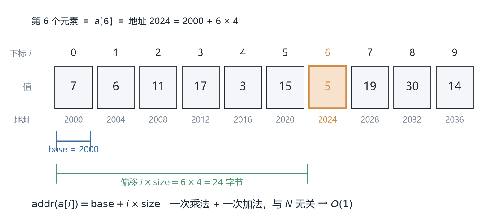
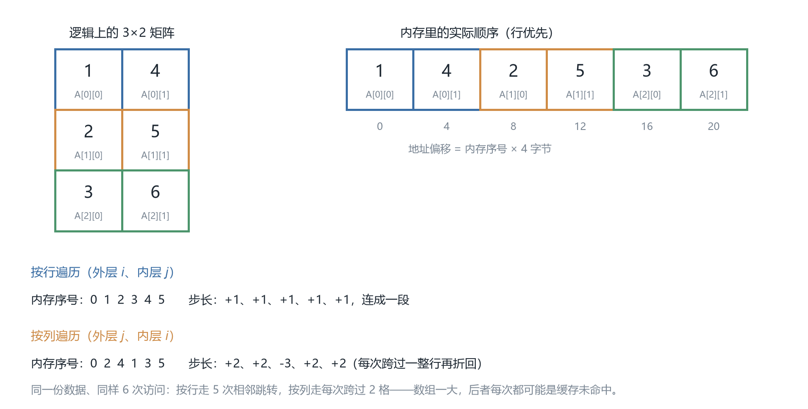
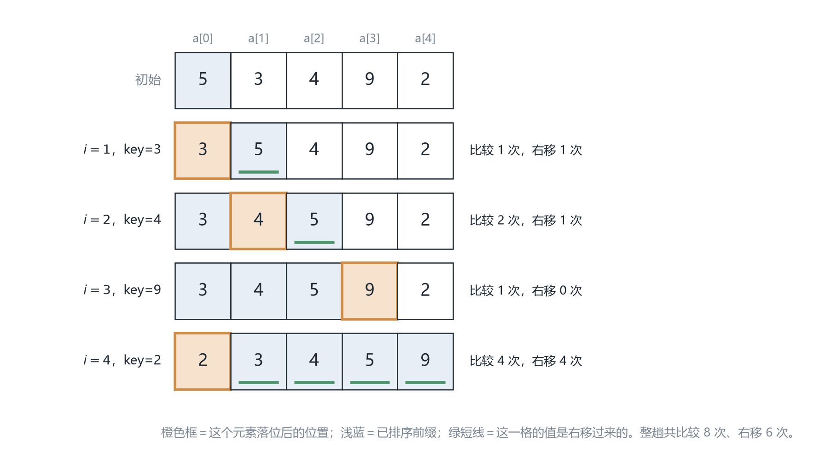
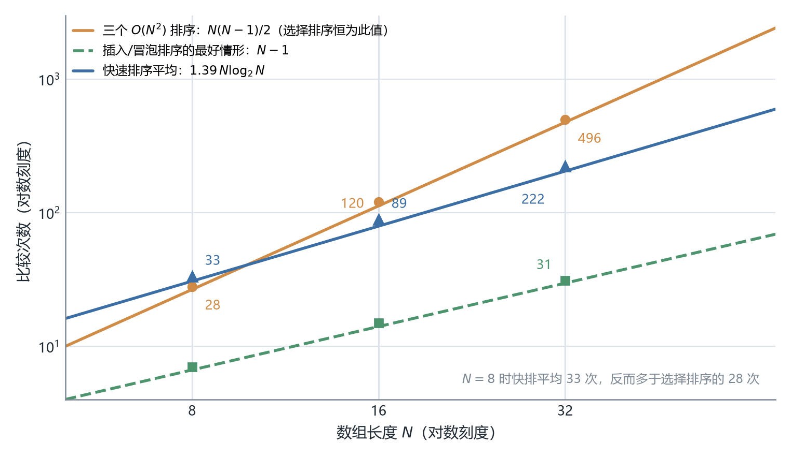

# CSC3100 Lecture 3 课堂笔记：Memory 与 Array

> 本讲内容完全来自课件 `lec3_array.pdf`（共 83 页），不含教师口述内容。课件分四块：内存基础（p.3-19）、数组（p.22-47）、例子（p.48-61）、四种排序（p.62-83）。课件有两处笔误（p.40 下标、p.70 循环上界），文末「诚实备注」逐条列出。正文标 **【补】** 的段落是课件没写、由我补充或复算的内容。
>
> **关于课件版本**：本讲在课程目录里有两份 PDF。`lec3_array.pdf`（Tianshu Yu，83 页）是完整版，**本文所有页码都指它**；`lecture 3 (arrays).pdf`（Li Jiang，31 页）是同一讲的精简版，其中 p.20-29 十页在导出时内容丢失（只剩页码），因此不能作为依据。对页码时请认准 83 页那一份。

## 0. 一句话概括本讲在讲什么

前两讲讲的是"数据结构能做什么"（ADT 的接口）。这一讲往下钻一层，回答两个问题：**数据在机器里到底怎么摆？**（内存模型、引用、栈与堆）以及**最基本的数据结构——数组——在这套内存模型下长什么样、怎么用、怎么排序？**

换句话说，本讲把抽象的 ADT 落到具体的地址上。理解这一层，后面讲链表时"数组插入为什么慢、链表为什么快"才有物理依据，而不是背结论。

## 1. 计算机内存的基础（p.3-19）

这一节回答一个很土但很关键的问题：一个 `int` 到底躺在哪儿、占几个格子、怎么找到它。

### 1.1 bit、byte、word（p.3）

内存最基本的单位叫**位**（bit），取值只能是 0 或 1。单个 bit 能表达的信息太少，所以现代架构里硬件直接操作的最小单位是**连续的八个 bit**，叫**字节**（byte）。

课件画了一张二进制可执行文件（binary executable file）的示意：一长串 `0101100110000100...`，下面标着 0、1、2、3——这些数字就是字节的编号。

比 byte 更大的是**字**（word），即"某个特定硬件上最常用的整数大小"。这里要注意课件的措辞：**word 的字节数、以及一个字内部字节的排列顺序，随机器架构而变**。这就是为什么一份二进制程序不能随便换平台跑——不只是指令不同，连"一个整数在内存里长什么样"都可能不同。这个事实是后面所有跨平台话题的根。

### 1.2 内存是一串带地址的字节（p.4）

课件给出内存的三个基本事实：

- 内存是**一串有序的字节序列**（an ordered sequence of bytes）；
- 每个位置都有**唯一的地址**（unique address）；
- **高级语言和低级语言的关键区别，就在于程序员是否要直接和内存寻址打交道。**

配的地址表是理解"地址"最好的入口：

| 内存地址（address） | 内存内容（content） | 含义 |
| --- | --- | --- |
| 2000 | `01000011` | 字符 `'C'` 的编码 |
| 2001 | `01110010` | 字符 `'r'` 的编码 |
| 2002 | `01100101` | 字符 `'e'` 的编码 |
| 2003 | `01110111` | 字符 `'w'` 的编码 |
| 2004 | `00000011` | 数字 3 的编码 |

这张表要读出三层意思：

- **地址逐字节递增**。所以"按顺序访问"在硬件层面就是"地址连续递增"，这是 §3 地址公式的伏笔。
- **字符和数字在机器里没有区别**，都是 8 个 bit。`'C'` 的 ASCII 码是 67，正好是 `01000011` 的十进制值（$64+2+1=67$）；"这段内存是什么类型"完全是程序赋予的解释，硬件不知道。
- **程序员不必管寻址**正是高级语言存在的意义：写 `String s = "Crew"`，编译器负责安排地址；写汇编，就得自己填 2000 这种数字。

### 1.3 进制转换与 $2^{10}$（p.5）

课件复习了二进制、八进制、十六进制的互转，核心技巧是**按组切割**：转八进制每 3 个 bit 一组，转十六进制每 4 个 bit 一组，从小数点向两侧分组，不足补零。

整数部分：

$$
(21)_{10} = (10101)_2
$$

验算：$16+4+1=21$。转八进制从右往左每 3 位分组，`10101` 补成 `010101`，得 `010` 和 `101`，即 $(25)_8$。转十六进制每 4 位分组，补成 `00010101`，得 `0001` 和 `0101`，即 $(15)_{16}$（`15` 是十六进制写法，读作"一五"，等于十进制的 21）。

小数部分：

$$
(0.65625)_{10} = (0.10101)_2
$$

验算：$0.5 + 0.125 + 0.03125 = 0.65625$，对应位权 $2^{-1}, 2^{-3}, 2^{-5}$，所以是 $0.10101$。同样分组：八进制得 $(0.101\;010)_2 = (0.52)_8$，十六进制得 $(0.1010\;1000)_2 = (0.\text{A}8)_{16}$（`1010` 是 A，`1000` 是 8）。

课件还给了一个"常用数"：$(10000000000)_2 = (1024)_{10}$，标注"约 1K"。数一下是 $2^{10} = 1024$。这就是内存容量都是 1024、2048、4096 的原因。记牢 $2^{10} \approx 10^3$，估算内存占用和复杂度时很好用。

### 1.4 进程内存布局（p.6-8）

一个进程拿到的是"一整条"地址空间，但内容是分区的。课件 p.6 画的是从低地址到高地址（LOW 在上、HIGH 在下）：

| 区域 | 内容 | 性质 |
| --- | --- | --- |
| code and static data | 代码与静态数据 | 程序启动时确定，运行期间不创建/销毁 |
| objects (heap) | 对象（堆） | 由程序员创建，向高地址增长 ↓ |
| （中间大片空白） | 栈与堆的缓冲地带 | — |
| local variables (stack) | 局部变量（栈） | 方法调用时分配，向低地址增长 ↑ |

p.7 说"如果你喜欢另一个方向"，展示了上下颠倒的版本，并给出更细的分区与权限：

| 分区 | 权限 | 谁来管 | 何时初始化 |
| --- | --- | --- | --- |
| Stack | writable; not executable | 编译器**自动**管理 | — |
| Dynamic Data (Heap) | writable; not executable | **程序员**自己管理 | — |
| Static Data | writable; not executable | — | 进程启动时 |
| Literals | read-only; not executable | — | 进程启动时 |
| Instructions | read-only; executable | — | 进程启动时 |

两个方向画的是同一件事，只是"高地址在上还是在下"的约定不同。真正要抓住的是三点：

- **栈和堆朝中间长。** 栈从高地址往下、堆从低地址往上，中间那块空白是两者共用的缓冲。递归太深或局部变量太大，栈指针会撞上堆——这就是**栈溢出**（stack overflow）的物理机制。
- **这是安全漏洞的根源。** `Instructions` 是 read-only 且 executable，`Stack/Heap` 是 writable 但 not executable，这个组合在防**缓冲区溢出攻击**：能往栈上写数据，至少不能让它执行。一块内存页同时"可写"又"可执行"，就是最危险的状态。
- **谁负责回收。** 栈由编译器自动管（方法返回就抹掉），堆由程序员管。Java 用垃圾回收（garbage collection）替程序员做这件事（见 1.7），C/C++ 得自己 `free`/`delete`——忘了就是内存泄漏（memory leak）。这就是课件 "Managed by programmer" 的分量。

### 1.5 分配时机与引用（p.9-11）

三块内存各自的分配时机，课件 p.9 讲得很清楚：

- **静态数据（static data）** 有专门的一块区域，程序运行期间**从不创建或销毁**，比如具名常量（named constants）。这也解释了 p.42 那句 remark：变量若是 `static`，它的值在所有使用处**共享**（`between all instances of the class`）——整个类只有一份静态存储。
- **创建新对象时，Java 从堆（heap）分配空间。**
- **调用方法时，Java 分配一块新内存叫栈帧（stack frame）**，放它的局部变量；**方法返回时栈帧就被抹掉**（erased）。

这里有个容易忽略的推论：栈帧的进出是严格后进先出（LIFO）的，方法返回时只移动一个指针就能整块释放，几乎零成本；堆的分配和回收要复杂得多——这正是"对象比基本类型重"的原因之一。

Java 怎么标识一个对象？**用它在内存里的地址，这个地址叫引用（reference）**（p.10）：

```java
Rational a = new Rational(1, 2);
```

执行这句时，Java 在堆里为新 `Rational` 对象分配空间（课件假设地址是 1000）；局部变量 `a` 分配在当前栈帧里，被赋予的值就是那个地址（1000）。注意措辞："局部变量 a 被赋予的值是**地址**"——`a` 存的不是分数 1/2，而是一个指向分数所在位置的数字。

p.11 给出 `Rational` 的完整源码（构造器、`add`、`multiply`、`divide`、`toString`，以及用欧几里得算法实现的私有 `gcd`）。关键是两个私有实例变量 `num`（分子）和 `den`（分母），以及：

```java
public Rational add(Rational r) {
    return new Rational(this.num * r.den + r.num * this.den,
                        this.den * r.den);
}
```

它做的是通分相加，注意它**不改动自己**，而是 `new` 一个新对象返回——这个"不改自己、造新对象"的设计，是下面"垃圾"问题的直接原因。

### 1.6 六帧追踪：Address Model 与 Pointer Model（p.12-18）

这是本讲最值得花时间的部分。课件用同一个 `run` 方法逐帧展示内存状态的变化：

```java
public void run() {
    Rational a = new Rational(1, 2);
    Rational b = new Rational(1, 3);
    Rational c = new Rational(1, 6);
    Rational sum = (a.add(b)).add(c);
}
```

课件用两套图讲同一件事，差别只在"写不写具体数字"：

| 画法 | 画的是什么 | 用在哪 |
| --- | --- | --- |
| Address Model（地址模型） | 箭头上直接标地址数字 | p.12-17，让你相信箭头有物理依据 |
| Pointer Model（指针模型） | 只画箭头，不写数字 | p.18，以后心里想的都是这个 |

地址模型下：堆里 a 在 1000（`num=1`、`den=2`）、b 在 1020、c 在 1040；栈上的局部变量在 FFB4、FFB8、FFBC、FFC0，分别存 1000、1020、1040。

六帧的变化可以压成一张表（地址全部来自课件图）：

| 帧（课件页） | 发生了什么 | 栈上的变量 | 堆上的对象 |
| --- | --- | --- | --- |
| p.12 | 三个 `new` 出来的对象与四个局部变量槽就位 | `a`=1000, `b`=1020, `c`=1040（FFB4/FFB8/FFBC） | 1000→1/2，1020→1/3，1040→1/6 |
| p.14 | 调用 `a.add(b)`，压入新栈帧 | 新帧里 `this`=1000、`r`=1020（`this` 在 FFA8） | 未变 |
| p.15 | 第一次 `add` 返回，造出新对象 | 返回值暂存 | 1060→$1/2+1/3=5/6$；a、b、c 都没被改 |
| p.16 | 调用 `.add(c)`，再压一帧 | `this`=1060（上一次的返回值）、`r`=1040 | 1080→$5/6+1/6=6/6=1$，即 `num=1, den=1` |
| p.17 | 栈帧弹出，`sum` 被赋值 | `sum`=1080 | 1000、1020、1040、1060、1080 都在 |
| p.18 | 换成 Pointer Model 重画 | 只有箭头 | 同上，数字省略 |

这段追踪里有三个细节：

- `this` 和 `a` 指向同一个对象，但是两个不同的变量，存在两个不同位置（`a` 在 FFB4，`this` 在 FFA8）。这是"实例方法能访问自己的字段"的实现方式：方法隐式拿到了调用者的引用。
- **原对象一个都没被修改**。`add` 只读字段，结果写在**新地址**上。
- 第二次 `add` 的接收者是上一次的返回值。括号决定了 `this`=1060，而不是 1000。

**为什么要走这么细？** 因为这整段追踪只是把两个抽象说法变成看得见的东西：一是"引用就是一个地址"，二是"方法调用会压栈帧、返回会弹栈帧"。课件后面所有的数组行为（传数组、传对象、返回数组）都能用这套图解释，不需要新概念。

### 1.7 垃圾与垃圾回收（p.19）

回到 p.19。刚才 `a.add(b)` 产生在 1060 的对象，在最终栈里**没有任何变量引用它**——它成了**垃圾**（garbage）。课件写得很精确："created in the intermediate step but not referenced by the final stack"。

内存不够时，Java 做**垃圾回收**（garbage collection），分两步：

1. **标记（Mark）**：标出所有被栈上变量或静态存储引用的对象——"从根可达"的思路，只有能从活变量走到的对象才算活；
2. **清扫（Sweep）**：遍历整个堆，回收所有没被标记的对象。

好处是程序员不用管释放；代价是回收发生时程序要暂停，内存占用会有波动。对比 C++ 的 `delete`：Java 用"可能停顿"换了"不会忘释放、也不会释放两次"。

## 2. Java 只有值传递（p.20、p.34-37）

这一节解决一个反复被问错的问题：方法里改了参数，为什么外面看不见？课件用四个例子给出同一个答案，值得一次性弄清楚。

先看最简单的（p.20）：

```java
public void run() {
    int x = 17;
    increment(x);
    System.out.println("x = " + x);   // 输出 x = 17
}
private void increment(int n) {
    n++;
    System.out.println("n = " + n);   // 输出 n = 18
}
```

方法里 `n` 变成 18，外面的 `x` 还是 17。课件给的原因："把基本类型的实参传给方法时，Java 把实参的**值复制**到形参变量里，因此对形参的修改对实参没有影响。"

用 §1.6 的栈帧图看就很自然：调用时在**新栈帧**里多出一个 `n`，值是 17 的**副本**；`n++` 改的是副本，方法返回时整个栈帧被抹掉，副本连同修改一起消失。

p.34 给出两个定义，这是本讲的术语基础：

- **值传递**（pass-by-value）：形参的值被**复制**到内存另一处；函数内访问或修改的只是副本，**对原值没有影响**；
- **引用传递**（pass-by-reference）：**内存地址**被传给函数，函数获得对**真实变量**的访问权。

p.35-37 用四个例子把区分讲透。它们看起来几乎一样，结论却分成两类。

例一：传 `int`（p.35 左）——`change(i)` 里 `i = 5`，输出仍是 `before change, i = 1` / `after change, i = 1`。就是上面的结论：改副本。

**例二：传对象引用，但在方法里重新赋值**（p.36）

```java
StringBuffer sb = new StringBuffer("Hello ");
change(sb);
// change 里：stringBuffer = new StringBuffer("Hi "); stringBuffer.append("World !");
```

输出 `before change, sb is Hello` / `after change, sb is Hello`——**没变**。机制比"传对象也是值传递"更精细：调用时把 `sb` 里的地址**复制**给 `stringBuffer`，两者同时指向 `"Hello"`；`stringBuffer = new StringBuffer("Hi ")` 让 `stringBuffer` 这个格子**改指向**新对象，但 `sb` 的格子没动。随后 `append` 确实把新对象改成了 `"Hi World !"`，可是外面看不到它。课件在那条指向 `"Hello"` 的箭头上画了红叉，强调"这条路被切断了"。

**例三：传对象引用，改对象的字段**（p.35 右）

```java
change(sb);   // change 里只有一句：stringBuffer.append("world !");
```

输出 `before change, sb is Hello` / `after change, sb is Hello world !`——**变了**。因为 `stringBuffer` 和 `sb` 指向同一个对象，`append` 是在那个对象**自己身上**改。

**例四：交换对象的经典陷阱**（p.37）

```java
public static void swap(MyClass obj_a, MyClass obj_b) {
    MyClass tmp = obj_a;
    obj_a = obj_b;
    obj_b = tmp;
}
```

调用 `swap(obj1, obj2)` 之后，`obj1` 还是 `x=1 y=2`、`obj2` 还是 `x=10 y=20`——**交换没有生效**。课件用四个阶段演示：`tmp` 先指向 `(1,2)`，`obj_a` 改指向 `(10,20)`，`obj_b` 改指向 `(1,2)`——**动的全是方法内部那三个格子**，外面 `obj1`、`obj2` 从头到尾没变。

同一页紧接着给了正确版本：不换引用，换字段。

```java
public static void swap(MyClass obj_a, MyClass obj_b) {
    int tmp = obj_a.x;
    obj_a.x = obj_b.x;
    obj_b.x = tmp;
    tmp = obj_a.y;
    obj_a.y = obj_b.y;
    obj_b.y = tmp;
}
```

这次输出 `obj1: x=10 y=20`、`obj2: x=1 y=2`。同一个"交换"需求，两种写法结论完全相反。

把四个例子并排看，结论就一句话：

> Java 永远是值传递。传对象时，被复制的是"引用这个值"。
>
> 能否影响调用者，只看你在方法里做了哪种操作：**修改对象内部状态**（`append`、`setX`、`array[i] = ...`）→ 调用者看得到；**让形参变量改指向新对象**（`形参 = new ...`）→ 看不到。

**和 §5.2 的呼应**：`swapElements(array, i, n-i-1)` 能生效，走的是例三（改对象内容）；`swapElements(array[i], array[n-i-1])` 不生效，走的是例一（传基本类型的值）；p.37 那个失败的 `swap` 走的是例二（改形参指向）。三页内容其实是一件事的三个面。

## 3. 数组的定义与地址公式（p.22-23）

数组是这一讲的主角。这一节先说清它"是什么"，再说明它为什么能 $O(1)$ 随机访问——后者才是它活到今天的理由。

### 3.1 定义与三个术语（p.22）

课件给了一大一小两个定义。

简明版：数组是**有序的值集合**（an ordered collection of values），两个限定词**有序**（ordered）和**定长**（fixed length），以及**同质**（homogeneous）——每个值类型必须相同。

完整版：数组是由元素集合构成的数据结构，每个元素由至少一个**下标**（index）或**键**（key）标识，而且**每个元素的内存位置都可以由它的下标元组（index tuple）算出来**。

最后这句是数组区别于链表的技术核心：数组能 $O(1)$ 随机访问，正是因为地址可以算；链表的地址算不出来，只能顺着指针走。

三个术语：

| 术语 | 含义 |
| --- | --- |
| 元素（element） | 数组里的单个值 |
| 长度（length） | 元素个数 |
| 下标（index） | 元素在数组中的位置；**Java 从 0 开始** |

### 3.2 地址公式：$O(1)$ 从哪来（p.23）

课件给了一个非常具体的例子：一个含 10 个 32 位（4 字节）整数的数组，下标 0 到 9，存放在 2000、2004、2008、…、2036（十六进制 `0x7D0, 0x7D4, 0x7D8, ..., 0x7F4`）。那么**下标为 $i$ 的元素，地址是**

$$
\text{address}(i) = 2000 + i \times 4
$$



*图 1　地址公式的几何含义：`base` 指向第 0 格，`i × size` 是跳过的字节数，两者相加就落在 `a[6]` 上。这 10 个值与 p.64 选择排序的例子用的是同一组。*

这个公式是数组的灵魂，它说明三件事：

- **为什么地址是 2004 而不是 2001？** 每个整数占 4 个字节，下标每加 1，地址要跳过 4 个字节——**步长等于元素大小**。
- **为什么叫常数时间？** 给定 $i$，算地址只需要一次乘法加一次加法，与数组多大无关。取第 100 个和第 1000 万个元素一样快。这就是"随机访问"（random access）这个名字的由来，也是数组相对链表唯一但巨大的优势。
- **成立的前提是什么？** **元素等大且首地址已知**。可变长的东西（比如长度不一的字符串）没法直接这么算，这解释了后面"数组存对象时存的是引用"的设计。

写成通用形式就是 $\text{addr}(a[i]) = \text{base} + i \times \text{size}$。这个式子后面会反复出现：凡是破坏"元素等大"的东西（变长对象、链表节点），都不能靠它定位。
## 4. 创建、初始化与遍历（p.24-29、p.38-39）

数组怎么造出来、造出来时格子里是什么、怎么一格一格走过去——这一节全是"用起来"的细节，坑也集中在这里。

### 4.1 声明、默认值与带名常量（p.24-27）

数组由**元素类型**和**长度**两个属性刻画，创建语法是：

```java
type[] identifier = new type[length];
```

初始化时 Java 会填**默认值**（default values），这组对应关系要背下来：

| 元素类型 | 默认值 |
| --- | --- |
| 数值类型（numerics） | `0`（浮点是 `0.0`） |
| 布尔类型（boolean） | `false` |
| 对象类型（objects） | `null` |

课件的例子是 `Student[] topStudents = new Student[5];`——元素可以是**任何 Java 类的对象**。但这里有个陷阱，p.57 的代码演示得很清楚：

```java
String[] myarray;                  // 只声明，没有大小
String[] strArray = new String[5]; // 声明并分配
// System.out.println(myarray[0]); // 报错：可能还没初始化
System.out.print(strArray[0] + " " + strArray[1] + " " + strArray[2]
                 + " " + strArray[3] + " " + strArray[4]);
```

输出是 `null null null null null`。两个坑：

- `String[] myarray;` **只是声明了一个引用变量，还没有任何数组对象**，此时用 `myarray[0]` 是**编译错误**（课件注释写的是"变量 myarray 可能尚未初始化"）——注意这和运行时错误不同。
- `new String[5]` 之后每个格子都是 `null`，可以打印，但对 `null` 调用方法（比如 `strArray[0].length()`）会抛 `NullPointerException`。

课件强调的好习惯：**用带名常量（named constant）声明长度**，或者从用户那里读入长度：

```java
private static final int N_JUDGES = 5;
double[] scores = new double[N_JUDGES];
```

好处是长度只写一次，要改时改一处；`N_JUDGES` 这个字面意思还让代码"自解释"。后面讨论插入和删除时反复围绕这个 `n` 做文章，就是这个习惯的延续。

### 4.2 两种遍历（p.28）

**用整数或表达式标识元素**：`array[index]`、`array[(a+b)/2]`——方括号里可以是任意整数表达式，印证了 §3.2 的"下标是个数就行"。

遍历（cycling through）有两种写法：

```java
for (int i = 0; i < array.length; i++) {
    // 操作第 i 个元素
}

for (int value : array) {
    // 操作 value
}
```

第二种是**增强 for 循环**（for-each）。p.51 有个完整例子（`int[] age = {12, 4, 5};` 依次打印 12、4、5）。要特别注意它的**限制**：`value` 是元素的**副本**，循环体内给 `value` 赋值**不会**改回数组；for-each 也不能倒序走，不能只遍历一部分。

所以两种写法各有场景：**只读遍历用 for-each**（更简洁、更不容易下标越界）；**需要下标、或需要写回时用经典 for 循环**。

### 4.3 下标从 0 还是从 1（p.29）

p.29 讨论了两种下标起点：

- **从 0 开始**：Java、Python、C/C++ ……；
- **从 1 开始**：Matlab、Julia、R ……；课件还指出"几乎所有面向数学（mathematics focused）的语言都用 1-based indexing"。

课件承认"从 0 开始编号不自然"（unnatural），并给出两种标准做法：

| 做法 | 代价 |
| --- | --- |
| 内部仍用 0 基下标，只在展示给用户时加 1 | 不浪费内存，但"入/出"处要转换，转换点一多就易错 |
| 使用 1 基下标，放弃每个数组的第 0 个元素 | 浪费一个格子，换来和数学公式对得上 |

这个权衡值得记住，因为它在实践中反复出现：需要频繁对照数学公式的实现，常用第二种；追求零浪费的底层容器，用第一种。

### 4.4 用下标当键：字母频率表（p.38）

p.38 给了一个漂亮的应用——**用下标本身承载信息**。统计一段文本里每个字母出现的次数，开一个 `letterCounts[]`，下标取字母到 `'A'` 的距离：

```java
index = Character.toUpperCase(ch) - 'A';
```

这样 `letterCounts[0]` 就是 `'A'`/`'a'` 的计数，`letterCounts[1]` 是 `'B'`/`'b'`，……，`letterCounts[25]` 是 `'Z'`/`'z'`。统计时只需 `letterCounts[index]++`，不用任何查找或判断链。

这个技巧的通用形式是**哈希/映射的退化版**：当键是一小段连续整数时，直接用数组当查找表（lookup table），比任何通用数据结构都快。`Character.toUpperCase(ch)` 先统一大小写，所以 `'a'` 和 `'A'` 会累加到同一格。

### 4.5 字面量初始化（p.39）

在声明的同时用花括号列出所有值，此时**不能**再写 `new`：

```java
int[] digits = {0, 1, 2, 3, 4, 5, 6, 7, 8, 9};

private static final String[] US_CITIES_OVER_ONE_MILLION = {
    "New York",
    "Los Angeles",
    "Chicago",
    "Huston",
    "Philadelphia",
    "Phoenix",
    "San Diego",
    "San Antonio",
    "Dallas",
};
```

数组长度由值的个数自动决定。顺带一提，课件里 `"Huston"` 是 `"Houston"`（休斯顿）的拼写错误（见文末诚实备注）。

## 5. 数组在堆里长什么样（p.30-33）

前面说"数组也是对象"，这一节把它拆开看：数组对象里除了元素还有什么，元素本身又存的是什么。

### 5.1 数组对象：一个长度槽加若干元素槽（p.30-31）

代码：

```java
Student[] topStudents = new Student[2];
topStudents[0] = new Student("Abcd", 314159);
```

堆里发生了什么：数组对象本身从地址 1000 开始，里面除了元素，**还有长度字段**。

| 地址 | 内容 | 含义 |
| --- | --- | --- |
| 1000—1004 | （对象头，图上未标内容） | 数组对象的元信息 |
| 1008 | `2` | `length` 字段 |
| 100C | `null` | `topStudents[0]`（赋值前） |
| 1010 | `null` | `topStudents[1]` |

栈上的变量 `topStudents`（在 FFB8）存的是 `1000`——数组对象在堆里的地址。**数组是堆上的对象，变量里存的是它的引用。**

p.31 是同一张图的续集，执行完 `topStudents[0] = new Student(...)` 之后：

| 地址 | 内容 | 含义 |
| --- | --- | --- |
| 1008 | `2` | 数组的 `length` |
| 100C | `1028` | `topStudents[0]`，指向 Student 对象 |
| 1010 | `null` | `topStudents[1]` 仍为空 |
| 101C | `4` | Student 内部 String 对象的 `length` |
| 1020 | `A` `b` | 字符 'A'、'b'（每字符 2 字节，Java String 是 UTF-16） |
| 1024 | `c` `d` | 字符 'c'、'd' |
| 1030 | `101C` | Student 的 `studentName` 字段，指向字符串对象 |
| 1034 | `314159` | Student 的 `studentID` |
| 1038 | `0.0` | Student 的 `creditsEarned` |
| 103C | `false` | Student 的 `paidUp` |

这张图信息量很大，能读出四点：

- 字符串 `"Abcd"` 自己也是个对象，有自己的长度字段（4）和字符存储，和 `Student` 对象分开存在不同地方——`studentName` 字段存的是它的地址 `101C`。这就是"字符串数组其实是字符串引用数组"的物理含义。
- `Student` 对象占 4 个字段：一个引用（`studentName`）+ 一个 `int`（`studentID`）+ 一个 `double`（`creditsEarned`）+ 一个 `boolean`（`paidUp`）。
- **数组元素是引用（每个 4 字节），不是完整的 Student 对象**。所以 `Student[2]` 这个数组对象很小，真正的"大块头"分散在堆各处，靠引用连起来。
- **和 §3.2 的整数数组对照**：整数数组里元素就是值本身（地址连续、步长固定），对象数组里存的是引用。这正好回到 §3.2 的结论——**要维持 $O(1)$ 地址计算，必须每格等大；对象大小不一，所以统一存等大的引用。**

### 5.2 传数组给方法：一切随引用（p.32-33）

p.32 直接点题："回想一下，把对象（引用）和基本类型（值）作为参数传递的区别。Java 把所有数组定义为对象，这意味着数组的元素在**被调用方和调用方之间是共享的**。"

于是课件给出一个经典对比：

```java
swapElements(array[i], array[n - i - 1]);   // 错的
swapElements(array, i, n - i - 1);          // 对的
```

第一行为什么错？`array[i]` 是**元素的值**（若元素是 `int`，那就是把 17 这样的数字复制进去），方法里怎么换都不影响原数组。第二行传的是 `array` 这个**引用**，方法里通过它访问真正的数组对象，改动才生效。

正确实现（p.33）：

```java
private void swapElements(int[] array, int p1, int p2) {
    int tmp = array[p1];
    array[p1] = array[p2];
    array[p2] = tmp;
}

private void reverseArray(int[] array) {
    for (int i = 0; i < array.length / 2; i++) {
        swapElements(array, i, array.length - i - 1);
    }
}
```

两点值得注意：

- `reverseArray` 的循环上界是 `array.length / 2`——只走一半，因为每轮交换处理了**两个**元素；写成 `array.length` 会把数组再翻回去（白做）。
- 课件特别提醒"**Java 里每个数组都有一个 length 字段**"，所以用 `array.length` 而不是传长度参数进来。这两个方法都声明为 `private`（对照 p.65 对 selection sort 的说明），因为它们是**辅助方法**（helper methods），用户不该直接调用。

## 6. 二维数组、三维数组与行主序（p.40-42、p.53-55）

一维数组是"一排格子"，二维数组听起来像"一张表格"，但 Java 的实现完全不是表格——它是"数组的数组"。这一节要讲清这个差别，以及它带来的性能后果。

### 6.1 数组的数组（p.40）

p.40 给出二维数组的本质定义：**数组的每个元素本身又是一个数组**（of the same dimension）。

```java
int[][] A = new int[3][2];
```

所以 `A` 是一个装着三个"维度为二的数组"的数组。课件列出的元素排布是：

| | 第 0 列 | 第 1 列 |
| --- | --- | --- |
| 第 0 行 | `A[0][0]` | `A[0][1]` |
| 第 1 行 | `A[1][0]` | `A[1][1]` |
| 第 2 行 | `A[2][0]` | `A[2][1]` |

（课件原文第 3 行第 2 列印成了 `A[2][0]`，是重复造成的笔误，见诚实备注第 1 条。）

### 6.2 行主序：为什么按行存、按列访问会慢（p.41）

p.41 的 "Memory allocation (row orientation)" 给出答案：`A[0][0]`、`A[0][1]`、`A[1][0]`、`A[1][1]`、`A[2][0]`、`A[2][1]` 依次排列——**先走完一行再换行**。这就是行优先（row-major）布局。

关键推论：按行遍历（外层 `i`、内层 `j`）比按列遍历快。原因不在算法，而在内存：

| 遍历方式 | 访问的内存序号 | 相邻两次的间距 |
| --- | --- | --- |
| 按行 | 0, 1, 2, 3, 4, 5 | 恒为 +1，整段连续 |
| 按列 | 0, 2, 4, 1, 3, 5 | +2、+2、−3、+2、+2，反复跳跃 |



*图 2　行主序的落位与两种遍历的内存轨迹。同一组数字，按行走 5 次相邻跳转，按列走每次跨过一整行；数组一大，后者的每次跳跃就是一次可能的缓存未命中。*

CPU 取数据是按**缓存行**（cache line，通常 64 字节）整块取的，不是按单个字节。数组一大，按行访问时取一次能把后面十几个元素一起带进来；按列访问时每次只用到一个元素，却把整行都搬进了缓存，等下一轮再用时早被挤出去了。图 2 的 3×2 只是把落位顺序摆出来；真正吃亏要等数组大到一列装不进一条缓存行。

### 6.3 锯齿数组与两种遍历（p.53-54）

"每个元素是一个数组"还解释了一个 Java 特有的能力：**每一行可以有不同长度**，这就是**锯齿数组**（jagged array）。

```java
int[][] a = {
    {1, -2, 3},
    {-4, -5, 6, 9},
    {7},
};
```

三行长度分别是 3、4、1。遍历时必须用 `a[i].length` 而不是统一的列数：

```java
for (int i = 0; i < a.length; ++i) {
    for (int j = 0; j < a[i].length; ++j) {
        System.out.println(a[i][j]);
    }
}
```

或者用嵌套 for-each：

```java
for (int[] innerArray : a) {
    for (int data : innerArray) {
        System.out.println(data);
    }
}
```

外层拿到的每个元素是 `int[]`（一行），内层再逐个取。两种写法输出都是 `1, -2, 3, -4, -5, 6, 9, 7`，按行优先顺序。

### 6.4 三维数组（p.55）

```java
int[][][] test = {
    {
        {1, -2, 3},
        {2, 3, 4},
    },
    {
        {-4, -5, 6, 9},
        {1},
        {2, 3}
    }
};
for (int[][] array2D : test) {
    for (int[] array1D : array2D) {
        for (int item : array1D) {
            System.out.println(item);
        }
    }
}
```

输出 `1 -2 3 2 3 4 -4 -5 6 9 1 2 3`。三层嵌套直接体现了"逐层展开"：`test` 的元素是 `int[][]`，`test[0]`、`test[1]` 各是一个二维数组；下一层每个元素是 `int[]`；最内层才是 `int`。内层长度各不相同（3、4、1、2），再次说明**锯齿**是天然支持的。看到 `int[][][]` 这种类型声明，从里往外读就清楚了：`int` → `int[]` → `int[][]` → `int[][][]`。

### 6.5 C 风格初始化与 static（p.42）

```java
static int A[3][2] = {
    {1, 4},
    {2, 5},
    {3, 6}
};
```

课件的 remark 是："如果一个变量是 `static`，它的值在所有使用处**共享**（即类的所有实例之间共享）。" 呼应 §1.5——`static` 的东西住在静态数据区，全类一份。

这个字面量看起来像**列优先**填的（先 1、4，再 2、5，再 3、6）。如果按行优先读，得到的是矩阵
$\begin{pmatrix} 1 & 4 \\ 2 & 5 \\ 3 & 6 \end{pmatrix}$，第一列是 1、2、3；如果按"每一行填一列"读，得到的是
$\begin{pmatrix} 1 & 2 & 3 \\ 4 & 5 & 6 \end{pmatrix}$。课件称它 "A 3-by-2 matrix"，按前者理解正好是 3 行 2 列，与声明 `[3][2]` 一致。

所以这个例子的重点其实是：**花括号里嵌套的每一组就是一行，与内存的行优先布局一致**；字形上像"竖着填"只是排版造成的错觉。

## 7. ArrayList（p.43）

原生数组定长，那"能自动变长"的数组在哪？Java 把它做成了一个类。

p.43 引入 `java.util` 包里的 `ArrayList`，它"提供标准的数组行为以及其它有用操作"。课件强调三点：

- `ArrayList` 是一个 **Java 类**，不是语言里的特殊语法（不像 `[]` 那样由语言直接支持）；
- 因此**所有操作都用方法调用**表示，而不是运算符；
- 具体操作：用构造器（constructor）创建；用 `size` 方法取元素个数；用 `get` 和 `set` 方法读写单个元素。

课件还贴了官方文档链接：`https://docs.oracle.com/javase/8/docs/api/java/util/ArrayList.html`。

这里最值得记住的是"**是一个类而不是特殊语法**"。`int[] a` 里的 `[]` 是语言层面的东西，`a.length` 甚至不是方法调用（是个字段，见 §5.1 图里的长度槽）；而 `ArrayList` 的一切都要通过方法。由此带来一好一坏：灵活（能自动扩容、能插删），但相对"重"（每次访问都要方法调用、元素必须是对象不能是基本类型）。

## 8. 数组上的操作：插入与删除（p.45-47）

有了"数组定长"这个前提，插入和删除的代价就注定了。这一节看清它到底贵在哪。

### 8.1 六类操作（p.45）

p.45 列出数组（以及未来的链表）共有的六类操作，这份清单是后面几讲的地图：

| 操作 | 含义 |
| --- | --- |
| 遍历（Traversal） | 处理每个元素 |
| 查找（Search） | 通过给定的下标或键找到元素 |
| 插入（Insertion） | 添加新元素 |
| 删除（Deletion） | 移除元素 |
| 排序（Sorting） | 按某种顺序排列元素 |
| 合并（Merging） | 把两个数组合并成一个 |

课件特意加了一句："这些操作在考虑'链表'（linked list）时也应该被考虑。" 这是本讲的伏笔——**同一份清单，在数组和链表上的代价完全不同**：数组的插入删除要挪元素（$O(N)$），链表改几个指针就行（$O(1)$，前提是已经拿到位置）；数组查找能 $O(1)$ 随机访问，链表只能 $O(N)$ 顺着走。第 1 讲的"没有万能数据结构"在这里得到具体注脚。

### 8.2 插入：必须新建数组（p.46）

p.46 的逻辑分四步：

- 如果数组**已满**，不丢失数据就**无法**插入；
- 我们想在某给定位置加一个元素；
- 所以**新建一个长度为 $N+1$ 的实例**来容纳插入；
- 然后课件反问一句："这个方法安全吗？"（Is this method safe?）

```java
public static int[] insertX(int n, int arr[], int x, int pos) {
    int i;
    int newarr[] = new int[n + 1];          // 新建 n+1 长度的数组
    for (i = 0; i < n + 1; i++) {
        if (i < pos - 1)
            newarr[i] = arr[i];              // pos 之前的元素原样搬
        else if (i == pos - 1)
            newarr[i] = x;                   // 在 pos 处放入 x
        else
            newarr[i] = arr[i - 1];          // pos 之后的元素往后挪一格
    }
    return newarr;
}
```

功能是：把 `x` 放到从 1 开始计数的第 `pos` 位（判据是 `i == pos - 1`）。`i < pos - 1` 时照抄，`i == pos - 1` 时写 `x`，之后从 `arr[i-1]` 取值，相当于把原数组后半段整体右移一格。

"这个方法安全吗？"答案是：不安全。【补】课件没有展开，但至少有三类问题：

- 参数 `n` 与 `arr.length` 可能不一致。若传进来的 `n` 比实际长度大，循环里 `arr[i]` 或 `arr[i-1]` 就会越界（`ArrayIndexOutOfBoundsException`）。
- `pos` 没有做范围校验。`pos = 0` 时 `pos - 1 = -1`，所有 `i` 都走 `else` 分支去读 `arr[i-1]`，其中 `i = 0` 时读 `arr[-1]`，直接抛异常；`pos > n+1` 时永远进不了第二个分支，`x` 会被**静默丢弃**。
- **长度信息丢失**。返回的数组长度是 `n+1`，调用者再拿别的 `n` 来调用就彻底错位。

更稳妥的写法是用 `arr.length` 取代 `n`，并对 `pos` 做检查或直接用 `Math.min/Math.max` 夹住。

**为什么插入这么麻烦？** 因为数组定长（§3.1）。要在中间腾出一个位置，后面的元素必须整体让位，代价 $O(N)$。这正是链表存在的动机。

### 8.3 删除：同样要新建数组（p.47）

p.47 与插入对称：

```java
public static int[] removeTheElement(int[] arr, int index) {
    if (arr == null || index < 0 || index >= arr.length) {
        return arr;                        // 防御性检查：原样返回
    }
    int[] anotherArray = new int[arr.length - 1];
    for (int i = 0, k = 0; i < arr.length; i++) {
        if (i == index) {
            continue;                      // 跳过要删的元素
        }
        anotherArray[k++] = arr[i];
    }
    return anotherArray;
}
```

这段比插入版本**安全**，因为它做了**防御性检查**（defensive check）：数组为 `null`、下标为负、下标越界三种情况都提前返回原数组，不会抛异常。循环用双指针 `i`（读原数组）和 `k`（写新数组），遇到目标下标就 `continue` 跳过，其余依次拷入。课件开头两句说的正是前提："空数组无法删除任何数据"、"我们想删除任意下标上的元素"。

同样的问题仍在：**返回的是一个新数组，原数组没有变**。调用者若不接收返回值，什么都不会发生。这也是数组"删除慢"（$O(N)$）的原因——必须整段拷贝。

## 9. 例：数组的六个练习（p.48-52、p.56-61）

这一节是课件的 "Examples"，六个小例子覆盖了数组最常用的动作：比相等、返回数组、求和、处理字符串、末尾追加、查找与排序。每个例子里都藏着一个 Java 特有的坑。

### 9.1 相等性：为什么不能写 `a == b`（p.48-49）

p.49 的原话：

> 要判断两个数组是否相等，你需要**自己定义**一个 `equals` 方法，当且仅当两个数组**长度相同、且所有对应位置的值都相等**时返回 `true`。下面这段代码适用于基本类型。

```java
public static boolean equals(int[] a, int[] b) {
    boolean match = false;
    if (a.length == b.length) {
        match = true;           // 暂时假定相等（tentatively）
        int i = 0;
        while (match && (i < a.length)) {
            if (a[i] != b[i])
                match = false;
            i++;
        }
    }
    return match;
}
```

三个设计点都值得学：

- **为什么需要自定义？** 因为 Java 里对数组用 `==` 比的是**引用**（是不是同一个数组对象），不是内容。两个内容完全相同的数组 `==` 会返回 `false`。
- `match` 的初值是 `false`，只有长度相等时才被置为 `true`——"暂时假定相等，找出反例就推翻"，比先假设不相等再去证实更简洁。
- `while (match && ...)` 的短路求值（short-circuit）是关键：`match` 一旦变 `false` 循环立刻退出，不必走完剩下的元素。这种"提前失败"（early exit）能让平均情况快很多。

课件那句"适用于基本类型"是个提醒：元素是**对象**时必须用 `a[i].equals(b[i])`，因为 `!=` 对引用比的又是地址。这正好呼应 §5.1——对象数组里存的是引用。

【补】另一个未覆盖的边界：代码直接访问 `a.length` 和 `b.length`，任一为 `null` 会抛 `NullPointerException`。

### 9.2 返回数组：`vowels()`（p.50）

```java
public class returnArrayDemo {
    public static void main(String arg[]) {
        char[] c;
        c = vowels();
        for (int i = 0; i < c.length; i++)
            System.out.println(c[i]);
    }
    public static char[] vowels() {
        char[] newArray = new char[5];
        newArray[0] = 'a';
        newArray[1] = 'e';
        newArray[2] = 'i';
        newArray[3] = 'o';
        newArray[4] = 'u';
        return newArray;
    }
}
```

课件的两条注解点出了本质："**传的是数组的地址**"，"方法内部的局部数组名只是原数组的**另一个名字**"。也就是说 `c` 和 `newArray` 是同一个数组对象的两个引用（同 §1.6 里 `a` 和 `this` 的关系）。它还强调 `c`、`newArray` 和 `vowels` 的返回类型**三者类型相同**，都是 `char[]`。

把 §8.2、§8.3 和这里连起来看，可以总结出数组方法的**两种契约**：

| 方法签名 | 契约 | 例子 |
| --- | --- | --- |
| 返回类型是数组 | 造新数组并返回，**不改原数组** | `insertX`、`removeTheElement`、`vowels` |
| 返回 `void`、参数是数组 | **就地修改**传入的数组 | `swapElements`、`reverseArray` |

混用这两种契约是 bug 的常见来源（比如调了 `removeTheElement` 却不用返回值）。

### 9.3 遍历求和：整数除法陷阱（p.52）

```java
int[] numbers = {2, -9, 0, 5, 12, -25, 22, 9, 8, 12};
int sum = 0;
for (int number : numbers) {
    sum += number;
}
int arrayLength = numbers.length;
average = ((double) sum / (double) arrayLength);
```

输出 `Sum = 36`、`Average = 3.6`。

这两个数可以独立复算作为核验：$2 - 9 + 0 + 5 + 12 - 25 + 22 + 9 + 8 + 12$。正项分组加：$2+5=7$，$7+12=19$，$19+22=41$，$41+9=50$，$50+8=58$，$58+12=70$；负项 $-9-25=-34$；$70-34=36$ ✓。元素个数 10，$36/10=3.6$ ✓。

最值得注意的是那两处**强制类型转换**（type cast）：`((double) sum / (double) arrayLength)`。不转的话 `36 / 10` 是整数除法，结果是 `3`（小数部分直接丢弃，不是四舍五入），与预期严重不符。这是 Java 新手最经典的陷阱之一。

### 9.4 字符串数组（p.56-57）

p.56 的两句话：

> 字符串数组是**持有固定数量字符串**的数组，是 Java 里常用的一种结构——连 Java `main` 函数的参数都是一个字符串数组：`public static void main(String args[])`。
>
> **字符串数组是 String 对象的数组**（an array of String objects）——**每个字符串都是一个对象！**

第二句是重点，可以回到 §5.1 的 p.31 图验证：`"Abcd"` 在堆里有自己的长度字段和字符存储，`studentName` 存的是它的地址。所以 `String[]` 里的每个格子都是一个**引用**，指向堆里另一个对象。

若某个格子是 `null`（p.57 的 `null null null null null`），对它调用 `length()` 或 `charAt()` 就会抛异常——这也是 `main` 的 `args` 为空时不能直接访问 `args[0]` 的原因。

### 9.5 末尾追加：三步，$O(N)$（p.58）

```java
String[] colorsArray = {"Red", "Green", "Blue" };
int orig_length = colorsArray.length;
String newElement = "Orange";
String[] newArray = new String[orig_length + 1];   // 长度多 1
for (int i = 0; i < colorsArray.length; i++) {
    newArray[i] = colorsArray[i];                  // 拷贝全部原元素
}
newArray[newArray.length - 1] = newElement;        // 放末尾
colorsArray = newArray;                            // 让原变量指向新数组
```

输出 `Array after adding new item: [Red, Green, Blue, Orange]`。

这个例子把 §8.2 的插入简化成"只在末尾追加"，代价仍是一次完整拷贝。最后那行 `colorsArray = newArray` 特别值得琢磨：它让 `colorsArray` 这个变量**改指向**新数组，旧数组从此没人引用，成了垃圾（回看 §1.7）。所以"往数组里加元素"实际上是"**新建 + 拷贝 + 改指向**"三步，$O(N)$。

### 9.6 线性查找与 `Arrays.sort`（p.59-61）

**查找**（p.60）：

```java
String[] strArray = { "Book", "Pencil", "Eraser", "Color", "Pen" };
String searchStr = "Pen";
for (int i = 0; i < strArray.length; i++) {
    if (searchStr.equals(strArray[i])) {
        index = i;
        found = true;
        break;
    }
}
```

输出 `Pen found at the index 4`。这是**线性查找**（linear search）的模板：用 `found` 标志位记录是否命中，用 `break` 提前退出。下标计数也印证了 §3.1 的"Java 下标从 0 开始"：`"Pen"` 排第五个，下标是 4。

注意用的是 `searchStr.equals(strArray[i])` 而不是 `==`。对字符串来说 `==` 比的是**引用**，内容相同但不同对象会返回 `false`；判断内容必须用 `equals`。这与 §9.1 数组比较同源。

**排序**（p.59）：

```java
String[] colors = {"red", "green", "blue", "white", "orange"};
System.out.println("Original array: " + Arrays.toString(colors));
Arrays.sort(colors);
System.out.println("Sorted array: " + Arrays.toString(colors));
```

输出：

```
Original array: [red, green, blue, white, orange]
Sorted array: [blue, green, orange, red, white]
```

`java.util.Arrays` 是**工具类**（utility class），提供 `sort`、`toString` 等静态方法；它**就地排序**（in-place），直接改传入的数组而不返回新数组（与 §9.2 的"返回 `void` 且参数是数组 → 改原来的"契约一致）。输出按字典序（lexicographic）比较小写字符串，`blue < green < orange < red < white`，与字母顺序一致。

顺带一提，`Arrays.toString` 还有另一个用途：直接用 `System.out.println(数组)` 只会打印 `[I@1b6d3586` 这种"类型@哈希码"，看不出内容；要打印内容必须用 `Arrays.toString`（一维）或 `Arrays.deepToString`（多维）。这与 §9.1 "数组不比内容"是同一个根源。

至于 `Arrays` 内部用的什么算法、为什么字符串排序和数字排序实现不同（分别用 `ComparableTimSort` 和 `DualPivotQuicksort`），是后面课程的内容，这里不用深究。

**字符串数组转整数数组**（p.61）：

```java
String [] str_Array = {"10", "20", "30", "40", "50"};
int [] int_Array = new int[str_Array.length];
for (int i = 0; i < str_Array.length; i++) {
    int_Array[i] = Integer.parseInt(str_Array[i]);
}
System.out.println(Arrays.toString(int_Array));
```

输出 `[10, 20, 30, 40, 50]`。`Integer.parseInt` 把字符串解析成 `int`，是读入数据时最常见的转换。
## 10. 排序总览（p.62、p.83）

这一节先给"为什么排序"和"四种算法各是什么性格"的全景，具体算法从 §11 开始。

p.62 开场："排序一个元素列表，和查找一个列表一样，是非常常见的问题。" 课件列出的典型需求：

- 数字按升序（ascending）排；
- 数字按降序（descending）排；
- 字符串按字母顺序（alphabetic）排；
- 等等。

课件指出"就像查找一个列表有很多方法一样，排序一个列表也有很多方法"，本讲讲四种：

| 算法 | 一句话 | 复杂度 |
| --- | --- | --- |
| 选择排序（selection sort） | 每轮找最小值换到前面 | $O(N^2)$ |
| 插入排序（insertion sort） | 把当前元素插进已排序部分 | $O(N^2)$，最好 $O(N)$ |
| 冒泡排序（bubble sort） | 相邻比较，最大值沉底 | $O(N^2)$ |
| 快速排序（quicksort） | 选 pivot 划分，递归两边 | 平均 $O(N\log N)$，最坏 $O(N^2)$ |

p.83（课件最后一页）给了这段内容的总结与一句警句：

- **易于理解的算法**：效率不高，但**更不容易出错**，**写代码、测试、调试花的时间更少**；选择、插入、冒泡属此类；其中**冒泡排序最容易实现**；
- **复杂但更高效**：当性能是主要问题时有用；
- 引语："得到错误的结果永远都是低效的。"（"Getting the wrong result is always inefficient."）

最后这句是整讲的价值观：一个 $O(N\log N)$ 但写错了的算法，不如一个 $O(N^2)$ 但正确、能很快写完的算法。选择算法时要权衡"效率"和"实现的正确性成本"，不能只盯着大 $O$。

## 11. 选择排序（p.63-67）

这一节要弄清两件事：它每轮到底做了什么，以及为什么它的比较次数**和输入长什么样完全无关**。

**算法描述**（p.63），对整数数组按升序排列：

1. 找出最小的数，记下它的下标；
2. 把最小的数与数组第一个元素**交换**（swap）；此时**已排序部分**是第一个元素，**未排序部分**是剩下的元素；
3. 重复第 2、3 步直到所有元素就位；每一轮迭代让已排序部分的长度增加 1。

p.64 给了完整执行示例。原数组（10 个元素）：

| 下标 | a[0] | a[1] | a[2] | a[3] | a[4] | a[5] | a[6] | a[7] | a[8] | a[9] |
| --- | --- | --- | --- | --- | --- | --- | --- | --- | --- | --- |
| 值 | 7 | 6 | 11 | 17 | 3 | 15 | 5 | 19 | 30 | 14 |

**第一轮**：最小的是 3，下标 4，交换 `a[0]` 与 `a[4]`。

| 阶段 | 数组 |
| --- | --- |
| before | 7, 6, 11, 17, **3**, 15, 5, 19, 30, 14 |
| after | **3**, 6, 11, 17, **7**, 15, 5, 19, 30, 14 |

**第二轮**：在**剩余部分**（下标 1 以后）里最小的是 5，下标 6，交换 `a[1]` 与 `a[6]`。

| 阶段 | 数组 |
| --- | --- |
| before | 3, 6, 11, 17, 7, 15, **5**, 19, 30, 14 |
| after | 3, **5**, 11, 17, 7, 15, **6**, 19, 30, 14 |

现在前两位已就位。课件在这一页末尾抛出一个问题："**需要多少轮迭代？**"（How many iterations are needed?）

【补】自己接着往下推作为核对：

| 轮次 | 在 a[k..9] 中的最小值（下标） | 交换后 |
| --- | --- | --- |
| 第 3 轮 | 6（下标 6） | 3 5 6 17 7 15 11 19 30 14 |
| 第 4 轮 | 7（下标 4） | 3 5 6 7 17 15 11 19 30 14 |
| 第 5 轮 | 11（下标 6） | 3 5 6 7 11 15 17 19 30 14 |
| 第 6 轮 | 14（下标 9） | 3 5 6 7 11 14 17 19 30 15 |
| 第 7 轮 | 15（下标 9） | 3 5 6 7 11 14 15 19 30 17 |
| 第 8 轮 | 17（下标 9） | 3 5 6 7 11 14 15 17 30 19 |
| 第 9 轮 | 19（下标 9） | 3 5 6 7 11 14 15 17 19 30 |

**答案是 9 轮**（下标 0 到 8）。第 10 个位置不用管——当 9 个位置都对时，最后一个必然就位。这就是代码里 `index < a.length - 1` 这个上界（而不是 `a.length`）的来历。

**代码**（p.66）。课件先给了前置条件注释，这是一份很规范的文档：

```java
/**************************************************
 *Precondition:
 *Every indexed variable of the array a has a value.
 *Action: Sorts the array a so that
 *a[0] <= a[1] <= ... <= a[a.length - 1].
 **************************************************/
public static void sort(int[] a) {
    int index, indexOfNextSmallest;
    for (index = 0; index < a.length - 1; index++) {
        // Place the correct value in a[index]:
        indexOfNextSmallest = indexOfSmallest(index, a);
        interchange(index, indexOfNextSmallest, a);
        // a[0] <= a[1] <= ... <= a[index] and these are
        // the smallest of the original array elements.
        // The remaining positions contain the rest of
        // the original array elements.
    }
}
```

注释比代码本身更值得学：

- **前置条件**明确写出"数组每个有下标的变量都有值"（也就是**没有空位**）。
- **动作说明**写成不等式链 `a[0] <= a[1] <= ... <= a[a.length - 1]`——注意用的是 `<=` 而不是 `<`，相当于承认"**可能有重复值**"（duplicate values）。
- 循环内部那两段注释是**循环不变式**（loop invariant）的自然语言表述："`a[0] <= ... <= a[index]`，且这些元素是原数组中最小的那些；剩余位置装着原数组其余的元素。" 注意"**原**数组中最小的那些"这个限定词——它保证了已放到前面的元素**永远不会再被移动**，所以算法能终止且正确。

p.65 点出这段代码的两个设计要点：一是把问题**拆成更小的任务**（"找出最小值的下标"和"交换两个元素"）；二是这两个辅助方法声明为 `private`，因为它们是**辅助方法**，用户不该直接调用。这种"主方法保持干净、细节下沉到私有辅助方法"的组织方式，在写长代码时非常有用。

p.67 把实现留作练习："为 `indexOfSmallest` 和 `interchange` 写 Java 代码"，并提问"**大 O 复杂度是多少？**"

【补】课件未给这两段实现，以下是补充：

```java
private static int indexOfSmallest(int startIndex, int[] a) {
    int minIndex = startIndex;
    for (int i = startIndex + 1; i < a.length; i++) {
        if (a[i] < a[minIndex]) {
            minIndex = i;
        }
    }
    return minIndex;
}

private static void interchange(int i, int j, int[] a) {
    int temp = a[i];
    a[i] = a[j];
    a[j] = temp;
}
```

注意 `indexOfSmallest` 的搜索范围是 `startIndex + 1` 到末尾——`a[startIndex]` 已经是最小值的初始候选，不必和自己比；这个细节能省掉约 $N$ 次比较。

**复杂度分析【补】。** 外层循环执行 $N-1$ 次。第 $k$ 轮（$k$ 从 0 开始）中，`indexOfSmallest` 要在 $N-k$ 个元素里找最小，比较次数是 $N-k-1$。总比较次数：

$$
\sum_{k=0}^{N-2} (N - k - 1) = (N-1) + (N-2) + \cdots + 1 = \frac{N(N-1)}{2} = \frac{N^2 - N}{2}
$$

这是 $O(N^2)$ 的。交换次数最多 $N-1$ 次，是 $O(N)$；但比较项主导，整体仍是 $O(N^2)$。

选择排序有一个在**交换代价很高**时很有用的性质：**不管输入长什么样，交换次数都是 $O(N)$**（每轮至多一次）。相比之下冒泡排序的交换次数会到 $O(N^2)$。所以如果"写内存"比"读内存"昂贵得多（比如元素是很大的对象），选择排序就比冒泡有优势。但它**不具适应性**（not adaptive）——**已经排好的数组照样要花 $\frac{N(N-1)}{2}$ 次比较**，这是它的主要缺点。

## 12. 插入排序（p.68-70）

这一节的重点不是"怎么插"，而是"**什么时候可以停**"——那个提前停下的判断，决定了它在近乎有序的数据上快到 $O(N)$。

**基本思想**（p.68）：

- 不断把**已排序部分**扩展一个元素；
- 把下一个元素**插入**到已排序部分中正确的位置。

**算法**：

1. 从**一个元素**开始（问一句：它算排好了吗？）——这就是已排序部分；
2. 当已排序部分还不是整个数组时：
   1. 在已排序部分里为下一个元素找到正确的位置；
   2. 插入这个元素；
   3. 如有必要，把其它元素往后移；
   4. 把已排序部分的长度加一。

课件在这一页直接给出复杂度：$O(N^2)$。

p.69 用 `[5, 3, 4, 9, 2]` 演示，方括号表示已排序部分：

| 轮次 | 之前（Before） | 之后（After） |
| --- | --- | --- |
| 第 1 轮 | `[5], 3, 4, 9, 2` | `[3, 5], 4, 9, 2` |
| 第 2 轮 | `[3, 5], 4, 9, 2` | `[3, 4, 5], 9, 2` |
| 第 3 轮 | `[3, 4, 5], 9, 2` | `[3, 4, 5, 9], 2` |
| 第 4 轮 | `[3, 4, 5, 9], 2` | `[2, 3, 4, 5, 9]` |



*图 3　插入排序的逐帧状态（由脚本模拟生成，不是手绘）：浅蓝是已排序前缀，橙框是 key 落位后的位置，绿短线是"这一格的值是右移过来的"。整趟比较 8 次、右移 6 次。*

看第一轮：初始 `[5]`（单元素天然有序），把 3 插进来，因为 $3 < 5$，5 需要往右挪一格，得 `[3, 5]`。第三轮把 9 插进 `[3, 4, 5]`：因为 $9 > 5$，不需要挪任何元素，直接在末尾接上——**这就是插入排序的适应性**。第四轮最费劲：2 比已排序部分所有元素都小，得从右往左一路比较、把 3、4、5、9 全部右移一格，2 才能落到最前面。

**和选择排序的关键区别**：选择排序每轮都要**扫完整个未排序部分**才动手；插入排序每轮只需要"从右往左找位置"，**一旦发现前一个元素已经比待插元素小就立刻停止**。所以：

- **最好情况**（数组已排好）：每轮只比较 1 次就停，总共 $N-1$ 次比较，$O(N)$——它是**自适应**（adaptive）的；
- **最坏情况**（数组完全逆序）：每轮都要走到最左边，总数 $\frac{N(N-1)}{2}$，$O(N^2)$；
- **平均情况**：约为 $\frac{N^2}{4}$，$O(N^2)$ 但常数比选择排序小一半。

这个"最好 $O(N)$"的性质让插入排序在**接近有序的小数组**上非常实用——这也是为什么真实的排序库（比如 Java 的 TimSort）在划分到很短的小段时会**切换成插入排序**来收尾。

p.70 给了一个很有意思的思考题：

> 回想一下上一讲的 `insert` 函数。你能通过修改那个函数来实现 `insertSort` 吗？（不创建新实例）

它贴出的代码是 §8.2 那个 `insertX` 的变体：

```java
public static int[] insertX(int n, int arr[], int x, int pos) {
    int i;
    int newarr[] = new int[n + 1];
    for (i = 0; i < n - 1; i++) {
        if (i < pos - 1)
            newarr[i] = arr[i];
        else if (i == pos - 1)
            newarr[i] = x;
        else
            newarr[i] = arr[i - 1];
    }
    return newarr;
}
```

**先指出一个问题**：这个变体的循环上界 `i < n - 1` 是错的。§8.2 的原版是 `i < n + 1`，而 `newarr` 的长度是 `n + 1`；改成 `i < n - 1` 之后只能填到下标 `n - 2`，`newarr` 的**最后两个格子永远填不上**（保持默认值 0），同时 `arr` 的末尾元素也漏掉了。这应该是课件编辑时的笔误（见诚实备注第 3 条）。

"不创建新实例"怎么实现？这正是插入排序的实现要点：既然仍要在**同一个数组**里插入，就必须从**末位开始**搬（从右往左），否则会覆盖还没处理的数据。核心片段【补】：

```java
private static void insertSort(int[] a) {
    for (int i = 1; i < a.length; i++) {
        int key = a[i];          // 暂存当前要插入的元素
        int j = i - 1;
        while (j >= 0 && a[j] > key) {
            a[j + 1] = a[j];     // 比 key 大的元素整体右移一格
            j--;
        }
        a[j + 1] = key;          // key 落到它该在的位置
    }
}
```

关键是两点：

- `int key = a[i]` **先把值存在变量里**，否则 `a[j+1] = a[j]` 会把它盖掉；
- `while (j >= 0 && a[j] > key)` 这个**从右往左、边走边挪**的循环，遇到不大于 key 的元素立刻停。

与 §8.2 的 `insertX` 相比，这里没了"新建数组 + 整段拷贝"，代价从"每次插入 $O(N)$ 且额外 $O(N)$ 空间"降到"每次插入 $O(N)$ 时间、$O(1)$ 额外空间"。这就是"就地（in-place）"的价值。

## 13. 冒泡排序（p.71-72）

这一节看清冒泡的"慢"是怎么来的：它每轮只把一个最大值推到末尾，却为此做了一整轮相邻交换。

**基本思想**（p.71）：

- 一个一个地扩大已排序部分；
- 在比较**相邻元素**之后，把最大的元素**沉到底部**（sink the largest element to the bottom）；
- 较小的元素往上**冒泡**（bubble up）。

**算法**：

- 当未排序部分还有超过一个元素时：
  - 比较相邻元素；
  - 如果次序不对就交换；
  - 最大的元素沉到底部，把未排序部分缩小一个。

复杂度：$O(N^2)$。

p.72 用同一个 `[5, 3, 4, 9, 2]` 演示，方括号标出**本轮正在比较的一对**：

| 轮次 | 步骤 | 状态 | 说明 |
| --- | --- | --- | --- |
| 第 1 轮 | 初始 | `[5, 3], 4, 9, 2` | 5 > 3，交换 |
| 第 1 轮 | 1 | `3, [5, 4], 9, 2` | 5 > 4，交换 |
| 第 1 轮 | 2 | `3, 4, [5, 9], 2` | 5 < 9，不交换 |
| 第 1 轮 | 3 | `3, 4, 5, [9, 2]` | 9 > 2，交换 → 第一轮结束 `3, 4, 5, 2, 9` |
| 第 2 轮 | 初始 | `[3, 4], 5, 2, 9` | 3 < 4，不交换 |
| 第 2 轮 | 1 | `3, [4, 5], 2, 9` | 4 < 5，不交换 |
| 第 2 轮 | 2 | `3, 4, [5, 2], 9` | 5 > 2，交换 → 第二轮结束 `3, 4, 2, 5, 9` |
| 第 3 轮 | 初始 | `[3, 4], 2, 5, 9` | 3 < 4，不交换 |
| 第 3 轮 | 1 | `3, [4, 2], 5, 9` | 4 > 2，交换 → 第三轮结束 `3, 2, 4, 5, 9` |
| 第 4 轮 | 初始 | `[3, 2], 4, 5, 9` | 3 > 2，交换 → `2, 3, 4, 5, 9` |

**从例子能读出三件事。**

- **每一轮至少把当时未排序部分的最大值送到末尾**，所以第 $k$ 轮之后末尾 $k$ 个元素已经确定，不需再比——这就是内层循环上界逐轮缩小一格的原因。由此得到总比较次数 $(N-1)+(N-2)+\cdots+1 = \frac{N(N-1)}{2}$，$O(N^2)$。
- "整轮无交换"可以提前退出（【补】，课件未提）。第二轮、第三轮里出现了连续的"不交换"；如果某一整轮一次交换都没发生，说明数组已经有序，可以直接跳出。这个优化让冒泡在最好情况（已有序）下达到 $O(N)$，和插入排序一样是自适应的。
- **把冒泡和插入并排看很有意思**：两者都在"扩大已排序部分"，但**插入排序是拿一个元素去和已排序部分比（可能一次比较就停）**，而**冒泡排序是反复比较相邻元素、让较大的值一步步右移**——所以冒泡的交换次数远多于插入排序（最坏 $\frac{N(N-1)}{2}$ 次），实际中更慢。

p.83 说"冒泡排序最容易实现"，是因为它的双层循环和"相邻比较、逆序则交换"几乎是逐字翻译算法描述，不容易写错。这也呼应了 §10 的价值观：**实现成本也是成本**。

## 14. 快速排序（p.73-82）

这一节是整讲的顶点。要理解它为什么"实践中最快"，也要理解它为什么"最难写对"——这两件事其实是同一个原因：划分的方式决定了全部。

p.73 给出总体定位：

- **实践中最快的已知排序算法**（The fastest known sorting algorithm in practice）；
- **平均情况 $O(N\log N)$**（课件注明"我们不证明它"）；
- **最坏情况 $O(N^2)$**，但"最坏情况**很少发生**"（the worst case seldom happens）；
- 是一个**分治**（divide-and-conquer）**递归**（recursive）算法；
- 课件说明"我们会在本课程后面更多地讨论递归"。

### 14.1 分治框架（p.74）

三步：

**分（Divide）**：在 $S$ 中任选一个元素作为**枢纽元**（pivot）$v$；把 $S - \{v\}$（去掉 $v$ 后剩下的元素）**划分**（partition）成两个不相交（disjoint）的组：

$$
S_1 = \{\, x \in S - \{v\} \mid x \le v \}, \qquad S_2 = \{\, x \in S - \{v\} \mid x \ge v \}
$$

**治（Conquer）**：递归地排序 $S_1$ 和 $S_2$。

**合（Combine）**：**不需要做事**——把"排好序的 $S_1$"接上 $v$、再接上"排好序的 $S_2$"，整体就已经有序了。

符号要读懂：$S - \{v\}$ 读作"$S$ 去掉元素 $v$ 之后剩下的集合"；$\mid$ 读作"使得"。

"合"这一步不需要做事，是快排最漂亮的地方。对比归并排序（merge sort）：归并排序把数组劈成两半分别排好之后，还要**逐段归并**才能得到整体有序（多一趟 $O(N)$ 的工作）；快排因为划分时就保证了"左边全 $\le v$、右边全 $\ge v$"，所以左右各自排好后直接首尾相接即可。这就是分治里"合"最省的一种形态。

课件在这一页加了一句限定："为简化起见，我们可以假设没有重复元素，从而**忽略'相等'的情况**。" 真实实现里必须处理——【补】三种常见做法是"等于的归左边"、"等于的归右边"、"分成三段（小于/等于/大于）"，第三种就是著名的**荷兰国旗划分**（Dutch national flag partition），也是应对"大量重复元素导致退化为 $O(N^2)$"的关键。

### 14.2 两个关键问题（p.76-77）

> 怎么选枢纽元（How to pick a pivot）？怎么划分（How to partition）？

p.77 先回答第一个，列出两种策略及其代价：

| 策略 | 好处 | 代价 |
| --- | --- | --- |
| 用第一个元素当 pivot | 简单，随机输入下没问题 | 输入**已排序或逆序**时所有元素都跑到 $S_2$（或 $S_1$），而且这个问题**在递归调用中持续发生** |
| 随机选 pivot | 通常安全（generally safe） | **生成随机数可能很贵** |

为什么会"持续发生"？想一下：如果数组已经升序，取第一个元素当 pivot，它本身就是最小值，于是所有其它元素都进 $S_2$，划分结果是 $S_1$ 空、$S_2$ 有 $N-1$ 个元素。接着递归处理 $S_2$，取它的第一个元素——又是该子数组的最小值，于是又是空 + $N-2$ 个元素。每一层只减少一个元素，递归深度变成 $N$ 而不是 $\log N$，总工作量：

$$
(N-1) + (N-2) + \cdots + 1 = \frac{N(N-1)}{2} = O(N^2)
$$

这就解释了 p.73 "最坏情况 $O(N^2)$" 的来源，以及为什么一个"看起来最规矩的输入"（已经排好序）反而是快排的死穴。而随机选 pivot 能避免"输入顺序恰好和 pivot 策略对抗"，把它变成一个概率问题——只要随机化，最坏情况出现的概率极低。

【补】第三条路线（也是工业界最常用的）是**三数取中**（median-of-three）：取首、中、尾三个元素的中位数当 pivot，既不贵也能有效避开预排序输入。课件没有提。

### 14.3 划分难在哪（p.78-79）

p.78 列出的难点：

- 如果**使用额外数组**（not in-place），代码直接但**低效**；
- 实现方式很多；
- **哪怕最微小的偏差都可能造成令人惊讶的糟糕结果**（Even the slightest deviations may cause surprisingly bad results）；
- **不稳定**（not stable）——不保留相同键之间的原有顺序；
- **很难写对**（Hard to write correctly）。

"不稳定"的意思是：如果两个元素的值相等，排序**不保证**它们在结果里的先后顺序与原数组一致。这在排序"记录"（比如按分数排序学生，同分学生的原顺序有含义）时很重要。

p.79 给出了一个"容易理解的原地划分版本"（课件注明"不是原始形式"，并让读者"看 Wikipedia"）：

```
int partition(arr, left, right, pivotIndex) {
    pivotValue = arr[pivotIndex];
    swap(arr[pivotIndex], arr[right]);      // 把 pivot 移到末尾
    // 把所有比 pivotValue 小的移到开头
    storeIndex = left;
    for (i from left to right) {
        if a[i] < pivotValue
            swap(a[storeIndex], arr[i]);
            storeIndex = storeIndex + 1 ;
    }
    swap(arr[right], arr[storeIndex]);      // 把 pivot 移到它最终的位置
    return storeIndex;
}
```

【补】逐步过一遍：

- **第一步**先把 pivot 与 `arr[right]` 交换，等于把 pivot **挪出战场**存到末尾，剩下 `arr[left..right-1]` 就是要划分的区域。
- **第二步**用 `storeIndex` 当"下一个比 pivot 小的元素该放的位置"，`i` 从左到右扫：遇到 `a[i] < pivotValue` 就把它换到 `storeIndex`，然后把 `storeIndex` 加一。扫描结束时，`arr[left..storeIndex-1]` 全是小于 pivot 的，`arr[storeIndex..right-1]` 全是大于等于 pivot 的。
- **第三步**把末尾的 pivot 换到 `storeIndex`——这个位置正好是"小于区"和"大于等于区"的分界点，所以 pivot 落在这里就已经是它最终的位置了。

课件那句"**哪怕最微小的偏差都可能造成令人惊讶的糟糕结果**"就是针对这段代码的：把 `a[i] < pivotValue` 写成 `a[i] <= pivotValue`，在某些输入上就可能让划分严重失衡；漏掉 `storeIndex` 的自增会让交换全乱；`i` 的上界写成 `right + 1` 会越界。**快排的正确性对边界极其敏感**，这就是为什么它同时是"实践最快"和"最难写对"的算法。

### 14.4 递归主过程与三份实现（p.75、p.80-82）

p.80 的主过程：

```
quicksort(a, left, right) {
    if (right > left) {
        pivotIndex = left;                            // 选 pivot（这里取最左）
        select a pivot value a[pivotIndex];
        pivotNewIndex = partition(a, left, right, pivotIndex);
        quicksort(a, left, pivotNewIndex - 1);        // 递归排左半
        quicksort(a, pivotNewIndex + 1, right);       // 递归排右半
    }
}
```

`if (right > left)` 是**递归基准情形**（base case）：区间里不足两个元素时不必排序。`partition` 返回 pivot 的最终位置 `pivotNewIndex`，左半和右半分别递归——注意 pivot 自己**不包括在任何一半里**（左半是 `left..pivotNewIndex-1`，右半是 `pivotNewIndex+1..right`），因为它已经在正确位置上了。这又一次体现了"合"不需要做事。

p.75 是维基百科的伪代码，与上面的框架等价但写法更规范：

```
algorithm quicksort(A, lo, hi) is
    if lo < hi then
        p := partition(A, lo, hi)
        quicksort(A, lo, p - 1)
        quicksort(A, p + 1, hi)

algorithm partition(A, lo, hi) is
    pivot := A[hi]
    i := lo
    for j := lo to hi - 1 do
        if A[j] < pivot then
            swap A[i] with A[j]
            i := i + 1
    swap A[i] with A[hi]
    return i
```

p.81 是一张来自维基百科的快排**可视化**：一堆竖直的柱子（代表元素大小），最高的几根用黑点标出。这种图的作用是让你看到快排"每次选一个 pivot 把数组劈成两半"的递归过程在视觉上像一棵不平衡的树。

p.82 给出另一种原地实现，这次**把 pivot 放在最左边**（与 p.79、p.75 的"放右边"不同），用的是**双指针相向扫描**：

```java
void quickSort(int array[], int start, int end) {
    int i = start;          // 从左往右扫的指针
    int k = end;            // 从右往左扫的指针
    if (end - start >= 1) { // 至少有两个元素才需要排序
        int pivot = array[start];   // 取区间的第一个元素当 pivot
        while (k > i) {
            while (array[i] <= pivot && i <= end && k > i)
                i++;        // 从左找**第一个大于** pivot 的元素
            while (array[k] > pivot && k >= start && k >= i)
                k--;        // 从右找**第一个不大于** pivot 的元素
            if (k > i)
                swap(array, i, k);  // 左指针还小于右指针才交换
        }
        swap(array, start, k);      // 指针交错后，把 pivot 换到分界处
        quickSort(array, start, k - 1);
        quickSort(array, k + 1, end);
    } else {
        return;         // 只有一个元素，已有序，直接返回
    }
}
```

（课件注明这段改编自 `http://www.mycsresource.net/articles/programming/sorting_algos/quicksort/`。）

这段代码的两个内层 `while` 是**相向扫描**（Hoare 式划分的核心）：左指针 `i` 向右找"**大于** pivot"的元素，右指针 `k` 向左找"**不大于** pivot"的元素，两者都停下时交换，然后继续。循环条件里那一串 `i <= end && k > i` 是**越界保护**——没有它们，在"数组所有元素都大于 pivot"这类输入上指针会冲出数组。`while (k > i)` 保证两个指针交错（crossed）之前不停手。交错之后，`k` 右边都大于等于 pivot，`k` 及左边都小于等于 pivot，所以 `swap(array, start, k)` 把开头的 pivot 放到 `k`（分界点），随后递归 `start..k-1` 和 `k+1..end`。

**两种实现的差别**（这是最容易忽略但最有价值的一点）：

| | p.79 / p.75 版本 | p.82 版本 |
| --- | --- | --- |
| pivot 放哪 | 先换到**最右** | 留在**最左** |
| 扫描方式 | **单向**（`i` 从左到右，靠 `storeIndex` 归位） | **双向相向**（`i` 向右、`k` 向左） |
| 交换次数 | 较少（每个小于 pivot 的元素最多被换一次） | 较多（但常能把交换摊到两端） |
| 边界处理 | 相对简单 | 内层循环条件复杂，容易写错 |

课件的安排本身就有意味：先给一个"容易理解的原地划分版本"（承认不是原始形式），再给维基的规范伪代码，最后给一个"pivot 放左边"的双指针实现。三份代码讲的是同一个算法，差别全在**工程细节**上。p.78 说"哪怕最微小的偏差都可能造成令人惊讶的糟糕结果"和"很难写对"，看这三份实现就该信了——**同一个划分，pivot 挪到右边还是留在左边，整个循环结构就得重写。**

## 15. 四种排序横向对照（p.62-83）

这一节把四种排序放在一张表里比，回答"什么时候用哪个"。

| 算法 | 最好 | 最坏 | 平均 | 交换 / 移动次数 | 原地 | 稳定 |
| --- | --- | --- | --- | --- | --- | --- |
| 选择排序 | $\frac{N(N-1)}{2}$ | $\frac{N(N-1)}{2}$ | $O(N^2)$ | $\le N-1$ 次交换 | 是 | 否 |
| 插入排序 | $N-1$ | $\frac{N(N-1)}{2}$ | $\approx \frac{N^2}{4}$ | 最坏 $\frac{N(N-1)}{2}$ 次右移 | 是 | 是 |
| 冒泡排序 | $N-1$ | $\frac{N(N-1)}{2}$ | $O(N^2)$ | 最坏 $\frac{N(N-1)}{2}$ 次交换 | 是 | 是 |
| 快速排序 | $N\log N$ | $\frac{N(N-1)}{2}$ | $\approx 1.39N\log_2 N$ | 每层 $O(N)$ | 是 | 否 |

四个计数结论的来历，各自都能在正文里找到推导：

- **选择排序的比较次数与输入无关**，恒为 $\frac{N(N-1)}{2}$——推导在 §11（$\sum_{k=0}^{N-2}(N-k-1)$）。这就是它"不具适应性"的准确含义。
- **插入排序的最好情形是 $N-1$**（每轮比较 1 次就停），最坏是 $\frac{N(N-1)}{2}$，平均约 $\frac{N^2}{4}$——见 §12。
- **冒泡排序的最坏也是 $\frac{N(N-1)}{2}$**，且交换次数同为这个量级；靠"整轮无交换"提前退出才能在最好情形降到 $N-1$——见 §13。
- **快速排序的最坏**是 pivot 每次都取到极值时的 $\sum_{m=1}^{N-1} m = \frac{N(N-1)}{2}$（§14.2 的推导），平均是 $O(N\log N)$。



*图 4　比较次数的量级差（双对数坐标）。橙线是三个 $O(N^2)$ 排序的最坏情形 $N(N-1)/2$，绿虚线是插入/冒泡的最好情形 $N-1$，蓝线是快排平均 $1.39\,N\log_2 N$（常数取自 CLRS，课件未给）。*

三个数字可以直接从公式算出来核对：

| $N$ | 选择（恒） | 插入/冒泡 最好 | 插入/冒泡 最坏 | 快排 平均 |
| --- | --- | --- | --- | --- |
| 8 | 28 | 7 | 28 | 33 |
| 16 | 120 | 15 | 120 | 89 |
| 32 | 496 | 31 | 496 | 222 |

（$N(N-1)/2$ 与 $N-1$ 是精确值；快排一列是 $1.39N\log_2 N$ 取整，8/16/32 分别为 33.4、89.0、222.4。）

从表和图里能读出三句话：

- **$N$ 越大，差距越不可忽略**。$N=8$ 时快排平均 33 次，**反而多于**选择排序的 28 次；到 $N=32$ 才变成 222 对 496。小数组上快排不占便宜，这正是排序库在小区间里改用插入排序的原因。
- "最坏"要看谁的最坏。选择排序没有好坏之分，插入/冒泡最好是线性，快排最坏会掉到平方级——所以"快排最快"这句话必须加上"平均"和"随机化"两个限定。
- **交换次数和比较次数是两回事**。选择排序比较 $O(N^2)$ 但只交换 $O(N)$；冒泡两者都是 $O(N^2)$。元素很大、写入很贵时，这个差别会盖过比较次数的差别。

> **稳定性的一处更正**：课件 p.78 只对快排说了 not stable，没评价另外三种；上面的表按经典实现填：**插入、冒泡稳定，选择排序不稳定**。反例很好记：`[2a, 2b, 1]` 在第一轮把 `1` 和 `2a` 交换后变成 `[1, 2b, 2a]`，两个相等的 2 顺序反了。

## 16. 本讲要点小结

**内存是地基。** bit → byte → word 的层级要清楚，尤其"word 的大小和字节序随机器而变"；内存是一串带唯一地址的字节，"高级语言与低级语言的关键区别就是程序员要不要直接管寻址"。进程内存分静态数据、堆、栈三块：**栈由编译器自动管理、堆由程序员管理**，两者朝中间相向生长——这就是栈溢出的物理机制。往下只有两类东西：**基本类型存值，对象存引用**。

**值传递的结论必须背下来。** Java **永远**是值传递，传对象时复制的是"引用这个值"。所以**改对象内部状态**（`append`、`array[i] = ...`、交换字段）调用者看得到；**让形参改指向新对象**（`形参 = new ...`，包括那个失败的 `swap`）看不到。一个规则同时解释了三件事：`swapElements(array, i, j)` 正确、`swapElements(array[i], array[j])` 错误、p.37 `swap` 不生效。

**垃圾回收**分**标记**（从栈和静态存储可达的对象）与**清扫**（回收未标记的）两步；中间结果对象没人引用就成了垃圾。

**数组的核心是地址公式** $\text{addr}(a[i]) = \text{base} + i \times \text{size}$。它同时解释了随机访问为什么 $O(1)$、为什么元素必须等大、以及为什么对象数组里存的是引用。数组定长、同质、有序；下标从 0 开始；默认值是 `0` / `false` / `null`；数组也是对象，堆里除了元素还有 `length` 字段。

**六类操作**（遍历、查找、插入、删除、排序、合并）是后面几讲的地图——插入和删除必须"新建数组 + 整段拷贝"，$O(N)$，这就是链表存在的理由。判断契约：返回数组 → 造新的；返回 `void` 且参数是数组 → 就地改原来的。

**必须避免的坑**：

- `数组 == 数组` 比的是引用（要自己写 `equals` 比长度和逐元素）；
- `数组.toString()` 打印的是哈希码（要用 `Arrays.toString`）；
- 字符串内容比较必须用 `equals` 不能 `==`；
- `36 / 10` 是整数除法得 `3`（要 `(double)` 强转）；
- `String[] a;` 之后直接访问元素是编译错误，`new String[5]` 的元素全是 `null`。

**四种排序**：选择排序比较次数恒为 $\frac{N(N-1)}{2}$（不具适应性），但交换只有 $O(N)$，适合交换昂贵、元素是超大对象的场景；插入排序**自适应**，已有序时 $N-1$ 次比较、最好 $O(N)$，也是排序库在小数组上的收尾策略；冒泡排序**最容易实现**，能靠"整轮无交换"提前退出。三者都是 $O(N^2)$、**原地**；**插入与冒泡稳定，选择排序不稳定**。

**快排是这一讲的顶点**：分治 + 递归，**平均 $O(N\log N)$**、**最坏 $O(N^2)$**。"合"不用做事——划分时保证了左边全 $\le v$、右边全 $\ge v$，左右排好后直接相接（对比归并还要多一趟 $O(N)$）。致命弱点是"**第一个元素当 pivot + 已排序输入**"会退化，而且每层递归都重复；对策是随机选 pivot（贵）或三数取中。它**不稳定**，且"哪怕最微小的偏差都可能造成令人惊讶的糟糕结果"——p.79、p.75、p.82 三份划分实现就是这句话的注脚。

**最后是课件的价值观**（p.83）：易于理解的算法效率不高，但更容易写对、更好调试；复杂算法在性能是主要问题时才值得。"得到错误的结果永远都是低效的。"

## 本讲核心概念速查表

| 概念 | 英文原名 | 一句话解释 | 课件位置 |
| --- | --- | --- | --- |
| 位 / 字节 / 字 | bit / byte / word | 最小单位 / 硬件操作的最小单位（8 bit）/ 该硬件最常用的整数大小 | p.3 |
| 引用 | reference | 对象在内存中的地址；Java 用它标识对象 | p.10 |
| 栈帧 | stack frame | 方法调用时分配的内存块，用来放局部变量；返回时被抹掉 | p.9 |
| 静态数据区 | static data | 程序启动时确定、运行期间不创建/销毁，如具名常量 | p.7, p.9 |
| 栈溢出 | stack overflow | 栈与堆相向生长、撞在一起 | p.7 |
| 标记 - 清扫 | mark-and-sweep | 垃圾回收两步：标记可达对象，清扫未标记对象 | p.19 |
| 值传递 | pass-by-value | 形参得到一份副本；Java **永远**是值传递 | p.34 |
| 引用传递 | pass-by-reference | 把地址交给函数，函数能改真实变量（Java 中不存在此机制） | p.34 |
| 数组 | array | 定长、同质、有序的值集合；每元素内存位置可由下标算出 | p.22, p.23 |
| 下标 | index | 元素在数组中的位置；Java 从 0 开始 | p.22 |
| 地址公式 | address formula | $\text{address}(i) = \text{base} + i \times \text{size}$，是随机访问 $O(1)$ 的根据 | p.23 |
| 字面量初始化 | array initializer | `int[] d = {0,1,2,...};`，长度自动确定，不能再写 `new` | p.39 |
| 增强 for 循环 | for-each | `for (int v : arr)`，只读遍历，元素是副本 | p.28, p.51 |
| 锯齿数组 | jagged array | 二维数组各行长度可不同（因为每行是一个独立数组） | p.53 |
| 行优先 | row-major | 内存里先走完一行再换行；按行遍历更缓存友好 | p.41 |
| 缓存行 | cache line | CPU 一次搬进缓存的连续字节；跨行访问会浪费 | 补充（p.41 只给了顺序图） |
| 辅助方法 | helper method | 只给同一个类内部调用的小方法，声明为 `private` | p.65 |
| 就地修改 | in-place | 直接改传入的数组，不新建对象 | p.70, p.79 |
| 选择排序 | selection sort | 每轮找最小值换到前面；比较恒为 $\frac{N(N-1)}{2}$，$O(N^2)$，**不稳定** | p.63-67 |
| 插入排序 | insertion sort | 把当前元素插进已排序部分的正确位置；自适应，最好 $O(N)$，稳定 | p.68-70 |
| 冒泡排序 | bubble sort | 相邻比较、最大值沉底；最易实现，可提前退出，稳定 | p.71-72 |
| 快速排序 | quicksort | 分治递归；平均 $O(N\log N)$，最坏 $O(N^2)$，不稳定 | p.73-82 |
| 枢纽元 | pivot | 划分用的基准元素；取第一个元素在预排序输入上会退化 | p.74, p.77 |
| 划分 | partition | 把数组分成"全 $\le v$"和"全 $\ge v$"两部分 | p.74, p.79 |
| 稳定性 | stability | 值相等的元素在结果中保持原有相对顺序 | p.78 |
| 荷兰国旗划分 | Dutch national flag partition | 把区间分成小于/等于/大于三段，应对大量重复元素 | 补充（课件只提"忽略相等情形"） |

## 核心直觉（如果只能记住五句话）

1. **地址可以算，是数组的全部优势。** $\text{address}(i) = \text{base} + i \times \text{size}$ 给出 $O(1)$ 随机访问；凡是破坏"元素等大"的东西都不能直接靠这个公式，所以对象数组存引用。

2. **Java 永远传值，传对象时复制的是引用。** 判断方法能不能影响调用者，只看一句：你改的是**对象内部状态**，还是让**形参改指向**？前者可见，后者不可见。

3. **数组定长 → 插入删除必须搬家，$O(N)$。** 这就是链表存在的全部理由。看方法签名就能分清契约：返回数组是造新的，返回 `void` 且参数是数组是改原来的。

4. 快排的"合"不用做事，这是它快的来源；pivot 选第一个碰上已排序输入会退化成 $O(N^2)$。分治的"合"越省，算法越值钱。

5. **简单算法更容易写对，写对也是效率的一部分。** "Getting the wrong result is always inefficient."

## 中英术语对照

| 中文 | 英文 |
| --- | --- |
| 位 / 字节 / 字 | bit / byte / word |
| 内存寻址 | memory addressing |
| 静态数据 / 堆 / 栈 | static data / heap / stack |
| 栈帧 | stack frame |
| 引用 | reference |
| 垃圾回收 / 标记 - 清扫 | garbage collection / mark-and-sweep |
| 值传递 / 引用传递 | pass-by-value / pass-by-reference |
| 形参 / 实参 | parameter / argument |
| 数组 / 元素 / 长度 / 下标 | array / element / length / index |
| 下标元组 | index tuple |
| 同质 / 定长 / 有序 | homogeneous / fixed length / ordered |
| 随机访问 | random access |
| 增强 for 循环 | for-each loop |
| 锯齿数组 | jagged array |
| 行优先 | row-major order |
| 缓存行 | cache line |
| 遍历 / 查找 / 插入 / 删除 / 合并 | traversal / search / insertion / deletion / merging |
| 辅助方法 | helper method |
| 前置条件 / 循环不变式 | precondition / loop invariant |
| 就地 | in-place |
| 选择排序 / 插入排序 / 冒泡排序 | selection sort / insertion sort / bubble sort |
| 快速排序 / 枢纽元 / 划分 | quicksort / pivot / partition |
| 分治 / 递归 | divide-and-conquer / recursion |
| 稳定性 | stability |
| 自适应 | adaptive |
| 类型转换 | type cast |
| 三数取中 | median-of-three |
| 荷兰国旗划分 | Dutch national flag partition |

## 附：诚实备注

以下内容**完全来自课件** `lec3_array.pdf`（83 页），不含教师口述内容。凡是课件没写、由我推导或补充的地方，都在下面明确标出。

### 一、课件的笔误与不一致（共 5 处）

1. **第 40 页表格下标重复。** 二维数组 `int[][] A = new int[3][2];` 的元素表中，第二行第二列印成了 `A[2][0]`，正确的应该是 `A[1][1]`（这一格被漏掉，`A[2][0]` 与下行重复）。本文正文表格已按正确规格列出，并保留了 3 行 2 列的排布。

2. **第 39 页 `"Huston"` 拼写错误。** 美国人口超百万城市列表中写的是 `"Huston"`，正确拼写是 `"Houston"`（休斯顿）。课件其余城市都对。

3. **第 70 页循环上界被改错。** 这一页的 `insertX` 把循环条件从第 46 页原版的 `i < n + 1` 改成了 `i < n - 1`。由于 `newarr` 的长度是 `n + 1`，改成 `n - 1` 之后只能填到下标 `n - 2`——`newarr` 最后**两个**格子填不上（保持默认值 0），`arr` 的末尾元素也被漏掉。这一处看起来是编辑笔误，本文正文已指出。

4. **第 46 页 `insertX` 的 `pos` 语义。** 方法用 `i == pos - 1` 判断插入点，所以参数 `pos` 是**从 1 开始计数**的位置，而数组下标从 0 开始。课件没有说明这一点，容易让人误以为 `pos` 是下标。本文正文按"从 1 开始计数"解读，并指出 `pos = 0` 会读 `arr[-1]` 抛异常、`pos > n+1` 会静默丢弃 `x`。

5. **第 49 页 `equals` 方法的健壮性。** 代码直接访问 `a.length` 和 `b.length`，如果任一为 `null` 会抛 `NullPointerException`。课件只说"这段代码适用于基本类型"，未提醒空数组/空引用的情况。（这条算不上笔误，更像未覆盖的边界，一并列出。）

> 第 1 条的重核（2026-10-19）：把 p.40 渲染成图逐格核对后，重复的那一格在**第三行第二列**——原文印的是 `A[2][0]`，应为 `A[2][1]`。上面那句"第二行第二列"是这一条自己的描述偏差，正文 §6.1 已按第三行写。原文保留不动，此处只作补充。

### 二、课件未给、由我补充的内容

- **选择排序的复杂度推导**（第 67 页课件只提问"大 O 复杂度是多少"）：本文给出的 $\sum_{k=0}^{N-2}(N-k-1) = \frac{N(N-1)}{2} = O(N^2)$ 是我推导的。
- **`indexOfSmallest` 与 `interchange` 的代码**（第 67 页留作练习，课件未给）：本文补的两段实现是我写的，并说明了为什么 `indexOfSmallest` 从 `startIndex + 1` 开始扫。
- **第 64 页"需要多少轮迭代"的答案**：课件只提问不给答案，本文补出了完整的第 3 至第 9 轮逐步过程，并得出 **9 轮**（下标 0 到 8），由此解释代码里 `index < a.length - 1` 这个上界的来历。
- **插入排序"不创建新实例"的实现**（第 70 页提问，课件未给）：本文补的 `insertSort` 就地版本，并指出"先暂存 `key`"和"从右往左边走边挪"是两个要点。
- **插入排序最好/平均复杂度的说明**：课件只给了 $O(N^2)$。本文补充了最好 $O(N)$（自适应）、平均约 $\frac{N^2}{4}$，以及"真实排序库在小数组上用插入排序收尾"这一实践背景。
- **冒泡排序"整轮无交换可提前退出"的优化**：课件未提。
- **快排"用第一个元素当 pivot + 已排序输入退化"的推导**：本文给出的 $(N-1)+(N-2)+\cdots+1 = O(N^2)$ 的算术是补充的（第 77 页只说"所有元素都跑到 $S_2$，且会持续发生"，没说代价）。另外**三数取中**（median-of-three）这一工业界常用策略是本文补充的，课件只列了"取第一个"和"随机"两种。
- **快排"重复元素"的三种处理方式**（含荷兰国旗划分）：课件第 74 页明确说"为简化假设没有重复元素"，本文补充了现实中的做法。
- **第 79 页划分代码的逐步解释**（为什么先把 pivot 换到末尾、`storeIndex` 的含义、为什么最后换回 `storeIndex`）：课件只给代码，解释是本文补的。
- **第 79 页与第 82 页两种划分实现的对比表**：课件把三份快排实现分散在第 75、79、82 页，未做对比，这张表是本文整理的。
- **第 42 页"列优先外观"的澄清**：课件称该字面量是 "3-by-2 matrix" 但字形看起来像按列填的，本文解释了这是排版错觉、花括号里每一组就是一行。
- **第 46 页"这个方法安全吗？"的完整回答**：课件只提问，本文列出了三类具体问题（`n` 与 `arr.length` 不一致、`pos` 未校验、长度信息丢失）作为补充。
- **选择排序的稳定性判定**：课件 p.78 只对快排说了 not stable，没评价另外三种。本文按经典实现判定选择排序**不稳定**（`[2a, 2b, 1]` 一轮交换后 `2b` 跑到 `2a` 前面），插入与冒泡稳定。速查表与 §15 都按此填写。
- **缓存行的解释**（§6.2 为什么按列访问慢）：课件 p.41 只给了落位顺序，没有解释"慢在哪"，缓存行这一层是本文补的。

### 三、数值核验说明

本文对课件中出现的关键数字做了**独立复算**，结论一致：$(21)_{10} = (10101)_2$、$2^{10} = 1024$、$'C'$ 的 ASCII 为 67、$1/2 + 1/3 = 5/6$、$5/6 + 1/6 = 1$、第 52 页数组求和得 $36$、平均值 $3.6$，均与课件输出相符。第 64 页选择排序的完整 9 轮过程（课件只演示两轮）由我按课件算法逐步推出，最终结果 `3 5 6 7 11 14 15 17 19 30` 已核对为升序且元素与原数组完全一致（无丢失、无重复）。

配图里的数字同样是算出来的，不是画的：图 1 的地址序列由 `2000 + 4i` 生成（2000…2036）；图 3 的五帧由插入排序模拟器逐步跑出，实测比较 8 次、右移 6 次（$N=5$，最坏 10 次比较），终态 `2 3 4 5 9`；图 4 的三条曲线与标注值由公式算出，$N=8/16/32$ 时 $N(N-1)/2 = 28/120/496$、$N-1 = 7/15/31$、$1.39N\log_2 N = 33.4/89.0/222.4$。

### 四、与上一讲笔记的对账

上一讲（Lecture 2）有几处直接指向本讲，逐条核对如下：

| 上一讲（Lecture 2）说过的话 | 本讲的实际情况 | 判定 |
| --- | --- | --- |
| "本讲只给了数组的声明/初始化/下标（p.41）与 `ArrayList`（p.42），真正的数组在 L3" | 本讲 p.22-47 整块讲数组，从定义、地址公式到插入删除 | **命中** |
| "去 L3 的 §1.5–§1.6 读栈/堆与引用的地址级追踪（`a` 在 FFB4、对象在 1000）" | 本稿 §1.5 讲分配时机与引用、§1.6 讲六帧追踪，地址正是 FFB4 与 1000 | **命中**（连节号都对上） |
| "Java 只有值传递"（L2 §7.9 的结论） | 本讲 p.20、p.34-37 用四个例子重讲，并多给了 `swap` 陷阱与"改指向 / 改内容"的判据 | **命中**（本讲更细） |
| "`ArrayList` 只有一页，怎么扩容、`add`/`remove` 的代价都没讲" | 本讲 p.43 仍然只有一页，仍只给了一条文档链接 | **未命中**（同一个洞留到了 L3） |
| "没讲数组越界异常，而它是后面写链表、栈、队列时最高频的运行时错误" | 本讲只在 p.46 讨论 `insertX` 是否安全时提到 `ArrayIndexOutOfBoundsException`，一句话带过 | **部分命中** |
| 教学计划里的"第 3 周讲时间复杂度分析"（L2 引用过） | 本讲大量使用 $O(\cdot)$ 与 $\frac{N(N-1)}{2}$ 的推导，但**没有定义** $O$ 记号本身 | **部分命中**（记号的定义要等 L5） |

最值得记的是第二条：L2 那句"`a` 在 FFB4、对象在 1000"是拿本讲的图说的，地址一字不差——说明两讲的内存模型是同一套，不是各讲各的。其次是第四条：`ArrayList` 的扩容机制连着两讲都没讲，作业里如果要用，得自己查文档。

### 五、本讲笔记的覆盖度判断

**够的部分**：内存模型（bit/byte/word、寻址、栈堆分区、引用、GC）、值传递的四个例子（这部分课件做得很扎实，尤其是三组"看似相同、结果不同"的对照）、数组的定义与内部表示、地址公式、插入删除、四种排序的算法描述与逐步演示——这些都有完整覆盖。

**不够的部分**，如果要做作业或应付考试，建议自行补齐：

1. **没有讲复杂度分析的方法本身。** 课件直接抛出 $O(N^2)$ 和 $O(N\log N)$，没有推导 $N\log N$ 是怎么来的（第 73 页明说"我们不证明它"）。快排平均复杂度的推导需要知道递归树/期望值分析，这要等后面讲递归。
2. `ArrayList` 只有一页（第 43 页），只有一条文档链接。它怎么自动扩容、`add`/`remove` 的代价、与普通数组的取舍，课件完全没讲，但作业里很可能用到。
3. `String` 与字符编码几乎没讲。第 31 页的地址图显示字符占 2 字节（UTF-16），但没解释为什么；`char` 与 `int` 的关系（第 38 页的 `ch - 'A'` 能当整数用）也只是顺带带过。
4. **排序算法全部只给了描述和例子，没给复杂度表。** 四者的时间/空间/稳定性对比需要自己整理（本文 §15 与速查表已给出，但那是我的整理，不是课件内容）。
5. **递归还没学。** 第 73 页明说"我们会在本课程后面更多地讨论递归"，所以看到 `quicksort` 里自己调用自己时不必慌，先接受"它会把左右两半各自排好"这个事实。

**建议的下一步**：把第 67 页留的 `indexOfSmallest` / `interchange` 练习和第 70 页的"就地插入排序"亲手写一遍（本文已给参考答案，但**建议先自己写再对照**），再用 IDE 打断点观察 §5.1 那张 `Student` 数组的地址图——亲手在调试器里看到"变量里存的是地址"这件事，比看十页幻灯片都管用。
