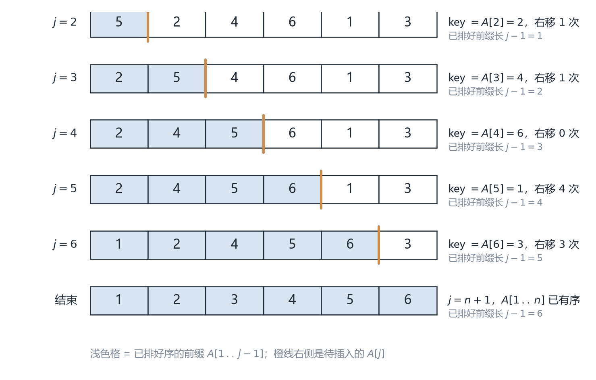
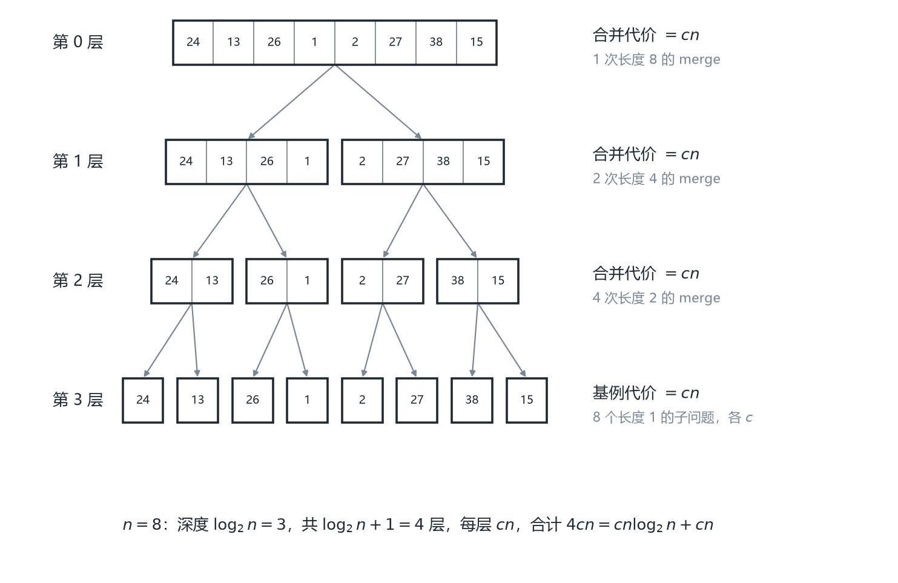
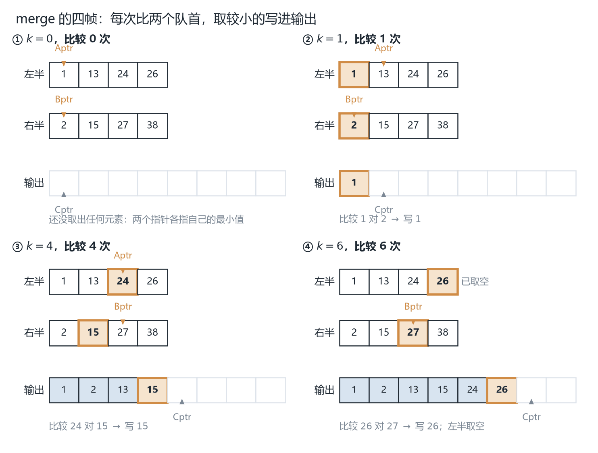
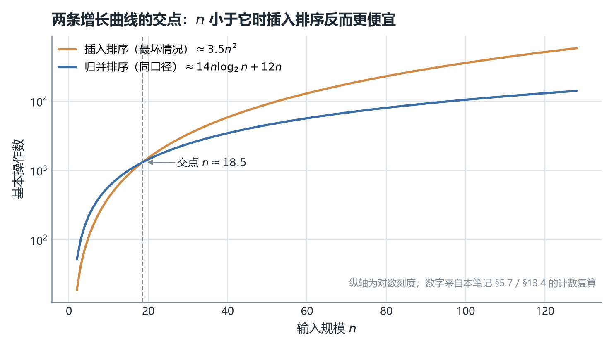

# CSC3100 Lecture 4 课堂笔记：Insertion Sort and Merge Sort（插入排序与归并排序）

> ① **材料构成**：本讲基于课件整理，不含教师口述内容；课件共 32 页。② **课件结构分六块**：排序问题的形式化（p.3）、插入排序的直观与伪代码（p.4-6）、循环不变式与正确性证明（p.7-9）、插入排序的运行时间分析（p.10-14）、递归（p.15-19）、分治与归并排序（p.20-31），末页是阅读作业（p.32）。③ **已知问题**：课件有 5 处笔误与不一致（p.9 的不变式少了半句、p.13-14 把 worst 写成 worse、p.29 大小写记号混用等），已在文末「诚实备注」逐条列出。④ **来源标注约定**：正文里以补充类 alert（NOTE / TIP / IMPORTANT）呈现的内容，都是课件没有写、由我推导或补充的内容。本讲的文字层只有约 7.7 K 字符——**伪代码、成本表、公式和示意图几乎全是图片**，所以 32 页逐页渲染读过，可疑处再按 340-400 dpi 裁切放大逐字核对。

## 0. 一句话概括本讲在讲什么

上一讲（Lecture 3）已经在数组上把"排序问题"用四种朴素方法做过一遍：选择、插入、冒泡、快速排序，每种都给了一句"复杂度是 $O(N^2)$"或"平均 $O(N\log N)$"。但那里有两个悬案。第一，**凭什么说一个排序算法是对的？** L3 只给了几个例子和"看起来对"，而长度为 $n$ 的数组有 $n!$ 种输入，举例子永远举不完。第二，**那个 $O(N\log N)$ 到底怎么来的？** L3 第 73 页自己写着"我们不证明它"。

本讲补上这两件事，用的工具都是这门课第一次出现。

第一件是**循环不变式（loop invariant）**：给循环找一句"每次迭代时都为真"的话，用"初始化 / 保持 / 终止"三步证明它，形状和数学归纳法一模一样。这是全课程第一次教"怎么证明一个循环算法是对的"。

第二件是**算法设计范式（paradigm of algorithm design）**。目录的排法本身就在说这件事：插入排序那条线通向 "Algorithm analysis"，归并排序那条线通向 "Divide-and-conquer"，两者汇到同一个标题 "Paradigms of algorithm design"（p.2）。所以重点不是两个算法本身，而是它们各自代表的一套可复用套路：插入排序代表**增量法（incremental approach）**，归并排序代表**分治法（divide-and-conquer）**。前者最坏 $\Theta(n^2)$，后者 $\Theta(n\log n)$，这个差距就是"换一种范式"的全部收益。

中间还夹了一段插曲（p.15-19）：递归。因为分治的实现形式必然是递归，所以课件先花五页讲清"什么叫递归""基例为什么必须到得了"。

| 小节 | 课件页 | 这一节在回答什么 |
| --- | --- | --- |
| §1 | p.3 | "排序问题"到底是个什么数学问题？ |
| §2-3 | p.4-6 | 插入排序怎么做？伪代码每一行在干什么？ |
| §4 | p.7-9 | 怎么**证明**它排序是对的？ |
| §5 | p.10-14 | 它要做多少次操作？最好、最坏、平均各是多少？ |
| §6-8 | p.15-19 | 递归是什么？基例为什么必须能到达？ |
| §9-10 | p.20-23 | 分治范式是什么？归并排序怎么用它？ |
| §11-12 | p.24-28 | 怎么把两个有序数组合成一个？代码怎么写？ |
| §13-14 | p.29-31 | $n\log n$ 是怎么算出来的？两种排序怎么选？ |

## 1. 排序问题的形式化（p.3）

### 1.1 输入与输出：什么叫"排好了"

第 3 页用两行把问题钉死：

**输入**：一个由 $n$ 个数构成的序列 $\langle a_1, a_2, \ldots, a_n\rangle$。

**输出**：输入的一个**排列（permutation，即重排）** $\langle a'_1, a'_2, \ldots, a'_n\rangle$，满足 $a'_1 \le a'_2 \le \cdots \le a'_n$。

两个词值得停下来看。

**"排列"**：输出不是"随便排一下"，而是输入的**一个重排**——元素一个不多、一个不少，只是顺序变了。这一条把排序和它的邻居区分开："找第 $k$ 小"不要求输出全体，"去重"会改变元素个数，"统计频次"根本不输出序列。排序的输出必须与输入**多重集相等**。这一点在 §4 会很要紧：要证的正是"有序 + 没丢元素"两件事，而 p.9 的证明只证了前一半。

**"$\le$"而不是"$<$"**：用 $\le$ 意味着**允许重复的键**。这不是小事——它是后面"稳定性"这个概念存在的前提（§11.4）：如果所有键互不相同，"相等元素谁在前"根本不会出现。

把"重排"想成一次搬家：每个元素从输入里的位置走到输出里的位置，把这些位移画成连线就一定会交叉——**交叉一次，正好是一个逆序对**。以输入 9、6、1、4、3 排成 1、3、4、6、9 为例，连线交叉 8 次，所以它有 8 个逆序对。**交叉的多少就是"这个输入离有序有多远"**，§5.8 会把它量化成一个叫"逆序对"的数。

### 1.2 键、数组，以及"同一件事的很多做法"

**"这些数被称为键（keys）"**。要排序的往往不是裸的数字，而是"记录"（比如学生记录按学号排）。**参与比较的只有学号那一个字段**，它叫键；其余字段（姓名、成绩）叫**卫星数据（satellite data）**，跟着键一起搬家但从不参与比较。这个区分在本讲用不上，却是"稳定性为什么重要"的根源：两条记录键相同时，卫星数据谁先谁后只能靠稳定性保证"保持原样"。

**"存放在数组中"**。排序要频繁做两件事：随机访问任意位置、在原地搬移元素。L3 §2.2 的地址公式 $\text{address}(i) = \text{base} + i \times \text{size}$ 让前者是 $O(1)$，后者不需要重新分配内存。换成链表，随机访问退化成 $O(n)$，插入排序的"从右往左比"立刻变贵一个量级。

**"有很多排序算法：插入排序、归并排序、……"**。课件只列了两个就用了省略号，这两个恰好是两种范式的代表。

### 1.3 与上一讲的关系：重复了什么、新增了什么

**插入排序在本讲是"重讲"，不是"重复"**——L3 讲"怎么做"，本讲讲"为什么对、到底多少次操作"。

| 主题 | L3 说过什么 | 本讲怎么处理 |
| --- | --- | --- |
| 基本思想 | "不断把已排序部分扩展一个元素，把下一个元素插到正确位置" | **重复**，但换了个更好记的类比：抓牌（p.4） |
| 演示数据 | `[5, 3, 4, 9, 2]`，0-based，四轮 | **换了**：`5 2 4 6 1 3`，**1-based**，六帧（p.5，CLRS 经典例子） |
| 代码形态 | Java 就地版本，`while (j >= 0 && a[j] > key)` | **换成 CLRS 的 1-based 伪代码**（p.6）并逐行解释 |
| 复杂度 | 直接写 $O(N^2)$，只给结论 | **新增**：RAM 模型 + 逐行成本表 + 三种情况的完整推导（p.10-14） |
| 最好情况 | 说"最好 $O(N)$，一次比较就停" | **补上证明**：$t_j=1$ 时 $T(n)$ 退化成线性式（p.12） |
| 正确性 | 只在代码注释里出现过"循环不变式"字样 | **新增整节**：三步证明 + 归纳法类比（p.7-9） |
| 稳定性 | 断言"插入排序稳定"，没给理由 | 本讲没出现 "stable" 一词；§11.4 讲清机制并补上理由 |
| 递归 | 说"递归还没学，先接受它" | **新增整节**：定义、基例、汉诺塔（p.15-19） |
| 归并排序 | 只在讲快排"合"不用做事时提了一句"还要多一趟 $O(N)$ 的归并" | **全新**：完整的分治设计 + 实现 + 复杂度（p.20-31） |

一句话：**本讲把 L3 里所有"直接给结论"的地方换成了"给推导"**。

## 2. 插入排序的直观：抓牌（p.4-5）

### 2.1 抓牌的四句话

插入排序在这里被讲成整理手里的一副牌，四句话对应算法的四个要素（p.4）。

**"从空的左手开始"**——已排序部分初始为空（实现里是"从一个元素开始"，单元素天然有序）。

**"拿起一张牌，插到正确的位置"**——每轮只处理一个元素，这就是"增量"：解从规模 $j-1$ 变成 $j$。

**"为了找到位置，和手里的每张牌比较，从右往左"**——整页最关键的细节。**为什么从右往左？** 因为左手里的牌**已经有序**：从最右边（最大的一张）往左找，**第一个不大于新牌的位置**就是它该待的地方，遇到就可以停手。如果手里的牌是乱的，"从右往左第一个不大于它的"毫无意义。

**"左手里的牌始终有序"**——这就是循环不变式（§4）。它不是"观察到的现象"，而是正确性的全部依据。

插入排序被定性为 **"a simple algorithm for a small number of elements"（一个适合少量元素的简单算法）**（p.4）。这是本讲最长的一条伏笔：p.30 会说"小输入时插入排序可能更快"，p.31 会把它当成混合排序的收尾工具。为什么适合小规模？因为**常数极小**——没有额外数组、没有递归，内层循环就是"比较 + 搬一格"，对缓存极其友好。

顺便说一句类比与实现的差别：**牌可以"插进去"，数组不能**。数组是定长的连续内存（L3 §2.1），腾位置只能把后面的元素整体右搬。所以"插入"在数组上的真实动作是"搬移 + 落位"，这正是代价来源；§3.1 那份就地伪代码就是靠"从右往左、边走边搬"绕开了新建数组。

### 2.2 p.5 的六帧状态序列

六帧状态按 $j$ 的推进顺序重排如下（p.5 没有文字，状态是从图上逐帧读出的）。数组是 `5 2 4 6 1 3`，下标 **1 到 6**（1-based，与 p.6 一致）：

| 帧 | $j$ | 已排序前缀 $A[1\,..\,j-1]$ | 未排序部分 $A[j\,..\,n]$ | $key$ | 右移次数 |
| --- | --- | --- | --- | --- | --- |
| 1 | 2 | 5 | 2 4 6 1 3 | 2 | 1 |
| 2 | 3 | 2 5 | 4 6 1 3 | 4 | 1 |
| 3 | 4 | 2 4 5 | 6 1 3 | 6 | 0 |
| 4 | 5 | 2 4 5 6 | 1 3 | 1 | 4 |
| 5 | 6 | 1 2 4 5 6 | 3 | 3 | 3 |
| 6 | 7 | 1 2 3 4 5 6 | （空） | — | — |



*图 1　六帧状态重绘（出自讲义 p.5）：浅色格是已排好序的前缀 $A[1\,..\,j-1]$，橙线右侧是待插入的 $A[j]$。第 3 帧右移 0 次（$6>5$，一次比较就停），第 4 帧右移 4 次（$1$ 比前缀里每个元素都小），这两个极端就是"最好/最坏"的雏形。*

**第 1 帧只搬了一格**：对比第 1、2 帧，`5` 右移一格、`2` 落到 1 号位——注意这不是"两数交换"，`2` 是先存进 `key`、把 `5` 搬走、最后再落回去的。**第 3 帧一次都没搬，第 4 帧搬了四次**：前者是"最好情况"的微观版本，后者是"最坏情况"的微观版本——**输入越有序，前一种帧出现得越多**。

六帧的"右移次数"加起来是 $1+1+0+4+3=9$。这个 9 不是巧合：它等于这个数组的**逆序对数**（§5.8 会证明），也等于 $\sum t_j-(n-1)$。按 §5.7 的口径算，这个例子的总操作数是 **115** 次。

## 3. 插入排序的伪代码（p.6）

### 3.1 逐行读

这份伪代码一字未改地取自 CLRS 3rd ed 第 18 页（p.6）。这里保留伪代码而不翻成真码，因为 §3.1 逐行讲的正是它的行号（第 1-8 行）与 `▷` 注释，换成任何一门语言的代码，"第 3 行成本记 0"这类对照就失去落点：

```text
INSERTION-SORT(A)
1  for j ← 2 to n
2      do key ← A[j]
3          ▷ Insert A[j] into the sorted sequence A[1 .. j-1].
4          i ← j - 1
5          while i > 0 and A[i] > key
6              do A[i + 1] ← A[i]
7                  i ← i - 1
8          A[i + 1] ← key
```

第 1 行 **`for j ← 2 to n`**：从**第二个**元素开始，因为 $A[1\,..\,1]$ 天然有序。$j$ 的含义要记牢：**已排序前缀的右边界再加一，也就是下一个要插的元素的下标**。

第 2 行 **`key ← A[j]`**：先把待插的值存起来。看着多余，其实**必须存**：第 6 行会把 $A[i+1]$ 覆盖成 $A[i]$，而 $i+1$ 一开始正好等于 $j$，第一轮搬移就会把 $A[j]$ 踩掉。

第 3 行是注释（`▷` 是 CLRS 的注释符号），**不花时间**。成本表（p.11）里这一行 cost 记 0，所以成本系数从 $c_2$ 直接跳到 $c_4$，**不是漏了一行**。

第 4 行 **`i ← j - 1`**：从已排序部分的最右端开始往左找。

第 5 行 **`while i > 0 and A[i] > key`**：两个条件顺序不能换。`i > 0` 是**越界保护**（1-based 下 $A[0]$ 不存在）；`A[i] > key` 是**严格大于**——相等就停。这个细节在 §11.4 会变成"插入排序为什么稳定"的答案。

第 6 行 **`do A[i + 1] ← A[i]`**：把比 `key` 大的元素右移一格，给 `key` 腾位置。方向是**从右往左依次腾**，不会覆盖还没处理的数据。

第 7 行 **`i ← i - 1`**：指针继续往左。

第 8 行 **`A[i + 1] ← key`**：把 `key` 落位。**为什么是 $i+1$ 而不是 $i$？** 循环有两种退出方式：$i$ 减到 0（`key` 最小，该放 1 号位，即 $i+1=1$）；$A[i] \le key$（该放 $A[i]$ 右边一格，即 $i+1$）。两种情况下答案都是 $i+1$，这一行把两个分支统一了。

### 3.2 三个容易踩的细节

**第一，`and` 的短路求值。** `i > 0 and A[i] > key` 在 $i=0$ 时只算左边、不会去读 `A[0]`。反过来写就会直接越界（Java 里是 `ArrayIndexOutOfBoundsException`）。顺序不是风格问题，是正确性问题。

**第二，1-based 与 0-based 的翻译。** 伪代码 $A[j]$ 对应 Java 的 `a[j-1]`；`i > 0` 对应 `i >= 0`；`A[i+1] ← A[i]` 两边同时减 1 后形式不变。L3 §4.3 给过 Java 版，两版只差这一个偏移。**本讲所有计数都按 1-based 伪代码数**，因为课件的成本表（p.11）就是按它写的。

**第三，"就地"（in-place）。** 整个算法只用了 `key`、`i`、`j` 三个变量，没有与 $n$ 成正比的额外空间。它的对立面是归并排序——后者需要一个长度为 $n$ 的临时数组（§12.3），这个差别在 §14.3 会变成正式的取舍维度。

## 4. 循环不变式：怎么证明一个排序算法是对的（p.7-9）

### 4.1 为什么"跑几个例子"不算证明

长度为 $n$ 的数组有 $n!$ 种输入：$n=6$ 时 720 种，$n=10$ 时 3628800 种，$n=20$ 时 $2.4\times 10^{18}$ 种。所以"我拿十个数组试了都对"永远覆盖不到"没试过的那些"；更麻烦的是，**测试跑通不能排除"某个罕见输入会错"**。L3 引过一句话："得到错误的结果永远都是低效的。"一个在 99.9% 的输入上正确、在某个特定输入上崩掉的排序，比一个慢但永远正确的排序糟糕得多。

所以需要**证明**：对**所有** $n$、**所有**输入，算法都输出一个有序的重排。

这和递归的处境不同。递归有"结构"可归纳：排 $n$ 个元素可以假设"排 $n-1$ 个是对的"。而循环只有"时间"——第 1 轮、第 2 轮、……。**循环不变式就是把"时间"变成"归纳变量"的工具**。

### 4.2 不变式是什么

不变式的引入原文只有一句（p.7）："A property of the loop: loop invariant"。插入排序的不变式是：

> **每次迭代时，$A[1\,..\,j-1]$ 是有序的。**

"不变"不是"值不变"（数组明明每轮都在变），而是"**这句话一直为真**"。类比地铁：每一站开门时，"车厢里所有乘客都已检票"都成立——车在动、人在换，但这句断言没被破坏。

不变式要选得"刚好"：太弱推不出结论（§4.7 有真实反例），太强证不出来。插入排序这个不变式的巧妙之处是，它恰好描述了"已经完成的那部分工作"。

### 4.3 三步：Initialization / Maintenance / Termination

三步的原始表述每步一句话（p.7），信息密度极高。

**初始化（Initialization）：循环开始之前，它成立。** 注意"开始之前"指**第一次迭代之前**，不是"程序第一行之前"。对插入排序，第一次迭代时 $j=2$，要断言的是"$A[1\,..\,1]$ 有序"——单元素数组当然有序。这步看着 trivial，但必须写出来：起点不成立，后面全白搭。

**保持（Maintenance）：如果某次迭代之前它成立，那么这次迭代之后它仍成立。** 这是三步里唯一有实质工作量的。它要求你把"一次迭代"当成一个完整计算步骤：**假设**进入这轮时 $A[1\,..\,j-1]$ 有序（归纳假设），**执行完**循环体后 $A[1\,..\,j]$ 有序。注意终点是 $j$ 而不是 $j-1$——这一轮把第 $j$ 个元素也纳入了。而循环头会把 $j$ 自增，于是"下一轮的 $A[1\,..\,j-1]$"正好是"这一轮的 $A[1\,..\,j]$"，断言接上了。

**终止（Termination）：循环停止时，用不变式推出算法正确。** 循环在 $j$ 超过 $n$ 时停，即 $j = n+1$。代入不变式得"$A[1\,..\,n]$ 有序"，这正是排序要求的输出。

### 4.4 为什么这三步就是数学归纳法

课件在同一页最后只写了一句 "Similar to the mathematical induction"（p.7），没展开。这里补上说清。数学归纳法证"对所有 $k$，$P(k)$"要两步：**基例** $P(1)$、**归纳步** $P(k) \Rightarrow P(k+1)$。对应关系是：

| 数学归纳法 | 循环不变式 | 在插入排序里具体是什么 |
| --- | --- | --- |
| 基例 $P(1)$ | Initialization | $j=2$ 时 $A[1\,..\,1]$ 只有一个元素，有序 |
| 归纳步 $P(k)\Rightarrow P(k+1)$ | Maintenance | 第 $k$ 轮之前有序 ⇒ 第 $k$ 轮之后（多纳入一个元素）仍有序 |
| （归纳法没有对应物） | Termination | $j=n+1$，代入得 $A[1\,..\,n]$ 有序 |

**关键差别在第三行。** 归纳法证完前两步，得到的是"对所有 $k$ 都成立"这样一句**无限族**的结论；循环不变式证完前两步也是如此，但这句话本身**还不是**"算法正确"。要把无限族收束成一个具体结论，必须知道"循环在哪一点停下来"，然后取那一点。**没有 Termination，前两步只能说明"循环过程中数组一直部分有序"，不能说明"循环结束时整个数组有序"。**

换句话说：Initialization + Maintenance 保证"性质不会被循环破坏"，Termination 保证"在终点处这个性质正好等于我们想要的结论"。

还有一层容易被忽略：**Termination 隐含"循环会停"这个前提**。`for` 循环显然会停（$j$ 单调递增且有上界），所以这里可以跳过；但 `while` 不一定——p.16 的 `bad(N)` 就永远不停，对它谈"终止时如何"没有意义（§6.3）。

### 4.5 把三步套到插入排序上（p.8）

这一页（p.8）没写新内容，只是把 §3 的伪代码重贴一遍，用三个箭头标出"哪一段对应哪一步"：`Initialization` 指在 `for j ← 2 to n` 那一行，`Maintenance` 用竖排箭头覆盖整个循环体（`do key ← A[j]` 到 `A[i+1] ← key`），`Termination` 指在 `Endfor` 之后。

这个标注本身有信息量：**三步不是三个抽象口号，而是对应代码的三块地理位置**——循环开始那一行之前、循环体、循环结束之后。以后遇到任何循环算法，都可以照这个位置去填。

**Initialization**：$j=2$ 时 $A[1\,..\,1]$ 只含一个元素，平凡有序。

**Maintenance**：设本轮开始时 $A[1\,..\,j-1]$ 有序。循环体先把 $A[j]$ 存进 `key`；$i$ 从 $j-1$ 往左走，凡大于 `key` 的元素右移一格；走到某个 $i$ 使 $A[i] \le key$（或 $i=0$）时把 `key` 放进 $A[i+1]$。此时 $A[1\,..\,i]$ 都 $\le key$、$A[i+2\,..\,j]$ 都 $> key$，两段各自有序，所以 $A[1\,..\,j]$ 整体有序。循环头把 $j$ 加一，下一轮的断言重新成立。

**Termination**：循环在 $j=n+1$ 时停止，代入得 $A[1\,..\,n]$ 有序。正是排序的输出要求。

### 4.6 p.9 的证明逐条核读

第 9 页是课件唯一给出完整三步论证的一页。原文（按 340 dpi 放大逐字核过）：

- **Initialization**：true before the begin of loop；Only one element $A[1]$
- **Maintenance**：true before an iteration and after it；$A[j]$ is in the correct position $j'$ $\Leftrightarrow$ $A[j'-1] \le A[j'] \le A[j'+1]$
- **Termination**：when the loop stops, use the loop invariant to show the algorithm is correct；$j = n+1$ when loop stops, $A[1,\ldots,j-1]$ is sorted

**Initialization 那一行**意思对，但没明说"$j=2$ 时"——读者得自己从伪代码第 1 行推出。补上这一句才完整。

**Maintenance 那一行**有三个问题。第一，**$j'$ 没有定义**：从上下文看它指 `key` 最终落的位置（即 $i+1$），但课件没说过。第二，**这个"当且仅当"只对内部位置成立**：$j'=1$ 时左边没有 $A[0]$，$j'=n$ 时右边没有 $A[n+1]$，而这两种边界在最坏情况里最常见（逆序输入时每轮都是 $j'=1$）。第三，也是最要紧的：**它只论证了"这一个元素放对了"，没论证"其余元素没丢"**——这是 §4.7 的问题。

**Termination 那一行**写得没问题："$j=n+1$ when loop stops, $A[1\,..\,j-1]$ is sorted"，代入即得 $A[1\,..\,n]$ 有序。三步里最干净的一步。

### 4.7 课件少了什么：CLRS 的原版不变式

> [!NOTE] 补充：CLRS 原版不变式
> 本节为补充内容：对比 CLRS 原版，说明课件的不变式弱在哪、为什么推不出结论。

CLRS 3rd ed 第 19 页的不变式是**两句**：

> At the start of each iteration of the **for** loop of lines 1-8, the subarray $A[1\,..\,j-1]$ consists of the elements originally in $A[1\,..\,j-1]$, but in sorted order.

课件只保留了"is sorted"，丢掉"consists of the elements originally in $A[1\,..\,j-1]$"。**这不是措辞差异，是证明成不成立的问题。** 下面用反例说明。

假设不变式只有"$A[1\,..\,j-1]$ 有序"。那么下面这个"算法"也满足它：把 $A[1\,..\,j-1]$ 全部改写成 0。它的三步是：**Initialization**——$j=2$ 时前缀只有一个元素，改成 0，单元素仍有序，成立；**Maintenance**——每轮把前缀全填 0，全 0 序列当然有序，成立；**Termination**——$j=n+1$ 时 $A[1\,..\,n]$"有序"，结论成立。

于是我们"证明"了"把数组全填 0 就是排序"。荒谬的根源是**不变式太弱**：它只约束了顺序，没约束内容。要推出"输出是输入的一个排列"（§1.1 的第一条要求），不变式里必须包含"元素集合不变"这半句。

加上之后，Maintenance 的工作量也变了：不能只说"`key` 位置对了"，还要说"右移没丢元素"——被右移的 $A[j-1],\ldots,A[i+1]$ 都还在（下标各加了 1），`key` 也在（第 8 行放回去了），长度没变，所以多重集不变。这正是课件省略的那半步。

**这条经验可以推广**：写不变式时先问"如果只有这句话，能不能推出最终结论？"。推不出就是太弱；推得出但证不动就是太强。§11.3 会用同样的方法证明 `merge`，那时不变式也必须同时管住"有序"和"不漏不重"。

## 5. 插入排序的运行时间（p.10-14）

### 5.1 RAM 模型：把"时间"换成"操作次数"

第 10 页先交代分析框架——**随机访问机（Random-Access Machine, RAM）模型**，四条假设：

**顺序执行、没有并发。** 一条指令做完才做下一条，于是"总时间 = 各条指令时间之和"成立。

**基本操作花常数时间。** 课件举的例子是"算术、数据移动、条件判断、函数调用等"。这里的"常数"是相对于输入规模而言的：可以是 1 纳秒也可以是 10 纳秒，但不能随 $n$ 变大。

**给定输入后，时间代价可以用"执行的原始操作（primitive operations，也叫 steps）个数"度量。**

**每行伪代码由若干基本操作组成，因此每行花常数时间；但不同行的常数可以不同。**

第四条是后面所有计算的基石，也最容易被误解。它说的是：**行与行的常数不一样，行内部的常数固定**。所以成本表给每一行配了独立的成本系数 $c_1, c_2, \ldots$（p.11）。

RAM 模型刻意忽略了缓存、流水线、分支预测、多核、内存带宽。这些在真实机器上能造成几倍差异（§14.1 会看到这个差异正是"小输入时插入排序更快"的原因），忽略它们换来的是**可计算性**：只有在这台理想机器上，"要做多少次操作"才是一个能纯手算、且与硬件无关的数。L5 会把"哪些算一次基本操作"列成正式的表，本讲则先用"每行一个 $c_i$"的粗粒度模型去推 $an^2+bn+c$ 这个**形状**，§5.7 再把 $c_i$ 赋成具体值。

### 5.2 逐行成本表（p.11）

| 行 | 代码 | cost | times | 为什么是这个次数 |
| --- | --- | --- | --- | --- |
| 1 | `for j ← 2 to n` | $c_1$ | $n$ | 循环头求值 $n$ 次：$j=2,\ldots,n$ 共 $n-1$ 次为真，最后一次（$j=n+1$）为假也要判一次 |
| 2 | `key ← A[j]` | $c_2$ | $n-1$ | 循环体执行 $n-1$ 次 |
| 3 | 注释 | $0$ | $n-1$ | 注释不花时间（所以没有 $c_3$） |
| 4 | `i ← j - 1` | $c_4$ | $n-1$ | 每轮一次 |
| 5 | `while i > 0 and A[i] > key` | $c_5$ | $\sum_{j=2}^{n} t_j$ | 第 $j$ 轮判断 $t_j$ 次 |
| 6 | `A[i+1] ← A[i]` | $c_6$ | $\sum_{j=2}^{n}(t_j-1)$ | 判断成功才进循环体，最后一次判断失败 |
| 7 | `i ← i - 1` | $c_7$ | $\sum_{j=2}^{n}(t_j-1)$ | 与第 6 行成对出现 |
| 8 | `A[i+1] ← key` | $c_8$ | $n-1$ | 每轮落位一次 |

最重要的一列是 $t_j$：**第 $j$ 轮里 `while` 的条件被判断了多少次**。它同时决定了两件事——第 6、7 行执行 $t_j-1$ 次（最后一次判断失败，不进循环体），而"右移了多少个元素"也正好是 $t_j-1$。所以 $t_j$ 是这一轮工作量的全部度量。

两列相乘再按行相加：

$$
T(n) = c_1 n + c_2(n-1) + c_4(n-1) + c_5\sum_{j=2}^{n} t_j + c_6\sum_{j=2}^{n}(t_j-1) + c_7\sum_{j=2}^{n}(t_j-1) + c_8(n-1)
$$

式子里同时出现 $n$ 和 $t_j$，而 $t_j$ 依赖具体输入。所以课件在右下角标了一句："$T(n)$ depends on $n$ and $t_j$"——**这就是为什么必须分情况讨论**。同规模 $n$ 的两个输入，$t_j$ 可以差出整整一个量级。

### 5.3 最好情况：数组已经有序（p.12）

输入已升序时，每轮的 `key` 都不小于前缀最大值（$A[j-1] \le key$），`while` 第一次就失败，于是 $t_j = 1$ 对所有 $j$ 成立。代进去，$\sum t_j = n-1$、$\sum(t_j-1)=0$：

$$
T(n) = c_1 n + c_2(n-1) + c_4(n-1) + c_5(n-1) + c_8(n-1) = (c_1+c_2+c_4+c_5+c_8)\,n - (c_2+c_4+c_5+c_8)
$$

这是一个**一次函数**。

**"最好情况为什么是线性的"——这是本讲必须能自己讲清的问题。** 答案只有一句：**内层 `while` 的条件一次就失败，内层循环根本不执行**。剩下的只有外层 `for` 的 $n-1$ 次迭代，每次做固定的几件事。工作量与"前缀有多长"无关，只与"有几个元素"有关，所以是 $\Theta(n)$。这也解释了"插入排序对近乎有序的数据特别快"：$t_j$ 绝大多数时候是 1，总量仍是 $n$ 的常数倍加一个小的修正项——§5.8 会把这个修正项精确地写成逆序对数。

### 5.4 最坏情况：数组完全逆序（p.12-13）

输入降序时，每轮 `key` 都比前缀所有元素小，$i$ 一路减到 0，于是 $t_j = j$（$j-1$ 次成功 + 最后 1 次因 $i=0$ 失败）。先算两个求和（p.12）：

$$
\sum_{j=2}^{n} j = \left(\sum_{j=1}^{n} j\right) - 1 = \frac{n(n+1)}{2} - 1
\qquad
\sum_{j=2}^{n}(t_j-1) = \sum_{j=2}^{n}(j-1) = \frac{n(n-1)}{2}
$$

那个"减 1"是因为求和从 $j=2$ 开始，要去掉 $j=1$ 那一项。代进 §5.2 的 $T(n)$，展开如下（p.13）：

$$
T(n) = \left(\frac{c_5}{2}+\frac{c_6}{2}+\frac{c_7}{2}\right)n^2 + \left(c_1+c_2+c_4+\frac{c_5}{2}-\frac{c_6}{2}-\frac{c_7}{2}+c_8\right)n - (c_2+c_4+c_5+c_8)
$$

我逐项核对过这个展开（三个求和分别展开、按 $n^2$、$n$、常数归并），三项系数都对得上。于是课件的结论是：

> 可以把 $T(n)$ 写成 $an^2+bn+c$ 的形式（$a,b,c$ 是依赖于语句代价的常数），所以 $T(n)$ 是 $n$ 的**二次函数（quadratic function）**。

这一步的信息量在于：**二次函数的"形状"与 $c_1,\ldots,c_8$ 的具体取值无关**。只要这些常数是正数，$T(n)$ 就是二次的。这就是渐进分析能跨机器成立的原因，也是 L5 要形式化的东西。

### 5.5 平均情况：一半（p.14）

课件的论证只有两行：

> 平均而言，$A[j]$ 比 $A[1\,..\,j-1]$ 中**一半**的元素小，这意味着 $t_j = j/2$。平均情况大约是最坏情况的一半，但仍然是 $n$ 的二次函数。

它缺了一个前提：**没有说明"平均"是对什么分布求的**。严格讲必须假设"输入是全体 $n!$ 个排列中等概率的一个"（均匀随机排列，uniformly random permutation），否则"平均"没有定义——比如输入全是"几乎有序"的数据，平均下来就是线性的。

补上这个假设后可以算出精确值（【补】）：$j$ 个元素里 `key` 的排名均匀分布在 $1,\ldots,j$ 上，所以比它大的元素个数期望是 $(j-1)/2$，而 $t_j$ 等于"成功判断次数 + 1"，于是

$$
\mathbb{E}[t_j] = \frac{j-1}{2} + 1 = \frac{j+1}{2}
$$

课件写 $j/2$，差的就是最后那次失败的判断。渐近意义下没区别（都是 $\Theta(j)$），所以"平均约为最坏的一半"成立。

**但"一半"改变不了量级。** 把 $\sum t_j \approx n^2/4$ 代进去仍是二次函数，只是首项系数减半。这就是 p.14 那句 "still a quadratic of $n$" 的含义，也是"为什么不分析平均情况"的第一层答案：**算了半天，形状没变**。

### 5.6 为什么只盯最坏情况（p.14）

**理由一：最坏情况给出"对任何输入都成立"的保证。** 工程上要承诺"这个功能 1 秒内返回"，承诺的必须是最坏的那次——平均 1 秒、偶尔 100 秒的系统不可用。

**理由二：对某些算法，最坏情况经常发生。** 课件举的例子是"查找不存在的元素"——在数据库、拼写检查、白名单校验里，"查不到"是常态而非异常，这时"最坏"就是"典型"。

**理由三：平均情况常常和最坏一样糟。** 这一条刚被 §5.5 验证过：平均是最坏的一半，但**量级相同**，都是 $\Theta(n^2)$。所以在"谁增长得慢"这件事上，平均情况提供不了新信息。（后面 L5 会把这第三条原样再讲一遍，只给断言不给论证——**它的唯一一次论证其实就在这里**。）

课件还有一句红框提示（p.12）："When talking about best/worst case, the algorithm itself should be able to handle all the cases"。措辞比较绕，我的理解是：**最好和最坏说的是"同一个算法面对不同输入"，不是"拿一个只能处理部分输入的算法去和别的算法比"**。比如一个"只对已排序数组有效"的排序不能算"最好情况 $O(n)$ 的排序"——它根本不是排序算法。这是我的读法，课件原句没把话说死。

### 5.7 我的精确复算：$T(n) = 7I(A) + 10n - 8$

> [!NOTE] 补充：精确复算
> 本节为补充内容：课件只给符号形式，这里按 L5 计数约定把八个常数全部赋成具体值。

课件停在"$an^2+bn+c$"，没给具体值——因为 $c_1,\ldots,c_8$ 是符号。用 L5 的计数约定可以把八个符号全部赋成具体数字，得到一条完全确定的公式。

**约定**：循环头 = 初始化 1 + 自增（迭代次数）+ 比较（迭代次数 + 1）；数组下标访问、赋值、算术、比较各计 1；不给 `and` 的短路打折（$i=0$ 时也按两次比较计）。逐行赋值：

| 行 | 代码 | 我的计数 | 说明 |
| --- | --- | --- | --- |
| 1 | `for j ← 2 to n` | $2n$ | 初始化 1 + 自增 $n-1$ + 比较 $n$ |
| 2 | `key ← A[j]` | $2(n-1)$ | 访问 1 + 赋值 1 |
| 4 | `i ← j - 1` | $2(n-1)$ | 算术 1 + 赋值 1 |
| 5 | `while ...` | $3\sum t_j$ | 比较 $i>0$ + 访问 $A[i]$ + 比较 $A[i]>key$ |
| 6 | `A[i+1] ← A[i]` | $2\sum(t_j-1)$ | 访问 1 + 赋值 1 |
| 7 | `i ← i - 1` | $2\sum(t_j-1)$ | 算术 1 + 赋值 1 |
| 8 | `A[i+1] ← key` | $n-1$ | 赋值 1 |

即 $c_1=2$、$c_2=c_4=c_6=c_7=2$、$c_5=3$、$c_8=1$。代进 p.13 的三个系数公式得 $a = 7/2$、$b = 13/2$、$c = -8$；直接求和化简：

$$
T(n) = 3n - 1 + 7\sum_{j=2}^{n} t_j
$$

再把 $\sum t_j$ 换成"逆序对数 + $(n-1)$"（§5.8 证明这个恒等式），得到本讲最漂亮的一条式子：

$$
T(n) = 7\,I(A) + 10n - 8
$$

三种情况立刻落地：

$$
\text{最好 } (I=0):\ 10n-8 \qquad \text{最坏 } \left(I=\tfrac{n(n-1)}{2}\right):\ \frac{7n^2+13n-16}{2} \qquad \text{平均 } \left(I=\tfrac{n(n-1)}{4}\right):\ \frac{7n^2+33n-32}{4}
$$

**怎么验的**：按上述约定写逐行插桩的计数器，对 $n=1,\ldots,8$ 枚举**全部 $n!$ 个排列**（46203 个输入），取最小、最大和精确均值（用分数存，不经浮点），三条闭式**逐项（均值是分数精确）相等**。取到最小值的输入恒为升序、最大值的恒为降序。课件 p.5 那个 `5 2 4 6 1 3` 是 **115** 次（$I=9$，$n=6$）。具体数值见文末「诚实备注」三。

### 5.8 逆序对视角：插入排序到底在为什么买单

> [!NOTE] 补充：逆序对视角
> 本节为补充内容：课件未引入逆序对，这里用它统一解释最好/最坏/平均三种情况。

上面的 $I(A)$ 把"最好/最坏/平均"统一成了一个量。

**定义**：若 $i<j$ 且 $A[i] > A[j]$，称 $(i,j)$ 是一个**逆序对（inversion）**，$I(A)$ 是总数。它度量"这个数组离升序有多远"：升序 $I=0$，降序 $I=n(n-1)/2$。

**恒等式**：对每个 $j$，$t_j - 1$ 恰好是"$A[1\,..\,j-1]$ 中大于 $A[j]$ 的元素个数"，也就是**以 $j$ 为右端点的逆序对个数**。全部加起来：

$$
\sum_{j=2}^{n}(t_j-1) = I(A)
$$

我在全部 46203 个排列上逐项验证过，无一处例外。

**这条恒等式解释了插入排序的一切**：最好 $I=0$ ⇒ 一次搬移都不做 ⇒ 线性；最坏 $I=n(n-1)/2$ ⇒ 搬移最多 ⇒ 二次；平均每对元素有 $1/2$ 的概率构成逆序，共 $n(n-1)/2$ 对，$\mathbb{E}[I]=n(n-1)/4$ ⇒ 仍是二次但系数减半。所以

$$
T(n) = \Theta(n + I(A))
$$

这比"$O(n^2)$"精确得多：它解释了为什么"给几乎有序的数组排序"几乎免费，也解释了为什么逆序输入最坏。任何**只通过相邻交换**来排序的算法（插入、冒泡）都逃不出这个下界：一次相邻交换最多消掉一个逆序对，所以至少要 $I$ 次交换。

顺带一个推论：**归并排序可以顺便把逆序对也数出来**——`merge` 里每当从右半取出一个元素，就说明"左半剩下的所有元素都比它大"，把左半剩余个数加到计数器上即可。这样数逆序对是 $O(n\log n)$，比插入排序的 $O(n^2)$ 快一个量级，本身就是"用分治改进增量法"的小例子（CLRS 习题 2-4，超出课件范围）。

## 6. 递归：自己调用自己（p.15-16）

### 6.1 什么叫递归（p.15）

第 15 页三句话：**自引用（self-reference）**；**递归函数是"基于自身"的函数**；**整个问题的解由子问题的解组合而成**。

第三句最实质。前两句只是"形式"（函数体里出现了自己），第三句才是"内容"（为什么这样写能算出东西）。一个合法递归必须满足：**大问题的解 = 若干小问题的解 + 一点组合工作**。否则就是无限循环。

课件的例子是 $f(x) = 2f(x-1) + x^2$，基例 $f(0)=0$：

::: code-group

```java [Java]
public int f( int x ) {
    if ( x == 0 )
        return 0;
    else
        return 2 * f( x - 1 ) + x*x;
}
```

```python [Python]
def f(x):
    if x == 0:
        return 0
    else:
        return 2 * f(x - 1) + x * x
```

```cpp [C++]
int f(int x) {
    if (x == 0)
        return 0;
    else
        return 2 * f(x - 1) + x * x;
}
```

```c [C]
int f(int x) {
    if (x == 0)
        return 0;
    else
        return 2 * f(x - 1) + x * x;
}
```

:::

手算前几项：$f(0)=0$、$f(1)=1$、$f(2)=6$、$f(3)=21$、$f(4)=58$、$f(5)=141$、$f(6)=318$。每一项只用前一项，这就是"子问题的解组合成大问题的解"。

注意它的形状：参数每次**减 1**，属于**减治**（decrease-and-conquer）；归并排序是每次**除以 2**，层数差一个量级（$n$ 层 vs $\log n$ 层），这个差别 L6 会展开。

### 6.2 递归定义的三条特征（p.16）

**第一，有一个停止点（基例，base case）。** 没有基例的递归是无限递归。

**第二，从一个较高的 $n$ 值递归求值到一个较低的 $n$ 值。** 参数必须朝"变小"的方向走。如果传进去的参数比原来大或不变，那就不是归约而是膨胀。

**第三，基例必须能到达（base case must be reached）。** 这一条最容易被忽略，因为它看起来是第二条的推论——**其实不是**。参数一直变小，不代表一定会落到基例上：它可能落到一个"不动点"，然后在那里永远打转。

### 6.3 `bad(N)` 为什么永远到不了基例（p.16）

::: code-group

```java [Java]
public static int bad (int N)
{
    if (N == 0)
        return 0;
    else
        return bad (N / 3 + 1) + N - 1;  // [!code warning]
}
```

```python [Python]
def bad(N):
    if N == 0:
        return 0
    else:
        return bad(N // 3 + 1) + N - 1  # [!code warning]
```

```cpp [C++]
int bad(int N)
{
    if (N == 0)
        return 0;
    else
        return bad(N / 3 + 1) + N - 1;  // [!code warning]
}
```

```c [C]
int bad(int N)
{
    if (N == 0)
        return 0;
    else
        return bad(N / 3 + 1) + N - 1;  // [!code warning]
}
```

:::

Java 的整数除法在 $N \ge 0$ 时就是向下取整，逐种情况看：

- $N=0$：直接返回 0，正常。
- $N=1$：`bad(1/3 + 1)` = `bad(0+1)` = `bad(1)`——**它调用自己，参数一点没变**。这是个不动点，永远出不去。
- $N=2$：`bad(0+1)` = `bad(1)`，卡在上面那个不动点上。
- $N \ge 3$：$\lfloor N/3\rfloor + 1 < N$ 恒成立（$N=3$ 时 $1+1=2<3$），参数严格递减，一路减到 1，然后卡住。

**结论：对任何 $N \ge 1$ 都是无限递归**，实际运行时抛 `StackOverflowError`；只有 $N=0$ 能正常返回。

这个例子的价值在于它精确地违反了第三条而不是第二条：对 $N\ge3$，参数确实每步都在变小（第二条满足），但变到 1 之后不再变，基例 0 永远够不着。**"每一步都在变小"和"最终会到达基例"是两件事**，中间差一个"下界"。修法很简单：把基例改成 `N <= 1`。

> 它还顺带说明了 §4.4 那件事：对 `bad(N)` 谈"终止时如何"没有意义，因为它根本不终止。

### 6.4 递归在内存里长什么样

> [!NOTE] 补充：栈帧视角
> 本节为补充内容：课件未讲递归的内存形态，这里补栈帧、递归深度与爆栈的结论。

L3 §1.5 讲过：调用方法时 Java 会分配一块**栈帧**（stack frame）放局部变量和参数，返回时整块抹掉。递归的特殊之处只是——**同一个方法被压了很多层**。

以 $f(4)$ 为例，调用链是 $f(4) \to f(3) \to f(2) \to f(1) \to f(0)$，一共五层；$f(0)$ 返回后逐层弹出、逐层计算。**在 $f(0)$ 返回之前，五层栈帧同时存在**，每层都保存着自己的 $x$ 和尚未完成的乘法。由此得两条结论：递归的空间代价 = 最大深度 × 每帧大小（$f(n)$ 是 $O(n)$，归并排序的深度是 $O(\log n)$）；递归太深会爆栈（JVM 默认栈在 512 KB-1 MB 量级）。这也解释了 `bad(N)` 的错误为什么是 `StackOverflowError`——它不是慢，是把栈用光了。

## 7. 用递归重写插入排序（p.17）

### 7.1 课件的三句话

第 17 页没有代码，只有三句话：**基例：数组大小是 1 或更小就返回**；**递归地排好前 $n-1$ 个元素**；**把最后一个元素插到已排序数组里正确的位置**。

这三句话和 §3 的循环版做同一件事，但**方向相反**。循环版"从左往右扩"：前缀从 1 个元素长到 $n$ 个。递归版"从右往左缩"：先假设"前 $n-1$ 个已排好"（递归的"信仰"），再把第 $n$ 个插进去。

这个反转是"用递归描述迭代"的标准手法：**循环不变式里的"已完成 $j-1$ 个"，在递归里变成"递归调用的返回值保证前 $n-1$ 个有序"**。两者是同一个断言的两种时态。

### 7.2 代码

> [!NOTE] 补充：参考实现
> 本节代码为补充内容：课件只给文字描述，这里补 0-based 的四语言实现。

课件只给文字描述，补一份 0-based 的四语言实现：

::: code-group

```java [Java]
// 排好 a[0..n-1]
static void insertionSort(int[] a, int n) {
    if (n <= 1) return;                  // 基例：0 个或 1 个元素，天然有序
    insertionSort(a, n - 1);             // 递归：前 n-1 个已经有序
    int key = a[n - 1], i = n - 2;       // 把最后一个元素插进去
    while (i >= 0 && a[i] > key) {
        a[i + 1] = a[i];
        i--;
    }
    a[i + 1] = key;
}
```

```python [Python]
# 排好 a[0..n-1]
def insertion_sort(a, n):
    if n <= 1:
        return                           # 基例：0 个或 1 个元素，天然有序
    insertion_sort(a, n - 1)             # 递归：前 n-1 个已经有序
    key = a[n - 1]
    i = n - 2                            # 把最后一个元素插进去
    while i >= 0 and a[i] > key:
        a[i + 1] = a[i]
        i -= 1
    a[i + 1] = key
```

```cpp [C++]
// 排好 a[0..n-1]
void insertionSort(std::vector<int>& a, int n) {
    if (n <= 1) return;                  // 基例：0 个或 1 个元素，天然有序
    insertionSort(a, n - 1);             // 递归：前 n-1 个已经有序
    int key = a[n - 1], i = n - 2;       // 把最后一个元素插进去
    while (i >= 0 && a[i] > key) {
        a[i + 1] = a[i];
        i--;
    }
    a[i + 1] = key;
}
```

```c [C]
// 排好 a[0..n-1]
void insertionSort(int* a, int n) {
    if (n <= 1) return;                  // 基例：0 个或 1 个元素，天然有序
    insertionSort(a, n - 1);             // 递归：前 n-1 个已经有序
    int key = a[n - 1], i = n - 2;       // 把最后一个元素插进去
    while (i >= 0 && a[i] > key) {
        a[i + 1] = a[i];
        i--;
    }
    a[i + 1] = key;
}
```

:::

三处细节：**基例写 `n <= 1` 而不是 `n == 1`**（$n=0$ 也要能返回，空数组）；**内层 `while` 与迭代版逐字相同**（改的只是外层控制流）；**递归深度是 $n$**（对 $n=10^5$ 会栈溢出，所以工程上没人这么写，它在这里的唯一作用是把递归讲清楚）。

### 7.3 代价：按层求和

第 $k$ 层（处理长度 $k$ 的前缀）的插入代价是 $O(k)$，共 $n$ 层：

$$
1 + 2 + \cdots + n = \frac{n(n+1)}{2} = \Theta(n^2)
$$

这是后面分析归并排序的预演。区别在于：**这里层数是 $n$（每层减 1），归并排序是 $\log n$（每层除以 2）**。同样"每层 $O(n)$ 的工作"，层数不同，总量就从 $n^2$ 变成 $n\log n$。这是整讲的核心对比，§13 会正式算一遍。（"递推式怎么系统求解"留到 L6，那里有主定理。本讲只需"层数 × 每层代价"这个直觉。）

## 8. 递归的第二个例子：汉诺塔（p.18-19）

### 8.1 问题与约束

第 18 页描述**汉诺塔（Tower of Hanoi）**：三根柱子 A、B、C，若干直径互不相同的圆盘全部串在 A 上（大盘在下）。要把整摞搬到 C。两条约束：**一次只能移动一个盘**；**任何时刻不能把大盘放到小盘上面**。

初始状态与目标状态在课件里都有图（p.18）：初始时 A 上有三个盘，从上到下编号 1、2、3。注意编号：**1 是最小的盘，3 是最大的**。

### 8.2 $n=3$ 的七步

第 19 页用四组"前后对比"图展示完整的七步。按顺序重排成表：

| 步 | 移动 | 移动后的局面（A / B / C，自底向上） |
| --- | --- | --- |
| 1 | 盘 1：A → C | 2,3 / 空 / 1 |
| 2 | 盘 2：A → B | 3 / 2 / 1 |
| 3 | 盘 1：C → B | 3 / 1,2 / 空 |
| 4 | 盘 3：A → C | 空 / 1,2 / 3 |
| 5 | 盘 1：B → A | 1 / 2 / 3 |
| 6 | 盘 2：B → C | 1 / 空 / 2,3 |
| 7 | 盘 1：A → C | 空 / 空 / 1,2,3 |

七步走完，三个盘全部落到 C 上且顺序正确，与 p.19 的四组对比图逐帧对得上（第一组是第 1 步前后，第二组第 2-3 步，第三组第 4-5 步，第四组第 6-7 步）。

### 8.3 递归解法，以及为什么是 $2^n-1$

> [!NOTE] 补充：步数闭式与最优性
> 本节为补充内容：课件未给步数闭式，这里补 $M(n)=2^n-1$ 的推导与最优性证明。

课件的递归解法四句话：若 $n=1$，把唯一的盘从 A 移到 C，结束；否则**把上面 $n-1$ 个盘从 A 移到 B、用 C 作辅助**；**把剩下那个（最大的）盘从 A 移到 C**；**把 $n-1$ 个盘从 B 移到 C、用 A 作辅助**。

精妙之处在第二、四句：它们把"移动 $n$ 个盘"化成了"移动 $n-1$ 个盘"的**同一个问题**（源、目标、辅助三者轮换）。这就是分治——虽然规模只减 1，但结构完全同型。

课件没给次数闭式。补上（【补】）：设 $M(n)$ 为步数，$M(1)=1$、$M(n)=2M(n-1)+1$，展开得 $M(n)=2^n-1$（$n=1..5$ 为 1, 3, 7, 15, 31，与 §8.2 的七步相符）。

**为什么最优？** 最大的盘**必须移动恰好一次**：它一开始在 A、最终要在 C，而它上面不能压任何盘，所以只能在"其余 $n-1$ 个都不在它上面"时被搬一次。搬它之前，$n-1$ 个盘必须全部集中到 B；搬它之后，这 $n-1$ 个必须全部从 B 到 C。两段各需至少 $M(n-1)$ 步，加搬大盘的 1 步，得 $M(n) \ge 2M(n-1)+1$。课件的递归解法正好达到这个下界，所以最优。

这个数字增长得有多快？$n=64$ 时是 $2^{64}-1 \approx 1.8\times 10^{19}$ 步，按每秒一步要 5850 亿年——远超宇宙年龄。**这是"指数增长"最有说服力的例子**，也说明递归不等于快：结构极简，代价极恐怖。

## 9. 分治范式（p.20）

### 9.1 三步

分治的通用模板就是上面三步（p.20），课件另配了一张树状图：problem 分成两个 subproblem，各自 conquer 得到子解，最后 combine 成原解。

**分（Divide）**：把问题划分成若干**子问题**。

**治（Conquer）**：**递归地**求解子问题。子问题不够小就继续往下分。**基例：子问题足够小，可以直接暴力求解。**

**合（Combine）**：把子问题的解组合成原问题的解。

三步里最容易被低估的是"合"。分和治都很自然——"切开""分别解决"，任何人都会想到；但**切开之后怎么拼回去，才是每种分治算法真正的技术含量**。归并排序的"合"是 `merge`（§11），需要专门设计一个线性过程；快速排序（L3 §4.5）的"合"什么都不用做，因为划分时已保证左小右大。这两种"合"的难度差异，直接决定了两者的实现复杂度。

另一个容易被忽略的是**基例那条**：它给了设计者一个自由度——**不必一路分到只剩一个元素**。§14.2 的混合排序就是利用这个自由度：分到长度 16 左右就用插入排序收尾。

### 9.2 递归与分治：工具与策略

这两件事在教学里是分开的：p.15-19 讲递归（**实现工具**），p.20 起讲分治（**设计策略**）。

**分治一定用递归实现**（或用显式栈模拟），因为它要求"子问题用同样的方法解决"。但**递归不一定是分治**：§7 的递归插入排序每次规模减 1，层数是 $n$，是"减治"；§8 的汉诺塔也是减治（$n \to n-1$）。

判据很简单：**看规模怎么变**。除以 2 ⇒ 分治 ⇒ 层数 $\log n$；减 1 ⇒ 减治 ⇒ 层数 $n$。同样"每层 $O(n)$ 的工作"，前者 $n\log n$，后者 $n^2$。这就是归并排序能赢插入排序的原因——**不是每层工作更少，而是层数更少**。

## 10. 归并排序：把分治用到排序上（p.21-23）

### 10.1 三个要点（p.21）

**"一个基于分治的排序算法"**——范式归属。

**"它的最坏情况运行时间比插入排序的增长阶更低"**（lower order of growth rate）。注意措辞：说的是**增长的量级更低**，不是"实现得更快"。量级更低意味着"$n$ 大到一定程度后一定更快"，但不保证"$n=10$ 时更快"——这正是 §14.1 的话题。

**"每个子问题都是排序一个子数组 $A[p\,..\,r]$"**，初始 $p=1$、$r=n$，拆分中不断变化。这是分治的"自相似性"——**同一个问题的更小实例**，也是能用递归的前提。

### 10.2 算法三步与伪代码（p.22）

**分**：把 $A[p\,..\,r]$ 分成 $A[p\,..\,q]$ 和 $A[q+1\,..\,r]$，$q$ 是中点。**治**：递归排序这两个子数组。**合**：把两个已排序的子数组合并。

课件的五行伪代码同样保留原样——下面紧接着逐行引用它的第 1-5 行，`q ← ⌊(p + r)/2⌋` 这类记号本身就是讲解对象：

```text
MERGE-SORT(A, p, r)
1  if p < r
2      then q ← ⌊(p + r)/2⌋
3          MERGE-SORT(A, p, q)
4          MERGE-SORT(A, q + 1, r)
5          MERGE(A, p, q, r)
```

右侧五条注释给出逐行对应：第 1 行 "Check for base case"、第 2 行 "Divide"、第 3-4 行 "Conquer"、第 5 行 "Combine"。**第 3、4 行都是 Conquer**——"治"要对两个子问题各做一次。

三个细节。**`if p < r` 是基例**：区间长度 $\le 1$ 时直接返回。**$q = \lfloor (p+r)/2 \rfloor$ 向下取整**：用 floor 让左半"不多于"右半，保证递归一定缩小（若用 ceil，$r=p+1$ 时 $q=r$，右半为空、左半还是原区间——死循环）。这不只是风格，是终止性。**工程上常写 `p + (r - p) / 2`**（【补】）：因为 $p+r$ 在两者都接近 `Integer.MAX_VALUE` 时会整型溢出变成负数，进而下标越界——这是 Java 标准库 `Arrays.binarySearch` 里真实存在过、藏了九年的 bug。

### 10.3 $n=8$ 的完整拆分与合并（p.23）

整讲用一个八元素数组 `24 13 26 1 2 27 38 15` 走完整个分治过程（p.23）：往下走是"拆"（每层对半切），往上走是"合"（每层两两合并），同一层的拆与合互相对应——**拆到多小，就从多小开始合**。§10.4 的图 2 把这两趟画成了一棵递归树。

| 层 | 拆分后的各段 |
| --- | --- |
| 0 | 24 13 26 1 2 27 38 15 |
| 1 | 24 13 26 1 ／ 2 27 38 15 |
| 2 | 24 13 ／ 26 1 ／ 2 27 ／ 38 15 |
| 3 | 24 ／ 13 ／ 26 ／ 1 ／ 2 ／ 27 ／ 38 ／ 15 |

| 层 | 合并后的各段 |
| --- | --- |
| 3 | 24 ／ 13 ／ 26 ／ 1 ／ 2 ／ 27 ／ 38 ／ 15 |
| 2 | 13 24 ／ 1 26 ／ 2 27 ／ 15 38 |
| 1 | 1 13 24 26 ／ 2 15 27 38 |
| 0 | 1 2 13 15 24 26 27 38 |

逐段核对：第 3 层单元素段两两合并，`24,13 → 13 24`（一次比较）、`26,1 → 1 26`、`2,27 → 2 27`、`38,15 → 15 38`；第 2 层 `13 24` 与 `1 26` 合并得 `1 13 24 26`；第 1 层 `1 13 24 26` 与 `2 15 27 38` 合并得最终结果。

**8 个元素 → 3 次对半 → 单个元素。** 拆的层数是 $\log_2 8 = 3$，合的层数也是 3。这不是巧合：递归树是对称的，拆到最底走完全部深度，回来时一层层合上去。

### 10.4 每层 $cn$、共 $\log n$ 层

> [!NOTE] 补充：递归树读法
> 本节为补充内容：课件没有这张递归树与逐层代价分析，由笔记补画补算。



*图 2　$n=8$ 的递归树（数据取自课件 p.23）。第 $\ell$ 层有 $2^\ell$ 个长度 $n/2^\ell$ 的子问题，每个的 merge 代价是 $c\cdot n/2^\ell$，**每层合计恒为 $cn$**；含叶子共 $\log_2 n+1=4$ 层，总量 $cn(\log_2 n+1)$。*

这张图要读出三件事。

**第一，每层总代价相同。** 第 0 层是"1 个长度 8 的 merge"，代价 $c\cdot 8$；第 1 层是"2 个长度 4 的 merge"，代价 $2\cdot c\cdot 4 = c\cdot 8$；第 2 层是"4 个长度 2 的 merge"，代价 $4\cdot c\cdot 2=c\cdot 8$。**规模减半、个数翻倍，乘积不变**——这就是 $\Theta(n\log n)$ 的全部来源。如果每层代价递减或递增，结论会完全不同（L6 的主定理三分支讲的就是这件事）。

**第二，层数是 $\log_2 n + 1$，不是 $\log_2 n$。** 因为要数上叶子那一层（$n$ 个长度 1 的基例，每个代价 $c$，合计 $cn$）。所以严格写是 $T(n)=cn(\log_2 n+1)=cn\log_2 n+cn$，与 §13.2 用代数解出的结果一致。

**第三，"每层 $cn$"里的 $n$ 是原问题规模，不是当前子问题的规模。** 第 2 层每个节点只有 2 个元素，但整层加起来仍是 8 个元素被搬了一遍。树的每一层都在处理"全部 $n$ 个元素"，只是分成了不同的组。

## 11. Merge：把两个有序数组合成一个（p.24-26）

### 11.1 两堆牌（p.24）

第 24 页用"两堆牌"解释 merge：两堆牌**都已排好序**、面朝上摊在桌上、**最小的在最上面**；要把它们合成一堆；基本动作是**比较两堆的顶牌，取较小的那张，从它那堆拿走；重复**。

有一个隐藏前提：**每堆必须已经有序**，否则"顶牌最小"不成立，"取较小的顶牌"就没意义——你可能取走一张 5，而同一堆下面还有一张 3。所以 merge 的输入必须是"两个**有序**数组"，这正是分治的"治"所保证的。第二个隐藏前提是"**小的在上**"：换成数组的语言就是"指针从左端（最小值端）开始"。

### 11.2 双指针推进（p.25-26）

合并 `1 13 24 26` 与 `2 15 27 38` 是这一节的完整例子（p.25-26）。三个指针：`Aptr` 指左半下一个待取元素，`Bptr` 指右半下一个待取元素，`Cptr` 指输出缓冲区的下一个空位。图 3 取的是其中四帧，橙色格是这一帧刚比较过的那两个元素、以及刚写进缓冲区的那个：



*图 3　merge 的四帧（数组内容、比较次数都由脚本实跑得出）。① 还没输出，两个指针各指自己的最小值；② 比 $1$ 对 $2$ 写 $1$，`Aptr` 前移一格；③ 已经比了 4 次，右半抢走了 $2$ 和 $15$ 两个；④ 比 $26$ 对 $27$ 写 $26$ 之后左半取空，剩下的 $27$、$38$ 直接抄过去——全程只比较 6 次、搬移 8 个。*

| 步 | 左半指针处 | 右半指针处 | 这次比较 | 写入 | 缓冲区 |
| --- | --- | --- | --- | --- | --- |
| 0 | 1 | 2 | — | — | 空 |
| 1 | 1 | 2 | 1 对 2 | 1 | 1 |
| 2 | 13 | 2 | 13 对 2 | 2 | 1 2 |
| 3 | 13 | 15 | 13 对 15 | 13 | 1 2 13 |
| 4 | 24 | 15 | 24 对 15 | 15 | 1 2 13 15 |
| 5 | 24 | 27 | 24 对 27 | 24 | 1 2 13 15 24 |
| 6 | 26 | 27 | 26 对 27 | 26 | 1 2 13 15 24 26 |
| 7 | （空） | 27 | — | 27 | …26 27 |
| 8 | （空） | 38 | — | 38 | …27 38 |

前 6 步每步做一次比较、输出一个元素；第 7 步左半已取空，于是把右半剩下的 27、38 直接抄过去，**不再比较**。

两个可数的结论：**总共 6 次比较、8 次搬移**。一般地，合并两个总长 $m$ 的数组，比较次数最多 $m-1$（每次比较至少输出一个元素，最后一个不用比），搬移次数恰好 $m$。都是线性的。图 3 的第 ①、② 帧正是这个动作的起点：① 还没开始（`Aptr` 指 1、`Bptr` 指 2、`Cptr` 指缓冲区开头），② `Cptr` 处出现 `1`、`Aptr` 移到 13——**输出一个元素，指针前进一步**，这就是"双指针推进"的字面意思。

### 11.3 为什么这样合并是对的

可以直接套用 §4 的工具。**不变式**：

> 在 `while` 的每次迭代开始时，缓冲区前 $k$ 个位置已经装好了"两个输入数组中**最小的 $k$ 个元素**"，且是升序的。

**Initialization**：$k=0$，缓冲区为空，"最小的 0 个元素"当然成立。

**Maintenance**：两个指针各指自己数组中剩余部分的最小元素。取两者中较小的 $x$ 写到第 $k+1$ 位。为什么它可以放这里？因为 $x$ 不大于两个剩余部分的**所有**元素（不大于自己那一半的队首，而队首是那一半的最小值；也不大于另一半的队首），所以 $x$ 就是"剩下元素中最小的"，接在末尾仍有序，且仍构成"最小的 $k+1$ 个"。

**Termination**：某一半被取空时循环结束。此时另一半剩余元素**全部不小于**已输出的最后一个（刚才那次比较里被取走的是较小者），所以把剩余部分整段追加即可，结果完整且有序。

注意这个不变式的两句结构（"最小的那些" + "升序"）恰好对应 §4.7 强调的两件事：**内容对**（不漏不重）与**顺序对**。只写"缓冲区有序"的话，"缓冲区永远为空"也满足——又是同一个坑。两条"不会出错"的保证也顺带成立：**不会漏**（每个元素写入后指针才前进，只进不退）、**不会重**（每个元素只写一次）。合起来就是"输出是输入的一个排列"（§1.1）。

### 11.4 `<=` 与稳定性

先定义**稳定性（stability）**：键相等的两个元素，排序**保持它们在原数组中的相对先后**。为什么重要？回到 §1.2 的卫星数据：按学号排序学生记录时，若两条记录学号相同，稳定性保证"原来谁在前，排完还是谁在前"。不稳定的话，同一个输入跑两次可能得到不同结果——需要复现的场合是灾难。

归并排序的稳定性**完全来自 `merge` 里那个 `<=`**。课件只摘了比较那四行，下面补成能独立跑起来的完整 `merge`（补的只是缓冲区分配与回拷，比较这一步一字未动）：

::: code-group

```java [Java]
// 合并 a[lo..mid] 与 a[mid+1..hi]（两段各自已升序）
// §12.2 给的是把 tmpArray 作为参数传进来的课件原版，这里为让片段自成一体会就地分配
static void merge(int[] a, int lo, int mid, int hi) {
    int[] tmpArray = new int[hi - lo + 1];
    int leftPos = lo, rightPos = mid + 1, tmpPos = 0;
    while (leftPos <= mid && rightPos <= hi) {
        if (a[leftPos] <= a[rightPos])  // [!code highlight]
            tmpArray[tmpPos++] = a[leftPos++];   // 相等时取左边
        else
            tmpArray[tmpPos++] = a[rightPos++];
    }
    while (leftPos <= mid)
        tmpArray[tmpPos++] = a[leftPos++];
    while (rightPos <= hi)
        tmpArray[tmpPos++] = a[rightPos++];
    for (int i = 0; i < tmpArray.length; i++)
        a[lo + i] = tmpArray[i];
}
```

```python [Python]
# 合并 a[lo..mid] 与 a[mid+1..hi]（两段各自已升序）
# §12.2 给的是把 tmp_array 作为参数传进来的课件原版，这里为让片段自成一体会就地分配
def merge(a, lo, mid, hi):
    tmp_array = [0] * (hi - lo + 1)
    left_pos, right_pos, tmp_pos = lo, mid + 1, 0
    while left_pos <= mid and right_pos <= hi:
        if a[left_pos] <= a[right_pos]:  # [!code highlight]
            tmp_array[tmp_pos] = a[left_pos]     # 相等时取左边
            left_pos += 1
        else:
            tmp_array[tmp_pos] = a[right_pos]
            right_pos += 1
        tmp_pos += 1
    while left_pos <= mid:
        tmp_array[tmp_pos] = a[left_pos]
        left_pos += 1
        tmp_pos += 1
    while right_pos <= hi:
        tmp_array[tmp_pos] = a[right_pos]
        right_pos += 1
        tmp_pos += 1
    for i in range(len(tmp_array)):
        a[lo + i] = tmp_array[i]
```

```cpp [C++]
// 合并 a[lo..mid] 与 a[mid+1..hi]（两段各自已升序）
// §12.2 给的是把 tmpArray 作为参数传进来的课件原版，这里为让片段自成一体会就地分配
void merge(std::vector<int>& a, int lo, int mid, int hi) {
    std::vector<int> tmpArray(hi - lo + 1);
    int leftPos = lo, rightPos = mid + 1, tmpPos = 0;
    while (leftPos <= mid && rightPos <= hi) {
        if (a[leftPos] <= a[rightPos])  // [!code highlight]
            tmpArray[tmpPos++] = a[leftPos++];   // 相等时取左边
        else
            tmpArray[tmpPos++] = a[rightPos++];
    }
    while (leftPos <= mid)
        tmpArray[tmpPos++] = a[leftPos++];
    while (rightPos <= hi)
        tmpArray[tmpPos++] = a[rightPos++];
    for (int i = 0; i < (int)tmpArray.size(); i++)
        a[lo + i] = tmpArray[i];
}
```

```c [C]
// 合并 a[lo..mid] 与 a[mid+1..hi]（两段各自已升序）
// §12.2 给的是把 tmpArray 作为参数传进来的课件原版，这里为让片段自成一体会就地分配
void merge(int* a, int lo, int mid, int hi) {
    int tmpArray[hi - lo + 1];          /* C99 变长数组，长度就是本段元素个数 */
    int leftPos = lo, rightPos = mid + 1, tmpPos = 0;
    while (leftPos <= mid && rightPos <= hi) {
        if (a[leftPos] <= a[rightPos])  // [!code highlight]
            tmpArray[tmpPos++] = a[leftPos++];   /* 相等时取左边 */
        else
            tmpArray[tmpPos++] = a[rightPos++];
    }
    while (leftPos <= mid)
        tmpArray[tmpPos++] = a[leftPos++];
    while (rightPos <= hi)
        tmpArray[tmpPos++] = a[rightPos++];
    for (int i = 0; i < (hi - lo + 1); i++)
        a[lo + i] = tmpArray[i];
}
```

:::

左半 `A[p..q]` 在原数组中位于右半 `A[q+1..r]` 的**左边**。设左半有 $5_a$、右半有 $5_b$，键相等，且 $5_a$ 原来在 $5_b$ 前面（它本来就在前一半里）。合并到这一步时：用 `<=`，$5_a \le 5_b$ 成立，取 $5_a$，$5_a$ 先输出，**相对顺序保持**；用 `<`，条件不成立走 `else`，取 $5_b$，$5_b$ 先输出，**顺序反转**。

所以那个 `<=` 不是"随便写一个都行"的边界细节，**它是稳定性的全部来源**。改成 `<` 后算法仍能正确排序（输出仍有序），但不再稳定。

我的对拍（5000 组随机数组，键取 1-4，长度 2-12，其中 4459 组含重复键）：`<=` 版本与 Python 的稳定排序（`sorted`，Timsort）**逐组完全一致，0 处不符**；改成 `<` 后，这 4459 组**全部**与稳定序不同。

顺带说清插入排序为什么也稳定（L3 断言过但没给理由）：它的条件是 `A[i] > key`，**严格大于**。遇到相等元素时条件不成立，`key` 停在它右边，不会跨过去。**两个排序的稳定性，一个来自 `<=`、一个来自 `>`，本质是同一件事：相等时不交换。**

### 11.5 merge 的代价是线性的（p.28 蓝框）

课件把这笔账留成了一句蓝框练习（p.28）：

> The total number of primitive operations in merge function is linear to the number of elements. **Please analyze this by yourself!**

课件留作练习。补上（【补】）。设总元素数为 $m$，主循环输出 $k$ 个（$k \le m-1$），按 §5.7 的约定逐段数：

| 段落 | 代价 | 说明 |
| --- | --- | --- |
| 函数头两行 | 6 | 三个赋值 + 两次算术 |
| 主循环 | $2(k+1) + 7k$ | $k+1$ 次两条件判断 + 每次迭代"if 比较 3 + 搬移 4" |
| 两个收尾 while | $5(m-k) + 2$ | 每搬一个 5、两次失败判断各 1 |
| 回拷循环 | $5m + 2$ | 头 $3m+2$ + 每次 load/store 2 |

合并同类项得

$$
\text{cost}_{\text{merge}}(m) = 10m + 4k + 12
$$

**验法**：对 $L,R$ 长度各 0-4 的**全部 225 种有序对**枚举，逐种插桩，$10m+4k+12$ 全部吻合。

含义很清楚：**主循环每输出一个元素 7 次操作，收尾每搬一个 5 次，回拷每个 5 次**——全是常数，所以是 $m$ 的线性函数。$k$ 依赖两个数组的交错程度：平衡合并（两半各 $m/2$）时 $k \in [m/2, m-1]$，所以

$$
12m + 12 \ \le\ \text{cost}_{\text{merge}}(m)\ \le\ 14m + 8
$$

上下界只差 $2m$，**都是 $\Theta(m)$，且与数据的"有序程度"基本无关**。这一点和插入排序正相反：插入排序的代价从 $n$ 到 $n^2$ 取决于逆序对，merge 的代价永远是线性。这是归并排序"最坏也是 $n\log n$"的根本原因——它的每一层都不挑数据。

## 12. 归并排序的 Java 实现（p.27-28）

### 12.1 两个重载（p.27）

```java
public static void mergeSort(int[] a) {
    int[] tmpArray = new int[a.length];
    mergeSort(a, tmpArray, 0, a.length - 1);
}

private static void mergeSort(int[] a, int[] tmpArray, int left, int right) {
    if (left < right) {
        int center = (left + right) / 2;  // [!code warning]
        mergeSort(a, tmpArray, left, center);
        mergeSort(a, tmpArray, center + 1, right);
        merge(a, tmpArray, left, center + 1, right);
    }
}
```

**外层只做一件事：分配临时数组。** 用户调用 `mergeSort(a)` 时不用关心 `tmpArray`；它在这里分配一次，作为参数一路传下去，所有递归层共用同一块内存。这个设计同时解决了"接口干净"和"不重复分配"（§12.3 会说明后者为什么关键）。

**`if (left < right)` 是基例**：长度为 0 或 1 时直接返回。**`center = (left + right) / 2`** 是整数除法，与 p.22 的 $\lfloor (p+r)/2 \rfloor$ 一致。**`merge(..., center + 1, right)` 传的是 `center + 1`**：这是最容易看错的参数——`merge` 的第三个参数是**右半的起点**，不是中点，因为 `merge` 会用 `leftEnd = rightPos - 1` 反推左半终点（§12.2）。

### 12.2 merge 逐行（p.28）

::: code-group

```java [Java]
private static void merge(int[] a, int[] tmpArray, int leftPos, int rightPos, int rightEnd){
    int leftEnd = rightPos - 1, tmpPos = leftPos;
    int numElements = rightEnd - leftPos + 1;

    while (leftPos <= leftEnd && rightPos <= rightEnd)
        if (a[leftPos] <= a[rightPos])
            tmpArray[tmpPos++] = a[leftPos++];
        else
            tmpArray[tmpPos++] = a[rightPos++];

    while (leftPos <= leftEnd)
        tmpArray[tmpPos++] = a[leftPos++];

    while (rightPos <= rightEnd)
        tmpArray[tmpPos++] = a[rightPos++];

    for (int i = 0; i < numElements; i++, rightEnd--)
        a[rightEnd] = tmpArray[rightEnd];  // [!code highlight]
}
```

```python [Python]
def merge(a, tmp_array, left_pos, right_pos, right_end):
    left_end = right_pos - 1
    tmp_pos = left_pos
    num_elements = right_end - left_pos + 1

    while left_pos <= left_end and right_pos <= right_end:
        if a[left_pos] <= a[right_pos]:
            tmp_array[tmp_pos] = a[left_pos]
            left_pos += 1
        else:
            tmp_array[tmp_pos] = a[right_pos]
            right_pos += 1
        tmp_pos += 1

    while left_pos <= left_end:
        tmp_array[tmp_pos] = a[left_pos]
        left_pos += 1
        tmp_pos += 1

    while right_pos <= right_end:
        tmp_array[tmp_pos] = a[right_pos]
        right_pos += 1
        tmp_pos += 1

    # 从右往左回拷：right_end 往前走 num_elements 步，正好盖住 [left_pos0, right_end]
    for i in range(num_elements):
        a[right_end] = tmp_array[right_end]  # [!code highlight]
        right_end -= 1
```

```cpp [C++]
void merge(std::vector<int>& a, std::vector<int>& tmpArray,
           int leftPos, int rightPos, int rightEnd) {
    int leftEnd = rightPos - 1, tmpPos = leftPos;
    int numElements = rightEnd - leftPos + 1;

    while (leftPos <= leftEnd && rightPos <= rightEnd)
        if (a[leftPos] <= a[rightPos])
            tmpArray[tmpPos++] = a[leftPos++];
        else
            tmpArray[tmpPos++] = a[rightPos++];

    while (leftPos <= leftEnd)
        tmpArray[tmpPos++] = a[leftPos++];

    while (rightPos <= rightEnd)
        tmpArray[tmpPos++] = a[rightPos++];

    for (int i = 0; i < numElements; i++, rightEnd--)
        a[rightEnd] = tmpArray[rightEnd];  // [!code highlight]
}
```

```c [C]
void merge(int* a, int* tmpArray, int leftPos, int rightPos, int rightEnd){
    int leftEnd = rightPos - 1, tmpPos = leftPos;
    int numElements = rightEnd - leftPos + 1;

    while (leftPos <= leftEnd && rightPos <= rightEnd)
        if (a[leftPos] <= a[rightPos])
            tmpArray[tmpPos++] = a[leftPos++];
        else
            tmpArray[tmpPos++] = a[rightPos++];

    while (leftPos <= leftEnd)
        tmpArray[tmpPos++] = a[leftPos++];

    while (rightPos <= rightEnd)
        tmpArray[tmpPos++] = a[rightPos++];

    for (int i = 0; i < numElements; i++, rightEnd--)
        a[rightEnd] = tmpArray[rightEnd];  // [!code highlight]
}
```

:::

**`leftEnd = rightPos - 1`**：右半起点减一就是左半终点。这个"减一"是最隐晦的地方——它把"分界点"压缩进了 `rightPos`，少传一个参数，代价是读者要自己推一下。

**`numElements = rightEnd - leftPos + 1`**：本次要合并的元素总数。注意是 `rightEnd - leftPos + 1`，不是 `rightEnd - rightPos + 1`——算的是**整段**长度。

**主 `while`**：两个条件用 `&&` 连起来，表示"两边都还有货"。缺任何一个，都会在一边取空后继续读越界下标。**`if (a[leftPos] <= a[rightPos])`**：`<=`，稳定性的来源（§11.4）。**`tmpArray[tmpPos++] = a[leftPos++]`**：一行干四件事——读 `a[leftPos]`、写 `tmpArray[tmpPos]`、`tmpPos` 加一、`leftPos` 加一；后置自增保证"先用原值再加一"。

**两个收尾 `while`**：一个处理"左半还有剩"，一个处理"右半还有剩"。**最多只有一个会执行**（主循环退出时必有一边空了），但两个都写，是为了不判断"哪一边空了"——用两次循环代替一次判断，逻辑更简单。

**回拷循环**：`for (int i = 0; i < numElements; i++, rightEnd--) a[rightEnd] = tmpArray[rightEnd];`

看起来很怪：**为什么从右往左拷？** 因为 `rightEnd` 已是最后一个下标、`numElements` 是元素个数，"从 `rightEnd` 往前数 `numElements` 个"正好覆盖 `[leftPos, rightEnd]`，不用再引入 `leftPos` 的副本。**从右往左只是省一个变量**——源和目标两个数组不同，覆盖方向无所谓，改成 `a[leftPos+i] = tmpArray[leftPos+i]` 效果完全相同。

还有一个性质 §13.4 会用到：**这个回拷循环无条件执行 $m$ 次**，与数据是否有序完全无关。所以每层的每个子问题**至少**要花 $5m$ 次操作。

### 12.3 空间代价：$O(n)$，不是 $O(n\log n)$

> [!NOTE] 补充：空间分析
> 本节为补充内容：课件完全没提空间，这里补 $O(n)$ 的来源与常见性能陷阱。

课件完全没提空间，但这是归并排序相对其他排序**最大的代价**。

**临时数组只分配一次。** 外层 `mergeSort(a)` 里 `new int[a.length]` 只执行一次，所有递归调用共用同一个 `tmpArray`，所以额外数组空间是 $O(n)$，**不是** $O(n\log n)$。

**如果每层都 `new` 一个呢？** 第 $\ell$ 层有 $2^\ell$ 个节点、每个要 $n/2^\ell$ 空间，整层合计 $n$；共 $\log n$ 层 ⇒ 总额外空间 $O(n\log n)$，而且分配/回收开销会让实际速度慢好几倍。**这是初学者实现归并排序最常见的性能陷阱**：在递归函数里顺手 `new int[r-l+1]`，看上去更"局部"、更干净，实际是灾难。

**总空间 = 临时数组 $O(n)$ + 递归栈 $O(\log n)$ = $O(n)$。** 对比插入排序的 $O(1)$——这就是 §14.3 对比表里的"空间"一行，也是"为什么快排（平均 $O(n\log n)$、就地）在实际中比归并排序更常用"的原因之一，尽管快排最坏是 $O(n^2)$。

## 13. 归并排序的复杂度（p.29）

### 13.1 递推式

第 29 页先写递推式（开头注明 "Suppose N is a power of 2"）：

$$
T(n) = \begin{cases} c & \text{if } n = 1, \\ 2T(n/2) + cn & \text{if } n > 1. \end{cases}
$$

三部分各有来历：**$2T(n/2)$** 是两个子问题，每个规模减半（系数 2 是"分成几份"，$n/2$ 是"每份多大"）；**$cn$** 是合并代价，与元素个数成线性（§11.5 已证明，$c$ 就是那个线性常数）；**$c$（$n=1$ 时）** 是基例代价。

注意这个 $T(n)$ 和 §5.2 那个完全不是一回事：§5.2 的是"把每行执行次数加起来"得到的**闭式表达式**，可以直接算数值；这里是"用自己定义自己"的**递推式**，必须解出来才能用。**递归让"数操作"变成了"解方程"**——这是 L6 整讲的主题。

### 13.2 除以 $N$ 的技巧

课件 p.29 的推导只有四行，中间省略了最关键的一步。补全如下。

**第一步**，两边同除以 $N$：

$$
\frac{T(N)}{N} = \frac{2T(N/2)}{N} + C = \frac{T(N/2)}{N/2} + C
$$

右边第一项 $\frac{2T(N/2)}{N}$ 化简成 $\frac{T(N/2)}{N/2}$——**那个 2 被约掉了**。这正是"除以 $N$"的目的：递推式里的"2"和"$N/2$"是一对，除掉 $N$ 之后，"两个一半"就摊平成了"一个整份"。

**第二步**，对 $\frac{T(N/2)}{N/2}$ 再套一次同样的公式：$\frac{T(N/2)}{N/2} = \frac{T(N/4)}{N/4} + C$。

**第三步**，一直展开到 $N/2^k = 1$（即 $k=\log_2 N$ 次），把 $k$ 个等式加起来——中间项全部抵消，只剩首尾：

$$
\frac{T(N)}{N} = \frac{T(1)}{1} + \underbrace{C + C + \cdots + C}_{\log_2 N \text{ 个}} = C + C\log_2 N
$$

**第四步**，两边乘回 $N$：

$$
T(N) = CN\log_2 N + CN = O(N\log N)
$$

课件那四行与此一致：`T(1)=C`、`T(N)=2T(N/2)+CN`、`T(N)/N = T(N/2)/(N/2)+C = ... = T(1)/1 + ClogN`、`T(N)=CNlogN+CN=O(NlogN)`。

**为什么有效？** 因为递推式有"齐次性"：线性项 $cn$ 在规模减半时也减半，所以 $T(N)/N$ 每层都是"同一个东西加一个常数"。除掉 $N$ 之后，递推式从"乘 2、除 2"变成"只加常数"，$k$ 层就是一串常数的和。这个手法叫**望远镜求和（telescoping）**，也可理解为换变量：令 $S(N)=T(N)/N$，则 $S(N)=S(N/2)+C$，一眼能看出答案。

### 13.3 $N$ 必须是 2 的幂吗

> [!NOTE] 补充：非 2 的幂
> 本节为补充内容：回答"$N$ 不是 2 的幂怎么办"，课件未涉及。

课件第一行就写 "Suppose N is a power of 2"，作用是让 $N/2$ 一直是整数，展开 $\log_2 N$ 次之后**正好**落到基例。如果 $N$ 不是 2 的幂，$N/2$ 会出现小数，展开终点也不是 1。

标准做法是把"除以 2"换成"分成 $\lfloor n/2 \rfloor$ 和 $\lceil n/2 \rceil$"：

$$
T(n) = T(\lfloor n/2 \rfloor) + T(\lceil n/2 \rceil) + cn
$$

结论仍是 $T(n)=\Theta(n\log n)$，只是层数从 $\log_2 n$ 变成 $\lceil \log_2 n \rceil$（多一层，常数级差别）。直观上很好理解：不管怎么分，**每层元素总数都是 $n$、层数都是 $\log$ 量级**，总量必然是 $n\log n$ 量级。严格论证需要递归树或主定理，L6 会给工具。这里只需知道：**"$N$ 是 2 的幂"是为了算得干净的简化，不是算法的限制。**

### 13.4 为什么是 $\Theta$ 而不只是 $O$

> [!NOTE] 补充：紧界证明
> 本节为补充内容：课件只给上界，这里补下界凑成紧界，并附实测拟合。

课件最后写的是 $O(N\log N)$，只给上界。这份实现其实可以给到紧界。

**下界**：§12.2 已指出回拷循环**无条件**执行 $m$ 次，每次至少 2 次操作。所以每个 merge 至少 $2m$ 次，而每层所有 merge 处理的元素总数是 $n$，每层至少 $2n$ 次，共 $\log_2 n$ 层 ⇒ $T(n) \ge 2n\log_2 n$，即 $\Omega(n\log n)$。

**上界**：§11.5 给出 $\text{cost}_{\text{merge}}(m) \le 14m+8$，每层不超过 $14n + O(n/2^\ell)$，求和仍是 $O(n\log n)$。

上下界同阶，所以是 $\Theta(n\log n)$。注意这个结论依赖"回拷无条件执行"这个实现细节：如果加了"已经有序就跳过 merge"的优化（检测 `a[center] <= a[center+1]`），对已排序输入每层只需 $O(1)$ 检测，总量会降到 $\Theta(n)$。**最坏情况不变，但最好情况可以变。**

**我的实测**：对 $n=2^3$ 到 $2^{11}$ 各取 200 个随机排列，用 §12 的代码逐行插桩，$T(n)/n$ 从 $n=64$ 起拟合为

$$
\frac{T(n)}{n} \approx 14\log_2 n + 12
$$

偏差随 $n$ 迅速缩小（$n=64$ 时 $-0.21\%$，$n=1024$ 时 $-0.038\%$）。也就是说，**递推式里那个常数 $c$ 在这套口径下约为 14，而线性项的系数是 12**——课件写成 $CN\log N+CN$（两项同一个 $C$）是一种简化，实际两个常数可以不相等，但不影响 $\Theta$。这恰好是 L5 那句"渐进分析扔掉常数"的正面例子：**常数不一样，量级一样**。

## 14. 两种排序怎么选（p.30-31）

### 14.1 大输入与小输入（p.30）

第 30 页三句：**"与插入排序（最坏是 $n$ 的二次函数）相比，归并排序更快。"** **"在小输入上，插入排序可能更快；但对足够大的输入，归并排序总会更快。"** **"你现在是怎么想的？"**（课件未作答。）

前两句是"渐进分析"与"实际性能"关系的标准答案：**$\Theta(n\log n)$ 只保证"$n$ 足够大时更快"，不保证"任何时候都更快"**。小输入时插入排序会赢，原因有三个：**常数因子**（归并每处理一个元素要十几次操作，插入的内层只要 2-3 次，而 $\log n$ 这个因子在 $n$ 小时还没长起来）；**额外空间与内存分配**（归并要 `new int[n]` 还要来回倒腾两个数组，插入完全就地、缓存局部性好得多）；**递归开销**（归并要 $2n-1$ 次函数调用，每次都有压栈弹栈）。

**交叉点在哪？** 用 §5.7 与 §13.4 的两条闭式（同一套口径）数值求根，得 $n \approx 18.5$：



*图 4　同一计数口径下两条增长曲线的交点。$n$ 小于约 18.5 时插入排序的最坏情况反而更便宜（$n=16$：992 对 1078），$n=20$ 时已被反超（1522 对 1458）。这个数依赖计数口径与机器，但"交叉点在几十的量级"这件事是稳的。*

这个数要谨慎对待：它依赖我的计数约定，换机器、换语言、换优化级别都会变。但"**存在一个几十量级的交叉点**"是稳的——它只要求"插入排序的常数比归并小一个可观的倍数"，而这个倍数在任何实现里都存在。有意思的是 $18.5$ 恰好落在工业实现的选择区间里：Java 的 TimSort 把 `minRun` 取在 16 到 32 之间，小于这个长度的段直接用**二分插入排序**排好。**教科书上的交叉点分析和工业代码里的魔数，在这里对上了。**

### 14.2 混合排序（p.31）

第 31 页留了两道练习：**用 Java 实现插入排序和归并排序**；**实现一个把两者结合起来的混合排序算法**。

配图画出了思路：一棵 $n=2^k$ 的递归树，叶子是 "$n/x$ lists"（$n/x$ 个长度为 $x$ 的小段），每段用 **insertion sort** 排好，然后一层层 **merge** 上去，图下标注 "x = one small list size"。

做法很直接：把递归的基例从"长度 $\le 1$"改成"长度 $\le x$"，此时不返回，而是调用插入排序把这个小段排好。**代价分两部分**：叶子层 $n/x$ 段、每段 $\Theta(x^2)$，合计 $\Theta(nx)$；合并层从长度 $x$ 到 $n$ 共 $\log_2(n/x)$ 层、每层 $\Theta(n)$，合计 $\Theta(n\log(n/x))$。因为 $x$ 是**常数**，$nx=O(n)$、$\log(n/x)=\Theta(\log n)$，所以

$$
\Theta(nx) + \Theta(n\log(n/x)) = \Theta(n\log n)
$$

**混合不改变量级，只改变常数。** 但它改的恰恰是最贵的部分——递归树最底下几层节点数最多、每个节点的固定开销最大，用插入排序替掉能省下可观的常数。这就是为什么真实的排序库都这么做：Java 对对象数组用 TimSort（归并 + 插入），Python 的 `sorted` 也是 TimSort。

### 14.3 横向对比

> [!NOTE] 补充：对比表
> 本节为补充内容：两种排序的横向对比表由笔记整理，课件未提供。

| 维度 | 插入排序 | 归并排序 |
| --- | --- | --- |
| 最坏时间 | $\Theta(n^2)$（逆序输入） | $\Theta(n\log n)$（p.29） |
| 最好时间 | $\Theta(n)$（已升序，$t_j=1$） | $\Theta(n\log n)$（每层都要合并） |
| 平均时间 | $\Theta(n^2)$（约最坏的一半） | $\Theta(n\log n)$ |
| 额外空间 | $O(1)$，就地 | $O(n)$（临时数组）+ $O(\log n)$（栈） |
| 稳定性 | 稳定（`A[i] > key` 严格大于） | 稳定（`<=` 取左边） |
| 自适应 | 是（代价 $\propto$ 逆序对数） | 否（每层代价与数据无关） |
| 范式 | 增量法（incremental） | 分治法（divide-and-conquer） |
| 适合场景 | 小数组、近乎有序的数据 | 大数组、需要稳定、不在意额外空间 |

表里"自适应"那一行最值得记：**插入排序的代价是 $\Theta(n+I)$，归并排序是 $\Theta(n\log n)$ 且与 $I$ 无关**。所以如果数据"几乎有序"，插入排序可能比归并快得多——即使 $n$ 很大。这是"渐进复杂度只描述最坏情况"的一个具体反例。

## 15. 本讲要点小结

**排序问题有两半要求，证明时必须同时管住。** 输出必须是输入的**一个排列**且有序（p.3）——"顺序对"与"内容对"缺一不可。课件的不变式（p.9）只写了前一半，§4.7 用"全填 0"的反例说明了为什么这样证不出结论。**不变式必须强到能推出目标。**

**插入排序的动作是"搬移 + 落位"，不是"插入"。** 牌可以插进手里，数组不行；腾位置只能把元素整体右移（§2.1、§3.1）。所以它的代价与"右移了多少个元素"直接挂钩。

**循环不变式的三步 = 数学归纳法 + 一个收口。** Initialization 是基例、Maintenance 是归纳步、Termination 是把"对所有迭代次数成立"收束成"循环结束那一刻成立"（§4.4）。少了 Termination，你只知道"循环过程中一直有序"；而且它隐含"循环会停"这个前提——`bad(N)` 就是不满足它的反例。

**插入排序的代价不是 $n$ 的函数，是 $n$ 与逆序对数的函数。** 按 L5 口径化简得 $T(n)=7I(A)+10n-8$，最好 $10n-8$、最坏 $(7n^2+13n-16)/2$、平均 $(7n^2+33n-32)/4$（§5.7）。**最好情况是线性的，因为内层 `while` 一次就失败。**

**分治的三步里，"合"才是技术含量所在。** 分和治是套话，合是设计（§9.1）。归并的合是 `merge`（线性合并两个有序数组），快排的合是"什么都不做"。合的难度差异直接决定实现复杂度。

**归并排序的 $n\log n$ 来自"每层 $cn$、共 $\log n$ 层"。** 规模减半、个数翻倍，乘积不变（§10.4）；把递推式除以 $N$ 就能看穿（§13.2）。这与 §7 那个"每层 $O(n)$、共 $n$ 层"的递归插入排序形成对照：**同样的每层代价，层数差一个量级，总量就差一个量级。**

**`merge` 里那个 `<=` 是稳定性的全部来源。** 相等时取左边，原序就保住了；改成 `<` 就反转（§11.4）。插入排序的稳定性来自 `A[i] > key` 的严格大于。**本质都是"相等时不动"。**

**渐进相同不等于实际相同。** 小输入时插入排序更快，交叉点在同一口径下约为 $n=18.5$（§14.1），与工业实现把 `minRun` 取在 16-32 吻合。混合排序（§14.2）不改变 $\Theta(n\log n)$，只改常数——而常数在真实数据上是决定性的。

**和上一讲预告对账**（我的核对）：L3 第 73 页写"我们会在本课程后面更多地讨论递归"，本讲 p.15-19 正是那五页——**命中**。L3 说快排"平均 $O(N\log N)$，我们不证明它"，本讲证明的是**归并排序**的 $N\log N$——**部分命中**：回答了"怎么来"，但对象是另一个算法。L3 断言插入排序"最好 $O(N)$、稳定"，本讲把前者证成了，但**全程没出现 "stable" 一词**——**部分命中**。

## 本讲核心概念速查表

| 概念 | 英文原名 | 一句话解释 | 课件位置 |
| --- | --- | --- | --- |
| 排列（重排） | permutation | 输出必须是输入的一个重排：元素不增不减，只换顺序 | p.3 |
| 增量法 | incremental approach | 一次扩一个元素，把规模 $j-1$ 的解扩成规模 $j$ 的解 | p.2、p.4 |
| 循环不变式 | loop invariant | 每次迭代时都为真的一句断言，用来证明循环正确 | p.7 |
| 初始化 / 保持 / 终止 | initialization / maintenance / termination | 归纳法的基例 / 归纳步 / 用终止条件收口 | p.7、p.9 |
| RAM 模型 | random-access machine | 顺序执行、无并发、每个基本操作常数时间 | p.10 |
| $t_j$ | — | 第 $j$ 轮 `while` 判断次数，等于"右移次数 + 1" | p.11 |
| 最好情况 | best case | 已升序，$t_j=1$，$T(n)$ 是线性函数 | p.12 |
| 最坏情况 | worst case | 完全逆序，$t_j=j$，$T(n)$ 是二次函数 | p.12-13 |
| 平均情况 | average case | 均匀随机排列下 $\mathbb{E}[t_j]=(j+1)/2$，仍是二次 | p.14 |
| 逆序对 | inversion | $i<j$ 且 $A[i]>A[j]$ 的一对；总数决定插入排序代价 | 补充（§5.8） |
| 递归 / 基例 | recursion / base case | 函数体里调用自己；基例是停止点，且必须能到达 | p.15-16 |
| 减治 | decrease-and-conquer | 每次规模减常数（$n \to n-1$），层数 $O(n)$ | p.17、p.19 |
| 汉诺塔 | Tower of Hanoi | 递归经典例子；$n$ 个盘需 $2^n-1$ 步 | p.18-19 |
| 分治 | divide-and-conquer | 分（划分子问题）/ 治（递归求解）/ 合（组合子解） | p.20、p.22 |
| 归并排序 | merge sort | 对半切、递归排、线性合并；最坏 $\Theta(n\log n)$ | p.21-29 |
| 合并 / 双指针 | merge / two pointers | 取两个有序数组的较小队首；`Aptr`/`Bptr` 各指一队 | p.24-28 |
| 稳定性 | stability | 相等键保持原有相对顺序；归并靠 `<=`，插入靠 `>` | p.28（机制） |
| 递推式 | recurrence | $T(n)=2T(n/2)+cn$，用自己定义自己，需解出闭式 | p.29 |
| 望远镜求和 | telescoping | 两边除以 $N$ 后逐层相消，$\log N$ 个常数相加 | p.29 |
| 混合排序 | hybrid sort | 小段用插入、大段用归并；$\Theta(n\log n)$ 但常数更小 | p.31 |

## 核心直觉（如果只能记住五句话）

1. **循环不变式是"给循环写一份合同"，三步就是签约、履约、结账。** Initialization 说"签约时条款成立"，Maintenance 说"每步都不违约"，Termination 说"到期时按条款结算"。少了第三步，你只知道"过程一直合法"，不知道"结果正是你要的"。而且条款必须够严——只写"前缀有序"不够，还得写"前缀里就是原来那些元素"，否则"全填 0"也能满足（§4.7）。

2. **插入排序的代价不是 $n^2$，是逆序对数。** $T(n)=7I(A)+10n-8$ 比 $O(n^2)$ 诚实得多：它解释了为什么"几乎有序"的数据几乎免费，也解释了为什么逆序输入最坏。任何只靠相邻交换的排序都逃不出"至少 $I$ 次交换"这个下界（§5.8）。

3. **分治的收益不在"分"，在"层数"。** 每层都做 $O(n)$ 的工作，减治是 $n$ 层（$\to n^2$），分治是 $\log n$ 层（$\to n\log n$）。归并排序赢插入排序，不是每一步更聪明，而是只需要 $\log n$ 步（§9.2、§10.4）。

4. **归并排序的 $n\log n$ 是"每层 $cn$、共 $\log n$ 层"乘出来的。** 规模减半、个数翻倍，乘积不变——这是递归树上最漂亮的一件事。把递推式除以 $N$ 就能看见它：那个"2"被约掉，剩下的是一串常数的和（§13.2）。

5. **`<=` 和 `<` 只差一个字符，差的是稳定性。** 相等时取左边，原序就保住；取右边就反了。插入排序那边对应的是 `A[i] > key` 的严格大于。**两个排序的稳定性，本质都是"相等时不动"**（§11.4）。而渐进相同不代表实际一样快——小输入时插入排序赢，交叉点在 $n\approx18.5$（§14.1）。

## 中英术语对照

| 中文 | 英文 |
| --- | --- |
| 排序问题 | sorting problem |
| 排列 / 重排 | permutation / reordering |
| 键 / 卫星数据 | key / satellite data |
| 插入排序 / 归并排序 | insertion sort / merge sort |
| 增量法 | incremental approach |
| 分治 / 减治 | divide-and-conquer / decrease-and-conquer |
| 算法设计范式 | paradigm of algorithm design |
| 循环不变式 | loop invariant |
| 初始化 / 保持 / 终止 | initialization / maintenance / termination |
| 正确性证明 | correctness proof |
| 数学归纳法 | mathematical induction |
| 随机访问机 | random-access machine (RAM) |
| 原始操作 | primitive operation |
| 最坏情况 / 最好情况 / 平均情况 | worst case / best case / average case |
| 逆序对 | inversion |
| 二次函数 | quadratic function |
| 递归 / 递归函数 | recursion / recursive function |
| 基例 / 递归情形 | base case / recursive case |
| 栈帧 / 栈溢出 | stack frame / stack overflow |
| 汉诺塔 | Tower of Hanoi |
| 子问题 | subproblem |
| 划分 / 求解 / 合并 | divide / conquer / combine |
| 子数组 | subarray |
| 双指针 | two pointers |
| 临时数组 | temporary array |
| 就地 | in-place |
| 稳定性 | stability |
| 自适应 | adaptive |
| 递推式 | recurrence (relation) |
| 望远镜求和 | telescoping sum |
| 混合排序 | hybrid sort |

## 附：诚实备注

本讲基于课件整理，不含教师口述内容；以下内容完全来自 `lecture 4 (insertion sort and merge sort).pdf`（32 页）。课件文字层只有约 7.7 K 字符，伪代码、成本表、公式和示意图几乎全是图片，所以 32 页都按 170 dpi 渲染读过，可疑处再按 340-400 dpi 裁切放大逐字核对。

### 一、课件的笔误与不一致（共 5 处）

1. **p.13 与 p.14 把 "worst" 写成了 "worse"。** p.13 小标题原文 "Worse case (con't)"，p.14 正文 "about half of the worse case"；而 p.12 同一位置写的是正确的 "Worst case: the array is in reverse order"。我按 340 dpi 裁切放大核过 p.13 的标题，确认是 "Worse" 而不是 "Worst" 被裁掉了字母。纯拼写问题，本文正文统一写 "worst case"。

2. **p.9 的循环不变式少了"元素集合不变"这半句，导致证明不成立。** 原文（方框内）是 "loop invariant: in each iteration, A[1,...,j-1] is sorted"；CLRS 3rd ed p.19 的原版多一句 "consists of the elements originally in A[1..j-1]"。判据不是"和教材不一样"，而是**这个弱化版推不出结论**：若只要求"有序"，"把前缀全填 0"也满足三步（初始化时单元素可填 0、保持时全 0 仍有序、终止时得"全 0 数组有序"），于是能"证明"一个错误算法。见 §4.7。

3. **p.9 的 Maintenance 只给了"局部判据"，且 $j'$ 未定义。** 原文 "A[j] is in the correct position j' ⇔ A[j'-1]≦ A[j']≦ A[j'+1]"。三个问题：$j'$ 全文无定义（据上下文应是 $i+1$）；"当且仅当"只对内部位置成立，$j'=1$ 或 $j'=n$ 时缺一个邻居，而这两种边界在最坏情况里最常见；它只说了"这个元素位置对"，没说"其余元素没丢"（与第 2 条同源）。我判它是"写得过简"而不是"写错"。

4. **p.29 同一页混用两套大小写记号。** 递推式用小写 "$T(n)=c$ if $n=1$；$2T(n/2)+cn$ if $n>1$"，下面的推导立刻换成大写 "$T(1)=C$、$T(N)=2T(N/2)+CN$"。两者显然指同一组量，只是排版不统一。我按 380 dpi 放大核过，确认不是字体渲染问题（同一行里小写 $c$ 与大写 $C$ 并存）。本文统一用小写，§13.1 注明课件原写法。

5. **p.2 的目录结构与正文顺序不一致。** 目录把 "Recursion" 列在 "Insertion sort" 之下（作为子项），但正文里递归是 p.15-19 独立讲的，插入排序的递归版只在 p.17 出现一页。所以"递归"实际上是"分治的前置工具"，不是"插入排序的一部分"。这不是错误，但会让人误以为本讲会深入讲递归版插入排序——§0 的地图按**正文顺序**重排，不按目录的缩进。

### 二、课件未给、由我补充的内容

- **精确常数与化简式 $T(n)=7I(A)+10n-8$**（p.12-13 只给符号形式）：§5.7。
- **逆序对视角与恒等式 $\sum(t_j-1)=I(A)$**（课件完全没提）：§5.8，含 $\Theta(n+I)$ 与"归并排序可顺便数逆序对"。
- **CLRS 原版的完整不变式，以及"弱化版推不出结论"的反例**（p.9 只给弱化版）：§4.7。
- **平均情况的前提与精确期望 $\mathbb{E}[t_j]=(j+1)/2$**（p.14 给 $j/2$，且没说对什么分布求平均）：§5.5。
- **递归版插入排序的 Java 代码**（p.17 只有三句文字）：§7.2。
- **汉诺塔闭式 $2^n-1$ 与最优性证明**（p.19 只给递归解法）：§8.3。
- **"除以 $N$"技巧的完整展开**（p.29 中间用 "..." 跳过）：§13.2。
- **非 2 的幂的处理**（p.29 直接 "Suppose N is a power of 2"）：§13.3。
- **$\Theta(n\log n)$ 的下界**（p.29 只写 $O$）：§13.4，理由是回拷循环无条件执行 $m$ 次。
- **归并排序的空间复杂度 $O(n)$**（课件一句没提）：§12.3，含"每层都 `new` 会变成 $O(n\log n)$"。
- **`merge` 的精确操作数 $10m+4k+12$**（p.28 蓝框"请自行分析"）：§11.5。
- **两种排序的横向对比表、交叉点 $n\approx18.5$**（课件均无）：§14.3、§14.1。
- **四张配图（图 1-4）**（课件没有现成的图，由我重绘或新画：图 1、图 3 分别重绘自 p.5 与 p.25-26 的原图，图 2、图 4 为课件没有的新图）：§2.2、§10.4、§11.2、§14.1。

### 三、数值核验说明

关键数字都做了独立复算：按 L5 的计数约定（循环头 = 初始化 1 + 自增（迭代次数）+ 比较（迭代次数 + 1）；数组下标访问、赋值、算术、比较各计 1）写插桩程序逐行累加，不是估值。

| 我给出的数 | 课件位置 | 怎么验的 |
| --- | --- | --- |
| 最好 $10n-8$ | p.12 只给符号式 | 枚举 $n=1..8$ 的**全部 $n!$ 个排列**（46203 个输入）取最小，与 $10n-8$ 逐项相等 |
| 最坏 $(7n^2+13n-16)/2$ | p.13 只给 $an^2+bn+c$ | 同批输入取最大，逐项相等（2, 19, 43, 74, 112, 157, 209, 268）；取到最大值的恒为降序 |
| 平均 $(7n^2+33n-32)/4$ | p.14 只说"约一半" | 同批输入的精确均值（`Fraction`，不经浮点），**分数精确相等** |
| $\sum(t_j-1)=I(A)$ | 课件未提 | 46203 个排列逐项断言，无例外 |
| p.5 例子 115 次 | p.5 只给六帧状态 | 插桩计数，$I=9$、$n=6$，代入 $7I+10n-8$ 得 115 |
| `merge` $10m+4k+12$ | p.28 "请自行分析" | $L,R$ 长度各 0-4 的**全部 225 种有序对**枚举插桩，无一处不符；得平衡合并时 $12m+12 \le \text{cost} \le 14m+8$ |
| $T(n)/n \approx 14\log_2 n+12$ | p.29 给 $CN\log N+CN$ | $n=2^3..2^{11}$ 各 200 个随机排列逐行插桩；$n=64$ 起偏差 $<0.21\%$，$n=1024$ 时 $-0.038\%$ |
| `<=` 稳定、`<` 不稳定 | p.28 的 `<=` | 5000 组带重复键随机数组（4459 组含重复），`<=` 版与 Python 稳定排序 0 处不符；`<` 版在 4459 组上**全部**不同 |
| 交叉点 $n\approx18.5$ | p.30 只说"小输入可能更快" | 两条闭式数值求根，并逐点核对：$n=16$ 时 992 对 1078，$n=20$ 时 1522 对 1458 |

这些常数都**绑定于我采用的计数约定**。换一套约定（比如给 `and` 的短路打折、或把下标访问与赋值合并计 1 次），$a,b,c$ 全会变——但 $\Theta$ 的结论不会变。这正是 L5 那一讲存在的理由。

### 四、与上一讲笔记的对账

| 上一讲（Lecture 3）说过的话 | 本讲的实际情况 | 判定 |
| --- | --- | --- |
| "插入排序：不断把已排序部分扩展一个元素" | p.4 换成抓牌类比，p.5 用 `5 2 4 6 1 3` 六帧，p.6 给 CLRS 伪代码 | **命中**（思想一致，表述与数据都换了） |
| "插入排序复杂度 $O(N^2)$"（p.68 直接给结论） | p.11-13 逐行成本表 + 最好/最坏/平均三种情况的推导 | **命中并补全** |
| "最好 $O(N)$，每轮只比较 1 次就停" | p.12 用 $t_j=1$ 严格证明，并给出线性式 | **命中**（直觉变式子） |
| "选择/插入/冒泡稳定，快排不稳定" | 本讲**全程没出现 "stable"**；p.28 的 `<=` 是机制但没点破 | **部分命中**：机制在，术语缺席（§11.4 已补） |
| "归并排序还要多一趟 $O(N)$ 的归并"（讲快排"合"时的对比） | p.24-28 就是那一趟；p.29 的 $cn$ 正是这趟的代价 | **命中**（一句对比展开成一整节） |
| "递归还没学，看到 `quicksort` 自己调自己先接受它" | p.15-19 正式讲递归：定义、三条特征、`bad(N)`、汉诺塔 | **命中**，但**没讲递归复杂度怎么算**（留到 L6） |
| "快排平均 $O(N\log N)$，我们不证明它"（p.73） | p.29 证明了**归并排序**的 $N\log N$ | **部分命中**：回答了"怎么来"，对象是另一个算法 |
| "四种排序只给了描述和例子，没给复杂度表" | 本讲给了插入与归并的完整分析，但仍未给四者对比表 | **未命中**（§14.3 是我补的） |

一处落差值得记下：L3 的插入排序是 **0-based Java**，本讲从 p.5 起全部是 **1-based 伪代码**。两讲的代码不能直接对照着抄——下标偏移、`i > 0` 与 `i >= 0`、`A[i+1]` 与 `a[i+1]` 的对应，都得自己转一遍（§3.2 给了对照）。

### 五、本讲笔记的覆盖度判断

**够的部分**：骨架完整。插入排序这条线从"抓牌直觉"到"伪代码"到"循环不变式证明"到"逐行计数 + 三种情况"一路走到底，每一步都有可复算的数字；递归这条线把"定义—基例—反例—内存模型"讲透了；分治与归并这条线把"三步—伪代码—$n=8$ 实例—merge—代码—递推式"全部铺开，最后落到"两种排序怎么选"。特别是 p.9 的不变式、p.11 的成本表、p.29 的"除以 $N$"，这三处是技术核心，课件都给了原始材料（虽然 p.9 不完整）。

**不够的部分**，如果要做作业或应付考试，建议自行补齐：

1. **循环不变式只做了一个例子，而且是不完整的例子。** 课件没讲"怎么**找**一个不变式"——它直接给了答案。真正难的是面对新循环时该断言什么。练习：拿 L3 的选择排序和冒泡排序各写一个不变式并走三步（选择排序是"$A[0..i-1]$ 是原数组中最小的 $i$ 个且有序"，比插入排序更容易漏掉"元素集合"那半句）。
2. **$t_j$ 的平均值只给"$j/2$"，没给分布假设。** §5.5 补了"均匀随机排列"和精确值，但"不是均匀分布怎么办"课件完全没碰——而这正是平均情况分析最容易出错的地方。
3. **merge 的正确性没有证明。** 课件只给"两堆牌"的直觉和代码，没像 p.9 那样走三步。§11.3 补了，但那是我的版本。
4. **空间复杂度完全没提。** 归并排序的 $O(n)$ 临时数组是它相对快排/插入最大的代价，课件一句没说（§12.3 补）。这是最实际的缺口，面试和作业里问得很多。
5. **稳定性只以 `<=` 的形式"藏"在代码里，没有命名。** 全程没出现 "stable"，也没解释这个符号为什么重要（§11.4 补）。而 L3 已经断言过"插入排序稳定"，两讲之间没人把"稳定性"当正式概念讲清。
6. **递推式只会解这一个。** "除以 $N$"是针对 $2T(n/2)+cn$ 这个特定形状的技巧，换一种（$3T(n/2)$、$T(n-1)+n$、$T(n/5)+T(7n/10)$）就不会了。系统方法在 L6。
7. **没有做"$n$ 到多大就不可行"的量化。** p.30 只说"大输入时归并更快"，没算"$n=10^6$ 时两者差多少个数量级"。
8. **混合排序只留了练习，没给最优的 $x$。** p.31 的图给了 "x = one small list size"，但没说该取多少；§14.2 只给了量级分析，精确解要比较常数，而常数依赖机器。

**建议的下一步**：① **遮住 p.9 的三行，自己重写一遍三步证明**，写完对照 §4.7 检查有没有漏掉"元素集合不变"那半句——这是本讲最容易失分的地方；② **遮住 p.13，从 p.11 的 $T(n)$ 自己推出 $an^2+bn+c$ 的三个系数**，再和课件对；③ **亲手画一遍 $n=8$ 的归并递归树**（图 2 那种），在每层旁写"这一层处理几个元素、合并几次、总代价多少"，画完应该能不看公式就说出 $T(n)=cn(\log n+1)$；④ **手写 `merge` 并用带重复键的数据测稳定性**：把 `<=` 改成 `<`，观察输出的变化——这比读十遍"`<=` 保证稳定性"都有用；⑤ 把 p.31 的混合排序写出来，用计时器测出你自己机器上的交叉点，和 §14.1 的 18.5 比一比，体会常数因子到底有多重要。
