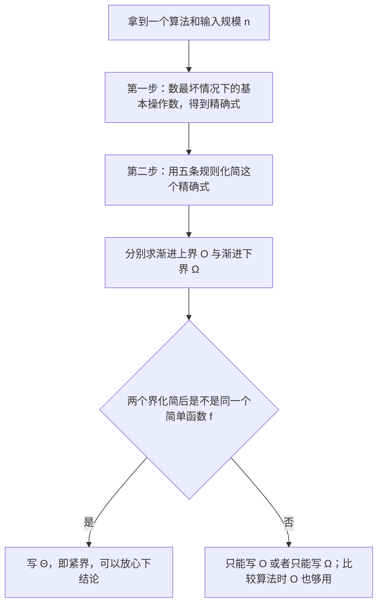

# CSC3100 Lecture 5 课堂笔记：Asymptotic Notations（渐进记号）

> 本讲内容完全来自课件 `lecture 5 (asymptotic notations).pdf`（共 32 页），不含教师口述内容。课件结构分六块：为什么要渐进分析（p.2-4）、数基本操作的三个例子（p.5-7）、Big-Oh（p.8-19）、Big-Omega（p.20-26）、Big-Theta（p.27-29）、最坏情况分析的标准流程（p.30-31）。课件里有若干笔误与不一致（p.17 表格把 $2^8$ 印成 235、p.11 公式框文字被裁切、p.32 阅读作业疑似与上一讲重复等），已在文末「诚实备注」中逐条列出。本文正文里凡标注「我的补充」的地方，都是课件没写、由我推导或补全的。

## 0. 一句话概括本讲在讲什么

前几讲我们写了几个算法（数组求和、线性搜索、找最大子数组和），也数过它们要做多少次基本操作。数出来的式子越来越难看：$4n+4$、$4n+3$、$3n^2+8n+5$。这一讲要回答的问题是：**这些式子能不能只保留"增长的量级"，把常数因子和低次项全部扔掉？**

答案就是三套渐进记号（asymptotic notations）——$O$（渐进上界，upper bound）、$\Omega$（渐进下界，lower bound）、$\Theta$（上下界一致，即紧界 tight bound）。它们本身不解决任何新问题，但它们定义了整门课之后**讨论效率的统一语言**：老师后面说"快排平均 $O(N\log N)$"、"哈希表查找 $O(1)$"、"链表插入 $O(1)$"，用的都是这套语言。所以这一讲是工具课，学的是"怎么说话"而不是"怎么算题"。反过来说，这一讲的概念如果没吃透，后面每一讲的复杂度讨论都会变成背结论。

课件自己在 p.7 给出了这一讲存在的理由：数出来是 $3n^2+8n+5$ 这样的式子，"太复杂了——我们需要渐进分析"。

## 1. 从"跑实验"到"数操作"（p.2-4）

### 1.1 朴素做法：跑实验（experiment），以及它为什么不可靠

评估一个算法"快不快"最直觉的办法，就是把程序写出来、跑一遍、掐表。课件说这是**朴素做法（naive approach）**，并且立刻指出它的三个问题。

第一，**它要求先把算法实现出来并运行**。这在算法设计阶段是做不到的——我们往往还没决定用哪个算法，就是想让分析告诉我们该选哪个。

第二，**实验结果未必能代表其他输入**。课件原话是"结果可能无法指示那些没有包含在实验里的输入的运行时间"。举个具体的例子：你用一个已经排好序的百万级数组去测排序算法，测得的时间和用随机数组测出来的可能差好几个量级。你测的是"这一个输入"，而算法面对的是"所有输入"。

第三，也是课件最强调的一点：**要让两个算法的比较公平**，必须满足两个条件——两个算法由**同一个人用同一种编程语言**实现，并且在**相同的硬件和软件环境**下评测。这一条其实是在说：实验法测出来的差异里混杂了太多与算法本身无关的东西（编程水平、编译器优化、CPU 主频、缓存大小……），你很难把这些噪音剥干净。课件在这一页配了两张图（一台台式机、一排服务器机柜），暗示"换个机器结果就变了"。

### 1.2 基本操作（basic operation）与"常数时间"假设

既然实验法不行，就得换一条路：**不去测时间，而是去数操作**。课件第 3 页列出了"算法里哪些东西算一次基本操作"：

| 类别 | 课件给的例子 | 怎么算 |
| --- | --- | --- |
| 算术运算（arithmetic operations） | `a+b*c+d/e`、`a mod 7` | 每个运算符算一次 |
| 给变量赋值（assigning a value to a variable） | `x ← 3` | 一次 |
| 数组下标访问 / 访问对象或结构体的成员 | `arr[i]`、`arr.length`、`student.name` | 一次 |
| 调用一个方法（calling a method） | `x ← factorial(n)` | **一次** |
| 从方法返回（returning from a method） | `return y` | 一次 |
| 比较（comparison） | `x==y`、`x>y`、`x<y`、`x>=y`、`x<=y`、`x!=y` | 一次 |

课件在这一页右下角放了一个蓝色框，写着全讲最关键的一条假设：**每一次基本操作都花常数时间（constant time）**。也就是说，不管机器快慢、不管操作是加法还是比较，一律当作"1 个单位时间"。这条假设看起来很粗糙，但正是它把"计时"这件依赖硬件的事，变成了"数数"这件纯数学的事。

这里有两点值得单独拎出来说，因为课件只是一笔带过：

第一，**"调用一个方法"被算作一次操作**，这一点初看很可疑——如果被调用的 `factorial(n)` 自己要跑一万年呢？课件的做法是：分析**当前这个算法**时，把被调用的方法视作一个基本单位，它的内部代价不在这一层计算。等我们要分析那个被调用的方法本身时，再单独去数它。（递归函数的正确分析需要"递推式"这套工具，本讲没有涉及——我在文末的覆盖度判断里把它列成了"不够"的部分。）

第二，**数组下标访问算一次、数组元素的赋值算一次，所以 `maxSum = A[0]` 算两次**（一次 `A[0]` 的访问、一次赋值），而 `tempsum = 0` 只算一次（纯赋值，没有访问数组）。这个细节是后面 2.1 和 2.4 两处算术能不能对上课件数字的关键，务必记住。

### 1.3 最坏情况分析（worst-case analysis）

课件第 4 页用问答形式交代了整个分析框架：

**为什么分析最坏情况？** 课件的回答很形象：想象你用 Google 搜索，结果它要 100 秒才返回——这种事哪怕只发生一次也足以毁掉产品。对用户能感知到的系统来说，最坏的那一次才是决定体验的那一次。

**为什么不分析平均情况？** 课件的回答只有一句："因为它常常和最坏情况一样糟（it is often as bad as the worst case）"。这是一个**断言，不是论证**——课件没有给任何证明或例子，我在文末把它记为"不够"的部分之一。

**那具体怎么做？** 课件给了四条：用伪代码（pseudocode）描述算法；把运行时间表达成**输入规模 $n$ 的函数**；考虑**所有可能的输入**（而不是某一个）；并且让这个度量**与硬件/软件环境无关**。

这四条合起来就是"渐进分析"的全部工作方式：不测时间，数操作；不看某个具体输入，看随 $n$ 增长的趋势；不管机器，只管操作次数。

## 2. 数基本操作：从 4n+4 到 3n²+8n+5（p.5-7）

### 2.1 求和算法：4n+4 是怎么数出来的

课件第 5 页给出的第一个例子是数组求和：

```text
sum(A, n)
1  tempsum = 0
2  for i = 0 to n - 1
3      tempsum += A[i]
4  return tempsum
```

课件逐行给出了操作次数，并特别解释了两种"看着奇怪"的数字：

| 行 | 代码 | 操作次数 | 为什么是这个数 |
| --- | --- | --- | --- |
| 1 | `tempsum = 0` | $1$ | 一次赋值 |
| 2 | `for i = 0 to n-1` | $2n+2$ | 给 $i$ 赋初值 $0$ **一次**；$i$ 自增 $n$ 次；比较 $i<n$ 共 $n+1$ 次（多出来的那一次是循环退出时的判负） |
| 3 | `tempsum += A[i]` | $2n$ | 访问 `A[i]` $n$ 次 + 加到 `tempsum` $n$ 次 |
| 4 | `return tempsum` | $1$ | 一次返回 |

加起来：

$$
1 + (2n+2) + 2n + 1 = 4n + 4
$$

这里最值得琢磨的是第 2 行那个 $2n+2$。很多人第一次看会觉得"循环跑了 $n$ 次，所以是 $n$ 次操作"，但课件把循环头（loop header）拆成了三件事：**初始化一次、自增 $n$ 次、比较 $n+1$ 次**。为什么比较是 $n+1$ 次而不是 $n$ 次？因为最后一次比较（$i=n$ 时判断 $i<n$ 为假）虽然没进循环体，但它确实执行了。课件在页面上用红色标出 `once`、`n`、`n+1` 三个数字，还把这段展开成 C 风格的 `for (i=0; i<n ; i++)` 来对照，就是为了说明这件事。

课件在页脚给了一句坦白的话：**"数详细的操作次数很烦人，我们稍后会展示如何简化这个过程。"** 这句话就是本讲后面全部内容的引子——简化过程就是渐进记号。

我按课件的这三条计数约定写了一个小模拟程序逐项累加，$n=1,\dots,8$ 得到的序列是 $8,12,16,20,24,28,32,36$，与 $4n+4$ 逐项相同，确认这条公式没有笔误。

### 2.2 输入规模（input size）

课件第 6 页澄清了 $n$ 到底是什么。它把 $n$ 定义为**算法能够访问到的元素个数**，并特意讨论了一个反直觉的细节：**传进来的其实只是一个指针**（a pointer of an array is passed as the input），但因为我们通过这个指针可以访问数组里全部 $n$ 个元素，所以输入规模就是 $n$。

这一点值得展开，因为它和上一讲（Lecture 3）的"Java 永远传值、传对象时复制的是引用"是同一件事的两面。形参里躺着的只是一个地址（4 或 8 个字节，与 $n$ 无关），但**算法能做的事**取决于它通过这个地址能触到多少数据。所以"输入规模"量的不是"传了多大的东西进来"，而是"算法要处理多少东西"。这也是为什么后面分析链表、树、图的时候，$n$ 依然是"节点数 / 元素数"这类东西。

### 2.3 线性搜索：同一个 n，不同输入，代价不同

课件第 6 页的下半部分给出第二个例子——线性搜索：

```text
LinearSearch(A, n, searchnum)
1  for i = 0 to n - 1
2      if A[i] == searchnum
3          return i
4  return -1
```

课件配了一个具体的数组 $3,7,9,12,13,18,20,23,27$，并对比 `searchnum = 3` 与 `searchnum = 20` 两种情形，点出结论：**基本操作次数取决于 `searchnum` 这个值出现在数组的什么位置**（The number of basic operations depends on where the searchnum value is in the given array）。

这就是 1.3 那四条里"考虑所有可能的输入"的含义：同样是 $n=9$，找开头的元素一次就返回，找不存在的元素要扫完整整一遍。这也是我们必须选一个"代表"来做分析的原因——选最坏情况，就是把"扫完一遍"当成标准。

课件在后面第 30 页补上了这个算法的计数结果：**$4n+3$**。课件没有展示这个数字怎么来的，我按 1.2 的约定复算了一遍（记 $T(n)$ 为最坏情况操作数）：

- 循环头 `for i = 0 to n-1`：初始化 $1$ + 自增 $n$ + 比较 $n+1$ $= 2n+2$；
- 第 2 行 `if A[i] == searchnum`：每次循环要访问 `A[i]`（$1$）再比较（$1$），共 $2n$；
- 第 3、4 行：无论走哪条路，**只有一个** `return` 会执行，计 $1$。

$$
T(n) = (2n+2) + 2n + 1 = 4n+3
$$

注意最后一条：最坏情况（找不到，或目标在末尾）下，返回语句只执行一次——要么执行第 3 行 `return i`，要么执行第 4 行 `return -1`，不会两次都执行。这个"取其一"的判断，是 4n+3 而不是 4n+4 的原因（对比 2.1 里求和的 $4n+4$，那里第 3 行循环体多出的 $2n$ 让总数正好多 1）。

### 2.4 maxSubArraySum：3n²+8n+5（含我的独立复算）

课件第 7 页给了一道练习题：求下面这个算法**最坏情况下**的基本操作数。

```text
maxSubArraySum(A, n)
1  maxSum = A[0]
2  for i = 0 to n - 1
3      subSumFromI = 0
4      for j = i to n - 1
5          subSumFromI += A[j]
6          if subSumFromI > maxSum
7              maxSum = subSumFromI
8  return maxSum
```

这是一个暴力做法：枚举所有"从 $i$ 开始"的子数组，逐个累加并记录最大值。课件给出的逐行计数是：

| 行 | 代码 | 操作次数 | 备注 |
| --- | --- | --- | --- |
| 1 | `maxSum = A[0]` | $2$ | 数组下标访问 $1$ + 赋值 $1$（对比 2.1 第 1 行只算 $1$） |
| 2 | 外层 `for` | $2n+2$ | 同 2.1 的循环头算法 |
| 3 | `subSumFromI = 0` | $n$ | 外层每转一圈执行一次，共 $n$ 次 |
| 4 | 内层 `for` | $(2n+2)+(2(n-1)+2)+\cdots+(2\cdot 1+2)$ | 当 $i$ 取 $0,1,\dots,n-1$ 时内层循环要走 $n, n-1, \dots, 1$ 次，每次循环头仍是 $2k+2$ |
| 5 | `subSumFromI += A[j]` | $2(n+(n-1)+\cdots+1)$ | 每次执行：访问 `A[j]` + 加法，共 $2$；总执行次数是 $n+(n-1)+\cdots+1$ |
| 6 | `if subSumFromI > maxSum` | $n+(n-1)+\cdots+1$ | 每次执行一次比较 |
| 7 | `maxSum = subSumFromI` | $n+(n-1)+\cdots+1$ | **最坏情况假设每次都进这个分支**，故与第 6 行同次数 |
| 8 | `return maxSum` | $1$ | 一次返回 |

把第 4、5、6、7 行的求和式算开：

$$
\sum_{k=1}^{n}(2k+2) = 2\cdot\frac{n(n+1)}{2} + 2n = n^2 + 3n
$$

$$
2\sum_{k=1}^{n} k = 2\cdot\frac{n(n+1)}{2} = n^2 + n
$$

而第 6、7 行各自是 $\sum_{k=1}^{n} k = \frac{n(n+1)}{2}$，两者相加正好等于 $n(n+1) = n^2+n$。于是总数：

$$
2 + (2n+2) + n + (n^2+3n) + (n^2+n) + n^2 + n + 1 = 3n^2 + 8n + 5
$$

**我对这个结果做了独立复算**：写了一个按上述约定逐项累加的模拟程序，$n=1,\dots,10$ 得到 $16,33,56,85,120,161,208,261,320,385$，与 $3n^2+8n+5$ 逐项相同。课件这一页的数字是自洽的。

这里有两个容易被忽略但要紧的细节。第一，**第 1 行算 $2$ 次而不是 $1$ 次**，因为 `A[0]` 是一次数组访问，赋值是另一次——这一点如果搞错，总数会变成 $3n^2+8n+4$，跟课件差 1（我第一次复算就正好差在这里）。第二，**第 7 行按"最坏情况每次都执行"来计**，这是最坏情况分析的直接体现：第 6 行的判断在最坏时永远为真（例如数组里全是正数，前缀和单调上升时），于是第 7 行每次都执行。

课件在这一页底部的蓝框里写下这一讲的动机：**"上面的表达式太复杂了——我们需要渐进分析。"** 顺带说一句（这是我的补充，课件没做）：这个 $3n^2+8n+5$ 其实已经足够回答"这个算法快不快"了——它显然是 $\Theta(n^2)$，因为双重循环的枚举次数是 $n+(n-1)+\cdots+1=\frac{n(n+1)}{2}$ 个子数组，每个子数组的代价与长度成正比。课件只是没有往下走这一步，把它留给了本讲后面的记号来回答。

## 3. Big-Oh（$O$）：渐进上界（p.8-19）

### 3.1 定义

课件第 8 页先解释了"asymptotic"这个词本身的含义：**当表达式里的变量趋于某个极限时，函数逼近某个值或某种状态**。第 9 页给出 Big-Oh 的定义：

$$
g(n) = O(f(n)) \quad \text{当且仅当存在正的常数 } c \text{ 与 } n_0 \text{，使得对所有 } n \ge n_0 \text{ 都有 } g(n) \le c\cdot f(n)
$$

这句话里的每一个符号都要掰开看：

$g(n)$ 是**我们真正数出来的那个复杂的运行时间函数**（比如 $3n^2+8n+5$）；$f(n)$ 是**我们想用来代替它的简单函数**（比如 $n^2$）；$c$ 是一个**正的常数因子**，允许我们"放大" $f(n)$ 来盖住 $g(n)$；$n_0$ 是一个**门槛（threshold）**，只要求不等式在 $n$ 足够大之后成立。

课件给了两条"含义"式的解读，这是全讲最需要在脑子里过一遍的两句话：

第一，**$n \ge n_0$ 意味着只关心足够大的输入规模**。小于 $n_0$ 的部分爱怎样怎样，不管。图上的画法是：$g(n)$ 一开始可能跑在 $c\cdot f(n)$ 上面（或者忽上忽下），但过了 $n_0$ 之后永远待在下面。

第二，**$g(n) \le c\cdot f(n)$ 意味着 $g(n)$ 的增长速度不超过那个简化函数 $f(n)$ 的常数倍**。课件在图上把 $c\cdot f(n)$ 画在 $g(n)$ 上方，并用虚线标出 $n_0$ 那个交点位置。

所以 Big-Oh 说的是一件**单方面**的事：**$g(n)$ 渐进地不比 $f(n)$ 长得快**。这也是课件反复强调的措辞——"grows asymptotically no faster than"。注意"no faster"而不是"as fast as"：$O$ 只给上界，它不保证这个上界是紧的。这一点是整讲的暗线，到 3.9 和 4.5 会两次变成主角。

还有一个隐含前提值得写下来（课件没写）：既然 $c>0$ 且要求 $g(n) \le c f(n)$ 对足够大的 $n$ 成立，那么当 $g$ 非负时，$f$ 在 $n \ge n_0$ 上也必须非负，否则不等式没法成立。所以"用 $O$ 描述复杂度"这件事暗中假定了我们讨论的都是非负函数——对运行时间来说这当然自动满足。

### 3.2 用定义证明的模板（两个例子）

课件第 10 页给了两个"用定义直接证"的例子，它们共享同一个套路：**找出 $c$ 和 $n_0$**。这个套路会重复出现四次以上，值得总结成模板：

> 要证 $g(n) = O(f(n))$，就构造一对 $(c, n_0)$，然后验证 $g(n) \le c f(n)$ 对所有 $n\ge n_0$ 成立。

**例一：任何线性函数都是 $O(n)$。** 设 $g(n) = a\cdot n + b$，其中 $a \ge 0,\ b \ge 0$，证明 $g(n) = O(n)$。

$$
g(n) = an + b \le an + bn = (a+b)\,n \quad (\text{对 } n \ge 1)
$$

所以在 $c = a+b$、$n_0 = 1$ 时定义被满足，得 $g(n) = O(n)$。这里的技巧是**把常数 $b$ 用 $b\cdot n$ 去盖**——只要 $n \ge 1$ 就有 $b \le bn$。注意 $b \ge 0$ 这个条件不能少：如果 $b$ 是负数，这个不等式就不成立了。（顺带说明一个细节：若 $a=0$ 且 $b=0$，则取 $c=1$ 即可，因为 $0 \le n$。）

**例二：对数的底数不影响复杂度。** 设 $a>1,\ b>1$，则 $g(n) = \log_a n = O(\log_b n)$。

证明用的是换底公式（change of base，第 1 讲讲义的数学复习里给过）：

$$
\log_a n = \frac{\log_b n}{\log_b a}
$$

由于 $a>1$ 保证 $\log_b a > 0$，取 $c = 1/\log_b a$、$n_0 = 1$，就有 $\log_a n = c\cdot\log_b n$ 对一切 $n\ge 1$ 成立（其实是恒等，比"$\le$"更强）。所以 $g(n) = \log_a n = O(\log_b n)$。

课件由此下结论：**底数不影响复杂度，$O(\log_b n) = O(\log n)$**。这一步用的是同一段里的"$=$"记号的一个不那么严格的用法——$O(\log_b n)$ 和 $O(\log n)$ 指的是同一个函数集合，写成"$=$"是说这两个集合相等。

不过课件这一页最后有一句话值得注意，它和第 1 讲的约定有出入，我把它记在文末的诚实备注里：本页写的是"Where you may assume $\log n = \log_{10} n$ or $\log_2 n$"（你可以假定 $\log n$ 是以 10 或 2 为底），而第 1 讲讲义第 41 页写的是"All log are to be base 2 unless specified otherwise"（除非另说，所有 $\log$ 都以 2 为底）。渐进意义下这两种说法并不冲突——既然换底只差常数因子，讨论复杂度时底数怎么写都行；但如果你想算 $n=1024$ 时 $\log n$ 具体等于几（比如对着 3.8 的表格核数字），就必须知道那里用的是**以 2 为底**。

### 3.3 规则 (i)：多项式规则（the biggest eats all）

课件第 11 页给出第一条实用规则。先给一个极限事实：**给定 $a > b \ge 0$，$n^a$ 比 $n^b$ 长得快**，写作

$$
\lim_{n\to\infty} \frac{n^b}{n^a} \to 0
$$

意思是"低次幂除以高次幂，比值趋于 0"——高次幂最终会把低次幂彻底压过去。

然后是规则本身：**如果 $g(n)$ 是一个次数为 $d$ 的非负多项式（non-negative polynomial），即 $g(n) = a_d n^d + a_{d-1}n^{d-1} + \cdots + a_1 n + a_0$，那么 $g(n)$ 是 $O(n^d)$。**

课件在页面右侧用红色标了这条规则的口诀：**"The biggest eats all"（最大的把其他都吃掉）**。也就是说，一个多项式写出来之后，只看最高次项，低次项全部忽略，系数也忽略。

课件的证明分四步，逐步把一个"带一堆项的式子"压成一个"常数乘 $n^d$"：

$$
g(n) = a_d n^d + a_{d-1}n^{d-1} + \cdots + a_1 n + a_0
$$

**第一步，把每项都换成绝对值**，因为 $x \le |x|$ 对一切实数成立：

$$
\le |a_d|\,n^d + |a_{d-1}|\,n^{d-1} + \cdots + |a_1|\,n + |a_0|
$$

**第二步，把 $n^d$ 提出来**（每一项都提出 $n^d$，剩下的就是 $\frac{1}{n},\dots,\frac{1}{n^d}$）：

$$
= n^d\left(|a_d| + |a_{d-1}|\cdot\frac{1}{n} + \cdots + |a_1|\cdot\frac{1}{n^{d-1}} + |a_0|\cdot\frac{1}{n^d}\right)
$$

**第三步，把括号里的分数全部放大成 1**，因为 $\frac{1}{n^i} \le 1$ 对一切 $n \ge 1,\ i \ge 0$ 成立：

$$
\le n^d\left(|a_d| + |a_{d-1}| + \cdots + |a_1| + |a_0|\right) \quad (\text{对任意 } n\ge 1)
$$

**第四步，读出定理。** 括号里是一个与 $n$ 无关的常数，令 $c = |a_d| + |a_{d-1}| + \cdots + |a_0|$、$n_0 = 1$，就得到 $g(n) \le c\cdot n^d$，即 $g(n) = O(n^d)$。

这四步里最漂亮的是第二步和第三步的配合：**提出最高次幂之后，剩下的部分是一个"随 $n$ 增大而变小、且被常数锁住"的量**。这其实是"最高次项吃掉一切"的代数本质——低次项相对 $n^d$ 的比值会趋于 0，所以它们加起来也只是 $n^d$ 的一个常数倍。

课件第 12 页给了四道练习，覆盖了这条规则的两个边界：

| $g(n)$ | 结论 | 为什么 |
| --- | --- | --- |
| $n^4 - n^3 + n^2$ | $O(n^4)$ | 最高次 $n^4$；注意 $-n^3$ 是**负的**，但绝对值步骤正是为了处理这种情形 |
| $1 + 1000000n + n^2$ | $O(n^2)$ | 系数 $1000000$ 再大也没用，$n^2$ 最终会赢 |
| $1 + 1000000n + n^{1.5}$ | $O(n^{1.5})$ | **非整数次幂（non-integer degree）也适用** |
| $1 + 1000000n^{0.3} + n^{0.5}$ | $O(n^{0.5})$ | 同上，比较的是幂次大小，不要求是整数 |

第二行和第三行值得停一下：$1000000n$ 与 $n^{1.5}$ 的比较，在 $n$ 小于一百万时前者更大，课件仍然说 $O(n^{1.5})$。这再一次提醒我们 $O$ 描述的**只是 $n\to\infty$ 的行为**，它允许常数因子任意大——这一点在 6.2 会展开成一个实践上的重要 caveat。

### 3.4 规则 (ii)：乘积性质（the big multiplies the big）

课件第 13 页给出乘积性质：若 $g_1(n) = O(f_1(n))$ 且 $g_2(n) = O(f_2(n))$，则

$$
g_1(n)\cdot g_2(n) = O\bigl(f_1(n)\cdot f_2(n)\bigr)
$$

口诀是**The big multiplies the big**（大的乘大的）。这个性质的证明很直接：$g_1 \le c_1 f_1$、$g_2 \le c_2 f_2$ 两式相乘，得 $g_1 g_2 \le (c_1c_2)(f_1 f_2)$，常数取 $c_1c_2$ 即可。

课件给的例子把多项式规则和乘积性质串在一起用：

$$
g(n) = (n^3+n^2+1)(n^7+n^{12})
$$

拆成 $g_1(n) = n^3+n^2+1$ 与 $g_2(n) = n^7+n^{12}$。对每个因子各用一次多项式规则：$g_1 = O(n^3)$、$g_2 = O(n^{12})$。再用乘积性质：

$$
g(n) = g_1(n)\cdot g_2(n) = O(n^3\cdot n^{12}) = O(n^{15})
$$

也就是说，**乘积的复杂度是两个因子各自复杂度的乘积**。这个性质在后面分析嵌套循环时会反复用到（外层 $n$ 轮、每轮做 $O(n)$ 的工作 $\Rightarrow$ 总共 $O(n^2)$）。

### 3.5 规则 (iii)：求和性质（the bigger of the two big）

课件第 14 页给出求和性质：若 $g_1(n) = O(f_1(n))$ 且 $g_2(n) = O(f_2(n))$，则

$$
g_1(n) + g_2(n) = O\bigl(\max(f_1(n),\, f_2(n))\bigr)
$$

口诀是**The bigger of the two big**（两个大的里取大的）。注意这里的 $\max$ 是**函数层面的取大**（取增长更快的那个函数），不是数值上的取大。

课件给的例子是

$$
g(n) = (n^3+n^2+1) + (n^4+n^7+n^{20}+n^{30})
$$

两个加数分别化简为 $O(n^3)$ 和 $O(n^{30})$，于是 $g(n) = O(\max(n^3,n^{30})) = O(n^{30})$。直觉上就是"一个 $n^{30}$ 的量级把 $n^3$ 的量级完全淹没了"。

这一页最后一句是最容易被忽略的一句：**"我们可以很容易地把它推广到 $g(n) = g_1(n)+g_2(n)+\cdots+g_c(n)$、即常数个 $c$ 个函数相加的情形。"** 关键词是"**常数个**"。这个限制在 3.9 会被用来构造一个典型错误——那里正是把 $n$ 个函数相加，才推出了荒谬的结论。

### 3.6 规则 (iv)：log 只赢常数

课件第 15 页处理对数与幂的对比。极限事实是：**对数函数比幂函数长得慢**，

$$
\lim_{n\to\infty} \frac{(\log n)^a}{n^b} \to 0 \quad (\text{对任意 } a,b > 0)
$$

注意这里分子是 $(\log n)^a$——**对数的任意次幂**——而不是 $\log(n^a)$。这两种写法差别很大：$\log(n^a) = a\log n$（换底/幂的法则，只是一个常数倍），而 $(\log n)^a$ 是"对数本身取了 $a$ 次方"。课件要表达的是更强的意思：**哪怕你把 $\log n$ 自乘一万次，它也追不上 $n^{0.0001}$**。

由此得到两条规则：

$$
g(n) = (\log n)^a + n^b \ (a,b>0) \implies g(n) = O(n^b)
$$

$$
g(n) = (\log n)^a + b\cdot(\log n)^x \ (b>0,\ a > x \ge 0) \implies g(n) = O\bigl((\log n)^a\bigr)
$$

第一条说：对数项和幂项相加，幂项赢。第二条说：两个对数项相加，取幂次大的那个（此时系数 $b$ 无关紧要）。

课件给的口诀是**log only beats constant**（对数只打得过常数）。这句话很有信息量：在课件的排序里，$\log$ 这种增长极慢的函数，**唯一能稳压的就是常数**；只要对手是任何正次幂（哪怕 $n^{0.0000001}$），对数就输。

课件的例子是 $g(n) = (\log n)^2 + n^{0.0001}$，取 $a=2,\ b=0.0001$，得 $O(n^{0.0001})$。这个指数小得几乎看不出增长，但它仍然赢过了 $(\log n)^2$。

### 3.7 规则 (v)：指数赢过幂

课件第 16 页处理指数与幂的对比。极限事实是：**指数函数比幂函数长得快**，

$$
\lim_{n\to\infty} \frac{n^k}{a^n} \to 0 \quad (\text{对 } a>1 \text{ 与任意 } k)
$$

注意这里的"任意 $k$"——**幂的指数可以任意大**，$n^{10000}$ 也一样会被 $2^n$ 追上并甩开。这是本讲里增长最悬殊的一对关系。

两条规则：

$$
g(n) = a^n + n^b \ (a>1) \implies g(n) = O(a^n)
$$

$$
g(n) = a^n + b^n \ (a > b > 1) \implies g(n) = O(a^n)
$$

口诀是**Exponential beats powers**（指数打败幂）。课件给了两个例子并现场验算了一第二个：

$g(n) = 2^n + n^{10000}$ 得 $O(2^n)$；$g(n) = 2^n + 3^n$ 得 $O(3^n)$——理由是取 $c=2$、$n_0=1$，

$$
g(n) = 2^n + 3^n \le 3^n + 3^n = 2\cdot 3^n \quad (\text{对 } n_0 \ge 1)
$$

这里用的手段和 3.2 的例一完全一样：**把小的那一项用大的那一项盖住**（$2^n \le 3^n$），剩下的常数就吸收进 $c$。这个"用大盖小"的手法值得记成套路，它在 $O$ 的几乎所有直接证明里都会出现。

### 3.8 常见函数类与它们的增长顺序

课件第 17 页把上面五条规则拼成一张完整的图景。上半部分左侧是一张曲线图，六条曲线从陡到缓依次是 $2^n$、$n^3$、$n^2$、$n\log_2 n$、$n$、$\log_2 n$；右侧是一张数值表，让同一组函数类在具体的 $n$ 上比一比大小：

| 函数类 | $n=1$ | $n=2$ | $n=4$ | $n=8$ | $n=16$ | $n=32$ |
| --- | --- | --- | --- | --- | --- | --- |
| $O(1)$ | 1 | 1 | 1 | 1 | 1 | 1 |
| $O(\log_2 n)$ | 0 | 1 | 2 | 3 | 4 | 5 |
| $O(n)$ | 1 | 2 | 4 | 8 | 16 | 32 |
| $O(n\log_2 n)$ | 0 | 2 | 8 | 24 | 64 | 160 |
| $O(n^2)$ | 1 | 4 | 16 | 64 | 256 | 1024 |
| $O(n^3)$ | 1 | 8 | 64 | 512 | 4096 | 32768 |
| $O(2^n)$ | 2 | 4 | 16 | **256** | 65536 | 4294967296 |

这张表比任何公式都直观。看 $O(2^n)$ 那一行：$n$ 从 16 到 32 只翻了一倍，值却从 65536 暴涨到约 43 亿（$4.29\times 10^9$）。再看 $O(n\log_2 n)$ 那一行：$n=32$ 时才 160，和 $O(n^2)$ 的 1024、$O(n^3)$ 的 32768 完全不在一个量级。这正是"为什么归并排序（$O(n\log n)$）值得写"的量化理由。

**这张表里有一个数字印错了**：$O(2^n)$ 在 $n=8$ 处课件印的是 **235**，而 $2^8 = 256$。我已用 420 dpi 放大重渲染核对该格，确认是 235 而非 256，并在上表中按正确的 256 列出。其余各格我逐格复算过，都与课件一致（细节见诚实备注三）。

表格下面的部分是课件给出的复杂度类名称，按从好到坏（BETTER 在上、WORSE 在下）排列：

| 记号 | 名称 | 中文 |
| --- | --- | --- |
| $O(1)$ | constant time | 常数时间 |
| $O(\log n)$ | log time | 对数时间 |
| $O(n)$ | linear time | 线性时间 |
| $O(n\cdot\log n)$ | log linear time | 对数线性时间 |
| $O(n^2)$ | quadratic time | 平方时间 |
| $O(n^3)$ | cubic time | 立方时间 |
| $O(2^n)$ | exponential time | 指数时间 |

这张清单是整门课的"尺子"：之后每次我们说某个数据结构"快"或"慢"，说的就是它落在这一列的哪个位置。

### 3.9 $O$ 不是紧界：两个典型错误

课件第 18、19 两页专门用"典型错误（typical mistakes）"来点破 $O$ 的一个重要性质：**它只是一个上界，不唯一、也不紧。**

**第 18 页的练习**：判断 $g(n) = 2n = O(n^2)$ 是否成立。答案是**成立**，而且证法很短：

$$
2n \le cn^2 \iff 2 \le cn
$$

取 $c=2$、$n_0=1$，就得到 $2n \le 2n^2$ 对一切 $n\ge 1$ 成立。所以 $2n = O(n^2)$。

学生在这里的直觉会抗议："可 $2n$ 不是 $O(n)$ 吗？"课件的回答是：**$O$ 表示的是 $g(n)$ 增长率的某个上界，而上界可以有很多个**。

$$
g(n) = 2n = O(n\log n) = O(n^2) = O(n^3) = O(2^n)
$$

上面这一串全都成立。所以"$g = O(f)$"这句话本身**不携带紧的信息**——知道一个算法是 $O(n^2)$，不代表它不是 $O(n\log n)$。课件由此引出下一半的内容：**"但我们想找最紧的那个"，而这需要引入增长率的下界**——这就是第 4 节的 $\Omega$。

**第 19 页的两个典型错误**，都是"把 $O$ 当成等式用"造成的。

**错误一：对 $f(n) = \sum_{i=1}^{n} 1$ 误用求和性质。** 让 $g_1 = g_2 = \cdots = g_n = 1$，每个都是 $O(1)$，于是有人用求和性质得

$$
O(f(n)) = O(\max(1,1,\ldots,1)) = O(1)
$$

但这是错的，因为 $f(n) = n$ 显然**不等于** $O(1)$（$n$ 是发散的，$1$ 不是）。**错在哪里？** 课件给的理由是：**函数的个数依赖 $n$**——这里有 $n$ 个函数相加，而求和性质的前提是"**常数个**函数相加"（见 3.5 结尾那句话）。$n$ 不是常数，所以规则不适用。

这个例子很有教育意义：求和性质之所以只在常数个函数时成立，是因为"取 $\max$"这个操作在项数固定时才能一次性做完；当项数本身随 $n$ 增长时，$\max$ 的大小会跟着变，规则就失效了。（顺便说一句，正确的做法是把这个和当成一个整体去分析：$\sum_{i=1}^n 1 = n = O(n)$。）

**错误二：从 $2n = O(n^2)$ 和 $3n^2 = O(n^2)$ 推出 $2n = 3n^2$。** 两个式子都对，但把"$=$"当传递关系用就荒谬了。课件的回答只有一句话：**"Big-Oh is just a notation!"（Big-Oh 只是一种记号而已）**——它不是一个真正的等号，不能像代数里的等号那样两边同时使用、互相代入。

更精确的说法（这是我的补充，课件没有展开）：$g(n) = O(f(n))$ 里的"$=$"其实应该读作"$\in$"或"是"。严谨的写法是把 $O(f(n))$ 理解成**一族函数的集合** $\{h : \exists c,n_0,\ \forall n\ge n_0,\ h(n)\le c f(n)\}$，而 $g(n) = O(f(n))$ 说的是 $g \in O(f)$。这样一看就清楚了：$2n \in O(n^2)$、$3n^2 \in O(n^2)$，两个元素同属一个集合，但它们彼此之间毫无关系——正如"张三住在北京、李四也住在北京"推不出"张三是李四"。同理，3.2 里写的 $O(\log_b n) = O(\log n)$ 是"集合相等"，而 $2n = O(n^2)$ 是"元素属于集合"，两种"$=$"的含义其实是不同的——这是这套记号最混乱、也最容易考倒人的地方。

## 4. Big-Omega（$\Omega$）：渐进下界（p.20-26）

### 4.1 定义

课件第 21 页给出 Big-Omega 的定义，它和 Big-Oh 只差一个不等号的方向：

$$
g(n) = \Omega(f(n)) \quad \text{当且仅当存在正的常数 } c \text{ 与 } n_0 \text{，使得对所有 } n \ge n_0 \text{ 都有 } g(n) \ge c\cdot f(n)
$$

解读方式与 3.1 完全对称：$f(n)$ 依然是我们想用的简单函数，但这次要求它在乘以常数之后**永远待在 $g(n)$ 下面**。课件给的两句话是：

第一，**$g(n)$ 渐进地不比 $f(n)$ 长得慢**（grows asymptotically no slower than $f(n)$）。注意"no slower"和 $O$ 的"no faster"正好是一对。

第二，"**$c\cdot f(n)$ 比 $g(n)$ 长得慢；$g(n)$ 会在某一点超过 $c\cdot f(n)$，我们把这一点记作 $n_0$**"。课件的配图与第 9 页相反：这次走在前面的直线是 $g(n)$，而 $c\cdot f(n)$ 是那条先被压在下面的曲线，$n_0$ 是两条线交叉的位置。

所以 $\Omega$ 说的是：**$g(n)$ 至少和 $f(n)$ 一样快（增长得一样快或更快）**。它是"下界"——保证算法不会比这个更快地增长。

### 4.2 两个证明

课件第 22 页给了两道题，一道正、一道反，用的都是 3.2 的"找 $c,n_0$"模板。

**例一：线性搜索的运行时间是 $\Omega(n)$。** 已知 $g(n) = 4n+3$（就是 2.3 里数出来的那个数），要证 $g(n) = \Omega(n)$。取 $c=4$、$n_0=1$：

$$
g(n) = 4n + 3 \ge 4n \quad (\text{对 } n \ge 1)
$$

定义被满足，故 $g(n) = \Omega(n)$。这里的手法是把 $+3$ 直接丢掉——不等式方向对 $\Omega$ 有利时，**扔掉正项是无害的**（对比 3.2 例一里为了 $O$ 要把 $b$ 放大成 $bn$，方向正好相反）。

**例二：$g(n) = 2n$ 不是 $\Omega(n^2)$。** 这是本讲第一个"证明不成立"的例子，用的是反证法（proof by contradiction）：假设 $g(n) = \Omega(n^2)$ 成立，那就必须存在正的常数 $c$ 与 $n_0$，使得

$$
g(n) = 2n \ge cn^2 \quad (\text{对所有 } n \ge n_0)
$$

两边同除以 $n$（$n>0$），等价于

$$
2 \ge c\cdot n \quad (\text{对所有 } n \ge n_0)
$$

课件在此打住，说："**然而 $c$ 是一个常数，上面的不等式不可能永远成立，矛盾。因此 $g(n)\ne\Omega(n^2)$。**"

课件这句"不可能永远成立"是**结论式的一句话，没有把最后一步写出来**。我把这半步补上（我的补充）：对任意固定的 $c>0$，只要取一个 $n$ 同时满足 $n \ge n_0$ 与 $n > 2/c$，就有 $cn > 2$，即 $2 \ge cn$ 不成立——这一个反例就足以推翻"对所有 $n\ge n_0$ 成立"。既然**无论怎么选 $(c, n_0)$ 都会被打脸**，定义的第二个条件永不满足，所以 $2n \ne \Omega(n^2)$。

这个证明的结构值得记住：**证 $\Omega$ 时用构造法（给出 $c, n_0$），证"非 $\Omega$"时用反证法加"找一个足够大的 $n$ 作为反例"**。两者是同一件事的正反面。

### 4.3 $\Omega$ 与 $O$ 的对偶关系

课件第 23 页给出两条对称的定理：

$$
g(n) = \Omega(f(n)) \implies f(n) = O(g(n))
$$

$$
g(n) = O(f(n)) \implies f(n) = \Omega(g(n))
$$

也就是说，**$O$ 和 $\Omega$ 只差"把两个函数互换位置"**。课件给了第一条的证明：由 $\Omega$ 的定义，存在正的 $c, n_0$ 使 $g(n) \ge c\cdot f(n)$ 对 $n \ge n_0$ 成立；两边同除以 $c$ 并整理得

$$
f(n) \le \frac{1}{c}\cdot g(n) \quad (\text{对 } n \ge n_0)
$$

取 $c' = 1/c$、$n_0' = n_0$，就得到 $f(n) \le c'\cdot g(n)$ 对 $n\ge n_0'$ 成立，按 $O$ 的定义即 $f(n) = O(g(n))$。课件说第二条同理。

这个对偶关系有一个很实际的用途：**它让你不必把 $\Omega$ 的性质重新学一遍**。任何一条关于 $O$ 的规则，把两个函数换个位置就能读出 $\Omega$ 的版本——这正是下一小节的依据。

### 4.4 五条规则平移到 $\Omega$

课件第 24、25 两页的标题就是一句断言：**"Big-Oh rules (i)–(v) all apply to Big-Omega"（$O$ 的五条规则全部适用于 $\Omega$）**。逐条对照：

| 规则 | 口诀 | $\Omega$ 版例子（课件原文） | 结论 |
| --- | --- | --- | --- |
| (i) 多项式规则 | the biggest eats all | $g(n) = n^3+n^2+n$ | $\Omega(n^3)$ |
| (ii) 乘积性质 | the big multiplies the big | $g(n) = (n+1)(n+n^5)$ | $\Omega(n\cdot n^5) = \Omega(n^6)$ |
| (iii) 求和性质 | the bigger of the two big | $g(n) = (n+1)+(n+n^5)$ | $\Omega(\max(n,n^5)) = \Omega(n^5)$ |
| (iv) log 只赢常数 | log only beats constant | $g(n) = n^{0.000001} + (\log n)^{1000}$；$g(n) = 0.00000001\cdot\log n + 100000$ | $\Omega(n^{0.000001})$；$\Omega(\log n)$ |
| (v) 指数赢过幂 | exponential beats powers | $g(n) = 1.00001^n + n^{999999}$；$g(n) = 3^n + 4^n$ | $\Omega(1.00001^n)$；$\Omega(4^n)$ |

这张表里的每一个例子都在强调 $\Omega$ 的直观：**它关心的是"至少能有多快"，所以取的是各项里增长最快的那个**（而不是像 $O$ 那样关心"最多能有慢"）。用"吃掉 / 取大"这类口诀时，两边取的方向其实是一致的——都是挑增长最快的那一项，只是它作为上界还是下界来用不同。

有一条**使用条件需要留意**，课件没有明说（我的补充）：**多项式规则用在 $\Omega$ 上时，需要最高次项的系数为正**（并且 $g$ 在 $n$ 足够大后非负）。理由很直接：$\Omega$ 要求 $g(n) \ge c\cdot n^d$，如果最高次项系数是负的（比如 $g(n) = -n^3+10n^2$），那么 $g$ 在 $n$ 大时会变成负数、越掉越深，根本不可能有正的 $c$ 让 $g(n)\ge c n^3$ 成立。课件所有例子都是正系数多项式，所以这条限制不会暴露出来。而 $O$ 版的多项式规则要求的是"非负多项式"（3.3），条件更宽——因为 $O$ 只需要 $f$ 盖在 $g$ 上面，$g$ 往下掉对不等式没有坏处。

另外，(v) 的第一个例子 $g(n) = 1.00001^n + n^{999999}$ 是最好玩的：底数 $1.00001$ 只比 1 大一点点，而这个 $n$ 又是 $n$ 的九十九万九千九百九十九次方，但 $\Omega(1.00001^n)$ 依然成立。这就是 3.7 那个"任意 $k$"的威力。

### 4.5 $\Omega$ 也不紧

课件第 26 页与 3.9 的 $O$ 形成完美对称：**和 $O$ 一样，$\Omega$ 也不紧**。

$\Omega$ 表示的是 $g(n)$ 增长率的**渐进下界**，而下界同样可以有多个：

$$
g(n) = n^3 = \Omega(n^2) = \Omega(n\cdot\log n) = \Omega(n) = \Omega(1)
$$

上面每一个都成立——$n^3$ 确实不低于 $n^2$、不低于 $n\log n$、不低于 $n$、不低于 $1$。所以"某个算法是 $\Omega(n)$"这句话也没有多少信息量，除非你能说明这就是最紧的那个下界。

课件在此下结论：**"我们需要更精确的记号。"** 这就是下一节 $\Theta$ 的铺垫。

顺便注意一下这里和 3.9 的对称结构：$O$ 那边是"上界有一串、我们想要最紧的"，$\Omega$ 这边是"下界有一串、我们想要最紧的"。**两边往中间一夹，就只剩一个了**——这就是 $\Theta$。

## 5. Big-Theta（$\Theta$）：把增长率卡紧（p.27-29）

### 5.1 定义

课件第 28 页给出 Big-Theta——它不是一个新的定义，而是 $O$ 与 $\Omega$ 的合力：

$$
\text{若 } g(n) = O(f(n)) \ \text{ 且 }\ g(n) = \Omega(f(n)) \text{，则 } g(n) = \Theta(f(n))
$$

也就是说，**当同一个 $f(n)$ 既是上界又是下界时，$g(n)$ 和 $f(n)$ 的增长率就是渐进相同的**（asymptotically the same）。课件把前两节的措辞并排摆出来做对照：$O$ 是"no faster than"、$\Omega$ 是"no slower than"，两者同时成立，$g$ 就只能和 $f$ "一样快"。

课件只给了这个"由 $O$ 与 $\Omega$ 合成"的定义，**没有给 $\Theta$ 的独立定义**。我把标准的等价写法补在这里（我的补充），它在做题时往往更好用：$g(n) = \Theta(f(n))$ 当且仅当存在正常数 $c_1, c_2$ 与 $n_0$，使得

$$
c_1\cdot f(n) \ \le\ g(n) \ \le\ c_2\cdot f(n) \qquad (\text{对所有 } n \ge n_0)
$$

用大白话说，就是"**$g$ 被 $f$ 的某个常数倍从上下两头夹住**"。有了这个形状，$\Theta$ 的性质就变得非常好记：$\Theta$ 是**唯一带"双向夹逼"含义的记号**，也因此只有它能说"这两件事的增长率一样"。

这里还有一个由 4.3 的对偶关系带来的便利（我的补充）：因为 $g = O(f) \wedge g = \Omega(f)$ 等价于 $g = \Theta(f)$，所以**用 $\Theta$ 时不必分别求两个界**——直接找一对 $c_1 \le c_2$ 把它夹住就行；反过来，一旦你用定义证明了 $g = O(f)$ 和 $g = \Omega(f)$，就自动得到了 $g = \Theta(f)$，不需要再做任何额外工作。

### 5.2 三个验证题

课件第 29 页给了三道题，要求验证（verify）它们成立。这三道题恰好覆盖了紧界判定的三种典型情形。

**第一题：$g(n) = 3n+4 = \Theta(n)$。** 用双常数定义直接夹：

$$
3n \ \le\ 3n+4 \ \le\ 4n \qquad (\text{对 } n \ge 4)
$$

左边是因为 $4\ge 0$，右边是因为 $4 \le n$。取 $c_1 = 3$、$c_2 = 4$、$n_0 = 4$，定义满足。（也可以走课件的老路：$O(n)$ 用 3.2 例一的结论、$\Omega(n)$ 用"扔掉正项"的手法，两边一合就是 $\Theta(n)$。）

**第二题：$g(n) = n\log n + 2n^2 = \Theta(n^2)$。**

下界：$g(n) \ge 2n^2$（丢掉非负项 $n\log n$，对 $n \ge 1$ 成立），取 $c_1 = 2$。

上界：对 $n \ge 2$ 有 $\log n \le n$（第 1 讲数学复习里给过 $\log x < x$），于是 $n\log n \le n^2$，得 $g(n) \le n^2 + 2n^2 = 3n^2$，取 $c_2 = 3$、$n_0 = 2$。

所以 $2n^2 \le g(n) \le 3n^2$，即 $g(n) = \Theta(n^2)$。这道题同时演示了 3.5 的求和性质怎么用：$n\log n$ 是 $O(n^2)$、$2n^2$ 是 $O(n^2)$，取 $\max$ 还是 $n^2$。

**第三题：$g(n) = (3n^2 + 2\sqrt{n})\cdot(n\log n + n) = \Theta(n^3\log n)$。** 这道题专门练乘积性质：两个因子各自化简，再把结果乘起来。

第一个因子：$3n^2 + 2\sqrt{n} = 3n^2 + 2n^{0.5}$，用多项式规则（注意 $2n^{0.5}$ 是非整数次幂，照样适用），得 $\Theta(n^2)$。

第二个因子：$n\log n + n$，其中 $n\log n$ 与 $n$ 相加，$\log n \ge 1$（$n\ge2$）时 $n\log n \ge n$，所以取大的那项，得 $\Theta(n\log n)$。

两者相乘：

$$
\Theta(n^2)\cdot\Theta(n\log n) = \Theta(n^3\log n)
$$

三道题做完，应该能感到 $\Theta$ 的用法其实非常机械：**把它拆成若干块、每块化简、再按乘/加规则拼回去**。这套"拆—化简—拼"的流程和 3.3–3.7 的五条规则是同一件事，只是换了记号方向。

## 6. 最坏情况分析的标准流程（p.30-31）

### 6.1 两步走

课件第 30 页把前面所有内容收成一个**两步流程**，这是本讲最实用的一页：

**第一步：把算法在最坏情况下的基本操作数，写成输入规模 $n$ 的函数。** 课件举的例子就是线性搜索——"我们数过，线性搜索的基本操作数是 $4n+3$"（这个数字的来历见 2.3）。

**第二步：用 Big-Oh 和 Big-Omega 分析它，如果可能的话导出 Big-Theta。** 课件在这里留了一句很诚实的话：**"我们可能没那么幸运，导出的 Big-Oh 和 Big-Omega 不是同一个东西。"** 那怎么办？课件说"见下一页"（即 6.2 第 31 页）。

这两步的完整流程，连同它里面的分支，可以用下面这张图概括（**这是我的整理，非课件内容**）：



这里补一个课件没做的示范（我的补充）：把这两步用在 2.4 的 `maxSubArraySum` 上。第一步得到的精确式是 $3n^2+8n+5$；第二步用多项式规则（3.3）和它的 $\Omega$ 版（4.4）分别得到 $O(n^2)$ 与 $\Omega(n^2)$；两者是同一个函数，于是

$$
3n^2+8n+5 = \Theta(n^2)
$$

结论：这个暴力枚举所有子数组的算法是**平方时间**的。课件在第 7 页只写到"表达式太复杂，我们需要渐进分析"，没有把这最后一步走完。

（顺带一句，超出本讲范围的背景：最大子数组和问题存在 $\Theta(n)$ 的解法——Kadane 算法，一次扫描、边扫边维护"以当前位置结尾的最大和"。这说明 2.4 那个 $\Theta(n^2)$ 并不是这个问题的下界，只是这个算法的代价。这是"渐进分析能帮你判断该不该继续优化"的一个例子。）

### 6.2 怎么比较两个算法

课件第 31 页给出渐进分析最终要服务的三件事。

**第一，$\Theta$ 相同的两个算法，可以认为一样好。** 课件给的例子是 $g_1(n) = 10000n = \Theta(n)$ 与 $g_2(n) = 9n = \Theta(n)$——两者都是 $\Theta(n)$，所以在渐进意义下"equally good"。

**第二，增长率更慢的算法在渐进意义下更快。** 课件说，$\Theta(\log n)$ 的算法比 $\Theta(n)$ 的算法"asymptotically better"，因为前者增长更慢，并给出一个具体例子：**二分搜索（binary search）在渐进意义下优于线性搜索（linear search）**。这也是本讲真正想让你带走的一个结论——同一件事（在有序数组里找一个数），换一种做法就能把 $n$ 降成 $\log n$。

**第三，当上下界不一时，用 $O$ 说事也凑合。** 课件说，如果没能导出 $O$ 和 $\Omega$ 相同，那么"less rigorously（不那么严格地）"我们仍然可以说 $O(\log n)$ 的算法比 $O(n)$ 的好。

关于第二点和第三点，有一个实践上很重要的 caveat 值得写下来（**我的补充，课件没有讨论**）：**渐进分析故意丢掉了常数因子，这在 $n$ 不够大时会误导人。** 第 31 页自己就给了素材——$10000n$ 和 $9n$ 都是 $\Theta(n)$、被判定为"一样好"，但如果你手上的数据只有几十个元素，$10000n$ 的实现实际会比 $9n$ 的实现慢一千倍。更极端的例子来自 3.3 那两道练习：$O(n^{1.5})$ 的那个式子里带着 $1000000n$，在 $n < 10^6$ 时它其实被这一项主导。所以"$\Theta$ 相同 ⇒ 一样好"这句话的正确读法是：**它只在 $n$ 足够大时成立；常数因子、缓存友好性、实现复杂度这些被渐进分析丢掉的东西，在真实工程里要靠实测补回来。**

## 7. 本讲要点小结

**渐进分析存在的理由是"实验法不可靠"。** 课件第 2 页给了三条理由：实验要求先实现算法、结果未必代表其他输入、以及公平比较需要同人同语言同环境。于是我们转向"数操作"：把每次算术、赋值、数组访问、方法调用、返回、比较都算作 1 次基本操作，并假设每次都是常数时间。再配上最坏情况（理由：Google 若 100 秒返回一次就完蛋；平均情况"常常和最坏一样糟"）和"与硬件无关"的要求，就是渐进分析的全部工作方式。

**三个计数例子的数字都要能自己数出来。** `sum` 是 $4n+4$（循环头 $2n+2$ = 初始化 1 + 自增 $n$ + 比较 $n+1$；循环体 $2n$ = 访问 + 加法）；线性搜索是 $4n+3$；`maxSubArraySum` 是 $3n^2+8n+5$。三个数字我都用模拟程序逐项复算过，与课件一致。**最容易错的一处是 `maxSum = A[0]` 要算 2 次**（下标访问 + 赋值），漏掉就会差 1。另外要记住输入规模的定义不是"传进来多大的东西"，而是"算法能访问到多少数据"。

**Big-Oh 是渐进上界，不紧、不唯一。** 定义是"存在 $c>0, n_0$，使 $n\ge n_0$ 时 $g(n)\le c f(n)$"；证明的套路永远是"构造一对 $(c,n_0)$"，而核心技术是"用大的项盖住小的项"。五条规则要背熟：多项式取最高次（the biggest eats all）、乘积各自取最高次再相乘（the big multiplies the big）、求和取两者中大的（the bigger of the two big，**仅限常数个函数**）、对数输给任何正次幂（log only beats constant）、指数赢过任意次幂（exponential beats powers）。常见函数类的顺序是 $1 \prec \log n \prec n \prec n\log n \prec n^2 \prec n^3 \prec 2^n$。

**Big-Omega 是渐进下界，与 $O$ 完全对称。** $g = \Omega(f) \iff f = O(g)$，而且 $O$ 的五条规则原样适用（取的方向仍是"挑增长最快的那项"）。要留意一个课件没提的条件：**$\Omega$ 版的多项式规则要求最高次项系数为正**。$\Omega$ 同样不紧（$n^3 = \Omega(1)$ 也成立）。

**Big-Theta 是 $O$ 与 $\Omega$ 的合体，也是唯一能说"增长率一样"的记号。** $g = \Theta(f)$ 等价于存在 $c_1 \le c_2$ 使 $c_1 f \le g \le c_2 f$（后一种写法是我补的，课件只给了"$O$ 且 $\Omega$"这个合成版定义）。p.29 三道题覆盖了三种情形：两边直接夹（$3n+4=\Theta(n)$）、用求和性质取大项（$n\log n+2n^2=\Theta(n^2)$）、用乘积性质分别化简再相乘（$(3n^2+2\sqrt{n})(n\log n+n)=\Theta(n^3\log n)$）。

**最后是两步流程**：先把最坏情况的操作数写成 $n$ 的函数，再用 $O$ 和 $\Omega$ 分析、能合就合并成 $\Theta$。合不上时，用 $O$ 比较也算"less rigorously"地够用。并且要记住那条 caveat：**$\Theta$ 相同只在 $n$ 够大时意味着"一样好"，常数因子在真实数据规模下可能是决定性的。**

**和上一讲预告对账**（我的核对）：上一讲（Lecture 4）第 32 页写的是"Next lecture: Complexity analysis, chapter 3"——本讲正是复杂度分析、且本讲第 32 页把"本周阅读"列为 Chapter 3。**预告完全命中。** 但本讲第 32 页又把"下一讲"写成 Chapter 2，这与上一讲自己的阅读作业（Chapter 2）重合，读起来像复制粘贴残留，见诚实备注一第 6 条。

---

## 本讲核心概念速查表

| 概念 | 英文原名 | 一句话解释 | 课件位置 |
| --- | --- | --- | --- |
| 基本操作 | basic operation | 算术、赋值、数组访问、方法调用、返回、比较，各计 1 次 | p.3 |
| 常数时间假设 | constant time | 每次基本操作都花相同的时间，与机器无关 | p.3 |
| 最坏情况分析 | worst-case analysis | 按"最坏的那个输入"来数操作，理由是用户能感知到最坏的一次 | p.4 |
| 输入规模 | input size | 算法能访问到的元素个数 $n$，不是"传进来多大的东西" | p.6 |
| Big-Oh | $O$ | 存在 $c,n_0$ 使 $n\ge n_0$ 时 $g(n) \le c f(n)$；渐进上界，不紧 | p.9 |
| 多项式规则 | the biggest eats all | 多项式取最高次项，系数与低次项全丢 | p.11 |
| 乘积性质 | the big multiplies the big | $O(f_1)\cdot O(f_2) = O(f_1 f_2)$ | p.13 |
| 求和性质 | the bigger of the two big | $O(f_1)+O(f_2) = O(\max(f_1,f_2))$，**仅限常数个函数** | p.14 |
| log 规则 | log only beats constant | $(\log n)^a$ 输给任何 $n^b\ (b>0)$；对数只赢得过常数 | p.15 |
| 指数规则 | exponential beats powers | $a^n$ 赢过任何 $n^k$；$a>b>1$ 时 $a^n + b^n = O(a^n)$ | p.16 |
| 复杂度类 | complexity classes | $1 \prec \log n \prec n \prec n\log n \prec n^2 \prec n^3 \prec 2^n$ | p.17 |
| Big-Omega | $\Omega$ | 存在 $c,n_0$ 使 $n\ge n_0$ 时 $g(n) \ge c f(n)$；渐进下界，不紧 | p.21 |
| $O$ 与 $\Omega$ 对偶 | duality | $g = \Omega(f) \iff f = O(g)$；$O$ 的规则原样适用于 $\Omega$ | p.23-25 |
| Big-Theta | $\Theta$ | $g = O(f)$ 且 $g = \Omega(f)$，即增长率渐进相同；唯一"双向夹逼"的记号 | p.28 |
| 两步流程 | steps for analysis | 先数最坏情况的操作数，再用 $O/\Omega$ 化简、能合就合成 $\Theta$ | p.30 |
| 二分搜索更优 | binary vs linear search | $\Theta(\log n)$ 渐进优于 $\Theta(n)$，是"换算法降量级"的标准例子 | p.31 |

## 核心直觉（如果只能记住五句话）

1. **渐进分析是"忽略常数、只看趋势"的艺术，而这份忽略有代价。** 它换来的是"不依赖硬件、能分析尚未实现的算法"，代价是 $10000n$ 和 $9n$ 被判成一样好。$n$ 不够大时，被丢掉的常数因子说了算。

2. **$O$ 只是上界，$\Omega$ 只是下界，两个都不紧。** $2n = O(n^2)$ 和 $n^3=\Omega(1)$ 都是真命题，所以"是 $O(\cdot)$"这句话本身信息量很低。只有 $\Theta$ 才在说"增长率就是这么多"。

3. **$g(n) = O(f(n))$ 里的"$=$"不是等号。** 该读成"$\in$"：$O(f)$ 是一族函数的集合，$g$ 属于它。一旦当成等号用，就会推出 $2n = 3n^2$ 这种荒唐结论。

4. **化简只看一件事：谁增长得最快。** 多项式的最高次项、乘积里各因子的最高次项、求和里最大的那项、$(\log n)^a$ 与 $n^b$ 取幂、$n^k$ 与 $a^n$ 取指数——五条规则都是同一句话的不同侧面。求和性质里那个"常数个函数"的限制，也正是"取最大"这件事在项数随 $n$ 增长时会失效。

5. **两个算法 $\Theta$ 相同就算一样好；增长率更慢的那个渐进更快。** 这就是为什么二分搜索优于线性搜索，也是整门课后面选数据结构的依据。

## 中英术语对照

| 中文 | 英文 |
| --- | --- |
| 渐进记号 / 渐进分析 | asymptotic notation / asymptotic analysis |
| 基本操作 | basic operation |
| 常数时间 | constant time |
| 伪代码 | pseudocode |
| 输入规模 | input size |
| 最坏情况 / 平均情况 | worst case / average case |
| 上界 / 下界 / 紧界 | upper bound / lower bound / tight bound |
| 增长率 | growth rate |
| 多项式 | polynomial |
| 乘积性质 / 求和性质 | product property / sum property |
| 常数因子 | constant factor |
| 换底公式 | change of base |
| 反证法 | proof by contradiction |
| 门槛阈值 | threshold $n_0$ |

## 附：诚实备注

以下内容**完全来自课件** `lecture 5 (asymptotic notations).pdf`（32 页），不含教师口述内容。凡是课件没写、由我推导或补充的地方，都在下面明确标出。

### 一、课件的笔误与不一致（共 6 处）

1. **第 17 页表格 $O(2^n)$ 一行的 $n=8$ 格印成 235，应为 256。** 这一格其余各值都对（$2^1=2$、$2^2=4$、$2^4=16$、$2^{16}=65536$、$2^{32}=4294967296$），只有 $2^8$ 被写成 235。我用 420 dpi 放大重渲染该格逐字核对过，确认不是我看错。本文正文表格已按正确的 256 列出。

2. **第 11 页公式框内的文字溢出被裁切。** 框内写"If $g(n)$ is a non-negative polynomial of degree $d$, i.e., $g(n) = a_d\cdot n^d + a_{d-1}\cdot n^{d-1}$"，后半段"$+ \cdots + a_1\cdot n +$"跑出了页面右缘被切掉，下一行单独剩下"$a_0$"。读起来像"多项式只定义到 $a_0$ 为止"，实际是排版溢出。本文正文按完整的多项式形状写出（这也是紧接的证明所使用的那一行）。

3. **第 18 页 "Fina a constant $c, n_0$" 应为 "Find a constant"。** 纯拼写错误，不影响内容。

4. **第 19 页的括号不配对。** 课件写的是"then $O(f(n) = O(\max(1,1,1\cdots,1)) = O(1)$"，少了一个右括号，应为 $O(f(n))$。

5. **第 10 页与第 1 讲讲义对"$\log$ 默认底数"的说法不一致。** 本讲第 10 页写"Where you may assume $\log n = \log_{10} n$ or $\log_2 n$"；第 1 讲讲义第 41 页写"All log are to be base 2 unless specified otherwise"。两种说法在渐进意义下并不冲突（由本讲 3.2 例二，换底只差常数因子），但如果要逐格核对第 17 页表格的数值，必须知道那里实际用的是**以 2 为底**（$\log_2 32 = 5$ 才能对上 $n\log_2 n$ 那一行的 160）。建议以"讨论复杂度时任选、算具体值时用 2"来处理。

6. **第 32 页的"下一讲"疑似复制粘贴残留。** 本页写"Reading this week: Chapter 3；Next lecture: Chapter 2"。其中"本周阅读第 3 章"与上一讲（Lecture 4）第 32 页的预告"Next lecture: Complexity analysis, chapter 3"完全吻合，可以确认无误；但"下一讲第 2 章"恰好与上一讲自己的"本周阅读 Chapter 2"重合，看起来像是上一页的阅读作业没被改掉。教材是 CLRS（第 1 讲第 9 页列出），其 Ch3 正是 Growth of Functions（渐进记号）、Ch2 是 Getting Started（插入排序与归并排序及其分析），所以"本周读 Ch3"与内容对得上，"下一讲 Ch2"则无法从内容上印证。**我无法确定课件原意是第 4 章（分治）还是别的，因此只作存疑记录，不作推断。**

### 二、课件未给、由我补充的内容

- **线性搜索 $4n+3$ 的推导**（第 30 页只给结果）：本文 2.3 补出了 $(2n+2)+2n+1$ 的完整过程，并解释了"两个 `return` 只会执行一个，所以计 1 次"这个关键判断。
- **`maxSubArraySum` 中第 1 行计为 2 次的理由**（第 7 页只给数字 2）：本文 2.4 指出这是"数组下标访问 1 + 赋值 1"，并与第 5 页 `tempsum = 0` 只计 1 次作对照。这是复现 $3n^2+8n+5$ 时最容易踩的坑。
- **`maxSubArraySum` 的 $\Theta(n^2)$ 结论**（第 7 页只说"表达式太复杂，需要渐进分析"，没有走完两步流程）：本文 6.1 用两步流程给出 $3n^2+8n+5 = \Theta(n^2)$，并附了一句 Kadane 算法可达 $\Theta(n)$ 的背景（超出本讲范围）。
- **$\Theta$ 的独立（双常数）定义**（第 28 页只给了"$O$ 且 $\Omega$"的合成版）：本文 5.1 补出 $c_1 f(n) \le g(n) \le c_2 f(n)$ 的写法，并说明它与课件版的等价性。
- **$2n \ne \Omega(n^2)$ 证明的最后半步**（第 22 页打住在"$c$ 是常数，上式不可能永远成立"）：本文 4.2 补出"对任意 $c>0$ 取 $n>\max(n_0, 2/c)$ 即可构造反例"的严格论证。
- **"$=$"应读作"$\in$"的解释**（第 19 页只有一句"Big-Oh is just a notation!"）：本文 3.9 把 $O(f)$ 写成函数集合，并区分了"元素属于集合"与"集合相等"两种不同的"$=$"用法。
- **$\Omega$ 版多项式规则要求最高次项系数为正**（课件未提）：本文 4.4 给出反例（$g(n) = -n^3+10n^2$ 不可能是 $\Omega(n^3)$）说明这个条件，并与 $O$ 版只需"非负多项式"作对比。
- **第 9 页 $O$ 定义中 $f(n)$ 非负的隐含前提**：本文 3.1 末段补出。
- **第一页曲线图各标签与函数类的对应关系**（第 17 页图中标签贴着曲线顶端、位置容易看错）：本文 3.8 明确写出从陡到缓的顺序是 $2^n, n^3, n^2, n\log_2 n, n, \log_2 n$。
- **6.1 的流程图**：第 30 页只有两条步骤的文字，那张 mermaid 判断图是我的整理（已在正文标注）。
- **6.2 关于常数因子的 caveat**：课件只给了"$\Theta$ 相同即一样好"的结论，本文补出了 $10000n$ vs $9n$ 在 $n$ 小的时候的实际后果，以及它和第 31 页结论之间的关系。

### 三、数值核验说明

本文对课件中出现的关键数字做了**独立复算**，方式是按课件自己给出的计数约定（循环头 = 初始化 1 + 自增 $n$ + 比较 $n+1$；数组访问与赋值各计 1；方法调用合计 1）写模拟程序逐项累加：

1. `sum`：$n=1..8$ 得 $8,12,16,20,24,28,32,36$，与 $4n+4$ **逐项一致**。
2. `LinearSearch`（最坏情况）：$n=1..8$ 得 $7,11,15,19,23,27,31,35$，与 $4n+3$ **逐项一致**。
3. `maxSubArraySum`（最坏情况，假设第 7 行每次都执行）：$n=1..10$ 得 $16,33,56,85,120,161,208,261,320,385$，与 $3n^2+8n+5$ **逐项一致**。第一次复算时我漏掉了第 1 行的数组访问，得到 $3n^2+8n+4$，差 1；修正后一致。
4. 第 17 页表格：$O(1)$、$O(\log_2 n)$、$O(n)$、$O(n\log_2 n)$、$O(n^2)$、$O(n^3)$ 六行**逐格核对无误**；$O(2^n)$ 一行除 $n=8$ 那一格（课件 235、正确 256）外均无误。
5. 第 29 页三道 $\Theta$ 验证题的化简结果均复核成立（含第三题的乘积：$\Theta(n^2)\cdot\Theta(n\log n)=\Theta(n^3\log n)$）。

### 四、本讲笔记的覆盖度判断

**够的部分**：三种记号的定义、五条化简规则（含各自的极限依据与证明思路）、三个计数例子（其中两个有完整逐行计数）、$O$ 与 $\Omega$ 的对偶关系、$\Theta$ 的三道验证题、以及第 30 页的两步流程——这些是这一讲的全部骨架，都覆盖到了。作为"工具课"，它对**怎么定义、怎么算、怎么化简**这三件事交代得相当完整，五条规则都配了口诀（biggest eats all / big multiplies the big / bigger of the two big / log only beats constant / exponential beats powers），便于记忆。

**不够的部分**，如果要做作业或应付考试，建议自行补齐：

1. **没有给 $\Theta$ 的独立定义。** 第 28 页只有"$O$ 且 $\Omega$ ⇒ $\Theta$"这一句，而没有 $c_1 f \le g \le c_2 f$ 的写法。考试里如果要求"用定义证明 $g(n)=\Theta(f(n))$"，只按课件那半句会无从下手（本文 5.1 已补）。
2. **完全没提小 $o$ 与小 $\omega$。** 严格小于/大于的那对记号（$o$、$\omega$）在本讲中缺席。CLRS 第 3 章是包含它们的，所以对照教材时会有落差。
3. **"平均情况常常和最坏情况一样糟"只是一句断言。** 第 4 页没有给任何例子或论证，也没有讨论什么情况下两者真的不同（比如快排的期望复杂度、哈希表的期望查找）。摊还分析（amortized analysis）完全未涉及。
4. **没有用这套工具分析任何"非平凡"的算法。** 三个例子（求和、线性搜索、暴力求最大子数组和）都是 $O(n)$ 或 $O(n^2)$ 的直筒循环，没有递归、没有分治。上一讲刚讲了归并排序的递归写法，本讲却没有用它去算递推式 $T(n) = 2T(n/2) + O(n)$……**这里需要纠正我自己的一个预期**：我原本以为本讲会顺手把归并排序的复杂度算出来，但课件只做到"数操作 + 记号线"，递推式与主定理完全没出现，也没有预告。所以"$O(N\log N)$ 是怎么来的"目前仍未回答。
5. **空间复杂度（space complexity）完全没提。** 本讲所有讨论都是时间。
6. **没有讨论"某个复杂度在实际数据规模下意味着什么"。** 第 17 页的表格暗示了这一点（$2^{32} \approx 4.3\times 10^9$），但没有算"$n=10^6$ 时 $n^2$ 有多少次操作、要跑多久"这类可行性判断——而这恰恰是渐进分析最有说服力的用法。

**建议的下一步**：① 亲手把第 18 页（$2n = O(n^2)$）和第 22 页（$2n \ne \Omega(n^2)$）两条证明写一遍，掌握"构造 $(c,n_0)$"与"取足够大的 $n$ 作反例"这两种手法；② 拿上一讲的归并排序代码，自己试着列出它的递推式，看能不能猜出解（这会是后面某一讲的正题）；③ 把第 29 页三道 $\Theta$ 题遮住答案重做一遍；④ 对着第 17 页的表格，用计算器实际算一算 $n=10^6$ 时 $n\log_2 n$、$n^2$、$n^3$ 各是多少次操作——建立"哪个量级在实际规模下就不能用了"的直觉，这是本讲最值得带走的工程感。
