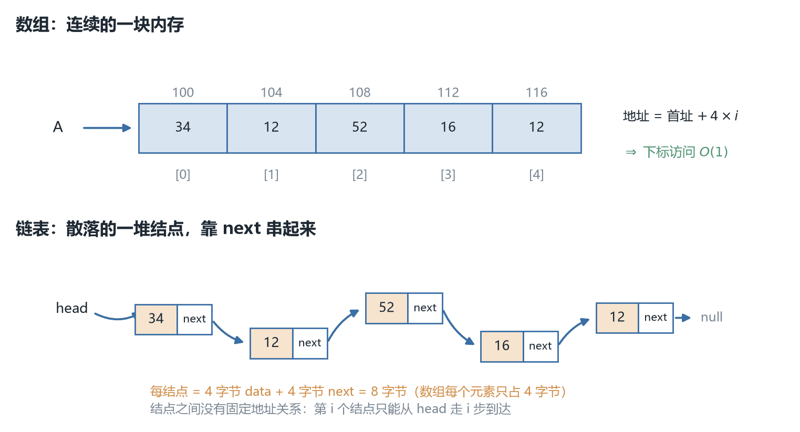
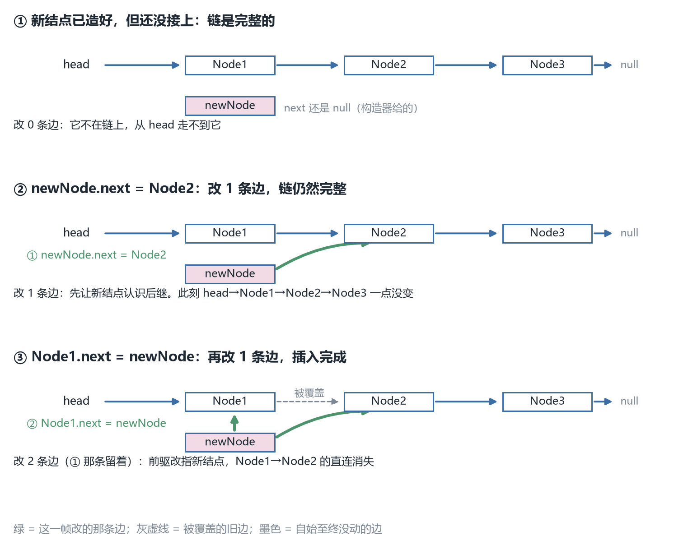
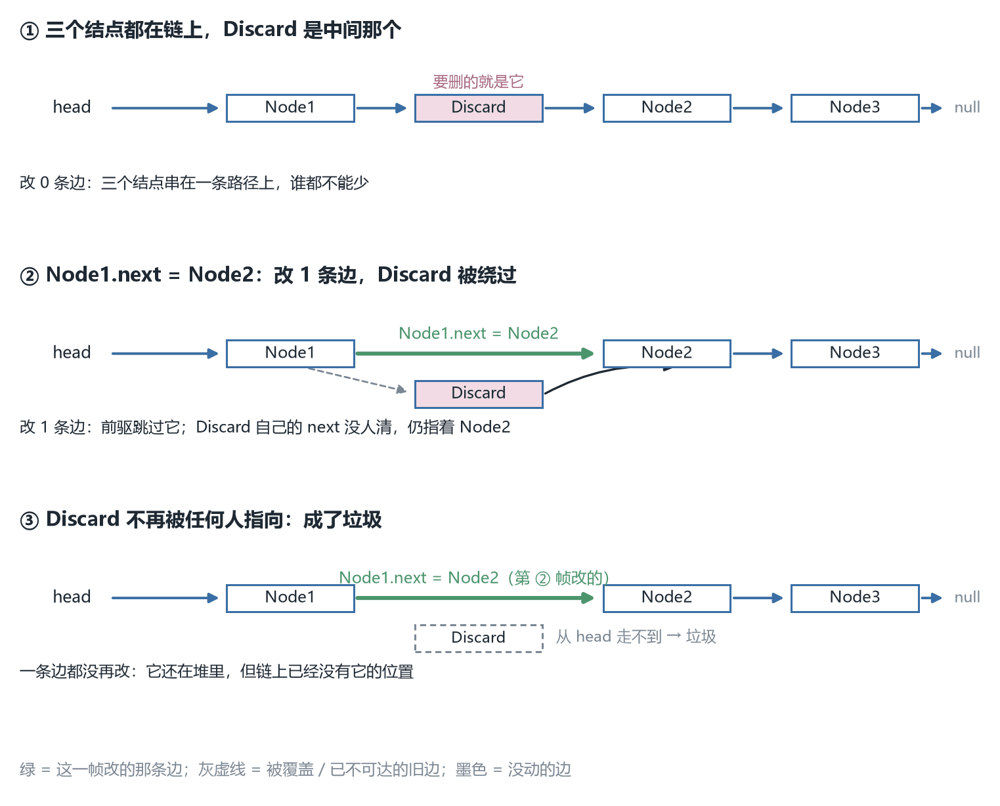
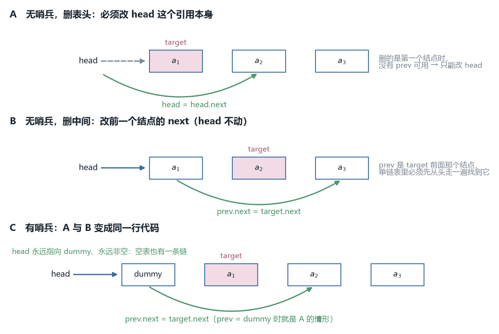
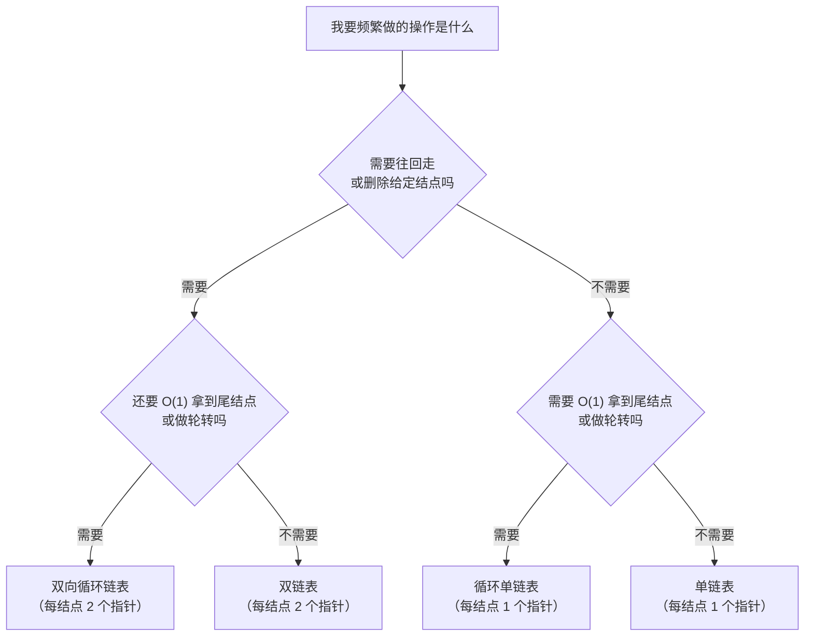
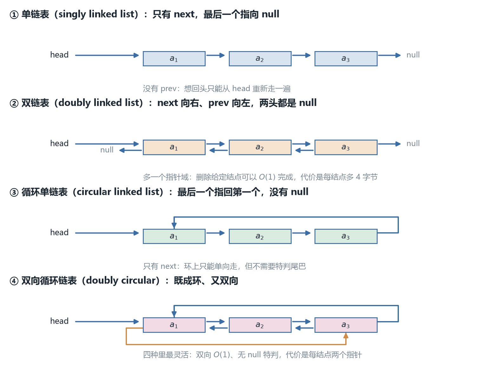

# CSC3100 Lecture 7 课堂笔记：List（表 ADT 与四种链表）

> **材料构成**：本讲基于课件整理，不含教师口述内容；课件 `lecture 7 (list).pdf` 共 34 页。这 34 页的文字层只有约 7.9 K 字符，因为**链表结构图与 Java 代码基本都是图片**——所以我把 34 页全部按 170 dpi 渲染成图逐页读过，其中 p.14、p.16 两页的代码、p.23、p.24 两页的练习代码另外按 340 dpi 裁切放大逐行核对。凡是我看不清的地方，文末都写明了，没有靠猜补。
>
> **课件结构**：目录（p.2）→ List 与 List ADT 的定义与操作（p.3-4）→ 数组的限制（p.5，正文明列两条、第三条只在例子里）→ 链表的优点（p.6）与缺点（p.7）→ 四种链表的路线图（p.8）→ 单链表的结构与 Node 类（p.9）→ 操作分类表（p.10-11）→ 三条忠告（p.12）→ 插入的图示与代码（p.13-14）→ 删除的图示与代码（p.15-16）→ 一道数组复习题（p.17）→ 单链表的应用（p.18）→ Java 完整实现（p.19-22）→ 两道练习（p.23-24）→ 双链表（p.25-27）→ 循环链表（p.28-30）→ "哪个更好"（p.31）→ 双向循环链表（p.32-33）→ 阅读作业（p.34）。
>
> **已知课件问题**：p.16 的 `delete()` 少写了一对花括号，导致这个函数对任何 `p > 0` 都删不掉东西；p.28 说循环链表"可以朝任何方向遍历"，而它只有 `next` 一个指针。其余几条（字段名不统一、四张操作表粒度不一致、p.6 与 p.7 的口径冲突等）都在文末「附：诚实备注」里逐条列出，并注明我凭什么这么判。
>
> **来源标注约定**：正文里凡以补充类 alert（NOTE / TIP / IMPORTANT）呈现的内容，都是课件没有、由我补充或推导的内容（包括五张配图与一张流程图）；没有标注的，都是课件上写着的。页码一律指课件页码，不是 PDF 阅读器的页码（两者在本讲恰好一致）。

## 0. 一句话概括本讲在讲什么

前四讲（L3 到 L6）有一条共同的前提，只是它一直没被说出来：**数据是连续摆在内存里的**。L3 讲数组，说"第 $i$ 个元素在首址加 $4i$ 的地方"，所以下标访问是 $O(1)$；也正因为连续，插入一个新元素必须把后面所有元素往后挪一格，删除必须往前挪一格，代价 $O(n)$。L5、L6 数操作、算复杂度，算的也全是数组上的算法。

这一讲第一次把这个前提拆掉。**链表（linked list）不再要求数据连续**：每个元素单独占一块内存（叫结点，node），结点里除了数据，还存着"下一个结点在哪里"这个地址。于是"第 $i$ 个元素在哪"不再能算出来，只能从第一个开始一个一个走过去；但反过来，"在中间插一个元素"也不再需要搬家，只要改两个地址。

所以本讲不是一个新操作的讲解，而是**换了一种"存"的方式**，然后把这笔账逐条算清：省下了什么（搬家）、付出了什么（指针的 4 个字节、失去随机访问、反向走不了）。这四种链表（单链表、双链表、循环链表、双向循环链表）就是在这笔账上做的四种不同取舍——每加一个指针、每加一个环，都是拿空间换某一类操作的时间。

一句话：**数组用"连续"换"随机访问"，链表用"指针"换"就地增删"，本讲把后者的四种变体摊开，让你知道什么时候该用哪一种。**

## 1. List 与 List ADT（p.2-4）

### 1.1 先分清"抽象数据类型"和"数据结构"

课件 p.3 一上来就引了维基百科对 List 的定义，但没有解释定义里的第一个词：**抽象数据类型（abstract data type, ADT）**。这个词不弄清，后面"用数组实现 List""用链表实现 List"就会读成两件互相竞争的事，而不是同一件事的两种做法。

ADT 是**从使用者角度**描述一个数据集合：能存什么样的值、允许哪些操作、每个操作语义上干什么；它**不说**这些值在内存里怎么摆、操作具体几步完成。比如"表"这个 ADT 只说"我能插、能删、能按位置找、能按值找"，不说"插"是搬家还是改指针。**数据结构**（data structure）是另一层：真正把值放进内存的方案。同一个 ADT 可以有多种实现，代价各不相同——这正是本讲的全部内容：p.5 之前用数组（L3 讲过），p.9 起改用链表。

分清这两层，后面会反复用到：`printList`、`find`、`insert`、`delete` 是 **ADT 的操作**，语义不随实现改变；而 Java 代码是**某一种实现**下的写法，换成双链表就完全不同，但"插入一个元素"这件事没变。

### 1.2 定义：有限、有次序、允许重复（p.3）

课件给的原文是：

> A list is an abstract data type (ADT) that represents a finite number of ordered values, where the same value may occur more than once.

这句话里三个形容词每一个都在排除一种情况，值得逐个拆开。

**finite（有限）**：表里的元素个数是有限的。这一条听起来废话，但它排除了"无限流"——也解释了为什么后面所有操作都能问"最坏要多少步"。

**ordered（有次序）**：这是最容易读错的一个词。它说的是"元素之间有先后关系"，**不是**"元素已经排好序"。表 $34, 12, 52, 16, 12$ 是有次序的（第一个是 34、第二个是 12……），但它显然没有排序。英文里 ordered 与 sorted 是两个词，中文都常译成"有序"，这就是混淆的来源。本讲后面所有"按位置 $p$"的操作，靠的都是这个"次序"，与元素大小无关。

**the same value may occur more than once（同一个值可以出现多次）**：这一条决定了 `find` 的语义必须是"返回**第一次**出现的位置"，也决定了 `delete(52)` 到底删哪一个需要额外约定（见 1.4 的接口问题）。

接下来课件给了记号。一个表写成

$$a_1,\ a_2,\ a_3,\ \ldots,\ a_N$$

其中 $N$ 叫这个表的**大小（size）**。对任何**非空表**，课件规定了四件事：

- 第一个元素是 $a_1$，最后一个元素是 $a_N$；
- $a_{i+1}$ **跟在** $a_i$ 后面（succeeds / follows $a_i$，当 $i < N$）；
- $a_{i-1}$ **在** $a_i$ 前面（precedes $a_i$，当 $i > 1$）；
- **$a_1$ 的前驱（predecessor）与 $a_N$ 的后继（successor）没有定义。**

最后这一条不是文字游戏，它是**后面所有边界判断的来源**。数组实现里它变成"下标不能是 $-1$"；链表实现里它变成"表头结点没有前一个结点，改指针时得单独处理"。插入里那个 `if (p == 0)` 与删除里那个 `if (p == 0 && head != null)`，本质上就是在处理"$a_1$ 的前驱不存在"这一件事。

课件还特意写了"对任何**除空表以外**的表"——也就是说空表（empty list）是这一整套记号之外的例外：它没有第一个元素，也没有最后一个元素。空表怎么表示，是初学者写链表遇到的第一个坑，本讲 §10.3 专门讲。

### 1.3 常用操作（p.4）

课件列了六个操作，其中最后一个标着 optional（可选）：

| 操作 | 语义 | 课件给的例子 |
| --- | --- | --- |
| `printList` | 按次序打印全部元素 | — |
| `makeEmpty` | 清空整张表 | — |
| `find` | 返回某个值**第一次**出现的位置 | 表 $34,12,52,16,12$ 里 `find(52)` 返回 $3$ |
| `insert` | 在某个位置插入一个值 | `insert(X, 3)` |
| `delete` | 删掉某个位置上的值 | `delete(52)` |
| `next` / `previous` | 取前驱 / 后继（可选） | — |

`find(52)` 返回 $3$：表里 52 是第三个元素。所以**课件这套 ADT 的位置从 1 开始数**（1-based）；而 p.14 起的代码全部改用**从 0 开始**的下标，两者差 1，混起来就是经典的 off-by-one。

`next` / `previous` 标成可选值得一句：它说明"表"的**最小**接口里并不包含"从某个元素走到下一个"。这恰恰是链表与数组分野的地方——数组里"下一个"是下标加 1，太便宜；链表里它是一次指针跳转，"上一个"还得靠额外的指针域（§12）。

### 1.4 课件这套接口本身有个不一致（我的观察）

`insert(X, 3)`、`delete(52)`、`find(52)` 三行例子放在一起看，"按位置还是按值"是混着的：`insert(X, 3)` 的第二个参数是**位置**；`delete(52)` 的参数是**值**（按 `find` 的语义，删的是"值为 52 的那个"，不是"第 52 个"）；`find(52)` 返回**位置**且从 1 数起。这在教学上不算错（Java 的 `List` 也同时有 `remove(int index)` 与 `remove(Object o)`），但课件没点明，读代码时就容易问"`delete(52)` 到底删哪个"。我在文末记为一条不一致，并建议按"位置用 `p`、值用 `x`"自己统一。

> [!NOTE] 补充
> 顺带补一件课件没说的：`delete` 按值删必须先 `find` 一次，所以"按值删"在链表上是 $O(n)$ 的两遍（找 + 删），"按位置删"是一遍。这个区别在 §7.3 会再用到。

## 2. 为什么要链表：数组的三条限制与链表的四点账（p.5-8）

### 2.1 数组的两条限制（p.5）

数组的限制一共两条（p.5）：

**第一条，长度固定。** 数组的大小在创建时就定了，所以**必须提前知道元素个数的上限**。这一条的后果比字面上严重：如果你估计 1000、实际来了 1200 个，程序不是"慢一点"，而是直接放不下——要么抛异常，要么静默截断。

**第二条，插入代价高。** 原话是"必须为新元素腾出位置、并把已有元素搬走"。它给的例子是一串排好序的 ID：

$$\text{id}[\ ] = [1000,\ 1010,\ 1050,\ 2000,\ 2040]$$

要插一个 1005 并保持有序，它得排在 1000 后面，于是 1010、1050、2000、2040 这**四个**都要往后挪一格；要删 1010，则它后面的 1050、2000、2040 这**三个**都要往前挪一格。

> [!NOTE] 补充：搬几个是我数出来的
> 课件只说"要搬"，没给搬几个。上数这两个数字是我按 p.5 的例子数出来的：插入搬 4 个、删除搬 3 个。这两个数字很能说明问题——插入点的位置越靠前，搬得越多；插在末尾（追加）则一个都不用搬。所以数组的"插入 $O(n)$"其实是**最坏**情形，末尾追加是 $O(1)$。这个"最好/最坏不一样"的结构，链表也有，只是分界点不同（链表是"表头 $O(1)$、表尾 $O(n)$"）。

### 2.2 课件漏列的第三条：删除也要搬

这两条限制的标题是"The size of the array is fixed"与"Inserting a new element is expensive"，**删除**只出现在例子的第二行（"If we want to delete 1010, everything after 1010 has to be moved"），没有被列成第三条限制。

> [!NOTE] 补充：第三条是排版省略
> 我认为这是排版省略而非有意为之：L3 §3.2 与 §3.3 已经把数组的插入与删除都完整讲过（都要新建数组 + 复制），两件事的代价对称，没理由只列一条。所以本文把"删除要搬"当作第三条限制。"insertion and deletion are easier"那句（p.6）也是把两者合起来说的。

### 2.3 链表的优点（p.6）与账本

优点有三条（p.6）：

**动态（dynamic data structure）**：链表的大小不固定，可以任意增减。

**插入删除更容易**：因为数组的元素存在**连续**位置，而链表的元素存在**随机**位置（random location）；数组插入删除要"腾空间 / 补空缺"，链表不用搬。

**内存高效（memory efficient）**：链表的内存占用随实际元素数伸缩，用多少占多少。

三条里最需要推敲的是第三条，因为它和第一条缺点"每个结点要多存一个指针"看起来是直接矛盾的（缺点那条的原话就是"链表的结点比数组占更多内存"）。这两句话其实在说不同的东西，不矛盾：

- **总量**：数组要预留上限，$n$ 个元素实际占 $N_{\max}$ 个格子；链表要多少占多少，没有预留浪费；
- **单位成本**：存一个元素，数组花 4 字节，链表花 8 字节。

所以正确的说法是：**链表用"每元素更贵"换"总量不预留"**。当 $n$ 接近上限时，数组赢（4 字节/元素）；当 $n$ 远小于上限时，链表赢（不浪费预留）。图 1 把这两层并排摆出来，差值一眼可见。



*图 1　同一张表 $34,12,52,16,12$ 的两种存法。上：数组占一块连续内存，地址由"首址 $+\,4i$"算出，所以下标访问 $O(1)$；下：链表是五个散落的结点，每个结点 = 4 字节 data + 4 字节 next，只能从 head 顺着 next 走。数据取自课件 p.4 的例子。*

> [!NOTE] 补充：把内存账算到底
> 把这张账算到底：$n$ 个 `int`，数组占 $4n$ 字节（外加十几字节的数组头），链表占 $8n$ 字节再加一个 `head` 引用。按课件 p.7 自己给的"指针 4 字节"假设，**每个元素的成本正好翻倍**；$n = 10^6$ 时是 4 MB 对 8 MB。若计入预留浪费（假设数组按 2 倍扩容、平均半满），数组的有效成本回到约 $8n$，两者的差距就被抹平了——这也是为什么"链表省内存"这句话在工程上经常不成立。

还要补一句课件没提、但在 Java 里非常要紧的事：**上面这个 8 字节只是"字段"的大小，不是"对象"的大小。** Java 的每个对象在堆上还有对象头（object header），64 位 HotSpot 默认（开启压缩指针）是 12 字节：8 字节 mark word + 4 字节类型指针；加上 `int` 4 字节与引用 4 字节，一个 `Node` 对象是 20 字节，再按 8 字节对齐补到 **24 字节**。而 `int[]` 里一个元素只占 4 字节。也就是说在真实的 JVM 上，链表的单位成本不是 2 倍，而是**约 6 倍**。这与 L3 §1.5 讲的"对象从堆里分配、比基本类型重"是同一件事的另一面。

### 2.4 链表的缺点（p.7）

缺点也有三条（p.7），恰好与三条优点一一对冲：

**内存占用（memory usage）**：每个结点要额外存一个指针，占 4 字节（上面已算过账）。

**遍历（traversal）**：数组能按索引**随机访问**（random access），链表不能——想取第 $i$ 个元素，只能从头走 $i$ 步。这一条的后果不只是"慢一点"，而是**一整套算法用不了**：二分搜索（L6 用了六页分析它）要求 $O(1)$ 地取中间元素，链表做不到，所以链表上不能二分；快排的 partition 要双向扫描加随机访问，链表上也退化了。换句话说，数组的 $O(1)$ 随机访问是很多 $O(\log n)$ 算法的**前提**，不是可选项。

**反向遍历（reverse traversing）**：单链表里往回走很难。课件在这里埋了一句预告："双链表里容易些，但要多花内存"——这就是 §12 的主题。

> [!IMPORTANT] 重要：贯穿全篇的一笔交换
> 三条缺点可以归成一句后面反复用的话：**链表放弃了"地址可计算"，换来了"结构可改写"。** 凡需"算地址"的操作（按下标取、二分、随机洗牌）在链表上都变贵；凡需"改结构"的操作（插入、删除、拼接、拆分）都变便宜。四种链表的差别，全是在这个交换里调参数。

### 2.5 四种链表的路线图（p.8）

这四种的名字只有五行（p.8），却定了本讲后半段的骨架：

- 单链表（singly linked list）
- 双链表（doubly linked list）
- 循环链表（circular linked list）
- 双向循环链表（doubly circular linked list）

这四种不是四个并列的知识点，而是**两个独立维度**的组合：

| | 单向（只有 next） | 双向（next + prev） |
| --- | --- | --- |
| **线性（尾巴指 null）** | 单链表（p.9-24） | 双链表（p.25-27） |
| **环形（尾巴指回头）** | 循环链表（p.28-30） | 双向循环链表（p.32-33） |

看这张表就知道课件为什么这样排：先讲最朴素的单链表（p.9-24 占了本讲一半以上），再单独加"双向"这一个维度（p.25-27），再单独加"环形"这一个维度（p.28-30），最后把两个维度合起来（p.32-33）。**理解了这两个维度各自解决什么问题，四种链表就不用分别背。**

## 3. 进单链表之前：Java 的"引用"到底是什么（p.8-9）

> [!NOTE] 补充：链表的内存模型
> 课件从 p.9 直接开始画"head → Node → Node → null"，默认读者已经知道箭头代表什么。但 L2 只说过一句"Java 没有指针、更安全"，L3 §1.6-1.7 才把"引用就是地址"这件事讲清楚。这一节把 L3 那套内存模型接到链表上，不重讲 L3 的推导。

### 3.1 Java 的引用就是"受限的指针"

L3 §1.6 讲过：`Rational a = new Rational(1, 2);` 执行时，堆里划出一块地方放这个对象，栈帧里的变量 `a` 存的是那块地方的**地址**。这个地址叫**引用（reference）**。

链表把这件事用到了极致。`class Node { int element; Node next; }` 这行声明里，`next` 的类型是 `Node`——一个 `Node` 类型的变量，存的是**另一个 `Node` 对象的地址**。所以一条链在内存里长这样：`head`（一个局部变量）里存着 1000；地址 1000 那个对象里，`element` 是 34、`next` 是 2040；地址 2040 那个对象里，`element` 是 12、`next` 是 3160……直到某个对象的 `next` 是 `null`。

L2 说"Java 没有指针"，这句话的准确含义是：Java 没有 C 那种**可以做算术、可以乱转类型**的指针。具体差三件事：

1. **不能做算术。** C 里 `p + 1` 是"下一个字节/元素"，Java 里 `p + 1` 直接编译不过。你只能 `p.next`，也就是只能沿着类型允许的那条边跳。
2. **有类型。** `Node next` 只能指向 `Node`（或其子类），不能像 `void*` 那样指哪算哪。
3. **受垃圾回收管理。** 不会有"指向已释放内存"的悬垂指针（L3 §1.8），代价是那套标记—清扫。

所以"Java 的引用就是受限的指针"这句话可以这样理解：**表达力被砍掉一半（不能算地址），安全性换回来一半（不会指错地方），而"变量里存的是地址、通过它间接访问对象"这个核心机制完全一样。** 本讲后面所有的箭头图，画的都是引用。

### 3.2 `null` 是什么

`null` 是引用类型的"不指向任何对象"，不是"0 号地址"；对 `null` 做成员访问（`null.next`）会抛 `NullPointerException`。

在链表里 `null` 承担两个语义角色，这两个角色在后面的代码里必须分清：

- **链的终点**：最后一个结点的 `next` 是 `null`，循环 `while (p != null)` 靠它停下来；
- **空表的表示**：`head == null` 表示整张表是空的（§10.3 会讲另一种表示法）。

### 3.3 两件最容易混的事：改"变量"与改"对象"

这是学链表时 90% 的 bug 来源，值得单独写清楚。看两行代码：

```java
p = p.next;        // ① 改变量 p 自己：p 现在指向"下一个结点"
p.next = q;        // ② 改 p 所指对象的 next 域：把那个对象的箭头改指 q
```

① 只动了 `p` 这个变量（它在栈帧里），对链表结构**毫无影响**——链上什么都没变，只是你看的位置变了。② 动的是堆里那个对象的字段，链的形状变了，而且**所有指向这个对象的变量都会看到这个变化**（包括 `head`，如果它们指同一个对象）。

这个区别之所以致命，是因为两者在代码里只差一个 `.next`。§7.2 那个 `delete()` 里的一行 `head = head.next;` 属于 ①（改变量），而 `prevNode.next = targetNode.next;` 属于 ②（改对象）。前者让 `head` 这个变量跳到下一个结点，后者让某个结点的箭头绕过目标结点——两者配合才完成"删掉第一个结点"。

> [!NOTE] 补充：别名（aliasing）
> 还有一个相关的概念叫**别名（aliasing）**：两个变量指向同一个对象时，通过其中一个改对象，另一个立刻看得见。L3 §1.7 里 `this` 与 `a` 指向同一个 `Rational` 就是这种情况。链表里删结点时，"被删的结点"与"某个还在用的变量"很容易变成别名，于是删完之后那个变量还指着一个已经不在链上的结点——这在 Java 里不会崩（对象还在，只是没人从 `head` 能走到它），但逻辑上已经是"幽灵"了。§7 会看到这个现象。

## 4. 单链表的结构与 Node 类（p.9）

### 4.1 一句话结构

单链表长什么样（p.9）：一排方框加箭头，`head` → `Node` → `Node` → `Node` → `null`。课件给的五条要点里，前两条是定义，后三条是性质：

- 由一系列**结点**组成，每个结点是一个 `Node` 类的对象；
- 每个结点由**数据**（data）和**指针**（pointer）两部分组成；
- **必须知道 head** 才能操作整张表；
- 结点在内存里**不一定相邻**；
- 插入与删除很灵活。

第三条值得多说一句：**head 是唯一的人口**。因为每个结点只知道自己后面是谁、不知道自己前面是谁，所以一旦丢了 `head` 这个引用，整条链就从程序里"消失"了——对象还在堆里，但没有任何活变量能走到它们，垃圾回收器会把它们全部回收（L3 §1.8 的标记—清扫：从栈上变量出发走不到的对象就是垃圾）。这也是为什么后面所有方法都要小心"别把 head 弄丢"。

### 4.2 课件的 Node 类（p.9 右下角）

::: code-group

```java [Java]
class Node {
    int element;
    Node next;

    // 构造器：把数据存进去，next 显式置 null
    public Node(int x) {
        element = x;
        next = null;
    }
}
```

```python [Python]
class Node:
    def __init__(self, x):
        self.element = x
        self.next = None      # 新结点一定是链的末端
```

```cpp [C++]
struct Node {
    int element;
    Node* next;

    // 构造器：nullptr 就是 Java 那边的 null
    Node(int x) : element(x), next(nullptr) {}
};
```

```c [C]
typedef struct Node {
    int element;
    struct Node* next;
} Node;

// C 没有构造器：造结点 = 申请一块内存 + 两个字段赋值
Node* makeNode(int x) {
    Node* p = (Node*)malloc(sizeof(Node));
    if (p == NULL) return NULL;      // 分配失败要能看出来
    p->element = x;
    p->next = NULL;
    return p;                        // 谁用谁 free，C 没有 GC
}
```

:::

四行字段加五行构造器，逐行看：

**`class Node`**：类名首字母大写。注意这个类**没有 `public`**，所以只在同一个包（package）里可见、包外不可见。§10.1 那个版本（p.19）同样没写 `public`，但把两个字段改成了 `public`（并把 `element` 改名 `data`）——这是课件前后两版的一个小差异（见诚实备注第 4 条）。

**`int element;`**：数据域。课件把它定成 `int`——这是一个简化，因为 List ADT 说的是"任意值"。真正的实现应该用泛型，见 §10.5。

**`Node next;`**：指针域。类型是 `Node` 自己，这叫**自引用类型（self-referential type）**：一个类的字段可以是它自己这个类型，因为字段里存的只是一个引用，不需要对象"包含"自己（否则大小就无限了）。

**`public Node(int x)`**：构造器。参数是数据值。

**`element = x; next = null;`**：把数据存进去，把 `next` 显式置 `null`。第二句其实是冗余的（Java 会把对象字段默认初始化成 `null`），但**写出来是好的习惯**：它把"新结点的 next 是空的"这件事写在代码里，读代码的人不用去查默认值规则。更重要的是，它保证了"新建的结点一定是链的末端"——p.20 的 `insertLast` 正是靠这一点省掉了一句 `newNode.next = null`。

## 5. 单链表的操作清单：课件怎么分类（p.10-11）

### 5.1 三种插入（p.10）

单链表的插入分三类（p.10），分类表的用词很讲究，注意每一类的"难点"是什么：

| 编号 | 操作 | 课件的描述 | 难点在哪 |
| --- | --- | --- | --- |
| 1 | 在开头插入（insertion at beginning） | 只需调整几个链接，让新结点成为 head | 要改 `head` 这个**变量**（不是改某个结点的域） |
| 2 | 在末尾插入（insertion at end） | 新结点可能是表里唯一的结点，也可能是最后一个；两种情况逻辑不同 | 要先走到末尾（$O(n)$），且空表要特判 |
| 3 | 在指定结点之后插入（insertion after specified node） | 要跳过若干个结点才能到达插入点 | 跳的过程是 $O(p)$ |

这三类的分野不是"位置不同"，而是"**你手里已经有什么**"不同：第 1 类你手里有 `head`，第 2 类你手里只有 `head`（所以得走到尾），第 3 类你手里有那个"指定结点"的引用（所以跳过去就完事）。这个视角在 §6.4 讲复杂度时会变成核心。

课件第 2 类的描述里有一句"Different logic are implemented in each scenario"（语法上应为 is，属笔误级的小问题），它说的是空表与非空表要分开写——这正好对应 p.20 的 `insertLast` 里那个 `if (head == null)`。

### 5.2 五种操作（p.11）

删除与查找的清单更长（p.11），除了三种删除还多了遍历与查找：

| 编号 | 操作 | 说明 |
| --- | --- | --- |
| 1 | 删开头（deletion at beginning） | 所有操作里最简单的，只需调几个指针 |
| 2 | 删末尾（deletion at the end） | 表可能空也可能满，不同情形不同逻辑 |
| 3 | 删指定结点之后（deletion after specified node） | 要先跳过若干结点到达目标的前一个 |
| 4 | 遍历（traversing） | 每个结点至少访问一次，比如打印 |
| 5 | 查找（searching） | 逐个比对，找到返回位置，找不到返回 null |

第 5 条说"找不到返回 null"——这里其实含糊了：`null` 只能是引用，所以它返回的应该是一个结点引用而不是 `int` 下标。实现时你必须在"返回 `int`（$-1$ 表示没找到，像 L5 的线性搜索）"与"返回 `Node`（`null` 表示没找到）"之间选一个；后面的完整实现里也没有 `find`，只有 `deleteAfter(int data)`（p.21），所以课件绕过了这个问题。

第 2 条"删末尾"值得提前点一句：单链表删末尾是 $O(n)$，因为要找到**倒数第二个**结点。这是单链表最反直觉的一处——末尾插入要走到尾，末尾删除也要走到尾，两头都不便宜。

### 5.3 三条忠告（p.12）

三条忠告（p.12）各配了一张小图——一张是断开的链条打了个红叉，一张是"先画草图再画成品"的小狗。忠告原文是：

**"Must be careful not to break the chain!"（小心别把链子弄断。）**

**"Consider the special cases."（考虑特殊情况。）**

**"Draw a picture before any coding!"（写代码之前先画图。）**

这三条不是套话，它们各自对应本讲后面一个具体的坑：

第一条对应 §6.2 的赋值顺序——如果先把"前一个结点的 next"改成新结点，再去取"原来的下一个结点"，那个地址已经丢了，后半条链从此不可达（在 Java 里就是被回收，无法恢复；在 C 里就是内存泄漏）。这就是那张"断开的链条"小图所画的事故。

第二条对应 1.2 那句"$a_1$ 没有前驱"与"$a_N$ 没有后继"：表头、表尾、空表这三种情况几乎每一个方法都要单独想一遍。

第三条是方法建议：链表代码的正确性几乎完全依赖"脑子里那张图对不对"，因为指针错误不会在编译期暴露，也不会在写的时候报错，只会在运行时以 `NullPointerException` 或"输出少了一个元素"的形式出现。

> [!TIP] 技巧：先接新的，再断旧的
> 我可以把第一条写成一条可操作的规则，比"小心"更有用：
>
> **先接新的，再断旧的。** 任何一次插入，都先用新结点指好它的后继（`newNode.next = 旧的后继`），再去改前驱的指针（`prev.next = newNode`）。任何一次删除，都先把"要保留的那一头"接好（`prev.next = target.next`），再处理被删结点。

这条规则的原理是：**在改动任何一个指针之前，先把还会用到的地址存到某个变量或某个域里**。顺序错了不是"结果不对"，而是"地址永久丢失"。

## 6. 插入：三步改写、代码，以及"$O(1)$"到底在说什么（p.13-14）

### 6.1 图示的三步（p.13）

图 2 用同一个场景画了三帧：链是 `head → Node1 → Node2 → Node3 → null`，要做的操作是"在 Node1 与 Node2 之间插入一个 newNode"（newNode 画成粉红色，一开始悬在 Node1 下面，与链没有任何连线）。

- **第 ① 帧**：newNode 已经创建好了，但它是**游离**的——`newNode.next` 还是 `null`，Node1 的 `next` 还指着 Node2。此时链是完整的，newNode 不在链上。
- **第 ② 帧**：`newNode.next` 指向 Node2。注意此时**链仍然是完整的**：`head → Node1 → Node2 → Node3` 这条路径一点没变，只是多了一个指向 Node2 的游离结点。
- **第 ③ 帧**：Node1 的 `next` 改成指向 newNode。这一步之后，newNode 才真正"进链"，同时 Node1 到 Node2 的直接连线消失。



*图 2　插入的三帧（数据与讲义 p.13 一致）。① 新结点已造好但游离，改 0 条边；② `newNode.next = Node2`，先让新结点认识后继，链仍完整；③ `Node1.next = newNode`，前驱改指新结点，`Node1→Node2` 的直连被覆盖。绿 = 该帧改的那条边，灰虚线 = 被覆盖的旧边。*

这三帧的顺序就是答案。**关键在于第 ② 帧那个中间状态**：它说明"插入"可以分解成"先让新结点认识后继"与"再让前驱认识新结点"两步，而这两步之间链始终是通的。如果反过来（先改 Node1.next，再想给 newNode.next 赋值），在第 ② 帧那个时刻，Node2 的地址只存在于 Node1.next 里，而它刚被覆盖——Node2 与它后面的一切就找不回来了。

### 6.2 代码逐行（p.14）

课件 p.14 的完整方法（我按 340 dpi 裁切逐行核过，缩进按原文）：

::: code-group

```java [Java]
// 假定外层类里有字段 Node head（§10.2）
void insert(int x, int p) {
    Node tmpNode = new Node(x);
    Node prevNode = head;

    if (p == 0) {                       // 插在表头
        tmpNode.next = head;
        head = tmpNode;
        return;
    }

    for (int i = 0; i < p - 1; i++) {
        if (prevNode == null) break;
        prevNode = prevNode.next;
    }
    if (prevNode == null) return;       // p 超出表长：什么也不做

    tmpNode.next = prevNode.next;       // 先接新的 [!code highlight]
    prevNode.next = tmpNode;            // 再断旧的 [!code highlight]
}
```

```python [Python]
class SinglyLinkedList:
    def __init__(self):
        self.head = None

    def insert(self, x, p):
        tmp_node = Node(x)
        prev_node = self.head

        if p == 0:                      # 插在表头
            tmp_node.next = self.head
            self.head = tmp_node
            return

        for _ in range(p - 1):
            if prev_node is None:
                break
            prev_node = prev_node.next
        if prev_node is None:           # p 超出表长：什么也不做
            return

        tmp_node.next = prev_node.next  # 先接新的 [!code highlight]
        prev_node.next = tmp_node       # 再断旧的 [!code highlight]
```

```cpp [C++]
// Node 定义见 §4.2；head 是这个类唯一的字段
struct SinglyLinkedList {
    Node* head = nullptr;

    void insert(int x, int p) {
        Node* tmpNode = new Node(x);
        Node* prevNode = head;

        if (p == 0) {                       // 插在表头
            tmpNode->next = head;
            head = tmpNode;
            return;
        }

        for (int i = 0; i < p - 1; i++) {
            if (prevNode == nullptr) break;
            prevNode = prevNode->next;
        }
        if (prevNode == nullptr) {          // p 超出表长：什么也不做
            delete tmpNode;                 // 没接上就没人管它了，得自己还回去
            return;
        }

        tmpNode->next = prevNode->next;     // 先接新的 [!code highlight]
        prevNode->next = tmpNode;           // 再断旧的 [!code highlight]

        // 这里没有 delete：新结点挂到链上，最后由析构函数统一 delete
    }
};
```

```c [C]
/* Node 与 makeNode 见 §4.2。
   C 没有对象：head 是调用方的指针变量，想改它本身就得把它的地址传进来。 */
void insert(Node** head, int x, int p) {
    Node* tmpNode = makeNode(x);
    Node* prevNode = *head;

    if (p == 0) {                         /* 插在表头 */
        tmpNode->next = *head;
        *head = tmpNode;
        return;
    }

    for (int i = 0; i < p - 1; i++) {
        if (prevNode == NULL) break;
        prevNode = prevNode->next;
    }
    if (prevNode == NULL) {               /* p 超出表长：什么也不做 */
        free(tmpNode);                    /* Java 靠 GC 收掉这个没接上的结点，C 得自己 free */
        return;
    }

    tmpNode->next = prevNode->next;       /* 先接新的 [!code highlight] */
    prevNode->next = tmpNode;             /* 再断旧的 [!code highlight] */
}
```

:::

逐行读：

**`void insert(int x, int p)`**：把值 `x` 插到位置 `p`。注意 `p` 是**下标**（0-based），不是第几个——`p = 0` 表示插成第一个元素。这与 p.4 的 ADT 例子 `insert(X, 3)` 的 1-based 口径不同（诚实备注第 3 条）。

**`Node tmpNode = new Node(x);`**：先在堆上造一个新结点，`next` 为 `null`（p.9 的构造器保证）。此时它游离，对应 p.13 第一幅。

**`Node prevNode = head;`**：`prevNode` 是用来"走到插入点前一个位置"的游标，从表头开始。

**`if (p == 0) { tmpNode.next = head; head = tmpNode; return; }`**：插在表头。两行赋值的顺序**不能反**：先把新结点接到原来的表头（`tmpNode.next = head`），再把 `head` 这个变量改指新结点（`head = tmpNode`）。反过来的话，`head` 已经指向 `tmpNode` 了，再执行 `tmpNode.next = head` 就等于让 `tmpNode.next` 指向自己——造出一个长度为 1 的自环，原来整条链全部丢失。这是本讲最值得动手验证一遍的地方。

**`for (int i=0; i<p-1; i++)`**：走 `p-1` 步，让 `prevNode` 停在**第 `p-1` 个**结点（也就是插入点的前一个）。为什么是 `p-1` 而不是 `p`：因为插入要改的是"前一个结点的 next"，所以必须站在前一个上。这就是链表实现里几乎所有 off-by-one 的来源。

**`if (prevNode == null) break;`**：走的过程中如果撞到链尾（`p` 比表长还大），就停下。注意这个判断在**循环体开头**，所以 `prevNode = prevNode.next` 永远不会在 `null` 上取 `.next`——否则就是 `NullPointerException`。

**`if(prevNode == null) return;`**：说明 `p` 超出了表长，什么也不做（静默失败）。这是一个设计选择：也可以抛 `IndexOutOfBoundsException`，但课件选了"忽略"。

**`tmpNode.next = prevNode.next;`** 与 **`prevNode.next = tmpNode;`**：这两行就是 p.13 的第二、三步。**顺序不能反**，理由与 `p == 0` 分支完全相同：第一行右边那个 `prevNode.next` 是"插入点原来的后继"（Node2）的地址，改完第一行它还在 `tmpNode.next` 里存着；如果先执行第二行，`prevNode.next` 已经变成 `tmpNode`，第一行就变成 `tmpNode.next = tmpNode`，又造出自环，Node2 及其之后全部丢失。

**注意这段代码对"表尾插入"是自然处理的**：`p` 等于表长时，`prevNode` 走到最后一个结点，`prevNode.next` 是 `null`，于是 `tmpNode.next = null`，正确。

### 6.3 这段代码里的两处可以商量的地方

> [!NOTE] 补充
> 本节两处商榷是课件没有、由我补充的观察。

**第一，`if (p == 0)` 这个特判可以消掉**——引入哨兵结点即可（§10.3，本讲最实用的技巧）。

**第二，`prevNode` 的初始化与空表处理有点绕。** 当 `head == null` 且 `p > 0` 时，`prevNode` 一开始就是 `null`，循环第一轮 `break`，然后 `if(prevNode == null) return;` 直接返回——"往空表里插第 1 个之后的元素"什么也不做。行为是对的（空表只能插第 0 个），但这是**碰巧对的**，不是设计出来的。

### 6.4 复杂度：课件问了，答案要分清"按位置"还是"按引用"

课件在这里只提问、没给答案（p.14 底部的问题框）："What are the time complexities of the best/worst/average cases?" 下面是我的答案，以及一个比答案更要紧的区分。

**先按这段代码回答**（`insert(x, p)`，`p` 是下标）：

| 情形 | `p` 的取值 | 走多少步 | 复杂度 |
| --- | --- | --- | --- |
| 最好（best） | `p = 0` | 0 步，直接进 `if` 分支 | $\Theta(1)$ |
| 最坏（worst） | $p \ge n$ | 走满表长（$n$ 步） | $\Theta(n)$ |
| 平均（average） | `p` 在 $0..n$ 上均匀 | 平均走 $n/2$ 步 | $\Theta(n)$ |

（严格说，`p` 超过表长时会提前 `break`，所以最坏是"`p` 恰好等于表长"或"更大"，两者都走 $n$ 步。）

**但"链表插入是 $O(1)$"这句话也是对的**——它说的不是这段代码。差别在于**接口的形状**：

- `insert(int x, int p)`：只给了**位置**。你没有任何办法直接跳到第 `p` 个结点，因为链表的地址不可计算（§2.4），只能从 `head` 走。所以"找位置"这一步是 $O(p)$，而"改指针"那两行是 $O(1)$，总代价被前者盖住。
- `insertAfter(Node prev, int x)`：给的是**前一个结点的引用**。这时不需要找，直接执行那两行赋值——真正的 $\Theta(1)$。

这就是本讲最容易含混过去的一点，值得写成一句话：

> **链表的 $O(1)$ 插入，前提是"你已经站在那个位置上了"。** 给下标，就是 $O(n)$；给引用，才是 $O(1)$。

这句话解释了工程上好几件事。为什么 Java 的 `LinkedList` 有 `ListIterator`？因为迭代器**就是那个"引用"**——它持有当前结点的引用，所以迭代中 `add` / `remove` 是 $O(1)$；而 `list.add(500000, x)` 这种按下标的调用要 $O(n)$ 地走过去。为什么"链表适合频繁在中间插入"经常被误用？因为若插入位置是"第 $k$ 个"，链表并不比数组快（数组的搬移是连续内存的顺序写，实测常常比指针追逐还快）；只有你**已经在那个位置**时，链表才真正赢。

> [!NOTE] 补充：接口形状对照表
> 把这件事整理成一张对照表，后面 §7.3、§16 都会用到：

| 接口形状 | 要不要先"找" | 找的代价 | 总代价 |
| --- | --- | --- | --- |
| `insert(x, p)`（给下标） | 要，从 head 走 | $O(p)$ | $O(n)$ |
| `insertAfter(Node prev, x)`（给引用） | 不要 | $0$ | $O(1)$ |
| `insertFirst(x)`（给 head） | 不要 | $0$ | $O(1)$ |
| `insertLast(x)`（单链表，无 tail） | 要，走到尾 | $O(n)$ | $O(n)$ |
| `insertLast(x)`（维护了 tail 指针） | 不要 | $0$ | $O(1)$ |

最后一行是一个值得记住的工程技巧：单链表想 $O(1)$ 追加，就多存一个 `tail` 引用。代价是删除末尾变成 $O(n)$（因为删尾要改 `tail` 的前一个，而单链表回不去）——又回到了同一个交换。

## 7. 删除一个结点（p.15-16）

### 7.1 图示的三步（p.15）

图 3 的场景是"删掉 Node1 与 Node2 之间的那个结点"，三帧依次是：

- **第 ① 帧**：`head → Node1 → [Discard] → Node2 → Node3 → null`，要删的结点标着 Discard，还在链上。
- **第 ② 帧**：Node1 的箭头直接指向 Node2；Discard 被挪到下方，**但它自己的箭头还指向 Node2**。
- **第 ③ 帧**：`head → Node1 → Node2 → Node3 → null`，Discard 消失。



*图 3　删除的三帧（数据与讲义 p.15 一致）。① 三个结点都在链上，Discard 是中间那个；② `Node1.next = Node2`，Discard 被绕过，但它自己的 next 没人清空、仍指着 Node2；③ Discard 不再被任何人指向，从 head 走不到——成了垃圾。绿 = 该帧改的那条边，灰虚线 = 已不可达的旧边。*

第 ② 帧那个细节容易被误读成"图画错了"，其实它在说：**删除只是"绕过"，不是"抹掉"**。Discard 的 `next` 没有人去清空，它仍然指向 Node2；变的只是"没有人再指向 Discard"。于是从 `head` 出发再也走不到它——按 L3 §1.8 的定义，它成了**垃圾（garbage）**。Java 里这是"省事"，C/C++ 里是"必须自己 `free` 否则泄漏"。

### 7.2 代码逐行（p.16），以及一个会让整个函数失效的 bug

课件 p.16 的原文（同样按 340 dpi 裁切核过）：

```java
void delete(int p) {
    if(p == 0 && head != null)
        head = head.next;
        return;                     // [!code warning]

    Node prevNode = head;
    for(int i=0; i<p-1; i++)
        if (prevNode == null)
            break;
        prevNode = prevNode.next;

    if(prevNode == null || prevNode.next == null) return;

    Node targetNode = prevNode.next;
    if (targetNode != null)
        prevNode.next = targetNode.next;
}
```

**这里有一个必须指出的错误：`if` 少了花括号，`return;` 是无条件执行的。**

按 Java 的语法，`if (条件) 语句;` 只管辖**紧随其后的一条语句**。所以上面这段实际等价于：

```java
if (p == 0 && head != null)
    head = head.next;   // 只有这一句在 if 里面
return;                 // 这一句永远执行！ [!code warning]
```

后果是：`delete(p)` 对任何 `p > 0` 的调用都会在第二行就返回，**一个结点也删不掉**。而 `p == 0` 时能正确删掉表头——所以这段代码"看起来有一半是对的"，测的时候如果只测了 `delete(0)`，会以为它没问题。

我凭什么这么判：① 这一页是**文本层**（不是图片），`get_text()` 抽出来的内容里 `if(p == 0 && head != null)`、`head = head.next;`、`return;` 三行都**没有**花括号，也没有被高亮色块遮住的可能（高亮是画在文字后面的底色，花括号若存在会被抽出来）；② 我另外按 340 dpi 裁切放大看了这一块，`return;` 的缩进与 `head = head.next;` 齐平，上方没有任何 `{`；③ 与 p.21 的正确版本对照——那里 `deleteFirst()` 写的是 `if(head != null) { head = head.next; }`，**有**花括号，说明作者知道要写，只是这一页漏了。

正确写法只要补一对花括号：

```java
if (p == 0 && head != null) {
    head = head.next;
    return;
}
```

其余各行逐行看：

**`if(p == 0 && head != null)`**：删表头。两个条件缺一不可——`head != null` 是防止空表上删（`null.next` 会抛异常）。

**`Node prevNode = head;` 与 `for(int i=0; i<p-1; i++)`**：走到第 `p-1` 个结点，与插入完全同构（因为删除也要改"前一个"的 next）。

**`if(prevNode == null || prevNode.next == null) return;`**：两种"没有第 `p` 个结点"的情况——`prevNode == null` 是走过头了，`prevNode.next == null` 是走到了最后一个（它后面没有结点了）。两种都直接返回。

**`Node targetNode = prevNode.next;` 与 `prevNode.next = targetNode.next;`**：绕过目标结点。这里**不需要**清空 `targetNode.next`（§7.1 第二幅图说的就是这件事）。

**`if (targetNode != null)`**：这一句是**冗余**的——上一行已经保证了 `prevNode.next != null`，所以 `targetNode` 必然非空。不是错误，只是多一层保险。

### 7.3 复杂度与"删除给定结点"的难点

**按 `delete(int p)` 这段代码**（下标接口）：

| 情形 | `p` 的取值 | 代价 |
| --- | --- | --- |
| 最好 | `p = 0` 或 `p = 1` | $\Theta(1)$ |
| 最坏 | `p` 接近表长 | $\Theta(n)$ |
| 平均 | `p` 均匀 | $\Theta(n)$ |

`p = 1` 也算最好，是因为循环只跑 0 次、`prevNode` 就是 `head`。

> [!NOTE] 补充：按结点删除为什么是难题
> 假设你手里拿的是那个结点的引用 `target`（不是下标）——直觉上该 $O(1)$，但做不到：要绕过 `target`，必须改它**前一个**结点的 `next`，而单链表没有 `prev`，你回不去。只有三种出路：
>
> 1. **从头找前驱**：$O(n)$。这是最常见的写法，也是 `deleteAfter(data)`（p.21）为什么按"值"设计的原因——反正都要走一遍。
> 2. **双游标**：遍历时同时拿着 `prev` 与 `curr`，"走到哪删到哪"，整体仍 $O(n)$ 但只走一遍。Java 的 `Iterator.remove()` 就是这样（迭代器内部持有 `lastReturned` 与 `next`）。
> 3. **偷梁换柱**：把 `target.next` 的数据复制进 `target`，再删掉 `target.next`（此时前驱就是 `target` 自己）。$O(1)$，但删不了尾结点，且所有指向原 `target.next` 的外部引用会指向一个"逻辑上已被删掉"的位置。面试常考，工程上不该用。
>
> 第 3 条恰好说明双链表存在的理由：**有了 `prev`，三条全都不需要，直接 $O(1)$。**

## 8. 回到数组：p.17 的两道复习题

课件把一页数组复习题（p.17）插在两张链表代码之间，问的全是数组：

> 给定有 $n$ 个元素的数组 $A[\ ]$，怎么插入一个新元素 $x$？
> - 如果 $A[\ ]$ 的容量大于 $n$，直接插；
> - 如果 $A[\ ]$ 的容量**等于** $n$，怎么办？
>
> 给定数组 $B[\ ]$，怎么从中删除一个元素 $x$？

课件**没有给答案**。这两问的答案 L3 已经埋好了（§3.2 插入、§3.3 删除、§2.13 `ArrayList`），这里只把结论接上，并说明课件为什么在这个位置插这一页。

**第一问（容量大于 $n$）**：从插入点开始把后面 $n - p$ 个元素整体后移一格，写入 $x$，$n$ 加一。代价 $\Theta(n-p+1)$，最坏 $\Theta(n)$（插在最前面）。

**第二问（容量恰好等于 $n$）**：装不下，必须**新建一个更大的数组**（工程上取 $1.5$ 倍或 $2$ 倍），复制旧的 $n$ 个再插，这一步 $\Theta(n)$。关键在于扩多少：若每次只加 1 格，连续 $n$ 次追加的总代价是 $1+2+\cdots+n = \Theta(n^2)$；按倍数扩容则是 $\Theta(n)$，**均摊（amortized）下来每次 $O(1)$**——这就是 `ArrayList.add()` 敢声称 $O(1)$ 的原因（L3 §2.13 提过 `ArrayList`，但没算这笔账）。

**第三问（删除 $x$）**：先找到 $x$（$O(n)$），再把后面元素前移一格（$O(n)$），$n$ 减一。注意删除**不会**自动缩容，删很多之后内存仍然占着——"预留"的另一面代价，呼应 §2.3 那笔账。

**课件为什么插这一页？** 它卡在"链表的增删代码"与"应用（p.18）"之间，大概是让人回头看一眼：数组的插入虽要搬家，但搬的是连续内存，一次 `System.arraycopy` 就完事、常数极小，也没有每结点 4 字节指针的开销。所以"链表比数组好"不是本讲的结论，"两者各有各的贵"才是。

## 9. 单链表用在哪里（p.18）

单链表的用途列了三个（p.18），最后一句是"更详细的例子留到下一讲"：

- **用来实现栈与队列**，而这两个是最基本的数据结构；
- **哈希表（hash map）里解决冲突**用的就是单链表（拉链法，separate chaining）；
- **随手记的记事本**用单链表做撤销/重做（undo/redo）。

"More detailed examples will be given in next lecture"（p.18）加上"Next lecture: Applications of list"（p.34），两句话说明**本讲只讲结构，应用留给第 8 讲**。这个分工值得记住：本讲到 p.33 为止，一个"用链表解决某个问题"的完整例子都没有（p.23、p.24 那两道练习是操作题，不是应用题）。

> [!NOTE] 补充：为何都挑单链表
> 因为它们都只在一端增删、从不回头：栈在一端压/弹；队列一端进另一端出（维护 `head` 与 `tail` 就够）；哈希桶几乎总是"头插"（$O(1)$）；undo/redo 本质是两条栈。反过来，一旦需要往回走（浏览器后退、上一首），单链表就不够了——那正是双链表的应用场景（p.27）。**用途与结构是配对的。**

## 10. 用链表实现 List ADT：一份完整的类（p.19-22）

课件唯一一份**可以整体跑起来**的代码在 p.19 到 p.22：一个 `Node` 类（p.19）、一个 `SinglyLinkedList` 类（p.20-21）、一个 `main` 与它的输出（p.22）。这四页合起来回答了 §1.1 留下的问题——"用链表实现 List ADT"具体长什么样。

### 10.1 Node 类（p.19）

```java
class Node{
    public int data;
    public Node next;

    public Node(int data) {
        this.data = data;
        this.next = null;
    }

    public void displayNodeData() {
        System.out.println("{ " + data + " } ");
    }
}
```

与 p.9 那版比，三处变化：字段名从 `element` 改成 `data`；字段加了 `public`；多了一个 `displayNodeData()`。第一处是纯粹的不统一（诚实备注第 4 条），后两处是有意的：`public` 让外层类能直接读写（省掉 getter/setter），`displayNodeData` 让打印逻辑跟着结点走。

`this.data = data;` 里的 `this` 是必须的：参数名与字段名相同，不加 `this` 就是"把参数赋给参数"，字段永远是默认值 0。这是 L3 §1.7 讲过的 `this` 的用法（方法隐式拿到调用者的引用）在这里的具体化。

`System.out.println("{ " + data + " } ");` 每个结点打印成 `{ 值 } ` 并换行——注意结尾那个 `println` 的换行，这解释了 p.22 的输出为什么是**一行一个**结点，而不是一行全打印完。

### 10.2 SinglyLinkedList 的六个方法（p.20-21）

::: code-group

```java [Java]
public class SinglyLinkedList {
    private Node head;

    public boolean isEmpty() {
        return (head == null);
    }

    // used to insert a node at the start of linked list
    public void insertFirst(int data) {
        Node newNode = new Node(data);
        newNode.next = head;
        head = newNode;
    }

    // used to insert a node at the last of linked list
    public void insertLast(int data) {
        Node newNode = new Node(data);
        if(head == null) {
            head = newNode;
        }
        else {
            Node current = head;
            while(current.next != null) {
                current = current.next;
            }
            current.next = newNode;
        }
    }

    // used to delete node from the start of linked list
    public void deleteFirst() {
        if(head != null) {
            head = head.next;
        }
    }

    // used to delete node after the node whose value is 'data'
    public void deleteAfter(int data) {
        if(head == null) return;
        Node temp = head;
        while(temp.next != null && temp.data != data) {
            temp = temp.next;
        }
        if(temp.next != null) {
            temp.next = temp.next.next;
        }
    }

    // for printing linked list
    public void printLinkedList() {
        System.out.println("Printing LinkedList (head --> last) ");
        Node current = head;
        while(current != null) {
            current.displayNodeData();
            current = current.next;
        }
        System.out.println();
    }
}
```

```python [Python]
class SinglyLinkedList:
    def __init__(self):
        self.head = None

    def is_empty(self):
        return self.head is None

    def insert_first(self, data):
        new_node = Node(data)
        new_node.next = self.head
        self.head = new_node

    def insert_last(self, data):
        new_node = Node(data)
        if self.head is None:
            self.head = new_node
        else:
            current = self.head
            while current.next is not None:
                current = current.next
            current.next = new_node

    def delete_first(self):
        if self.head is not None:
            self.head = self.head.next   # 摘掉的结点交给 GC

    def delete_after(self, data):
        if self.head is None:
            return
        temp = self.head
        while temp.next is not None and temp.data != data:
            temp = temp.next
        if temp.next is not None:
            temp.next = temp.next.next

    def print_linked_list(self):
        print("Printing LinkedList (head --> last) ")
        current = self.head
        while current is not None:
            current.display_node_data()
            current = current.next
        print()
```

```cpp [C++]
// 与 §10.1 的 Java Node 同形（字段 data + 打印方法）；C 栏在同一块里自带一份等价的 struct
struct Node {
    int data;
    Node* next;
    Node(int d) : data(d), next(nullptr) {}
    void displayNodeData() const { std::cout << "{ " << data << " } " << std::endl; }
};

struct SinglyLinkedList {
    Node* head = nullptr;

    bool isEmpty() const { return head == nullptr; }

    void insertFirst(int data) {
        Node* newNode = new Node(data);
        newNode->next = head;
        head = newNode;
    }

    void insertLast(int data) {
        Node* newNode = new Node(data);
        if (head == nullptr) {
            head = newNode;
        } else {
            Node* current = head;
            while (current->next != nullptr) {
                current = current->next;
            }
            current->next = newNode;
        }
    }

    void deleteFirst() {
        if (head != nullptr) {
            Node* dead = head;          // C++ 没有 GC：先记住，再 delete
            head = head->next;
            delete dead;
        }
    }

    void deleteAfter(int data) {
        if (head == nullptr) return;
        Node* temp = head;
        while (temp->next != nullptr && temp->data != data) {
            temp = temp->next;
        }
        if (temp->next != nullptr) {
            Node* dead = temp->next;    // 同上：摘下来就得 delete
            temp->next = temp->next->next;
            delete dead;
        }
    }

    void printLinkedList() const {
        std::cout << "Printing LinkedList (head --> last) " << std::endl;
        for (Node* current = head; current != nullptr; current = current->next) {
            current->displayNodeData();
        }
        std::cout << std::endl;
    }

    // 析构：整条链一起还回去，一个都不漏
    ~SinglyLinkedList() {
        Node* current = head;
        while (current != nullptr) {
            Node* next = current->next;
            delete current;
            current = next;
        }
    }
};
```

```c [C]
/* Node 与 makeNode：字段名用 data，与 §10.1 的 Java 版一致
   （§4.2 的 C 版把同一个字段叫 element，见诚实备注第 4 条）。
   C 没有类：head 装在一个结构体里，每个方法显式收这个结构体的指针当"this"。 */
typedef struct Node {
    int data;
    struct Node* next;
} Node;

Node* makeNode(int data) {
    Node* p = (Node*)malloc(sizeof(Node));
    if (p == NULL) return NULL;
    p->data = data;
    p->next = NULL;
    return p;
}

typedef struct {
    Node* head;
} SinglyLinkedList;

int isEmpty(SinglyLinkedList* L) {
    return L->head == NULL;
}

void insertFirst(SinglyLinkedList* L, int data) {
    Node* newNode = makeNode(data);
    newNode->next = L->head;
    L->head = newNode;
}

void insertLast(SinglyLinkedList* L, int data) {
    Node* newNode = makeNode(data);
    if (L->head == NULL) {
        L->head = newNode;
    } else {
        Node* current = L->head;
        while (current->next != NULL) {
            current = current->next;
        }
        current->next = newNode;
    }
}

void deleteFirst(SinglyLinkedList* L) {
    if (L->head != NULL) {
        Node* dead = L->head;      /* Java 只改 head，C 还要 free */
        L->head = L->head->next;
        free(dead);
    }
}

void deleteAfter(SinglyLinkedList* L, int data) {
    if (L->head == NULL) return;
    Node* temp = L->head;
    while (temp->next != NULL && temp->data != data) {
        temp = temp->next;
    }
    if (temp->next != NULL) {
        Node* dead = temp->next;   /* 摘下来的结点必须还回去，否则泄漏 */
        temp->next = temp->next->next;
        free(dead);
    }
}

void printLinkedList(SinglyLinkedList* L) {
    printf("Printing LinkedList (head --> last) \n");
    for (Node* current = L->head; current != NULL; current = current->next) {
        printf("{ %d } \n", current->data);
    }
    printf("\n");
}

/* 每个 makeNode() 的 malloc 都在这里对应一个 free；
   这是 C 版必须自己写、Java 版由 GC 代劳的那一步。 */
void freeList(SinglyLinkedList* L) {
    Node* current = L->head;
    while (current != NULL) {
        Node* next = current->next;
        free(current);
        current = next;
    }
    L->head = NULL;
}
```

:::

逐个看，重点是每一处的**边界**：

**`private Node head;`**：整张表只有一个字段。`private` 是关键——外部只能通过方法改链。这不是洁癖：链表的不变式（"从 head 沿 next 走完所有元素、最后停在 null"）必须由类自己保证，外部能随便改 `head` 就守不住了。

**`isEmpty()`**：`head == null` 就是空表——这就是课件选定的"空表表示法"（§10.3 展开）。

**`insertFirst(data)`**：三行，与 §6.2 的 `p == 0` 分支完全一样，顺序同样是"先接新的、再改 head"。$O(1)$。

**`insertLast(data)`**：空表时 `head = newNode`（`newNode.next` 已由构造器置 `null`，链就一个结点）；非空时用 `current` 走到最后一个——条件是 `while(current.next != null)`，所以停在**最后一个**而不是走到 `null`——再 `current.next = newNode`。$O(n)$，这是这份实现最明显的短板（改进办法见 §6.4 表格最后一行）。

**`deleteFirst()`**：一行 `head = head.next`。判空是必要的（空表时取 `.next` 会抛异常）。注意它**不返回**被删的值，用的人拿不到删了什么。

**`deleteAfter(int data)`**：语义要读准——删的是"**数据等于 `data` 的那个结点之后**的那个结点"，不是"数据等于 `data` 的结点"。三点要注意：① `while(temp.next != null && temp.data != data)` 里把 `temp.next != null` 写在前是好习惯（循环体要取 `temp.next`）；② 找不到 `data` 时 `temp` 停在最后一个结点，`temp.next` 是 `null`，`if` 不成立、什么也不做——静默失败；③ 有重复值时只处理**第一个**匹配。

**`printLinkedList()`**：先打表头一行，再 `while(current != null)` 逐个打印。空表时只打出表头——不是 bug，但用的人会以为"输出为空"。

### 10.3 空表怎么表示：`head == null` 还是哨兵？这是第一个坑

> [!NOTE] 补充
> 本节整节是课件没有的补充：空表的两种表示法及其取舍。

课件（p.20）用的是 `head == null`。这是最省内存的表示法，代价是**每个方法都要为"表头"单独写一段**：`insertFirst` 要单独一个方法、`deleteFirst` 要单独一个方法、`insert(x, 0)` 要单独一个分支（§6.2）、`delete(0)` 也要单独一个分支（§7.2）。

另一种表示法叫**哨兵结点（sentinel node / dummy head）**：`head` 永远指向一个**不存数据**的结点，真正的第一个元素在 `head.next`。

- **空表**：`head` 指向哨兵，`head.next == null`。**`head` 永远不是 `null`**。
- **在表头插入**：就是"在 `head` 之后插入"，与在中间插入是同一段代码。
- **删除第一个元素**：就是"删除 `head.next`"，也与中间同一段代码。

于是 §6.2 里那个 `if (p == 0)` 分支、§7.2 里那个 `if (p == 0 && head != null)` 分支，**全部可以删掉**。这不是省两行代码的问题，而是把"表头"这个特例从所有方法里清除出去——**特例越少，出错的地方越少**。



*图 4　同一个"删除"操作在三种情形下的写法。A：无哨兵删表头，只能改 head 这个引用本身（绿色弧线表示引用改指向），这是一个必须特判的分支；B：无哨兵删中间，改前一个结点的 next；C：有哨兵之后，A 与 B 都变成同一行 `prev.next = target.next`，因为"表头的前一个"就是哨兵。*

代价是：多一个结点（4 字节，无关紧要）；以及**遍历时要跳过它**（从 `head.next` 开始），这一点很容易忘，忘了就会把哨兵的数据（通常是 0 或无关值）当成第一个元素打出来。

> [!NOTE] 补充：三种表示法对照
> 三者的取舍可以列成一张表：

| 表示法 | 空表长什么样 | 表头插入 | 表头删除 | 遍历起点 | 典型用途 |
| --- | --- | --- | --- | --- | --- |
| `head == null`（课件用法） | `head` 是 `null` | 特判，改 `head` | 特判，改 `head` | `head` | 教学、简单场景 |
| 哨兵结点 | `head.next == null` | 与中间同 | 与中间同 | `head.next` | JDK `LinkedList`、大多数库 |
| 循环 + 只存 `tail` | `tail == null` | 插到 `tail` 后 | 删 `tail.next` | `tail.next` | 队列、轮转调度 |

顺带一个推论：**用了哨兵之后，"空表"与"非空表"的代码路径完全一样**，所以 p.20 的 `insertLast` 里那个 `if (head == null)` 也能删掉——空表时 `current = head`（哨兵），`current.next` 是 `null`，循环不进，直接 `current.next = newNode`，正确。

### 10.4 `main` 与输出（p.22）：手推一遍

::: code-group

```java [Java]
public static void main(String[] args) {
    SinglyLinkedList myLinkedList = new SinglyLinkedList();

    myLinkedList.insertFirst(5);
    myLinkedList.insertFirst(6);
    myLinkedList.insertFirst(7);
    myLinkedList.insertFirst(1);
    myLinkedList.insertLast(2);
    // 1->7->6->5->2

    myLinkedList.deleteAfter(1);
    // 1->6->5->2

    myLinkedList.printLinkedList();
}
```

```python [Python]
if __name__ == "__main__":
    my_linked_list = SinglyLinkedList()

    my_linked_list.insert_first(5)
    my_linked_list.insert_first(6)
    my_linked_list.insert_first(7)
    my_linked_list.insert_first(1)
    my_linked_list.insert_last(2)
    # 1->7->6->5->2

    my_linked_list.delete_after(1)
    # 1->6->5->2

    my_linked_list.print_linked_list()
```

```cpp [C++]
int main() {
    SinglyLinkedList myLinkedList;      // 栈上对象：出作用域自动析构、整条链 delete 掉

    myLinkedList.insertFirst(5);
    myLinkedList.insertFirst(6);
    myLinkedList.insertFirst(7);
    myLinkedList.insertFirst(1);
    myLinkedList.insertLast(2);
    // 1->7->6->5->2

    myLinkedList.deleteAfter(1);
    // 1->6->5->2

    myLinkedList.printLinkedList();
    return 0;
}
```

```c [C]
int main(void) {
    SinglyLinkedList myLinkedList;
    myLinkedList.head = NULL;           /* 空表 = head 为 NULL，与 Java 的 head == null 同义 */

    insertFirst(&myLinkedList, 5);
    insertFirst(&myLinkedList, 6);
    insertFirst(&myLinkedList, 7);
    insertFirst(&myLinkedList, 1);
    insertLast(&myLinkedList, 2);
    /* 1->7->6->5->2 */

    deleteAfter(&myLinkedList, 1);
    /* 1->6->5->2 */

    printLinkedList(&myLinkedList);
    freeList(&myLinkedList);            /* C 版必须自己收尾；Java/C++ 分别靠 GC 与析构 */
    return 0;
}
```

:::

这五行调用的效果值得手推一遍，因为它同时演示了"头插会倒序"这个常被忽略的性质：

| 调用之后 | 链的状态 |
| --- | --- |
| `insertFirst(5)` | $5$ |
| `insertFirst(6)` | $6 \to 5$ |
| `insertFirst(7)` | $7 \to 6 \to 5$ |
| `insertFirst(1)` | $1 \to 7 \to 6 \to 5$ |
| `insertLast(2)` | $1 \to 7 \to 6 \to 5 \to 2$ |

所以连续 `insertFirst` 得到的是**逆序**——这也是"用链表做栈"的原理（栈的 push 就是头插）。之后 `deleteAfter(1)`：`temp` 从 `head`（数据 1）开始，`temp.data != 1` 不成立，循环不进，直接 `temp.next = temp.next.next`，把 7 摘掉，得到 $1 \to 6 \to 5 \to 2$。

课件给出的运行输出是（p.22）：

```text
Printing LinkedList (head --> last)
{ 1 }
{ 6 }
{ 5 }
{ 2 }
```

与我手推的一致。**注意这五行里没有 `{ 7 }`**——这就是"删除生效"的证据；它也说明 `deleteAfter(1)` 删的是"1 后面那个"，不是"1"。

### 10.5 这份实现缺什么

> [!NOTE] 补充
> 本节是课件没有的补充：对照 List ADT 逐项检查这份实现的缺口。

把它当 List ADT 的实现看，缺口正好是作业与考试爱考的地方。**最要紧的是泛型**：课件把数据定成 `int`，而 p.3 的 ADT 说的是"任意值"，正确写法是 `class Node<T> { T data; Node<T> next; }`。不用 Java 5 之前的 `Object`，因为取出时要强转 `(String) node.data`，而强转**在运行时才检查**——写错编译能过、跑起来才抛 `ClassCastException`；泛型在编译期就查出来（擦除后运行时没有类型信息，所以它只保编译期）。顺带一个坑：泛型**不能**直接 `new T[10]`，擦除后 JVM 不知道造什么类型的数组。

其余五处：① 没有 `size` 字段，求表长只能 $O(n)$ 遍历；② 没有 `get(int p)`，补上就回到"按下标 = $O(n)$"（§6.4）；③ 没有迭代器，`for (int x : list)` 用不了，"遍历中 $O(1)$ 删除"也无从谈起（§7.3）；④ 没有 `tail`，所以 `insertLast` 是 $O(n)$（§6.4 表格最后一行）；⑤ 所有越界都静默 `return`（§6.2、§7.2），调用者分不清"成功"与"位置不存在"，`deleteAfter(data)` 也只处理第一个匹配、`find` 根本没实现。

## 11. 两道练习：找中间结点与反转链表（p.23-24）

### 11.1 练习一：找中间结点（p.23）

题目：给定一条链表的 `head`，写 Java 代码找出**中间结点**。

课件的答案（快慢指针，也叫"龟兔赛跑"）：

::: code-group

```java [Java]
// find middle element in linked list（假定外层类有字段 Node head）
public Node findMiddleNode() {
    Node slowPointer, fastPointer;
    slowPointer = fastPointer = head;

    while(fastPointer != null && fastPointer.next != null && fastPointer.next.next != null) {
        fastPointer = fastPointer.next.next;
        slowPointer = slowPointer.next;
    }
    return slowPointer;
}
```

```python [Python]
class SinglyLinkedList:
    # 其余方法见 §10.2
    def find_middle_node(self):
        slow_pointer = fast_pointer = self.head
        while (fast_pointer is not None
               and fast_pointer.next is not None
               and fast_pointer.next.next is not None):
            fast_pointer = fast_pointer.next.next
            slow_pointer = slow_pointer.next
        return slow_pointer
```

```cpp [C++]
// 与 §10.2 的 SinglyLinkedList 同一个类，这里只列出新方法
struct SinglyLinkedList {
    Node* head = nullptr;

    Node* findMiddleNode() {
        Node* slowPointer = head;
        Node* fastPointer = head;

        while (fastPointer != nullptr && fastPointer->next != nullptr
               && fastPointer->next->next != nullptr) {
            fastPointer = fastPointer->next->next;
            slowPointer = slowPointer->next;
        }
        return slowPointer;
    }
};
```

```c [C]
/* C 没有 this：把 head 直接当参数传进来。
   注意返回值可能是 NULL（空表），调用方必须自己判。 */
Node* findMiddleNode(Node* head) {
    Node* slowPointer = head;
    Node* fastPointer = head;

    while (fastPointer != NULL && fastPointer->next != NULL
           && fastPointer->next->next != NULL) {
        fastPointer = fastPointer->next->next;
        slowPointer = slowPointer->next;
    }
    return slowPointer;
}
```

:::

思路：两个指针同时从 `head` 出发，`slow` 走 1 步、`fast` 走 2 步；`fast` 到头时 `slow` 恰在一半处——设循环执行 $k$ 次，则 `slow` 走 $k$ 步、`fast` 走 $2k$ 步，$2k$ 接近 $n$ 故 $k \approx n/2$。

**三个循环条件各有分工**（课件没解释，但这是最容易写错的地方）：前两条 `fastPointer != null` 与 `fastPointer.next != null` 只是防止下一步取 `.next` 时抛异常；**第三条 `fastPointer.next.next != null` 决定了偶数长度返回哪一个**——没有它 `fast` 会多走一步、返回上中位数（第 $n/2+1$ 个），有它返回下中位数（第 $n/2$ 个）。验一下：$n=4$ 时第一轮后 `fast` 到 3、`slow` 到 2，第二轮 `fast.next.next = null` 立即停，返回 2；$n=5$ 时第二轮还能走（`fast` 到 5、`slow` 到 3），第三轮才停，返回 3。所以这版对奇数返回正中、对偶数返回下中位。

> [!NOTE] 补充：为何不先数长度
> 为什么不用"先数长度再走一半"：那要两遍（$2n$ 步），快慢指针一遍（$n$ 步）；更关键的是快慢指针**不需要预先知道 $n$**，所以能在数据还在产生时用。

### 11.2 练习二：反转链表（p.24）

题目：给定 `head`，把整条链反转。课件的答案（迭代版）：

::: code-group

```java [Java]
// an iterative solution to reverse a linked list
public void reversedLinkedList() {
    Node currentNode = head;
    // for first node, previous node will be null
    Node previousNode = null;
    Node nextNode;
    while(currentNode != null) {
        nextNode = currentNode.next;      // 先存住下一个，否则改完就丢了 [!code highlight]
        // reverse the link
        currentNode.next = previousNode;  // 把当前结点的箭头掉头
        // move current node and previous node by 1 node
        previousNode = currentNode;
        currentNode = nextNode;
    }
    head = previousNode;
}
```

```python [Python]
class SinglyLinkedList:
    # 其余方法见 §10.2
    def reversed_linked_list(self):
        current_node = self.head
        previous_node = None          # 原第一个结点反转后成为新尾巴
        while current_node is not None:
            next_node = current_node.next      # 先存住下一个，否则改完就丢了 [!code highlight]
            current_node.next = previous_node  # 箭头掉头
            previous_node = current_node
            current_node = next_node
        self.head = previous_node
```

```cpp [C++]
// 与 §10.2 的 SinglyLinkedList 同一个类，这里只列出新方法
struct SinglyLinkedList {
    Node* head = nullptr;

    void reversedLinkedList() {
        Node* currentNode = head;
        Node* previousNode = nullptr;
        Node* nextNode;
        while (currentNode != nullptr) {
            nextNode = currentNode->next;      // 先存住下一个 [!code highlight]
            currentNode->next = previousNode;  // 箭头掉头
            previousNode = currentNode;
            currentNode = nextNode;
        }
        head = previousNode;
    }
};
```

```c [C]
/* C 里 head 只能当参数传、当返回值传回来：
   返回的是新表头，调用方必须写 head = reversedLinkedList(head); */
Node* reversedLinkedList(Node* head) {
    Node* currentNode = head;
    Node* previousNode = NULL;
    Node* nextNode;
    while (currentNode != NULL) {
        nextNode = currentNode->next;      /* 先存住下一个 [!code highlight] */
        currentNode->next = previousNode;  /* 箭头掉头 */
        previousNode = currentNode;
        currentNode = nextNode;
    }
    return previousNode;                   /* 反转只改箭头，不 malloc 也不 free */
}
```

:::

四行循环体，顺序是全部的关键：

1. **`nextNode = currentNode.next;`**：先把"下一个"存进局部变量。不能省——第 2 步会覆盖 `currentNode.next`，覆盖之后就再也找不到它了。这是 §5.3"先接新的、再断旧的"在反转里的形式：**先保存再覆盖**。
2. **`currentNode.next = previousNode;`**：把箭头掉头。对第一个结点来说 `previousNode` 是 `null`，所以它反转后成了新尾巴。
3. **`previousNode = currentNode;`** 与 4. **`currentNode = nextNode;`**：两段边界各前移一格。

循环结束时 `currentNode` 是 `null`、`previousNode` 停在原尾巴上，所以最后 `head = previousNode;` 不能忘——忘了的话链已经反转好，但 `head` 还指着原第一个结点，看起来像"链只剩一个"。

> [!TIP] 技巧：用不变式记反转四行
> 每轮开始时：`previousNode` 是已反转段的头、`currentNode` 是未反转段的头、两段之间没有连线。四行正好做两件事——把 `currentNode` 接到已反转段头上（第 1、2 行）、边界各前移一格（第 3、4 行）。这是 L6 那套循环不变式思想的直接应用，也是检查指针代码最省力的办法。

用 p.24 的数据验一遍：$1 \to 7 \to 6 \to 5 \to 2$ 逐轮走，`prev` 依次为 null、1、7、6、5，最后 `prev = 2`、`curr = null`，得 $2 \to 5 \to 6 \to 7 \to 1$，与课件注释 `// 2->5->6->7->1` 及输出块一致。

> [!NOTE] 补充：递归版
> 递归版三行就说完了：空表或单结点直接返回；递归反转 `node.next` 之后的部分；再让 `node.next.next = node`、`node.next = null`。思路是"先反转后面全部，再处理这一条边"，代价是递归深度 $n$，$n$ 大会栈溢出（L6 §4 的同类问题），所以工程上用迭代。

## 12. 双链表（p.25-27）

### 12.1 结构：三个域（p.25）

::: code-group

```java [Java]
class Node {
    int element;
    Node next;
    Node prev;

    // 构造时两个指针都置 null：表头没有前驱、表尾没有后继
    public Node(int x) {
        element = x;
        next = null;
        prev = null;
    }
}
```

```python [Python]
class Node:
    def __init__(self, x):
        self.element = x
        self.next = None
        self.prev = None
```

```cpp [C++]
struct Node {
    int element;
    Node* next;
    Node* prev;

    Node(int x) : element(x), next(nullptr), prev(nullptr) {}
};
```

```c [C]
/* 双链表结点。单链表那个 Node 见 §4.2，同一份代码里会撞名，所以这里叫 DNode */
typedef struct DNode {
    int element;
    struct DNode* next;
    struct DNode* prev;
} DNode;

DNode* makeDNode(int x) {
    DNode* p = (DNode*)malloc(sizeof(DNode));
    if (p == NULL) return NULL;
    p->element = x;
    p->next = NULL;
    p->prev = NULL;
    return p;                       /* 用完 free：C 没有 GC 替你回收 */
}
```

:::

比单链表多一个 `prev`。用一条三结点的双链表看结构（p.25），地址 100 / 200 / 300：

$$\text{head} = 100,\quad [\text{Null} \mid 1 \mid 200] \to [100 \mid 2 \mid 300] \to [200 \mid 3 \mid \text{NULL}]$$

每个方框里三个格子依次是 prev、data、next。注意第一个结点的 prev 是 Null、最后一个的 next 是 NULL——**两个方向都以 null 收尾**，这是"双链表"而不是"双链表环"的标志。

右边还有一张"内存表示（Memory Representation）"的表，用地址 1、4、6、8 表示四个结点：

| 地址 | Data | Prev | Next |
| --- | --- | --- | --- |
| 1 | 13 | $-1$ | 4 |
| 4 | 15 | 1 | 6 |
| 6 | 19 | 4 | 8 |
| 8 | 57 | 6 | $-1$ |

这张表把"引用就是地址"讲得很直白（回看 §3）：`Prev` 与 `Next` 两列存的全是**地址**，而 $-1$ 是这张表里约定的"空"（因为 $-1$ 不可能是合法地址）。课件在这里用了 $-1$ 而在左边的图里用 `Null`/`NULL`，是同一个意思的两种写法（诚实备注第 5 条记了同一页 `Node prev;` 的缩进问题）。

### 12.2 操作清单（p.26）

双链表的操作列了八种（p.26），比单链表那张表多了"删末尾"与"删指定结点"，并明确把"查找"与"遍历"也列进来：

| 编号 | 操作 | 说明 |
| --- | --- | --- |
| 1 | 开头插入 | 加在表头 |
| 2 | 末尾插入 | 加在表尾 |
| 3 | 指定结点之后插入 | 加在指定结点后面 |
| 4 | 开头删除 | 删表头 |
| 5 | 末尾删除 | 删表尾 |
| 6 | 删除"给定数据所在结点之后"的结点 | 与 p.21 的 `deleteAfter` 同一语义 |
| 7 | 查找 | 逐个比对，找到返回位置，否则 null |
| 8 | 遍历 | 每个结点至少访问一次 |

第 5 条是双链表真正的价值所在：**单链表删末尾是 $O(n)$**（要走到倒数第二个），而双链表只要手里有最后一个结点的引用，`last.prev.next = null` 就完事——$O(1)$。这也是为什么"双链表 + 尾巴指针"能同时做到 $O(1)$ 的两端增删。

### 12.3 删除给定结点：指针维护顺序到底要不要紧

> [!NOTE] 补充
> 本节整节是课件没有的补充：双链表增删的指针维护顺序分析。

这一小节回应一个几乎每本教材都会提、但常被说糊涂的问题。删除双链表中一个**已知引用** `p`（假设它既不是表头也不是表尾），标准写法是两行：

::: code-group

```java [Java]
// 删掉已经拿到引用的结点 p（前提：p 既不是表头也不是表尾）
void deleteNode(Node p) {
    p.prev.next = p.next;      // 前驱直接跳过 p
    p.next.prev = p.prev;      // 后继指回前驱
    // 两行读写的对象不重叠，所以交换顺序结果一样（§12.3）
}
```

```python [Python]
def delete_node(p):
    p.prev.next = p.next       # 前驱直接跳过 p
    p.next.prev = p.prev       # 后继指回前驱
    # 两行读写的对象不重叠，所以交换顺序结果一样（§12.3）
```

```cpp [C++]
void deleteNode(Node* p) {
    p->prev->next = p->next;
    p->next->prev = p->prev;
    delete p;                  // 摘下来之后还要还回去：C++ 没有 GC
}
```

```c [C]
/* DNode 见 §12.1。两行赋值与 Java 版逐字对应，只多了最后的 free */
void deleteNode(DNode* p) {
    p->prev->next = p->next;
    p->next->prev = p->prev;
    free(p);                   /* 漏了这一行就是内存泄漏：C 没有 GC */
}
```

:::

**这两行的先后顺序其实无所谓。** 理由是：第一行左边是 `p.prev` 这个**对象**的 `next` 域，右边读的是 `p.next`（`p` 自己的域）；第二行左边是 `p.next` 这个对象的 `prev` 域，右边读的是 `p.prev`。**两行读写的对象完全不重叠**，所以交换顺序结果一模一样。我在这里特意说清楚，是因为"顺序写反会出错"是一个流传很广但**不成立**的说法——如果你在别处看到它，那是把插入时的顺序要求错安到删除上了。

**真正有顺序要求的是"插入"，而且只有一处。** 在 `p` 之后插入 `x`：

::: code-group

```java [Java]
// 在 p 之后插入 x（前提：p 不是表尾，否则第 ③ 行会碰到 null）
void insertAfter(Node p, int x) {
    Node newNode = new Node(x);
    newNode.next = p.next;        // ① 先让新结点认识后继
    newNode.prev = p;             // ② 再让新结点认识前驱
    p.next.prev = newNode;        // ③ 让后继认识新结点（此时 p.next 还没被改，必须先用它） [!code highlight]
    p.next = newNode;             // ④ 最后才改 p.next [!code highlight]
}
```

```python [Python]
def insert_after(p, x):
    new_node = Node(x)
    new_node.next = p.next        # ① 先让新结点认识后继
    new_node.prev = p             # ② 再让新结点认识前驱
    p.next.prev = new_node        # ③ 让后继认识新结点（此时 p.next 还没被改） [!code highlight]
    p.next = new_node             # ④ 最后才改 p.next [!code highlight]
```

```cpp [C++]
void insertAfter(Node* p, int x) {
    Node* newNode = new Node(x);
    newNode->next = p->next;      // ① 先让新结点认识后继
    newNode->prev = p;            // ② 再让新结点认识前驱
    p->next->prev = newNode;      // ③ 让后继认识新结点（此时 p->next 还没被改） [!code highlight]
    p->next = newNode;            // ④ 最后才改 p->next [!code highlight]
}
```

```c [C]
void insertAfter(DNode* p, int x) {
    DNode* newNode = makeDNode(x);   /* malloc 出来的结点，删的时候要 free */
    newNode->next = p->next;         /* ① 先让新结点认识后继 */
    newNode->prev = p;               /* ② 再让新结点认识前驱 */
    p->next->prev = newNode;         /* ③ 让后继认识新结点（此时 p->next 还没被改） [!code highlight] */
    p->next = newNode;               /* ④ 最后才改 p->next [!code highlight] */
}
```

:::

③ 必须在 ④ 之前，因为 ③ 要用"原来的 `p.next`"（也就是后继结点）来改它的 `prev`。如果先执行 ④，`p.next` 已经变成 `newNode`，③ 就变成 `newNode.prev = newNode`——新结点自己指向自己，原来的后继永远不知道自己的前驱变了，链从那里断开。这就是"先接新的、再断旧的"（§5.3）在双链表上的第二次出现，只不过这次"断旧的"是 ④。

**删除时真正会出错的不是顺序，而是这几件事：**

1. **`p` 是表头或表尾。** `p.prev` 或 `p.next` 是 `null`，上面两行会直接抛 `NullPointerException`。正确做法是分三种情况（头、尾、中间），或者**用哨兵**——让 `head.prev` 与 `tail.next` 都指向哨兵，三种情况就合并成一种（这与 §10.3 是同一个技巧的升级版）。
2. **`p` 已经不在链上**（比如被删过一次）。这时两行赋值会"把一条已经不存在的边接到链上"，可能造出环。双链表没有"结点是否在链上"的快速判断，只能靠调用者保证。
3. **删完之后 `p.prev` / `p.next` 还指着邻居。** 调试时打印 `p` 会看到它"好像还在链上"（Java 里不会崩，只是从 `head` 走不到它），容易误判。

### 12.4 用在哪里（p.27）

双链表的应用列了四个（p.27）：

- **浏览器的前进/后退**（navigation systems 的 front/back）；
- **实现其它数据结构**（二叉树、哈希表、栈等）；
- **音乐播放器的上一首/下一首**；
- **操作系统的线程调度器**维护所有运行中进程的双链表，因为"把一个进程从一个队列挪到另一个队列"很容易（$O(1)$ 摘下、$O(1)$ 挂上）。

第四条最能说明双链表的价值：**"摘下来再挂上去"这个动作，在双链表上是 $O(1)$，而且不需要知道它前面是谁**。单链表要做到同样的事，必须从队头走一遍找到前驱——一个调度器每秒钟要做几万次这种操作，$O(n)$ 是不可接受的。

> [!NOTE] 补充：JDK LinkedList 的底层
> 这也解释了为什么 JDK 的 `LinkedList` 同时实现了 `Deque`（双端队列）：它的底层是**双向链表 + 哨兵**，所以 `addFirst` / `addLast` / `removeFirst` / `removeLast` / `remove(Object)` 全是 $O(1)$（最后那个靠遍历找，$O(n)$ 找 + $O(1)$ 摘）。"实现其它数据结构"这条（p.27）说的就是这个意思。

## 13. 循环链表（p.28-30）

### 13.1 与单链表的唯一差别（p.28）

循环链表与单链表的差别（p.28），课件对照写得很清楚：

- 单链表里，最后一个结点**不指向任何结点**（指向 `null`）；
- 循环链表里，最后一个结点**指回第一个结点**；
- 所以循环链表**没有起点和终点**。

课件给的最小例子（p.28）是三个结点，地址 100、200、300，数据 7、8、10，最后一个的 next 是 100——指回第一个。内存表示表也印证：地址 8 的 `Next` 是 1（第一条的地址）。

结构上只改了一个指针，但后果不小。**好处**：从任何结点出发都能走遍全表；没有 `null` 要特判（比如"删末尾"不必判断"是不是最后一个"）；天然适合轮转类问题（p.30）。**坏处**：**遍历没有天然的终止条件**——单链表靠 `while (p != null)` 停，循环链表里 `p` 永远不为 `null`，照抄就是死循环。

### 13.2 遍历怎么写

> [!NOTE] 补充
> 本节整节是课件没有的补充：循环链表遍历的三种终止写法。

三种写法，各有适用场合：

1. **do-while + 回到起点停**：

   ::: code-group

   ```java [Java]
   // 从 head 出发走一圈，回到 head 就停；返回走过了几个结点
   int traverseCircular(Node head) {
       if (head == null) return 0;      // 空表要单独判：do-while 会先做一次
       int count = 0;
       Node p = head;
       do {
           System.out.print(p.element + " ");   // 这里代表"处理 p"
           count++;
           p = p.next;
       } while (p != head);
       System.out.println();
       return count;
   }
   ```

   ```python [Python]
   def traverse_circular(head):
       if head is None:                 # 空表要单独判
           return 0
       count = 0
       p = head
       while True:                      # Python 没有 do-while，用 while True + 出圈判断等价改写
           print(p.element, end=" ")
           count += 1
           p = p.next
           if p is head:
               break
       print()
       return count
   ```

   ```cpp [C++]
   int traverseCircular(Node* head) {
       if (head == nullptr) return 0;   // 空表要单独判：do-while 会先做一次
       int count = 0;
       Node* p = head;
       do {
           std::cout << p->element << " ";   // 这里代表"处理 p"
           count++;
           p = p->next;
       } while (p != head);
       std::cout << std::endl;
       return count;
   }
   ```

   ```c [C]
   int traverseCircular(Node* head) {
       if (head == NULL) return 0;      /* 空表要单独判：do-while 会先做一次 */
       int count = 0;
       Node* p = head;
       do {
           printf("%d ", p->element);   /* 这里代表"处理 p" */
           count++;
           p = p->next;
       } while (p != head);
       printf("\n");
       return count;                    /* 遍历只读，不动 malloc / free */
   }
   ```

   :::

   注意必须是 `do-while`（先做一次再判断），写成 `while` 的话空表会漏处理、非空表会漏掉 `head` 本身。
2. **计数 $n$ 次**：维护一个 `size` 字段，走 `size` 步就停。最稳，但要维护 `size`。
3. **用哨兵**：让"环"上有一个不存数据的哨兵，遍历从 `head.next` 开始、回到 `head` 停。这样"空表"与"非空表"又能统一。

第 3 种是工程上最常见的：JDK 的 `LinkedList` 就是"双向循环 + 哨兵"，它的"环"由哨兵闭合，所以既没有 `null` 判断，又有明确的起点。

### 13.3 操作清单（p.29）

循环链表的操作分两张表（p.29）：插入两种（开头、末尾），删除与遍历四种（删开头、删末尾、查找、遍历）。

注意它**比 p.10 的三种插入少了一种**："在指定结点之后插入"没列。这不是说循环链表做不到（它当然做得到），而是因为循环链表里"指定结点之后"与"开头/末尾"没有本质区别——任何位置都可以当成"开头"。这个省略本身透露了循环链表的一个性质：**位置是相对的**。诚实备注第 6 条会把四张表的粒度差异列全。

### 13.4 "可以朝任何方向遍历"这句话要打个折

课件对循环链表的第三条陈述（p.28）写的是：

> The circular linked list has no starting and ending node, so we can traverse in any direction.

前半句对（没有起点终点），**后半句不对**：循环**单**链表每个结点只有一个 `next`，所以只能顺着一个方向走。"朝任何方向遍历"需要 `prev` 指针，那是双向循环链表（p.32）才有的能力。p.28 自己的内存表示表也只有 `Data` 与 `Next` 两列，没有 `Prev`——这一点可以直接用来佐证。

我认为这句话想说的是"从任何**位置**出发都能遍历全表"（because 没有起点），而不是"能朝任何**方向**"。这两个意思在英文里只差一个词（any direction vs any node），很容易写串。本文按"从任何结点出发都能走遍全表"来理解，并在文末记为一条不一致。

### 13.5 用在哪里（p.30）

- **操作系统的分时调度**（Round-Robin）：每个用户轮流拿到相同的一份时间片。课件称它是最古老、最简单的调度算法，多用于多任务。
- **多人游戏的轮转**：轮流让玩家行动。
- **实现队列**：只维护一个指向"最后插入的结点"的指针，队头永远是它的 `next`。

第三条最漂亮：普通单链表实现队列要 `head` 与 `tail` 两个指针，而循环链表只要**一个**——`tail.next` 就是 `head`。入队是在 `tail` 后插入并前移，出队是删掉 `tail.next`，都是 $O(1)$。用**一个**指针换两个 $O(1)$ 操作，这是 §2.4 那句"放弃地址可计算、换来结构可改写"的一次漂亮兑现。

## 14. 双链表与循环链表，哪个更好？（p.31）

这一问课件只给了三行提示（p.31）：

> 双链表和循环链表都能克服单链表的某个局限，但哪一个更好？
> - 提示：想想时间与空间的代价。
> - 时间与空间之间存在权衡（trade-off）。

课件**没有给答案**。下面是我的答案，我认为这一页的真正意图不是让人选一个赢家，而是让人看出**它们补的不是同一个洞**。

**双链表补的是"回不去"。** 它加一个 `prev`，换来的是：反向遍历 $O(n)$、删除给定结点 $O(1)$、删除末尾 $O(1)$（有尾指针时）、以及"摘下来再挂上去"$O(1)$（§12.4）。代价是**每个结点多 4 字节**，以及每次插入删除要维护**两个**指针（出错面积翻倍）。

**循环链表补的是"尾巴难找 / 边界要特判"。** 它不加任何字段，只把最后一个结点的 `next` 从 `null` 改成指回头，换来的是：从任何结点出发都能遍历全表、$O(1)$ 拿到"前一个"（对 `head` 而言，`head` 的前一个就是 `tail`——这是单链表做不到的）、以及用一个指针实现队列的两端操作。代价是**0 字节**，但要处理"没有 `null` 作终止条件"这个新问题（§13.2）。

所以两者不可比：一个花空间买时间，一个不花空间但改语义。真正该问的是"我的操作里哪一类最频繁"：



*这张图是我整理的，课件没有画。课件 p.31 只提了"时间与空间的权衡"这一句提示，四个分支是我按 p.10-33 各页给出的操作清单归纳的。*

## 15. 双向循环链表（p.32-33）

### 15.1 结构（p.32）

一句话定义（p.32）：**把循环链表与双链表合起来**——最后一个结点连回第一个（成环），每个结点还存着前一个的地址。所以每个结点仍然是三个域（两个地址 + 一个数据），与双链表一样，只是两端的 `null` 换成了"互相指"。

一个最小的例子（p.32）：三个结点，地址 100 / 200 / 300，数据 1 / 2 / 3，100 号的 prev 是 300、300 号的 next 是 100；另一张内存表示表（地址 1、4、6、8，数据 A、B、C、D）同样首尾相接：1 号 prev = 8、8 号 next = 1。

**这里没有 `null`，一个都没有。** 这是它最要紧的性质：所有"是不是到头了"的判断都消失了，取而代之的是"是不是回到起点了"。

### 15.2 操作清单（p.33）

双向循环链表的操作只列了四种（p.33）：开头插入、末尾插入、开头删除、末尾删除；并加了一句："Traversing and searching in circular doubly linked list is similar to that in the circular singly linked list."

这句"类似"是对的，但**少说了一半**：双向循环链表的遍历可以**两个方向**做（顺着 `next` 或顺着 `prev`），而循环单链表只能一个方向（§13.4）。所以"类似"只适用于"顺着 next 走一圈"这一种。

> [!NOTE] 补充：为何说它最实用
> 把 §10.3 的哨兵技巧叠上去，就得到工业界的标准做法：**一个哨兵结点，它的 `next` 指向第一个元素、`prev` 指向最后一个元素，第一个元素的 `prev` 与最后一个元素的 `next` 都指向哨兵**。于是：
>
> - 空表：哨兵的 `next` 与 `prev` 都指向自己（一个自环）；
> - 表头插入 = 在哨兵之后插入；表尾插入 = 在哨兵之前插入——**同一段代码，只是参数不同**；
> - 删除任何结点（包括表头、表尾）都是 `p.prev.next = p.next; p.next.prev = p.prev;`，**不需要任何特判**（因为 `p.prev` 与 `p.next` 永远非空）；
> - 遍历的终止条件统一成"回到哨兵"。
>
> 这正是 JDK `java.util.LinkedList` 的内部结构（它的 `header` 字段就是那个哨兵），也是"为什么标准库不用最简单的单链表"的答案。课件没有讲哨兵，所以这一层联系是我补的。

## 16. 四种链表的对比与选型

> [!NOTE] 补充
> 本节整节是课件没有的整理：四种链表与数组的并排比较及选型建议。

课件**没有这样一张表**——它对复杂度的交代只有 p.14 与 p.16 两个"best/worst/average?"的提问框，四种链表的操作清单是四张粒度不一的表（p.10、p.11、p.26、p.29、p.33），从来没有并排比较过。这张表是我按前面各节的结论整理的，所有数字都能从 §6.4、§7.3、§12、§13 的推导里查回去。

| 操作 | 数组 | 单链表 | 双链表 | 循环单链表 | 双向循环 |
| --- | --- | --- | --- | --- | --- |
| 按下标取（`get(p)`） | $O(1)$ | $O(n)$ | $O(n)$ | $O(n)$ | $O(n)$ |
| 找前驱（给定结点） | $O(1)$（下标减 1） | $O(n)$ | $O(1)$ | $O(n)$ | $O(1)$ |
| 表头插入 | $O(n)$（要搬） | $O(1)$ | $O(1)$ | $O(1)$ | $O(1)$ |
| 表尾插入 | $O(1)$（追加） | $O(n)$ | $O(1)$（有尾指针） | $O(1)$（存 tail） | $O(1)$ |
| 中间插入（已持有前驱引用） | $O(n)$ | $O(1)$ | $O(1)$ | $O(1)$ | $O(1)$ |
| 中间插入（只给下标 $p$） | $O(n)$ | $O(n)$ | $O(n)$ | $O(n)$ | $O(n)$ |
| 删除（已持有结点引用） | $O(n)$ | $O(n)$（要找回前驱） | $O(1)$ | $O(n)$ | $O(1)$ |
| 删除（只给下标 $p$） | $O(n)$ | $O(n)$ | $O(n)$ | $O(n)$ | $O(n)$ |
| 每元素内存（按课件 4 字节指针） | 4 字节 | 8 字节 | 12 字节 | 8 字节 | 12 字节 |
| 空表表示 | 长度 0 的数组 | `head == null` | `head == null` | `tail == null` | 哨兵自环 |

读表要点只有一句：**双链表的每一行优势都对应 4 个字节，循环链表则一个字节都没多。** 前者用 12 vs 8 字节（多 50%）换来回不了头的三种操作；后者复杂度几乎没变，真正的收益是**没有 `null` 特判**（§13.4、§13.5）。所以循环链表不是"更快"，而是"更好写"——工程上往往更值钱。



*图 5　四种链表的结构差别只有两处：有没有 prev（左右方向）、尾巴指 null 还是指回头（是否成环）。①与②的差别是多一个向左的箭头，②与④的差别是两头的 null 变成互相指，①与③的差别是尾巴的 null 变成指回头。*

**选型建议**（按用途，不是按复杂度）：

- **只在表头增删**（栈）→ 单链表，甚至直接用数组 + 一个栈顶下标（L3 的数组更快）。
- **两端都要 $O(1)$ 增删**（队列、双端队列）→ 双向循环 + 哨兵（JDK `LinkedList`），或循环单链表存 `tail`。
- **要频繁"从中间摘掉一个已经拿到的结点"**（LRU 缓存、调度器）→ 双链表（或双向循环）。LRU 缓存的经典实现就是"哈希表 + 双链表"：哈希表 $O(1)$ 找到结点，双链表 $O(1)$ 把它挪到表头。
- **要轮转**（Round-Robin、玩家轮流）→ 循环链表。
- **要随机访问、要二分、要缓存友好** → 数组。链表在这三件事上永远输，而且不是"慢一点"，是"算法用不了"（§2.4）。

## 17. 本讲要点小结（p.34）

本讲的收尾只有两行（p.34）：**阅读 Chapter 10（教材 CLRS）**，**下一讲 Applications of list**。CLRS 第 10 章是 Elementary Data Structures，§10.2 讲链表（单、双、循环、哨兵），正是本讲的读物；"Applications of list"对应下一份课件 `lecture 8 (list).pdf`——本讲只讲"怎么存"，下一讲讲"拿来干什么"。

本讲主线压成四步：**一、把 List 当成 ADT 而不是一种存法**（有限、有次序、允许重复，§1.2）；**二、看清数组贵在哪**（连续换 $O(1)$ 随机访问，代价是长度固定 + 增删搬家，§2.1-2.2），链表的账正好反过来（§2.3-2.4）；**三、把两种改链动作写对**——插入"先接新的、再断旧的"、删除"绕过"，顺序都不能反（§6.2、§7.2），而"插入 $O(1)$"只在已持有引用时成立（§6.4）；**四、用"有没有 prev"与"成不成环"两个维度生成四种链表**（§2.5、§14、§16）。

一句话收尾：**本讲换掉了"数据必须连续"这个前提，代价与收益都在 §16 那张表里；而所有链表代码的正确性，都落在"改指针之前先把还要用的地址存住"这一条上。**

## 本讲核心概念速查表

| 概念 | 英文原名 | 一句话解释 | 课件位置 |
| --- | --- | --- | --- |
| 抽象数据类型 | abstract data type (ADT) | 只规定"能存什么、能做什么"，不规定怎么存 | p.3 |
| 表 | list | 有限个有次序的值，同一个值可以出现多次 | p.3 |
| 前驱 / 后继 | predecessor / successor | $a_{i-1}$ 与 $a_{i+1}$；$a_1$ 的前驱、$a_N$ 的后继无定义 | p.3 |
| 结点 | node | 数据 + 指针（+ 前驱指针），链表的基本单位 | p.9 |
| 头引用 | head | 进入整条链的唯一入口；丢了就等于丢了整条链 | p.9 |
| 哨兵结点 | sentinel / dummy head | 不存数据的头结点，让"表头"与"中间"变成同一种情况 | 本讲未讲，见 §10.3【补】 |
| 双链表 | doubly linked list | 每结点多一个 `prev`；删除给定结点 $O(1)$ | p.25 |
| 循环链表 | circular linked list | 最后一个结点的 next 指回第一个；没有 null 作终点 | p.28 |
| 快慢指针 | slow / fast pointer | 慢的走 1 步、快的走 2 步；快的到头时慢的在中间 | p.23 |
| 反转链表 | reverse a linked list | 三指针 prev/curr/next，先存 next 再改 curr.next | p.24 |
| 按下标 vs 按引用 | by index vs by reference | 前者要"找"（$O(n)$），后者不用（$O(1)$）——本讲最易混的一点 | p.14、p.16（只提问） |

## 核心直觉（如果只能记住五句话）

1. **链表不是"更快的数组"，它是另一种交换。** 数组用连续换随机访问，链表用指针换就地增删。所以"链表更快"永远是错的，"链表在某类操作上更快、在另一类上更慢"才对。

2. **"插入 $O(1)$"的前提是你已经站在那个位置上。** 给引用是 $O(1)$，给下标是 $O(n)$——因为链表算不出第 $p$ 个结点在哪，只能走过去（§6.4）。这一条决定了 `Iterator` 为什么存在，也决定了"链表适合频繁插入"这句话什么时候是错的。

3. **改指针之前，先把还要用的地址存住。** 插入时先 `newNode.next = 后继`，再 `前驱.next = newNode`；反转时先 `next = curr.next`，再 `curr.next = prev`。顺序错了不是"结果不对"，而是后半条链的地址**永久丢失**（Java 里被回收，C 里泄漏）。

4. **四种链表的差别只有两个维度：有没有 prev、成不成环。** 加 prev 解决"回不去"（每结点多 4 字节），成环解决"尾巴与边界"（不加字节，但要换一套终止条件）。理解了这两个维度，四种链表就不用分别背（§2.5、§14）。

5. **哨兵是"消灭特判"的通用手法。** 一个不存数据的头结点，能把"表头插入/删除"从特例变成通例，把 `p == 0` 分支、`head == null` 判断全部消掉。代价是多 4 个字节和"遍历时记得从 `head.next` 开始"。这也是标准库为什么都用它（§10.3、§15.2）。

## 中英术语对照

| 中文 | 英文 |
| --- | --- |
| 抽象数据类型 | abstract data type (ADT) |
| 链表 | linked list |
| 单链表 / 双链表 | singly linked list / doubly linked list |
| 循环链表 / 双向循环链表 | circular linked list / doubly circular linked list |
| 结点 | node |
| 遍历 | traversal |
| 随机访问 | random access |
| 哨兵结点 / 哑头结点 | sentinel node / dummy head |
| 前驱 / 后继 | predecessor / successor |
| 引用 / 别名 | reference / aliasing |
| 泛型 / 类型擦除 | generics / type erasure |
| 快慢指针（龟兔赛跑） | slow and fast pointers (tortoise and hare) |

## 附：诚实备注

本讲基于课件整理，不含教师口述内容。下面五块分别说：课件哪里有错、哪些是我补的、我算了哪些课件没给的数、与上一讲笔记的对账、以及这份笔记够不够。

### 一、课件的笔误与不一致（共 7 条）

**1（影响功能）p.16 的 `delete()` 少了一对花括号，导致 `p > 0` 时整个函数什么都不做。**

原文是 `if(p == 0 && head != null)` 换行 `head = head.next;` 换行 `return;`，三行都没有花括号。按 Java 语法，`if` 只管紧随的一条语句，所以 `return;` 是**无条件执行**的：任何 `p > 0` 的调用都会在这里返回，一个结点也删不掉；只有 `p == 0` 能正确删掉表头。

应为：

```java
if (p == 0 && head != null) {
    head = head.next;
    return;
}
```

我凭什么这么判：① 这一页**有文本层**（不是整页截图），`get_text()` 抽出的三行里没有任何 `{` 或 `}`，排除"被高亮色块遮住"的可能（高亮是文字背后的底色，不吞字符）；② 另按 340 dpi 裁切放大复核，`return;` 与 `head = head.next;` 缩进齐平，上方没有 `{`；③ 反证：同一位作者在 p.21 写的 `deleteFirst()` 是 `if(head != null) { head = head.next; }`，**有**花括号——说明他知道要写，是这一页漏了，不是风格选择。

**2（影响结论）p.28 说循环链表"可以朝任何方向遍历"。**

原文：`The circular linked list has no starting and ending node, so we can traverse in any direction.` 前半句对，后半句不对：循环**单**链表每个结点只有一个 `next`，只能单向走。

应为："没有起点终点，所以从任何**结点**出发都能走遍全表"（any node），而不是"朝任何**方向**"（any direction）。

我凭什么这么判：① p.28 右侧的内存表示表只有 `Data` 与 `Next` 两列，**没有 `Prev`**；② 同页的定义句是"It is a variation of a singly linked list"——单链表只有一个指针；③ 要双向必须等 p.32 加 `prev`。所以这句话只可能是"any node"被写成了"any direction"。

**3（影响阅读）p.4 的接口口径混用：`insert` 按位置、`delete` 按值，`find` 返回 1-based 位置。**

原文三处：`insert(X, 3)`、`delete(52)`、`find(52)` 返回 3（表 $34,12,52,16,12$ 里 52 是第三个）。于是同一页里 `insert` 的参数是位置、`delete` 的参数是值、`find` 的返回值是位置且从 1 数起；而 p.14 起的代码全部用**从 0 数起**的下标 `p`。三者混起来就是经典的 off-by-one。

应为：至少在同一页里统一记号（比如位置一律写 `p` 且注明 0-based、值一律写 `x`），或明确注明"ADT 用 1-based、实现用 0-based"。本文在 §1.3、§6.2 两处都标了这个差 1。

**4（不影响功能）字段名与可见性前后不一致：p.9 / p.25 用 `int element`（包私有），p.19 起用 `public int data`。**

后果：把 p.14 的 `insert` 粘进 p.19-21 那个类里能编译（它只调用构造器），但任何直接读字段的代码（比如 `p.element`）会编译失败。本文 §10.1 已按 p.19 的 `data` 转写。

**5（排版）p.25 的 `Node prev;` 顶格，与前两行不对齐。**

原文三行是 `int element;`（缩进 4 格）、`Node next;`（缩进 4 格）、`Node prev;`（**顶格**）。这是排版漏了缩进，不是语义差异——三行是同一个类的三个平行字段。

**6（结构）四张操作表的粒度不一致，同一种操作在不同页编号不同。**

p.10 的插入 3 种、p.11 的操作 5 种、p.26 的双链表操作 8 种、p.29 的循环链表 4 种（**缺"在指定结点之后插入"**）、p.33 的双向循环 4 种（并注明"遍历与查找类似循环单链表"）。所以"插入一共几种"这个问题有两个答案——3 种和 4 种，取决于你看的是哪张表。本文 §16 把它们统一成 6 类操作（按下标取、找前驱、表头插、表尾插、中间插、删除），并在 §13.3 注明了 p.29 缺的那一种。

**7（口径）p.6 说链表"内存高效"，p.7 说"每个结点占更多内存"。**

两句在字面上冲突，实质不冲突：p.6 说的是**总量**（不预留、随元素数伸缩），p.7 说的是**单位成本**（每元素 8 字节 vs 4 字节）。本文 §2.3 把这两层拆开算了一遍账，并补了一条更狠的：在真实 JVM 上结点是 24 字节（对象头 12 + 字段 8，对齐到 24），单位成本是数组的约 6 倍。

另有两条是"读法陷阱"而非错误，一并记在这里，免得读者以为是笔误：p.3 的 `ordered values` 是"有次序"不是"已排序"（§1.2）；p.23 的三个循环条件里第三条 `fastPointer.next.next != null` 让偶数长度返回**下**中位数，课件没有说明这个取舍，按标准两条件写法会返回上中位数（§11.1）。

### 二、课件未给、由我补充的内容

按小节索引（下列内容课件没有，都是我加的）：**§3**（引用与 C 指针的三点差别、`null` 的两个语义角色、改变量 vs 改对象）、**§2.3**（内存账：2 倍与真实 JVM 的 6 倍）、**§5.3**（把"别弄断链"写成规则）、**§6.3-6.4**（`p == 0` 特判可消、best/worst/average 的答案、"按位置 vs 按引用"对照表）、**§7.2-7.3**（缺花括号的判定；删除给定结点的三条出路）、**§8**（p.17 两问的答案）、**§10.3**（哨兵整节）、**§10.5**（六处缺口）、**§11**（两个算法的正确性论证）、**§12.3**（双链表删除的顺序问题）、**§13.2**（循环链表的遍历终止写法）、**§15.2**（哨兵 + 双向循环 = JDK `LinkedList`）、**§16 整节**（课件没有任何并排比较表）、以及五张配图与 §14 的 Mermaid 图。

### 三、数值核验说明

这里只写课件**没给**、我算出来的数；课件自己算对的地方不列举。

| 我算的东西 | 依据 | 结果 |
| --- | --- | --- |
| p.5 的例子里插 1005 要搬几个元素 | 表 $[1000, 1010, 1050, 2000, 2040]$，1005 排在 1000 之后 | **4 个**（1010、1050、2000、2040） |
| p.5 的例子里删 1010 要搬几个元素 | 同上，删第 2 个元素 | **3 个**（1050、2000、2040） |
| 链表与数组的每元素内存比（按课件的 4 字节指针假设） | $4 + 4 = 8$ 字节 vs $4$ 字节 | **2.0 倍**；$n = 10^6$ 时 8 MB vs 4 MB |
| 同上，但按 64 位 HotSpot 的真实对象大小 | 对象头 12（mark 8 + 类型指针 4）+ int 4 + 引用 4 = 20，按 8 字节对齐补到 24 | **约 6 倍**（24 字节/结点 vs 4 字节/元素） |
| 双链表的每元素内存 | $4 + 4 + 4 = 12$ 字节 | 数组的 **3.0 倍**；真实 JVM 上仍是 **24 字节**（12 + 4 + 4 + 4，正好对齐），也是约 **6 倍**——与单链表相同 |

这个 6 倍只在"开启压缩指针的 64 位 HotSpot"下成立；关掉压缩指针后引用 8 字节、对象头 16 字节，一个结点 32 字节，约 8 倍。所以它只能当量级看。

### 四、与上一讲笔记的对账

先纠正我自己的一个误判：**我原以为 L6 没有对本讲做预告，回查原文后发现不成立。** L6 课件 p.32 写的是：

> Reading this week: Chapter 4, textbook
> Next week: **List: Chapter 10, textbook**

L6 的笔记 §8 也照录了这条预告（"下一周预告读 Chapter 10（Topic: List）"）。所以这条线**是有预告的**，我按原文核对后如实记在这里，不编一个"没有预告"的说法。

| 上一讲（Lecture 6）说过的话 | 本讲的实际情况 | 判定 |
| --- | --- | --- |
| p.32 "Next week: List: Chapter 10, textbook" | 本讲正是 List；p.34 的阅读作业也正是 Chapter 10 | **命中** |
| 笔记 §8："Ch10 = 栈、队列、链表、有根树。这就是下一讲的内容" | 本讲只讲链表；栈与队列只在 p.18 作为"单链表的应用"出现一行，没有展开 | **部分命中**（主题对，范围收窄了） |
| 笔记 §8："也解释了 §4.1 里那个递归可能栈溢出的隐患，下一讲大概会说清楚（**栈是那里的主角**）" | 本讲一次都没讲栈的实现；栈溢出、栈帧、递归深度全未出现 | **未命中**（预计的主角没上场） |
| L6 全篇在讲"数操作 → 解递推式 → 主定理" | 本讲一次递推式都没有，复杂度讨论只有 p.14/p.16 两个"best/worst/average?"的提问框，连答案都没给 | **未命中**（课程线换轨：从"分析算法"回到"实现结构"） |
| L6 §四："本讲所有分析只有上界，没有一处给下界" | 本讲连上界都基本没给——它退回到"数指针改写了几次"这个层次 | **未命中**（连续两讲在复杂度这件事上都在退） |
| L5/L6 反复强调的"$\Theta$ 相同不等于实现一样好"（L6 §核心直觉第 5 条） | 本讲 §16 是同一主题的第三次出现：数组与链表在渐进复杂度上常常同阶（都是 $O(n)$），但常数与缓存行为差很多 | **延续并具体化** |

**这条落差值得单独说一句。** L6 与 L7 之间不是"上一讲留悬念、这一讲揭晓"，而是**两条不同的线**：L5-L6 是"怎么衡量算法"，L7 起是"怎么组织数据"。课件用 p.32 的一句"Next week: List"完成了切换，但没有任何内容层面的铺垫。所以读到这里觉得"突然换话题了"，不是你的错觉。

### 五、本讲笔记的覆盖度判断

**够的部分**：List ADT 的定义（三个关键词逐个拆开）、六个操作的语义、数组与链表的账（含 p.5 的两个具体数字）、单链表的插入与删除（图示 + 逐行代码 + 顺序为什么不能反）、一份完整的实现类（`Node` + `SinglyLinkedList` 六个方法 + `main` 与输出）、两道练习、四种链表的结构与操作清单、以及"按位置 vs 按引用"这个关键区分。作为"结构课"，骨架是全的。

**不够的部分**：① **双链表、循环链表、双向循环链表一行代码都没有**（p.25-33 共 9 页，代码 0 行），三种结构各一页图 + 一张操作表就结束了；② **没有哨兵**，因此 p.14/p.16 的代码里塞满了 `p == 0` 与 `head == null` 的特判；③ **没有复杂度对比表，也没给 p.14/p.16 那两个提问的答案**——§16 那张表是我按各节推导整理的，若考"比较四种链表"，课件本身给不出完整答案；④ **没有泛型、没有迭代器、没有 `size`**，而这三样在作业里几乎必然用到；⑤ **没有测试与边界清单**，只给了"consider the special cases"一句。

**建议的下一步**：① **手写一遍 `SinglyLinkedList` 的六个方法**（不看课件），用 p.22 的 `main` 跑，输出必须是 `{ 1 } { 6 } { 5 } { 2 }`，再对照 §10.2 检查 `insertLast` 的空表分支与 `deleteAfter` 找不到时的行为；② **把 §16 那张表默画一遍**（横轴四种链表 + 数组，纵轴六类操作），每一格都要能说出"为什么"——能默对，复杂度部分就过关；③ **加哨兵重写 `insert` / `delete` / `deleteFirst`**，体会 `p == 0` 分支怎么消失（§10.3、图 4），这是本讲投入产出比最高的一次练习；④ **实现"双向循环 + 哨兵"的类**并与 JDK `LinkedList` 对拍；⑤ **遮住答案重做 p.23、p.24**，并回答：`findMiddleNode` 对 $n = 2$ 返回哪一个？删掉第三个循环条件后 $n = 4$ 又返回哪一个？（§11.1）；⑥ **读 CLRS Ch10 §10.2**，重点看它的哨兵写法与 §15.2 的对应关系。
