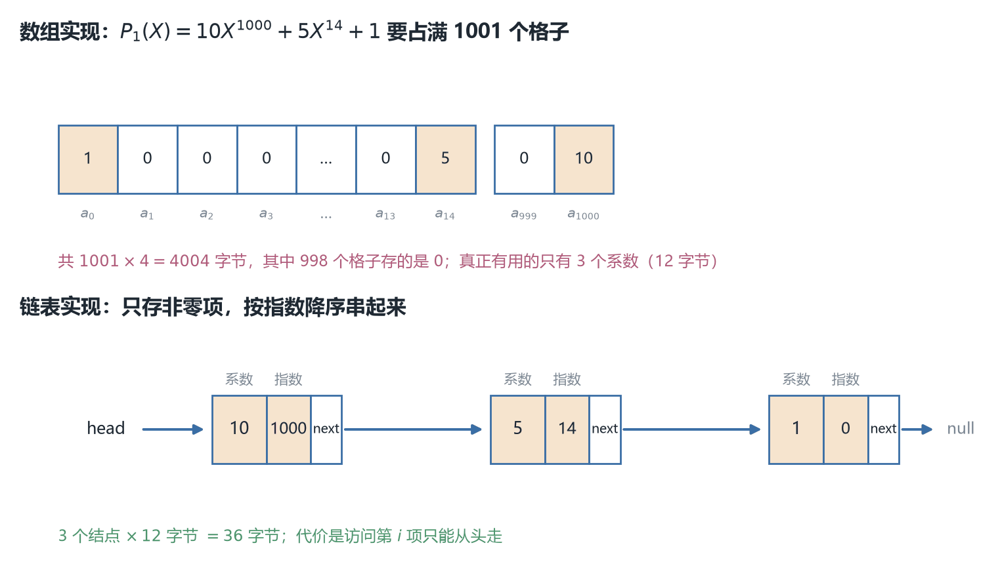
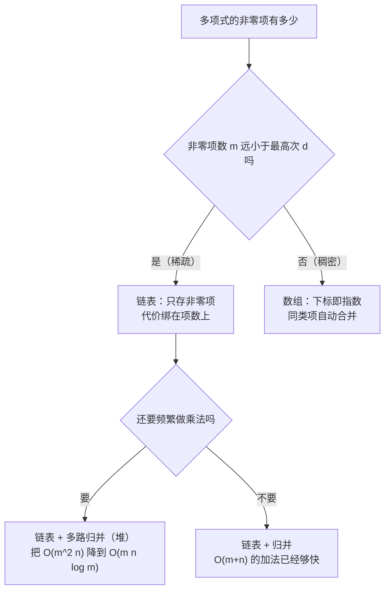
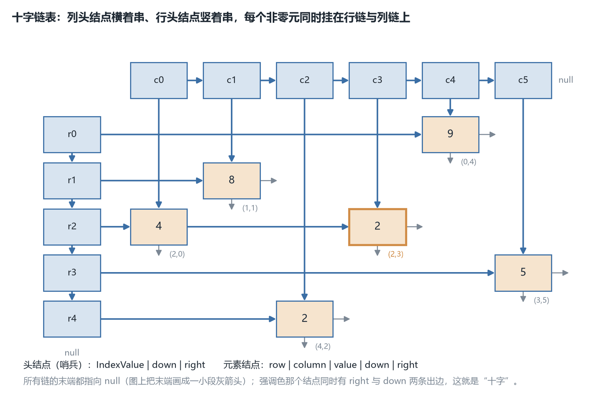
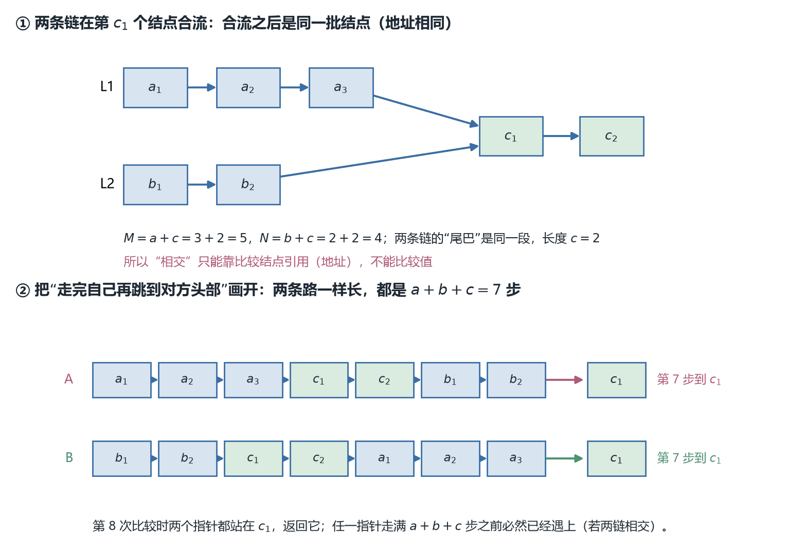
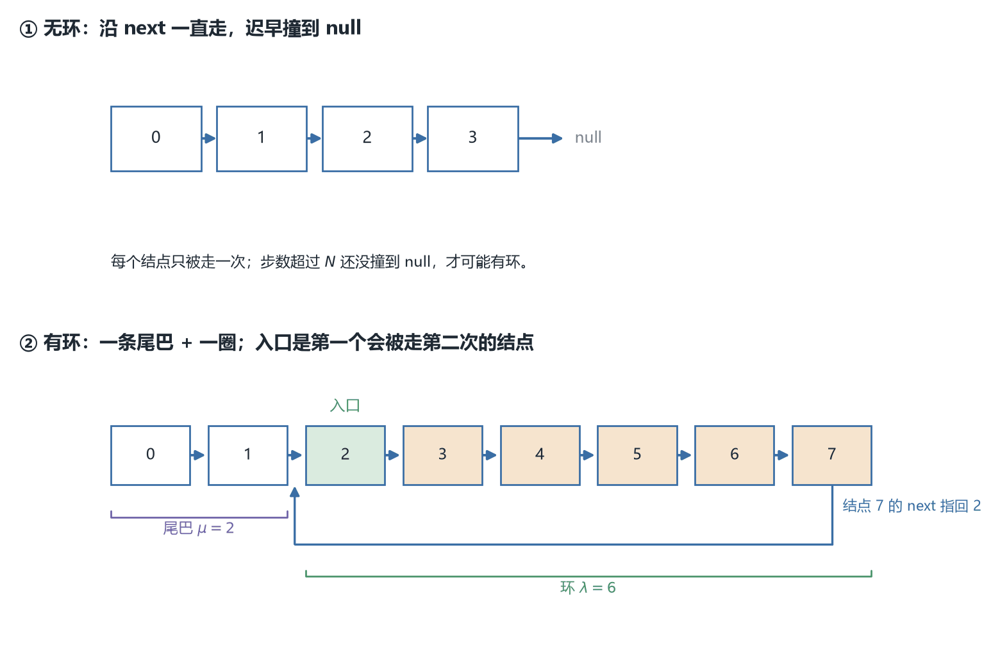
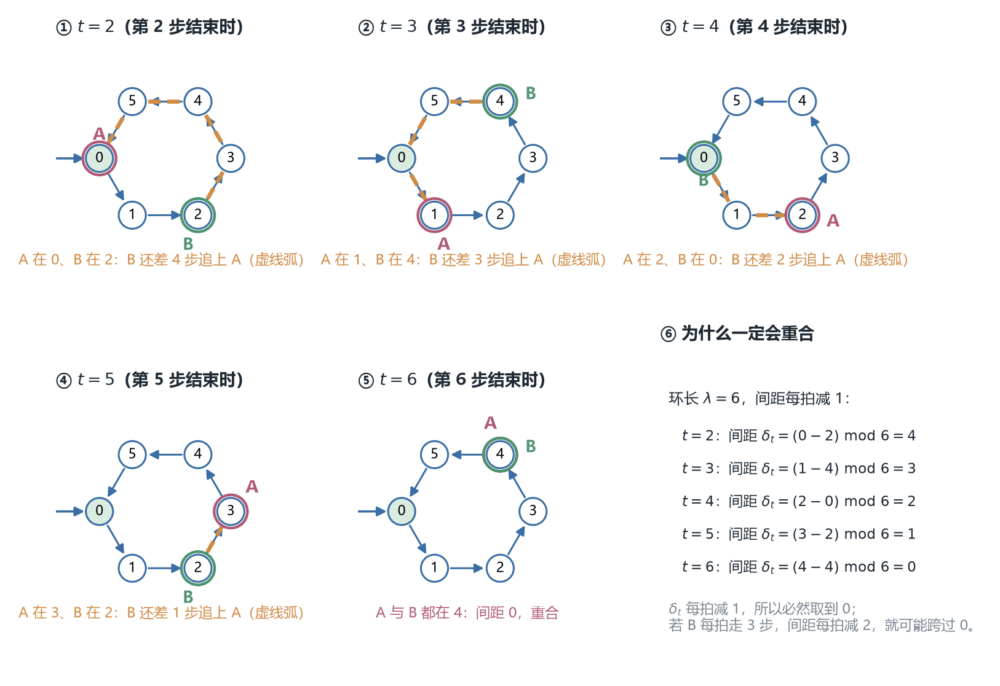
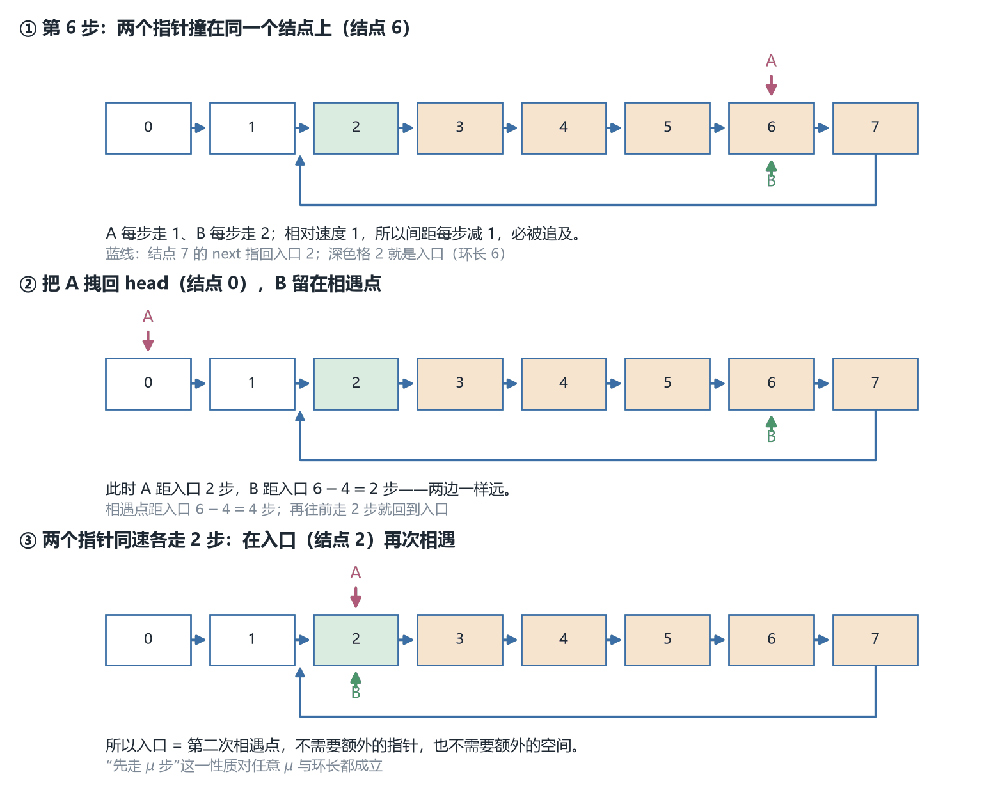

# CSC3100 Lecture 8 课堂笔记：List（表的应用与练习）

> **材料构成**：本讲基于课件整理，不含教师口述内容；课件 `lecture 8 (list).pdf` 共 41 页。这 41 页的文字层只有约 7.0 K 字符——因为**代码与示意图几乎全是图片**，连 p.4 那页的类定义、p.23 那页的伪代码都是整块截进去的位图。所以我把 41 页全部按 170 dpi 渲染逐页读过，其中 p.4-7、p.18、p.23、p.25、p.26、p.40 这七页的代码另外按 320–420 dpi 裁切放大逐行核对过，p.15 的十字链表图分块放大读了两遍。
>
> **课件结构**：目录（p.2）→ List ADT 复习（p.3）→ 应用一：多项式的数组实现（p.4-7）→ 数组版为什么撑不住（p.8）→ 多项式的链表表示（p.9-10）→ 实现练习：加法与乘法的伪代码（p.11）→ 应用二：矩阵的两个动机例子（p.12-13）→ 稀疏矩阵的三元组（p.14）与十字链表（p.15）→ 练习一：两条链表求交（p.16-23）→ 练习二：重复字母检测（p.24-26）→ 练习三：环检测（p.27-40）→ 阅读与下一讲（p.41）。
>
> **已知课件问题**：p.4 的数组声明在 Java 里编译不过，p.40 的判圈代码对任何非空链表都会在第一次循环就返回 "cyclic"，p.23 的求交代码在“两条链根本不相交”时死循环。其余九条（p.35 的间距表述、p.31 的语法、p.19 换了例子没交代等）都在文末「附：诚实备注」里逐条列出，代码类的都注明了我有没有真的编译或运行过。
>
> **来源标注约定**：正文里凡以补充类 alert（NOTE / TIP / IMPORTANT）呈现的内容，都是课件没有、由我补充或推导的内容（包括 p.11 两份伪代码的答案、§10.7 的入口证明、§10.8 的反例，以及六张配图）；没有标注的都是课件上写着的。页码一律指课件页码。

## 0. 一句话概括本讲在讲什么

上一讲（L7）把"表"从数组换成了链表，讲的全是**结构**：结点里放什么、指针怎么改、四种链表差在哪两个维度上。那一讲的结尾（p.34）只留了一句"下一讲：Applications of list"，没有给任何内容层面的铺垫。所以本讲是那笔账的兑现：**既然链表这也不好那也不好，那到底什么时候非用它不可？**

课件的回答分两半。前一半是两个真实应用。**多项式**（polynomial）的系数绝大部分是 0，用数组存就要把 0 也存进去，$10X^{1000}+5X^{14}+1$ 这样三项的式子要占 1001 个格子；**矩阵**（matrix）更极端，一所学校 4 万学生乘 2500 门课是一亿个格子，而每个学生只上 3 门课，真正有值的只有 12 万格（0.12%）。这两件事的共性不是"数据多"，而是**数据稀**——非零元素只占极小一部分，而"零"这种值又不需要存。

后一半是三道练习：两条链表求交、重复字母检测、环检测。这三道题的答案都能用数组或哈希表做出来，课件偏偏要求用链表做，目的是把 L7 那些指针操作练熟；它们各自还带来一个新工具：**同步走**（两个指针走一样多的路）、**双游标**（一个走、一个守在前面）、**快慢指针**（一个走一步、一个走两步）。

一句话：**同一个 ADT，在什么数据形状下必须换实现——本讲用"稀疏"回答了这个问题，再用三道指针题把答案练一遍。**

## 1. 复习：List ADT 与它的六个操作（p.2-3）

### 1.1 这一页只复习接口，不重讲结构

目录把全讲分成三块：List ADT 复习、Applications（多项式、矩阵）、Exercises（求交、去重、判圈）。第一节就是那个"复习"——它和 L7 的 p.3 **逐字相同**：同一句定义（finite number of ordered values, where the same value may occur more than once）、同样六个操作、同样那个 `find(52)` 返回 3 的例子。

所以这一节不重讲 L7 §1 的内容（ADT 与数据结构的区别、ordered 是"有次序"而不是"已排序"、前后驱在两端无定义），只把接口列出来，因为后面三道练习要拿它做对照。如果你对"ADT 只说能做什么、不说怎么存"这件事还没有直觉，回去看 L7 §1.1。

### 1.2 六个操作，以及一个本讲才显出来的事实

| 操作 | 语义 | 课件给的例子 |
| --- | --- | --- |
| `printList` | 按次序打印全部元素 | — |
| `makeEmpty` | 清空整张表 | — |
| `find` | 返回某个值**第一次**出现的位置 | 表 $34,12,52,16,12$ 里 `find(52)` 返回 3 |
| `insert` | 在某个位置插入一个值 | `insert(X, 3)` |
| `delete` | 从某个位置删掉一个值 | `delete(52)` |
| `next` / `previous` | 取前驱 / 后继（可选） | — |

这张表在 L7 出现过一次，当时的结论是"这套接口的记号不统一"：`insert` 的第二个参数是位置、`delete` 的参数是值、`find` 返回的位置从 1 数起，而 L7 后面所有代码用 0-based 下标。这个不一致在本讲依然存在，但没有变得更糟——因为**本讲几乎不用这套接口**。

这一点值得单独说，它是读本讲三道练习时最容易迷路的地方：p.16 起的求交、p.24 起的去重、p.27 起的判圈，**没有一道题按位置访问元素**。它们手里拿的全是**结点引用**（node reference），走法是 `A = A.next`。换句话说，真正被用到的原语只有一个——"从 head 沿 next 走"——而 `find(p)`、`insert(x, p)`、`delete(p)` 这三个带下标的操作一次都没出现。

> [!NOTE] 补充：接口为何不用下标
> 这不是巧合。L7 §6.4 算过一笔账：链表的"按下标"操作是 $O(n)$（因为算不出第 $p$ 个结点在哪），而"按引用"是 $O(1)$。所以**凡是真正发挥链表长处的算法，接口里都不会出现下标**——它们要么一路走到底（求交、判圈），要么边走边维护一个前驱（去重）。反过来说，如果你写出来的链表代码里到处是 `get(i)`，那多半是把它当数组用了，还不如直接用数组。

## 2. 应用一：多项式的数组表示（p.4-7）

### 2.1 为什么第一个想到的是数组

先给定义。一个**单变量多项式**（single-variable polynomial）写成

$$F(X)=\sum_{i=0}^{N} A_i X^{i}$$

其中 $N$ 是最高次（degree），$A_i$ 是 $X^i$ 这一项的**系数（coefficient）**。$A_i$ 可以是 0——这句话听起来是废话，但它是整节的开端：**一个多项式被它的系数序列完全确定**，而系数序列的长度就是"最高次加一"。

所以第一个想法自然是：拿一个数组，第 $i$ 格存 $A_i$。这样"取 $X^i$ 的系数"就是一次下标访问，$O(1)$；"两个多项式相加"就是把两个数组逐格相加，$O(N)$。这两件事都太快了，快到让人不想再看第二种方案。

代价藏在两个地方：数组长度必须是"最高次加一"（哪怕只有三项），而且长度必须在建表时就定死（L7 §2.1 的第一条限制）。§3.2 会把这两条代价算给你看。

### 2.2 结构：两个字段就够了（p.4）

```java
class Polynomial {
    int coeffArray[MaxDegree + 1];
    int highPower;
}
```

两个字段，各有一个坑。

**`coeffArray`** 是系数数组，第 $i$ 格是 $A_i$。**`highPower`** 是这个多项式当前的最高次。为什么需要它？因为数组长度是 `MaxDegree + 1`（一个全局上限），而某个具体的多项式可能远达不到这个上限；如果不记 `highPower`，遍历时就得每次扫完整个数组。所以 `highPower` 的作用是"告诉我有效前缀有多长"。

**但 `highPower` 是上界，不是真次数。** 这一点课件没说，而它会在两个地方咬人：一是两个同次项相加后系数变成 0（$3X^2+(-3X^2)=0$），此时真实的次数掉下来了，`highPower` 却还停在 2；二是 `zeroPolynomial` 把零多项式的 `highPower` 设成 0（p.5），而零多项式其实没有次数。所以读这段代码时要记住：`highPower` 的语义是"我能保证次数不超过这个值"，凡是拿它当循环上界都安全，凡是拿它当"这个多项式长什么样"都会错。

> [!CAUTION] 注意：MaxDegree 差 1
> 顺带一个术语问题：`coeffArray[MaxDegree + 1]` 里的 `MaxDegree` 是"允许的最高次"，所以数组长度是 `MaxDegree + 1`（$X^0$ 到 $X^{\text{MaxDegree}}$ 一共这么多格）。这两个数差 1，是全节最容易被抄错的地方——p.5 的循环写的是 `j <= MaxDegree`，正好跑 `MaxDegree + 1` 次，这一点是对的。

### 2.3 清零：`zeroPolynomial`（p.5）

::: code-group

```java [Java]
void zeroPolynomial(Polynomial poly){
    for (int j = 0;  j <= MaxDegree; j++)
        poly.coeffArray[j] = 0;
    poly.highPower = 0;
}
```

```python [Python]
def zero_polynomial(poly):
    for j in range(MAX_DEGREE + 1):
        poly.coeff_array[j] = 0
    poly.high_power = 0
```

```cpp [C++]
void zeroPolynomial(Polynomial& poly){
    for (int j = 0;  j <= MaxDegree; j++)
        poly.coeffArray[j] = 0;
    poly.highPower = 0;
}
```

```c [C]
void zeroPolynomial(Polynomial* poly){
    /* 逐格清 0 的 C 写法就是一次 memset：同样跑 MaxDegree+1 个字节组 */
    memset(poly->coeffArray, 0, sizeof(poly->coeffArray));
    poly->highPower = 0;
}
```

:::

逐行没有难点，但有一个**代价上的事实**：这个循环跑 `MaxDegree + 1` 次，与 `poly.highPower` 无关。也就是说，哪怕你要处理的是一个 $1+X$ 这样的两项式子，清零也要抹掉整个数组。

这在单独调用时无所谓（初始化本来就只有一次），但 p.6、p.7 的两个函数**每次调用都先清零**——于是"加两个多项式"和"乘两个多项式"的代价里，都先垫了一个 $\Theta(\text{MaxDegree})$。在 p.8 那个例子里，这一项就是 2991 次赋值，比真正的乘法（12 次）大两个数量级。

**`poly.highPower = 0;`** 把次数设成 0，即"这个多项式现在是常数 0"。注意零多项式的次数在数学上是未定义的（或 $-\infty$），这里取 0 是一个工程约定：只要保证后续的循环上界不小于真实次数就行。

### 2.4 相加：`addPolynomial`（p.6）

::: code-group

```java [Java]
void addPolynomial(Polynomial poly1, Polynomial poly2, Polynomial polySum) {
    zeroPolynomial(polySum);
    polySum.highPower = Math.max(poly1.highPower, poly2.highPower);

    for (int i = polySum.highPower; i >= 0; i--)
        polySum.coeffArray[i] = poly1.coeffArray[i] +
            poly2.coeffArray[i];
}
```

```python [Python]
def add_polynomial(poly1, poly2, poly_sum):
    zero_polynomial(poly_sum)
    poly_sum.high_power = max(poly1.high_power, poly2.high_power)

    for i in range(poly_sum.high_power, -1, -1):
        poly_sum.coeff_array[i] = poly1.coeff_array[i] + poly2.coeff_array[i]
```

```cpp [C++]
void addPolynomial(Polynomial& poly1, Polynomial& poly2, Polynomial& polySum) {
    zeroPolynomial(polySum);
    polySum.highPower = std::max(poly1.highPower, poly2.highPower);

    for (int i = polySum.highPower; i >= 0; i--)
        polySum.coeffArray[i] = poly1.coeffArray[i] +
            poly2.coeffArray[i];
}
```

```c [C]
void addPolynomial(Polynomial* poly1, Polynomial* poly2, Polynomial* polySum) {
    zeroPolynomial(polySum);
    /* C 的 <stdlib.h> 里没有 max：要么写三元，要么写宏 */
    polySum->highPower = (poly1->highPower > poly2->highPower)
                         ? poly1->highPower : poly2->highPower;

    for (int i = polySum->highPower; i >= 0; i--)
        polySum->coeffArray[i] = poly1->coeffArray[i] +
            poly2->coeffArray[i];
}
```

:::

三步：清零结果、把次数取两者较大、从高到低逐格相加。

**第一步不能省，也不能换个对象做。** `zeroPolynomial(polySum)` 会把 `polySum` 这个对象的整块数组抹掉——如果调用者写的是 `addPolynomial(p, q, p)`（把结果写回第一个参数），那么 `p` 的系数在相加之前就已经全变成 0 了，结果是错的。这类"输出参数与输入参数是同一个对象"的问题叫**别名（aliasing）**，L7 §3.3 讲过：两个变量指向同一个对象时，通过其中一个改，另一个立刻看得见。这里的规避办法很简单：调用者必须传一个**新对象**进来。

**第二步取 `max` 是对的**，因为和的次数不会超过两者中较大的那个。（严格说也可能更小：最高次项相消时次数会掉下来。这就是 §2.2 说的"上界"。）

**第三步从高往低遍历**只是为了和手算顺序一致；从低往高结果一样。复杂度是 $\Theta(\max(\text{highPower}_1,\text{highPower}_2)+1)$——注意它绑在**次数**上，不绑在"有多少个非零项"上。

### 2.5 相乘：`multPolynomial`（p.7）

```java
void multPolynomial(Polynomial poly1, Polynomial poly2, Polynomial polyProd){
    zeroPolynomial(polyProd);
    polyProd.highPower = poly1.highPower + poly2.highPower;

    if (polyProd.highPower > MaxDegree)
        System.out.println(“Exceed array size”);
    else
        for (int i = 0; i <= poly1.highPower; i++)
            for (int j = 0; j <= poly2.highPower; j++)
                polyProd.coeffArray[i + j] += poly1.coeffArray[i] *
                    poly2.coeffArray[j];
}
```

这是本讲唯一一个"真的在算"的函数，四个地方要看清楚。

**第一，乘积的次数是两次数之和。** 这是多项式乘法的基本事实：$X^i\cdot X^j=X^{i+j}$，所以最高次是 $d_1+d_2$。代码把 `highPower` 直接设成和，是把它当**上界**用的（准确值取决于首项系数是否相消）。

**第二，越界检查写在算之前，但状态已经改了。** `highPower` 在检查之前就被赋成了 $d_1+d_2$；如果超过 `MaxDegree`，程序只打印一行 "Exceed array size" 就往下走（`else` 跳过循环），此时 `polyProd.highPower` 是一个**越界值**。任何后续代码（包括再一次调用 `addPolynomial`）拿它当循环上界都会下标越界。正确处理应该是抛异常或者把结果置零，而不是留一个半坏的对象。

**第三，双重循环的次数是 $(d_1+1)(d_2+1)$，与"有几项非零"无关。** 这就是 p.8 要打的靶子：`poly1.coeffArray[i] * poly2.coeffArray[j]` 这行会被执行 $(d_1+1)(d_2+1)$ 次，其中绝大多数是"0 乘某个数"。

**第四，`+=` 不是 `=`。** 不同的 $(i,j)$ 对可能落在同一个 $i+j$ 上（$X^0X^2$ 与 $X^1X^1$ 都落在 $X^2$），所以必须累加。这一步在数组实现里是"免费的"（下标一算就知道往哪加），而在链表实现里正是最麻烦的一步——合并同类项（p.11 的 hint 里那句 "nodes with the same degrees are added together"）。

### 2.6 这两段代码在 Java 里跑不起来

顺手记两处，它们不影响算法思想，但照抄一定编译不过（文末诚实备注第 1、2 条）：

§2.2 那行 `int coeffArray[MaxDegree + 1];` 不是合法的 Java——Java 的数组是**对象**，长度只能在 `new` 的时候给：`int[] coeffArray = new int[MaxDegree + 1];`。我拿 JDK 26 真编译过，`javac` 报 `']' expected` 与 `<identifier> expected` 两个错。

§2.5 那行 `System.out.println(“Exceed array size”);` 里那对引号是**中文/排版引号**（U+201C 与 U+201D），不是 ASCII 的 `"`。`javac` 报 `illegal character: '\u201c'` 与 `'\u201d'`。这是从 Word 或 Keynote 里复制代码时的常见事故：看起来一模一样，编译器一个字符都不认。

## 3. 数组版的致命问题：稀疏（p.8）

### 3.1 课件给的例子

这一节的正文只有四行，但它是整讲的转折点：

$$P_1(X)=10X^{1000}+5X^{14}+1$$

$$P_2(X)=3X^{1990}-2X^{1492}+11X+5$$

下面一句结论："Most of the time is spent on multiplying zeros."（大部分时间花在乘零上。）

### 3.2 把账算出来

> [!NOTE] 补充
> 本节整节是课件没有的补充：把"大部分时间在乘零"算成具体数字。

课件只给了这句话，没给数字。下面这些数是我按 p.7 那段双重循环逐项数出来的，并用 Python 复算过一遍（乘法次数、乘零次数、比值、乘积展开四项）：

- $P_1$ 的最高次是 1000，所以 `poly1.highPower = 1000`，外层循环跑 **1001** 次；$P_2$ 的最高次是 1990，内层跑 **1991** 次。
- 内层那行乘法一共执行 $1001\times 1991=\mathbf{1\,992\,991}$ 次。
- 其中**真正有用的只有 $3\times 4=12$ 次**（$P_1$ 有 3 个非零项、$P_2$ 有 4 个）——$10\times3$、$10\times(-2)$、……一共 12 对。
- 也就是说，**1 992 979 次是在乘零**，占比 99.9994%；有用次数与总次数相差 **166 083 倍**。
- 还没算完：每次调用前还有 `zeroPolynomial`，要抹 2991 格（若 `MaxDegree` 取 2990，才能装下次数 2990 的乘积）。

乘出来的结果本身也值得看一眼：这 12 对系数的指数**互不相同**（$1000+1990=2990$、$1000+1492=2492$、$14+1990=2004$……），所以积恰好有 12 个非零项，没有一次同类项合并：

$$30X^{2990}-20X^{2492}+15X^{2004}+3X^{1990}-10X^{1506}-2X^{1492}+110X^{1001}+50X^{1000}+55X^{15}+25X^{14}+11X+5$$

12 个非零项，却要一个 2991 格的数组来装——非零系数占 0.40%。

这张对比图把两件事放在一起：同一份信息，一边占 1001 格（$P_1$）、一边只占 3 个结点。



*图 1　上：数组实现把 $X^0$ 到 $X^{1000}$ 全部占满，1001 格里 998 格是 0（这张图只画出 8 格与一个省略号，其余 993 格略）；下：链表实现只存 3 个非零项，每结点 = 系数 + 指数 + next。数字按 §3.1 的 $P_1$ 与 §2.5 的代码算出。*

所以 p.8 的真正指控不是"数组慢"，而是**数组的代价绑错了量**：它绑在"最高次"上，而这件事的难度其实只取决于"有多少个非零项"。$P_1$ 只有 3 项，却要付出 1001 格的代价；如果换成 $X^{100000}+1$，代价会涨到十万，而信息量一点没变。

这个区分是本讲最该带走的一句话：

> **复杂度里的那个 $n$ 到底是谁，比复杂度是几阶更重要。** 同样是 $O(N^2)$，数组版的 $N$ 是最高次，链表版的 $N$ 是项数；在这两个例子里它们差了三个数量级。

## 4. 换成链表：结点形状与"按指数降序"（p.9-10）

### 4.1 一个结点存一项（p.9）

::: code-group

```java [Java]
class Node {
    int coefficient;
    int exponent;
    Node next;

    // 一个结点就是"一项"：系数 + 指数 + 指向下一项的指针
    public Node(int c, int e) {
        coefficient = c;
        exponent = e;
        next = null;
    }
}
```

```python [Python]
class Node:
    def __init__(self, c, e):
        self.coefficient = c
        self.exponent = e
        self.next = None
```

```cpp [C++]
/* 本讲后面还有存 data 的 Node（求交、去重、判圈），所以多项式结点叫 PNode */
struct PNode {
    int coefficient;
    int exponent;
    PNode* next;

    PNode(int c, int e) : coefficient(c), exponent(e), next(nullptr) {}
};
```

```c [C]
typedef struct PNode {
    int coefficient;
    int exponent;
    struct PNode* next;
} PNode;

PNode* makePNode(int c, int e) {
    PNode* p = (PNode*)malloc(sizeof(PNode));
    if (p == NULL) return NULL;
    p->coefficient = c;
    p->exponent = e;
    p->next = NULL;
    return p;                    /* 每个 makePNode 都要有一次对应的 free */
}
```

:::

三个域，语义直接对应"一项"：`coefficient` 是系数、`exponent` 是指数、`next` 指向下一项。对比 p.4 的 `Polynomial`，最大的变化是**数组没了**：不再有"第 $i$ 格对应 $X^i$"这个约定，指数变成**存在结点里的数据**。

这个变化带来一个立刻的好处和一个立刻的麻烦：

- 好处：只存非零项。$P_1$ 从 1001 格变成 3 个结点，$P_2$ 从 1991 格变成 4 个结点。
- 麻烦："$X^i$ 的系数是多少"不再能算出来。数组里它是 `coeffArray[i]`（$O(1)$）；链表里你只能从头沿着 `next` 找，而指数是**降序**排的，所以找 $X^i$ 是 $O(\text{项数})$ 的线性扫描。

### 4.2 两条链长什么样（p.10）

§3.1 的那两个多项式画成链是这样：

$$P_1:\ [10\mid1000]\to[5\mid14]\to[1\mid0]\to\text{null}$$

$$P_2:\ [3\mid1990]\to[-2\mid1492]\to[11\mid1]\to[5\mid0]\to\text{null}$$

每个方框里画三格，依次是系数、指数、next。两点值得注意：

**第一，指数是严格递减的**（1000、14、0；1990、1492、1、0）。这个约定在链上直接就能看出来，直到加法的 hint 里才用文字补了一句 "sorted according to their degrees"。

**第二，0 次项（常数项）也在链上**，指数写 0。这一点容易被忽略：数组实现里"常数项"是第 0 格，天生存在；链表实现里它必须是一个真实的结点，否则"加一个常数"这件事就没地方落。

### 4.3 为什么必须有序

> [!NOTE] 补充
> 本节整节是课件没有的补充：从 merge 的 hint 反推"有序"的必要性。

课件只说了"sorted"，没说为什么。理由在 p.11 的 hint 里露出来了——它让你"回想归并排序里的 merge"。归并的前提是**两边都有序**：只有两条链都按指数排好，才能用两个游标一次扫完、边扫边合并同类项。

如果链是无序的，加两个多项式就退化成"对 $P_1$ 的每一项，在 $P_2$ 里线性查找同指数的项"，代价 $O(mn)$——比数组版还差。所以**有序不是审美要求，是合并算法的前提**。

至于为什么选**降序**而不是升序：两种都能做，选降序有一个实际好处——最高次项在表头，取"首项"是 $O(1)$，而首项决定了很多判断（比如乘积的次数、结果的量级）。这一点课件没写，属于我的理解。

## 5. 练习：链式多项式的加与乘（p.11）

### 5.1 加法就是归并，但要多做一件事

练习的题目是：给定两条按次数排好序的链（分别有 $m$、$n$ 个结点），写加法的伪代码。hint 是：

> recall the merge function in MergeSort; create a new linked list and merge two linked lists where nodes with the same degrees are added together

这个 hint 把框架说全了，但没给答案。

> [!NOTE] 补充：实现是我写的
> 下面这份实现是我写的，不是课件内容；写法上刻意保留了"哑头结点 + 尾指针"这套 L7 §10.3 的技巧，因为它能把"结果为空"这个特例消掉。

::: code-group

```java [Java]
// 字段名沿用 §4.1 的 coefficient / exponent（上面的伪代码里简写成 coef / exp）
// 两条按指数降序的链相加；返回带哑头结点的新链，不改输入链的结点
Node addPoly(Node p1, Node p2) {
    Node dummy = new Node(0, 0);        // 哑头结点：省掉"结果为空"的特判
    Node tail = dummy;
    Node a = p1, b = p2;

    while (a != null && b != null) {
        if (a.exponent > b.exponent) {                 // a 的次更高，直接搬
            tail.next = new Node(a.coefficient, a.exponent);
            tail = tail.next;
            a = a.next;
        } else if (a.exponent < b.exponent) {
            tail.next = new Node(b.coefficient, b.exponent);
            tail = tail.next;
            b = b.next;
        } else {                                       // 同次：合并同类项
            int s = a.coefficient + b.coefficient;
            if (s != 0) {                              // 系数为 0 的项不建结点
                tail.next = new Node(s, a.exponent);
                tail = tail.next;
            }
            a = a.next;
            b = b.next;
        }
    }
    // 把剩下的那条链整段接上（不逐项复制，但与输入共享尾部结点）
    tail.next = (a != null) ? a : b;
    return dummy.next;
}
```

```python [Python]
def add_poly(p1, p2):
    dummy = Node(0, 0)           # 哑头结点：省掉"结果为空"的特判
    tail = dummy
    a, b = p1, p2

    while a is not None and b is not None:
        if a.exponent > b.exponent:                # a 的次更高，直接搬
            tail.next = Node(a.coefficient, a.exponent)
            tail = tail.next
            a = a.next
        elif a.exponent < b.exponent:
            tail.next = Node(b.coefficient, b.exponent)
            tail = tail.next
            b = b.next
        else:                                      # 同次：合并同类项
            s = a.coefficient + b.coefficient
            if s != 0:                             # 系数为 0 的项不建结点
                tail.next = Node(s, a.exponent)
                tail = tail.next
            a = a.next
            b = b.next
    # 剩下的整段接上（O(1)，但与输入共享尾部结点）
    tail.next = a if a is not None else b
    return dummy.next
```

```cpp [C++]
PNode* addPoly(PNode* p1, PNode* p2) {
    PNode* dummy = new PNode(0, 0);
    PNode* tail = dummy;
    PNode* a = p1;
    PNode* b = p2;

    while (a != nullptr && b != nullptr) {
        if (a->exponent > b->exponent) {
            tail->next = new PNode(a->coefficient, a->exponent);
            tail = tail->next;
            a = a->next;
        } else if (a->exponent < b->exponent) {
            tail->next = new PNode(b->coefficient, b->exponent);
            tail = tail->next;
            b = b->next;
        } else {
            int s = a->coefficient + b->coefficient;
            if (s != 0) {
                tail->next = new PNode(s, a->exponent);
                tail = tail->next;
            }
            a = a->next;
            b = b->next;
        }
    }
    tail->next = (a != nullptr) ? a : b;   // 与输入共享尾段：这段结点不归结果所有
    PNode* head = dummy->next;
    delete dummy;                          // 哑头结点只是借来用，不能漏
    return head;
}
```

```c [C]
PNode* addPoly(PNode* p1, PNode* p2) {
    PNode* dummy = makePNode(0, 0);
    PNode* tail = dummy;
    PNode* a = p1;
    PNode* b = p2;

    while (a != NULL && b != NULL) {
        if (a->exponent > b->exponent) {
            tail->next = makePNode(a->coefficient, a->exponent);
            tail = tail->next;
            a = a->next;
        } else if (a->exponent < b->exponent) {
            tail->next = makePNode(b->coefficient, b->exponent);
            tail = tail->next;
            b = b->next;
        } else {
            int s = a->coefficient + b->coefficient;
            if (s != 0) {
                tail->next = makePNode(s, a->exponent);
                tail = tail->next;
            }
            a = a->next;
            b = b->next;
        }
    }
    /* 整段接上（§5.1 第三点）：这一段结点仍然归输入链所有，
       free 结果时只能 free 自己 makePNode 出来的前缀，否则会把输入链提前释放 */
    tail->next = (a != NULL) ? a : b;
    PNode* head = dummy->next;
    free(dummy);                       /* 哑头结点也要还回去 */
    return head;
}
```

:::

四个细节决定了它是否正确：

**第一，三个分支的顺序**：大于、小于、等于。写成"大于/否则比较是否小于"也行，但一定要保证同次的情况被单独处理——否则 $X^2$ 与 $X^2$ 会被当成两次"直接搬"，结果里出现两个 $X^2$。

**第二，系数和为 0 时必须丢弃这一项**，否则结果里会有 $0X^{k}$ 这种"零项"。这一步在数组实现里是自动的（0 就是 0，不影响遍历），在链表里必须显式判断——因为链表的"存在"就是"有结点"。

**第三，收尾用"整段接上"而不是"逐项复制"**：剩下的那条链已经有序，直接把尾指针指过去即可。这一步是 $O(1)$ 的，而且**没有新建结点**——但代价是结果链与输入链**共享了尾部结点**。如果之后还要改输入链，这里就会出别名问题（L7 §3.3）。

**第四，输入链的结点只被读、不被改**（`a.coef`、`a.exp`、`a.next` 都只读），新建的结点数等于"被搬过来的项数"（同次且系数和为 0 的那一项不建）。所以这个版本是"尽量不破坏输入"的写法；另一种写法是就地合并（把 $b$ 的结点直接摘下来接到结果里），空间 $O(1)$ 但会破坏输入。两种都对，取决于调用者还要不要原来的多项式。

复杂度：每个分支至少让一个游标前进一步，所以循环最多 $m+n$ 轮，加上收尾，$\Theta(m+n)$。空间：最坏 $O(m+n)$ 个新结点（就地版是 $O(1)$）。

### 5.2 乘法：先造 $m$ 条链，再合并 $m$ 条链

第二个 hint 是：

> create m linked lists, each representing the multiplication of one term from the first polynomial with the entire second polynomial; create a new linked list and merge m linked lists

这句话描述的是一个"两段式"算法：第一段把 $P_1$ 的每一项分别乘 $P_2$ 的整条链，得到 $m$ 条长度为 $n$ 的链；第二段把这 $m$ 条链合并成一条。

> [!NOTE] 补充：实现是我写的
> 下面是我按这个 hint 写的实现。

::: code-group

```java [Java]
Node multPoly(Node p1, Node p2) {
    Node result = null;                                // addPoly 能处理空表，不必先造哑头
    for (Node a = p1; a != null; a = a.next) {          // 共 m 轮
        Node dummy = new Node(0, 0);
        Node tail = dummy;
        for (Node b = p2; b != null; b = b.next) {      // 每轮 n 个结点
            tail.next = new Node(a.coefficient * b.coefficient,
                                 a.exponent + b.exponent);
            tail = tail.next;
        }
        Node t = dummy.next;
        result = (result == null) ? t : addPoly(result, t);   // 归并 + 合并同类项
    }
    return result;
}
```

```python [Python]
def mult_poly(p1, p2):
    result = None                       # add_poly 能处理空表，不必先造哑头
    a = p1
    while a is not None:                # 共 m 轮
        dummy = Node(0, 0)
        tail = dummy
        b = p2
        while b is not None:            # 每轮 n 个结点
            tail.next = Node(a.coefficient * b.coefficient,
                             a.exponent + b.exponent)
            tail = tail.next
            b = b.next
        t = dummy.next
        result = t if result is None else add_poly(result, t)   # 归并 + 合并同类项
        a = a.next
    return result
```

```cpp [C++]
PNode* multPoly(PNode* p1, PNode* p2) {
    PNode* result = nullptr;
    for (PNode* a = p1; a != nullptr; a = a->next) {
        PNode* dummy = new PNode(0, 0);
        PNode* tail = dummy;
        for (PNode* b = p2; b != nullptr; b = b->next) {
            tail->next = new PNode(a->coefficient * b->coefficient,
                                   a->exponent + b->exponent);
            tail = tail->next;
        }
        PNode* t = dummy->next;
        delete dummy;                                  // 哑头结点只借来用一轮
        result = (result == nullptr) ? t : addPoly(result, t);
        // 注意：addPoly 会把输入链的尾段接进结果，旧 result 与 t 的结点
        // 一部分已被复制、一部分已并入新链，不能在这里 delete —— 这就是 §5.2
        // 说的"新建结点数也是 O(m²n)"，Java 靠 GC，C++ 只能最后统一释放
    }
    return result;
}
```

```c [C]
PNode* multPoly(PNode* p1, PNode* p2) {
    PNode* result = NULL;
    for (PNode* a = p1; a != NULL; a = a->next) {
        PNode* dummy = makePNode(0, 0);
        PNode* tail = dummy;
        for (PNode* b = p2; b != NULL; b = b->next) {
            tail->next = makePNode(a->coefficient * b->coefficient,
                                   a->exponent + b->exponent);
            tail = tail->next;
        }
        PNode* t = dummy->next;
        free(dummy);                     /* 哑头结点每轮都要还 */
        result = (result == NULL) ? t : addPoly(result, t);
        /* 每轮新建 n 个结点；旧 result 的一部分被复制进新链后就成了垃圾。
           C 里这些结点要由调用方记账回收（这就是 §5.2 说的 O(m²n) 个结点） */
    }
    return result;
}
```

:::

第一段为什么天然有序？因为 $P_2$ 的指数是降序的，而"乘一个单项式 $a.coef\cdot X^{a.exp}$"只是给每个指数**加上** $a.exp$——同一个常数加到一串递减数上，顺序不变。所以每条 $T$ 都是现成的有序链，可以直接丢给 §5.1 的 `AddPoly`。

复杂度要小心算。第 $k$ 轮开始时，`R` 里最多有 $(k-1)n$ 个结点（前 $k-1$ 条链合并的结果），`T` 有 $n$ 个；`AddPoly` 的代价是两者长度之和，即 $O(kn)$。所以总代价

$$\sum_{k=1}^{m} O(kn)=O\left(n\cdot\frac{m(m+1)}{2}\right)=O(m^2n)$$

这个 $O(m^2n)$ 是"逐条合并"的代价，也是 p.11 那个 hint 直接对应的结果。**注意这个版本的开销不止时间**：每轮 `AddPoly` 都重新造一条结果链，所以累计新建的结点数也是 $O(m^2n)$——稠密时这一项比乘法本身（$mn$ 个）大得多。要省掉它，得把 `AddPoly` 写成"就地合并"（把两条链的结点摘下来接上）。

> [!TIP] 技巧：堆做多路归并
> 时间上的 $m^2$ 也可以消掉：把 $m$ 条链当成 $m$ 个"有序序列"，用**最小堆**（min-heap）做多路归并，每次从堆顶取指数最大的那一项，代价 $O(mn\log m)$。课件没要求这一步，这里只点一句。

### 5.3 两个复杂度必须对着看，否则会得出反的结论

现在把数组版和链表版并排放。注意**它们的 $N$ 不是同一个东西**：

| | 数组版（p.7） | 链表版（p.11 的 hint） |
| --- | --- | --- |
| 乘法次数 | $(d_1+1)(d_2+1)$ | $m\cdot n$ |
| 这里的"规模" | $d$ = **最高次** | $m,n$ = **非零项数** |
| p.8 的例子 | $1001\times1991=1\,992\,991$ | $3\times4=12$ |
| 合并同类项 | 自动（下标即指数） | 要显式归并，$O(m^2n)$ |
| 稠密时（$m=n=d=N$） | $\Theta(N^2)$ | $\Theta(N^2)$ 次乘法，再加 $\Theta(N^3)$ 的合并 |

最后一行是关键，也是最容易被"链表更好"这句话骗过去的地方：

- **稀疏时链表碾压数组**：$P_1\times P_2$ 这个例子是 12 次对 199 万次，差 16 万倍。
- **稠密时链表反而更差**：若两个多项式各有 $N$ 项、次数也是 $N$，数组版是 $N^2$ 次乘法（外加 $N$ 次清零），链表版是 $N^2$ 次乘法**加上** $O(N^3)$ 的合并（逐条合并），还要新建 $N^2$ 个结点。此时数组版快得多。

所以"多项式该用哪种表示"没有统一答案，判据是**稀疏度**：



*这张图是我整理的，课件没有画。课件在 p.8 只给了"大部分时间在乘零"这一句判断，没有把"稠密时反过来"这一半说出来；四个分支是按 §5.1-5.2 的复杂度归纳的。图里的复杂度写成纯文本，是因为 Mermaid 的标签里不渲染公式。*

这条"稀疏用链表、稠密用数组"的判据，下一节会在矩阵上再出现一次，而且更极端。

## 6. 应用二：矩阵的表示（p.12-13）

### 6.1 两个例子：数据形状从"一维"变成"二维"

先给两个场景：一张成绩表（Tom、Jack 两行，Math、Art 两列，格子里是分数），和一张"用户 × 电影"的评分矩阵（每行一个用户、每列一部电影，格子里是"看过/没看过/想看"）。

- 一所大学有 **40 000 名学生**、**2 500 门课**，怎么表示成绩？
- 一家公司有 **1 000 万用户**、**10 000 部电影**，怎么表示评分？

这两个问题的形状是一样的：一个 $M\times N$ 的二维表，行是人、列是物、格子里是"这个人对这个物的某个数"。注意这里的"矩阵"不是线性代数意义上的矩阵——课件不打算做矩阵乘法、求逆，它只是"二维数组"这个数据形状。

那为什么值得单独讲？因为**这种数据形状天生稀疏**：一个学生只上几门课，一个用户只看过几百部电影。而"稀疏"正是上一节那个判据适用的地方。

### 6.2 二维数组的浪费（p.13）

把账算出来是这样的：

- 学生 × 课程：$40\,000\times2\,500=100\,000\,000$ 条（一亿条）。
- 每个学生选 3 门课，那么真正有成绩的只有 $40\,000\times3=120\,000$ 条。
- $120\,000/100\,000\,000=0.12\%$，课件写作"~0.1%"——也就是 **99.88% 的格子是空的**。
- 用户 × 电影：$10\,000\,000\times10\,000=100\,000\,000\,000$ 条（一千亿条）。

> [!NOTE] 补充：把字节账算出来
> 把字节数算出来更能说明问题。每个 `int` 占 4 字节：
>
> - 二维数组要 $10^8\times4=400\,000\,000$ 字节，即 **400 MB**（约 381 MiB）——这还只是"存下来"，没算 Java 里二维数组其实是"数组的数组"（每行一个对象头，见 L3 §1.5）。
> - 如果只存非零项、每项用"行、列、值"三个 `int` 表示，则是 $120\,000\times3\times4=1\,440\,000$ 字节，即 **1.44 MB**。
> - 两者相差 **约 278 倍**。

一千亿条那个例子就更不用算了：$10^{11}\times4$ 字节 = 400 GB，任何单机都装不下。所以这一页的结论是一句 "Use sparse matrix!"——**稀疏矩阵（sparse matrix）**：只存非零元素，以及它们在二维表里的位置。

这个结论和 §5.3 是同一条：**当数据里零占绝大多数时，别为"位置"付钱。** 数组的强项是"下标即位置"（所以能 $O(1)$ 访问），弱项是"位置必须预先全部占好"。稀疏矩阵就是放弃前者、换后者。

## 7. 稀疏矩阵的两种存法（p.14-15）

### 7.1 第一种：三元组（p.14）

例子是一个 $5\times6$ 的矩阵：

$$
\begin{pmatrix}
0&0&0&0&9&0\\
0&8&0&0&0&0\\
4&0&0&2&0&0\\
0&0&0&0&0&5\\
0&0&2&0&0&0
\end{pmatrix}
$$

它只有 6 个非零元，课件把它们抄成一张三列的表：

| Rows | Columns | Values |
| --- | --- | --- |
| 0 | 4 | 9 |
| 1 | 1 | 8 |
| 2 | 0 | 4 |
| 2 | 3 | 2 |
| 3 | 5 | 5 |
| 4 | 2 | 2 |

这就是**三元组表示（triplet representation）**：每一行是"第几行、第几列、值是多少"，行号列号都从 0 数。六个非零元就是六行，一个不多。

三个细节值得指出：

**第一，顺序不是随意的。** 课件这张表按"先行后列"排好了（$(0,4)$、$(1,1)$、$(2,0)$、$(2,3)$、$(3,5)$、$(4,2)$）。排序不是审美：只有排好序，才能用**二分查找**回答"$(i,j)$ 上是什么"（$O(\log(\text{非零元个数}))$）；不排序就只能线性扫。

**第二，位置信息没有省。** 每个非零元仍然带着"行、列"两个整数，所以它并没有比二维数组"更省地表示位置"——它省的是**零的个数**：400 MB 里有 99.88% 是零，那些格子连位置都不用记。

**第三，代价是"访问变贵"。** 课件自己列了两条缺点：**访问效率低**（Inefficient Access）与**行列操作更复杂**（Increased complexity for row or column operations）。具体说：

- 取 $(i,j)$：要在一张按 $(i,j)$ 排序的表里二分，$O(\log K)$（$K$ 是非零元个数），而二维数组是 $O(1)$。
- 遍历第 $i$ 行：要扫整张表挑出所有 `Rows == i` 的（$O(K)$），除非另外建行索引。
- 插入一个非零元：要保持有序，最坏要搬 $O(K)$ 个元素——这正是 L3 讲过的"数组插入要搬家"。

> [!NOTE] 补充：三元组的适用场景
> 所以三元组适合"**建好就不再改、主要用来整体运算**"的场景（比如两个稀疏矩阵相加、转置、喂给迭代求解器）。一旦要频繁插入删除，就轮到第二种存法。

### 7.2 第二种：十字链表（p.15）

第二种存法只有一句话"Second solution: linked list representation"，结构全靠图 2 才读得出来。它给了两种结点：

```text
Element Node:  row | column | value
               down/up      | right

Header Node:   IndexValue
               down | right
```

**元素结点（element node）** 有五个域：`row`、`column`、`value` 三个数据域，加上 `down`（列方向的下一个）与 `right`（行方向的下一个）两个指针。**头结点（header node）** 只有三个域：`IndexValue`（这一行/这一列的编号）与 `down`、`right` 两个指针。

图 2 的结构是这样的：每一列有一个头结点，每一行也有一个头结点；每一个非零元结点同时挂在**两条链**上——它所在的**行链**（用 `right` 串起来）与**列链**（用 `down` 串起来）。所以从任意一个非零元出发，可以往右走完这一行，也可以往下走完这一列。



*图 2　拿 §7.1 那个 $5\times6$ 矩阵的 6 个非零元画出来：`c0`–`c5` 是列头结点、`r0`–`r4` 是行头结点，两者都只当哨兵用、不存数据。每个非零元结点有两条出边——`right` 走向本行下一个非零元，`down` 走向本列下一个；琥珀色框住的 $(2,3)$ 把两条出边都标了出来，这就是"十字"两个字的来历。本例每行最多两个、每列只有一个非零元，所以列链一律一步就到 null。*

这种结构在数据结构教材里叫**十字链表（orthogonal linked list）**——名字里的"十字"就是指每个结点有两条出边，一条横、一条竖。

它解决了三元组的那三条缺点，代价是每个非零元从 3 个 `int`（12 字节）变成 3 个数据域 + 2 个指针（20 字节，按课件的 4 字节指针假设）：

| 操作 | 二维数组 | 三元组 | 十字链表 |
| --- | --- | --- | --- |
| 取 $(i,j)$ | $O(1)$ | $O(\log K)$（已排序） | $O(\text{第 }i\text{ 行的非零元数})$ |
| 遍历第 $i$ 行 | $O(N)$ | $O(K)$ | $O(\text{该行非零元数})$ |
| 遍历第 $j$ 列 | $O(M)$ | $O(K)$ | $O(\text{该列非零元数})$ |
| 插入一个非零元 | $O(1)$ | $O(K)$（要搬） | $O(1)$（改四个指针） |
| 每个非零元的内存 | 4 字节（但零也要占） | 12 字节 | 20 字节 |

最后两行是全部要点：**十字链表把"插入"从 $O(K)$ 降到 $O(1)$，代价是每个非零元多 8 个字节。** 这和 L7 §16 那张表里"双链表每一行优势都对应 4 个字节"是同一笔账——只不过这里为了"横竖两个方向都能走"，付了**两个**指针。

> [!NOTE] 补充：读图必知三件事
> 三件事课件没写但读图必须知道：
>
> 1. **头结点是"哨兵"的一种。** 每行每列都有一个不存数据的头结点，于是"这一行是空的"与"这一行有元素"在代码里长得一样（都有一条链，只是长度为 0）。这正是 L7 §10.3 讲的哨兵技巧，只不过这里是"每行一个、每列一个"。
> 2. **`down/up` 这个字段名有歧义。** 课件把两个名字并列写在同一个指针格里，而结构里只有向下（列方向）与向右（行方向）两种箭头，所以我按 `down` 理解：它指向"同一列的下一行"。如果按"up"理解，方向就反了，整套遍历的终止条件也要跟着反。文末诚实备注第 11 条记了这一处。
> 3. **插入一个非零元要改四个指针**：新结点的 `right`、新结点的 `down`、行上前一个结点的 `right`、列上前一个结点的 `down`。少改一个，行链或列链就断——L7 §5.3 的"先接新的、再断旧的"在这里依然适用。

## 8. 练习一：两条链表的交点（p.16-23）

### 8.1 题意（p.16）：相交是"共享结点"，不是"值相等"

题面是：给定两条相交的链表 $L_1$、$L_2$，$L_1$ 有 $M$ 个元素、$L_2$ 有 $N$ 个元素，找出它们**第一个相交的结点**。结构是一个 Y 形：$L_1$ 是 $a_1\to a_2\to a_3\to c_1\to c_2$，$L_2$ 是 $b_1\to b_2\to c_1\to c_2$，两条链在 $c_1$ 汇合，之后共用 $c_1$、$c_2$ 这两个结点。

**这道题最大的坑不在算法，在"相交"这个词的含义。** 它说的是两条链共享**同一批结点**（内存地址相同），而不是"某两个结点的值相等"。两者的区别可以用一个反例说清：

- $L_1$：$1\to2\to3$
- $L_2$：$1\to9$

两条链的第一个结点值都是 1，但它们是**两个不同的结点**（两块不同的内存，`new` 了两次）。所以这两条链**不相交**，正确答案是"没有交点"。如果你按值比较，就会错答成"交点是值为 1 的那个结点"。

反过来，真正的相交一定是"值也相同"（因为就是同一个结点），所以"引用相等"是比"值相等"更强的条件：

$$\text{引用相等}\;\Longrightarrow\;\text{值相等},\qquad \text{值相等}\;\not\Longrightarrow\;\text{引用相等}$$

在 Java 里，引用相等写成 `A == B`（两个变量里存的地址一样），值相等写成 `A.data == B.data`（或 `A.data.equals(B.data)`）。**这道题的每一行比较都必须是前者**。这也是本讲一个反复出现的主题：判"是不是同一个东西"比地址，判"内容一样不一样"比值——两者只差一个 `.data`，错了不会编译报错，只会得到一个看起来合理的错答案。

### 8.2 方法一：两两比较，$O(MN)$（p.17-18）

最朴素的做法：拿 $L_1$ 的每个结点，去和 $L_2$ 的每个结点比地址。

::: code-group

```java [Java]
// 两两比较：外层 M 次、内层 N 次，O(MN)；只用了两个游标，空间 O(1)
Node getIntersection(Node l1, Node l2) {
    for (Node a = l1; a != null; a = a.next) {
        for (Node b = l2; b != null; b = b.next) {
            if (a == b) return a;     // 比地址：同一个结点，不是值相等
        }
    }
    return null;                      // 没有交点
}
```

```python [Python]
def get_intersection(l1, l2):
    a = l1
    while a is not None:
        b = l2
        while b is not None:
            if a is b:                # 比地址用 is，不是 ==（== 可能被重载成比值）
                return a
            b = b.next
        a = a.next
    return None                       # 没有交点
```

```cpp [C++]
Node* getIntersection(Node* l1, Node* l2) {
    for (Node* a = l1; a != nullptr; a = a->next) {
        for (Node* b = l2; b != nullptr; b = b->next) {
            if (a == b) return a;     // 指针相等 = 同一个结点
        }
    }
    return nullptr;
}
```

```c [C]
/* 不 malloc、不 free：只读两条链，返回值可能是 NULL */
Node* getIntersection(Node* l1, Node* l2) {
    for (Node* a = l1; a != NULL; a = a->next) {
        for (Node* b = l2; b != NULL; b = b->next) {
            if (a == b) return a;     /* 指针相等 = 同一个结点 */
        }
    }
    return NULL;
}
```

:::

复杂度 $O(MN)$：外层 $M$ 次、内层 $N$ 次，每次一次比较。空间 $O(1)$。

这个算法**是正确的**（它枚举了所有结点对，只要有一个地址相同就会返回），只是慢。它的价值在于给了一个基准：后面两种 $O(M+N)$ 的做法都是在这个基准上做减法。

**注意 `if A == B` 这一行在这里是对的**，因为题目要的就是"同一个结点"。如果写成 `if A.data == B.data`，就变成了"找第一个值相同的结点对"，那是另一道题（而且答案会错，见 §8.1 的反例）。

### 8.3 方法二：让两个指针走一样多的路（p.19-23）

先看一个观察（p.19）：**如果两条链一样长，这题就很简单**——两个指针同时从各自表头出发，每次各走一步，第一个相同的结点就是交点，$O(M)$。

问题是不一样长。设汇合点之前的长度分别是 $a$ 与 $b$（$M=a+c$、$N=b+c$，$c$ 是公共后缀的长度），如果两个指针都从头出发同速走，走在前面的那个会先进入公共段，另一个还没到——于是错过。

课件给了两条路解决这件事。

**第一条路（p.19 的"special case"只是提示，没给代码）：先把长度对齐。** 数出 $M$、$N$，让长的那条先走 $|M-N|$ 步，然后两个指针同速走。因为 $M-N=a-b$，先走完这段差值之后，两个指针距离汇合点的距离就都是 $\max(a,b)$ 了，此后必然同时到达 $c_1$。复杂度：数长度 $O(M+N)$、对齐 $O(|M-N|)$、同步走 $O(\min(M,N))$，合起来 $O(M+N)$，空间 $O(1)$。

**第二条路（p.20-23）：不让指针"对齐"，让它们"接力"。** 思路是让每个指针把自己这条链走完，然后**跳到对方链的表头**继续走。这样：

- $A$ 的路线是 $L_1$ 全部（$M$ 个）再 $L_2$ 的前 $b$ 个，共 $a+c+b$ 步到达 $c_1$；
- $B$ 的路线是 $L_2$ 全部（$N$ 个）再 $L_1$ 的前 $a$ 个，共 $b+c+a$ 步到达 $c_1$。

两条路线**一样长**（都是 $a+b+c$），所以两个指针一定同时踩到 $c_1$。这就不需要先知道 $M$、$N$ 了。

这个"接力"有三种等价的画法：把两条链"虚拟地"接起来（$L_1'=L_1+L_2$、$L_2'=L_2+L_1$）、在原链上标出两个指针各自走过的结点、以及直接把"走到尾巴就跳到对方表头"这个动作画成两根箭头（图 3 的下半张用的是第三种）。

**注意"虚拟"两个字。** 那条 $L_1'$ 画起来像把 $c_2$ 的 `next` 接到了 $b_1$，但代码里**一个指针都没改**——它只是"走法"上的拼接。如果真去改 `c2.next = b1`，后果是灾难性的：$L_1$ 被永久改长，而且如果两条链都这么接，$c_2\to b_1\to b_2\to c_1\to c_2$ 就成一个环，原来的两条链全毁了。这是"读图要读成意图、不要读成指针赋值"的一个典型例子。

课件给的代码是这条路的实现（p.23；下面保留原样：它的死循环缺陷本身就是 §8.5 的考点，把它翻译成四份能跑的实现反而会掩盖这一点）：

```text
A = L1.head
B = L2.head
while TRUE
    if A == B
        return A
    if A.next == NULL
        A = L2.head
    else A = A.next
    if B.next == NULL
        B = L1.head
    else B = B.next
```

它的意思是：每一步先比一次；如果当前结点是所在链的**最后一个**（`next == NULL`），就跳到另一条链的头，否则正常前进一步。

### 8.4 为什么是 $O(M+N)$：把 $a+b+c$ 数清楚

> [!NOTE] 补充
> 本节整节是课件没有的补充：$O(M+N)$ 的三行证明。

课件只写了 $O(M+N)$，没给证明。证明其实只有三行，值得写下来，因为它同时解释了"为什么两个指针一定同时到"。

设公共后缀长度为 $c$，$L_1$ 的私有前缀长 $a$、$L_2$ 的私有前缀长 $b$，于是 $M=a+c$、$N=b+c$。

- $A$ 从 $L_1$ 的头走到 $c_1$：先走完 $L_1$ 的 $a+c$ 个结点，跳到自己链尾之后接着走 $L_2$ 的前 $b$ 个结点，共 $a+c+b$ 步。
- $B$ 从 $L_2$ 的头走到 $c_1$：$b+c+a$ 步。

两者相等，所以从出发算起，两个指针在**同一步**到达 $c_1$。而在到达 $c_1$ 之前，它们不可能相遇——因为 $c_1$ 之前两条链没有任何公共结点（$c_1$ 是"第一个"交点）。所以第一次 `A == B` 成立的地方就是 $c_1$，返回值正确。

代价：$A$ 最多走 $a+b+c$ 步、$B$ 同样，总步数 $O(M+N)$；只用了两个指针变量，空间 $O(1)$。



*图 3　上：$L_1$ 与 $L_2$ 在 $c_1$ 汇合，之后是同一批结点，所以 $M=a+c=5$、$N=b+c=4$；下：把"走完自己跳到对方头部"画成两条路径，两条都是 $a+b+c=7$ 步，因此两个指针同时到达 $c_1$。数字取自 p.16 的例子（$a=3$、$b=2$、$c=2$）。*

### 8.5 这段代码有个会让程序挂住的边界问题（p.23）

这段代码在“两条链相交”时是对的（我拿 p.16 的例子跑过：第 8 次循环时两个指针都在 $c_1$，返回它；$M+N=9$，没有超）。但在"两条链**不**相交"时会**死循环**。

原因就在那两行 `if A.next == NULL`：它检查的是"**下一个**是不是空"，所以 $A$ **永远不会变成 `null`**——它一走到最后一个结点，就被送回 `L2.head` 了。于是：

- 若两链不相交，$A$ 走完 $L_1$ 之后就在 $L_2$ 里一圈一圈地转，$B$ 在 $L_1$ 里转，两个指针永远在各自的圈里，`A == B` 永不成立，`while TRUE` 永不退出。
- 我用 Java 把这个循环跑过（加了 1000 步上限），确实跑满 1000 步没有结束，确认是死循环，不是我的误读。

正确的写法是把"换链"的时机改成"**掉下去之后**"，而不是"掉下去之前"：

::: code-group

```java [Java]
// 修正版：A / B 会真的走到 null，两边同时变 null 就是不相交
Node getIntersection(Node l1, Node l2) {
    Node a = l1, b = l2;
    while (a != null || b != null) {
        if (a == b) return a;                       // 两者同时为 null 时也相等 → 返回 null
        a = (a == null) ? l2 : a.next;
        b = (b == null) ? l1 : b.next;
    }
    return null;
}
```

```python [Python]
def get_intersection(l1, l2):
    a, b = l1, l2
    while a is not None or b is not None:
        if a is b:                                  # 两者同时为 None 时也相等 → 返回 None
            return a
        a = l2 if a is None else a.next
        b = l1 if b is None else b.next
    return None
```

```cpp [C++]
Node* getIntersection(Node* l1, Node* l2) {
    Node* a = l1;
    Node* b = l2;
    while (a != nullptr || b != nullptr) {
        if (a == b) return a;                       // 同时为 nullptr 时也相等
        a = (a == nullptr) ? l2 : a->next;
        b = (b == nullptr) ? l1 : b->next;
    }
    return nullptr;
}
```

```c [C]
Node* getIntersection(Node* l1, Node* l2) {
    Node* a = l1;
    Node* b = l2;
    while (a != NULL || b != NULL) {
        if (a == b) return a;                       /* 同时为 NULL 时也相等 */
        a = (a == NULL) ? l2 : a->next;
        b = (b == NULL) ? l1 : b->next;
    }
    return NULL;
}
```

:::

这一版里 $A$ 会真的走到 `null`：走完 $L_1$ 的 $M$ 步后 $A$ 是 `null`，此时才换到 $L_2$ 的头，再走 $N$ 步又变 `null`。两个指针都在第 $M+N$ 步变成 `null`，于是循环条件不成立、返回 `null`（不相交）。相交的情形与原来一样，仍然在 $a+b+c$ 步相遇。

> [!CAUTION] 注意：空表会抛空指针
> 还有一个边界：如果**某一条链是空的**（`head == null`），这段代码会在 `A.next` 上抛 `NullPointerException`——因为 $A$ 是 `null` 却去取它的 `next`。上面的修正版没有这个问题（`A == null` 的判断在前）。这也解释了为什么 §8.3 第一条路（先数长度）在工程上更常用：它对空表的处理是天然的。

**两条路的取舍**：

| | 先对齐长度 | 指针接力 |
| --- | --- | --- |
| 要不要先知道 $M,N$ | 要（多一遍遍历） | 不要 |
| 时间 | $O(M+N)$ | $O(M+N)$ |
| 空间 | $O(1)$ | $O(1)$ |
| 不相交时 | 正常结束 | 原版死循环，需修正 |
| 代码里有没有 `while TRUE` | 没有 | 有（靠内部返回退出） |

## 9. 练习二：重复字母检测（p.24-26）

### 9.1 题意（p.24）：保留第一次出现，删掉后面重复的

题面：给定单链表 $L$ 的头，每个结点的数据是**小写字母**，删掉所有"字母重复"的结点。给出的例子是

$$a\to b\to b\to a\to c\quad\Longrightarrow\quad a\to b\to c$$

从例子能读出题目的语义：**每个字母保留第一次出现的那个结点，后面同字母的结点全部删除。** 这个"保留第一个"的约定很重要——如果改成"保留最后一个"，例子会变成 $b\to a\to c$，是完全不同的答案，而题目并没有这么说。

（顺带：这道题和 §8 一样，判"重不重复"比的是**字母的值**，不是结点地址。三道练习里只有求交那道比地址，另外两道比值——这个对比本身就是考点。）

### 9.2 方法一：双游标，$O(M^2)$（p.25）

::: code-group

```java [Java]
// 双游标：A 是保留者、B 是扫描者、pre 是 B 的前驱；O(M²)
void removeDuplicates(Node head) {
    if (head == null) return;
    Node a = head;
    while (a != null) {
        int dataA = a.data;
        Node pre = a, b = a.next;         // pre 的初值是 A：B 的前一个就是 A
        while (b != null) {
            if (b.data == dataA) {
                pre.next = b.next;        // 删 b：pre 不动
            } else {
                pre = b;                  // 保留 b：pre 前进
            }
            b = b.next;
        }
        a = a.next;
    }
}
```

```python [Python]
def remove_duplicates(head):
    if head is None:
        return
    a = head
    while a is not None:
        data_a = a.data
        pre, b = a, a.next            # pre 的初值是 a：b 的前一个就是 a
        while b is not None:
            if b.data == data_a:
                pre.next = b.next     # 删 b：pre 不动
            else:
                pre = b               # 保留 b：pre 前进
            b = b.next
        a = a.next
```

```cpp [C++]
void removeDuplicates(Node* head) {
    if (head == nullptr) return;
    Node* a = head;
    while (a != nullptr) {
        int dataA = a->data;
        Node* pre = a;
        Node* b = a->next;
        while (b != nullptr) {
            if (b->data == dataA) {
                Node* dead = b;               // 先记住，再改链、再 delete
                pre->next = b->next;
                b = pre->next;
                delete dead;
            } else {
                pre = b;
                b = b->next;
            }
        }
        a = a->next;
    }
}
```

```c [C]
void removeDuplicates(Node* head) {
    if (head == NULL) return;
    Node* a = head;
    while (a != NULL) {
        int dataA = a->data;
        Node* pre = a;
        Node* b = a->next;
        while (b != NULL) {
            if (b->data == dataA) {
                Node* dead = b;
                pre->next = b->next;
                b = pre->next;            /* b 前进到下一个待扫结点 */
                free(dead);               /* 摘下来就得 free：C 没有 GC */
            } else {
                pre = b;
                b = b->next;
            }
        }
        a = a->next;
    }
}
```

:::

思路是"对每个 $A$，把它后面所有与它同字母的结点都删掉"。这里有两个游标：`A` 是"当前的保留者"，`B` 是"扫描者"，`pre` 是 `B` 的**前一个**结点。

**为什么需要 `pre`？** 因为删除 `B` 要改的是 `B` 前一个结点的 `next`（L7 §7.3：单链表删结点必须有前驱）。而 `pre` 的维护只有一句：**没删的时候 `pre = B`，删的时候 `pre` 不动**。这一句是整段代码的核心：

- 如果 `B` 被删了，`pre` 仍然是原来那个"最后一个保留下来的结点"，下一次删除还要用它；
- 如果 `B` 被保留，`pre` 就前进到 `B`。

这也解释了为什么 `pre` 的初值是 `A`（而不是 `null`）：第一次比较时，`B = A.next`，它的前一个就是 `A`。

**正确性**：外层循环保证"`A` 及其之前的所有结点已经两两不同"（归纳：$A$ 之前每个结点都当过一轮 `A`，把后面与它相同的都删了）。所以内层只要把"与 `A` 相同"的删掉，整条链最终就无重复。

**复杂度**：外层 $M$ 次，内层对第 $i$ 个结点要扫它后面的 $M-i$ 个，总比较次数

$$\sum_{i=1}^{M}(M-i)=\frac{M(M-1)}{2}=\Theta(M^2)$$

空间 $O(1)$：只用了三个指针变量。课件标的 $O(M^2)$ 是对的。

### 9.3 方法二：26 个格子，$O(M)$（p.26）

::: code-group

```java [Java]
// 26 个格子的布尔数组：O(M) 时间、O(26) 空间
void removeDuplicates(Node head) {
    boolean[] b = new boolean[26];
    Node pre = head, a = head;
    while (a != null) {
        int index = a.data - 'a';        // 'a'..'z' → 0..25
        Node next = a.next;              // 先存住下一个，删不删都要用
        if (!b[index]) {
            b[index] = true;             // 第一次见到这个字母：保留
            pre = a;
        } else {
            pre.next = next;             // 见过了：绕过 a，pre 不动 [!code highlight]
        }
        a = next;
    }
}
```

```python [Python]
def remove_duplicates(head):
    b = [False] * 26
    pre, a = head, head
    while a is not None:
        index = ord(a.data) - ord('a')   # 'a'..'z' → 0..25
        next_node = a.next               # 先存住下一个，删不删都要用
        if not b[index]:
            b[index] = True              # 第一次见到这个字母：保留
            pre = a
        else:
            pre.next = next_node         # 见过了：绕过 a，pre 不动 [!code highlight]
        a = next_node
```

```cpp [C++]
void removeDuplicates(Node* head) {
    bool b[26] = {false};
    Node* pre = head;
    Node* a = head;
    while (a != nullptr) {
        int index = a->data - 'a';
        Node* next = a->next;            // 先存住下一个
        if (!b[index]) {
            b[index] = true;
            pre = a;
        } else {
            pre->next = next;            // 绕过 a [!code highlight]
            delete a;                    // 被绕过的结点要自己 delete
        }
        a = next;
    }
}
```

```c [C]
void removeDuplicates(Node* head) {
    int b[26] = {0};                     /* C 没有 boolean[]，用 0/1 的 int 数组 */
    Node* pre = head;
    Node* a = head;
    while (a != NULL) {
        int index = a->data - 'a';
        Node* next = a->next;            /* 先存住下一个 */
        if (!b[index]) {
            b[index] = 1;
            pre = a;
        } else {
            pre->next = next;            /* 绕过 a [!code highlight] */
            free(a);                     /* 绕过的结点必须还回去，否则泄漏 */
        }
        a = next;
    }
}
```

:::

思路换了：不再"两两比较"，而是**记住每个字母有没有出现过**。`b` 是一个长度 26 的布尔数组，`b[k]` 表示"第 $k$ 个字母已经出现过"。

`index = dataA - 'a'` 把 `'a'`..`'z'` 映射到 0..25（Java 里 `char` 参与算术时会自动转成它的编码值）。这是"用字符当下标"的标准技巧，也是为什么题意要限定"小写字母"——如果不是小写，这个映射就不成立，得换成哈希表。

逐行走一遍：

**`A = L.head, pre = L.head`**：`pre` 仍然扮演"最后一个保留下来的结点"。初值取 `head` 是安全的，因为**第一个结点永远会被保留**（它是它那个字母的第一次出现），所以 `pre` 一开始就等于它。

**`if b[index] == false`**：第一次见到这个字母——保留。把它标记为"已出现"，并让 `pre` 前进到 `A`。

**`else pre.next = A.next`**：这个字母见过了——删掉 `A`，即让 `pre` 的 `next` 绕过 `A`。注意 `pre` 不动（和 §9.2 一样）。

**`A = A.next`**：无论删不删，`A` 都要前进。**这一行的缩进必须与 `if` 齐平**（在 `while` 里、在 `if/else` 外）。如果它被缩进到 `else` 里面，那么"保留"的分支就不会前进，程序会在同一个结点上死循环——我核对过 p.26 的原文，这一行确实是与 `if` 齐平的，没有这个 bug（文末诚实备注里没有把它列为错误）。

**复杂度**：`M` 次循环、每次常数工作，$O(M)$。空间是 26 个布尔值——**常数**，所以记作 $O(1)$（严格说是 $O(\Sigma)$，$\Sigma$ 是字母表大小，这里 $\Sigma=26$ 与 $M$ 无关）。

我用两个版本在 3000 组随机短串上对拍过（字母表取 `a`..`e`、长度 0..9），结果与"保留每个字母的第一次出现"完全一致，0 处不符。所以这两段代码（除了 §9.2 的 `pre` 与 §9.3 的缩进需要读准）逻辑上都是对的。

### 9.4 两个版本怎么选，以及 `==` 到底在比什么

| | 方法一（双游标） | 方法二（布尔数组） |
| --- | --- | --- |
| 时间 | $\Theta(M^2)$ | $\Theta(M)$ |
| 额外空间 | $O(1)$ | $O(26)$，即 $O(1)$ |
| 对数据的要求 | 无 | 数据必须是 `'a'`..`'z'` |
| 能不能保持原顺序 | 能 | 能 |

有意思的是这道题里**方法二在两个维度上都不输**：时间从平方降到线性，空间只多了 26 个布尔（26 字节，而链表的每个结点就要 12 字节）。所以只要字母表是固定的小集合，就该用方法二。

**但如果字母表不是固定的**（比如数据是任意字符串、或者 Unicode），26 个格子就不够了，这时有两条路：

- 用 `HashSet<Character>`：时间仍是 $O(M)$，空间 $O(M)$ 最坏；
- 用长度 256 的 `boolean[]`（按字节）：如果只处理 ASCII，可以，空间仍是常数。

这就回到了本讲反复出现的那个交换：**用空间换时间，而"空间"的大小取决于值域有多大。** 值域小（26 个字母），这个交换几乎是免费的；值域大（任意字符串），就要付 $O(M)$ 的空间。

最后一件事，也是最容易在考试里丢分的：**`dataB == dataA` 这一行为什么是对的？**

因为题意说数据是"小写字母"，在 Java 里它对应基本类型 `char`，而 `==` 对基本类型比的是**值**。所以 `'a' == 'a'` 为真，这里没问题。

但如果把数据换成 `String`（比如每个结点存一个单词），`==` 就变成比**引用**了：两个内容都是 `"apple"` 的字符串可能是两个不同对象，`==` 返回 `false`。这时必须写 `dataB.equals(dataA)`。这个坑在 L2 讲 `String` 时提过，在 L7 §11.1 的 `findMiddleNode` 里也埋着（那里比的是结点引用，是对的；如果错写成比值，就会返回错的位置）。**判据只有一条：`==` 对基本类型比值，对引用类型比地址；要比内容就用 `.equals()`。**

## 10. 练习三：环检测（p.27-40）

### 10.1 题意与术语（p.27）

题面：给定单链表 $L$ 的头，判断它**有没有环**。图 4 画了两种形态：上面一条正常地走到 `NULL`，下面一条在中间某个结点处绕回来（成一个圈）。

先把三个词定下来（课件只用了 entrance 一个词，另外两个是我为了讲清楚补的）：

- **环（cycle）**：某个结点的 `next` 指向了它**前面**的某个结点，于是从那里开始无限绕圈。注意"环"不要求整条链都是环——通常是"一条尾巴 + 一个圈"，像一个带柄的棒棒糖。
- **入口（entrance）**：尾巴与圈相接的那个结点，也就是"第一个被第二次走到的结点"。
- **尾（tail）**：从头到入口之前的那一段。

> [!NOTE] 补充：μ 与 λ 的记号
> 按图 4 的下半张数一下：入口之前有 **2** 个结点，环上有 **6** 个结点。这两个数在后面的证明里会当作例子反复用（记作 $\mu=2$、$\lambda=6$），因为课件从头到尾没给符号。$\mu$ 读作"尾长"，$\lambda$ 读作"环长"。



*图 4　上：无环链，沿 next 一直走迟早撞到 null；下：有环链是“一条尾巴 + 一个圈”，结点 7 的 next 指回入口结点 2，尾巴长 $\mu=2$、环长 $\lambda=6$，入口是第一个会被走第二次的结点。（出自讲义 p.27）*

### 10.2 方法一：走 $M$ 步（p.28）

最朴素的想法：如果无环，一直走总会撞到 `NULL`；如果有环，就永远撞不到。那就"走足够多步"。

::: code-group

```java [Java]
// M 只是"某个大数"：只有 M > μ+λ 才保证判对（§10.2 说它其实不是算法）
String detectCycle(Node head, int M) {
    Node p = head;
    for (int i = 1; i <= M; i++) {
        if (p == null) return "acyclic";
        p = p.next;
    }
    return "cyclic";                  // 走满 M 步都没撞到 null，就猜它有环
}
```

```python [Python]
def detect_cycle(head, m):
    p = head
    for _ in range(m):
        if p is None:
            return "acyclic"
        p = p.next
    return "cyclic"                   # 走满 M 步都没撞到 None，就猜它有环
```

```cpp [C++]
const char* detectCycle(Node* head, int M) {
    Node* p = head;
    for (int i = 1; i <= M; i++) {
        if (p == nullptr) return "acyclic";
        p = p->next;
    }
    return "cyclic";
}
```

```c [C]
/* 返回静态字符串，不需要调用方 free */
const char* detectCycle(Node* head, int M) {
    Node* p = head;
    for (int i = 1; i <= M; i++) {
        if (p == NULL) return "acyclic";
        p = p->next;
    }
    return "cyclic";
}
```

:::

课件自己在下面写了两句：`M` 必须是"某个大数"（M is some big number），而"M 要多大才能保证正确，很难定"。

**这两句话等于承认它不是算法。** 理由很直接：要让这段代码正确，必须 $M>\mu+\lambda$（走满一整圈还没到 `NULL` 才敢说"有环"）；而 $\mu+\lambda$ 正是我们**想知道**的那个量——如果事先知道链有多长，判圈就不成问题了。所以这是一个"用未知量当参数"的循环。

顺带一个记号问题：p.16 用 $M$ 表示 $L_1$ 的长度，p.28 又用 $M$ 表示"某个大数"，同一个字母两页之间换了含义（文末诚实备注第 5 条）。

### 10.3 方法二：把走过的结点记下来（p.29）

第二个想法：如果无环，每个结点只会被访问一次；如果有环，一定会**重复访问**某个结点。所以边走边记，一旦发现当前结点已经在记录里，就说明有环。

::: code-group

```java [Java]
// 走过的结点记进 L'；在 L' 上查找是 O(|L'|)，整段 O(M²)。换成哈希表才是 O(M)
String detectCycle(Node head) {
    List<Node> visited = new ArrayList<>();    // L'：存的是"结点"，不是值
    Node p = head;
    while (p != null) {
        if (visited.contains(p)) return "cyclic";   // contains 比的是引用（Node 没重写 equals）
        visited.add(p);
        p = p.next;
    }
    return "acyclic";
}
```

```python [Python]
def detect_cycle(head):
    visited = []                  # L'：存的是"结点"，不是值
    p = head
    while p is not None:
        if p in visited:          # 默认的 == 比的就是地址（Node 没重写 __eq__）
            return "cyclic"
        visited.append(p)
        p = p.next
    return "acyclic"
```

```cpp [C++]
const char* detectCycle(Node* head) {
    std::vector<Node*> visited;                       // L'：存结点地址
    Node* p = head;
    while (p != nullptr) {
        if (std::find(visited.begin(), visited.end(), p) != visited.end())
            return "cyclic";                          // 找到同一个地址 → 有环
        visited.push_back(p);
        p = p->next;
    }
    return "acyclic";
}
```

```c [C]
/* C 里 L' 只能自己开一块：这一讲的小例子 128 个够用，真实代码要按需扩容 */
const char* detectCycle(Node* head) {
    Node* visited[128];
    int n = 0;
    Node* p = head;
    while (p != NULL) {
        int found = 0;
        for (int i = 0; i < n; i++) {
            if (visited[i] == p) { found = 1; break; }   /* 比地址 */
        }
        if (found) return "cyclic";
        visited[n++] = p;
        p = p->next;
    }
    return "acyclic";
}
```

:::

$L'$ 是一个辅助链表，存"走过的结点"。课件在下面补了一句 "Search on L' is expensive; use a Hash table"——在链表上查找是 $O(|L'|)$，整个算法退化成 $O(M^2)$；换成哈希表（hash table）后，查找与插入都是 $O(1)$（期望），总代价 $O(M)$。

**这里有一个必须点明的细节：`search(L', p)` 比的是 `p` 这个引用，不是 `p.data`。** 如果比的是数据值，那么一条"值有重复但完全无环"的链（比如 $1\to1\to1$）会被误判成有环——因为它第二次遇到"值为 1 的结点"，但那是**另一个**结点。这和 §8.1 求交那道题是同一个道理：判"是不是同一个结点"只能比地址。

复杂度与空间：时间 $O(M)$（哈希）/ $O(M^2)$（链表），空间 $O(M)$（要把 $M$ 个结点都存下来）。**空间是本方法的短板**：一条一千万个结点的链，就要额外一千万个引用。

### 10.4 方法三：快慢指针（p.30-32）

这一方法引入两个指针：$A$ 与 $B$，都从头出发，但**每轮 $A$ 走一步（`A = A.next`）、$B$ 走两步（`B = B.next.next`）**。

两条判断（p.31）：

- 若 $L$ 无环，$B$ 或 $B$ 的 `next` 会先变成 `NULL`——因为 $B$ 跑得快，它先撞墙。
- 若 $L$ 有环，$B$ 会**先于** $A$ 进环（同样因为快）。

那张关键的抽象图（p.32）把"尾巴 + 圈"画成**一条直线接一个圆**；图 4 的下半张用的正是这种画法。它是整个证明的舞台——后面 p.33 到 p.39 六页都在这个圆上做文章。

两条判断的第二条其实已经暗示了结论：$B$ 先进环、$A$ 后进，而 $B$ 在环里一直转，$A$ 进来之后两者都在环上跑，$B$ 迟早会"追上" $A$。但那句"迟早"需要证明，这就是 p.33-39 的内容。

### 10.5 为什么一定会相遇（p.33-39）

课件把情形分成两种。

**情形一（p.33）**：$A$ 走到入口时，$B$ **恰好也在入口**。那当然立刻相遇，相遇点就是入口。

什么时候会这样？$A$ 走到入口用了 $\mu$ 步，此时 $B$ 已经走了 $2\mu$ 步，也就是在环上走了 $2\mu-\mu=\mu$ 步。$B$ 在入口，等价于 $\mu$ 是 $\lambda$ 的整数倍。**所以情形一就是 "$\mu$ 能被 $\lambda$ 整除"**——课件没写这个条件，但它是这张图成立的全部前提。

**情形二（p.34）**：$A$ 到入口时，$B$ 在环上的别处。此时两者都在环上，$B$ 在 $A$ 前面某处。

课件的论证（p.35）：

> Since B is moving faster, it must overtake A at a certain point in time.
> After t timestamps, the distance gap is (2-1)t = t.
> The distance of a circle is x, which is a constant.

翻译一下：每过一拍，$B$ 走 2、$A$ 走 1，所以两者的**相对位移**每拍增加 1；环长 $x$ 是固定的常数。三帧动画（p.36-38）画的是 $B$ 绕着圈逼近 $A$，p.39 是最后一帧："就在 $B$ 超过 $A$ 之前，两个结点相遇。"

图 5 把这段追逐逐拍摆了出来（$t=2$ 到 $t=6$，自 $A$ 进环那一刻起），可以看到间距每拍恰好减 1。



*图 5　快慢指针的追及过程，环的结构与图 4 相同（$\mu=2$、$\lambda=6$）。①–⑤ 画出 $t=2$（$A$ 进环那一刻）到 $t=6$ 每步结束时 $A$（红）与 $B$（绿）在环上的位置，虚线弧是沿行进方向从 $B$ 到 $A$ 的追及间距；⑥ 逐拍列出间距 $\delta_t$：4、3、2、1、0——每拍恰好减 1，必然踩到 0，所以 $t=6$ 时两者重合在环内位置 4（即链上的结点 6）。位置全部由 $t$、$\mu$、$\lambda$ 现算。*

> [!NOTE] 补充：这段论证的漏洞与补法
> "间距是 $t$"这句话不能字面理解——间距不会一直涨到 $t$，它会在环上**绕回来**。正确的说法是：**相对位移模 $x$ 等于 $t \bmod x$**。而 $t$ 逐拍增加 1，所以 $t \bmod x$ 会依次取遍 $0,1,2,\ldots,x-1$——**必然取到 0**，那一步两者就在同一个结点上。这一步"取遍所有余数"才是"一定会相遇"的真正理由；少了它，"$B$ 更快所以一定会超过"就只是一句直觉，因为"超过"完全可能**跨过去**（从 $A$ 前面一格直接跳到 $A$ 后面一格，两者不重合）。

**这也解释了为什么 $B$ 只能走 2 步。** 相对速度 = $2-1=1$，间距每拍**恰好**减 1，所以它一定会**踩到** 0，不会跳过。如果 $B$ 走 3 步，相对速度是 2，间距每拍减 2，就可能从 1 直接跳到 $-1$（跨过 0）——见 §10.8 的实测。

> [!NOTE] 补充：把相遇时刻算出来
> 设 $A$ 在 $t$ 时刻的位置（沿环的偏移，从入口算起）是 $(t-\mu)\bmod\lambda$，$B$ 是 $(2t-\mu)\bmod\lambda$。两者相等等价于

$$t \equiv 0 \pmod{\lambda}$$

再加上"$A$ 必须已经进环"这个前提 $t\ge\mu$，于是

$$t^{*}=\lambda\left\lceil \frac{\mu}{\lambda}\right\rceil,\qquad k=t^{*}-\mu\in[0,\lambda)$$

其中 $k$ 是相遇点距离入口的步数。对 p.27 的结构（$\mu=2$、$\lambda=6$）：$t^*=6$、$k=4$——第 6 步相遇，相遇点在入口之后第 4 个结点。我在 $(\mu,\lambda)$ 的 36 组组合上（$\mu=1..6$、$\lambda=3..8$）逐个模拟，全部符合这个公式。

顺便得到两个界：$t^*\le\mu+\lambda$，所以**时间 $O(\mu+\lambda)=O(M)$**；只用了两个指针，**空间 $O(1)$**。

### 10.6 判圈的最终代码有个致命问题（p.40）：一进循环就返回 "cyclic"

最终版代码如下（p.40，下面保留原样：它"一进循环就返回 cyclic"的缺陷正是本节要讲的东西，翻译成四份一样错的实现没有意义）：

```text
A = L.head; B = L.head
while B != NULL and B.next != NULL
    if A == B
        return "cyclic"
    A = A.next
    B = B.next.next
return "acyclic"
```

**问题在第一轮。** $A$ 与 $B$ 的初值都是 `L.head`，而循环体第一句就是 `if A == B`——所以只要链表非空，**第一次循环就成立**，函数立刻返回 "cyclic"，一个指针都没动。

后果：**任何非空链表都被判成有环**。空表（`head == null`）反而对，因为 `while` 的条件第一项就不成立，直接返回 "acyclic"。

我拿 JDK 26 把这个函数原样跑过：三个结点的无环链返回 `cyclic`；把比较移到两步移动**之后**，同一条链返回 `acyclic`；有环的链两种写法都返回 `cyclic`（但原版是"蒙对"的，它根本没走）。所以要把它改对，只要把比较挪到循环体末尾：

::: code-group

```java [Java]
// 修正版：比较发生在"两个指针都动过"之后
String hasCycle(Node head) {
    Node a = head, b = head;
    while (b != null && b.next != null) {
        a = a.next;                   // 慢的 1 步
        b = b.next.next;              // 快的 2 步
        if (a == b) return "cyclic";  // [!code highlight]
    }
    return "acyclic";
}
```

```python [Python]
def has_cycle(head):
    a, b = head, head
    while b is not None and b.next is not None:
        a = a.next                    # 慢的 1 步
        b = b.next.next               # 快的 2 步
        if a is b:                    # [!code highlight]
            return "cyclic"
    return "acyclic"
```

```cpp [C++]
const char* hasCycle(Node* head) {
    Node* a = head;
    Node* b = head;
    while (b != nullptr && b->next != nullptr) {
        a = a->next;
        b = b->next->next;
        if (a == b) return "cyclic";  // [!code highlight]
    }
    return "acyclic";
}
```

```c [C]
const char* hasCycle(Node* head) {
    Node* a = head;
    Node* b = head;
    while (b != NULL && b->next != NULL) {
        a = a->next;
        b = b->next->next;
        if (a == b) return "cyclic";  /* [!code highlight] */
    }
    return "acyclic";
}
```

:::

这一版的行为：空表与单结点链直接返回 "acyclic"（`B.next == null`）；无环链在 $B$ 撞到 `NULL` 时退出；有环链在第 $t^*$ 步返回 "cyclic"。三种情况都对。

还有一个等价的改法：`B = L.head.next`（让 $B$ 先走一步），循环里仍然先比较。两种写法本质相同——**比较必须发生在"至少有一个指针动过"之后**。这类"初始化之后立刻就判相等"的错误在双指针题里非常常见，L7 §11.1 的 `findMiddleNode` 之所以没有这个问题，是因为它根本不比较两个指针。

**还有一件事课件没做：它只回答"有没有环"，没有回答"环在哪"。** p.40 之后直接跳到 p.41 的阅读作业，而"找入口"才是这类题真正考点（也是面试必问）。下面补上。

### 10.7 相遇点为什么不是入口，以及入口怎么找

> [!NOTE] 补充
> 本节整节是课件没有的补充：相遇点为何一般不是入口、找入口的算法与证明。

先回答第一个问题。由 §10.5 的公式，相遇点在入口之后 $k=t^*-\mu$ 步。除非 $\mu$ 是 $\lambda$ 的整数倍（情形一），$k$ 都不是 0——在 p.27 的结构里 $k=4$，离入口还差 4 步。所以**相遇点是"环上的某个位置"，与入口没有必然关系**；它离入口多远，取决于 $\mu \bmod \lambda$。

再回答第二个问题。做法只有三行：**把其中一个指针放回 `head`，两个指针改成同速（都走 1 步），再走；它们再次相遇的地方就是入口。**

::: code-group

```java [Java]
// 第一阶段找相遇点（与 §10.6 的修正版同一段），第二阶段一个指针回 head、同速再走
Node findEntrance(Node head) {
    Node slow = head, fast = head;
    while (fast != null && fast.next != null) {
        slow = slow.next;
        fast = fast.next.next;
        if (slow == fast) {                // 相遇 → 第二阶段
            Node p = head;                 // [!code highlight] 一个回 head、同速再走
            while (p != slow) {            // 各走 1 步
                p = p.next;
                slow = slow.next;
            }
            return p;                      // 第二次相遇处就是入口
        }
    }
    return null;                           // 无环
}
```

```python [Python]
def find_entrance(head):
    slow = fast = head
    while fast is not None and fast.next is not None:
        slow = slow.next
        fast = fast.next.next
        if slow is fast:                   # 相遇 → 第二阶段
            p = head                       # [!code highlight] 一个回 head、同速再走
            while p is not slow:           # 各走 1 步
                p = p.next
                slow = slow.next
            return p                       # 第二次相遇处就是入口
    return None                            # 无环
```

```cpp [C++]
Node* findEntrance(Node* head) {
    Node* slow = head;
    Node* fast = head;
    while (fast != nullptr && fast->next != nullptr) {
        slow = slow->next;
        fast = fast->next->next;
        if (slow == fast) {
            Node* p = head;                // [!code highlight] 一个回 head、同速再走
            while (p != slow) {
                p = p->next;
                slow = slow->next;
            }
            return p;
        }
    }
    return nullptr;
}
```

```c [C]
/* 只读链表，不 malloc 也不 free；返回值可能为 NULL（无环） */
Node* findEntrance(Node* head) {
    Node* slow = head;
    Node* fast = head;
    while (fast != NULL && fast->next != NULL) {
        slow = slow->next;
        fast = fast->next->next;
        if (slow == fast) {
            Node* p = head;                /* [!code highlight] 一个回 head、同速再走 */
            while (p != slow) {
                p = p->next;
                slow = slow->next;
            }
            return p;
        }
    }
    return NULL;
}
```

:::

**为什么这一定对？** 证明只有两步，全靠 §10.5 那个 $t^*$ 的性质：

相遇时刻 $t^*$ 是 $\lambda$ 的整数倍，而 $t^*=\mu+k$，所以

$$\mu+k=j\lambda\quad(\text{某个正整数 }j)$$

移项得 $\mu=j\lambda-k$。现在看两个指针：

- 从 `head` 出发的指针走 $\mu$ 步，按 $\mu$ 的定义（尾长）**正好落在入口**；
- 从相遇点出发的指针走 $\mu$ 步：相遇点在入口之后 $k$ 步，再走 $\mu$ 步就是入口之后 $k+\mu$ 步；而 $k+\mu=j\lambda$，即绕了 $j$ 整圈，**也正好落在入口**。

两条路都是 $\mu$ 步，所以它们同时到达入口，第二次相遇处就是入口。注意这里用到的正是"$t^*$ 是 $\lambda$ 的整数倍"——如果换成快指针走 3 步（$t$ 只保证是 $\lambda/2$ 的倍数），$\mu+k$ 就不是整数倍的 $\lambda$，这个证明立刻失效（§10.8 有实测）。

**用 p.27 的数走一遍**：$\mu=2$、$\lambda=6$，第 6 步在结点 6 相遇（入口是结点 2，所以 $k=4$）。把 $A$ 放回结点 0，$B$ 留在结点 6，两个同速走 2 步：$A$ 到结点 2，$B$ 从 6 走到 7 再到 2（绕回来了），也在结点 2。相遇，入口找到。



*图 6　$0\to1$ 是尾巴（$\mu=2$），$2\to3\to4\to5\to6\to7\to2$ 是环（$\lambda=6$）。① 第 6 步两个指针在结点 6 相遇（距入口 4 步）；② 把 A 放回 head，B 留在相遇点，此时两者距入口都是 2 步；③ 同速各走 2 步，在入口结点 2 再次相遇。数字是按 §10.5 的公式算出来的，并用模拟核过（出自讲义 p.27）。*

复杂度：第一阶段 $O(\mu+\lambda)$，第二阶段最多 $\mu$ 步，合起来仍是 $O(M)$；空间还是两个指针，$O(1)$。

> [!NOTE] 补充：顺带求环长
> 相遇之后，让一个指针留在原地、另一个绕一圈，回到原处所用的步数就是 $\lambda$。所以 Floyd 一次跑完可以同时得到"有没有环、入口在哪、环多长"，代价仍是 $O(M)$ 时间、$O(1)$ 空间。

### 10.8 为什么慢的走 1 步、快的走 2 步

> [!NOTE] 补充
> 本节整节是课件没有的补充：走 2 步不是随手定的，附实测反例。

这一节回应一个很自然的疑问：既然"快的一定追上慢的"，为什么不让 $B$ 一次走 3 步、4 步？那样不是更快吗？

**第一个理由（课件证明的实质）**：相对速度必须是 1，才能保证"间距每拍恰好减 1、不会跳过 0"。走 2 步时相对速度是 1；走 3 步时是 2，间距序列只能取到一半的余数。

**第二个理由（更硬）**：走 2 步时，相遇时刻必是 $\lambda$ 的整数倍，这正是 §10.7 那个"回 head 走 $\mu$ 步"的证明所依赖的。走 3 步时，相遇条件变成 $2t\equiv0\pmod\lambda$，$t$ 只保证是 $\lambda/2$ 的倍数（当 $\lambda$ 是偶数时），$\mu+k$ 不再等于整数倍的 $\lambda$，找入口的做法就失效了。

**我实测过这两件事**（$\mu=1..6$、$\lambda=3..8$ 共 36 组）：

- 走 3 步**仍然会相遇**（因为 $2t\equiv0$ 总有解，$t=\lambda$ 就是），所以"走 3 步就永远追不上"这个说法是**错的**，不要写成结论；
- 但走 3 步之后，用"回 head、同速走 $\mu$ 步"找入口，在 36 组里有 **11 组**根本不会再次相遇（另外 25 组碰巧落在入口）。也就是说，找入口这一步会**时对时错**——这比一直错更危险。

所以"走 2 步"不是随手定的：它同时让**证明**变简单（间距每拍减 1）和让**找入口**成立（$t^*$ 是 $\lambda$ 的整数倍）。这两个性质缺一个，整个算法就只能回答"有没有环"，不能回答"在哪"。

### 10.9 三种方法对照

| | 方法一（走 $M$ 步） | 方法二（记录访问过的结点） | 方法三（快慢指针） |
| --- | --- | --- | --- |
| 时间 | $O(M)$ | $O(M)$（哈希）/ $O(M^2)$（链表） | $O(M)$ |
| 空间 | $O(1)$ | $O(M)$ | $O(1)$ |
| 是否保证正确 | **不保证**（$M$ 取不准） | 保证 | 保证 |
| 能否给出入口 | 不能 | 能（第一个重复的结点就是入口） | 能（§10.7，需要第二步） |
| 会不会改链表 | 不会 | 不会 | 不会 |

三列放在一起，取舍很清楚：方法二用 $O(M)$ 的空间买到"最简单、最不容易写错、还能顺便给出入口"；方法三用 $O(1)$ 的空间买到同样的能力，代价是要多写一段证明、代码里多两行。

> [!NOTE] 补充：改链判圈
> 还有一个"改链表"的版本（把走过的结点的 `next` 反过来指，走不动了就说明有环），时间 $O(M)$、空间 $O(1)$，但它**破坏了原链表**，而且多线程下不能用。课件没提，这里只记一句：判圈的三个版本（哈希、快慢、改链）分别对应"拿空间换"、"拿技巧换"、"拿结构换"。

## 11. 本讲要点小结（p.41）

收尾这一页只有两行：**阅读 Chapter 10（教材 CLRS）**，**下一讲 Stack and queue**。CLRS 第 10 章是基本数据结构，§10.2 讲链表（单、双、循环、哨兵），与本讲的两讲内容直接对应；"Stack and queue" 是下一次课的主题，也就是 L7 §9 说过的那两个"用单链表实现"的东西。

把整讲压成四步：

**一、先看数据的形状，再选实现。** 多项式的系数大部分是 0、成绩表 99.88% 的格子是空的——这两件事的共性不是"数据多"，而是"零多"。数组的强项是"下标即位置"，弱项是"位置必须预先全占好"；稀疏数据恰好只需要前者的一小部分、却要为后者付全额（§3、§6）。

**二、同一个 $O(N^2)$，$N$ 可能不是同一个东西。** 数组版多项式乘法钉在最高次 $(d_1+1)(d_2+1)$，链表版钉在项数 $mn$；§3 那对多项式是 199 万次对 12 次。但稠密时反过来——链表版要多付 $O(m^2n)$ 的合并，比数组版差一个量级（§5.3）。**"稀疏用链表、稠密用数组"这句话必须带上"稀疏"这个前提才成立。**

**三、三道练习考的是同一件事的三种变形。** 求交（两个指针走一样多的路，$O(M+N)$）、去重（一个走一个守，$O(M^2)$ 或 $O(M)$）、判圈（一个走一步一个走两步，$O(M)$）。它们的共同点：**都不用下标，都靠"引用 + 走"**；区别在于"两指针的速度关系"——同速（求交）、一快一慢但慢的守在前驱（去重）、1:2（判圈）。

**四、判"是不是同一个东西"比地址，判"内容一样"比值。** 求交必须比地址（§8.1 的反例：值相同但结点不同）；判圈的方法二必须比地址（否则值重复的链会被误判）；去重必须比值（字母相同就删）。这三处只差一个 `.data`，写错了编译器不会提醒。

一句话收尾：**本讲没有引入任何新的数据结构，它做的是"把 L7 那四种链表拿去解三个真问题"，而所有解法的分水岭都在"你要比的是地址还是值、你要绑的是项数还是最高次"这两个判断上。**

## 本讲核心概念速查表

| 概念 | 英文原名 | 一句话解释 | 课件位置 |
| --- | --- | --- | --- |
| 单变量多项式 | single-variable polynomial | $\sum A_iX^i$，被系数序列完全确定 | p.4 |
| 系数数组表示 | array implementation | `coeffArray[MaxDegree+1]` + `highPower`，下标即指数 | p.4-7 |
| 最高次 | degree / highPower | 有效前缀长度；代码里当**上界**用，可能大于真实次数 | p.4、p.6 |
| 稀疏 | sparse | 非零元只占极小比例（本例 0.12%、0.40%） | p.8、p.13 |
| 稀疏矩阵 | sparse matrix | 只存非零元及其位置，不为零付空间 | p.13 |
| 三元组表示 | triplet representation | 每行"行号、列号、值"，按行列排序后可二分 | p.14 |
| 十字链表 | orthogonal linked list | 元素结点同时挂在行链与列链上，插入 $O(1)$ | p.15 |
| 元素结点 / 头结点 | element node / header node | 前者五个域，后者三个域（哨兵） | p.15 |
| 结点引用 | node reference | 变量里存的是地址；`==` 比地址，`.equals` 比值 | p.17、p.23 |
| 相交 | intersection | 两条链共享同一批结点（地址相同），不是值相等 | p.16 |
| 指针接力 | two-pointer relay | 走完自己跳到对方头部，两条路都是 $a+b+c$ 步 | p.20-23 |
| 双游标 | prev / current cursors | 一个扫描、一个守着前驱，删除时只动 `pre.next` | p.25 |
| 布尔计数数组 | boolean array | `b[c-'a']` 记录字母是否出现过，$O(M)$ 去重 | p.26 |
| 环 / 入口 / 尾 | cycle / entrance / tail | 环长 $\lambda$、尾长 $\mu$，两者决定相遇位置 | p.27（图为唯一来源） |
| 快慢指针 | slow and fast pointers | 慢的 1 步、快的 2 步；相对速度 1 是全部关键 | p.30-40 |
| 相遇时刻 | meeting time | $t^*=\lambda\lceil\mu/\lambda\rceil$，故 $t^*\le\mu+\lambda$ | 课件未给，§10.5【补】 |
| 找入口 | find the entrance | 相遇后一个指针回 head，同速再走 $\mu$ 步 | 课件未给，§10.7【补】 |

## 核心直觉（如果只能记住五句话）

1. **数据稀疏时，别为"位置"付钱。** 数组的强项是"下标即位置"（$O(1)$ 访问），弱项是"位置必须预先全部占好"。稀疏的多项式与矩阵只需要前者的一小部分，却要为后者付全额——所以换链表、换三元组。

2. **复杂度里的 $n$ 是谁，比复杂度是几阶更重要。** 同样是 $O(N^2)$，数组版多项式钉在"最高次"、链表版钉在"项数"；§3 那对多项式是 199 万次对 12 次。而稠密时链表反而更差——"链表更好"这句话缺了"稀疏"这个前提就是错的。

3. **判"是不是同一个东西"比地址，判"内容一样"比值。** 求交比地址（值相同不算相交）、判圈的方法二比地址（值重复不算有环）、去重比值（字母相同就要删）。三处只差一个 `.data`，编译器不会提醒你。

4. **快慢指针能成立，只因为相对速度是 1。** 间距每拍恰好减 1，所以它一定"踩到" 0 而不是跳过 0；这也保证了相遇时刻是环长的整数倍，于是"回 head 走 $\mu$ 步"必然落在入口。快指针走 3 步仍会相遇，但找入口就时对时错了。

5. **同一道题的两三个版本，差别几乎都在"拿空间换时间"。** 去重是 $O(M^2)$ + $O(1)$ 对 $O(M)$ + $O(26)$；判圈是 $O(M)$ + $O(M)$ 对 $O(M)$ + $O(1)$；求交是 $O(MN)$ + $O(1)$ 对 $O(M+N)$ + $O(1)$。**先把两端的极端版本写出来，再想中间那一档**——这是应对这类题最省力的顺序。

## 中英术语对照

| 中文 | 英文 |
| --- | --- |
| 多项式 / 系数 / 次数 | polynomial / coefficient / degree |
| 同类项 | like terms |
| 稀疏矩阵 | sparse matrix |
| 三元组表示 | triplet representation |
| 十字链表（正交链表） | orthogonal linked list |
| 元素结点 / 头结点 | element node / header node |
| 结点引用 | node reference |
| 别名 | aliasing |
| 相交 / 交点 | intersection / intersecting node |
| 重复项 | duplicate |
| 环 / 环长 | cycle / cycle length |
| 入口 / 尾 | entrance / tail |
| 快慢指针（龟兔赛跑） | slow and fast pointers (tortoise and hare) |
| 相对速度 | relative speed |
| 归并 | merge |
| 多路归并（堆） | multi-way merge (heap) |
| 哈希表 | hash table |
| 常数空间 | constant space |

## 附：诚实备注

本讲基于课件整理，不含教师口述内容。下面五块分别说：课件哪里有错、哪些是我补的、我算了哪些课件没给的数、与上一讲笔记的对账、以及这份笔记够不够。

### 一、课件的笔误与不一致（共 12 条）

**1（影响可运行）p.4 的数组声明不是合法 Java。**

原文：`int coeffArray[MaxDegree + 1];`。Java 的数组是对象，长度只能在 `new` 时给。应为 `int[] coeffArray = new int[MaxDegree + 1];`。

我凭什么这么判：**用 JDK 26.0.2 真编译过**，`javac` 报两条错——`error: ']' expected` 与 `error: <identifier> expected`，都指在这一行的 `MaxDegree` 上。不是我看错，也不是排版问题：这个语法在 C/C++ 里合法（要求 `MaxDegree` 是编译期常量），在 Java 里不合法。

**2（影响可运行）p.7 的字符串用了中文/排版引号。**

原文：`System.out.println(“Exceed array size”);`，那对引号是 U+201C 与 U+201D。

我凭什么这么判：**真编译过**，`javac` 报 4 个错，其中两条是 `error: illegal character: '\u201c'` 与 `'\u201d'`。这是从文字处理软件里复制代码时的典型事故：字形几乎一样，编译器一个字符都不认。

**3（影响功能）p.40 的判圈代码对任何非空链表都返回 "cyclic"。**

原文的顺序是 `A = L.head; B = L.head` 之后，`while` 体的**第一句**就是 `if A == B return "cyclic"`。两个指针初值相同，所以第一次循环必然成立。

应把比较移到两步移动之后（或者让 `B` 先走一步）。我凭什么这么判：**用 JDK 26 原样跑过**——三结点的无环链返回 `cyclic`；把比较后移后同一条链返回 `acyclic`；空表两种写法都返回 `acyclic`（因为 `while` 条件不成立）。所以这个错误只影响非空链表，也就是所有真实输入。

**4（影响功能）p.23 的求交代码在"两链不相交"时死循环，在"某链为空"时抛空指针。**

原文换链的条件是 `if A.next == NULL`（检查**下一个**是否为空），所以 `A` 永远不会变成 `null`：走到最后一个结点就被送回对方表头。于是不相交时两个指针各自在一条链上绕圈，`while TRUE` 永不退出。

我凭什么这么判：① **用 Java 跑过**，不相交的两条链跑满 1000 步没有结束（我加了步数上限才停下来），确认是死循环；② 空表情形另写了一个用例，`p23(null, 非空链)` **确实抛 `java.lang.NullPointerException`**（第一轮 `A == B` 不成立后就去取 `A.next`）。

**5（记号冲突）p.28 的 $M$ 与 p.16 的 $M$ 不是一回事。**

课件在 p.16 把 $M$ 定义为 $L_1$ 的元素个数，在 p.28 又用同一个 $M$ 表示"某个足够大的步数"。同一个字母在两页里指两种东西，读的时候必须先看页码。另外 p.28 的 `for i = 1 upto M` 本身也不构成算法（正确性要求 $M>\mu+\lambda$，而 $\mu+\lambda$ 正是待求量），课件自己在下方承认 "it is hard to decide M"。

**6（表述不严谨）p.35 的 "the distance gap is (2-1)t = t" 不能字面理解。**

间距不会一直增大到 $t$，它会在环上绕回来；正确的说法是"相对位移模 $x$ 等于 $t\bmod x$"，逐拍加 1 所以取遍所有余数、必然取到 0。按字面读会得出"间距越来越大所以永远追不上"的反结论。这一处不是笔误，是缺了"取模"这一步，但它恰好是证明的关键，所以单列。

**7（语法）p.31 "either B or B.next be NULL" 应为 "is NULL"。**

同一页下一句 "B enters the cycle earlier than A" 是对的。纯语法，不影响理解。

**8（拼写）p.29 "Store all revisited noded in a new list L'"。**

两处问题：`noded` 应为 `nodes`；`revisited` 应为 `visited`（"revisited"是"重新访问"，而这里存的是"访问过的"）。纯文字。

**9（举例不一致）p.19 的"等长"例子把 p.16 的 $a_3$ 去掉了。**

课件在 p.16、p.17、p.20 三页里 $L_1$ 都是 $a_1\to a_2\to a_3\to c_1\to c_2$（5 个结点），而 p.19 的 $L_1$ 只有 $a_1\to a_2\to c_1\to c_2$（4 个），这样才与 $L_2$ 的 4 个相等。课件没有说明"这里换了一个例子"，读者容易以为 $a_3$ 被漏画了。

**10（语义边界）p.6 与 p.7 的 `highPower` 只是上界，且越界时状态不一致。**

课件在 p.6 把 `highPower` 设成 `max(h1,h2)`：若最高次项相消（$3X^2+(-3X^2)$），真实次数会掉下来，`highPower` 偏大，而 p.7 那边把 `highPower` 设成 $h_1+h_2$ 之后就检查是否超过 `MaxDegree`，超了只打印一行字就返回，此时对象里的 `highPower` 是一个越界值——后续任何拿它当循环上界的代码都会下标越界。这不是笔误，是没处理"非法状态"。

**11（字段名有歧义）p.15 的元素结点写的是 `down/up`。**

那张图把两个名字并列写在同一个格子里，而画出来的箭头只有向下（列方向）与向右（行方向）两种。我按 `down`（"同一列的下一行"）理解；若按 `up` 理解，所有遍历的终止条件都要反过来。文末不替课件下判断，只说我的读法与依据。

**12（只给提示、不给答案）p.11 的两道实现练习与 p.8 的定性判断。**

课件在 p.11 只给了两个 hint（"回想归并排序的 merge"、"造 $m$ 条链再合并"），没有伪代码、没有复杂度，p.8 也只有一句"大部分时间在乘零"，没有任何数字。这两处我在 §5.1、§5.2、§3.2 补全了，在正文里以补充类 alert 呈现。

### 二、课件未给、由我补充的内容

按小节索引（下列内容课件没有，都是我加的）：**§1.2**（"三道练习一个下标都没用"这个观察及其与 L7 §6.4 的关系）、**§2.2**（`highPower` 是上界而非真次数）、**§3.2**（199 万次对 12 次的完整账、乘积的 12 项展开）、**§4.3**（为什么必须有序、为什么选降序）、**§5.1-5.2**（加法的完整伪代码、乘法的完整伪代码与 $O(m^2n)$ 的推导、多路归并的改进）、**§5.3**（稠密时链表反而更差这一半，以及那张决策图）、**§6.2**（400 MB 对 1.44 MB 的字节账）、**§7.1-7.2**（三元组要排序、二分查找；十字链表是"每行每列各一个哨兵"、插入要改四个指针）、**§8.4**（$a+b+c$ 的证明）、**§8.5**（死循环与空指针两个边界，以及修正版）、**§9.3-9.4**（`A = A.next` 的缩进为何关键、`==` 对基本类型与引用类型的区别）、**§10.1**（$\mu$、$\lambda$ 两个符号）、**§10.5**（$t^*=\lambda\lceil\mu/\lambda\rceil$ 的推导、"取遍余数"这一补）、**§10.6**（把比较后移的修正版）、**§10.7 整节**（相遇点为何不是入口、入口的证明与代码、环长的求法）、**§10.8 整节**（为什么必须走 2 步，以及"走 3 步仍会相遇但找入口会错"的实测）、**§10.9**（三法对照表）、以及六张配图（图 1 到图 6）。

其中 **§10.7 与 §10.8 是本讲最值钱的两节**：课件花了 p.33-39 七页只证明"会相遇"，然后就结束了，**"入口在哪"一个字都没有**。而这恰恰是这类题在面试与考试里的标准追问。

### 三、数值核验说明

这里只写课件**没给**、我算出来的数（课件给的两个矩阵规模与 0.1% 我复算过是对的，不在此列）。

| 我算的东西 | 依据 | 结果 |
| --- | --- | --- |
| p.8 那对多项式的数组版乘法次数 | p.7 的双重循环上界 = 最高次 | $(1000+1)(1990+1)=\mathbf{1\,992\,991}$ 次 |
| 其中有用的次数 | $P_1$ 有 3 个非零项、$P_2$ 有 4 个 | $3\times4=\mathbf{12}$ 次；乘零 $1\,992\,979$ 次；比值 **166 083** |
| 乘积本身 | 12 对系数逐对展开 | 12 个非零项，指数互不相同（无同类项），最高次 **2990**，非零占 2991 格的 **0.40%** |
| 数组版加法的循环次数 | p.6 的 `for` 上界 + p.8 的数据 | $\max(1000,1990)+1=\mathbf{1991}$ 次；链表版只要 $3+4=7$ 个结点 |
| `zeroPolynomial` 的代价 | p.5 的循环跑到 `MaxDegree` | **2991** 次赋值，与 `highPower` 无关（这就是"清零也贵"的来源） |
| 学生-课程矩阵的内存 | p.13 的 40K × 2.5K、每人 3 门、每 `int` 4 字节 | $10^8$ 格 = **400 MB**；非零 $1.2\times10^5$ 格；三元组 $1.2\times10^5\times3\times4=\mathbf{1.44\ MB}$；相差 **约 278 倍** |
| 用户-电影矩阵 | p.13 的 10M × 10K | $10^{11}$ 条 = 100 G，按 4 字节计 = **400 GB** |
| p.16 例子的相遇步数 | 按 p.23 那段代码跑 + $a=3,b=2,c=2$ | 第 **8** 次循环时两指针都在 $c_1$（$M+N=9$ 之内）；$a+b+c=7$ |
| 判圈的相遇时刻 | 我的推导 $t^*=\lambda\lceil\mu/\lambda\rceil$ + 模拟 | $\mu=2,\lambda=6$ 时 $t^*=6$、$k=4$；在 $\mu=1..6$、$\lambda=3..8$ 的 **36 组**上逐个模拟，全部吻合 |
| 找入口的第二阶段 | 同上 | 36 组里"回 head 同速走 $\mu$ 步"**全部**落在入口 |
| 快指针走 3 步 | 变体模拟 | **仍然会相遇**（$t=\lambda$ 即为一解）；但"回 head 找入口"在 36 组里有 **11 组**不成立 |
| 去重的两个版本 | 3000 组随机短串（字母表 `a`..`e`、长度 0..9）与"保留首次出现"对拍 | **0 处不一致** |

关于最后一行要多说一句：我原以为"快指针走 3 步会导致永远追不上"，模拟之后发现**不成立**——它会追上，只是找入口会错。所以笔记里（§10.8）写的是"走 3 步仍会相遇"，没有把那个错的说法写进去。

### 四、与上一讲笔记的对账

L7 的结尾确实对本讲做了预告，原文在 L7 的 §17（对应课件 p.34）：

> p.34 只有两行：**阅读 Chapter 10（教材 CLRS）**，**下一讲 Applications of list**

L7 §9 还写了一句更具体的："本讲到 p.33 为止，一个'用链表解决某个问题'的完整例子都没有（p.23、p.24 那两道练习是操作题，不是应用题）"。所以这条线**是有预告的**，而且预告得很准。

| 上一讲（Lecture 7）说过的话 | 本讲的实际情况 | 判定 |
| --- | --- | --- |
| p.34 "Next lecture: Applications of list" | 本讲标题就是 List (Applications)，p.41 又回到"读 Ch10 + 下一讲 Stack and queue" | **命中** |
| §9 "本讲只讲结构，应用留给第 8 讲" | 本讲 p.16-40 三道练习全是"用链表解一个具体问题"，且都带真实动机（求交、去重、判圈） | **命中** |
| §7.3 "删除给定结点只有三条出路：从头找前驱 / 双游标 / 偷梁换柱" | 本讲 §9.2 的去重正是"双游标"那条出路的实际应用（`pre` + `B`），而且是全讲唯一用到它的地方 | **命中** |
| §16 那张对比表里的"按下标取 $O(n)$""中间插入（只给下标 $p$）$O(n)$" | 本讲从头到尾**没有一次按下标操作**：三道练习全用结点引用走链，连"第几个"都不出现 | **未命中**（不是判错，是本讲的接口层里根本没有下标——这反过来印证了 L7 §6.4 那句"给引用才是 $O(1)$"） |
| §2.4 "链表放弃了地址可计算，换来了结构可改写" | §7.2 的十字链表把它推到极致：插入一个非零元 $O(1)$，靠的就是改四个指针 | **延续并强化** |
| §11.1 用快慢指针找中点（P.23） | 本讲 §10.4 又用它判圈，但速度比从"1:2 找中点"变成"1:2 判相遇"，并且多了一整套相遇证明与找入口 | **命中**（同一工具第二次出现，用途不同） |
| §1.2/§1.4 关于 `find`/`insert`/`delete` 记号不一致的讨论 | 本讲 p.3 原样重复了那套记号，但三道练习一次都没用到 `find(p)`、`insert(x,p)`、`delete(p)` | **部分命中**（问题还在，只是本讲绕开了它） |
| L7 全篇没有提过多项式、矩阵、稀疏性 | 本讲用 p.4-15 整整十二页讲这两件事，且它们是"应用"的主体 | **未命中**（这两块在 L7 里连一句预告都没有） |

最后一行值得单说一句：L7 的预告只说了"Applications of list"这五个字，读者大概会以为是"用链表实现栈和队列"这类应用；实际 p.4-15 讲的是**表示法**（多项式与矩阵怎么存），p.16-40 才是**算法题**。所以"应用"这个词在本讲里被用宽了——它同时指"用链表来存别的东西"和"用链表来解某道题"。这也解释了为什么下一讲又回到 Stack and queue：那才是 L7 §9 说的"用单链表实现"的那条线。

### 五、本讲笔记的覆盖度判断

**够的部分**：多项式从"为什么用数组"到三段代码的逐行、稀疏性的完整账（199 万对 12）、链表表示的结构与有序性、加/乘两份伪代码（含复杂度推导与稠密/稀疏的对比）；矩阵从动机到两种存法的取舍表；三道练习每题两到三个版本、每个版本的复杂度与边界，其中求交给了 $a+b+c$ 的证明、判圈给了相遇时刻公式与找入口的完整证明。作为"应用与练习"这一讲，骨架是全的——尤其是 §10.5 与 §10.7 把课件最薄弱的一段（只证相遇、不证入口）补齐了。

**不够的部分**（课件本身缺的，不是我漏的）：

1. **p.11 的两道实现练习没有答案。** 我补了加法与乘法的伪代码，但乘法只做到 $O(m^2n)$（按课件的 hint）；用堆做多路归并的 $O(mn\log m)$ 只点了一句，没有写代码。如果作业要求"最优"，这里还不够。
2. **矩阵那两块完全没有代码。** 三元组与十字链表都只有图（p.14 一张表、p.15 一张图），没有插入、没有转置、没有"两个稀疏矩阵相加"。十字链表的结点定义是我从图里读出来的，**图上的字很小，`down/up` 那个字段名我还标了歧义**。
3. **判圈只证"会相遇"，没证"入口在哪"。** 这是本讲最大的缺口（§10.7 是我补的），p.40 那份代码本身还是错的（§10.6）。
4. **三道练习都没做边界分析。** 空表、单结点、两链不相交、字母表不是 26 个——课件一个都没提。其中"求交在不相交时死循环"是**真会让程序挂住**的问题（§8.5）。
5. **没有任何复杂度对比表。** 课件只在每题旁边标一个 $O(\cdot)$（$O(MN)$、$O(M+N)$、$O(M^2)$、$O(M)$），没有把"同一题的几个版本"并排，也没解释为什么 $O(M)$ 的那个版本要多花空间。

**建议的下一步**：① **遮住 §5.1、§5.2 的伪代码，自己重写 `AddPoly` 与 `MultPoly`**，写完自己算一遍 $O(m^2n)$，再想"如果 $P_1$ 有 1000 项、$P_2$ 也有 1000 项，这个算法还能用吗"（答案是不能，见 §5.3）；② **遮住 §8.4，用 $a,b,c$ 在纸上重证"两条路等长"**，然后用 p.16 的例子手算"第几次比较时相遇"（答案：第 8 次）；③ **遮住 §9.3，重写 $O(M)$ 去重**，写完检查 `A = A.next` 的缩进是不是与 `if` 齐平——这一行写错就是死循环；④ **遮住 §10.7，自己证一遍 $\mu+k=j\lambda$**，再用 $\mu=2,\lambda=6$ 走一遍（相遇于结点 6、$k=4$、再走 2 步到结点 2）；⑤ **把 p.40 那段判圈代码改对，并加一个返回入口的版本**，用"空表、单结点、无环、有环且 $\mu$ 是 $\lambda$ 倍数、有环且不是"五种输入各测一遍；⑥ **自己实现十字链表的"插入一个非零元"**（要改四个指针），这是唯一能把 §7.2 读透的办法；⑦ 读 CLRS 第 10 章，重点看 §10.2 的链表与哨兵写法，与本讲 §7.2 的"每行每列一个头结点"对照。
