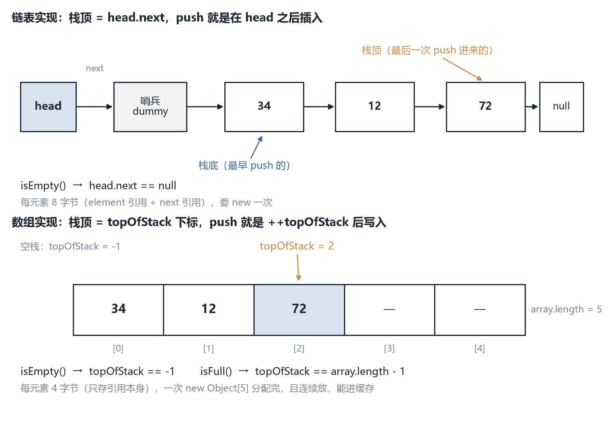
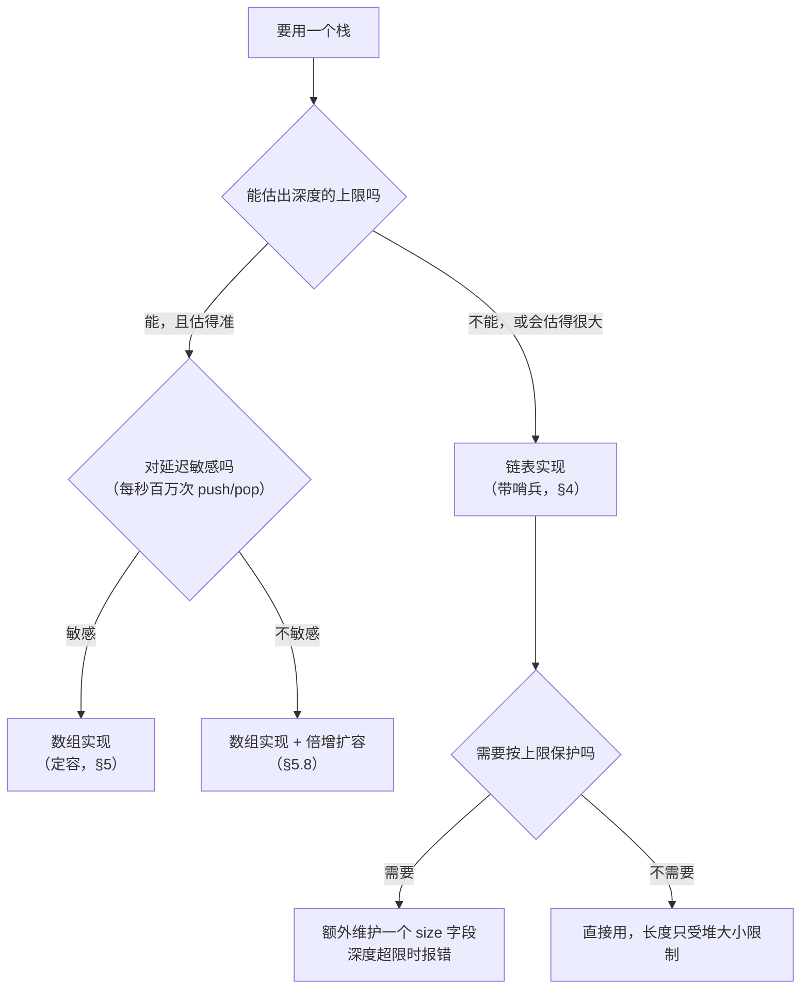
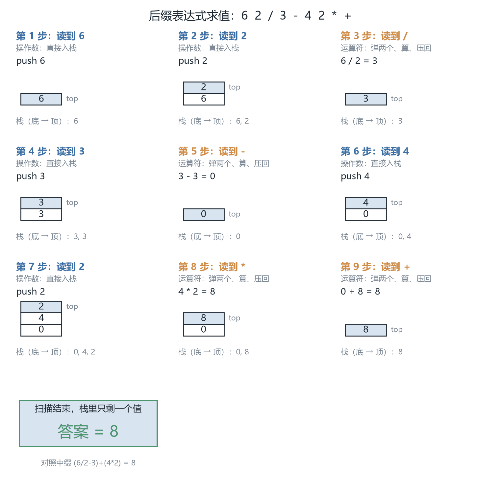

# CSC3100 Lecture 9 课堂笔记：Stack（栈）

> **材料构成**：本讲基于课件整理，不含教师口述内容；课件 `lecture 9 (stack).pdf` 共 31 页。这 31 页的文字层只有约 10.5 K 字符，因为**代码与栈的状态图基本都是图片**——所以我把 31 页全部按 165 dpi 渲染成图逐页读过，其中 p.6-p.10 五页的代码按 380 dpi 裁切放大逐行核对，p.3 的调用栈示意图与那段 Java 代码分别按 380 / 420 dpi 单独复核。凡是看不清的地方，文末都写明了，没有靠猜补。
>
> **课件结构**：目录（p.2）→ 三个动机例子：盘子、程序里的函数调用（p.3）→ 定义与 LIFO（p.4）→ 五个基本操作与"栈顶"图示（p.5）→ 链表实现：字段与构造器、push（p.6）、pop 与 top（p.7）→ 数组实现：字段与构造器（p.8）、`isFull` 与 push（p.9）、pop 与 top（p.10）→ 两种实现的比较（p.11）→ 应用一：括号匹配的问题、观察、算法（p.12-14）、三个手算例子（p.15-20）→ 应用二：中缀的优先级与结合性（p.21-22）、中缀/后缀对照（p.23）→ 后缀怎么"推"出来（p.24-25）→ 后缀求值算法（p.26-27）→ 两个逐 token 的求值例子（p.28-30）→ 阅读作业与下一讲（p.31）。
>
> **已知课件问题**：`isEmpty()` 在 p.7 与 p.10 被调用四次，但**全讲 31 页没有一处写出它的方法体**；`makeEmpty()` 在 p.5 被列为基本操作，同样从未实现。另外 p.6 与 p.8 各定义了一个 `class Stack`（字段不同）、链表版 `push` 返回 `void` 而数组版返回 `boolean`、p.11 说"链表省空间"与 L7 说"结点更占内存"口径相左。其余几条在文末「附：诚实备注」逐条列出，并注明我凭什么这么判。
>
> **来源标注约定**：正文里凡标 **【补】** 的段落，都是课件没有、由我补充或推导的内容（含两张配图、一处流程图、"中缀转后缀"算法与扩容分析）；没有标注的，都是课件上写着的。页码一律指课件页码，不是 PDF 阅读器的页码（两者在本讲恰好一致）。

## 0. 一句话概括本讲在讲什么

L7 与 L8 讲的是**通用容器**：表（list）允许在任意位置插入、删除任意位置的元素，所以它必须提供一大套操作——按位置取、按值找、插中间、删中间、前后遍历。接口大，实现就复杂，每种操作都要处理"表头 / 表尾 / 空表"三种边界，L7 光是把插入与删除写对就用了三十几页。

这一讲开始讲**受限容器（restricted container）**：栈（stack）只允许在**一端**进出。这个限制换来两样东西。第一是**接口变小**：只剩 push 与 pop 两个更新操作，加上 top / isEmpty / makeEmpty 三个查询与清理，一共五个，每个都是 $O(1)$——不是"平均 $O(1)$"、不是"已经站在那个位置时 $O(1)$"，是**无条件的常数时间**，因为栈顶在哪由结构自己记着，连"找位置"这一步都不存在。第二是**能表达一件通用容器表达不了的事**："最近发生的先处理"。函数调用（最后调用的先返回）、括号匹配（最后打开的括号先闭合）、表达式求值（最后压进去的两个操作数先结合），共同点都是 LIFO。

所以本讲的路线是：先用三个例子说明"一端进出"是真实需求（§1），再写成 ADT（§2-3），然后用 L7 学过的两种存法各实现一遍（§4-6），最后拿它解两个具体问题（§7 括号匹配、§8-11 表达式求值）——这门课从这里正式进入"用 ADT 解决具体问题"的阶段。

## 1. 三个动机：盘子、托盘与函数调用（p.3）

### 1.1 盘子：为什么"只能从最上面拿"不是缺陷

p.3 的第一组图是一摞盘子（plate）与一摞碗（bowl）。意思只有一句：**在这类物体上，"从中间抽一个"根本不是一个可用的操作。**

这不是偶然，而是**堆叠（stacking）这种摆放方式本身**决定的：每只盘子压着下面那只，抽中间那只，上面全部要塌。所以人的操作被限制成两个——往顶上放一只、从顶上拿一只，而且顺序确定：**最后放上去的，一定最先被拿走**。这就是 **后进先出（Last-In-First-Out, LIFO）**。

立一个反面对照：如果允许"从中间抽"，它就退化成 L7 的表——抽中间要先把上面的搬走（数组 $O(n)$），或者要维护前后指针（双链表）。**栈之所以能做到 $O(1)$，代价是它放弃了"从中间抽"。** 这是本讲所有复杂度结论的源头。

### 1.2 程序里的栈：函数调用（call stack）

p.3 的第二组是 "Program codes"，副标题 **Call functions, e.g., recursive functions**，配了一张调用栈（call stack）示意图。

左边画的是**递归函数**本身：大方框 $\mathcal{F}(n)$ 里套 $\mathcal{F}(n-1)$，再套 $\mathcal{F}(n-2)$，再里面是省略号——这是"函数调用自己"的静态嵌套结构。右边是**调用栈**：一列方框，从下往上依次是 $\mathcal{F}(n)$、$\mathcal{F}(n-1)$、$\mathcal{F}(n-2)$，最上面两个空心圆点表示还会继续往上长；左边的每一层用一条弧线连到右边对应那个框，旁边标着 "Activation Record" 与 "Call Stack"。

这张图说三件事：

**第一，每次函数调用都会在栈上压入一条活动记录（activation record）。** 里面装的是这一次调用的局部变量、参数、返回地址——也就是"这一层执行到哪儿了、手里有什么"。它相当于一只盘子。

**第二，最下面的 $\mathcal{F}(n)$ 是最外层调用，最上面的 $\mathcal{F}(n-2)$ 是当前正在执行的那一层。** 栈顶永远是"最近发生的那件事"，与盘子完全一致。

**第三，函数返回时弹出的是栈顶那条记录**，控制权交回给它下面那条记录。所以"递归函数的执行顺序"本质上是一个栈的 push/pop 序列——你不需要同时装下所有层，只需要知道栈顶是谁。

**【补】** 一件课件没说但很有用的事：**"栈溢出（stack overflow）"这个词就是从这张图来的。** 调用栈的容量由运行时预先划定（典型 1 MB 上下），每压一条活动记录占一块，递归太深就压满、再压就溢出——这就是 L6 讲递归时那个"深度 $n$ 大会栈溢出"的由来。

要区分两个"满"：§5 的数组栈满了 `push` 返回 `false`，那是**数据结构内部的容量上限**，你可以自己扩容（§5.8）；stack overflow 是**运行时调用栈**被递归压爆，只能改算法（改迭代，或自己管理一个栈）。两者都叫 overflow，不是同一件事。

### 1.3 那段 `StringBuffer` 代码，课件想让你看什么

p.3 左下角有一段 Java 代码，是这一页最容易被跳过、其实最值得读的一段（按 420 dpi 放大逐字核过）：

```java
public class test {
    public static void main(String[] args) {
        StringBuffer sb = new StringBuffer("Hello ");
        System.out.println("before change, sb is "+sb.toString());
        change(sb);
        System.out.println("after change, sb is "+sb.toString());
    }
    public static void change(StringBuffer stringBuffer){
        stringBuffer = new StringBuffer("Hi ");
        stringBuffer.append("world !");
    }
}
```

它演示的是**一次调用发生时，参数怎么被搬进新的活动记录**。`change(sb)` 执行时栈上压入一条新记录，里面有一个局部变量 `stringBuffer`，它的值是 `sb` 这个引用的**副本**（两份引用指向同一个对象）。接着 `stringBuffer = new StringBuffer("Hi ")` 改的是**副本**，让它指向新对象，原来那个 `"Hello "` 对象一点没动。所以两次 `println` 打出来的都是 `Hello `。

**【补】** 这段代码其实同时讲了两件事。**栈这一层**：形参是引用的副本，存在被调用方的活动记录里，所以"在函数里给形参重新赋值"永远改不到调用方的变量。**堆这一层**：如果 `change` 里写的是 `stringBuffer.append("world !")` 而**没有**重新 `new`，就会改到 `main` 里那个对象，输出变成 `Hello ` 与 `Hello world !`——差别只在"改引用"还是"改引用指向的对象"，正是 L7 §3.3 的"改变量 vs 改对象"。一句话：**活动记录保护的是"变量"，保护不了"变量指向的对象"。**

### 1.4 为什么"限制"反而换来效率【补】

容器的代价不在"能做什么"，而在"**为了能做那些事，必须维护什么**"。表要支持"任意位置插入"，就必须能回答"第 $p$ 个元素在哪"：链表回答不了（地址不可计算），只能走过去，于是 $O(n)$；数组能算地址，但插入要搬家，也是 $O(n)$。栈把"任意位置"砍掉，两个问题同时消失：

| 因为限制而被消掉的东西 | 后果 |
| --- | --- |
| 不需要"第 $p$ 个元素在哪" | 链表不必走 $p$ 步，push/pop 只看 `head.next` |
| 不需要"给中间腾位置" | 数组不必搬移，只动最后一个槽位 |
| 不需要"表头特判" | 用哨兵后，空栈与非空栈走同一条代码路径（§4.2） |
| 不可能"删错位置" | 接口里只有 pop 一个删除操作，它只能删栈顶 |

最后一行在工程上最值钱。L7 的 `delete(int p)` 要处理"越界 / 空表 / 删表头"三种情况，其中一种还真的写错了（少一对花括号，见 L7 §7.2）。栈的 `pop()` 只有一种边界：空栈。**接口每小一分，出错面积就少一块**——这就是"限制 ⇒ 接口小 ⇒ 不会用错 ⇒ 可以实现得更快"这条链的完整含义。

## 2. 定义：集合 $S$ 上的两个受限更新（p.4）

### 2.1 课件原文与逐词拆解

> A stack stores a set $S$ of elements that have two constrained updates:
> - Push(e): add a new element to $S$
> - Pop( ): removes the most recently added element from $S$

三个关键词。

**set $S$**：这里是口语意义上的"一堆元素"，**不是数学意义上的集合**——栈里允许重复（压两次 7，就有两个 7），这一点与 L7 的表一样。

**two**：只有**两个**更新操作。这是"受限"的全部内容——不是"更新比较少"，而是"种类只有两种"，一个加一个减，且都发生在同一端。

**constrained**：两个更新都受约束。`Push` 只能加到"最新"那一端；`Pop` 只能删"最近加入的那个"（the most recently added）。注意 `Pop( )` 的参数表是**空的**——它连"删哪个"都不让你说，因为只有一个可删。这个空括号是本页最重要的细节：**它把"删错"从接口层面排除了。**

### 2.2 LIFO 与"只能在一端"

> Stack follows: Last-In-First-Out (LIFO) property
> - We can only add/remove/examine from one end (called the "top")
> - Consider the trays/dishes in canteens

这里出现了 **top（栈顶）**，以及一个容易读漏的词 **examine（查看）**：加、删、看三个动作**都只能在一端**。所以"受限"不只是增删受限，连"看"都受限——你不能问"栈里第三个元素是什么"，只能问"栈顶是什么"（那就是 `top()`）。

"一端"的严格含义是：**另一端是封死的**，习惯叫**栈底（bottom）**。栈底那个元素只有一种命运——等上面全被 pop 掉，它才能被 pop。这就是 LIFO 的另一种念法：**先进去的最后出来（First-In-Last-Out）**。

食堂的托盘（tray）是第二个实物：一摞托盘，只能从最上面拿，用完也只能放回最上面。

### 2.3 栈的 ADT 与表的 ADT 有什么不同【补】

| | 表（List ADT，L7 p.3-4） | 栈（Stack ADT，本讲 p.4-5） |
| --- | --- | --- |
| 元素次序 | 有次序，$a_1 \ldots a_N$ | 有次序，但只暴露"顶" |
| 插入 | 任意位置 `insert(X, p)` | 只有一端 `push(e)` |
| 删除 | 任意位置 `delete(p)` | 只有一端 `pop()` |
| 查找 | `find(x)` 返回位置 | **没有**（只能看顶） |
| 遍历 | `printList` 从头到尾 | **没有**（要遍历就得 pop 光） |
| 前驱 / 后继 | 可选 `next` / `previous` | **都没有** |

最后三行是重点：栈**没有查找、没有遍历、没有前驱后继**。这不是课件漏写，而是受限容器的定义——一旦加了 `find`，它就不再是栈了（虽然实现上做得到）。这个观察在 §7 会派上用场：括号匹配之所以用栈而不是表，恰恰因为它**只需要**"看最近的那个"。

## 3. 五个基本操作，以及"栈顶"长什么样（p.5）

### 3.1 清单

| 操作 | 签名 | 语义 | 空栈时 |
| --- | --- | --- | --- |
| `pop()` | `Object pop()` | 删掉并返回栈顶 | 课件：返回 `null` |
| `push(i)` | 链表版 `void` / 数组版 `boolean`（§5.4） | 把 `i` 压到栈顶 | 不适用（数组满了才失败） |
| `makeEmpty()` | — | 清空整座栈 | 不适用 |
| `top()` | `Object top()` | 只返回栈顶，不删 | 课件：返回 `null` |
| `isEmpty()` | `boolean isEmpty()` | 是否为空 | 不适用 |

两处要盯住。

**第一，`pop` 与 `top` 只差一个字：删不删。** `top()` 是看，栈不变；`pop()` 是拿，栈少一个元素。很多算法（如 §7 括号匹配）只需要"看"就能判定，但实现上通常写 `pop` 再比较——因为那个左括号反正不会再用到了。

**第二，五个操作里只有三个有代码。** `pop`、`push`、`top` 各有链表版与数组版两套（p.6-10），而 `makeEmpty` 与 `isEmpty` **全讲没有一行代码**——它们被调用，却从未被定义。这事不是排版问题：在有哨兵的实现里把 `isEmpty` 写成 `head == null`，空栈上的 `pop` 会直接抛 `NullPointerException`（§4.6 补出正确写法，文末第 1 条）。

### 3.2 p.5 右边那张图：栈顶画在哪一边

p.5 右侧是一个五格竖条，左边箭头标着 **Top**，指向**最上面那一格**，格子里从下往上是 $6, 3, 1, 4, 2$。

这张图定了本讲所有示意图的画法：**栈顶在上、栈底在下。** 后面 p.15-20 与 p.28-30 的小图都是这个约定（我核过三处，一致）。要注意"格子的上下"与"数组下标的左右"是两套坐标：数组实现里栈底在下标 0、栈顶在下标 `topOfStack`，画成竖条就是"下标大的在上面"。

### 3.3 空栈上 `pop` 该返回 `null` 还是抛异常

课件选**返回 `null`**（p.7 与 p.10 的 `pop` 都是 `if (!isEmpty()) ... else return null;`）。两种策略各有代价：

| 策略 | 好处 | 代价 |
| --- | --- | --- |
| **返回 `null`**（课件用法） | 调用方不用 `try/catch`，代码短 | ① `null` 与"栈里真的存了 `null`"**无法区分**；② 错误被静默吞掉 |
| **抛异常** | 错误立刻暴露，出错行就在栈上 | 每个调用点都要处理；异常对象有开销 |

Java 标准库两种都有先例：`java.util.Stack.pop()` 空栈时抛 `EmptyStackException`，而 `ArrayDeque.poll()` 空时返回 `null`（`remove()` 才抛）。**同一门语言两种约定并存**，所以用别人的栈之前必须查文档。

**【补】** 更隐蔽的坑：`top()` 空时返回 `null`，非空时返回 `head.next.element` / `array[topOfStack]`——两者都是 `Object`，**都可能是 `null`**，调用方拿到 `null` 时无法判断是"栈空了"还是"栈顶恰好是 `null`"。正确做法是**先 `isEmpty()` 再取**。这与 L7 §5.2 里 `find` 的困境（返回 `-1` 还是 `null`）同类：**用特殊值表示"没有"，迟早会与"真的就是这个值"撞车。**

## 4. 链表实现：一个哨兵 + 两次改指针（p.6-7）

### 4.1 两个类，一个哨兵

p.6 左上角（按 380 dpi 核过，缩进按原文）：

::: code-group

```java [Java]
class Node {
    Node next;
    Object element;
}

class Stack {
    Node head;
}
```

```python [Python]
class Node:
    def __init__(self):          # Python 没有"只有字段的类"：字段只能在 __init__ 里出现
        self.next = None         # 对应 Java 的 Node next;
        self.element = None      # 对应 Java 的 Object element;

class Stack:
    head = None                  # 只有一个字段；构造器见 §4.2
```

```cpp [C++]
struct Node {
    Node* next;
    int element;                 // Java 侧是 Object；C++ 这里退化为具体类型 int
};

struct Stack {
    Node* head;                  // 哨兵，恒不为 nullptr
    Stack();                     // 构造器，定义在 §4.2 那一栏
};
```

```c [C]
typedef struct Node {
    struct Node* next;
    int element;                 // 泛型 <E> / Object 在 C 里退化为 int
} Node;

typedef struct Stack {
    Node* head;                  // 哨兵，恒不为 NULL
} Stack;
```

:::

`Node` 只有两个字段：`element` 存数据（类型 `Object`，能装任何对象——这是 Java 5 之前的写法，见 §4.7 末尾），`next` 指向下一个结点。它**没有写构造器**，所以用编译器自动生成的无参构造器、字段全为 `null`——这解释了 p.6 的 `new Node()` 为什么可以不带参数。

`Stack` 只有一个字段 `head`。**这个 `head` 不是第一个元素，而是哨兵（sentinel）**，理由看构造器就知道。

### 4.2 构造器：空栈不是 `null`

::: code-group

```java [Java]
public Stack() {      //constructor
    this.head = new Node();
}
```

```python [Python]
class Stack:                     # Python 的构造器只能写在类体内，这就是本节那个构造器
    def __init__(self):
        self.head = Node()       # 空栈是 head.next 为 None，head 本身永不为 None
```

```cpp [C++]
Stack::Stack() {                 // 构造器：head 指向一个空结点，而不是 nullptr
    head = new Node();
}
```

```c [C]
#include <stdlib.h>

Stack* stackCreate(void) {       // C 没有构造器，用工厂函数代替
    Stack* s = malloc(sizeof(Stack));
    s->head = malloc(sizeof(Node));       // 哨兵：head 永不为 NULL
    s->head->next = NULL;
    s->head->element = 0;
    return s;
}
```

:::

新建一座栈时 `head` 被赋成一个**新建的空结点**，而不是 `null`。这个结点不存数据、不指向任何东西，唯一作用是**当"第一个元素的前一个"**。这就是 L7 §10.3 讲过的哨兵技巧，本讲直接采用了。

它带来一个必须记住的后果：

> **在这份实现里，空栈是 `head.next == null`，不是 `head == null`。`head` 永远不为 `null`。**

为什么重要？L7 的 `SinglyLinkedList` 用 `head == null` 表示空表，把那个习惯带过来就会写成

```java
boolean isEmpty() { return head == null; }   // 错：在这份实现里永远返回 false
```

于是 `pop()` 里的 `if (isEmpty())` 永远不成立，程序走进 `else` 去取 `head.next.element`——空栈时 `head.next` 是 `null`，`NullPointerException`。**同一段代码在两种空表表示法下正确性完全不同**，这是本讲第一个"抄错就炸"的地方。

哨兵换来的好处在 §4.3、§4.4 立刻显现：`push` 不必判"是不是第一个元素"，`pop` 也不必特判"删的正好是表头"。

### 4.3 `push`：三行，全在 `head` 之后

::: code-group

```java [Java]
public void push(Object x) {
    Node tmpNode = new Node();
    tmpNode.element = x;
    tmpNode.next = head.next;
    head.next = tmpNode;
}
```

```python [Python]
def push(self, x):
    tmpNode = Node()
    tmpNode.element = x
    tmpNode.next = self.head.next
    self.head.next = tmpNode     # 顺序不能反：先接新的，再断旧的
```

```cpp [C++]
void push(int x) {
    Node* tmpNode = new Node();
    tmpNode->element = x;
    tmpNode->next = head->next;
    head->next = tmpNode;        // 顺序不能反：先接新的，再断旧的
}
```

```c [C]
#include <stdlib.h>

void push(Stack* s, int x) {
    Node* tmpNode = malloc(sizeof(Node));
    tmpNode->element = x;
    tmpNode->next = s->head->next;
    s->head->next = tmpNode;     // 顺序不能反：先接新的，再断旧的
}
```

:::

**`Node tmpNode = new Node();`**：在堆上造一个新结点，`element` 与 `next` 都是 `null`，游离在链外。

**`tmpNode.element = x;`**：装数据。这里用赋值字段而不是构造器传参，因为 `Node` 没有构造器。这两行完全可以合成一个带参构造器（L7 p.9 就是那样），本讲的写法更啰嗦，但省掉了给 `Node` 加构造器。

**`tmpNode.next = head.next;`**：让新结点指向"原来的第一个元素"（也可能是 `null`，即空栈）。这一步之后链仍然完整，只是多了一个指向老第一个的游离结点。

**`head.next = tmpNode;`**：让哨兵指向新结点，新结点才真正进栈并成为新栈顶。

**这两行的顺序不能反。** 若先写 `head.next = tmpNode`，`head.next` 已经是新结点，再执行 `tmpNode.next = head.next` 就变成 `tmpNode.next = tmpNode`——自环，原来整条链从 `head` 再也走不到，成了垃圾。规则还是那句：**先接新的，再断旧的**（L7 §5.3）。

注意它对**空栈**自然正确（`tmpNode.next` 得到 `null`，新结点成了唯一元素），**没有一行特判**。

### 4.4 `pop`：先判空，再摘 `head.next`

::: code-group

```java [Java]
public Object pop() {
    Node firstNode = null;
    if (isEmpty()) {
        return null;
    } else {
        firstNode = head.next;
        head.next = firstNode.next;
        return firstNode.element;
    }
}
```

```python [Python]
def pop(self):
    firstNode = None
    if self.is_empty():
        return None
    else:
        firstNode = self.head.next
        self.head.next = firstNode.next
        return firstNode.element
```

```cpp [C++]
bool pop(int& out) {             // 空栈返回 false，与 Java 版返回 null 语义相同
    if (isEmpty()) return false;
    Node* firstNode = head->next;
    head->next = firstNode->next;
    out = firstNode->element;
    return true;
}
```

```c [C]
#include <stdbool.h>

bool pop(Stack* s, int* out) {   // 空栈返回 false，与 Java 版返回 null 语义相同
    if (s->head->next == NULL) return false;
    Node* firstNode = s->head->next;
    s->head->next = firstNode->next;
    *out = firstNode->element;
    return true;
}
```

:::

**`Node firstNode = null;`**：先声明游标。这个初始化是**冗余**的——`else` 分支必然赋值，`if` 分支直接 return，永远读不到那个 `null`。不算错，只是多余（文末第 4 条）。

**`if (isEmpty()) { return null; }`**：空栈返回 `null`（§3.3 的策略）。**这句不能省**：下一句 `head.next` 在空栈时是 `null`，再取 `.next` 就是 `NullPointerException`。

**`firstNode = head.next;`**：记住栈顶结点。**必须用变量接住**，因为下一句会改掉 `head.next`。

**`head.next = firstNode.next;`**：让哨兵直接指向"栈顶的下一个"。这一步就是"删除"的全部内容：被删的结点没有任何人再指向它，从 `head` 出发走不到，成了垃圾。**注意没有清空 `firstNode.next`**——与 L7 §7.1 第二幅图一样：删除只是"绕过"，不是"抹掉"。

**`return firstNode.element;`**：`firstNode` 还活着（局部变量），取它的字段安全。

三行顺序也不能乱：先存 `firstNode`、再改 `head.next`、最后读数据。没存就改，那个结点就再也找不到。

### 4.5 `top`：只看不摘

::: code-group

```java [Java]
public Object top( ) {
    if (!isEmpty())
        return head.next.element;
    else {
        return null;
    }
}
```

```python [Python]
def top(self):
    if not self.is_empty():
        return self.head.next.element
    else:
        return None
```

```cpp [C++]
bool top(int& out) {
    if (!isEmpty()) {
        out = head->next->element;
        return true;
    } else {
        return false;
    }
}
```

```c [C]
#include <stdbool.h>

bool top(Stack* s, int* out) {
    if (s->head->next != NULL) {
        *out = s->head->next->element;
        return true;
    } else {
        return false;
    }
}
```

:::

与 `pop` 只差一件事：**没有 `head.next = ...`**，只读就返回，链的形状不变。`if` 侧无花括号、`else` 侧有，不对称但语义正确（文末第 4 条）。

### 4.6 `isEmpty` 与 `makeEmpty`：课件没写，我补上

::: code-group

```java [Java]
// 哨兵版：判的是 head 的下一个，不是 head 本身
public boolean isEmpty() {
    return head.next == null;
}

// 清空：让哨兵重新变成"谁都不指"
public void makeEmpty() {
    head.next = null;
}
```

```python [Python]
# 哨兵版：判的是 head 的下一个，不是 head 本身
def is_empty(self):
    return self.head.next is None

# 清空：让哨兵重新变成"谁都不指"
def make_empty(self):
    self.head.next = None        # 一句就够：整条链不可达，交给 GC
```

```cpp [C++]
// 哨兵版：判的是 head 的下一个，不是 head 本身
bool isEmpty() {
    return head->next == nullptr;
}

// 清空：Java 一句 head->next = null 就够；C++ 必须先沿链 delete 再断
void makeEmpty() {
    while (head->next != nullptr) {
        Node* p = head->next;
        head->next = p->next;
        delete p;
    }
}
```

```c [C]
// 哨兵版：判的是 head 的下一个，不是 head 本身
bool isEmpty(Stack* s) {
    return s->head->next == NULL;
}

// 清空：Java 一句赋值就够；C 必须先沿链 free 再断
void makeEmpty(Stack* s) {
    Node* p = s->head->next;
    while (p != NULL) {
        Node* next = p->next;
        free(p);
        p = next;
    }
    s->head->next = NULL;
}
```

:::

**第一，`isEmpty` 一定要判 `head.next`**（理由见 §4.2，`head` 永远非空）。

**第二，`makeEmpty` 只需一句。** 置 `null` 之后整条链从哨兵断开，所有结点都不可达，GC 会回收——**不需要也没法逐个置空**。这正是 Java 比 C 省事的地方（C 里必须沿链走一遍逐个 `free`，否则整条链泄漏）。

**第三，`makeEmpty` 是 $O(1)$ 还是 $O(n)$？** 代码是一句赋值，$O(1)$；但 $n$ 个对象要被回收，那是 $O(n)$ 的工作，只是**摊销到了垃圾回收器身上**（你不付，GC 付）。这个区分很实用：面试问"清空 `ArrayList` 是 $O(1)$ 吗"，答案同样是"代码 $O(1)$，回收 $O(n)$"。

顺带一个**能编译但不推荐**的写法：`head = new Node();`。效果一样，但把老哨兵也变成垃圾，多分配一个对象。

### 4.7 为什么这五个操作全是 $O(1)$

把五个方法摊开数：每个最多五条赋值 / 比较 / 返回语句，**没有循环、没有递归**。

| 操作 | 链表版做了什么 | 复杂度 |
| --- | --- | --- |
| `push` | 新建一个结点 + 两次改指针 | $\Theta(1)$ |
| `pop` | 一次判空 + 两次读引用 + 一次返回 | $\Theta(1)$ |
| `top` | 一次判空 + 一次读字段 | $\Theta(1)$ |
| `isEmpty` | 一次比较 | $\Theta(1)$ |
| `makeEmpty` | 一次赋值（回收的账记在 GC 上） | $\Theta(1)$ |

**【补】** 必须点明：**这份 $O(1)$ 完全不依赖"栈有多大"。** L7 的链表插入是 $O(n)$，因为它要从 `head` 走到第 $p$ 个结点；栈的插入点**永远是 `head.next`**，不需要走。这就是 §1.4 表格第一行——"不需要知道第 $p$ 个在哪"直接省掉了整个遍历。

另一个要补的：`Object` 字段意味着取出时**要强制转换**（`(String) stack.pop()`），而强转**在运行时才检查**，写错编译能过、跑起来抛 `ClassCastException`。Java 5 之后的正确写法是泛型 `class Node<T> { T element; Node<T> next; }`，让编译器在编译期查出来（L7 §10.5 讨论过同一件事）。课件用 `Object` 是教科书传统写法，不是错，但不是今天该写的代码。

## 5. 数组实现：一个下标撑起整座栈（p.8-10）

### 5.1 三个字段

::: code-group

```java [Java]
class Stack {
    final static int MIN_STACK_SIZE = 5;
    int topOfStack = -1;
    Object[ ] array;
}
```

```python [Python]
class Stack:
    MIN_STACK_SIZE = 5               # 容量下限，作用在构造器里（§5.2）

    def __init__(self):
        self.topOfStack = -1         # -1：空栈，且下一次写到下标 0
        self.array = []              # 对应 Object[] array;
```

```cpp [C++]
class Stack {
public:
    static const int MIN_STACK_SIZE = 5;
    int topOfStack = -1;             // -1：空栈，且下一次写到下标 0
    int* array = nullptr;            // Java 侧是 Object[]，这里退化为 int*
    int capacity = 0;                // C++ 没有 array.length，长度必须自己存
};
```

```c [C]
#define MIN_STACK_SIZE 5

typedef struct {
    int topOfStack;                  // -1：空栈，且下一次写到下标 0
    int capacity;                    // C 没有 array.length，长度必须自己存
    int* array;                      // Object[] 在 C 里退化为 int*
} Stack;
```

:::

**`MIN_STACK_SIZE = 5`**：容量下限，作用在构造器里（§5.2）。`final static` 与惯用的 `static final` 顺序相反，但 Java 不要求修饰符顺序，编译正常（文末第 4 条）。

**`topOfStack = -1`**：本讲最关键的一个数。它不是"栈顶在第 $-1$ 格"（没有这一格），而是**栈是空的，且下一次写入应落在下标 0**。这个 $-1$ 与后面两处写法必须配套，§5.7 会把三者关系讲透。

**`Object[ ] array`**：真正存元素的数组。用 `Object[]` 而非 `int[]`，理由与链表版用 `Object` 相同（能装任何对象），代价也相同（取出要强转）。

**注意这里没有 `size` 字段。** 元素个数是 `topOfStack + 1`，随时能算，不必单独存。这与 L7 §10.5 说的"链表缺 `size` 所以要 $O(n)$ 数"正好相反：数组实现里"有多少个"是 $O(1)$ 可得的。

### 5.2 构造器：容量被"夹紧"到下限

::: code-group

```java [Java]
public Stack (int maxElements) {
    int capacity = maxElements;
    if (maxElements < MIN_STACK_SIZE)
        capacity = MIN_STACK_SIZE;
    array = new Object[capacity];
}
```

```python [Python]
def __init__(self, maxElements):
    capacity = maxElements
    if maxElements < self.MIN_STACK_SIZE:
        capacity = self.MIN_STACK_SIZE
    self.array = [None] * capacity
    self.topOfStack = -1
```

```cpp [C++]
Stack(int maxElements) {
    int capacity = maxElements;
    if (maxElements < MIN_STACK_SIZE)
        capacity = MIN_STACK_SIZE;
    array = new int[capacity];
    this->capacity = capacity;       // 成员也叫 capacity，用 this-> 区分
}
```

```c [C]
#include <stdlib.h>

void stackInit(Stack* s, int maxElements) {
    int capacity = maxElements;
    if (maxElements < MIN_STACK_SIZE)
        capacity = MIN_STACK_SIZE;
    s->array = malloc(sizeof(int) * capacity);
    s->capacity = capacity;
    s->topOfStack = -1;
}
```

:::

先把调用方要求的容量记下；小于 5 就抬到 5；再按这个容量开数组。

**为什么抬到 5？** 课件没解释。**【补】** 这类最小值通常是为防止 `new Object[0]` 这种退化情形（容量 0 的栈永远 `isFull()`），也避免太小导致频繁扩容；JDK 的 `ArrayList` 与 `Vector`（`Stack` 的父类）默认都是 10，所以**课件的 5 只是教学取值**。

**这里有一个真正的设计选择：容量固定，`array` 建好就不再变化。** 这份实现**没有扩容**，所以 §5.4 的 `push` 满了只能 `return false`。这与 L7 p.17 那道复习题（"容量等于 $n$ 时怎么办？"）是同一问题的两种态度：L7 问了没答，本讲答了"不办，返回失败"。

### 5.3 `isFull`：判满条件

::: code-group

```java [Java]
public boolean isFull() {
    return (topOfStack == array.length - 1);
}
```

```python [Python]
def is_full(self):
    return (self.topOfStack == len(self.array) - 1)
```

```cpp [C++]
bool isFull() {
    return (topOfStack == capacity - 1);
}
```

```c [C]
#include <stdbool.h>

bool isFull(Stack* s) {
    return (s->topOfStack == s->capacity - 1);
}
```

:::

`array.length - 1` 是**最后一个合法下标**（长度 5 的数组，合法下标 0..4）。这句读作"栈顶指针已经指到最后一格，再压就没地方了"。

它用 `==` 而不是 `>=`。本实现里两者等价（每次最多加 1），但 `>=` **更稳**：万一有人手滑多加了 1，`==` 会漏判。

### 5.4 `push`：先自增，再写入

::: code-group

```java [Java]
public boolean push(Object x) {
    if (isFull())
        return false;
    else
        array[++topOfStack] = x;
    return true;
}
```

```python [Python]
def push(self, x):
    if self.is_full():
        return False
    else:
        self.topOfStack += 1             # 等价于 Java 的前置 ++：先加，再写
        self.array[self.topOfStack] = x
    return True
```

```cpp [C++]
bool push(int x) {
    if (isFull())
        return false;
    else
        array[++topOfStack] = x;
    return true;
}
```

```c [C]
#include <stdbool.h>

bool push(Stack* s, int x) {
    if (isFull(s))
        return false;
    else
        s->array[++s->topOfStack] = x;
    return true;
}
```

:::

**`if (isFull()) return false;`**：满了报告失败。返回类型是 `boolean`，调用方能知道"这次没压进去"——比链表版（`void`）好，但两者接口不一致（文末第 3 条）。

**`array[++topOfStack] = x;`**：`++topOfStack` 是**前置自增**：先把 `topOfStack` 加 1，**再用新值当下标**。所以空栈（$-1$）压第一个元素时下标是 0，正好落在第一格。等价于

```java
topOfStack = topOfStack + 1;
array[topOfStack] = x;
```

**若写成后置的 `array[topOfStack++] = x;` 就全错了**：第一次会写到 `array[-1]`，直接抛 `ArrayIndexOutOfBoundsException`；即使不抛，写入位置也永远比该写的位置低一格，最后一个槽位永远空着。**`++` 在前还是在后，是这一页唯一容易抄错的地方。**

**`return true;`** 写在 `if/else` **之外**，靠上面那句 `return false` 提前退出——合法，走到这一行的一定是压成功的路径。写法绕，但语义正确（文末第 4 条列为可读性问题）。

### 5.5 `pop`：先读出，再自减

::: code-group

```java [Java]
public Object pop() {
    if (!isEmpty())
        return array[topOfStack--];
    else
        return null;
}
```

```python [Python]
def pop(self):
    if not self.is_empty():
        v = self.array[self.topOfStack]   # 先读出栈顶
        self.topOfStack -= 1              # 再下移（等价于 Java 的后置 --）
        return v
    else:
        return None
```

```cpp [C++]
bool pop(int& out) {
    if (!isEmpty())
        out = array[topOfStack--];
    else
        return false;
    return true;
}
```

```c [C]
#include <stdbool.h>

bool pop(Stack* s, int* out) {
    if (!isEmpty(s))
        *out = s->array[s->topOfStack--];
    else
        return false;
    return true;
}
```

:::

**`array[topOfStack--]`**：`topOfStack--` 是**后置自减**：先拿**当前值**当下标读出元素，**再**把 `topOfStack` 减 1。读出的是栈顶，减完指针下移一格，正好指向新的栈顶。等价于

```java
Object v = array[topOfStack];
topOfStack = topOfStack - 1;
return v;
```

**若写成 `array[--topOfStack]` 就错了**：先下移再读，读到的是**栈顶下面那个元素**，栈顶被跳过（虽然指针越过了它，逻辑上算删了），返回值却是错的。这是与 §5.4 相反方向的坑：**push 要"先动指针再写"，pop 要"先读再动指针"，因为一个写新格子、一个读旧格子。**

### 5.6 `top` 与缺失的 `isEmpty`

::: code-group

```java [Java]
public Object top() {
    if (!isEmpty())
        return array[topOfStack];
    else
        return null;
}
```

```python [Python]
def top(self):
    if not self.is_empty():
        return self.array[self.topOfStack]
    else:
        return None
```

```cpp [C++]
bool top(int& out) {
    if (!isEmpty())
        out = array[topOfStack];
    else
        return false;
    return true;
}
```

```c [C]
#include <stdbool.h>

bool top(Stack* s, int* out) {
    if (!isEmpty(s))
        *out = s->array[s->topOfStack];
    else
        return false;
    return true;
}
```

:::

与 `pop` 只差一处：`array[topOfStack]` 里**没有自减**。值得与 §4.5 对照记：**链表版差一行赋值，数组版差一个 `--`。**

`isEmpty()` 的正确写法很简单：

::: code-group

```java [Java]
public boolean isEmpty() {
    return topOfStack == -1;
}
```

```python [Python]
def is_empty(self):
    return self.topOfStack == -1
```

```cpp [C++]
bool isEmpty() {
    return topOfStack == -1;
}
```

```c [C]
#include <stdbool.h>

bool isEmpty(Stack* s) {
    return s->topOfStack == -1;
}
```

:::

**必须是 `== -1`。** 若写成 `topOfStack == 0`（"指向第一格就算空"），压了 1 个元素之后就会被判成空，`pop` 直接返回 `null`——栈里明明有东西却拿不到。这个错误与 §4.2 那个 `head == null` 是同一类：**判空的依据必须与初始值一致**。

`makeEmpty()` 在这个实现里是 `topOfStack = -1;` 一句（**不需要清数组**，"哪些槽位有效"完全由 `topOfStack` 决定）。但见 §5.9——不清会留下引用。

### 5.7 三处下标算术必须互相配套

数组栈里有三个数：**初值 $-1$**、**`push` 用前置 `++`**、**判满用 `== length - 1`**。它们不是三个独立选择，而是**一个约定的三条腿**，改一条另两条就得跟着改。

先走"正确"这一套（长度 $L = 5$）：

| 时刻 | `topOfStack` | 栈里元素 | 说明 |
| --- | --- | --- | --- |
| 刚建好 | $-1$ | 空 | "下一格写 0" |
| push 第 1 个 | $0$ | `array[0]` | `++` 先加到 0 再写 |
| push 第 5 个 | $4$ | `array[0..4]` | `isFull()` 为真（$4 = 5-1$） |
| 第 6 次 push | $4$ | 不变 | `return false` |
| pop 一次 | $3$ | `array[0..3]` | 读出 `array[4]` 再减到 3 |
| pop 到空 | $-1$ | 空 | 读出 `array[0]` 再减到 $-1$ |

三个数完全自洽：**$-1$ 表示空且"下一个写 0"；`++` 保证"先移到要写的格子"；`== L-1` 保证"最后一格被占用时才满"。**

现在把初值换成 $0$（很多人凭直觉这么写，因为"下标从 0 开始"），其余不动：

| 时刻 | `topOfStack` | 实际发生 |
| --- | --- | --- |
| 刚建好 | $0$ | 按"$-1$ 那套"读，这表示"已有一个元素在 `array[0]`"，可它是空的 |
| push 第 1 个 | $1$ | `++` 后写 `array[1]`，**`array[0]` 永远空着** |
| push 到"满" | $4$ | `isFull()` 成立，但只存了 **4** 个，容量 5 浪费 1 格 |
| pop 到"空" | $0$ | `isEmpty()`（若写 `== -1`）**永远不成立**，再 pop 就读到从未写过的 `null` |

**结论：初值一改成 0，容量就少 1、判空就失效。** 反过来，若坚持初值 0，就必须把 `push` 改成 `array[topOfStack++] = x`、`isFull` 改成 `topOfStack == length`、`isEmpty` 改成 `topOfStack == 0`——整套换一套，也能自洽。

**【补】** 这就是 off-by-one 的典型形态：**单独看每一行都"差不多对"，合起来才错。** 检查办法不是逐行读，而是像上面那样列一张"时刻 → 指针 → 内容"的表，把"空"和"满"两个极端各走一遍。

### 5.8 课件没有扩容；如果要扩容，代价是多少【补】

课件的数组栈是**定容**的：满了 `return false`。教学上够用，工程上不可接受——没人能事先知道栈会涨到多深。

**扩容怎么做**：`push` 发现满了，新建一个更大的数组，把旧元素复制过去，再压新的。复制 $n$ 个是 $O(n)$——所以**单次 push 的最坏复杂度是 $O(n)$**。

<b>那为什么还说 push 是 $O(1)$？</b> 因为那是<b>均摊（amortized）</b>的说法。关键在<b>每次扩多少</b>：

- 每次只加 1 格：第 $k$ 次扩容复制 $k$ 个，$n$ 次 push 共复制 $1+2+\cdots+(n-1) = \Theta(n^2)$，**均摊每次 $\Theta(n)$**——等于没省。
- 每次翻倍（$5 \to 10 \to 20 \to \cdots$）：总复制量 $5+10+20+\cdots < 2n$，**均摊每次 $O(1)$**。

我按"从容量 5 起、每次翻倍"实算了一遍（数字列在文末第三块）：

| push 次数 $n$ | 总复制次数 | 扩容次数 | 最终容量 | 均摊每次 |
| --- | --- | --- | --- | --- |
| 10 | 5 | 1 | 10 | 0.50 |
| 100 | 155 | 5 | 160 | 1.55 |
| 1024 | 1275 | 8 | 1280 | 1.25 |

对照"每次加 1 格"：$n = 1024$ 时总复制量是 $0+1+\cdots+1023 = 523776$，均摊约 $511$ 次——**相差约 400 倍**。这就是"按倍数扩容"这条工程惯例的全部理由，也是 L7 §8 那道"容量恰好等于 $n$ 怎么办"的答案。

**【补】** 一个 Java 细节：`System.arraycopy` 复制的是**引用**（4 字节/个），不是对象本身。所以扩容成本是 $4n$ 字节的搬运，与"对象有多大"无关——这让数组扩容比"重新 `new` 一遍所有元素"便宜得多。

### 5.9 `pop` 之后那个槽位没有清空【补】

看 §5.5 的 `return array[topOfStack--];`：元素被"逻辑删除"了，但 **`array[topOfStack + 1]` 里那个引用还在**。

这在 Java 里叫**对象滞留（loitering）**：被 pop 掉的对象已经没用，却还被数组里一个无效槽位引用着，GC 不敢回收。如果栈曾经很深、后来被 pop 空，那 $n$ 个对象会一直活着，直到栈被复用或整个数组被丢弃。

正确写法是读完就置空：

::: code-group

```java [Java]
public Object pop() {
    if (isEmpty()) return null;
    Object v = array[topOfStack];
    array[topOfStack] = null;   // 断开引用，让 GC 能回收
    topOfStack--;
    return v;
}
```

```python [Python]
def pop(self):
    if self.is_empty():
        return None
    v = self.array[self.topOfStack]
    self.array[self.topOfStack] = None    # 断开引用，让 GC 能回收
    self.topOfStack -= 1
    return v
```

```cpp [C++]
bool pop(int& out) {
    if (isEmpty()) return false;
    out = array[topOfStack];
    array[topOfStack] = 0;      // 断开引用（int 版置 0；对象版置 nullptr）
    topOfStack--;
    return true;
}
```

```c [C]
#include <stdbool.h>

bool pop(Stack* s, int* out) {
    if (s->topOfStack == -1) return false;
    *out = s->array[s->topOfStack];
    s->array[s->topOfStack] = 0;   // 断开引用（int 版置 0；指针版置 NULL）
    s->topOfStack--;
    return true;
}
```

:::

**代价是多一次赋值**（$O(1)$，不影响渐进复杂度），**收益是内存不再滞留**。JDK 的 `ArrayList`、`ArrayDeque` 都这么做（源码里那句 `elementData[--size] = null;` 就是它）。

值得注意的是：**链表版反而没有这个问题**。`head.next = firstNode.next;` 执行后，被删结点只被局部变量 `firstNode` 指着，方法一返回就不可达了——**哨兵把"最后一个引用"自动断掉了**。这是"数组要手动清、链表天然清"的一个具体例子，也是 §6 对比里很少被提到的一条。

## 6. 两种实现怎么选（p.11）

### 6.1 课件只有两句话

> Using list saves space
>
> Using array is faster. Why?
> - Two reasons:
>   - Memory allocation
>   - Continuous memory can be loaded into cache

两句都对，但**都需要打一个折**。

### 6.2 "链表省空间"要打个折

这句话与 L7 p.7 的"链表每个结点比数组元素占更多内存"字面冲突。解法与 L7 §2.3 一样：**两句说的不是同一个量。**

- **单位成本**：数组一个槽位存一个引用，4 字节；链表一个结点存 `element` + `next` 两个引用，8 字节（还要加对象头）。**论单位，数组便宜一半。**
- **总量**：数组必须**预分配**。你不知道栈会多深，只能猜一个上限 $N_{\max}$；实际只压了 $n$ 个，就浪费 $(N_{\max}-n)$ 格。链表要多少 `new` 多少，**一格不浪费**。

所以"链表省空间"成立的**唯一条件**是：**估不准上限，而且估得偏高。**



*图 2　同一座栈（栈底 34、12，栈顶 72）的两种存法。上：链表实现，`head` 指向不存数据的哨兵，栈顶是 `head.next`（72），栈底是链尾（34）——**push 发生在链头**。下：数组实现，栈底在下标 0（34），栈顶在下标 `topOfStack = 2`（72），空槽位在下标 3、4——**push 发生在数组尾部**。两份代码的"栈顶"在内存里的位置恰好相反，这是读代码时最容易错乱的一处。*

**【补】** 把账算到底（按课件"引用 4 字节"的假设）：

| | 每元素 | $n = 10^6$ 时 | 额外开销 |
| --- | --- | --- | --- |
| 数组栈 | 4 字节 | 4 MB（容量正好） | 预分配浪费；扩容时短暂占 1.5 倍 |
| 数组栈（容量估成 $2\times 10^6$） | 4 字节 | 8 MB | 一半是空的 |
| 链表栈 | 8 字节 | 8 MB | 每个结点一次 `new` 的时间 |

而真实 JVM 上一个 `Node` 是 24 字节（12 字节对象头 + 8 字节字段，对齐到 8 的倍数），`Object[]` 一格只有 4 字节——**单位成本差 6 倍**（算法见 L7 §2.3）。所以这句话在真实机器上更接近"链表在**上限估得很离谱**时省空间"。

### 6.3 数组为什么更快：两个原因

**第一条：内存分配（memory allocation）。** 数组是**一次** `new Object[capacity]`，之后所有 push 只是往已有格子里写，不再分配。链表是**每次 push 一次 `new Node()`**——$n$ 次 push 就是 $n$ 次堆分配。堆分配不免费：分配器要找空闲块、可能触发 GC、对象还要初始化。这就是为什么两个"$O(1)$"的 push 实际耗时会差好几倍。**渐进复杂度相同、常数因子差一个数量级**——L5/L6 反复强调过（L5 核心直觉第 1 条），这里是它在数据结构上的第一次具体兑现。

**第二条：连续内存可以进缓存（cache）。** CPU 取内存按**缓存行**（cache line，典型 64 字节）整块取。数组的 $n$ 个引用连续，取一个能把后面十几个一起带进缓存；链表的结点散落在堆各处，**每个结点几乎必然一次缓存未命中（cache miss）**，代价是几十到上百个时钟周期。

**【补】** 第二条在栈这个场景里**比在别处更弱**：栈的访问模式是"只看栈顶"，`push`/`pop` 反复碰的是**同一个槽位**（数组）或**同一个结点**（链表），所以"连续"的优势主要在**扩容复制**那一下（顺序扫描引用非常快）与**栈很深、反复跨缓存行**时才体现。真正被缓存效应拉开的是"遍历整个容器"，而栈**根本不遍历**。所以：**第二条对，但对栈来说影响的是常数里的一小部分；第一条（分配次数）才是主要差距。**

### 6.4 选型：把"什么时候用哪个"说成一张判断图

课件的两句话给的是"谁省空间、谁更快"，但真正要决定时问的应该是"**我的使用模式是什么**"。下图是我按 §4-§6 的结论整理的，课件没有画。



*这张图是我整理的，课件没有画。课件 p.11 只给了"链表省空间 / 数组更快"两句判断，四个分支是我按 §4-§6 的推导补的。*

**【补】** 图里那条"能估出上限吗"值得单独强调，因为它是这两句话的**前提**：数组的"快"建立在"容量已经够"之上。如果栈会动态长到几十万层，扩容那几次 $O(n)$ 复制会实实在在卡住主线程——**均摊 $O(1)$ 不等于每一次都 $O(1)$**。反过来，链表的问题是每个结点一次分配，在"每秒百万次 push/pop"时分配器本身成为瓶颈（这也是高性能场景用对象池的原因）。所以完整版是：**数组把成本压在"扩容"那一下，链表把成本摊在"每一次"上。**

## 7. 应用一：括号匹配（p.12-20）

### 7.1 问题：什么叫"平衡"

p.12 说：程序语言里有很多地方要求符号是平衡的（balanced），比如 `{ }`、`[ ]`、`( )`。课件给了六个例子，三平衡三不平衡：

| 平衡 | 不平衡 |
| --- | --- |
| `( ) { [ ] }` | `( ]` |
| `( { { } } )` | `( ) { ( [ ] ) } ]` |
| `( { [ ] } )` | `( ) [ [ ] { }` |

右边三行犯的是**三种不同的病**，刚好对应算法的三个检查点：

- `( ]`：**类型不匹配**（数量对得上，类型不同）→ 弹出后比较不匹配即 false。
- `( ) { ( [ ] ) } ]`：**多了一个右括号**（前面全配好、栈已空，又来一个）→ 栈空却来右括号即 false。
- `( ) [ [ ] { }`：**少了右括号**（扫完了栈里还剩东西）→ 扫完栈非空即 false。

**看懂这三个例子，算法就不用背。** p.12 右边那段 C 代码（`for` 循环里 `{ }` 配对，蓝色高亮标出花括号）只是让你看真实代码里括号怎么分布，与算法无关。

### 7.2 观察：为什么"下一个是左括号"就永远安全

> - If the next symbol is the opening symbol, e.g., `(`, `[`, `{`
>   - It will not result in unbalanced symbols
> - If the next symbol is the closing symbol, e.g., `)`, `]`, `}`
>   - It must match the most recent unmatched opening symbol

**第一条**：读到左括号时**不需要做任何判断**，直接压栈。因为它一定在等一个右括号来配它，而"等"本身不是错误；错误只可能发生在后面（配错了，或到结尾还没配上）。

**第二条**是整段推理的核心，也是"为什么必须是栈"的答案：右括号要配的，是**最近一个还没被配掉的左括号**（the most recent unmatched opening symbol）。"最近"就是 LIFO——所以你要能随时回答"最近那个未匹配的左括号是谁"，能回答这个问题的结构正好是栈（栈顶 = 最近）。

**【补】** 课件这句话措辞有点松：`It will not result in unbalanced symbols` 字面读是"左括号不会导致不平衡"，但 `( ( (` 三个左括号就是不平衡的，病根正在这些左括号上。它想说的准确意思是：**读到左括号时，当前这个前缀（prefix）永远不会"已经出错"**——不需要在这里返回 false，只需记下来。因为后一句写得很准，读者不会被真误导，我在文末记为措辞问题而非错误。

### 7.3 算法三步（p.14）

> **Step 1**: make an empty stack
>
> **Step 2**: read the symbols from the input text
> - If the symbol is an opening symbol, push it onto the stack
> - If it is a closing symbol
>   - If the stack is empty, return false
>   - Otherwise, pop from the stack; if the symbol popped does not match the closing symbol, return false
>
> **Step 3**: at the end, if the stack is not empty, return false (unbalanced), else return true (balanced)

翻成人话：

**Step 1** 造空栈。这一步必需，因为后面所有判断都依赖"栈里还有没有未匹配的左括号"。

**Step 2** 从左到右扫：
- 左括号 → 压栈，**不判断、不问为什么**（§7.2 第一条）。
- 右括号 → 先看栈空不空。**空栈却来右括号，说明它没有对应的左括号**（`( ) ]` 那种病），立刻 false。
- 否则弹出栈顶，**比较类型**。不匹配立刻 false（`( ]` 那种病）。

**Step 3** 扫完**必须检查栈是否为空**。最容易漏，因为前面循环里"没返回 false"会让人以为已经成功。但 `( ) [ [ ] { }` 前面每步都配对成功，最后栈里还剩一个 `[`——这正是"少了右括号"那种病。

**【补】课件没写的两处：**

**第一，非括号字符怎么办？** p.14 没交代。答案显然是**跳过**：字母、数字、空格、运算符都不进栈也不参与比较。p.12 那段 C 代码里绝大多数字符都是非括号字符，若把它们也压栈，算法就废了。实现时就是在循环体开头加一句"不是括号就 continue"。

**第二，为什么"弹出后再比较"而不是"先比较栈顶再弹"？** 两种都行，但弹出后再比有个好处：一旦不匹配立刻返回，不用管栈被弄乱（反正要退出）。课件的写法（p.14 与 p.18 的图）就是"先 pop 再比"。

### 7.4 例一：`( { [ ] } )`，六个符号全部配对（p.15-16）

这是课件唯一"从头走到尾、最后返回 true"的完整例子。栈状态按 p.15-16 的图逐格核对过（图里栈顶在上）：

| 步 | 读到的符号 | 动作 | 栈（底 → 顶） |
| --- | --- | --- | --- |
| 1 | `(` | 左括号，push | `(` |
| 2 | `{` | 左括号，push | `( {` |
| 3 | `[` | 左括号，push | `( { [` |
| 4 | `]` | 右括号，pop 得 `[`，匹配 | `( {` |
| 5 | `}` | 右括号，pop 得 `{`，匹配 | `(` |
| 6 | `)` | 右括号，pop 得 `(`，匹配 | 空 |
| 结束 | — | 栈空 → true | 空 |

p.15 画前三步（三个 "Open …" 与 "Push …" 箭头），p.16 画后三步（三个 "closing …" 配 "Pop from the stack" 与 "match" 的红箭头）。

第 4 步弹出的 `[` 正是**第 3 步刚压进去的那个**——"最近的未匹配左括号"。若弹的不是 `[` 而是 `(`，就报不匹配。**栈顶与"最近"是同一件事。**

### 7.5 例二：`{ ( ] [ ] ) }`，第 3 个符号就失败（p.17-18）

| 步 | 读到的符号 | 动作 | 栈（底 → 顶） |
| --- | --- | --- | --- |
| 1 | `{` | push | `{` |
| 2 | `(` | push | `{ (` |
| 3 | `]` | 右括号，pop 得 `(`，**与 `]` 不匹配** | 立刻返回 false |
| — | `[ ] ) }` | **不再扫描** | — |

p.18 右侧写着 "Does not match. Return false immediately"，并画了一条红线从 `(` 指到 `closing ]`。

这个例子说明：**失败是"提前返回"，不必扫完整个串。** 工程上很重要——几十万字符的源文件里如果第 10 个字符就错了，编译器不该扫完剩下的（真实编译器为报出所有错误通常会继续）。第 3 步里 `(` 已被弹出、栈其实已乱，但函数马上返回，这个局部对象随之丢弃——**"出错时不收拾现场"是合理的**，前提是不打算恢复。

### 7.6 例三：`( ) [ [ ] { }`，扫完栈里还剩东西（p.17-20）

| 步 | 读到的符号 | 动作 | 栈（底 → 顶） |
| --- | --- | --- | --- |
| 1 | `(` | push | `(` |
| 2 | `)` | pop 得 `(`，匹配 | 空 |
| 3 | `[` | push | `[` |
| 4 | `[` | push | `[ [` |
| 5 | `]` | pop 得 `[`，匹配 | `[` |
| 6 | `{` | push | `[ {` |
| 7 | `}` | pop 得 `{`，匹配 | `[` |
| 结束 | — | 栈**非空** → false | `[` |

p.20 右下角那句 "Finally, the stack is not empty, so return false" 就是这个例子的全部要点。

**它是三个例子里最有教学价值的**，因为它在**每一步都没出错**的情况下失败了——第 3 步那个 `[` 从头到尾没等到 `]`，却在扫描过程中从没被"检查"过。**只有 Step 3 能抓住它**：漏了 Step 3，这个串会被判成"平衡"，而这个 bug 在例一与例二上都测不出来。

### 7.7 为什么"数一数个数"不行：`([)]` 的反例【补】

最常见的错误想法是：**数一数左右括号的个数，相等就平衡。** 这个想法在只有一种括号时勉强能用（其实也不够，见下），三种括号一混就彻底失效。

课件没给这个反例，我补一个最小的：

```text
( [ ) ]
```

左括号 `(`、`[` 各一个，右括号 `)`、`]` 各一个，**数量完全相等、每种各一个、可以一一对应**。但它显然不合法：`(` 还没闭合 `[` 就插了进来，然后 `)` 却想去关 `(`——括号是**交叉**的，不是**嵌套**的。

用 §7.3 的算法走一遍：

| 步 | 符号 | 动作 | 栈 |
| --- | --- | --- | --- |
| 1 | `(` | push | `(` |
| 2 | `[` | push | `( [` |
| 3 | `)` | pop 得 `[`，与 `)` 不匹配 | **false** |

第 3 步就抓住了，而"数个数"会算出 2 = 2，判它合法。

**这个反例说明"平衡"的本质不是数量，而是嵌套结构**：每个右括号必须关闭**最近那个**未闭合左括号，即"后开先闭"。这正是 LIFO，也正是栈能解决这个问题的原因——**如果一个问题的正确性依赖于"最近的那个"，它多半该用栈。**

还有一点容易忽略：即使只有一种括号，"数个数"也不够——`( ) ) (` 左右数相等，但前缀 `( ) )` 在第三个字符就"右括号多于左括号"。**合法性的正确表述是"任意前缀里右括号数不超过左括号数，且总数相等"**，这个条件用计数器也能实现。所以**单种括号可以用一个整数代替栈**（这个整数其实就是栈的深度），但**多种括号必须用栈**，因为除了深度还要记住"最近那个是什么类型"。

### 7.8 复杂度与两处实现细节【补】

**时间**：每个符号读一次，每个左括号恰好 push 一次、pop 一次，每次 $O(1)$，总计 $\Theta(n)$（$n$ 是符号总数，含非括号字符）。

**空间**：最坏是"全是左括号"，栈深等于 $n$，$O(n)$；最好是"没有括号"或"很快配对"，$O(1)$。**注意这里的空间是"嵌套深度"而不是"符号个数"**——一万行代码只要嵌套不超过 5 层，栈就只占 5 格。**栈的空间需求由数据的结构深度决定，不由数据长度决定。**

**两处实现细节**：① 字符压 `Character` 更省，但比较时 `==` 比的是**引用**，必须用 `.equals()`；② 真实编译器要报"第几行第几列"，那就要把**下标**也压进栈（`(char, int)` 小对象），课件没做。

## 8. 表达式：从"人能读"到"机器能算"（p.21-23）

### 8.1 我们平时写的式子，机器读起来很费劲（p.21）

p.21 的例子是

$$a/b - c + d \ast e - a \ast c$$

（课件的 `*` 印成上标星号 `∗`，是排版字体，不是运算符差异。）它把式子拆成两类成分：**运算符（operator）** `+` `-` `*` `/`，**操作数（operand）** `a` `b` `c` `d` `e`。然后问：这个式子**怎么解释**？答案是 **precedence rule + associative rule**。

这页看似只是复习，其实提了一个关键问题：**这串字符里没有任何东西告诉你先算哪一步**——计算顺序全藏在读者脑子里的规则中。人读没问题，机器读就必须把这些规则**显式地**写进解析器。

### 8.2 优先级、结合性，以及"全括号化"（p.22）

p.22 一次讲完三条规则：

**优先级（precedence）**：`*` 与 `/` 同级，`+` 与 `-` 同级；`*` `/` 比 `+` `-` 高。

**结合性（associative rule）**：`+`、`-`、`*`、`/` **全部左结合**，即同级时从左往右算。

**括号可以覆盖优先级**：式子总是从**最内层**括号开始算。

课件接着给出那个例子的**全括号化（fully parenthesized）** 结果：

$$(((a/b) - c) + (d \ast e)) - (a \ast c)$$

这行值得验一遍，因为它是两条规则的完整执行记录：`a/b` 先算（`/` 与 `*` 同级、左结合，所以左边那组先于 `d*e`）；然后 `(a/b) - c`（`+` `-` 同级、左结合）；同时 `d*e` 可算（比加减高）；然后 `((a/b)-c) + (d*e)`；最后减去 `a*c`。

**左结合的作用在这一步最明显**：式子里有两个 `-` 和一个 `+`，若结合性从右往左，就会变成 `a/b - (c + (d*e - a*c))`，结果完全不同。**所以结合性与优先级一样是语法的一部分，不是可以省略的约定。**

**【补】** 课件没提"右结合"，但你应该知道它存在：赋值 `a = b = c` 是右结合（先算 `b = c`），幂运算 `2^3^2` 通常也右结合（$2^{(3^2)} = 512$，不是 $(2^3)^2 = 64$）。本讲只处理四个左结合运算符，所以不用管。

### 8.3 后缀表达式：把优先级"编译"进顺序（p.23）

| | 中缀（infix） | 后缀（postfix） |
| --- | --- | --- |
| 运算符位置 | 夹在两个操作数**中间** | 在两个操作数**之后** |
| 要不要括号 | **要**（还要靠优先级规则） | **不要** |
| 谁来保证顺序 | 读者（靠规则） | 表达式本身（生成时已排好） |

课件的原话：中缀的缺点是 "need to use parentheses and precedence rules to evaluate expressions"；后缀的优点是 "precedence has been considered when the postfix expression is generated, so no parentheses"。

关键短语是 **when the postfix expression is generated**（在生成后缀的时候）。也就是说：**优先级没有被取消，只是被提前做掉了。** 生成后缀时就已决定谁先算；求值时只要"从左到右、见运算符就结合栈顶两个数"，不需要任何规则表。这是编译原理里反复出现的模式——**把"运行时才做的判断"提前到"生成时做好"**，代价是先生成一份中间表示。

p.23 那张五行对照表：

| 中缀 | 后缀 |
| --- | --- |
| `2 + 3 * 4` | `2 3 4 * +` |
| `2 * 3 + 4` | `2 3 * 4 +` |
| `2 * 3 * 4` | `2 3 * 4 *` |
| `(2 + 3) * 4` | `2 3 + 4 *` |
| `a / b - c + d * e - a * c` | `a b / c - d e * + a c * -` |

最值得看的是**第 1 行与第 4 行的对比**：`2 + 3 * 4` 与 `(2 + 3) * 4` 的**操作数顺序完全一样**（都是 2、3、4），差别只在运算符位置——`2 3 4 * +` 与 `2 3 + 4 *`。**后缀靠"运算符插在哪"来表达括号**，这是它不需要括号的全部秘密。

第 2、3 行说明另一件事：同级运算符按从左到右的顺序出现在后缀里，这就是"左结合"在后缀中的样子（先出现的运算符先输出）。

### 8.4 空格不是装饰（p.23 的方框）

> We leave a space here to distinguish two operands 2 and 3 and one operand 23

这条提示很小，但是一个真实的工程问题：**后缀表达式去掉空格就不可解析了。** `2 3 +` 去掉空格变成 `23+`，那就成了"操作数 23 与一个孤零零的 `+`"。

三种解法：① 空格分隔（课件做法）；② 操作数定长（如都是 4 字节整数）；③ 专门记号（如 `#` 结尾）。真实文本形式用 ①，二进制形式用 ②。

## 9. 后缀表达式是怎么"推"出来的（p.24-25）

### 9.1 递归地看：`7/(2+3)*4`（p.24）

p.24 用的不是"套公式"，而是**递归地拆**。思路只有一句：**运算符要出现在它的两个操作数之后**，所以只要能把"两个操作数各自的后缀"写出来，拼起来再补一个运算符就行。

第一层：整个式子最外层的运算符是 `*`（`7/(2+3)` 与 `4` 是它的两个操作数）。于是

$$L = \text{“}7/(2+3)\text{ 的后缀”}\ \ 4\ \ast$$

第二层：`7/(2+3)` 的最外层是 `/`，两个操作数是 `7` 与 `(2+3)`。于是

$$L' = 7\ \ \text{“}(2+3)\text{ 的后缀”}\ /$$

第三层：`(2+3)` 的后缀是 `2 3 +`（最小的子问题，直接由定义得出）。

回代：$L' = 7\ 2\ 3\ + \ /$，再回代 $L = 7\ 2\ 3\ + \ / \ 4\ \ast$。

**值得学的是顺序**：先找**最外层**的运算符（最后算的那个）放到最后，再递归处理它的两个操作数。这与"从左往右扫描"的直觉相反——**它是从"最后算的"开始往前拆的**。原因很简单：后缀的最后一个符号一定是整式的主运算符（它在所有操作数之后），**所以最后一个 token 就是整棵表达式树的根**。

### 9.2 `2*(3+2*4)`：课件把每一步都写出来了（p.25）

p.25 是同一方法的第二次演练，而且课件给中间变量起了名字（$x$、$y$），这是很好的写法：

1. `*` 的操作数是 `2` 与 `(3+2*4)`，把 `(3+2*4)` 的后缀记作 $x$，则整个式子是 **`2 x *`**。
2. 处理 `3+2*4`：`+` 的操作数是 `3` 与 `2*4`，把 `2*4` 的后缀记作 $y$，则它是 **`3 y +`**，即 $x = 3\ y\ +$。
3. `2*4` 的后缀按定义是 `2 4 *`，即 **$y = 2\ 4\ \ast$**。
4. 回代：$x = 3\ 2\ 4\ \ast\ +$；再回代：答案是 **`2 3 2 4 * + *`**。

这个结果与 p.30 的求值例子是同一个式子——p.25 推出来，p.30 再算一遍，得 22。**两页合起来是一个完整的"生成 + 求值"闭环**，而且结果可以互验：$2 \times (3 + 2\times 4) = 2 \times 11 = 22$。

**【补】** 课件有个细节没明说：**为什么第一步选 `*` 而不是 `+`？** 判断"谁是根"的规则是：**优先级最低的运算符是根；同级时，最左边（左结合）或最右边（右结合）的那个是根。** 这里 `+` 被括号保护起来了，所以轮到 `*` 当根。

### 9.3 中缀直接转后缀的栈算法（课件没给）【补】

p.24-25 给的是"**用递归的眼光推导**"，不是"**用一遍扫描算出来**"。前者适合人（看清结构就能写），后者才是程序要的（从左到右读一遍，边读边输出）。课件到 p.26 直接跳到"给定后缀怎么求值"，**中间的"中缀 → 后缀"这一趟扫描算法始终没有给**。这是本讲最实质的缺口。这里补上，用的是经典的调度场算法（shunting-yard）。

**准备**：一个运算符栈（只放运算符与左括号），一个输出序列。

**规则**（从左到右读中缀的每个 token）：

1. **操作数** → 直接输出。
2. **左括号 `(`** → 压栈，且在栈里时**优先级视为最低**（比 `+` 还低），这样它下面的运算符不会被它挤出去。
3. **右括号 `)`** → 不断弹栈并输出，**直到弹出一个左括号为止**；那个左括号丢弃（不输出）。
4. **运算符 `op`** → 只要栈顶是运算符且**优先级不低于** `op`（同级也弹，因为都是左结合），就弹栈输出；然后 `op` 入栈。
5. **扫完** → 把栈里剩下的全部弹出输出。

最容易错的是第 2 条与第 4 条的配合：**左括号在栈里时优先级最低，所以它挡住下面的一切**；而第 3 条"弹到左括号为止"是唯一能把它拿掉的方式。**若左括号的优先级没设成最低**，`(2+3)*4` 会在读到 `*` 时把 `+` 弹出去，得到 `2 3 4 + *`（错，那是 `2+(3*4)` 的后缀）。

用 `2*(3+2*4)` 走一遍（与 §9.2 的答案对照）：

| 读到 | 动作 | 输出 | 栈（底 → 顶） |
| --- | --- | --- | --- |
| `2` | 操作数，输出 | `2` | 空 |
| `*` | 栈空，入栈 | `2` | `*` |
| `(` | 入栈（最低优先级） | `2` | `* (` |
| `3` | 操作数，输出 | `2 3` | `* (` |
| `+` | 栈顶是 `(`，不弹，入栈 | `2 3` | `* ( +` |
| `2` | 操作数，输出 | `2 3 2` | `* ( +` |
| `*` | 栈顶 `+` 优先级更低，不弹，入栈 | `2 3 2` | `* ( + *` |
| `4` | 操作数，输出 | `2 3 2 4` | `* ( + *` |
| `)` | 弹到 `(` 为止：弹 `*`、弹 `+`，丢弃 `(` | `2 3 2 4 * +` | `*` |
| 结束 | 弹出剩下的 `*` | `2 3 2 4 * + *` | 空 |

结果与 §9.2 完全一致。**这就是"递归推导"与"一遍扫描"的关系：前者告诉你答案长什么样，后者告诉你机器怎么在 $O(n)$ 里算出来。**

**【补】关于"两个栈"**：常说的"表达式求值用两个栈"（操作数栈 + 运算符栈）指的是**直接算中缀**——边扫边算，遇到能算的就先算掉。它与本讲的路线是两条路：

| 路线 | 栈的个数 | 趟数 | 特点 |
| --- | --- | --- | --- |
| 直接算中缀（两个栈） | 2 | 1 趟 | 省一次遍历，但每个 token 都要判断"现在能不能算"，逻辑最复杂 |
| 中缀 → 后缀 → 求值 | 1 + 1 | 2 趟 | 每趟逻辑都简单，中间结果可复用、可检查 |

课件走第二条，并在 p.23 明说了理由：后缀"生成时就已考虑优先级"。**两趟扫描换两段简单代码，是很典型的工程取舍。**

## 10. 后缀求值：一个栈就够（p.26-27）

### 10.1 算法步骤

p.27 的算法（原文分五条，我拆成八条以便逐 token 对照）：

1. 造一个空栈；
2. 从左到右扫描后缀表达式；
3. 遇到**操作数** → 压栈；
4. 遇到**运算符** → 弹出**右操作数**；
5. 再弹出**左操作数**；
6. 对两个操作数施加该运算符；
7. 把结果压回栈；
8. 扫完之后，**栈顶就是答案**。

**为什么扫完栈顶就是答案？** 每个运算符都把"两个操作数"换成"一个结果"，所以每处理一个运算符，栈里元素净减 1。合法后缀有 $m$ 个运算符、$m+1$ 个操作数，共 $2m+1$ 个 token，处理完净剩 $(m+1)-m=1$ 个——就是答案。**这个"净减 1"的计数，也是检查表达式是否合法的依据**（§11.4）。

### 10.2 为什么必须"先弹右、再弹左"

这是本讲第二个最容易抄错的地方，而且比 §5.4 的 `++` 更隐蔽——**写反了程序照样能跑，只是答案错了。**

栈是 LIFO，**最后压进去的最先弹出来**。在合法后缀里，运算符前面紧挨着的两个操作数，**先出现的是左操作数、后出现的是右操作数**：

```text
… 左操作数 右操作数 运算符 …
```

压栈顺序先左后右，所以弹栈顺序**先右后左**。因此：

::: code-group

```java [Java]
double right = stack.pop();   // 先弹出来的是右操作数
double left  = stack.pop();   // 后弹出来的是左操作数
double value = apply(op, left, right);   // 注意 apply 的参数顺序
```

```python [Python]
right = stack.pop()           # 先弹出来的是右操作数
left = stack.pop()            # 后弹出来的是左操作数
value = apply(op, left, right)   # 注意 apply 的参数顺序
```

```cpp [C++]
double right = stack.top(); stack.pop();   // std::stack 的 pop 不返回值，先 top 再 pop
double left = stack.top(); stack.pop();
double value = apply(op, left, right);
```

```c [C]
// stack 是 double 版数组栈：字段 array 与 topOfStack，下标约定同 §5
double right = stack.array[stack.topOfStack--];   // 先弹出来的是右操作数
double left = stack.array[stack.topOfStack--];    // 后弹出来的是左操作数
double value = apply(op, left, right);            // 注意 apply 的参数顺序
```

:::

写反成"先弹的叫 left"，`6 2 /` 会算成 $2/6$ 而不是 $6/2$；`5 3 -` 会算成 $3-5=-2$ 而不是 $2$。**对 `+` `*` 完全没影响（可交换），只对 `-` `/` 有影响**——所以它在测试里极易漏网。

**【补】** 课件的三个例子在这件事上"检验强度"不均匀（文末第一块第 6 条也记了）：

- p.28 的 `6 2 / 3 - 4 2 * +`：第 3 步 `6 2 /` **真的检验了顺序**（$6/2=3$，反过来是 $0.333$）；但第 5 步 `3 - 3` 的两个操作数**恰好都是 3**（$6/2$ 的结果 3，与被压入的 3），把 `-` 的左右搞反结果仍是 0，看不出来。
- p.30 的 `2 3 2 4 * + *`：全例只有 `*` 与 `+`，**都可交换，从头到尾检验不到顺序**。

所以"课件三个例子都算对了"**不能证明"先弹右再弹左"被验证过**。要自己验，得用 `-` 或 `/` 且两操作数不等的式子，比如 §11.3 那道更长的题。

### 10.3 三个不变式：为什么这个算法是对的

**【补】** 课件只给步骤，没给"为什么这样就能算对"。用 L6 那套循环不变式（loop invariant）的说法，扫描过程中任意时刻都成立三件事：

1. **栈里每个元素，都是"已读过的那一段"里某个尚未被结合的完整子表达式的值。**
2. **这些子表达式按"在原文中出现的顺序"从栈底到栈顶排列。**
3. **栈里元素个数 = 已读 token 数 − 已处理运算符数 × 2。**

第一条保证"栈里都是有意义的中间结果"，第二条保证"弹出顺序与原文一致"（这正是 §10.2 的依据），第三条是 debug 用的恒等式。

**为什么成立？** 归纳：初始栈空，三条空成立；读操作数 → 它自己就是完整子表达式，压栈后仍成立；读运算符 → 栈顶两个元素恰好是"最近两个未结合的子表达式"，而运算符的定义就是"把它们结合成一个"，所以弹出、计算、压回后新栈顶仍是完整子表达式。**这就是正确性的全部论证。**

## 11. 逐 token 走两个例子（p.28-30）

### 11.1 `6 2 / 3 - 4 2 * +`：答案是 8（p.28-29）

课件拆成两页：p.28 走前五步（到 `3 - 3 = 0`），p.29 走后四步（到 `0 + 8 = 8`）。右上角标了它的中缀形式：`(6/2-3) + (4*2)`。

下图是我按算法真算出来的九步（脚本生成，不是抄课件）：



*图 1　后缀表达式 `6 2 / 3 - 4 2 * +` 的九个 token，每格是"读完该 token 之后"的栈（栈顶在上、高亮）。第 3 步弹出 2（右）与 6（左）算 $6/2=3$；第 5 步弹出 3 与 3 算 $3-3=0$；第 8 步算 $4\times2=8$；第 9 步算 $0+8=8$。*

表格版（与图一一对应，方便抄写练习）：

| 步 | token | 动作 | 栈（底 → 顶） |
| --- | --- | --- | --- |
| 1 | `6` | 操作数，push | 6 |
| 2 | `2` | 操作数，push | 6, 2 |
| 3 | `/` | 弹右 2、弹左 6，$6/2=3$，压回 | 3 |
| 4 | `3` | 操作数，push | 3, 3 |
| 5 | `-` | 弹右 3、弹左 3，$3-3=0$，压回 | 0 |
| 6 | `4` | 操作数，push | 0, 4 |
| 7 | `2` | 操作数，push | 0, 4, 2 |
| 8 | `*` | 弹右 2、弹左 4，$4\times2=8$，压回 | 0, 8 |
| 9 | `+` | 弹右 8、弹左 0，$0+8=8$，压回 | 8 |
| 结束 | — | 栈顶即答案 | **8** |

**两处值得停下来看：**

**第一，第 3 步之后栈里只剩一个 3**——这个 3 是"$6/2$ 的结果"，不是原文里任何数字。**栈里存的永远是"值"，不是"符号"**，这是求值算法与 §7 括号匹配最大的不同（括号匹配压的是符号本身）。

**第二，第 4 步压入的 3 与栈里的 3 是两个不同的 3**，第 5 步把它们相减得 0。这就是 §10.2 说的"两操作数恰好相等"，它让这个例子检验不出顺序错误。第 9 步则是 `0 + 8`——左 0 右 8，与原文 `… 4 2 * +` 的顺序一致。

结果 8 可用中缀验算：$(6/2-3) + (4\times2) = (3-3)+8 = 8$。

### 11.2 `2 3 2 4 * + *`：答案是 22（p.30）

| 步 | token | 动作 | 栈（底 → 顶） |
| --- | --- | --- | --- |
| 1 | `2` | push | 2 |
| 2 | `3` | push | 2, 3 |
| 3 | `2` | push | 2, 3, 2 |
| 4 | `4` | push | 2, 3, 2, 4 |
| 5 | `*` | 弹右 4、弹左 2，$2\times4=8$ | 2, 3, 8 |
| 6 | `+` | 弹右 8、弹左 3，$3+8=11$ | 2, 11 |
| 7 | `*` | 弹右 11、弹左 2，$2\times11=22$ | 22 |
| 结束 | — | 答案 | **22** |

它与上一个例子的**结构性差别**是：一度让栈深达到 4（第 4 步）——四个操作数全在栈里，然后三个运算符依次把它们合起来。这就是 §7.8 说的"栈深由结构深度决定"：**四个操作数都还没被结合，必须同时留在栈里。** 对比 `6 2 / …` 那个例子，栈深最多 3。用中缀验算：$2\times(3+2\times4)=2\times11=22$，与 §9.2 推出来的后缀一致。

### 11.3 一道更长的自测：`6 5 2 3 + 8 * + 3 + *`【补】

课件没有这道题（我按 CLRS 第 10 章附近常见的练习形式补的），但它比课件两个例子都长。**建议先遮住下面的表，自己算一遍再看。**

| 步 | token | 动作 | 栈（底 → 顶） |
| --- | --- | --- | --- |
| 1 | `6` | push | 6 |
| 2 | `5` | push | 6, 5 |
| 3 | `2` | push | 6, 5, 2 |
| 4 | `3` | push | 6, 5, 2, 3 |
| 5 | `+` | 弹右 3、弹左 2，$2+3=5$ | 6, 5, 5 |
| 6 | `8` | push | 6, 5, 5, 8 |
| 7 | `*` | 弹右 8、弹左 5，$5\times8=40$ | 6, 5, 40 |
| 8 | `+` | 弹右 40、弹左 5，$5+40=45$ | 6, 45 |
| 9 | `3` | push | 6, 45, 3 |
| 10 | `+` | 弹右 3、弹左 45，$45+3=48$ | 6, 48 |
| 11 | `*` | 弹右 48、弹左 6，$6\times48=288$ | 288 |
| 结束 | — | 答案 | **288** |

这道题的价值在两处：① 它**只有 `+` 与 `*`**（都可交换），所以它其实**也测不出左右顺序**——想测顺序必须用 `-` 或 `/`；② 它有 11 个 token、栈深最多 4，**手动跟踪时很容易在中途丢掉一个值**（比如第 8 步之后忘了栈里还有个 6）。做这类题的方法就是**每步把整个栈抄一遍**，不要只记栈顶。

**用中缀验算**：按 §9 的递归法反过来重建括号（最后一个 `*` 是根，它的右操作数是前 10 个 token 的结果），得到

$$6 \times \big((5 + (2+3)\times 8) + 3\big)$$

代入：$(2+3)\times8=40$；$5+40=45$；$45+3=48$；$6\times48=288$，**与逐 token 的结果一致**。"逐 token 走"与"重建中缀再算"两条路必须互相吻合，任一条算错都能靠另一条抓出来。

### 11.4 三类会出错的地方

**【补】** 后缀求值有三类常见失败，实现时必须在代码里挡住（课件一条都没写）：

**第一类：操作数不够。** 读到运算符时栈里不足 2 个，说明**输入本身不合法**（如 `2 +`）。应抛异常或返回错误，而不是让空栈 `pop` 返回 `null` 再拿 `null` 去运算（错误信息会指向运算那一行，离真正的错处很远）。

**第二类：扫完栈里不止一个元素。** 说明**操作数多了**（如 `2 3 4 +` 扫完是 2 与 7）。合法判据就是 §10.1 的计数：`#操作数 = #运算符 + 1`。

**第三类：除零。** `6 0 /` 在整数除法抛 `ArithmeticException`，在浮点下得 `Infinity`——真实现用 `double` 还是 `int`，行为完全不同。

顺带一个**可以自测的判据**：若实现正确，对任意合法后缀表达式，**任何前缀里"操作数个数 − 运算符个数"必须始终 $\ge 1$**，且整个串结束时等于 1。这与 §7.7 里"任意前缀里右括号不超过左括号"是同一个形状——**它们都是"栈不能被弹空"这条要求的另一种说法。** 看懂这点，括号匹配与后缀求值就是同一个定理的两个实例。

## 12. 本讲要点小结（p.31）

p.31 只有两行：**阅读 Chapter 10（教材 CLRS）**，**下一讲 Queue（也是 Chapter 10）**。CLRS 第 10 章是 Elementary Data Structures，§10.1 讲栈与队列（用数组实现），正是本讲的读物；队列留给下一讲。

主线压成四步：

**一、受限换效率。** 栈只有两个受限更新、只能在一端操作，所以五个操作全部是无条件的 $O(1)$——"连找位置都不用"（§1.4、§4.7）。

**二、链表实现靠哨兵。** `head` 是不存数据的哨兵，栈顶是 `head.next`，push 就是"在 `head` 之后插入"、pop 就是"删掉 `head.next`"。因此**空栈是 `head.next == null`，不是 `head == null`**（§4.2、§4.6）。

**三、数组实现靠一个下标。** `topOfStack = -1` 表示空、`push` 用前置 `++`、`isFull` 判 `== length - 1`——这三个数必须配套，改一个就要改另外两个（§5.7）。

**四、栈能表达"最近"。** 括号匹配靠"最近一个未匹配的左括号"（§7.2），表达式求值靠"最近两个未结合的运算数"（§10.3）。**凡是正确性依赖"最近的那个"的问题，都该先想栈。**

一句话收尾：**栈把"能做的事"砍到只剩两个，换来"做这两件事永远只需一步"；而它的两个经典应用，都在用"一步就能拿到最近的东西"这个能力。**

## 本讲核心概念速查表

| 概念 | 英文原名 | 一句话解释 | 课件位置 |
| --- | --- | --- | --- |
| 栈 | stack | 只允许在一端（栈顶）插入与删除的受限容器 | p.4 |
| 后进先出 | Last-In-First-Out (LIFO) | 最后压入的最先弹出；等价于"先进后出" | p.4 |
| 栈顶 | top | 允许操作的那一端；push/pop/top 都只碰它 | p.4-5 |
| 入栈 | push | 加到栈顶；链表版改两指针，数组版写一格 | p.6、p.9 |
| 出栈 | pop | 删掉并返回栈顶；空栈时课件返回 `null` | p.7、p.10 |
| 取栈顶 | top | 只读不删；与 pop 的差别是"不动结构" | p.7、p.10 |
| 空栈判据（链表） | `head.next == null` | 有哨兵时唯一正确的写法；`head` 本身永不为 `null` | p.6 字段、§4.6【补】 |
| 空栈判据（数组） | `topOfStack == -1` | $-1$ 同时表示"空"与"下一次写 0" | p.8 |
| 哨兵结点 | sentinel / dummy head | 不存数据的头结点，让空栈与非空走同一条路径 | p.6 |
| 判满 | `isFull` | `topOfStack == array.length - 1`，最后一格被占即满 | p.9 |
| 容量下限 | `MIN_STACK_SIZE` | 构造时把过小的容量抬到 5，避免退化 | p.8 |
| 均摊 $O(1)$ | amortized $O(1)$ | 倍增扩容时 $n$ 次 push 总代价 $O(n)$，平摊每次常数 | 课件未讲，§5.8【补】 |
| 对象滞留 | loitering | 数组 pop 后槽位仍持引用，GC 无法回收 | 课件未讲，§5.9【补】 |
| 括号匹配 | balanced symbol checking | 左括号入栈、右括号与栈顶配对、结束栈须为空 | p.12-14 |
| 中缀表达式 | infix expression | 运算符夹在操作数中间，需要括号与优先级 | p.23 |
| 后缀表达式 | postfix expression | 运算符在两个操作数之后，不需要括号 | p.23 |
| 优先级 | precedence | `*` `/` 高于 `+` `-`；同级看结合性 | p.22 |
| 结合性 | associativity | `+ - * /` 全部左结合，同级从左往右算 | p.22 |
| 后缀求值 | postfix evaluation | 操作数入栈；运算符弹右、弹左、算、压回 | p.27 |
| 调用栈 | call stack | 每次函数调用压入一条活动记录，返回时弹出 | p.3 |
| 活动记录 | activation record | 一次调用的局部变量、参数、返回地址 | p.3 |

## 核心直觉（如果只能记住五句话）

1. **栈的 $O(1)$ 不是"优化出来的"，是"砍出来的"。** 它放弃了"从中间取"，所以既不用找位置（链表不用走 $p$ 步），也不用腾地方（数组不用搬移）。看到任何"$O(1)$ 的神奇操作"，先问它砍掉了什么（§1.4）。

2. **有哨兵的栈，空栈是 `head.next == null`；没哨兵的栈，空栈是 `head == null`。两者不能混。** 混了不会编译报错，只会在空栈上抛 `NullPointerException`——而这份课件的 `isEmpty()` 恰好一行代码都没给（§4.2、§4.6）。

3. **数组栈的三个数是"一套"的：初值 $-1$、`push` 用 `++topOfStack`、判满用 `== length - 1`。** 改一个就得改另外两个，否则容量会少一格、或判空永远不成立。检查方法不是逐行看，而是列一张"空 / 满"两个极端的表走一遍（§5.7）。

4. **后缀求值必须"先弹右、再弹左"，因为栈是 LIFO 而后缀里左操作数先出现。** 写反了对 `+` `*` 毫无影响，只对 `-` `/` 出错——所以它极易在测试里漏网。课件的三个例子里只有一处 `/` 真正约束了这个顺序（§10.2）。

5. **凡是正确性依赖"最近的那个"的问题，都该先用栈试一遍。** 括号匹配要"最近一个未匹配的左括号"，后缀求值要"最近两个未结合的运算数"，函数返回要"最近一次调用"——三件看似无关的事，是同一个 LIFO 的三个外衣（§7.2、§10.3）。

## 中英术语对照

| 中文 | 英文 |
| --- | --- |
| 栈 | stack |
| 后进先出 | Last-In-First-Out (LIFO) |
| 栈顶 / 栈底 | top / bottom |
| 入栈 / 出栈 | push / pop |
| 空栈 | empty stack |
| 受限容器 | restricted container |
| 哨兵结点 / 哑头结点 | sentinel node / dummy head |
| 抽象数据类型 | abstract data type (ADT) |
| 括号匹配 | balanced symbol checking |
| 中缀 / 后缀表达式 | infix / postfix expression |
| 运算符 / 操作数 | operator / operand |
| 优先级 / 结合性 | precedence / associativity |
| 左结合 | left-associative |
| 全括号化 | fully parenthesized |
| 调度场算法 | shunting-yard algorithm |
| 调用栈 / 活动记录 | call stack / activation record |
| 栈溢出 | stack overflow |
| 均摊分析 | amortized analysis |
| 对象滞留 | loitering |
| 缓存行 / 缓存未命中 | cache line / cache miss |

## 附：诚实备注

本讲基于课件整理，不含教师口述内容。下面五块分别说：课件哪里有错、哪些是我补的、我算了哪些课件没给的数、与上一讲的对账、以及这份笔记够不够。

### 一、课件的笔误与不一致（共 6 条，另附 2 条：一条措辞、一条遗漏）

**1（影响功能）`isEmpty()` 全讲没有定义，却被调用了四次；`makeEmpty()` 从未实现。**

位置：p.7 的 `pop()` 里 `if (isEmpty())`、`top()` 里 `if (!isEmpty())`；p.10 的 `pop()` 与 `top()` 里各一次。而 p.6-p.10 五页代码里**没有任何一处出现 `boolean isEmpty` 的方法签名**；`makeEmpty()` 只在 p.5 的操作清单里出现一次，之后 26 页再没提。

后果是实质性的：把 p.6 的字段与 p.7 的方法拼成一个类，**编译不过**（`isEmpty` 未定义）；若按 L7 的习惯补成 `return head == null;`，能编译，但空栈上 `pop()` 会走 `else` 去取 `head.next.element`，抛 `NullPointerException`——因为这份实现用了哨兵，`head` 永不为 `null`。

应为：如 §4.6 与 §5.6 所写，链表版 `return head.next == null;`、数组版 `return topOfStack == -1;`。

我凭什么这么判：① 五页代码全部按 380 dpi 裁切放大逐行读过，并另用 `get_text()` 抽文本层交叉核对，两处都没有该方法；② 反证——p.7 的 `pop` 与 `top` 都依赖它，作者不可能"故意不用"，只可能是这几页为控制篇幅省略了。

**2（结构）p.6 与 p.8 各定义了一个 `class Stack`，字段完全不同，不能共存于同一个包。**

p.6 是 `class Stack { Node head; }`，p.8 是 `class Stack { final static int MIN_STACK_SIZE = 5; int topOfStack = -1; Object[] array; }`，各配各的构造器与 push/pop/top；p.6 还额外定义了 `class Node`。这显然是**两套独立实现、分页展示**，不是一份能编译的程序。学生若把两页粘进同一个文件，会得到 `duplicate class` 编译错误。应为：改名区分（`LinkedStack` / `ArrayStack`），或明确标注"另一套实现"。本文 §4 与 §5 就是按"两套独立实现"讲的。

**3（接口）链表版 `push` 返回 `void`，数组版返回 `boolean`；`pop`/`top` 则都返回 `Object`。**

p.6 是 `public void push(Object x)`，p.9 是 `public boolean push(Object x)`（满时 `return false`）。同一个 ADT 的两套实现**签名不一致**，换实现时调用方要改（至少 `if (push(x))` 在链表版上编译不过）。判断：这不是笔误，而是"数组会满、链表不会满"的自然反映——数组需要一条"失败"通道，链表不需要。但它与 ADT 的原则（接口不随实现改变）冲突。工程上通常统一成 `boolean`（链表版永远返回 `true`），或统一 `void` + 抛异常。

**4（可读性，不算错）三处可更干净：`Node firstNode = null;` 的冗余初始化（p.7）、`if`/`else` 花括号不对称（p.7 的 `top()`）、`return true;` 写在 `if/else` 之外（p.9 的 `push()`）。**

三处语义都正确，本文保留原文写法便于对照，只在 §4.4、§4.5、§5.4 各注一句。**不列为"错误"，因为它们都能正确编译运行**——与 L7 p.16 那个真的缺花括号的 `delete()` 是两回事。

**5（跨讲口径）p.11 说 "Using list saves space"，与 L7 p.7 说"链表的结点比数组占更多内存"字面冲突。**

两句都对，但说的是不同的量：p.11 说**总量**（按需分配、不预留），L7 p.7 说**单位成本**（每元素 8 字节 vs 4 字节）。本文 §6.2 把两层拆开算了一遍，并补了真实 JVM 上 24 字节/结点的数。判断依据：这两页的措辞都不是"错"，而是**省略了限定条件**（"在估不准上限时"）；真正的冲突在于它们分别出现在两讲课件里，学生连起来读会觉得矛盾。

**6（影响教学效果）p.28-30 的三个例子几乎检验不出"先弹右、再弹左"。**

p.28 的 `6 2 / 3 - 4 2 * +` 里，第 3 步 `6 2 /` 是唯一真正约束顺序的一处（$6/2 \ne 2/6$）；第 5 步 `3 - 3` 的两操作数**恰好都是 3**；p.30 的 `2 3 2 4 * + *` 全例只有 `*` 与 `+`，都可交换。后果：把 `right` 与 `left` 写反，用这两个例子测试**会全部通过**，直到遇到 `8 3 -` 才暴露。

我凭什么这么判：把每一步都用脚本算了一遍（§11.1、§11.2 的表），并逐一检查每个运算符的两个操作数是否相等、运算是否可交换。这不是笔误，是**例子选择**的问题。

**7（措辞）p.13 的 "It will not result in unbalanced symbols" 说得太满。**

字面读是"左括号不会导致不平衡"，但 `( ( (` 三个左括号就是不平衡的，病根正在这些左括号上。应为：**"读到左括号时，当前这个前缀永远不会已经出错"**（不需要立刻返回 false，只需记下来）。后一句关于右括号的表述（must match the most recent unmatched opening symbol）写得很准确，所以读者不会被真误导，本文按"不立即失败"理解。

**8（遗漏）p.14 的算法没有交代"非括号字符怎么处理"。**

输入是"一段程序文本"，绝大多数字符是字母、数字、空格、运算符（p.12 那段 C 代码就是例子），而算法只说了 opening 与 closing 两种情况。**唯一合理的做法是跳过**，但这需要读者自己想到。本文 §7.3 补了这一条。

### 二、课件未给、由我补充的内容

按小节索引：**§1.4**（"限制换效率"四行对照）、**§2.3**（栈 ADT 与表 ADT 的逐行对照）、**§3.3**（空栈 pop 的两种策略，以及 `null` 无法区分"空"与"值就是 null"）、**§4.6**（`isEmpty` / `makeEmpty` 的正确写法，含"回收的账记在 GC 上"）、**§4.7**（$O(1)$ 与栈大小的无关性、`Object` 强转的坑）、**§5.2**（`MIN_STACK_SIZE = 5` 的理由、JDK 的 10）、**§5.7**（把初值改成 0 的完整反例表）、**§5.8**（扩容与均摊，含实算表）、**§5.9**（对象滞留与正确写法）、**§6.2**（空间账，接 L7）、**§6.3**（对"缓存"这条理由的限定）、**§6.4**（选型判断图）、**§7.3**（非括号字符跳过、先弹后比）、**§7.7**（`([)]` 反例、"单种括号可用计数器"）、**§7.8**（复杂度、栈深由嵌套深度决定、报告位置）、**§8.2**（右结合的例子）、**§8.4**（空格问题的三种解法）、**§9.2**（"谁是根"的判断规则）、**§9.3 整节**（调度场算法、与"两个栈"路线的对比——本讲最实质的补充）、**§10.2**（课件例子的检验强度）、**§10.3 整节**（三个不变式与正确性论证）、**§11.3**（CLRS 风格的自测题 288）、**§11.4**（三类错误与"前缀"判据）、以及两张配图。

### 三、数值核验说明

这一节只写课件**没给**、我算出来的数（p.28-30 两个例子每一步的栈状态，我用脚本按 p.27 的算法重算并画进图 1，这里不重复列）。

| 我算的东西 | 依据 | 结果 |
| --- | --- | --- |
| 从容量 5 起每次翻倍，$n$ 次 push 的总复制次数 | 复制发生在 5、10、20、40、80、160、320、640 各一次 | $n=100$ 时 155 次（均摊 1.55）；$n=1024$ 时 1275 次（均摊 1.25） |
| 同上，但每次只扩 1 格 | $0+1+2+\cdots+1023$ | $n=1024$ 时 523776 次（均摊约 511） |
| p.28 那处 `-` 的两个操作数 | 第 3 步 $6/2=3$，第 4 步压入 3 | 两操作数**都是 3**，故左右顺序不可检验 |

第三行不是"课件算错"，而是"课件这个例子恰好掩盖了一条规则"——它的价值在于告诉你要补哪类测试，所以放在这里而不是删掉。

### 四、与上一讲笔记的对账

按 `lecture 8 (list).pdf` 的目录页（p.2）与末尾页（p.41）核对（L8 的笔记由另一路并行生成，我不依赖它，直接读课件）：

| 上一讲（Lecture 8）说过的话 | 本讲的实际情况 | 判定 |
| --- | --- | --- |
| p.41 "Next lecture: **Stack and queue**" | 本讲**只讲 Stack**；p.31 把 Queue 明确留给下一讲 | **部分命中**（两件里讲了第一件） |
| p.41 "Reading: **Chapter 10**, textbook" | 本讲 p.31 的阅读作业也是 Chapter 10 | **命中**（CLRS 第 10 章同时覆盖链表、栈、队列） |
| p.2 目录：Review of List ADT / polynomials / matrix / 三个练习（intersection、duplicate letter、cycle detection） | 本讲**完全没有 List 内容**，应用换成括号匹配与表达式求值 | **未命中**（课程换轨：L8 用表解题，L9 换容器再解题） |
| p.3 复习 List ADT 的六个操作（含 `find(52)` 返回 3 的 1-based 例子） | 本讲 p.4-5 用**同样的方式**先给操作清单、再给两套实现 | **命中**（方法论一致：先 ADT 后实现） |
| p.40 用快慢指针判环（`A = A.next; B = B.next.next`） | 本讲没有任何"算法题"，只有"用容器模拟一个过程" | **未命中**（练习形态从"设计算法"变成"跟踪容器状态"） |

**另有两处要单独说，它们涉及更早的 L7 笔记（不是上一讲，但同一条线）：**

- L7 笔记 §16 的选型建议写过"**只在表头增删（栈）→ 单链表，甚至直接用数组 + 一个栈顶下标**"，§10.4 写过"连续 `insertFirst` 得到逆序——这也是用链表做栈的原理（栈的 push 就是头插）"。**两条都命中了**：本讲的链表实现就是"哨兵 + 头插"（§4.3），数组实现就是"数组 + `topOfStack`"（§5）。
- 但 L7 §10.3 那张表把"哨兵"归给"JDK `LinkedList`、大多数库"，把"`head == null`"归给"教学、简单场景"。**本讲的教学代码偏偏用了哨兵**（`this.head = new Node()`）。所以那张表的"典型用途"一列在这点上**没命中**——更准确的说法是"**教学代码两种都用，取决于作者想不想处理表头特判**"。

### 五、本讲笔记的覆盖度判断

**够的部分**：栈的定义（两个受限更新、LIFO、top）、五个基本操作的语义、两套实现的逐行代码（链表 3 个方法、数组 4 个，均不含构造器）、数组栈下标算术的配套关系、两种实现的对比、括号匹配的算法与三个完整手算例子、中缀/后缀的对照与递归推导、后缀求值的逐 token 跟踪（三个例子，含一个我补的）。作为"数据结构课"，骨架是全的。

**不够的部分**：

1. **`isEmpty` 与 `makeEmpty` 一行代码都没有**（§4.6、§5.6），而它们是五个基本操作里的两个。照抄课件拼不出能编译的类。
2. **数组实现没有扩容**（§5.8）。`push` 满了直接 `return false`，意味着容量在建的时候就定死了，与"栈的深度事先不知道"直接冲突。均摊分析也完全没提。
3. **中缀转后缀的算法整块缺席**（§9.3）。p.24-25 给的是"用递归的眼光推导"，那是**人**的做法；机器要的"一趟扫描"从头到尾没出现。所以本讲只教了"后缀怎么求值"，没教"后缀怎么由程序生成"——这条链是断的。
4. **括号匹配只有算法与手算，没有一行 Java 代码**（§7）。10 页里没有一个方法签名，而它是本讲唯一"完整走完输入"的应用。
5. **没有一处复杂度分析**。全讲 31 页，`O(1)` 这个符号一次都没出现（我核过文本层），"五个操作都是常数时间"只能从代码里自己看出来。对一门刚从 L5-L6 学完渐进分析的课来说，这个回落有点突然。
6. **没有泛型、没有迭代器、没有"实际大小"接口**。`Object` 的强转坑（§4.7）与"深度超限报错"（§6.4 图里那一支）都得自己补。

**建议的下一步**：① **手敲两套实现并补上 `isEmpty` / `makeEmpty`**（§4.6、§5.6），拿 §11.1 的九步与 §11.2 的七步当测试用例；② **遮住 §11.3 的表手算 `6 5 2 3 + 8 * + 3 + *`**（答案 288），同时检验弹栈顺序与"别在中途丢值"；③ **给数组栈加上倍增扩容**（§5.8），实测 $n=1024$ 时总复制次数是不是 1275；④ **实现调度场算法**（§9.3），拿 p.23 那五行做对拍；⑤ **遮住答案重算 `([)]` 与 `( ) [ [ ] { }`**（§7.7、§7.6），并回答：漏掉 Step 3 时两者各会被判成什么？（前者仍 false，后者会错判成 true——所以 Step 3 只能靠后者测出来）；⑥ **读 CLRS Ch10 §10.1**，重点看它怎么用数组同时实现栈与队列（下一讲正题），以及上溢 / 下溢（overflow / underflow）。
