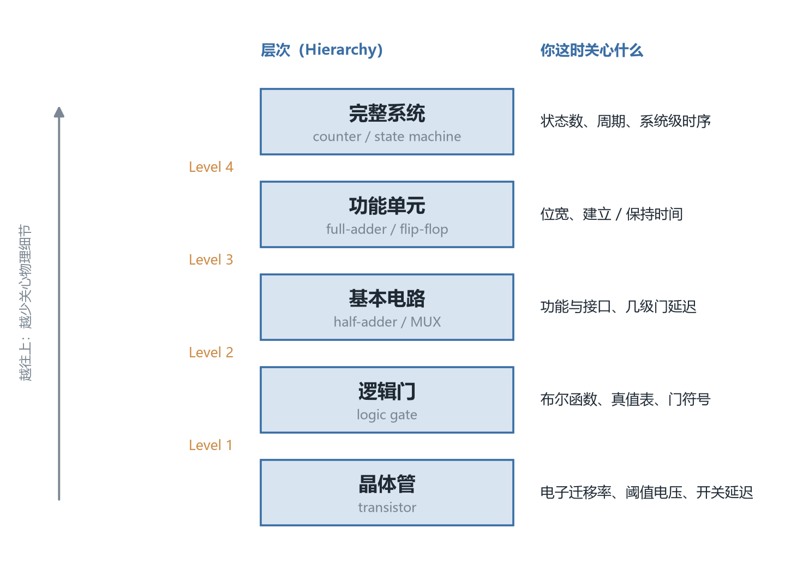
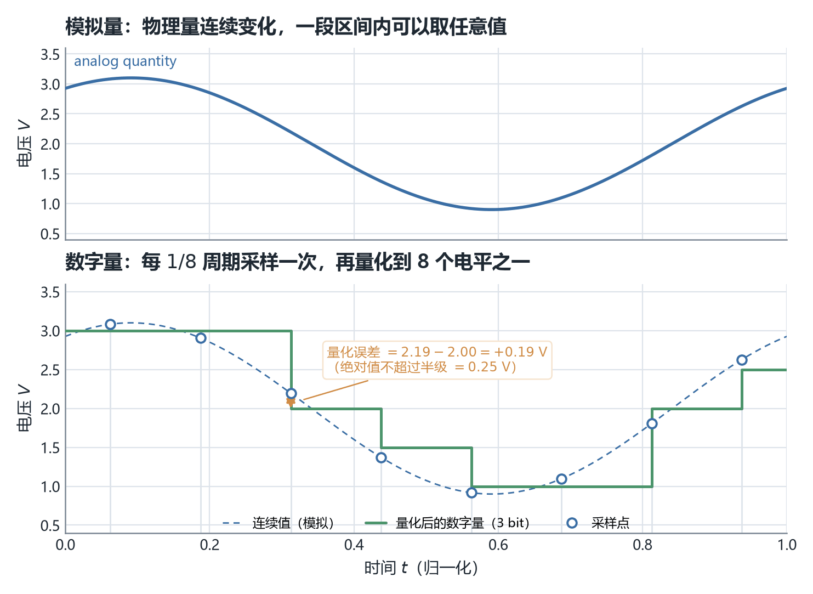
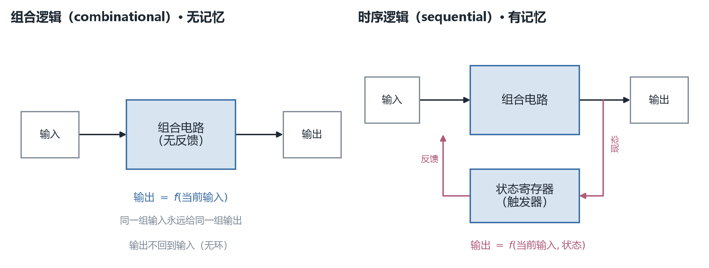
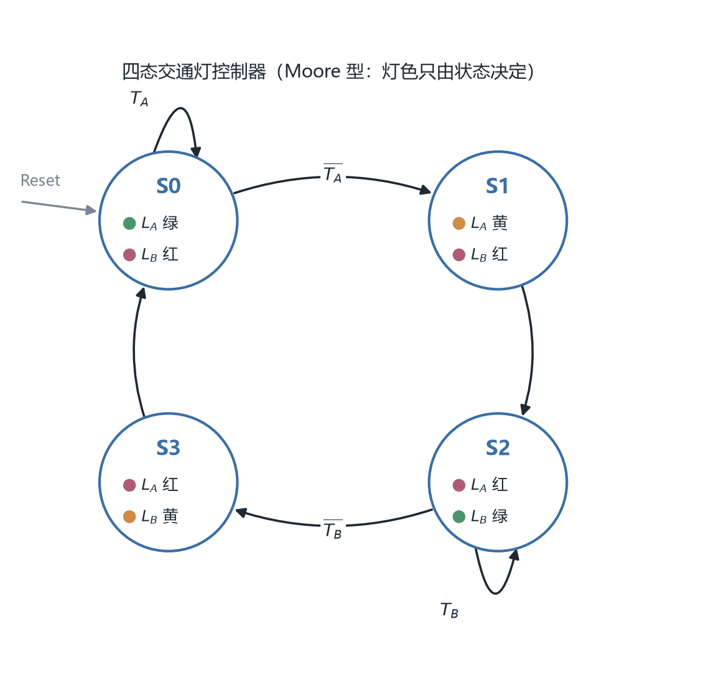

# ECE2050 Chapter 1 Introduction 课堂笔记

## 本章在讲什么

这是全课程唯一一章不教你"怎么算"的内容。44 页讲义里没有一道要你动手做的练习，它的功能是**先给你一张全课程导览图**：数字系统是什么、为什么可以这样设计、后面十一周会依次拆开哪几块。所以读这一章的正确姿势不是背结论，而是记住"哪件事属于哪一层、哪一章"——后面每学完一章，都可以回来在这张图上找到自己的位置。

**第一段（p1–p10）是课程介绍页，不是 Chapter 1 的内容。** 授课教师与助教、考核比例、教材、这门课在培养方案里的位置、14 周教学周历、Blackboard 的用法。之所以值得在笔记里留档，是因为 p8–p9 的周历实际上就是"后面十一章的目录"，它解释了这门课为什么按"数制 → 门 → 布尔代数 → 组合 → 时序 → 存储"这个顺序排。

**第二段（p11–p21）回答两个"为什么"。** p11–p13 先回答"为什么要学"：它是专业必修、是电路与体系结构的共同底座、也是写出高性能软件的前提；p13 顺手把今天数字世界的七个缩写（CPU/GPU/DSP/MCU/SoC/ASIC/FPGA）摆出来混个脸熟。p15–p21 再回答"凭什么设计得出来"：现代芯片有数百万到数十亿个晶体管，靠的是**抽象**（abstraction）+**纪律**（discipline）+**三个 Y**（Hierarchy / Modularity / Regularity）这套方法论。

**第三段（p22–p30）把"数字"这件事落到物理层。** p22–p24 用黑胶与 CD、Babbage 的齿轮分析机说明"连续"与"离散"的分界；p25–p26 给出整套数字纪律的最小单位——**bit**、逻辑电平、正逻辑与负逻辑；p27 用一张 0–15 的对照表把十进制/二进制/八进制/十六进制并排放好；p28–p30 才第一次出现"电路"：三种基本门、组合与时序的二分、以及一个布尔化简的完整演示。**这三页是全章的压缩包**，后面 Chapter 2–4 就是把它们逐个展开。

**第四段（p31–p44）是后面各章的目录，一条一条念过去。** 组合逻辑的实现路线（p31）、组合构件（p32–p33）、然后是时序这一族——锁存器与触发器（p34）、移位寄存器（p35）、计数器（p36）、状态机（p37）、存储器（p38）；p39 用一台"药瓶装片计数器"把前面所有构件串成一个真正的系统；p40–p42 讲怎么把这些东西造成芯片；p43–p44 收尾回顾与 8 道判断题。

一句话概括：**前三段给你"看地图的方法"，第四段把后面十章的名字先念一遍。**

各小节的讲义页序对应如下，笔记正文就按这个顺序一条线写下来：

| 讲义页 | 本笔记小节 | 内容 |
| --- | --- | --- |
| p1 | —— | 封面：ECE 2050 Digital Logic and Systems，Chapter 1: Introductory Concepts |
| p2 | 课程介绍页 · 通知 | Announcements：第一周有 tutorial |
| p3 | 课程介绍页 · 教学团队 | 授课教师、Lead TA、TA、L01/L02 与四个 tutorial 组的时间地点 |
| p4 | 课程介绍页 · 活动剪影 | 2020/2023 企业参访、邀请报告 |
| p5 | 课程介绍页 · 大纲与考核 | 课程内容一段话 + 五项考核比例 |
| p6 | 课程介绍页 · 教材 | Harris & Harris 为主、Floyd 为辅、配套网站 |
| p7 | 课程介绍页 · 课程地图 | ECE2050 在培养方案中的位置（先修与后续课程） |
| p8 | 课程介绍页 · 教学周历 | 第 1–7 周的主题 |
| p9 | 课程介绍页 · 教学周历 | 第 8–14 周的主题 |
| p10 | 课程介绍页 · Blackboard | 讲义下载、作业提交入口 |
| p11 | —— | 分节页（整页图片）："Why do we need to learn digital logic & systems?" |
| p12 | 为什么要学数字逻辑 | 四条理由：必修、专业全景、布尔代数底座、软件需要懂硬件 |
| p13 | 为什么要学数字逻辑 | 七个芯片缩写 + 四张实物照片 |
| p14 | —— | 分节页（整页图片）："How to design a Microprocessor?" |
| p15 | 管理复杂度：一张总图 | 抽象 / 纪律 / 三个 Y |
| p16 | 抽象（Abstraction） | 忽略低层细节，以及"本课程的工作高度"标在哪里 |
| p17 | 纪律（Discipline） | 数字纪律：用离散电压替代连续电压 |
| p18 | 层次化（Hierarchy） | 四层范例 + 一张 4-bit 计数器原理图 |
| p19 | 模块化（Modularity） | 以 2-to-1 MUX 为例的"定义良好的功能与接口" |
| p20 | 规律性（Regularity） | 三个例子 + 三条好处 |
| p21 | —— | 与 p20 逐字相同的重复页 |
| p22 | 模拟量 vs 数字量 | 连续 vs 离散；黑胶（12 英寸、3.5 小时）vs CD（12 cm、74 分钟） |
| p23 | 数字系统的优势与代价 | 两条优势、CD 播放器之问、D/A 转换器 |
| p24 | 分析机：数字计算的第一块基石 | Babbage 1834–1871、齿轮十个位置、Ada Lovelace |
| p25 | 数字纪律：二值 | 1/0 与 TRUE/FALSE/HIGH/LOW；电压、齿轮、液面 |
| p26 | bit 与正逻辑、负逻辑 | bit = binary digit；两种极性约定 |
| p27 | 数制：一张 0–15 的对照表 | 十进制 / 二进制 / 八进制 / 十六进制 |
| p28 | 三种基本逻辑门 | NOT / AND / OR 的符号与一句话定义 |
| p29 | 组合逻辑 vs 时序逻辑 | 有记忆 / 无记忆；AND 的真值表与 $Y=AB$ |
| p30 | 布尔代数与化简（预告） | Laws / 12 条 Rules / DeMorgan / K-map 四件套 |
| p31 | 组合逻辑的实现路线 | AND-OR、AND-OR-Invert、XOR、XNOR；方程与真值表 → 电路 |
| p32 | 组合构件（一）：加法器与比较器 | $3+9=12$ 的进位怎么摆；$2<5$ 的三根输出线 |
| p33 | 组合构件（二）：编/译码器与 MUX/DeMUX | 键盘→编码器→七段数码管；三路并一路再分回三路 |
| p34 | 时序逻辑设计（预告） | 状态的定义、双稳态电路、锁存器与触发器 |
| p35 | 移位寄存器：串行 vs 并行 | 8 bit 的两种走法：8 个时间间隔 / 1 个时间间隔 |
| p36 | 计数器 | "要计数，就必须记住当前的数" |
| p37 | 有限状态机与交通灯 | 状态寄存器 + 组合逻辑；四态 Moore 机 |
| p38 | 存储器 | SRAM / DRAM / ROM / Flash |
| p39 | 一个完整系统：药瓶装片计数器 | 编码器 + 寄存器 + 计数器 + 比较器 + MUX 串成一条闭环 |
| p40 | 集成电路：可编程 vs 固定功能 | IC 的定义；三种封装形式 |
| p41 | 固定功能 IC 的集成度 | SSI / MSI / VLSI / ULSI 表 + 引脚编号 |
| p42 | 可编程逻辑：PLD 与 FPGA | SPLD / CPLD / FPGA；四步开发流程 |
| p43 | 本章回顾 | 五条清单 |
| p44 | 自测：True/False Quiz | 8 道判断题（讲义未给答案） |

> 本笔记约定：正文严格按讲义页序一条线排下来，小节标题后面标出对应页；凡属**我从教材或自行推导补充、讲义上没有的内容**，都在段首用【补】标出，引用讲义原文的结论则不加标记。p11、p14 是整页图片的分节页，文字层抽不出字，我是渲染成图后读的。本讲对应教材 **§1.1 The Game Plan、§1.2 The Art of Managing Complexity、§1.3 The Digital Abstraction、§1.4 Number Systems、§1.5 Logic Gates**（§1.6 "Beneath the Digital Abstraction" 起不在本讲范围）。

## 课程介绍页：这门课怎么组织（讲义 p1–p10）

这十页不属于 Chapter 1 的知识点，但它们决定了你整个学期怎么安排时间，值得单独留一段。

**教学团队（p3）**：授课教师 Tinghuan Chen（陈廷欢），办公室 TC413B，答疑时间周四 15:00–16:00；Lead TA 与另一位 TA 各有固定答疑时段；课程分 L01（周二、周四 8:30–9:50）与 L02（周二、周四 10:30–11:50）两个班次，都在 Teaching Complex C202；tutorial 分四组（T01–T04），周二晚在 TA204/TA205 进行。**这门课有 tutorial，而且第一周就有**（p2 的唯一一条通知）。

**考核（p5）**：

| 项目 | 占比 |
| --- | --- |
| 课堂表现 In-class Performance | 5% |
| 作业 Assignments | 20% |
| 项目 Project | 10% |
| 期中 Mid-term Test | 30% |
| 期末 Final Exam | 35% |

**教材（p6）**：主教材是 Sarah L. Harris 与 David Harris 的 *Digital Design and Computer Architecture*（RISC-V Edition），参考书是 Thomas Floyd 的 *Digital Fundamentals*（第 11 版）。【补】**这个组合值得注意**：Harris 那本讲"为什么这样设计"，Floyd 那本讲"怎么算、怎么查表"，本课程的讲义在术语和表格上明显更靠近 Floyd，而在抽象层级、CMOS、时序这些概念上更靠近 Harris。

**课程地图（p7）**：ECE2050 在培养方案里是一个枢纽——上游接 ECE2001 Basic Circuit Theory 与 PHY1002，下游分出 ECE2810（数字系统设计实验）、ECE3080（嵌入式系统）、ECE4102（CMOS 数字集成电路设计）、ECE3202（模拟集成电路）、ECE3201（微电子电路）、ECE4002（数字通信）。**换句话说，不管你后面走数字、模拟还是通信，这门课都是必经的门。**

**教学周历（p8–p9）**：

| 周次 | 日期 | 内容 |
| --- | --- | --- |
| 1 | 9/7–9/13 | Ch1 Introductory concepts |
| 2 | 9/14–9/20 | Ch2 Number systems |
| 3 | 9/21–9/27 | Ch3 Logic gates |
| 4 | 9/28–10/4 | Ch4 Boolean algebra and logic simplification |
| 5 | 10/5–10/11 | Ch4 续 + Ch5 Combinational logic design |
| 6 | 10/12–10/18 | Ch5 续 |
| 7 | 10/19–10/25 | Ch6 Combinational Building Blocks |
| 8 | 10/26–11/1 | 期中 + Ch7 Sequential Logic Design |
| 9 | 11/2–11/8 | Ch8 Shift registers |
| 10 | 11/9–11/15 | Ch9 Finite State Machine |
| 11–12 | 11/16–11/29 | Ch10 Counters |
| 13 | 11/30–12/6 | Ch11 Memory & Logic Arrays |
| 14 | 12/7–12/13 | Seminar / Review |

把这张表和 p31–p38 的预览页对起来看，会发现一个顺序错位：**周历里 Ch9 是 FSM、Ch10 是 Counters，而讲义预览页把 Counters（p36）排在 FSM（p37）前面。** 章号以周历为准，预览页只是"目录"，不必按它记顺序（详见附录）。

**Blackboard（p10）** 是讲义下载与作业提交的唯一入口，作业全部在线提交。

## 为什么要学数字逻辑（讲义 p11–p13）

p11 是一张整页图片的分节页，只有一句大字："Why do we need to learn digital logic & systems?"。p12 给出四条理由，p13 给出一张"芯片族谱"。

p12 的四条理由是层层递进的：

1. **专业必修（Major Required）**——这不是选修课，是 ECE 的底座。
2. **看清专业全景（an insight into the specialty）**——往上是电路设计（circuit design），往旁是计算机体系结构（computer architecture），两条线都从这里分叉。
3. **它建立在布尔代数与理论计算机科学之上**——这门课是你第一次把"数学上的真假"和"物理上的高低电平"对上号的地方。
4. **写高性能软件也必须懂硬件层**——要读微处理器（microprocessor）的数据手册（datasheet）、要看原理图（schematic diagram），绕不开"布尔代数 + 数字电路"这套语言。

p13 列出七个缩写，并用四张实物照片各配一个：CPU（intel Core i7 芯片）、GPU（三风扇显卡）、FPGA（一块 Xilinx 开发板）、MCU（一块小尺寸单片机开发板）。

【补】课件只给缩写不给全称，这里补齐，并注明各自的定位：

- **CPU**（Central Processing Unit，中央处理器）：通用计算的核心，追求单线程性能。
- **GPU**（Graphics Processing Unit，图形处理器）：大量相同的运算单元并行工作，如今主要用来做 AI 训练。
- **DSP**（Digital Signal Processor，数字信号处理器）：为滤波、FFT 这类"乘加密集"的运算专门优化的处理器。
- **MCU**（Microcontroller Unit，微控制器）：把 CPU、存储、外设塞进一颗芯片的"小电脑"，用于嵌入式控制。
- **SoC**（System on Chip，系统级芯片）：把 CPU、GPU、内存控制器、各种接口集成到一颗硅片上，手机主芯片就是典型。
- **ASIC**（Application-Specific Integrated Circuit，专用集成电路）：为某一个功能定制的芯片，量产便宜但不能改。
- **FPGA**（Field-Programmable Gate Array，现场可编程门阵列）：出厂时是"空白"的，用户可以反复配置成任意电路。

【补】这七个名字背后是同一个事实：**它们全都是用大量"开关"搭出来的数字电路，区别只在"这些开关怎么组织、出厂后还能不能改"。** 这一章后面所有的抽象层级、组合/时序二分、IC 分类，都是在解释这句话。

## 管理复杂度：抽象、纪律与三个 Y（讲义 p15–p21）

p15 抛出本章的核心问题：现代数字系统动辄包含**数百万甚至数十亿个晶体管**，一个人脑子里根本装不下这么多细节，那我们究竟是怎么把它设计出来的？答案是一套成熟了几十年的方法论，分三件：

- **抽象（Abstraction）**
- **纪律（Discipline）**
- **三个 Y（The 3-Y's）**：层次化（Hierarchy）、模块化（Modularity）、规律性（Regularity）

### 抽象（讲义 p16）

抽象的做法是**主动忽略低层细节，把工作搬到更高的表示层级上**。讲义举的反面例子很具体：如果你必须一直想着每个晶体管里的**电子迁移率（electron mobility）**、**阈值电压（voltage threshold）**、**开关延迟（switching delay）**，那你什么系统也设计不出来。

p16 的图右下角还标了一句 "Focus of this course"——**本课程绝大部分时间停在"逻辑门及以上"这一层**，不往晶体管里钻。这句话很重要：它解释了为什么 Chapter 3 讲逻辑电平和噪声容限，却不讲 CMOS 怎么造（教材把 CMOS 放在 §1.7，且标了选学星号）。

### 纪律（讲义 p17）

纪律是**主动给自己加上一套约束与约定，以保证一致性（consistency）、正确性（correctness）和互操作性（interoperability）**。讲义给的典型例子是**数字纪律（digital discipline）**：现实世界的电压是连续的（0.1 V、1.732 V、3.3 V 都可能），而数字电路规定**只用两个离散的电压区间**来表示 0 和 1。

p17 底下并排画了两条波形：左边 ANALOGUE 是一条在 0 V 与 +5 V 之间随意游走的曲线，右边 DIGITAL 是同一段时间被"压"成只有高、低两档的方波。**这笔交易换来的是"更简单的设计"**——讲义的原话是"simpler to design than analog circuits – can build more sophisticated systems"。也就是说，纪律不是限制，而是**用"放弃中间值"换"能搭更复杂的系统"**。

### 层次化（讲义 p18）

层次化是把系统按<b>层（layer）</b>组织。讲义列了四层，注意它把"层号"标在<b>过渡</b>上，所以四个 Level 对应五级实体：

- **Level 1**：晶体管（transistors）→ 组成**逻辑门（logic gates）**
- **Level 2**：逻辑门 → 组成**基本电路（basic circuits）**，如半加器（half-adder）、多路选择器（mux）
- **Level 3**：基本电路 → 组成**功能单元（functional units）**，如全加器（full-adder）、触发器（flip-flops）
- **Level 4**：功能单元 → 组成**完整系统（systems）**，如计数器（counter）、状态机（state machine）

*图 1　数字系统的五级实体与四条 Level 过渡：每往上一层，单个模块封装的细节多一层，设计者需要同时关心的物理量少一层——所以一个人也能设计几十亿个晶体管的东西。*

p18 底下那张原理图正是这条阶梯的实证：四个 D 触发器并排（Level 3 的功能单元），它们的输出接到一个译码器（Level 2 的基本电路），整体构成一个计数器（Level 4 的系统）。**同一张图在三个层级上同时成立**，这就是层次化的意义——你可以只盯其中一层，把其它层当黑盒。

### 模块化（讲义 p19）

模块化是设计出**独立、定义良好、可互换（independent, well-defined, interchangeable）** 的组件，关键在于**功能定义清楚、接口定义清楚**。讲义拿 2-to-1 MUX 举例：一旦这个模块被设计并验证过，它就可以被原封不动地搬到任何需要它的地方——状态机（FSM）、存储控制器（memory controller），都一样。

**模块化的价值不在"功能多强"，而在"行为可预测"。** 一个功能很弱但接口干净的模块，比一个功能很强但接口含糊的模块有用得多，因为前者可以被组合，后者只能被围观。

### 规律性（讲义 p20–p21）

规律性（Regularity）是**鼓励"千篇一律"，让模块容易被复用**。讲义给了三个例子：

- 一个 4-bit 寄存器就是**四个完全相同的 D 触发器**；
- 一块存储阵列就是**相同位单元（bit cell）** 排成的二维网格；
- 一个 n-bit 加法器就是把**同一个全加器级**重复 n 次。

好处讲义列了三条：**简化版图（layout）、简化测试、简化制造**；另外还有两条延伸——**容易扩展（easier scaling）**、**容易布局布线（easier placement and routing）**。把 4-bit 扩到 8-bit，方法不是重新设计，而是"再抄一遍"。

> [!NOTE]
> 三个 Y 的关系可以记成一个心智模型：**Hierarchy 决定"怎么分层"，Modularity 决定"每一层长什么样"，Regularity 决定"同一层里各模块有多像彼此"。** 三者不是并列的三条建议，而是一条链：先分层，再把每层切成模块，最后让同类模块长得一样以便复制。

> [!TIP]
> p20 与 p21 是**逐字相同**的两页（同样的四个例子、同样的三条好处）。这不是你漏看了内容，是课件重复了一页——见附录"课件的不一致"第 1 条。

## 模拟量 vs 数字量（讲义 p22–p24）

### 连续与离散（讲义 p22）

讲义的开场是一句断言：**大多数物理量都是连续的（continuous）**——导线上的电压、振荡的频率、物体的位置，都能在一段范围内取任意值。这类量叫**模拟量（analog quantity）**。

**数字抽象（digital abstraction）只考虑这些取值的一个离散子集（discrete subset）**。这类量叫**数字量（digital quantity）**，它从一个有限的集合里取值。

讲义用两个载体把差别摆出来：**黑胶唱片（vinyl record）**，12 英寸（约 30 cm），能放约 3.5 小时，纹槽里存的是连续的声波；**CD**，12 cm，能放 74 分钟，存的是数字音频。**同样的音乐，一个用"连续的形状"记，一个用"离散的数字"记。**

### 优势与代价（讲义 p23）

讲义的"数字优势"只有两条，但都很硬：

1. **数字数据可以被更高效、更可靠地存储、处理和传输**——因为它是离散的，可以校验、可以纠错、可以压缩、可以无限次复制而不失真。
2. **数字数据更抗噪声（more noise resilient）**——我们只在乎"是高还是低"，中间的小毛刺只要不越过判决门限就不影响判读。

接着讲义问了一个很好的问题：**一个带 CD 播放器的音响系统，算不算数字系统？** 它给的答案藏在图里：CD 机内部确实是数字域，但喇叭要发声，必须先用 **D/A 转换器（Digital-to-Analog converter）** 把数字数据变回连续电压，再经放大器推动扬声器。**所以它"既是又不是"——一个完整系统往往是数字与模拟混合的，取决于你站在哪一段抽象上看。**

最后讲义留了一个反问：**你能想到数字系统的缺点吗？** 课件没有给答案。下面是我的补充。

【补】数字系统至少有三个代价：

- **量化误差（quantization error）**：把连续量拍成离散值，必然丢掉小于一个量化级的细节。3-bit、满量程 4 V 的例子中，一个量化级是 0.5 V，误差最大可达半个量化级（0.25 V），也就是满量程的 6.25%。
- **采样与处理延迟**：模拟信号是"实时"的，数字系统必须"采样 → 量化 → 处理 → 重建"，这一串动作带来固定延迟，闭环控制里会直接影响稳定性。
- **功耗与面积**：同样的功能，数字实现通常比模拟实现用更多的晶体管，只是换来可编程性与可移植性。

*图 2　模拟量与数字量的关系：上图是连续的正弦，下图在每 $1/8$ 周期采样一次并量化到 8 个电平（3 bit）；橙色双箭头那一点是量化误差，它等于"连续值 − 量化值"，绝对值永远不超过半个量化级。波形形状为示意，采样点与误差数值均由脚本现算。*

### 分析机：数字计算的第一块基石（讲义 p24）

讲义在这里插了一页历史：**Charles Babbage（1791–1871）在 1834–1871 年间设计的分析机（Analytical Engine）被认为是第一台数字计算机**，它用**机械齿轮**实现，每个齿轮有十个离散位置，代表 0–9。同期的 **Ada Lovelace（1815–1852）** 被公认为**第一位程序员**。

这一页放在这里是很有讲究的：**它证明了"数字"不等于"电子"。** 齿轮的十个位置、液面的高低、灯泡的亮灭，只要有两个以上稳定且可区分的状态，就能承载离散信息。**数字的本质是"离散可分辨"，不是"必须用电"。**

## 数字纪律：bit、逻辑电平与正/负逻辑（讲义 p25–p26）

**p25** 把二值约定写成一张对照：

$$
0 \equiv \text{FALSE} \equiv \text{LOW}, \qquad 1 \equiv \text{TRUE} \equiv \text{HIGH}
$$

讲义强调，**1 和 0 不一定要用电平实现**——也可以是齿轮的转角、液面的高低。但**数字电路用的是电压**：0 对应低电压（GND），1 对应高电压（VDD）。信息的最小单位叫 **bit**，即 **binary digit**（二进制位）。

**p26** 把 bit 定义得更死：**一个 bit 只能是 0 或 1**。然后给出两种极性约定：

- **正逻辑（positive logic）**：1 用较高的电压表示（HIGH），0 用较低的电压表示（LOW）；
- **负逻辑（negative logic）**：反过来，1 对应低电平、0 对应高电平。

> [!IMPORTANT]
> **正逻辑是约定，不是物理必然。** 同一块芯片、同一根导线上的同一个电压，在正逻辑下读作 1，在负逻辑下就读作 0。本课程**默认正逻辑**；考试里如果没说，就按正逻辑。数据手册里出现"低有效（active-low）"信号（如 $\overline{\text{RESET}}$）时，本质上就是在局部用了负逻辑的读法。

【补】VDD 与 GND 这两个名字有来历：VDD 原指 MOS 电路里接**漏极（drain）** 的电源，VSS 指接**源极（source）** 的参考点，GND 则是"把它当零电位"的习惯叫法。今天 VDD 泛指正电源、GND 泛指地，名字已经和器件结构脱钩了。另外，正逻辑下的"高/低"是**区间**而不是一个点——这个区间有多宽、两个区间之间留多大余量，是 Chapter 3 的噪声容限要回答的问题。

## 数制：一张 0–15 的对照表（讲义 p27）

既然电路里只有 0 和 1，日常的十进制数就必须换一种写法。讲义用一整页把 0–15 的四种写法并排放好：

| Decimal | Binary | Octal | Hex |
| ---: | ---: | ---: | ---: |
| 0 | 0000 | 00 | 0 |
| 1 | 0001 | 01 | 1 |
| 2 | 0010 | 02 | 2 |
| 3 | 0011 | 03 | 3 |
| 4 | 0100 | 04 | 4 |
| 5 | 0101 | 05 | 5 |
| 6 | 0110 | 06 | 6 |
| 7 | 0111 | 07 | 7 |
| 8 | 1000 | 10 | 8 |
| 9 | 1001 | 11 | 9 |
| 10 | 1010 | 12 | A |
| 11 | 1011 | 13 | B |
| 12 | 1100 | 14 | C |
| 13 | 1101 | 15 | D |
| 14 | 1110 | 16 | E |
| 15 | 1111 | 17 | F |

四列看下来，值得记住的是四件事：

- **它们是同一个数的四种写法，值完全相等。** 例如 $12_{10} = 1100_2 = 14_8 = \mathrm{C}_{16}$。
- **十六进制用 A–F 补 10–15**，因为十进制只有十个数字符号可用。
- **八进制里不会出现 8 和 9**。所以 14 的八进制是 16 而不是 14——"逢 8 进 1"。
- **二进制的位权是 2 的幂**。一个 $n$ 位二进制数能表示 $0$ 到 $2^n-1$，4 位正好 16 个数，对上表 16 行。

用式子写出来就是：

$$
N = \sum_{i=0}^{n-1} b_i \, 2^i, \qquad b_i \in \{0,1\}
$$

【补】为什么工程上四种都要会：

- **二进制**是电路真正"看见"的形式——一根线高或低，就是一个 bit；
- **十六进制**是给人看 bit 流的压缩写法，**1 个 hex digit 恰好等于 4 bit（一个 nibble）**，所以 32 位寄存器写成 8 个 hex digit 就行；
- **八进制**今天用得少了（早期 Unix 权限位、老式小型机），但 3 bit 一组在某些场合仍然方便；
- **十进制**只出现在"人机界面"这一侧——键盘输入、七段数码管显示。

这一页只建立"同一数字的多种写法"这个直觉。**进制之间怎么换算、二进制怎么加减乘除、负数怎么表示、BCD 与检错码**，都是 Chapter 2 的内容，这里不展开。

## 三种基本逻辑门（讲义 p28）

**逻辑门（logic gate）是执行某个指定逻辑功能的电路**。讲义只给了三个，但它们是后面所有门族的原子：

- **NOT（非门 / 反相器，inverter）**：输出与输入相反。输入 0 输出 1，输入 1 输出 0。
- **AND（与门）**：**所有**输入都为真时输出才为真；可以有两个以上输入。
- **OR（或门）**：**只要有一个**输入为真输出就为真；同样可以有两个以上输入。

p28 只画了三个门的符号和一句定义，没有真值表——真值表在下一页（p29）拿 AND 做示范。

【补】三点补充，用来把这三个门"钉"在抽象阶梯上：

- 这三个门是**Level 1 的产物**：几个晶体管按某种拓扑连起来，就得到一个门；门的行为可以用一张真值表完全描述，从此不必再关心里面的晶体管。
- "可以有两个以上输入"不是画图方便，而是物理上真的能做——AND 就是串联开关、OR 就是并联开关，串/并联多少个都行（Chapter 3 会讲多输入门）。
- 这一页**只讲 NOT/AND/OR**，NAND、NOR、XOR、XNOR 全部留给 Chapter 3。别在这里提前背门族，先把这三个的"真值表 ↔ 布尔式 ↔ 符号"三件套对应关系记牢。

## 组合逻辑 vs 时序逻辑（讲义 p29）

这是全课程最重要的一条分界线。

**组合逻辑（combinational logic）无记忆（memoryless）**：输出**只由当前输入的值**决定。给它同一组输入，永远给同一组输出，电路里没有任何东西"记得"上一次算过什么。

**时序逻辑（sequential logic）有记忆（has memory）**：输出**由当前输入和此前的输入共同**决定。"此前发生过什么"在电路里被压缩成一个内部量，下一节（p34）会把它正式命名为**状态（state）**。

p29 用 AND 门把两套描述方式一次摆全：左边是门符号，中间是真值表，右边是布尔方程。

| A | B | Y |
| --- | --- | --- |
| 0 | 0 | 0 |
| 0 | 1 | 0 |
| 1 | 0 | 0 |
| 1 | 1 | 1 |

$$
Y = AB
$$

**同一件事的三种写法**——符号图、真值表、布尔方程——后面每一章都会反复在这三者之间来回翻译，这里先把它们对齐。

*图 3　组合逻辑与时序逻辑的唯一结构差别就是那条从输出绕回输入的线：没有它，输出只由当前输入决定（无记忆）；有它，输出还取决于寄存器里存着的状态（有记忆）。*

【补】为什么这条分界线这么重要：现实里有一大类问题**本质上带时间维度**——计数器要"数到第几个"、状态机要"走到第几步"、自动售货机要"记住你投了多少钱"。这些问题**用纯组合逻辑无解**，因为组合逻辑没有"第几个"这个概念，它每次都是从零开始算。时序元件存在的唯一理由，就是给电路一个"昨天"。

## 布尔代数与化简（讲义 p30）

组合逻辑的设计语言是**布尔代数（Boolean algebra）**。p30 用一页把整套工具摆了出来，并给了一个三变量函数的完整化简作为"剧透"。

### 一个完整的化简演示

$$
Y = \bar{A}B\bar{C} + \bar{A}BC + ABC
$$

式子里每一项都是"三个变量各取原/反再相乘"，这种项叫**最小项（minterm）**，对应真值表里输出为 1 的那些行。

化简过程是：

$$
\begin{aligned}
Y &= \bar{A}B\bar{C} + \bar{A}BC + ABC \\
  &= \bar{A}B\bar{C} + \bar{A}BC + \bar{A}BC + ABC \\
  &= \bar{A}B(\bar{C} + C) + (\bar{A} + A)BC \\
  &= \bar{A}B + BC
\end{aligned}
$$

三行分别用了一条规则：

- **第二行是"把一项复制一份"**——依据是幂等律 $A + A = A$（Rule 5）的逆用。逻辑上复制不改变函数值，但凑出了两对可以配对的项。
- **第三行是分组提公因子**——前两项提 $\bar{A}B$，后两项提 $BC$。
- **第四行是消掉互补对**——$\bar{C}+C=1$、$\bar{A}+A=1$（Rule 6），再用 $1 \cdot X = X$（Rule 4）落回 $\bar{A}B$ 与 $BC$。

> [!WARNING]
> **勘误（2026-09-29 补，本次重构保留）**：本笔记初版把第一项误抄成 $\bar{A}\bar{B}\bar{C}$，随之把整段推导也写错了。经与 Chapter 4 讲义 p50 的同款 K-map（1 位置在 $010/011/111$，结果 $Y=\bar{A}B+BC$）对照，并把 Chapter 1 讲义 p30 放大到 300 dpi 逐字核对：**课件原文第一项是 $\bar{A}B\bar{C}$，$B$ 上没有杠**。课件本身没有错，是我转写有误。上面已是更正后的版本，附录里另有一条完整记录。

### 同一页上的四件套

p30 把后面 Chapter 4 的全部家当压缩在四个框里：

- **Laws（定律）**：交换律（commutative）、结合律（associative）、分配律（distributive）。
- **Rules（规则，共 12 条）**：从 $A+0=A$ 一路到 $(A+B)(A+C)=A+BC$，完整表格见文末速查表。
- **DeMorgan 定理**：$\overline{AB}=\bar{A}+\bar{B}$，$\overline{A+B}=\bar{A}\bar{B}$。
- **Karnaugh Map（卡诺图）**：把真值表摆成二维格子，让"逻辑相邻"变成"几何相邻"。

p30 右下那张 K-map 是 3 变量图：列按 $AB=00,01,11,10$ 排（Gray 码顺序），行是 $C=0$ 与 $C=1$，1 落在 $010$、$011$、$111$ 三格。圈出两组——竖着圈 $01$ 列的两格得 $\bar{A}B$，横着圈 $C=1$ 行中 $AB=01,11$ 两格得 $BC$——合起来正是左边算出来的 $\bar{A}B+BC$。**代数化简与图形化简在同一页上互相验证，这是 p30 最值得看的地方。**

【补】DeMorgan 的记忆口诀：**"长杠断开，短杠加上，与或互换"**——把一条盖住整个式子的横线断开时，每个变量各自加一条短杠，同时 $\cdot$ 与 $+$ 互换。Chapter 4 会用大量例子训练这一条。

## 组合逻辑的实现路线（讲义 p31）

p31 是 Chapter 5 的目录页，列了两组东西。

**四种基本组合电路形式**：

- **AND-OR Logic**：若干个 AND 的输出接到一个 OR——这正是 SOP（积之和）表达式的直接电路实现。
- **AND-OR-Invert Logic**：在 AND-OR 后面再加一个反相，得到 POS 的变形。
- **Exclusive-OR Logic**：异或——两输入不同则输出 1（讲义只给名字，式子在 Chapter 3）。
- **Exclusive-NOR Logic**：同或，异或取反。

**两条实现路径**：

- **从布尔方程到电路**：给式子，画出对应的门网络；
- **从真值表到电路**：给表，先写标准 SOP/POS，再画门。

【补】这两条路径其实是同一条：真值表 → 标准 SOP → 化简 → 门网络。p31 把它们拆成两条讲，是因为"从方程出发"时你已经跳过了前两步。另外，**AND-OR 结构之所以重要，是因为任何 SOP 都能直接照抄成两级门**（一级 AND 产生每个乘积项，一级 OR 把它们加起来），这也是后面讲"两级逻辑"和"多级逻辑"的起点。

## 组合构件（一）：加法器与比较器（讲义 p32）

p32 一页放了两个构件，都用**具体的数**来讲。

**加法器（Adder）**：例子里 $A=3$、$B=9$、$C_{in}=0$，图上把 $\Sigma$ 标成 "binary code for 2"、把 $C_{out}$ 标成 "binary 1"。**这组标注只有按十进制（BCD）加法读才自洽**：$3+9=12$，个位的 2 从 $\Sigma$ 出，十位的进位 1 从 $C_{out}$ 出。如果把它当纯 4 位二进制加法器来读，$3+9=12=1100_2$，应当是 $\Sigma=1100$、$C_{out}=0$，与图上的标注对不上（详见附录第 3 条）。

**比较器（Comparator）**：例子里 $A=2$、$B=5$，三根输出线分别是 $A>B$（LOW）、$A=B$（LOW）、$A<B$（HIGH）。**三根线里恰好有一根为 1**，这种编码方式叫 one-hot。

【补】这两点都是考试容易踩的坑：

- **进位线不能省。** 一个 $n$ 位加法器真正能表达的是 $n+1$ 位的结果；只接 $\Sigma$ 不接 $C_{out}$，加法就会"悄悄溢出"。
- **比较器的三根输出不是"三比特二进制数"**，而是**三个互斥的标志**。想把它接回二进制数，需要额外的编码逻辑。

## 组合构件（二）：编/译码器与 MUX/DeMUX（讲义 p33）

**编码器（Encoder）与译码器（Decoder）是一对相反的操作**，讲义用"计算器键盘 → 七段数码管"把两个都串起来了：

- 键盘上按下 9，对应的那根输入线变 HIGH；**编码器**把"10 根线里哪一根是高"压缩成 4 位二进制码（$1001$）。
- **译码器**做反方向的事：给它 4 位码，它把对应的那根输出线拉高，去点亮七段数码管上该亮的段。

**多路选择器（Multiplexer, MUX）与多路分配器（Demultiplexer, DeMUX）** 是"信号路由"的一对：

- **MUX** 把多条**分离的线（separate lines）** 按时隙合并到**一条线（single line）** 上——图中 A、B、C 三路分别在 $\Delta t_1$、$\Delta t_2$、$\Delta t_3$ 被选中送上总线；
- **DeMUX** 反过来，按同一套时隙把总线上的信号分回 D、E、F 三路。

注意讲义图里那根总线上写的是 "Data from A to D"、"Data from B to E"……——**它画的是"分时复用"（time-division multiplexing）**，不是"选一条路"那么简单。

【补】两处需要说清楚的地方：

- 讲义这个编码器是 **10 线 → 4 位**（十进制键盘 → BCD），不是通用的 $2^n \to n$ 编码器。通用说法里 8-to-3 更常见（8 根输入线 → 3 位码），两者原理相同，只是输入线数不必是 2 的幂。
- MUX 的"选择信号（select）"需要 $\lceil \log_2 k \rceil$ 位才能从 $k$ 路里选一路。讲义图里叫 "switching sequence control input"，就是这组选择信号。

## 时序逻辑设计（讲义 p34）

进入时序世界，讲义先给定义，再给元件。

**定义**：时序逻辑的输出取决于**当前输入与之前的输入**——它有记忆。而"之前发生过什么"被抽象成一个量：

> **状态（state）= 解释电路未来行为所需要的全部信息。**

这句话值得逐字读：状态不是"历史记录"，而是"历史的**充分统计量**"——凡是与未来无关的往事，都不该进入状态。

**元件**：最基本的记忆单元是**双稳态电路（bistable circuit）**，它有两个稳定状态，对应 0 和 1；没有外界驱动时会一直待在当前状态，受到合适信号时才翻转。**一个双稳态电路一次只存 1 个 bit。**

讲义列出的家族：

- **SR 锁存器（SR latch）** 与 **D 锁存器（D latch）**：最简单的两种锁存器；
- **D 触发器（D flip-flop, DFF）** 与 **JK 触发器（JK flip-flop）**：真正支撑"同步数字系统"的存储元件。

【补】锁存器与触发器最实用的区别：**锁存器是电平敏感的**（使能电平有效期间，输出一直跟着输入走），**触发器是边沿敏感的**（只在时钟上升沿/下降沿那一瞬采样）。这个差别决定了你能不能写出"每个时钟周期只前进一格"的电路——Chapter 7 会展开，这里只要记住"电平 vs 边沿"这四个字。

## 移位寄存器：串行 vs 并行（讲义 p35）

**移位寄存器（shift register）= 若干个触发器串起来**，它有两项用途：**数据存储**与**数据移动**。

讲义用"计算机送 8 bit 给打印机"对比两种走法：

- **串行（serial）**：1 bit 一次，走 1 根线。8 bit 需要 **8 个时间间隔**，但只用 1 根物理线。
- **并行（parallel）**：多个 bit 同时走多根线。8 bit 只需 **1 个时间间隔**，但要 8 根线。

这是一笔清清楚楚的交易：**串行拿时间换线，并行拿线换时间。**

【补】现实里的选择并不总是"并行更快所以更好"：

- 老式打印机接口（并口）确实是并行，因为距离短、线便宜；
- USB、以太网、PCIe 全是串行——因为**线一多，时钟同步就难，成本与串扰都上去了**；串行可以靠提高单线速率（并配合编码与均衡）把吞吐量做回来，还省引脚。
- 所以"串行 vs 并行"不是技术先进与否的问题，而是**在给定距离、给定成本下，哪个约束更紧**的问题。

## 计数器（讲义 p36）

讲义对计数器只说了一句话，但这句话把时序逻辑的本质讲透了：

> **要计数，计数器必须"记住"当前的数，才能走到序列里下一个正确的数。**

由此推出：**存储能力是所有计数器的关键特性，而触发器通常就是实现它的手段。** 一个 4-bit 计数器就是 4 个触发器 + 一片组合逻辑（决定"下一个数是什么"）——正好又是 p18 那张"功能单元 → 系统"的图。

【补】计数器的两个常用分类（Chapter 10 会正式讲）：

- **异步（ripple）计数器**：前一级的输出当时钟驱动后一级，结构最省，但进位像水波一样一级级传，位数一多就慢，且中间会出现短暂的错误码。
- **同步（synchronous）计数器**：所有触发器共用同一个时钟，下一状态由组合逻辑一次算好，速度快、无中间态，代价是组合逻辑更复杂。

## 有限状态机与交通灯（讲义 p37）

**有限状态机（finite state machine, FSM）= 状态寄存器 + 组合逻辑。** 分工是干净的：

- **状态寄存器**记住"现在在哪个状态"；
- **组合逻辑**根据"当前状态 + 当前输入"算出"下一个状态"和"当前输出"。

讲义用十字路口交通灯做例子：Bravado 大道与 Academic 大道相交，路口周围标着 Dining Hall、Labs、Dorms、Fields；两条路各埋了一组传感器，Academic 方向叫 $T_A$，Bravado 方向叫 $T_B$。四个状态：

| 状态 | $L_A$（Academic 灯） | $L_B$（Bravado 灯） | 转移 |
| --- | --- | --- | --- |
| S0 | 绿 | 红 | $T_A=1$ 自环；$T_A=0$ 转 S1 |
| S1 | 黄 | 红 | 无条件转 S2 |
| S2 | 红 | 绿 | $T_B=1$ 自环；$T_B=0$ 转 S3 |
| S3 | 红 | 黄 | 无条件转 S0 |

另有一个 Reset 输入，把状态机拉回 S0（上电或复位时的确定起点）。

*图 4　四态交通灯状态机：黄灯两态（S1、S3）只是过渡，无条件前进；绿灯两态（S0、S2）各自带一个自环，只要本方向还有车就一直保持绿灯。转移条件与灯色逐字照讲义 p37。*

这张图的读法值得单独说一句，因为很容易读反：**自环的条件是 $T_A=1$、离开的条件是 $T_A=0$。**

【补】把这个逻辑翻译成人话：**"本方向还有车，就继续给本方向绿灯；本方向没车了，才换给对面。"** 这要求 $T_A=1$ 表示"Academic 方向仍有车在等"。这样读，四个状态的转移才是自洽的：绿灯不会因为"对面有车"就立刻让行，而是先把自己这边的车放完。若把条件理解反了（以为 $T_A$ 是"对面有车"），整个状态机就会变成"一有车就抢灯"，与图上的箭头方向矛盾。

> [!NOTE]
> **这里改正了原笔记的一处错误。** 旧版把 S0 的转移写成"$T_B$ 检测到 Bravado 有车 → 转 S1，否则保持 S0"，把 S2 写成"$T_A$ 检测到 Academic 有车 → 转 S3"。这与讲义 p37 的原图不符：**p37 上是 $T_A$ 自环 / $\overline{T_A}$ 转 S1，$T_B$ 自环 / $\overline{T_B}$ 转 S3**（300 dpi 放大逐字核过）。本版已按原图改写，图和文字现在一致。

【补】两点补充：

- 这是一个 **Moore 型** 状态机——输出（灯色）只由当前状态决定，与当前输入无关。因此图上每个状态可以直接把灯色写在圈里；如果是 Mealy 型，灯色要写在转移弧上。Chapter 9 会正式区分这两类。
- 黄灯两态（S1、S3）**没有任何条件**，进入后下一拍必然离开。它们的作用是给路口的车留出"清空"时间——真实控制器里这个时间通常由定时器保证，而不是靠一个时钟周期。

## 存储器（讲义 p38）

讲义只有三行字：**SRAM、DRAM / ROM / Flash**，四个词，没有一个解释，只是告诉你"这块在 Chapter 11"。

【补】先用一张小表把它们的差别摆出来，方便后面接 Chapter 11：

| 类型 | 是否易失 | 一位的存储方式 | 典型用途 |
| --- | --- | --- | --- |
| SRAM（静态 RAM） | 易失 | 6 个晶体管组成的双稳态 | 寄存器堆、Cache |
| DRAM（动态 RAM） | 易失 | 1 个晶体管 + 1 个电容，需定期刷新 | 主存 |
| ROM（只读存储器） | 非易失 | 出厂/烧写时固定 | 固件、启动代码 |
| Flash（闪存） | 非易失 | 浮栅晶体管，按块擦除 | U 盘、SSD、MCU 程序区 |

一句话记：**SRAM 快但贵、DRAM 密但要刷新、ROM 不能改、Flash 能改但不能按字节随便改。**

## 一个完整系统：药瓶装片计数器（讲义 p39）

这是全章唯一一个"把前面所有构件拼起来"的例子，也是 p18 那座阶梯最上面一级的真实样本。任务是：往药瓶里数药片，数到设定数量就停。

讲义把它拆成六步：

1. 从键盘输入"每瓶最多装几片"，这个数经**编码器**变成二进制，存进**寄存器 A**；
2. 光电传感器每检测到一片药经过，就发一个脉冲给**计数器**，计数器加 1；
3. 计数器的二进制值送到**比较器**的 B 输入端；
4. 当 $A=B$ 时，比较器输出变 HIGH，表示瓶子满了；
5. 这个 HIGH 关闭料斗阀门、停止下片，同时启动传送带把下一个空瓶送过来；
6. 瓶子到位后发一个脉冲，把**计数器清零**，比较器输出回 LOW，阀门重新打开，开始下一瓶。

同时，p39 右侧还有一条支路：加法器把每瓶的计数累加进**寄存器 B**，得到"至今装过的总片数"，它与当前瓶计数一起经 **MUX** 切换后送显示。

【补】这个例子值得停下来看一眼结构，因为它一次性演示了三件事：

- **它用到了本章列出的全部构件**：编码器、寄存器、计数器、比较器、译码器、MUX、DeMUX——p32–p33 那些"零件"在这里全都有活干，没有一个是摆设。
- **它的核心是一个闭环**：比较器的输出改变执行机构（阀门/传送带），执行机构改变传感器的输入，传感器又改变计数器的值。**反馈让这个系统从"组合"变成"时序"**——这也解释了为什么第 6 步必须"清零"：不清零，系统就没有回到初始状态的路。
- **它正好卡在 Level 4**：单看任何一个方块都是 Level 2/3 的东西，合起来才是一个"系统"。判断标准不是规模，而是**它是否对外提供一个完整的功能**。

## 集成电路：可编程 vs 固定功能（讲义 p40–p42）

**集成电路（integrated circuit, IC）是把整个电路做在一小片硅上的产品。** 讲义按"用户能不能改它的功能"分成两大类：

- **可编程逻辑（programmable logic）**：出厂后用户可以反复配置；
- **固定功能逻辑（fixed-function logic）**：出厂时功能就定死了。

**封装（package）** 有三种常见形式（p40）：**穿孔安装（through-hole mounting）**、**表面贴装（surface mounting）**、**免焊面包板（solderless breadboard）**——也就是 lab 里插杜邦线的那种板子。同一个芯片功能，可能因为封装不同而完全不通用。

**固定功能 IC 按集成度分档**（p41 的表）：

| 级别 | 门数 | 典型例子 |
| --- | ---: | --- |
| 小规模集成 SSI（Small-Scale Integration） | $<10$ | 基本门、触发器 |
| 中规模集成 MSI（Medium-Scale Integration） | 10–100 | 编码器、译码器、计数器、寄存器、多路选择器、算术电路、小容量存储 |
| 甚大规模集成 VLSI（Very Large-Scale Integration） | 10,000–100,000 | 存储器 |
| 超大规模集成 ULSI（Ultra Large-Scale Integration） | $>100{,}000$ | 超大容量存储、大型微处理器、单片计算机 |

> [!WARNING]
> 这张表**跳过了 LSI（Large-Scale Integration）**：MSI 到 10–100 门，VLSI 从 10,000 门起，中间的 100–10,000 门没有归属。教材与多数资料里 LSI 是 100–10,000 门（典型例子：8 位微处理器、中小规模存储）。看这张表时别以为"MSI 之上就是 VLSI"。

p41 下半页还讲了**引脚编号（pin numbering）**：DIP 封装以缺口（notch）为标记，从缺口左上方那根开始**逆时针**数 1、2、3……；表贴封装以 "Pin 1 identifier" 的小圆点为标记，同样逆时针。

【补】引脚编号这件事在实验课上很实际：**插反一个 DIP 芯片，VDD 和 GND 就接反了**，芯片会当场烧掉。数引脚的唯一依据是"缺口/圆点 + 逆时针"，不是"看丝印哪边顺手"。

**可编程逻辑（p42）** 分两族：**PLD（Programmable Logic Device）** 下分 **SPLD（simple PLD）** 与 **CPLD（complex PLD）**；另一族是 **FPGA（Field-Programmable Gate Array）**。

开发流程是四步：**在电脑上装厂商的软件开发包 → 用图形方式（schematic entry）或文本方式（如 VHDL）描述电路 → 准备一块开发板 → 用一根下载线把配置烧进去**。

【补】FPGA 在本课程里的实际意义：**它让你在没有流片（tape-out）的情况下就能把设计跑在真实硬件上。** 一次流片动辄几百万人民币、几个月周期，而 FPGA 改一版只要几分钟——这也是为什么课程 project 大概率会让你跟 FPGA 打交道。

## 本章回顾（讲义 p43）

讲义给了一张五条的清单，其实就是本章的考点范围：

- 模拟 vs 数字；
- bit（二进制位）、逻辑电平、数字波形（digital waveform）；
- 三种基本逻辑功能：NOT、AND、OR；
- 组合与时序逻辑功能：比较器、加法器、编码器/译码器、（解）多路复用器、触发器、寄存器、计数器；
- 集成电路：可编程 vs 固定功能——
  - 封装：表面贴装 vs 穿孔安装；
  - 可编程：PLD（SPLD、CPLD）vs FPGA；
  - 固定功能：SSI / MSI / VLSI / ULSI。

注意这条清单里**没有**布尔代数的化简、没有 K-map、没有状态机的设计方法——它们都只是"预告"，不是本章的考核点。**本章要你记住的是名词和分类，不是算法。**

## 自测：True/False Quiz（讲义 p44）

讲义给了 8 道判断题，**但没有给答案**。下表的判断与依据是我做的【补】。

| # | 陈述 | 判断 | 依据 |
| --- | --- | --- | --- |
| 1 | An analog quantity is one having continuous values. | **T** | p22：模拟量就是连续取值的量 |
| 2 | A digital quantity has no discrete values. | **F** | p22：数字量**就是**离散取值的量，说反了 |
| 3 | There are two digits in the binary system. | **T** | 二进制只有 0 和 1 两个 digit |
| 4 | The term bit is short for binary digit. | **T** | p25 明写 "Bit: Binary digit" |
| 5 | In positive logic, a LOW level represents a binary 1. | **F** | p26：正逻辑里 HIGH 才是 1，LOW 是 0 |
| 6 | An AND function is implemented by a logic circuit known as an inverter. | **F** | 反相器（inverter）实现的是 NOT；AND 由与门实现 |
| 7 | A flip-flop is a bistable logic circuit that can store only two bits at a time. | **F** | p34：双稳态电路**一次只存 1 个 bit**；"两个稳定状态"被误读成了"两个 bit" |
| 8 | Two broad types of digital integrated circuits are fixed-function and programmable. | **T** | p40：正是这两大类 |

第 7 题是这一组里最值得注意的：**"两种稳定状态"与"能存两个 bit"是两件事。** 一个触发器有 2 个状态，所以它存 1 个 bit；要存 2 个 bit 需要 4 个状态，也就是 2 个触发器。

## 本章核心公式与结论速查

**一、方法论：抽象 / 纪律 / 三个 Y**

| 概念 | 一句话 | 页 |
| --- | --- | --- |
| 抽象 Abstraction | 忽略低层细节，在更高的表示层级上工作 | p16 |
| 纪律 Discipline | 自加约束与约定，换取一致性、正确性、互操作性 | p17 |
| 数字纪律 | 只用两个离散电压区间表示 0/1，换来"能搭更复杂的系统" | p17 |
| 层次化 Hierarchy | 系统按层组织：晶体管 → 门 → 基本电路 → 功能单元 → 系统 | p18 |
| 模块化 Modularity | 独立、定义良好、可互换的组件（功能 + 接口都清楚） | p19 |
| 规律性 Regularity | 让同类模块长得一样，便于复用、扩展、布局布线 | p20 |

**二、数字抽象与数制**

| 内容 | 结论 | 页 |
| --- | --- | --- |
| 模拟量 | 连续取值（电压、频率、位置） | p22 |
| 数字量 | 离散集合中取值 | p22 |
| 二值约定 | $0 \equiv \text{FALSE} \equiv \text{LOW}$；$1 \equiv \text{TRUE} \equiv \text{HIGH}$ | p25 |
| 正逻辑 | HIGH $=1$，LOW $=0$（本课程默认） | p26 |
| 负逻辑 | LOW $=1$，HIGH $=0$ | p26 |
| 位权展开 | $N=\sum_{i=0}^{n-1} b_i 2^i$ | p27 |
| $n$ 位无符号范围 | $0$ 到 $2^n-1$ | p27 |
| 十六进制 ↔ 二进制 | 1 个 hex digit $=$ 4 bit $=$ 1 nibble | p27 |
| 量化误差上界 | 半个量化级 $= V_{\mathrm{FS}}/2^{n+1}$（$V_{\mathrm{FS}}$ 为满量程） | p23【补】 |

**三、逻辑门与布尔代数**

p30 的 Rules 框共 12 条，编号沿用课件：

| # | 规则 | # | 规则 |
| --- | --- | --- | --- |
| 1 | $A+0=A$ | 7 | $A\cdot A=A$ |
| 2 | $A+1=1$ | 8 | $A\cdot\bar{A}=0$ |
| 3 | $A\cdot0=0$ | 9 | $\overline{\overline{A}}=A$ |
| 4 | $A\cdot1=A$ | 10 | $A+AB=A$ |
| 5 | $A+A=A$ | 11 | $A+\bar{A}B=A+B$ |
| 6 | $A+\bar{A}=1$ | 12 | $(A+B)(A+C)=A+BC$ |

门的定义与本章用到的结论：

| 内容 | 结论 | 页 |
| --- | --- | --- |
| NOT | $Y=\bar{A}$，输出与输入相反 | p28 |
| AND | 全 1 才出 1，$Y=AB$ | p28–p29 |
| OR | 有 1 就出 1，$Y=A+B$ | p28 |
| 最小项 | 含全部变量的乘积项，只在一行为 1 | p30 |
| 幂等律逆用 | $A+A=A$ 允许把一项复制成两份 | p30 |
| 互补律 | $A+\bar{A}=1$，$A\cdot\bar{A}=0$ | p30 |
| 吸收（Rule 10） | $A+AB=A$ | p30 |
| 消补（Rule 11） | $A+\bar{A}B=A+B$ | p30 |
| 第二分配（Rule 12） | $(A+B)(A+C)=A+BC$ | p30 |
| DeMorgan 乘积 | $\overline{AB}=\bar{A}+\bar{B}$ | p30 |
| DeMorgan 之和 | $\overline{A+B}=\bar{A}\,\bar{B}$ | p30 |
| 本章例子 | $Y=\bar{A}B\bar{C}+\bar{A}BC+ABC=\bar{A}B+BC$ | p30 |

**四、组合 vs 时序**

| 内容 | 组合逻辑 | 时序逻辑 |
| --- | --- | --- |
| 记忆 | 无 | 有 |
| 输出的决定因素 | 仅当前输入 | 当前输入 + 状态 |
| 典型元件 | 门、MUX、加法器、比较器 | 锁存器、触发器、寄存器、计数器、FSM |
| 结构特征 | 输出不回接输入（无环） | 有反馈环（状态寄存器） |
| 页 | p29 | p29、p34 |

**五、IC 分类与封装**

| 分类维度 | 取值 | 页 |
| --- | --- | --- |
| 功能可否改写 | 固定功能 / 可编程 | p40 |
| 固定功能集成度 | SSI（$<10$）、MSI（10–100）、〔LSI（100–10,000）〕、VLSI（10,000–100,000）、ULSI（$>100{,}000$） | p41 |
| 可编程器件 | PLD（SPLD、CPLD）、FPGA | p42 |
| 封装 | 穿孔安装、表面贴装、免焊面包板 | p40 |
| 引脚编号 | 缺口/圆点为 1 脚，逆时针递增 | p41 |

**六、本章各预告 → 后面各章**

| 讲义页 | 预告的内容 | 落到哪一章 |
| --- | --- | --- |
| p27 | 数制与转换 | Chapter 2 |
| p28 | 门族（NAND/NOR/XOR/XNOR）与逻辑电平 | Chapter 3 |
| p30 | 布尔代数、DeMorgan、K-map | Chapter 4 |
| p31 | 组合逻辑的实现（AND-OR、XOR、方程/真值表 → 电路） | Chapter 5 |
| p32–p33 | 加法器、比较器、编/译码器、MUX/DeMUX | Chapter 6 |
| p34 | 锁存器与触发器 | Chapter 7 |
| p35 | 移位寄存器 | Chapter 8 |
| p36 | 计数器 | Chapter 10 |
| p37 | 有限状态机（Moore / Mealy） | Chapter 9 |
| p38 | 存储器 | Chapter 11 |
| p40–p42 | IC、PLD、FPGA | Chapter 11 / 实验课 |

## 附录：本笔记相对课件的补充与诚实备注

### 材料来源与制作方式

本笔记**完全基于课件** `ECE2050-Chap1 - Introduction.pdf`（44 页）整理，没有任何"老师上课说了什么"的虚构内容。

这份课件的文字层是**完整的**（约 13.5k 字符，44 页无空白页），绝大多数页面可以直接抽文字。但有两类页必须读图：

- **p11、p14** 是整页图片的分节页，文字层里只有一个页码数字，正文一个字都抽不出来。这两页我是渲染成 110 dpi 的图后读的。
- **p30、p37** 这两页图里有文字层抽不出来的信息：p30 的四个公式框与 K-map 的 1 位置、p37 状态机弧线上的 $T_A$、$\overline{T_A}$、$T_B$、$\overline{T_B}$。这两页我都放大到 300 dpi 逐字核对——**上一版笔记的错误（见下）就是没做这一步造成的**。

教材对照使用同目录下的《Digital Design and Computer Architecture》（Sarah L. Harris & David Harris, RISC-V Edition；PDF 版权页标 © 2022，frontmatter 里的 2024 是全课程统一的标注口径）。Chapter 1 的范围是 **§1.1 The Game Plan（书 p1）、§1.2 The Art of Managing Complexity（pp.2–4）、§1.3 The Digital Abstraction（pp.5–6）、§1.4 Number Systems（pp.7–16）、§1.5 Logic Gates（pp.17–19）**。注意**不要只写到 §1.4**：p28 的三种门在教材里正是 §1.5，所以范围是 §1.1–1.5。

**四张配图**全部由 `_scripts/ECE2050-Chap1_figs.py` 用 matplotlib 现画（统一走 `figstyle`），不是课件截图：

- 图 1 的层级文字取自 p18 的四条 Level，右侧"你关心什么"是我的归纳【补】；
- 图 2 的采样点、量化值、误差值全部由 numpy 现算，脚本每次运行都重算；
- 图 3 的两个方框图按 p29 的两条文字定义重画，**课件没有这张图**；
- 图 4 按 p37 的状态图重画，转移条件与灯色逐字照抄。

### 勘误记录：第一项是 $\bar{A}B\bar{C}$，不是 $\bar{A}\bar{B}\bar{C}$

这条单列出来，因为它是这份笔记里唯一一处**曾经写错、现已改正**的地方。

- **错在哪**：初版把 p30 的第一个乘积项抄成了 $\bar{A}\bar{B}\bar{C}$（$B$ 上多了一条杠），后面三行推导跟着全错——中途"复制"的那一项写成 $\bar{A}\bar{B}C$，末行还漏掉了 $B$ 上的杠。
- **怎么发现的**：与 Chapter 4 讲义 p50 的同款 K-map 对照。那张图的 1 落在 $010$、$011$、$111$ 三格，读出来是 $\bar{A}B+BC$；如果第一项真是 $\bar{A}\bar{B}\bar{C}$，K-map 上就必须有 $000$ 这一格，可它没有。
- **怎么确认的**：把 Chapter 1 讲义 p30 渲染到 300 dpi 逐字看——那条杠分别盖在 $A$ 和 $C$ 上，**$B$ 上什么都没有**。
- **结论**：**课件没有错，是我转写错了。** 正确式子与四行推导见正文"布尔代数与化简（讲义 p30）"，那里保留着初版那条 WARNING 勘误块。

### 课件的笔误与不一致（逐条核过）

1. **p20 与 p21 逐字相同。** 两页的标题、四条 bullet、三组好处完全一致，连排版都没变。不是"续页"，是重复页——所以本章实际有效内容只有 43 页。我第一次逐页抽文字时以为 p21 抽错了，后来把两页都渲染出来对比才确认。

2. **p41 的集成度表跳过了 LSI。** MSI 的上界是 100 门，VLSI 的下界是 10,000 门，中间的 100–10,000 门没有任何一档。教材与常见资料里这一档是 **LSI（Large-Scale Integration）**。**这会影响你背表的完整性**——考试若问"五档"，这张表只有四档。

3. **p32 的加法器例子，标注只有按十进制读才成立。** 图上 $A=3$、$B=9$、$C_{in}=0$，$\Sigma$ 标 "binary code for 2"、$C_{out}$ 标 "binary 1"。若这是纯 4 位**二进制**加法器，$3+9=12=1100_2$，应得 $\Sigma=1100$、$C_{out}=0$；图上这组标注对应的是**十进制（BCD）加法**：个位 2、向十位进 1。**这两种读法只能二选一**：要么它画的是 BCD（十进制）加法——个位与十进制进位，Floyd 教材里 BCD 加法器正是这么画的；要么这就是一处笔误。页面上没有任何一个字说明"这是 BCD"，所以按字面读会得出错误结论。**考试若考二进制加法，请以 $3+9=1100_2$ 为准。**

4. **周历的章号顺序与预览页顺序对不上。** p9 的周历写 Ch9 = Finite State Machine、Ch10 = Counters；但 p31–p38 的预览页把 Counters（p36）排在 FSM（p37）**之前**。以周历为准：**FSM 是第 9 章，计数器是第 10 章**。

5. **p7 的课程地图混用实线与虚线，但没有图例。** 我按"实线 = 后续课程依赖本课、虚线 = 较弱或建议性的关联"来读（例如 CSC3100 与 ECE2050 之间是虚线），但这是我的推断，课件没有说明。

6. **p2 整页只有一句通知。** "There are tutorials for the first week" 在同一页出现了两次（一次在标题下、一次在正文），页面其余部分空白。算不上错误，但如果你按页数估算信息量，这一页会误导你。

7. **p4 的图注有一个多余的撇号**："Company Visit in 2020'"。无关紧要，记在这里只是说明我逐页看过。

顺带记一条**核对无误**的：p30 的 K-map 与左边四行代数推导完全自洽（1 在 $010/011/111$，圈出 $\bar{A}B$ 与 $BC$），这也正是判定上一版笔记抄错的依据。

### 【补】内容索引

正文里每处补充都就地标了【补】，这里做一份索引，方便回查哪些是课件原文、哪些不是：

- **七个芯片缩写的全称与定位**（CPU/GPU/DSP/MCU/SoC/ASIC/FPGA）——"为什么要学数字逻辑"小节；
- **"它们全是开关搭出来的"这个统一视角**——同上；
- **数字系统的三个代价**（量化误差、采样延迟、功耗面积）——"模拟量 vs 数字量"小节；
- **量化误差上界 $V_{\mathrm{FS}}/2^{n+1}$ 的推导**——同上，以及速查表第二块；
- **VDD / GND 的名字来历**、**"高/低是区间不是点"**——"数字纪律"小节；
- **四种进制各自的工程分工**——"数制"小节；
- **三个门为什么能有两个以上输入**（串联/并联开关）——"三种基本逻辑门"小节；
- **"组合逻辑没有时间维度"这个直觉**——"组合逻辑 vs 时序逻辑"小节；
- **DeMorgan 的记忆口诀**——"布尔代数与化简"小节；
- **AND-OR 就是 SOP 的直接实现**——"组合逻辑的实现路线"小节；
- **加法器的进位线不能省、比较器的三根输出是 one-hot**——"组合构件（一）"小节；
- **10-to-4 与 8-to-3 编码器的区别、MUX 选择信号的位宽**——"组合构件（二）"小节；
- **锁存器电平敏感 vs 触发器边沿敏感**——"时序逻辑设计"小节；
- **串行 vs 并行的现实取舍（USB/以太网为什么串行）**——"移位寄存器"小节；
- **异步 vs 同步计数器**——"计数器"小节；
- **交通灯 $T_A$ 的极性怎么读**、**Moore 型判定**、**黄灯态为什么要无条件**——"有限状态机"小节；
- **SRAM/DRAM/ROM/Flash 的小对比表**——"存储器"小节；
- **药瓶例子的三条结构观察**（构件齐全、闭环、Level 4）——"一个完整系统"小节；
- **LSI 这一档的定义**——"集成电路"小节与附录第 2 条；
- **引脚插反会烧芯片**——"集成电路"小节；
- **FPGA 与流片成本**——同上；
- **p44 八道判断题的答案与依据**——"自测"小节。

### 与相邻章的对账

**与 Chapter 2（数制）。** 本讲 p27 只给了一张"同一数字的四种写法"的对照表，**没有讲任何换算算法**：十进制怎么转二进制、二进制怎么加减、负数用什么码、BCD 与检错码，全部留给 Chapter 2。所以读 Chapter 2 之前，只需要从本章带走两件事：**位权是 2 的幂**、**1 个 hex digit = 4 bit**。

**与 Chapter 3（逻辑门）。** 本讲 p28 只给了 NOT/AND/OR 三个门，NAND/NOR/XOR/XNOR、逻辑电平区间、噪声容限、直流传输特性全部是 Chapter 3 的内容。

> [!WARNING]
> **上一版笔记在这里给了一个没有兑现的承诺**：它写"Chapter 3 会再引入 NAND、NOR、XOR、XNOR，以及它们如何用 CMOS 晶体管实现"。对照 Chapter 3 笔记后可以确认：**前半句兑现了，后半句没有**——Chapter 3 的 25 页里没有任何晶体管级内容。教材把 CMOS 放在 §1.7，标题带星号，属于选学。本版已把这句话改成"只提前半句"，免得你拿它去准备考试。

**与 Chapter 4（布尔代数与化简）。** 本讲 p30 是 Chapter 4 的完整预告，三条兑现情况如下：

| Chapter 1 的预告 | Chapter 4 的兑现 | 结论 |
| --- | --- | --- |
| 会给一整套公理与规则 | 五条公理 A1–A5 + 三条定律 + 十二条规则 | 兑现 |
| K-map 是重点工具 | p48–p61 共 14 页，从 3 变量到 don't care | 兑现 |
| DeMorgan 会被反复训练 | p28–p29 讲定理，p31–p33 化简里反复用 | 兑现 |

而且 **p30 的那个 K-map 例子与 Chapter 4 p50 是同一个例子**——同样的 3 变量、同样的 1 位置（$010/011/111$）、同样的结论 $\bar{A}B+BC$。所以 p30 不是"另编一个示意"，而是从 Chapter 4 直接搬过来的，**可以当 Chapter 4 的样板题**。

**一条给 Chapter 9 留的线。** 本讲 p37 的交通灯是整份讲义里唯一一个完整状态机，但它**没有给状态转移表、没有给状态编码、没有给组合逻辑的方程**——只有一个圈图。这三样正是 Chapter 9 的核心工作，届时可以拿这个例子当练习：从圈图写出转移表，再编码、再化简。

**一处编号引用需要跟着改。** 旧版 Chapter 3 笔记里按"Chapter 1 笔记 §五"来引用本笔记的"逻辑门"一节。本次重构取消了中文数字编号，对应的小节现在叫 **"三种基本逻辑门（讲义 p28）"**——Chapter 3 笔记那次对账的结论本身仍然成立（它说的是"承诺了晶体管实现但没兑现"），只是引用路径变了。

### 本讲的"够 / 不够"判断

**够的部分：**

- **方法论这一套讲全了**：抽象、纪律、三个 Y（Hierarchy/Modularity/Regularity），每条都有定义、有例子、有"为什么"，p18 还配了一张能同时展示三个层级的原理图。这套东西是后面所有章节的公共语言，讲清楚了很值。
- **数字抽象这条线是完整的**：从"物理量连续"（p22）到"只取两个离散电平"（p25–p26），再到"正逻辑/负逻辑只是约定"（p26），逻辑闭合，没有跳步。
- **IC 这一块比预期详细**：分类（p40）、集成度表（p41）、**引脚编号**（p41）、开发流程（p42）都给了，这在导论课里算超规格。
- **p39 那个系统例子**是全章最有价值的一页——它是唯一一页让你看到"零件如何变成系统"，而且用的全是本章前面刚介绍过的构件。

**不够的部分（按对备考的影响排序）：**

1. **全章没有一道练习题。** 44 页里唯一的互动是 p44 的 8 道判断题，而最该练的"二进制 ↔ 十六进制换算""写一个函数的 SOP"这类动作，一个示范都没有。**这意味着本章的复习只能靠背名词，不能靠做题**——真正练手要等 Chapter 2。
2. **p23 提出了"数字系统的缺点"却不给答案。** 这是个明显留白，而它恰好对应本章唯一一个可以定量讨论的概念（量化误差）。我补了三条，但**课件本身没有**，考试若出这道题，答案不在讲义里。
3. **时序部分全是名词，没有一张波形图。** p34–p37 讲了锁存器、触发器、寄存器、计数器、状态机，但除了 p17 那张"模拟 vs 数字"的示意波形，全章没有任何时钟波形、没有建立/保持时间、没有"边沿触发"的图示。**"电平敏感 vs 边沿敏感"这个最关键的差别，课件一个字没提**（我补在"时序逻辑设计"小节）。
4. **p39 的系统框图没有配套讲解。** 六步文字写得很清楚，但"为什么这里必须要一个寄存器 A""为什么计数器要能清零"这类设计意图，课件没有点破——而这些恰恰是"系统级思维"真正的内容。
5. **教材 §1.6 的噪声容限、静态纪律（static discipline）完全没讲。** 本章说"数字纪律让我们只用两个电平"，但**没有回答"两个电平之间的余量要留多少"**——教材 §1.3 只是提出这个抽象，§1.6 才把余量算给你看，课件把这两段一起推给了 Chapter 3。

**给复习的一句提醒：** 本章真正会考的是**名词与分类**——模拟/数字、正/负逻辑、组合/时序、SSI/MSI/VLSI/ULSI、可编程/固定功能、PLD/FPGA、四种进制对照。**不要在本章花时间练化简**，那是 Chapter 4 的事；但 p30 那个 $\bar{A}B\bar{C}+\bar{A}BC+ABC=\bar{A}B+BC$ 的推导要能一眼看懂，因为它是 Chapter 4 的开场样板。
