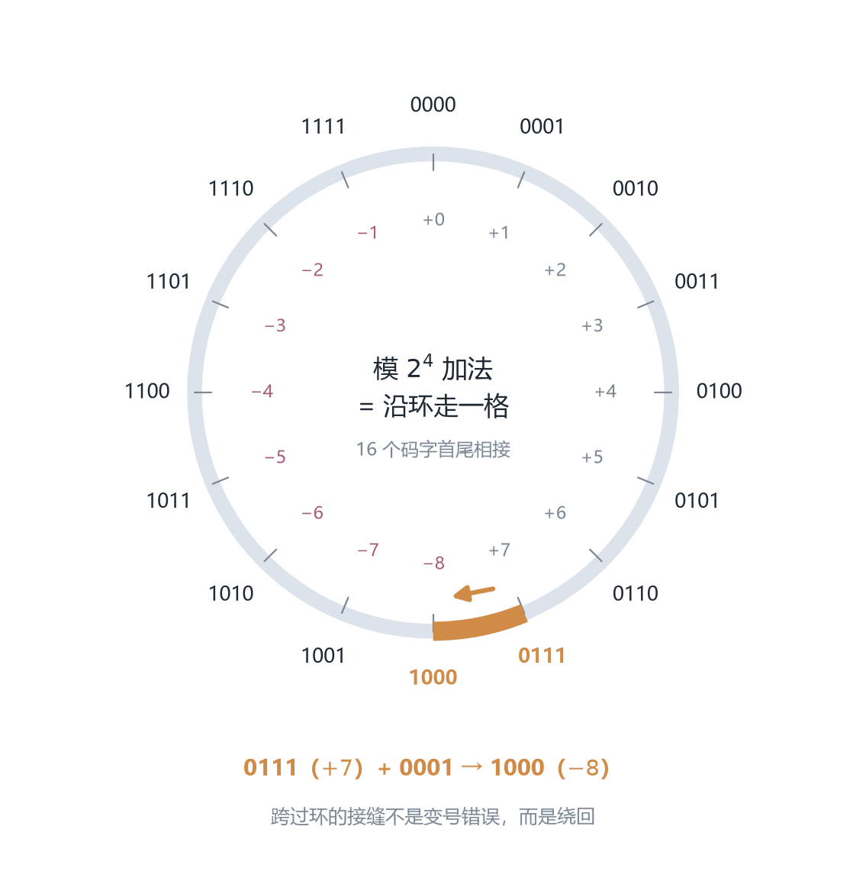
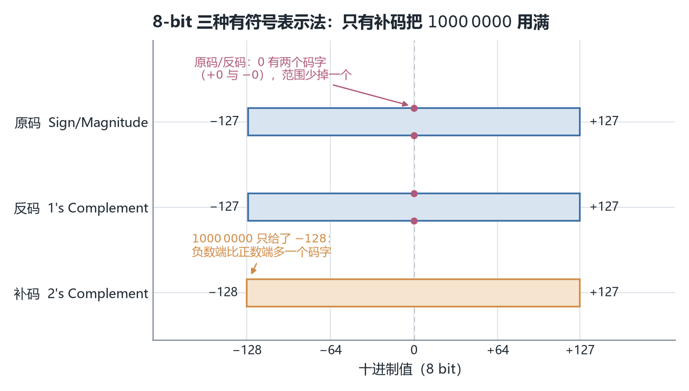
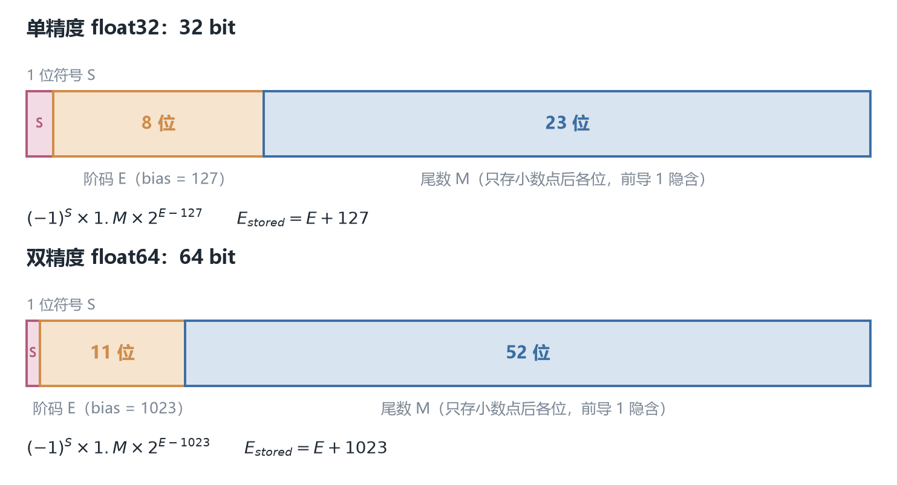
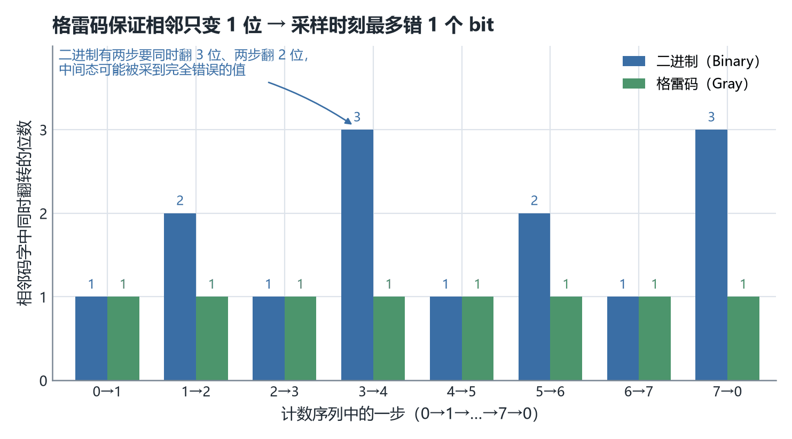

# ECE2050 Chapter 2 Number Systems 课堂笔记

## 本章在讲什么

计算机内部只能存 0 和 1，而我们日常用的是十进制，还经常接触八进制、十六进制。Chapter 1 的 p27 用一张 0–15 的对照表，把十进制、二进制、八进制、十六进制并排放在一起，给出的结论只有一句：**它们是同一个数的四种写法**。同一条注释里，讲义把"进制之间怎么换算、二进制怎么加减乘除、负数怎么表示、BCD 与检错码"全部标成 Chapter 2 的内容。所以这一章不是在讲新数学，而是在**兑现 Chapter 1 留下的那张欠条**：把"同一个数的不同写法"从一个直觉，变成一套可以手算、可以被电路执行、并且能说清"哪种写法在什么场合更好用"的规则。

**第一段（p4–p14）先把"写法"讲全。** 从十进制的位置加权出发，抽出 Base-R 的通式 $(N)_R=\sum a_i R^i$，再把它分别套到二进制、八进制、十六进制上；随后给出两个方向的换算方法——按权重展开（base-R → 十进制）与反复除基取余（十进制 → base-R），并用 $53_{10}=110101_2$ 把两种方法各演算一遍。这一段的落点是 p14：$N$ 位只能装 $2^N$ 个数，范围是 $[0,2^N-1]$。

**第二段（p15–p27）把"写法"落到工程单位上。** 八进制与十六进制之所以存在，是因为 8 和 16 都是 2 的幂，可以三位一组、四位一组地直接改写，不需要经过十进制（p20–p21）。接着是 bit / nibble / byte 的换算（p25）、$2^{10}$ 到 $2^{60}$ 的量级记忆（p26），以及"把指数拆成 10 的倍数"的快速估算（p27）。p22–p23 回答了一个更根本的问题：为什么偏偏是二进制——因为物理上最容易可靠区分两种状态，而布尔逻辑天然建立在 0/1 上。

**第三段（p28–p49）让这些 bit 真的能算。** 加、减、乘、除的竖式规则与十进制同构，区别只在"满 2 进 1"；固定位宽带来溢出（p31）。无符号数解决不了负数，于是有两条路线：原码（p37–p38）直观但加法不成立、且有两个零；补码（p40）把最高位的权重改成 $-2^{N-1}$，代价是范围不对称，回报是加法可以直接用、零唯一。此后 p43–p46 用三步法把补码加减讲完，p47–p48 用"部分积"和"反复减法"把乘除落到补码上，p49 用一张范围表加一条 4-bit 数轴收束全段。

**第四段（p50–p72）处理小数点，以及"不当作数"的 bit 串。** 定点数（p53–p56）把小数点钉死，用 $Ua.b$ / $Qa.b$ 约定整数位与小数位，溢出时可以用饱和运算钉在最大值上；浮点数（p58–p63）让小数点浮动，最终落到 IEEE 754 的 1/8/23 位域、bias = 127、隐含前导 1 与三个特殊值。最后 p65–p72 换了一个视角：BCD、格雷码、ASCII、奇偶校验、CRC 都不是"数"，而是**编码**——同样的 0/1，按不同约定读，含义可以完全无关。

一句话概括全章：**它回答的是同一个问题的五个层次——给定 $N$ 个 bit，这串 0/1 到底代表什么？**

74 页讲义的分节与小节对应如下，笔记正文就按这个页序一条线写下来：

| 讲义页 | 本笔记小节 | 内容 |
| --- | --- | --- |
| p1 | —— | 封面：课程、章节、授课教师 |
| p2 | —— | 公告页（tutorial 安排）——**2026-10-21 修订版新增**，此后各页页码整体后移一位 |
| p3 | —— | 分节页，标题 "Binary Numbers"（实际内容从 p4 才开始） |
| p4 | 数制系统总览 | 为什么需要多种进制；日常的 10 / 12 / 60 进制 |
| p5 | 十进制：位置加权与小数 | 基数 10、数字 0–9、权重 $10^x$；$5374_{10}$ 的展开 |
| p6 | 十进制：位置加权与小数 | Base-R 通式、数字范围 $[0,R-1]$、权重 $R^x$ |
| p7 | 十进制：位置加权与小数 | $568.23$ 的权重展开；"decimal numbers"的准确含义 |
| p8 | 二进制 | 基数 2、权重 $2^x$；$(10.101)_2=(2.625)_{10}$ |
| p9 | 二进制 | $2^0$ 到 $2^7$ 必背表 |
| p10 | 二进制 | 从 0 数到 7 的二进制写法 |
| p11 | 数制转换：二进制与十进制 | $10011_2=19_{10}$；提出 $53_{10}$ 怎么转 |
| p12 | 数制转换：二进制与十进制 | 两种方法：凑最大幂 / 反复除 2 取余 |
| p13 | 数制转换：二进制与十进制 | $53_{10}=110101_2$ 的两种完整演算 |
| p14 | N 位能表示多少个数 | $10^N$ 与 $2^N$ 个取值；范围 $[0,2^N-1]$ |
| p15 | —— | 分节页，标题 "Octal & Hexadecimal Numbers" |
| p16 | 八进制与十六进制 | 八进制定义；$(2374)_8=(1276)_{10}$ |
| p17 | 八进制与十六进制 | 十六进制定义；A–F；$(E5)_{16}=(229)_{10}$ |
| p18 | 八进制与十六进制 | 除 8 取余：$359_{10}=(547)_8$ |
| p19 | 八进制与十六进制 | 除 16 取余：$650_{10}=(28A)_{16}$ |
| p20 | 二进制、八进制、十六进制之间的直接转换 | 每位展开 3 / 4 bit；$CF8E_{16}$、$7526_8$ |
| p21 | 二进制、八进制、十六进制之间的直接转换 | 从右往左分组；$4632_8$、$CA57_{16}$ |
| p22 | 为什么计算机用二进制，又为什么还要八/十六进制 | Crash Course #3；布尔逻辑与逻辑门 |
| p23 | 为什么计算机用二进制，又为什么还要八/十六进制 | 八/十六进制是紧凑写法；Linux 权限、内存地址 |
| p24 | —— | 分节页，标题 "Bytes, Nibbles, & All that Jazz" |
| p25 | 位、字节与半字节 | 填空页：nibble / byte 的取值数与范围；MSB / LSB |
| p26 | 大的 2 的幂与快速估算 | kilo / mega / giga / tera / peta / exa |
| p27 | 大的 2 的幂与快速估算 | $2^{24}\approx16$ M；32 位整数约 4 G |
| p28 | —— | 分节页，标题 "Binary Arithmetic: + − × ÷" |
| p29 | 二进制算术 | 加法四条规则，与十进制竖式对照 |
| p30 | 二进制算术 | $1011+0011$、$1011+0110$ 两道例题 |
| p31 | 二进制算术 | 溢出：固定位宽装不下结果 |
| p32 | 二进制算术 | 减法四条规则；$101-011=010$ |
| p33 | 二进制算术 | 乘法规则表；$111\times101$ 的部分积 |
| p34 | 二进制算术 | 长除法：$1001\div11$ |
| p35 | —— | 分节页，标题 "Signed Numbers" |
| p36 | 有符号数：原码 | 两条路线：原码与补码 |
| p37 | 有符号数：原码 | 符号位 + 数值位；$\pm6$；范围公式 |
| p38 | 有符号数：原码 | 加法不成立；$+0$ 与 $-0$ |
| p39 | 补码 | 补码没有上述两个问题 |
| p40 | 补码 | MSB 权重 $-2^{N-1}$；$-8\sim+7$；负数编码表 |
| p41 | 补码 | 取负 = 取反加一；术语 "reversing the sign" |
| p42 | 补码 | $6\to-6$；由 $1001_2$ 反推 $-7$ |
| p43 | 补码加法与减法 | 三步法；$7+4$ 与 $-5+(-9)$ |
| p44 | 补码加法与减法 | 8-bit 溢出两例：$125+58$、$-125+(-58)$ |
| p45 | 补码加法与减法 | 一正一负：$16+(-24)$、$15+(-6)$，看进位判符号 |
| p46 | 补码加法与减法 | 减法化加法：$3-5$、$8-3$，丢弃进位 |
| p47 | 补码乘法与除法 | 直接累加 vs 部分积；EXAMPLE 2–22 |
| p48 | 补码乘法与除法 | 反复减法；EXAMPLE 2–23；$100\div(-25)$ |
| p49 | 三种表示法的对比 | 范围表 + 4-bit 数轴对照 |
| p50 | —— | 分节页，标题 "Fixed-Point Numbers" |
| p51 | 定点数 | 整数与负数已解决，那分数呢 |
| p52 | 定点数 | 定点（binary point 固定）与浮点（浮动） |
| p53 | 定点数 | 4 位整数 + 4 位小数表示 $6.75$；小数点隐含 |
| p54 | 定点数 | $Ua.b$：U4.4 / U3.5 / U6.2；常见宽度与用途 |
| p55 | 定点数 | $Qa.b$：含符号位；$-6.75$；Q1.15 |
| p56 | 定点数 | 饱和运算：溢出时钉在最大值 |
| p57 | —— | 分节页，标题 "Floating-Point Numbers" |
| p58 | 浮点数与 IEEE 754 | 科学记数法 $\pm M\times B^E$；$273=2.73\times10^2$ |
| p59 | 浮点数与 IEEE 754 | $228$ 的三个字段宽度 |
| p60 | 浮点数与 IEEE 754 | 隐含前导 1；bias 127；$228\to$ 0x43640000 |
| p61 | 浮点数与 IEEE 754 | 为什么要用带偏移指数 |
| p62 | 浮点数与 IEEE 754 | $-58.25$ 的四步换算；0xC2690000 |
| p63 | 浮点数与 IEEE 754 | 特殊值：$\pm0$、$\pm\infty$、NaN |
| p64 | —— | 分节页，标题 "Non-positional/Non-weighted Number Systems" |
| p65 | 位置加权与非位置编码 | 定义与例子（格雷码、循环码） |
| p66 | BCD | 8421 码表；$170_{10}$、$2469_{10}$ 的 BCD |
| p67 | BCD | BCD 加法三步；$9+4$；为什么加 6 |
| p68 | 格雷码 | 相邻码字只变一位；4-bit 序列 |
| p69 | 格雷码 | 二进制 ↔ 格雷码；QPSK 星座与中间态 |
| p70 | ASCII | 128 个字符的完整编码表；控制字符与可打印字符 |
| p71 | 检错码 | 奇偶校验；五组码的判定 |
| p72 | 检错码 | CRC：补零、模 2 除法、余数作校验和 |
| p73 | 本章回顾 | 11 个主题的清单 |
| p74 | 自测：True/False Quiz | 10 道判断题（附答案与解析） |

> 本笔记约定：凡属**我从教材或自行推导补充、讲义上没有的内容**，都在标题或段首用【补】标出；引用讲义原文的结论则不加标记。正文涉及教材的地方，指的是与讲义同一目录下的《Digital Design and Computer Architecture》（Sarah L. Harris, Elsevier 2024, RISC-V 版）；本讲对应教材 **§1.4 Number Systems（pp.7–16）**，定点与浮点则要翻到 **§5.3 Number Systems（pp.256–260）**，理由见文末"与 Chapter 1 / Chapter 3 的对账"。

## 数制系统总览（讲义 p4）

数制（number system）就是一套书写数字的符号系统。日常生活中人类不止用十进制：时间用 12 或 60 进制（12 小时制、60 秒一分钟），计数的"打"是 12 进制；而计算机系统里用的是 2、8、16 进制。

同一页还埋了一条后面反复用到的话：**"用什么进制"是一个书写约定，不是数的属性**。$12$ 这个量，写成 $1100_2$、$14_8$、$\mathrm{C}_{16}$ 都成立，区别只在于"每一位允许出现几个符号、每一位值多少"。本章后面所有的转换、补码、浮点、BCD，都是在这条约定上做加法。

## 十进制：位置加权与小数（讲义 p5–p7）

### 十进制（Decimal, Base-10）（讲义 p5）

十进制的三个要素：

- 基数（base）$R = 10$；
- 数字符号（digit）只有 10 个：$0 \sim 9$；
- 权重（weight）：每一位的权重是 $10^x$，从右往左依次是个位（$10^0$）、十位（$10^1$）、百位（$10^2$）……

以 $5374_{10}$ 为例，它其实是一个加权求和：

$$
5374_{10} = 5 \times 10^3 + 3 \times 10^2 + 7 \times 10^1 + 4 \times 10^0 = 5000 + 300 + 70 + 4
$$

也就是"五个千、三个百、七个十、四个一"。同一个数字符号 $5$ 放在不同位置代表的值完全不同——这叫位置加权计数系统（positional/weighted number system），p65 会回到这个概念并给出正式定义。

### Base-R 计数系统的通式（讲义 p6）

把十进制的规律推广到任意基数 $R$（要求 $R \ge 2$）：

- 基数：$R$；
- 数字符号范围：$[0, R-1]$（比如 base-5 只能用 0 到 4）；
- 每一位的权重：$R^x$。

一个 $N$ 位整数加 $M$ 位小数的 base-$R$ 数 $(N)_R = a_{n-1}\, a_{n-2} \ldots a_1\, a_0\, a_{-1} \ldots a_{-m}$ 的值是：

$$
(N)_R = a_{n-1} \times R^{n-1} + a_{n-2} \times R^{n-2} + \ldots + a_1 \times R^1 + a_0 \times R^0 + a_{-1} \times R^{-1} + \ldots + a_{-m} \times R^{-m} = \sum_{i=-m}^{n-1} a_i \times R^i
$$

每个符号的含义：$a_i$ 是第 $i$ 位上的数字（必须满足 $0 \le a_i \le R-1$）；$R^i$ 是该位的权重；求和符号 $\sum$ 表示把每一位"数字 × 权重"的结果全部加起来。这个公式是整章的骨架——后面所有的"X 进制转十进制"都是直接套它。

常见的四种进制：十进制（base-10）、二进制（binary, base-2）、八进制（octal, base-8）、十六进制（hexadecimal, base-16）。

### 十进制小数与 "decimal" 的含义（讲义 p7）

十进制还能表示小数，靠的是小数点（decimal point）右边那些权重小于 1 的位：

$$
568.23 = (5 \times 10^2) + (6 \times 10^1) + (8 \times 10^0) + (2 \times 10^{-1}) + (3 \times 10^{-2}) = 500 + 60 + 8 + 0.2 + 0.03
$$

注意课件特别强调：在数字系统（digital systems）课程里，"decimal numbers" 指**任何以 10 为底的数**，而不只是"带小数点的数"。所以 $5374$ 是 decimal number，$568.23$ 也是；反过来，$1101_2$ 虽然是"整数"，却不是 decimal number。

## 二进制（讲义 p8–p10）

### 二进制的三要素与二进制转十进制（讲义 p8）

二进制的三要素：基数 $R=2$；数字只有 0 和 1（每个叫一个 bit，binary digit 的缩写）；权重是 $2^x$，小数点左边依次是 $2^0, 2^1, 2^2 \ldots$，右边是 $2^{-1}, 2^{-2} \ldots$

二进制转十进制直接套通式。例：

$$
(10.101)_2 = (1 \times 2^1) + (0 \times 2^0) + (1 \times 2^{-1}) + (0 \times 2^{-2}) + (1 \times 2^{-3}) = 2 + 0 + 0.5 + 0 + 0.125 = (2.625)_{10}
$$

小数点（binary point）右边第一位权重是 $0.5$，第二位 $0.25$，第三位 $0.125$，以此类推。

### 2 的幂（Powers of Two）（讲义 p9）

课件要求背熟 $2^0$ 到 $2^7$：

$$
2^0=1,\; 2^1=2,\; 2^2=4,\; 2^3=8,\; 2^4=16,\; 2^5=32,\; 2^6=64,\; 2^7=128
$$

这是二进制算术的基本功，后面所有转换和范围计算都会反复用到。实际做题时，能立刻报出"不超过 53 的最大 2 的幂是 32"这类判断，比会背整张表更重要。

### 二进制计数（讲义 p10）

二进制从 0 数到 7：$0, 1, 10, 11, 100, 101, 110, 111$，对应十进制 $0 \sim 7$。规律和十进制"个位数满 10 进 1"一样，二进制是"满 2 进 1"，所以 $1 + 1 = 10$。

## 数制转换：二进制与十进制（讲义 p11–p13）

### 二进制 → 十进制（讲义 p11）

直接按权重展开求和。例：$(10011)_2 = 1 \times 16 + 0 \times 8 + 0 \times 4 + 1 \times 2 + 1 \times 1 = 19_{10}$。

### 十进制 → 二进制：两种方法（讲义 p12–p13）

有两种方法，考试都建议掌握。课件用同一个 $53_{10}$ 把两条路都走了一遍，最后都得到 $110101_2$——这本身就是一个自检：两种方法结果不一致，一定是某一步算错了。

**方法一：凑最大幂（find the largest power of 2 that fits, subtract and repeat）。** 以 $53_{10}$ 为例：不超过 53 的最大 2 的幂是 $32 = 2^5$，所以第 5 位是 1；$53 - 32 = 21$，不超过 21 的最大幂是 $16 = 2^4$，第 4 位是 1；$21 - 16 = 5$，最大可用幂是 $4 = 2^2$，第 2 位是 1；$5 - 4 = 1$，正好是 $2^0$，第 0 位是 1。没有用到的位（$2^3, 2^1$）填 0：

$$
53_{10} = 110101_2 \quad (32 + 16 + 4 + 1 = 53)
$$

**方法二：反复除 2 取余（repeatedly divide by 2, remainder goes in next most significant bit）。** 同样的 $53$：

- $53 \div 2 = 26$ 余 $1$
- $26 \div 2 = 13$ 余 $0$
- $13 \div 2 = 6$ 余 $1$
- $6 \div 2 = 3$ 余 $0$
- $3 \div 2 = 1$ 余 $1$
- $1 \div 2 = 0$ 余 $1$

把余数**从最后一次往回读**（第一个余数是最低位 LSD，最后一个是最高位 MSD），同样得到 $110101_2$。

> [!TIP]
> 两种方法各有适用场景：凑幂法适合"心算一个不太大的数"，除 2 法适合写程序或处理很长的数。凑幂法的中间结果（$53\to21\to5\to1$）还能顺便告诉你最高位在哪，写答案时不会多写前导 0。

## N 位能表示多少个数（讲义 p14）

$N$ 位十进制数有 $10^N$ 种组合，范围 $[0, 10^N - 1]$。例：3 位十进制数有 1000 种取值，范围 $[0, 999]$。

同理，$N$ 位二进制数（N-bit binary number）有 $2^N$ 种组合，范围 $[0, 2^N - 1]$。例：3 bit 有 $2^3 = 8$ 种取值，范围 $[0, 7]$，即 $000_2 \sim 111_2$。**"能表示 $2^N$ 个数"和"最大值是 $2^N - 1$"这两个结论后面反复出现，别混淆。**

## 八进制与十六进制（讲义 p16–p19）

### 八进制（Octal, Base-8）（讲义 p16）

基数 8，数字 $0 \sim 7$，权重 $8^x$。八进制转十进制同样套通式：

$$
(2374)_8 = (2 \times 8^3) + (3 \times 8^2) + (7 \times 8^1) + (4 \times 8^0) = 1024 + 192 + 56 + 4 = (1276)_{10}
$$

### 十六进制（Hexadecimal, Base-16）（讲义 p17）

基数 16，数字符号有 16 个：$0 \sim 9$ 加上字母 A 到 F，其中 A=10、B=11、C=12、D=13、E=14、F=15。十六进制转十进制：

$$
(E5)_{16} = (14 \times 16^1) + (5 \times 16^0) = 224 + 5 = (229)_{10}
$$

### 十进制 → 八进制：反复除 8 取余（讲义 p18）

方法与除 2 完全同构，只是除数换成 8。例：$359_{10}$：$359 \div 8 = 44$ 余 $7$；$44 \div 8 = 5$ 余 $4$；$5 \div 8 = 0$ 余 $5$。第一个余数 7 是最低位（LSD），最后余数 5 是最高位（MSD），所以 $359_{10} = (547)_8$。

### 十进制 → 十六进制：反复除 16 取余（讲义 p19）

例：$650_{10}$：$650 \div 16 = 40$ 余 $10$（即 A）；$40 \div 16 = 2$ 余 $2$；$2 \div 16 = 0$ 余 $8$。所以 $650_{10} = (28A)_{16}$。

> [!WARNING]
> 余数一旦超过 9 就必须写成 A–F，不能保留十进制写法。$650$ 的第一次余数是 10，写成 "10" 会得到 "2102" 这种不存在的十六进制数。

## 二进制、八进制、十六进制之间的直接转换（讲义 p20–p21）

这三种进制之间的转换**不需要经过十进制**，因为 8 和 16 都是 2 的幂：

- 八进制/十六进制 → 二进制：把每个八进制数字展开成 3 bit，每个十六进制数字展开成 4 bit。例：$CF8E_{16} = 1100\;1111\;1000\;1110_2$；$7526_8 = 111\;101\;010\;110_2$。
- 二进制 → 八进制/十六进制：从最右边开始，每 3 bit（转八进制）或 4 bit（转十六进制）分成一组，每组换成一个数字；最左边不够一组的补前导 0（leading 0s）。例：$100110011010_2$ 按 3 位分组 $100\lvert110\rvert011\lvert010$ 得 $4632_8$；$1100101001010111_2$ 按 4 位分组 $1100\lvert1010\lvert0101\lvert0111$ 得 $CA57_{16}$。

> [!NOTE]
> 【补】为什么是 3 位和 4 位？因为 $8=2^3$、$16=2^4$：一个八进制数字恰好覆盖 3 个二进制位，一个十六进制数字恰好覆盖 4 个。这也解释了 p25 的结论"1 个 hex digit = 1 个 nibble = 4 bit"。

之所以有人发明八进制和十六进制，是因为它们是**表示大串二进制数的紧凑写法**，且与二进制互转极其容易。实际应用：Linux 的文件权限用八进制，内存地址（memory address）用十六进制。

## 为什么计算机用二进制，又为什么还要八/十六进制（讲义 p22–p23）

数字系统用固定数量的 bit 工作，而物理上最容易可靠区分的是两种状态（高/低电平、开/关），并且布尔逻辑（Boolean logic）与逻辑门（logic gates）天然就是围绕 0/1 建立的。课件推荐了 Crash Course Computer Science #3（Boolean Logic & Logic Gates）作为延伸材料。

八进制和十六进制则纯粹是**给人看的**：一串 32 位二进制要写 32 个字符，写成 8 个十六进制数字只要 8 个，而且可以逐位对回 bit。它们不改变硬件，只改变书写。

## 位、字节与半字节（讲义 p25）

课件里这页是填空题，答案如下：

- 1 个二进制位（bit）就是 1 bit；
- Nibble（半字节）：4 bits，能表示 $2^4 = 16$ 个值，范围 $[0, 15]$；
- Byte（字节）：8 bits，能表示 $2^8 = 256$ 个值，范围 $[0, 255]$；
- 1 个十六进制数字 = 4 bits = 1 nibble；
- 2 个十六进制数字 = 1 byte（这也是为什么十六进制这么常用：一个字节正好写成两个 hex 数字）。

在一个多位数里，最左边的位是最高有效位（Most Significant Bit, MSB），最右边是最低有效位（Least Significant Bit, LSB）。同理对字节有 most significant byte / least significant byte，对十六进制数也有 most/least significant digit。

## 大的 2 的幂与快速估算（讲义 p26–p27）

$2^{10} = 1024 \approx 10^3$（1 kilo）、$2^{20} \approx 10^6$（1 mega）、$2^{30} \approx 10^9$（1 giga）、$2^{40} \approx 10^{12}$（1 tera）、$2^{50} \approx 10^{15}$（1 peta）、$2^{60} \approx 10^{18}$（1 exa）。注意 kilo/mega/giga 在二进制语境下指 1024/1048576/1073741824，而不是恰好 1000 的幂。

快速估算技巧：把指数拆成 $10$ 的倍数加余数。例如 $2^{24} = 2^4 \times 2^{20} \approx 16 \times 10^6 = 16$ million；一个 32 位整数变量能表示的最大值约为 $2^{32} = 2^2 \times 2^{30} \approx 4$ billion（精确值 4294967296）。

【补】最后这句要加一个限定：**4 billion 是 32 位无符号（unsigned）的上限**。C 语言里的 `int` 默认有符号，上限是 $2^{31}-1 = 2147483647 \approx 2.15$ billion，超出就溢出成负数（p44 的判定规则）。同一串 32 bit，按无符号读能到 4.29 G，按补码读只到 2.15 G——又是"约定决定含义"。

## 二进制算术（讲义 p29–p34）

### 加法与加法规则（讲义 p29）

和十进制竖式一样，只是进位规则不同。加法规则（addition rules）四条：

- $0 + 0 = 0$（和为 0，进位 0）
- $0 + 1 = 1$（和为 1，进位 0）
- $1 + 0 = 1$（和为 1，进位 0）
- $1 + 1 = 10$（和为 0，**进位 1**）

### 加法例题与溢出（讲义 p30–p31）

例：$1011 + 0011$（即 $11 + 3$），从右往左逐位加，$1+1$ 产生进位，$1+1+1$ 产生和 1 进位 1，结果是 $1110$（即 14）。

例：$1011 + 0110$（即 $11 + 6$）= $10001$（即 17）。注意结果变成了 **5 bit**——这就引出溢出问题。

数字系统用**固定数量的 bit**工作。当结果太大、现有的 bit 数装不下时，就发生溢出（overflow）。上面 $11 + 6$ 用 4 bit 只能存下 $0001$（丢掉了最高位的进位），4 bit 无符号数最大只能表示 15，17 超出了范围。

> [!IMPORTANT]
> 【补】溢出的判据不是"最高位有进位"，而是"**结果落在当前位宽能表示的范围之外**"。对无符号加法，这两件事恰好等价（有进位出最高位 ⇔ 超过 $2^N-1$）；对有符号补码加法就不等价了，判据要换成 p44 的"符号是否合理"。

### 减法（讲义 p32）

减法规则四条：$0-0=0$；$1-1=0$；$1-0=1$；以及关键的 $10 - 1 = 1$，即 $0 - 1$ 需要**向高位借 1**（borrow of 1）。例：$101 - 011 = 010$（即 $5 - 3 = 2$），个位 $1-1=0$，第二位 $0-1$ 不够减、借位后变成 $10-1=1$，第三位 $1-0$（被借走后剩 0，实际是 $0-0$）= 0。后面会看到，计算机实际更常用"加负数"来实现减法。

### 乘法（讲义 p33）

乘法规则极简：$0 \times 0 = 0$，$0 \times 1 = 0$，$1 \times 0 = 0$，$1 \times 1 = 1$（只有两数都是 1 结果才是 1）。手算竖式与十进制完全同构：乘数的每一位分别去乘被乘数，得到部分积（partial products），再把部分积错位相加。例：$111 \times 101$：部分积为 $111$、$000$、$111$，错位相加得 $100011$（即 $7 \times 5 = 35$）。

### 除法（讲义 p34）

二进制长除法（long division）与十进制同构。例：$1001 \div 11$（即 $9 \div 3 = 3$）：商首位上 1，$11$；余 $10$，落下 0 得 $100 \dots$ 最终商 $11$ 余 $00$。

## 有符号数：原码（讲义 p36–p38）

到目前为止我们只处理了无符号数（unsigned）。要表示负数，有两种主流方案：原码（Sign/Magnitude）和补码（Two's Complement）。

### 原码（Sign/Magnitude Numbers）（讲义 p37）

规则很直观：最高位（最左边的 MSB）当符号位（sign bit），剩下 $N-1$ 位表示数值大小。符号位 0 表示正数，1 表示负数。

例：4 位原码表示 $\pm 6$：$+6 = 0110$，$-6 = 1110$（只是把最高位从 0 改成 1）。

$N$ 位原码的表示范围是：

$$
[-(2^{N-1}-1),\; 2^{N-1}-1]
$$

（4 bit 就是 $-7 \sim +7$。）

### 原码的两个致命问题（讲义 p38）

1. **加法运算不工作**。直接把 $-6 + 6$ 的原码相加：$1110 + 0110 = 10100$，这不是 0，结果完全错误。也就是说用原码没法简单地把两个带符号数相加。
2. **0 有两种表示**：$0000$（+0）和 $1000$（−0），这会造成比较和判断上的麻烦。

## 补码（讲义 p39–p42）

补码是现代计算机实际采用的方案，它没有原码的这两个问题：加法直接可用，且 0 只有唯一表示。

### 补码的编码规则与范围（讲义 p40）

**编码规则**：最高位的权重规定为 $-2^{N-1}$（注意是**负**的权重！），其余位照常是正权重。因此：

- 4 位能表示的最大正数：$0111 = 0 + 4 + 2 + 1 = +7$（最高位为 0，负权重没生效）；
- 4 位能表示的最小负数：$1000 = -8 + 0 + 0 + 0 = -8$。

最高位仍然天然指示符号（1 = 负，0 = 正），这点和原码一样。$N$ 位补码的表示范围：

$$
[-2^{N-1},\; 2^{N-1}-1]
$$

（4 bit 是 $-8 \sim +7$；8 bit 是 $-128 \sim +127$。）注意负数端比正数端多一个数——因为 0 只占一个编码，省下的编码给了负数端。负数区域从 $11111111 = -1$ 一直排到 $10000000 = -128$，负数的绝对值越大，编码看起来越"小"。

*图 1　4-bit 补码其实是把 16 个码字首尾相接排成一个环：从 +7 再加 1 就绕到 −8，所以"溢出"在补码里等价于"绕回"。*

【补】这张环把三个容易分开记的结论合成了一件事：

- **为什么 $0111 + 0001 = 1000$ 代表 $-8$**：环上没有"第 17 个码字"，走满一圈就回到起点附近，$+7$ 的下一格按码字顺序只能是 $1000$，而 $1000$ 按负权重读就是 $-8$。
- **为什么补码加法可以不管符号位**：加法就是"沿环走格数"，顺时针走正数、逆时针走负数，走法本身不需要知道当前站在正半区还是负半区。
- **为什么溢出表现为"结果符号不对"**：从正半区跨过接缝会掉进负半区，从负半区跨回来会跳进正半区；符号翻转正是"绕过了接缝"的标志。

### 取负：取反加一（讲义 p41–p42）

把一个补码数变成它的相反数，方法两步：

1. 按位取反（invert the bits，0 变 1、1 变 0）；
2. 加 1（add 1）。

例：$3_{10} = 0011_2$，取反得 $1100$，加 1 得 $1101 = -3_{10}$。

历史层面这个操作一直叫 "taking the two's complement"（求补码），但这个说法容易和"补码"这种表示法本身混淆，课件明确说课程里统一叫 "reversing the sign"（取负/变号）。

例：$6_{10} = 0110_2$ → 取反 $1001$ → 加 1 → $1010_2 = -6_{10}$。

反过来也可以用来解读一个负数：问补码数 $1001_2$ 的十进制值是多少？它最高位是 1，是负数。取反得 $0110$，加 1 得 $0111 = 7$，所以 $1001 = -7$。

> [!TIP]
> 【补】"取反加一"对 $1000\ 0000$ 会得到它自己（$-128$ 的相反数仍是 $-128$，因为 $+128$ 超出了 8 位补码的范围）。这是补码唯一一个"取负后不变"的码字，也是范围不对称的直接后果。

## 补码加法与减法（讲义 p43–p46）

### 三步法（讲义 p43）

1. 把十进制数转成二进制，负数用补码形式表示（用上面的取负方法生成）；
2. 做二进制加法；
3. 判断符号：两数同正则结果应为正，两数同负则结果应为负；**如果结果的符号不对，说明发生了溢出**。

例（两正数，课件用 $7+4$）：$00000111 + 00000100 = 00001011 = 11$，两正数结果为正，正确。同一个规则换成 $5+9$ 也成立：$00000101 + 00001001 = 00001110 = 14$。

例（两负数）：$-5 + (-9)$：$11111011 + 11110111 = 1\,11110010$。第 9 位的进位超出 8 bit 被丢弃后结果是 $11110010$，是负数——两负数相加结果为负，符号一致，没有溢出（$-14$ 在 $[-128,+127]$ 内）。

### 溢出：两正得负、两负得正（讲义 p44）

8-bit 的范围是 $[-128, +127]$。两个例子：

- $125 + 58$：$01111101 + 00111010 = 10110111$。两个正数相加得到最高位 1（负数），**符号错误 → 溢出**（正确答案 183 超出 127）。
- $-125 + (-58)$：$10000011 + 11000110 = 1\,01001001$。丢弃进位后是 $01001001$，是正数——两负数相加结果却为正，**符号错误，溢出发生了**（正确答案 $-183$ 超出 8 bit 范围）。

### 一正一负：看进位判断符号（讲义 p45）

一正一负相加不会溢出（结果的绝对值一定小于两个操作数中较大的那个），符号由"有没有进位出最高位"决定：

- $16 + (-24)$：$00010000 + 11101000 = 11111000$，没有进位出最高位 → 结果是负数；$11111000$ 取负验证：取反 $00000111$，加 1 得 $00001000 = 8$，所以结果是 $-8$，正确。
- $15 + (-6)$：$00001111 + 11111010 = 1\,00001001$，有进位 → 结果是正数；丢弃进位得 $00001001 = 9$，正确。

> [!NOTE]
> 课件 p45 上半部分第 ③ 步的黄框里把结果写成 "$00001000_2=8_{10}$"，那是把结果码字抄错了（竖式的和是 $11111000$），答案 $-8$ 本身没错。细节见附录第 1 条。

### 减法：减一个数等于加它的相反数（讲义 p46）

减法不用新规则：减去一个数等于加上它的相反数，即 $A - B = A + (-B)$，其中 $-B$ 用取负方法得到。

例：$3 - 5 = 3 + (-5)$：$0011 + 1011 = 1110$，无进位说明是负数，$1110 = -2$，正确。

例：$8 - 3 = 8 + (-3)$：$1000 + 1101 = 1\,0101$，丢弃最高位进位（discard the carry）得 $0101 = 5$，正确。**在补码加法里，最高位冒出的进位直接丢掉即可，不影响结果正确性**——这是补码设计最巧妙的地方。

【补】**符号扩展（sign extension）**：把一个 $N$ 位补码数放进 $M>N$ 位的寄存器时，不能简单地在左边补 0，而要**复制符号位**。例如 $-3$ 的 4 位形式是 $1101$，扩到 8 位是 $11111101$；如果补 0 变成 $00001101$，值就从 $-3$ 变成了 $+13$。原因还是权重：新补进来的每一位权重都是正的 $2^k$，只有让它们全等于符号位，总和才不变。

## 补码乘法与除法（讲义 p47–p48）

### 乘法（讲义 p47）

乘法（multiplication）两种做法：

- 直接累加（direct addition）：把乘数那么多个被乘数连加。缺点是乘数很大时极其低效，且要求两数都用真值（true, uncomplemented）形式。
- 部分积法（partial product）：同普通二进制乘法竖式，但**先按无符号算出乘积，再定符号**——同号得正，异号得负（same sign → positive; different signs → negative）。

例（EXAMPLE 2–22）：$83 \times (-59)$。被乘数 $01010011$（83），乘数取绝对值 $0111011$（59，7 位），竖式部分积相加得 $01001100100001$（14 位，即 4897）。因为异号，对乘积取补码（取反加一）得 $10110011011111$，即 $-4897$。

### 除法（讲义 p48）

除法（division）在计算机里用**反复减法**实现（EXAMPLE 2–23）：$100 \div 25$（$01100100 \div 00011001$）。把除数 $00011001$ 取负得补码形式 $11100111$，然后不断"加这个负数"（即不断减 25）：

- 每成功减一次（余数仍 $\ge 0$），商（quotient）加 1；
- 当余数（remainder）变为 0 或负数时停止；
- 商的值 = 减法执行的次数。

本例的四步余数依次是 $01001011$（75）、$00110010$（50）、$00011001$（25）、$00000000$（0），减了 4 次，$100 - 25 \times 4 = 0$，商 $= 4 = 0100_2$。

商的符号规则同样：同号得正，异号得负。课件留了思考题：$100 \div (-25)$ 该怎么处理？——先按 $100 \div 25$ 得商 4，再因异号取负得 $-4$。

## 三种表示法的对比（讲义 p49）

| Number System | Range（N 位） |
| --- | --- |
| Unsigned | $[0,\; 2^N - 1]$ |
| Sign/Magnitude | $[-(2^{N-1}-1),\; 2^{N-1}-1]$ |
| Two's Complement | $[-2^{N-1},\; 2^{N-1}-1]$ |

以 4 bit 为例画在数轴上最直观：无符号编码 $0000 \sim 1111$ 覆盖 $0 \sim 15$；补码把 $1000 \sim 1111$ 这一半解释为 $-8 \sim -1$，$0000 \sim 0111$ 解释为 $0 \sim 7$；原码类似但 $1000$ 和 $0000$ 都代表 0，且 $1111 \sim 1001$ 对应 $-7 \sim -1$。**同样的 bit 串，在不同表示法下含义完全不同**——这是本章最重要的 takeaway 之一。

*图 2　8-bit 下原码与反码都是 −127…+127 且各有两个零，补码把唯一多出来的码字 1000 0000 分给了 −128，所以负数端能多走一格。*

【补】图里的**反码（1's complement）** 课件没有讲，这里补进来只是为了说明"多出来的那个码字"不是补码独有的巧合：

- 反码的规则是"负数 = 正数按位取反"，$+6=0110$、$-6=1001$；范围同样是 $[-(2^{N-1}-1), 2^{N-1}-1]$，同样有 $+0=0000$ 与 $-0=1111$ 两个零。
- 原码、反码各浪费了一个码字在"第二个零"上，补码把这一个码字变成了 $-128$。这就是为什么三者的范围只差这一点，而补码的加法却能直接用。

## 定点数（讲义 p51–p56）

### 从整数到分数（讲义 p51–p52）

课件先用一页把前面的结论收拢：正数用无符号二进制，负数用补码或原码——**那分数呢？**

表示分数有两种常见记法：定点数（fixed-point，二进制小数点位置固定）和浮点数（floating-point，小数点浮动到最高有效 1 的右边）。

### 定点数（Fixed-Point Numbers）（讲义 p53）

原理：在整数位和小数位之间约定一个"隐含的二进制小数点"（binary point is implied）。例：用 4 位整数 + 4 位小数表示 $6.75$：

$$
\text{存储：} 01101100 \quad\Rightarrow\quad 0110.1100 \quad\Rightarrow\quad 2^2 + 2^1 + 2^{-1} + 2^{-2} = 4 + 2 + 0.5 + 0.25 = 6.75
$$

关键是：整数部分和小数部分各占多少位，必须**事先约定好**，否则同一个 bit 串会被解读成完全不同的数。

### 无符号定点格式 $Ua.b$（讲义 p54）

共 $a + b$ 位，$a$ 位整数、$b$ 位小数。同一个数 $6.75$ 在不同格式下的编码完全不同：

- $U4.4$：$0110.1100$ → $01101100$
- $U3.5$：$110.11000$ → $11011000$
- $U6.2$：$000110.11$ → $00011011$

常用的定点宽度是 8、16、32 位。典型应用：$U8.8$ 常用于传感器数据、音频、像素值；$U16.16$ 用于更高精度的信号处理。

### 有符号定点格式 $Qa.b$（讲义 p55）

用补码表示，$a$ 位整数部分（**含符号位**）、$b$ 位小数。取负方法与整数补码一致：按位取反，然后**给最低位（LSB）加 1**。例：把 $-6.75$ 写成 $Q4.4$：$6.75 = 01101100$ → 取反 $10010011$ → 加 1 得 $10010100$。典型应用：$Q1.15$（常简写 Q15）用于信号处理，能表示的范围是 $[-1,\; 1-2^{-15}]$。

【补】$Q1.15$ 的范围为什么是 $[-1, 1)$ 而不是 $[-1, 1]$：1 位整数位就是符号位，权重是 $-2^0=-1$，其余 15 位全是正的分数位，最大是 $1-2^{-15}=0.999969\ldots$。所以 $-1$ 能精确表示，$+1$ 不能。课件把区间写成 "(1, −1]"，端点顺序写反了（见附录第 3 条）。

### 饱和运算（Saturating Arithmetic）（讲义 p56）

定点溢出通常很糟糕，会产生难看的伪影（artifacts）：视频里明亮区域中间出现暗像素，音频里出现咔哒声。解决办法之一是饱和运算：溢出时不回卷，而是**钉在最大值上**。例：$U4.4$ 下 $11000000 + 01111000$（即 $12 + 7.5 = 19.5$，超出了 $U4.4$ 最大值 $15.9375$），饱和运算直接给出 $11111111 = 15.9375$，而不是溢出后的错误结果。

## 浮点数与 IEEE 754（讲义 p58–p63）

### 浮点数与科学记数法（讲义 p58）

定点数的问题：表示范围和精度被格式锁死。浮点数借鉴十进制的科学记数法（scientific notation）：$273 = 2.73 \times 10^2$。一般形式：

$$
\pm M \times B^E
$$

其中 $M$ 是尾数（mantissa），$B$ 是底数（base），$E$ 是指数（exponent）。二进制浮点数的规则是：**二进制小数点浮动到最高有效 1 的右边**，即规格化为 $1.xxxx \times 2^E$ 的形式。

### IEEE 754 单精度浮点标准（32-bit）（讲义 p59–p60）

32 bit 分成三个字段：

- **1 bit 符号位（sign）**：0 正 1 负；
- **8 bits 指数（exponent）**：存"带偏移指数"（biased exponent）；
- **23 bits 尾数（mantissa/fraction）**：只存小数点后的分数位。

*图 3　IEEE 754 的位域不是三等分：单精度 1/8/23、双精度 1/11/52，位宽按真实比例画；阶码存的是加了 bias 的无符号数，尾数省掉了永远为 1 的前导位。*

两个关键设计：

1. **隐含前导 1（implicit leading 1）**：规格化后尾数的首位永远是 1（例如 $228_{10} = 11100100_2 = 1.11001 \times 2^7$），既然永远是 1 就没必要存，23 bit 字段只存 $11001$ 后面补零的分数位——相当于白赚 1 位精度。
2. **带偏移指数（biased exponent）**：实际存的值 = bias + 真实指数，单精度 bias $= 127$（$01111111_2$）。例如指数 7 存为 $127 + 7 = 134 = 10000110_2$。这样 8 bit 无偏范围 $[-127, +128]$ 被平移成 $[0, 255]$，可以只用无符号比较来比较指数大小，同时让极大数和极小数都能表示。

**例 1**：$228_{10}$ 的 IEEE 754 表示。$228 = 11100100_2 = 1.11001 \times 2^7$；符号位 0；指数字段 $127 + 7 = 134 = 10000110$；尾数字段 $110\;0100\;0000\;0000\;0000\;0000$。拼起来：$0\;10000110\;11001000000000000000000$，写成十六进制即 **0x43640000**。

### 为什么要用带偏移指数（讲义 p61）

【补】如果指数用补码存，$-1$（$11111111$）看起来比 $+1$（$00000001$）大，硬件比较两个浮点数大小就得先把符号位拆出来单独处理。加上 bias 之后，"真实指数越大 → 存的字段越大"，于是**比较两个正浮点数可以直接按无符号整数逐位比较**，这是浮点比较器能做快的根本原因。同时，平移也让指数域没有"负号"这种形态，全 0 与全 1 两个端点可以专门留给特殊值（p63）。

### IEEE 754 例题：$-58.25$（讲义 p62）

把 $-58.25_{10}$ 写成 IEEE 754，标准四步：

1. 把数值部分的绝对值转成二进制：$58.25_{10} = 111010.01_2$（$0.25 = 2^{-2}$）；
2. 写成二进制科学记数法：$1.1101001 \times 2^5$；
3. 填三个字段：符号位 1（负数）；指数字段 $127 + 5 = 132 = 10000100_2$；23 位尾数 $110\;1001\;0000\;0000\;0000\;0000$；
4. 拼接：$1\;10000100\;11010010000000000000000$，十六进制为 **0xC2690000**。

### 浮点特殊值（Special Cases）（讲义 p63）

| Number | Sign | Exponent | Fraction |
| --- | --- | --- | --- |
| $0$ | X | 00000000 | 全 0 |
| $+\infty$ | 0 | 11111111 | 全 0 |
| $-\infty$ | 1 | 11111111 | 全 0 |
| NaN（Not a Number） | X | 11111111 | 非 0 |

即指数全 0 且尾数全 0 表示 $\pm 0$；指数全 1 表示无穷大（尾数 0）或 NaN（尾数非 0，比如 $0/0$ 这类未定义运算的结果）。

【补】**次正规数（subnormal / denormalized numbers）**：课件只列了"指数全 0 且尾数全 0 = $\pm0$"，但指数全 0、尾数非 0 的码字并不是 0，而是次正规数，解释为 $(-1)^S \times 0.M \times 2^{-126}$——注意前导位这时是 **0** 而不是 1。它们填的是 0 与最小正规数（$2^{-126}$）之间的空隙，代价是精度逐位下降。没有这一档，浮点数在 0 附近会出现一段"突然下不去"的空洞。

## 位置加权与非位置编码（讲义 p65）

最后一部分回到更宏观的视角：并非所有二进制串都是用来做算术的"数"，有些只是**编码（code）**。

位置/加权计数系统（positional/weighted number system）：符号的值由它的位置决定，十进制、二进制、八进制、十六进制都是。非位置/非加权系统（non-positional/non-weighted）：符号的值与位置无关，例子有格雷码（Gray code）、循环码（cyclic code）。

## BCD（讲义 p66–p67）

### 二进制编码十进制（Binary Coded Decimal）（讲义 p66）

BCD 的想法：**把每一个十进制数字单独用一个 4 位二进制编码表示**。最常用的是 8421 码（权值从高到低是 8、4、2、1）：

| 十进制数字 | 0 | 1 | 2 | 3 | 4 | 5 | 6 | 7 | 8 | 9 |
| --- | --- | --- | --- | --- | --- | --- | --- | --- | --- | --- |
| BCD | 0000 | 0001 | 0010 | 0011 | 0100 | 0101 | 0110 | 0111 | 1000 | 1001 |

注意 BCD **不等于**二进制转换：$170_{10}$ 的 BCD 是 $0001\;0111\;0000$（1→0001，7→0111，0→0000），而它的二进制是 $10101010$。$2469_{10}$ 的 BCD 是 $0010\;0100\;0110\;1001$。

BCD 转十进制：从最右边开始，每 4 位分成一组，每组查表还原为一个十进制数字。

### BCD 加法（讲义 p67）

三步：

1. 先按普通二进制加法规则把两个 BCD 数相加；
2. 若某个 4 位组的结果 $\le 9$，它是合法 BCD，直接保留；
3. 否则（结果为 $1010 \sim 1111$，或产生了进位），给这个 4 位组**加 6（0110）**。

例：$9 + 4$：$1001 + 0100 = 1101$，$1101 > 9$ 不合法，加 $0110$ 得 $1\,0011$，即 BCD 的 $13$，正确。

**为什么要加 6？** 4 bit 二进制能数到 16（$0000 \sim 1111$），但 BCD 只用到 10 个编码（到 $1001 = 9$ 就该进位了）。二进制加法的结果"多走了"被跳过的 6 个非法编码（$1010 \sim 1111$），加 6 正好把这段落差补回来，让进位时序重新和十进制对齐。

> [!NOTE]
> 为什么是 6 而不是别的数？因为 4 位二进制一圈有 $2^4=16$ 个码字，BCD 一圈只用 10 个，差 $16-10=6$。所以每跨过一次"十"，就要补回这 6 个被跳过的码字。

## 格雷码（讲义 p68–p69）

### 格雷码的定义（讲义 p68）

格雷码的特点：**相邻两个码字之间只有一位不同**（only a single bit change from one code word to the next in sequence）。4 位格雷码序列：$0000, 0001, 0011, 0010, 0110, 0111, 0101, 0100, 1100, 1101, 1111, 1110, 1010, 1011, 1001, 1000$。

*图 4　把 0→1→…→7→0 走一圈，二进制有 2 步要同时翻 3 位、2 步翻 2 位，格雷码 8 步全部只翻 1 位——这就是采样时刻最多错一个 bit 的原因。*

### 二进制 ↔ 格雷码的转换（讲义 p69）

从 MSB 开始逐位处理：

- 二进制 → 格雷码：最高位照抄；之后每一位格雷码 = 当前二进制位与前一位二进制位的异或（XOR）。例：$11000110_2$ → 最高位 1 照抄，后面逐位与左边一位比较：得到格雷码 $10100101$。
- 格雷码 → 二进制：最高位照抄；之后每一位二进制 = 当前格雷码位与**前一位已算出的二进制位**做异或（要带着已解码的结果继续往下走，而不是和上一位格雷码比较）。例：$10101111$ → 二进制 $11000101$。

【补】用公式写就是 $g_i = b_i \oplus b_{i+1}$（最高位 $g_{n-1}=b_{n-1}$），反过来 $b_i = g_i \oplus b_{i+1}$。两行代码可以互验：

$$
g = b \oplus (b \gg 1), \qquad b = \bigoplus_{k \ge i} g_k
$$

式中的 $\oplus$ 是逐位异或，$\gg$ 是右移。注意两条公式长得像，但方向完全不同——这是这一节最容易写错的地方。

### 为什么格雷码有优势（讲义 p69）

课件用四相符号传输（QPSK 式的星座图）举例：发射端发送四个符号之一，符号在信道中被噪声干扰，接收端要把失真的符号解码回来；**符号检测出错的概率与符号间距离成反比**。用普通二进制编码 $00, 01, 10, 11$ 时，相邻编码可能同时有两位不同（如 $01 \to 10$）；一旦噪声让接收端误判到"中间状态"，可能错成完全不同的值。而格雷码相邻码字只差一位，即使判错也只会错到"最接近的那个值"，把误差限制在最小范围。另一个直观例子：$011 \to 100$ 在二进制下要翻转全部三位，中间可能短暂出现 $010, 001, 101, 110, 111$ 等错误状态；格雷码下相邻变化永远只翻一位，不存在这种中间态风险。这也正是格雷码被用于旋转编码器（encoder）等物理场景的原因——多位同时翻转的瞬间不一致问题被彻底消除。

## ASCII（讲义 p70）

ASCII（American Standard Code for Information Interchange，美国信息交换标准代码）用 7 位二进制编码 $2^7=128$ 个字符：英文字母、数字、标点、控制字符，是字符在计算机中存储的基础。

课件 p70 给的是完整表，按码值可以切成九段：

| 区段 | 十进制 | 十六进制 | 内容 |
| --- | --- | --- | --- |
| 控制字符 | 0–31 | 0x00–0x1F | NUL、SOH … US，不可打印 |
| 空格与符号 | 32–47 | 0x20–0x2F | 空格（32）、`!` `"` `#` `$` `%` `&` `'` `(` `)` `*` `+` `,` `-` `.` `/` |
| 数字 | 48–57 | 0x30–0x39 | `0`–`9`，`0` = 48 = 0x30 |
| 符号 | 58–64 | 0x3A–0x40 | `:` `;` `<` `=` `>` `?` `@` |
| 大写字母 | 65–90 | 0x41–0x5A | `A` = 65 = 0x41，到 `Z` = 90 |
| 符号 | 91–96 | 0x5B–0x60 | `[` `\` `]` `^` `_` `` ` `` |
| 小写字母 | 97–122 | 0x61–0x7A | `a` = 97 = 0x61，到 `z` = 122 |
| 符号 | 123–126 | 0x7B–0x7E | `{`、竖线、`}`、`~` |
| 删除 | 127 | 0x7F | DEL |

【补】三个能救命的锚点：`0` 是 0x30、`A` 是 0x41、`a` 是 0x61。记住它们，其余字符靠**偏移量**推：`'7'` = 0x30 + 7 = 0x37，`'C'` = 0x41 + 2 = 0x43。另外大小写字母恰好相差 0x20（32），所以 `'a' - 'A' = 32`，把大写转小写等价于把第 5 位（值 32）置 1；这也解释了为什么 ASCII 表里大小写两段是"错开 32 的平行结构"。教材 §6.3.6（p.318）也点了这一条。

> [!NOTE]
> 【补】ASCII 只有 7 位，第 8 位在传输时常被用作奇偶校验位（p71），或在扩展编码（Latin-1 等）里表示西欧字符。中文、日文这类字符远超 128 个，需要 Unicode，那是另一套体系，本章不涉及。

## 检错码（讲义 p71–p72）

数据在传输或存储中可能出错（某位 0 变 1 或反之）。两种检错方案：

### 奇偶校验位（Parity Bit）（讲义 p71）

给一组数据位附加一个校验位，使整组中 **1 的个数**恒为偶数（even parity）或恒为奇数（odd parity）。接收端数一下 1 的个数，不符合约定即判为出错。

课件例题：奇校验（odd parity）系统收到以下码组：10110、11010、110011、110101110100、1100010101010，哪些出错？数每组 1 的个数：10110 有 3 个（合法）、11010 有 3 个（合法）、110011 有 4 个（**偶数个，出错**）、110101110100 有 7 个（合法）、1100010101010 有 6 个（**偶数个，出错**）。所以出错的两组是 110011 和 1100010101010。

> [!WARNING]
> 局限：奇偶校验只能检测**奇数个**位同时出错的情况（1 个、3 个……），两位同时出错就漏检了，而且它只能"检测"不能"纠正"——不知道错在哪一位。【补】要纠正就得用汉明码（Hamming code）这类带多位校验的编码，本章没有涉及。

### 循环冗余校验（Cyclic Redundancy Check, CRC）（讲义 p72）

CRC 是能检测数据块中**多个错误**的检错方法：

- 发送端：对数据块计算出一个校验和（checksum），附在数据后面一起发送；
- 接收端：用同样的方法重新计算校验和并比对，余数为零说明未检出差错，非零说明出错。

计算过程基于模 2 运算（modulo-2 operation，即 XOR 异或）的多项式除法。

**先解决"补几个 0"这个问题**：补零个数等于生成多项式的**次数**（degree），也就是生成码**位数减一**。$G$ 是一个 $k$ 位二进制串，它对应一个最高次为 $x^{k-1}$ 的多项式，次数就是 $k-1$；补 $k-1$ 个零之后，余数正好也是 $k-1$ 位，这个余数就是校验和。

| 生成码 $G$ | 位数 $k$ | 次数 $=k-1$ | 补 0 个数 | 余数（校验和）位数 |
| --- | --- | --- | --- | --- |
| $1010$ | 4 | 3 | 3 | 3 |
| $101$ | 3 | 2 | 2 | 2 |
| $1101$ | 4 | 3 | 3 | 3 |

为什么必须补够这么多个零：模 2 除法要求被除数比除数长，补满 $k-1$ 位之后，商正好与被除数等长、余数正好落在 $k-1$ 位上，余数可以直接接在原始数据后面发出，既不缺位也不溢出。补少了除不动，补多了余数会带上多余的位（下面会看到旧版课件就是这么错的）。

课件例题（p72，**2026-10-21 修订后的版本**）：

1. 数据 $D = 1101\,0011$，生成码 $G = 1010$（4 位，次数 3）；
2. 补 3 个 0：$D' = 1101\,0011\,000$；
3. 用 $D'$ 对 $G$ 做模 2 除法（XOR 除法，不借位、不进位），余数为 $010$；
4. 发送的 CRC 码 = 原数据 + 校验和 = $1101\,0011\,010$（11 位）。

逐位复算（把"左移一位、引入下一位、最高位为 1 就 XOR $1010$"重复 11 次，余数寄存器始终 3 位）：

$$
000 \xrightarrow{1} 001 \xrightarrow{1} 011 \xrightarrow{0} 110 \xrightarrow{1} 111 \xrightarrow{0} 100 \xrightarrow{0} 010 \xrightarrow{1} 101 \xrightarrow{1} 001 \xrightarrow{0} 010 \xrightarrow{0} 100 \xrightarrow{0} 010
$$

箭头上的数字是这一步引入的数据位；凡是寄存器左移后变成 4 位、且最高位为 1 的（$1101$、$1110$、$1000$、$1011$，最后一步又出现一次 $1000$），都 XOR 一次 $1010$。走完 11 位，余数停在 $010$。把发出去的 $1101\,0011\,010$ 再除一次 $1010$，余数为 $0$，接收端据此判定无错。

再练一个更短的（TA 在勘误邮件里给的例子）：$D = 1101$，$G = 101$（3 位，次数 2）→ 补 2 个 0 得 $110100$ → 除 $101$ 余 $10$ → 发送 $1101\,10$，即 $110110$。

接收端收到后：如果传输中某一位出错，再去做同样的模 2 除法会得到**非零余数**——错误被检测出来。

> [!IMPORTANT]
> **「补 0 个数 = 生成码位数」是错的**（旧教材原文如此，2026-10-21 TA 邮件专门更正）。正确规则是**补 0 个数 = 生成码位数 − 1 = 生成多项式的次数**。旧版课件按"位数"补了 4 个 0、写出 4 位余数 $0100$、发送 12 位 $110100110100$；修订版已改成补 3 个 0、余数 $010$、发送 11 位 $11010011010$。两版帧相差一次左移（$12$ 位那版 $= 2\times 11$ 位那版），所以都能被 $1010$ 整除、接收端都判"无错"，但**校验和的宽度必须等于次数**，考试按修订版的规则答。

## 本章回顾（讲义 p73）

课件最后用一页把全章 11 个主题串了一遍，正好可以当作复习清单，按顺序对应到本笔记的小节：

1. Base-R Number System → 数制系统总览、十进制：位置加权与小数
2. Decimal Number System → 十进制：位置加权与小数
3. Binary Number System → 二进制
4. Number Conversion → 数制转换：二进制与十进制
5. Octal & Hexadecimal Numbers → 八进制与十六进制
6. Conversion btw. Binary, Octal, & Hex. Numbers → 二进制、八进制、十六进制之间的直接转换
7. Binary Arithmetic → 二进制算术
8. Signed Numbers and Two's Complement Numbers → 有符号数：原码、补码、补码加法与减法、补码乘法与除法
9. Fixed-Point Numbers & Floating-Point Numbers → 定点数、浮点数与 IEEE 754
10. Binary Coded Decimal and Gray Code → BCD、格雷码
11. Error Codes → 检错码

## 自测：True/False Quiz（讲义 p74，附答案与解析）

1. 八进制是加权系统，有八个数字。**True**（数字 0–7，权重 $8^x$）。
2. 二进制是加权系统，有两个数字。**True**。
3. MSB 指 most significant bit。**True**。
4. 十六进制里 $9 + 1 = 10$。**False**——十六进制里 $9 + 1 = A$（A 才对应十进制的 10；写成 "10" 的十六进制数代表 16）。
5. 二进制数 1111 的补码（2's complement）是 0000。**False**——取反得 0000，再加 1 得 **0001**。
6. 有符号二进制数最右边那位是符号位。**False**——符号位在最左边（MSB）。
7. 十六进制有 16 个字符，其中 6 个是字母。**True**（A–F）。
8. BCD 指 binary coded decimal。**True**。
9. 通过验证奇偶校验位可以检测给定编码中的错误。**True**（仅限奇数个位错误的情况）。
10. CRC 指 cyclic redundancy check。**True**。

## 本章核心公式与结论速查

### 数制通式

| 内容 | 公式 / 结论 |
| --- | --- |
| Base-R 的值 | $(N)_R = \sum_{i=-m}^{n-1} a_i R^i$，数字 $a_i \in [0, R-1]$ |
| 整数部分权重 | $R^0, R^1, \ldots, R^{n-1}$（从右往左） |
| 小数部分权重 | $R^{-1}, R^{-2}, \ldots, R^{-m}$（从小数点往右） |
| $N$ 位十进制 | $10^N$ 个值，范围 $[0, 10^N-1]$ |
| $N$ 位二进制 | $2^N$ 个值，范围 $[0, 2^N-1]$ |
| 常用 2 的幂 | $2^{10}\approx10^3$，$2^{20}\approx10^6$，$2^{30}\approx10^9$，$2^{40}\approx10^{12}$ |

### 转换方法

| 方向 | 方法 | 关键点 |
| --- | --- | --- |
| base-R → 十进制 | 按权重展开求和 | 别漏掉小数位的负指数 |
| 十进制 → base-R | 反复除基取余 | 余数**从下往上**读，第一个余数是 LSD |
| 十进制 → base-R（心算） | 凑最大幂、相减、重复 | 适合 $2^k$ 与不太大的数 |
| 八/十六进制 → 二进制 | 每位数展开成 3 / 4 bit | 不足位在**左侧**补 0 |
| 二进制 → 八/十六进制 | 从右往左每 3 / 4 bit 一组 | 最左一组不足时补前导 0 |
| 补码取负 | 按位取反，再加 1 | $1000\ldots0$ 取负仍是自己 |
| 二进制 → 格雷码 | $g_i = b_i \oplus b_{i+1}$ | 最高位照抄 |
| 格雷码 → 二进制 | $b_i = g_i \oplus b_{i+1}$ | 用**已算出**的 $b_{i+1}$，不是 $g_{i+1}$ |

### 补码与范围

| 表示法（N 位） | 范围 | 零的个数 | 加法是否直接可用 |
| --- | --- | --- | --- |
| Unsigned | $[0,\; 2^N-1]$ | 1 | 可用（但结果是无符号） |
| Sign/Magnitude | $[-(2^{N-1}-1),\; 2^{N-1}-1]$ | 2（$+0$ / $-0$） | 不可用 |
| 1's Complement【补】 | $[-(2^{N-1}-1),\; 2^{N-1}-1]$ | 2（$+0$ / $-0$） | 需循环进位（end-around carry） |
| Two's Complement | $[-2^{N-1},\; 2^{N-1}-1]$ | 1 | 可用，进位出最高位直接丢弃 |

| 判据 | 结论 |
| --- | --- |
| 补码加法溢出 | 两正得负、两负得正 ⇒ 溢出 |
| 无符号加法溢出 | 有进位出最高位 ⇒ 溢出 |
| 减法 | $A-B = A + (-B)$，$-B$ 用取反加一 |
| 符号扩展 | 左边补符号位，不是补 0 |
| 乘法符号 | 同号得正，异号得负；先按无符号算部分积，再取补 |
| 除法符号 | 同号得正，异号得负；商 = 成功减去除数的次数 |

### IEEE 754 位域

| 项目 | 单精度（32 bit） | 双精度（64 bit） |
| --- | --- | --- |
| 符号 S | 1 位 | 1 位 |
| 阶码 E | 8 位，bias 127 | 11 位，bias 1023 |
| 尾数 M | 23 位 | 52 位 |
| 规格化值 | $(-1)^S \times 1.M \times 2^{E-127}$ | $(-1)^S \times 1.M \times 2^{E-1023}$ |
| 存储的阶码 | $E_{stored} = E + bias$ | 同左 |
| 特殊值 | exp 全 0 & frac 全 0 = $\pm0$；exp 全 1 & frac 0 = $\pm\infty$；exp 全 1 & frac $\ne$ 0 = NaN | 同左 |
| 次正规数【补】 | exp 全 0 & frac $\ne$ 0 = $(-1)^S \times 0.M \times 2^{-126}$ | $2^{-1022}$ |

### 特殊编码

| 编码 | 规则 | 用途 / 要点 |
| --- | --- | --- |
| BCD（8421） | 每个十进制数字用 4 bit 表示，只用 $0000\sim1001$ | 与人眼十进制对齐；不等于二进制转换 |
| BCD 加法 | 4 位组 $>9$ 或产生进位 ⇒ 加 $0110$ | 补回 6 个被跳过的非法码字 |
| 格雷码 | 相邻码字只变 1 位 | 旋转编码器、跨时钟域、K-map 的行列顺序 |
| ASCII | 7 位，128 个字符 | `0`=0x30，`A`=0x41，`a`=0x61；大小写差 0x20 |
| 定点 $Ua.b$ / $Qa.b$ | 小数点位置约定；$Q$ 含符号位 | $Q1.15$ 范围 $[-1,\,1-2^{-15}]$ |
| 饱和运算 | 溢出时取最大 / 最小值 | 避免回卷造成的视听伪影 |

### 检错码

| 编码 | 原理 | 能查到什么 |
| --- | --- | --- |
| 奇偶校验 | 让 1 的个数恒为奇 / 偶 | 奇数个位错；不能定位、不能纠错 |
| CRC | 模 2 除法取余数作校验和 | 多个位错；余数为 0 判为无错 |

## 附录：本笔记相对课件的补充与诚实备注

### 材料来源与制作方式

本讲内容**完全来自课件** `ECE2050-Chap2. - Number System.pdf`（2026-10-21 修订版共 74 页）。笔记里没有"老师课上说了什么"这类虚构内容。

> [!NOTE]
> **2026-10-21 修订记录。** 课件更新了，本笔记同步了两处：(1) 第 2 页新增一张 Announcements 页，其后所有页码整体后移一位，文中所有"讲义 pXX"引用均已按新版重编；(2) p72 的 CRC 例题按 TA 的勘误邮件改正——补零个数改为"生成多项式次数 = 生成码位数 − 1"，即补 3 个 0、校验和 $010$、发送 $11010011010$。原笔记里那条"补零个数与校验和宽度不一致"的存疑记录，现已升级为"已由官方确认并修正"。

这份课件的文字层总计约 17.7k 字符，但**分布极不均匀**：p3、p15、p24、p28、p35、p50、p57、p64 这 8 张分节页几乎抽不出文字（标题是图形），p25（填空页）、p32/p33（规则表）、p49（数轴）、p70（ASCII 表）、p72（CRC 竖式）等页的正文也有大量内容是位图。因此处理方式是：**先用 pymupdf 逐页抽取文字建立页级结构清单，凡文字层少于 100 字符、或页内有整块图片的，一律渲染成 110 dpi 图片逐页读图核对**。p45、p47、p48、p66、p67、p72 这几页的算式我都是对着图逐位核过的，这也是本笔记能发现几处笔误的原因。

教材对照使用与讲义同一目录下的《Digital Design and Computer Architecture》（Sarah L. Harris, Elsevier 2024, RISC-V 版）。经查目录：本讲主体对应 **§1.4 Number Systems（pp.7–16）**，其下 1.4.1 Decimal、1.4.2 Binary、1.4.3 Hexadecimal、1.4.4 Bytes/Nibbles、1.4.5 Binary Addition、1.4.6 Signed Binary Numbers；**定点与浮点不在 §1.4，而在 §5.3 Number Systems（pp.256–260）**。frontmatter 里按体例只写 §1.4，这里补全，免得你按 §1.4 找不到浮点。

**本次重写同时修正了旧版笔记的三处抄写错误**（不是课件的问题）：

- 旧版把 p45 的两个例子记成 $6+(-15)=7$ 与 $8+(-16)$，两处都不自洽（$6-15\ne7$；$11101000$ 是 $-24$ 不是 $-16$）。课件实际是 $16+(-24)=-8$ 与 $15+(-6)=9$，已按竖式改正。
- 旧版把 EXAMPLE 2–22 的乘数记成 $01101101$（109），且乘积记成 $10010011010001$（9425）。课件竖式用的是 $0111011$（59），乘积是 $01001100100001$（4897），已改正。
- 旧版把 p43 的两正数例子写成 $5+9$。这个算式本身没错（$00000101+00001001=00001110=14$），但课件竖式用的是 $7+4=11$；新版两个都保留，并标明哪一个是课件的。

### 课件的笔误与不一致

以下每一条都是我逐字/逐位核对后的结论。凡**影响答案或影响结论表述**的，前面加 ⚠️。

1. ⚠️ **p45 第 ③ 步黄框的码字与竖式不符。** 竖式是 $00010000 + 11101000 = 11111000$，但第 ③ 步的黄框写成 "$00001000_2 = 8_{10}$"，少写了高位的三个 1。答案 $-8$ 是对的（$16-24=-8$），错的只是这个码字；如果照着黄框记，会以为 $-8$ 的码字是 $00001000$——而 $00001000$ 其实是 $+8$。

2. ⚠️ **p61 把"带偏移指数"的范围说反了。** 原话是 "The range of the biased exponent: [-127, +128]"。存进 8 bit 字段的**带偏移值**范围是 $[0,255]$；$[-127,+128]$ 是**减去 bias 之后的真实指数**范围。再严格一点：IEEE 754 把全 0 与全 1 两个端点留给 0/次正规数与 $\infty$/NaN，所以单精度**正规数**的真实指数实际是 $[-126,+127]$。

3. ⚠️ **p55 的 Q1.15 区间写反了端点顺序。** 课件写 "(1, -1]"，按上下文应是 $[-1,\,1)$：$-1$ 可取（码字 $1000\ldots0$），$+1$ 不可取（最大 $1-2^{-15}$）。开闭括号是对的，左右写反了。

4. ✅ **p72 的 CRC 补零规则（旧版确有错误，2026-10-21 已由官方勘误修正）。** 旧版课件按"补零个数 = 生成码位数"补了 4 个 0，得出 4 位校验和 $0100$、发送 12 位 $110100110100$；但 $G=1010$ 是 3 次多项式，正确做法是补 3 个 0、余数 $010$、发送 11 位 $11010011010$。TA 邮件明确说明旧教材那句"append 0s equal to the number of bits in the generator code"是错的，修订版 p72 已改为 $D'=11010011000$、余数 $010$、发送 $11010011010$。旧版 12 位帧恰好是修订版 11 位帧左移一位（$2\times$），所以两者除以 $1010$ 余数都是 0——**"能通过接收端校验"并不能证明补零个数对**，这是这条勘误最值得记的地方。

5. **p60 的 "0x" 前缀用错。** 原文写 "$134 = 0\text{x}10000110_2$"，"0x" 是十六进制前缀，这里应是二进制 $10000110_2$（十进制 134）。数值本身没错，只是记法混了。

6. **p3 的分节页标题与随后四页不符。** p3 写 "Binary Numbers"，但 p4–p7 讲的是数制通论、十进制与 Base-R 通式，真正的二进制从 p8 才开始。按分节页切分复习会把 p4–p7 整段漏掉。

7. **p47 同一页混用了 8 位补码与 7 位真值（不是错，但容易误读）。** 蓝框里的乘数写 $11000101$（$-59$ 的 8 位补码），竖式里却用 $0111011$（$+59$ 的 7 位真值）去乘，最后再把 14 位乘积取补。三套宽度同页出现，抄式子时极易抄错——旧版笔记就是在这里错的。

### 【补】内容索引

正文里每处补充都用【补】就地标了，这里按主题汇总，方便回查哪些不是课件原文：

- **32 位整数的 4 G 是无符号上限**（有符号只有 2.15 G）——大的 2 的幂与快速估算；
- **无符号溢出与补码溢出为什么判据不同**——二进制算术（加法例题与溢出）；
- **八/十六进制互转为什么是 3 / 4 位**——二进制、八进制、十六进制之间的直接转换；
- **补码环的三个推论**（为什么 $0111+1=1000$、为什么加法不用管符号、为什么溢出表现为符号翻转）——补码，配合图 1；
- **$1000\ldots0$ 取负仍是自己**——取负：取反加一；
- **符号扩展要补符号位而非 0**——补码加法与减法；
- **反码（1's complement）的规则与范围**——三种表示法的对比，配合图 2；
- **$Q1.15$ 的范围为什么是 $[-1,1)$**——有符号定点格式；
- **带偏移指数的动机**（让浮点数能按无符号整数比较）——为什么要用带偏移指数；
- **次正规数（subnormal）**——浮点特殊值；
- **格雷码的位运算公式**——二进制 ↔ 格雷码的转换；
- **ASCII 的三个锚点与大小写差 0x20**——ASCII（教材 §6.3.6 p.318 也有这一条）；
- **ASCII 只有 7 位、第 8 位的用途与 Unicode 的边界**——ASCII；
- **奇偶校验只能检奇数个错、纠错要用汉明码**——检错码；
- **CRC 补零个数 = 生成码位数 − 1 = 生成多项式次数**（旧教材写的"补位数"是错的，2026-10-21 勘误）——检错码，配合附录第 4 条。

### 与 Chapter 1 / Chapter 3 的对账

> [!WARNING]
> **跨章页码不跟着本章的插入页平移。** 2026-10-21 修订版在本章 p2 插了一页公告，本章 p3 之后的所有页码整体 +1；但下面这些 `Chapter 1 pN` 指的是**Chapter 1 那份 44 页课件**的页码，它没有改版，所以**保持原值**（p27 = Number Systems 的 0–15 对照表，p30 = Boolean Algebra，p32–p33 = Adders / Encoders & Decoders）。第一次按新版对齐页码时曾把它们一起 +1，已改回。

**Chapter 1 p27 那张 0–15 对照表留下的欠条，本章逐项兑现：**

| Chapter 1 的预告 | 本章的兑现 | 结论 |
| --- | --- | --- |
| 进制之间怎么换算 | p11–p21：两个方向 + 八/十六进制的直接分组 | ✅ 兑现 |
| 二进制怎么加减乘除 | p29–p34 四则运算，p43–p48 补码加减与乘除 | ✅ 兑现 |
| 负数怎么表示 | p36–p49：原码两个问题 → 补码 → 范围对比 | ✅ 兑现，且比预告更细 |
| 小数怎么表示 | p51–p63：定点 $U/Q$ → IEEE 754 两道例题 | ✅ 兑现 |
| BCD 与检错码 | p65–p72：BCD / 格雷 / ASCII / parity / CRC | ✅ 兑现 |

**Chapter 1 p30 预告的"布尔代数与化简"没有出现在本章**——本章只在"为什么用二进制"（p22）提到布尔逻辑与逻辑门，真正的公理、规则、K-map 全部落在 Chapter 4。这是两章之间唯一的接口，不要在本章找化简。

**Chapter 3（逻辑门）与本章几乎没有重叠**：Chapter 3 关心的是"0/1 之间做哪些运算、门长什么样"，默认 bit 已经是 bit；本章关心"这串 bit 代表什么数"。两章真正会合的地方在 Chapter 5/6 的组合构件——补码加法器、BCD 加法器、七段译码器都要同时用到"门的实现"和"编码的约定"。Chapter 1 p32–p33 的预告里已经点了加法器与译码器，可以先留个印象。

**与教材的覆盖差异（值得知道，免得只读讲义）：**

| 主题 | 讲义 | 教材 |
| --- | --- | --- |
| 十进制 / 二进制 / 十六进制 | p5–p21 | §1.4.1–1.4.3（pp.7–11），**没有单独的八进制一节** |
| 字节、半字节 | p25 | §1.4.4（p.11） |
| 二进制加法与溢出 | p29–p31 | §1.4.5（p.12–13） |
| 原码、补码、取负 | p36–p46 | §1.4.6（pp.13–16） |
| 乘法与除法 | p33–p34、p47–p48 | §1.4 未讲，散在后续章节 |
| 定点 / 浮点 / IEEE 754 | p51–p63 | **§5.3（pp.256–260）**，不在 §1.4 |
| BCD | p66–p67 | 正文无专节，只在习题（p.43）出现 |
| 格雷码 | p68–p69 | §2.7.1（p.74，K-map 的行列顺序）与 Chapter 3 习题（p.164，格雷码计数器） |
| ASCII | p70 | §6.3.6（p.318） |
| 奇偶校验 / CRC | p71–p72 | parity 在串行通信一节提到；**CRC 全书没有**（745 页全文检索 0 命中） |

### 本讲的"够 / 不够"判断

**够的部分：**

- **一条完整的链**：表示（p4–p14）→ 单位与量级（p25–p27）→ 四则运算（p29–p34）→ 有符号数（p36–p49）→ 小数（p51–p63）→ 编码与检错（p65–p72）。每一环都有例子，没有断层。
- **补码讲得最扎实**：编码规则（负权重）、范围推导、取负、三步加法、两类溢出的判定、减法化加法、乘法与除法，p40–p48 九页连成一气。这是全章考试权重最高的部分。
- **IEEE 754 有两道完整例题**（$228$ 与 $-58.25$），且都从"转二进制"一路算到十六进制，中间没有跳步；特殊值表也给了。

**不够的部分（按对备考的影响排序）：**

1. **没有讲反码（1's complement）**。讲义只列了原码与补码两种方案，但作业与教材习题里会出现反码，且"为什么补码比反码好"是常见简答题。本笔记用图 2 补了一个对照，但课件本身没有推导。
2. **浮点只讲了规格化数**。次正规数、舍入模式（round-to-nearest-even）、$ulp$ 与精度、NaN 的具体产生规则都没有；p61 的指数范围还写错了端点。若考试涉及"最小正数是多少"，必须自己补 §5.3 与 IEEE 754 标准。
3. **乘法与除法只给了算法思路**，没有硬件结构（阵列乘法器、Booth 编码、恢复/不恢复余数除法），也没有给出时序/面积代价。这一块大概率在后续的组合构件章。
4. **检错码停在"检测"**：parity 与 CRC 都只能发现错误，不能定位与纠正；汉明码、SEC-DED 没有出现。
5. **ASCII 只给了表**，没有讲编码的层次（ASCII → Latin-1 → Unicode/UTF-8），也没有讲大小端（endianness）——后者与"多字节数据怎么摆"直接相关，但属于后续章节。
