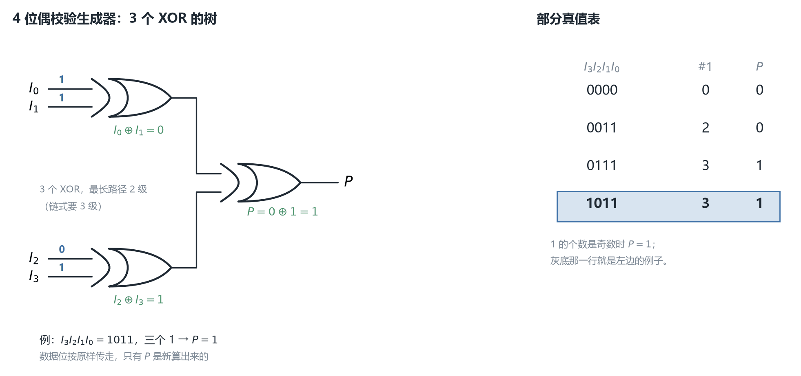
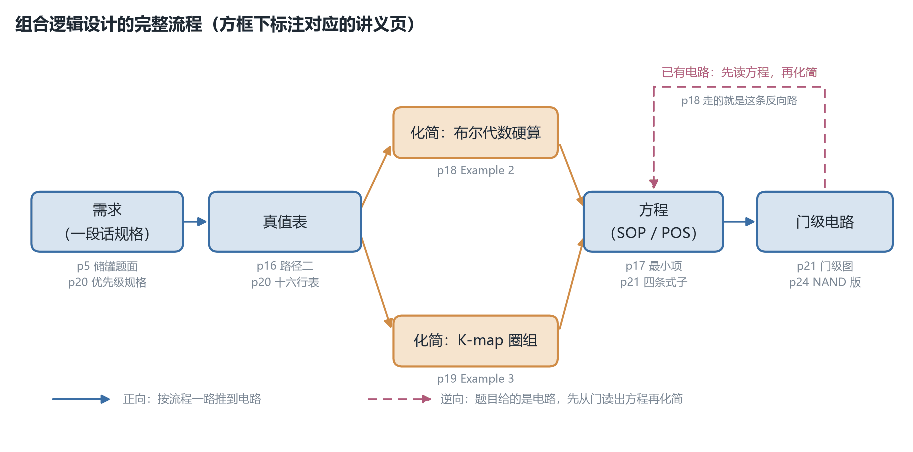
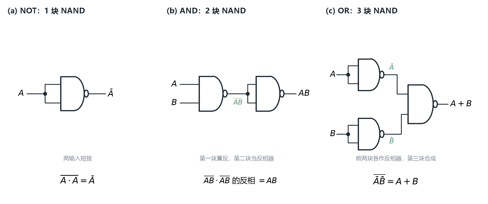
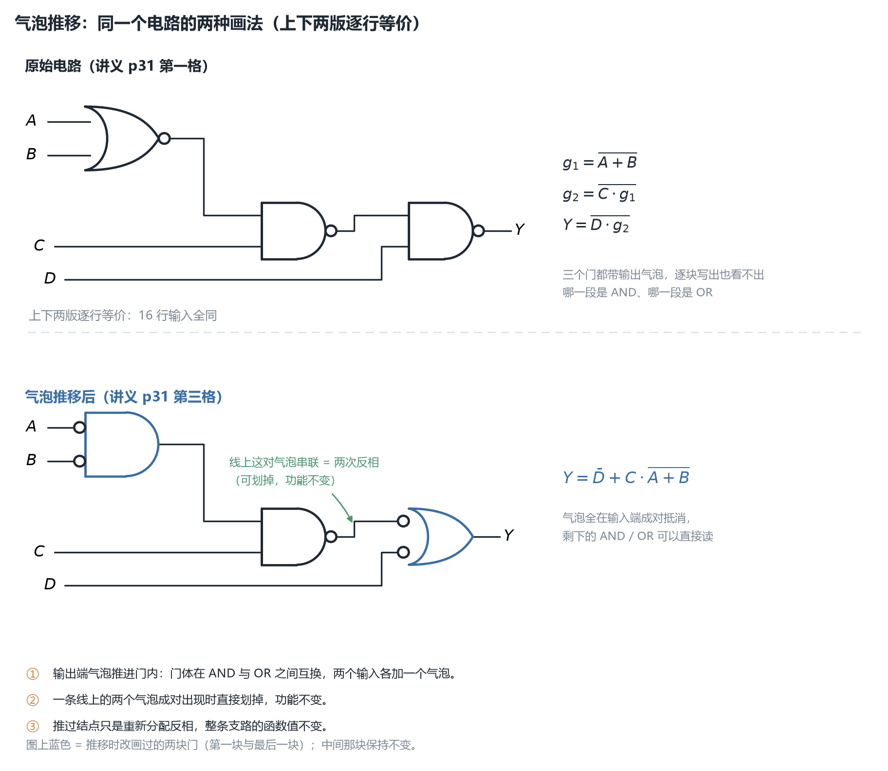

# ECE2050 Chapter 5 Combinational Logic Design 课堂笔记

## 本章在讲什么

前四章一路往上垒：

- **Chapter 1** 给了全课程地图，并把组合逻辑正式划给 Chapter 5；
- **Chapter 2** 讲"数怎么用 0/1 表示"；
- **Chapter 3** 讲"0 和 1 之间有哪些运算、逻辑门长什么样"；
- **Chapter 4** 讲"给定一个功能，怎么写出尽量简单的布尔表达式"（公理、定律、规则、SOP/POS、K-map）。

到了 Chapter 5，课程第一次把**表达式真正变成电路**，并且开始处理**门级别**的工程问题：

> 一个已经化简好的式子，怎么用什么门搭出来？搭出来的电路怎么读回来？有没有"只需一种门就能搭出一切"的可能？

这三问对应本章的三条主线。**第一条**是"基本组合逻辑电路"——把 SOP 落到 **AND-OR 两级结构**、把 POS 落到 **AND-OR-Invert（AOI）**、把"奇数个 1"落到 **XOR/XNOR**；**第二条**是**奇偶校验码**（parity codes），它是 XOR 在本课程里第一次真正派上用场（生成器 + 校验器）；**第三条**是**门的通用性**（universal property）与 **气泡推移**（bubble pushing）——前者回答"能不能只用 NAND（或只用 NOR）搭出全部电路"，后者是读多级 NAND/NOR 电路的通用手法。

33 页讲义可以切成四段，边界很干净：

**第一段（p3–p9）基本组合逻辑电路。** p4 用 AND-OR 结构直接实现 SOP；p5 是它的应用例题（三个储罐）；p6 用 AOI 实现 POS；p7 是 AOI 版的同一道题；p8、p9 给出 XOR 与 XNOR 的表达式、真值表与两种符号。

**第二段（p10–p14）奇偶校验码。** p11 从 2 位偶数校验讲到 p12 的三变量偶校验（这一页是全章推导最完整的一页），p13、p14 把结论扩展到 4 位生成器与 5 位校验器——XOR 树（XOR tree）。

**第三段（p15–p22）实现组合逻辑。** p16 给出两条实现路径（表达式→电路、真值表→电路）；p17–p19 是三道化简/实现例题；p20–p22 是一个完整的工程实例——**四输入优先级电路（priority circuit）**，并在 p22 用 **don't care（X）** 把它压成五行真值表。

**第四段（p23–p33）门的通用性与气泡推移。** p24、p25 分别证明 NAND、NOR 的通用性（NOT / AND / OR / NOR 或 NAND 都能搭）；p27 把 De Morgan 定理写成**门级恒等式**；p28–p31 讲**气泡推移**这一读图/重画电路的方法，并给出一套可照走的三步流程；p32、p33 是本章回顾与 10 道判断题（讲义已标答案）。

一句话概括全章：**第一、二段告诉你"一个式子能变成什么样子的电路"，第三、四段告诉你"怎么把它搭出来、又怎么把它读回来"。** 与 Chapter 4 的区别在于：Chapter 4 只关心"式子简不简单"，本章开始关心"电路好不好读、门好不好造"。

各小节的讲义页序对应如下，笔记正文就按这个顺序一条线写下来：

| 讲义页 | 本笔记小节 | 内容 |
| --- | --- | --- |
| p1 | —— | 封面（ECE 2050 / Chapter 5 / Tinghuan CHEN） |
| p2 | —— | 上一讲（Chapter 4）回顾清单 |
| p3 | —— | 分节页，标题 "Basic Combinational Logic Circuits" |
| p4 | AND-OR 逻辑 | 两级结构 ANDs→ORs，实现 SOP；例题 $Y$ |
| p5 | 例题：三个储罐（AND-OR 版） | 传感器高电平表示"液位低于阈值" |
| p6 | AND-OR-Invert 逻辑 | 两级结构 ORs→ANDs，实现 POS；$Y=\overline{AB+CD}$ |
| p7 | 例题：三个储罐（AOI 版） | 同一道题，传感器改为低电平有效 |
| p8 | Exclusive-OR 逻辑 | XOR 的表达式、两种符号、真值表 |
| p9 | Exclusive-NOR 逻辑 | XNOR 的两种实现与恒等式推导 |
| p10 | —— | 分节页，标题 "Parity Codes" |
| p11 | 2 位偶数校验码 | 真值表 + K-map + 一个 XOR 门 |
| p12 | 3 位偶数校验码 | 四最小项 → 分组 → $A\oplus B\oplus C$（全章最完整的一页） |
| p13 | 4 位偶数校验码生成器 | 三个 XOR 组成的树 |
| p14 | 5 位偶数校验码校验器 | 四个 XOR，输出 Error |
| p15 | —— | 分节页，"Implementing Combinational Circuits" |
| p16 | 两条实现路径 | 表达式→电路、真值表→电路 |
| p17 | Example 1：恰好三个 1 | 四输入、四个最小项 |
| p18 | Example 2：化简一个现成电路 | 四行化简到 $A+B+C+D$ |
| p19 | Example 3：化简并用 K-map 验证 | 四最小项 → $\bar B\bar C+A\bar C\bar D$ |
| p20 | Example 4：优先级电路 | 输出对应最高优先级的有效输入；16 行真值表 |
| p21 | 优先级电路的硬件 | 四个输出的表达式与门级实现 |
| p22 | Don't Cares | 用 X 把 16 行压成 5 行 |
| p23 | —— | 分节页，"NAND, NOR: Universal Property" |
| p24 | NAND 的通用性 | NOT / AND / OR / NOR 四种搭法 |
| p25 | NOR 的通用性 | NOT / OR / AND / NAND 四种搭法 |
| p26 | —— | 分节页，"Bubble Pushing" |
| p27 | De Morgan 定理的门级形式 | NAND 与 NOR 各自的"两种画法" |
| p28 | 气泡推移：前推与后推 | backward / forward 各改什么 |
| p29 | 气泡推移例：读出一个电路 | $Y=AB+CD$ |
| p30 | 气泡推移三条规则 | 本章最该背下来的操作规范 |
| p31 | 气泡推移完整演示（三阶段） | 从头推到尾，与教材 Figure 2.34 同一张图 |
| p32 | —— | 本章回顾清单 |
| p33 | 自测：True/False Quiz | 10 道判断题（讲义已标答案） |

> 本笔记约定：凡属**我从教材或自行推导补充、讲义上没有的内容**，都在标题或段首用【补】标出；引用讲义原文的结论则不加标记。正文提到"教材"时，指的是与讲义同一目录下的《Digital Design and Computer Architecture》（Sarah L. Harris & David Money Harris, Elsevier 2024, RISC-V 版）。**本讲的多数图与例题都能在教材 §2.4、§2.5 里找到逐字对应的出处**（p4 = Fig 2.23/Eq 2.3，p20–p22 = Example 2.7，p29–p31 = Fig 2.33–2.35），而讲义里的 AND-OR/AOI 命名、XOR/XNOR 的门级画法、奇偶校验码、NAND/NOR 通用性、dual symbols 这些内容**在教材里没有**（教材全文不出现 parity，也不用 "exclusive-OR" 这个说法），属于另一套讲法。两者的对应关系在文末"与教材的对账"一节里逐条列出。

## AND-OR 逻辑（讲义 p4）

组合逻辑电路的"两级（two-level）"指的是什么叫法，p4 给出第一种：

- **第一级是一排 AND 门**（每个 AND 门算出一个"积项"，即一个 minterm）；
- **第二级是一个 OR 门**（把用到的积项 OR 起来）；
- 因此这种结构**实现的一定是 SOP 形式**（sum-of-products，积之和）。

讲义用一页最朴素的图演示：三个输入 $A,B,C$，三个反相器给出 $\bar A,\bar B,\bar C$；三个 AND 门各自算一个最小项；一个 OR 门把三个最小项加起来。图上把每个 AND 门的输出都标成 `minterm: ...`，对应的式子是

$$
Y = \bar A \bar B \bar C + A \bar B \bar C + A \bar B C
$$

【补】**这一页的式子只在图形里，讲义正文一个字都没写**；我把课件上的三条上划线**逐段用矢量线段坐标量了一遍**才确认是 $\bar A\bar B\bar C + A\bar B\bar C + A\bar B C$（三条杠分别只盖住各自字母，不是"一条长杠盖住三个字母"）。三个最小项的下标分别是 **$m_0$（000）、$m_4$（100）、$m_5$（101）**。

【补】**这个例子与教材是同一个。** 教材 §2.4 的 Figure 2.23（printed p.64）画的是完全相同的电路（同样是三个反相器、三个三输入 AND、一个 OR，同样标 `minterm:` 三处），式子是教材的 Equation (2.3)，与我量出来的**逐字一致**。教材还顺手把它化简完了——Table 2.4 一步到位地写成

$$
Y = \bar B \bar C(\bar A + A) + A \bar B C = \bar B \bar C + A \bar B C
$$

Table 2.5 再用幂等律（idempotency，$X + X = X$）把 $A\bar B\bar C$ 复制一份，配成两组，得到**最小 SOP**

$$
Y = \bar B \bar C + A \bar B
$$

我自己在全部 8 行上枚举验证过：$\bar B\bar C + A\bar B$ 与 $m_0+m_4+m_5$ **8 行全同**。**所以这一页表面上是"演示两级结构"，实际上藏着一道还没做完的化简题**——讲义只给了"原式"，答案要从教材或自己补。

【补】**实践上这个结构有个名字：PLA（programmable logic array，可编程逻辑阵列）。** 教材 §2.4 指出，"输入反相器列 + AND 阵列 + OR 阵列"这种规整排法就叫 PLA，它是把 SOP 直接"画成版图"的标准做法，Chapter 5 的 §5.6 会再回来讲。认识这个名字有用：以后看到"把真值表烧进器件"这类描述，说的就是它。

## 例题：三个储罐（AND-OR 版，讲义 p5）

p5 把上一页的结构套到一道实际题上：

> 每个储罐装一个液位传感器，当罐内化学液位**低于**设定点时传感器输出**高电平（HIGH）**。设计一个电路，监视三个罐的液位，并在**任意两个罐**的液位都低于设定点时给出指示。

【补】**讲义只给了图，没给式子也没给答案。** 图里是三个储罐、三块 AND 门（标 $G_3,G_2,G_1$）、一块 OR 门，输出进一个指示器。把它读成式子：

- 每个传感器的输出高电平表示"这个罐低了"，所以三个输入 $A,B,C$ 各表示"该罐低"；
- "**任意两个**罐低" = 至少有两个为 1 = $AB + AC + BC$；
- 三块 AND 门正是这三个两两积项，OR 门把它们加起来：

$$
X = AB + AC + BC
$$

这个式子是**不可再化简的**（三个积项两两都不相邻，K-map 上找不到可圈的相邻对），所以它同时是最小 SOP——这也解释了为什么这里"照直搭"就是最优。

【补】**这道题与 p7 是一对。** 两页的题干只差一个词：p5 说传感器输出 **HIGH**，p7 说输出 **LOW**。这个差别决定了 p5 用 AND-OR、p7 用 AOI，两条路得到的是**同一个功能的两种等效画法**（详见 p7 一节）。

## AND-OR-Invert 逻辑（讲义 p6）

p6 给出第二种两级结构，也是把上一讲的**对偶性**思想落到门上：

- 讲义的原话是"**两级逻辑：ORs 后面接 ANDs**"（注意与 p4 的"ANDs 后面接 ORs"正好相反）；
- 因此它**实现的一定是 POS 形式**（product-of-sums，和之积）；
- 名字里的 **Invert**（取反）指的是最后一级——电路的实际结构是 **AND → OR → 取反**：

$$
Y = \overline{AB + CD} = (\bar A + \bar B)(\bar C + \bar D)
$$

把两件事对上：$\overline{AB+CD}$ 是"**先 AND 再 OR 再取反**"的直接读法（图里画的正是这个：$A,B$ 进一块 AND 得到 $AB$，$C,D$ 进一块 AND 得到 $CD$，两者进 OR 得到 $AB+CD$，再过一个反相器得到 $\overline{AB+CD}$）；而 $(\bar A+\bar B)(\bar C+\bar D)$ 是它**用 De Morgan 定理化成的 POS**，正好是"ORs 后面接 ANDs"。**讲义那句话说的是后一种读法**，图上画的却是前一种——这不是矛盾，而是同一个函数的两种描述。

【补】**AOI 这三个字母的意思，要到 p33 的判断题才被确认**（第 2 题 "AOI is an acronym for AND-OR-Invert" 标为 ✓）。讲义正文从头到尾没有展开过这个缩写，但你从 p6 的标题就能推出来。

【补】**为什么工程上会有这种结构？** 因为 CMOS 里"**先做 AND 再做 OR 再取反**"恰好是**一块 CMOS 复合门**能直接实现的形式（AND 用串联 NMOS、OR 用并联、输出天然取反），而"AND-OR 不取反"反而要多一级。所以 AOI 不是"化简的产物"，而是"贴合金属氧化物半导体工艺的产物"——这与 p4 的 AND-OR 结构形成对照：**p4 是教科书写法，p6 是工艺友好写法**。

## 例题：三个储罐（AOI 版，讲义 p7）

题干与 p5 几乎完全相同，只改了一个词：

> 每个储罐的传感器在液位低于设定点时输出 **LOW（低电平）**。设计电路，在**任意两个罐**都低于设定点时给出指示。

【补】**讲义同样只给图，没给式子。** 图里是三块 AND、一块 OR、再接一个反相器（即 p6 的 AOI 结构）。关键在于**输入的有效电平变了**：

- 现在"罐低了"对应输入为 **0**，"任意两个罐低"就是"**至少有两个输入是 0**"，也就是"**至多有一个输入是 1**"；
- 把 p5 的 $AB+AC+BC$（"至少两个 1"）取反，正好就是"至多一个 1"：
$$
X = \overline{AB + AC + BC}
$$
- 而 $\overline{AB+AC+BC}$ 用 De Morgan 展开是 $(\bar A + \bar B)(\bar A+\bar C)(\bar B+\bar C)$，**是一个 POS**——正好落进 p6 的 AOI 结构。

【补】**这一对例题的教学价值在于"同一个功能、两种极性、两种结构"。** 请把两页放在一起看：

| | p5 | p7 |
| --- | --- | --- |
| 传感器有效电平 | HIGH（高电平表示"低液位"） | LOW（低电平表示"低液位"） |
| 待实现的函数 | $AB+AC+BC$ | $\overline{AB+AC+BC}$ |
| 形式 | SOP | POS |
| 结构 | AND-OR（p4） | AND-OR-Invert（p6） |
| 输出端反相器 | 无 | 有一个 |

只要把 p5 的输出反相一下，两个电路就完全一样——**所谓"两种结构"，本质上只差"要不要在输出上加一个气泡"**。这条观察是后面 p27–p31 气泡推移那一节的伏笔：既然差别只是一个气泡，那么"挪动气泡"就能在两种结构之间来回切换，而功能不变。

## Exclusive-OR 逻辑（讲义 p8）

p8 引入本章第一个"新门"：**异或（Exclusive-OR, XOR）**。它回答的问题很具体：**"两个输入不相同"这个判断怎么写成布尔式子？**

从"不相同"出发逐行看：只有 $(0,1)$ 与 $(1,0)$ 两种输入组合为真。这两种组合各自是一个最小项：

$$
X = A \bar B + \bar A B = A \oplus B
$$

$\oplus$ 是 XOR 的专用符号。真值表是

| A | B | X |
| --- | --- | --- |
| 0 | 0 | 0 |
| 0 | 1 | 1 |
| 1 | 0 | 1 |
| 1 | 1 | 0 |

**XOR 的输出为 1，当且仅当两个输入不同**；换个说法：**XOR 输出的是"两个输入相加后的奇偶性"**（1 的个数是奇数则为 1）。这个"数奇数个 1"的性质就是下一节奇偶校验码的全部基础。

p8 给了两种画法：

- **(a) 逻辑图（logic diagram）**：由两个反相器、两个 AND、一个 OR 组成——就是上面那个 SOP 式的直译。这种画法**把 XOR 拆开成基本门**，用在需要看清内部结构时。
- **(b) ANSI distinctive shape symbol（ANSI 专用形状符号）**：那块"背面多一道弧线"的门。**那道额外的弧线就是 XOR 的标记**，它是与普通 OR 门唯一的区别。工程图上只要看到"OR 形 + 背面双弧线"，就是 XOR。

【补】**XOR 不是"基本门"。** 严格说，逻辑门的基本集合只有 AND/OR/NOT（或 NAND、或 NOR），XOR 是被**定义**出来的复合功能；所以讲义在 p8 先写表达式、再画拆开的逻辑图，最后才给简写符号——这个顺序就是在说"XOR 是名字，不是元件"。这一点到 p24 会反过来用：既然 XOR 能拆成基本门，那么只用 NAND 也能搭出 XOR。

## Exclusive-NOR 逻辑（讲义 p9）

p9 给出 XOR 的补：**同或（Exclusive-NOR, XNOR）**，输出为 1 当且仅当**两个输入相同**。真值表正好把 p8 的 0/1 对调：

| A | B | X |
| --- | --- | --- |
| 0 | 0 | 1 |
| 0 | 1 | 0 |
| 1 | 0 | 0 |
| 1 | 1 | 1 |

p9 给了 (a)、(b) 两种实现，并顺手做了一遍推导（这页的文字量比 p8 大，值得逐行读）：

**(a) 取 XOR 的补**：直接把 p8 的 XOR 输出取反，即

$$
X = \overline{A \bar B + \bar A B}
$$

**(b) 直接用两级 AND-OR 搭**：用"两个输入相同"的两种组合（$00$ 与 $11$）写式子：

$$
X = \bar A \bar B + A B
$$

讲义接着用 De Morgan 证明这两者是同一个函数，**这一步是全章第一次把"门级"与"代数"对上**：

$$
X = \overline{A \bar B + \bar A B}
= \overline{(A \bar B)}\ \overline{(\bar A B)}
= (\bar A + B)(A + \bar B)
= \bar A \bar B + A B
$$

逐行说明：

1. 第一步是 De Morgan 作用于 OR：和的补 = 各补之积；
2. 第二步把每个小括号内的乘积再单独用一次 De Morgan：$\overline{A\bar B} = \bar A + B$、$\overline{\bar A B} = A + \bar B$；
3. 第三步把两个括号乘开。注意乘的过程中会出四项：$\bar A A$、$\bar A \bar B$、$B A$、$B\bar B$，其中 $\bar A A = 0$、$B\bar B = 0$ 消掉，留下 $\bar A\bar B + AB$。

【补】**这一页的两个式子值得背下来，它们是本章出现频率最高的一对**：

$$
A \bar B + \bar A B = A \oplus B
\qquad\qquad
\bar A \bar B + A B = \overline{A \oplus B}
$$

它们在 p12 的"Recall"框里被再写一遍并被正式引用（这也是讲义唯一一次明确要求"记住"的内容）。

【补】**一个容易看漏的细节：XNOR 的符号式写法有两种口径。** 有的书把 XNOR 写成 $\overline{A\oplus B}$（"XOR 取反"），有的写成 $A \odot B$（"同或"专用符号）。讲义用的是前一种（p9 的 (a) 就是把它当"XOR + 反相器"画的）。这里没有对错，但**抄式子时要注意别把 $\overline{A\oplus B}$ 误读成 $\overline{A}\oplus B$**——横杠的长度在这两页是被刻意精确画过的（见文末"课件笔误"一节的第 2 条）。

## 2 位偶数校验码（讲义 p11）

p10 是分节页"Parity Codes"，p11 正式开始。**奇偶校验**（parity check）要解决的问题是：

> 数据在传输/存储过程中可能有一位翻转出错，怎么用最少的额外信息发现"出错了"？

思路是给数据加一个**校验位（parity bit）**，使"数据位 + 校验位"里 1 的总个数为偶数（**偶校验，even parity**）或奇数（**奇校验，odd parity**）。接收端数一遍 1 的个数就能判断有没有出错。

p11 从最简单的 2 位数据做起。真值表：

| A | B | X |
| --- | --- | --- |
| 0 | 0 | 0 |
| 0 | 1 | 1 |
| 1 | 0 | 1 |
| 1 | 1 | 0 |

对照 p8 的真值表——**完全一样**。所以校验位的表达式就是

$$
X = A \bar B + \bar A B = A \oplus B
$$

而 p11 还给了同一张真值表的 **K-map 形式**：

| A \ B | 0 | 1 |
| --- | --- | --- |
| 0 | 0 | 1 |
| 1 | 1 | 0 |

【补】这张 K-map 值得注意的地方是**它圈不出任何一组**：两个 1 在 $(0,1)$ 与 $(1,0)$ 两格，既不相邻、也无法环绕相邻（2 变量图上没有环绕）。这从 K-map 的角度印证了"$A\bar B+\bar A B$ 已经是最小 SOP"——**XOR 的 SOP 是不可再化简的**（这一点到 p12 会再看一次，那里四个最小项同样圈不成更大的圈，只能靠代数技巧分组）。

p11 的电路图里还有一个概念值得留意：图上明确标出了哪两根线是 **data bits（数据位）**、哪一根是 **parity bit（校验位）**。这个区分很关键——**校验位不是"另一个数据"，而是数据的一个函数**；所以传输时数据位照原样走，只有校验位是新算出来的。p13、p14 沿用了同一套标注。

## 3 位偶数校验码（讲义 p12）

p12 是全章推导最完整的一页，值得逐行跟。

**第一步：写 SOP。** 三变量偶校验要求"1 的个数为偶数"，即 1 的个数为 0 或 2。真值表上为 1 的是 $001$、$010$、$100$、$111$ 四行，于是

$$
X = \bar A \bar B C + \bar A B \bar C + A \bar B \bar C + A B C
$$

【补】**这个式子就是教材的 Equation (2.6)**（§2.5.1，printed p.68）。教材在同一处说了一句很有分量的话：**"Unfortunately, there is no way to simplify this equation into fewer implicants"**——两级 SOP 的四个积项**一个都消不掉**（四个最小项在 K-map 上互不相邻）。教材正是用这个例子引出"必须换多级结构"的动机。

**第二步：分组。** 讲义用两个红色花括号把四项按"前两项含 $\bar A$、后两项含 $A$"分成两组，提出公因子：

$$
X = \bar A(\bar B C + B \bar C) + A(\bar B \bar C + B C)
$$

**第三步：认出括号里就是 p9 那对恒等式。** 讲义在同一页放了一个 `Recall` 框，把两个恒等式连同门名一起列出（这是我量过补号位置之后确认的写法）：

| 括号里的式子 | 等价的记号 | 门名 |
| --- | --- | --- |
| $\bar A \bar B + A B = \overline{A \oplus B}$ | $A \odot B$ | **XNOR** |
| $A \bar B + \bar A B = A \oplus B$ | —— | **XOR** |

于是 $\bar B C + B \bar C = B \oplus C$，$\bar B \bar C + B C = \overline{B \oplus C}$，代回去：

$$
X = \bar A(B \oplus C) + A \overline{(B \oplus C)} = A \oplus B \oplus C
$$

**最后一步的读法**：把 $Y = B\oplus C$ 看成一个整体，那么 $\bar A Y + A \bar Y$ 正是 p8 里 XOR 的标准形 $\bar A Y + A\bar Y = A \oplus Y$。**这就是 XOR 可以"嵌套"的原因**——把两个输入换成一个"已经算好的中间量"，XOR 的形式不变。

【补】**"XOR 可结合"这条性质是本章后面所有 XOR 电路的地基**，教材在同一处（§2.5.1）特意加了一句 "prove this to yourself by perfect induction if you are in doubt"，并在 p12 之后立刻用它给出三级联（cascade）结构。这条性质的意义是：**三变量、四变量、任意变量的奇偶校验，都可以拆成"两两 XOR 的树"来做，而不需要写 $2^{n-1}$ 个积项**。教材举的极端例子是八输入 XOR：两级 SOP 要 128 个八输入 AND 门加一个 128 输入 OR 门，而 XOR 树只要 7 个二输入 XOR。

【补】**一个容易读错的地方，值得单独说清。** 讲义最后一行是

$$
= \bar A(B \oplus C) + A \overline{(B \oplus C)} = A \oplus B \oplus C
$$

**第一个括号上没有杠、第二个括号上有杠**——我一开始从缩略图上看成了"两个都有杠"，那样会得出 $\overline{A \oplus B \oplus C}$（即 XNOR），与真值表矛盾。我是靠**量每一段上划线的矢量坐标**才确认：那一行的长杠只覆盖第二个括号（$x$ 范围与第二个括号的字符范围吻合，第一个括号上方没有线段）。抄这一行时请特别小心。

## 4 位偶数校验码生成器（讲义 p13）

p13 把 p12 的结论推到 4 位数据：用 XOR 门搭一个 **4 位偶数校验码生成器（even-parity code generator）**。

电路结构是三个 XOR 组成的"树"：

1. $A_0 \oplus A_1$；
2. $A_2 \oplus A_3$；
3. 上面两个中间结果再 XOR，输出即 **even parity bit**。



*图 1　4 位偶校验生成器是一棵 XOR 树：两级归约把四个数据位收成一个校验位 $P$。左边用 $I=1011$ 走了一遍，线上的中间值 $1$、$0$、$1$ 与右边真值表的 $P$ 列都由脚本按同一函数算出。*

【补】**为什么这样接就对了？** 依据就是上一节那条"XOR 可结合"的性质：$A_0\oplus A_1\oplus A_2\oplus A_3$ 的计算顺序可以任意分组，所以"树"和"链"是同一个函数。**但这两种接法在工程上不等价**：

| | 链式（cascade） | 树式（tree） |
| --- | --- | --- |
| 门数 | 3 个二输入 XOR | 3 个二输入 XOR |
| 最长路径（级数） | 3 级 | 2 级 |
| 对 8 位的规模 | 7 级 | 3 级 |

【补】表里最后一行是教材 §2.5.1 的说法（Figure 2.32 给了八输入 XOR 用 7 个二输入 XOR 的树）。**门数一样，但树式的信号传播级数是 $O(\log n)$ 而不是 $O(n)$**，所以在位宽变大时树式明显更快。这一条正好接上 Chapter 4 p4 里被搁置的那个"时序规格（timing specification）"——那里只说"本章不管时序"，到这里终于能看出**为什么结构选择会影响时序**：同样功能的两种接法，深度不同。

【补】**注意 p13 的电路图和 p11 一样标了 "Data bits" 与 "Even parity bit"**：左边四根进入，右边输出一根。**生成器（generator）的角色是"加一位"**，它不检查、只生产——检查是 p14 的事。

## 5 位偶数校验码校验器（讲义 p14）

p14 是 p13 的对手方：**校验器（checker）**。它接收 p13 生成出来的 5 位码（4 位数据 + 1 位校验位），输出一根 **Error**。

电路仍是四个 XOR：$A_0\oplus A_1$、$A_2\oplus A_3$、两者再 XOR、最后与 even parity bit 再 XOR。

【补】**它为什么能判错？** 因为"5 位里 1 的个数为偶数"等价于"这 5 位的 XOR 等于 0"。所以把 5 位统统 XOR 起来：

- 结果 $0$ ⟺ 1 的个数是偶数 ⟺ 没有出错；
- 结果 $1$ ⟺ 1 的个数是奇数 ⟺ **有一位翻转了**。

讲义在页底用四行文字把这件事说了一遍（我逐条对过，**四行全部与"XOR 全等于 0 判定"一致**）：

| 数据位（1 的个数） | 校验位 | 总数 | Error |
| --- | --- | --- | --- |
| 奇数（odd） | 1 | 偶 | 0 |
| 奇数（odd） | 0 | 奇 | 1 |
| 偶数（even） | 1 | 奇 | 1 |
| 偶数（even） | 0 | 偶 | 0 |

【补】注意讲义原文这四行的写法是 "1 → odd, parity bit → 1, error → 0" 这种形式，**开头那个 1/0 指的是"数据位里 1 的个数是奇数还是偶数"**（1 表示 odd），不是某一位的具体取值——这一点不看上下文的表格很容易误读。**"偶数"用 0 表示、"奇数"用 1 表示**，恰好与"总数的奇偶"这一位是同一种编码，所以表里第四列可以直接读成"第三列的奇偶"。

【补】**必须指出的一个局限：这个电路只能发现"奇数个位出错"，不能发现"偶数个位出错"，也不能纠错。** 如果两位同时翻转，1 的个数的奇偶性不变，校验器会报告"没错"。这是奇偶校验这种方案的固有上限（要发现两位错、甚至纠正一位错，需要更强的编码，如海明码）。**讲义没有提这个局限**，但两页的文字里 "error" 一词被直接等同于"有一位出错"，这个前提值得知道。

## 两条实现路径（讲义 p16）

p15 是分节页"Implementing Combinational Circuits"，p16 给出本章最实用的两条路径。

**路径一：从布尔表达式到逻辑电路。** 以

$$
X = AB + CDE
$$

为例。先把每个积项
当成一个"局部任务"：$AB$ 需要一个两输入 AND，$CDE$ 需要一个三输入 AND；然后用一个 OR 把两块输出合起来。讲义在图上用红框把 $AB$ 和 $CDE$ 分别框出来，再用箭头标出"这个框对应 AND、那个加号对应 OR"——**这个"先框积项、再框加号"的读法就是表达式到电路的通用翻译法**：**乘号 → AND，加号 → OR**。

**路径二：从真值表到逻辑电路。** 讲义给了一张三变量真值表，输出为 1 的只有 $011$ 与 $100$ 两行，因此在 "Product Term" 一列填上这两行对应的最小项：

$$
X = \bar A B C + A \bar B \bar C
$$

电路就是"三个反相器（$\bar A,\bar B,\bar C$）+ 两块三输入 AND + 一块 OR"。

【补】**两条路径之间的关系值得点破：路径二其实是"路径一 + 一步 SOP 生成"。** 从真值表到电路从来不是一步，而是**两步**：先把每个输出为 1 的行写成一个最小项、OR 起来（这就是 Chapter 4 p36 的"标准 SOP"），再按路径一翻译成门。讲义把这两步压在一页里画完，看起来像一条路，实际是两条。**考试里"给真值表画电路"的题，中间那一步（写标准 SOP）才是最容易丢分的地方**——漏掉某一行、或者写错某一个补号，后面的门全对也没用。

【补】**两条路径怎么选？判据只有一条：看你手上拿到的输入是"式子"还是"01 表"。** 已经给出布尔表达式（或规格本身就能读出乘加结构）→ 走路径一，直接翻译；只给了"什么时候输出 1"的规格或真值表 → 走路径二，先写标准 SOP 再翻译；如果给的是**已经画好的电路**，两条都不走，而是反过来：先从门读出方程（p18），再化简。三条路的分岔点就是下面这张图。



*图 2　从一句话规格到门级电路的五步流程；"化简"一步分成代数与 K-map 两条并行路径，虚线箭头是 p18 那种"给电路反求方程"的逆向题型。每个方框下面标了它对应的讲义页。*

【补】**教材在这一页对应的位置给了一组"画图规范"（Figure 2.24），讲义没有，但很实用**：

- 输入画在左侧（或上方），输出画在右侧（或下方），门尽量从左向右流；
- **T 形接头（T junction）表示导线相连**；
- **导线交叉处画一个实心点（dot）表示相连**；
- **交叉但不画点表示不相连**。

这四条里，**后两条是读图时最容易出错的地方**——很多"这到底连没连"的疑问，答案就在有没有那个点。本讲后面 p21、p29、p31 的图都大量依赖这个约定（p28 的 `bubble pushing` 里那个点和气泡的区分也靠它）。

【补】**还有一个可以顺手做的优化：把"AND 加反相输入"改成 NOR。** 教材在同一处指出，$\bar A\bar B$ 这种"输入带反相器的 AND"**等价于一块 NOR 门**（De Morgan），可以直接把反相器省掉。理由是 CMOS 工艺里 NAND、NOR 比 AND、OR 更便宜更快。这条优化讲义没有提，但它和 p6 的 AOI 是同一个道理：**"省门"和"贴工艺"经常比"式子最简"更实际。**

## Example 1：恰好三个输入为 1（讲义 p17）

p17 的题目：

> 设计一个四输入逻辑电路，**当且仅当恰好有三个输入为 1** 时输出为 1。

方法就是上面"路径二"：

1. 找出所有"恰好三个 1"的行。四变量里这类行有 $\binom{4}{3} = 4$ 行：$0111$、$1011$、$1101$、$1110$；
2. 每行写成一个最小项；
3. OR 起来：

$$
X = \bar A B C D + A \bar B C D + A B \bar C D + A B C \bar D
$$

电路：四个反相器给出 $\bar A,\bar B,\bar C,\bar D$；四个四输入 AND；一个四输入 OR。

【补】**这个式子同样不可再化简。** 四个最小项在 K-map 上两两都不相邻（任意两个都差两位），圈不出任何一组，所以这就是它的最小 SOP——与 p12 的情况一模一样。我在全部 16 行上核对过：上式与"输入的算术和等于 3"**16 行全同**。

【补】**一个可以从这道题推出来的通式**：$n$ 个输入中"恰好 $k$ 个为 1"的判据，需要 $\binom{n}{k}$ 个 $n$ 输入 AND 门加一个 $\binom{n}{k}$ 输入 OR 门。这里的 $n=4,k=3$ 给出 4 与 4，与图上的门数吻合。**这个数字会随 $n$ 迅速爆炸**（比如 $n=8,k=4$ 要 70 个八输入 AND），这正是下一节"化简电路"这件事为什么重要。

## Example 2：把一个现成电路化简到最小（讲义 p18）

p18 第一次给出"反过来"的题：**给一个已经画好的电路，把它化简**。讲义给的式子是四行推导：

$$
X = \overline{\bar A \bar B \bar C}\, C + \overline{\bar A \bar B \bar C} + D
= (A + B + C)C + (A + B + C) + D
= (A + B + C) + D
= A + B + C + D
$$

逐行说明：

1. **第一行**：$\overline{\bar A\bar B\bar C} = A+B+C$（De Morgan），所以第一项是 $(A+B+C)C$；式中第二项 $\overline{\bar A\bar B\bar C}$ 已经是 $A+B+C$；第三项 $D$ 直接来自输入端。
2. **第二行**：把第一行的两种写法都换成展开形式。
3. **第三行**：$(A+B+C)C = AC+BC+C = C$（吸收律 $X + XY = X$ 的用法：$(A+B)C + C = C$）；再把 $C$ 与第二项 $A+B+C$ 吸收，得 $A+B+C$。
4. **第四行**：最后与 $D$ 相或。

【补】**图的读法（我逐段量过连线，确认如下）**：三个反相器给出 $\bar A,\bar B,\bar C$；**一块三输入 AND**（输入 $\bar A,\bar B,\bar C$）得到 $\bar A\bar B\bar C$；后面跟一个反相器，其输出就是图中蓝字标注的 $\overline{\bar A\bar B\bar C}$；在这个反相器输出上**打点分两路**，一路向右进入下一块 AND（另一个输入取自 **$C$ 的输入端**——注意取的是未取反的 $C$，这就是第一行里那个"乘以 $C$"的来源），另一路向下绕行，成为最后那块**三输入 OR** 的一个输入；OR 的第三个输入是 $D$。

【补】**这一页的价值不在于"算出 $A+B+C+D$"，而在于它展示了一条重要经验：读电路时先看有没有反相器可以直接和后面的门合并。** 这里的 $\overline{\bar A\bar B\bar C}$ 出现两次（一次乘 $C$、一次单独进 OR），而它本身就带一个大反相器——只要把这一项认出来，后面全是吸收律的机械操作。我做过一遍全 16 行枚举：**第一行、第二行、第四行三个表达式连同 $A+B+C+D$ 在全部 16 行上完全一致**，推导没有跳步。

【补】**顺带得到一个"读图检查法"**：最终结果是 $A+B+C+D$，也就是说**这个复杂电路其实就是一个四输入 OR 门**（教材在同一位置给出 Figure 2.26 就是这个结论）。**这是本章反复出现的模式——化简的终点往往比原电路朴素得多**，p19 也是同一套路。

## Example 3：化简 + K-map 验证（讲义 p19）

p19 与 p18 同类，但多给了一张 **K-map 做交叉验证**。讲义的两行：

$$
X = A \bar B \bar C + A B \bar C \bar D + \bar A \bar B \bar C D + \bar A \bar B \bar C \bar D = A \bar C \bar D + \bar B \bar C
$$

$$
= A \bar B \bar C(D + \bar D) + A B \bar C \bar D + \bar A \bar B \bar C D + \bar A \bar B \bar C \bar D
$$

第二行做的事是**把第一项 $A\bar B\bar C$ 乘上 $(D+\bar D)$**——这是 Chapter 4 里学过的"乘 1 补齐变量"技巧：$A\bar B\bar C$ 只含三个变量，而其余三项都含四个变量，乘 $(D+\bar D)$ 后它就展开成两个四变量最小项，可以和后面两项配对。

把式子里的积项都展开成四变量最小项，一共 **5 个**：$A\bar B\bar C D$、$A\bar B\bar C\bar D$、$AB\bar C\bar D$、$\bar A\bar B\bar C D$、$\bar A\bar B\bar C\bar D$。

p19 右侧的 K-map 正好画着这 5 个 1（$AB$ 为行、$CD$ 为列）：

| A \ CD | 00 | 01 | 11 | 10 |
| --- | --- | --- | --- | --- |
| **00** | **1** | **1** | 0 | 0 |
| **01** | 0 | 0 | 0 | 0 |
| **11** | **1** | 0 | 0 | 0 |
| **10** | **1** | **1** | 0 | 0 |

图上圈了两组，正好对应答案的两项：

- **$\bar B \bar C$**：$B=0$（行 $00$ 与行 $10$）且 $C=0$（列 $00,01$）的四格 → 四格全被圈住，消掉 $A$、$D$ 两个变量；
- **$A \bar C \bar D$**：$A=1$（行 $11,10$）、$C=0,D=0$（列 $00$）的两格 → 竖直相邻对，消掉 $B$。

【补】我在全部 16 行上验证过：**原始四项式与 $A\bar C\bar D + \bar B\bar C$ 完全一致**；并且上表中 5 个 1 的位置 $\{0000,0001,1000,1001,1100\}$（按 $A,B,C,D$ 顺序）与我列出的 5 个最小项**逐个吻合**。也就是说：**p19 的原式、K-map、答案三者互相印证，这一页没有错**。

【补】**这一页最值得学的是"K-map 与代数两条路互证"的做法。** 代数化简容易算错（漏掉一个可以配对的最小项、或者多消一个变量），而 K-map 是"看得见"的；反过来，K-map 在多变量时容易画错格。**两者独立算一遍、结果对上，才敢说化简是对的**——本讲里 p18（纯代数）与 p19（代数 + K-map）正好是两种情形。

## Example 4：优先级电路（讲义 p20）

p20 是本讲的工程重点：**优先级电路（priority circuit）**。题目一句话点明规则：

> 输出与**最高优先级的有效（TRUE）输入**相对应。

也就是：四个输入 $A_3,A_2,A_1,A_0$（$3$ 是**最高**优先级），要求输出 $Y_3..Y_0$ 里**至多有一个为 1**，而且那个 1 一定对应"被置 1 的输入里编号最大的那个"。

16 行真值表（$A_3 A_2 A_1 A_0 \to Y_3Y_2Y_1Y_0$）：

| $A_3$ | $A_2$ | $A_1$ | $A_0$ | $Y_3$ | $Y_2$ | $Y_1$ | $Y_0$ |
| --- | --- | --- | --- | --- | --- | --- | --- |
| 0 | 0 | 0 | 0 | 0 | 0 | 0 | 0 |
| 0 | 0 | 0 | 1 | 0 | 0 | 0 | 1 |
| 0 | 0 | 1 | 0 | 0 | 0 | 1 | 0 |
| 0 | 0 | 1 | 1 | 0 | 0 | 1 | 0 |
| 0 | 1 | 0 | 0 | 0 | 1 | 0 | 0 |
| 0 | 1 | 0 | 1 | 0 | 1 | 0 | 0 |
| 0 | 1 | 1 | 0 | 0 | 1 | 0 | 0 |
| 0 | 1 | 1 | 1 | 0 | 1 | 0 | 0 |
| 1 | 0 | 0 | 0 | 1 | 0 | 0 | 0 |
| 1 | 0 | 0 | 1 | 1 | 0 | 0 | 0 |
| 1 | 0 | 1 | 0 | 1 | 0 | 0 | 0 |
| 1 | 0 | 1 | 1 | 1 | 0 | 0 | 0 |
| 1 | 1 | 0 | 0 | 1 | 0 | 0 | 0 |
| 1 | 1 | 0 | 1 | 1 | 0 | 0 | 0 |
| 1 | 1 | 1 | 0 | 1 | 0 | 0 | 0 |
| 1 | 1 | 1 | 1 | 1 | 0 | 0 | 0 |

**读表的方法**：从上往下扫，第一个为 1 的输入决定输出。注意"**只输出一个 1**"这件事——$A_3$ 一旦为 1，下面三个输入的取值**完全不影响输出**（都是 $1000$）。这正是 p22 要用 don't care 的地方。

## 优先级电路的硬件（讲义 p21）

p21 给出四个输出的表达式——**它们不是靠化简得到的，而是靠"看题干读出来"**：

$$
Y_3 = A_3
$$
$$
Y_2 = \bar A_3 A_2
$$
$$
Y_1 = \bar A_3 \bar A_2 A_1
$$
$$
Y_0 = \bar A_3 \bar A_2 \bar A_1 A_0
$$

每一条的读法都一样：**"我有效，而且所有比我优先级高的都无效"**。$Y_1$ 这条就是"$A_1$ 为 1 且 $A_3,A_2$ 都为 0"。

【补】**我在全部 16 行上验证过这四条式子，与"只输出编号最大的那个有效输入"的行为完全一致**（含全 0 输入的 $0000 \to 0000$）。这也解释了表里 15 行有输出、1 行为全 0。

p21 的电路：$Y_3$ 直接从 $A_3$ 引线（不需要门）；$Y_2$ 用一个"输入 $\bar A_3$ 带气泡的两输入 AND"；$Y_1$ 用一个"前两个输入带气泡的三输入 AND"；$Y_0$ 用一个"前三个输入带气泡的四输入 AND"。

【补】**图里那些"画在门输入侧的小圆圈"就是反相器的简写。** 教材 §2.4 提过这条约定（"AND with inverted inputs"），它和 p27 要讲的 NAND/NOR "两种画法"是同一套记号体系：**气泡画在门的输入端 = 该输入先取反**。这里 $\bar A_3 A_2$ 省掉了两个独立反相器，直接画成"带气泡的 AND"。

【补】**与教材 Example 2.7 完全同题。** 教材在 §2.4（printed pp.66–67）用"礼堂预约系统"的故事讲了同一件事——院长、系主任、助教、宿舍长四个人抢礼堂，院长优先级最高；输入 $A_{3:0}$、输出 $Y_{3:0}$，符号图为 Figure 2.27、电路为 Figure 2.28。教材还多一句经验之谈：**"An experienced designer can often implement a logic circuit by inspection"**——**先把规格读成式子、再把式子画成门**，不必绕道真值表化简。这正好是 p21 的做法。

## Don't Cares（讲义 p22）

p22 把 p20 的 16 行真值表**压成 5 行**。做法是：把"输出不关心"的输入位记作 **X（don't care）**：

| $A_3$ | $A_2$ | $A_1$ | $A_0$ | $Y_3$ | $Y_2$ | $Y_1$ | $Y_0$ | 说明 |
| --- | --- | --- | --- | --- | --- | --- | --- | --- |
| 0 | 0 | 0 | 0 | 0 | 0 | 0 | 0 | 全 0 |
| 0 | 0 | 0 | 1 | 0 | 0 | 0 | 1 | 只有 $A_0$ |
| 0 | 0 | 1 | X | 0 | 0 | 1 | 0 | $A_1$ 有效，$A_0$ 无所谓 |
| 0 | 1 | X | X | 0 | 1 | 0 | 0 | $A_2$ 有效，$A_1,A_0$ 无所谓 |
| 1 | X | X | X | 1 | 0 | 0 | 0 | $A_3$ 有效，其余无所谓 |

【补】**"X 从哪来"是这一页的关键，讲义没有解释。** X 不是"这一段数据缺失"，而是**规格本身允许自由**：优先级规则只说"最高优先级的有效输入赢"，所以当 $A_3=1$ 时，$A_2,A_1,A_0$ 的取值对输出**在逻辑上没有意义**——它们在真值表里是 4 行（$1000$ 到 $1111$），输出全是 $1000$，因此可以合并成一行 $1XXX$。**换句话说：X 是"规格给出的自由度"，不是"未知"。**

【补】这一页与 Chapter 4 的 don't care 是**同一个概念的两个用法**，值得对照：

| | Chapter 4（p58–p61） | 本页 p22 |
| --- | --- | --- |
| X 的位置 | K-map 的**格子**里 | **真值表**的输入列里 |
| X 的语义 | 该输入组合不会出现（故不影响功能） | 该输入位对输出无影响（规格允许任意） |
| 用途 | 圈更大的组，得到更简的式子 | 把真值表压小，**并直接读出式子** |

【补】**压缩后的表怎么直接读数出 p21 的四条式子？** 只要"忽略带 X 的列"：$1XXX$ 行给出 $Y_3 = A_3$；$01XX$ 行给出 $Y_2 = \bar A_3 A_2$；$001X$ 行给出 $Y_1=\bar A_3\bar A_2 A_1$；$0001$ 行给出 $Y_0 = \bar A_3\bar A_2\bar A_1 A_0$——**四条式子一字不差地复现了 p21**。这正是教材 §2.5 里那句"**From this truth table, we can easily read the Boolean equations in sum-of-products form by ignoring inputs with X's**"的意思。

【补】**教材还提醒了一个术语陷阱**：符号 $X$ **在教材里被重载（overloaded）了两遍**——在真值表里表示 **don't care**，在逻辑仿真里表示 **contention（多个器件同时驱动一根线，取值不定）**。教材建议"读的时候看上下文"，并提到"有些作者用 $D$ 或 $?$ 表示 don't care 来避免歧义"。本讲后面 p24 起全部用 $X$ 表示信号名（$X=AB+CD$ 之类），**从 p23 往后 $X$ 就不再是 don't care 了**——这是读这份讲义时最容易混淆的一处。

## NAND 的通用性（讲义 p24）

p23 是分节页"NAND, NOR: Universal Property"，p24 讲 NAND。

**通用门（universal gate）**的定义：若**只用这一种门**就能实现 NOT、AND、OR 等一切逻辑功能，这种门就叫通用门。**NAND 是通用门**，p24 用四种搭法证明：

| 实现 | 搭法 | 等价式子 | 验证 |
| --- | --- | --- | --- |
| **(a) 反相器** | 一块 NAND，两个输入短接 | $\overline{A\cdot A} = \bar A$ | 2 行全对 |
| **(b) AND** | 两块 NAND，第一块算 $\overline{AB}$，第二块作反相器 | $\overline{\overline{AB}} = AB$ | 2 行全对 |
| **(c) OR** | 三块 NAND：前两块各作反相器得 $\bar A,\bar B$，第三块算 $\overline{\bar A\bar B}$ | $\overline{\bar A\bar B} = A+B$ | 2 行全对 |
| **(d) NOR** | 在 (c) 后面再串一块 NAND 作反相器 | $\overline{A+B}$ | 2 行全对 |

四行都归结到同一件事：**NAND 输出自带一个反相，而"两次反相抵消"是搭出"不带反相的门"的唯一办法**。所以：

- 要**一个**反常（如 NOT）：用 1 块；
- 要**两个**反常出正（如 AND）：用 2 块；
- 要**先把输入反掉、再反回来**（如 OR）：用 3 块；
- 在 OR 基础上再反一次（如 NOR）：用 4 块。



*图 3　只用 NAND 就能搭出 NOT、AND、OR —— 所以"用 NAND 实现"不是一种选择，而是一种保证：任何 SOP 都能直接映射成两级 NAND-NAND。三种搭法的布尔式已按真值表逐行核对。*

【补】**我在全部 2 行输入组合上逐项验证过上表四种搭法，结论全部成立。** 另外注意图上 (c)、(d) 里 $G_3$ 的输出被标成 $\overline{\bar A\bar B} = A+B$、(d) 里 $G_4$ 的输出被标成 $\overline{A+B}$——**这些标注本身就是"用式子验证搭法"的示范**，抄笔记时值得把标注的推导写出来而不是只抄结论。

【补】**为什么这件事在工程上极其重要？** 不是因为"省门"，而是因为**工艺只给你一种门**。CMOS 工艺里 NAND 门是"天然"的（串联 NMOS 下拉 + 并联 PMOS 上拉，输出天生取反），AND 门反而要在 NAND 后面再加一级反相器（更慢、更大）。所以**真实芯片上大量使用 NAND**，而"任意逻辑都能用 NAND 搭出来"这条性质保证了这种选择不会损失表达能力。**这也是 p33 第 8 题 "Any SOP expression can be implemented using only NAND gates" 标 ✓ 的原因**——两级 SOP（AND-OR）可以直接换成"NAND-NAND"结构。

【补】**讲义没有给出"NAND-NAND 等价于 AND-OR"的完整画法，这是个缺口。** 思路值得补上：对 SOP 式子 $\bar AB + C\bar D$，第一级用 NAND 算每个积项的**反**（$\overline{\bar AB}$、$\overline{C\bar D}$），第二级用一个 NAND 把它们合起来——因为 $\overline{\overline{X}\cdot\overline{Y}} = X + Y$，**第二级的 NAND 同时完成了"OR"和"把第一级引入的反相消掉"两件事**。所以 SOP 式子的 NAND-NAND 实现**不需要额外的反相器**（输入端的补号除外）。这条结论是 p33 第 8 题的完整答案，但讲义正文里没有图。

## NOR 的通用性（讲义 p25）

p25 是 p24 的对偶版：**NOR 也是通用门**。

| 实现 | 搭法 | 等价式子 | 验证 |
| --- | --- | --- | --- |
| **(a) 反相器** | 一块 NOR，两个输入短接 | $\overline{A + A} = \bar A$ | 2 行全对 |
| **(b) OR** | 两块 NOR | $\overline{\overline{A+B}} = A+B$ | 2 行全对 |
| **(c) AND** | 三块 NOR：前两块作反相器得 $\bar A,\bar B$，第三块算 $\overline{\bar A+\bar B}$ | $\overline{\bar A+\bar B} = AB$ | 2 行全对 |
| **(d) NAND** | 在 (c) 后面再串一块 NOR 作反相器 | $\overline{AB}$ | 2 行全对 |

【补】**两页并排看，会发现 NAND 与 NOR 的四种搭法是一一对应的（对偶）**：

| | NAND 版 | NOR 版 |
| --- | --- | --- |
| 1 块 | NOT | NOT |
| 2 块 | AND | OR |
| 3 块 | OR | AND |
| 4 块 | NOR | NAND |

**每一行的两个结果互为"对偶"**（AND ↔ OR、NAND ↔ NOR 互换）。这不是巧合：De Morgan 定理保证布尔代数是自对偶的，而 NAND 与 NOR 正是一对互为对偶的通用门。**记住一张表就等于记住了两张**——只要把 "AND↔OR、NAND↔NOR" 到处替换一遍。

【补】我在全部 2 行输入组合上逐项验证过 p25 的四种搭法，全部成立。顺带一个观察：**p24 与 p25 加起来正好覆盖了 p32 回顾页里的说法**——"NAND 的组合可以充当 NOT、AND、OR 和 NOR"、"NOR 的组合可以充当 NOT、OR、AND 和 NAND"。**两页的四种搭法就是这两句话的证明**。

## De Morgan 定理的门级形式（讲义 p27）

p26 是分节页"Bubble Pushing"，但 p27 先补上"气泡"的语言。

p27 把 Chapter 3、Chapter 4 已经用过的 De Morgan 定理**改写成门级恒等式**：

$$
Y = \overline{AB} = \bar A + \bar B
\qquad\qquad
Y = \overline{A + B} = \bar A \cdot \bar B
$$

关键在于配图：**每一个等式都有两种画法（two forms）**。

**NAND 的两种形式**：

- 一块 **AND 门 + 输出端气泡**（标准 NAND 符号）；
- 一块 **OR 门 + 两个输入端气泡**（negative-OR 符号）。

**NOR 的两种形式**：

- 一块 **OR 门 + 输出端气泡**（标准 NOR 符号）；
- 一块 **AND 门 + 两个输入端气泡**（negative-AND 符号）。

【补】**为什么这两种画法等价？** 一句"反相可以整体挪到另一侧，同时把门体换成对偶门"——也就是 De Morgan：输出反相 ≡ 输入全反相 + 门体换对偶（AND↔OR）。**"气泡"（bubble）就是"反相"在电路图上的记号**，它的位置可以挪、但挪的时候必须同时换门体。**这就是下一节"气泡推移"的全部内容。**

【补】**术语提醒：p27 的图上并没有写 "negative-OR" / "negative-AND" 这两个名字**，它们只出现在 p32 的回顾清单和 p33 的两道判断题里（第 9、10 题）。所以"同一扇门的两种画法叫 dual symbol（对偶符号）"这套术语，**讲义只给了名字、没给定义**——要靠 p27 的图去对应。文末"课件的不一致"里把这一条单独列出。

## 气泡推移：前推与后推（讲义 p28）

p28 定义气泡推移（bubble pushing）的两种基本动作，并给了它存在的理由：

> 气泡推移是重画电路的一种有用手法，**让气泡相互抵消**，从而更容易看出电路的功能。

【补】**先记住这一段的路标：p27 给"同一扇门的两种画法"，p28 给"推的两个方向"，p30 给"三条操作规则"，p31 走一遍完整流程。** 一句话概括本质：**气泡推移就是用 De Morgan 把"反相"在门的输入侧与输出侧之间搬来搬去，搬的时候门体必须同时换成对偶门。** 迷路时回到这句话，比背步骤管用。

**后推（Backward）**——把门**输出端**的气泡往**输入端**推：

- **门体改变**（AND ↔ OR 互换）；
- **在输入上加气泡**（几个输入都加）。

图上给的例子正好是"把一块 NAND 后推成 negative-OR"：左边是"AND + 输出气泡"，右边是"OR + 两个输入气泡"。

**前推（Forward）**——把门**输入端**的气泡往**输出端**推：

- **门体改变**；
- **在输出上加气泡**。

【补】**两个方向其实说的是同一件事，选哪个方向只取决于你想让气泡落在哪一侧。** 本质上都是 De Morgan 的一次应用：$\overline{AB} = \bar A+\bar B$（后推：把输出反相分摊到输入）；$\bar A \bar B = \overline{A+B}$（前推：把输入反相收集到输出）。**唯一的约束是"门体必须同时换成对偶门"**——因为 AND 和 OR 在 De Morgan 下互换。

【补】**为什么这件事在工程上不是"画着玩"？** 因为真实电路以 NAND/NOR 为主（见 p24 的说明），而一堆 NAND/NOR 串起来的电路**看不出功能**：每个门都带气泡，气泡的位置和门体在逻辑上互相牵制。**气泡推移的作用是把这些"局部反相"系统性地挪到不发生冲突的位置**，最后留下一个"能直接读成 AND/OR 式子"的电路。教材 §2.5.2 对这条动机讲得更直白：

> 从多级 NAND/NOR 电路里"用观察法"读出方程是相当棘手的（pretty hairy）。

## 气泡推移例：读出一个电路（讲义 p29）

p29 是一道练习：

> 这个电路的布尔表达式是什么？

电路结构：两个输入对 $(A,B)$ 与 $(C,D)$ 各进一块"AND + 输出气泡"的门（即 NAND）；两块 NAND 的输出再进一块"OR + 两个输入端气泡"的门，输出 $Y$。

**解法**（讲义在页底直接给出答案）：

$$
Y = AB + CD
$$

【补】**这个答案可以有两种一致的读法，两条都要会**——我把它在全部 16 行上验证过，两种读法都给出同一个函数：

**读法一（就地按符号读）**：$\overline{AB}$ 与 $\overline{CD}$ 进入一块"OR + 两个输入气泡"的门。**输入端的气泡会把进来的信号反一次**，所以

$$
Y = \overline{\overline{AB}} + \overline{\overline{CD}} = AB + CD
$$

**读法二（先认出门的名字）**："OR + 输入全带气泡"这个符号**就是 NAND**（p27 的 NAND 第二种画法），所以整块电路是"NAND(NAND(A,B), NAND(C,D))"：

$$
Y = \overline{\overline{AB} \cdot \overline{CD}} = AB + CD
$$

**两种读法给出同一结果**，这也是 p27 那句"同一扇门两种画法"的实际用处：**看到哪个符号就用哪种读法，答案不会变。**

【补】**一个值得注意的巧合**：$Y = AB+CD$ 恰好是 p6 那个 AOI 例子 $\overline{AB+CD}$ 的"不带反相"版本。**换句话说，p6 与 p29 是同一套门、只差输出端那一个气泡**——这跟 p5/p7 那对例题的模式完全一样。**"差一个气泡"这件事在本讲里出现了三次（p5/p7、p6/p29、p31 的 (a)(b)(c)），它是理解气泡推移的主线。**

## 气泡推移三条规则（讲义 p30）

p30 给出**本章最该背下来的一页**，三条规则：

1. **Begin at output, then work toward inputs**——从输出端开始，朝输入端方向推进；
2. **Push bubbles on final output back**——把**最终输出上的气泡往后推**（推到电路的内部去）；
3. **Draw gates in a form so bubbles cancel**——把每个门画成"气泡能抵消"的形式。

规则 2 的目的很实在：**最终输出上如果带气泡，读出来的就是 $\bar Y$ 而不是 $Y$**——而题目问的总是 $Y$。所以第一步一定是把输出端的气泡"推走"。

【补】**三条规则各防一种错**：规则 1 防"从输入端开始推"——那样会同时改动好几块门，推着推着就不知道改到哪了；规则 2 防"读出来的是 $\bar Y$ 而不是 $Y$"；规则 3 防"推完还是一串带气泡的门，等于白推"。三条合起来才保证"每步只动一块门，而且动完仍等价"。

【补】**教材 §2.5.2 把第 3 条展开成一句可以真正照做的判据**（讲义没有展开）：

> 往回走的时候，如果**当前门的一个输入端有气泡**，就把**前一级门画成带输出气泡**的样子；如果**当前门的输入端没有气泡**，就把**前一级门画成不带输出气泡**的样子。

这句话就是下面那张流程图的来源。**它的作用是把"凭感觉画"变成"看一眼就知道下一步画什么"。**

> [!TIP]
> 下面这张流程图是我整理的，课件没有画——它把 p30 的三条规则和教材那句判据变成一个可以照着走的判断：
>
> ```mermaid
> flowchart TD
>     A["从最终输出 Y 开始"] --> B{"输出端有气泡吗？"}
>     B -- "有" --> C["把气泡后推进门内<br/>门体换成对偶门"]
>     B -- "没有" --> D["不动它"]
>     C --> E["移到前一级门"]
>     D --> E
>     E --> F{"当前门有输入端气泡吗？"}
>     F -- "有" --> G["把前一级门画成<br/>带输出气泡"]
>     F -- "没有" --> H["把前一级门画成<br/>不带输出气泡"]
>     G --> I{"还有前一级门吗？"}
>     H --> I
>     I -- "有" --> E
>     I -- "没有" --> J["串联气泡已全部抵消<br/>按 AND/OR 读出式子"]
> ```

p30 页底还画着一个电路（$A,B$ 进一块"NOR"，再串一块带输出气泡的门、又串一块带输出气泡的门，输出 $Y$）——**这个电路就是下一页 p31 要一步一步推的对象**。

## 气泡推移完整演示（讲义 p31）

p31 用**三格**画出整个推移过程。这三格与教材 §2.5.2 的 Figure 2.34 (a)(b)(c) **是同一张图**（连蓝字标注都一样），所以可以对照教材的文字说明来读。

**原始电路（= p30 页底那个）**：$A,B$ 进一块 **NOR**（OR + 输出气泡）；其输出与 $C$ 进一块"AND + 输出气泡"（NAND）；再与 $D$ 进一块"AND + 输出气泡"（NAND），输出 $Y$。

**第一格**：保持原样。蓝字标注在最后一块门旁：**"no output bubble"**（输出端不再有气泡）。

**第二格**：最后那块门的**输出气泡被向后推进门内**——门体从 AND 换成 OR，两个输入端各加一个气泡。蓝字标注指向中间那块门的**输出气泡**与最后那块门的**上方输入气泡**，写着 **"bubble on input and output"**。

**第三格**：继续往回推，最左边那块 NOR 的门体从 OR 换成 AND、两个输入端各加气泡（即"nobubble 版"）。蓝字标注指向最左边门的**输出线**与中间那块门的**上方输入**，写着 **"no bubble on input and output"**。



*图 4　p31 那三块门的前后两版：上半是原始网络，下半是推完气泡的样子，中间那块门原样不动、两侧两块改画（图上用蓝色标出）。两版各自读出的布尔式已在全部 16 行输入上穷举对拍，结果完全相同。*

【补】**每一步"功能不变"是有严格依据的，不是感觉。** 我在全部 16 行输入组合上验证过三格的等价性：

- **第一格**：$Y = \overline{D \cdot \overline{C \cdot \overline{A+B}}}$；
- **第二格**：最后那块门变成"OR + 两个输入气泡"，它把中间门的输出反一次又加了一次反，**与原来 AND+输出气泡的反相正好抵消**，功能不变；
- **第三格**：NOR 换成"AND + 两个输入气泡"（negative-AND），由 De Morgan 等价，功能不变。

【补】**三格的过程说明了一条很有用的经验，教材把它直接写出来了**：

> 往回走的时候，如果**当前门已经有输入端气泡**（比如第三格里的中间那块门），那个气泡会和前一级门的输出气泡**抵消**——所以前一级门要画成**没有**输出气泡。这就是第三格里最左边门从 NOR 变成 negative-AND 的原因。

我把教材 §2.5.2 的原文判据放在这里对照（同一句判据在 p30 那一节已经引过一次，这里放到推演现场再核对一遍）：

> Working backward, draw each gate in a form so that bubbles cancel. If the current gate has an input bubble, draw the preceding gate with an output bubble. If the current gate does not have an input bubble, draw the preceding gate without an output bubble.

> [!TIP]
> 【补】**三段推进的自查表**——把 p30 的三条规则落到 p31 这张图上，每一步只动一块门，其余照抄：
>
> | 阶段 | 最左门（收 A,B） | 中间门（再收 C） | 最右门（再收 D） | 这一步的依据 |
> | --- | --- | --- | --- | --- |
> | 原始 / 第一格 | OR + 输出气泡（NOR） | AND + 输出气泡（NAND） | AND + 输出气泡（NAND） | 先看清原图：三个输出端都挂着气泡 |
> | 第二格 | 不变 | 不变（输出气泡留在线上） | OR + 两个输入气泡，输出无气泡 | 规则 2：最终输出的气泡必须推走；推的时候门体 AND→OR，两个输入各加一个气泡 |
> | 第三格 | AND + 两个输入气泡（negative-AND） | 不变 | 不变 | 这一路"输入无气泡"→ 前一级画成**不带**输出气泡；NOR 只能靠"门体换 AND + 输入加气泡"保持等价 |
>
> **迷路时的三个检查点**：① 每一步只改一块门，其余原样抄下来；② 气泡总数守恒——一个输出气泡换成两个输入气泡；③ 推完只看最外层输入，线上若还剩气泡，必须**成对**出现，成对就可以划掉。

【补】**这个电路的最终答案：**

$$
Y = \overline{A+B}\cdot C + \bar D = \bar A \bar B C + \bar D
$$

【补】**这个答案是从教材拿的，讲义 p30/p31 从头到尾没有写出 $Y$**——教材在 Figure 2.34 的说明里给出，并解释了怎么读出来："现在电路里除了输入端，所有的气泡都抵消了，所以可以按'真输入或反输入上的 AND/OR'直接读出功能。" 我在全部 16 行上验证过：**这个式子与原始电路（三块门那样串起来的电路）完全一致**。

【补】**照着推时最容易犯的三个错**：① 把输出气泡推进门内却**忘了换门体**（AND 还是 AND）——门体不换，功能立刻变，这是最致命的一个；② 看到线上有一对气泡不敢划掉，以为"气泡是电路的一部分"，其实串联的两个反相就是直通；③ 推完就停手，没有回到"按 AND/OR 直接读式子"这最后一步（讲义 p31 正是停在这里，教材才补了 Figure 2.35 那一步）。

【补】**还有一处值得注意**：教材接着画了 Figure 2.35，把"中间门输出端的气泡"与"最后门上方输入端的气泡"这一对**冗余气泡直接删掉**（因为串联的两个反相抵消），得到更干净的等价电路，并给出同一个答案。讲义 p31 停在了第三格、没有做这一步。**这一步其实很重要：它是"气泡推移"的收尾动作——推到气泡成对出现之后，就该把它们擦掉。**

## 本章回顾与自测（讲义 p32–p33）

p32 是本章清单，按四大块列：

- **基本组合逻辑电路**：AND-OR、AND-OR-Invert、Exclusive-OR、Exclusive-NOR；
- **NAND 的通用性**：NAND 的组合可充当 NOT / AND / OR / NOR；
- **NOR 的通用性**：NOR 的组合可充当 NOT / OR / AND / NAND；
- **Dual Symbols（对偶符号）**：NAND 逻辑图用 NAND 与 **Negative-OR** 两种符号；NOR 逻辑图用 NOR 与 **Negative-AND** 两种符号。

页底还重列了 De Morgan 的两个门级恒等式。

【补】**复习时请注意这份清单与正文的落差**：清单里"Basic Combinational Logic Circuits"这一块的四项，正文分别在 p4、p6、p8、p9 讲了；"NAND/NOR 通用性"在 p24、p25 讲了；**只有 "Dual Symbols" 这一块，正文没有一个专门的页讲定义**——它的内容散在 p27（两种画法）里，而 "dual symbol" / "negative-OR" / "negative-AND" 这三个术语**只在 p32 和 p33 出现过**。这是本章唯一"清单答应讲、正文没系统讲"的缺口。

p33 是 10 道判断题，**讲义已经标了答案**（✓ / ✗）。我把每一道连同"为什么"整理如下：

| # | 题面 | 讲义答案 | 理由 |
| --- | --- | --- | --- |
| 1 | AND-OR 逻辑只能有两个两输入 AND 门 | ✗ | p4/p5 里就有三个 AND 门；门数与输入数没有上限 |
| 2 | AOI 是 AND-OR-Invert 的缩写 | ✓ | 见 p6 标题 |
| 3 | XOR 两输入相同时输出为低（0） | ✓ | p8 真值表第 1、4 行 |
| 4 | XNOR 两输入不同时输出为高（1） | ✗ | 恰好相反，p9 真值表第 2、3 行为 0 |
| 5 | 校验码生成器不能用 XOR 门实现 | ✗ | p13 整页都是 XOR 搭的生成器 |
| 6 | NAND 门可以用来产生 AND 功能 | ✓ | p24 (b)：两块 NAND |
| 7 | NOR 门不能用来产生 OR 功能 | ✗ | p25 (b)：两块 NOR 就是 OR |
| 8 | 任何 SOP 表达式都能只用 NAND 门实现 | ✓ | 两级 SOP → NAND-NAND；依据是 p24 (c) 的 De Morgan |
| 9 | NAND 门的对偶符号是 negative-AND 符号 | ✗ | NAND 的对偶符号是 **negative-OR**（p27 上图） |
| 10 | Negative-OR 等价于 NAND | ✓ | p27 上行两条恒等式说的是同一件事 |

【补】**第 9 题和第 10 题是同一个知识点的正反两面**，值得连着记：**NAND 的两张脸是 "AND+输出气泡" 与 "OR+输入气泡（negative-OR）"**；**NOR 的两张脸是 "OR+输出气泡" 与 "AND+输入气泡（negative-AND）"**。背的时候可以这样记：**"negative-X" 里的 X 是"门体长什么样"**——negative-OR 的门体是 OR（所以它等价于 NAND，因为 OR 加了输入气泡就等于把 AND 翻了过来）。

## 本章核心公式与结论速查

**一、四种基本结构**

| 结构 | 两级顺序 | 实现的形式 | 典型式子 |
| --- | --- | --- | --- |
| AND-OR | ANDs → OR | SOP | $Y = \bar A\bar B\bar C + A\bar B\bar C + A\bar B C$ |
| AND-OR-Invert（AOI） | AND → OR → 取反 | POS（De Morgan 后） | $Y = \overline{AB+CD} = (\bar A+\bar B)(\bar C+\bar D)$ |
| XOR |（拆开就是 SOP） | "两输入不同" | $X = A\bar B+\bar A B = A\oplus B$ |
| XNOR |（XOR 取反） | "两输入相同" | $X = \overline{A\bar B+\bar A B} = \bar A\bar B + AB$ |

**二、XOR / XNOR 的恒等式（p12 的 Recall 框）**

| 式子 | 记号 | 门名 |
| --- | --- | --- |
| $A \bar B + \bar A B = A \oplus B$ | $A \oplus B$ | XOR |
| $\bar A \bar B + A B = \overline{A \oplus B}$ | $A \odot B$ | XNOR |
| $A \oplus B \oplus C = (A \oplus B) \oplus C$ | —— | XOR 可结合（p12 的推导依据） |

**三、奇偶校验**

| 量 | 结论 |
| --- | --- |
| 偶校验位 | $P = (\text{数据位的 XOR})$；使"数据位 + $P$"里 1 的个数为偶 |
| 出错判据 | 全部位（含 $P$）的 XOR = 1 ⟺ 有奇数个位翻转 |
| 位宽与结构 | 位宽 $n$ 用 $n-1$ 个二输入 XOR；树式深度 $O(\log n)$，链式 $O(n)$ |
| 固有限制 | 只能发现"奇数个位错"；偶数个位错检不出 |

**四、通用门（p24、p25）**

| 想要的门 | 用 NAND 的块数 | 用 NOR 的块数 |
| --- | --- | --- |
| NOT | 1 | 1 |
| AND / OR | **2**（AND） | **2**（OR） |
| OR / AND | **3** | **3** |
| NOR / NAND | **4** | **4** |

其中 $n$ 输入的情形同样成立（把"两块"里的第一块换成"每输入一块"即可）。

**五、气泡推移（p28、p30）**

| 动作 | 门体 | 气泡落点 |
| --- | --- | --- |
| 后推（backward） | AND ↔ OR 互换 | 从输出端移到**所有**输入端 |
| 前推（forward） | AND ↔ OR 互换 | 从输入端移到输出端 |
| 三条规则 | ① 从输出开始往回走 ② 先把最终输出的气泡推走 ③ 把门画成气泡能抵消的形式 | |
| 判据（教材） | 当前门有输入气泡 → 前一级画成**带**输出气泡；当前门无输入气泡 → 前一级画成**不带**输出气泡 | |
| 收尾 | 串联的两个气泡直接擦掉 | |
| 自检 | 推完后除最外层输入外不再剩单个气泡；剩下的必须成对，成对就划掉 | |

**六、本讲例题清单（都验证过）**

| 例题 | 讲义页 | 结论 | 我的验证 |
| --- | --- | --- | --- |
| 三储罐（HIGH 版） | p5 | $X = AB+AC+BC$ | 式子【补】，逻辑上不可再化简 |
| 三储罐（LOW 版） | p7 | $X = \overline{AB+AC+BC}$ | 式子【补】，与 p5 互补 |
| 3 位偶校验 | p12 | $X = A\oplus B\oplus C$ | 8 行全同 |
| 4 位生成器 / 5 位校验器 | p13–p14 | 3 / 4 个 XOR | 与 XOR 全和性质一致 |
| 恰好三个 1 | p17 | 四个最小项之和 | 16 行全同 |
| 电路化简 | p18 | $A+B+C+D$ | 16 行全同，三行推导逐行验过 |
| 电路化简 + K-map | p19 | $\bar B\bar C + A\bar C\bar D$ | 16 行全同；K-map 的 5 个 1 与最小项吻合 |
| 优先级电路 | p20–p22 | 四条 $\bar A_3\cdots$ 式子 | 16 行全同 |
| 气泡推移例 | p29 | $Y = AB+CD$ | 两种读法各 16 行全同 |
| 气泡推移全流程 | p31 | $Y = \overline{A+B}C+\bar D$ | 三格等价性各 16 行全同 |

## 附录：本笔记相对课件的补充与诚实备注

### 材料来源与制作方式

本讲内容**完全来自课件** `ECE2050-Chap5 - Combinational Logic Design.pdf`（共 33 页），基于课件整理，笔记中没有任何"老师口述了什么"的虚构。

**这份课件的文字层比 Chapter 4 更残缺**：用 pymupdf 抽取全文只有 **7 171 个字符**（平均每页约 217 字符），而且：

- **有 5 页完全没有文字层**（p3、p10、p15、p23、p26——都是分节页，这一项无害）；
- **所有补号（上划线）在文字层里全部丢失或错位**：`Y = ABC + ABC + ABC` 与 `Y = ĀB̄C̄ + AB̄C̄ + AB̄C` 抽出来是一样的；部分页面用 `$`、`'`、`̅` 等杂字符残留表示横杠，另一部分页面干脆什么都不剩；
- **图内的文字不在文字层里**。p9 的 `(a)`、`(b)` 图注、p4 的 minterm 标注、p20–p22 的真值表数字，都是从**内嵌位图**里读的。

因此本笔记的做法是：

1. **33 页全部按 150 dpi 渲染读图**；
2. 凡涉及**补号落点**的判断，都用 `page.get_drawings()` 取出**矢量横线段的坐标**，逐个与同页字符的 `bbox` 比对，确定"这条杠盖住了哪几个字母"。关键几处（p4 的三个最小项、p6 的 $\overline{AB+CD}$、p12 末行、p18 的两个蓝色标签、p19 的两行）都做了这一步，并在正文相应位置注明了量出来的结论；
3. 凡涉及**数值/逻辑结论**的，都用 Python 在**全部 $2^n$ 行**上穷举对拍（见"数值核验说明"）。

教材对照使用与讲义同一目录下的《Digital Design and Computer Architecture》（Sarah L. Harris & David Money Harris, Elsevier 2024, RISC-V 版）。本讲对应的教材章节见下节"与教材的对账"。

### 日期说明

frontmatter 中的 `date: 2026-10-08` 取的是**生成笔记的日期**，不是授课日。按 Chapter 1 的教学计划页把 Ch5 排在 Chapter 4 之后（Ch4 为 Week 4 并向 Week 5 延伸）；若实际授课日期不同，请自行修改。

### 课件的笔误与不一致（逐条核过）

与 Chapter 4 不同，**本章我逐页核对后没有发现任何"影响答案"的笔误**——所有式子我都用穷举对拍验过，全部自洽。下面几条是**表述、术语或图形层面的问题**，不影响答案，但读的时候会卡一下：

1. **p6 的两句描述互相错位（不是笔误，但容易读晕）。** 讲义正文写 "Two-level logic: **ORs followed by ANDs**"，而同一页的电路图画的却是 "**ANDs → OR → 取反**"。两者其实描述的是同一个函数的两种写法（$\overline{AB+CD}$ 是图，$(\bar A+\bar B)(\bar C+\bar D)$ 是正文那句话），但**讲义没有说明这两个是一回事**，第一次读很容易以为图和文字对不上。

2. **p12 末行的长上划线位置极易读反（⚠️ 影响答案的读法）。** 那一行是 $\bar A(B\oplus C) + A\overline{(B\oplus C)} = A\oplus B\oplus C$——**第一个括号上没有杠，第二个才有**。缩略图上看两个括号都像有杠，若读成 $\bar A\overline{(B\oplus C)} + A\overline{(B\oplus C)} = \overline{B\oplus C}$，会得到与真值表矛盾的结论（真值表里 $X=1$ 出现在 $001,010,100,111$，即"奇数个 1"，与 $A\oplus B\oplus C$ 一致，与 $\overline{B\oplus C}$ 完全不同）。我用量矢量坐标确认了杠只覆盖第二个括号。**这不是课件笔误，是"读图风险"**，特此标出。

3. **p32 的回顾清单里有三个术语，正文从未定义**：`Dual Symbols`、`Negative-OR`、`Negative-AND`。它们只在 p32 的清单和 p33 的第 9、10 题里出现；正文最接近的是 p27（同一扇门的两种画法），但 p27 全页没有一个 "dual" 或 "negative" 字样。

4. **p33 第 8 题的前提在正文里没有给完整句。** 题目说 "Any SOP expression can be implemented using only NAND gates"（✓），依据是"两级 SOP → NAND-NAND"，而正文 p24 只给了 NAND 搭 NOT/AND/OR/NOR 的四种小例子，**没有画出或写出 SOP 整体转 NAND-NAND 的做法**（我在 p24 一节里补了）。

5. **p22 之后符号 $X$ 的含义被"重载"了一次。** p22 里 $X$ 表示 don't care；从 p24 起（如 $X = AB+CD$）$X$ 变成了普通输出信号名。讲义没有提醒这个切换。教材在 §2.6 提醒过 $X$ 在"真值表 / 逻辑仿真"里的双重含义，但那是**另一组**重载（don't care / contention），与本讲的切换不同。

6. **p14 页底那四行文字的开头数字没有说明含义。** 原文形式是 `1 → odd, parity bit → 1, error → 0`，其中**开头那个 1 指的是"数据位里 1 的个数是奇数"**，不是某一位的取值。我看图时先误读了一次，对照表格才纠正。

7. **p20 的表格里没有一行"输出为 1 的个数超过一个"**，也没有在正文里点明"至多一个输出有效"这条性质是**由规格保证**的（因为输出表示的是"谁赢"，只有一个人能赢）。这一条不写出来，p22 的 don't care 就无从理解。

8. **p31 的三格里没有给出最终答案 $Y$**（要自己去教材找），也没有画教材 Figure 2.35 那一步"删掉冗余气泡对"。所以**照讲义 p30/p31 一步步推完，读者还是会停在"气泡抵消了，但答案是什么"**。

### 未在讲义中出现、由我补充的内容（索引）

正文里每处补充都用【补】就地标注了，这里只做一份索引，方便你回查哪些是课件原文、哪些不是：

- **p4 例子的最小 SOP $\bar B\bar C+A\bar B$**（教材 Table 2.4/2.5；讲义只给原式）——p4 一节；
- **PLA（可编程逻辑阵列）这个结构和名字**——p4 一节；
- **p5、p7 两道储罐题的表达式与答案**（讲义只有图）——p5、p7 各一节；
- **p5/p7 的"差一个气泡"对照表**——p7 一节；
- **AOI 为什么在工艺上更划算**（CMOS 复合门）——p6 一节；
- **p12 的 K-map 圈不出任何组、因此 SOP 不可化简**——p11 一节；
- **教材 Eq 2.6 的"无法化简"原话**——p12 一节；
- **XOR 可结合性为什么让树式成立、树式与链式的深度对比**——p13 一节；
- **奇偶校验只能发现奇数个位错（固有上限，讲义未提）**——p14 一节；
- **从真值表到电路其实是"两步"（先写标准 SOP 再翻译）**——p16 一节；
- **教材 §2.4 的四条画图规范（T 形接头 / 点 / 交叉不连）**——p16 一节；
- **"AND 带反相输入 = NOR"这条省门优化**——p16 一节；
- **"恰好 $k$ 个 1"的门数通式 $\binom{n}{k}$**——p17 一节；
- **p18 电路的完整连线读法（含 C 取反相前的 $C$ 这一处）**——p18 一节；
- **p19 的 5 个最小项列表与 K-map 的逐格对应**——p19 一节；
- **教材 Example 2.7（礼堂预约）与 p20–p21 同题**——p21 一节；
- **p22 的 X 是"规格自由度"而不是"未知"；与 Chapter 4 的 don't care 对照表**——p22 一节；
- **NAND-NAND 等价于 AND-OR 的完整做法（p33 第 8 题的答案）**——p24 一节；
- **NAND 与 NOR 四种搭法的对偶表**——p25 一节；
- **气泡推移在工程上的动机（NAND/NOR 电路难读）**——p28 一节；
- **p30 三条规则的 Mermaid 流程图**——p30 一节；
- **p31 三格推进的分步自查表（阶段 / 每块门画成什么 / 依据）**——p31 一节；
- **本章 4 张配图（fig01 设计流程、fig02 NAND 通用性、fig03 气泡推移前后对照、fig04 XOR 树）**——生成脚本为同目录 `_scripts/ECE2050-Chap5_figs.py`，图里所有数值都由脚本算出，fig03 的两版电路在 16 行上做了等价性 `assert`；
- **p31 的最终答案 $Y=\overline{A+B}C+\bar D$（从教材补）与"冗余气泡对要擦掉"这一步**——p31 一节。

### 与教材的对账

本讲与教材的对应关系非常紧密——**讲义里有相当一部分页面是直接从教材 Harris & Harris 搬过来的**。逐条对照如下（教材页码为 printed page，PDF 页码 = printed + 29）：

| 讲义页 | 教材位置 | 是否同一内容 |
| --- | --- | --- |
| p4（AND-OR 例） | §2.4，Figure 2.23 + Equation (2.3)，printed p.64 | ✅ **逐字相同**（同一电路、同一三处 `minterm:` 标注、同一式子） |
| p4（该例的化简） | §2.4，Table 2.4 / Table 2.5，printed p.64 | ⚠️ 讲义**没给**，我在正文补了（结果 $\bar B\bar C+A\bar B$） |
| p16（表达式→电路） | §2.4，Figure 2.24 与配套文字，printed p.65 | ✅ 内容相同；教材**多**给了四条画图规范 |
| p20–p22（优先级电路 + don't care） | §2.4 Example 2.7 与 Figure 2.27/2.28/2.29，printed pp.66–67 | ✅ **同题同图**；教材**多**给了"by inspection"的经验之谈与 X 的术语提醒 |
| p12（三变量偶校验的四个最小项） | §2.5.1，Equation (2.6)，printed p.68 | ✅ **式子逐字相同**；教材**多**给了"无法再化简"的结论 |
| p13（4 位生成器）/ 树式 XOR | §2.5.1，Figure 2.31 / Figure 2.32，printed pp.68–69 | ⚠️ **结构同源但内容不同**：教材讲的是"$n$ 输入 XOR 用二输入 XOR 的树"，没有 4 位校验生成器这个具体电路 |
| p29（气泡推移例 $Y=AB+CD$） | §2.5.2，Figure 2.33 系列，printed p.69 | ⚠️ **不是同一张图**（教材 Fig 2.33 是 p30/p31 那个电路），但同属 §2.5.2 的例题族 |
| p30–p31（气泡推移三格） | §2.5.2，Figure 2.33 / 2.34 / 2.35 与说明文字，printed pp.69–70 | ✅ **三个格与 Fig 2.34 (a)(b)(c) 逐字相同**（连蓝字标注 "no output bubble" / "bubble on input and output" / "no bubble on input and output" 都一样）；教材**多**给了判据原文、最终答案 $Y$、以及 Figure 2.35 的"擦掉冗余气泡对"一步 |

**教材完全没有、只存在于讲义的内容**（这部分讲义应当另有来源）：

- **AND-OR / AND-OR-Invert 这两个结构的命名**，以及 **AOI** 这个缩写；
- **XOR / XNOR 的门级画法、ANSI 专用形状符号、"两种形式"的写法**（教材全文不出现 "exclusive-OR" 这个词）；
- **奇偶校验码（parity codes）、生成器 / 校验器**（教材全文不出现 "parity"）；
- **NAND / NOR 的通用性**（p24、p25 那八张小图）；
- **Dual symbols / Negative-OR / Negative-AND** 这套术语。

**教材有、讲义跳过的内容**（复习时的缺口）：§2.6 X's and Z's（含 contention 与高阻）、§2.7 K-map（Chapter 4 已讲）、§2.8 Combinational Building Blocks（Multiplexers、Decoders——按 Chapter 1 的教学计划，这块落在 Ch6）、§2.9 Timing。

### 与课程其它笔记的对账

**Chapter 4 笔记结尾留的两条线，对账如下：**

| Chapter 4 结尾的预判 | 本讲的实际情况 | 判定 |
| --- | --- | --- |
| "多级（multilevel）实现只在 p40 的 SOP/POS 讨论里擦了一下边（教材 §2.5），大概率落在后面的组合逻辑章" | 本讲 p18、p19 用"化简现成电路"的方式正面讲了多级结构，p28–p31 用气泡推移讲了多级 NAND/NOR 的分析（正是教材 §2.5、§2.5.1、§2.5.2） | ✅ **命中**，而且比预判更重——占了本章近三分之一的篇幅 |
| "传播延迟与冒险（timing、glitch/hazard，教材 §2.9）也只在 p4 被列入'四个要素'后就没再提" | 本讲**完全没有**讲延迟与冒险；只在 p13 的 XOR 树与链式对比里，隐约能看出"结构影响深度"这层意思（我在正文里点破了） | ❌ **未命中**——时序这一块到现在仍然没有出现 |

**Chapter 4 笔记与本章的重叠：** 两章共用 **SOP/POS 的概念**（Ch4 讲"怎么写出最简形式"，Ch5 讲"最简形式怎么变成电路"），也共用 **K-map 作为验证工具**（Ch4 的主角，在 Ch5 p19 只是配角）；此外 **don't care** 在 Ch4 p58–p61 出现在 K-map 格子中、在 Ch5 p22 出现在真值表输入列中。**三处都不是重复，而是"同一工具换了用法"**——我在正文相应位置都加了对照表。

**另外发现一处需要回填 Chapter 4 笔记的地方：** Chapter 4 p6 把 Combinational Logic 标为 "Chapter 5"、Sequential Logic 标为 "Chapter 6"，而 Chapter 1 的教学计划页是 **Ch5 = Combinational logic design、Ch6 = Combinational Building Blocks**。**本讲的封面标题 "Chapter 5: Combinational Logic Design" 与教学计划页一致**，也就是说：**Ch4 p6 那处标注里的 Ch5 是对的、Ch6 是错的（时序逻辑应落在 Ch7）**。Chapter 4 笔记里"建议以教学计划页为准"这条判断，现在可以补一句确认。

### 本讲的"够 / 不够"判断

**够的部分：**

- **门级实现这条线讲全了。** 从"表达式→电路"（p16）、"真值表→电路"（p16、p17）到"现成电路→最小电路"（p18、p19），三种方向的题目都有例题，而且**每道例题都能在教材里找到同源出处**。
- **一个完整的工程实例走完了全程。** p20–p22 的优先级电路从"一句话规格"走到"16 行真值表"，再走到"四条现成式子 + 电路"，最后用 don't care 压成 5 行——**这是本章唯一一个把"规格→电路"整条链走完的例子**，比 Chapter 4 的例题完整得多。
- **XOR 这条线（p8、p9、p11–p14）逻辑闭环。** 从"两输入不相同"的定义，到 XNOR 的两种实现与恒等式，到"XOR 可结合"这条性质，到生成器/校验器两个具体电路——每一步都有理由，p12 那一页是本章写得最扎实的一页。
- **气泡推移有完整的三格演示 + 三条规则（p30、p31）**，且与教材 Figure 2.34 **逐字一致**，可以互补着读。

**不够的部分（按对备考的影响排序）：**

1. **"通用门"这条线只有小例子，没有系统方法。** p24、p25 各给四张小图，证明 NAND/NOR 能搭出 NOT/AND/OR/NOR（或 NAND）——**但没有把"任意 SOP 如何转成 NAND-NAND / NOR-NOR"这条真正会考的做法写出来**，而这恰恰是 p33 第 8 题的考点。我在 p24 一节里补了思路，但**讲义本身缺这一环**。
2. **Dual symbols 只列了名字，没给定义。** p32 清单里出现 `Dual Symbols`、`Negative-OR`、`Negative-AND`，正文（p27）只画了两种形式，从未说明"这叫对偶符号"以及"什么时候用哪一种"（例如：CMOS 里 NAND 一般画成 negative-OR 以便把输出气泡消掉）。
3. **p31 推到一半就停了。** 三格推完**没有给最终式子 $Y$**，也没有做教材 Figure 2.35 那一步"擦掉冗余气泡对"。**照着讲义走完，你不知道自己推对了没有**——这是本章最影响自学体验的一处。
4. **时序与冒险（教材 §2.9）仍然缺席。** 与 Chapter 4 的结论一致：从 Chapter 1 p4 把"时序规格"列进电路四要素之后，教材 §2.9 的内容（传播延迟、glitch/hazard）**到现在一课都没讲**。本章唯一擦边的是 p13 的"XOR 树 vs XOR 链"——它其实在暗示"结构影响深度"，但讲义没有说破。
5. **只提了"能发现奇数个位错"，没提这一方案的天花板。** 奇偶校验的固有限制（检不出偶数位错、不能纠错、需要海明码之类更强编码）讲义一字未提，容易让人以为"加了校验位就安全了"。
6. **没有一道完整的计算型练习。** 与 Chapter 3、Chapter 4 的毛病一样：全章唯一的互动是 p33 的 10 道判断题（True/False），**而本章真正该练的题型——"给一个 NAND/NOR 电路，用气泡推移读出它的函数"——只在 p29、p31 各演示了一遍，没有留练习**。

**给备考的一句提醒：** 本章会考的大概率是三类题——① **给真值表/规格，写出式子并画出电路**（p16、p17、p20–p22 的样子，注意"恰好 $k$ 个 1"这类计数题和优先级电路这类"按重要性读式子"的题是两种不同套路）；② **给一个 NAND/NOR 多级电路，用气泡推移读出函数**（**必须练到能独立完成 p31 那类三步推进，并算出最终式子**——讲义不给答案，所以我建议**遮住教材 Figure 2.34/2.35 的说明自己推一遍**，再用我给的 $Y=\overline{A+B}C+\bar D$ 对答案）；③ **XOR 类题**（要么是"几个输入里奇数个 1"的判据，要么是 p12 那种"四个最小项 → 分组 → 嵌套 XOR"的推导，**后者一定要能自己重现，因为它同时考了 SOP 分组、De Morgan 和 XNOR/XOR 恒等式三件事**）。另外，**p33 那 10 道判断题建议背下来**——它们覆盖了本章所有容易混淆的点（XOR/XNOR 的输出规则、NAND/NOR 能不能搭出什么、对偶符号的名字），是本章性价比最高的自测材料。
