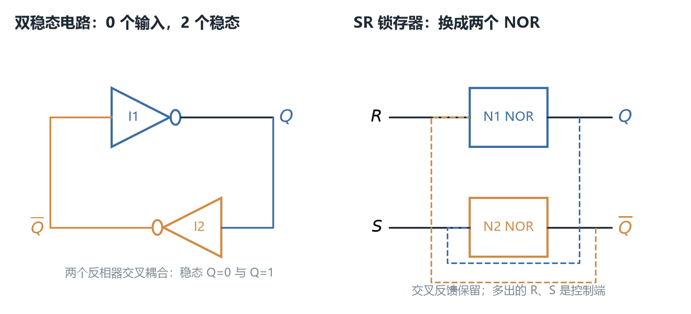
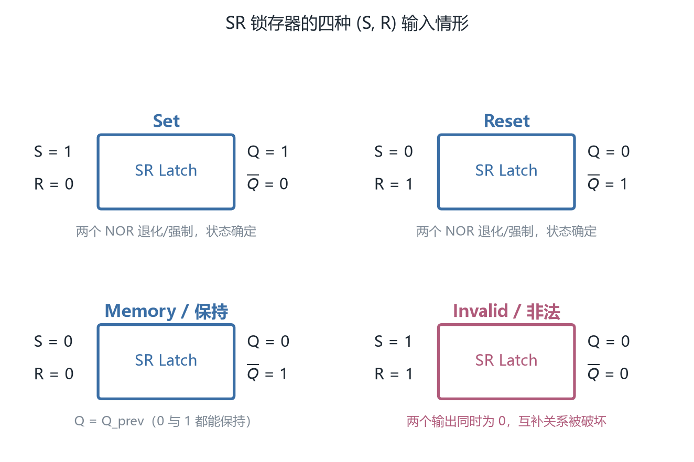
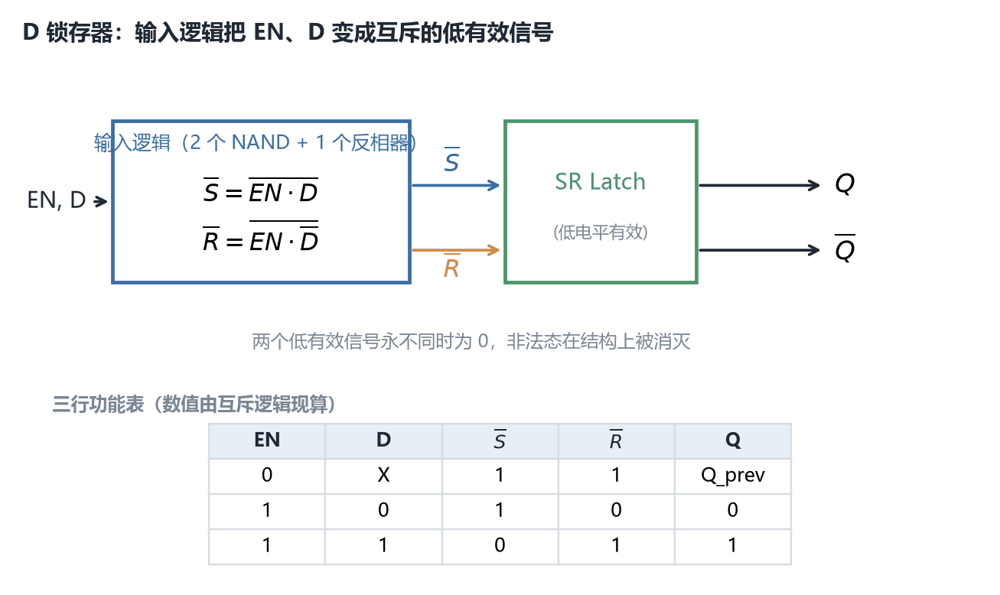
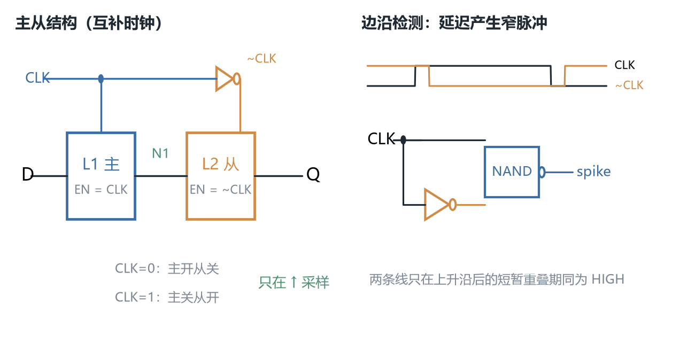
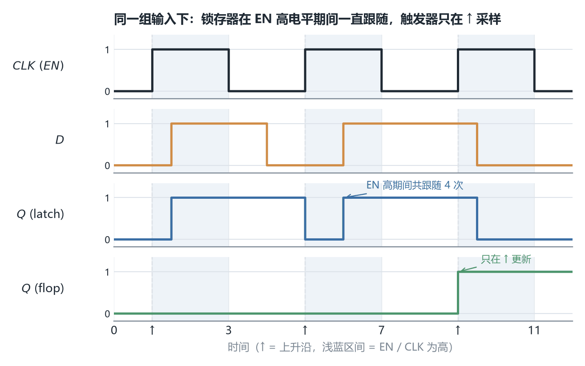
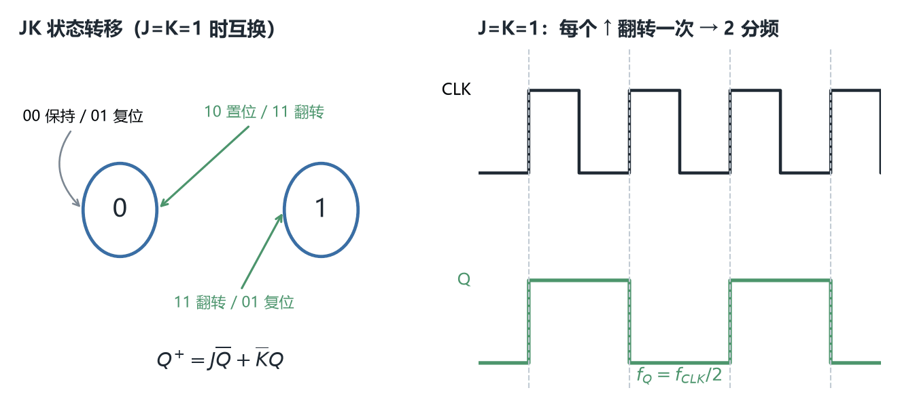
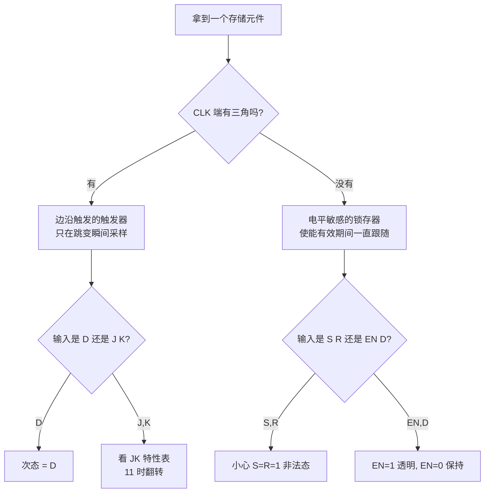

# ECE2050 Chapter 7 Sequential Logic Design 课堂笔记

## 本章在讲什么

前六章有一条很清楚的线：**给一个功能，先写出布尔表达式，再化简，最后用门搭出来**。Chapter 2 解决数怎么表示，Chapter 3 解决门长什么样，Chapter 4 解决式子怎么化简，Chapter 5 解决式子怎么变成门，Chapter 6 解决怎么直接挑现成模块来拼。这六章有一个从未被打破的前提——**电路的输出只是当前输入的函数**。同一组输入给两次，输出必然一样；电路不记得上一次发生过什么。

Chapter 7 把这个前提拆掉了。它要造的电路，输出不仅取决于**现在**的输入，还取决于**过去**的输入。为此电路必须能存东西，哪怕只存一位。这一章就是从一个"什么也存不了、但恰好有两个稳定状态"的小电路出发，一级一级加上控制端，最后造出能存一个字节、能复位、能置位的寄存器：

**双稳态电路（两个反相器成环）→ SR 锁存器（加上 S、R 两根控制线）→ D 锁存器（把 S、R 绑成一根数据线 + 一根使能线）→ D 触发器（两级锁存器背靠背，只在时钟沿那一刻采样）→ 寄存器（若干个触发器共用一个时钟）**

所以本章可以看成**一条"控制存储时刻"的进化史**，中间有三次关键的转折：

- 第一次是 p8 → p11：给一个只能"记住、但改不了"的电路加上输入，它才第一次可被写入。
- 第二次是 p16 → p19：把"使能期间一直可写"改成"只在时钟跳变的那一瞬间可写"。这一步是全章最重要的分水岭，也是 Chapter 9 里所有同步时序分析能成立的前提。
- 第三次是 p26 → p30：从"存一位"推广到"存一组位"，再往触发器里加使能、复位、置位这些工程上必需的旁路。

一句话概括全章：**前六章你在造"算得快的电路"，这一章开始造"记得住事的电路"；而让电路可靠记住事的关键，不是加多少存储单元，是把"什么时候允许它改"收到一个瞬间。**

32 页讲义被七个分节页切成七段，边界很干净：p3 "State Elements"、p7 "Bistable Circuit"、p10 "SR Latch"、p15 "D Latch"、p18 "D Flip Flop"、p23 "J-K Flip Flop"、p25 "Variations on a Flop"。各小节的讲义页序对应如下，笔记正文就按这个顺序一条线写下来：

| 讲义页 | 本笔记小节 | 内容 |
| --- | --- | --- |
| p1 | —— | 封面：ECE 2050 / Chapter 7: Sequential Logic Design / Tinghuan CHEN, Ph.D. |
| p2 | 开场：上一讲回顾 | Last Week 九条清单 + 红字抛题 "How to design a multiplier by FA/HA?" |
| p3 | —— | 分节页：State Elements |
| p4 | 时序逻辑与状态 | 时序逻辑定义、State / Latches and flip-flops / Synchronous sequential circuits 三条定义 |
| p5 | 时序逻辑与状态 | 三条特征：给事件排序、短期记忆、输出反馈到输入 |
| p6 | 时序逻辑与状态 | State 的严格定义 + 四类状态元件清单 |
| p7 | —— | 分节页：Bistable Circuit |
| p8 | 双稳态电路 | 两输出 $Q$、$\overline{Q}$、无输入；背靠背与交叉耦合两种画法 |
| p9 | 双稳态电路 | 两种稳定情形的分析、存一位、但没有输入来控制状态 |
| p10 | —— | 分节页：SR Latch |
| p11 | SR 锁存器 | 两个 NOR 交叉耦合；四种输入情形的枚举清单 |
| p12 | SR 锁存器 | Set 与 Reset 两种情形的电路状态 |
| p13 | SR 锁存器 | 保持（Memory）与非法态（Invalid State） |
| p14 | SR 锁存器 | 特性归纳、SR 锁存器符号、"必须避开非法态" |
| p15 | —— | 分节页：D Latch |
| p16 | D 锁存器 | 两个输入 EN、D；透明与不透明 |
| p17 | D 锁存器 | 内部电路（门级 SR 锁存器 + 两个 NAND）与三行功能表 |
| p18 | —— | 分节页：D Flip Flop |
| p19 | D 触发器 | 输入 CLK、D；上升沿真值表；edge-triggered；符号 |
| p20 | D 触发器 | 两个背靠背 D 锁存器 L1/L2、互补时钟、上升沿采样 |
| p21 | D 触发器 | 用反相器延迟产生窄脉冲的边沿检测电路 |
| p22 | D 触发器 | D Latch 与 D Flip-Flop 波形对照（输出两行讲义留白） |
| p23 | —— | 分节页：J-K Flip Flop |
| p24 | J-K 触发器 | 输入 CLK、J、K；8 行完整真值表 + 4 行功能表；Toggle |
| p25 | —— | 分节页：Variations on a Flop |
| p26 | 寄存器与触发器变体 | 4 位寄存器：四个 D 触发器共用 CLK |
| p27 | 寄存器与触发器变体 | 带使能 EN 的触发器（内部 2:1 Mux 反馈） |
| p28 | 寄存器与触发器变体 | 带 Reset 的触发器 |
| p29 | 寄存器与触发器变体 | 同步复位 vs 异步复位；同步复位怎么做（讲义抛题） |
| p30 | 寄存器与触发器变体 | 带 Set 的触发器 |
| p31 | 本章回顾与自测 | Chapter Review 九条清单 |
| p32 | 本章回顾与自测 | 六道 True/False Quiz（讲义已标答案） |

## 开场：上一讲回顾，以及为什么必须换一种电路（讲义 p1–p2）

p2 把 Chapter 6 的内容列成九条：半加器与全加器（Half and Full Adders）、并行二进制加法器（Parallel Binary Adders）、行波进位与超前进位加法器（Ripple Carry and Look-Ahead Carry Adders）、比较器（Comparators）、译码器（Decoders，$n$ 根输入线最多给出 $2^n$ 根输出线）、编码器（Encoders，例如十进制-BCD 优先级编码器）、多路选择器（Multiplexers，把多路输入选到一根输出线上）、解复用器（Demultiplexers）、时序（Timing）。旁边配了全加器与超前进位网络的小图，红字留了一道抛题：*How to design a multiplier by FA/HA?*（怎么用全加器/半加器设计乘法器？）

> [!NOTE] 补充：这道抛题两次出现都没有答案
> 同一道乘法器题目在 Chapter 6 的回顾页（p55）已经抛过一次，本章 p2 又原样搬来，两次都没有给解答。按这门课讲义的习惯，页底留的问题往往是下一块内容的目录，但这一题到 Chapter 9 也没被正面回答。方向性回答：$n\times n$ 阵列乘法器需要 $n(n-1)$ 个全加器与 $n$ 个半加器，把部分积按位错开相加；**这不是课件内容**，考试若涉及请以课堂为准。

**为什么组合逻辑不够用？** 看一个具体场景：一台自动售货机，投币口只识别"这一刻有没有投进来一枚硬币"。若电路是纯组合的，那么"累计投了多少"就无从谈起——电路在任何一个时刻看到的输入都只是当前那一枚，它没有办法把之前投过的几枚累加起来。同样，交通灯控制器需要知道"上一个状态是红灯还是绿灯"才能决定下一步；电梯需要记住"现在在第几层"。

这些例子的共同点是：**同样的当前输入，在不同的历史下必须给出不同的输出。** 这直接违反了组合逻辑的定义。于是必须有地方把历史存下来，这就是本章全部内容的动机。

> [!IMPORTANT] 重要：本章与前六章的分界
> 组合逻辑（combinational logic）：输出仅是**当前输入**的函数，无记忆、无反馈环。
> 时序逻辑（sequential logic）：输出依赖**当前与先前的输入**序列，因此必须含记忆元件以及从输出回到输入的反馈路径。
> 这条分界不是修辞：Chapter 6 的毛刺分析里还把"反馈"当作要消除的麻烦，本章起反馈正式成为设计手段。

## 时序逻辑与状态（讲义 p3–p6）

先把三个定义原样摆出来，再逐个拆。

**定义一（p4）**：时序逻辑的输出取决于当前和先前的输入值——它有记忆（memory）。

**定义二（p4）**：状态（state）是"解释一个电路未来行为所必需的全部信息"；锁存器与触发器（latches and flip-flops）是**存一位状态**的状态元件（state elements）；同步时序电路（synchronous sequential circuits）是用共用同一时钟的触发器搭成的时序电路。

**定义三（p6）**：状态是"关于电路过去输入的、预测其未来行为所必需的一切"，通常就只有一位——最近捕获到的那个值。

三句话其实在说同一件事，只是角度不同：p4 强调"未来的输出要用它"，p6 强调"它是历史的压缩结果"。把两者合起来读才完整：**状态不是历史本身，是历史里对未来还有影响的那一小部分。** 一个自动售货机不需要记住"第三分钟投的是一枚旧硬币还是新硬币"，只需要记住"当前累计金额"，这个累计金额就是状态。

p5 补了时序电路的三条行为特征：给事件排出先后顺序（give sequence to events）、有短期记忆（short-term memory）、用输出反馈到输入来存信息（use feedback from output to input to store information）。第三条最技术：组合逻辑要求电路是有向无环的，时序逻辑**故意引入环**，环上的元件就是存储点。

> [!TIP] 技巧：判断一个电路是不是时序的
> 别看它有没有 CLK，看**有没有环**。把信号沿门一路往前追，若能回到出发点，就是时序电路（两个反相器交叉耦合也算，哪怕它没有时钟）。反过来，一个带 CLK 输入的译码器若内部没有反馈环，仍是组合电路。

**失败情形**：假设把同步时序电路定义里的"共用一个时钟"去掉，让每个触发器各用各的时钟。这时状态仍然存在，但"状态在什么时候一起更新"没有统一答案，电路行为会依赖各条时钟线的相对延迟，无法用一张状态表描述。Chapter 9 的建立/保持时间分析正是建立在"共用一个时钟"这条约束上。

讲义在 p6 给出本章要造的四类状态元件，顺序即后面四节：双稳态电路（Bistable circuit）、SR 锁存器（SR Latch）、D 锁存器（D Latch）、D 触发器（D Flip-flop）。这个顺序不是并列的清单，而是**每一级都在补上一级的缺陷**。

> [!TIP] 参考答案
> **练习 1**：判断下列电路哪些是时序逻辑——(a) 4 位超前进位加法器；(b) 两个反相器首尾相连成环；(c) 带使能端的 2:4 译码器；(d) 四个 D 触发器共用 CLK 组成的寄存器。
> (a) 不是，纯组合；(b) 是，有反馈环且有两个稳定状态，虽然没有时钟；(c) 不是，使能端只是一根普通输入，内部无环；(d) 是，触发器内部含反馈且状态在时钟沿更新。
> **练习 2**：为什么说"状态是历史的压缩"？举一个历史不同但状态相同的例子。
> 先投 5 角再投 5 角，与一次投 1 元，历史不同，但对"是否够买 1 元商品"这个未来行为而言状态相同（累计 1 元）。状态只保留对将来有影响的那部分信息。

## 双稳态电路：记忆从哪里来（讲义 p7–p9）

**先给电路。** 两个反相器 $I_1$、$I_2$ 首尾相接成一个环：$I_1$ 的输出是 $Q$，$Q$ 接到 $I_2$ 的输入，$I_2$ 的输出是 $\overline{Q}$，$\overline{Q}$ 又接回 $I_1$ 的输入。整个电路**没有输入**，只有两个输出 $Q$ 与 $\overline{Q}$。讲义给了两种画法：一种把两个反相器画成"背靠背"（back-to-back inverters），一种画成上下交叉耦合（cross-coupled inverters），旁边用红字标了 *Same circuit!* —— 两者只是版式不同，连线关系完全一样。

*图 1　左：两个反相器交叉耦合构成的双稳态电路，无输入、两输出 $Q$ 与 $\overline{Q}$；两种画法只是版式不同。右：把两个反相器换成两个 NOR 门并引出 $R$、$S$，就是下一节的 SR 锁存器。*

**现在看它为什么能存东西。** p9 只做了一件事：把 $Q$ 的两种可能取值分别代进去，看会不会自相矛盾。

| 假设 | 经 $I_2$ 反相 | 再经 $I_1$ 反相回到 $Q$ | 结论 |
| --- | --- | --- | --- |
| $Q=0$ | $\overline{Q}=1$ | $Q=0$ | 与假设一致，稳定 |
| $Q=1$ | $\overline{Q}=0$ | $Q=1$ | 与假设一致，稳定 |

两种情况都自洽，所以电路能停在任意一个上，**这就是一位信息**：它停在哪个状态，就代表存了 0 还是 1。用状态变量 $Q$（或等价地用 $\overline{Q}$）来表示即可。

> [!IMPORTANT] 重要：为什么叫"双"稳态
> 稳定状态恰好有两个，不是一个也不是三个。这一点在 p32 第 1 题就被拿来考：*A latch has one stable state* 是错的。两个稳定状态 + 能停住 = 一位存储。

**但这电路没法用。** p9 最后一句点破了它的缺陷：*But there are no inputs to control the state*（没有输入来控制这个状态）。它上电后停在哪个状态由工艺偏差和噪声决定，之后永远改不了。一个只能读不能写的存储器没有意义——下一节要解决的就是"给它加输入"。

> [!CAUTION] 注意：两个稳定状态不等于只有两个平衡点
> 交叉耦合反相器的电压传输曲线还有一个位于中间的交点，那里也满足自洽，但**不稳定**：任何微小噪声都会把电路推向两端之一。这个中间点叫亚稳态（metastability），教材 Figure 3.2 用它解释为什么电路最终必然落到 0 或 1。讲义没有画这条曲线，本节按两个**稳定**状态来讲，与 p9 的措辞一致。

**失败情形**：把环上的反相器从 2 个改成 3 个。此时绕一圈共反相 3 次，$Q$ 会被推到 $\overline{Q}$，永远无法自洽，电路变成一个环形振荡器（ring oscillator）——**奇数个反相器成环不存储，只振荡**。反馈环是必要条件，但环长必须是偶数才有稳态。

> [!TIP] 参考答案
> **练习 1**：双稳态电路有几个输入、几个输出？能存几位？
> 0 个输入、2 个输出（$Q$ 与 $\overline{Q}$，互为反相），能存 1 位。注意输出数量 ≠ 存储位数，$\overline{Q}$ 只是 $Q$ 的副本。
> **练习 2**：把这个环换成三个反相器，电路还能记住一位吗？
> 不能。奇数次反相使环内无法自洽，输出会持续翻转，成为振荡器；稳态个数为 0。

## SR 锁存器：给存储加上两根控制线（讲义 p10–p14）

**改造思路非常直接**：双稳态电路的环上是两个反相器（各只有一个输入，被反馈占死了）。把它们换成**两个输入**的门，多出来的那个输入就能从外面控制状态。讲义选的是两个 NOR 门，记作 $N_1$（输出 $Q$，外部输入 $R$）与 $N_2$（输出 $\overline{Q}$，外部输入 $S$），两者交叉耦合。

为什么是 NOR？因为 NOR 有一个"中性输入"：**只要有一个输入是 1，输出就强制为 0；输入为 0 时，输出等于另一个输入的反相**。于是当 $R=S=0$ 时，两个 NOR 各自退化成反相器，电路变回上一节的双稳态电路（保持）；当某根控制线拉高时，就能强制对应输出为 0，再经反馈把另一边推成 1（写入）。

### 四种输入情形，逐一代进去算

p11 把 $(S,R)$ 的四种组合列成清单，p12–p13 逐条给出结果。下表是归纳（$Q_{prev}$ 表示此前的状态）：

| $S$ | $R$ | $Q$ | $\overline{Q}$ | 名称 | 讲义页 |
| --- | --- | --- | --- | --- | --- |
| 1 | 0 | 1 | 0 | 置位（Set），把输出写成 1 | p12 |
| 0 | 1 | 0 | 1 | 复位（Reset），把输出写成 0 | p12 |
| 0 | 0 | $Q_{prev}$ | $\overline{Q}_{prev}$ | 保持（Memory） | p13 |
| 1 | 1 | 0 | 0 | 非法态（Invalid State），$\overline{Q}\ne \text{NOT }Q$ | p13 |

逐条看电路里发生了什么：

**$S=1,R=0$（Set）**：$N_2$ 有一个输入为 1，故 $\overline{Q}=0$；这个 0 送回 $N_1$，与 $R=0$ 一起使 $Q=\overline{0+0}=1$。讲义在图上把 $S$ 标 1、$R$ 标 0，红字写 *Set the output*。

**$S=0,R=1$（Reset）**：对称地，$N_1$ 输出 $Q=0$，反馈回去使 $N_2$ 输出 $\overline{Q}=1$。

**$S=0,R=0$（Memory）**：两个 NOR 都退化成反相器，电路回到双稳态。p13 特意画了两张小图，分别标 $Q_{prev}=0$ 与 $Q_{prev}=1$，说明**两种先前状态都能自洽地保持**，所以 $Q=Q_{prev}$。这是"记忆"第一次真正出现：输出不再由当前输入唯一决定。

**$S=1,R=1$（非法）**：两个 NOR 都被强制输出 0，于是 $Q=0$ 且 $\overline{Q}=0$，两个本该互补的输出**同时为 0**。p13 红字写 *Invalid State*、*$\overline{Q}\ne$ NOT $Q$*。p14 最后一行因此强调：*Must do something to avoid invalid state (when $S=R=1$)*。

*图 2　两个交叉耦合 NOR 门在四种 $(S,R)$ 下的稳态。Set 与 Reset 各自把电路推向一端；$S=R=0$ 时两个 NOR 退化为反相器、保持 $Q_{prev}$；$S=R=1$ 时 $Q$ 与 $\overline{Q}$ 同时为 0，互补关系被破坏。*

### 用方程把四种情形一次算完

设两条反馈线的值就是两个输出本身。NOR 门的输出等于"输入之和再取反"：

$$Q = \overline{R + \overline{Q}}\qquad \overline{Q} = \overline{S + Q}$$

把第二式代进第一式：

$$Q = \overline{R + \overline{S + Q}} = \overline{R}\,(S + Q) = \overline{R}\,S + \overline{R}\,Q$$

把四种 $(S,R)$ 代进去验证：$(1,0)\Rightarrow Q=1$；$(0,1)\Rightarrow Q=0$；$(0,0)\Rightarrow Q=Q$（恒等，故保持）；$(1,1)\Rightarrow Q=0$。四行与上表逐行吻合。

> [!IMPORTANT] 重要：常见写法 $Q^+ = S + \overline{R}\,Q$ 带一个前提
> 教材里常把 SR 锁存器写成特征方程 $Q^+ = S + \overline{R}\,Q$。它在 $S=R=0$ 时给 $Q$，在 $(1,0)$ 时给 1，在 $(0,1)$ 时给 0，都与上表一致；**但 $(1,1)$ 时它给 1，而真实电路给 0**。所以这条简式只在约束 $S\,R=0$（禁止两根同时有效）下成立。把简式当成无条件真理，是本章最容易在考题里翻车的地方。

**失败情形**：从 $S=R=1$ 把两根线**同时**撤回到 0。此刻两边都"刚被放开"，谁先把对方推成 1 取决于两个门谁快一点点（工艺偏差、温度、走线电容）。结果可能是 $Q=0$ 或 $Q=1$，甚至短暂停在中间电压后才落定。这就是竞态（race）与亚稳态的实际来源，也是 p14 那句"必须做点什么"的原因。下一节的 D 锁存器给出的答案是：**从电路结构上保证 $S$、$R$ 永远不可能同时有效**。

> [!CAUTION] 注意：字母与输出的对应容易记反
> 本讲义的接法是 $S$ 进输出 $\overline{Q}$ 的那个门（$N_2$）、$R$ 进输出 $Q$ 的那个门（$N_1$）。所以 $S=1$ 先把 $\overline{Q}$ 压成 0、再经反馈把 $Q$ 抬成 1。若按"Set 直接接在 $Q$ 门上"去记，会推出相反结果。另外有些教材用 NAND 搭 SR 锁存器，那时有效电平是**低**电平，表格整张反过来——先看清门型再套表。

p14 还给了 SR 锁存器的方块符号：一个矩形，左侧 $S$、$R$ 两根输入，右侧 $Q$ 与 $\overline{Q}$ 两根输出（$\overline{Q}$ 端带小圆圈）。从此以后不需要再画内部两个 NOR。

> [!TIP] 参考答案
> **练习 1**：NOR 型 SR 锁存器初始 $Q=0$，依次加 $(S,R)=(1,0)\to(0,0)\to(0,1)\to(0,0)$，写出每一步的 $Q$。
> $0 \to 1$（Set）$\to 1$（保持）$\to 0$（Reset）$\to 0$（保持）。
> **练习 2**：为什么 $S=R=1$ 叫非法态，而不是"又一个稳定状态"？
> 因为它确实自洽（两个 NOR 都输出 0，代回去仍成立），却破坏了 $Q$ 与 $\overline{Q}$ 互补这个设计契约；下游电路若同时用这两个输出会读到矛盾信息，且撤离时最终态不确定。

## D 锁存器：把两根控制线绑成「数据 + 使能」（讲义 p15–p17）

SR 锁存器的问题不只是非法态，还有"两根线要配合着给"很别扭。p16 的 D 锁存器给出更自然的接口：

- 数据输入（data input）$D$：控制输出**变成什么**；
- 使能输入（enable input）$EN$：控制输出**什么时候可以变**。

功能只有两句：$EN=1$ 时 $D$ 直通到 $Q$（称为透明 transparent）；$EN=0$ 时 $Q$ 保持先前值（称为不透明 opaque）。

| $EN$ | $D$ | $Q$ | $\overline{Q}$ | 模式 |
| --- | --- | --- | --- | --- |
| 0 | X | $Q_{prev}$ | $\overline{Q}_{prev}$ | 不透明（保持），$D$ 被忽略 |
| 1 | 0 | 0 | 1 | 透明（写入 0） |
| 1 | 1 | 1 | 0 | 透明（写入 1） |

X 表示 don't care：$EN=0$ 时 $D$ 取什么都一样，这是 Ch4/Ch5 里用过的同一个记号。

**p17 的内部电路**说明了非法态是怎么被消灭的。在 SR 锁存器前面加两个 NAND 门和一个反相器，产生一对低电平有效信号：

$$\overline{S} = \overline{EN\cdot D}\qquad \overline{R} = \overline{EN\cdot \overline{D}}$$

$EN=0$ 时两式都等于 1（对低有效 SR 锁存器而言是"都不动作"，保持）；$EN=1$ 时 $\overline{S}$ 与 $\overline{R}$ 恰好一低一高，永远不会同时有效。于是 $S=R=1$ 这个输入组合在物理上**产生不出来**。

> [!NOTE] 补充：讲义 p17 的门级标号
> 讲义把两个 NAND 的输出直接标成 $R$、$S$（不带杠），配合的是**低电平有效**的锁存器内核；而 p11–p14 讲的是 NOR 型、高电平有效。为免两套约定混在一起，本笔记把它们写成 $\overline{S}$、$\overline{R}$，并在此说明：**这是对讲义标号的统一改写，不是讲义原文的记号**。电路行为与讲义三行功能表完全一致。

*图 3　$EN$ 与 $D$ 经两个 NAND 产生互斥的 $\overline{S}$、$\overline{R}$，驱动低有效 SR 锁存器。$EN=0$ 时两者同为 1（保持）；$EN=1$ 时按 $D$ 只拉低其中一根，因此非法态不可能出现。*

**给一个能手算的例子**：设 $EN$ 在 $t_1$ 到 $t_2$ 之间为 1，期间 $D$ 从 0 变到 1 再变回 0，之后 $EN$ 变回 0。$Q$ 会完整跟着 $D$ 走三次（0→1→0），然后停在最后那个 0 上。**注意"跟着走"是关键**：透明期内 $D$ 的每一次变化都会立刻穿透到输出，锁存器并不只采样一次。

> [!CAUTION] 注意：透明的代价
> 若把这样一个锁存器放进有反馈的同步系统，$EN=1$ 的整个半周期里，输出变化会沿组合逻辑绕一圈又回到输入，形成**组合环**。这正是下一节要改用边沿触发的根本原因，也是 Chapter 9 p4–p5 把"用寄存器打断环"列为设计第一步的理由。

> [!TIP] 参考答案
> **练习 1**：$EN=1$ 时 $D=1$，随后 $EN$ 降为 0，$D$ 再改成 0。$Q$ 是多少？
> 1。$EN$ 下降那一刻锁存器关闭，之后的 $D$ 变化被挡住。
> **练习 2**：证明 $\overline{S}$、$\overline{R}$ 不可能同时为 0。
> 同时为 0 要求 $EN\cdot D=1$ 且 $EN\cdot\overline{D}=1$，即 $D=1$ 且 $D=0$，矛盾。所以低有效锁存器永远不会遇到"两个控制端同时有效"。

## D 触发器：把「可以改」压缩到一个瞬间（讲义 p18–p22）

### 先看真值表，再问它怎么做到

p19 给的是一张极短的表，输入只有 $CLK$ 与 $D$。下表按讲义整理（$\uparrow$ 表示时钟从低到高的跳变，表下注 *↑ = clock transition LOW to HIGH*），第三行"非上升沿保持"是把 p19 的 edge-triggered 定义补全后的结果：

| $D$ | $CLK$ | $Q$ | $\overline{Q}$ | Comment |
| --- | --- | --- | --- | --- |
| 0 | $\uparrow$ | 0 | 1 | RESET |
| 1 | $\uparrow$ | 1 | 0 | SET |
| X | 非 $\uparrow$ | $Q_{prev}$ | $\overline{Q}_{prev}$ | 保持 |

也就是说：**只有上升沿那一瞬间 $D$ 被采样，其余时刻无论 $D$ 怎么变，$Q$ 都不动。** 这叫边沿触发（edge-triggered）。符号上，CLK 输入端画一个小三角（表示边沿触发）；三角前若无小圆圈，就是上升沿触发，有小圆圈则是下降沿触发。

> [!WARNING] 课件笔误：p19 真值表在文字层里完全丢失
> 用 pymupdf 抽取 p19，真值表部分只剩 `D Q Q CLK` 几个孤立字母，四行数值一个都没抽出来；上表是按 400 dpi 裁切该表后逐格读出的。**这是本讲最容易被抄错的一张表**：常见的错法是把两行的 $Q$ 都读成 0，或漏掉"非上升沿保持"这一行。

### 内部结构：两个锁存器，一开一关

p20 给了一个漂亮的解法：把两个 D 锁存器 $L_1$、$L_2$ 背靠背串起来，用**互补的时钟**控制——$L_1$ 的使能直接接 $CLK$，$L_2$ 的使能接 $\overline{CLK}$（讲义图上在 $L_1$ 的 EN 前画了一个反相器）。中间节点记作 $N_1$。

- **$CLK=0$**：$L_1$ 透明、$L_2$ 不透明，$D$ 穿过 $L_1$ 到达 $N_1$，但被 $L_2$ 挡住，到不了 $Q$。
- **$CLK=1$**：$L_1$ 不透明、$L_2$ 透明，$N_1$ 的值穿过 $L_2$ 到达 $Q$；此时 $D$ 再怎么变，$L_1$ 已经关了，$N_1$ 不动。

于是**只有在 $CLK$ 从 0 跳到 1 的那一刻，$N_1$ 上恰好是"跳变前最后稳定的 $D$"，并在这个跳变后被送出去**。整个高电平期间 $Q$ 稳定不变。这就是主从（master-slave）结构：$L_1$ 是主，$L_2$ 是从。

*图 4　左：两个 D 锁存器由互补时钟控制，$CLK=0$ 时主级开、从级关，$CLK=1$ 时反过来，只有上升沿把 $N_1$ 送到 $Q$。右：p21 的脉冲边沿检测器——$CLK$ 与其经反相器延迟后的版本同时送进 NAND，只在上升沿的短暂重叠期输出一个窄脉冲。*

### p21 的另一种做法：造一个极窄的"允许窗口"

主从结构不是唯一路径。p21 展示了脉冲转换检测器（pulse transition detector）：把 $CLK$ 分两路，一路直接进 NAND，另一路先过一个反相器（因而带上一点传播延迟）再进同一个 NAND。在 $CLK$ 刚跳高的极短时间里，两条线**同时为高**，NAND 输出一个窄尖峰（图上标 *Short pulse (spike) produced by delay (when both gate inputs are HIGH)*），后面再接一个反相器整形。用这个尖峰当作锁存器的使能，就等效于只在边沿开一扇很窄的门。

> [!NOTE] 补充：两种做法的取舍
> 主从结构靠**两级互补使能**，不依赖门延迟的精确值，是工程上可靠的做法；p21 的尖峰法靠**门延迟本身**产生窄脉冲，脉冲宽度由反相器延迟决定，随工艺、温度、电压漂移，窄到一定程度后级可能根本来不及响应。讲义把它作为"边沿触发的一种实现原理"展示，实际器件（如 74HC74）用的是主从/维持阻塞结构。**这段比较课件没有给，是我的补充。**

### p22：把两种元件放在同一组波形下对照

讲义 p22 画了 $CLK(EN)$ 与 $D$ 两条输入波形，下面留了 $Q$(latch) 与 $Q$(flop) 两行**空白**——输出波形是留给我们自己填的。按前面两条规则补出来，差别一目了然：

*图 5　同一组 $CLK(EN)$ 与 $D$ 下的输出。$Q$(latch) 在 $EN$ 为高的整段里跟着 $D$ 变（三段高电平中共变化 4 次：$t=1.5$ 随 $D$ 上升、$t=5$ 随 $EN$ 打开追上低电平、$t=6$ 再上升、$t=9.5$ 下降）；$Q$(flop) 只在三个上升沿采样，依次取到 0、0、1，沿与沿之间保持。讲义 p22 只画了上面两条输入线，下面两行是本笔记补出的答案。*

读图要点：三个高电平区间分别看。第一段 $EN=1$ 期间 $D$ 在 $t=1.5$ 从 0 升到 1，$Q$(latch) 立刻跟着升；$Q$(flop) 在 $t=1$ 的上升沿采到的是 $D=0$，于是整段保持 0。第二段 $EN$ 在 $t=5$ 重新打开时 $D$ 已经是 0，锁存器先把输出拉低，$t=6$ 时 $D$ 又升到 1，锁存器再升一次；触发器在 $t=5$ 采到 0，仍然不动。第三段 $t=9$ 的上升沿 $D=1$，触发器这才升到 1；而 $t=9.5$ 时 $D$ 降回 0，锁存器又跟了一次。**同一组输入下，锁存器变了 4 次，触发器只变了 1 次**——这就是"电平敏感"与"边沿触发"的全部差别。

> [!IMPORTANT] 重要：为什么全课程后面只用触发器
> 触发器的输出在一个时钟周期内**只变一次**，于是两个触发器之间的组合逻辑有整整一个周期可以慢慢稳定下来，Chapter 9 才能写出 $T_c \ge t_{pcq}+t_{pd}+t_{setup}$ 这条式子。若换成锁存器，透明期里反馈会形成组合环，周期分析无从做起。p4 那条"同步时序电路 = 共用时钟的触发器"的定义，到这里才显示出分量。

**失败情形**：把 p20 里 $L_2$ 使能前的反相器拆掉，让两级用同一个 $CLK$。此时 $CLK=1$ 期间两级同时透明，$D$ 会一路穿透到 $Q$；$CLK=0$ 期间两级同时关闭。整个器件退化成一个 D 锁存器，边沿触发消失。**互补时钟是从锁存器到触发器的那一步，不能省。**

> [!TIP] 参考答案
> **练习 1**：上升沿时 $D=0$，沿后 5 ns $D$ 变成 1 并保持到下一个上升沿之前。$Q$ 在这段里怎么变？
> 一直保持 0，直到下一个上升沿才可能变。边沿之后 $D$ 的变化对已关闭的主级没有影响。
> **练习 2**：p32 第 4 题说"边沿触发 D 触发器的状态随 $D$ 输入变化而变化"，为什么错？
> 因为它只在时钟边沿采样 $D$。若 $D$ 在两个沿之间变化而 $Q$ 不变（正是本题反例），命题就不成立。

## J-K 触发器：把「保持 / 置位 / 复位 / 翻转」四种动作装进一个器件（讲义 p23–p24）

p24 给的输入是 $CLK$、$J$、$K$。它同时给了两张表：左边是四行的功能表，右边是把当前状态 $Q_N$ 也列进去的八行完整真值表。两张表必须合起来读——功能表里 "Toggle" 那一行的输出写成 $\overline{Q_0}$、$Q_0$，只有把具体 $Q_N$ 代进去才能落到 0/1。

| $J$ | $K$ | $Q_N$ | $Q_{N+1}$ | 说明 |
| --- | --- | --- | --- | --- |
| 0 | 0 | 0 | 0 | No change |
| 0 | 0 | 1 | 1 | No change |
| 0 | 1 | 0 | 0 | RESET |
| 0 | 1 | 1 | 0 | RESET |
| 1 | 0 | 0 | 1 | SET |
| 1 | 0 | 1 | 1 | SET |
| 1 | 1 | 0 | 1 | Toggle |
| 1 | 1 | 1 | 0 | Toggle |

对应的四行压缩表（讲义左侧，$\uparrow$ 为上升沿）：

| $J$ | $K$ | $CLK$ | $Q$ | $\overline{Q}$ | Comment |
| --- | --- | --- | --- | --- | --- |
| 0 | 0 | $\uparrow$ | $Q_0$ | $\overline{Q_0}$ | No change |
| 0 | 1 | $\uparrow$ | 0 | 1 | RESET |
| 1 | 0 | $\uparrow$ | 1 | 0 | SET |
| 1 | 1 | $\uparrow$ | $\overline{Q_0}$ | $Q_0$ | Toggle |

把八行表当作真值表化简，得到 JK 触发器的特征方程：

$$Q^{+} = J\,\overline{Q} + \overline{K}\,Q$$

逐行验证：$J=K=0$ 给 $Q$（保持），$(0,1)$ 给 0，$(1,0)$ 给 1，$(1,1)$ 给 $\overline{Q}$（翻转）。**注意与 SR 不同**：$J=K=1$ 在 JK 里是合法且有明确含义的（翻转），不是非法态。这正是 JK 相对 SR 的主要改进。

> [!NOTE] 补充：用 D 触发器搭出 JK
> 既然 $D$ 触发器的次态就是 $D$，只要把上面那条特征方程接到 $D$ 端即可：$D = J\overline{Q} + \overline{K}Q$。反方向也成立：$J=D$、$K=\overline{D}$ 时 JK 退化成 D 触发器。教材把这两问放在 **Exercise 3.10**（printed p.160 附近），正文不讲 JK——**讲义 p24 这一页不来自教材正文**，复习时别去 §3.2 里找。

**Toggle 有什么用**：令 $J=K=1$，每个时钟沿输出翻转一次，于是 $Q$ 的周期是 $CLK$ 的两倍——这是一个 **2 分频器**，也是 Chapter 8 计数器与移位寄存器的种子。把 $n$ 个这样的触发器串起来就得到 $2^n$ 分频。

*图 6　左：按 $(J,K)$ 分组的四条状态转移，只有 $J=K=1$ 时两个状态互换（Toggle）。右：令 $J=K=1$，$Q$ 在每个上升沿翻转，$f_Q = f_{CLK}/2$。*

> [!TIP] 参考答案
> **练习 1**：$Q_N=1$，依次在三个上升沿加 $(J,K)=(0,1)\to(0,0)\to(1,1)$，写出每沿之后的 $Q$。
> $1 \to 0$（RESET）$\to 0$（保持）$\to 1$（Toggle）。
> **练习 2**：为什么说 JK 消除了 SR 的非法态？
> SR 的 $S=R=1$ 让两个互补输出同时为 0 且撤离后不确定；JK 把这一组合**定义**成翻转，用反馈的现态 $\overline{Q}$ 决定次态，输出始终互补、结果确定。

## 寄存器与触发器变体（讲义 p25–p30）

### 从一位到一组：4 位寄存器（p26）

把 4 个 D 触发器并排放，$D_3,D_2,D_1,D_0$ 各接一个触发器的 $D$，四个 $Q$ 输出分别是 $Q_3,Q_2,Q_1,Q_0$，**所有触发器的 CLK 接同一根线**。这样一次上升沿就把 4 位数据一起锁进去，这就是 4 位寄存器（4-bit register）。讲义还给了方框符号：$D_{3:0}$ 进、$Q_{3:0}$ 出，CLK 端带三角。

关键不在"有 4 个触发器"，而在**共用时钟**：它保证 4 位在同一个瞬间一起更新，不会出现"高 2 位已更新、低 2 位还是旧值"的中间状态。这条约束就是 p4 里"同步时序电路"定义的落地。

### 六种变体，一张表收齐（p27–p30）

后面四页都在做同一件事：**保持触发器内核不变，在它前面或内部加一点逻辑，多出一个控制端。**

| 变体 | 新增输入 | 行为 | 常见实现 | 讲义页 |
| --- | --- | --- | --- | --- |
| 普通 D 触发器 | —— | 每个沿采样 $D$ | 主从两级锁存器 | p19–p20 |
| 使能触发器 Enabled FF | $EN$ | $EN=1$ 沿上采样 $D$；$EN=0$ 保持 | $D$ 端前 2:1 Mux，$EN=0$ 时把 $Q$ 反馈回 $D$ | p27 |
| 可复位触发器 Resettable FF | $Reset$ | $Reset=1$ 时 $Q=0$；$Reset=0$ 普通 D FF | 同步：$D\cdot\overline{Reset}$；异步：改内部电路 | p28–p29 |
| 可置位触发器 Settable FF | $Set$ | $Set=1$ 时 $Q=1$；$Set=0$ 普通 D FF | 同步：$D+Set$ | p30 |
| 寄存器 Register | —— | $n$ 个 D FF 共用 CLK | 并行 $n$ 位 | p26 |
| J-K 触发器 | $J,K$ | 保持 / 复位 / 置位 / 翻转 | $D=J\overline{Q}+\overline{K}Q$ | p24 |

**p27 的使能触发器**在内部用了一个 2:1 多路选择器（Mux），两个输入分别是外部 $D$ 与反馈回来的 $Q$，选择线是 $EN$。$EN=1$ 选 $D$（正常写入），$EN=0$ 选 $Q$（把现态重新写回自己，等效于保持）。这是 Chapter 6 的 Mux 第一次在本课程里被用作**状态保持**的手段。

**p28–p29 的复位**分两种，p29 写得很明确：

- 同步复位（synchronous）：只在时钟沿复位；
- 异步复位（asynchronous）：$Reset=1$ 时**立刻**复位，不等时钟。

p29 还指出：*Asynchronously resettable flip-flop requires changing the internal circuitry of the flip-flop*（异步复位需要改动触发器内部电路），紧接着留了一句问号 *Synchronously resettable flip-flop?* —— 这是抛给读者的题，讲义没给答案。

> [!TIP] 参考答案：同步复位怎么做
> 不用改触发器内部，只要在 $D$ 输入端前面加一个 AND 门（$Reset$ 先取反）：
> $$D_{\text{eff}} = D\cdot\overline{Reset}$$
> $Reset=0$ 时 $D_{\text{eff}}=D$，触发器照常工作；$Reset=1$ 时 $D_{\text{eff}}=0$，下一个上升沿把 0 写进 $Q$。因为仍走 $D$ 路径，**复位只在时钟沿生效**，这正是"同步"的含义。同理，同步置位用 $D_{\text{eff}} = D + Set$。
> 异步复位则必须把 $Reset$ 直接接到两级锁存器的强制端，绕过 $D$ 与时钟——所以讲义才说要改内部电路。**这段答案是课件没给的补充**，与 p29 左下角画的那张"Reset 与 D 先过一个门再进 D 触发器"的内部电路图一致。

**失败情形**：把同步复位的 AND 门装到 $Q$ 输出端（用 $Q\cdot\overline{Reset}$ 当输出）。这样 $Reset=1$ 时输出确实立刻变 0，但触发器**内部状态仍是 1**；一旦 $Reset$ 撤回，旧值又冒出来。复位必须改变存储的状态，而不只是遮住输出。

> [!CAUTION] 注意：同步与异步的取舍不是"哪个更好"
> 异步复位上电即可把电路带到已知状态，不依赖时钟是否已经起振，工程中很常用；但它撤离时若恰好靠近时钟沿，可能违反恢复/移除时间（removal/recovery time）而进入亚稳态。同步复位没有这个麻烦，却要求时钟先跑起来。讲义只给了定义，这段权衡是我的补充。

> [!TIP] 参考答案
> **练习 1**：某 4 位寄存器共用 CLK，某次沿前 $D_{3:0}=1011$，沿后 $Q_{3:0}$ 是多少？若三根 $D$ 线在沿后又变了呢？
> 沿后 $Q_{3:0}=1011$；沿后 $D$ 的变化不影响，直到下一个上升沿。
> **练习 2**：$EN=0$ 时，使能触发器内部 Mux 选的是哪一路？为什么这样能保持？
> 选反馈的 $Q$。把现态重新送到 $D$ 端，下一个沿写入的还是同一个值，因此状态不变。

## 本章回顾与自测（讲义 p31–p32）

p31 的九条回顾清单：State（状态）、SR Latch 与 D Latch、D Flip Flop、J-K Flip Flop、Variations on a Flop（触发器变体）、Registers（寄存器）、Enabled Flip-Flops、Resettable Flip-Flops、Settable Flip-Flops。这份清单本身就是本章的目录，且与正文顺序完全一致。

p32 的六道判断题讲义已用红叉 / 绿勾标了答案。逐题抄出并补上理由——**只背结论不够，这六题每一题都对应一个"读图时容易答反"的点**：

| # | 题目（原文） | 答案 | 理由 |
| --- | --- | --- | --- |
| 1 | A latch has one stable state. | ✗ 错 | 锁存器是双稳态器件，有 $Q=0$ 与 $Q=1$ 两个稳定状态（p8–p9）。 |
| 2 | A latch is considered to be in the RESET state when the Q output is low. | ✓ 对 | RESET 的定义就是把输出写成 0；$Q=0$、$\overline{Q}=1$ 即复位态（p12）。 |
| 3 | Flip-flops and latches are both bistable devices. | ✓ 对 | 两者内部都是交叉耦合的双稳态结构，区别只在**何时**允许改变状态，不在有没有稳态。 |
| 4 | An edge-triggered D flip-flop changes state whenever the D input changes. | ✗ 错 | 只在时钟边沿采样；两个沿之间 $D$ 怎么变都不影响 $Q$（p19、p22）。 |
| 5 | A clock input is necessary for an edge-triggered flip-flop. | ✓ 对 | "边沿"就是时钟的边沿，没有时钟就没有采样时刻（p19–p21）。 |
| 6 | When both the J and K inputs are HIGH, an edge-triggered J-K flip-flop changes state on each clock pulse. | ✓ 对 | $J=K=1$ 是 Toggle，每个时钟沿翻转一次（p24）。注意是**每个沿**、不是每个电平期间。 |

> [!IMPORTANT] 重要：第 4 题与第 1 题是全章最高频的两个坑
> 第 4 考的是 latch 与 flip-flop 的分界（电平 vs 边沿），第 1 考的是"双稳态"的字面含义。把这两题连同理由一起记，比背一遍特性表更划算。

## 本章核心公式与结论速查

**一、状态元件家族**

| 元件 | 输入 | 何时可改状态 | 输出 | 讲义页 |
| --- | --- | --- | --- | --- |
| 双稳态电路 | 无 | 永不 | $Q$、$\overline{Q}$ | p8–p9 |
| SR 锁存器（NOR 型） | $S$、$R$ | 任意时刻，$S,R$ 高有效 | $Q$、$\overline{Q}$ | p11–p14 |
| D 锁存器 | $EN$、$D$ | $EN=1$ 的整段（透明） | $Q$、$\overline{Q}$ | p16–p17 |
| D 触发器 | $CLK$、$D$ | 仅上升沿 | $Q$、$\overline{Q}$ | p19–p20 |
| J-K 触发器 | $CLK$、$J$、$K$ | 仅上升沿 | $Q$、$\overline{Q}$ | p24 |
| 寄存器 | $D_{n-1:0}$、$CLK$ | 仅上升沿，共同时钟 | $Q_{n-1:0}$ | p26 |

**二、特性表（背这四张就够）**

| SR（NOR 型） | $S=1,R=0$ | $S=0,R=1$ | $S=0,R=0$ | $S=1,R=1$ |
| --- | --- | --- | --- | --- |
| $Q$ | 1 | 0 | $Q_{prev}$ | 0（非法） |

| D 锁存器 | $EN=0$ | $EN=1,D=0$ | $EN=1,D=1$ |
| --- | --- | --- | --- |
| $Q$ | $Q_{prev}$ | 0 | 1 |

| D 触发器 | 上升沿 $D=0$ | 上升沿 $D=1$ | 其余时刻 |
| --- | --- | --- | --- |
| $Q$ | 0 | 1 | $Q_{prev}$ |

| J-K 触发器 | $J K=00$ | $J K=01$ | $J K=10$ | $J K=11$ |
| --- | --- | --- | --- | --- |
| $Q^{+}$ | $Q$ | 0 | 1 | $\overline{Q}$ |

**三、方程**

$$Q_{\text{SR}} = \overline{R}\,(S+Q)$$
$$Q^{+}_{\text{SR}} = S + \overline{R}\,Q \quad (S\,R = 0\ \text{约束下})$$
$$\overline{S}_{\text{D}} = \overline{EN\cdot D}\qquad \overline{R}_{\text{D}} = \overline{EN\cdot\overline{D}}$$
$$Q^{+}_{\text{JK}} = J\overline{Q} + \overline{K}Q$$
$$D_{\text{eff}} = D\cdot\overline{Reset}\ (\text{synchronous reset})\qquad D_{\text{eff}} = D + Set\ (\text{synchronous set})$$

**四、符号读法**

| 符号特征 | 含义 | 讲义页 |
| --- | --- | --- |
| CLK 端小三角 | 边沿触发 | p19 |
| 三角前无小圆圈 | 上升沿触发 | p19 |
| 三角前有小圆圈 | 下降沿触发 | p19（对照） |
| $\overline{Q}$ 输出端小圆圈 | 该输出为 $Q$ 的反相 | p14 |
| EN 端（无三角） | 电平敏感的锁存器 | p16、p22 |

**五、本讲唯一的一张判断流程**

*这张图是我整理的，课件没有画。*

## 附录：本笔记相对课件的补充与诚实备注

### 材料来源与制作方式

本讲内容**完全基于课件** `ECE2050-Chap7 - Sequential Logic Design.pdf`（共 32 页）整理，笔记中没有任何"老师口述了什么"的虚构。教材对照使用同目录下的《Digital Design and Computer Architecture》（Sarah L. Harris & David Money Harris, Elsevier 2024, RISC-V 版），章节与 Figure 编号均通过检索教材全文确认，未凭记忆填写。

**这份课件的文字层残缺很有规律**，值得如实记下来：

- 7 个分节页（p3、p7、p10、p15、p18、p23、p25）的标题是图片，抽取出来只剩页码数字；封面与 p2 的文字层正常。
- **上划线（complement bar）系统性丢失**：p8 的 "Two outputs: Q, Q̄" 抽成 `Two outputs: Q, Q`；p9 的 $\overline{Q}=1$ 抽成 `then Q = 1`，两处 $Q$ 完全无法区分。p12、p13 的 $Q$ 与 $\overline{Q}$ 同理。
- 数学符号与门内标注被编成私用字形：p8 抽出一串 `! ! ! ! !" !# !"`，p9 抽出 `"# "$ % # # %`，p17/p20 的门级图标号抽出 `%&'`、`#$%` 等。p24 反而是**表格数字完整**（8 行 $J,K,Q_N,Q_{N+1}$ 全部抽出来了），因为那张表是普通文本。
- p19 的 D 触发器真值表、p22 的波形、p26 的寄存器连线，**图内文字一律不在文字层里**。

因此本笔记的做法是：① 32 页全部按 150 dpi 渲染，按 4 页一组拼成 8 张联页图逐张读；② p19 真值表、p17 内部电路、p24 两张 JK 表、p29 内部电路、p32 判断题答案标记，另用 400–600 dpi 裁切放大重读；③ 凡涉及逻辑结论，全部用 Python 在完整输入空间上穷举对拍（见"数值核验说明"）。

### 日期说明

frontmatter 中的 `date: 2026-11-08` 是生成笔记的日期，不是授课日。按 Chapter 6 p2 的公告，期中考试在 2026-11-01、范围 Chapter 1–6，故本章属于期中之后的内容，授课日应晚于 11 月 1 日；若实际日期不同请自行修改。

### 数值核验说明

写了一个独立脚本，把本笔记出现的每条逻辑结论重算一遍，共 **5 组检查，全部通过**：

1. **双稳态电路**：在 $Q\in\{0,1\}$ 上迭代 $\overline{Q}=\text{NOT}(Q)$、$Q=\text{NOT}(\overline{Q})$ 至不动点，确认恰有 2 个不动点，与 p9 两行一致；另验 3 个反相器成环时无不动点（振荡）。
2. **SR 锁存器**：对 $S,R\in\{0,1\}$ 与 $Q_{prev}\in\{0,1\}$ 共 8 组，用 NOR 递推式 $Q=\overline{R+\overline{S+Q}}$ 迭代到收敛，逐行核对 p12–p14 的四行特性表；单独确认 $(1,1)$ 给 $Q=\overline{Q}=0$，以及简式 $Q^+=S+\overline{R}Q$ 在该行给 1（**与电路不符**，故必须带 $SR=0$ 约束）。
3. **D 锁存器**：验 $\overline{S}=\overline{EN\cdot D}$、$\overline{R}=\overline{EN\cdot\overline{D}}$ 在 $EN,D$ 的 4 组输入下永不同时为 0，且 $EN=0$ 时输出保持；三行功能表逐行一致。
4. **D 触发器**：用两级锁存器模型（$CLK=0$ 主开从关、$CLK=1$ 主关从开）仿真一组含多个沿与沿间 $D$ 变化的波形，确认 $Q$ 只在上升沿更新，与 p19 表、p22 补出的波形一致；并验去掉 $L_2$ 前的反相器后模型退化为锁存器。
5. **JK 触发器**：对 $J,K,Q_N$ 共 8 组，验特征方程 $Q^+=J\overline{Q}+\overline{K}Q$ 与 p24 八行表逐行相同；另用 Python 验证教材 Exercise 3.10 的双向构造 $D=J\overline{Q}+\overline{K}Q$ 与 $J=D,K=\overline{D}$。

**唯一无法从课件确认的地方**：p17 内部电路里两个 NAND 的输出，讲义标成 $R$、$S$（不带杠），而 p11–p14 讲的是 NOR 型高有效 SR 锁存器。图上同时出现反相器与 NAND 形状的输出气泡，因此我按**低电平有效**内核统一写成 $\overline{S}$、$\overline{R}$，并在正文用一条 NOTE 注明这是我的记号改写。若课堂采用另一种标号约定，电路行为与三行功能表仍不变，只是字母上的杠位置不同。

### 课件的笔误与不一致（逐条核过）

1. **p14 的 Reset 行与 p13 的非法态行容易读混，但不是笔误。** 用文字层校对确认 p14 写的是 $S=0,\ R=1,\ Q=0$（与 p12 一致）；联页图上那个 1 因分辨率看起来像 0，一度疑似写成 $S=0,R=0$ 与 Memory 行重复。**以文字层为准，课件此处正确**，本笔记不列它为勘误。
2. **p19 真值表在文字层里完全丢失**（只剩 `D Q Q CLK`），必须读图。这属于制作缺陷而非内容错误，但抄题时风险最高，故在正文用一条 WARNING 单独标出。
3. **p22 只画了输入波形，$Q$(latch) 与 $Q$(flop) 两行是空白。** 与同类型对照页（p20、p24 都给了完整表/图）相比，更像留作课堂练习而不是漏图；本笔记按规则补出了答案（图 5），并明确标注是补充。
4. **p29 抛题 "Synchronously resettable flip-flop?" 没有给答案**，页面也只画了一张"Reset 与 D 先过一个门"的内部电路图而未标注门型。本笔记给出 $D_{\text{eff}}=D\cdot\overline{Reset}$ 这一读法，并说明判据（不改内部电路 + 只在沿生效），标注为补充。
5. **p24 的 JK 表用了两套记号**：左表输出列写 $Q_0$、$\overline{Q_0}$ 与 Comment，右表列头写 $Q_N$、$Q_{N+1}$。两表数值一致，但下标含义不同（一个指初始值，一个指第 N 拍），初读容易当成两张不同的表。本笔记统一用 $Q_N\to Q_{N+1}$ 并保留了对照说明。
6. **p2 的乘法器抛题与 Chapter 6 p55 完全重复**，两次都没有答案。这是覆盖缺口而非错误；方向性回答见正文的 NOTE（已注明非课件内容）。
7. **p6 说状态"通常就只有一位"，p4 却把 state 定义为"解释未来行为所需的全部信息"。** 严格说一位只是**一个状态元件**存的量，一个有多个触发器的电路其状态是所有位组成的向量。p26 的 4 位寄存器就是反例（状态是 4 位）。讲义这里的表述是简化，读的时候别把"一位"当成定义的一部分。
8. **p21 的边沿检测电路与 p20 的主从结构是两条独立路线，讲义没有说明二者关系**，容易让人以为后者由前者构成。正文补了取舍比较，并注明课件未给。

### 未在讲义中出现、由我补充的内容（索引）

正文中每处补充都用 GFM Alert 就地标注了，这里按类别归并：

**概念与动机**：自动售货机 / 交通灯 / 电梯三个"为什么需要记忆"的实例；"状态是历史的压缩"这一解释与配套例子；用"有没有反馈环"判断时序电路的可操作判据；去掉共同时钟后的失败情形。

**双稳态与 SR**：中间亚稳态平衡点的存在（教材 Figure 3.2）；三个反相器成环会振荡的失败情形；NOR 递推方程的完整代入与化简；$Q^+=S+\overline{R}Q$ 必须带 $SR=0$ 约束的说明；从 $(1,1)$ 同时撤离引发竞态的机制；$S$ 接 $\overline{Q}$ 门、$R$ 接 $Q$ 门的接法提示；NAND 型 SR 是低有效的对照。

**D 锁存器与 D 触发器**：$\overline{S}$、$\overline{R}$ 的记号统一改写说明；"透明期形成组合环"这条与 Ch9 的衔接；p21 尖峰法与主从结构的可靠性取舍；p22 两行输出波形的完整补画；"为什么全课程后面只用触发器"与 Ch9 周期不等式的联系；拆掉 $L_2$ 反相器会退化的失败情形。

**JK 与寄存器**：用 D 触发器搭 JK 及反向构造（教材 Exercise 3.10）；Toggle 作 2 分频与 $n$ 级 $2^n$ 分频；p27 Mux 反馈是 Chapter 6 Mux 的第一次状态保持用法；**p29 同步复位抛题的完整答案** $D_{\text{eff}}=D\cdot\overline{Reset}$ 与置位对偶式；"把 AND 装到输出端"的失败情形；同步/异步复位的工程权衡（恢复/移除时间、亚稳态）；本讲唯一一张 Mermaid 判断流程图。

**回顾页**：p32 六道判断题逐题的理由（课件只标了 ✓/✗，未给理由）。

### 与教材的对账

本章与教材第 3 章的关系**比 Chapter 6 紧密得多**：讲义 p4–p9、p11–p20、p26–p29 几乎逐页能在 §3.1–§3.2.6 找到同源内容。教材页码为 printed page，PDF 页码 = printed + 29。

| 讲义页 | 教材位置 | 是否同一内容 |
| --- | --- | --- |
| p4–p6（时序逻辑与状态定义） | §3.1 Introduction，printed p.107；§3.3.2 Synchronous Sequential Circuits，printed p.118 | ✅ 同源（教材定义更严谨，并明确写出"状态是过去输入的压缩"） |
| p8（双稳态电路两种画法） | §3.2 开头、Figure 3.1 "Cross-coupled inverters"，printed pp.107–108 | ✅ **逐图同源**，教材也画了两种等价画法 |
| p9（两种稳定情形分析） | Figure 3.2 "Bistable operation of cross-coupled inverters"，printed p.108 | ✅ 同源，教材多讲了中间的不稳定平衡点 |
| p11–p13（SR 锁存器四种情形） | §3.2.1 SR Latch，Figure 3.3（schematic）、3.4（bistable states）、3.5（truth table），printed pp.109–110 | ✅ **逐图逐行同源** |
| p14（符号与特性归纳） | Figure 3.6 "SR latch symbol"，printed p.110 | ✅ 同源 |
| p16–p17（D 锁存器） | §3.2.2 D Latch，printed p.111 | ✅ 同源 |
| p19–p20（D 触发器与主从结构） | §3.2.3 D Flip-Flop，printed p.112 | ✅ 同源 |
| p26（4 位寄存器） | §3.2.4 Register，printed p.112 | ✅ 同源 |
| p27（使能触发器） | §3.2.5 Enabled Flip-Flop，printed p.113 | ✅ 同源（Mux 反馈结构一致） |
| p28–p29（复位触发器、同步/异步） | §3.2.6 Resettable Flip-Flop，printed p.114 | ✅ 同源，教材正文也区分 synchronously / asynchronously |
| p21（延迟产生窄脉冲） | §3.2.7 Transistor-Level Latch and Flip-Flop Designs，printed pp.114–115 | ⚠️ 主题相关但不同：教材讲晶体管级电路，讲义讲脉冲边沿检测器 |
| p24（J-K 触发器） | **教材正文无**；仅 Exercise 3.10（printed p.160 附近）、Exercise 4.27 提到 JK | ❌ 讲义独有，来源应为 Floyd 体例 |
| p30（Settable Flip-Flop） | **教材无独立小节**，§3.2.6 只讲 resettable | ❌ 讲义独有（对偶推广很自然，但教材没写） |
| p32（True/False Quiz） | 教材 §3.7 Summary 与 Exercises（printed pp.159–160） | ⚠️ 题型同类，具体六题不来自教材 |

**教材有、讲义跳过的内容**（复习时的缺口）：§3.2.8 "Putting It All Together"（printed p.116，用 SystemVerilog 写锁存器/触发器）、§3.3 Synchronous Logic Design 整节（printed pp.117–120，含 §3.3.1 Some Problematic Circuits —— **正好解释了为什么透明锁存器会造成组合环**）、§3.5 Timing of Sequential Logic 的 §3.5.1 The Dynamic Discipline（printed p.140，建立/保持时间的严格定义）。其中 §3.3.1 与 §3.5.1 是本章到 Chapter 9 之间最重要的桥，讲义要到 Ch9 p31–p34 才补上。

### 与课程其它笔记的对账

**Chapter 6 笔记结尾的预判，对账如下：**

| Chapter 6 结尾的预判 | 本讲的实际情况 | 判定 |
| --- | --- | --- |
| Ch5 笔记判断"Ch4 p6 把 Sequential Logic 标成 Chapter 6 是错的，时序逻辑应落在 Ch7" | 本讲封面即 "Chapter 7: Sequential Logic Design"，p4 第一条就是时序逻辑定义 | ✅ **命中** |
| "p55 那句乘法器抛题没有答案……这门课的讲义一贯把下一讲才讲的内容以提问形式留在页底，复习时应该把这些提问收集起来，因为它们就是下一章的目录" | 乘法器题目在 p2 **原样再抛一次**，但 Ch7 讲的全是状态元件，与乘法器毫无关系；真正承接上章的是 p2 的 Last Week 九条清单 | ⚠️ **部分命中**：抛题确实被收集到下一讲开头，但**并不构成下一章的目录**——这条规律在本章失效，需要修正为"页底抛题常被搬到下一讲首页作为回顾，未必会被解答" |
| "Mux 讲了用法，完全没讲 Mux 的延迟" | 本讲 p27 用了 Mux，但同样没讲延迟；Mux 作为状态保持手段出现是新的 | ⚠️ 未命中（延迟话题整体推到 Ch9） |
| "全章没有一道计算型练习" | 本讲 p32 仍是六道判断题，无计算题；p22 的输出波形留白是唯一需要动笔的地方 | ⚠️ 未命中（同一模式延续） |

**与前几章的重叠与呼应：**

- **Chapter 4（布尔代数）**：don't care（X）在 D 锁存器特性表里第三次出现；本章所有特征方程都是从真值表化简出来的，用的正是 K-map 那一套。
- **Chapter 5（组合逻辑设计）**：p17 的 D 锁存器、p20 的主从结构、p27 的 Mux 反馈，都是"读门级电路"题型；p11 的交叉耦合 NOR 是第一次遇到**带环**的门级图，读法要从"逐级前推"改成"假设状态再验自洽"。
- **Chapter 6（标准构件）**：$t_{pd}$ / $t_{cd}$ 在 p21 第一次被**主动利用**（用反相器延迟造窄脉冲）——Ch6 里延迟是麻烦，这里成了功能；p27 的 2:1 Mux 直接来自 §6 Mux；74 系列器件在本章**不再出现**，本章转向 Harris & Harris 体例的功能块。
- **Chapter 8 / 9（后续）**：p26 的 4 位寄存器是 Ch8 移位寄存器的直接积木（把 $Q_i$ 接到下一级 $D$ 即得）；p24 的 Toggle 是计数器的种子；p19 的边沿触发是 Ch9 所有时序约束的前提；p29 的同步复位会在 Ch9 状态机的 Reset 输入里再次出现。

**一处需要回填给 Chapter 6 笔记的地方**：Ch6 备注第 9 条判断"p54 那句 see Chapter 3 指的是**教材** Ch3（Sequential Logic）"。本讲与教材 §3.1–§3.2 的逐页同源**坐实了这个判断**——教材 Ch3 确实从 printed p.107 起讲 Sequential Logic Design，且讲义 Ch7 整章几乎就是它的幻灯片版。Ch6 当时的推测可以升级为有证据的结论。

### 本讲的"够 / 不够"判断

**够的部分：**

- **五级递进是全课程结构最清楚的一条线。** 双稳态（能存不能写）→ SR（能写，但有非法态）→ D 锁存器（消灭非法态，但透明期太长）→ D 触发器（把可写窗口压到一个沿）→ 寄存器（存一组位）。每一步的动机都由上一步的具体缺陷逼出来，不是凭空罗列器件。
- **SR 锁存器的四种情形给了电路级的逐格分析**（p12–p13 每个情形都配了带 0/1 标注的小图），不是直接甩一张特性表。这是本章自学体验最好的两页。
- **p20 的主从结构把"边沿触发"这个抽象概念落成了两级锁存器的开关时序**，配合 p22 的波形对照，边沿触发不再需要死记。
- **p32 六道判断题全部标了答案**，且六题各自命中一个高频误区，性价比很高。

**不够的部分（按对备考的影响排序）：**

1. **p22 的输出波形留白，而它承载的正是本章最重要的对比。** 电平敏感 vs 边沿触发如果只靠文字定义，考场上很容易答反；必须自己把波形画一遍（本笔记图 5 已补）。
2. **完全没有时序参数。** 本章讲了触发器，却一次都没提建立时间 $t_{setup}$、保持时间 $t_{hold}$、传播延迟 $t_{pcq}$，连 p21 那个"延迟产生窄脉冲"都没给出延迟数值。这些要到 Ch9 p31–p40 才补，中间隔了整整一章；**若考试综合 Ch7 与 Ch9，本章材料不够用**，需提前看教材 §3.5.1。
3. **JK 触发器只给了表，没给内部电路、也没说它为什么不会像 SR 那样非法。** 从 SR 到 JK 的改造逻辑讲义一字未提（正文用特征方程补了）。
4. **p29 的同步复位抛题不给答案**，而它恰好是最可能出设计题的地方（"给一个 D 触发器，加最少的门实现同步复位"）。本笔记已补 $D\cdot\overline{Reset}$ 并给了判据。
5. **没有一道计算型练习**，也没有"给一段波形求 $Q$"以外的题型。p32 六题全是概念判断。
6. **p21 的边沿检测电路与 p20 主从结构并列出现却没说明关系**，读者容易误以为前者是后者的组成部分；两种路线的可靠性差别（是否依赖门延迟）讲义完全没提。
7. **p6 "状态通常只有一位"这句简化没有在 p26 得到修正**，容易让初学者把"状态"与"一个触发器的输出"划等号。Ch9 的状态编码（binary / one-hot）会用到多触发器状态向量，届时这个误解会直接导致看不懂状态表。

**给备考的一句提醒：** 本章考法和前六章不同——**前六章考"你会不会算/化简"，这一章考"你会不会分辨状态在什么时候变"**。建议按三档准备：① **必须能默写的**：SR 四行特性表（含非法态那一行为 $Q=\overline{Q}=0$）、D 锁存器三行、D 触发器"只在上升沿"、JK 四行与特征方程 $Q^+=J\overline{Q}+\overline{K}Q$；② **必须能读图回答的**：给一段 $CLK$/$D$/$EN$ 波形，分别画出 $Q$(latch) 与 $Q$(flop)，并说清两者在哪几段不同；③ **必须能说清的**：从 $S=R=1$ 到 D 锁存器的 $\overline{S}$、$\overline{R}$ 互斥，非法态是怎么被电路结构消灭的；同步复位与异步复位差在"改不改触发器内部"和"等不等时钟沿"。另外 **p32 六题连理由一起背**，第 1、4 两题是历年最容易答反的两条。
