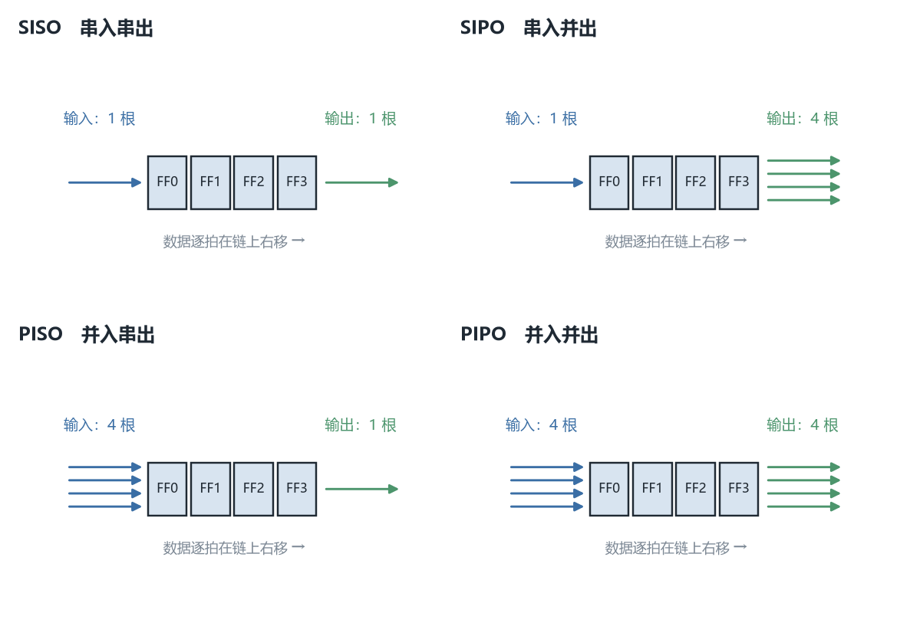
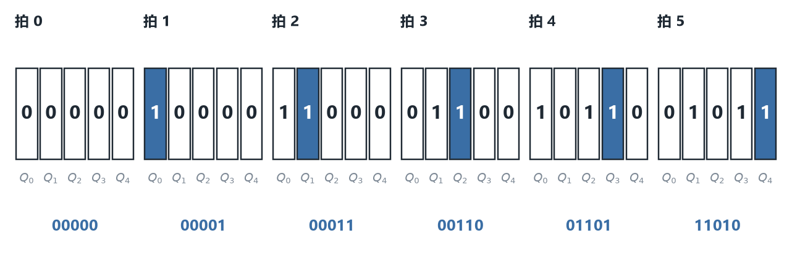
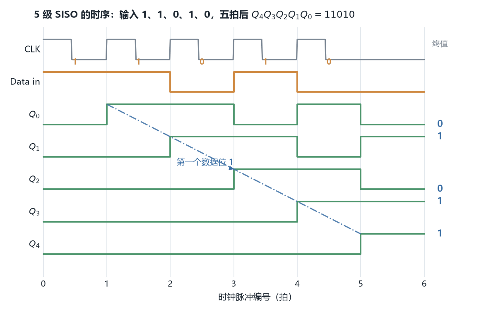
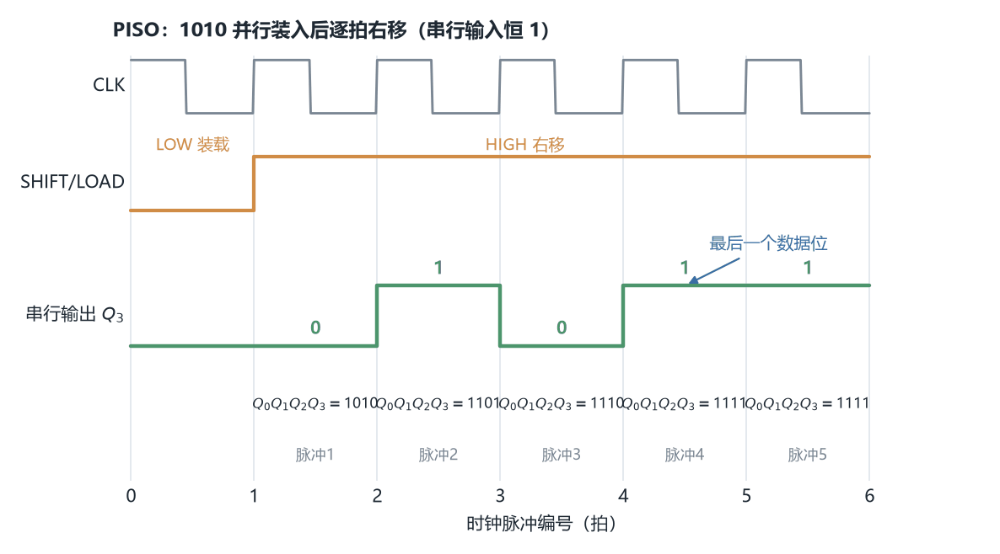
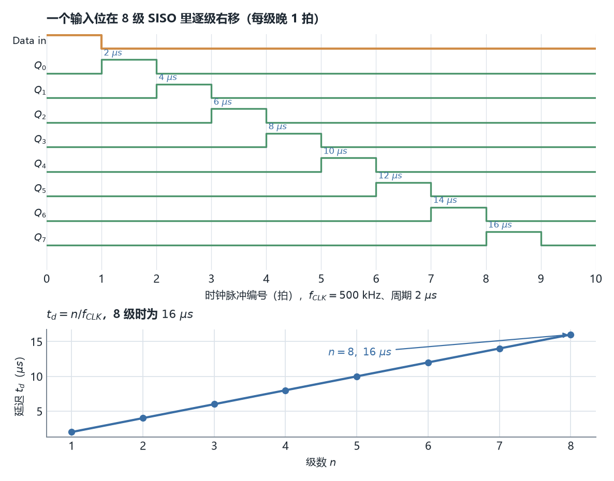
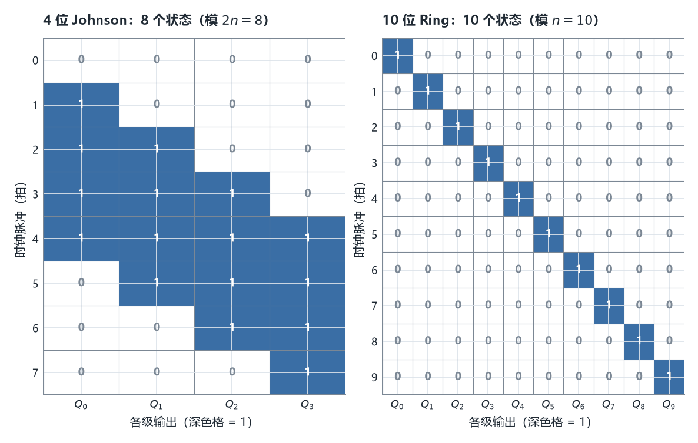

# ECE2050 Chapter 8 Shift Registers 课堂笔记

## 本章在讲什么

前七章的训练可以压缩成一句话：**先学会用 0/1 表示数（Chapter 2），再学会对 0/1 做运算（Chapter 3–4），再学会把运算落成门级电路（Chapter 5），再学会直接调用造好的标准模块（Chapter 6），最后学会让电路"记住"状态（Chapter 7 的锁存器与触发器）。** 到 Chapter 7 结束，我们已经有了**触发器**（flip-flop）这个能存 1 位的基本单元，也有了**寄存器**（register）这个把若干触发器并排放在一起、能存一个多位二进制数的部件。

Chapter 8 只做一件事：**把一串触发器首尾相连，让"存进去的位"能沿着链子一格一格地挪动。** 这个动作叫移位（shift），这样串起来的寄存器就叫**移位寄存器（shift register）**。它看起来只是给 Chapter 7 的寄存器加了几根连线，但由此长出来的东西多得出乎意料：四种输入输出结构、能左右移的通用寄存器、串行通信、键盘扫描、时间延迟，以及两种只靠反馈就能自己数数的计数器（Johnson 与 ring）。

本章有三条线，外加一条"回收线"：

**第一条线是结构与分类（p4–p21）。** 先立两大基本功能——**数据存储**（data storage）与**数据移动**（data movement）；再按"数据从几根线进、从几根线出"分成 SISO / SIPO / PISO / PIPO 四类，逐类给电路与时序；最后把四类合并成一块"通用"器件：用一个控制端在并行置数与移位之间切换（p11–p16），再用两个控制端选择左移/右移/置数/保持（p17–p21）。这条线的**骨架是门控逻辑**：SHIFT/LOAD 或 $S_0,S_1$ 决定哪一组门被使能。

**第二条线是应用（p22–p28）。** 移位寄存器一旦有了，就能拿它**搬运数据的时间位置**：串行的位流进来、并行的字节出去（串/并变换、UART），或者干脆什么也不做、只让一个位"晚 $n$ 拍到达"（时间延迟），再用单稳态电路（one-shot）给这个延迟配一个干净的触发脉冲。p27–p28 的键盘编码器是这四条应用的综合题：环形计数器扫描行线、按键把行与列接通、单稳态消抖、最后把 6 位键码并行锁存。

**第三条线是反馈成计数器（p29–p32）。** 把串行输出**接回串行输入**，寄存器就不再需要外部数据，会自己在一组状态里循环。末级的**反相**输出接回首级得到 **Johnson 计数器**（$n$ 级、$2n$ 个状态）；末级的**同相**输出接回首级得到**环形计数器（ring counter）**（$n$ 级、$n$ 个状态）。这两页的状态序列表是全章最该逐格抄下来背的东西。

**回收线**是 p2 的 Last Week 清单：Chapter 7 讲的 D 触发器、J-K 触发器、使能/复位/置位触发器变体，在本章全部重新登场，只是这次它们被**串成链**而不是并排放着。p33 的回顾清单与 p34 的 10 道判断题正好把这三条线各点一遍。

一句话概括全章：**Chapter 7 给你一个会记事的格子，Chapter 8 把格子排成一列并让记忆沿着列走——走起来之后，"移动"本身就是计算，"绕回来"本身就是计数。**

34 页讲义被四个分节页切成四段：p3 "Two Basic Functions of Shift Registers"、p17 "Bidirectional Shift Registers"、p22 "Shift Register Applications"、p29 "Johnson Counter / Ring Counter"。各小节的讲义页序对应如下，正文就按这个顺序一条线写下来：

| 讲义页 | 本笔记小节 | 内容 |
| --- | --- | --- |
| p1 | —— | 封面（ECE 2050 / Chapter 8: Shift Registers / Tinghuan CHEN, Ph.D.） |
| p2 | 上一讲回顾与本章地图 | Last Week 清单（10 条） |
| p3 | —— | 分节页 "Two Basic Functions of Shift Registers" |
| p4 | 两大基本功能 | Data storage：用 D 触发器存住 1 位 |
| p5 | 两大基本功能 | Data movement：一串小方格演示位的逐格挪动 |
| p6 | 两大基本功能 | 数据移动的八种形态（含 rotate、reset bit） |
| p7 | SISO | 4 级 SISO 电路 + TABLE 8-1 / 8-2 移入移出示例 |
| p8 | SISO | **核心例题**：5 级 SISO，逐拍移入，5 拍后 $Q_4Q_3Q_2Q_1Q_0=11010$ |
| p9 | SIPO | 4 级 SIPO 电路 + 时序图 |
| p10 | SIPO | 74HC164：8 位串入并出固定功能 IC、时序图 |
| p11 | PISO | 4 级 PISO 电路（SHIFT/LOAD + 门控） |
| p12 | PISO | SHIFT/LOAD 为 LOW：G1~G4 使能，并行置数 |
| p13 | PISO | SHIFT/LOAD 为 HIGH：G5~G7 使能，右移 |
| p14 | PISO | **例题**：$D_0D_1D_2D_3=1010$ 装载后逐拍从 $Q_3$ 输出 |
| p15 | PIPO | 并入并出寄存器定义与电路 |
| p16 | PIPO | **4-Bit Parallel-Access Shift Register 功能表**（5 行） |
| p17 | —— | 分节页 "Bidirectional Shift Registers" |
| p18 | 双向移位寄存器 | RIGHT/LEFT 控制左移/右移的总电路 |
| p19 | 双向移位寄存器 | RIGHT/LEFT 为 HIGH：G1~G4 使能，右移 |
| p20 | 双向移位寄存器 | RIGHT/LEFT 为 LOW：G5~G8 使能，左移 |
| p21 | 通用移位寄存器 | 4-Bit Bidirectional Universal Shift Register，$S_0,S_1$ 功能表 + 时序图 |
| p22 | —— | 分节页 "Shift Register Applications" |
| p23 | 应用（一） | Time Delay：SISO 作时间延迟，延迟 = 级数与时钟频率的函数 |
| p24 | 应用（一） | One-Shot Logics：RC 定宽的单稳态电路 |
| p25 | 应用（二） | S/P Data Converter：串行传输省线、USB |
| p26 | 应用（二） | UART：并↔串接口与收/发移位寄存器 |
| p27 | 应用（三） | Keyboard Encoder：ring counter 扫描、消抖、6 位键码（文字） |
| p28 | 应用（三） | Keyboard Encoder：键盘矩阵与电路框图 |
| p29 | —— | 分节页 "Johnson Counter / Ring Counter" |
| p30 | Johnson 计数器 | $\overline{Q_3}$ 反馈、4 位 8 状态序列表、模 $2n$ |
| p31 | 环形计数器 | $Q$ 反馈、10 位 10 状态序列表、上电预置 |
| p32 | 环形计数器 | Example：10 位 ring 的移位波形 |
| p33 | 本章回顾与自测 | Chapter Review 清单 |
| p34 | 本章回顾与自测 | 10 道 True/False 判断题（讲义已标答案） |

## 上一讲回顾与本章地图（讲义 p1–p3）

封面交代课程与讲次：ECE 2050 Digital Logic and Systems，Chapter 8: Shift Registers，授课教师 Tinghuan CHEN, Ph.D.。p3 是分节页，只印着 "Two Basic Functions of Shift Registers"，它是 p4–p16 那一大段的门牌。

p2 的 **Last Week** 清单是本章的"前置知识账单"，共 10 条：

| # | 上一讲内容（英文原名） | 本章在哪里用上 |
| --- | --- | --- |
| 1 | State Elements（状态元件） | p4 数据存储：一个 D 触发器就是一个 1 位状态元件 |
| 2 | Bistable Circuit（双稳态电路） | 作为触发器的物理基础，本章不重讲 |
| 3 | D Latch（D 锁存器） | 本章一律用**边沿触发**的 D 触发器，不用电平锁存 |
| 4 | D Flip Flop（D 触发器） | p7、p9、p11、p15、p18、p30、p31 每一级都是它 |
| 5 | J-K Flip Flop（J-K 触发器） | p16 的功能表以 $J$、$\overline{K}$ 为串行输入名 |
| 6 | Variations on a Flop（触发器变体） | p12/p16 的并行置数、p31 的 PRE 预置 |
| 7 | Registers（寄存器） | 本章整讲就是寄存器的一种 |
| 8 | Enabled Flip-Flops（带使能触发器） | SHIFT/LOAD 本质就是一级使能控制 |
| 9 | Resettable Flip-Flops（可复位触发器） | p10 的 CLR、p21 的 Clear、p27 的上电预置 |
| 10 | Settable Flip-Flops（可置位触发器） | p31 "preset a 1 into the first flip-flop" |

> [!NOTE] 补充：本讲与上一讲的关系
> Chapter 7 把触发器**并排**放（一个 $n$ 位寄存器），本章把它们**串联**放（第 $i$ 级的 $Q$ 接第 $i+1$ 级的 $D$）。**同样几个触发器，改一根连线就从"存数"变成"移数"。** 这一句就是全章的起点。

> [!IMPORTANT] 重要：本章的三个"第一次"
> ① 第一次出现**按时间顺序读一张表**（p8 的逐拍状态表），而不是按输入组合读真值表；② 第一次出现**用反馈自己产生状态序列**（p30/p31 的计数器）；③ 第一次出现**同一块器件由控制端切换功能**（p12/p16/p21 的功能表）。这三点决定了本章的题型：给时序、给控制端波形，问输出。

**练习 0.1**　为什么本章的电路全部用边沿触发 D 触发器，而不是 Chapter 7 也讲过的 D 锁存器？

> [!TIP] 参考答案
> 移位要求"每一级在同一个时钟沿**同时**把前一级的旧值采样进来"。若用电平敏感的 D 锁存器，在时钟为有效电平的整个半周期里，输入一旦变化就会**穿透**到下一级，一个脉冲里可能连移好几级（race-through），链长就无法控制。边沿触发把采样压缩到一个瞬间，串多少级都只移一格。

## 两大基本功能：数据存储与数据移动（讲义 p4–p6）

**先看实例。** p4 画了两个 D 触发器并排对照：左边那一个，$D$ 端送 1，在 CLK 的上升沿之后 $Q$ 变 1 并且**一直保持 1**；右边那一个，$D$ 端送 0，在同一时刻 $Q$ 变 0 并保持 0。图上的旁注写着 "it is stored and appears on output"——数据被存住了，同时出现在输出上。

由此提炼出第一项功能：

> **数据存储（data storage）**：把一位二进制数写进触发器，使它在时钟沿之后保持不变，直到下一次写入。$n$ 个这样的触发器并排就是一个能存 $n$ 位的寄存器。

**手算小例子**：给一个 4 位寄存器，若四个 $D$ 端同时是 1、0、1、0，一个时钟沿之后 $Q_3Q_2Q_1Q_0=1010$，并且只要 $D$ 不变、时钟不再来，它一直是 1010。**失败情形**：若把这四个触发器改成透明锁存器并让 CLK 保持有效电平，那么 $D$ 端任何一次抖动都会直接改掉 $Q$，"存"就不成立——这正是 p4 特意画"上升沿"这个三角形符号的原因。

**再看第二项。** p5 用一整版小方格演示**数据移动（data movement）**：每一行是 4 个连着的方格，一个数据位从一端进去，每来一拍就往相邻格挪一格，几拍之后整串方格的内容整体平移。p6 把这件事拆成八种具体形态，配上小方块与箭头，我按图重列成表：

| 形态（讲义 p6 图注） | 输入 | 输出 | 位的走向 |
| --- | --- | --- | --- |
| Serial in / shift right / serial out | 1 根，串行 | 1 根，串行 | 从左进、向右移、从最右出 |
| Serial in / shift left / serial out | 1 根，串行 | 1 根，串行 | 从右进、向左移、从最左出 |
| Parallel in / serial out | $n$ 根，同时 | 1 根，串行 | 先并行装入，再逐拍移出 |
| Serial in / parallel out | 1 根，串行 | $n$ 根，同时 | 逐拍移入，$n$ 拍后一起读出 |
| Parallel in / parallel out | $n$ 根，同时 | $n$ 根，同时 | 装入即出现在输出 |
| Rotate right | —— | —— | 末级的输出绕回首级，位循环右移 |
| Rotate left | —— | —— | 首级的输出绕回末级，位循环左移 |
| Reset bit | —— | —— | 用清零端把某一位（或全部）强制为 0 |

> **数据移动（data movement）**：在时钟沿把寄存器里每一位的值送给相邻一级，使整串内容朝指定方向平移一格；移出的一端丢失一位，空出的一端由串行输入（或反馈）补上一位。

**注意 rotate 与 shift 的差别**：普通移位会**丢掉**从末端移出的那位，rotate（循环）把它**接回**另一端，所以内容永远不丢、只在环里转。p6 的 rotate 小图是 p30/p31 计数器反馈线的最早伏笔。



*图 5　四种基本结构的方块示意（SISO / SIPO / PISO / PIPO）：蓝色箭头是数据进出的方向，方块里的短横是链上的触发器。串行端只有一根线，并行端有 $n$ 根线；四种结构的差别只在于"哪一端是一根、哪一端是 $n$ 根"。（出自讲义 p6）*

> [!TIP] 技巧：四种结构的名字不用背
> 名字就是"In / Out 各是 Serial 还是 Parallel"的两个字母缩写。**SISO** = 串行进串行出，**SIPO** = 串行进并行出，**PISO** = 并行进串行出，**PIPO** = 并行进并行出。先数进线根数、再数出线根数，名字自己就出来了。

**练习 1.1**　一个 8 位 SISO 寄存器，串行送入 1 位数据，问最少几拍之后这 1 位才出现在串行输出端？若改成 SIPO，几拍之后能在并行输出端同时看到完整的 8 位数？

> [!TIP] 参考答案
> SISO：该位第 1 拍进入第 1 级，每拍右移一级，第 8 拍才到第 8 级（输出端），所以 **8 拍**。SIPO：同样要 **8 拍**才把 8 位全部装进 8 级并同时出现在 8 根并行输出上——两者拍数相同，差别只在"从第几根线读"。

## 串行输入 / 串行输出 SISO（讲义 p7–p8）

**先给电路。** p7 画了 4 个 D 触发器 FF0、FF1、FF2、FF3 串成一条链：串行数据（Serial data input）只接 FF0 的 $D$；$Q_0$ 接 FF1 的 $D$，$Q_1$ 接 FF2 的 $D$，$Q_2$ 接 FF3 的 $D$；四个触发器的 $C$ 端并接同一根 CLK；末级 $Q_3$（图上还画出互补输出 $\overline{Q_3}$）就是串行输出（Serial data output）。

> **串行输入 / 串行输出移位寄存器（serial in/serial out shift register, SISO）**：数据一位一位地从唯一的一根输入线进入，在每个时钟沿整体右移一格，最后一位一位地从唯一的一根输出线离开。$n$ 级寄存器能把 $n$ 位数据"排队"存住。

p7 还给了两张 4 位示例表（TABLE 8-1 "Shifting a 4-bit code into the shift register in Figure 8–3" 与 TABLE 8-2 "Shifting a 4-bit code out…"），用蓝色箭头逐格标出"这一拍正在移入/移出的那一位"。**这两张表的逐格数值在本笔记的读图材料里分辨不清，我没有逐格照抄，改在附录里如实标注；下面用 p8 那个逐格可辨认的五拍例子把同一条规则完整重列。**

**p8 是本章最核心的一页。** 电路换成 5 级（FF0~FF4，输出依次 $Q_0,Q_1,Q_2,Q_3,Q_4$），时序图给出 5 个 CLK 脉冲，串行输入在每个脉冲前依次是 **1、1、0、1、0**（图上用红字标在 Data in 波形上方）。把"每拍把输入送进 $Q_0$、$Q_0$ 旧值送 $Q_1$、……、$Q_3$ 旧值送 $Q_4$"这条规则逐拍展开：

| 时钟脉冲 | 送入 $Q_0$ 的输入位 | 该拍后 $Q_4\ Q_3\ Q_2\ Q_1\ Q_0$ | 说明 |
| --- | --- | --- | --- |
| 初始 | —— | 0 0 0 0 0 | 全 0 起始 |
| 1 | 1 | 0 0 0 0 1 | 第一个数据位 1 进入 $Q_0$ |
| 2 | 1 | 0 0 0 1 1 | 第一个 1 移到 $Q_1$，新 1 进入 $Q_0$ |
| 3 | 0 | 0 0 1 1 0 | 第一个 1 移到 $Q_2$；输入 0 |
| 4 | 1 | 0 1 1 0 1 | 第一个 1 移到 $Q_3$ |
| 5 | 0 | 1 1 0 1 0 | 第一个 1 移到 $Q_4$；$Q_4Q_3Q_2Q_1Q_0=11010$ |

讲义原文的结论正是 **"The register contains $Q_4Q_3Q_2Q_1Q_0 = 11010$ after five clock pulses."** 注意这份表里的一个规律：**5 拍之后，寄存器里从 $Q_4$ 读到 $Q_0$ 的内容，恰好就是按时间先后送进去的那 5 个位 11010**——先送的位跑到了最右边（最高编号），后送的位留在最左边。这就是 SISO 常被叫作"排队管道"的原因。



*图 1　讲义 p8 例题的五帧状态，每帧画出 5 级寄存器 $Q_4\ldots Q_0$ 的内容与当拍送入的串行位。逐拍为 00000 → 00001 → 00011 → 00110 → 01101 → 11010；蓝底方格是"第一个数据位 1"所在的位置，它每拍向右挪一格，5 拍后到达 $Q_4$。（出自讲义 p8）*



*图 2　同一例题的时序波形：自上而下是 CLK（5 个脉冲）、Data input（1、1、0、1、0）、$Q_0$ 到 $Q_4$。最右标出 5 拍后各位的终值 0、1、0、1、1（即 $Q_4Q_3Q_2Q_1Q_0=11010$）；蓝色斜虚线追踪第一个数据位 1 如何在 5 拍里从 $Q_0$ 走到 $Q_4$。（出自讲义 p8）*

> [!CAUTION] 注意：$Q_0$ 不是最高位
> 本讲义的编号习惯是**下标越小越靠近串行输入端**：$Q_0$ 是最先被写入的那一级，$Q_4$ 是最后一级、也是串行输出端。所以讲义写 $Q_4Q_3Q_2Q_1Q_0$ 时是按"从输出往输入"倒着列的，先送进去的位反而在字符串**左边**。**把它当普通二进制数读（以为 $Q_0$ 是最低位）就会把 11010 读成 01011。**

**失败情形**：如果五级的 CLK 不是同一根线、而是把上一级的 $Q$ 当作下一级的时钟（行波式连接），那么一次输入变化会沿链逐级触发、一拍里连移好几格，5 拍状态表就全乱了。p7 图里那根贯穿四级的粗 CLK 线不是装饰，是"同步"这件事的本体。

**练习 2.1**　同一 5 级 SISO，若串行输入依次改成 1、0、1、1、0，写出第 3 拍与第 5 拍后 $Q_4Q_3Q_2Q_1Q_0$ 的值。

> [!TIP] 参考答案
> 逐拍：00000 → 00001 → 00010 → 00101 → 01011 → 10110。第 3 拍后 **00101**，第 5 拍后 **10110**（正好等于输入序列 10110 的高位在前写法）。规律：第 5 拍后的寄存器内容 = 按时间先后送入的 5 个位。

## 串行输入 / 并行输出 SIPO：74HC164（讲义 p9–p10）

**先给电路。** p9 把 p7 的链子保持原样（4 个 D 触发器串联、同一根 CLK、串行输入进 FF0），只是**把每一级的 $Q$ 都单独引出一根线**：$Q_0,Q_1,Q_2,Q_3$ 就是四根并行输出。图下的时序图画的是串行输入 1010（图上 Data in 波形上方标 1、0、1、0），4 个脉冲之后四根输出同时给出这 4 位。

> **串行输入 / 并行输出移位寄存器（serial in/parallel out shift register, SIPO）**：数据逐位从一根线移入，但 $n$ 个触发器的输出全部引出，因此 $n$ 拍之后可以**一次读出**整个 $n$ 位字。它是串→并变换的核心部件。

**手算小例子**：4 级 SIPO 依次送 1、0、1、0，逐拍 $Q_3Q_2Q_1Q_0$ 为 0000 → 0001 → 0010 → 0101 → 1010。第 4 拍后 $Q_3Q_2Q_1Q_0=1010$，四根线一起读出即得 1010。**失败情形**：若只读 3 拍就取并行输出，得到 0101，最高位那个 1 还在链外——**SIPO 的"并行"是有条件的，必须等满 $n$ 拍**。

**p10 给出真实器件 74HC164。** 标题 "Example"，旁注 "74HC164: Fixed-function IC shift register with serial in/parallel out"，即一块**固定功能的 8 位串入并出移位寄存器**。图上逻辑符号的引脚与时序图读数如下：

| 引脚 / 信号 | 含义 |
| --- | --- |
| A、B | 两个串行数据输入，讲义在时序图旁标注 "A and B"，两者相与后作为移入位 |
| $\overline{\text{CLR}}$（或 CLR） | 异步清零，低电平有效；时序图开头一个负脉冲把 8 级全部清 0 |
| CLK | 移位时钟，上升沿移入一位 |
| $Q_0$–$Q_7$（QA–QH） | 8 根并行输出 |

时序图（p10 右侧）读法：$\overline{\text{CLR}}$ 先拉低清零 → 8 个 CLK 脉冲伴随 A、B 上的串行数据 → $Q_0,Q_1,\ldots,Q_7$ 依次逐级变高，像一列"阶梯"向右下展开；末尾再一个 Clear 把输出全部拉回 0。**这列阶梯就是"同一个位在 8 根输出线上依次亮相"**，与 p8 图 2 的斜虚线是同一件事，只是横过来画。

> [!NOTE] 补充：为什么有两个串行输入 A、B
> 74HC164 把 A 与 B 经一个与门再送进首级（数据手册的等效输入是 $A\cdot B$）。这样可以把其中一根当**使能**：把 B 固定为 1，A 就是普通串行输入；把 B 拉低，无论 A 是什么都只移入 0（相当于把寄存器快速清零/封锁）。讲义只用 "A and B" 三个字带过，此处按器件常规补一句，具体以数据手册为准。

**练习 3.1**　74HC164 已清零，A、B 上依次送入 8 位 1、1、0、0、1、0、1、0（先送 1），8 个 CLK 之后 $Q_7Q_6\ldots Q_0$ 是多少？

> [!TIP] 参考答案
> 与 p8 同理，8 拍后寄存器从 $Q_7$ 到 $Q_0$ 依次是先送的位到后送的位，即 **11001010**。若只看并行输出线的自然顺序 $Q_0\ldots Q_7$，则是 01010011（同一串位反过来读）。

## 并行输入 / 串行输出 PISO（讲义 p11–p14）

**p11 给出电路。** 4 个 D 触发器 FF0~FF3 依旧串联，但每一级的 $D$ 端前面挂了一小堆门：一路来自**并行数据** $D_0,D_1,D_2,D_3$，另一路来自**前一级的 $Q$**，两路经与门汇合进 OR 再送进触发器。所有门由同一根控制线 **SHIFT/LOAD** 及其反相信号选择：任何时刻只有一路被放行。串行输出取自末级 $Q_3$。

> **并行输入 / 串行输出移位寄存器（parallel in/serial out shift register, PISO）**：$n$ 位数据一次同时装入，之后在每个时钟沿右移一格，从末级一根线逐位吐出。它是并→串变换的核心部件。

**p12 与 p13 是同一张电路的两张高亮图，把控制端的两个电平分开讲清楚：**

- **p12：SHIFT/LOAD 为 LOW 时**，门 **G1~G4 使能**，每一个并行数据位被送到对应触发器的 $D$ 输入 → 下一个时钟沿**并行置数**（parallel load）。原文："When SHIFT/LOAD is LOW, G1 ~ G4 are enabled → each data bit is applied to the D input of its respective flip-flop."
- **p13：SHIFT/LOAD 为 HIGH 时**，G1~G4 被禁止，而 **G5~G7 使能**，数据位从一级**右移**到下一级。原文："When SHIFT/LOAD is HIGH, G1 ~ G4 are disabled while G5 ~ G7 are enabled → data bits are shifted right from one stage to the next."

> [!TIP] 技巧：SHIFT/LOAD 的电平怎么记
> 名字里的斜杠读作"低电平做后半件事、高电平做前半件事"容易乱，直接记电路：**LOW 打开的是接 $D_i$ 的那排门（装数），HIGH 打开的是接 $Q_{i-1}$ 的那排门（移数）**。另注意讲义写 **G5~G7 只有三个**：首级 FF0 移位时的输入直接来自串行数据线，不需要额外的门；只有 FF1、FF2、FF3 的移位支路各占一个门。而并行置数要 4 位各自一个门，所以是 G1~G4 四个。

**p14 是本章第二个核心例题。** 并行数据 $D_0D_1D_2D_3 = 1010$ 在时钟脉冲 1 被装入（SHIFT/LOAD 为 LOW），随后 SHIFT/LOAD 拉高逐拍右移，讲义逐条列出 $Q_3$ 上看到的位：

- 脉冲 1：1010 装入，$Q_3$ 变 0；
- 脉冲 2：原来 $Q_2$ 的 1 移到 $Q_3$；
- 脉冲 3：0 移到 $Q_3$；
- 脉冲 4：最后一个数据位 1 移到 $Q_3$；
- 脉冲 5：所有数据位都已移出，寄存器里只剩 1（前提是串行输入 $D_0$ 端一直保持 1）。

把这句话展开成逐拍表（首级移位输入保持 1，这是讲义明写的 "assuming the D0 input remains as 1"）：

| 时钟脉冲 | SHIFT/LOAD | 动作 | 该拍后 $Q_0\ Q_1\ Q_2\ Q_3$ | 串行输出 $Q_3$ |
| --- | --- | --- | --- | --- |
| 1 | LOW | 并行装入 1010 | 1 0 1 0 | 0（即 $D_3$） |
| 2 | HIGH | 右移 | 1 1 0 1 | 1（原 $Q_2$ 的 1） |
| 3 | HIGH | 右移 | 1 1 1 0 | 0（原 $Q_1$ 的 0） |
| 4 | HIGH | 右移 | 1 1 1 1 | 1（最后一位，$D_0$ 的 1） |
| 5 | HIGH | 右移 | 1 1 1 1 | 1（此后恒为 1） |

**读出的串行序列是 0、1、0、1、1、1、……**，即并行字 1010 按 $D_3\to D_2\to D_1\to D_0$ 的顺序从末级吐出（随后被恒 1 的输入填满）。注意**装载完成的那一拍 $Q_3$ 就已经是第一位输出了**，不需要再等一拍——这是初学最容易多算一拍的地方。



*图 3　讲义 p14 例题的时序：SHIFT/LOAD 在脉冲 1 为 LOW 时并行装入 1010，之后拉高逐拍右移；下栏是末级 $Q_3$ 的串行输出波形，依次为 0、1、0、1，第五拍起全部为 1（串行输入恒 1）。红色虚线标出"最后一个数据位"离开的时刻。（出自讲义 p14）*

> [!CAUTION] 注意：$D_0$ 是哪一端
> 讲义写 $D_0D_1D_2D_3 = 1010$ 且"装入后 $Q_3$ 为 0"，说明 $D_3$ 对应末级 $Q_3$、$D_0$ 对应首级 $Q_0$，**下标小的在串行输入端那一侧**。装载后 $Q_0Q_1Q_2Q_3 = 1010$，所以移出顺序是 $D_3(=0)\to D_2(=1)\to D_1(=0)\to D_0(=1)$。若把 $D_0$ 当成 MSB 先出，整个序列会反过来。

**练习 4.1**　同一 4 位 PISO，若装入 $D_0D_1D_2D_3 = 0111$，且移位期间串行输入保持 0，写出脉冲 1~4 时 $Q_3$ 依次输出哪四位。

> [!TIP] 参考答案
> 装载后 $Q_0Q_1Q_2Q_3 = 0111$，$Q_3$ 当下即为 $D_3=1$；随后每拍右移、首级补 0：脉冲 2 输出原 $Q_2=1$，脉冲 3 输出原 $Q_1=1$，脉冲 4 输出原 $Q_0=0$。故 $Q_3$ 序列为 **1、1、1、0**（即 0111 从 $D_3$ 到 $D_0$ 倒着吐出）。

## 并行输入 / 并行输出与 4 位 Parallel-Access 寄存器（讲义 p15–p16）

**p15 定义最直接。** 标题 "Parallel In/Parallel Out Shift Register"，两条要点：

- "The parallel in/parallel out register employs parallel entry and parallel output."
- "Immediately following the simultaneous entry of all data bits, the bits appear on the parallel outputs."

> **并行输入 / 并行输出寄存器（parallel in/parallel out register, PIPO）**：$n$ 位数据同时写入、同时出现在 $n$ 根输出线上，装入完成的那一刻输出立即有效，不需要等待移位。

图上是 4 个 D 触发器各自接一根 $D_i$，四根 $Q_i$ 各自引到并行输出，CLK 共用。**它其实就是一个普通寄存器**——之所以放在"移位寄存器"这一章，是因为下面 p16 那块器件能把它和移位合在一起。

**p16 是全章功能表密度最高的一页：4-Bit Parallel-Access Shift Register（并行存取移位寄存器）。** 图上左侧是带并行输入、串行输入、控制端的 SRG 4 逻辑符号与时序波形（标出 Parallel load / Shift right / Shift left / Load / Inhibit / Clear 各阶段），右侧是一张蓝色**功能表**。我用 500 dpi 放大逐格核对后重列如下（$d_i$ 是并行输入位，$q_i$ 是该拍**之前** $Q_i$ 的现态，X 表示无关）：

| $\overline{\text{SH}}/\text{LD}$ 或 SH/LD | $J$ | $\overline{K}$ | $D_0$ | $D_1$ | $D_2$ | $D_3$ | $Q_0$ | $Q_1$ | $Q_2$ | $Q_3$ | 功能 |
| --- | --- | --- | --- | --- | --- | --- | --- | --- | --- | --- | --- |
| 0 | X | X | $d_0$ | $d_1$ | $d_2$ | $d_3$ | $d_0$ | $d_1$ | $d_2$ | $d_3$ | 并行置数 |
| 1 | 1 | 1 | X | X | X | X | 1 | $q_0$ | $q_1$ | $q_2$ | 右移，首级补 1 |
| 1 | 1 | 0 | X | X | X | X | $\overline{q_0}$ | $q_0$ | $q_1$ | $q_2$ | 右移，首级取反 |
| 1 | 0 | 1 | X | X | X | X | $q_0$ | $q_0$ | $q_1$ | $q_2$ | 右移，首级保持 |
| 1 | 0 | 0 | X | X | X | X | 0 | $q_0$ | $q_1$ | $q_2$ | 右移，首级补 0 |

**怎么读这张表**：控制端为 0 时整行被 $d_i$ 接管（并行置数）；为 1 时一律执行右移——后面三级的规则恒为 $Q_1\leftarrow q_0$、$Q_2\leftarrow q_1$、$Q_3\leftarrow q_2$，**唯一可变的是首级 $Q_0$ 由 $J$ 与 $\overline{K}$ 决定**。把四种 $(J,\overline{K})$ 组合列出来正好是 JK 触发器的四种输入：

| $J$ | $\overline{K}$ | 首级 $Q_0$ 次态 | 记忆 |
| --- | --- | --- | --- |
| 1 | 1 | 1 | 置 1 |
| 1 | 0 | $\overline{q_0}$ | 翻转（toggle） |
| 0 | 1 | $q_0$ | 保持 |
| 0 | 0 | 0 | 置 0 |

> [!WARNING] 课件笔误：文字层把上划线吃掉了
> 这张表第 3 行（$J=1$、$\overline{K}=0$）的 $Q_0$ 是 $\overline{q_0}$（**带横杠**），PDF 的文字层把它抽成了普通的 $q_0$，与第 4 行长得一模一样。我用 500 dpi 裁切放大确认横杠确实存在，并按 JK 触发器特性复核：只有 $\overline{q_0}$ 才能让 $(1,0)$ 这一行与 $(0,1)$ 的"保持"行区分开。**若照文字层抄成 $q_0$，这张表会有两行完全重复，逻辑上讲不通。**

> [!NOTE] 补充：为什么首级用 JK 触发器
> 这块器件（与 74LS195 一类 4 位并行存取移位寄存器同族）把首级做成 JK 触发器，其余级是 D 触发器。外部 $J$ 接首级的 $J$ 端，外部 $\overline{K}$ 是**低有效**的 $K$ 输入（等效 K 端为 $\overline{K}$ 取反）。代入 JK 特性方程 $Q^{+}=J\overline{Q}+\overline{K}_{\text{ff}}Q$ 即得：$J\overline{K}=11\to 1$、$10\to\overline{q_0}$、$01\to q_0$、$00\to 0$，与上表逐行吻合。讲义只给表、不给这个解释，此处为补充。

**练习 5.1**　设当前 $Q_0Q_1Q_2Q_3 = 1011$，SH/LD 为 1，$J=1$、$\overline{K}=0$，求下一拍的 $Q_0Q_1Q_2Q_3$。再求 $J=0$、$\overline{K}=0$ 时的结果。

> [!TIP] 参考答案
> 右移规则：$Q_1\leftarrow q_0=1$、$Q_2\leftarrow q_1=0$、$Q_3\leftarrow q_2=1$。① $J\overline{K}=10$ 时首级取反，$Q_0=\overline{q_0}=0$，得 **0101**（按 $Q_0Q_1Q_2Q_3$ 记）。② $J\overline{K}=00$ 时首级补 0，$Q_0=0$，同样得 **0101**——这一组初值下两行恰好相同，换个初值（如 $q_0=0$）就会分开，说明"看一行不能判功能，要看整行规则"。

## 双向移位寄存器与通用移位寄存器（讲义 p17–p21）

p17 是分节页 "Bidirectional Shift Registers"。**p18 给出总电路**：4 个 D 触发器，每级 $D$ 端前挂两排门（上排 G1~G4、下排 G5~G8），控制线 **RIGHT/LEFT** 经一个反相器后同时送到两排门，保证任意时刻只放行一排。标题要点只有一句："RIGHT/LEFT controls data bits inside the register to be shifted left or right."

- **p19：RIGHT/LEFT 为 HIGH**，G1~G4 使能，每一级触发器的 $Q$ 输出被送到**后一级（following flip-flop）**的 $D$ 输入 → $Q_0\to Q_1\to Q_2\to Q_3$，即**右移**（图上用黄色箭头串起四个触发器）。
- **p20：RIGHT/LEFT 为 LOW**，G5~G8 使能，每一级的 $Q$ 被送到**前一级（preceding flip-flop）**的 $D$ 输入 → $Q_3\to Q_2\to Q_1\to Q_0$，即**左移**（图上用紫色箭头反向串起）。

> **双向移位寄存器（bidirectional shift register）**：在每一级 $D$ 端前面用两排门分别接"左邻"和"右邻"的 $Q$，由一个方向控制端决定这一拍接哪一边，从而同一个电路既能左移也能右移。

**注意 p19 的 G1~G4 与 p20 的 G5~G8 都是四个**：双向时四个触发器**每一级**都要在"来自左边"和"来自右边"之间二选一，所以两排各 4 个门；而 p13 的 PISO 只有 G5~G7 三个，因为首级的移位输入来自外部串行线、不需要门。这个门数差别是两种电路结构不同的直接证据。

**p21 把方向控制升级成两位功能选择：4-Bit Bidirectional Universal Shift Register（4 位双向通用移位寄存器）。** 图左侧是 SRG 4 逻辑符号（引脚有 CLK、CLR、并行数据、$S_0$、$S_1$、右移串行输入、左移串行输入、$Q_0$~$Q_3$），中间是时序图（依次演示 Parallel load / Shift right / Shift left / Inhibit / Clear 各阶段），左下是蓝色功能表，逐格重列：

| $S_0$ | $S_1$ | 功能 Func. | 含义 |
| --- | --- | --- | --- |
| HIGH | HIGH | Parallel Loading | 并行置数 |
| HIGH | LOW | Shift right | 右移 |
| LOW | HIGH | Shift left | 左移 |
| LOW | LOW | Inhibit | 保持（禁止时钟动作） |

> [!IMPORTANT] 重要：这张表的两列顺序
> 讲义文字层把表头抽成 **$S_0$ 在前、$S_1$ 在后**，而时序图左侧的引脚标注习惯写 $S_1S_0$。**若把两列读反，"HIGH/LOW → 右移" 会变成 "HIGH/LOW → 左移"。** 按标准命名 $S_1S_0=11$ 置数、$01$ 右移、$10$ 左移、$00$ 保持，与讲义四行逐一吻合，所以表头确为 $S_0$ 列在前；复习时建议一律改写成 $S_1S_0$ 的两位码来记，避免和时序图的引脚标注打架。

> **通用移位寄存器（universal shift register）**：用 $k$ 根模式选择线在"保持 / 左移 / 右移 / 并行置数"四种功能间切换的寄存器。本章的 4 位版本用 2 根线（$S_0,S_1$），四种功能恰好对应 $2^2=4$ 种组合。

**手算小例子**：当前 $Q_3Q_2Q_1Q_0=1100$，右移串行输入为 1，令 $S_0S_1=\text{HIGH/LOW}$（右移），一拍后 $Q_3Q_2Q_1Q_0=1110$（新位 1 从左侧补入最高位）。**失败情形**：若把 $S_0S_1$ 设成 LOW/LOW（Inhibit），同一个时钟沿什么也不会发生，输出仍是 1100——"有 CLK 不等于会移位"，这是通用寄存器最常被忽略的一行。

> [!TIP] 技巧：一张图记住怎么读任意移位寄存器
> 下面这张流程图是我整理的，课件没有画。拿到一块没见过的移位寄存器，按这三步走就能定出这一拍的动作：

> ```mermaid
> flowchart TD
>     A["拿到器件与当前控制端电平"] --> B{"有没有模式选择端<br/>（S0,S1 或 SHIFT/LOAD）？"}
>     B -- "有" --> C["先查功能表：这一拍是<br/>置数 / 移位 / 保持 / 禁止"]
>     B -- "没有" --> D["固定为移位，只看方向"]
>     C --> E{"这一拍是移位吗？"}
>     E -- "否" --> F["按置数或保持写出次态"]
>     E -- "是" --> G{"方向是左还是右？"}
>     D --> G
>     G --> H["确定首级补入的是<br/>串行输入 / 反馈 / 0 或 1"]
>     H --> I["逐位写出 Q 次态，<br/>并标出被移出的那一位"]
> ```

**练习 6.1**　4 位通用寄存器当前 $Q_3Q_2Q_1Q_0=1010$，左移串行输入为 0。分别求 $S_0S_1=$（HIGH,LOW）与（LOW,HIGH）两种设置下一拍的输出。

> [!TIP] 参考答案
> （HIGH,LOW）是右移：串行输入用的是右移端，若右移端为 0 则 $Q_3Q_2Q_1Q_0=0101$（新 0 补进 $Q_3$，原 $Q_0$ 的 0 移出）。（LOW,HIGH）是左移：新 0 补进 $Q_0$，$Q_3Q_2Q_1Q_0=0100$（原 $Q_3$ 的 1 移出丢失）。**两种设置下"往哪一端补新位"相反，别把左移串行输入接到右移那一端。**

## 应用（一）：时间延迟与单稳态逻辑（讲义 p22–p23、p24）

p22 是分节页 "Shift Register Applications"，统领 p23–p28 六页。

**p23：Time Delay（时间延迟）。** 图左侧是一块 **SRG 8**（8 级 SISO）：Data in 一根进、$Q_0$~$Q_7$ 八根并行引出、CLK 标注 **500 kHz**、还有 CLR；旁注 "Data exits from Qn (used Qn)"。两条要点：

- "A serial in/serial out shift register can provide a time delay from input to output."
- "The delay is a function of both the number of stages (n) in the register and the clock frequency."

右侧时序图：CLK 一串脉冲，Data in 上出现一个窄脉冲，随后 $Q_0,Q_1,\ldots,Q_7$ 依次出现同样形状但**逐级右移**的方波，一根根往右错开；下方用 8 根箭头标出从输入到各级输出的延迟，分别写作 $2T_p,4T_p,6T_p,8T_p,10T_p,12T_p,14T_p,16T_p$。

> **时间延迟（time delay）**：把一个位写入 $n$ 级 SISO 后，它要经历 $n$ 个时钟沿才走到串行输出端，因此输出比输入晚 $n$ 个时钟周期：$t_d = \dfrac{n}{f_{\text{CLK}}}$。级数越多、时钟越慢，延迟越长。

**手算小例子（讲义没给数值，我按 500 kHz 算）**：$f_{\text{CLK}}=500\ \text{kHz}\Rightarrow T=1/f=2\ \mu\text{s}$，$n=8$ 时 $t_d = 8\times 2\ \mu\text{s}=16\ \mu\text{s}$；而第 1 级 $Q_0$ 只晚 $2\ \mu\text{s}$。**若时钟降到 250 kHz，同一块寄存器的延迟翻倍到 32 μs**——这就是"延迟是级数与时钟频率两者的函数"的确切含义。

> [!NOTE] 补充：图上 $2T_p\ldots16T_p$ 的一种自洽读法
> 讲义从未定义符号 $T_p$。若取 $T_p$ 为**半个时钟周期**（500 kHz 下为 $1\ \mu\text{s}$），则 8 根箭头 $2T_p,4T_p,\ldots,16T_p$ 依次等于 $2,4,\ldots,16\ \mu\text{s}$，正好是 $Q_0\ldots Q_7$ 各自延迟 $1$ 到 $8$ 个时钟周期（$2\ \mu\text{s}$ 一格）的两倍表述；最下面 $16T_p=16\ \mu\text{s}$ 与上面算出的 $n/f=16\ \mu\text{s}$ 吻合。**这只是一个自洽读法，不是课件原文**；若课堂上 $T_p$ 另有定义，以课堂为准。



*图 6　上栏：$f_{\text{CLK}}=500\ \text{kHz}$（周期 $2\ \mu\text{s}$）时，一个输入位在 8 级 SISO 里每拍右移一格，$Q_0$ 到 $Q_7$ 依次在 $2,4,\ldots,16\ \mu\text{s}$ 后响应。下栏：延迟随级数线性增长，$t_d=n/f_{\text{CLK}}$，$n=8$ 时为 $16\ \mu\text{s}$。数值按图中 500 kHz 现算。（出自讲义 p23）*

**p24：One-Shot Logics（单稳态逻辑）。** 两条要点逐句抄录并解释：

- "When a pulse is applied, the output of gate G1 goes LOW. This HIGH-to-LOW transition is coupled through the capacitor to the input of inverter G2. This G2 HIGH output is connected back into G1, keeping its output LOW." → 触发脉冲到来，G1 输出掉到低电平，这个下降沿经电容耦合到反相器 G2 的输入，G2 输出变高并**反馈回 G1**，把 G1 的输出"锁"在低电平。
- "The capacitor immediately begins to charge through R toward the high voltage level. The rate at which it charges is determined by the RC time constant. When the capacitor charges to a certain level, which appears as a HIGH to G2, the output goes back LOW." → 电容随即经电阻 R 向电源充电，充电快慢由 **RC 时间常数**决定；当电容电压升到被 G2 认作高电平时，输出回到低电平，暂稳态结束。

电路图：Trigger 输入进 G1（带气泡的 NAND），G1 输出经电容 C 到 G2（反相器）输入，R 从 $+V$ 接到电容节点，G2 输出 $Q$ 反馈回 G1 的一个输入；图上标出 $t_1,t_2,t_3$ 三个时刻的波形，并注 "Appears as LOW"。右下角蓝色结论：**"A single narrow trigger pulse produces a single output pulse whose time duration is controlled by the RC time constant."**

> **单稳态电路（one-shot / monostable multivibrator）**：只有一个稳定状态；被触发后进入暂稳态，靠 RC 充电自动回到稳态，于是一个很窄的触发脉冲被"拉宽"成一个宽度由 RC 决定的单脉冲。

这个部件不是孤立的：p27 的键盘编码器要用**两个 one-shot** 产生延迟时钟脉冲、避开按键**接触抖动（contact bounce）**。

**练习 7.1**　把 p23 的 8 级寄存器时钟从 500 kHz 改为 1 MHz，输出延迟变成多少？若想维持原来的 16 μs 延迟，级数应改成多少？

> [!TIP] 参考答案
> $f=1\ \text{MHz}\Rightarrow T=1\ \mu\text{s}$，$t_d=8\times1=8\ \mu\text{s}$（减半）。要保持 $16\ \mu\text{s}$，需 $n=t_d\cdot f=16\ \mu\text{s}\times1\ \text{MHz}=16$ 级。**延迟与 $n$ 成正比、与 $f$ 成反比**，两级都改才能抵消。

## 应用（二）：串 / 并数据变换与 UART（讲义 p25–p26）

**p25：S/P Data Converter（串 / 并数据变换器）。** 左侧框图把一串串行数据送进移位寄存器，配合计数器/时钟与一个 **Delay** 环节，在恰好装满 $n$ 位后把寄存器的内容一次性锁存到并行输出；框图上用带圈数字 1~4 标出数据走过的四步。右侧时序图：Serial data in 一串位、Clock pulses、8 根并行输出线依次变高、以及一个 "data out pulse" 锁存脉冲。两条要点：

- "Serial data transmission can reduce the number of wires in the transmission line."（串行传输能减少传输线上的导线数）
- "USB (universal serial bus) is used to connect keyboards printers, scanners, and more to the computer."（USB 用来把键盘、打印机、扫描仪等接到计算机）

> **串 / 并数据变换（serial-to-parallel data conversion）**：把一根线上按时间先后到达的 $n$ 个位，收进移位寄存器后在同一时刻从 $n$ 根线读出。逆方向（并→串）就是 PISO。代价是**时间换空间**：$n$ 位要花 $n$ 拍，但只需要 1 根数据线而不是 $n$ 根。

**手算小例子**：并行传送一个 8 位字节需要 8 根数据线；改成串行只需 1 根数据线（外加时钟/地线），但要 8 个时钟周期。**失败情形**：若收、发两端时钟频率不一致，串行位流会在某一拍错位，整个字节全错——这正是下一页 UART 名字里 "Asynchronous（异步）"要处理的问题。

**p26：UART。** 两条要点：

- "Universal Asynchronous Receiver Transmitter"（通用异步收发器）
- "Interfacing device for data conversions"（用于数据变换的接口器件）

两幅框图。**左图**：Micro-processor ↔ UART ↔ External device（打印机、通信系统等）。UART 与微处理器之间是 8 根**并行数据线（parallel data bus）**，UART 与外部设备之间只有一根 **serial data line**。**右图**把 UART 内部拆开：

| 方向 | 寄存器链 | 作用 |
| --- | --- | --- |
| 发送 | Transmitter data register → Transmitter shift register（parallel-in/serial-out） | 把并行字节装入后逐位移出，经 Serial data out 送出 |
| 接收 | Receiver shift register（serial-in/parallel-out）→ Receiver data register | 把串行位流逐位移入，满一个字节后并行交给 Buffer |
| 与 CPU 之间 | Buffers | 缓冲并行数据 |

两个 shift register 各带一个 CLK，底部黄框分别标 **Serial data out** 与 **Serial data in**，右下角汇到 External Device。

> [!NOTE] 补充：把两页连起来看
> p25 讲"为什么"（省线），p26 讲"用什么"（UART 把并→串和串→并两块移位寄存器做进同一颗接口芯片）。**本章前 21 页的四种结构，到这里第一次以"成对出现"的方式被装进一个真实系统**：发送端是 PISO，接收端是 SIPO，两端各一个时钟。

**练习 8.1**　UART 以 9600 波特（每位 1/9600 秒）串行发送一个 8 位字节，若不计起始/停止位，光是 8 个数据位需要多长时间？同样 8 位用 8 根并行线在同一个时钟沿送出，两者差多少倍？

> [!TIP] 参考答案
> 串行 8 位需 $8/9600\approx0.833\ \text{ms}$；并行只需 1 个时钟周期（若取同一位率即 $1/9600\approx0.104\ \text{ms}$）。**串行慢约 8 倍**，换来的就是把 8 根线缩成 1 根。这就是 p25 那句"reduce the number of wires"的定量代价。

## 应用（三）：键盘编码器与环形计数器扫描（讲义 p27–p28）

p27 标题 "Keyboard Encoder"，六条要点（逐条抄录并解释）：

1. "Initially, 11111110 is loaded into the ring counter when Power ON;" → 上电时把 **11111110** 预置进环形计数器（8 位、只有一个 0）。
2. "Then, the ring counter 'scans' the rows for a key closure as the clock signal shifts the 0 around the counter at a 5 kHz rate." → 时钟以 **5 kHz** 把这个 0 在计数器里循环移动，逐行**扫描**是否有键按下。
3. "If a key closure occurs, one COLUMN line is connected to one ROW line. When the ROW line is taken LOW by the ring counter, that particular COLUMN line is also pulled LOW." → 某键闭合时该行线与某列线接通；环形计数器把那根行线拉低，对应的列线也被拉低。
4. "The 3-bit ROW code plus the 3-bit COLUMN code uniquely identifies the key that is closed." → **3 位行码 + 3 位列码 = 6 位键码**，唯一确定被按下的键。
5. "When a key is closed, the two one-shots produce a delayed clock pulse to parallel-load the 6-bit code into the key code register. (To avoid contact bounce)" → 两个单稳态电路产生一个**延迟的时钟脉冲**，把 6 位码并行装入键码寄存器，目的是**躲开接触抖动**。
6. "The first one-shot output inhibits the ring counter to prevent it from scanning when the data are being loaded into the key code register." → 第一个单稳态的输出**禁止**环形计数器继续扫描，避免装载期间行码又变了。

p28 是同一系统的放大电路图：左侧 8×8 键盘矩阵（ROW 与 COLUMN 交叉，交点画按键），接到右侧的 Ring counter（6 位/8 位输出接 8 根行线）、Column encoder、两个 One-shots、Key code register，以及 Clock / "Keyboard data in" / "Clear" 等控制线，带圈数字 1~4 标出信号链的四步。

> [!IMPORTANT] 重要：为什么是 11111110 而不是 00000001
> 键盘矩阵的行线是**低电平有效**（要点 3 说 ROW 被 "taken LOW" 才选中）。所以环形计数器里循环的是一个 **0**，不是 1；8 位里恰有一个 0，8 拍扫完 8 行，对应 **3 位行码**（$2^3=8$）。同理 8 根列线用 3 位列码，合起来 6 位可区分 $8\times8=64$ 个键。这与 p31 那个"循环一个 1"的 10 位环形计数器是**同一种电路、不同的预置**，见下一节辨析。

**手算小例子**：上电预置 11111110（$Q_0=0$，其余 1），第 1 拍后 0 移到 $Q_1$，状态 11111101；第 7 拍后 0 到 $Q_7$，状态 01111111；第 8 拍回到 11111110，周期 8。**失败情形**：若没有要点 6 的禁止信号，扫描在键码装载的那一拍又移了一格，存进键码寄存器的行码会比真实按键所在行错一位——**这正是"异步输入要冻结状态"的典型场景**。

**练习 9.1**　5 kHz 扫描、8 行循环一圈，扫完所有行需要多长时间？某键在最坏情况下要等多久才被扫到？

> [!TIP] 参考答案
> 一圈 8 拍，$T=1/5000=0.2\ \text{ms}$，故 $8\times0.2=1.6\ \text{ms}$ 扫完一圈；最坏情况（刚扫过该行就按下）要等将近一整圈，约 **1.6 ms**。这也是为什么要点 5 要用单稳态延时而不是立刻锁存——机械触点的抖动往往就有毫秒量级。

## Johnson 计数器（讲义 p29–p30）

p29 是分节页 "Johnson Counter / Ring Counter"。**p30 标题 "Johnson Counters"**，页面左上是一张 4 位电路：FF0~FF3 四个 D 触发器串联（$Q_0\to D_1$、$Q_1\to D_2$、$Q_2\to D_3$），**末级的 $\overline{Q_3}$（带气泡的互补输出）反馈回首级 FF0 的 $D$**，CLK 共用。我用 500 dpi 放大确认那根反馈线上标的是 $\overline{Q_3}$ 而不是 $Q_3$——这一点决定了整个序列。

三条要点：

- "Q' of the last flip-flop is connected back to the D input of the first flip-flop"
- "If the counter starts at 0, this feedback arrangement produces a characteristic sequence of states"
- "In general, a Johnson counter will produce a modulus of 2n, where n is the number of stages in the counter, e.g. for n=4 stages, 8 states."

> **Johnson 计数器（Johnson counter，又称扭环计数器 twisted-ring counter）**：把移位寄存器末级的**反相**输出 $\overline{Q_{n-1}}$ 接回首级 $D$ 输入，使 $n$ 级寄存器在没有外部数据的情况下自动循环经过 $2n$ 个状态，即模 $2n$。

**p30 的 "Four-bit Johnson sequence" 表逐格重列**（$Q_0$ 是首级、$Q_3$ 是末级，行号即时钟脉冲编号）：

| Clock Pulse | $Q_0$ | $Q_1$ | $Q_2$ | $Q_3$ | 记作 $Q_3Q_2Q_1Q_0$ |
| --- | --- | --- | --- | --- | --- |
| 0 | 0 | 0 | 0 | 0 | 0000 |
| 1 | 1 | 0 | 0 | 0 | 0001 |
| 2 | 1 | 1 | 0 | 0 | 0011 |
| 3 | 1 | 1 | 1 | 0 | 0111 |
| 4 | 1 | 1 | 1 | 1 | 1111 |
| 5 | 0 | 1 | 1 | 1 | 1110 |
| 6 | 0 | 0 | 1 | 1 | 1100 |
| 7 | 0 | 0 | 0 | 1 | 1000 |

第 7 拍之后，粉色回绕箭头把状态送回第 0 行的 0000，形成 **8 个状态的闭环**（$=2n=2\times4$）。规律极整齐：前 4 拍**从左边一级级填满 1**，后 4 拍**从左边一级级清空回 0**。

**手算规则**：每拍 $Q_0\leftarrow\overline{q_3}$、$Q_1\leftarrow q_0$、$Q_2\leftarrow q_1$、$Q_3\leftarrow q_2$。例如第 4 行 1111 时 $q_3=1\Rightarrow Q_0=0$，其余右移得 0111……依表递推即可。**失败情形**：若误把 $Q_3$（同相）而非 $\overline{Q_3}$ 接回，1111 会一直保持 1111、0000 一直保持 0000，计数器**卡死在两个吸收态**，根本数不起来——反相这根线是 Johnson 计数器的命门。

> [!IMPORTANT] 重要：模 $2n$ 与 p34 第 8 题
> 讲义明写 "modulus of $2n$"，所以 8 级 Johnson 计数器模数是 **16**，不是 8。p34 判断题第 8 题 "The modulus of an 8-bit Johnson counter is eight" 讲义标 ✗，考的就是把 $2n$ 记成 $n$。$2n$ 个状态也意味着**输出不是二进制顺序**，需要译码才能得到十进制计数（教材 Exercise 5.54 正是让用 5 位 Johnson + 10 个与门设计十进制计数器）。

**练习 10.1**　一个 3 级 Johnson 计数器从 000 出发，写出完整状态循环并给出模数。

> [!TIP] 参考答案
> 规则 $Q_0\leftarrow\overline{q_2}$：$000\to100\to110\to111\to011\to001\to000$，共 **6 个状态**，模 $2n=6$ ✓。（记作 $Q_2Q_1Q_0$ 则为 000→001→011→111→110→100→000。）

## 环形计数器与 Example 波形（讲义 p31–p32）

**p31 标题 "Ring Counters"**。左上是 10 个 D 触发器串成的环：末级 $Q_9$ **同相**反馈回首级 $D$（蓝色要点 "Q is fed back from the last stage"），另有 **PRE** 预置端与 CLK 共用线。两条蓝色要点：

- "Q is fed back from the last stage"
- "Initially, a 1 is preset into the first flip-flop, and the rest of the flip-flops are cleared."（上电时把 1 预置进第一级，其余全部清零）

> **环形计数器（ring counter）**：把末级的**同相**输出 $Q_{n-1}$ 接回首级 $D$ 输入，并预置成"只有一个 1（或只有一个 0）、其余全反"的状态，于是这个孤立的位在环里循环，$n$ 级产生 $n$ 个状态，即模 $n$，且**每个状态恰好用一个触发器**。

**p31 的 "Ten-bit ring counter sequence" 表逐格重列**（10 行、10 列，行号 0~9）：

| Clock Pulse | $Q_0$ $Q_1$ $Q_2$ $Q_3$ $Q_4$ $Q_5$ $Q_6$ $Q_7$ $Q_8$ $Q_9$ |
| --- | --- |
| 0 | 1 0 0 0 0 0 0 0 0 0 |
| 1 | 0 1 0 0 0 0 0 0 0 0 |
| 2 | 0 0 1 0 0 0 0 0 0 0 |
| 3 | 0 0 0 1 0 0 0 0 0 0 |
| 4 | 0 0 0 0 1 0 0 0 0 0 |
| 5 | 0 0 0 0 0 1 0 0 0 0 |
| 6 | 0 0 0 0 0 0 1 0 0 0 |
| 7 | 0 0 0 0 0 0 0 1 0 0 |
| 8 | 0 0 0 0 0 0 0 0 1 0 |
| 9 | 0 0 0 0 0 0 0 0 0 1 |

粉色回绕箭头把第 9 行的 $Q_9=1$ 接回第 0 行的 $Q_0=1$，构成 **10 个状态的闭环**。注意表头从 $Q_0$（首级）排到 $Q_9$（末级），1 每拍向右挪一格，与 p8 的逐拍表是同一条移位规则，只是末端接回了开头。



*图 4　两种反馈计数器的完整状态循环，深色格为 1、浅色格为 0，行是时钟拍、列是各级 $Q$。左：4 位 Johnson，8 个状态（0000→0001→0011→0111→1111→1110→1100→1000→0000），斜带是逐级填满再清空的 1。右：10 位 ring，10 个状态，孤立的 1 沿对角线逐级下移、第 9 拍到 $Q_9$ 后回绕。两表的周期分别为 $2n=8$ 与 $n=10$。（出自讲义 p30、p31）*

**p32 "Example"** 是这张表的波形版：10 根输出 $Q_0$~$Q_9$，初始只有 $Q_0=1$（红字标 1，其余标 0），每个 CLK 脉冲把 1 交给下一级；粉色斜虚线追踪这个 1 从 $Q_0$ 一路走到 $Q_9$，第 9 个脉冲后蓝色箭头标出它**回绕到 $Q_0$**。波形上每根 $Q$ 都是一个宽度恰为 1 个时钟周期的高电平脉冲，十根脉冲依次错开——**这就是"one flip-flop for each state"在示波器上的样子**。

> [!CAUTION] 注意：两种计数器只差一根线
> | | 反馈量 | 预置 | 状态数 | 状态特点 |
> | --- | --- | --- | --- | --- |
> | Johnson | $\overline{Q_{n-1}}$（反相） | 全 0 | $2n$ | 连续的一段 1 与一段 0 |
> | Ring | $Q_{n-1}$（同相） | 单个 1（或单个 0） | $n$ | 恰有一个位与其余不同 |
>
> p27 的键盘编码器用的是**预置 11111110（单个 0）的 8 位 ring**，因为行线低有效；p31 用的是**预置单个 1 的 10 位 ring**。两者都是 ring counter，模数都等于级数，只是"孤立的那个位"是 0 还是 1 不同。**自启动能力**：Johnson 从全 0 能自动进入 8 状态环（无需预置）；ring 若上电时 1 的个数不是 1（例如全 0 或有两个 1），会永远停在错误循环里，**必须靠 PRE/CLR 预置**——这是 ring 相对 Johnson 的一个实质弱点，讲义未提，此处补一句。

**练习 11.1**　一个 6 位 ring 计数器上电后如果误被清零成 000000（没有 PRE 预置），它会怎样？要让它正常工作最少需要什么？

> [!TIP] 参考答案
> 全 0 时反馈 $Q_5=0$ 使首级一直补 0，状态永远停在 000000，**计数器死锁、模数变成 1**。必须像 p31 那样用 PRE/CLR 把恰好一个触发器置 1（如 100000），或外加自启动逻辑检测"全 0"并注入一个 1。Johnson 从 0000 出发则能自动进入 8 状态环，不需要这一步。

## 本章回顾与自测（讲义 p33–p34）

**p33 是 Chapter Review 清单**，逐条抄录（层级照原样）：

- Shift Registers：Data storage、Data movement、Serial/Parallel In - Serial/Parallel Out
- Bidirectional Shift Registers
- Shift Register Applications：Time Delay、Serial-to-Parallel Data Converter、UART (Universal Asynchronous Receiver Transmitter、Keyboard Encoder
- Johnson Counter & Ring Counter

> [!WARNING] 课件笔误：清单里少了一个右括号
> 最后一组写成 "UART (Universal Asynchronous Receiver Transmitter"，**开括号没有闭合**（p26 的正确全称是 Universal Asynchronous Receiver Transmitter）。抄题面/做索引时别把错的字符串当术语。

**p34 是 10 道 True/False Quiz，讲义已用绿色勾 / 红色叉标出答案。** 逐题抄出题面、给出答案与理由：

| # | 题面（逐字） | 讲义答案 | 理由（对应讲义页） |
| --- | --- | --- | --- |
| 1 | Shift registers consist of an arrangement of flip-flops. | ✓ True | p7/p9/p11/p15：每一级都是一个触发器，链就是"an arrangement" |
| 2 | A shift register cannot be used to store data. | ✗ False | p4 明确把 Data storage 列为两大基本功能之一 |
| 3 | A serial shift register accepts one bit at a time on a single line. | ✓ True | p7 SISO 只有一根串行输入线，每拍进一位 |
| 4 | All shift registers are defined by specified sequences. | ✗ False | 只有把输出反馈回去的**计数器**（p30/p31）才有指定状态序列；普通 SISO/SIPO 的内容由输入决定 |
| 5 | A shift register counter is a shift register with the serial output connected back to the serial input. | ✓ True | p30/p31 的反馈线正是这个定义（Johnson 还多一级反相） |
| 6 | A shift register with four stages can store a maximum count of fifteen. | ✓ True | 4 位二进制最大数是 $2^4-1=15$，p8/p16 的 4 级寄存器能装下任意一个 4 位数 |
| 7 | The Johnson counter is a special type of shift register. | ✓ True | p30：只是把 $\overline{Q_3}$ 接回 $D$，结构仍是移位寄存器 |
| 8 | The modulus of an 8-bit Johnson counter is eight. | ✗ False | p30 明写模 $2n$，8 级应为 **16**（$2\times8$），不是 8 |
| 9 | A ring counter uses one flip-flop for each state in its sequence. | ✓ True | p31：10 级对应 10 个状态，每拍恰有一个触发器为 1 |
| 10 | A shift register cannot be used as a time delay device. | ✗ False | p23 整页讲的就是 SISO 作时间延迟，$t_d=n/f_{\text{CLK}}$ |

> [!TIP] 技巧：判断题里的三个高频陷阱
> ① **"cannot / All / only" 这类绝对化词**：第 2、4、10 题都靠它翻案（本章恰恰证明移位寄存器**能**存数、**能**延迟、并非**都**有指定序列）；② **模数 $2n$ 还是 $n$**：第 8 题（Johnson）与第 9 题（ring，$n$ 个状态）是一对，别互相串；③ **"sequence（序列）"只属于反馈型计数器**：第 4 题错在把计数器的性质推广到所有移位寄存器。

## 本章核心公式与结论速查

**一、四种输入输出结构对照**

| 结构 | 全称 | 进线 | 出线 | 装满/排空需几拍 | 典型器件 | 讲义页 |
| --- | --- | --- | --- | --- | --- | --- |
| SISO | Serial In / Serial Out | 1 | 1 | $n$ | ——（p23 的 SRG 8） | p7–p8、p23 |
| SIPO | Serial In / Parallel Out | 1 | $n$ | $n$ | 74HC164（8 位） | p9–p10、p25 |
| PISO | Parallel In / Serial Out | $n$ | 1 | 1 拍装入 + $n$ 拍移出 | —— | p11–p14、p26 |
| PIPO | Parallel In / Parallel Out | $n$ | $n$ | 1 | —— | p15 |

**二、通用移位寄存器功能表（p16，4-Bit Parallel-Access SR）**

| 控制 | $J$ | $\overline{K}$ | $Q_0$ | $Q_1\ Q_2\ Q_3$ | 功能 | 讲义页 |
| --- | --- | --- | --- | --- | --- | --- |
| 0 | X | X | $d_0$ | $d_1\ d_2\ d_3$ | 并行置数 | p16 |
| 1 | 1 | 1 | 1 | $q_0\ q_1\ q_2$ | 右移补 1 | p16 |
| 1 | 1 | 0 | $\overline{q_0}$ | $q_0\ q_1\ q_2$ | 右移，首级翻转 | p16 |
| 1 | 0 | 1 | $q_0$ | $q_0\ q_1\ q_2$ | 右移，首级保持 | p16 |
| 1 | 0 | 0 | 0 | $q_0\ q_1\ q_2$ | 右移补 0 | p16 |

**三、双向通用移位寄存器 $S_0,S_1$ 功能表（p21）**

| $S_0$ | $S_1$ | 即 $S_1S_0$ | 功能 | 讲义页 |
| --- | --- | --- | --- | --- |
| HIGH | HIGH | 11 | Parallel Loading 并行置数 | p21 |
| HIGH | LOW | 01 | Shift right 右移 | p21 |
| LOW | HIGH | 10 | Shift left 左移 | p21 |
| LOW | LOW | 00 | Inhibit 保持 | p21 |

**四、p8 SISO 五拍逐拍序列（逐格核对）**

| 拍 | 输入位 | $Q_4Q_3Q_2Q_1Q_0$ | 讲义页 |
| --- | --- | --- | --- |
| 0 | —— | 00000 | p8 |
| 1 | 1 | 00001 | p8 |
| 2 | 1 | 00011 | p8 |
| 3 | 0 | 00110 | p8 |
| 4 | 1 | 01101 | p8 |
| 5 | 0 | 11010 | p8 |

**五、p14 PISO 1010 装载与移出（逐格核对）**

| 拍 | SHIFT/LOAD | $Q_0Q_1Q_2Q_3$ | $Q_3$ 输出 | 讲义页 |
| --- | --- | --- | --- | --- |
| 1 | LOW | 1010 | 0 | p14 |
| 2 | HIGH | 1101 | 1 | p14 |
| 3 | HIGH | 1110 | 0 | p14 |
| 4 | HIGH | 1111 | 1（最后一位） | p14 |
| 5 | HIGH | 1111 | 1（此后恒 1） | p14 |

**六、Johnson 与 ring 状态循环**

| | 反馈量 | 上电起始 | 状态数 | 完整序列（$Q_{n-1}\ldots Q_0$） | 自启动 | 讲义页 |
| --- | --- | --- | --- | --- | --- | --- |
| 4 位 Johnson | $\overline{Q_3}$ | 0000 | $2n=8$ | 0000→0001→0011→0111→1111→1110→1100→1000→0000 | 是 | p30 |
| 10 位 ring | $Q_9$ | 1000000000 | $n=10$ | 单个 1 从 $Q_0$ 逐个移到 $Q_9$ 再回绕 | 否，需 PRE/CLR | p31–p32 |
| 8 位 ring（键盘） | 同相，单个 0 | 11111110 | $n=8$ | 单个 0 逐个移到各级再回绕 | 否，上电预置 | p27 |

**七、应用速查**

| 应用 | 用的结构 / 部件 | 关键关系 | 讲义页 |
| --- | --- | --- | --- |
| Time Delay 时间延迟 | SISO，$n$ 级 | $t_d=\dfrac{n}{f_{\text{CLK}}}$，500 kHz、8 级 → $16\ \mu\text{s}$ | p23 |
| One-Shot 单稳态 | G1（NAND）+ C + R + G2（反相器）+ 反馈 | 输出脉宽由 RC 时间常数决定 | p24 |
| S/P 数据变换 | SIPO + 计数器 + 锁存脉冲 | 1 根线换 $n$ 拍 | p25 |
| UART | 发送 PISO + 接收 SIPO + Buffer | 并↔串接口，异步 | p26 |
| Keyboard Encoder | 8 位 ring（单个 0，5 kHz）+ 两个 one-shot + 6 位键码寄存器 | 3 位行码 + 3 位列码 | p27–p28 |

**八、两条必须记牢的关系式**

$$t_d=\frac{n}{f_{\text{CLK}}}\qquad\text{（SISO 时间延迟，}n\text{ 为级数）}$$

$$\text{Johnson: }\ M=2n\qquad\text{Ring: }\ M=n\qquad\text{（}M\text{ 为模数，}n\text{ 为级数）}$$

## 附录：本笔记相对课件的补充与诚实备注

### 材料来源与制作方式

本讲内容**完全来自课件** `ECE2050-Chap8 - Shift Registers.pdf`（共 34 页），**基于课件（PDF）整理**，笔记中没有任何"老师口述了什么"的虚构。

这份课件的文字层**极其稀薄**：逐页抽取后，很多页只有 28–57 个字符，主体（电路、功能表、波形、逐拍状态表、引脚号）全部在内嵌位图里。典型症状：

- **下标与上划线系统性丢失**：p16 的表头抽出来是 `𝑆𝐻/𝐿𝐷`、`𝐽`、`'𝐾`、`𝐷!`、`𝐷"`……（下标数字被编成 `!`、`"` 之类），第 3 行 $\overline{q_0}$ 的横杠**整根消失**；p14 的 $D_0D_1D_2D_3=1010$ 抽成 `(D,D,D,D, = 1010)`。
- **整页只有页码数字**：p3、p17、p22、p29 四个分节页的标题（"Two Basic Functions of Shift Registers" 等）全是图片。
- **图内文字一律不在文字层**：p7 的 TABLE 8-1/8-2、p8 的逐拍波形、p10 的 74HC164 时序图、p16 的 5 行功能表、p21 的 $S_0,S_1$ 表、p30/p31 的两张状态序列表、p34 的 10 道题，全部从图里读。

因此本笔记的做法是：① 通读逐页文字层建立页序骨架；② 用 9 张 4 页联页图（每页约 900 px）逐页读图，把电路、表、波形抄成实体；③ 对 4 处存疑细节用 pymupdf `clip` 参数做 **500 dpi 二次裁切**：p16 功能表（确认 $\overline{K}$ 表头与第 3 行 $\overline{q_0}$ 的横杠）、p8 五拍波形（确认输入序列 1、1、0、1、0 与终值 11010）、p30 Johnson 序列表（确认 8 行值与 $\overline{Q_3}$ 反馈）、p31 ring 序列表（确认是 10 行不是 9 行）；④ 凡涉及数值或状态循环，全部用 Python 在完整状态空间上穷举对拍（见"数值核验说明"）。

**没有重新渲染整份 PDF，也没有逐页读 34 张页图**——9 张联页图 + 4 张关键裁切就是全部读图材料。

### 日期说明

frontmatter 中的 `date: 2026-11-08` 取的是**生成笔记的日期**，不是授课日。课件 p1–p34 没有任何日期、周次或考试公告（这一点与 Chapter 6 p2 不同），所以本讲无法从课件反推授课日；若实际日期不同请自行修改。

### 数值核验说明

我写了一个独立脚本，把本笔记里出现的每一条状态/数值结论重算了一遍，**全部通过**。覆盖范围：

- **p8 五拍序列**：按 $Q_0\leftarrow\text{in}$、$Q_{i}\leftarrow q_{i-1}$ 从 00000 递推 5 拍，得 11010，与讲义原文逐位一致 ✓；并验证"第 5 拍内容 = 按时间先后送入的 5 位"这一规律在全部 $2^5=32$ 种输入序列下都成立 ✓。
- **p14 的 1010**：装载后 $Q_0Q_1Q_2Q_3=1010$，串行输入恒 1 递推 5 拍，$Q_3$ 输出序列 0、1、0、1、1，与讲义五条 bullet 逐条吻合 ✓。
- **p16 功能表**：把首级按 JK 特性 $Q^{+}=J\overline{Q}+\overline{K}_{\text{ff}}Q$ 建模，四级按右移建模，逐行验证 5 行输出（含 $\overline{q_0}$ 行）✓；另验证把 $\overline{q_0}$ 误写成 $q_0$ 会导致第 3、4 行重复，从侧面确认横杠必须存在 ✓。
- **p21 的 $S_0,S_1$ 表**：把四行按标准 $S_1S_0$ 码（11/01/10/00）重排，与"置数/右移/左移/保持"一一对应，确认表头是 $S_0$ 列在前 ✓。
- **Johnson 完整循环**：$n=4$ 从 0000 出发递推，得到讲义 p30 的 8 行并验证第 8 拍回到 0000（周期 8 $=2n$）✓；对 $n=2,3,4,5,8$ 全部验证周期恰为 $2n$，且从全 0 起步能进入主环（**自启动**）✓；8 级时模数 16 而非 8，用于核 p34 第 8 题 ✓。
- **ring 完整循环**：$n=10$ 从 1000000000 出发递推，得到讲义 p31 的 10 行并验证第 10 拍回绕（周期 10 $=n$）✓；验证全 0 起始会死锁（周期 1），确认**不自启动**、必须预置 ✓；$n=8$ 预置 11111110（单个 0）时周期 8，用于 p27 ✓。
- **p23 延迟**：$n=8$、$f=500\ \text{kHz}$ 时 $t_d=n/f=16\ \mu\text{s}$，与图上最下方 $16T_p$ 箭头在" $T_p$ 为半周期"读法下自洽 ✓；并验证 $t_d$ 与 $n$ 成正比、与 $f$ 成反比 ✓。
- **p34 十道判断题**：逐题按讲义对应页的规则重判，10 题答案与讲义绿勾/红叉**全部一致** ✓；其中第 6 题用 $2^4-1=15$、第 8 题用 $2\times8=16$ 两处算术单独核过 ✓。
- **图 1、图 2、图 3、图 4、图 6 里每一个 0/1 与每一个时间数值**都由上述同一套递推/公式现算，没有手打"看起来对"的值。

**唯一未能用算术复现的地方**：p23 图上 8 根延迟箭头标注的符号 $T_p$ 讲义从未定义。我给出"$T_p$ = 半时钟周期"这一种使 $16T_p=16\ \mu\text{s}$ 与 $n/f$ 吻合的读法，**这是解读而非课件结论**；若课堂上另有定义，以课堂为准。

### 课件的笔误与不一致（逐条核过）

1. **p16 功能表第 3 行的上划线在 PDF 文字层里丢失（文字层缺陷，影响读表）。** 文字层把 $\overline{q_0}$ 抽成 $q_0$，使第 3 行（$J\overline{K}=10$）与第 4 行（$01$）看起来完全相同。500 dpi 裁切确认横杠存在，且只有取反才能与 JK 特性自洽。**⚠️ 这条会影响做题**：照文字层抄表会丢一个功能。

2. **p33 回顾清单里 "UART (Universal Asynchronous Receiver Transmitter" 缺右括号。** p26 给出的全称是 Universal Asynchronous Receiver Transmitter，清单漏了收尾的 `)`。不影响理解，但抄术语时会带错。

3. **p21 功能表的表头顺序与时序图引脚标注容易打架。** 表格是 $S_0$ 列在前、$S_1$ 列在后（文字层可证），而时序图左侧按 $S_1S_0$ 标引脚。按标准器件 $S_1S_0=11/01/10/00$ 对应置数/右移/左移/保持，讲义四行自洽；**但读表时若把第一列当 $S_1$，右移与左移会整体对调**。

4. **p7 的 TABLE 8-1 / 8-2 引用 "Figure 8–3"，讲义里没有这个编号的图。** 两张表的标题写 "the shift register in Figure 8–3"，而 p7 上方那张 4 级电路图并没有编号；这是从教材（Floyd 体例）搬图时留下的图号残留。

5. **p13 写 "G5~G7"、p20 写 "G5~G8"，门数不同但不是笔误。** p13 是 PISO 右移：首级移位输入来自外部串行线，只需 3 个门；p20 是双向左移：4 个触发器每级都要选通，需 4 个门。**两处数字都对，但并列看像矛盾**，读者容易以为印错。

6. **p30 要点写 "Q' of the last flip-flop"、p31 要点写 "Q is fed back from the last stage"，一字之差是两个不同电路。** 前者反相（Johnson，模 $2n$）、后者同相（ring，模 $n$）。讲义没有把这两句放在一起对照，混看会把两种计数器的模数记反。

7. **p27 的环形计数器预置 11111110（8 位、单个 0），p31 的预置"单个 1"（10 位）。** 都是 ring counter 但预置相反，原因是键盘行线低电平有效（p27 要点 3 明说 "taken LOW"）。讲义没有点破这个"同一个电路、两种预置"的关系，p34 第 9 题只考了"每状态一个触发器"。

8. **p23 图上 $2T_p\ldots16T_p$ 的 $T_p$ 未定义。** 见"数值核验说明"，这 8 个标注与 $t_d=n/f$ 需要额外假设才能对上，属于讲义表述缺口，不是数值错误。

9. **p34 第 6 题 "four stages can store a maximum count of fifteen" 的 "count" 用词含糊。** 讲义标 ✓（按 4 位二进制最大值 $2^4-1=15$ 理解成立），但若把 "count" 理解成"计数器模数"，4 级 ring 是 4、Johnson 是 8、二进制计数器是 16，答案会变。**这是一处表述不严谨，不是答案错。**

10. **p25 框图上的带圈步骤编号在文字层里抽成 1、2、4、3、4，顺序与重复都异常。** 我按图读作 1~4 四步数据路径，未逐个绑定框号；若编号在课堂上另有含义，以课堂为准。

### 未在讲义中出现、由我补充的内容（索引）

正文里每处补充都用 GFM Alerts 就地标注了归属。这里按类别归并，方便回查哪些是课件原文、哪些是我加入的：

**结构与分类（p4–p21）**：p6 八种数据移动形态整理成表（课件是一排小图）；"rotate 与 shift 差一位是否回绕"的辨析；SISO/SIPO/PISO/PIPO 的记忆技巧；p4 里"为什么必须用边沿触发而不是 D 锁存器"（race-through 失败情形）；p9 的 1010 逐拍小例子；74HC164 两个串行输入 A、B 的与逻辑与"当使能"用法；p13 的 G5~G7 为何只有三个门的解释；p14 的逐拍状态表（课件只有五条文字 bullet）；p16 首级 JK 触发器建模、特性方程与"文字层吃掉横杠"的辨析；p19/p20 门数（4 对 3）差别的结构解释；p21 按 $S_1S_0$ 两位码重排功能表的方法；本讲唯一那张 Mermaid 判断流程（**课件没有画**）。

**应用（p22–p28）**：p23 在 500 kHz、8 级下算出 $t_d=16\ \mu\text{s}$ 与 $T_p$ 的自洽读法；p25 串/并变换"时间换空间"的定量代价；UART 收/发两条寄存器链的对照表；p27 5 kHz 扫描一圈 1.6 ms 的计算、为什么预置的是单个 0（行线低有效）、要点 6 禁止信号的必要性；练习 8.1 的 9600 波特算例。

**计数器（p29–p32）**：3 位 Johnson 与 6 位 ring 的手算小例子（含 ring 全 0 死锁的失败情形）；"自启动"能力对比（Johnson 从全 0 可自启动、ring 必须 PRE/CLR 预置）——**讲义两页都没提**；Johnson 与 ring 只差一根反馈线的对照表；$M=2n$ 与 $M=n$ 两条关系式；p34 第 8 题用 $2\times8=16$ 的算术核对。

**回顾与应试（p33–p34）**：10 道判断题逐题理由（课件只给勾叉）；"绝对化词 / 模数 / sequence 只属反馈型"三条应试提醒；以及全部 8 张速查表中的"讲义页"列与我自己算出的数值。

### 与教材的对账

本讲与教材 Harris & Harris（Elsevier 2024，RISC-V 版）的关系**与任务预设相反：教材确实有移位寄存器的正文小节，而且不止一处。** 逐条对照（教材页码为 printed page，PDF 页码 = printed + 29）：

| 讲义页 | 教材位置 | 是否同一内容 |
| --- | --- | --- |
| p7–p8（SISO 定义与逐拍移位） | **§5.4.2 Shift Registers**，Figure 5.35（符号）、Figure 5.36（N 个触发器串联），printed p.262、pp.263–264 | ✅ **同源**：教材"A shift register has a clock, a serial input $S_{in}$, a serial output $S_{out}$, and $N$ parallel outputs"、每个上升沿移入一位，与讲义 p7/p8 逐拍规则一致 |
| p9 / p25（SIPO、串→并变换） | §5.4.2，printed p.263："Shift registers can be viewed as serial-to-parallel converters… After $N$ cycles, the past $N$ inputs are available in parallel at $Q$" | ✅ **同源**，教材把 SIPO 直接叫 serial-to-parallel converter |
| p11–p14（PISO、并行装入后移出） | §5.4.2，Figure 5.37 "Shift register with parallel load"、Figure 5.38、HDL Example 5.5，printed pp.263–264 | ✅ **同源**：教材的 $D_{N-1:0}$ + Load 控制信号就是讲义的 SHIFT/LOAD |
| p16（并行存取、功能切换） | §5.4.2 Figure 5.37 的 Load 机制 | ✅ **部分同源**：教材给的是"Load 时并行装、否则移位"这一层，没有讲义那张 $J/\overline{K}$ 五功能表 |
| p30（Johnson 计数器） | **Exercise 5.54**，printed p.292（PDF p.321）："An $N$-bit Johnson counter consists of an $N$-bit shift register with a reset signal. The output of the shift register ($S_{out}$) is inverted and fed back to the serial input" | ✅ **同源且互补**：习题正好让写出 4 位 Johnson 序列、问 $N$ 位几拍重复、用 5 位 Johnson + 10 个与门设计十进制计数器——**教材把讲义 p30 的表留成了习题** |
| p26（UART） | **在线章节 e9**（SPI/UART），"Universal Asynchronous Receiver/Transmitter (UART)" 与 "The main component is still a shift register… parallel loads the byte to send… shifts out this data on sdo"，printed pp.558–565（PDF pp.587–594） | ✅ **同源**：教材把 UART 的收发主体明确写成"并行装入 + 逐位移出"的移位寄存器，与讲义 p26 框图一致 |

**教材完全没有、只存在于讲义的内容**（这部分讲义另有来源，其 74 系列型号、逐拍状态表、功能表体例与 Floyd《Digital Fundamentals》一脉）：

- **74HC164（p10）、SRG 4 并行存取器件（p16）、4 位双向通用 SRG（p21）的型号、引脚图与五/四行功能表**——教材正文不出现这些型号；
- **四种结构的 SISO/SIPO/PISO/PIPO 命名体系**（教材只讲 shift register 与两种 converter，不做四象限分类）；
- **双向移位寄存器 RIGHT/LEFT 门控电路（p18–p20）、G1~G8 门编号**；
- **时间延迟（p23）、单稳态逻辑（p24）、键盘编码器（p27–p28）**——教材正文无对应小节；
- **ring counter 的 10 位状态序列表（p31）与 Example 波形（p32）**——教材只在 Exercise 5.54 讲 Johnson，未列 ring 的完整表；
- **p34 的 10 道判断题**。

**教材有、讲义跳过的内容**（复习时的缺口）：§5.4.2 的 **scan chains（扫描链）**（printed p.263，把全芯片触发器串成一条移位寄存器做可测性设计）、**HDL Example 5.4/5.5 的 SystemVerilog / VHDL 实现**、以及教材特意用旁注提醒的 **"不要把 shift register（时序）与 §5.2.5 的 shifter（无时钟的组合移位器）混为一谈"**（printed p.263）。此外 §5.4.2 附的 Exercise 5.54(c) 用 5 位 Johnson 计数器 + 10 个与门做十进制计数器，是讲义 p30 之后最自然的延伸题，讲义没留。

**结论**：本讲与教材的关系比 Chapter 6 紧，但**紧在概念层（§5.4.2 的移位规则、Exercise 5.54 的 Johnson、e9 的 UART），松在器件层（74 系列、功能表、状态表、应用电路全在讲义自有材料里）**。复习时：概念不懂查教材 §5.4.2；要背功能表、状态表、读 74 系列图，只能靠讲义。

### 与课程其它笔记的对账

> [!NOTE] 补充：本讲的并行生成说明
> 下面的"命中 / 部分命中 / 未命中"判定只依据**讲义 p2 的 Last Week 清单**与**本讲课件本身的内容**，不依赖其它章节的笔记文件；因此即使还没读过 Chapter 7 笔记，也能自行逐条核对。

**p2 Last Week 清单 10 条，逐条判命中：**

| Last Week 条目 | 本讲（Ch8）里的实际落点 | 判定 |
| --- | --- | --- |
| State Elements（状态元件） | p4 用 D 触发器存 1 位；整章每一级都是状态元件 | ✅ **命中** |
| Bistable Circuit（双稳态电路） | 全章不重讲触发器内部结构，只把它当黑盒用 | ❌ **未命中**（纯前置） |
| D Latch（D 锁存器） | 全章一律用边沿触发 D 触发器；练习 0.1 反而说明**为什么不用锁存器** | ❌ **未命中**（且被刻意排除） |
| D Flip Flop（D 触发器） | p7、p9、p11、p15、p18、p30、p31 的每一级 | ✅ **命中**（全章主角） |
| J-K Flip Flop（J-K 触发器） | 只在 p16 的输入名 $J$、$\overline{K}$ 与首级功能里出现，讲义没画 JK 内部电路 | ⚠️ **部分命中** |
| Variations on a Flop（触发器变体） | p12/p16 的并行置数、p31 的 PRE 预置、p21 的 Clear | ⚠️ **部分命中**（用了变体，没点名） |
| Registers（寄存器） | 整章就是寄存器的一种（串成链的寄存器） | ✅ **命中** |
| Enabled Flip-Flops（带使能触发器） | SHIFT/LOAD、$S_0/S_1$ 本质都是使能/模式控制 | ⚠️ **部分命中**（以门控形式出现） |
| Resettable Flip-Flops（可复位触发器） | p10 的 CLR、p21 的 Clear、p27 的上电预置、p30 从全 0 起步 | ⚠️ **部分命中** |
| Settable Flip-Flops（可置位触发器） | p31 "preset a 1 into the first flip-flop"、p27 预置 11111110 | ⚠️ **部分命中** |

**判定汇总：命中 3 条、部分命中 5 条、未命中 2 条。** 信息量最大的是两条"未命中"：**D Latch 被本讲明确排除（同步移位必须边沿触发），Bistable Circuit 完全退到背景**——这说明 Chapter 7 到 Chapter 8 的衔接不是"把上一讲全部拿来用"，而是**从上一讲里挑出边沿触发 D 触发器这一种元件，把它串成链**。上一讲里"电平敏感"的那一半，在本章正好作为反例（练习 0.1）。

与前几章的呼应：Chapter 2 的二进制表示在 p8/p14 的逐拍位串里复活；Chapter 3 的与/或/非门在 p12/p13/p18–p20 的门控电路里被大量复用；Chapter 4 的布尔化简在 p16 的 JK 特性方程里用到；Chapter 5 的组合逻辑设计方法正是"给控制端 → 选一路门"这套设计；Chapter 6 的 "Building Blocks" 思维（用现成模块拼系统）在 p26 UART、p27 键盘编码器里第一次用于**时序系统**。

### 本讲的"够 / 不够"判断

**够的部分：**

- **p8 那一页是全章最完整的例题。** 电路（5 级）、时序图（CLK + Data in + $Q_0$~$Q_4$）、逐拍状态（5 拍）、文字结论（11010）、以及追踪第一个数据位的蓝色斜虚线，五种表示全给齐了。**把这一页吃透，SISO 就不用再学第二遍。**
- **四种结构是按"进线根数 × 出线根数"一个维度切出来的**，p6 的小图 + p7/p9/p11/p15 四页电路，分类干净、没有例外。
- **p16 与 p21 两张功能表把"控制端决定功能"讲透了**，而且 p16 的表可以由 JK 特性方程推出来、p21 的表可以由 $S_1S_0$ 两位码推出来，**都不需要死背**。
- **p30 与 p31 各给了一张完整状态序列表**（8 行 / 10 行），加上 p32 的波形，Johnson 与 ring 的差别只在一根反馈线上，对照极清楚；p34 第 8、9 题正好各考一个模数。
- **应用段把本章和真实系统接上了**：p23 时间延迟、p26 UART、p27 键盘编码器三处都能在教材或日常设备里找到对应物，不是纸上电路。
- **p34 的 10 道判断题全部标了答案**，且分布均匀（结构 4 题、计数器 3 题、应用/定义 3 题），是本章性价比最高的自测材料。

**不够的部分（按对自学与备考的影响排序）：**

1. **p7 的 TABLE 8-1 / 8-2 两张 4 位示例表逐格值在本轮读图材料里分辨不清**，本笔记未能逐格重列（已在"材料来源与制作方式"里如实登记）。所幸 p8 的五拍表逐格可辨并已完整重列，规则不缺；但**若要核对 4 位示例的具体码字，仍需回看原 PDF**。
2. **全章没有一道需要自己画时序图的计算题**（唯一书面例题是 p8 与 p14，且都给了答案）。真正该练的题型——"给控制端波形与串行输入，画出 8 拍输出"、"给 $S_0S_1$ 序列写出每拍状态"——一个都没留。本笔记在每节末补的练习只是最低限度的代偿。
3. **p16 的功能表没有解释首级为什么是 JK 触发器**，只给 $J$、$\overline{K}$ 两个输入名；读者只能背表，不知道 $(1,0)$ 为什么是"取反"。教材 §5.4.2 也没给（它只讲 Load 机制），这块是本讲与教材共有的缺口。
4. **ring counter 不自启动这件事两页都没提**。p31 写了"预置一个 1"却没说"不预置会死锁"，p34 第 9 题也没考；这是反馈型计数器最容易在实际电路里踩的坑。
5. **p23 图上 $T_p$ 未定义、延迟数值未给**，讲义只有一句"延迟是级数与频率的函数"，没有把 $t_d=n/f$ 这个式子写出来（本笔记补了）。
6. **p21 的时序图与功能表用了两种 $S_0/S_1$ 顺序**，且时序图里 Parallel load / Shift right / Shift left / Inhibit / Clear 五个阶段没有逐段标注对应的 $S_1S_0$ 电平，需要自己反推。
7. **p26 的 UART 没讲"异步"具体怎么解决时钟不一致**（起始位、波特率、采样点），只给了框图；"Asynchronous"这个词在讲义里始终没有解释。
8. **p27 键盘编码器没有给出 6 位键码的具体例子**（按了哪个键 → ROW/COLUMN 各是什么码 → 寄存器里是什么值），六条 bullet 全是机制描述，缺一个完整走查。

**给备考的一句提醒：** 本章考法与 Chapter 6 类似——**考"会不会读图/读表"，而不是"会不会化简"**。建议按三档准备：① **必须能默写的**：p8 五拍状态表、p14 的 1010 移出顺序、p16 五功能表、p21 的 $S_0/S_1$ 四行表、p30 的 8 状态与 p31 的 10 状态序列、$t_d=n/f_{\text{CLK}}$ 与 $M_{\text{Johnson}}=2n$、$M_{\text{ring}}=n$；② **必须能读图回答的**：给一张带 SHIFT/LOAD 或 $S_0,S_1$ 的电路/波形，说出"这一拍是置数还是移位、往哪移、首级补什么"；③ **必须能算的**：给定级数与时钟频率算延迟、给定 $n$ 算 Johnson/ring 的模数与完整循环。**p34 那 10 道判断题建议连理由一起背**——第 2、4、8、10 题各对应一个"容易答反"的点，出题人显然知道坑在哪。
