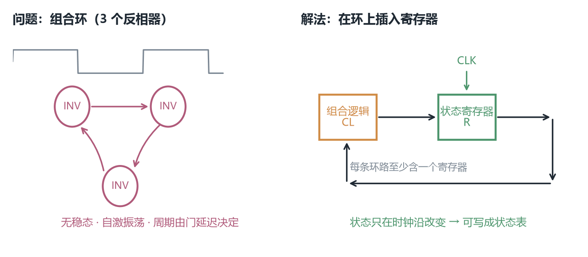
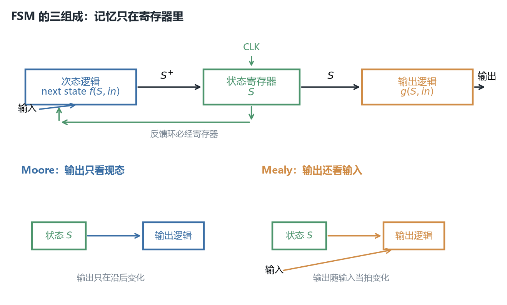
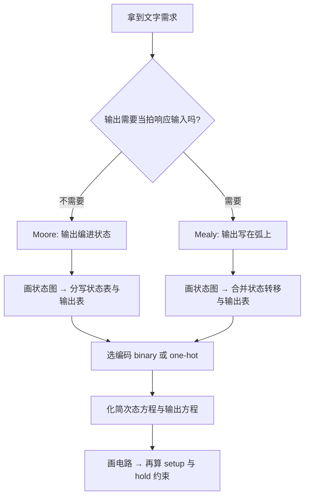
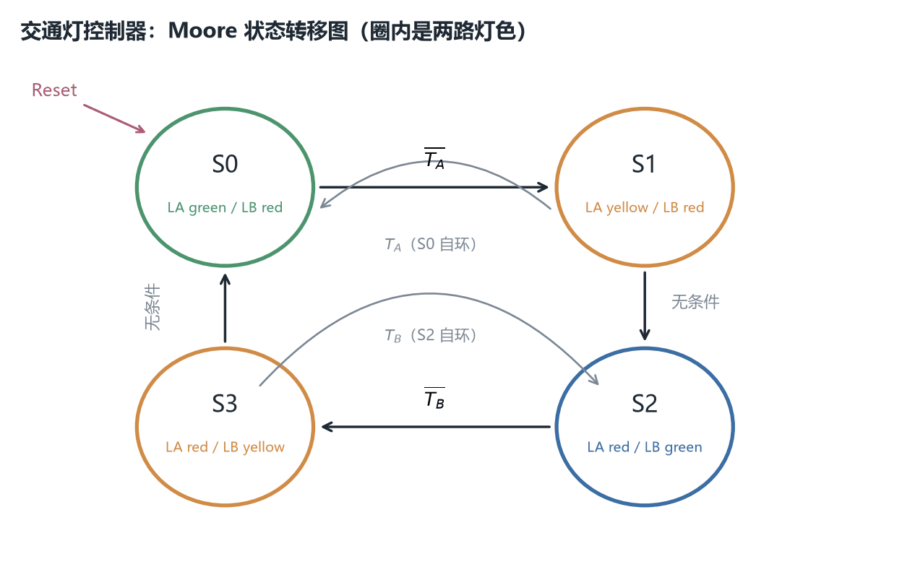
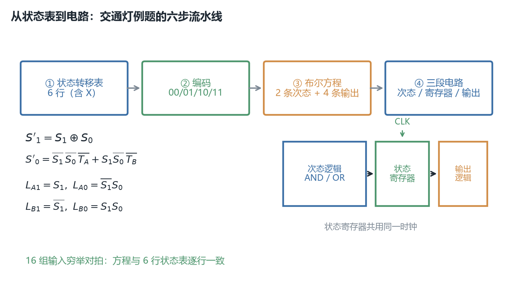
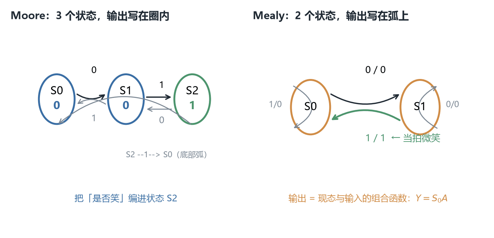
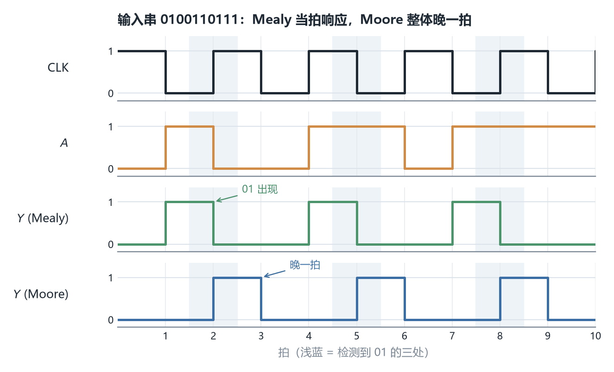
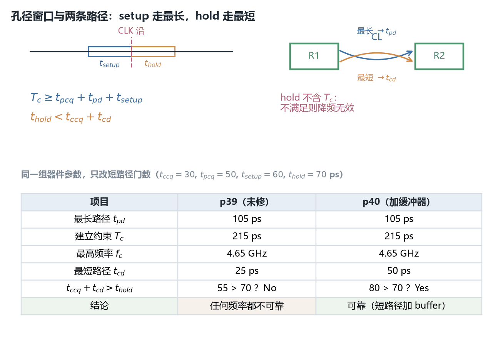

# ECE2050 Chapter 9 Finite State Machine 课堂笔记

## 本章在讲什么

Chapter 7 造出了能存一位的触发器，Chapter 8 把触发器串成移位寄存器、让状态按拍流动。到这一步，"电路有记忆"已经不新鲜了，但**还没有一套方法告诉我们：给一段文字描述的需求，怎么系统地把它变成电路**。Chapter 9 补的就是这套方法。

全章其实是三块内容，前两块是"设计"，第三块是"设计完能不能跑起来"：

**第一块（p3–p9）：给时序电路立规矩。** 不是所有带反馈的电路都能用——三个反相器成环会自己振荡，永远停不下来。办法是把环**用寄存器打断**，于是电路变成"寄存器 → 组合逻辑 → 寄存器"的规整结构。这套规矩一旦立住，电路的行为就能用一张**状态转移表**完整描述，有限状态机（finite state machine, FSM）就是这类电路。

**第二块（p10–p29）：从需求到电路的一整套流程。** 讲义用两个完整例题走了一遍：交通灯控制器（Moore 型，p10–p18）和 Alyssa 的蜗牛（Moore 与 Mealy 各做一遍，p21–p29）。两个例题把"识别输入输出 → 画状态图 → 写状态表 → 选编码 → 写布尔方程 → 画电路"这条流水线的每一步都落到了具体的表和式子上。中间 p19–p20 插了 binary 与 one-hot 两种状态编码的取舍。

**第三块（p30–p40）：这些电路为什么能可靠工作。** 触发器只在时钟沿采样，可输入必须在沿的前后一小段时间内保持稳定。把这段约束写成不等式，就得到 $T_c \ge t_{pcq}+t_{pd}+t_{setup}$（决定最高频率）与 $t_{hold} < t_{ccq}+t_{cd}$（决定能不能工作）。p39–p40 用同一组数值演了"保持时间不满足"与"加缓冲器修好"两遍。

一句话概括全章：**前两章给你"能存东西的零件"，这一章先教你怎么把需求翻译成状态表（设计），再告诉你这张表跑多快才不会出错（时序）。**

42 页讲义被六个分节页切成六段：p3 "Synchronous Sequential Design"、p6 "Finite State Machines"、p10 "Moore FSMs Examples"、p21 "Mealy FSMs Examples"、p30 "Timing"、以及 p41 的回顾。各小节的页序对应如下，笔记正文按这个顺序一条线写下来：

| 讲义页 | 本笔记小节 | 内容 |
| --- | --- | --- |
| p1 | —— | 封面：ECE 2050 / Chapter 9: Finite State Machine / Tinghuan CHEN, Ph.D. |
| p2 | 开场：上一讲回顾 | Last Week 十一条清单 |
| p3 | —— | 分节页：Synchronous Sequential Design |
| p4 | 同步时序设计 | 时序电路定义；三个反相器成环的振荡反例与 cyclic path |
| p5 | 同步时序设计 | 用寄存器打断环；同步时序电路四条组合规则 |
| p6 | —— | 分节页：Finite State Machines |
| p7 | FSM 的结构与设计流程 | 三组成：状态寄存器、次态逻辑、输出逻辑 |
| p8 | FSM 的结构与设计流程 | 次态由现态与输入决定；Moore 与 Mealy 的定义 |
| p9 | FSM 的结构与设计流程 | FSM 设计七步 |
| p10 | —— | 分节页：Moore FSMs Examples |
| p11 | 交通灯控制器 | 题干：Academic Ave 与 Bravado Blvd 路口、传感器 $T_A,T_B$、灯 $L_A,L_B$ |
| p12 | 交通灯控制器 | 方块图：输入 $CLK,Reset,T_A,T_B$，输出 $L_A,L_B$ |
| p13 | 交通灯控制器 | Moore 状态转移图：四个状态、圈内标灯色、弧上标 $T_A$/$T_B$ |
| p14 | 交通灯控制器 | 状态转移表（6 行，含 don't care） |
| p15 | 交通灯控制器 | 编码后状态表、状态编码、次态方程化简 |
| p16 | 交通灯控制器 | 输出表、输出编码（green/yellow/red = 00/01/10）、输出方程 |
| p17 | 交通灯控制器 | FSM Schematic：三块逻辑的完整门级图与六条方程 |
| p18 | 交通灯控制器 | FSM Timing Diagram：10 个 cycle 的逐拍波形 |
| p19 | 状态编码 | binary 与 one-hot 编码的定义与取舍 |
| p20 | 状态编码 | 1-hot 编码例题：6 行表、四条次态方程、"NO!" 反例 |
| p21 | —— | 分节页：Mealy FSMs Examples |
| p22 | 蜗牛例题：Moore vs Mealy | 题干：纸带上的 0/1，最后两位是 01 时微笑 |
| p23 | 蜗牛例题：Moore vs Mealy | 两张状态转移图对照；"是否把输出编进状态" |
| p24 | 蜗牛例题：Moore vs Mealy | Moore 状态转移表、编码、次态方程 |
| p25 | 蜗牛例题：Moore vs Mealy | Moore 输出表与输出方程 $Y=S_1$ |
| p26 | 蜗牛例题：Moore vs Mealy | Mealy 合并的状态转移与输出表、两条方程 |
| p27 | 蜗牛例题：Moore vs Mealy | Moore FSM Schematic 与三条方程 |
| p28 | 蜗牛例题：Moore vs Mealy | Mealy FSM Schematic 与两条方程 |
| p29 | 蜗牛例题：Moore vs Mealy | Moore 与 Mealy 时序图对照；"Mealy 立即、Moore 晚一拍" |
| p30 | —— | 分节页：Timing |
| p31 | 时序约束 | 触发器在沿上采样 $D$；$D$ 必须稳定（拍照类比） |
| p32 | 时序约束 | 建立时间、保持时间、孔径时间的定义 |
| p33 | 时序约束 | 传播延迟 $t_{pcq}$ 与污染延迟 $t_{ccq}$ |
| p34 | 时序约束 | Dynamic Discipline：输入在孔径内必须稳定 |
| p35 | 时序约束 | 双寄存器模型 $R1\to CL\to R2$；路径有最大/最小延迟 |
| p36 | 时序约束 | 建立时间约束（周期时间约束）与 sequencing overhead |
| p37 | 时序约束 | 保持时间约束 |
| p38 | 时序约束 | 两个约束都要算；保持不满足则任何频率都不可靠 |
| p39 | 时序约束 | 例题（一）：保持时间不满足，结论"任何频率都跑不了" |
| p40 | 时序约束 | 例题（二）：短路径加缓冲器后满足 |
| p41 | 本章回顾与自测 | Chapter Review 十一条 |
| p42 | 本章回顾与自测 | 七道 True/False Quiz（讲义已标答案） |

## 开场：上一讲回顾（讲义 p1–p2）

p2 把 Chapter 8 列成十一条：移位寄存器（Shift Registers）、数据存储、数据移动、串行/并行输入-串行/并行输出、双向移位寄存器，以及五类应用——时间延迟、串到并数据变换器、UART（Universal Asynchronous Receiver Transmitter，通用异步收发器）、键盘编码器、Johnson 计数器与环形计数器。

这份清单里**没有出现任何"状态机"或"控制器"的字眼**，但本章要做的事正是把 Chapter 8 那些"按拍流动的数据"升级成"按规则变化的状态"。从"数据怎么搬"到"下一步该干什么"，是这两章之间的跳转。

> [!NOTE] 补充：为什么回顾清单里没有预告本章
> Ch7 的 p2 回顾的是 Ch6 的器件，Ch8 的 p2 回顾的是 Ch7 的状态元件，唯独 Ch9 的 p2 回顾的是 Ch8 的**应用**而非"设计方法"。这与本课程讲义一贯的"下一讲目录藏在页底抛题里"不同——本章的三块内容（同步设计规则、FSM 设计流程、时序约束）在上一讲完全没有铺垫，是独立开的新话题。**复习时不要把 Ch8 当作 Ch9 的前置知识**，真正的前置是 Ch6 的 $t_{pd}/t_{cd}$ 与 Ch7 的边沿触发。

## 同步时序设计：先立规矩，再谈设计（讲义 p3–p6）

**先看一个坏掉的电路。** p4 摆了三个反相器首尾相接成环（$X\to Y\to Z\to X$），旁边配了三条波形，再列出四条观察：没有输入、有 1–3 个输出；是**无稳态电路（astable circuit）**，会自己振荡；振荡周期取决于反相器的延迟；它有一条**环路（cyclic path）**——输出被反馈回输入。

这个电路不是"错"，而是**不可控**：它的输出一直在变，却没有办法让它停在一个有意义的态上，也没有任何输入能改变它。Chapter 7 讲过，奇数个反相器成环无不动点；这里 p4 把它作为"时序电路里最麻烦的一类"正式提出来。

> [!IMPORTANT] 重要：时序电路的定义与"能不能设计"是两回事
> p4 第一句说 *Sequential circuits: all circuits that aren't combinational*（时序电路 = 所有不是组合逻辑的电路）。这是一个**包含性**定义，把振荡器也包括进去了。但本章后面能设计的只是其中一个子集——满足 p5 四条规则的**同步**时序电路。别把定义当成许可。

**p5 给的解法只有一句：用寄存器打断环路（breaks cyclic paths by inserting registers）。** 由此得到四条组合规则，值得逐条记住：

1. 每个电路元件要么是**寄存器**，要么是**组合电路**；
2. 至少有一个元件是寄存器；
3. 所有寄存器接收**同一个时钟**；
4. 每条环路至少包含一个寄存器。

第 4 条是前三条的目的：环路被寄存器切断后，信号每绕一圈就必须等一个时钟沿，电路行为就变成离散的、可枚举的"状态序列"，而不是连续的模拟振荡。第 3 条保证所有寄存器同时更新，于是"第 N 拍的状态"是一个定义良好的概念。p5 还点明：寄存器里装的就是系统的状态，状态在时钟沿改变，系统因此与时钟同步。

*图 1　左：三个反相器成环，无稳态、持续振荡（p4 的反例）。右：在环中插入一个由 CLK 控制的寄存器后，环路被切断，输出每拍才更新一次，行为可用状态表描述。*

**失败情形**：若某个环路里一个寄存器都没有（例如把两个反相器直接对接），这条环路仍是组合环，输出会在门延迟尺度上自己演化，无法用时钟划分节拍。反过来，若把寄存器插得太多（每条路径都插），电路虽然合法但功能退化成一串延迟线——规矩给的是**下界**，不是越多越好。

> [!TIP] 参考答案
> **练习 1**：一个由 4 个与非门构成的环形反馈，无寄存器、无外部时钟。按 p5 的四条规则判断它是可设计的同步时序电路吗？
> 不是。违反第 2 条（没有寄存器）与第 4 条（环路无寄存器），属于 p4 那类无稳态组合环。
> **练习 2**：把上题的环中插入两个寄存器，但给它们接不同的时钟。合法吗？
> 不合法，违反第 3 条。两个寄存器不在同一时刻更新，"当前状态"没有统一定义，也就写不出状态转移表。

## FSM 的结构、两种类型与设计七步（讲义 p6–p9）

**p7 把 FSM 拆成三块**（这也回答了"为什么叫状态机"）：

- **状态寄存器（state register）**：存当前状态（current state），在时钟沿装入下一状态（next state）。
- **次态逻辑（next state logic）**：组合电路，由当前状态与输入算出**下一状态**。
- **输出逻辑（output logic）**：组合电路，由当前状态（以及可能的输入）算出**输出**。

用式子写就是：

$$S^{+} = f(S,\ \text{inputs})\qquad \text{outputs} = g(S,\ \text{inputs})$$

其中 $f$、$g$ 都是纯组合函数，$S$ 是状态寄存器里的位向量。$S^{+}$ 在下一个时钟沿被写回 $S$。**这条式子的全部力量在于 $f$ 与 $g$ 没有记忆**：记忆被隔离在寄存器里，所以设计工作就退化成 Chapter 4/5 已经会做的"写真值表、化简、搭门"。

**p8 的两类 FSM 只差输出逻辑**：

| 类型 | 输出取决于 | 输出逻辑 $g$ 的输入 | 状态图上的标注 |
| --- | --- | --- | --- |
| Moore FSM | **仅当前状态** $S$ | 只有 $S$ | 输出写在**状态圈里** |
| Mealy FSM | 当前状态 $S$ **与输入** | $S$ 与 inputs | 输出写在**转移弧上**，写作「输入/输出」 |

p8 画了两张结构框图对照：Moore 的输出逻辑只从状态寄存器取线；Mealy 的输出逻辑还额外从输入取线。这个差别看着小，后果在 p29 会显出来：Mealy 能对输入**当拍**作出反应，Moore 必须等状态在下一个沿更新后才能改输出。

*图 2　上：状态寄存器 + 次态逻辑 + 输出逻辑的经典三段结构，反馈环必经寄存器。下左 Moore 的输出逻辑只接现态；下右 Mealy 的输出逻辑同时接现态与输入。*

**p9 给出设计七步**，本章后面两个例题都是严格照它走的：

1. 识别输入与输出（Identify inputs and outputs）；
2. 画状态转移图（Sketch state transition diagram）；
3. 写状态转移表与输出表——**Moore 写两张分离的表，Mealy 写一张合并的表**；
4. 选择状态编码（Select state encodings）；
5. 用编码重写状态转移表与输出表；
6. 写出次态逻辑与输出逻辑的布尔方程；
7. 画电路原理图。

> [!TIP] 技巧：第 3 步的"分表 / 合表"不是形式主义
> Moore 的输出只由状态决定，所以输出表是一张「状态 → 输出」的独立小表；Mealy 的输出还依赖输入，必须与次态写在同一行里，否则会漏掉"同一状态、不同输入给不同输出"的情形。考场上若把 Mealy 拆成两张表，几乎一定会丢分。

*这张图是我整理的，课件没有画。*

> [!TIP] 参考答案
> **练习 1**：一个 FSM 有 3 个状态、2 个输入、1 个输出。用 Moore 型与 Mealy 型分别需要写几张表？
> Moore：状态转移表 + 输出表共 2 张；Mealy：1 张合并表。
> **练习 2**：为什么 $f$、$g$ 必须是组合电路？
> 因为记忆只能存在于寄存器里。若 $f$ 或 $g$ 内部再含状态，就出现第二条未被寄存器打断的环路，违反 p5 第 4 条，电路行为不再能用一张状态表描述。

## 例题一：交通灯控制器的 Moore FSM（讲义 p10–p18）

### 第 1–2 步：识别输入输出、画状态图

p11 的场景是一个十字路口：南北向是 Academic Ave（旁边有 Dining Hall 与 Fields），东西向是 Bravado Blvd（旁边有 Labs 与 Dorms）。两条路各有一个交通传感器 $T_A$、$T_B$（有车时为 TRUE），各有一盏灯 $L_A$、$L_B$。p12 把控制器收成一个方块：输入 $CLK$、$Reset$、$T_A$、$T_B$，输出 $L_A$、$L_B$。

灯不是简单的 1 位"亮/灭"，而是三色，所以 p16 给了输出编码：**green = 00、yellow = 01、red = 10**。于是 $L_A$ 与 $L_B$ 各是 2 位，分别记作 $L_{A1}L_{A0}$、$L_{B1}L_{B0}$。

p13 的 Moore 状态转移图有四个状态，圈内直接写着两条路的灯色：

| 状态 | $L_A$ | $L_B$ | 含义 |
| --- | --- | --- | --- |
| S0 | green | red | Academic Ave 放行 |
| S1 | yellow | red | Academic Ave 转黄 |
| S2 | red | green | Bravado Blvd 放行 |
| S3 | red | yellow | Bravado Blvd 转黄 |

转移规则（弧上标的是传感器条件，$\overline{T_A}$ 表示"该方向无车"）：S0 在 $T_A=0$ 时转 S1、$T_A=1$ 时保持；S1 无条件转 S2；S2 在 $T_B=0$ 时转 S3、$T_B=1$ 时保持；S3 无条件转 S0。**直觉**：只要主路还有车就一直绿灯，没车了才走完"黄灯 → 另一路绿灯"的固定两步。

*图 3　四个 Moore 状态，圈内标灯色，弧上标 $T_A$ 与 $T_B$ 的条件；$Reset$ 把电路带回 S0。S1 与 S3 是无条件转移，S0 与 S2 各有一条自环。*

### 第 3 步：状态转移表（p14）

把图逐条抄成表，X 是 don't care（该输入在这一行不影响结果）：

| 当前状态 $S$ | $T_A$ | $T_B$ | 下一状态 $S'$ |
| --- | --- | --- | --- |
| S0 | 0 | X | S1 |
| S0 | 1 | X | S0 |
| S1 | X | X | S2 |
| S2 | X | 0 | S3 |
| S2 | X | 1 | S2 |
| S3 | X | X | S0 |

### 第 4–6 步：状态编码、重写表格、化简方程（p15–p16）

讲义取 **binary 编码**：S0=00、S1=01、S2=10、S3=11，用两位 $S_1S_0$ 表示。把上表代进去，得到编码后的状态转移表：

| $S_1$ | $S_0$ | $T_A$ | $T_B$ | $S'_1$ | $S'_0$ |
| --- | --- | --- | --- | --- | --- |
| 0 | 0 | 0 | X | 0 | 1 |
| 0 | 0 | 1 | X | 0 | 0 |
| 0 | 1 | X | X | 1 | 0 |
| 1 | 0 | X | 0 | 1 | 1 |
| 1 | 0 | X | 1 | 1 | 0 |
| 1 | 1 | X | X | 0 | 0 |

对 $S'_1$ 与 $S'_0$ 分别按这张表化简（p15 给的过程）：

$$S'_1 = \overline{S_1}S_0 + S_1\overline{S_0}\,\overline{T_B} + S_1\overline{S_0}T_B = \overline{S_1}S_0 + S_1\overline{S_0} = S_1 \oplus S_0$$

$$S'_0 = \overline{S_1}\,\overline{S_0}\,\overline{T_A} + S_1\overline{S_0}\,\overline{T_B}$$

中间那一步值得停一下：$S_1\overline{S_0}\,\overline{T_B} + S_1\overline{S_0}T_B$ 用 $T_B+\overline{T_B}=1$ 合并成 $S_1\overline{S_0}$，于是 $S'_1$ 与输入**完全无关**，只是现态两位做异或。这不是巧合：S1→S2、S2→S2/S3、S3→S0、S0→S0/S1 这条链里，高位的翻转节奏是固定的。

> [!WARNING] 课件笔误：p15–p17 方程的上划线在文字层里全部丢失
> 抽 p15 的文字层得到 `S'1 = S1S0 + S1S0TB + S1S0TB = S1S0 + S1S0 = S1 Å S0`、`S'0 = S1S0TA + S1S0TB`，**所有补号都没了**，`Å` 还是 $\oplus$ 的错误编码。p17 的六条方程同样如此。本笔记的补号落点是按 500 dpi 裁切 p15/p17 后逐条读出、并用脚本在全部 16 组 $(S_1,S_0,T_A,T_B)$ 上与 p14 状态表对拍确认的（见附录"数值核验说明"）。**照抄文字层会全错。**

p16 的输出表与输出编码：

| 状态 | $S_1$ | $S_0$ | $L_A$ | $L_B$ | $L_{A1}$ | $L_{A0}$ | $L_{B1}$ | $L_{B0}$ |
| --- | --- | --- | --- | --- | --- | --- | --- | --- |
| S0 | 0 | 0 | green | red | 0 | 0 | 1 | 0 |
| S1 | 0 | 1 | yellow | red | 0 | 1 | 1 | 0 |
| S2 | 1 | 0 | red | green | 1 | 0 | 0 | 0 |
| S3 | 1 | 1 | red | yellow | 1 | 0 | 0 | 1 |

化简得四条输出方程：

$$L_{A1} = S_1\overline{S_0} + S_1S_0 = S_1$$
$$L_{A0} = \overline{S_1}S_0$$
$$L_{B1} = \overline{S_1}\,\overline{S_0} + \overline{S_1}S_0 = \overline{S_1}$$
$$L_{B0} = S_1S_0$$

头一眼可能觉得 $L_{A1}=S_1$ 与 $L_{B1}=\overline{S_1}$ "太整齐了"——这正是 Moore 型的特点：输出只由状态位决定，而且这个例子的编码选得刚好让两个方向的主色互补。

### 第 7 步：电路与时序（p17–p18）

p17 把三块逻辑画在一起：左边是次态逻辑（$T_A$、$T_B$ 与反馈回来的 $S_1$、$S_0$ 经过 AND/OR 门产生 $S'_1$、$S'_0$），中间是 2 位状态寄存器（共用 $CLK$，带 $Reset$），右边是输出逻辑（产生 $L_{A1},L_{A0},L_{B1},L_{B0}$）。六条方程就写在图下，与上面逐一对应。

*图 4　从状态转移表到电路的六步流水线在这个例子里的落地：6 行状态表 → 00/01/10/11 编码 → 两条次态方程与四条输出方程 → 次态逻辑 / 状态寄存器 / 输出逻辑三段电路。*

p18 给了 10 个 cycle 的时序图：$CLK$、$Reset$、$T_A$、$T_B$、以及状态 $S_{1:0}$ 与四路灯输出逐拍变化，图上还标了 15 ns、50 ps、90 ps 一类的时间标注。**读这张图的正确顺序**是：先看 $Reset$ 把状态拉回 S0，再沿每个上升沿查 $T_A$/$T_B$，用状态表推出下一拍的 $S$，最后用输出表查灯色。只要状态表与输出表在手，整张波形可以自己推出来，不必背。

> [!TIP] 参考答案
> **练习 1**：当前 $S=S_2$（编码 10）、$T_B=1$、$T_A=0$，求下一状态与两路灯色。
> 查 p14 表：S2 且 $T_B=1$ → 保持 S2。次态方程验算：$S'_1 = 1\oplus 0 = 1$，$S'_0 = \overline 1\cdot\overline 0\cdot\overline 0 + 1\cdot\overline 0\cdot\overline 1 = 0$，得 $(1,0)$ = S2 ✓。输出：$L_A=\text{red}$、$L_B=\text{green}$。
> **练习 2**：若把状态编码改成 S0=00、S1=11、S2=01、S3=10，电路功能会变吗？方程呢？
> 功能不变（状态图没变），但六条布尔方程全部要重推、门数也会变。**状态编码是设计选择，不是物理事实**——这正是下一节的话题。

## 状态编码：binary 与 one-hot（讲义 p19–p20）

p19 给了两种编码的对照：

| 编码 | 4 个状态的取法 | 需要的触发器 | 次态/输出逻辑 |
| --- | --- | --- | --- |
| 二进制（binary encoding） | 00、01、10、11 | $\lceil\log_2 4\rceil = 2$ 个 | 通常较复杂，要化简 |
| 独热（one-hot encoding） | 0001、0010、0100、1000 | 4 个（每个状态一位，且**任何时刻只有一位为 HIGH**） | 常常更简单 |

讲义明确写了取舍：one-hot **需要更多触发器**，但**次态逻辑与输出逻辑往往更简单**。

**p20 把同一个交通灯例题用 one-hot 重做一遍**，编码为 S0=0001、S1=0010、S2=0100、S3=1000（位序写作 $S_3S_2S_1S_0$）。表格仍是 6 行，只是把状态名换成 4 位向量。四条次态方程：

$$S'_3 = S_2\overline{T_B}\qquad S'_2 = S_1 + S_2T_B\qquad S'_1 = S_0\overline{T_A}\qquad S'_0 = S_0T_A + S_3$$

对照 binary 版的 $S'_1=S_1\oplus S_0$ 可以看出 one-hot 的"简单"体现在哪：每一条式子都在说"**哪一条弧会点亮下一个状态位**"。例如 $S'_3=S_2\overline{T_B}$ 就是"S2 且 B 路无车 → 下一拍进 S3"，几乎是把状态图直译过来，不需要 K-map。

> [!IMPORTANT] 重要：p20 顶部那句 "NO!" 是本章最值钱的一条批注
> 讲义在页顶写了一个被划掉的式子 $S'_3 = S_3S_2S_1S_0T_B$ 并标 **NO!**。错在哪？它把 one-hot 的四个状态位**当成二进制编码的四个条件去相与**了。one-hot 下任何时刻只有一个位为 1，所以 $S_3S_2S_1S_0$ 恒为 0，这条式子永远给不出 1——S3 永远进不去。我按脚本验过：在状态 S2、$T_B=0$ 时正确式 $S_2\overline{T_B}$ 给 1，这个错式给 0。**写 one-hot 方程时，每一项只该含一个状态位**，不要写一堆状态位的乘积。

**失败情形**：one-hot 的 4 位里，合法状态只有 4 个，其余 12 种组合（如 0011、0000）都是非法的。上电或受干扰进入非法态后，四条方程未必能把电路带回合法环——这是 one-hot 相对 binary 的一个真实工程代价，讲义没有讨论（binary 编码 2 位全部 4 种组合都合法，没有这个缺口）。

> [!TIP] 参考答案
> **练习 1**：4 个状态用 one-hot 要几位？用 binary 呢？8 个状态呢？
> 4 状态：one-hot 4 位、binary 2 位；8 状态：one-hot 8 位、binary 3 位。
> **练习 2**：在 one-hot 交通灯里，为什么 $S'_2 = S_1 + S_2T_B$ 是"或"而不是"与"？
> 因为有两条不同的弧都会进入 S2：S1 无条件转入，以及 S2 在 $T_B=1$ 时自环。只要其中一条成立，下一拍就该点亮 S2 这一位。

## 例题二：蜗牛的 Moore 与 Mealy FSM（讲义 p21–p29）

### 题干与状态图（p22–p23）

p22 的题（教材 §3.4.3 同源）：*Alyssa P. Hacker has a snail that crawls down a paper tape with 1's and 0's on it. The snail smiles whenever the last two digits it has crawled over are 01. Design Moore and Mealy FSMs of the snail's brain.*（纸带上写着 0/1，蜗牛爬过，**最后两位是 01** 时就微笑。分别设计 Moore 型与 Mealy 型。）

输入是每拍读到的位 $A$，输出是 $Y$（微笑）。检测"01"意味着电路必须记住**上一位是 0 还是 1**，这正是需要状态的地方。

p23 给了两张状态图，下面一行红字点破了两者唯一的差别：*Whether encode output into state*（要不要把输出编进状态）。

**Moore（3 个状态，输出写在圈内）**：

| 状态 | 圈内输出 | 含义 |
| --- | --- | --- |
| S0 | 0 | 刚爬过 1，不笑 |
| S1 | 0 | 刚爬过 0，不笑 |
| S2 | 1 | 刚爬过 1 且形成 01，笑 |

转移：S0 在 $A=0$ 转 S1、$A=1$ 转 S0；S1 在 $A=0$ 转 S1、$A=1$ 转 S2；S2 在 $A=0$ 转 S1、$A=1$ 转 S0。

**Mealy（2 个状态，输出写在弧上，格式「输入/输出」）**：

| 状态 | 含义 |
| --- | --- |
| S0 | 刚爬过 1 |
| S1 | 刚爬过 0 |

转移弧：S0 在 $A=1$ 自环（1/0）、$A=0$ 转 S1（0/0）；S1 在 $A=0$ 自环（0/0）、$A=1$ 转 S0（**1/1**，这一拍就检测到 01，立即微笑）。

*图 5　左：Moore 用 3 个状态，把"是否笑"编进 S2，输出标在圈内。右：Mealy 只用 2 个状态，把输出标在弧上；S1 收到 1 的那条弧标 1/1，当拍即输出。*

> [!IMPORTANT] 重要：Mealy 少一个状态不是白省的
> Moore 必须专门造一个"笑"的状态 S2，因为它的输出只能由状态决定；Mealy 把输出挂在转移弧上，于是"刚爬过 0 又读到 1"这一事件本身就能给 $Y=1$，不需要额外状态。**代价是 Mealy 的输出是组合逻辑的直接结果，输入一毛刺它就会跟着抖**；Moore 的输出来自寄存器，天然与时钟对齐、更干净。

### 表格与方程（p24–p28）

**Moore 状态转移表**（p24，编码 S0=00、S1=01、S2=10，状态位 $S_1S_0$）：

| $S_1$ | $S_0$ | $A$ | $S'_1$ | $S'_0$ |
| --- | --- | --- | --- | --- |
| 0 | 0 | 0 | 0 | 1 |
| 0 | 0 | 1 | 0 | 0 |
| 0 | 1 | 0 | 0 | 1 |
| 0 | 1 | 1 | 1 | 0 |
| 1 | 0 | 0 | 0 | 1 |
| 1 | 0 | 1 | 0 | 0 |

化简得 $S'_1=\overline{S_1}S_0A$、$S'_0=\overline{A}$。p25 的 Moore 输出表是「$S_1S_0$ = 00/01/10 → $Y$ = 0/0/1」，方程 $Y=S_1$。

> [!NOTE] 补充：p27 把 $S'_1$ 写成了 $S_0A$，少了一个 $\overline{S_1}$，这不是错
> p24 给 $\overline{S_1}S_0A$，p27 的电路方程给 $S_0A$。因为三个状态只用了 00、01、10，**11 是未用状态**，可以当 don't care：在 11 上令 $S'_1$ 任意，$\overline{S_1}S_0A$ 就能化简成 $S_0A$。两种写法在所有合法状态下完全等价（脚本 6 行全验过）。p27 的电路图里确实只画了一个两输入 AND 门，与化简后的式子一致。

**Mealy 合并表**（p26，编码 S0=0、S1=1，状态位 $S_0$）：

| 当前 $S_0$ | 输入 $A$ | 次态 $S'_0$ | 输出 $Y$ |
| --- | --- | --- | --- |
| 0 | 0 | 1 | 0 |
| 0 | 1 | 0 | 0 |
| 1 | 0 | 1 | 0 |
| 1 | 1 | 0 | 1 |

方程 $S'_0=\overline{A}$、$Y=S_0A$。p27/p28 的两张电路图分别是 Moore（两个状态位、一个 AND 门、一个反相器、输出直接取 $S_1$）与 Mealy（一个状态位、一个反相器、一个 AND 门产生 $Y$）。

> [!CAUTION] 注意：p27/p28 方程文本里的上划线同样丢失
> p27 文字层写 `S0' = A`、`Y = S1`，p28 写 `S0' = A`、`Y = S0A`。从 p26 表和电路图（$A$ 先过反相器再到 $S'_0$）可判定 $S'_0=\overline{A}$，讲义方程文本少了一根杠。**以状态表与电路图为准**。

### 时序对照：Mealy 立即，Moore 晚一拍（p29）

p29 把两台机器放在同一组 $CLK$、$Reset$、$A$ 下画了 11 个 cycle 的波形，底部两句结论：

- *Mealy FSM: asserts $Y$ immediately when input pattern 01 is detected*（检测到 01 **当拍**就置 $Y$）；
- *Moore FSM: asserts $Y$ one cycle after input pattern 01 is detected*（**晚一个周期**才置 $Y$）。

原因很直接：Mealy 的 $Y=S_0A$ 是输入与现态的组合函数，$A$ 一变 $Y$ 就能变；Moore 的 $Y=S_1$ 只能等下一个时钟沿把状态翻到 S2 之后才变。

用教材 §3.4.3 的输入串 $A=0100110111$ 逐步算（脚本逐拍仿真，见附录"数值核验说明"）：

| 拍 | 1 | 2 | 3 | 4 | 5 | 6 | 7 | 8 | 9 | 10 |
| --- | --- | --- | --- | --- | --- | --- | --- | --- | --- | --- |
| $A$ | 0 | 1 | 0 | 0 | 1 | 1 | 0 | 1 | 1 | 1 |
| Mealy $Y$ | 0 | 1 | 0 | 0 | 1 | 0 | 0 | 1 | 0 | 0 |
| Moore $Y$ | 0 | 0 | 1 | 0 | 0 | 1 | 0 | 0 | 1 | 0 |

三处 01 分别出现在第 2、5、8 拍：Mealy 在**同拍**给 1，Moore 在下一拍给 1，逐处对齐。

*图 6　同一输入串 0100110111 下两台机器的输出。Mealy 的 $Y$ 在 01 出现的那一拍就拉高；Moore 的 $Y$ 整体右移一拍，因为它必须等状态寄存器更新到 S2。*

> [!TIP] 参考答案
> **练习 1**：输入串 0101，分别写出 Moore 与 Mealy 的 $Y$ 序列（$Reset$ 后都从初始态开始）。
> Mealy：0,1,0,1；Moore：0,0,1,0（第二个 01 的 Moore 响应落在第 5 拍，超出观察窗）。
> **练习 2**：若要求输出绝不能出现毛刺，选哪种？为什么？
> 选 Moore。它的输出由状态寄存器直接给出，只在时钟沿变化；Mealy 的输出是输入的组合函数，输入上的毛刺会直接传到 $Y$。代价是晚一拍、且可能多用一个状态。

## 时序约束：这张表跑多快才不出错（讲义 p30–p40）

### 四个时间参数（p31–p34）

p31 的动机只有一句：触发器在时钟沿采样 $D$，所以 **$D$ 在采样的那一刻必须稳定**，讲义用"拍照"作类比——按快门的一瞬间物体不能动。

| 参数 | 定义 | 相对时钟沿 | 讲义页 |
| --- | --- | --- | --- |
| 建立时间 $t_{setup}$ | 数据必须保持稳定的时间 | 沿**之前** | p32 |
| 保持时间 $t_{hold}$ | 数据必须继续保持稳定的时间 | 沿**之后** | p32 |
| 孔径时间 $t_a$ | $t_a=t_{setup}+t_{hold}$，数据必须稳定的总窗口 | 沿前后 | p32 |
| 传播延迟 $t_{pcq}$ | 沿后 $Q$ **保证**稳定（停止变化）所需时间 | 沿之后，**最大**延迟 | p33 |
| 污染延迟 $t_{ccq}$ | 沿后 $Q$ **可能开始**变化的最早时间 | 沿之后，**最小**延迟 | p33 |

$t_{pcq}$ 与 $t_{ccq}$ 这一对，正是 Chapter 6 首次引入、Chapter 7 p21 用来造窄脉冲的 $t_{pd}$ / $t_{cd}$ 在触发器上的版本：前者是"最晚多久一定好"，后者是"最早多久可能变"。p34 的 **动态纪律（Dynamic Discipline）** 把两者合起来要求：同步时序电路的输入在时钟沿周围的整个孔径内必须稳定，即至少提前 $t_{setup}$、至少保持到 $t_{hold}$ 之后。

### 两条不等式（p35–p38）

p35 给出标准模型：寄存器 $R1$ 的输出 $Q_1$ 经过一块组合逻辑（CL）送到寄存器 $R2$ 的输入 $D_2$，两者共用 $CLK$，周期 $T_c$。这条路径既有最大延迟也有最小延迟，取决于门的数量与类型。

**建立时间约束**（p36，也叫周期时间约束 Cycle Time Constraint）：走**最长**路径。$R1$ 在沿后最多 $t_{pcq}$ 才稳定，再经组合逻辑最多 $t_{pd}$，还得在下一个沿前留出 $t_{setup}$：

$$T_c \ge t_{pcq} + t_{pd} + t_{setup}\qquad t_{pd} \le T_c - (t_{pcq}+t_{setup})$$

$(t_{pcq}+t_{setup})$ 被称作 **sequencing overhead**（时序开销）：这部分时间与组合逻辑无关，是"用触发器就要付的固定成本"。这条式子决定电路的**最高时钟频率**——不满足就降频，总能解决。

**保持时间约束**（p37）：走**最短**路径。$R1$ 在沿后最早 $t_{ccq}$ 就可能变，经组合逻辑最快 $t_{cd}$ 就传到 $D_2$，而 $D_2$ 必须再稳定 $t_{hold}$：

$$t_{hold} < t_{ccq} + t_{cd}\qquad t_{cd} > t_{hold} - t_{ccq}$$

> [!IMPORTANT] 重要：p38 那句红字是本章最容易考的一句话
> *If the hold time constraint isn't met, the circuit won't work reliably at any frequency*（保持时间约束若不满足，电路在**任何频率**下都不可靠）。原因是这条式子里**没有 $T_c$**：降频只会拉长两个沿之间的距离，完全不改变沿后那一小段窗口里的竞争关系。修法只能是加延迟（p40 的缓冲器），不能是降频。

### 两道例题（p39–p40）：同一组数值，两种结局

讲义给的时序特性（两页相同）：$t_{ccq}=30$ ps、$t_{pcq}=50$ ps、$t_{setup}=60$ ps、$t_{hold}=70$ ps；每个逻辑门 $t_{pd}=35$ ps、$t_{cd}=25$ ps。电路从 $R1$ 的四个输出 $A,B,C,D$ 出发，经三级门（AND → OR → AND）到达 $R2$ 的 $X$，另有一条只经一级门的短路径到 $Y$。

最长路径 3 个门，故 $t_{pd}=3\times 35=105$ ps。于是：

$$T_c \ge (50+105+60)\ \text{ps} = 215\ \text{ps}\qquad f_c = 1/T_c \approx 4.65\ \text{GHz}$$

| 项 | p39（未修） | p40（短路径加缓冲器） |
| --- | --- | --- |
| 最长路径 $t_{pd}$ | $3\times 35=105$ ps | $3\times 35=105$ ps |
| 建立约束 $T_c$ | $\ge 215$ ps | $\ge 215$ ps |
| 最高频率 $f_c$ | 4.65 GHz | 4.65 GHz |
| 最短路径 $t_{cd}$ | $1\times 25=25$ ps | $2\times 25=50$ ps |
| 保持判断 $t_{ccq}+t_{cd} > t_{hold}$ | $(30+25)=55 > 70$？**No** | $(30+50)=80 > 70$？**Yes** |
| 结论 | 任何频率都不可靠 | 可靠；修法是 **Add buffers on short paths** |

注意两页的 $T_c$ 与 $f_c$ **完全相同**——加缓冲器只动最短路径，不影响最长路径，所以最高频率不变。这个对照把"两条约束各管一件事"演示得很干净。

*图 7　上：孔径时间窗口、$t_{pcq}/t_{ccq}$ 的位置，以及 $R1\to CL\to R2$ 的长短两条路径。下：p39 与 p40 在同一组器件参数下的两条不等式计算结果，唯一差别是短路径门数从 1 变 2。*

> [!TIP] 技巧：做时序题的三步
> ① 先把所有时间统一单位（本例全是 ps）；② 分别找**最长**路径算 $t_{pd}$（用于 setup / $f_c$）与**最短**路径算 $t_{cd}$（用于 hold）；③ 两条不等式都写完再下结论——只算 setup 就说"能跑到 4.65 GHz"是 p39 专门设的陷阱。

> [!TIP] 参考答案
> **练习 1**：若把 p39 的时钟周期放宽到 1 ns，保持时间约束会满足吗？
> 不会。$t_{hold} < t_{ccq}+t_{cd}$ 里没有 $T_c$，$(30+25)=55 < 70$ 依然成立不了，任何频率都不行。
> **练习 2**：为什么要在**最短**路径上加缓冲器，而不是最长路径？
> 保持约束要求 $t_{cd}$ 足够**大**，只有最短路径缺延迟；往最长路径上加只会让 $t_{pd}$ 更大、最高频率更低，白白损失性能。

## 本章回顾与自测（讲义 p41–p42）

p41 的十一条清单：(Synchronous) Sequential Logic Counters、Finite State Machine（下含 Moore FSM、Mealy FSM）、Timing（下含 Setup time、Hold time、Aperture time、Propagation delay、Contamination delay）、Dynamic Discipline。

p42 七道判断题，讲义已用绿勾 / 红叉标了答案：

| # | 题目（原文） | 答案 | 理由 |
| --- | --- | --- | --- |
| 1 | A state machine is a sequential circuit having a limited number of states occurring in a prescribed order. | ✓ | 有限个状态、按规定顺序转移，正是 FSM 的定义（p5–p8）。 |
| 2 | FSM consists of a state register and combinational logic. | ✓ | p7 三组成里，次态逻辑与输出逻辑都是组合电路，合起来就是"寄存器 + 组合逻辑"。 |
| 3 | For a synchronous sequential circuit, all registers receive the same clock. | ✓ | p5 组合规则第 3 条，逐字命中。 |
| 4 | 2-bit is required to encode 4 states by using one-hot encoding. | ✗ | one-hot 是**每个状态一位**，4 个状态要 4 位；2 位是 binary 编码（p19）。这题是全章唯一一个 ✗，考的正是两种编码别混。 |
| 5 | For the Moore FSM, outputs depend only on current state. | ✓ | p8 定义。 |
| 6 | The setup time is the minimum amount of time that the input signal must be stable before the active clock edge to ensure that the data is correctly captured by the register. | ✓ | p32 定义的完整表述。 |
| 7 | The hold time is the minimum amount of time that the input signal must remain stable after the active clock edge to ensure that the data is reliably captured by the flip-flop or register. | ✓ | p32 定义的完整表述。 |

> [!IMPORTANT] 重要：第 4 题要连"为什么"一起记
> $\lceil\log_2 4\rceil=2$ 是 binary 的答案，one-hot 的答案永远是状态数本身。两者相差的触发器数量，换来的正是 p19 说的"次态/输出逻辑更简单"。

## 本章核心公式与结论速查

**一、同步时序电路四条规则（p5）**：元件非寄存器即组合电路；至少一个寄存器；所有寄存器共同时钟；每条环路至少一个寄存器。

**二、FSM 设计七步（p9）**：识别输入输出 → 状态转移图 → 状态表/输出表（Moore 分表、Mealy 合表）→ 选编码 → 用编码重写表 → 写布尔方程 → 画电路。

**三、Moore vs Mealy**

| 对比项 | Moore | Mealy |
| --- | --- | --- |
| 输出依赖 | 仅现态 | 现态 + 输入 |
| 状态图标注 | 圈内 | 弧上（输入/输出） |
| 表格 | 状态表 + 输出表（2 张） | 合并表（1 张） |
| 状态数（蜗牛例题） | 3 | 2 |
| 响应速度 | 晚一拍 | 当拍 |
| 抗输入毛刺 | 好（输出来自寄存器） | 差（组合输出） |

**四、交通灯例题的六条方程（binary 编码，p15–p17）**

$$S'_1 = S_1\oplus S_0\qquad S'_0 = \overline{S_1}\,\overline{S_0}\,\overline{T_A} + S_1\overline{S_0}\,\overline{T_B}$$
$$L_{A1}=S_1\qquad L_{A0}=\overline{S_1}S_0\qquad L_{B1}=\overline{S_1}\qquad L_{B0}=S_1S_0$$

one-hot 版（p20）：$S'_3=S_2\overline{T_B}$、$S'_2=S_1+S_2T_B$、$S'_1=S_0\overline{T_A}$、$S'_0=S_0T_A+S_3$。

**五、蜗牛例题的方程**

| 机型 | 次态方程 | 输出方程 |
| --- | --- | --- |
| Moore | $S'_1=\overline{S_1}S_0A$（可化简为 $S_0A$）、$S'_0=\overline A$ | $Y=S_1$ |
| Mealy | $S'_0=\overline A$ | $Y=S_0A$ |

**六、时序参数与两条约束**

$$t_a = t_{setup}+t_{hold}$$
$$T_c \ge t_{pcq}+t_{pd}+t_{setup}\qquad t_{pd}\le T_c-(t_{pcq}+t_{setup})$$
$$t_{hold} < t_{ccq}+t_{cd}\qquad t_{cd} > t_{hold}-t_{ccq}$$

| 约束 | 走哪条路径 | 决定什么 | 不满足时 |
| --- | --- | --- | --- |
| Setup / 周期 | 最长（$t_{pd}$） | 最高频率 $f_c=1/T_c$ | 降频可解 |
| Hold | 最短（$t_{cd}$） | 能否工作 | **任何频率都不行**，只能在短路径加缓冲器 |

**七、本讲例题数值（p39/p40）**：$t_{ccq}=30$、$t_{pcq}=50$、$t_{setup}=60$、$t_{hold}=70$（ps）；每门 $t_{pd}=35$、$t_{cd}=25$ ps；$t_{pd}^{\text{path}}=105$ ps；$T_c\ge 215$ ps；$f_c\approx 4.65$ GHz；短路径 25 ps → 失败，50 ps → 通过。

## 附录：本笔记相对课件的补充与诚实备注

### 材料来源与制作方式

本讲内容**完全基于课件** `ECE2050-Chap9 - Finite State Machine.pdf`（共 42 页）整理，没有虚构课堂口述。教材对照使用同目录下的《Digital Design and Computer Architecture》（Harris & Harris, Elsevier 2024, RISC-V 版），节号、Figure 号与例题原文均通过检索教材全文确认：§3.4.1 开头即为 *controller for a traffic light at a busy intersection on campus*，§3.4.3 开头即为 *Alyssa P. Hacker owns a pet robotic snail*，两处与讲义例题逐题同源。

**文字层的残缺是本讲最大的技术障碍**，具体症状：

- **上划线 / 补号系统性丢失，而且丢在最关键的地方**：p15 的次态方程抽出为 `S'1 = S1S0 + S1S0TB + S1S0TB = ... = S1 Å S0`，$\overline{S_1}$、$\overline{S_0}$、$\overline{T_B}$ 的杠全部消失，`Å` 是 $\oplus$ 的错误编码；p16 的四条输出方程、p20 的 one-hot 方程、p24–p28 的蜗牛方程同样如此。
- **时序图与电路图的标注是私用字形**：p18 抽出 `ndY ow&w' () (* +,-./ d)-./`，p29 的状态名抽出 `n012w3- n012w34 ...`，p17/p39/p40 的门级标注抽出 `!"# $ % ! & '( )( ' )`。
- 六个分节页（p3、p6、p10、p21、p30）以及 p41 回顾页的标题多为图片，抽取结果只剩页码。
- p14、p15、p16、p20、p24、p25、p26 的**表格数字反而是完整的普通文本**，可直接用；但列头与行的对应关系要靠图确认。

因此本笔记的做法是：① 42 页按 150 dpi 渲染、4 页一组拼成 11 张联页图逐张读；② p15、p16、p17、p20、p23、p24、p26、p29、p39、p40 的方程与图另用 400–600 dpi 裁切放大**逐条核对补号落点**；③ 凡涉及逻辑结论，全部用 Python 在完整输入空间穷举对拍（见"数值核验说明"）。**本节所有带补号的式子，都是"读图 + 对拍"两条证据同时通过之后才写下的。**

### 日期说明

frontmatter 中的 `date: 2026-11-08` 是生成笔记的日期，不是授课日。按 Chapter 6 p2 的公告，期中考试在 2026-11-01、范围 Chapter 1–6，故本章为期中之后的内容；若实际授课日不同请自行修改。

### 数值核验说明

写了独立脚本 `_scripts/ECE2050-Chap9_verify.py`，共 **76 项检查，全部通过（FAILURES: 0）**，覆盖：

1. **交通灯 FSM**：对 $(S_1,S_0,T_A,T_B)$ 全部 16 组，验化简后的次态方程 $S'_1=S_1\oplus S_0$、$S'_0=\overline{S_1}\,\overline{S_0}\,\overline{T_A}+S_1\overline{S_0}\,\overline{T_B}$ 与 p14 六行状态转移表逐行一致；另验 p15 的三项展开式在 16 组下等于 $S_1\oplus S_0$；再验 p16 四条输出方程在 4 个状态下与输出表（green/yellow/red 编码）一致。
2. **one-hot**：对 p20 六行表的每一行，把 don't-care 输入两种取值都展开，验四条方程都给出正确的 4 位下一状态；另外单独验证页顶标 "NO!" 的错式 $S_3S_2S_1S_0T_B$ 在 S2、$T_B=0$ 时给 0（正确式给 1）。
3. **蜗牛例题**：Moore 次态方程 6 行、输出方程 3 行、Mealy 合并表 4 行全部逐行对拍；再用教材 §3.4.3 的输入串 $A=0100110111$ 逐拍仿真，得 Mealy $Y=0,1,0,0,1,0,0,1,0,0$、Moore $Y=0,0,1,0,0,1,0,0,1,0$，三处 01 分别落在第 2/5/8 拍与第 3/6/9 拍，**整整差一拍**，与 p29 两句结论一致。
4. **时序例题**：$t_{pd}=3\times35=105$ ps、$T_c=50+105+60=215$ ps、$f_c=1/T_c\approx4.65$ GHz、p39 保持判断 $30+25=55>70$ 为假、p40 加缓冲器后 $30+50=80>70$ 为真，全部与讲义印数一致。

**核验中一度出现一条"失败"，值得记下来**：我最初用自编的短序列 $0101101$ 验证"Mealy 早一拍"，脚本报 FAIL。查下来不是方程错，而是 Mealy 在序列最后一拍就检测到了 01、而 Moore 的响应要落到观察窗之外，两边 1 的个数不等。改用讲义/教材原序列并改为"逐处比较 01 位置"后全绿。**这条不是课件错误，是我第一版判据设计不当**，保留在此以免下次又用错判据。

### 课件的笔误与不一致（逐条核过）

1. ⚠️ **p15–p17、p20、p24–p28 的方程在文字层里补号全丢**（制作缺陷，但影响答案）。典型：`S'0 = S1S0TA + S1S0TB` 实为 $S'_0=\overline{S_1}\,\overline{S_0}\,\overline{T_A}+S_1\overline{S_0}\,\overline{T_B}$。本笔记所有方程以高倍裁切读图 + 全空间对拍为准。
2. **p27 与 p24 的 $S'_1$ 写法不同**（$\overline{S_1}S_0A$ vs $S_0A$），讲义没有说明原因。已确认是利用未用状态 11 作 don't care 的合法化简，不是矛盾；正文用 NOTE 补了这段推导。
3. **p27/p28 的 $S'_0=A$ 与电路图不符**：电路图里 $A$ 先过一个反相器才到 $S'_0$，故应为 $S'_0=\overline{A}$；p26 表与 p24 也都给出 $\overline A$。此处是**上划线丢失**，正文按 $\overline A$ 写并以 CAUTION 标注。
4. **p20 的 "NO!" 式子 $S'_3=S_3S_2S_1S_0T_B$ 未给解释**，只在旁边写 NO!。正文补了判据（one-hot 下四个状态位相与恒为 0）与脚本验证。
5. **p39/p40 的 "How to fix?" 只在 p40 出现且以问句形式留在标题旁**，答案 "Add buffers on short paths" 写在页底小字，两页排版不一致：p39 图上没有红三角、p40 有。读的时候要把两页当同一道题的两个阶段。
6. **p18 时序图上的时间标注（15 ns、50 ps、90 ps 等）与 p39 的器件参数（几十 ps）量级不一致**，且讲义未说明 p18 的时钟周期。这些标注更像示意性的门延迟而非可核对的数值，正文没有引用它们做计算。
7. **p42 第 1 题的表述 "states occurring in a prescribed order" 不够严格**：FSM 的下一状态可以依输入分支，未必是单一"规定顺序"。讲义标了 ✓，本笔记按教材式定义（有限状态 + 由现态与输入决定转移）理解，理由栏写的是后者。
8. **p9 设计流程编号到 7，但标题写 "FSM Design Procedure" 时把第 3 步拆成 Moore/Mealy 两行**，容易数成 8 步。正文按 7 步写，并在第 3 步内说明分表/合表。

### 未在讲义中出现、由我补充的内容（索引）

正文中每处补充都用 GFM Alert 就地标注，这里按类别归并：

**设计与规则**：为什么 p2 回顾清单没有预告本章；"时序电路定义宽、可设计的同步子集窄"的区分；环路插太多寄存器会退化成延迟线的失败情形；Moore/Mealy 分表合表为什么不是形式主义；本讲唯一一张 Mermaid 设计流程图；未用状态作 don't care 的化简说明；one-hot 非法态（12 种组合）不自启动的工程缺口；Mealy 输出怕输入毛刺的取舍。

**对读图有帮助的推导**：交通灯 $S'_1$ 三项合并成 XOR 的中间步骤；$L_{A1}=S_1$ / $L_{B1}=\overline{S_1}$ 为什么整齐；one-hot 每条式子对应哪一条弧；p29 用教材原串 0100110111 逐拍算出的 Moore/Mealy $Y$ 序列表；p17/p39 电路"三条路径"的读法。

**时序**：$(t_{pcq}+t_{setup})$ 为何是"固定成本"；保持约束里没有 $T_c$ 因而降频无效的机理；做时序题的三步法；p39/p40 两页 $T_c$ 相同的原因；同步复位与动态纪律的联系（见"与课程其它笔记的对账"）。

**回顾页**：p42 七道题逐题理由（课件只标 ✓/✗）。

### 与教材的对账

本章与教材第 3 章的同源程度**是全课程最高的一章**：讲义 p4–p9、p11–p20、p22–p29、p31–p40 几乎逐段能在 §3.3–§3.5 找到对应，且两个例题连场景、变量名与输入串都一致。教材页码为 printed page，PDF 页码 = printed + 29。

| 讲义页 | 教材位置 | 是否同一内容 |
| --- | --- | --- |
| p4（组合环振荡反例） | §3.3.1 Some Problematic Circuits，printed p.117 | ✅ 同源（教材同样用奇数反相器环作反例） |
| p5（四条组合规则） | §3.3.2 Synchronous Sequential Circuits，printed p.118 | ✅ 逐条同源 |
| p7–p8（FSM 三组成、Moore/Mealy） | §3.4 Finite State Machines 开头、§3.4.3 定义，printed pp.121、130 | ✅ 同源 |
| p9（设计七步） | §3.4.1 的设计流程，printed pp.121–127 | ✅ 同源（教材分节叙述，讲义归纳成 7 条） |
| p11–p18（交通灯控制器） | §3.4.1 FSM Design Example，Figure 3.26（state machine circuit）、Figure 3.27（timing diagram），printed pp.121–127 | ✅ **逐题逐图同源**：教材原文 "traffic light at a busy intersection on campus"、"Academic Ave"、"Bravado Blvd"、$L_A$/$L_B$、$T_A$/$T_B$ 与讲义完全一致；教材还说明时钟周期 5 秒 |
| p19–p20（状态编码、one-hot） | §3.4.2 State Encodings，printed pp.127–130 | ✅ 同源（教材同样比较 binary / one-hot） |
| p22–p29（蜗牛例题） | §3.4.3 Moore and Mealy Machines，printed pp.130–135 | ✅ **逐题同源**：教材原文 "Alyssa P. Hacker owns a pet robotic snail"，并给出序列 **0100110111**，与讲义 p29 时序图一致 |
| p31–p34（setup/hold/aperture、$t_{pcq}/t_{ccq}$、动态纪律） | §3.5.1 The Dynamic Discipline，printed p.140 | ✅ 逐条同源 |
| p35–p38（两条约束） | §3.5.2 System Timing，printed pp.140–146 | ✅ 同源，$T_c$ 与 $t_{hold}$ 两条不等式写法一致 |
| p39–p40（时序例题） | §3.5.2 的 Example 与 "Adding buffers on short paths" 讨论，printed pp.143–146 | ✅ 题型与数值同类（教材用 ps 级参数讲同一对约束） |
| p42（判断题） | 教材 §3.7 Summary、Exercises（printed pp.159–169） | ⚠️ 题型同类，七题不来自教材 |

**教材有、讲义跳过的内容**（复习缺口，按重要性排序）：§3.4.4 Factoring State Machines（printed p.132，状态分解）、§3.4.5 Deriving an FSM from a Schematic（p.135，**给电路反推状态表**，是设计流程的逆问题、很适合出考题）、§3.4.6 FSM Review（p.138）、§3.5.3 Clock Skew（p.146，**时钟偏斜对两条约束的修正**）、§3.5.4 Metastability 与 §3.5.5 Synchronizers（pp.149–150，亚稳态与跨时钟域）、§3.6 Parallelism（p.155）。其中 **Clock Skew 与 Metastability 是本章时序分析最自然的延伸**，讲义完全没提；若考试把 p39/p40 改成带 skew 的版本，本章材料不够用。

### 与课程其它笔记的对账

**讲义 p2 的 Last Week 清单逐条判读**（以下判定只依据讲义内容与本讲课件，读者无需先读 Ch7/Ch8 笔记）：

| p2 的回顾项 | 本章是否用到 | 判定 |
| --- | --- | --- |
| Shift Registers / Data storage / Data movement | 本章状态寄存器是移位寄存器的"上位概念"，但正文一次都没回指 Ch8 | ⚠️ 部分命中：概念相接，讲义无显式衔接 |
| Serial/Parallel In - Serial/Parallel Out、Bidirectional | 完全未出现 | 未命中 |
| Shift Register Applications（Time Delay、S/P Converter、UART、Keyboard Encoder） | 完全未出现 | 未命中 |
| Johnson Counter & Ring Counter | p41 回顾里出现 "Sequential Logic Counters" 一词，但正文没讲计数器 | ⚠️ 部分命中 |

**结论**：p2 的清单是**上一讲的目录**，不是本章的预告。本章真正的知识前置不在 Ch8，而在 **Ch6 的 $t_{pd}$ / $t_{cd}$ 与 Ch7 的边沿触发**——这一点在时序部分体现得最明显。

**与前几章的呼应**：

- **Chapter 4/5（布尔代数与门级实现）**：本章所有次态方程、输出方程都是从状态表化简出来的，用的正是 K-map 与 SOP；p17 的电路图就是 Ch5 的读图题型（只是多了反馈）。
- **Chapter 6（组合逻辑标准构件）**：$t_{pd}$ / $t_{cd}$ 在 p33 被重新命名为 $t_{pcq}$ / $t_{ccq}$，加了 "clock-to-Q" 的下标；p36 的 $t_{pd}\le T_c-(t_{pcq}+t_{setup})$ 与 Ch6 p50 的关键路径分析是同一套最长路径思想，只是把"输入变化"换成了"时钟沿"。**Ch6 笔记结尾预判"时序话题会推到后面"在这里正式收口。**
- **Chapter 7（时序逻辑设计）**：p31 "触发器在沿上采样 $D$、$D$ 必须稳定"就是 Ch7 p19 边沿触发定义的直接后果；p5 的"所有寄存器共同时钟"与 Ch7 p4 同步时序电路定义、p26 四位寄存器逐字对应；p12 的 $Reset$ 输入正是 Ch7 p28–p29 的同步/异步复位。**Ch7 笔记结尾判断"建立/保持时间要到 Ch9 才补"，本讲 p31–p40 以整整十页命中。**
- **Chapter 8（移位寄存器）**：计数类状态机（ring / Johnson counter）其实是 FSM 的特例——状态寄存器 + "下一位等于上一位"的极简次态逻辑。讲义没有点破这层联系，但 p41 把 Counters 与 FSM 并列写在回顾里，值得自己补上。

**一处需要回填给 Chapter 6 笔记的地方**：Ch6 备注里判断"p54 那句 see Chapter 3 指的是教材 Ch3（Sequential Logic）"。本章与教材 §3.4/§3.5 的逐页同源**进一步坐实了这个判断**；同时说明本课程讲义的 Ch7–Ch9 与教材 Ch3 是"一章拆三讲"的关系，复习时可以直接用教材 §3.4.4、§3.5.3 补讲义缺口。

### 本讲的"够 / 不够"判断

**够的部分：**

- **两个例题都走完了完整七步**，而且每一步都有实体（状态图、状态表、编码表、方程、电路、时序波形）。交通灯那一例从 p11 的文字需求一路到 p18 的波形，是本课程目前**最完整的一次端到端设计演示**。
- **Moore 与 Mealy 的对照做得很实**：同一道题给两张状态图、两套表、两张电路、以及一张并排的时序波形，最后用两句话点出"立即 / 晚一拍"。这个差别不是靠定义讲的，是画出来的。
- **one-hot 的 "NO!" 反例**是全章最有教学价值的一处：它把"编码方式决定方程写法"这件抽象的事变成了一个可以验算的错误式子。
- **时序部分有定义、有不等式、有两组数值、有修法**。p39 与 p40 只改一个变量（短路径门数），把"两条约束各管一件事"控制变量演示得很干净；p38 那句"任何频率都不可靠"是全章最该记住的结论。

**不够的部分（按对备考的影响排序）：**

1. **补号在文字层里全丢**，而本章的分数几乎全在方程上。若复习时直接复制 PDF 文本或用低清图，次态方程会整片写反。本笔记已逐条高倍核过并做了 76 项对拍，**这是本讲最大的自学风险**。
2. **没有一道"给电路反推状态表"的练习**（教材 §3.4.5 恰好讲这个）。七步流程只练了正向，逆向读图没练；而这恰是考题常见的形式。
3. **Clock Skew 与亚稳态完全缺席**（教材 §3.5.3–§3.5.5）。p39/p40 假设两个触发器看到完全相同的时钟沿，现实中不成立；综合题若引入 skew，本章两条不等式都要改写。
4. **状态编码只讲了"怎么编码"，没讲"编码怎么影响门数与延迟"**。p19 只给一句"one-hot 逻辑更简单"，没有给出两种编码下门数的具体对照；p20 也没说 one-hot 的 12 个非法态怎么处理。
5. **p18 的时序图时间标注与 p39 的器件参数量级不一致且未说明**，读图时容易误以为那些 ns/ps 数字参与计算。
6. **p29 的输入序列没有在讲义里明写**（只在图上画了波形），要对照教材 §3.4.3 才知道是 0100110111；本笔记已补。
7. **全章没有一道计算型课后练习**，唯一互动是 p42 的七道判断题，且只有一题为 ✗。而本章真正该练的——"给一段需求画状态图并化简方程"、"给一组时序参数算 $T_c$ 与 $f_c$ 并判断 hold"——只有讲义例题，没有留题。

**给备考的一句提醒：** 本章考法与前八章都不同——**考的是"把一段文字变成一张表，再把表变成式子"的完整流程**，以及"把一组 ps 数代进两条不等式"。按三档准备：① **必须能默写的**：Moore/Mealy 定义差别、设计七步、$t_a=t_{setup}+t_{hold}$、$T_c\ge t_{pcq}+t_{pd}+t_{setup}$、$t_{hold}<t_{ccq}+t_{cd}$，以及"hold 不满足降频无效"；② **必须能从零做一遍的**：交通灯状态图 → 6 行状态表 → 00/01/10/11 编码 → 两条次态方程与四条输出方程（**补号落点是得分点**）；③ **必须能算的**：p39/p40 那组数值，尤其是 $t_{pd}$ 走最长路径、$t_{cd}$ 走最短路径这个分流。最后 **p42 第 4 题连理由一起背**——one-hot 4 状态要 4 位，是本章唯一一个 ✗，出题人显然知道两种编码最容易被混。
