# ECO2021 课堂笔记：第 10 章　短期经济波动（Short-Term Economic Fluctuations）

> 对应课件：`Ch10 Short-term Economic Fluctuations.pdf`（Chapter 10，Instructor: Jieshuang He，CUHK ECO2021 Principles of Macroeconomics），共 **48 页**，横版投影讲义导出。页脚编号就是页序号 `1`…`48`，与本笔记的 p 号一一对应，没有偏移。
> **本讲无课堂口述记录，正文基于课件（PDF）整理。** 同目录下没有第 10 章的配套读物，也没有练习解答页，所以课件留作练习的地方（p.22 一题）由我给出答案并标注「我的补充，非讲义内容」。
> 本讲的主线是一条：**先把「波动」这件事从新闻标题里拎出来，给它一个可命名的形状（衰退—峰值—谷底—扩张，p.1–p.6）；再用真实数据检验这个形状（p.7–p.13）；接着逐项体检——失业、投资、消费、通胀各怎么跟着周期走（p.14–p.22）；然后引入一把尺子：潜在产出 $Y^*$ 与产出缺口，把「现在经济好不好」变成一个可正可负的数（p.23–p.26）；再给这把尺子配一个劳动市场的对应物——自然失业率 $u^*$ 与周期性失业，并用奥肯定律把两者换算（p.27–p.34）；最后回答两件事：缺口为什么会存在（价格要时间调整、总支出会动，p.35–p.36），以及没有政策时经济怎么自己走回来（p.37–p.47），并用 1999–2000 年美联储的一次真实操作收尾（p.41–p.42）**。
> 一句话：**这一章不解释波动的原因，它先把波动「量出来」——给它名字、给它尺子、给它一个可以填数字的表格。** 原因的完整理论在后面的支出—收入模型与 AD-AS 模型里，本章只把入口的两块砖（价格要时间调整、总支出决定短期产出）摆好。

---

## 〇、本讲地图

全章 48 页切成十八节正文加两节收尾，**页区间首尾相接、不重叠、不遗漏**。迷路时回到这张表定位。

| 本章小节 | 对应讲义页 | 这一节在回答什么问题 |
|---|---|---|
| 一、开场：新闻标题与本讲任务 | p.1–p.4 | 这一讲要解释的到底是什么事，交付哪五件能力 |
| 二、衰退与扩张：定义与四个阶段 | p.5–p.6 | 「衰退」有两套并存定义；峰值、谷底、扩张、繁荣各指什么 |
| 三、理想周期与真实数据 | p.7–p.9 | 示意图和真实序列差在哪；1929–2013 那张衰退表怎么用 |
| 四、谁来判断衰退：NBER 与四个月度指标 | p.10 | 「连续两季负增长」这条经验法则和正式判定差在哪 |
| 五、周期的性质与跨国协同 | p.11–p.13 | 周期有多不规则、能不能预测、会不会传染 |
| 六、症状一：失业 | p.14–p.17 | 衰退期劳动市场的六个症状；美英两国的长序列 |
| 七、症状二：投资、消费与通胀 | p.18–p.21 | 哪个组成部分最波动；通胀为什么大体顺周期 |
| 八、练习：哪些产出更波动 | p.22 | 五种产品逐一判断（课件只出题不给答案） |
| 九、潜在产出 $Y^*$ | p.23–p.25 | 潜在产出是什么、为什么实际产出会偏离它 |
| 十、产出缺口：一个可正可负的数 | p.26 | 缺口的定义、符号，以及两种缺口为什么都是问题 |
| 十一、自然失业率 $u^*$ 与周期性失业 | p.27–p.30 | $u^*$ 与 $Y^*$ 怎么对应；$u^*$ 自己为什么会漂移 |
| 十二、奥肯定律：把缺口翻译成失业 | p.31–p.33 | 系数 2 是什么意思；跨国证据到底有多强 |
| 十三、产出缺口有多重 | p.34 | 1.2 万亿美元平摊到每户是多少，为什么这个数值得关心 |
| 十四、短期波动的两条成因 | p.35–p.36 | 缺口为什么会出现：调整时间，与总支出 |
| 十五、自我修正：没有政策时经济怎么走回来 | p.37–p.40 | 短期两步走与长期回归；一张 $(\pi, Y)$ 图 |
| 十六、政策处方与 1999–2000 的一次踩刹车 | p.41–p.42 | 财政与货币政策各调什么；一次真实的踩刹车 |
| 十七、Lisa 的冰淇淋店：一家店里的短期与长期 | p.43–p.47 | 长期/短期分界在微观层面长什么样 |
| 十八、全章框架：七个概念怎么连成一张图 | p.48 | 七个概念怎么连成一张图 |
| 十九、速查表与易错点 | — | 三张表 + 十个坑 |
| 二十、附：诚实备注 | — | 我算了什么、补了什么、课件哪里有问题 |

**这份笔记的读法。** 括号里第一次出现的英文是课件原名，中文是我给的译名，考试与作业以英文术语为准。本章的「计算」都很轻——一个除法、一个乘法、一次月份差——但**口径**很重：同一个「衰退」有两套定义，同一个「失业率」有实际率与自然率两种，同一个「Okun 系数」在本章内部就有三个不同的数。所以每一节我都会先把**这个数是怎么算出来的、分母是谁**写清楚。凡我复算、推导或补充的内容，第二十节逐条交代。

> [!IMPORTANT] 本章是「短期」这一块的入口
> 上一讲的结尾留下一条分界线：**货币中性在长期成立、短期不成立**。本章不讨论货币，但它给出了这条分界线**短期那一侧的全部语言**：潜在产出 $Y^*$、产出缺口、自然失业率 $u^*$、周期性失业、价格要时间调整。下一讲（支出—收入与财政政策）和第 13 讲的 AD-AS 模型都要用这套语言，所以本章的概念名必须背准，尤其是 $Y^*$ 与 $u^*$ 这两个带星号的量。

---

## 一、开场：新闻标题与本讲任务（p.1–p.4）

### 1.1 先给一个笑点，再给它的意思（p.1）

课件第一页画了一排车：独轮车（unicycle）、自行车（bicycle）、三轮车（tricycle）、摩托车（motorcycle），最后是一辆**压路机**，标着 **ECONOMIC CYCLE**（经济周期），驾驶座上的人戴着头盔，机器冒着烟。

*图 1　课件封面漫画（B. Rich / Hedgeye 原作，按原图裁切，未重绘；出自讲义 p.1）。前四辆车名都带 cycle，第五辆把「cycle」读成了「周期」——它不是自行车家族里最大的一辆，而是会把前面几辆碾过去的那一辆。*

这个笑点其实交代了本章的两件事。第一，**cycle（周期）这个词在经济学里不是「循环一圈回到原地」**，而是「围绕一条一直在往上走的线摆动」——压路机往前压，路不会自己复原。第二，**它的体量比个体大得多**：一个人失业、一家店缺货是微观事件，把它们加总起来同时变坏，才是经济周期。本章要做的就是把「同时变坏」这件事变成可以度量的对象。

### 1.2 七条标题（p.4）

课件第二页（标题 `Headlines from The New York Times`）直接甩出七条《纽约时报》标题，全部出自 2008–2009 年那次衰退：

- "Home Sales and Prices Continue to Plummet"（房屋销量与价格持续暴跌）
- "As Jobs Vanish, Motel Rooms Become Home"（工作消失，汽车旅馆房间成了家）
- "Global Stock Markets Plummet"（全球股市暴跌）
- "Energy Prices Surge, and Stocks Fall Again"（能源价格飙升，股市再次下跌）
- "Steep Slide in Economy as Unsold Goods Pile Up"（滞销品堆积，经济大幅下滑）
- "Fed Plans to Inject Another \$1 Trillion to Aid Economy"（美联储计划再注入一万亿美元救助经济）
- "World Bank Says Global Economy Will Shrink in '09"（世界银行称 2009 年全球经济将收缩）
- 另有一句陈述：U.S. economy has passed through its worst recession in 25 years（美国经济已经走过 25 年来最严重的一次衰退）

逐条看，这七条标题恰好是本章后面各节的「预告」：**房屋与投资品**（§七，投资为什么最波动）、**就业与住房**（§六，周期性失业）、**股市与能源**（价格信号）、**美联储注入流动性**（§十六，货币政策）、**全球经济收缩**（§五，周期的跨国协同）。

最后一句要交代口径：「25 年来最糟」是 2009 年前后的**当时说法**，它的意思是「自 1982 年那次衰退以来最糟」，不是「史上最糟」——1930 年代的大萧条比它严重一个数量级（§3.3 的表里，1929–1933 年实际 GDP 累计跌 28.8%）。这类「当时口径」的说法后面还有几处，读的时候都要先问一句「和谁比」。

### 1.3 五条学习目标与四节骨架（p.2–p.3）

课件的学习目标（Learning Objectives）给了五件事，它们是一条从「认形状」到「量程度」再到「讲政策边界」的链：

1. **识别商业周期的四个阶段，并说明衰退与扩张的主要特征**（Identify the four phases of the business cycle and explain the primary characteristics of recessions and expansions）。
2. **用潜在产出与产出缺口分析经济在周期中的位置**（Use potential output and the output gap to analyze an economy's position in the business cycle）。
3. **定义自然失业率，并说明它与周期性失业的关系**（Define the natural rate of unemployment and show how it is related to cyclical unemployment）。
4. **用奥肯定律分析产出缺口与周期性失业的关系**（Apply Okun's law to analyze the relationship between the output gap and cyclical unemployment）。
5. **讨论经济在短期与长期运行方式的差别**（Discuss the differences between how the economy operates in the short run and the long run）。

目标 1 说「四个阶段」，但课件 p.5–p.6 的正文并没有逐条列出这四个阶段的名字——它给了 recession / depression / peak / trough / expansion / boom 六个词。四个阶段的官方拆分是**扩张（expansion）→ 峰值（peak）→ 收缩或衰退（contraction / recession）→ 谷底（trough）**，§2.3 会把六个词归进这四个格子里。

课件的目录（Roadmap）把本讲切成四节，这个目录在 p.3、p.11、p.23、p.37 各出现一次（每换一节重放一次）：

| 课件目录 | 标题原文 | 实际页区间 | 页数 |
|---|---|---|---|
| I | Business Cycles: Definition | p.4–p.10 | 7 |
| II | Symptoms of Business Cycles | p.12–p.22 | 11 |
| III | Potential Output and Output Gap | p.24–p.36 | 13 |
| IV | Cures for Business Cycles | p.38–p.47 | 10 |

**目录与内容有一处对不上。** 四节目录里**没有 Causes** 这一节，但「成因」（`Causes of Short-Term Fluctuations`）自成一段，被塞进第 III 节末尾（§十四），而 §十八 的总结框架图又把 Causes 画成商业周期的输入之一。复习时按四节背目录，但要知道第五件事藏在哪儿。

**这份笔记的读法建议**：目标 1、2、3、4 各对应一节可以出计算题的内容（§二、§十、§十一、§十二），目标 5 对应 §十五与 §十七。本章最可能被直接考的是**给出 $Y$、$Y^*$、$u$、$u^*$ 中的三个数，求缺口、求周期性失业、再用奥肯定律换算**，以及**判断一个事件属于周期性的哪一侧**（衰退还是扩张、缺口为正还是为负）。

---

## 二、衰退与扩张：定义与四个阶段（p.5–p.6）

### 2.1 先给一个能算的例子（p.5）

假设某国四个季度的实际 GDP（单位任意）依次是 100.0、99.5、99.6、100.2。问：这是衰退吗？

按「**连续两个季度实际 GDP 下降**」这条经验法则：只有 99.5 < 100.0 这一个下降季度，下一季度就反弹了，所以**不是**衰退。
按「**增速显著低于正常**」这条定义：若正常季度增速是 +0.5%，这四期的增速是 −0.5%、+0.1%、+0.6%，前两期明显低于正常，所以**是**衰退（一次很浅的衰退）。

同一个数据，两条判据给出相反答案。这不是材料写乱了，而是它**故意把两条定义并列摆在一起**，紧跟着还给了第三行：

- A period during which real GDP falls for two or more consecutive quarters（实际 GDP 连续两个或更多季度下降的时期）
- A period during which real GDP growth is well below normal, even if not negative（实际 GDP 增速远低于正常、即使没有转负的时期）
- A variety of economic data are examined（会考察多种经济数据，而不只看 GDP）

三行连起来读，意思才是完整的：**「连续两季负增长」只是给媒体和大众的一个快捷判据；教科书意义上的衰退是「增速显著低于正常」，判定时要看多种数据。** §四会看到，正式做这件事的机构（NBER）用的四个指标里根本没有 GDP。

### 2.2 定义与两个层次（p.5）

课件先给总纲：**商业周期（business cycles）是 GDP 及其他变量的短期波动（short-term fluctuations in GDP and other variables）**。这里三个词都要抠：

- **短期（short-term）**：相对于长期增长趋势而言，长度是「几个季度到几年」，不是几十年。长期趋势本身由技术进步、资本积累决定，那是第 7、8 章的对象。
- **及其他变量（and other variables）**：周期不只发生在 GDP 上。就业、收入、销售、物价、投资都会跟着动——这正是 §六、§七「症状」一节存在的原因。
- **波动（fluctuations）**：不是「变化」。波动意味着**围绕某条线来回摆**，所以本章后半段一定要引入那条线（潜在产出 $Y^*$）。

然后是两个必须分层的定义：

**衰退（recession，也叫 contraction 收缩）**：经济以**显著低于正常**的速度增长的时期。

**萧条（depression）**：特别严重的衰退（a particularly severe recession）。

萧条没有数值门槛，它是一个**程度词**。唯一的实例是 1930 年代的大萧条（Great Depression），而且它是全球性的（原文见 p.12）；与之对照，「25 年来最糟的衰退」这个说法说明 2007–2009 年那次虽然严重，仍被叫作 recession（后来通称 Great Recession，大衰退）。**判据是量级**：§3.3 的表里，1929–1933 年实际 GDP 变化是 −28.8%，而 2007–2009 是 −4.1%，差七个倍数。

### 2.3 四个阶段与六个词（p.6）

另外四个词把「衰退」这段路的两端和两侧钉住（原文见 p.6）：

| 术语 | 英文原名 | 课件定义原文 | 它标记的是什么 |
|---|---|---|---|
| 峰值 | peak | the beginning of a recession — High point of the business cycle | 周期的**上拐点**，衰退从这里开始 |
| 谷底 | trough | the end of a recession — Low point of the business cycle | 周期的**下拐点**，衰退在这里结束 |
| 扩张 | expansion | a period in which the economy is growing at a rate significantly above normal | 谷底到峰值之间的那段路 |
| 繁荣 | boom | a strong and long lasting expansion | 强而持久的扩张，是扩张的一个子集 |

把这六个词归进「四个阶段」，就是目标 1 要的答案：

**扩张（expansion）→ 峰值（peak）→ 衰退/收缩（recession / contraction）→ 谷底（trough）→ 下一轮扩张**。

四个阶段里，**峰值与谷底是「点」，扩张与衰退是「段」**。这一点决定了 §3.3 那张表的列结构：表里记的是 Peak Date 与 Trough Date 两个日期，段长（Duration）是它们的差。

本节最后一条陈述是全章最重要的一句铺垫：**Over the long run, real GDP grows at the average equilibrium rate (depends on tech. progress, etc)**（原文见 p.6 末尾）——长期里实际 GDP 按平均均衡速率增长，取决于技术进步等因素。这句话当时还没有符号，到 §九 才拿到名字：$Y^*$。**「围绕一条线摆动」这句话里的「线」，就是它。**

> [!CAUTION] expansion 的定义与日期标注的用法不一致
> 扩张被定义为「增速显著**高于**正常」，与衰退的「显著低于正常」正好对称（两条定义在 p.5–p.6）。但按 NBER 日期把衰退区间涂色之后，「扩张」指的是**谷底到峰值之间的整段**，其中包含「仍在增长但慢于趋势」的时段。也就是说，**教科书定义里的 expansion 是「快」，NBER 日期里的 expansion 是「不是衰退」**。两套用法都出现在本课材料里，做题时要按题目语境判断，默认取后者（后者才是可操作的）。

### 2.4 去掉一条约束会怎样

把「连续两季负增长」这条经验法则**当成唯一定义**，会得到三个错误结论：

其一，**会漏掉浅而长的衰退**。§3.3 的表里有三次衰退（1960–61、1969–70、2001）的「Change in Real GDP」列是正数（+2.3%、+0.1%、+0.8%），如果衰退必须由 GDP 下降定义，这三行就不该存在。

其二，**会把「增速放缓」误判成繁荣**。2000 年代许多季度美国 GDP 仍在增长，但增速低于趋势，按定义属于「向衰退靠拢」，按经验法则则完全看不出来。

其三，**判定的时点会随数据修订漂移**。季度 GDP 会被修订，两季之差的符号可能在修订后翻转；而 NBER 用的是四个月度指标的**综合**判断（§四），稳健得多。

**练习 1（我的补充，非讲义内容）**：某国连续三个季度的实际 GDP 增速为 +1.2%、−0.3%、−0.4%，长期平均增速约 +2%。按课件 p.5 的三条判据分别判断这是否属于衰退，并说明哪个判据更依赖「基线」。

> [!TIP] 参考答案
> 经验法则（连续两季负增长）：**是**——后两个季度连续为负。教科书定义（显著低于正常）：**是**，而且从第一个季度起就已经低于正常（+1.2% 对 +2%），所以衰退的起点可能比经验法则给的更早。第三条判据（考察多种数据）：无法只凭 GDP 判断，需要就业、销售、收入等指标。**最依赖基线的是第二条**：「显著低于正常」必须先知道「正常」是多少，而这个「正常」正是 §九的潜在增速。

---

## 三、理想周期与真实数据（p.7–p.9）

### 3.1 一张理想图：波形叠在趋势线上（p.7 a）

课件先给一张**没有任何数字**的示意图：一条粗线（实际 GDP）绕着一条细斜线（长期趋势）上下摆动，摆动段被涂上颜色——左边绿、中间红、右边绿，绿段标 Expansion，红段标 Recession，波形的最高点标 Peak，最低点标 Trough。

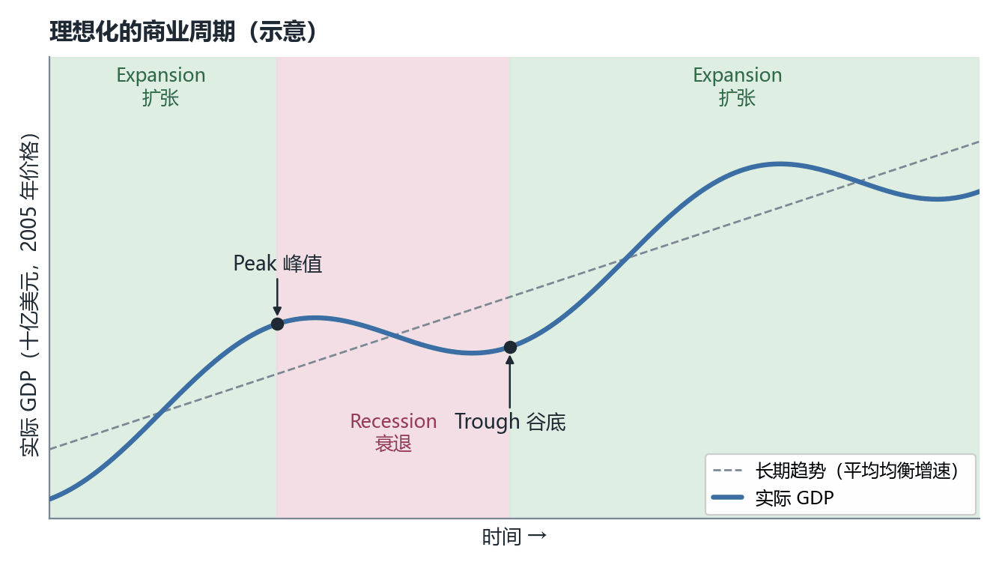

*图 2　理想化的商业周期。粗蓝线是实际 GDP，灰色虚线是长期趋势；绿色区间是扩张，红色区间是衰退，Peak 是趋势上方的局部最高点，Trough 是局部最低点。按课件 p.7(a) 的示意重绘（原图无刻度数字，纵轴单位标注为「十亿美元，2005 年价格」）；出处 p.7。*

这张图值得逐条指出四件事：

第一，**峰值不等于「比趋势线高」，谷底也不等于「比趋势线低」**。这张示意图把 Peak 画在趋势线上方一点、Trough 画在下方，但这是理想化画法造成的巧合。真实数据里，一个衰退完全可能发生在「产出仍高于趋势」的位置（例如 1966 年的美国）。**Peak 与 Trough 是波形的一阶性质（局部极大与极小），与趋势线的高低是另一件事。** 这句话是本节与 §九（产出缺口）之间的桥：缺口说的是「与趋势比」，峰谷说的是「方向变了」。

第二，**波形的周期不固定**。示意图把两个 Peak 之间画成约 5 个单位时间，但真实数据里 1949–1953 与 1991–2001 的间隔差了三倍（§3.3 表：12 个月与 120 个月的扩张）。

第三，**红色区间比绿色区间窄**。红色区间（衰退）约占三分之一，绿色区间（扩张）占三分之二——这与真实数据大致相符：§3.3 复算出 14 次衰退平均 13.2 个月、13 次完整扩张平均 59.4 个月，**衰退只占这段时间的 19.3%**。教科书示意图没有骗人，但它是「按真实统计画的」，不是随意画的。

第四，**纵轴有单位但没有数字**（billions of 2005 dollars）。这是「示意图」的标志：它讲结构，不讲量级。

### 3.2 同一件事的真实版本：2005–2011（p.7 b）

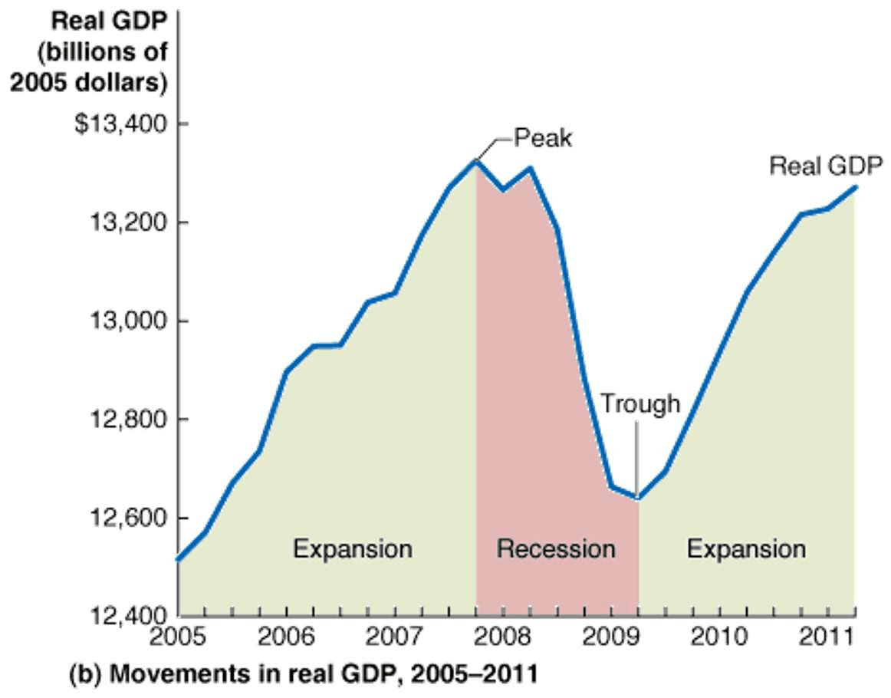

*图 3　美国实际 GDP，2005–2011 年季度值，单位十亿美元（2005 年价格）。纵轴刻度 12,400–13,400；绿色区间为扩张、红色区间为衰退，Peak 标在 2007 年末（读数约 13,150），Trough 标在 2009 年中（读数约 12,640）。按原图裁切，未重绘（课件未给配套数字表）；出处 p.7(b)。*

课件对这张图只给了两句话：`Figure (b) shows the movements in real GDP in the U.S. from 2005 to 2011`、`It is a messier reality of an actual business cycle compared to the idealized one`（与理想化版本相比，真实的商业周期要混乱得多）。值得指出的三处「messy」：

- **2008 年不是单调下滑**。曲线在 2008 年中先跌、随后小幅反弹、再跌，形成一个「双峰」凹陷。理想化版本中衰退是一条干净的下降段，真实数据里它是一段**锯齿**。
- **峰谷的读数**：Peak 约 13,150、Trough 约 12,640（按图上刻度目测，课件未给数字表），**峰到谷的落差约 510 十亿美元，即约 −3.9%**。这与 §3.3 表里 2007–2009 那一行的 −4.1% 是同一件事的两种读法（一个从图上目测、一个是官方统计），量级一致。
- **谷底之后不立刻回趋势**。2009 年中到 2011 年，曲线在上升，但始终没有回到 2007 年的高点——这正是 §十「衰退性缺口」的图像版本：**扩张已经开始，缺口仍然存在**。

一个必须记住的单位差别：图 3 的纵轴是 **2005 年美元**，图 4 是 **2009 年美元**。基年不同，数值不能直接互比（同一年的 GDP 在两个基年下是不同的数）；材料没有提醒这一点，读图时先看单位行。

### 3.3 把八十五年的衰退排成一张表（p.8–p.9）

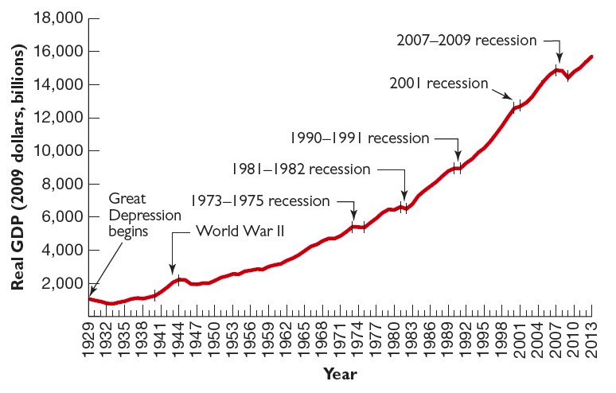

*图 4　美国实际 GDP，1929–2013 年，单位十亿美元（2009 年价格）。红线是实际值，蓝线是平滑的长期增长趋势；每次衰退在红线上画一条短竖线，并标注名称：Great Depression begins（1929）、World War II（1941–1944）、1973–1975、1981–1982、1990–1991、2001、2007–2009 recession。纵轴为线性刻度 2,000–18,000。按原图裁切，未重绘；出处 p.8。*

这张图最值得读的一件事：**红线穿过趋势线的方式**。1941–1944 年（二战军备生产）红线**大幅冲到趋势线上方**，是整个八十五年最显著的一次「过热」；1929–1933 年红线跌到趋势线下方最远处，之后再没「补回来」——**深衰退的代价不是暂时低于趋势，而是长期就在趋势下方运行**。这两处分别是 §十的扩张性缺口与衰退性缺口的极端样本。

紧接着的 p.9 把 1929–2013 年间的每一次衰退列成一张表。这是本章信息密度最高的一页，**六列全部逐格抄录**（表头底色橙黄、正文隔行浅橙；表头原文只在首行带百分号，其余行是裸数字，单位统一为 percent / months）：

| 峰值日期 | 谷底日期 | 衰退持续（月） | 最高失业率（%） | 实际 GDP 变化（%） | 下一次扩张持续（月） |
|---|---|---|---|---|---|
| 8/29 | 3/33 | 43 | 24.9 | −28.8 | 50 |
| 5/37 | 5/38 | 12 | 19.0 | −5.5 | 80 |
| 2/45 | 10/45 | 8 | 3.9 | −8.5 | 37 |
| 11/48 | 10/49 | 11 | 5.9 | −1.4 | 45 |
| 7/53 | 5/54 | 10 | 5.5 | −1.2 | 39 |
| 8/57 | 4/58 | 8 | 6.8 | −1.7 | 24 |
| 4/60 | 2/61 | 10 | 6.7 | +2.3 | 106 |
| 12/69 | 11/70 | 11 | 5.9 | +0.1 | 36 |
| 11/73 | 3/75 | 16 | 8.5 | −1.1 | 58 |
| 1/80 | 7/80 | 6 | 7.6 | −0.3 | 12 |
| 7/81 | 11/82 | 16 | 9.7 | −2.1 | 92 |
| 7/90 | 3/91 | 8 | 7.5 | −0.9 | 120 |
| 3/01 | 11/01 | 8 | 5.8 | +0.8 | 73 |
| 12/07 | 6/09 | 18 | 10.0 | −4.1 | —（课件此处空白） |

**这张表怎么用**，逐列说：

- **第 1、2 列（峰、谷日期）**：格式是 月/年后两位。它们是「点」，其余四列都是从这两个点派生出来的「段」。
- **第 3 列（衰退持续月数）**：= 谷月 − 峰月的月份差。逐行复算 14 行全部吻合（例如 8/29→3/33：$(1933-1929)\times 12 + (3-8) = 43$）。
- **第 4 列（最高失业率）**：衰退期内失业率的**峰值**，不是平均值。大萧条 24.9%、1982 年 9.7%、2009 年 10.0%——这一列是 §六「周期性失业」的历史锚点。
- **第 5 列（实际 GDP 变化）**：按列名应是从峰到谷的累计变化。**这一列有三行是正数**，见下面的警报框。
- **第 6 列（下一次扩张持续月数）**：= 本谷到**下一个峰**的月份差。最后一行空白，因为 2009 年 6 月之后的扩张在课件制作时**尚未结束**（空白 = 未结束，不是数据缺失）。

复算第 6 列时发现一处对不上，另有两处值得算的派生量：

**派生量一（不规则性）**：14 次衰退的持续月数均值 **13.21**、中位数 **10.5**、极差 **6–43**、标准差 **9.28**、变异系数 **0.70**；13 次完整扩张的均值 **59.38**、极差 **12–120**、标准差 **32.63**、变异系数 **0.55**。扩张平均长度是衰退的 **4.49** 倍。1929 年 8 月至 2009 年 6 月共 958 个月，其中衰退 185 个月，占 **19.3%**。这五个数就是 p.12 那句「recessions and expansions are irregular in their length and severity」的量化。

**派生量二（年化跌幅）**：大萧条那一行只给了累计 −28.8%。按 43 个月折算年化：$(1-0.288)^{12/43}-1 = -9.04\%$；若粗按三年整算则是 −10.71%。**「跌了三成」与「每年跌九成」是两个不同的震撼程度**，做题时看清问的是哪个。

> [!WARNING] 课件笔误
> p.9 表 5/37 行的「下一次扩张持续」写 **80** 个月，但按表内日期 5/38 → 2/45 的月份差是 **81** 个月。若谷底是 6/38（NBER 现行口径），则 6/38 → 2/45 正好 80 个月。也就是说，**同一行里「谷 5/38」与「扩张 80 个月」两个数不能同时成立**：前者给出 12 个月的衰退（5/37→5/38，与表内 Duration=12 一致），后者给出 13 个月的衰退。判定依据：逐行月份差复算，13 行中 12 行吻合，只有这一行差 1 个月。

> [!CAUTION] 「实际 GDP 变化」这一列的口径判不出
> 三行是正数：4/60→2/61 的 **+2.3**、12/69→11/70 的 **+0.1**、3/01→11/01 的 **+0.8**。若这一列真是「从峰值到谷底的实际 GDP 累计变化」，衰退期内不可能为正。两种读法：**（A）** 这一列其实是谷底所在年份的**同比增速**（1961、1970、2001 年的年度增速确实为正）；**（B）** 教材原表的列错位或数据版本差异。课件没有给这一列的定义，**判不出**。写作与考试时的安全做法：把这一列当「该次衰退的 GDP 表现」的粗略指标，**不要**用它反算缺口，也不要用它论证「衰退期 GDP 一定下降」。

**练习 2（课件 p.9 表格的用法，我的补充）**：用表算出 1991 年 3 月到 2001 年 3 月这段扩张的月数，并指出表里哪一行记着它。

> [!TIP] 参考答案
> $(2001-1991)\times 12 + (3-3) = 120$ 个月，记在 **7/90 → 3/91 那一行的第 6 列**（120）。这是表里最长的扩张，也是 1929 年以来最长的一次；它紧接的 3/01→11/01 衰退只有 8 个月，但表里它的「实际 GDP 变化」写的是 **+0.8**——正好是上面那条 CAUTION 说的例子。

---

## 四、谁来判断衰退：NBER 与四个月度指标（p.10）

### 4.1 从一个能当场验算的日期开始

2007 年 12 月是那次「大衰退」的起点，上一次衰退结束于 2001 年 11 月，中间隔着 73 个月的扩张。73 这个数可以当场验算：

$$
(2007-2001)\times 12 + (12-11) = 73
$$

同一个 73 也出现在 §3.3 那张表的最后一列（3/01→11/01 那一行的「下一次扩张持续」）。两处互相咬合，说明这两页用的是同一套日期。

真正要问的是下一句：**「2007 年 12 月」这个日期是谁定的？** 美国没有一个政府部门会在衰退发生的当天宣布衰退。做这件事的是一家私人研究机构。

### 4.2 判定机构与它用的四个月度指标

**美国国家经济研究局（National Bureau of Economic Research，NBER）**：一家私人学术机构，其下属的**商业周期测定小组**（Business Cycle Dating Committee）负责给美国的峰值月与谷值月定月，是媒体、统计部门和教科书默认采用的判定者。

它定月时看的不是 GDP，而是四个月度指标（monthly indicators，每月发布一次的经济总量数据）：

| 指标 | 英文原名 | 它衡量什么 |
|---|---|---|
| 工业生产 | industrial production | 制造业产出的实物量 |
| 制造业、批发与零售的销售总量 | total sales in manufacturing, wholesale, and retail | 一共卖出去多少 |
| 非农就业 | non-farm employment | 有多少人有工作（农业除外） |
| 税后实际家庭收入 | real after-tax household income | 家庭真正拿到手的购买力 |

这四行并排读，最值得注意的一件事是**里面没有 GDP**。原因不是 GDP 不重要，而是频率不匹配：GDP 是季度数据、而且会被反复修订；这四个月度指标每月发布，能把拐点定位到**月**。§3.3 那张表之所以能写出「8/29」「3/33」这样的月份，靠的就是月度数据。

这四个月度指标有一个共同名字：**同步指标（coincident indicators）**，指与整体经济同步变动的变量（原话是 *coincident indicators move with overall economy*）。它的对照概念是**领先指标（leading indicators）**，指在拐点之前就先变动的变量。之所以要用同步指标而不是领先指标定月，是因为定月要的是「拐点在哪个月出现」，而只有同步变动的量才把拐点留在自己身上；领先指标会给出一个更早、但更常出错的日子。

### 4.3 两套判据各管什么

| 判据 | 内容 | 数据频率 | 谁在用 | 输出形式 |
|---|---|---|---|---|
| 经验法则 | 实际 GDP 连续两个或更多季度下降 | 季度 | 媒体、大众、入门课程 | 一句话：是不是衰退 |
| 正式判定 | 四个月度同步指标的综合走势与拐点 | 月度 | NBER 测定小组 | 两个日期：峰值月、谷值月 |

两者的差别不是「一个对一个」，而是**精度与成本**：经验法则任何拿到季度 GDP 的人都能当场算，但只能粗筛；正式判定给出可直接填进表格的日期，代价是要等月度数据齐、要事后回溯。

### 4.4 失败情形：只用经验法则判 1980 与 1982

把 §3.3 表里 14 次衰退的持续月数换算成季度，得到：

14.33、4.00、2.67、3.67、3.33、2.67、3.33、3.67、5.33、**2.00**、5.33、2.67、2.67、6.00

其中**恰好等于 2 个季度的只有一次**：1980 年 1 月到 7 月，6 个月。这正是经验法则的分辨率下限，一次刚好 6 个月的衰退在这条法则面前没有任何余量：

- 若这 6 个月的产出降幅集中在第一个季度、第二个季度已经回正，那么**经验法则不会报警**，而正式判定判了衰退（表里就记着 1/80→7/80 这一行）。
- 这一行的「实际 GDP 变化」只有 −0.3%，是全表 14 行里绝对值第二小的数（最小的是 12/69→11/70 的 +0.1）。6 个月只跌 0.3%，就是那种「季度怎么切都会改变结论」的幅度。

再看紧接的 1981–1982 年：7/81→11/82 共 16 个月、产出变化 −2.1%，而它与 1980 年那次之间只隔着 **7/80→7/81 的 12 个月扩张**——这是 §3.3 表里 13 次完整扩张中**最短**的一次。于是两套判据给出两种叙事：

- 正式判定：**两次衰退**，中间夹一次 12 个月的扩张。
- 日常印象：1980、1981、1982 连着三年难受，很多人记成**一次**长衰退。

这种形态有个名字：**双底衰退（double-dip recession，又称 W 型衰退）**，指产出在短暂回升后再次下跌、序列上像字母 W。要不要把它数成两次，完全取决于判据：那 12 个月里有四个季度，只要其中连续两季正增长，经验法则就会承认中间是扩张、从而给出「两次」；若回升只集中在一个季度，经验法则会把它读成一次 22 个月的连续衰退，而月度指标不会。

**「declared a recession December 2007」有两种读法。**（A）NBER 在 2007 年 12 月**当时**宣布「现在进入衰退」；（B）NBER 宣布「衰退**始于** 2007 年 12 月」。**判不出**材料想指哪个，但（B）与这套判定的性质一致：四个月度指标要等发布和修订，拐点通常事后才敢确认，宣布时间必然晚于起点月。按（B）读还能解释一件事——§3.3 那张表里全是「8/29」「3/33」这样的日期而不是新闻日期，因为它们**是回溯定月的结果**；按（A）读会得出一个错误结论：以为衰退能在发生的那一季度被官方确认。

**练习 1（我的补充）**：某国季度实际 GDP 增速依次为 +0.8%、−0.4%、+0.2%、−0.5%、−0.6%。（a）按经验法则，衰退从哪个季度开始？（b）与经验法则相比，NBER 式的判定能多给出哪两样信息？

> [!TIP] 参考答案
> （a）经验法则要**连续两季下降**。前三个季度只出现过一次下降（−0.4%），下一季度就反弹，所以要到第 4、5 季度才凑够两季 → 起点被判在第 4 季度。（b）两样：**拐点的具体月份**（第 4 季度内部哪个月是高点），以及**多个指标是否同向**（若季度 GDP 为负但就业与销售没有同步走弱，测定小组可以不宣布）。这两样经验法则都给不出，因为它只看一个变量的一个差分。

**练习 2（我的补充）**：「税后实际家庭收入」这个指标为什么要同时带上 real 和 after-tax 两个限定词？

> [!TIP] 参考答案
> real 把价格成分剔掉：不然通胀本身就会让名义指标上升，与产出无关（通胀口径的处理与货币、价格那一章一致，这里不重述）。after-tax 是因为家庭做消费与劳动供给决策时面对的是**拿到手的钱**，税率变化、退税都会直接改变可支配购买力。两个限定词做的是同一件事：让这个指标只反映**实际购买力**的变动，而不是名义数字或政策转移的变动。

---

## 五、周期的性质与跨国协同（p.11–p.13）

### 5.1 五条性质，四条可以算

进入「症状」之前，先把周期本身的性质（properties of business cycles）列清楚。材料给了五条：

| # | 性质 | 英文口径 | 本节能怎么检验 |
|---|---|---|---|
| 1 | 研究传统 | Economists have studied business cycles for at least a century | 背景陈述，无可检验内容 |
| 2 | 不规则 | Recessions and expansions are irregular in their length and severity | 用 §3.3 表的离散度 |
| 3 | 不可预测 | Economic fluctuations are unpredictable | 用历史均值做「事后预测」 |
| 4 | 波及全局 | Contractions and expansions affect the entire economy | 靠 §六、§七 的多变量体检 |
| 5 | 可能全球化 | May have global impact | 用五国增速的对比 |

第 1 条只交代研究传统的长度（一个世纪是量级说法），后四条都能用已经摆出来的数据算。下面按 2、3、4、5 走。

### 5.2 不规则：它是变异系数，不是形容词

§3.3 已经把 14 次衰退与 13 次完整扩张的离散度算过了，结论摆在这里备查：衰退持续月数均值 **13.21**、标准差 **9.28**、变异系数 **0.70**、极差 **6–43**；扩张持续月数均值 **59.38**、标准差 **32.63**、变异系数 **0.55**、极差 **12–120**。

三个可以直接读出来的对比：

- 最长衰退是最短衰退的 **7.2 倍**（43 对 6），最长扩张是最短扩张的 **10 倍**（120 对 12）。
- 扩张的平均长度是衰退的 **4.49 倍**，所以「繁荣是常态、衰退是插曲」在这 80 多年里成立：1929 年 8 月到 2009 年 6 月共 958 个月，衰退只占 **19.3%**。
- 但两个变异系数都在 0.5 以上，也就是**标准差超过均值的一半**。这在时间序列里意味着「下一次大概和平均值差不多」这种直觉是错的。

### 5.3 不可预测：做一次事后预测就知道错多大

「不可预测」听起来像推卸责任的说法，其实它是可检验的。最直接的检验是：假设你站在历史上任何一个时点，手里只有**过去所有扩张的长度**，用它们的均值去预测**下一次**扩张会有多长。

| 用前 n 次扩张的均值 | 预测值（月） | 第 n+1 次实际（月） | 误差（月） | 误差（%） |
|---|---|---|---|---|
| 前 6 次 | 45.8 | 106 | +60.2 | +131.3% |
| 前 7 次 | 54.4 | 36 | −18.4 | −33.9% |
| 前 8 次 | 52.1 | 58 | +5.9 | +11.3% |
| 前 9 次 | 52.8 | 12 | −40.8 | −77.3% |
| 前 10 次 | 48.7 | 92 | +43.3 | +88.9% |
| 前 11 次 | 52.6 | 120 | +67.4 | +128.0% |
| 前 12 次 | 58.2 | 73 | +14.8 | +25.3% |

七次里只有**一次**（用前 8 次预测第 9 次）的误差落在 ±20% 以内，其余六次从 −77% 到 +131%。所以「不可预测」这条性质没有被修辞化：即使把全部历史摆在面前，用均值去猜下一次，猜错的幅度比猜对的幅度大一个数量级。

还有一个反直觉的推论：不可预测的不只是**下一次衰退什么时候来**，还有**上一次扩张会持续多久**。1991→2001 那次扩张 120 个月是全表最长，而它之前 11 次扩张的均值只有 52.6 个月——按均值预测会低估一半以上。站在 2001 年 3 月回头看，「这次繁荣已经比历史上任何一次都长」这件事本身，就是它即将结束的信号之一，但它不是任何模型给出的信号。

### 5.4 波及全局：为什么必须同时看多个变量

「收缩与扩张影响整个经济」这句话和 §四 的四指标是同一件事的两面：正因为周期是总量现象，单一行业、单一变量的波动不足以判定它；也正因为它是总量现象，才需要像 §六、§七 那样逐项体检——就业、销售、投资、消费、通胀各看一遍。

两个词要在这里先定义，后面两节会反复用：

**顺周期（pro-cyclical）**：与整体经济同方向变动的变量，扩张时上升、衰退时下降。产出、就业、投资、销售都是。

**逆周期（counter-cyclical）**：与周期反方向变动的变量，衰退时上升。本章材料里最典型的两个是**失业率**与**衰退性缺口**——它们本身就是用来标记衰退的，所以不可能顺周期。

**顺周期不等于幅度更大。** 一个变量可以顺周期但波动很小（消费），也可以顺周期且波动极大（投资）。§七 要区分的正是**方向**与**幅度**：材料把投资描述成「非常波动且高度顺周期」，那是两个陈述，不是一个。

### 5.5 跨国协同：五国增速

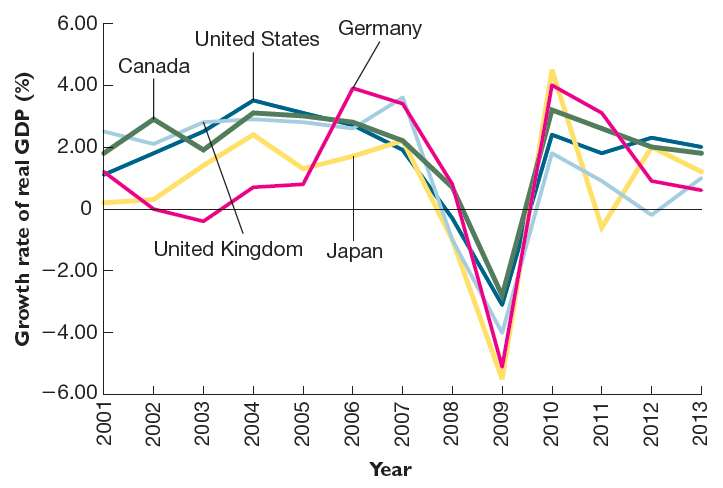

*图 5　加拿大、美国、德国、英国、日本五国的实际 GDP 年增速，2001–2013 年，纵轴 −6% 至 +6%。能可靠读出的是协同本身：2009 年五条线全部落到零线以下（两条最深的约 −4.9% 与 −5.4%，另三条挤在 −2.8% 至 −3.1%），2010 年五条线又全部转正（最高约 +4.3%）；2011 年有一条再度转负（约 −0.5%）。国名用引线直接标在曲线上，引线在 2006–2009 段彼此交叉，逐国精确读数不可靠，所以本节只用它做定性判断。按原图裁切，未重绘；出处 p.13。*

这张图值得逐条指出三件事：

- **2009 年是这段样本里唯一「五条线全部明显低于零」的年份**，2008 年只有部分国家转负。这就是「周期会在贸易伙伴之间传染」最直接的证据：五个开放经济体在同一年收缩。
- **2010 年五国同时反弹**，说明 2009 年的下滑是共同冲击的结果，不是五个国家各自政策凑巧同一年收紧。
- **反弹并不同步**：2011 年有一条线又掉回负值（约 −0.5%），而另四条仍在 +1% 以上。协同说的是「一起倒下」，不保证「一起站起来」。

三个全球性例子（原话见 p.12）：1930 年代的大萧条（Great Depression）是全球性的；1973–1975 与 1981–1982 两次美国衰退也有全球影响；2007–2009 这次被单独命名为**大衰退（Great Recession）**，指 2007 年 12 月开始、战后最严重的一轮全球收缩。

那两次为什么跨国（我的补充，非讲义内容）：1973–1975 与 1981–1982 这两次美国衰退都紧跟在第一次、第二次石油危机的价格冲击之后。冲击源（原油）是所有贸易伙伴共同面对的，所以它们同时出现在多个国家；这一点与 2009 年通过贸易与金融渠道传导不同。

> [!CAUTION] 标题年份与横轴起点不一致
> 这张序列的标题写 `Real GDP Growth, 2002 – 2013`，但横轴第一个刻度是 **2001**，且 2001 年确实画了数据点。**判不出**作者想要的区间是哪个。安全做法：把 2001 也读进去（它不影响「五国 2009 年同时转负」这个结论），但引用这张图时不要说「数据从 2002 年开始」。

**练习 1（我的补充）**：有人说「既然 2009 年五国同时衰退，说明商业周期是可预测的——盯住贸易伙伴就行」。用 5.3 的预测表反驳这句话。

> [!TIP] 参考答案
> 协同性说的是**冲击一旦发生会同时打击多个国家**，它没有说冲击**何时**发生。5.3 的表里，用前 n 次扩张的平均长度预测第 n+1 次，七次里六次误差超过 ±25%，最大 +131%。所以「知道邻居会一起衰退」推不出「知道明年会不会衰退」：前者是性质 4 与 5，后者正是性质 3 说做不到的那件事。

**练习 2（我的补充）**：性质 2 说「长度与严重程度都不规则」。请分别给出衡量「长度不规则」与「严重程度不规则」的指标，并说明后者为什么更难量化。

> [!TIP] 参考答案
> 长度不规则：直接对「衰退持续月数」这一列算变异系数（0.70）或极差（6–43 个月），口径唯一、无需外部信息。严重程度不规则：要先给「严重」定一个可比的量，材料里有三个候选——最高失业率、实际 GDP 变化、持续月数——而这三个给出的排序不一致（1981–1982 的失业率 9.7% 是 1948 年以后最高之列，但 GDP 变化只有 −2.1%；只有 1929–1933 那行三个指标同向）。加上「实际 GDP 变化」那一列本身口径判不出（§3.3 的 CAUTION），所以「严重程度」缺一个统一口径，这才是它难量化的原因。

---

## 六、症状一：失业（p.14–p.17）

### 6.1 衰退期劳动市场的六个症状（先给体检表）

「症状（symptoms）」在这里是医学意义上的用法：不是原因，而是**一出现就能认出衰退的一组可观察表现**。劳动市场这一项下有六条：

| # | 症状 | 英文口径 | 机制一句话 | 证据在哪 |
|---|---|---|---|---|
| 1 | 周期性失业急剧上升 | cyclical unemployment rises sharply during recessions | 企业减产就先减人，而裁员集中在短期 | §11 给定义；6.2 给数据 |
| 2 | 就业的回升落后于复苏 | decrease in employment lags the recovery | 企业先扛着不裁、也先不招 | 6.2 的对照表 |
| 3 | 在职者的实际工资增长变慢 | real wages grow more slowly for those employed | 在职工人议价能力下降，但名义工资很少被下调 | 6.3 |
| 4 | 晋升与奖金常被推迟 | promotions and bonuses are often deferred | 把降薪包装成「不涨薪」，成本更低 | 6.3 |
| 5 | 新进入者找工作困难 | new labor market entrants have difficulty finding work | 企业先砍掉本来就不确定的招聘 | 6.3 |
| 6 | 衰退对不同企业的影响不均等 | recessions do not affect all firms equally | 耐用品与投资的决策可以推迟 | §七、§八 |

六条要一起读才有意义。第 1 条是**水平**的变化（失业率跳多高），第 2 条是**时间**的变化（什么时候才回来），第 3、4、5 条是**结构**的变化（谁承担得多），第 6 条把话题从劳动市场转向产品市场。

同一页还挂着两条关于产品市场的陈述（耐用品比服务与非耐用品更波动；汽车、房屋、资本设备不稳定；投资非常波动且高度顺周期）。那三条属于「症状二」，§七 处理，这里不重复。

### 6.2 美国：1948–2025 的月度失业率

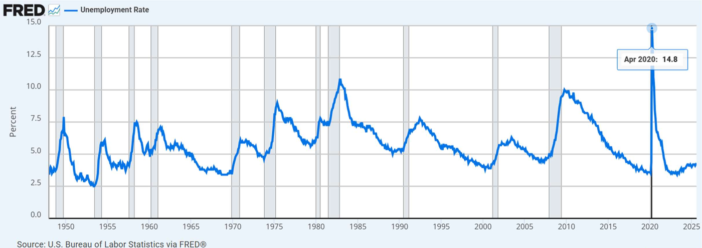

*图 6　美国失业率（占劳动力的百分比，月度，1948–2025）。纵轴 0–15，灰色竖条标出 NBER 判定的每一次衰退；右上角标注 Apr 2020: 14.8，是全序列最高点。1982 年前后的峰约 10.6，2009–2010 年的峰约 9.7–10.0，2000 年与 2019 年前后的低点约 3.3–3.5，全序列最低约 2.65（1953 年前后）。按原图裁切，未重绘；出处 p.15，数据源 FRED UNRATE（U.S. Bureau of Labor Statistics）。*

先把能看见的三件事指出来：

- **每一条灰条里曲线都在上升**，这就是症状 1 的图像版本。
- **曲线的高点常常落在灰条右缘之外**。最明显的是两次：1990–1991 年那次，灰条在 1991 年 3 月结束，但曲线的最高点在 1992 年年中（约 7.8）；2007–2009 年那次，灰条在 2009 年 6 月结束，而 10.0 的高点在同年 10 月。这就是症状 2。
- **2020 年那根针**：从 3.5 左右跳到 14.8 再跌回来，前后不到一年，比任何一次战时波动都陡。它是全序列唯一一次「一个月内完成的衰退式跳升」，因为冲击是行政性的停业，而不是需求慢慢消失。

现在把第 2 件事做成一张对照表。§3.3 那张表有一列「最高失业率」，把它和同一段衰退期内月度序列的实际峰值并排：

| 衰退（峰→谷） | 表里「最高失业率」（%） | 月度序列在衰退期内的峰值（%） | 差（pp） |
|---|---|---|---|
| 11/48→10/49 | 5.9 | 7.19 | +1.29 |
| 7/53→5/54 | 5.5 | 5.80 | +0.30 |
| 8/57→4/58 | 6.8 | 7.07 | +0.27 |
| 4/60→2/61 | 6.7 | 6.80 | +0.10 |
| 12/69→11/70 | 5.9 | 5.99 | +0.09 |
| 11/73→3/75 | 8.5 | 8.66 | +0.16 |
| 1/80→7/80 | 7.6 | 7.71 | +0.11 |
| 7/81→11/82 | 9.7 | 10.59 | +0.89 |
| 7/90→3/91 | 7.5 | 6.77 | −0.73 |
| 3/01→11/01 | 5.8 | 5.66 | −0.14 |
| 12/07→6/09 | 10.0 | 9.70 | −0.30 |

月度峰值一列由逐点数字化得到，读图误差约 ±0.2 个百分点；1929、1937、1945 三行无法核对，因为 UNRATE 这条序列从 1948 年才开始。

十一行里八行落在 ±0.35 个百分点以内，但**三个方向的偏离不能同时用一种口径解释**：

> [!WARNING] 课件口径不清
> §3.3 表里「最高失业率」这一列，与月度序列逐行相比：11/48→10/49 低 1.29 个百分点、7/81→11/82 低 0.89 个百分点（表值**低于**衰退期内的月度峰值），而 7/90→3/91 高 0.73 个百分点（表值**高于**衰退期内的月度峰值）。三种读法都有可能：（A）谷底所在年份的年度平均失业率；（B）衰退期内的月度峰值；（C）衰退结束前后若干年里的峰值。若取（B），1948–49 与 1981–82 两行对不上；若取（A），1990–91 与 2007–09 两行对不上（真正的高点分别落在 1992 年与 2009 年 10 月，都在衰退结束之后）。**判不出**，材料没有给这一列的定义。安全做法：把这一列当作「这次衰退有多严重」的粗略指标，不要拿它去和月度序列做精确减法。

> [!IMPORTANT] 落后于复苏这件事，在这份材料内部就能自我印证
> 表值高于月度峰值的那两行（1990–91、2007–09），恰恰是失业率在衰退**结束之后**才见顶的那两次。也就是说：只要把两张材料并排读，症状 2「就业的回升落后于复苏」就不是一个需要额外证据的断言，而是两列数字对不上的原因本身。这个滞后在政策上的名字是**无就业复苏（jobless recovery）**，指产出已经回升、但就业在好几个季度里没有起色的复苏。
> 机制在症状 4 里：企业把「不涨薪、不晋升、不新招」当成缓冲，所以产出恢复的第一件事是**劳动生产率回升**（现有的人多干活），而不是招人。

### 6.3 症状 3、4、5：为什么它们不在任何一张序列里

第 3、4、5 条症状（实际工资增长变慢、晋升与奖金推迟、新进入者找工作困难）有一个共同点：它们说的是**增长率的下降**或**流量的减少**，不是**水平的下降**。

- 「实际工资增长变慢」不等于「实际工资下降」。名义工资被下调在发达经济体里很少见（这一现象的名字是**名义工资黏性（nominal wage stickiness）**，指名义工资难以下调）；于是「降成本」只能通过少涨、推迟涨、取消奖金来实现。读者在任何一条工资水平序列里都看不到衰退的痕迹，痕迹在增长率里。
- 「新进入者（new entrants，指刚从学校或家庭进入劳动力市场、还没有工作记录的人）」找工作困难，在统计上体现为**失业持续时间（duration of unemployment）**变长和青年失业率上升，而不是总失业率的额外变动。他们本来就在劳动市场边缘，被统计成「失业」的前提是他们**在找工作**。

与第 6 章的接缝只交代一句：摩擦性失业（frictional unemployment，找工作过程中的短期失业）、结构性失业（structural unemployment，技能与岗位不匹配的失业）与周期性失业（cyclical unemployment，随周期起伏的那部分）的三分法在第 6 章已经建立，本章只用到第三个，并且只在 §十一 给它一个可算的定义。三类的机制、测算与政策差别不在此重述。

### 6.4 英国：140 年的两条长序列

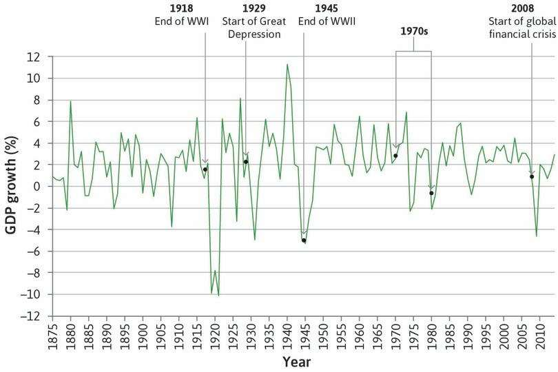

*图 7　英国实际 GDP 年增速，1875–2014，纵轴 −12% 至 +12%。顶部五条引线标注 1918（一战结束）、1929（大萧条开始）、1945（二战结束）、1970s（一个方框罩住整个十年）、2008（全球金融危机开始）。可读出的极值：最高约 +11.2（1941 年，战时生产），最低约 −10 与 −10.3（1920、1921 连续两年，是全序列最深的两段），1945 约 −5、2009 约 −4.5。曲线上另有六个黑点，课件没有说明它们的判据。按原图裁切，未重绘；出处 p.16，数据源 Bank of England OBRA（Ryland Thomas and Nicholas Dimsdale, 2017）。*

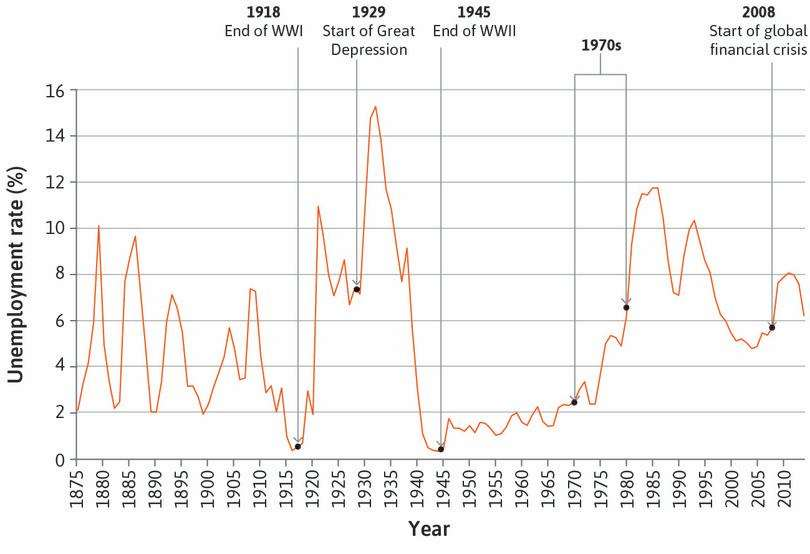

*图 8　英国失业率，1875–2014，纵轴 0–16%，与图 7 共用同一套标注。可读出的极值：最高约 15.3（1932 年前后），最低约 0.5（1945 年前后）；1921 年约 10.9，1980 年代中期约 11.5–12，2011 年前后约 8.2；1875–1914 这一段在 2%–10% 之间反复摆动。按原图裁切，未重绘；出处 p.17，数据源同上。*

两条序列放在一起读，有四处值得指出：

1. **纵轴量纲不同，所以「同一个黑点」不是一回事。** 图 7 的纵轴是增速（一个流量的变化率），图 8 的纵轴是水平率（存量占劳动力的比例）。增速为负意味着产出在收缩；失业率为负是不可能的，它的水平高低本身就有水平含义。把两条序列按同一年份对齐时，比较的是「这一年谁更糟」，不是「这两个点一样高」。
2. **英国战前的失业率摆动比美国战后剧烈得多。** 1875–1914 这四十年里，英国失业率在 2% 与 10% 之间来回好几次；而美国 1948 年以后的整条序列，最低 2.65%、除 2020 年那根针以外最高约 10.6%（1982 年底）。这不是「英国更倒霉」的结论：两条序列来自不同的统计传统与不同的制度时期，能比的只有摆动幅度，不能比「谁的国家更不稳定」。
3. **两次大战结束都在序列里留下痕迹，但落点不同。** 1945 这个标注对应产出的深跌（约 −5），复员意味着军需生产消失；1918 之后紧跟着的则是 1920 与 1921 连续两年各约 −10 的暴跌——同样是复员，一战后的调整拖了两三年才落到产出上。而在失业这条序列上，两次大战结束时的读数都是低点（1917 年前后约 0.7、1945 年前后约 0.5，后者是全序列最低）。同一件事在两条序列里一个负、一个低，是因为**战时的高产出与低失业是同一枚硬币**：军需生产消失让产出往下掉，但劳动力从军队与军工厂回到民间岗位，失业率仍然很低。
4. **1970s 那个方框**是五条标注里唯一罩住一个十年的：那十年在图 7 上出现两次负增长（约 −2.5 与 −2），在图 8 上是从约 2.4 一路升到约 6.5 的转折。英国「失业与通胀同时变糟」的那十年，正是 §七 要处理的滞胀在英国的版本。

一个容易被标题误导的地方：这两条序列取自英国央行的千年数据集（Bank of England OBRA，`A Millennium of UK Data`），但窗口是 1875–2014，共 140 年。「Millennium」指数据集本身，横轴没有更早的一千年。

### 6.5 失败情形：只用「失业率高」判衰退会怎样

把症状 1 当成衰退的**定义**（而不是结果），会得到两个错误结论：

- **1992 年年中**美国失业率约 7.8%，比 1991 年 3 月衰退结束时的约 6.8% 更高。若「失业率高 = 衰退」，这次衰退会被人为延长 15 个月，而 §3.3 表里紧接的 120 个月扩张（1991→2001）就不存在了。
- **1969 年**美国失业率约 3.4–3.5%，是当时的历史低点，但那次衰退的峰值月恰恰就在 1969 年 12 月。低失业率不能排除衰退，正如高失业率不能证明衰退仍在继续。

这正是 §四 用**四个月度指标综合判断**而不是用单一变量的理由：失业率是周期的重要**症状**，但它是滞后的、并且会被复苏阶段重新定义。

**练习 1（我的补充）**：用 6.2 的对照表算出 1981–1982 年那行两个读数的差，并说明如果拿表里的 9.7% 去算当年的周期性失业（设 $u^* = 5.8\%$）会低估多少。

> [!TIP] 参考答案
> 差 $10.59 - 9.7 = +0.89$ 个百分点。用 9.7% 算：$u - u^* = 9.7 - 5.8 = 3.9$ 个百分点；用月度峰值约 10.6% 算：$10.6 - 5.8 = 4.8$ 个百分点。**低估 0.9 个百分点**，相对低估 $\lvert 3.9/4.8 - 1 \rvert = 18.8\%$。再按 §十二 的奥肯系数 2 换算，缺口会被少算约 1.8 个百分点——这就是为什么用哪一列不是小事。

**练习 2（我的补充）**：症状 4「晋升与奖金被推迟」为什么对企业比「降薪」更划算？请用一句机制回答，并指出它让哪一个统计指标失真。

> [!TIP] 参考答案
> 降薪会直接触发离职与士气损失，而且名义工资下调在合同与惯例上都很别扭（名义工资黏性）；「不涨薪」在通胀为正的年份同样能压低实际工资，却不会被员工读成惩罚。它失真的指标是**在职者的平均工资增长率**——因为被推迟的那部分会在复苏后期一次性补发，让随后几年的工资增速看起来异常高（这正是症状 2 的镜像：先滞后、后集中）。

---

## 七、症状二：投资、消费与通胀（p.18–p.21）

### 7.1 三个增长率的叠图：美国 1960–2020

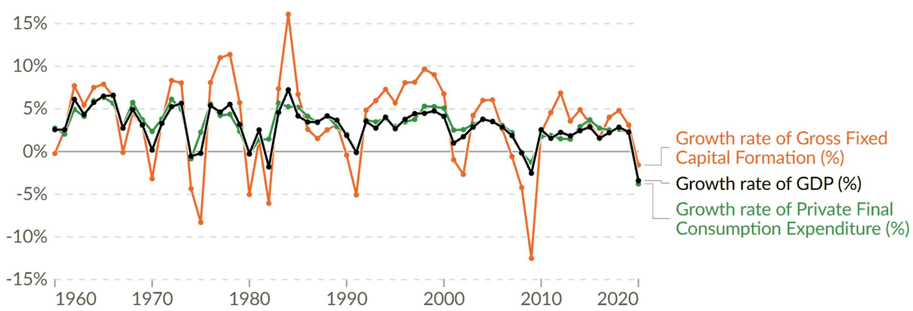

*图 9　美国的固定资本形成总额（投资，橙线）、GDP（黑线）与私人最终消费支出（绿线）的年增速，1960–2020，纵轴 −15% 至 +15%。三条线同向波动，但橙线的振幅明显大于另两条：最高约 +14%（1984），最低约 −11%（2009）。按原图裁切，未重绘；出处 p.18，数据源 Federal Reserve Bank of St. Louis / Our World in Data。*

两个术语要先立起来。**固定资本形成总额（Gross Fixed Capital Formation，GFCF）**：经济体在厂房、设备、住宅与知识产权产品上的净新增投入，也就是 GDP 支出法里的**投资**那一块。**私人最终消费支出（Private Final Consumption Expenditure，PFCE）**：家庭与非营利机构买走的最终商品与服务，对应支出法里的**消费**。两者的定义、包含范围与统计口径在第 4 章已经建立，这里只用到它们的**增长率**，不重述。

从这条序列逐点数字化（每个年份取线宽中值，读图误差约 ±1 个百分点，且尖峰处偏低），得到：

| 序列 | 最高（年份） | 最低（年份） | 极差（pp） | 标准差（pp） |
|---|---|---|---|---|
| 投资 GFCF | +14.1（1984） | −11.4（2009） | 25.5 | 4.8 |
| GDP | +6.9（1984） | −3.2（2020） | 10.2 | 2.1 |
| 消费 PFCE | +6.1（1964） | −4.0（2020） | 10.1 | 1.9 |

三条读数依次对应材料给出的两句结论：

- **投资比消费与 GDP 波动得多**（Investment is much more volatile than consumption and GDP）。标准差 4.8 对 2.1，是 **2.3 倍**；极差 25.5 对 10.2，是 **2.5 倍**。两个指标给出同一个量级的结论，这条判断是稳的。
- **消费比 GDP 波动得少**（Consumption is less volatile than GDP）。1.9 对 2.1，只有 **0.93 倍**——方向对，但差距很小。

值得追问的是**为什么投资这么波动**（我的补充，材料只给现象不给机制）：

1. **可以推迟**。一台不买的机床、一套不装修的房子，决策可以整段跳过；而消费是每天都要发生的。衰退一来，可推迟的那部分先消失。
2. **依赖预期**。投资买的是未来若干年的服务流，所以对「未来」的敏感度远高于买一次就消耗掉的消费。
3. **不可分与调整成本**。设备与厂房是大块的、建成后不易转卖，企业宁可让现有设备闲置，也不轻易新增或报废，于是投资对需求变化只能「要么大干、要么停手」。
4. **加速机制**。销售水平的小幅变化，会让「为支撑这个销售所需的资本存量」出现较大幅变化，进而放大投资需求。这条机制在第 11 章的支出—收入模型里会被正式写出来。

这条序列里唯一「消费跌得比 GDP 还深」的一年是 2020：数字化读数消费 −4.0、GDP −3.2。这与「消费更平滑」的一般规律相反，原因不在数据错误：那一年的冲击直接打在服务业消费（餐饮、出行、娱乐）上，而家庭购买力被转移支付托住、储蓄率飙升，于是产出跌幅小于消费跌幅。**「消费更平滑」是有条件的经验规律，不是恒等式**（我的补充，非讲义内容）。

### 7.2 换一个收入水平：印度 1961–2020

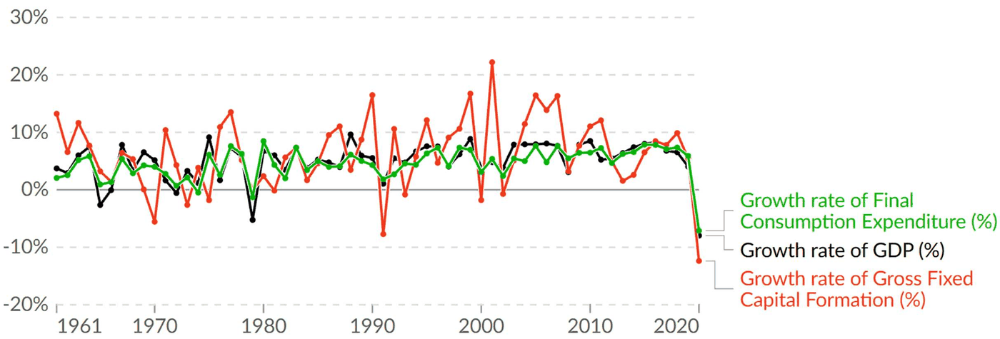

*图 10　印度的固定资本形成总额（投资，红线）、GDP（黑线）与最终消费支出（绿线）的年增速，1961–2020，纵轴 −20% 至 +30%。注意配色与美国那张不同：印度的投资线是红色，美国的投资线是橙色。可读出的极值：投资最高约 +20%（2001）、最低约 −11.5%（2020）；2020 年三条线一起跌到 −6 至 −12 的区间。按原图裁切，未重绘；出处 p.19，数据源 Our World in Data。*

材料给的两句话是：**投资更波动**（Investment is more volatile），以及一句明显留有余地的话——**在中等收入国家，消费是否更不波动就不那么清楚了**（It is less evident that consumption is less volatile in the middle-income countries）。

同一套数字化给出：

| 序列 | 最高（年份） | 最低（年份） | 极差（pp） | 标准差（pp） |
|---|---|---|---|---|
| 投资 GFCF | +20.1（2001） | −11.5（2020） | 31.6 | 5.9 |
| GDP | +9.4（1988） | −7.9（2020） | 17.3 | 3.3 |
| 最终消费支出 | +8.0（1980） | −6.5（2020） | 14.5 | 2.6 |

投资最波动这一条在印度成立得更彻底（标准差 5.9 对 GDP 的 3.3，1.8 倍；极差 31.6 对 17.3）。但**我算出的「消费/GDP」标准差比是 0.78，比美国的 0.93 更小**，也就是说：按我这个读图精度，印度消费相对 GDP 反而更平滑，与材料那句「不那么清楚」的方向相反。

这个结果不能当反驳用，原因有三条，必须一起交代：

- 印度的绿线与黑线常年几乎重合，数字化在重合处取不到点，标准差被人为压平；
- 两张图的消费**定义不同**：美国是 Private Final Consumption Expenditure（私人），印度是 Final Consumption Expenditure（含政府消费），本身不可直接比；
- 印度的均值更高（GDP 增速均值 4.9% 对美国的 2.9%），同样的百分点波动在增长率更高的经济体里代表的相对波动更小。

所以这一节的正确结论是：**「投资最波动」跨国成立；「消费比 GDP 平滑」跨国不成立，而且用读图数据无法判定它到底成不成立。** 材料用「less evident」这个措辞，本身就是在承认证据不足。

> [!WARNING] 课件笔误
> 印度那张图的来源链接与美国那张**完全相同**，URL 里写着 `...growth-rates-of-consumption-investment-and-gdp-in-the-us-per-cent-per-annum-19602016`，即 **in-the-us**。应为 India 版的同名 grapher 链接。判定依据：同一条 URL 出现在两张分别画美国与印度的页上，而 slug 里只有 us；两页的图标题、纵轴范围（美国 ±15%、印度 −20% 到 +30%）与配色都不同，不可能是同一张图。属于复制粘贴未改，不影响读图结论，但按这条链接去查数据会查到美国。
> 同一条链接还带出第二个口径问题：美国那张图的标题写 `1960 to 2020`，而链接的 slug 是 `19602016`、年份标注是 `(2016)`。两种读法：（A）图后来更新到 2020，链接与年份没跟着改；（B）标题写错。从数据看（A）更可能——三条线在 2020 年都出现明显负值（消费 −4.0、GDP −3.2、投资约 −3 至 −4），2016 年则没有。**判不出**作者想以哪个为准；引用时按「1960–2020 的图、2016 年的链接」如实写。

### 7.3 通胀：它到底是不是顺周期

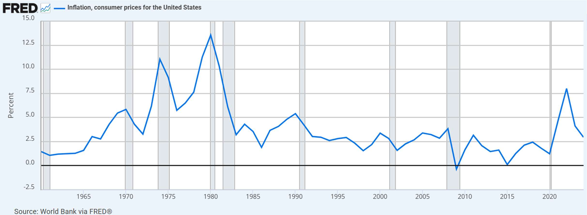

*图 11　美国消费者价格通胀率（年变化，百分比），1960–2024，纵轴 −2.5 至 15.0，灰色竖条同样是 NBER 衰退期。可读出的关键点：1980 年约 +13.3（全序列最高）、1974 年约 +10.9、1979 年约 +11.4、1990 年约 +5.3、2009 年约 −0.2（全序列唯一转负的年份）、2022 年约 +7.7、2024 年约 +3.0。零线附近另有一条手绘的水平线，是讲师标注，不是数据。按原图裁切，未重绘；出处 p.20，数据源 World Bank via FRED。*

材料给的两句话：**通胀在商业周期中一般下降**（Inflation generally decreases during a business cycle），以及**在其他时候也会下降**（Decreases at other times as well）。

第一句可以直接拿 §3.3 的衰退日期去检验。做法：把每次衰退的**峰值年**与**谷底年**的通胀读数相减。

| 衰退（峰→谷） | 峰值年 π | 谷底年 π | 差（pp） | 判定 |
|---|---|---|---|---|
| 4/60→2/61 | 1960：1.42 | 1961：1.09 | −0.33 | 下降 |
| 12/69→11/70 | 1969：5.47 | 1970：5.73 | **+0.26** | **上升，反例** |
| 11/73→3/75 | 1973：6.34 | 1975：8.95 | **+2.61** | **上升，反例** |
| 7/81→11/82 | 1981：10.15 | 1982：6.07 | −4.08 | 下降 |
| 7/90→3/91 | 1990：5.32 | 1991：4.18 | −1.14 | 下降 |
| 12/07→6/09 | 2007：2.90 | 2009：−0.15 | −3.05 | 下降 |
| 1/80→7/80 | — | — | — | 峰谷同落在 1980 年，年度数据判不出 |
| 3/01→11/01 | — | — | — | 峰谷同落在 2001 年，年度数据判不出 |

**跨年可判定的 6 次里，4 次下降、2 次上升。** 两次上升恰好是 1969–1970 与 1973–1975，也就是滞胀（stagflation，指产出停滞与通胀同时上升的组合）那一段的前半。1980 与 2001 两次因为峰谷都落在同一个日历年里，年度序列根本无法分辨。

所以「一般下降」这句措辞是**准确但弱**的：它没说「总是」，而数据显示确实不是总是。

第二句「在其他时候也会下降」反而更强、也更容易量化：把 1961–2024 的 64 个年度变化全部数一遍，其中 **29 个（45.3%）是通胀下降**，而这 29 个里有 **20 个（69.0%）发生在衰退年份之外**。也就是说，通胀下降**主要**不靠衰退来制造。

两个必须分层的术语：

**通胀放缓（disinflation）**：通胀率仍为正、但数值下降，例如从 10.2% 降到 6.1%。
**通缩（deflation）**：价格水平本身下降，即通胀率转负，例如 2009 年那一次约 −0.2%。

这条区分直接决定 §十五 的自我修正机制怎么描述：企业「减慢涨价速度」是 disinflation，不是 deflation。通胀率的测量口径（CPI、核心 CPI、GDP 平减指数）与它和货币的关系在第 5 章与第 9 章建立，这里只借用「消费者价格的年变化率」这一个口径，不重述。

> [!CAUTION] 「衰退期通胀下降」与自家序列冲突的两次
> 把 1973–1975 与 1979–1982 这两段放在一起看：通胀在衰退**之前或之中**见顶（1974 年 +10.9 落在 1973 年 11 月峰值之后、1975 年 3 月谷底之前；1980 年 +13.3 落在 1980 年 1–7 月那次衰退之内），随后才在 1982–1983 年大幅回落。若把「衰退期通胀下降」当成规律来做政策，1974 年就会得出「衰退中不该收紧」的错误结论，而实际发生的是通胀与产出同时恶化。安全表述：**通胀在衰退期通常回落，但当冲击同时打压产出与供给（石油危机式冲击）时，它会先升后降。**

### 7.4 英国的另一把尺度：140 年通胀

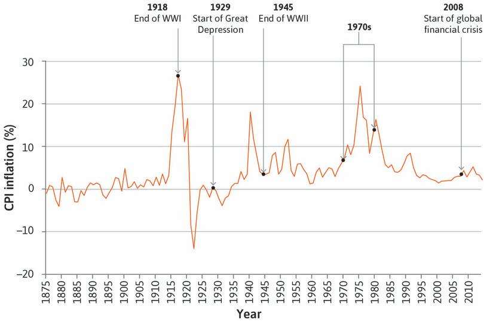

*图 12　英国 CPI 通胀率（年变化，百分比），1875–2014，纵轴 −20 至 +30，与英国 GDP 增速、失业率两张图共用同一套标注（1918、1929、1945、1970s、2008）。可读出的极值：最高约 +26.5（1917 年，一战期间），随后 1920–1921 年跌到约 −14（全序列最低）；1940 年约 +18；1975 年约 +24；1980 年约 +15；1990 年代初约 +8；2008 与 2011 年前后约 +3.5 与 +4.5。1875–1914 这一段长期在 ±3% 以内摆动。按原图裁切，未重绘；出处 p.21，数据源 Bank of England OBRA（Ryland Thomas and Nicholas Dimsdale, 2017）。*

这张序列最值得指出的三件事：

1. **战时通胀与战后通缩是一对，不是两个独立事件。** 1917 年的 +26.5 与 1920–21 的约 −14 是同一次价格运动的两半：战争期间被管制的价格一旦放开、加上恢复金本位的汇率政策，把涨上去的价格又压回来。美国 1960–2024 的整条序列里没有出现过后一半。
2. **1875–1914 的 ±3% 摆动说明「低通胀」不是现代专利。** 那四十年金本位时期的价格水平几乎不长期上升（涨跌交替），但**短期波动**并不比战后小多少。
3. **1970s 那个方框在通胀这条序列上最刺眼**：1975 年约 +24 是英国千年数据里和平时期的最高值之一，而同一十年的 GDP 增速两次转负（6.4 节）。滞胀在英国不是抽象名词。

与美国那张并排读，能得到一个**幅度**对比，但要小心它可比性的边界：

| 对象 | 窗口 | 最高 | 最低 | 极差 |
|---|---|---|---|---|
| 英国 CPI 通胀 | 1875–2014（140 年） | 约 +26.5 | 约 −14 | 约 40.5pp |
| 美国 CPI 通胀 | 1960–2024（65 年） | 约 +13.3 | 约 −0.2 | 约 13.5pp |

**这两个极差不可以直接比。** 窗口不同（140 年对 65 年），而且英国那 140 年里含两次世界大战，美国这条 65 年窗口里不含任何一场大战的通胀峰值（美国二战通胀高峰在 1940 年代中期，早于序列起点）。把 40.5 对 13.5 读成「英国通胀更不稳定」是**过度结论**；能说的是：把窗口拉长到包含战争与金本位时期，通胀的波动幅度会比战后发达国家的常态大一个数量级。

**练习 1（我的补充）**：用 7.1 的两张表算：如果 2009 年投资增速从 −11.4% 回到 0%，而 GDP 增速保持 −2.5%，需要投资把 GDP 拉回多少？（提示：2009 年美国投资约占 GDP 的 13%，把这个权重当成给定的。）

> [!TIP] 参考答案
> 支出法里 GDP 的增速近似等于各组成部分增速的**加权平均**（权重是各自占 GDP 的份额，第 4 章的口径）。投资增速从 −11.4% 提到 0%，对总增速的贡献是 $0.13 \times (0 - (-11.4)) = +1.48$ 个百分点。所以只把投资拉回零增长，就能让 GDP 从 −2.5% 变成约 −1.0%，但仍回不到正增长——需要消费（权重约 68%）也配合。这就是「投资最波动」与「消费体量最大」两件事的差别：前者决定**振幅**，后者决定**水平**。份额 13% 是我给的外部参数，材料里没有。

**练习 2（我的补充）**：材料说「通胀一般下降」，而 disinflation 与 deflation 是两件事。用 7.3 的表说明：为什么 1981→1982 那一步（−4.08pp）是 disinflation，而 2007→2009 那一步（−3.05pp）跨过了 deflation 的门槛？

> [!TIP] 参考答案
> 看**终点符号**，不看降幅。1982 年的通胀读数是 +6.07%，仍是正数，所以只是涨价变慢（disinflation）；2009 年的读数是 −0.15%，价格水平本身在下降，所以这一步跨进了 deflation。两次降幅相近（−4.08 与 −3.05），性质却不同——这也解释了为什么 §十五 的自我修正机制只承诺「通胀下降」，不承诺价格下降。

---

## 八、练习：哪些产出更波动（p.22）

题目要求：简要说明下列五种产品的产出，在商业周期中比实际 GDP 波动**更大**还是**更小**。

a. 福特 F-150 皮卡　b. 麦当劳巨无霸　c. Kenmore 冰箱　d. Pampers 纸尿裤　e. 波音客机

### 8.1 先给判据，再逐个回答

这道题考的不是记忆，而是能不能把 §七 的现象还原成**三条判据**。三条判据（我的整理，非讲义内容）：

1. **可推迟性（deferability）**：买或不买的决定能不能整段跳过。可推迟性越高，衰退时跌得越狠。
2. **收入弹性（income elasticity，收入变化 1% 引起需求量变化的百分比）**：弹性越高，收入小幅下降会被放大成需求大幅下降；必需品的弹性接近 0。
3. **产品身份**：它是**投资品**（企业买它来生产未来服务）还是**消费品**。投资品的波动通常高于同级消费品，因为它同时受第 1、2 条与预期的三重影响。

三条判据合起来给出一个可用的排序：**大型投资品 > 耐用消费品 > GDP > 非耐用消费品 > 绝对必需品**。

| 产品 | 类别 | 可推迟？ | 收入弹性 | 判断 | 依据 |
|---|---|---|---|---|---|
| a. 福特 F-150 皮卡 | 耐用消费品 + 小型企业投资品 | 高 | 高 | **大于 GDP** | 材料点名「汽车、房屋、资本设备更不稳定」；皮卡还有双重身份，既被家庭推迟，也被小企业当作资本品砍掉 |
| b. 麦当劳巨无霸 | 非耐用品 + 服务 | 低 | 中低 | **小于 GDP** | 单价低、当天消费、不可库存；衰退时反而可能因**替代效应**上升（外出就餐从正餐转向快餐） |
| c. Kenmore 冰箱 | 耐用消费品 | 很高 | 高 | **大于 GDP** | 旧冰箱坏掉也能凑合用几年；购买决策完全可推迟，是「可推迟性」的教科书样本 |
| d. Pampers 纸尿裤 | 非耐用品 + 绝对必需品 | 无 | 接近 0 | **明显小于 GDP** | 用量由婴儿数量决定，与收入几乎无关；家庭削减开支时最后才动它 |
| e. 波音客机 | 大型投资品、订单制资本设备 | 极高 | 极高 | **远大于 GDP** | 交付周期以年计、单笔金额以亿美元计、航空公司用利润与信贷预期下单；衰退期订单可以整批取消 |

**答案汇总：a 大于、b 小于、c 大于、d 小于、e 远大于。** 其中 e 与 d 是两个极端：一个是本章「投资非常波动且高度顺周期」这句话最纯粹的样本，一个是「消费平滑」这句话最纯粹的样本。

### 8.2 三条判据会失效的地方

判据不是恒等式，两个反例值得记住：

- **供给侧冲击会让判据 1 反转。** 2020 年那一次，冲击直接打在接触型服务上：餐馆堂食停摆，巨无霸的销量跌幅并不比耐用品小。此时「非耐用品 = 平滑」失效，因为问题不在「消费者想不想推迟」，而在「能不能卖」。
- **必需品的「平滑」不等于「不受影响」。** 纸尿裤的销量确实稳，但**产品结构**会变：家庭从高端转向自有品牌，单价下降而数量不变。总量平滑掩盖了结构变化，这正是「用 GDP 增速判断单个企业会出错」的原因，也对应 §六 症状 6「衰退对不同企业的影响不均等」。

**这道题真正考的是「把总量波动拆成结构」。** 五种产品里，判断「大于 GDP」的三个（a、c、e）全部是**可推迟 + 高弹性 + 单价大**的组合；判断「小于 GDP」的两个（b、d）全部是**不可推迟 + 低弹性 + 单价小**的组合。判据可以背，但考试更可能给一个没见过的产品（例如「医院护理」「汽油」「半导体设备」），要求现场套三条判据。

**练习 1（我的补充）**：用三条判据判断「汽油」与「半导体制造设备」的产出相对 GDP 是更波动还是更平滑。

> [!TIP] 参考答案
> **汽油**：可推迟性低（开车是派生需求，短期难以改变）、收入弹性低（必需品），所以**消费量的波动小于 GDP**；但它的**价格**波动远大于 GDP，因为供给端（OPEC 决策、炼能）弹性很小。这题的陷阱是把「产出的波动」与「价格的波动」混为一谈——题目问的是产出。**半导体制造设备**：三重叠加——投资品、可推迟性极高（晶圆厂扩建可以整期取消）、收入弹性极高（下游芯片需求对收入敏感），所以**远大于 GDP**，性质与波音客机同类，甚至更强，因为它的下游（消费电子与算力需求）比航空更顺周期。

---

## 九、潜在产出 $Y^*$（p.23–p.25）

### 9.1 先给一个看得见的小例子

一家冰淇淋厂正常两班倒、周末停机，每周产出 100 件。旺季它改成三班倒、周末开工、机器不停机，每周能出 112 件。

现在问：这家厂的产出能力是 100 还是 112？

答案是 **100**。112 是**超过正常强度使用资本与劳动**换来的，它只能撑几个星期：机器会坏、工人会累垮、原料供应跟不上。等到必须回落到 100 时，那 12 件不是「消失了的增长」，而是**借来的产出**。

这组数字就是本章要形式化的东西：100 是 $Y^*$，112 是 $Y > Y^*$（暂时超出），而 88（因为订单不足而只开一班）是 $Y < Y^*$。三种情况里，只有 100 是**可持续**的参照点。

### 9.2 定义与三个要抠的词

**潜在产出（potential output，记 $Y^*$）**：一个经济体能够生产的**最大可持续**产出量（the maximum sustainable amount of output that an economy can produce）。它还有一个别名：**充分就业产出（full-employment output）**。

三个词都要单独抠：

- **maximum（最大）**：它不是平均产出，也不是「最好年份的产出」，而是**在正常强度下**的上限。所以 $Y^*$ 高于大多数年份的实际产出均值是可能的，也是正常的。
- **sustainable（可持续）**：这是整个定义的支点。超出 $Y^*$ 是可以做到的，但只能维持一段时间（材料原话：use capital and labor at greater than normal rates and exceed $Y^*$ — for a period of time）。可持续性的具体含义在第 7、8 章由资本存量、劳动参与率与技术水平的演化决定，这里只借用结论，不重述。
- **amount of output（产出量）**：$Y^*$ 是一个**流量**（每季度或每年的产出），不是存量。资本存量是存量，$Y^*$ 是用这些存量在正常强度下**每期能生产**的东西。把 $Y^*$ 当成「财富水平」是这一节最常见的误读。

定义之后，材料还给了三条关于**增长**的陈述：

1. **潜在产出随时间增长**（Potential output grows over time）。所以 $Y^*$ 不是一条水平线，而是一条上升的路径；§3.3 那张趋势线就是它。
2. **实际产出以可变的速率增长**，这个速率反映 $Y^*$ 的增长率，但叠加了技术革新速率、资本形成、天气等因素的波动。
3. **实际产出不总等于潜在产出**。

**星号 $*$ 的约定。** 经济学里星号通常表示「某个变量的长期/正常/目标值」。这里的 $Y^*$ 与 §十一 的 $u^*$ 是同一套记号的两个成员，它们不是测出来的，而是**估出来的**（见 9.4）。看到星号就要问一句：这条线是谁、用什么方法画出来的。

### 9.3 为什么会偏离：材料给的两条，只有一条是短期问题

「为什么会有短期波动」这个问题下面列了两条编号理由，但它们的层次不同：

| 理由 | 内容 | 它其实在解释什么 | 材料给的对策 |
|---|---|---|---|
| 1 | 产出增长率的变化可能反映**潜在产出自身增速**的变化（不利天气、技术革新速率改变） | **长期**增长路径的移动，不是短期缺口 | 促进储蓄、投资、技术创新、人力资本形成等支持增长的活动 |
| 2 | 实际产出**不总等于**潜在产出：资本与劳动资源可能未被充分利用，导致实际显著低于潜在 | **短期**缺口，本章真正的主角 | 材料在这一条里没有给对策，留到 §十四、§十五 |

也就是说：标题问的是短期波动，但第 1 条讲的是长期。两条的差别可以用 9.1 的例子说清——

- 第 1 条的情形：那家冰淇淋厂**换了更大的机器**，于是 100 变成 130。这是 $Y^*$ 移动，不是缺口。
- 第 2 条的情形：机器没变，但因为没人来买，厂子只开一班，产出 88。这是 $Y$ 掉到 $Y^*$ 之下。

**为什么这个区分重要**：如果一次衰退其实是 $Y^*$ 自己增速下滑（第 1 条），那么用刺激支出的政策去补它，只会推高价格而补不回产出；正确的工具是增长政策。反过来，如果 $Y^*$ 没动、只是需求不足（第 2 条），那么增长政策太慢，需要的是 §十六 的稳定化政策。**判断一次下滑属于哪一条，是这一章所有政策讨论的前提**，而材料把这条判断藏在两页纸的编号列表里。

> [!CAUTION] 「短期」与「长期」在这两页里被混用了
> 材料把第 1 条（潜在产出自身增速的变化，例如天气与技术）作为「为什么有短期波动」的答案之一，但这条机制的作用尺度是**年与十年**，不是季度。真正属于短期的只有第 2 条。安全读法：把第 1 条理解为「$Y^*$ 这条线自己会弯」，把第 2 条理解为「$Y$ 会离线」，两者的政策含义不同（见 9.3 的两条对照表）。缺口的大小无法区分这两者——这正是 §9.4 那个空洞的后果。

### 9.4 一个必须交代的空洞：$Y^*$ 是估出来的

材料给了 $Y^*$ 的定义，但**没有给任何计算方法**，也没有给出任何一年的 $Y^*$ 数值。这不是小事：本章后面每一个数字（产出缺口、周期性失业、奥肯定律）都以 $Y^*$ 为分母或基准，而这个分母本身是估计量。

后果有三个，都要如实承认：

- **同一年的缺口可以差很多**。若某国 $Y = 14.5$ 万亿，把 $Y^*$ 估成 15.0 万亿得到 −3.33% 的缺口，估成 15.5 万亿就得到 −6.45%——差近一倍，而 $Y$ 是同一个观测值。
- **$Y^*$ 事后会修订**。深衰退之后，估计者常会下调潜在产出（因为长期失业会让工人脱离岗位、投资减少会让资本存量变小），于是「缺口」看起来变小了。这个现象叫**滞后效应（hysteresis，指衰退本身降低了潜在产出）**，我的补充，材料没有这个词。
- **所以本章的算例都只能当「给定 $Y^*$ 之后怎么算」**，不能当「美国 2009 年的缺口真的是百分之几」。

### 9.5 练习

**练习 1（我的补充）**：判断下面三件事分别移动 $Y^*$、移动 $Y$，还是两者都动：（a）一场严重旱灾使当年农业减产；（b）一项新技术让制造业生产率永久提高 3%；（c）消费者信心崩塌使家庭减少支出。

> [!TIP] 参考答案
> （a）**两者都动**：旱灾直接让当年的实际产出 $Y$ 掉下来（没生产出来），同时也让 $Y^*$ 下降——因为「正常强度下可持续的产出能力」本身依赖当年的气候条件，材料把不利天气明确列在第 1 条理由里。（b）**主要动 $Y^*$**：生产率永久提高意味着可持续上限上移；$Y$ 会跟着上来，但这是能力的变化而不是缺口的变化。（c）**只动 $Y$**：家庭减少支出不改变经济体的资本、劳动与技术，所以 $Y^*$ 不动，缺口变负。这就是 §十四 会说「总支出变化是缺口的主因」的那一类。

**练习 2（我的补充）**：为什么「充分就业产出」这个别名容易误导？

> [!TIP] 参考答案
> 因为「充分就业」听起来像失业率为零，而 §十一 明确说 $Y = Y^*$ 时失业率是 $u^*$，其中包含摩擦性与结构性失业，通常百分之四到六。所以「充分就业」的准确含义是**周期性失业为零**时的就业水平，不是「人人有工作」。这个别名保留下来是历史习惯，考试时按 $u = u^*$ 来理解它。

---

## 十、产出缺口：一个可正可负的数（p.26）

### 10.1 定义与公式

**产出缺口（output gap）**：在某一时点上，经济体的实际产出与潜在产出之差，再**相对于潜在产出**表示（the difference between the economy's actual output and its potential output, relative to potential output, at a point in time）。写成式子：

$$
\text{output gap（\%）} = \frac{Y - Y^*}{Y^*} \times 100
$$

逐符号交代：

| 符号 | 是什么 | 量纲与取值 |
|---|---|---|
| $Y$ | 实际产出（观测值，通常就是实际 GDP） | 流量，元/季或元/年；可正 |
| $Y^*$ | 潜在产出（§九 定义的可持续上限） | 同一量纲；**估计值**，不是观测值 |
| $Y - Y^*$ | 水平差 | 可正可负，单位与 $Y$ 相同 |
| 分母 $Y^*$ | 把水平差归一化 | 用潜在而不是实际，见下 |
| $\times 100$ | 转成百分数 | 结果通常落在 ±10% 以内 |

**为什么分母是 $Y^*$ 而不是 $Y$。** 缺口要回答的问题是「离生产能力还差多少」，这把尺子的刻度就是 $Y^*$。如果除以 $Y$，同一个绝对差距在经济体越贫穷时显得越大（分母小），于是跨期比较会被产出水平本身污染。这一点与第 4 章算「百分比变化」时用**基期**做分母的习惯不同：那里的基期是观测值，这里的分母是估计值。看到缺口计算时先问一句「分母是谁」，是这一节唯一需要养成的反射。

### 10.2 两个能手算的例子

设某国 $Y^* = 15.0$ 万亿。

- 实际 $Y = 14.5$：缺口 $= (14.5 - 15.0)/15.0 \times 100 = -3.33\%$。
- 实际 $Y = 15.3$：缺口 $= (15.3 - 15.0)/15.0 \times 100 = +2.00\%$。

把两种分母并排，看看误用 $Y$ 的代价：

| 情形 | $Y$ | $Y^*$ | 正确缺口（除以 $Y^*$） | 若误除以 $Y$ | 差（pp） |
|---|---|---|---|---|---|
| 衰退性 | 14.5 | 15.0 | −3.33% | −3.45% | 0.11 |
| 扩张性 | 15.3 | 15.0 | +2.00% | +1.96% | 0.04 |
| 无缺口 | 15.0 | 15.0 | 0.00% | 0.00% | 0.00 |

差距很小（0.11 个百分点），但**方向有讲究**：在衰退性缺口下，误用 $Y$ 做分母会**夸大**缺口的绝对值（因为 $Y < Y^*$，分母偏小）。所以做时间序列比较时，混用两种分母会让「缺口扩大」和「分母换法」两件事分不开。考试与作业默认一律除以 $Y^*$。

### 10.3 两个名字与一个反直觉的符号

**衰退性缺口（recessionary gap）**：负的输出缺口，即 $Y^* > Y$，实际产出低于可持续水平。

**扩张性缺口（expansionary gap）**：正的输出缺口，即 $Y^* < Y$，实际产出暂时超出可持续水平。

反直觉的地方是**正号不是好消息**。名字里的 recessionary / expansionary 描述的是经济处在周期的哪一侧（对应 §二 的衰退段与扩张段），而符号正负描述的是产出相对能力的位置。两者关系如下：

| 周期阶段 | 缺口的典型符号 | $u$ 与 $u^*$ | 通胀压力 |
|---|---|---|---|
| 衰退（recession） | 负，且通常越来越负 | $u > u^*$ | 向下（disinflation） |
| 谷底（trough） | 最负 | $u$ 接近峰值 | 向下 |
| 复苏早期 | 仍为负，但在收窄 | $u$ 仍高于 $u^*$ | 低位 |
| 繁荣（boom） | 正 | $u < u^*$ | 向上 |
| 峰值（peak） | 最正 | $u$ 最低 | 高位 |

注意第三行：**复苏早期缺口仍是负的**。§3.2 里 2009 年 6 月谷底之后曲线一路上行、但长期没有回到趋势线，就是这一行的图像版本。「在增长」与「缺口为负」完全可以同时成立。

### 10.4 为什么两种缺口都被当成问题

材料把这句话写得很平：**政策制定者一般把衰退性缺口与扩张性缺口都视为问题**（Policymakers generally view both recessionary gaps and expansionary gaps as problems），理由是：

- 衰退性缺口意味着产出与就业**低于可持续水平**——这是当期就能计量的损失（§十三 会把 2010 年美国那 −1.2 万亿美元平摊到每户）。
- 扩张性缺口**导致通胀**——损失不在当期，而在价格体系与之后的调整。
- 因此政策目标是**稳定经济、消除缺口**（aim to stabilize the economy and eliminate the gap）。

但两种成本**不对称**，这一点材料没有展开，值得补上（我的补充）：

| 维度 | 衰退性缺口 | 扩张性缺口 |
|---|---|---|
| 成本形态 | 少生产的产出、失业的人 | 更高的通胀、之后被迫的收紧 |
| 是否可逆 | 部分不可逆（长期失业损害能力，即 §9.4 提到的滞后效应） | 通胀预期一旦上移，压下来要付出产出 |
| 谁来承担 | 集中在被裁员工家庭（§十三） | 分散在所有持币者身上 |
| 政策反应速度 | 通常较快（政治压力大） | 常常偏晚（通胀要积累到可见） |

所以「都是问题」在**规范层面**成立，在**操作层面**并不等价：一个是对已经发生的损失的补救，一个是对尚未发生的失控的预防。

### 10.5 失败情形：三种会算错的方式

1. **分母用 $Y$**：见 10.2，误差 0.11 个百分点，量级不大但方向固定。
2. **把缺口与增长率混为一谈**。设基年 $Y = 100$、$Y^* = 104$，缺口 $(100-104)/104 = -3.85\%$。一年后 $Y$ 增长 3% 到 103，$Y^*$ 增长 3.8% 到 108，缺口变成 $(103-108)/108 = -4.63\%$。**产出在增长，缺口却扩大了**，因为潜在能力跑得更快。只用「今年是不是正增长」来判断经济健康，就会在这里得出相反结论。
3. **把缺口当水平差而不是百分比**。$-0.5$ 万亿在 15 万亿的经济体里是 −3.3%，在 5 万亿的经济体里是 −10%。跨国比较、跨期比较都必须用相对量，这也是公式里那个分母存在的第二个理由。

**缺口与 §二 的「衰退」定义怎么接上。** 「衰退 = 增速显著低于正常」这条定义里的**正常**，在这一节变成了可计算的 $Y^*$ 的增长率。也就是说：§二 给的那两条并存判据（连续两季负增长 vs 显著低于正常），只有第二条能被缺口语言精确表达——缺口为负且加深，就是「显著低于正常」的量化形式。

**练习 1（我的补充）**：某年 $Y = 20.4$ 万亿、$Y^* = 21.0$ 万亿。（a）求缺口；（b）若次年 $Y$ 与 $Y^*$ 都增长 2%，缺口怎么变？（c）若次年 $Y$ 增长 4%、$Y^*$ 增长 1%，缺口怎么变？

> [!TIP] 参考答案
> （a）$(20.4 - 21.0)/21.0 \times 100 = -2.86\%$。（b）**不变**，仍是 −2.86%：两者同比例增长时缺口是一个比值，分子分母同时放大。（c）$Y = 21.216$、$Y^* = 21.21$，缺口 $= (21.216 - 21.21)/21.21 = +0.03\%$，从 −2.86% 跳到接近零并转负为正。第二问的结论值得记住：**只有当实际增速高于潜在增速时缺口才会收窄**，光「在增长」不够。

**练习 2（我的补充）**：材料说扩张性缺口「导致通胀」。用 §七 的通胀序列举一个反例，并说明为什么它不构成对这句话的否证。

> [!TIP] 参考答案
> 反例候选是 1969–1970：那一次缺口为负（衰退），通胀却从 5.47% 升到 5.73%。但这不构成对「扩张性缺口导致通胀」的否证——原命题是「过热 → 通胀」，它的逆否命题是「没有通胀 → 没有过热」，而**不是**「衰退 → 没有通胀」。1970 年前后通胀上升的原因在供给端（越战开支与宽松并存的年代），属于 §十四 会讲的「总支出与供给同时移动」的情形。逻辑上要注意：材料给的是**单向**陈述，不能当双向规律用。

---

## 十一、自然失业率 $u^*$ 与周期性失业（p.27–p.30）

### 11.1 为什么缺口还需要一个劳动市场的对应物

§十 的缺口用的是**产出**，但产出是估出来的（§9.4 的空洞）。政策讨论里更需要一个能直接观测的量，而劳动市场正好提供两个：失业率 $u$（每月发布、可观测）与它的参照点 $u^*$。于是缺口与失业之间需要一条桥，这座桥就是本节。

桥的两端先立起来：

**自然失业率（natural rate of unemployment，记 $u^*$）**：摩擦性失业与结构性失业之和，也就是**周期性失业为零时**的失业率；它在 $Y$ 处于 $Y^*$ 时出现。

**周期性失业（cyclical unemployment）**：总失业率与自然失业率之差，记 $u^{\text{cyc}} = u - u^*$。

$$
u^* = u^{\text{fric}} + u^{\text{struct}}, \qquad u^{\text{cyc}} = u - u^*
$$

第 6 章已经建立摩擦性、结构性、周期性这三类失业的机制与政策差别（摩擦性是找工作过程中的搜寻、结构性是技能与岗位不匹配），这里不重述。本节**新增**的只有一件事：把前两类之和命名为 $u^*$，并把它与 $Y^*$ 绑在一起。

### 11.2 对应关系与三个算例

材料给的对应关系是一句双向陈述：

- 衰退性缺口有高失业率，扩张性缺口有低失业率（Recessionary gaps have high unemployment rates / Expansionary gaps have low unemployment rates）；
- 更精确的版本是：衰退性缺口下 $u > u^*$，扩张性缺口下 $u < u^*$；而 $u = u^*$ 恰好对应 $Y = Y^*$。

三个能直接算的例子（$u$ 取自 §六 那条月度序列的年内均值）：

| 年份 | 实际 $u$ | 设 $u^*$ | 周期性失业 $u - u^*$ | 缺口一侧 |
|---|---|---|---|---|
| 1979 | 5.9% | 6.3% | −0.4pp | 轻微扩张性 |
| 2007 | 4.7% | 4.8% | −0.1pp | 几乎无缺口 |
| 2010 | 9.5% | 4.8% | +4.7pp | 严重衰退性 |

第三个例子值得多说一句：那 4.7 个百分点**不是**「4.7% 的人失业」，而是失业率这个比例的偏离量。要把它换成人数，还得乘上劳动力规模，而材料没有给这个规模，所以本节不做人数换算（§十三 用的是美元口径，同样依赖一个材料没给的总量）。

### 11.3 $u^*$ 会漂移：美国的三个数

材料给出的事实是三个数：

- **1979 年 6.3%**，**2007 年 4.8%**；
- 失业率有好几年**接近 4%**；
- 自然率**可能在 4.5% 或更低**。

先把降幅算清楚：从 6.3% 到 4.8% 是**下降 1.5 个百分点**，相对降幅 $\lvert 4.8/6.3 - 1 \rvert = 23.8\%$；若取「4.5% 或更低」这个推测，则相对 1979 年下降 **1.8 个百分点**、相对降幅 28.6%。

这里有一个必须点破的口径问题：

> [!CAUTION] 三个数不在同一个口径上
> 6.3% 与 4.8% 被写在「自然失业率」这个标题下，但这两个数与 §六 那条月度序列里 1979 年（年内均值 5.89%、峰值 6.15%）和 2007 年（年内均值 4.68%、峰值 4.91%）的**实际**失业率读数几乎撞在一起。三种读法都自洽：（A）两个数都是 $u^*$ 的估计值，而当年 $u \approx u^*$，所以看起来一样；（B）它们其实是 $u$，被误标成 $u^*$；（C）来自不同的估计方法，恰好接近。**判不出**，材料没有说明估计方法。第三句「4.5% 或更低」明显是**推测**（措辞是 could be），所以它不能与前两个数并列成「自然率从 6.3 降到 4.8 再降到 4.5」这条单调路径。安全读法：把 6.3 与 4.8 当作两个时点的 $u^*$ 估计（读法 A），把 4.5 当作作者对下界的猜测。

### 11.4 解释一：人口年龄结构变了

材料给的第一条解释是年龄结构：

- 16–24 岁劳动年龄人口的**占比从 25% 降到 15%**；
- 这个群体的失业率**高于**年长工人，原因有三：短期工作居多、在换工作之间搜寻（career shopping）、因就学或兵役中断工作；
- 频繁换工作抬高**摩擦性**失业，技能较低抬高**结构性**失业。

占比这件事的两种说法都要给：**下降 10 个百分点**，或者说**相对下降 40%**。这两种说法在作业与考试里常被混用，而它们的含义不同——10 个百分点是绝对变化，40% 是相对变化。

关键是最后一步不能省：**占比下降 40% 不等于自然率下降 40%**。材料只给了机制方向，没有给「青年占比每降 1 个百分点，$u^*$ 降多少」的弹性，所以 1.5 个百分点的降幅**不能**归因给年龄结构单独完成。若有人给出「青年占比解释了全部 1.5 个百分点」，那是超出材料的推断。

### 11.5 解释二：匹配效率提高

第二条解释是劳动市场的**匹配效率**（matching efficiency，指空缺与求职者被撮合的速度与准确度）提高了：

- **临时派遣机构（temporary agencies）**：先做临时岗位、再转正式，把「失业期」变成「在职试用期」；
- **在线招聘板（online job boards）**：搜寻成本下降；
- 结果是**两次工作之间的间隔（less time between jobs）缩短**。

这条解释同时压低两类失业：搜寻更快 → 摩擦性失业下降；空缺更容易被填上、也更容易被找到 → 结构性失业（技能与岗位错配）下降。这一条与第 6 章讲的搜寻与匹配理论是同一件事，此处只做异同交代：第 6 章关心**为什么会有摩擦性失业**，本节关心**摩擦性失业为什么会减少**，方向相反、机制同源。

两条解释并排看，还有一个共同点值得指出：它们都是**慢变量**（人口结构、招聘技术），这正好解释了为什么 $u^*$ 的变化以十年计，而 $u$ 围绕它的摆动以季度计。

### 11.6 失败情形：把 $u^*$ 当常数会怎样

这是本节最实际的一个错误。用同一个 $u^*$ 去算两个不同年代，结论会被改写：

| 年份 | 实际 $u$ | 用 $u^* = 6.3\%$ | 用 $u^* = 4.8\%$ |
|---|---|---|---|
| 1979 | 5.9% | $u^{\text{cyc}} = -0.4$pp → 扩张性 | $u^{\text{cyc}} = +1.1$pp → 衰退性 |
| 2007 | 4.7% | $u^{\text{cyc}} = -1.6$pp → 过热 +3.2% | $u^{\text{cyc}} = -0.1$pp → 基本平衡 +0.2% |

（最后一列的百分比按 §十二 的奥肯系数 2 换算：缺口 $= -2(u - u^*)$。）

1979 年那一行**符号翻转**：同一个观测到的失业率，取 6.3% 得到「经济过热」，取 4.8% 得到「经济衰退」。2007 年那一行符号相同但幅度差 **16 倍**（+3.2% 对 +0.2%）。

这就是为什么 §十一 不能只背定义：**$u^*$ 不是一个常数，而是一个随年代漂移的估计量**，而所有缺口与周期性失业的计算都把它当分母级的参照物。做这类题之前，第一步永远是问「题目给的 $u^*$ 是哪一年的」。

> [!IMPORTANT] 本节三个概念的关系，一句话版
> $Y^*$ 与 $u^*$ 是同一件事的两种语言：**产出在可持续上限时，劳动市场也处在它的正常状态**（$Y = Y^* \Leftrightarrow u = u^*$）。缺口与周期性失业则是这两个参照点各自的偏离量，它们符号相反（$Y < Y^*$ 时 $u > u^*$）。把这两对写反，是这一节最常见也最致命的错误——检查一下：负缺口（衰退）必须配正的周期性失业。

**练习 1（我的补充）**：某年 $u = 8.2\%$、$u^* = 5.0\%$。（a）求周期性失业；（b）若摩擦性失业 2.2%、结构性失业 2.8%，验证 $u^*$；（c）按奥肯系数 2 换算缺口。

> [!TIP] 参考答案
> （a）$u^{\text{cyc}} = 8.2 - 5.0 = +3.2$ 个百分点。（b）$u^{\text{fric}} + u^{\text{struct}} = 2.2 + 2.8 = 5.0\% = u^*$ ✓，同时说明剩下的 3.2 个百分点全部是周期性的。（c）缺口 $= -2 \times 3.2 = -6.4\%$，即 $Y$ 比 $Y^*$ 低约 6.4%。三个数自洽的关键是（b）：自然率**不是**「最优失业率」，它是摩擦加结构，通常大于零。

**练习 2（我的补充）**：材料说 2000 年代后期美国自然率「可能 4.5% 或更低」。如果这个猜测是对的，2019 年 $u \approx 3.5\%$ 意味着什么？如果自然率其实是 5.5%，又意味着什么？

> [!TIP] 参考答案
> $u^* = 4.5\%$：$u^{\text{cyc}} = 3.5 - 4.5 = -1.0$pp，扩张性缺口，按系数 2 约 +2.0%，劳动市场偏热、通胀有上行压力。$u^* = 5.5\%$：$u^{\text{cyc}} = 3.5 - 5.5 = -2.0$pp，扩张性缺口约 +4.0%，意味着经济早已严重过热。**两种情况下政策结论的强度完全不同**，而观测到的 $u$ 是同一个数。这就是 §11.6 那张表的现实版本：缺口与过热程度都是「观测值减去估计值」，估计值错，结论就错。

---

## 十二、奥肯定律：把缺口翻译成失业（p.31–p.33）

### 12.1 先给一个两行的换算

材料在这一节开头只给了一个算例，值得先自己走一遍：

- 经济起初有 $1\%$ 的周期性失业，对应 $-2\%$ 的衰退性缺口（相对潜在 GDP）；
- 周期性失业升到 $2\%$，缺口就变成 $-4\%$。

把它写成式子（材料只给文字与算例，式子是我的补充）：

$$
\frac{Y - Y^*}{Y^*} \times 100 \;\approx\; -2\,\bigl(u - u^*\bigr)
$$

**奥肯系数（Okun coefficient，缺口与周期性失业之间的换算倍数）**：这里取 2，意思是「每 1 个百分点的周期性失业，对应 2% 的产出缺口」。

三个能心算的例子（复算脚本 §22、§25 逐条跑过）：

| 周期性失业 $u-u^*$ | 缺口 $-2(u-u^*)$ | 经济在哪一侧 |
|---|---|---|
| +1.5pp | −3.0% | 衰退性 |
| +2.5pp | −5.0% | 衰退性 |
| +4.7pp | −9.4% | 严重衰退性（§11.2 的 2010 年那一行） |
| −1.2pp | +2.4% | 扩张性 |

反向也算得动：缺口 $-3.5\%$ 意味着 $u-u^* = +1.75$pp，若 $u^* = 4.5\%$，观测失业率应当是 $6.25\%$。

### 12.2 定义，以及藏在同一页里的两个版本

**奥肯定律（Okun's law）**：周期性失业的变动与产出（或产出增长）的变动之间那条稳定的经验关系。材料的原话是 "relates cyclical unemployment changes to changes in the output gap"。

它叫「定律」，但**不是物理定律**，而是一个**经验规律（empirical regularity，靠回归估出来、会随国家与年代改变的关系）**。系数 2 不是自然常数，它是美国某段样本、某种窗口下的估计值。这一点决定了本节后面所有的读图方式。

材料内部同时存在两个版本，而它没有明说：

| 版本 | 式子形状 | 谁对谁 | 课件位置 |
|---|---|---|---|
| 水平式（gap version） | 缺口 $\approx -2(u-u^*)$ | 缺口的**水平** 对 失业的**水平** | p.31 |
| 增长式（growth version） | $\Delta u \approx a - b \cdot g$ | 失业率的**变化** 对 产出的**增长率** | p.32–p.33 |

> [!CAUTION] 标题句与算例不是同一个版本
> 这一节的要点句说的是「变化对变化」（changes … to changes），紧接着的算例却是「水平对水平」（1% 的周期性失业对应 −2% 的缺口）。两种写法只差一个常数项，但**它们是不同回归式**：水平式的系数是 2，增长式的系数（每条回归线的斜率）通常在 0.1–0.5 之间。做题时先看题目给的是 $u-u^*$ 还是 $\Delta u$，再看要的是缺口还是缺口的变化，别把 0.37 与 2 当成同一个数。

### 12.3 美国 1948–2011：一张「8 个季度对 8 个季度」的散点（p.32）

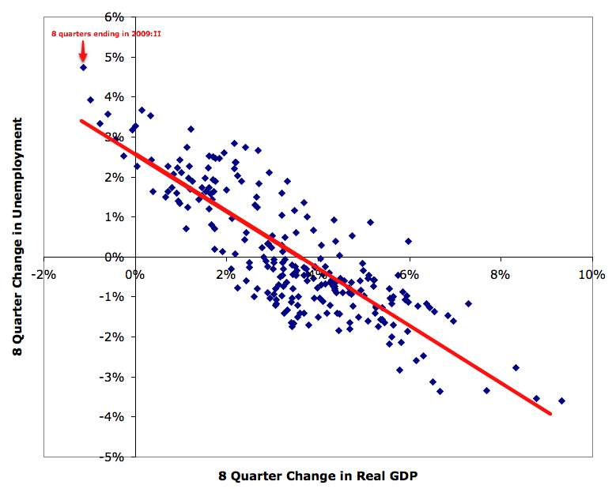

*图 13　美国 1948–2011 年、以 8 个季度为窗口的奥肯定律散点：横轴「8 Quarter Change in Real GDP」（−2% 到 10%），纵轴「8 Quarter Change in Unemployment」（−5% 到 +6%），约 250 个深蓝菱形点，红色粗线是拟合线；材料未印方程，按放大目测它在横轴为 0 处约 $+2.3$ 至 $+2.7$、与横轴交点在 3.3 至 4.0 之间，斜率约 $-0.7$；红色箭头单独标出「8 quarters ending in 2009:II」这个离群点。（按原图裁切，未重绘；出处 p.32，课件未标数据源）*

这张图有三处值得停一下。

**第一，两个轴都是「两年累计」，不是年度。** 横轴是 8 个季度累计的实际 GDP 变化，纵轴是同一窗口内失业率的变化。取两年窗口是为了把季度的噪声抹掉——单季数据上这条关系要散得多。代价是**窗口要两年才凑得齐**：标题写 1948–2011，但第一个可用窗口只能落在 1950 年，材料没有交代这个预热期。

**第二，拟合线不过原点。** 按放大后的端点读，横轴为 0（两年 GDP 完全没增长）时纵轴读数在 $+2.3$ 至 $+2.7$pp 之间：即使经济两年不增长，失业率也会自己上升约 2.3 到 2.7 个百分点。这不是「经济坏了」，而是**劳动人口在增长、生产率在提高**，所以失业率不变所需的正增长是正的。取 $+2.7$ 这个上限解出来：$\Delta u = 0$ 需要 $x = 2.7/0.71 = 3.80\%$ 的两年累计增长，粗略折年约 $1.9\%$；取 $+2.3$ 则是 3.2%、折年 1.6%。**两个读法都落在「折年 1.5%–2%」这个区间**，与 §3.3 那条长期趋势增速的量级一致。

**第三，2009 年那个点离群。** 红色标注的点在 $(-1.5,\ +4.7)$ 附近——两年里 GDP 累计跌 1.5%、失业率累计升 4.7 个百分点，比拟合线预测的高出约 3 个百分点。也就是说：**这次衰退对就业的打击，比奥肯关系预测的更狠**。这类离群点正是「定律」这个词最不舒服的地方。

**增长式的斜率怎么和系数 2 对上。** 斜率 $-0.71$ 说的是「每 1pp 的失业率上升，对应 $1/0.71 = 1.41$pp 的两年累计产出损失」。而水平式说 1pp 周期性失业换 2% 缺口。两者不是同一个量，但有一个清楚的桥：如果产出**连续多年**低于趋势，缺口会一年一年累积成水平差，失业率也大致累积，两者之比就落在 $1/\lvert b \rvert$ 附近。美国面板给的这个数是 2.72（见下节），比 2 高 36%，**同一数量级、不同估计**。

### 12.4 跨国证据：六个面板（p.33）

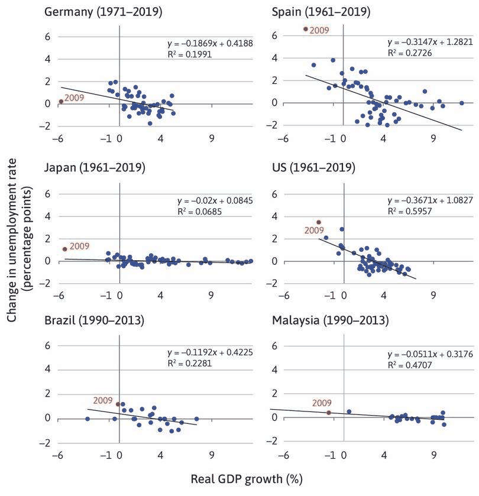

*图 14　六个经济体的奥肯回归面板（2 列 × 3 行），横轴「Real GDP growth (%)」（刻度 −6 到 9），纵轴「Change in unemployment rate (percentage points)」（刻度 −2 到 +6），每格印出 OLS 方程与 $R^2$，红点标 2009 年；美国面板 $R^2 = 0.5957$ 最紧，日本面板斜率 $-0.02$、$R^2 = 0.0685$ 几乎是一条水平线，西班牙的 2009 点落在纵轴刻度上界 +6 之外（约 +6.7）。（按原图裁切，未重绘；出处 p.33，课件未标数据源）*

这是全章唯一把回归方程与 $R^2$ 直接印出来的地方，六格逐格抄录如下（后两列是我按方程反算的，材料没给）：

| 经济体 | 样本期 | 回归式 $y = bx + a$ | $R^2$ | 失业不变所需增速 $x^* = -a/b$ | 隐含换算 $1/\lvert b \rvert$ |
|---|---|---|---|---|---|
| 德国 Germany | 1971–2019 | $-0.1869x + 0.4188$ | 0.1991 | 2.24% | 5.35 |
| 西班牙 Spain | 1961–2019 | $-0.3147x + 1.2821$ | 0.2726 | 4.07% | 3.18 |
| 日本 Japan | 1961–2019 | $-0.02x + 0.0845$ | 0.0685 | 4.23% | 50.00 |
| 美国 US | 1961–2019 | $-0.3671x + 1.0827$ | 0.5957 | 2.95% | 2.72 |
| 巴西 Brazil | 1990–2013 | $-0.1192x + 0.4225$ | 0.2281 | 3.54% | 8.39 |
| 马来西亚 Malaysia | 1990–2013 | $-0.0511x + 0.3176$ | 0.4707 | 6.22% | 19.57 |

$R^2$ 读法先交代一句：**它衡量这条回归线解释了多少失业率变化的方差**，0.60 意思是「解释了六成」，0.07 意思是「几乎没解释」。它不是「关系存不存在」的开关，但 0.07 配一个接近零的斜率，基本就是「这两个变量在这份样本里各走各的」。

逐条看这张表里值得注意的地方：

- 美国的 $R^2 = 0.5957$ 是六格里最高的，斜率 $-0.3671$ 也最陡，$x^* = 2.95\%$ 与 §3.3 那条长期趋势增速的量级对得上。
- 日本的斜率是 $-0.02$：GDP 增速怎么变，失业率几乎不动（$R^2 = 0.0685$）。隐含换算 $1/\lvert b \rvert = 50$，意思是「要 50pp 的增速差才换来 1pp 的失业变化」——这在实践上等于没有关系。日本的就业制度（内部劳动力市场、避免正式解雇）是常见解释，材料没有讲，我不替它补。
- 马来西亚的 $R^2 = 0.4707$ 不低，但斜率只有 $-0.0511$：**关系「稳定」但很弱**——拟合得紧是因为失业率本身几乎不动。这是 $R^2$ 与斜率大小互相独立的一个活教材。
- 巴西与马来西亚的样本只有 1990–2013（24 年），其余四格从 1961 或 1971 年起，**六个面板的样本期不同，不能横向比截距**。
- 2009 那个红点：西班牙冲出上界（失业变化超过 +6pp）、美国在拟合线上方很远、日本几乎贴着线（因为它的线本来就是平的）、巴西的红点离拟合线很近——2009 年巴西的 GDP 增速没有掉多少。

> [!CAUTION] 「strong and stable in most economies」这句结论与自家六个面板不符
> p.33 右侧的总结句是 "Okun's law has been a strong and stable empirical relationship in most economies since the WWII"。同一页六个面板印出的 $R^2$ 从 0.0685（日本）到 0.5957（美国），**横跨 8.7 倍**；隐含换算从 2.72（美国）到 50（日本），**横跨 18.4 倍**。日本与马来西亚的斜率接近零，按它们自己的回归式，奥肯关系在这两国几乎不存在。判据就是这一页自己给出的六个数，不需要外部材料。安全读法：这句话在**美国、西班牙、德国这一类样本**上成立，「most economies」是靠样本选择撑起来的，考试按「经验关系、系数不稳定、跨国差异大」三件套答。

### 12.5 失败情形：四种会算错或讲错的方式

1. **把系数 2 当物理常数跨国家用。** 用 2 去推日本，会得出「GDP 跌 4% → 失业升 2pp」；按它自己面板的斜率 $-0.02$，失业率几乎不动。方向对、量级差 25 倍。
2. **把增长式的斜率当水平式的系数。** 见 12.2 那张表；$-0.3671$ 与 $2$ 之间差的是「变化 vs 水平」和「一年 vs 整个周期」两层。
3. **忘了拟合线不过原点。** 若直接用「增速 = 0 时失业不变」推政策，会低估稳住就业所需的增速。美国面板给的是 $x^* = 2.95\%$：增速低于 3% 左右，失业率就会开始爬。
4. **用它做因果推断。** 奥肯定律是**相关关系**，同一个衰退里产出与就业同时被第三个因素（总支出）推动。反过来推「只要保住增速就能保住就业」在本章的框架里成立（§十四 会说总支出同时决定两者），但**系数本身不告诉你政策的效果**——那需要乘数理论，在第 11 章。

**练习 1（我的补充，非讲义内容）**：某国 $u^* = 5.0\%$，失业率从 5.0% 升到 7.0%。（a）按水平式系数 2 求缺口；（b）用图 13 那条拟合线（$\Delta u = 2.7 - 0.71x$，两年窗口）求它需要多差的两年累计增长；（c）两个答案矛盾吗？

> [!TIP] 参考答案
> （a）$u-u^* = +2.0$pp → 缺口 $= -4.0\%$。（b）$\Delta u = +2.0$ 代入 $2.0 = 2.7 - 0.71x$ → $x = (2.7-2.0)/0.71 = 0.99\%$，即**两年累计 GDP 只需增长约 1%**，失业率照样升 2 个百分点。（c）不矛盾：（a）说的是「产出比潜在水平低 4%」这个**状态**，（b）说的是「两年里产出了多少」这个**流量**。经济可以在正增长的同时把缺口越拉越大——§10.5 的第 2 条失败情形讲的就是这件事，这里是它的奥肯版本。

**练习 2（我的补充，非讲义内容）**：图 14 的美国面板里，标着 2009 的那个红点，横坐标按不同放大倍率读到 $-2.5$ 与 $-5.1$ 两种。（a）分别代入 $y = -0.3671x + 1.0827$ 求预测的失业率变化；（b）该红点的纵坐标约在 $+3.5$，比预测高多少？

> [!TIP] 参考答案
> （a）$x = -2.5$ → $y = 0.3671 \times 2.5 + 1.0827 = 2.00$pp；$x = -5.1$ → $y = 0.3671 \times 5.1 + 1.0827 = 2.96$pp。两种读法的预测分别是 +2.0pp 与 +3.0pp（判不出，两种读法是 $-2.5$ 与 $-5.1$，差别不影响下面的结论）。（b）红点在 $+3.5$ 附近，比预测高 **1.5pp 或 0.5pp**，两种读法都在线**上方**。这就是 12.3 说的「这次衰退对就业的打击比奥肯关系预测的更狠」，与图 13 那个 2009:II 离群点是同一件事的两个窗口。

---

## 十三、产出缺口有多重（p.34）

### 13.1 先把这道除法自己做一遍

前两节把缺口写成一个百分数，但政策讨论里更常见的写法是一个金额。材料给的正是金额：**2010 年美国的产出缺口是 −1.2 万亿美元**，同年人口 3.09 亿，于是每人 4,000 美元，四口之家 16,000 美元。这两步除法和乘法值得当场重做：

$$
\frac{1.2\times 10^{12}}{309\times 10^{6}} = 3{,}883.5\ \text{美元/人}, \qquad 4 \times 3{,}883.5 = 15{,}534\ \text{美元}
$$

| 步骤 | 材料给的数 | 真算结果 | 相对偏高 | 绝对差 |
|---|---|---|---|---|
| 人均 | 4,000 美元 | 3,883.5 美元 | +3.0% | 116.5 美元 |
| 四口之家 | 16,000 美元 | 15,534 美元 | +3.0% | 466 美元 |

两处偏高都是 3.0%，这不是巧合：第二步只是把第一步乘了 4。**圆整带来的相对误差在乘法下不变，绝对误差按倍数放大**——所以「先圆整到 4,000 再乘 4」与「先乘 4 再圆整」给出同一个 3.0% 的偏差，区别只在误差的绝对规模从 116.5 美元变成 466 美元。

这种圆整在量级论证里完全正当，但要记住它的**方向**：这两个数都是高估，真实的人均摊是三千八百多美元，不是四千美元。

### 13.2 分母是谁：同一个缺口的五种平摊

材料用 3.09 亿作分母，那是**全体人口**，里面有儿童、有退休者、有根本不在劳动力里的人。少生产出来的东西不会按人头分配，所以这一步是思想实验而不是统计量。材料在同一页也承认这一点：平均影响是四口之家 16,000 美元，但**成本的分布并不均匀**（the distribution of costs are not even），集中在被解雇工人的家庭。

把「不均匀」也算出来（后三个分母是外部参照参数，材料没给）：

| 平摊口径 | 分母 | 每人或每户摊到 | 相对人均摊 | 参数来源 |
|---|---|---|---|---|
| 全体人口 | 3.09 亿人 | 3,883.5 美元 | 1.00 倍 | 材料给的两个数 |
| 四口之家 | 4 人 | 15,534 美元 | 4.00 倍 | 材料假设的家庭规模 |
| 平均每户 | 2.6 人 | 10,097 美元 | 2.60 倍 | 外部参照（2010 年美国户均规模） |
| 每个就业者 | 1.39 亿人 | 8,633 美元 | 2.22 倍 | 外部参照 |
| 每个失业者 | 1,480 万人 | 81,081 美元 | 20.9 倍 | 外部参照 |

最后一行是这一节真正要留下的数：**同一个 1.2 万亿，摊到人头是三、四千美元，摊到当年失业者头上是八万一千美元**，相差 20.9 倍。这就是「平均数掩盖分布」的算术版本，也正是材料要在同一页补那句「分布不均」的原因。顺带点破「family of four」的来历：它不是普查口径——2010 年美国户均约 2.6 人、家庭平均约 3.15 人（外部参照，材料没给），材料用的 4 人偏大，所以 16,000 这个数除了圆整误差，还带一个家庭规模假设，是个修辞单位而非统计单位。

### 13.3 一条三节链条：为什么值得盯住这个数

*图 15　产出缺口之所以是福利问题，靠的是这条三节链条：产出下降 → 失业率上升 → 福利下降。三个方框之间是两个单向箭头，链条上没有数字，量级全靠链条两侧的材料（第一环是 §十 的缺口，第二环是 §十二 的奥肯换算）。按课件 p.34 示意重绘，原图三个方框是浅紫色、只有英文，重绘时补了中文对照与底部那句「这条链条只给平均影响；成本分布并不均匀，集中在被解雇工人家庭」；出处 p.34。*

链条要逐环看，因为三环的证据地位完全不同：

- **第一环（产出下降）是可算的**，它就是 §十 的缺口，也是本节那 1.2 万亿。
- **第二环（失业率上升）是靠关系换算出来的**，不是恒等式。用的正是 §十二 的水平式：$-4\%$ 的缺口对应 $u^{\text{cyc}} = +2$pp。系数若是 2.7（美国面板的 $1/\lvert b \rvert$）而不是 2，同样的缺口给出 +1.48pp，**链条的第二环有多粗，取决于奥肯系数取谁**。
- **第三环（福利下降）不是算出来的，是一个判断。** 「少生产的东西 = 少掉的福利」这个等号需要一个前提：产出是自愿交换的结果，卖不出去的东西本来就不该被生产。反例很清楚：如果产出下降来自污染产业的收缩，福利未必下降；如果来自强制劳动或库存积压的清理，福利甚至可能上升。材料没有讨论这一环，它直接把链条画到「wellbeing」为止。

还有一处空白值得点破：**这条链条只覆盖衰退性缺口**。扩张性缺口的成本走的是通胀那条路（§10.4 的不对称表），它不经过「失业率上升」这一环——过热时失业率是**下降**的。所以这张三框图不能当「缺口的代价」的通用图，它是「衰退性缺口的代价」的图。

### 13.4 金额与百分比之间缺的那个分母

材料给的是金额，§十 的定义是百分比，两者之间只差一个 $Y^*$——而材料从头到尾没有给过 $Y^*$ 的数值。把三种假设并排，看看这个缺失的分母有多要紧：

| 假设 $Y^*$ | 缺口 $=-1.2$ 万亿 $\div Y^*$ | 按系数 2 的 $u^{\text{cyc}}$ | 隐含 $u$（设 $u^* = 4.8\%$） |
|---|---|---|---|
| 14.5 万亿 | −8.28% | +4.14pp | 8.94% |
| 15.0 万亿 | −8.00% | +4.00pp | 8.80% |
| 15.5 万亿 | −7.74% | +3.87pp | 8.67% |

三个假设给出的百分比只差 0.5 个百分点，因为 14.5 到 15.5 的变化本身只有 7%。**这一组里真正的信息量在反推**：用 §十一 那两个观测数（2010 年 $u = 9.5\%$、$u^* = 4.8\%$）走一遍，$u^{\text{cyc}} = 4.7$pp → 缺口 $-9.4\%$ → 要与「缺口 1.2 万亿美元」同时成立，就需要 $Y^* = 1.2 \div 0.094 = 12.77$ 万亿。

**12.77 万亿比 2010 年美国的实际 GDP（13 万亿量级，外部参照）还低**，也就是说它隐含的是一个**正的**缺口。两条路对不上，说明材料里的金额与本章其他页的失业率数据来自不同的估计口径，不能串起来用。若强行取 $Y^* = 15$ 万亿，$-9.4\%$ 的缺口应当是 1.41 万亿美元，比材料的 1.2 万亿大 **17.5%**。

结论要写得克制：**这不是「材料算错了」**——1.2 万亿这个金额本身来自材料之外的缺口估计，而 2010 年不同机构估出的缺口从 −6% 到 −10% 都有。能说的是：金额、百分比、周期性失业这三个量在本章内部**没有被同一条口径串起来**，做题时题目给哪一个就用哪一个，不要跨口径自己补数。

### 13.5 失败情形：四种把这个数用错的方式

1. **把人均摊当统计量。** 3,883.5 美元不是任何人实际损失的钱；13.2 那张表说明，换一个分母这个数可以变 20 倍。
2. **用金额做跨国或跨期比较。** 同样 1.2 万亿美元的缺口，在 $Y^* = 15$ 万亿的经济体里是 −8.00%，在 $Y^* = 25$ 万亿里只有 −4.80%。**金额不可比，百分比才可比**，这正是 §10.1 那个分母存在的理由。
3. **把年度流量当一次性存量。** 缺口是**那一年**少生产的量。若 $-8\%$ 的缺口连续存在四年，累计少产约 4.8 万亿（不折现、不计 $Y^*$ 自身增长），比「一年 1.2 万亿」听起来严重四倍。深衰退的代价大头在**持续**，不在当年。
4. **忘了 §9.4 的空洞。** 13.4 的三个百分比全都是「估计量之比」，它们的不确定性比 1.2 万亿这个金额本身还大。

**练习 1（我的补充，非讲义内容）**：某年缺口金额为 −1.0 万亿美元，人口 3.3 亿，潜在产出 21 万亿。（a）人均与四口之家各摊多少？（b）百分比缺口是多少？（c）按系数 2 换成周期性失业。

> [!TIP] 参考答案
> （a）$1.0\times10^{12} \div 3.3\times10^{8} = 3{,}030.3$ 美元/人，四口之家 $4 \times 3{,}030.3 = 12{,}121$ 美元。（b）$-1.0/21 \times 100 = -4.76\%$。（c）$u^{\text{cyc}} = -(-4.76)/2 = +2.38$ 个百分点。注意（a）与（b）用的是两个不同分母（人口、潜在产出），**同一个缺口有两个完全不同的平摊**，这就是本节反复强调的分母问题。

**练习 2（我的补充，非讲义内容）**：材料说成本「集中在被解雇工人的家庭」。用 13.2 的数字说明，为什么「人均 3,883.5 美元」这个数**恰好低估了**这些家庭承担的部分，却**高估**了另一些家庭承担的部分。

> [!TIP] 参考答案
> 分母是全体人口，所以它把损失摊给了**根本没有承受损失的人**（儿童、退休者、未被影响的家庭），这部分是**高估**；同时它把真正承受损失的人（当年约 1,480 万失业者）稀释进 3.09 亿里，对他们而言真实的人均负担是 81,081 美元，20.9 倍于平均数，这部分是**低估**。所以「平均 3,883.5」对绝大多数家庭是**高估**（他们本来就没承受损失）、对最受伤的那一组是**严重低估**（真实负担是它的 20.9 倍）——一句「分布不均」就把这个数从统计量降级成了量级示意。

---

## 十四、短期波动的两条成因（p.35–p.36）

### 14.1 先算一个「价格不动」的小市场

设某市场的需求是 $Q_d = 1{,}000 - 100P$，短期里供给被产能固定在 $Q_s = 600$ 件。均衡价格是 $P = (1{,}000 - 600)/100 = 4.00$。现在需求收缩，需求曲线移到 $Q_d = 800 - 100P$。两种情形：

| 情形 | 价格 | 成交量 | 产出相对原来 | 谁吸收了冲击 |
|---|---|---|---|---|
| 价格完全灵活 | $P = (800-600)/100 = 2.00$ | 600 件 | 0% | 全部由价格吸收 |
| 价格钉在 4.00 | 4.00（不变） | $800 - 100\times 4 = 400$ 件 | −33.3% | 全部由数量吸收 |

**同一个需求冲击，价格动与不动之间差 200 件、33.3% 的产出。** 这就是「缺口」在微观层面的来源：不是产能消失了，而是价格没有走到新的均衡，于是成交量被需求那一侧拽了下来。

量级要当场声明：33.3% 是局部均衡小例造成的，**不要**按 §十二 的系数 2 把它换成 16.7 个百分点的周期性失业——那个系数标定在宏观总量上 ±几个百分点的范围，外推到三分之一的产出变动已经没有意义。这个小例只用来把「价格不动 → 数量挨刀」这个机制算给读者看。

### 14.2 成因一：市场需要时间走到均衡价格与数量

材料给的第一条成因是三行陈述，逐行都有内容：

- **企业不常改价**（Firms change prices infrequently）——这是事实陈述，不是评价。
- **调整期内，生产的数量不在均衡数量上**（Quantity produced is not at equilibrium during the adjustment period）——所以「非均衡」是一个**时期**，不是永久状态。
- **企业按现行价格下的需求来生产**（Firms produce to meet the demand at current prices）——这一行最关键，它是一条关于企业行为的**假设**：价格给定之后，卖方接受数量约束，来多少订单做多少活。

这三行合起来有一个标准名字：**价格黏性（sticky prices，指冲击发生后价格在短期内不调整，于是变动由数量吸收）**。材料没有用这个词，但 §十七 那家冰淇淋店给了它的微观理由（§17.3），而 14.1 的小例是它的算术版本。

第三条假设与 §九 的第 2 条理由是同一件事的两种说法：「资本与劳动可能未被充分利用」说的是宏观结果，「企业按现行价格满足需求」说的是微观机制。

### 14.3 成因二：给定价格下，总支出的变化决定产出

第二条成因的四行里，第一行的限定词是全部重点：

**在预先设定的价格下，总支出的变化会影响产出水平**（Changes in total spending at preset prices affects output levels）。展开是三句：支出低时产出低于潜在产出；**全经济体支出的变化是缺口的主要原因**（Changes in economy-wide spending are the primary causes of output gaps）；政策处方是**调整政府支出以关闭缺口**（adjust government spending to close the output gap）。

这里要立一个术语：**总支出（total spending，指经济体里对最终商品与服务的计划购买总额，是第 11 章「总需求」的前身）**。它与第 4 章支出法 GDP 的区别在于：支出法 GDP 记的是**成交**，总支出在这里指的是**想买**——正是这个差额，在价格不动时决定了产量。

「at preset prices」这个限定词说明**两条成因不是并列的**：成因二只有在成因一成立（价格是预先设定、短期不动）时才有力量。如果价格完全灵活，支出的变化只会改变价格水平，产出回到 600 件——14.1 表格的第一行就是这个反事实。

### 14.4 两条成因的关系，以及它与 §9.3 的分工

材料把「为什么有短期波动」写在两页里，但两页的层次不同，放在一起才看得清：

| 机制 | 它移动什么 | 它产生缺口吗 | 材料给的对策 | 出处在本章的位置 |
|---|---|---|---|---|
| 潜在产出自身增速变化（天气、技术、资本形成） | $Y^*$ 这条线 | **不产生**，它移动参照点 | 促进储蓄、投资、创新、人力资本 | §9.3 第 1 条 |
| 价格需要时间调整 | 不动 | 单独不产生缺口，它决定冲击由谁吸收 | 无（这是性质，不是冲击） | 成因一 |
| 总支出变化 | $Y$ | **产生**缺口 | 调整政府支出 | 成因二 |

三条合起来是一句乘法：**缺口 = 支出冲击 × 价格黏性**。两个因子缺一个，缺口都不成立——没有支出冲击，黏性价格没有任何后果；没有黏性，支出冲击全部落在价格上。这也解释了为什么材料把「政策处方」写在成因页上：处方直接来自成因二。

> [!IMPORTANT] 两条成因的地位不对称，政策含义也不同
> 成因一解释的是**冲击为什么会转成数量波动而不是价格波动**，它本身不制造波动；成因二才是**扰动的来源**。因此本章的处方只针对成因二（调支出）。反过来，如果一次下滑其实来自 $Y^*$ 自身（§9.3 第 1 条：旱灾、技术减速），针对成因二的处方会失效——支出补不回不存在的产能，只会推高价格。**而缺口的大小无法区分这两种情形**（§9.4 的空洞在这里变成实际问题）：同样是 −8% 的缺口，一个该用支出政策，一个该用增长政策，光看缺口数字分不出来。

### 14.5 失败情形：三条会讲错的方式

1. **把成因一当成「企业固执」。** 不改价不是疏忽，而是有成本的：改价本身要花钱（菜单成本）、会惹恼顾客、合同已经签死。材料没有展开这些理由，但 §十七 的冰淇淋店那一节给了三条非常具体的（§17.3），两节要合起来读。
2. **把「支出是主因」读成「唯一原因」。** 本章框架里没有供给冲击的位置，而 §7.3 已经摆出两个反例（1973–1975、1979–1982：产出与通胀同时恶化）。那种情形里，问题出在 $Y^*$ 一侧的成本冲击，用「调支出」去对付它会在通胀与产出两头同时输。完整的处理要等到第 13 章的 AD-AS 模型。
3. **以为成因与处方是两节。** 材料在成因页的第二条里就写下了政策句（adjust government spending），而「处方」在目录上是第四节。这个错位不是排版问题：它反映的是「一旦承认成因二，处方就已经写好了」这条逻辑。

**练习 1（我的补充，非讲义内容）**：同一个市场（$Q_s = 600$ 固定），需求从 $Q_d = 1{,}000 - 100P$ 移到 $Q_d = 900 - 100P$。（a）价格钉在 4.00 时产出降多少？（b）价格灵活时产出降多少、新价格是多少？（c）按 §十二 系数 2，（a）的缺口对应多少周期性失业？

> [!TIP] 参考答案
> （a）成交量 $= 900 - 100\times 4 = 500$ 件，降幅 $(500-600)/600 = -16.67\%$。（b）新均衡价 $P = (900-600)/100 = 3.00$，成交量仍是 600 件，降幅 **0%**。（c）$-16.67\%$ 的缺口按系数 2 给出 $u^{\text{cyc}} = +8.33$pp——这个数在真实宏观数据里几乎没出现过（美国 1948 年以来最大约 +5pp），说明**局部均衡小例的量级不能直接搬到总量口径**，它只用来演示机制。

**练习 2（我的补充，非讲义内容）**：「如果企业立刻把价格降到位，衰退就不会发生。」这句话对不对？请分两半回答。

> [!TIP] 参考答案
> 前半对、后半错。**产出侧**对：14.1 的表格显示价格灵活时成交量不掉，缺口为零，所以「衰退」（按产出定义）确实不会出现。**福利侧**错：冲击没有消失，它全部转移到价格上——同样的需求收缩变成 33% 的降价。企业收入下降、债务实际值上升、名义工资如果也黏住则实际工资过高，仍然会有裁员与破产。也就是说，价格灵活消灭的是**缺口的形式**，不是冲击本身。这句话在第 13 章会被重新表述成「长期里货币与支出只影响价格」，而本章只需要记住：短期与长期的区别，就是冲击落在数量上还是落在价格上。

---

## 十五、自我修正：没有政策时经济怎么走回来（p.37–p.40）

### 15.1 先看一句被写得很轻的话（p.38）

材料的第四节（Cures）开头不是政策，而是一句「经济有**自我修正机制**（self-correcting mechanism，指不需要政策介入、缺口会通过企业定价行为的改变而自行关闭的过程）——企业最终会调整到缺口上」。怎么调整，给了两条对称的陈述：

- 支出**低于**潜在产出时，企业会**减慢涨价的速度**（firms will slow the increase of their prices）。
- 支出**高于**潜在产出时，企业会**涨得更快**，形成潜在的通胀压力（potential inflationary pressure）。

第一条的措辞是这一节全部读图钥匙：**是「减慢涨价」，不是「降价」**。所以衰退里的自我修正表现为**通胀放缓（disinflation）**，价格水平本身仍然在上升。把这两件事的算术差别算出来：设 $\pi_1 = 3\%$，缺口 −4%，第二年通胀降到 2%。两年之后价格水平累计上涨

$$
1.03 \times 1.02 - 1 = 0.0506 = 5.06\%
$$

**通胀「下降」了 1 个百分点，价格水平却比两年前高了 5.06%。** 这就是 §7.3 立的 disinflation / deflation 之分在这里的作用：它决定了下一张图的纵轴为什么必须是 $\pi$（通胀率）而不是 $P$（价格水平）——如果画在 $P$ 上，衰退期的自我修正看起来会像价格下降，而那与材料的措辞矛盾。

### 15.2 长期那一侧的三句话（p.39）

自我修正机制的完整陈述是三句：**长期里通胀达到均衡、缺口被消除，生产回到潜在产出水平**；**产出由生产能力决定**；**支出只影响价格水平与通胀**。

这三句就是本章的**长期定义**。操作性的区分可以这样记：

| | 短期 | 长期 |
|---|---|---|
| 谁吸收冲击 | 数量（产出与就业） | 价格（价格水平与通胀率） |
| 产出由什么决定 | 总支出 | 生产能力（$Y^*$） |
| 缺口 | 可以存在，可正可负 | 被消除，$Y = Y^*$ |
| 政策的着力点 | 有效（§十六 的两类处方） | 无效于产出、只影响价格 |

这与上一讲结尾留下的那条分界线是同一句话：**货币中性在长期成立、短期不成立**。本章不讨论货币，但它把这条线的**短期那一侧**用产出与通胀的语言重述了一遍；至于「为什么」短期不中性（价格为什么黏），本章只给了成因一那三行，完整机制要到第 13 章。这里不重述第 9 章的论证。

### 15.3 一次负向需求冲击走完这两步（p.40）

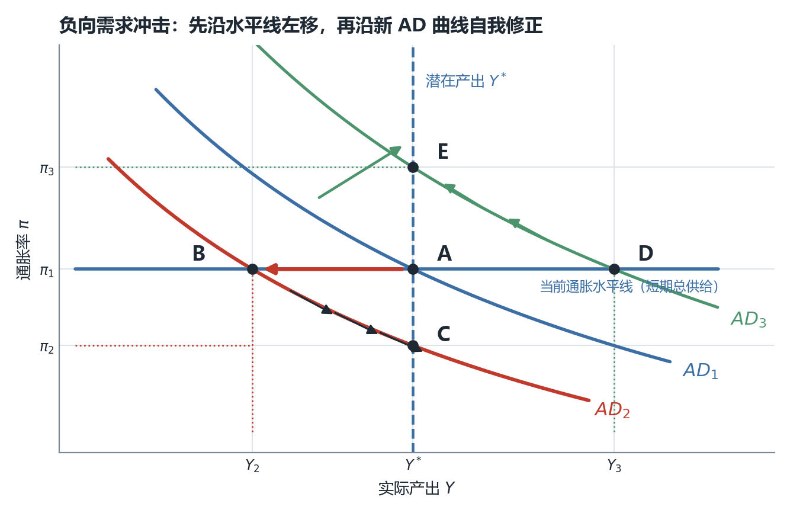

*图 16　$(\pi, Y)$ 空间里的一次负向需求冲击。竖直虚线是潜在产出 $Y^*$，水平实线是当前通胀 $\pi_1$（在这套框架里它就是短期总供给）；经济从 $A=(Y^*,\pi_1)$ 出发，总需求左移（$AD_1\to AD_2$）后**沿水平线**走到 $B=(Y_2,\pi_1)$：产出掉了、通胀没动；随后**沿 $AD_2$ 向下**走到 $C=(Y^*,\pi_2)$：通胀降下来、产出回到潜在。镜像情形是右移的 $AD_3$ 与 $D=(Y_3,\pi_1)$、$E=(Y^*,\pi_3)$。轴上没有刻度数字，$\pi_2<\pi_1<\pi_3$、$Y_2<Y^*<Y_3$ 只表示大小关系。按课件 p.40 示意重绘（原页的 $\pi_1$、$\pi_2$ 与「Inflation」是叠在位图之外的独立文字层，裁切会丢标签）；出处 p.40。*

这张图有三处必须逐条指出，否则读不出内容：

**第一，路径分成两种走法，方向不一样。** $A \to B$ 是**水平**移动（通胀不变、产出变），$B \to C$ 是**沿曲线**移动（通胀与产出同时变，且方向相反：通胀降、产出升）。这两段正好是 15.1 与 15.2 的图像版本：冲击来临的那一刻价格是黏的，所以全部落在数量上；之后企业改价，价格动了，数量才跟着回来。

**第二，为什么通胀下降会把产出拉回来——这张图没有回答。** 曲线 $AD_2$ 向右下方倾斜意味着「$\pi$ 越低、$Y$ 越高」，但材料只画了这条曲线的形状，没有给机制。真实机制需要一条**利率渠道**：通胀下降使实际利率下降，从而刺激投资与消费（这属于第 12、13 章的内容）。所以本章给出的是一条**被断言的路径**，不是一条被推导的路径。这一点是本章与第 13 章最重要的分工。

**第三，手写层里有两种读法。** 这一页除了印刷的 $AD_1$、$AD_2$ 之外，还有一层手写曲线：它的右端标着「AD3」，曲线上方又斜写着「SRAS」。**判不出，两种读法是 $AD_3$ 与 SRAS。** 按 $AD_3$ 读，它是过热那一侧的镜像案例（$A \to D \to E$），与本节的负向冲击对称，这也是我采用的读法；按 SRAS 读，它与这套框架里「短期总供给就是那条水平线」相冲突——水平线已经是 SRAS，不该再有一条下凸的 SRAS。重绘时我按 $AD_3$ 标注。

同一层手写笔迹还有一个方向问题：沿绿色曲线的小箭头指向**右下**（从 $E$ 朝 $D$），而按 15.1 的自我修正逻辑，扩张性缺口的修正应该是通胀上升、产出从 $Y_3$ 退回 $Y^*$，即沿曲线**向左上**走。绿色层的箭头方向与文字讲的机制相反，重绘图保留了原图的箭头方向，读的时候以正文为准。

### 15.4 自我修正要跑多快：材料没说，那就算一个下限

材料只说「eventually（最终）」。最终是多久？这不能从材料里读出来，但可以用一个自造的算例把「最终」翻译成增长语言。设 $Y^*$ 从 1000 起、每年增长 2%，冲击后缺口 −4%：

| 年份 $t$ | $Y^*$ | 缺口 | $Y$ | 需要的实际增速 |
|---|---|---|---|---|
| 0 | 1,000.00 | −4.0% | 960.00 | — |
| 1 | 1,020.00 | −3.0% | 989.40 | 3.06% |
| 2 | 1,040.40 | −2.0% | 1,019.59 | 3.05% |
| 3 | 1,061.21 | −1.0% | 1,050.60 | 3.04% |
| 4 | 1,082.43 | 0.0% | 1,082.43 | 3.03% |

（缺口每年收窄 1.0 个百分点是我假设的速度，材料没给。）结论有两层：

- **「自我修正」在数量语言里的意思是：实际增速要连续多年高于潜在增速约 1 个百分点。** 关闭 −4% 的缺口需要四年 3% 的增长，而不是「回到正常增长」。
- 反过来，如果实际增速只等于潜在增速 2%，缺口**永远不变**：$t=1$、$t=5$、$t=10$ 三个时点算出来都恰好是 −4.00%。**「经济在增长」与「缺口在关闭」是两件事**，这是 §10.5 第 2 条失败情形的长期版。

通胀那一侧同样需要速度：若 $\pi$ 从 3% 起每年降 0.5 个百分点，四年才降到 1%。材料没有给任何速度参数，也没有给「通胀降多少才够把产出拉回来」的强度，所以这一节只能把「最终」读成「比政策慢」，不能读成「很快」。

> [!CAUTION] 「会自我修正」推不出「不用干预」
> 从 15.1–15.4 到「所以政策多余」之间缺三步：修正的速度未知（材料只说 eventually）、修正期间产出可以长期低于 $Y^*$（15.4 的表格给出至少四年）、而 §9.4 提到的**滞后效应**会让 $Y^*$ 自己在长期失业中下移——那时「回到潜在产出」这件事本身把标准降低了。材料没有做这个政策结论，它只陈述了机制；把它读成「市场会自己治好」是超出材料的推断。这是宏观政策争论的核心分歧点，第 11、13 章会正面处理。

### 15.5 失败情形：四种读错这张图的方式

1. **把「通胀下降」读成「价格下降」。** 15.1 的算术：通胀从 3% 降到 2%，价格水平两年里仍累计上涨 5.06%。
2. **把 $A \to B$ 与 $B \to C$ 混成一段。** 前者是冲击（沿水平线），后者是修正（沿曲线）。把两段合成「产出下降后自己回升」，就丢掉了「通胀在短期完全不动」这个关键假设。
3. **以为 $C$ 点回到 $Y^*$ 就回到冲击前的位置。** $C$ 的产出等于**新的** $Y^*$（潜在产出这些年一直在长），而通胀已经低了一个台阶。路径的终点不是起点。
4. **把这条链条当成无条件成立。** 如果工资合同按通胀指数化、或预期通胀被锚定在高位，「支出不足 → 涨价放慢 → 实际余额上升 → 支出回升」这一串就会卡住。1970 年代的滞胀（§7.3 的两个反例）正是这种情形，而本章的框架里没有给它位置。

**练习 1（我的补充，非讲义内容）**：接着 15.4 的设定，若实际增速恒定在 3%（缺口收窄的速度不再是我假设的每年 1.0pp，而是由增速差内生），缺口各年是多少？大约几年关闭？

> [!TIP] 参考答案
> $Y_t = 960\times1.03^t$、$Y^*_t = 1{,}000\times1.02^t$：$t=1$ 时 $-3.06\%$、$t=2$ 时 $-2.11\%$、$t=3$ 时 $-1.15\%$、$t=4$ 时 $-0.18\%$、$t=5$ 时 $+0.80\%$。**在第四与第五年之间穿过零**，约 4.2 年。收窄速度是 0.94、0.95、0.96、0.98 个百分点——**不是常数，而是逐年略微加快**（因为比值 $(1.03/1.02)^t$ 按复利放大）。所以 15.4 表里「每年 1.0pp」是一个略偏乐观的近似。

**练习 2（我的补充，非讲义内容）**：为什么这一节的图必须用 $(\pi, Y)$ 空间而不是 $(P, Y)$ 空间？用 15.1 的数字给一个决定性理由。

> [!TIP] 参考答案
> 因为短期总供给在 $(\pi, Y)$ 空间里是一条**水平线**，在 $(P, Y)$ 空间里不是。$A \to B$ 那一段「通胀完全不动」在 $(\pi, Y)$ 里就是水平移动，好画也好读；若纵轴换成 $P$，「企业减慢涨价」意味着 $P$ 仍在上升、只是升得慢，短期那段就变成一条**斜线**而不是水平线，而 $B$ 点的通胀读数（$\pi_1$）也就无法当作两条曲线的公共高度。15.1 的算术是决定性的：价格水平两年涨了 5.06%，如果纵轴是 $P$，$A$ 与 $B$ 就不可能同高。

---

## 十六、政策处方与 1999–2000 的一次踩刹车（p.41–p.42）

### 16.1 两类稳定化政策，各调一个旋钮

材料把处方压缩成两行，两行的结构完全对称——都是「调 X 来关闭缺口」：

| 政策 | 英文原名 | 调什么 | 传导到哪 | 谁在执行 |
|---|---|---|---|---|
| 财政稳定化政策 | fiscal stabilization policy | 政府支出（government spending） | 直接进入总支出的 $G$ 项 | 立法机构与政府 |
| 货币稳定化政策 | monetary stabilization policy | **利率目标**（interest rate target） | 改变投资与消费（$I$、$C$） | 中央银行 |

两个旋钮的差别不在「有没有用」，而在**中间隔了几层**：财政是直接把 $G$ 放进总支出，货币要先经过利率、再经过企业与家庭的决策。所以同幅度的缺口，两种政策的**时滞**与**确定性**都不同。至于「调多少才能关闭多少缺口」，那是乘数问题，本章没有给，第 11 章正面处理。

**「利率目标」这个说法与上一讲的口径不是一套语言。** 第 9 章讲的是**准备金的供给与需求**决定联邦基金利率；这里讲的是央行**宣布一个目标**。两者不矛盾，但衔接点在于操作工具换了：2008 年之后美联储不再靠微调准备金数量来逼近目标，而是靠**利率走廊**（interest rate corridor，给准备金付息并设一个区间，把市场利率夹在区间内）。这个变化在本节那张利率序列里看得见：一条序列在 2008 年底之后停掉，取而代之的是**上下沿两条线**。

**上一讲的空洞，在这一页只补了一半。** 第 9 章的结尾说过，它只给了货币的供给、没有给货币的需求，因此「利率为什么停在这个水平」缺少微观基础；它也说过准备金率归零之后旧的准备金供需图已经有点历史。本章确实用了「利率目标」这个更贴近现实的口径，那张序列还画出了区间，但**没有讲走廊怎么工作、没有讲央行凭什么能钉住它**。所以这是**部分回应**：语言换对了，机制仍然缺席，完整版本要到第 12 章。

### 16.2 一次真实的踩刹车：1999–2000

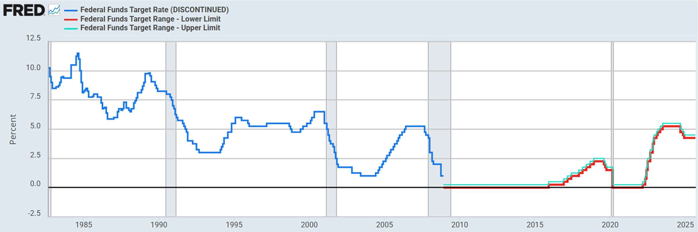

*图 17　美国联邦基金目标利率，1982–2025，纵轴 Percent（−2.5 到 12.5），灰色竖条是 NBER 判定的衰退期。蓝线「Federal Funds Target Rate (DISCONTINUED)」到 2008 年底结束，此后由红（下沿）与青绿（上沿）两条「目标区间」线接替，即走廊制的表现。可读出的段落：1984 年峰约 11.0、1990 年约 9.4、1995–96 年约 5.5、**1998 年 10 月至 1999 年 6 月的 4.75–5.0 平台**、**1999 年 6 月起抬到 6.25–6.5**、2001 年起急降到 1.0 附近、2004–06 升到 5.25、2008 年底到 2015 年底贴零、2016–19 升到 2.4、2020 年 3 月回零、2022–23 升到 5.25–5.5、2025 年约 4.0–4.25。按原图裁切，未重绘（已切掉最底部的网址与按钮行）；出处 p.41，数据源 FRED（graph/?g=1Sju，Board of Governors）。（另注：讲义在这一段序列上用手写橄榄绿椭圆圈住了 1997 至 2001 年那一段，正是 16.2 的案例；那枚椭圆是作者投影时手写的批注，不属于导出的位图数据，所以裁切件里没有它，读图时按这段文字定位。）*

材料给这个案例的完整时间线，值得按年份排开：

| 年份 | 材料陈述的事实 | 用本章语言的翻译 |
|---|---|---|
| 约 1997 | 周期性失业转为负值（cyclical unemployment rates became negative） | $u < u^*$ → 扩张性缺口出现 |
| 1997–1998 | 央行认为通胀压力低，因为生产率提升与国际竞争，**没有动货币政策** | 缺口为正但 $\pi$ 没升 → 选择等待 |
| 1999–2000 | 扩张性缺口继续扩大；央行更担心通胀，开始给经济减速，**1999 年起上调目标利率** | 序列的抬升：4.75–5.0 → 6.25–6.5 |
| 2001 年初 | 衰退使央行掉头，**下调目标利率** | 从 6.5 一路降到 1.0 附近 |

幅度可以量一下（读数取自上面那张序列，属目测口径）：收紧约 **+150 个基点**（5.00 → 6.50，按区间上沿），随后的放松约 **−550 个基点**（6.50 → 1.00，跨约 19 个月，平均每月 28.9 个基点）。**松的方向是紧的方向的 3.67 倍**——这个不对称本身是信息：刹车踩得轻、油门踩得猛。

用 §十二 的系数 2 折一下这一轮操作：1997 年周期性失业转负，若幅度是 −1pp，缺口就是 +2%；要把 $u^{\text{cyc}}$ 从 −1pp 拉回 0，需要失业率上升 1 个百分点。材料没有给 1997 年的具体幅度，所以这个换算只用来把「踩刹车」翻译成缺口语言，**不用于反推任何一年的缺口数值**。

### 16.3 这一页真正值得学的地方：央行看的是通胀，不是缺口

时间线里最容易被读过去的一步是 1997–1998 那两年：**缺口已经是正的，央行却不动**，理由是通胀压力低（生产率提升、国际竞争）。这里有两个层次：

- 材料自己给出了一个**决策规则的实际版本**：观察量是通胀，不是缺口。缺口是背景，通胀是扳机。
- 这也解释了为什么 1999 年的加息距离 1997 年缺口转负已经**晚了约两年**。滞后有三层：识别滞后（$Y^*$ 与 $u^*$ 都是估计值，§9.4 与 §11.6）、决策滞后、生效滞后（利率传导到支出要时间，16.1 说的「中间隔几层」）。材料没有用这三个词，但整段时间线就是这三层滞后的实例。

**这个案例不能被读成成功或失败的判决。** 材料只说 2001 年初的衰退使央行掉头。1999–2000 的加息是不是**造成**了 2001 年的衰退、还是**恰好**在它之前收紧，材料没有判断，本章的框架（没有乘数、没有传导时滞参数）也判断不了。安全结论只有一条：**收紧的幅度小（+150bp）、时间晚（缺口转负两年后），而随后的放松幅度大（−550bp）**。

### 16.4 失败情形：四种把这一节用错的方式

1. **把「调利率」当「调货币量」。** 第 9 章的 $M$、第 12 章的 $r$ 目标、本章的「利率目标」是三套口径；把三者混用会在做多步骤题时把中间环节丢掉。
2. **以为政策能精确关闭缺口。** 材料给的是方向（adjust spending、adjust rate），没有给强度。强度需要乘数与 IS 曲线（第 11 章）和 MP 曲线（第 13 章）。
3. **把 1999–2000 当模板套用。** 那次「等通胀出来再动」之所以代价看起来不大，是因为 1997–98 年那两年**恰好**有生产率红利压住通胀。这个条件不是每次都有；1970 年代就是反面（§7.3：通胀在衰退里仍然上升，扳机被误读）。
4. **把财政与货币当成同一件事的两个名字。** 两者的执行主体、时滞与政治约束完全不同；材料两行写得很对称，容易读成对称。

**练习 1（我的补充，非讲义内容）**：设某年 $u = 4.2\%$、$u^* = 5.2\%$。（a）缺口是多少（系数 2）？（b）若政策把失业率推到 5.2%，缺口变成多少？（c）这一问对应 1999–2000 的哪一步？

> [!TIP] 参考答案
> （a）$u^{\text{cyc}} = 4.2 - 5.2 = -1.0$pp → 缺口 $= +2.0\%$，扩张性。（b）$u^{\text{cyc}} = 0$ → 缺口 $0\%$。（c）正是「about 1997 周期性失业转负 → 1999 年起加息减速」那一步：把 $u^{\text{cyc}}$ 从负拉回零，代价是失业率上升 1 个百分点。这一问的机关在符号：**要关闭正的缺口，需要让失业率上升**，这就是「踩刹车」在缺口语言里的定义。

**练习 2（我的补充，非讲义内容）**：两类政策各自「调」的那个变量，分别在哪一章被正式建模？本章为什么可以不建模？

> [!TIP] 参考答案
> 政府支出进入总支出、并产生乘数效应，是第 11 章（支出—收入与财政政策）的对象；利率目标如何被设定、如何通过实际利率影响支出，是第 12 章（货币政策与美联储）与第 13 章（AD-AS）的对象。本章可以不建模，因为它的任务只是**把缺口的存在与大小量出来**（§九~§十三），再说明「缺口会自己关闭、也可以被政策关闭」这两条路径的方向。强度、时滞与最优幅度都不在本章的口径里——这是本章的定位，不是它的缺陷。

---

## 十七、Lisa 的冰淇淋店：一家店里的短期与长期（p.43–p.47）

### 17.1 为什么收尾交给一家店

材料在最后五页把镜头从总量缩到一家冰淇淋店。店主 **Lisa** 是这套教材（Acemoglu 等人的《Principles of Economics》）里贯穿全书的人物，本章是她第一次出现，材料没有在前文交代（我的补充，非讲义内容）。

她出现的理由不是点缀。前面十六节的语言全是总量的：$Y$、$Y^*$、$u$、$u^*$、总支出、通胀。这些量在短期与长期里的行为差别，是本章最难守住的一条线。五页纸要做的事，就是把这条线**搬到一个人身上**：她有自己的产能、面对自己的需求波动、自己定价、自己决定要不要扩店。逐页分工如下：

| 页 | 她面对的问题 | 对应本章前面的哪一块 |
|---|---|---|
| 产能 | 一天能卖多少由什么决定 | §九（$Y^*$ 的定义） |
| 需求波动 | 哪些波动可预测、哪些不可 | §五（性质 3：不可预测） |
| 定价 | 为什么不随时改价 | §十四 成因一（价格黏性） |
| 长期 | 涨价与扩产的先后与条件 | §十五（自我修正与长期） |
| 宏观教训 | 把上面四条翻译回总量 | §十五 的三句话 |

### 17.2 产能：一天能卖多少由三样东西决定（p.43）

材料给的第一个清单是三条：**资本的数量**（机器、店面、冰柜）、**投入的劳动**（明确包括工时）、**资本与劳动的生产率**。这三条就是 §九 那句「可持续的最大产出」在一家店里的展开——把「资本、劳动、技术」换成「冰柜、店员、配方与效率」，$Y^*$ 的定义就落地了。

第二条清单更重要：**产能变化很慢，但会有偶发中断**。材料列了四种：机器故障、工人没来上班、**Lisa 本人得流感**、原料没送到。

这四件事值得停一下，因为它们在宏观语言里**不属于缺口**。机器坏了是资本数量下降，Lisa 得流感是劳动投入下降，原料没到是中间投入短缺——三者都在移动「这家店可持续能生产多少」这条线，也就是移动 $Y^*$ 本身，而不是让 $Y$ 离线。这与 §9.3 第 1 条（不利天气、技术革新速率变化）是同一类机制，与 §十四 的两条成因（价格不动 + 支出变化）是另一类。宏观层面同类中断（旱灾、疫情）是否可恢复，决定它该被算成暂时离线还是永久下移；**2020 年正是这两类的边界情形**（我的补充，材料没有讨论）。

### 17.3 定价：为什么她不搞实时竞价（p.45）

材料先给一个否定：**完全灵活的价格不现实**（Fully flexible prices are unrealistic），理由三条：

- 分钟级定价会让顾客困惑（confusing to customers）；
- 办一场拍卖的成本超过 Lisa 能得到的好处（costs of an auction exceed Lisa's benefits）；
- 不同顾客在低流量下持续购买（continuous purchases in low volumes by different customers）——生意是零星持续来的，不是集中竞价撮合的。

这三条就是**价格黏性**（sticky prices）的微观理由清单，而 §十四 成因一只说了「企业不常改价」这一句事实。三条分别对应文献里的三种成本：**顾客关系与菜单成本**（改价本身有代价、还会破坏信任）、**交易成本**（重新发现价格的成本）、**交易的时序结构**（订单陆续到来，价格必须先定好才能成交）。材料没有给这三个名字（我的补充），但三条内容已经把它们各自占住了。

然后是她实际怎么定价：调查竞争者的价格、评估自己产品的强弱、分析历史销量看是否需要调整。三条合起来是一个**试探—调整**程序，而不是一个求解程序——她不是在算均衡价，而是在看信号慢慢挪。

本节最后一句是全章最重要的一句话的微观版本：**Lisa 在短期里满足需求**（Lisa meets demand in the short run）。给定价格，她按上门的顾客数量供货。这正是 §14.2 第三条假设（企业按现行价格下的需求来生产）在一家店里的样子。

**失败情形**：如果她真的随时改价会怎样？短期那条假设就断了——价格与数量同时调整，「来多少买多少」不再成立，需求冲击全部落在价格上。此时这家店不再有任何 §十四 意义上的缺口，只有 §十五 长期那一侧的行为。也就是说，**「短期满足需求」这件事的成立条件，就是价格不动**。

### 17.4 长期：先涨价，再扩产，扩产要看成本（p.46）

长期那一页给的是**三个信号 → 两个动作**的顺序：

信号：持续强劲的**排队**（waiting lines）、**低库存**、**产能已满载**。三个信号合起来说的是同一件事：在现行价格下需求量超过可持续供给量——这就是 §十 的扩张性缺口的店铺版（$Y > Y^*$，只不过这里的 $Y^*$ 是这家店的）。

动作一：**先涨价**，因为涨价可以立刻实施（implemented quickly）。
动作二：**然后评估扩产**，而评估有一个明确的条件——材料原话是「如果扩产不抬高平均成本，Lisa 就会扩产并把价格回到原来的水平」。

这个条件一句话带过，但它是长期供给的成本条件，值得算一遍（成本参数是我自造的示算，材料没有给任何数字）：现状每天 100 件，固定成本 300、每件可变成本 2.00，总成本 500，平均成本 $\text{AC} = 5.00$。

| 扩产方案 | 新产量 | 新固定成本 | 总成本 | 新 AC | 相对现状 | Lisa 的选择 |
|---|---|---|---|---|---|---|
| 扩产 A | 130 件 | 420 | 680 | 5.2308 | +4.62% | **不扩**，只涨价 |
| 扩产 B | 130 件 | 350 | 610 | 4.6923 | −6.15% | 扩产，价格可以降回 5.00 |
| 临界情形 | 130 件 | **390** | 650 | 5.0000 | 0.00% | 扩不扩无差异 |

临界固定成本这样解：$\text{AC}(130) = \text{AC}(100) \Rightarrow FC = 5.00\times130 - 2\times130 = 390$。**只要新固定成本低于 390，扩产就不抬高平均成本，材料那个条件成立**；高于 390，她唯一的手段就是继续用价格配给。

这一算把「长期里产出回到潜在水平」这句话补上了它缺的那一半：**长期供给不是无限的，它由成本条件筛出来**。规模报酬递增（扩产摊薄固定成本）时扩产，递减时不扩。材料只给了一句条件，没有给成本语言，所以这张表与那个 390 都是我的补充。

顺序也值得记：**涨价快、扩产慢**。这与 §十五 的两步走是同构的——短期里数量调整（她多做了生意），中期价格调整（她涨价），长期产能调整（她扩店）。三个速度不同的齿轮，就是「短期 / 长期」这条线的微观分解。

### 17.5 宏观教训：这家店教回来的是什么（p.47）

材料把五页压缩成两句对照：**短期里生产者在既定价格下满足需求，总支出驱动产出水平**；**长期里价格达到均衡水平，产出处在潜在水平**。把这两句与 §15.2 的三句话并排，是逐条咬合的：

| §十五 的长期陈述 | §十七 的店铺版本 | 同一个意思的哪一种说法 |
|---|---|---|
| 产出由生产能力决定 | 扩产受平均成本条件约束 | 供给侧 |
| 支出只影响价格水平与通胀 | 短期她按需求供货、长期用价格配给 | 需求侧的落点 |
| 长期里缺口被消除、$Y = Y^*$ | 长期里价格达到均衡、产出在潜在水平 | 均衡定义 |
| （无对应） | 短期里「满足需求」需要价格不动 | 成因一 |

最后一行是店铺版本**多出来**的那一条：材料在宏观页上没有把「短期满足需求」的前提写出来，只在 Lisa 这里写了一次。所以这一节的真正功能，是给出短期那一侧的**成立条件**。

**与上一讲的预告对账（正面判定）。** 第 9 章笔记的结尾原话是：**「与第 10 章以后：货币中性在长期成立、短期不成立，这条分界线就是 AD-AS 模型的入口」**，并且承认「短期非中性」在那一讲只有一句断言（`Money can have important real short-run effects`）。判定分两半：

- **分界线本身：命中。** 本章把这条线讲成了两句可复述的话（§15.2 的三句 + §17.5 的两句对照），并且给了它一个成立条件（价格黏性，§14.2 与 §17.3）。第 9 章只有断言，本章有了机制的一半。
- **AD-AS 的入口：部分命中。** 材料确实给了 $(\pi, Y)$ 空间里的图形骨架——竖直的 $Y^*$ 线、水平的当前通胀线、向下倾斜的需求曲线（§15.3），这正是动态 AD-AS 的三件套；但它**没有命名**总供给曲线与总需求曲线，**没有推导**为什么需求曲线向下倾斜（缺利率渠道），也没有把政策反应画进这套图形。所以本章是「入口」这个词的字面意思：门开着，房间在第 13 章。

### 17.6 一处必须挑明的张力：一家店的需求是可预测的

材料在这一节说 Lisa 面对的需求有**可预测的变化**——一天之内的时段、星期几、年度季节循环；同时也承认有**不可预测的变化**——天气、社区活动。这与 §五 的性质 3「经济波动不可预测」表面上矛盾。

矛盾可以这样解开（我的补充，材料没有做这个论证）：**可预测性取决于波动的来源**。一家店的季节性来自营业习惯与气候，这两样本身稳定，所以模式可复制；宏观总量的波动来自支出决策的变动，而决策的驱动因素（预期、信贷条件、政策、外部冲击）本身在变，没有稳定的生成机制可以复制。换句话说，**季节性是「同一个原因反复作用」，周期是「每次原因都不同」**。这也解释了为什么 §5.3 那张预测表里，用历史均值猜下一次扩张的长度，七次里六次误差超过 ±25%。

顺带一个类比失效点：Lisa 的「可预测波动」她可以用排班与备货对付（提前多买原料），宏观政策**没有对应的库存**——衰退不能提前生产。这是微观类比走得最远的地方。

**练习 1（我的补充，非讲义内容）**：Lisa 现状每天 100 件，固定成本 300、可变成本每件 2.00。若扩产到 120 件需要新固定成本 330。（a）扩产后的平均成本是多少？（b）她会扩产吗？（c）临界固定成本是多少？

> [!TIP] 参考答案
> （a）$\text{AC} = (330 + 2\times120)/120 = 570/120 = 4.7500$。（b）**会**——4.75 低于现状的 5.00，扩产**降低**了平均成本，满足材料的条件，所以她扩产并把价格降回去。（c）$5.00\times120 - 2\times120 = 360$：新固定成本低于 360 就不抬高平均成本。注意（a）与 17.4 表里的方案 B 是同一个方向（规模报酬递增），而方案 A（FC = 420、AC = 5.2308）是递减；**同一个扩产幅度，只因为固定成本不同，结论相反**——这就是那句「if expansion does not raise average costs」的分量。

**练习 2（我的补充，非讲义内容）**：把下面四件事分别归入「移动 $Y^*$」「造成缺口」「两者都动」：（a）Lisa 得流感关门一周；（b）附近开了三家竞争对手，客流下降；（c）冰柜全部换成新机型，效率提高 20%；（d）全国性的失业使顾客减少外出。

> [!TIP] 参考答案
> （a）**移动 $Y^*$**（劳动投入暂时下降，是产能中断，材料把它列在 p.43 的中断清单里）；严格说它是**暂时**移动，所以宏观上更接近「当年潜在产出略降」，与 §9.3 第 1 条同类。（b）**两者都不动**——她的需求曲线左移了，但对整个经济体来说，这只是支出在竞争者之间**重新分配**，总量没变；这是微观类比最容易误导人的一处。（c）**移动 $Y^*$**（生产率提高，永久性）。（d）**造成缺口**（总支出下降而价格黏住，成因二）。(b) 与 (d) 的对比是这道题的全部要点：**一家店的需求下降不等于经济体的需求下降**，把两者混同就是「合成谬误」，而本章的成因二说的是后者。

---

## 十八、全章框架：七个概念怎么连成一张图（p.48）

### 18.1 图与它的七条边

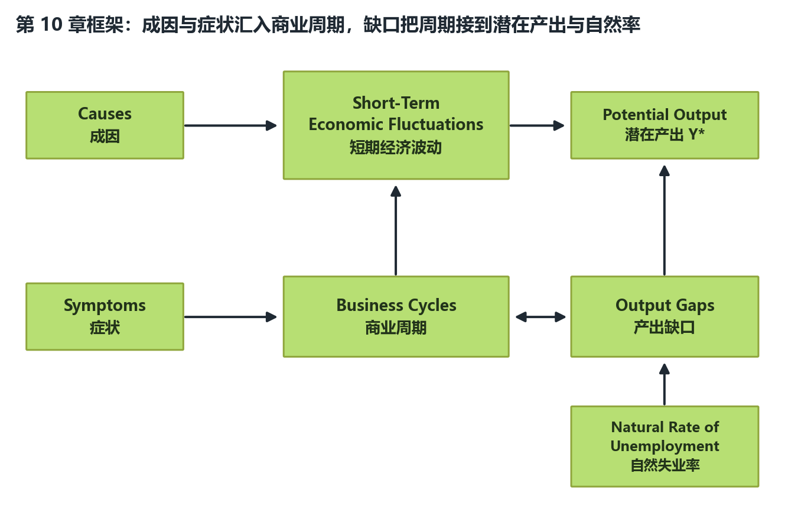

*图 18　全章框架：七个方框六组连接。成因（Causes）指向短期经济波动，症状（Symptoms）指向商业周期，商业周期向上指向短期经济波动，短期经济波动向右指向潜在产出 $Y^*$；产出缺口与商业周期之间是**双头箭头**，产出缺口向上指向潜在产出，自然失业率向上指向产出缺口。按课件 p.48 的框架图重绘（原图是七个浅绿方框压在位图之上、文字另成一层，重绘时补了中文对照与标题句）；出处 p.48。*

七条边逐条翻译成本章的论证，每条都能在正文里找到一个具体的兑现处：

| 连接 | 它在说什么 | 兑现的节 |
|---|---|---|
| 成因 → 短期经济波动 | 价格要时间调整 + 总支出会动，两者相乘产生波动 | §十四 |
| 症状 → 商业周期 | 失业、投资、消费、通胀的表现用来**认出**周期 | §六、§七、§八 |
| 商业周期 → 短期经济波动 | 周期是波动的具体形状（峰、谷、扩张、衰退） | §二、§三 |
| 短期经济波动 → 潜在产出 | 要衡量波动，必须先有那条不波动参照线 | §九 |
| 产出缺口 ↔ 商业周期 | **双头**：周期阶段决定缺口的符号，缺口大小量化周期的深度 | §十、§十三 |
| 产出缺口 → 潜在产出 | 缺口是相对于 $Y^*$ 定义的，分母就是它 | §十 |
| 自然失业率 → 产出缺口 | $u$ 与 $u^*$ 的差经奥肯定律换成缺口 | §十一、§十二 |

### 18.2 这张框架没有画的东西，比画了的东西更有信息量

**第四节（Cures）没有被画进这张框架。** 而目录（Roadmap）的四节里恰恰**有 Cures、没有 Causes**——框架图反过来**有 Causes、没有 Cures**。两张官方结构图互为补集，这个错位不是排版疏忽：

- 目录的四节是**教学顺序**（先认形状、再看症状、再量缺口、最后讲处方）；
- 框架图的七框是**概念依赖**（成因是输入，处方不是概念而是行动）。

但更实质的读法是：**处方与这张框架之间其实有一条现成的边没画出来**——从「产出缺口」出发、指向「政策调整支出/利率」的那条边。按 §十四 与 §十六 的逻辑，成因二一旦承认，处方就已经写好了（adjust government spending to close the output gap）。这条边是我加的读法，材料没有画（我的补充，非讲义内容）。

### 18.3 用这张图自测

合上笔记，只看这七个框名，能不能依次说出：① 缺口的分母是谁；② 奥肯定律把哪两个框连起来、系数多少；③ 自我修正的两步各是什么；④ 为什么「症状」能判定周期而不能解释周期。四问的答案分别在 §10.1、§十二、§15.1–15.3、§六 开头那句「症状是医学意义上的用法」。四问全对，这一章的量化工具就齐了；第④问答错，说明把相关当成了因果——那是 §12.5 第 4 条失败情形。

**练习（我的补充，非讲义内容）**：如果要把「政策」作为一个第八个框加进这张图，它应该指向谁、被谁指向？至少给出两条边。

> [!TIP] 参考答案
> 至少三条：（1）**产出缺口 → 政策**（政策的目标变量是缺口，§十六 的两类处方都是「关闭缺口」）；（2）**政策 → 总支出 → 产出缺口**（政策不直接作用于产出，它先移动总支出，再经成因二作用到缺口——这条边强调「中间隔几层」，§16.1）；（3）**潜在产出 → 政策**（如果缺口其实来自 $Y^*$ 下移，处方要换成增长政策，§9.3 第 1 条与 §14.4 的 IMPORTANT）。第三条最容易被漏，而它正是本章框架与政策实践之间最大的裂缝：**这张框架没有告诉决策者该用哪一类处方，因为缺口的大小无法区分两种成因**。

---

## 十九、速查表与易错点

**怎么用这三张表。** 把它们当 §十八 那张框架图（图 18）的索引来背：七个框里，「潜在产出」「产出缺口」「自然失业率」三格对应 19.1 的六个量，「商业周期」对应 19.2 的换算，「成因」对应 §十四 的两条，「症状」对应 §六与§七。任何一格想不起来，就回到图 18 那个框，顺着它的箭头找它连到谁——箭头指向的就是兑现它的节（18.1 那张七行表就是箭头的清单）。图 18 没有画的那条「缺口 → 政策」的边，正好是 19.4 第 10 个坑的位置。

### 19.1 一张符号表：这章只有六个量

| 符号/术语 | 中文译名 | 一句话定义 | 是观测值还是估计值 | 定义处 |
|---|---|---|---|---|
| $Y$ | 实际产出 | 当期生产出来的实际 GDP | 观测（会修订） | §三、§九 |
| $Y^*$ | 潜在产出／充分就业产出 | 正常强度下**最大可持续**产出 | **估计** | §九 |
| 缺口 | 产出缺口 | $(Y-Y^*)/Y^*\times100$，负为衰退性、正为扩张性 | 估计量之比 | §十 |
| $u$ | 失业率 | 劳动力中失业者的比例 | 观测（月度） | §六 |
| $u^*$ | 自然失业率 | 摩擦性 + 结构性失业，即 $u^{\text{cyc}}=0$ 时的 $u$ | **估计、随年代漂移** | §十一 |
| $u^{\text{cyc}}$ | 周期性失业 | $u-u^*$ | 估计量之差 | §十一 |
| 奥肯关系 | 奥肯定律 | 水平式：缺口 $\approx -2\,u^{\text{cyc}}$；增长式：$\Delta u=a+b\,g$ | 经验规律，系数不稳 | §十二 |

三个恒等关系要能默写：$Y=Y^* \Leftrightarrow u=u^*$；$u^{\text{cyc}}=u-u^*$；$u^*=u^{\text{fric}}+u^{\text{struct}}$。符号方向最容易写反的是第三条链：**负缺口（衰退）必须配正的周期性失业**。

### 19.2 三个能当场算的换算

| 给什么 | 求什么 | 算法 | 例（本章算过的） |
|---|---|---|---|
| $Y$、$Y^*$ | 缺口 % | $(Y-Y^*)/Y^*\times100$ | $14.5/15.0 \to -3.33\%$ |
| $u$、$u^*$ | 缺口 % | $-2\,(u-u^*)$ | $9.5\%-4.8\% \to +4.7\text{pp} \to -9.4\%$ |
| 缺口 % | $u$ | $u^* - \text{缺口}/2$ | $-3.5\% \to u^{\text{cyc}}=1.75\text{pp} \to u=6.25\%$（$u^*=4.5\%$） |
| 缺口金额、人口 | 人均摊 | 金额 ÷ 人口 | $1.2\text{万亿}/3.09\text{亿}=3{,}883.5$ 美元 |
| 缺口金额、$Y^*$ | 缺口 % | 金额 ÷ $Y^*$ | $-1.2/15 \to -8.00\%$ |
| 回归式 $y=bx+a$ | 失业不变所需增速 | $x^*=-a/b$ | 美国面板 $1.0827/0.3671=2.95\%$ |

### 19.3 数字锚点（背下这十二个，本章的量化题就有尺子）

| 锚点 | 数值 | 出处节 |
|---|---|---|
| 1929–1933 实际 GDP 变化 | −28.8%（43 个月，年化约 −9.04%） | §3.3 |
| 2007–2009 | 18 个月、失业率 10.0%、GDP −4.1% | §3.3 |
| 14 次衰退的持续月数 | 均值 13.21、极差 6–43、标准差 9.28 | §5.2 |
| 衰退占 1929-08 至 2009-06 的比重 | 185/958 = 19.3% | §5.2 |
| 美国失业率历史峰值 | Apr 2020 的 14.8%；1982 年约 10.6% | §6.2 |
| 投资与消费的相对波动（美国） | 标准差比 2.3 倍 / 0.93 倍 | §7.1 |
| 美国自然率估计 | 1979 年 6.3% → 2007 年 4.8%（降 1.5pp、相对 23.8%） | §11.3 |
| 16–24 岁人口占比 | 25% → 15%（降 10pp、相对 40%） | §11.4 |
| 奥肯系数（本章口径） | 2（1pp 周期性失业换 2% 缺口） | §12.1 |
| 美国面板的 $1/\lvert b \rvert$ 与 $R^2$ | 2.72、0.5957（日本 50、0.0685） | §12.4 |
| 2010 年美国缺口 | −1.2 万亿 = 人均 3,883.5 美元 | §十三 |
| 1999–2000 加息与随后的降息 | +150 个基点 / −550 个基点 | §16.2 |

### 19.4 十个坑

1. **缺口的分母是 $Y^*$，不是 $Y$。** 误用 $Y$ 在衰退时**夸大**缺口绝对值（−3.33% 变 −3.45%）。
2. **正号不是好消息，负增长不等于缺口为负。** 复苏早期缺口仍是负的；实际增速等于潜在增速时缺口**永不关闭**（§15.4 情形 B）。
3. **衰退有两套定义、扩张有两套用法。** 「连续两季负增长」是经验法则；「显著低于正常」是教科书定义。NBER 日期里的 expansion 意思是「不是衰退」，不是「增速高于正常」。
4. **$u^*$ 不是常数，也不是「最优失业率」。** 同一个 1979 年的 $u=5.9\%$，配 $u^*=6.3\%$ 得扩张性、配 $4.8\%$ 得衰退性——**符号翻转**。
5. **奥肯系数 2 是水平式，图 13 与图 14 的斜率是增长式。** $-0.3671$ 与 $2$ 不是同一个数，别互相代入。
6. **系数 2 不能跨国用。** 日本面板的 $1/\lvert b \rvert = 50$，用 2 去推会把量级错 25 倍。
7. **顺周期 ≠ 幅度更大。** 投资是「顺周期且极波动」，消费是「顺周期但平滑」，这是两条陈述；「消费更平滑」跨国并不总成立。
8. **通胀下降（disinflation）不是价格下降（deflation）。** 通胀从 3% 降到 2%，两年后价格水平仍高 5.06%。自我修正承诺的是前者。
9. **本章表格里有两列口径判不出**：「实际 GDP 变化」（三行为正）与「最高失业率」（与月度序列三种读法都对不上）。**不要用它们反算缺口**，也不要用来论证「衰退期 GDP 一定下降」。
10. **缺口的大小无法区分「$Y^*$ 下移」与「支出不足」。** 同样是 −8%，一个该用增长政策、一个该用支出政策；本章给了缺口却没给判别方法（§14.4）。

### 19.5 考前 60 秒自测

合上书回答：① 缺口公式的分母是谁？② $Y=Y^*$ 时失业率等于什么？③ 奥肯定律的两个版本各自的系数？④ 自我修正的两步分别沿哪条线走？⑤ 为什么 1999 年才加息而不是 1997 年？⑥ Lisa 扩产的条件是什么？

> [!TIP] 参考答案
> ① $Y^*$（潜在产出，估计值）。② $u^*$（= 摩擦性 + 结构性，通常 4%–6%，不是零）。③ 水平式系数 2；增长式斜率 $-0.71$（8 季窗口）到 $-0.3671$（美国年度面板）。④ 第一步沿**水平线**（通胀不动、产出变），第二步沿**新的 AD 曲线**（通胀降、产出回升）。⑤ 因为 1997–98 年生产率提升与国际竞争压住了通胀，央行的扳机是通胀而不是缺口。⑥ 扩产不抬高**平均成本**（临界固定成本 390，或 120 件时 360）。

---

## 二十、附：诚实备注

### 20.1 我发现的课件问题（编号；⚠️ = 会影响做题答案）

| 编号 | 课件位置 | 原文／现象 | 应为与判据 |
|---|---|---|---|
| 1 ⚠️ | p.9 表 5/37 行 | 谷底 5/38、下一次扩张 80 个月 | 两者不能同时成立：5/38 → 2/45 是 81 个月；若谷为 6/38（现行为 NBER 口径）则 80 成立。判据：逐行月份差复算，13 行里 12 行吻合 |
| 2 ⚠️ | p.9 表第 5 列 | 「Change in Real GDP」三行为正（+2.3、+0.1、+0.8） | 若真是峰到谷的累计变化，衰退期内不可能为正。两种读法：（A）谷底年份的同比增速；（B）原表列错位。**判不出**，列名没给口径 |
| 3 ⚠️ | p.9 表第 4 列 | 「Highest Unemployment Rate」与月度序列方向不一致：1948–49 低 1.29pp、1981–82 低 0.89pp、1990–91 高 0.73pp | 三种读法（谷底年份年均／衰退期内月度峰／衰退之后数年内的峰）各能解释一部分。**判不出** |
| 4 | p.9 表 2/45 行 | 失业率 3.9% | 疑为「谷底之后一年」口径；判据：战时结束前后失业率极低，与史实量级不符，但材料未给口径 |
| 5 | p.13 | 标题写 2002–2013，横轴第一个刻度是 2001 且画有点 | **判不出**作者要哪个区间；引用时把 2001 也读进去，别说「数据从 2002 开始」 |
| 6 | p.18 | 标题 1960–2020，来源链接的 slug 是 `19602016`、年份标注 (2016) | 两种读法：图后来更新、链接没改（更可能，2020 年三个负值都在序列里）／标题写错 |
| 7 ⚠️ | p.19 | 印度那张图的来源链接 URL 里是 `...-in-the-us-...` | 应为 India 版同名链接。判据：同一条 URL 出现在分别画美国与印度的两页上 |
| 8 | p.20 | 「Inflation generally decreases during a business cycle」与自家序列冲突两次（1969–70、1973–75 通胀在衰退中上升） | generally 的措辞不算错；判据：讲师自己在同一条序列上用红圈标出了这些「见顶在衰退前」的位置 |
| 9 ⚠️ | p.28 | 6.3%（1979）、4.8%（2007）与「4.5% 或更低」并排在 Natural Rate 标题下 | 前两个与那两个年份的**实际**失业率读数几乎重合，第三个明确是推测（could be）；属口径混用 |
| 10 | p.31 | `cyclic unemployment`、`an recessionary gap`；标题句说「变化对变化」、算例却是「水平对水平」 | 应为 cyclical、a recessionary；两个版本只差常数项，但系数不同，做题必须分清 |
| 11 ⚠️ | p.33 | 「strong and stable in most economies」 | 与自家六个面板不符：$R^2$ 从 0.0685 到 0.5957（8.7 倍）、$1/\lvert b \rvert$ 从 2.72 到 50（18.4 倍），日本与马来西亚斜率近零。判据就是同页印出的六个数 |
| 12 | p.34 | 人均 4,000、四口之家 16,000 | 精确值 3,883.5 与 15,534，两处同向偏高 +3.0%（绝对差 116.5 与 466 美元）；属量级圆整，但方向要记 |
| 13 ⚠️ | p.34 与 p.27 | 缺口 −1.2 万亿美元，与 $u^{\text{cyc}} = 4.7$pp（按系数 2 → 缺口 −9.4%）并列 | 反推 $Y^* = 12.77$ 万亿，低于当年实际 GDP 量级；两个数来自不同估计体系，不能串联使用 |
| 14 ⚠️ | p.40 | 手写层一条曲线既标「AD3」又标「SRAS」；沿它的小箭头指向右下 | **判不出**，两种读法是 $AD_3$ 与 SRAS（该框架的水平线已经是短期总供给）；箭头方向与自我修正逻辑（应向左上）相反 |
| 15 | p.36、p.42、p.46 | `Changes ... affects`、`cyclical unemployment rates`、`does not raises` | 主谓不一致与措辞冗余（cyclical unemployment 本身是百分点差，不该再叫 rate） |
| 16 | p.2、p.3、p.48 | 目录四节有 Cures 无 Causes；框架图有 Causes 无 Cures；学习目标说「四个阶段」但正文从未列出 | 结构不一致而非内容错误；两张官方结构图互为补集，按 §十八 的读法处理 |
| 17 | p.7、p.10、p.34 | 两张 GDP 图基年不同（2005 与 2009 美元）；`declared a recession December 2007` 没说是回溯定月还是当时宣布；2010 年缺口的估计方法全程未给 | 三类欠交代，读图与引用时必须自己补口径，不能默认它们可比 |

### 20.2 我算出来或补出来的东西

**算出来的数**（逐条指回正文）：峰谷与扩张的逐行月份差、14 次衰退的均值 13.21/标准差 9.28/变异系数 0.70、衰退占比 19.3%、大萧条年化 −9.04%、事后预测表七次误差、失业率列与月度序列的 11 行对照、三部分增速序列的数字化标准差比、通胀与衰退日期的 6 行检验、$u^*$ 漂移的符号翻转表、六国面板的 $x^*=-a/b$ 与 $1/\lvert b \rvert$、五种平摊口径、$Y^*$ 三假设下的缺口、自我修正所需增速 3.05% 对 2%、缺口 4.2 年关闭、+150/−550 个基点、Lisa 的 AC 与临界固定成本 390/360。全部由 `.qoder/inventory/calc_Ch10.py` 跑出，输出在 `_calc_ch10_out.txt`。

**补出来的内容**（材料没有）：价格黏性、有效需求、滞后效应、双底衰退、无就业复苏、利率走廊、规模报酬这些术语名；14.1 的局部均衡小例、15.4 的速度分析、17.4 的成本表、17.6 对「可预测 vs 不可预测」的解法、18.2 里「政策 → 缺口」那条材料没画的边；八、十五、十六、十七各题的解答（材料只出题不给答案）。

**图的情况**：图 15、16、18 按课件对应页示意重绘（原页是方框示意或叠字示意图，重绘时补了中文对照与标题句），其余 15 张按原图裁切。**没有一张图的数据是我编的**；15.4 与 17.4 两张表是算例，正文已就地标明参数自造。

### 20.3 数值核验：哪些数敢用、用到什么精度

- **目测读数一律标了不确定度**：失业率月度对照表 ±0.2pp、三部分增速数字化 ±1pp（尖峰处偏低）、图 13 拟合线端点与图 14 红点坐标 ±0.5。凡靠目测得到的数，正文只做定性或量级判断，不进任何结论性的减法。
- **图 13 的斜率 $-0.71$ 与截距**：材料没印方程，我按放大后的端点读，截距在 $+2.3$ 到 $+2.7$ 之间、与横轴交点在 3.3 到 4.0 之间，两种读法给出的斜率都是 $-0.7$ 量级，所以正文只说「约 $-0.71$、不过原点」。
- **图 14 美国面板 2009 红点的横坐标读到 $-2.5$ 与 $-5.1$ 两种**：两种读法代入回归式得 +2.0pp 与 +3.0pp，红点实际约 +3.5pp，**结论（在线上方、比预测更糟）不变**，所以不强行选一个。
- **六国回归式与 $R^2$ 是图 14 印出来的**，逐格抄录；$x^*$ 与 $1/\lvert b \rvert$ 是我由式子反算的，材料没给。
- **外部参照参数**（2010 年户均 2.6 人、就业 1.39 亿、失业 1,480 万、实际 GDP 13 万亿量级）：材料没给，只用于把「分布不均」与「口径不自洽」量化，正文每处都就地标注。

### 20.4 与上一讲的对账

第 9 章笔记结尾的原话是：**「④ 与第 10 章以后：货币中性在长期成立、短期不成立，这条分界线就是 AD-AS 模型的入口」**，同一份备注的「不够的部分」里还写着「短期非中性只有一句话（`Money can have important real short-run effects`）……所以本讲结束时，你对『长期中性』有完整论证，对『短期非中性』只有一个断言」。逐条判定：

- **「分界线」本身：命中。** 本章把这条线讲成两句可复述的陈述（§15.2 三句、§17.5 两句），并给出成立条件（价格黏性，§14.2 与 §17.3）。第 9 章的断言在这里变成了有机制的一半。
- **「AD-AS 模型的入口」：部分命中。** 材料给了 $(\pi, Y)$ 空间的三件套（竖直 $Y^*$、水平当前通胀线、下凸需求曲线）与一次冲击的完整路径，但没有命名 AD 与 AS、没有推导需求曲线为什么向下倾斜（缺利率渠道）、没有政策反应。门开着，房间在第 13 章。
- **「货币中性」这个词：未命中。** 本章全程不提货币，分界线是用产出与通胀的语言重述的。这不是缺点，是分工，但读者若期待本章解释「为什么货币短期非中性」，本章没有。
- **第 9 章自己承认的最大空洞（货币需求缺席）：本章没有补，也不该由它补。** 本章连利率的确定机制都没讲，只在 §十六 用「利率目标」这个更贴近现实的口径替换了准备金供需语言，并在那张利率序列里留下走廊制的痕迹（区间上下沿两条线、旧序列停更）。**正面回答：这个洞要到第 12 章才补。**

### 20.5 本讲的够与不够

**够的三块。** ① **定义层**：衰退的两套判据、四阶段与六个词的归位、缺口的符号与分母、$u^*$ 与 $Y^*$ 的绑定，每一条都能直接答题。② **量化层**：从 1929 年到 2009 年的 14 次衰退全部排成可复算的表，缺口—周期性失业—奥肯系数三量可以互相换算。③ **诚实层**：跨国证据用六个面板自己否证了「strong and stable」，材料没有回避自家数据。

**不够的四块，按重要性排。** ① **$Y^*$ 怎么估出来，全章零交代**，而它是本章所有比值的分母（§9.4）。② **自我修正的传导机制缺失**：只画了路径、没给「通胀降 → 产出升」的原因，也没给速度（§15.3、§15.4）。③ **政策只有方向没有强度**：没有乘数、没有时滞参数、没有「调多少」，所以本章无法回答「该不该救」，只能回答「救的是哪一类缺口」。④ **供给冲击没有位置**：1970 年代那两次滞胀在本章框架里是反例而不是对象，成因二说支出是「主因」，但材料没给非支出冲击的处理方式。

**下一步该补什么。** 第 11 章补「支出怎么变成产出」（乘数与加速机制，§7.1 第 4 条留的钩子）；第 12 章补「利率怎么被决定」与货币需求（第 9 章的空洞）；第 13 章补 AD/AS 的推导、供给冲击与自我修正的完整机制（本章 ②④ 两个洞一起补）。

**复习顺序（约 90 分钟）。** 先默写 19.1 的符号表与三条恒等关系，检查符号方向；再做 §十、§十一、§十二 的六道题（缺口 → 周期性失业 → 奥肯换算是一条链，必须一气算完）；然后拿 §3.3 那张 14 行表，自己复算第 3 列与第 6 列的月份差，并说出哪三行的第 5 列是正数、为什么不能用；接着读 §十五 的三步（15.1 的 disinflation 算术、15.3 的图、15.4 的速度表），能画出 $(\pi,Y)$ 的 $A\to B\to C$ 并说明每段沿哪条线走；最后用 §十七 的 Lisa 五步（产能→需求→定价→扩产条件→宏观教训）自问自答一遍短期/长期的分界。**做完这五件事，本章的量化题与概念题都够了；论述题（该不该干预）本章不够，要等第 11 与第 13 章。**
