# ECO2021 课堂笔记：第 11 章　支出、产出与财政政策（Spending, Output, and Fiscal Policy）

> 对应课件：Chapter 11, *Spending, Output, and Fiscal Policy*（Instructor: Jieshuang He），共 **60 页**，页脚编号就是 `2`…`60`（封面 p.1 无页码），与本笔记的 p 号**一一对应，没有偏移**
> 本讲**无课堂口述记录**，正文基于课件（PDF）整理；课件只给题目不给答案的地方（第 12 页那道 Practice 选择题）我给了自己的解答并标注「我的补充，非讲义内容」
> 本章是全课程**乘数与财政政策的主场**：第一次出现 $PAE$、第一次出现 45° 线图、第一次出现 $1/(1-mpc)$，也是第一次把「产出由需求决定」当成一个可以代数求解的模型来推
> 一句话主线：**价格短期不动 ⇒ 企业只能靠存货吸收需求的意外 ⇒ 于是产出由计划总支出决定 ⇒ 一笔自主支出的变动会被消费逐轮放大成好几倍的产出变动（乘数）⇒ 政府如果能恰好补上那个缺口，就能把产出推回潜在水平——但这一串推理里有四个前提，每一个在现实里都会打折**
> 阅读前提：只需要第 4 章那套核算恒等式 $Y = C + I + G + NX$（实际支出恒等于产出）与「实际 GDP / 潜在产出」这两个词。本章要做的第一件事，就是把第 4 章那个**事后恒等式**改成一个**事前方程**。

---

## 〇、本讲地图

正文严格按课件页序铺开，迷路时回到这张表定位。全章 60 页切成十二节正文 + 一节速查，**页区间首尾相接、不重叠、不遗漏**。

| 本章小节 | 对应讲义页 | 这一节在回答什么问题 |
|---|---|---|
| 一、动机：大萧条与凯恩斯的提问 | p.1–p.6 | 为什么「总花钱的人不够多」本身就能酿成一场灾难；1920–30 年代那套常规政策为什么治不了它 |
| 二、凯恩斯模型的三条假设 | p.7–p.8 | 为什么短期里产出由需求决定：价格既定 + 企业先定价后接单 + 改价有菜单成本 |
| 三、计划总支出 PAE 与非计划存货 | p.9–p.14 | $PAE = C + I^{P} + G + NX$ 从哪来；计划与实际之间的差额由谁吸收 |
| 四、消费函数与边际消费倾向 $mpc$ | p.15–p.23 | 消费为什么平滑、自主消费 $\bar C$ 由什么决定、斜率怎么读怎么算 |
| 五、投资、政府购买与净出口 | p.24–p.28 | 另外三条腿各由什么驱动，为什么投资比消费抖得多 |
| 六、支出线与短期均衡 | p.29–p.34 | $Y = PAE$ 这个方程怎么解、45° 线图怎么读 |
| 七、偏离均衡的调整机制 | p.35–p.36 | 产出高于/低于均衡时，存货如何把产出推回去 |
| 八、衰退缺口与收入—支出乘数 | p.37–p.44 | 自主支出少 10 元，为什么产出少 50 元；几何级数与 $1/(1-mpc)$ |
| 九、财政政策：政府支出、税收与转移支付 | p.45–p.53 | 补 50 元缺口：花 10 元还是减 12.5 元税；2001 退税与 2008–09 刺激法案 |
| 十、财政政策的四个限制 | p.54–p.57 | 供给面效应、赤字负担、立法时滞，以及不用开会就自动起作用的稳定器 |
| 十一、附录：凯恩斯 vs 古典的两套假设 | p.58–p.59 | 同样面对衰退，两派从不同假设各自推出什么政策结论 |
| 十二、速查表与易错点 | p.60 | 全章框架图 + 三张表 + 十个坑 |
| 十三、附：诚实备注 | — | 课件哪里有问题、我复算了什么、这一讲哪里讲够了哪里没讲 |

**这份笔记的读法。** 术语第一次出现一律给「中文译名 + 英文原名 + 一句话定义」，括注里的英文是课件原名，考试与作业请以英文术语为准。课件给了数字的地方我保留原数字并交代口径；凡我复算、推导或补充的内容集中在第十三节逐条交代，正文里只在三类地方加标记：**课件没给答案的练习题**（标「我的补充」）、**课件内部口径对不上、需要并排摆出来的地方**（用 `[!WARNING]` 或 `[!CAUTION]`）、**我按本章模型反推的现实数字**（明确标「非讲义内容」）。

> [!IMPORTANT] 本章只有四个数需要记
> 全章的算例其实只有一套参数：$\bar C = 620$、$mpc = 0.8$、$T = 250$、$I^{P} = 220$、$G = 300$、$NX = 20$（单位：十亿美元，出自课件 p.30）。它们合成一条支出线 $PAE = 960 + 0.8Y$，均衡产出 $Y = 4{,}800$。后面每一次冲击、每一个政策、每一个乘数，都是在这条线上动一个数字。**把这四个数与两个结果（960、4,800）背下来，本章的计算题就只剩「改哪个数」这一件事。**

---

## 一、动机：大萧条与凯恩斯的提问（p.1–p.6）

### 1.1 先看一张漫画（p.1）

封面不是装饰。课件选了一幅《Tribune-Review》的政治漫画：一位圣诞老人的形象驾着雪橇从雪坡上冲下来，雪橇侧面写着 `GOVT.`，身后拖着一只鼓胀的麻袋，袋上写 `SPENDING`；前面两只驯鹿各驮一只小包，分别写着 `TAX` 和 `PAYER`；背景是飘雪，左上角是作者签名。

这幅画里没有一个数字，但它把本章要处理的三件事全画进去了：**支出（麻袋）一旦装上雪橇就自己加速、税收与纳税人（驯鹿）被拖着跑、而且没有人踩刹车**。本章第一节讲雪橇为什么会加速（乘数），第九节讲谁能踩刹车（财政政策），第十节讲刹车为什么踩不灵（四个限制）。

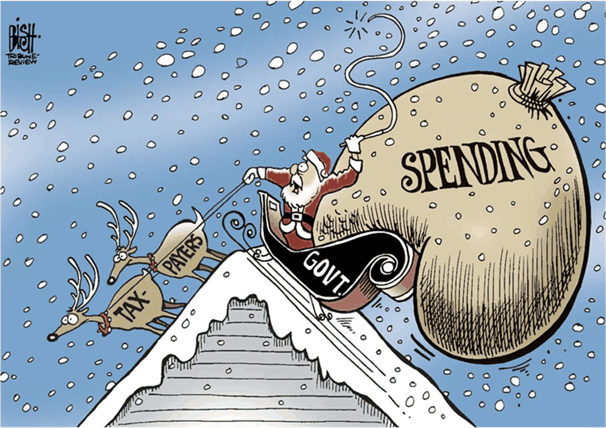

*图 1　封面漫画：雪橇写 `GOVT.`、麻袋写 `SPENDING`、两只驯鹿分别写 `TAX` 与 `PAYER`。它给全章定调——支出会自己加速，而税收与纳税人是被拖着的那一方。（按原图裁切，未重绘；出自讲义 p.1，作者署名 BISH）*

### 1.2 大萧条带来的三个新问题（p.4）

课件用大萧条做引子，列了三条观察，每条都是**旧理论解释不了**的：

1. **可用的资源在闲置**（Available resources are unemployed）。工厂在、工人在、机器在，东西却没在生产。按古典的「供给自己创造需求」逻辑，这不该发生。
2. **公众花钱的意愿或能力下降了**（Public's willingness or ability to spend declines）。注意课件把「不想花」与「没钱花」并列——它要说的不是货币消失，而是**支出决策本身塌了**。
3. **支出下降直接压低生产，而被裁掉的工人又要减少支出**。课件在这里给了一个循环：`A decrease in spending leads to lower production` → `Laid-off workers reduce their spending` → `Insufficient spending to support the normal level of production`。

第三条是本章的种子。**支出与产出互为因果，形成一个能自我强化的环**——这正是第八节乘数的雏形：一笔 10 元的支出减少，会因为「少赚的工人少花」而变成 50 元的产出减少。

课件接着说，1920–30 年代的常规经济政策解决不了这个问题（`Conventional economic policy of the 1920s and 1930s would not solve this problem`），并点出约翰·梅纳德·凯恩斯（John Maynard Keynes）因此革新了经济思想与公共政策、开创了宏观经济学这个领域。

**为什么「资源闲置」是个难题。** 微观上，一家店卖不掉货是因为它要价太高或东西不好；把一千个这样的解释加起来，就得不出「整个经济卖不掉货」的理由。**总量层面出现「有人想做、有设备、有原料，但三者就是凑不到一起」，需要一个总量机制来解释**——本章给的机制是：一个人的支出就是另一个人的收入，支出塌方会让收入同步塌方，于是没有人有理由恢复生产。

### 1.3 凯恩斯其人（p.5–p.6）

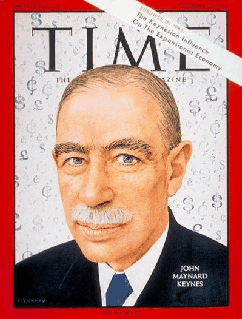

*图 2　《TIME》封面：红边框，刊名压在头像上方，右下角白字 `JOHN MAYNARD KEYNES`，右上角斜条写 `BUSINESS IN 1963 / The Keynesian Influence / On the Expansionist Economy`，背景铺满 `$` 与 `£` 符号。铺满的货币符号是这张封面的态度：凯恩斯的影响被理解成一件「关于钱该往哪儿花」的事。（按原图裁切，未重绘；出自讲义 p.5）*

课件给的三条人物信息，按年代串起来是：一战之后，这位英国经济学家就认为和约的条件会把欧洲推向另一场战争；他最著名的著作是 1936 年的《就业、利息和货币通论》（*The General Theory of Employment, Interest, and Money*）；这本书为政府支出、预算赤字、货币干预与**逆周期政策**（counter-cyclical policies）提供了理论支持。

然后是本章唯一一段必须会背的引文（课件 p.6 原文引用，我按原文保留关键一句）：

> "The long run is a misleading guide to current affairs. **In the long run, we are all dead.**"
> （长期是一个误导当下事务的概念。从长期看，我们都死了。）

课件接着补了后半句的意思：如果经济学家在暴风雨里只能告诉大家「等暴风雨过去海面会平」，那他们给自己派的是一个太轻松、也太没用的任务（原文 `too easy, too useless a task`）。

这句话在本章的作用不是修辞，而是**划界**：第 7、8、9 章讲的是长期——长期里供给、储蓄率、货币数量决定一切；本章讲的是**短期**，短期的问题是「需求不足时经济会停在一个低产出水平上自己不动」，所以长期结论帮不上眼下的忙。

课件 p.6 的要点还给了政策处方：衰退与萧条可能源于需求不足（`recessions and depressions can result from inadequate demand`），决策者应当移动总需求，而**政府支出或减税可以替代私人支出**（`Government spending or tax cuts can substitute for private spending`）。这两句就是第九节的全部动机。

**「替代」这个词比它听起来更强。** 课件说政府支出可以 *substitute for* 私人支出。本章模型里这句话说得通，是因为 $G$ 与 $C$ 在 $PAE$ 里是**并列的加数**，模型里没有任何机制让 $G$ 上升把 $I$ 或 $C$ 挤下去。**「挤出不完全」在本章是假设，不是结论**——挤出效应需要利率与可贷资金市场才能讨论，那是第 8 章的框架和第 12–13 章的接口。第十节讲限制时会回到这一点。

---

## 二、凯恩斯模型的三条假设（p.7–p.8）

### 2.1 先给定义：什么是总量支出模型（p.7）

课件给的定义（原文一句话，我照原样保留核心成分）：**总量支出模型（Aggregate expenditure model）是一个关注总支出与实际 GDP 之间短期关系、并假设价格水平不变（assuming that the price level is constant）的宏观经济模型**。

拆开看，这句话里塞了三件事，缺一不可：

| 成分 | 课件原话 | 它在模型里干什么 | 如果去掉会怎样 |
|---|---|---|---|
| 对象 | total spending and real GDP | 把「花多少」与「产多少」连起来 | 没有 $PAE$，乘数无从定义 |
| 期限 | short-run | 只谈几个季度到一两年内的调整 | 长期里价格会动，结论全部改写 |
| 关键假设 | the price level is constant | 让实际变量与名义变量分离，$P$ 变成外生常数 | 需求上升会先变成涨价而不是增产，本章的缺口分析立刻失效 |

课件还给了三条定位：它是当代短期波动与稳定政策理论的**构件**（building block）；**衰退发生在计划总支出低于充分就业所需水平时**（Recession occurs when planned aggregate spending is too low for full employment）；**稳定政策（Stabilization policies）** 则指用政府的财政政策与央行的货币政策去熨平 GDP。

注意第二条的定义方式：衰退不是「产出下降」，而是「产出低于某个应有的水平」。这个「应有的水平」就是潜在产出 $Y^{*}$，第八节会给它数值（4,800），并由此定义缺口。

### 2.2 短期里企业怎么定价（p.8）

模型需要一个微观基础来解释「为什么价格不动、只有产出动」。课件给的机制是两步：

第一步，**短期内企业按既定价格满足需求**（In the short run, firms meet demand at preset prices）。企业通常先定一个价，然后在短期内按这个价接单。

第二步，为什么企业不随时改价？因为**改价本身要花钱**。**菜单成本（Menu costs）** 是改变价格的费用（the costs of changing prices），课件列了三项：决定新价格本身（Determining the new price）、把新价格装进业务流程（Incorporating prices into the business）、通知消费者新价格（Informing consumers of new prices）。

这三项的共同点是**它们与改价的幅度无关，只与「改」这个动作有关**。所以只要企业觉得改价带来的收益小于这笔固定成本，它就会维持原价、用产量去适应需求——**价格黏性（price stickiness）的微观理由就在这里**。

**本章的因果方向：需求定产出。** 第 4 章的恒等式 $Y \equiv C + I + G + NX$ 是**事后**的：不管发生什么，实际产出与实际支出必然相等，差额由存货投资补平。本章把同一批符号改成**事前**的方程：$PAE$ 是人们**打算**花多少，$Y$ 是企业**打算**产多少，两者可以不相等——不相等的那部分变成非计划存货，并通过存货反过来修改下一期的 $Y$。
**短期里 $Y$ 由 $PAE$ 决定**这句话的全部含义就是这个反馈回路；它只在价格不动的前提下成立。

### 2.3 三条假设的失败情形

把这三条假设一条条抽掉，能看清它们各自在撑什么：

**抽掉「价格不变」。** 若 $P$ 完全弹性，需求上升 10% 只会让价格上升 10%，产出与就业一点不动——本章整节的乘数会全部变成通胀，第九节的财政政策也就毫无意义。这正是第 9 章末尾说的「货币长期中性」的样子。

**抽掉「菜单成本」。** 若改价免费，企业会随时把价格调到出清水平，存货不会非计划累积，第七节的调整机制（存货 → 减产）就不会启动，产出会由供给面直接给定。

**抽掉「短期」这个时间窗。** 长期里工资与合同会重签、产能会退出，经济回到潜在产出——这就是第十一节古典那一侧的立场。

**小例子（我的补充，非讲义内容，全部可手算）。** 设某企业价格固定，需求从 100 件降到 90 件。若每件售价 10 元、成本 8 元，则它少卖 10 件就少赚 20 元；把价格降到 9 元能卖回 100 件，多卖 10 件赚回 10 元，但每件降价 1 元使原来 90 件也少赚 90 元，净效果 $+10 - 90 = -80$ 元。**所以即便改价免费，这家企业也不该降价**——课件用菜单成本解释「不改价」，其实更强的一般理由是「降价对全部销量都有效，涨价/降价的收益只体现在增量上」。这一点课件没讲，是本章第一个空洞。

**练习 1（我的补充，非讲义内容）。** 「价格水平不变」这个假设，为什么让本章的 $Y$ 必须是**实际** GDP 而不是名义 GDP？

> [!TIP] 参考答案
> 因为 $P$ 被固定成常数，名义支出 $P \times Y$ 的变化就完全等于 $Y$ 的变化，两者只差一个常数比例，用哪个都不影响结论；但为了让 $C$、$I^{P}$、$G$、$NX$ 这四个加数**能相加**，它们必须都是实际量（同一年的价格衡量），否则 $PAE$ 里混进了价格变动，$Y = PAE$ 解出来的就不是物量。第 4 章「只有实际 GDP 反映物量」那条结论在这里被当成前提用了。

---

## 三、计划总支出 PAE 与非计划存货（p.9–p.14）

### 3.1 从一家风筝厂开始（p.10）

在给出 $PAE$ 的定义之前，课件先给了一家虚构公司 **Fly-by-Night Kite** 的账目。这个数字很小、可以手算，而且它把本章最难的那个概念（非计划存货）一次讲完，所以先把它算清楚，再回头写定义。

已知（单位：百万美元）：这家厂**每年生产 5.0** 的风筝；它**预计能卖 4.8**；因此它**计划让存货增加 0.2**；此外它另外**计划支出 1.0 购置资本品**（厂房设备）。

于是**计划投资总额** $I^{P} = 0.2 + 1.0 = 1.2$。请注意这里的关键一步：**存货的增加在国民核算里算投资**，因为生产出来却没卖掉的风筝仍然是当期的产出，它的「买家」就是生产者自己。第 4 章讲支出法时给过这条补丁（存货投资是让「生产 = 支出」成立的那块补丁），本章把它升级成主角。

现在让实际销量变化，看会发生什么（下表是我按课件 p.10 的三段文字整理的，课件只给文字没给表；单位：百万美元）：

| 情形 | 产量 | 实际销售 | 计划存货增加 | 非计划存货投资 | 资本支出 | 计划投资 $I^{P}$ | 实际投资 $I$ |
|---|---|---|---|---|---|---|---|
| 基准（预期兑现） | 5.0 | 4.8 | +0.2 | 0 | 1.0 | 1.2 | 1.2 |
| 销售低迷 | 5.0 | 4.6 | +0.2 | **+0.2** | 1.0 | 1.2 | **1.4** |
| 销售超预期 | 5.0 | 5.0 | +0.2 | **−0.2** | 1.0 | 1.2 | **1.0** |

三行都能一步验算。非计划存货投资 $= \text{产量} - \text{实际销售} - \text{计划存货增加}$：第二行 $5.0 - 4.6 - 0.2 = +0.2$（仓库里比打算多堆了 0.2）；第三行 $5.0 - 5.0 - 0.2 = -0.2$（打算留的存货被顾客买走了）。实际投资 $I = I^{P} +$ 非计划存货投资，于是 $1.2 + 0.2 = 1.4$、$1.2 - 0.2 = 1.0$，与课件给的三个数完全一致。

由此得到本章最重要的一个关系式：

$$I = I^{P} + \Delta Inv^{unplanned}$$

**非计划存货投资（unplanned inventory investment）** 指企业并没有打算增、减，却因为销售与产量不匹配而被动发生的存货变动。它可以是正的（货卖不动，堆在仓库），也可以是负的（货被抢空，吃掉存货）。

> [!CAUTION] 符号方向是本章第一大坑
> 「非计划存货**增加**」对应的是**卖不出去**，也就是 $GDP > PAE$；「非计划存货**减少**」对应的是**供不应求**，也就是 $PAE > GDP$。第 4 章的坑七「存货投资可以为负」在这里变成判断题的开关：一旦把方向记反，第七、八两节的调整机制会全部说反。判断方法只有一个：**先问「生产出来的东西比人们打算买的多了还是少了」，多了就是存货被塞满（正），少了就是存货被掏空（负）**。

### 3.2 计划总支出：定义与四个成分（p.9、p.11）

**计划总支出（Planned aggregate expenditure, 简称 PAE）** 是对最终商品与服务的**计划**支出总额（total planned spending on final goods and services）。课件给四个成分：

| 成分 | 英文原名 | 一句话定义（按课件 p.9） | 本章怎么处理 |
|---|---|---|---|
| $C$ | Consumption by households | 家庭消费 | 由消费函数给出，是 $Y$ 的函数（第四节） |
| $I^{P}$ | Investment | 国内企业对新资本品的**计划**支出 | 当成自主支出，加非计划存货这一项 |
| $G$ | Government purchases | 联邦、州与地方政府购买商品与服务 | 当成自主支出（第九节的政策工具之一） |
| $NX$ | Net exports | 出口减进口 | 当成自主支出（本章不让它随收入变动） |

于是课件 p.11 的总式（绿底白字横幅，我按 LaTeX 复现）：

$$PAE = C + I^{P} + G + NX$$

这条支出恒等式有一个容易被跳过的**简化前提**：为了简便，假设消费、政府购买与净出口这三项的**实际支出等于计划支出**（assume that actual spending equals planned spending）；计划与实际的差异全部来自**存货的意外变动**（unexpected changes in inventories），所以只有实际投资可能不等于计划投资。（前提在课件 p.11 交代。）

这句话是整节的逻辑枢纽，值得用另一种说法再讲一遍：**在 $PAE$ 这个方程里，$C$、$G$、$NX$ 三个加数不需要「事后补丁」，唯一需要补丁的是 $I$**。第 4 章那个恒等式之所以恒等，正是因为它把补丁（存货投资）写进了 $I$；本章把补丁单独拎出来，恒等式就变成了可以不相等的方程。

**符号统一：$I$ 还是 $I^{P}$。** 课件 p.9 直接把 $I$ 定义成「计划支出」，p.11 的横幅写成 $I^{P}$（上标 P = planned），p.30 之后全章都用 $I^{P}$。三处口径一致，只是符号先后不统一。**本笔记一律写 $I^{P}$ 表示计划投资、$I$ 表示实际投资**，两者相差一个非计划存货。

### 3.3 均衡条件与三行调整表（p.13）

课件 p.13 的标题是**宏观经济均衡的调整（Adjustments to Macroeconomic Equilibrium）**，正文一句话：均衡就是 $PAE = GDP$。然后给了一张三行三列的表（课件以位图给出，我逐格抄录；斜体是课件原样斜体）：

| If . . . | then . . . | and . . . |
|---|---|---|
| PAE is *equal to* GDP | inventories are *unchanged* | the economy is in *macroeconomic equilibrium*. |
| PAE is *less than* GDP | inventories *rise* | GDP and employment *decrease*. |
| PAE is *greater than* GDP | inventories *fall* | GDP and employment *increase*. |

三行读法（第二列是机制，第三列是结果）：

- 第一行：打算买的正好等于生产出来的，存货不增不减，企业没有理由改变产量。**这就是均衡的定义：一个没有人想主动改变产量的产出水平。**
- 第二行：生产多了。仓库被非计划地塞满，企业**下调**产量与用工。
- 第三行：生产少了。存货被非计划地掏空，企业**上调**产量与用工。

注意第二、三行的因果链里，**存货是唯一的信使**。企业并不掌握「全社会的计划支出」这个总量数据，它只看到自己的仓库。这就是为什么这一节的标题把「存货」放在正中间。

### 3.4 存货为什么重要：2009 年那一季（p.14）

课件 p.14 专门用一页强调存货的作用，两个论点加一个实例。

论点一：当 $PAE < $ 实际 GDP 时，企业会经历**非计划的存货增加**。论点二是更狠的一句：即使之后支出回到正常水平，企业手里还堆着多余存货，于是它们会**先把存货卖掉，而不是把产量恢复到正常水平**。换句话说，**需求恢复不等于产出立刻恢复**，中间隔着一段「清库存」的时滞。

实例：2009 年「大衰退」眼看要结束，但 2009 年第一季度实际 GDP 仍以**年化 6.7%** 的幅度大幅下滑；经济学家估计，**这次下滑里几乎有一半来自企业为消化非计划积累的存货而减产**（原文 `almost half of this decline was due to firms cutting production as they sold off their unintended accumulation of inventories`）。

> [!NOTE] 「年化季率」是什么
> 6.7% 不是一个整年的降幅，而是把单季变动按复利折算成一年的口径：若一季跌 $x$，年化跌幅 $\approx (1+x)^{4} - 1$。反过来说，单季实际跌幅约 $1 - (1 - 0.067)^{1/4} \approx 1.7\%$。引用这个数字时必须带上「年化季率」四个字，否则会和年度增速混为一谈。（这个换算是我的补充，非讲义内容。）

### 3.5 课件留下的那道练习题（p.12）

课件 p.12 是全章唯一一页练习题（标题栏蓝字 `Practice`），原文如下，四个选项也照原样抄录：

> Consumption is \$5 million, planned investment spending is \$8 million, government purchases are \$10 million, and net exports are equal to \$2 million. If GDP during that same time period is equal to \$23 million, what unplanned changes in inventories occurred?
> A) There was an unplanned increase in inventories equal to \$2 million.
> B) There was no unplanned change in inventories.
> C) There was an unplanned decrease in inventories equal to \$2 million.
> D) There was an unplanned decrease in inventories equal to \$19 million.

课件不给答案。解法：$PAE = 5 + 8 + 10 + 2 = 25$；$PAE - GDP = 25 - 23 = +2$，即**人们打算买的比生产出来的多 2**，差额只能由存货被掏空顶上 ⇒ 非计划存货**减少** 2 美元。

> [!TIP] 参考答案（我的补充，非讲义内容）
> **选 C**。排除 D 的理由：D 把 $PAE$ 的四个加数之和（25）当成了「减少量」，是典型的把总量当差额。排除 A 的理由：A 的方向反了——$PAE > GDP$ 是「不够卖」，不是「卖不掉」。检验方向的最快办法是回到 3.1 那张表：卖不掉 ⇒ 存货增加 ⇒ $GDP > PAE$。

**练习 2（我的补充，非讲义内容）。** 若 Fly-by-Night Kite 那年产量 5.0、实际销售 5.3，非计划存货投资是多少？实际投资是多少？

> [!TIP] 参考答案
> 非计划存货投资 $= 5.0 - 5.3 - 0.2 = -0.5$（百万美元），实际投资 $ = 1.2 + (-0.5) = 0.7$。经济含义：卖出比生产多 0.5，仓库被额外掏走 0.5，企业下一季有明确理由扩产——这正是 3.3 表第三行的机制。

---

## 四、消费函数与边际消费倾向 $mpc$（p.15–p.23）

### 4.1 先看两条经验事实（p.15–p.16）

$PAE$ 里最大的加数是消费。关于消费有两个**事实**，它们决定了后面所有推导的形状（出自讲义 p.15）：

**事实一：消费约占总支出的三分之二**（Consumption accounts for two-thirds of total spending）。所以消费函数的斜率几乎就是支出线的斜率，而支出线的斜率就是乘数。

**事实二：消费沿着一条平滑的上升趋势走，只被短暂的衰退偶尔打断**（Consumption follows a smooth, upward trend, interrupted only infrequently by brief recessions）。

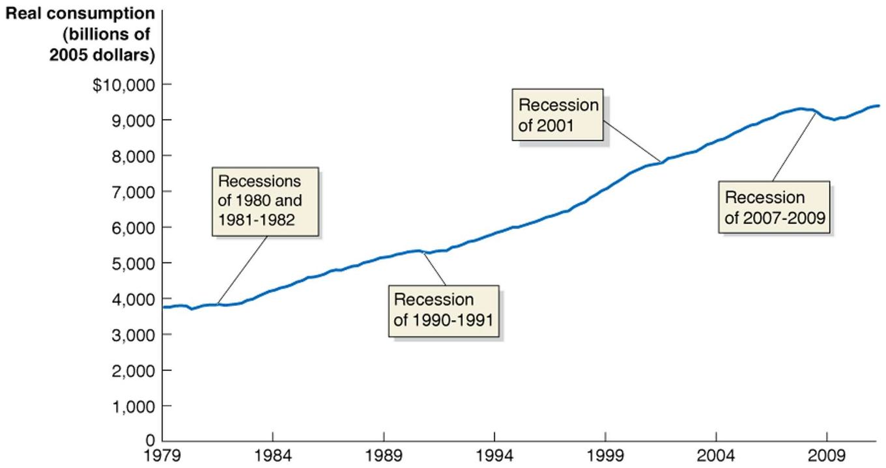

*图 3　美国实际消费（Real consumption，单位：十亿 2005 年美元）1979 年至约 2012 年的曲线：从约 3,900 平滑上升到期末约 9,400。图上用四个文本框点出衰退的位置——1980 与 1981–82（约 4,000 处两次小凹陷）、1990–91（约 5,400 处下凹）、2001（约 7,800 处几乎只是走平）、2007–09（约 9,300 的峰值跌到约 9,000，**全图幅度最大的一次下跌**）。读这张图要读的是「除了最后那次，曲线被打断后立刻回到原趋势」，这就是「平滑」的经验含义。（按原图裁切，未重绘；出自讲义 p.15，课件此页未注数据出处）*

为什么消费能这么平滑？因为人们**借贷与储蓄是为了抹平收入的波动**：收入暂时下降时不会等比例削减消费。这个直觉在第四节 4.3 会以「预期未来收入」的形式成为自主消费的一个决定因素。

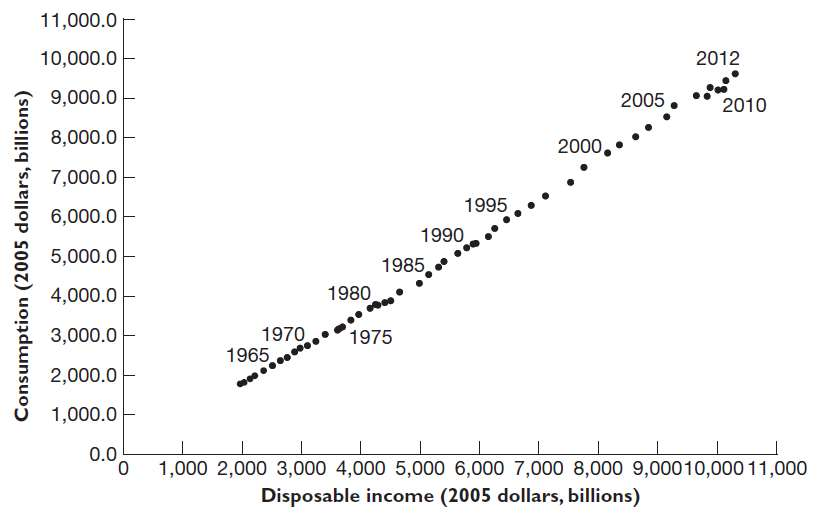

*图 4　1960–2012 年消费与可支配收入的散点图（两轴单位都是十亿 2005 年美元，纵轴 0–11,000、横轴 0–11,000）：约 53 个年度点几乎严格落在一条过原点附近、斜率约 0.7–0.8 的直线上，从约 (1,900, 1,800) 排到约 (10,600, 9,700)。图上用斜体标出 1965、1970、1975、1980、1985、1990、1995、2000、2005、2010、2012 十一个年份。最值得注意的是 2008 年之后那几个点**第一次明显离开直线往右下方偏**——同样的收入对应了比直线更高的消费。（按原图裁切，未重绘；出自讲义 p.16，课件此页未注数据出处）*

图 4 下面课件写了一行大字：$C$ 取决于可支配收入 $(Y - T)$。这行字是本页的全部论点，也是消费函数的自变量选择：**不是产出 $Y$，而是拿到手、交完税、加上转移支付之后能花的钱**。

### 4.2 消费函数：定义与逐符号解释（p.17、p.22）

**消费函数（consumption function）** 是把计划消费 $C$ 与它的决定因素（尤其是可支配收入 $Y - T$）联系起来的方程（an equation relating planned consumption to its determinants, notably disposable income）。课件给的形式是：

$$C = \bar{C} + (mpc)(Y - T)$$

**自主消费（autonomous consumption, $\bar C$）** 定义为与可支配收入水平无关的那部分消费支出（a spending that is not related to the level of disposable income）。

逐符号交代：

| 符号 | 名称 | 量纲/取值域 | 为什么这样设计 |
|---|---|---|---|
| $C$ | 计划消费 | 十亿美元，$\ge 0$ | 因变量，随收入线性变动 |
| $\bar C$ | 自主消费 | 十亿美元，$>0$ | 横线表示「不随 $Y$ 变」；它是收入为零时仍要花的钱（靠储蓄与借贷） |
| $mpc$ | 边际消费倾向 | 纯数，$0 < mpc < 1$ | 斜率；小于 1 保证多赚的钱不会全部花掉，乘数才收敛 |
| $Y - T$ | 可支配收入 | 十亿美元 | 自变量。$T$ 是**净税**（p.50 定义），所以转移支付已经在这项里 |

**边际消费倾向（marginal propensity to consume, $mpc$）** 的定义（p.22）：可支配收入每增加 1 美元时消费支出的增加量。课件用一个分式表达（图里那个分式横幅我按 LaTeX 复现）：

$$mpc = \frac{\text{Change in consumption}}{\text{Change in disposable income}} = \frac{\Delta C}{\Delta (Y - T)}$$

> [!NOTE] 两处口径提醒
> 其一，同一页里课件把斜率写成小写 $mpc$、把分式定义写成大写 $MPC$，值相同，本笔记统一用小写 $mpc$。其二，分式的分母课件写作 $\Delta YD$，这里的 $YD$ 是 disposable income（可支配收入）的缩写，**不是 $Y$ 乘以 $D$**。

**手算小例（我的补充，非讲义内容，全部可心算）。** 若 $mpc = 0.8$、$\bar C = 620$、$T = 250$：收入 $Y = 4{,}800$ 时 $C = 620 + 0.8 \times (4{,}800 - 250) = 620 + 3{,}640 = 4{,}260$；收入涨到 $Y = 5{,}000$ 时 $C = 620 + 0.8 \times 4{,}750 = 620 + 3{,}800 = 4{,}420$。增量 $= 160 = 0.8 \times 200$，正好是 $mpc \times \Delta Y$（因为 $T$ 没变，$\Delta(Y-T) = \Delta Y$）。

### 4.3 自主消费 $\bar C$ 由什么决定（p.18–p.19）

$\bar C$ 是截距。截距变了，整条消费函数平移——这是第八节衰退缺口的入口。课件用两页给了四个决定因素，我把它们与「移动方向」整理成一张表：

| 决定因素 | 英文原名 | 机制（按课件） | 使 $\bar C$ 上升的例子 |
|---|---|---|---|
| 财富效应 | the wealth effect | 资产价格变动影响家庭财富，从而影响消费 | 股价、房价上涨 |
| 预期未来收入 | expected future income | 人们倾向让消费逐年稳定，即使收入波动较大 | 预期明年涨薪、预期暂时性减税 |
| 价格水平 | the price level | 主要通过影响家庭财富的**实际价值**起作用 | 物价下跌使名义资产购买力上升 |
| 利率 | the interest rate | 高实际利率提高借贷消费的成本 | 实际利率下降 |

三条需要展开的细节：

**预期未来收入这一条，课件给了一个可检验的推论**：只有当当前收入相对预期未来收入**既不异常高也不异常低**时，当前收入才能很好地解释当前消费。这句话解释了图 4 里 2008 年后点跑到直线右下方的现象——收入异常低（因为衰退被认为部分是暂时的），消费没有等比例下降。

**价格水平这一条要小心循环**。本章假设 $P$ 不变，所以 $P$ 对 $\bar C$ 的影响在模型内部**不会被用到**；它是「为什么 $P$ 下降会略微刺激需求」的伏笔，属于第 13 章总需求曲线为什么向下倾斜的理由之一。

**利率这一条，课件给了一个不对称性**：利率变动对**耐用品**支出的影响大于对服务与非耐用品的影响，因为高实际利率提高的是「靠借债来花的钱」的成本。这为第 12 章货币政策留了接口——**本章模型里没有利率，所以利率只能当外生的 $\bar C$ 移动因素**。

### 4.4 一个财富效应的算例，和它的反例（p.20–p.21）

先是一个完整的三步算例，对象是 2000–2002 年的股市下跌（出自讲义 p.20）：

| 步骤 | 课件给的数 | 我的验算 |
|---|---|---|
| 股价从 2000 年 3 月到 2002 年 10 月跌 49%；家庭 2000 年持有股票 13.3 万亿美元 | $13.3 \times 0.49$ | $= 6.517$ 万亿，与课件「可能毁掉 6.5 万亿家庭财富」一致 |
| 财富每减少 1 美元，消费减少 3–7 美分 | — | 这是经验系数，即 $\Delta C / \Delta W \in [0.03, 0.07]$ |
| 隐含的消费支出减少 1,950–4,550 亿美元 | $6.5 \times 0.03$、$6.5 \times 0.07$ | $= 0.195$ 与 $0.455$ 万亿，即 1,950 与 4,550 亿，与课件一致 |

紧接着就有一个反例：**这段时间消费不降反升**。三个理由是：税后收入增加；利率下降（刺激了耐用品支出）；住房财富增加——**期间房价上涨 20%，部分抵消了股市损失的财富效应**（出自讲义 p.21）。

「算例给出方向、下一页用真实数据否定它」，这是本章最好的「模型 vs 现实」教材，值得提炼成方法：

1. 财富效应给出的是**部分效应（ceteris paribus）**：它回答「只有股价跌、其他都不变会怎样」。
2. 现实中同时有多个 $\bar C$ 的决定因素在动（税、利率、房价），**净效应取决于哪条腿更粗**。
3. 3–7 美分这个系数本身是估计值，跨度一倍多——**用宽区间做预测，得到的结论也只能是区间**。

**「3–7 美分」不是 $mpc$。** 财富对消费的边际倾向（0.03–0.07）与收入对消费的边际倾向 $mpc$（本章取 0.8）是**两个不同的系数，不能混用**。真实世界里股票财富更集中（高收入家庭持有大部分股票），所以这 0.03–0.07 里的分布含义课件没有交代。把财富变动直接乘上 $mpc$ 是本章最常见的错误算法。

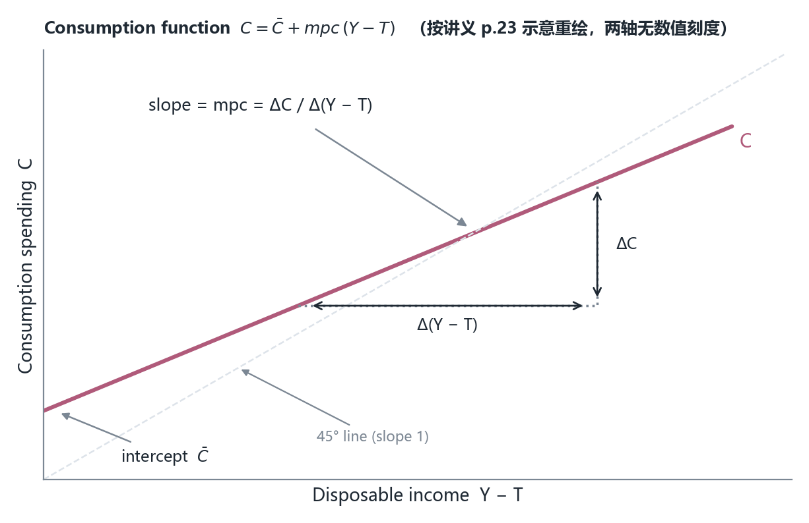

*图 5　消费函数 $C = \bar C + mpc\,(Y - T)$ 的示意图：横轴为可支配收入 $(Y-T)$、纵轴为消费 $C$，两轴无数值刻度。红线在纵轴上的截距就是 $\bar C$；线上任取一点画虚线直角三角形，竖边是 $\Delta C$、横边是 $\Delta(Y-T)$，斜率 $= \Delta C / \Delta(Y-T) = mpc$。因为 $0 < mpc < 1$，红线比 45° 线更平。（按讲义 p.23 示意重绘，坐标轴无量纲数值）*

**练习 3（我的补充，非讲义内容）。** 若 $\bar C = 620$、$mpc = 0.8$、$T = 250$，要让消费在每一档收入上都增加 40，$\bar C$ 应变成多少？若改为让 $T$ 下降，$T$ 应变成多少？

> [!TIP] 参考答案
> 直接动截距：$\bar C' = 660$。动税收：$0.8 \times (Y - T') = 0.8 \times (Y - T) + 40 \Rightarrow -0.8T' = -0.8 \times 250 + 40 \Rightarrow T' = 250 - 50 = 200$。**注意第二个答案：减税 50 只换来消费增 40，因为省下的税里有 20% 被存起来**——这正是第九节「减税要减得比增支更多」的原因。

---

## 五、投资、政府购买与净出口（p.24–p.28）

$PAE$ 的四条腿里，消费占了三分之二，剩下三条腿课件用五页交代。这三条在本章模型里全被当成自主支出（不随 $Y$ 变），但它们各有各的波动来源——**而波动来源的分布，正是本章政策讨论的现实依据**。

### 5.1 计划投资：抖得比消费多（p.24、p.25–p.26）

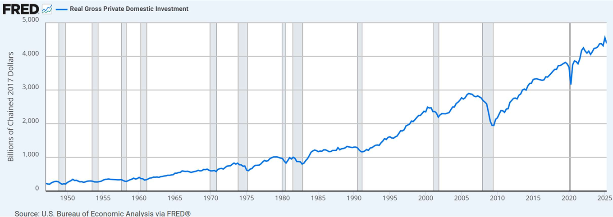

*图 6　实际私人国内总投资（Real Gross Private Domestic Investment，单位：十亿 chained 2017 美元，季度、季调年化）1947–2025 年：从约 150 长期上行到期末约 4,400–4,500。灰色竖带是 NBER 衰退期。最显眼的是 2009 年那次深谷——从 2006 年约 2,800 的峰跌到约 1,900，**跌幅约三分之一**；其次是 2020 年一根极窄的 V（从约 3,600 跌到约 3,100 再迅速拉回）。（按原图裁切，未重绘；出自讲义 p.24，数据源 FRED 序列 GPDIC1）*

课件的结论一句话：**投资比消费更容易发生大幅变动**（Investment is subject to larger changes than is consumption），并点名六次衰退中投资显著下降：1980、1981–82、1990–91、2001、2007–2009 与 2020。对照图 6 的灰带能一一对上。

为什么投资这么抖？课件用两页列了四个决定因素：

| 决定因素 | 英文原名 | 课件要点 | 方向 |
|---|---|---|---|
| 对未来盈利的预期 | expectations of future profitability | 投资品使用寿命长，企业乐观还是悲观很重要 | 预期变差 ⇒ $I^{P}$ 下降 |
| 利率 | interest rate | 其他条件不变时，实际利率与投资支出**反向**相关 | 实际利率上升 ⇒ $I^{P}$ 下降 |
| 税收 | taxes | 公司所得税影响投资的税后盈利；**投资税收激励**（investment tax incentives）给企业减税以鼓励购置新资本品 | 减税/激励 ⇒ $I^{P}$ 上升 |
| 现金流 | cash flow | 现金流 = 企业收到的现金收入减现金支出；利润贡献最大，越盈利越能自筹投资 | 盈利下降 ⇒ $I^{P}$ 下降 |

第一条与第四条合起来解释了 2008 年那次三分之一的跌幅：**预期与现金流同时崩塌**，而利率已经降到零也拦不住。这引出本章第一个真正的空洞：

> [!WARNING] 「利率反向相关」这条在本章没有落地
> 课件 p.25 明确说实际利率与投资反向相关，但本章模型里**没有利率、没有货币市场、没有可贷资金市场**：$I^{P}$ 从头到尾是一个常数 220。于是「利率影响投资」这条渠道在本章只是被**宣告**，从未被**使用**。它真正被用起来要到第 12 章（货币政策通过利率作用于 $I$）与第 13 章（AD-AS）。同理，现金流这一条与第 8 章可贷资金市场是同一件事的两面，本章也没有连起来。

### 5.2 政府购买（p.27）

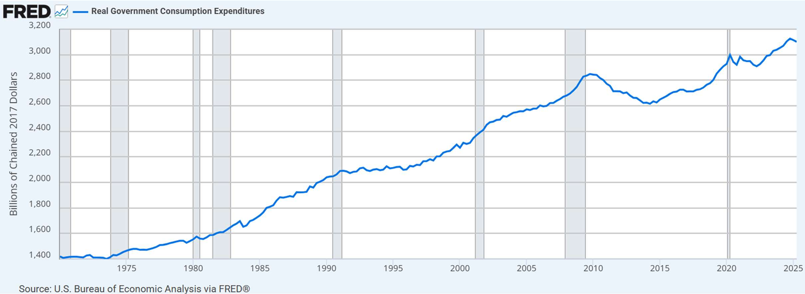

*图 7　实际政府消费支出（Real Government Consumption Expenditures，单位：十亿 chained 2017 美元，季度、季调年化）1970–2025：纵轴 1,400 到 3,200。曲线从约 1,380 一路上到期末约 3,050–3,100；2009–2010 年有一个明显的鼓包随后回落，2020 年一根向上尖峰。图上有两处课件自加的批注框：一处写「实际联邦政府购买的下降发生在 1990 年代」，另一处引线指到 2009–10 那个鼓包，写「2007–09 衰退使联邦政府购买增加、但州与地方政府购买减少」。灰色竖带为 NBER 衰退期。（按原图裁切，未重绘；出自讲义 p.27，数据源 FRED 序列 A955RX1Q020SBEA）*

课件的正文结论：政府购买在 1970–2024 年间稳步增长，**唯一的例外是 1990 年代初**——对联邦预算赤字的担忧使实际政府购买自 1992 年起连降三年。

两处口径要交代清楚，否则读图会读出错：

其一，**bullet 说的是 "government purchases"，图例写的是 "Real Government Consumption Expenditures"**。BEA 的这个序列只算政府消费支出，与 $G$ 的完整口径（消费 + 总投资性支出）不完全相同。这不是错误，但引用时要按图例名说。

其二，**批注讲「联邦升、州与地方降」，而图 7 只画了一条总量序列**。这两股相反方向的力在总量曲线里看不见。而且总量曲线在 1990 年代仍在缓慢上行，「连降三年」这个绝对下降从图 7 上也读不出来——**这一条结论来自课件文字，不来自这张图**。

### 5.3 净出口（p.28）

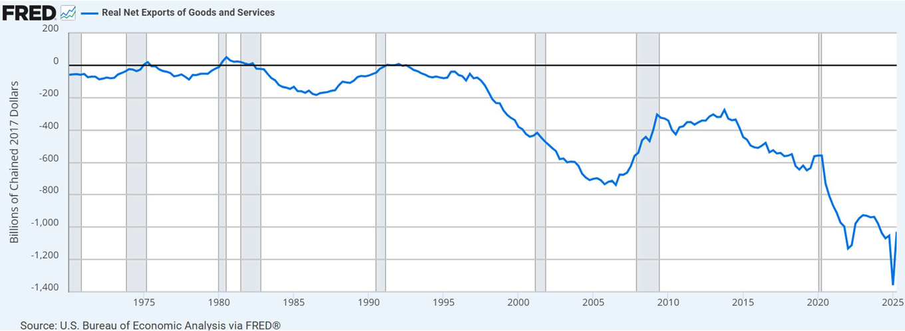

*图 8　实际商品与服务净出口（Real Net Exports of Goods and Services，单位：十亿 chained 2017 美元，季度、季调年化）1970–2025：纵轴 −1,400 到 200。曲线几乎全程在零下——1970 约 −80，1975 与 1980–81 两次短暂上穿零线（局部约 +20、+30），2005–06 跌到约 −600，2009 后回到约 −150 至 −250 的平台，2020 年一度砸到约 −1,100，2025 期末出现全图最深的一根下探（贴近 −1,400 下边界后迅速反弹）。图上另有一条未加图例说明的加粗水平线，位置接近零。（按原图裁切，未重绘；出自讲义 p.28，数据源 FRED 序列 NETEXC）*

课件给两条结论：1970–2025 年间净出口**多数年份为负**；净出口通常在衰退时上升、扩张时下降，**但 2001 年那次衰退里它是往下走的**（课件自己在同一句里承认了这个例外）。

「衰退时净出口上升」的机制值得说透，因为它是第九节政策讨论里唯一的「自动」力量：衰退 ⇒ 国内收入下降 ⇒ 进口减少 ⇒ $NX$ 改善。反过来说，**一次靠刺激需求起来的复苏，会有一部分需求漏到国外去**，这为第八节末尾「漏出会让乘数变小」的讨论提供了现实版本。

> [!NOTE] 本章把 $NX$ 当常数，代价是什么
> 课件 p.11 明说「为简便，假设净出口的实际支出等于计划支出」，p.30 之后 $NX = 20$ 全程不变——**它不随收入变动，也就是说本章没有边际进口倾向**。这是本章第二个空洞：一个开放经济里，收入每增加 1 美元会有几十美分花在进口上，这部分需求不会变成国内产出。第八节 8.5 我会把这条漏出加回去，算一次「加了边际进口倾向后乘数缩水多少」，并明确标注那是我的补充。

**练习 4（我的补充，非讲义内容）。** 2020 年疫情衰退里，图 8 的净出口反而恶化（跌到约 −1,100）。按「衰退 ⇒ 进口减少 ⇒ $NX$ 改善」的逻辑，这该怎么解释？

> [!TIP] 参考答案
> 那条逻辑的前提是「衰退由国内需求不足引起」。2020 年是**供给冲击 + 全球同步停摆**：本国收入下降的同时，出口需求（服务出口、旅游、教育、能源）跌得更狠，所以 $NX$ 反而恶化。课件 p.28 那句「通常」正是为这类例外留的口子——**判断 $NX$ 的方向要同时看进口端（本国收入）与出口端（外国收入），不能只看本国周期**。

---

## 六、支出线与短期均衡（p.29–p.34）

### 6.1 闭环：为什么 $PAE$ 依赖 $Y$（p.29）

前面五节把四个加数分别讲完，第六节要把它们装回一个能解的方程。课件 p.29 先给两条「经济中的动态模式」：

1. **生产的下降导致支出的减少**（Declines in production lead to reduced spending）；
2. **支出的减少导致生产与收入的下降**（Reductions in spending lead to declines in production and income）。

这两条合起来是一个**环**，而不是链。课件接着指出关键的一环在哪里：消费是 $PAE$ 最大的成分，而消费取决于产出 $Y$（因为产出就是收入），所以 **$PAE$ 本身是 $Y$ 的函数**。

这就是本章全部数学的来源：$PAE$ 既决定 $Y$（企业按订单生产），又依赖 $Y$（收入决定消费）。**一个变量同时是另一个变量的原因和结果，唯一的解法是求不动点**——即解 $Y = PAE(Y)$。

### 6.2 把数字装进方程（p.30–p.31）

全章通用的六个参数如下（单位：十亿美元，出自讲义 p.30；课件排成两行三列，这里沿用同一排法）：

| $\bar C$ | $mpc$ | $T$ |
|---|---|---|
| 620 | 0.8 | 250 |

| $I^{P}$ | $G$ | $NX$ |
|---|---|---|
| 220 | 300 | 20 |

代入 $PAE = C + I^{P} + G + NX$，其中 $C = \bar C + mpc(Y - T)$：

$$PAE = \bar C + mpc(Y - T) + I^{P} + G + NX$$

$$PAE = 620 + 0.8(Y - 250) + 220 + 300 + 20$$

$$PAE = 960 + 0.8Y$$

**960 这一步最容易算错**，因为 $-0.8 \times 250 = -200$ 是个负贡献。展开验算：$620 - 200 + 220 + 300 + 20 = 960$。

课件 p.31 把结果切成两块，这是本章第二个必须记住的区分：

$$PAE = \underbrace{960}_{\text{自主支出 autonomous}} + \underbrace{0.8Y}_{\text{引致支出 induced}}$$

| 部分 | 英文原名 | 定义（按课件 p.31） | 本例的值 |
|---|---|---|---|
| 自主支出 | autonomous expenditure | 与产出无关的那部分支出 | 960 |
| 引致支出 | induced expenditure | 依赖产出 $Y$ 的那部分支出 | $0.8Y$ |

**「$Y$ 每增加 1 美元，$C$ 增加 0.80 美元，于是 $PAE$ 增加 80 美分」**——课件用这句话把「斜率」与「$mpc$」焊在一起。注意这句话严格成立的前提是 $T$ 不变；若税收是比例的（$T = tY$），斜率会变成 $mpc(1-t)$，本章不涉及。

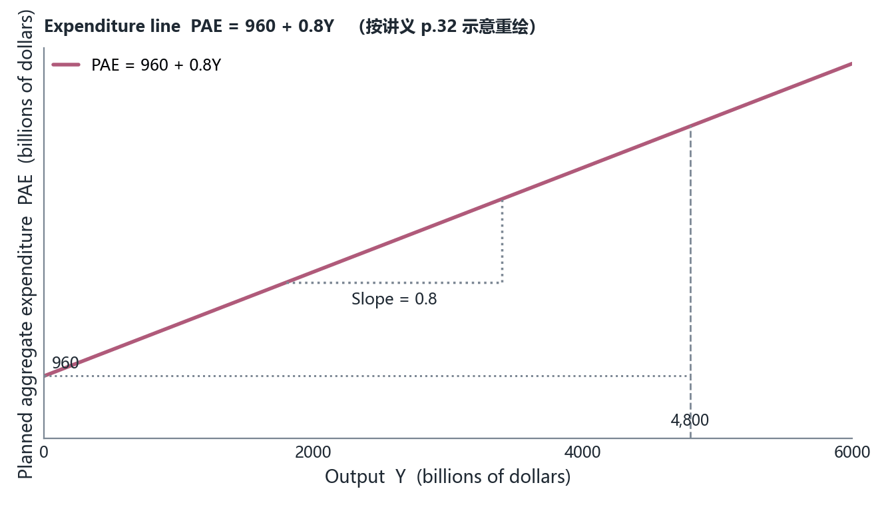

*图 9　支出线 $PAE = 960 + 0.8Y$：纵轴为计划总支出 $PAE$、横轴为产出 $Y$，两轴无网格刻度。红线在纵轴上的截距是 960，斜率 0.8（用一小段虚线直角三角形标出）；横轴 4,800 处一条虚线竖直顶到红线上，那一点上 $PAE = 960 + 0.8 \times 4{,}800 = 4{,}800$，即红线与 45° 线相交的位置——这张图里还没画 45° 线。（按讲义 p.32 示意重绘；参数取自讲义 p.30 的六个数值）*

### 6.3 短期均衡的定义与解（p.33）

**短期均衡（short-run equilibrium）** 是计划支出等于产出的那个产出水平（the level of output at which planned spending is equal to output）。课件给的两条补充：只要价格不变，产出就不会继续变动；均衡条件可写成 $Y = PAE$。

代数解法（本例）：

$$Y = 960 + 0.8Y \;\Longrightarrow\; (1 - 0.8)Y = 960 \;\Longrightarrow\; Y = \frac{960}{0.2} = 4{,}800$$

**一般式（我的整理，非讲义内容）**：把自主支出记作 $A$，则

$$Y^{eq} = \frac{A}{1 - mpc}$$

本例 $A = 960$、$mpc = 0.8$，$Y^{eq} = 4{,}800$。这个式子已经把第八节的乘数藏起来了：$1/(1-mpc)$ 既是「解方程时的除数」，也是「自主支出变动放大成产出变动的倍数」——**同一个符号在两个地方出现不是巧合，第八节会证明它就是同一个东西**。

### 6.4 45° 线图怎么读（p.34）

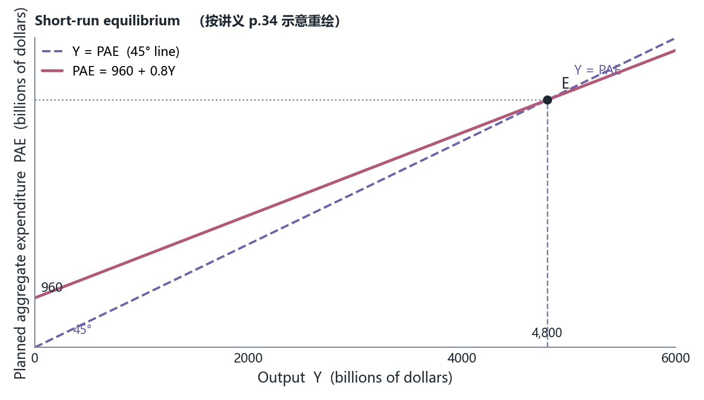

*图 10　短期均衡图：纵轴 $PAE$、横轴 $Y$。紫色虚线是 45° 线，即所有满足 $Y = PAE$ 的点的集合，原点处标 45°；红色实线是 $PAE = 960 + 0.8Y$，截距 960、斜率 0.8。两线唯一交点在 $Y = PAE = 4{,}800$，一条虚线竖直落到横轴的 4,800。交点右侧 45° 线在红线上方（$Y > PAE$），交点左侧红线在 45° 线上方（$PAE > Y$）。（按讲义 p.34 示意重绘；参数取自讲义 p.30）*

这张图是本章的**核心图**，后面五张图全是它的变体，所以读法要一次讲透：

1. **45° 线不是任何行为方程**，它是「纵轴的值等于横轴的值」这条几何轨迹，也就是均衡条件 $Y = PAE$ 本身。它的斜率永远是 1，永远过原点。
2. **红线是行为方程**，截距是自主支出 960，斜率是 $mpc = 0.8$。
3. **交点就是均衡产出**。因为交点同时满足「人们打算花这么多」与「生产了这么多」。
4. **交点两侧的含义**是第七节的全部内容：交点右边 $45°$ 更高 ⇒ 产出多于支出 ⇒ 存货堆积；交点左边红线更高 ⇒ 支出多于产出 ⇒ 存货被掏空。
5. **为什么红线必须比 45° 线平**：因为 $mpc < 1$。若 $mpc = 1$，两线平行（或重合），**均衡要么不存在要么有无穷多个**，$Y = A/(1-mpc)$ 的分母为零——这是 $0 < mpc < 1$ 这个假设的全部重要性。

> [!CAUTION] 45° 线与 $mpc$ 线不要混
> 本章有三条长得像的直线，学生最常搞混：**(a)** 45° 线（斜率 1，表示 $Y = PAE$，是均衡条件）；**(b)** 支出线（斜率 $mpc$，是行为方程）；**(c)** 在第 4 章或第 9 章的同类图中，45° 线还可能表示「收入 = 支出」或「货币数量 = 名义产出」。**看到 45° 先问：这张图的两轴是什么？** 本章的答案永远是「纵轴 $PAE$、横轴 $Y$」。

**练习 5（我的补充，非讲义内容）。** 保持 $\bar C = 620$、$T = 250$、$I^{P} = 220$、$G = 300$、$NX = 20$ 不变，把 $mpc$ 从 0.8 改成 0.75。新的支出线、自主支出与均衡产出各是多少？

> [!TIP] 参考答案
> 自主支出 $A = 620 - 0.75 \times 250 + 540 = 620 - 187.5 + 540 = 972.5$（注意 $T$ 的扣减也随 $mpc$ 变了，这是最容易漏的一步）；支出线 $PAE = 972.5 + 0.75Y$；均衡 $Y = 972.5 / 0.25 = 3{,}890$。**斜率变小让均衡产出掉了 910**，其中一部分来自自主支出本身的变化，不全是乘数效应。

---

## 七、偏离均衡的调整机制（p.35–p.36）

均衡解出来了，但模型必须回答「经济真的会走到那儿吗」。课件用两页、两张图回答，逻辑全靠非计划存货。

### 7.1 产出高于均衡：5,000 的情形（p.35）

课件假设产出达到 5,000，然后给四步：计划支出少于总产出 ⇒ 非计划存货增加 ⇒ 企业放慢生产 ⇒ 产出下降。

把数字算出来（课件没给具体差额，以下三个数是我按 $PAE = 960 + 0.8Y$ 算的）：

$$PAE(5{,}000) = 960 + 0.8 \times 5{,}000 = 4{,}960$$

- 产出 $5{,}000$ 与支出 $4{,}960$ 之间差 **40**，这 40 就是非计划存货增加；
- 40 相对 5,000 只有 0.8%，但**对企业来说这是仓库里实实在在多出来的货**；
- 企业减产 ⇒ $Y$ 从 5,000 向 4,800 回落。回落过程中 $PAE$ 也跟着降（因为收入降了），但**降得比 $Y$ 慢**（斜率 0.8 < 1），所以差额 40 会逐轮缩小，直到归零。

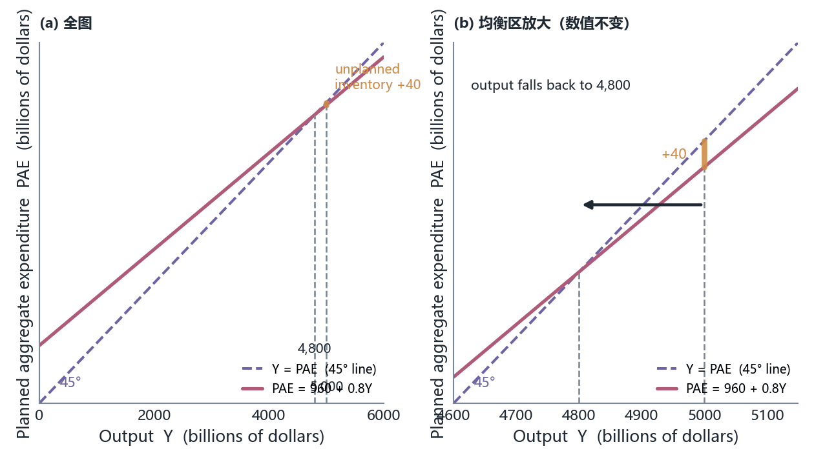

*图 11　产出高于均衡：横轴标出 4,800 与 5,000。在 $Y = 5{,}000$ 处，紫色 45° 线上的点（值 5,000）高于红色支出线上的点（值 4,960），两者之间的竖直缺口就是非计划存货增加 40；横轴上方一根向左的箭头表示产出从 5,000 回落到 4,800。（按讲义 p.35 示意重绘；缺口 40 由 $PAE = 960 + 0.8Y$ 算出，讲义未标数值）*

### 7.2 产出低于均衡：4,500 的情形（p.36）

同样四步反过来：计划支出多于总产出 ⇒ 非计划存货减少 ⇒ 企业加快生产 ⇒ 产出上升。数字：

$$PAE(4{,}500) = 960 + 0.8 \times 4{,}500 = 4{,}560$$

支出比产出多 **60**，这 60 由存货被掏空顶上，于是企业增产，$Y$ 从 4,500 向 4,800 上升。

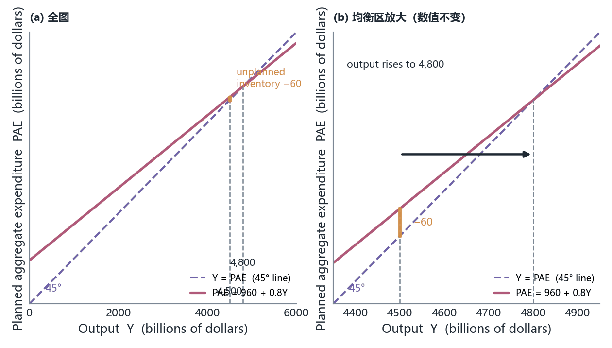

*图 12　产出低于均衡：横轴标出 4,500 与 4,800。在 $Y = 4{,}500$ 处，红色支出线上的点（4,560）高于紫色 45° 线上的点（4,500），竖直缺口 60 是非计划存货减少；横轴上方一根向右的箭头表示产出从 4,500 上升到 4,800。（按讲义 p.36 示意重绘；缺口 60 由 $PAE = 960 + 0.8Y$ 算出，讲义未标数值）*

**两张图的偏离幅度不对称。** 课件一边取 +200（5,000）、一边取 −300（4,500），所以算出的缺口是 40 与 60，**不对称**。这不是错误，只是取样不同；若要「对称调整」的对照，应取 4,600 与 5,000（缺口分别是 $+40$ 与 $-40$）或 4,500 与 5,100。检验公式很简单：在任意 $Y$ 处，$PAE - Y = A - (1 - mpc)Y$，本例即 $960 - 0.2Y$。**用这个式子一秒就能算出任意偏离下的非计划存货**：$Y = 5{,}000$ 得 $-40$（存货增 40）、$Y = 4{,}500$ 得 $+60$（存货减 60）。

### 7.3 这个调整为什么是「稳定」的

把两页合起来看，机制是一个负反馈：$Y$ 高于均衡 ⇒ 存货堆积 ⇒ 减产 ⇒ $Y$ 下降；$Y$ 低于均衡 ⇒ 存货掏空 ⇒ 增产 ⇒ $Y$ 上升。**方向永远指向 4,800**。

严格地说，课件展示的是「静态比较」而不是「动态路径」——它没说一季调多少。若把「企业按上一季的非计划存货调整产量」写成差分方程（我的补充，非讲义内容）：设 $Y_{t+1} = Y_t + \lambda(PAE(Y_t) - Y_t)$，代入 $PAE = A + mpc \cdot Y$ 得 $Y_{t+1} = \lambda A + (1 - \lambda(1 - mpc))Y_t$。**只要 $0 < \lambda \le 1$，系数 $1 - \lambda(1-mpc)$ 落在 $(0,1)$ 之间，路径单调收敛到 $A/(1-mpc) = 4{,}800$，不会震荡**。$\lambda$ 越大调得越快，但永远不会过冲——因为每轮缺口本身在缩小。这解释了为什么课件敢画一根单向箭头。

**练习 6（我的补充，非讲义内容）。** 若 $Y = 5{,}200$，非计划存货是多少？企业会增产还是减产？产出会一次跳到 4,800 吗？

> [!TIP] 参考答案
> $PAE - Y = 960 - 0.2 \times 5{,}200 = 960 - 1{,}040 = -80$，即非计划存货**增加** 80 ⇒ 减产。不会一次跳到 4,800：减产使 $Y$ 下降，$Y$ 下降又使 $PAE$ 下降，缺口按 0.8 的比例缩小（80 → 64 → 51.2 → …），**收敛是渐近的**，这正是第八节几何级数在时间维度上的另一个面孔。

---

## 八、衰退缺口与收入—支出乘数（p.37–p.44）

### 8.1 先看结果：少花 10 元，产出少 50 元（p.37–p.38）

课件 p.37 的标题是「计划支出的下降导致衰退」，它做的是本章第一次真正的比较静态分析。设定：自主消费 $\bar C$ 从 620 减少 10，变成 610。

支出线随之整体下移 10：

$$PAE = 960 + 0.8Y \;\Longrightarrow\; PAE = 950 + 0.8Y$$

新均衡（用 $Y = A/(1-mpc)$）：

$$Y = \frac{950}{0.2} = 4{,}750$$

**一笔 10 元的自主支出减少，带来 50 元的产出减少——放大 5 倍。** 这就是乘数现象，课件先给现象，p.42 才给它名字。

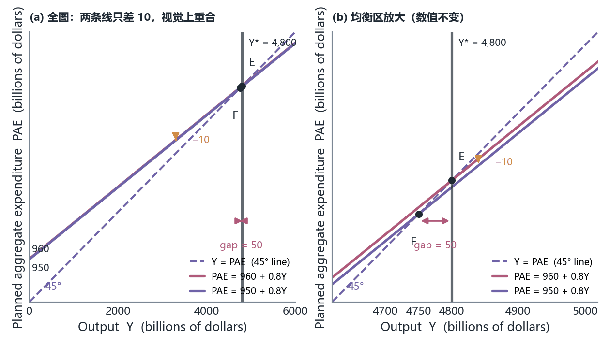

*图 13　衰退缺口的定义图：纵轴 $PAE$（标出两个截距 960 与 950）、横轴 $Y$（标出 4,750 与 4,800，且 4,800 下方另标 $Y^{*}$）。紫色虚线是 45° 线；两条平行红色实线分别是 $PAE = 960 + 0.8Y$（上）与 $PAE = 950 + 0.8Y$（下），两线之间一个向下的箭头表示整条线平移。$E$ 是上线与 45° 线的交点（$Y = 4{,}800$），$F$ 是下线与 45° 线的交点（$Y = 4{,}750$）。在 4,750 与 4,800 之间画双向箭头并标 `Recessionary gap`。（按讲义 p.37 示意重绘；$E$、$F$ 两点位置由 $950/0.2$ 与 $960/0.2$ 算出）*

课件 p.38 把这件事说成三个要点：

1. $\bar C$ 减少 10 ⇒ 支出曲线**向下平移** ⇒ 经济最终调整到一个更低的均衡支出与产出水平 4,750；
2. **假设原来的均衡水平 4,800 就是潜在产出 $Y^{*}$**（Suppose that the original equilibrium level, \$4,800, represented potential output）⇒ 出现**衰退缺口**（recessionary gap）⇒ 缺口大小 $4{,}800 - 4{,}750 = 50$；
3. **减少全部发生在消费支出上**；同样的过程适用于 $I^{P}$、$G$ 或 $NX$ 的下降。

### 8.2 三个术语必须一次钉死（与第 4、10 章对账）

| 术语 | 英文原名 | 定义 | 本例的值 | 出处口径 |
|---|---|---|---|---|
| 潜在产出 | potential output, $Y^{*}$ | 价格充分调整、资源正常利用时经济**能够**持续生产的产出水平；在第 10 章它由趋势线给出 | 4,800（由课件 p.38 的假设给定） | 本章把它当外生给定；第十一节 p.54 才承认它能被财政政策移动 |
| 衰退缺口 | recessionary gap | 短期均衡产出**低于**潜在产出的差额，$Y^{*} - Y^{eq} > 0$ | 50 | p.38 |
| 通胀缺口 | inflationary gap | 短期均衡产出**高于**潜在产出的差额，$Y^{eq} - Y^{*} > 0$ | 本章未给出数值例 | 本章只在 p.46 用「output gaps」统称，未展开通胀缺口 |

> [!WARNING] 课件 p.37 的因果措辞是反的
> 课件 p.37 的原文写 `A drop in Y causes recessionary gap`（产出的下降造成衰退缺口）。**按 p.38 的完整推理，因果是「自主支出下降 10 ⇒ 均衡产出下降 50 ⇒ 于是出现缺口」**：$Y$ 的下降是缺口的**表现**，不是缺口的**原因**；原因是自主支出（$\bar C$）的下降。**应为 a drop in autonomous spending**（或 a downward shift of the PAE line）。判定依据：同一处的示意图把向下箭头画在两条 $PAE$ 线之间（表示支出线平移），而 p.38 的第一句话明写「$\bar C$ 减少 10 引起支出曲线向下平移」。
> 另外，同一处（p.37）的标题写 "Leads to a Recession"、正文用词却是 recessionary gap——**衰退（一段负增长的过程）与衰退缺口（一个水平差额）不是一回事**：有缺口不一定正在衰退，衰退也不一定留下缺口。

顺带交代符号：本章用 $Y^{*}$ 表示潜在产出，第十一节的古典附录用 $Y_{FE}$（full employment level of output，充分就业产出）表示同一个东西。**两个符号、一个概念**，本笔记在第八、九节统一用 $Y^{*}$，在第十一节保留课件的 $Y_{FE}$ 并说明它等于 $Y^{*}$。

### 8.3 逐轮放大：乘数到底从哪里来（p.43）

课件 p.43 是全章最重要的一页，因为它把「5 倍」拆成了可以逐轮验算的链条。设定：自主支出减少 10，$mpc = 0.8$。

- **第一轮**：支出直接少 10 ⇒ 产出少 10（这 10 是别人的收入没了）；
- **第二轮**：少了 10 收入的人只少花 $0.8 \times 10 = 8$ ⇒ 又少 8；
- **第三轮**：少 8 收入的人少花 $0.8 \times 8 = 6.4$；
- **第四轮**：$0.8 \times 6.4 = 5.12$；如此继续。

课件只写到 5.12，后面的轮次是我按同一规则补的（单位：十亿美元）：

| 轮次 | 本轮支出减少 | 算式 | 累计减少 | 累计占 50 的比例 |
|---|---|---|---|---|
| 1 | 10.0000 | $10 \times 0.8^{0}$ | 10.0000 | 20.00% |
| 2 | 8.0000 | $10 \times 0.8^{1}$ | 18.0000 | 36.00% |
| 3 | 6.4000 | $10 \times 0.8^{2}$ | 24.4000 | 48.80% |
| 4 | 5.1200 | $10 \times 0.8^{3}$ | 29.5200 | 59.04% |
| 5 | 4.0960 | $10 \times 0.8^{4}$ | 33.6160 | 67.23% |
| 6 | 3.2768 | $10 \times 0.8^{5}$ | 36.8928 | 73.79% |
| 7 | 2.6214 | $10 \times 0.8^{6}$ | 39.5142 | 79.03% |
| 8 | 2.0972 | $10 \times 0.8^{7}$ | 41.6114 | 83.22% |
| 9 | 1.6777 | $10 \times 0.8^{8}$ | 43.2891 | 86.58% |
| 10 | 1.3422 | $10 \times 0.8^{9}$ | 44.6313 | 89.26% |
| $\vdots$ | $\vdots$ | $\vdots$ | $\vdots$ | $\vdots$ |
| 极限 | — | $\sum_{k=0}^{\infty}10 \times 0.8^{k}$ | **50.0000** | 100% |

三件事值得注意：

1. **前四轮就走完 59%**，十轮走完 89.3%。所以「乘数效应」在现实里主要发生在头两三年，**这就是政策时滞之所以致命的算术理由**（第十节会回到这里）。
2. 每一轮的量都在缩小，缩小的比例正好是 $mpc$。**若 $mpc \ge 1$，级数不收敛，「均衡产出」这个概念本身就不存在**——第六节 6.4 第 5 条说的就是这件事。
3. 这个级数与第 9 章的存款创造级数是**同一个几何级数**：那里公比是「留下的比例」（$1 - r_d$ 之类），这里是 $mpc$；那里的极限是 $1/r_d$，这里是 $1/(1-mpc)$。**看到「一笔注入被逐轮花掉一部分」就写几何级数**，这是本课程反复出现的解法。

### 8.4 求和：从级数到公式（p.44）

求和要用到一个几何级数关系（$mpc$ 介于 0 与 1 之间时，出自讲义 p.44）：

$$1 + mpc + mpc^{2} + mpc^{3} + \cdots = \frac{1}{1 - mpc}$$

于是本例：

$$10\left[1 + 0.8 + (0.8)^{2} + (0.8)^{3} + \cdots\right] = 10 \times \frac{1}{1 - 0.8} = 10 \times 5 = 50$$

**收入—支出乘数（income-expenditure multiplier）** 的定义（p.42）：它衡量自主支出增加一单位对短期均衡产出的影响（the effect of a one-unit increase in autonomous expenditure on short-run equilibrium output）。课件用比值算出它：

$$\text{multiplier} = \frac{\Delta Y}{\Delta A} = \frac{50}{10} = 5 = \frac{1}{1 - mpc}$$

> [!IMPORTANT] 两条路通向同一个 5，考试要会互相验算
> **代数路**：$Y = A/(1-mpc)$，所以 $\Delta Y = \Delta A/(1-mpc)$，乘数 $= 1/(1-mpc)$。
> **级数路**：$\Delta Y = \Delta A(1 + mpc + mpc^{2} + \cdots) = \Delta A/(1-mpc)$。
> 两条路的 $1/(1-mpc)$ 是同一个东西。**但注意代数路有个隐藏陷阱**：$\Delta Y = \Delta A/(1-mpc)$ 里的 $\Delta A$ 是**自主支出的变动**，不是「最初那笔支出的变动」。当政策工具是减税时，最初的减税 12.5 只有 $mpc$ 的部分进入 $A$（第九节），所以不能直接乘 5。

### 8.5 敏感性：$mpc$ 与漏出如何改变一切（我的补充，非讲义内容）

课件 p.44 最后一句是「$mpc$ 越大，乘数越大」（The larger the mpc, the greater the multiplier），但没给数字。我把这条定性结论量化——同样一笔 10 元的自主支出减少：

| $mpc$ | 乘数 $1/(1-mpc)$ | $\Delta Y$ | 第二轮就少多少 |
|---|---|---|---|
| 0.50 | 2.00 | −20.0 | 5.00 |
| 0.60 | 2.50 | −25.0 | 6.00 |
| 0.75 | 4.00 | −40.0 | 7.50 |
| **0.80（本章）** | **5.00** | **−50.0** | 8.00 |
| 0.90 | 10.00 | −100.0 | 9.00 |
| 0.95 | 20.00 | −200.0 | 9.50 |

$mpc$ 从 0.8 到 0.9 只涨 12.5%，乘数却翻倍——**乘数对 $mpc$ 是凸的，越接近 1 越敏感**。这就是为什么本章所有结论都建立在「$mpc$ 到底是多少」这个经验参数上，而课件从头到尾没有为 0.8 给任何出处或估计区间。

**如果忽略漏出，乘数会大多少？** 本章把 $I^{P}$、$G$、$NX$、$T$ 全当常数。真实世界里每多挣 1 美元，会有几美分流向进口、几美分被比例所得税拿走。把这两条漏出加回去（$t$ 为边际税率、$x$ 为边际进口倾向）：

$$\text{multiplier} = \frac{1}{1 - mpc(1 - t) + x}$$

按 $mpc = 0.8$ 代入几组参数：

| $t$ | $x$ | 乘数 | 相对本章 5.00 |
|---|---|---|---|
| 0 | 0 | 5.000 | 基准（课件口径） |
| 0 | 0.10 | 3.333 | 缩水 33% |
| 0 | 0.20 | 2.500 | 缩水 50% |
| 0.20 | 0 | 2.778 | 缩水 44% |
| 0.20 | 0.10 | 2.174 | 缩水 57% |
| 0.20 | 0.20 | 1.786 | 缩水 64% |

**结论：一个只加 10% 边际进口倾向的模型，就能把乘数砍掉三分之一。** 这解释了为什么现实中各国财政刺激的官方测算（几十个百分点的 GDP）远小于本章的 5 倍，也解释了为什么第十节说「财政政策的能力受限制」。**这张表是我按标准开放经济凯恩斯模型算的补充，课件没有边际进口倾向、没有比例税率，也没有乘数敏感性表。**

### 8.6 两个现实案例：日本与 2007–09（p.39–p.41）

**日本把衰退出口给邻居（p.39）。** 1990 年代日本衰退使日本进口减少；东亚经济体靠出口发展，对日出口下降 ⇒ 这些国家的 $PAE$ 下降 ⇒ 经济收缩到更低的支出与产出水平。课件的总结句是「日本把它的衰退输出给了邻国」，并补一句美国衰退对其主要贸易伙伴有类似效应。

这一页的价值在于它是**第八节机制的国际版**：$NX$ 是 $PAE$ 的一个加数，所以一国的自主支出下降会通过贸易渠道变成另一国的自主支出下降。**本章模型里没有边际进口倾向（见 8.5），所以「日本收入下降如何精确影响美国 $NX$」这条传导链在本章无法定量**——这是课件框架的一个自我限制。

**2007–09 是怎么起的。** 先看房地产这条线：2001–2006 年房价年均涨 8.2%；上一次这样的高涨幅是 1976–1979 年，年均涨 4.9%；然后用 72 法则（rule of 72）说「按此速度房价 10 年翻倍，而 1976–79 那次要 15–19 年」。2006–07 年房价下跌 6%，2007–09 年下跌超过 20%，接着是金融市场危机（出自讲义 p.40）。再把话接回模型：企业与家庭支出下降（借钱难、对经济前景不确定）⇒ 计划总支出下降 ⇒ 支出线下移 ⇒ 衰退缺口（出自讲义 p.41）。

> [!WARNING] p.40 的 72 法则数字与它自己的结论对不上
> 72 法则给的是「翻倍年数 $\approx 72 / r$」（$r$ 为年增长率百分数）。按课件自己给的两个增长率：
> $72 / 8.2 = 8.78$ 年（**课件写「10 years」**）；$72 / 4.9 = 14.69$ 年（**课件写「15–19 years」**）。
> 用精确复利公式核对：$\ln 2 / \ln(1.082) = 8.80$ 年、$\ln 2 / \ln(1.049) = 14.49$ 年——**两种算法都得不到 10 与 15–19**。
> 两种可能的读法：**(A)** 课件把 8.78 圆整成「约 10 年」、把 14.69 圆整成「15 年」，则区间上限 19 无来源；**(B)**「15–19 年」是按某个更低的利率区间反算的（$72/19 = 3.8\%$、$72/15 = 4.8\%$），与本页给的 4.9% 不符。**我判不出课件本意，两种读法都列出来**；写作与答题时建议直接写 8.8 年 vs 14.7 年，并注明 72 法则本身在 $r$ 较大时**系统性高估**翻倍时间（8.2% 时精确值 8.80 反而略高于 8.78，4.9% 时精确值 14.49 略低于 14.69，所以误差方向不固定，别把 72 法则当精确公式）。判定依据：72 法则的定义与本页给出的两个 $r$ 值。

**练习 7（我的补充，非讲义内容）。** 若自主支出不是减少 10，而是增加 20（其他不变），新均衡产出是多少？若此时潜在产出仍是 4,800，这是什么缺口、多大？

> [!TIP] 参考答案
> $A = 960 + 20 = 980$，$Y = 980 / 0.2 = 4{,}900$。均衡产出高于潜在产出 $4{,}900 - 4{,}800 = 100$，这是**通胀缺口（inflationary gap）**——课件在本章没给数值例（见 8.2 表第三行）。经济含义：产出被需求推到正常产能之上，短期靠加班与存货透支维持，价格压力向上；本章模型因为假设 $P$ 不变，**无法描述这个缺口带来的通胀**，只能描述它的大小。

---

## 九、财政政策：政府支出、税收与转移支付（p.45–p.53）

### 9.1 稳定政策的定义与两件工具（p.46）

**稳定政策（stabilization policies）** 是政府用来影响计划总支出、**目标是消除产出缺口**的政策（government policies that are used to affect planned aggregate expenditure, with the objective of eliminating output gaps）。

这句话里有三个信息，每个都是考点：

1. **作用对象是计划总支出**，不是价格、不是收入分配、不是就业本身；
2. **目标函数是消除产出缺口**——与第 10 章的缺口口径一致，本章的政策评价标准是「$Y$ 与 $Y^{*}$ 的差」；
3. 两个方向：**扩张性政策（expansionary policies）** 增加计划支出，**紧缩性政策（contractionary policies）** 减少计划支出。

两件工具按课件的划分：**财政政策（fiscal policy）** 用政府支出、转移支付或税收的变动；**货币政策（monetary policy）** 用货币供给的变动（下一讲主题）。

**为什么本章只谈财政政策。** 因为本章模型里没有货币：没有货币需求、没有利率、没有央行。$PAE$ 方程里唯一能被政府直接拨动的旋钮是 $G$ 与 $T$。**这不是说货币政策弱，而是说本章的工具箱装不下它**——p.57 那句「货币政策更常用于稳定经济」正是把这个空洞承认下来。

### 9.2 第一条腿：政府支出（p.47–p.48）

课件的推理只有两行，但这一行是整节的关键：**政府支出本身就是计划支出的一部分，所以它的变动一对一地改变自主支出**（it changes autonomous expenditure one-for-one）。

沿用第八节的冲击（$\bar C$ 少 10，支出线从 960 下移到 950，产出从 4,800 掉到 4,750，缺口 50），政策处方是：

$$\Delta G = +10 \;\Longrightarrow\; A: 950 \to 960 \;\Longrightarrow\; Y = \frac{960}{0.2} = 4{,}800$$

**花 10 元，补回 50 元的缺口。** 这就是「乘数对政府同样有效」的意思，也是凯恩斯式政策建议的全部算术内容。

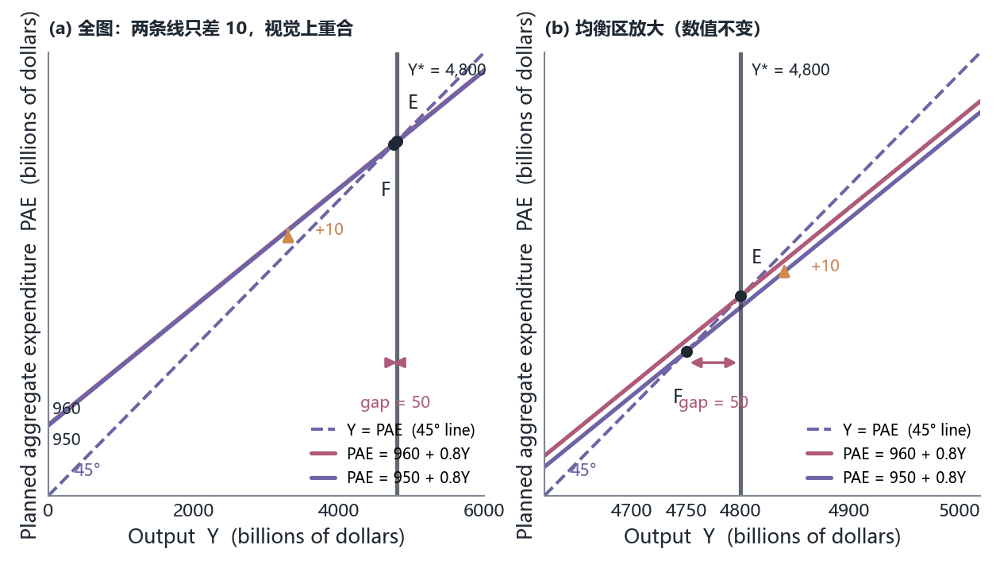

*图 14　10 元财政刺激：与图 13 同骨架、方向相反。纵轴标两个截距 950 与 960，横轴标 4,750 与 4,800（4,800 下方另标 $Y^{*}$）。紫色 45° 线；红色支出线从 $PAE = 950 + 0.8Y$ 上移到 $PAE = 960 + 0.8Y$，两线之间一个向上的箭头。$F$ 是下线与 45° 线的交点（$Y = 4{,}750$），$E$ 是上线与 45° 线的交点（$Y = 4{,}800$）——政策把均衡从 $F$ 推回 $E$，缺口归零。（按讲义 p.48 示意重绘；$E$、$F$ 由 $950/0.2$ 与 $960/0.2$ 算出）*

把图 13 与图 14 并排看，能提炼出本章政策分析的**唯一动作**：**支出线竖直平移，平移量 = 自主支出的变动量，产出变动 = 平移量 × 乘数**。任何政策题只要回答三件事：谁动了、动了多少、有没有漏出。

> [!WARNING] 课件在两处把 $PAE$ 写成了 $Y$
> 原文（p.47）：`Suppose planned spending decreases $10 from Y = 960 + 0.8Y to Y = 950 + 0.8Y`，p.51 同样写法（`Original planned spending Y = 960 + 0.8Y`）。**等式左边是产出、右边是支出计划，写成 $Y = \ldots$ 就把「均衡条件」和「行为方程」两件事混成一件**。应为 $PAE = 960 + 0.8Y$。判定依据：课件别处把均衡条件明确写作 $Y = PAE$（p.33）、把行为方程写作 $PAE = 960 + 0.8Y$（p.30），两者必须分开才能解方程。数值不受影响。

### 9.3 一个真实案例：军费与衰退（p.49）

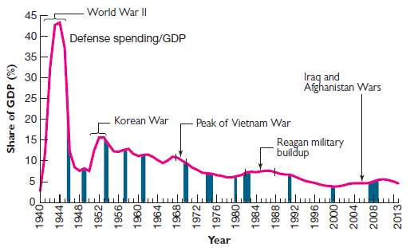

*图 15　国防支出占 GDP 的比重（Share of GDP, %）1940–2013：纵轴 0–45、每 5 一格；横轴每 4 年一标（1940…2008、2013）。品红曲线的四个峰对应四次军事行动：**1944 约 43%（World War II）**、1952–53 约 16%（Korean War）、1968 约 11%（Peak of Vietnam War）、1986 约 7.5%（Reagan military buildup）；2000 年附近是全图谷底约 4%，2010 约 5.5%（图上另有箭头指 `Iraq and Afghanistan Wars`）。图上还有 12 条深蓝竖条，位置与 NBER 衰退期对应，但**本页没有图例说明这些竖条是什么**。（按原图裁切，未重绘；出自讲义 p.49，课件此页未注数据出处）*

课件的两条结论：**二战后军费占 GDP 比重急剧下降，峰值都发生在战争与里根军备扩张期**；**军费带来的需求帮助结束了大萧条**，而军费削减往往伴随衰退。

这张图在本章的位置是「$G$ 这条腿的唯一实证」。它同时给出了本章政策讨论的一个**阴暗面**：如果 $G$ 的上升能补缺口，那么 $G$ 的下降就会制造缺口——图 15 上每一次峰后的回落都跟着一条深蓝竖条。**相关性不是因果**：军费回落与衰退同时出现，也可能因为衰退本身改变了政治注意力。课件没有做这个区分，读图时要自己加上。

### 9.4 第二条腿：税收与转移支付（p.50–p.51）

**净税（net tax, $T$）** 的定义（p.50）：总税收减转移支付、再减政府利息支付（total taxes – transfer payments – government interest payments）。

$$T = \text{总税收} - \text{转移支付} - \text{政府利息支付}$$

这个定义比第 4 章的 $T$ 更宽：**第 4 章里 $T$ 只是税收，本章的 $T$ 已经是「税减补贴」的净额**，所以下面算例里「$T$ 从 250 降到 237.5」可以是一次减税、一次增加转移支付，或两者混合，模型不区分。

税收这条腿与支出那条腿的**根本区别**是传导路径。课件的四步链条：改变总税收或转移支付 ⇒ 影响**可支配收入** ⇒ 可支配收入上升 ⇒ 消费上升。它明确说这个影响是**间接的**（The effect is indirect, channeled through the effects on disposable income）。

间接意味着**先打个折**：减税 1 美元只让可支配收入多 1 美元，而多出的 1 美元里只有 $mpc$ 会被花掉。所以：

> [!CAUTION] 同样的 50 元缺口，需要的减税比增支更多
> 要让**最初那一轮**支出增加 10，需要 $\Delta(Y - T) = 10 / mpc = 10 / 0.8 = 12.5$。**课件 p.47 用 10 元增支补 50 元缺口，p.51 却需要 12.5 元减税才补同一个缺口——两个数不矛盾，差别就在 $mpc$ 这一层折扣上。** 这是全章最容易考、也最容易答错的一组对照。

课件 p.51 用一张表把这件事演算了一遍（橙底白字表头，四列，逐格抄录；单位：十亿美元）：

| Output ($Y$) | Net Taxes ($T$) | Disposable Income ($Y - T$) | Consumption $610 + 0.8\,(Y - T)$ |
|---|---|---|---|
| 4,750 | 250 | 4,500 | 4,210 |
| 4,750 | 237.5 | 4,512.5 | 4,220 |

四格全部可验算：$610 + 0.8 \times (4{,}750 - 250) = 610 + 3{,}600 = 4{,}210$；$610 + 0.8 \times (4{,}750 - 237.5) = 610 + 0.8 \times 4{,}512.5 = 610 + 3{,}610 = 4{,}220$。两行差额 $\Delta C = 10$，正是「最初一轮支出增加 10」；$\Delta T = 250 - 237.5 = 12.5 = 10 / 0.8$。

这张表里有两个必须交代的细节，否则读者会以为抄错了数：

**第一，消费函数的截距是 610 而不是 p.30 的 620。** 因为 p.37 的冲击（$\bar C$ 少 10）已经发生，$620 - 10 = 610$，两页口径自洽。

**第二，表里两行的 $Y$ 都是 4,750。** 这不是笔误——**这张表算的是「在冲击后的产出水平上，减税如何把支出拉回来」，它是一次静态的支出对比，不是新旧均衡的对比**。真正的新均衡要经过乘数过程才达到 4,800。

### 9.5 税收乘数与平衡预算乘数（我的补充，非讲义内容）

课件 p.51 只给了 12.5 这个数，**没有给「税收乘数」这个名字**。但考试会问，所以这里补上，并把三种乘数并排摆开——**注意它们口径不同，不能混用**。

设自主支出 $A = \bar C - mpc \cdot T + I^{P} + G + NX$（本章 $T$ 是固定的一次性总额，不随收入变）。

**支出乘数**：$\Delta G = +1$ 时 $\Delta A = +1$，故 $\Delta Y = \dfrac{1}{1 - mpc} = 5$。

**税收乘数（tax multiplier）**：$\Delta T = +1$ 时 $\Delta A = -mpc$，故

$$\frac{\Delta Y}{\Delta T} = \frac{-mpc}{1 - mpc} = \frac{-0.8}{0.2} = -4$$

验算：$\Delta T = -12.5 \Rightarrow \Delta Y = (-4) \times (-12.5) = +50$，**正好等于缺口**。这就是 p.51 那个 12.5 的一般式来源：$50 / 4 = 12.5$。

**平衡预算乘数（balanced-budget multiplier）**：若政府同时等量增支与增税（$\Delta G = \Delta T$），保持预算平衡：

$$\Delta Y = \frac{\Delta G}{1 - mpc} + \frac{-mpc \cdot \Delta T}{1 - mpc} = \frac{\Delta G(1 - mpc)}{1 - mpc} = \Delta G$$

**乘数恰好等于 1**。数值验证（$mpc = 0.8$）：$\Delta G = \Delta T = 10 \Rightarrow \Delta A = 10 - 8 = 2 \Rightarrow \Delta Y = 2 \times 5 = 10$ ✓；$\Delta G = \Delta T = 12.5 \Rightarrow \Delta Y = 12.5$ ✓。

三种乘数对照表：

| 政策工具 | 变动 | 对自主支出 $A$ 的影响 | 乘数 | 补 50 元缺口需要 |
|---|---|---|---|---|
| 政府支出 | $\Delta G$ | $\Delta A = \Delta G$（一对一） | $+5$ | 增支 10 |
| 净税 | $\Delta T$ | $\Delta A = -mpc \cdot \Delta T$（先打折） | $-4$ | 减税 12.5 |
| 平衡预算 | $\Delta G = \Delta T$ | $\Delta A = (1 - mpc)\Delta G$ | $+1$ | 增支并加税 50 |

**这张表是本章的顶点**：它说明「政府必须花 50 才能补 50 的缺口」这个直觉是错的（花 10 就够），也说明「不增加赤字的政策毫无用处」这个直觉也是错的（平衡预算扩张仍有 1 倍效果）。**后一条课件完全没提**，是本章第三个空洞（前两个是利率与边际进口倾向）。

> [!WARNING] 三种乘数不能混用的原因：$T$ 的口径在翻页时变了
> p.30 与 p.51 都把 $T$ 当成**固定数额**（250、237.5），所以「税收乘数」$-mpc/(1-mpc)$ 成立。但 p.50 同时把 $T$ 定义成「总税收减转移支付」的净额，而**真实税制是比例的**（$T = T_0 + tY$）。一旦 $T$ 随收入变动，可支配收入的变动就不再等于 $-\Delta T$：产出每上升 1 美元，税收自动多收 $t$ 美元，可支配收入只多 $1 - t$ 美元。于是支出线的**斜率**从 $mpc$ 变成 $mpc(1 - t)$，乘数随之缩水（见 8.5 的表：$t = 0.2$ 时乘数从 5.00 掉到 2.78）。
> **课件从头到尾没有把 $T$ 写成收入的函数，却在 p.50 用了「净税」这个含转移支付的定义**——所以本章所有乘数都是「一次性总额税」口径下的结果。做题时如果题目给了边际税率，就必须换公式，不能沿用 5 与 −4。

### 9.6 两个真实的减税案例（p.52–p.53）

**2001 年联邦退税（p.52）。** 2001 年初经济显露放缓迹象，联邦政府向个人退税 300 美元、向夫妻退税 600 美元，**退税总额约 380 亿美元**；同时下调了税率。课件给的两个经验结论：**六个月内这些退税有三分之二被花掉**；这是一次成功的政策。

这里有一个必须点破的混淆：

**「六个月内花掉三分之二」不等于 $mpc = 2/3$。** 前者是**特定人群在特定六个月里对一次性退税的边际支出倾向**（MPC out of a one-time rebate），里面包含耐用品、借贷与提前消费；后者是模型里**收入变动的持续斜率**。把 2/3 当 $mpc$ 用会推出乘数 $1/(1 - 2/3) = 3$，进而「380 × 2/3 × 3 ≈ 760 亿美元的产出拉动」——**这个算法在算术上自洽，在概念上不成立**，因为它假设退税带来的收入增加是永久性的。课件只给了「成功」这个定性结论，没给任何乘数测算；上面这组数是我按本章口径算的**反事实上限，非讲义内容**。

**2007–09 衰退期间的财政应对（p.53）。** 课件列了两部法案的金额（单位：十亿美元）：

| 法案 | 减税 | 政府支出增加 |
|---|---|---|
| Economic Stimulus Act of 2008 | 100 | 60 |
| American Recovery and Reinvestment Act of 2009 | 200 | 600 |
| **合计** | **300** | **660** |

课件的结论是两句定性的话：两部法案都有效拉动了消费支出；**实际 GDP 比没有它们时更高**（Real GDP higher than it would have been otherwise）。

按本章模型（$mpc = 0.8$、支出乘数 5、税收乘数 −4）算一次上限（**我的补充，非讲义内容**）：

$$\Delta A = \Delta G + mpc \times (-\Delta T) = 660 + 0.8 \times 300 = 900$$

$$\Delta Y = 900 \times 5 = 4{,}500 \text{（十亿美元）}$$

两条腿的贡献分别是：支出腿 $660 \times 5 = 3{,}300$，减税腿 $300 \times 4 = 1{,}200$——**支出腿占 73%**，与 9.5 表里「增支比减税更划算」完全一致。

但这个 4,500 必须打上三重折扣才能当现实看：漏出（8.5 的表能把乘数砍到 2 以下）、时滞（法案钱花到位要跨年）、以及**这些支出里有一部分是替州府填财政窟窿，而不是新增需求**。现实里对 ARRA 的学术估计大致落在「把 GDP 抬高 1–3 个百分点」的量级，远低于 4,500/14,000 ≈ 32% 这个模型上限。**课件没给任何反事实测算，这是本讲第四个空洞：模型算出的数与政策评估实际用的数之间，缺一整套方法论。**

**练习 8（我的补充，非讲义内容）。** 假设一个只应用本章模型的经济：$mpc = 0.9$、$T$ 固定、无外贸。缺口 45。请分别算出（a）需要增支多少、（b）需要减税多少、（c）若要求预算平衡，需要同时增支与增税多少。

> [!TIP] 参考答案
> 乘数 $= 1/(1 - 0.9) = 10$；税收乘数 $= -0.9/0.1 = -9$。（a）$45/10 = 4.5$。（b）$45/9 = 5$。（c）平衡预算乘数是 1，所以要 **45**。**注意 (a)(b) 只差 0.5，(c) 却大一个数量级**：$mpc$ 越接近 1，增支与减税越接近等效，而平衡预算方案永远最差（因为它把 90% 的购买力又收回去了）。

---

## 十、财政政策的四个限制（p.54–p.57）

前九节把财政政策讲成一台可靠的机器：量出缺口、除以乘数、按下按钮。最后四页课件做的事是**把这台机器的四个前提一条条拆掉**。这一节是本全章思想密度最高的部分，因为它讲的不是模型而是模型的边界。

### 10.1 限制一：财政政策也会动潜在产出（p.54）

课件 p.54 的四个要点：

1. 财政政策可能影响**潜在产出**以及潜在支出（Fiscal policy may affect potential output as well as potential spending）；
2. **基础设施投资会提高 $Y^{*}$**；税收与转移支付影响激励，因而也能改变潜在产出；
3. **供给面经济学家（Supply-side economists）** 强调财政政策的供给面效应；
4. 当前的看法是**供给面与需求面效应都重要**：支出有很强的即期需求面效应，供给面效应也重要但主要在长期。

这一页与第八节直接冲突，必须并排摆出来：

> [!CAUTION] $Y^{*}$ 在同一章里既「不动」又「会动」
> **p.38 的口径**：假设原均衡 4,800 就是潜在产出 $Y^{*}$，冲击后均衡 4,750，缺口 50，政策目标是把 $Y$ 推回 4,800——**这里 $Y^{*}$ 是一个外生给定、不受政策影响的数**。
> **p.54 的口径**：基础设施投资与税制会移动 $Y^{*}$ 本身——**这里 $Y^{*}$ 是政策的产物**。
> 两者不矛盾，但**不能同时用**：缺口分析的前提是「$Y^{*}$ 已知且不动，只需把 $Y$ 推回去」；供给面分析的前提是「政策改变的是那条线本身」。做题时先看题目问的是哪一个：**问「缺口多大、要刺激多少」用 p.38 口径；问「这项支出对长期增长的影响」用 p.54 口径**。混用的典型错误是「用乘数论证一项基建投资能永久提高潜在产出」——乘数只解释短期需求，长期产能要靠第 7 章的增长核算。

顺带把接缝连上：$Y^{*}$ 由什么决定，是第 7 章（增长：资本、劳动、技术）与第 8 章（储蓄与可贷资金）的问题；$Y$ 围绕 $Y^{*}$ 波动由什么决定，才是本章的问题。**本章的全部力量来自「短期里 $Y$ 与 $Y^{*}$ 可以脱钩」，而这句话的成立理由在第二节（价格黏性）。**

### 10.2 限制二：赤字与国民储蓄（p.55）

**政府赤字（government deficit）** 的定义：政府支出与净税之差。

$$\text{deficit} = G - T$$

注意这里的 $T$ 是 p.50 的**净税**口径（已扣转移支付与政府利息支付），所以「$G - T$」已经把转移支付算进赤字了——**不要把赤字写成「支出减税收」而漏掉转移支付，那样会把 9.4 的口径弄丢**。

课件的因果链是三句话：大而持久的预算赤字减少**国民储蓄**（national saving）；储蓄减少意味着投资减少，投资减少意味着增长减少；**管理赤字的影响限制了政府把财政政策当刺激手段使用的能力**。

这条链在第 8 章有完整的图形版本：$S \downarrow \Rightarrow r \uparrow \Rightarrow I \downarrow$。**本章只用一句话带过、没有画可贷资金图，也没有给利率**——所以「赤字减少投资」在本章是一个**引用**而不是一个**论证**。这是本章第五个空洞，也是它与第 8 章最紧的一条接缝：

| 环节 | 第 8 章（可贷资金） | 本章 |
|---|---|---|
| 谁减少储蓄 | 政府借贷（$G - T$）与私人储蓄 | 只提了一句「赤字减少国民储蓄」 |
| 通过什么传导 | 利率 $r$ 上升 | **没有利率这个变量** |
| 影响谁 | 投资 $I$ 下降 | 说「投资减少、增长减少」，但 $I^{P}$ 在模型里是常数 220 |
| 短期需求效应 | 不涉及 | 不涉及（**这正是「挤出」缺席的原因**） |

**这就是「挤出效应（crowding out）」在本章消失的机制原因**：要讲挤出，需要利率；本章没有利率，所以「$G$ 上升把 $I$ 挤下去」这件事在本章**无法被表达**，只能被断言。第九节 9.2 那句「$G$ 一对一改变自主支出」之所以成立，是因为模型里没有能反噬它的渠道。

课件最后一条 bullet 也值得注意：**政治上的考虑使紧缩性财政政策难以使用**（Political considerations make it difficult to use contractionary fiscal policy）。也就是说，这台机器在实践里只有一个挡——**扩张容易、紧缩难**。这与图 15 显示的「军费回落伴随衰退」以及 p.27 的「1990 年代初因赤字担忧而削减支出」形成有趣的三角：政治想紧、经济怕紧。

### 10.3 限制三：灵活性受两条约束（p.56）

财政政策不是想用就能用，它受两条限制（这层意思在讲义 p.56 的标题 Fiscal Policy Flexibility 之下）：

1. **立法程序需要时间**（The legislative process requires time）⇒ 财政政策的变动可能很慢；
2. **相互竞争的政策目标**（Competing political objectives）⇒ 课件举了两例：国防（national defense）、以及 Medicare 与收入支持这类**权利性支出**（entitlements）。

第一条在现代宏观里被拆成三个时滞（我的补充，非讲义内容）：**认识时滞**（recognize，数据要修订才能确认衰退，第 10 章讲 NBER 判定要事后几个月到一年）、**决策/立法时滞**（decide，课件这条讲的就是它）、**执行/作用时滞**（implement & operate，招标、雇人、发货要花几季度）。**乘数再大，如果钱在复苏已经开始之后才到位，它就从稳定器变成扰动器**——用第八节的算术说：前四轮走完 59% 大约要四个季度，所以一笔延迟四个季度才花出的 10 元，作用在「本该已经恢复」的那段时期上。

第二条的含义是**可拨动的旋钮其实很小**。$G$ 里大部分是法律已经定下来的（国防、Medicare、收入支持），立法者真正能自由调整的份额有限——**「财政政策是工具」这句话的实际版本是「财政工具里只有一小截是把手」**。

> [!WARNING] 这一页漏掉了两个最重要的限制
> 课件 p.56 只列了「时滞」与「竞争性目标」两条，**没有列挤出效应，也没有李嘉图等价（Ricardian equivalence）**。这两条是任何一份财政政策评估清单上的标准项：挤出需要利率与可贷资金市场（第 8 章的框架），李嘉图等价则主张「消费者预期未来加税，会把今天的减税存起来而不是花掉，于是税收乘数归零」。
> 判定依据：p.55 已经承认赤字会减少储蓄、压低投资，这本身就是挤出的前半段；p.52 的退税案例里「三分之二被花掉」正是对李嘉图等价的经验反驳——**课件两边都有材料，却没有把这两个名字写出来**。本笔记把这两条作为补充列出，考试若问「财政政策的限制」，答完课件两条后应主动补上这两条。

### 10.4 限制四的解药：自动稳定器（p.57）

**自动稳定器（automatic stabilizers）** 的定义：当实际产出下降时，它们自动增加政府支出或减少税收，**且不需要任何新的决策**（increase government spending or decrease taxes when real output declines; built into laws so no decision is required）。

课件给了两个例子：**失业保险**（unemployment compensation）与**累进所得税**（progressive income tax）。

这一页是本节里唯一有「机制」的一页，值得把两个例子拆成第 3 节的语言：

- **失业保险**：产出下降 ⇒ 裁员 ⇒ 失业金自动发放。对 $PAE$ 而言，它同时做了两件事——$T$ 不用立法就下降（失业者不再纳税），转移支付自动上升，而这两者在 p.50 的净税定义里**是同一个方向的变动**，可支配收入的下滑被托住一部分，消费不至于按全额 $mpc$ 掉下去。
- **累进所得税**：产出上升 ⇒ 收入上升 ⇒ 人们爬进更高税率档 ⇒ 净税 $T$ 自动上升 ⇒ 可支配收入增幅小于产出增幅 ⇒ 支出线少升一点。**反过来在衰退里，$T$ 自动下降，支出线少降一点。**

用本章的代数说，自动稳定器就是**把 $T$ 从「固定数额」变成「随 $Y$ 上升」**，也就是 9.5 那个 `[!CAUTION]` 里说的比例税。它的效果是**降低支出线的斜率**，从而**降低乘数**：$mpc(1-t) < mpc$。

于是有一个漂亮的双面结论（我的补充，非讲义内容）：**自动稳定器让经济更稳（乘数小 ⇒ 冲击的放大倍数小），但也让主动财政政策更钝（同样的 $\Delta G$ 拉动更小的 $\Delta Y$）**。8.5 的表量化了这一面：$t = 0.2$ 时乘数从 5.00 掉到 2.78，缩水 44%。

课件 p.57 的最后一句把接力棒交出去：**财政政策可能适用于应对持续的衰退期，但货币政策更常被用来稳定经济**（Monetary policy is more often used to stabilize the economy）。理由不在本章模型里（本章没有货币），但可以从本节推出：**货币政策不需要立法程序，时滞短得多**——这正是 p.56 第一条限制的对面。下一讲（第 12 章）就从这里开始。

**练习 9（我的补充，非讲义内容）。** 失业保险属于哪一类政策工具：扩张性财政政策、紧缩性财政政策，还是自动稳定器？如果国会 2025 年通过一项新的基建法案，它属于哪一类？

> [!TIP] 参考答案
> 失业保险是**自动稳定器**：它随衰退自动放大支出，无需新决策，且不是「为了补缺口而设计」的主动动作。新的基建法案是**相机抉择的扩张性财政政策（discretionary expansionary fiscal policy）**：需要立法（受 p.56 时滞约束）、目标明确是移动 $PAE$。**判断题的开关只有一句话：这笔钱的变动需不需要一次新的立法决定。**

---

## 十一、附录：凯恩斯 vs 古典的两套假设（p.58–p.59）

课件 p.6 末尾说「See Appendix for a comparison of Keynesian theory and classical theory」，附录就是 p.58–p.59 这两页，而 p.59 页脚写着 `Return to P6`——**一个闭环**。这一节把两页的表格逐格抄录，并回答第 9 章留下的那个问题。

### 11.1 古典一侧（p.58）

课件符号说明：$Y_{FE}$ 表示充分就业产出（full employment level of output），**与本章正文的 $Y^{*}$ 是同一个东西用了两个符号**。

| Assumptions | Implications |
|---|---|
| **工资是灵活的**（Wages are flexible） | 因为工资能轻易上升或下降从而改变生产成本，市场在长期会**自我校正**回到 $Y_{FE}$；自我校正基于自动的短期供给面变化，**不需要政府干预** |
| 任何偏离 $Y_{FE}$ 都是**暂时的** | 出现**衰退缺口**时可能有一段时期的失业，但市场会回到 $Y_{FE}$，而 $Y_{FE}$ 对应这个经济的**自然失业率**（natural rate of unemployment, NRU） |
| 需求面政策在促进增长上**不如**供给面政策有效 | 经济增长靠提高经济的**生产能力**；这一思路遵循**萨伊定律**（Say's Law）；政府干预应聚焦于经济的供给面 |

第二行里的 NRU 与第 6 章、第 10 章的自然失业率是同一个概念；「偏离是暂时的」与第 10 章「衰退平均长度远小于扩张」的经验事实相容。**注意课件这里写的是「short periods」，而凯恩斯那一侧（p.59 第一行）反驳的正是「short」这个形容词**。

### 11.2 凯恩斯一侧（p.59）

| Assumptions | Implications |
|---|---|
| 「从长期看，我们都死了」 | 凯恩斯指出「市场在长期自我校正」这个想法有缺陷，因为**长期可能是一段非常长的时间**；**严重衰退缺口**及其带来的失业后果可能很沉重、延续几代人 |
| 工资可能是刚性的、**向下黏性**（sticky downwards） | 市场会到达一个「靠工资继续下降来自我校正」不再可行的点；工人不会愿意接受更低的工资；工资可能被**最低工资法**、**工会**（trade unions）的存在、或防止降薪的**长期雇佣合同**挡住而无法继续下降 |
| 政府必须干预以打破负面的「动物精神」（animal spirits） | *动物精神* 指在不确定或市场波动时期驱动金融决策的人类情绪；如果情绪对**经济前景**悲观，悲观就会持续；**大萧条**正是这种情况，凯恩斯主张需要政府支出来改变经济中的情绪、帮助重建**商业与消费者信心**；政府干预之后，**自我校正机制**会重新开始运作 |

**最后一句容易被读反。** 「政府干预之后，自我校正机制会重新开始运作」——这句话**不是**凯恩斯在向古典投降。它的正确读法是：**干预买的是时间**，让经济在自我校正那套缓慢机制（工资下降 → 成本下降 → 供给恢复）终于起作用之前，先不要在最坏的点上崩掉。对照 p.58 第一行「不需要政府干预」，两派的差别不是「自动机制存不存在」，而是**它需要多久、这段时间的代价由谁付**。判定依据：p.59 第一行自己说「长期可能是一段非常长的时间」。

### 11.3 两派对照：分歧到底在哪一层

把两张表并起来看，两派在**事实层面**的分歧其实只有一条，其余全是它的推论：

| 层次 | 古典（p.58） | 凯恩斯（p.59 / 本章正文） | 本章用到的地方 |
|---|---|---|---|
| 价格与工资 | 灵活，可升可降 | 短期黏性，**尤其向下黏** | p.7「假设价格水平不变」、p.8「菜单成本」 |
| 调整的信使 | 相对价格（工资与价格变动） | **数量**（存货与产量变动） | p.13 三行调整表、p.35–p.36 |
| 偏离的性质 | 暂时的，市场会回来 | 可能持续很久、代价大 | p.14「清库存期间即使需求恢复也不增产」 |
| 政策的位置 | 无效或有害，应聚焦供给面 | 有效，可替代私人支出 | p.6「政府支出或减税可替代私人支出」、p.47 |
| 长期 vs 短期 | 只谈长期 | **只谈短期** | p.6 那句「从长期看我们都死了」 |

**关键观察：两派的分歧是「时间窗」而不是「模型」。** 古典讲的是价格充分调整后的世界（第 7、8、9 章），凯恩斯讲的是价格来不及调整的那几个季度（第 10–13 章）。第 9 章末尾说「货币长期中性、短期不中性，这条分界线就是 AD-AS 的入口」——**这两页表格给的就是那条分界线的经济史版本**。

### 11.4 正面回答第 9 章留下的问题

第 9 章笔记末尾写过：「你对长期中性有完整论证，对短期非中性只有一个断言」，并把原因（价格黏性、工资合同、预期误差）推给后续章节。**本章补上了什么？**

- **补上了「价格黏性」这一半**：p.7 的假设 + p.8 的菜单成本，给了「为什么短期里需求决定产出」一个可陈述的微观理由；p.59 又补了「工资向下黏性」的三个具体制度（最低工资法、工会、长期合同）。
- **补上了「数量调整」的完整机制**：非计划存货 → 减产/增产 → 乘数放大。这是第 9 章完全没有的东西，也是「短期非中性」的第一次真正落地。
- **没有补上货币这一侧**：本章模型里没有货币、没有利率、没有央行，所以「名义变动（货币供给增加）如何在短期变成实际变动」这条链**仍然没有被论证**。它需要货币需求与利率决定，那是第 12 章的对象；把 $P$ 重新变成内生变量、看需求移动如何同时改变 $P$ 与 $Y$，那是第 13 章的 AD-AS。

判定：**部分命中**——第 9 章的空洞在本章补了一半（价格/工资黏性 + 数量调整机制），货币传导那一半留给第 12–13 章。

---

## 十二、速查表与易错点（p.60）

### 12.1 全章框架图

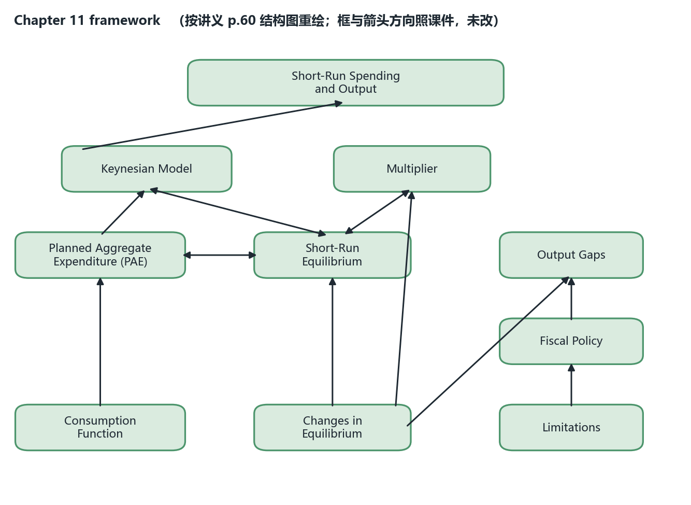

*图 16　全章概念框架图：顶部横框 Short-Run Spending and Output；第二行 Keynesian Model 与 Multiplier；第三行 Planned Aggregate Expenditures (PAE)、Short-Run Equilibrium、Output Gaps；第四行 Fiscal Policy；第五行 Consumption Function、Changes in Equilibrium、Limitations。11 条箭头的方向逐条照课件画：消费函数 → PAE；PAE → 凯恩斯模型；凯恩斯模型 → 顶部；PAE ↔ 短期均衡；短期均衡 ↔ 凯恩斯模型；短期均衡 ↔ 乘数；均衡的变动 → 短期均衡 / 乘数 / 产出缺口；财政政策 → 产出缺口；局限性 → 财政政策。（按讲义 p.60 结构图重绘；课件原图用 10 个绿色圆角框 + 矢量箭头）*

这张图里有一条值得质疑的边：**`Limitations` 只有一条单向箭头指向 `Fiscal Policy`**，没有指向 `Multiplier` 或 `Output Gaps`。但 p.54–p.57 讲的四条限制里，时滞与自动稳定器**直接作用于乘数**（自动稳定器改变斜率、时滞改变哪一轮起作用），赤字与挤出**直接作用于缺口的大小**。课件的图把「限制」只挂在政策上，读起来像是「政策不好用」，实际内容却是「整条推理链的每一环都有折扣」。**照画不改，但复习时按我上面这句话理解。**

### 12.2 表一：全章唯一的参数集与它推出的所有结果

| 量 | 值 | 怎么来的 | 出处 |
|---|---|---|---|
| $\bar C$ | 620 | 给定 | p.30 |
| $mpc$ | 0.8 | 给定（$0<mpc<1$） | p.22、p.30 |
| $T$（净税） | 250 | 给定，**固定不随 $Y$ 变** | p.30、p.50 |
| $I^{P}$ | 220 | 给定 | p.30 |
| $G$ | 300 | 给定 | p.30 |
| $NX$ | 20 | 给定 | p.30 |
| 自主支出 $A$ | **960** | $620 - 0.8 \times 250 + 220 + 300 + 20$ | p.30 |
| 支出线 | $PAE = 960 + 0.8Y$ | 代入 | p.30 |
| 均衡产出 $Y^{eq}$ | **4,800** | $960 / (1 - 0.8)$ | p.33 |
| 潜在产出 $Y^{*}$ | 4,800 | **假设**原均衡即潜在产出 | p.38 |
| 冲击后 $A$ | 950 | $\bar C$ 由 620 减 10 | p.37 |
| 冲击后 $Y^{eq}$ | 4,750 | $950 / 0.2$ | p.37–p.38 |
| 衰退缺口 | **50** | $4{,}800 - 4{,}750$ | p.38 |
| 支出乘数 | **5** | $1/(1-0.8)$ | p.42、p.44 |
| 税收乘数 | −4 | $-mpc/(1-mpc)$（**课件未命名**） | 我的补充，p.51 的 12.5 即其应用 |
| 平衡预算乘数 | +1 | 增支与增税等量时 $\Delta Y = \Delta G$（**课件未提**） | 我的补充 |
| 补 50 缺口：增支 | **+10** | $50 / 5$ | p.47 |
| 补 50 缺口：减税 | **−12.5** | $50 / 4$ | p.51 |
| 补 50 缺口：平衡预算 | +50 且 +50 | 乘数 1 | 我的补充 |

### 12.3 表二：四种「移动」与它们各自改变模型里的什么

| 变动 | 改变自主支出 $A$？ | 改变斜率？ | 曲线怎么动 | 均衡产出怎么变 |
|---|---|---|---|---|
| $\bar C$、$I^{P}$、$G$、$NX$ 任一动 | 是，一对一 | 否 | 红线**竖直平移** | $\Delta Y = $ 平移量 × 5 |
| 净税 $T$ 变 | 是，但打 $mpc$ 折 | 否 | 红线竖直平移 $-mpc \cdot \Delta T$ | $\Delta Y = -4 \times \Delta T$ |
| $mpc$ 变 | 也顺带动 $A$（因为 $-mpc \cdot T$ 变了） | **是** | 红线**绕截距旋转**，斜率变 | 要重解 $Y = A/(1-mpc)$，**不能用旧乘数** |
| 价格水平 $P$ 变 | 本章**假设它不变** | 否 | 无（若放开就进 AD-AS，第 13 章） | 本章无法回答 |

第三行是选择题最常见的陷阱：**$mpc$ 一变，$A$ 也变了**（练习 5 里 $A$ 从 960 变 972.5）。只改斜率不改截距的算法会得到错的均衡。

### 12.4 表三：三张图的分工（同一条红线，三种问法）

| 想回答什么 | 用哪张图 | 关键读法 |
|---|---|---|
| 均衡产出是多少 | 45° 线 + 一条支出线（图 10） | 交点横坐标 |
| 现在不在均衡，会往哪走 | 45° 线 + 支出线 + 某个 $Y$ 处的竖直缺口（图 11、图 12） | 缺口 = 非计划存货；红线在上 ⇒ 增产，45° 在上 ⇒ 减产 |
| 冲击/政策造成多大缺口 | 45° 线 + **两条平行**支出线（图 13、图 14） | 两交点之间的水平距离 = 缺口；$Y^{*}$ 处画一条粗竖线当参照 |

### 12.5 十个坑

1. **$I$ 与 $I^{P}$ 混用**。$I = I^{P} +$ 非计划存货。$PAE$ 方程里只能用 $I^{P}$；核算恒等式里只能用 $I$。
2. **非计划存货的方向记反**。$GDP > PAE$ ⇒ 存货**堆积**（正）⇒ 减产。记反则第七、八节全错。
3. **把 45° 线当行为方程**。它只是 $Y = PAE$ 的轨迹，斜率永远是 1，不代表任何人的计划。
4. **算自主支出时忘了 $-mpc \times T$**。$620 + 220 + 300 + 20 = 1{,}160$ 是错的，必须减 200 得 960。
5. **$mpc$ 变了却沿用旧乘数**。乘数是 $1/(1-mpc)$，随 $mpc$ 一起变，且 $A$ 也变。
6. **把乘数直接乘在减税额上**。减税 12.5 的正确算法是 $12.5 \times 4$（税收乘数），不是 $12.5 \times 5$；等价说法是最初支出只增加 $mpc \times 12.5 = 10$。
7. **以为「增支与减税等效」**。同一个 50 元缺口，增支要 10、减税要 12.5。
8. **以为平衡预算政策无效**。平衡预算乘数是 1，不是 0（课件未提，是我的补充）。
9. **把「衰退」与「衰退缺口」当同义词**。衰退是产出的负增长过程（第 10 章的定义：连续两季负增长或显著低于正常）；衰退缺口是 $Y^{eq} < Y^{*}$ 这个水平差额。有缺口未必在衰退，衰退未必留下缺口。
10. **用本章乘数去评估现实法案**。5 倍乘数没有漏出、没有时滞、没有挤出；加上 10% 边际进口倾向就只剩 3.33，加上 20% 比例税只剩 2.78（8.5 表）。**报数时必须说明是模型上限还是现实估计。**

**练习 10（我的补充，非讲义内容）。** 若 $mpc = 0.8$ 不变，但 $G$ 与 $T$ 同时各增加 30（预算仍平衡），且经济原本处于 $Y = 4{,}750$ 的衰退中。新的均衡产出是多少？缺口补上了吗？

> [!TIP] 参考答案
> 平衡预算乘数为 1：$\Delta Y = +30$，$Y: 4{,}750 \to 4{,}780$。**缺口 50 只补上 30，还剩 20**。逐步验证：$\Delta A = \Delta G - mpc \cdot \Delta T = 30 - 24 = 6$，$A: 950 \to 956$，$Y = 956 / 0.2 = 4{,}780$ ✓。若要不平衡预算地补齐 50，需增支 10；若坚持平衡预算，则需 $\Delta G = \Delta T = 50$。

---

## 十三、附：诚实备注

### ① 发现的课件问题

按影响答案的程度排序，⚠️ 表示会影响做题结果。

1. ⚠️ **p.40 的 72 法则数字与结论对不上。** 原文：房价 2001–2006 年均涨 8.2%，「Using the rule of 72, house prices would double in 10 years as compared to 15-19 years」（1976–1979 年均 4.9%）。**应为 8.78 年与 14.69 年**（精确复利 8.80 与 14.49）。判定依据：$72 / 8.2 = 8.78$、$72 / 4.9 = 14.69$。两种读法都列在 8.6 的 `[!WARNING]` 里：A) 圆整（则「19」这个上限无来源）；B) 按 $r \in [3.8\%, 4.8\%]$ 反算（则与本页给的 4.9% 不符）。**我判不出课件本意。** 这条不影响本章的乘数结论，只影响这一页的论证质量。
2. ⚠️ **p.37 的因果措辞反了。** 原文 `A drop in Y causes recessionary gap`。**应为 a drop in autonomous spending（自主支出下降）causes a recessionary gap**：$Y$ 的下降是缺口的表现。判定依据：同页图上向下箭头画在两条 $PAE$ 线之间（表示支出线平移），p.38 第一条 bullet 明写「$\bar C$ 减少 10 引起支出曲线向下平移」。
3. ⚠️ **p.47 与 p.51 把 $PAE$ 写成 $Y$。** 原文 `planned spending decreases $10 from Y = 960 + 0.8Y to Y = 950 + 0.8Y`。**应为 $PAE = 960 + 0.8Y$**。判定依据：p.30 与 p.33 分别把行为方程写作 $PAE = \ldots$、均衡条件写作 $Y = PAE$；把两者混写会让「解方程」这一步失去意义。数值不受影响。
4. **p.9 / p.11 / p.30 的 $I$ 与 $I^{P}$ 符号不统一。** p.9 直接把 $I$ 定义成「计划支出」，p.11 起改用 $I^{P}$。口径一致，符号先后不统一。判定依据：p.11 明说「实际投资可能不等于计划投资」，所以必须区分两个符号。
5. **p.17 文字层里 $\bar C$ 的横线丢失，导致同一页出现两个 $C$。** 原文最后一条 `A change in C shifts the consumption function`，**应为 a change in $\bar C$**。判定依据：p.18 与 p.19 的标题栏（渲染图可见横线）都是 `Determining Autonomous Consumption, $\bar C$`。
6. **p.22 同一页混用 $mpc$ 与 $MPC$。** 前者是函数斜率、后者是分式定义，值相同。不是错误，但需要统一。
7. **p.44 同一页混用 $mpc$ 与 $x$ 作为公比**（`In our case, x = 0.8`）。不是错误。
8. **p.58 与 p.38 用两个符号表示同一个概念**：$Y_{FE}$（充分就业产出）与 $Y^{*}$（潜在产出）。判定依据：p.58 表第二行说 $Y_{FE}$ 对应自然失业率，正是正文里 $Y^{*}$ 的角色。
9. **p.4 标题是 `Recessionary Gap`，但整页内容是大萧条的动机铺垫**，「衰退缺口」的定义要到 p.37–p.38 才出现。判定依据：本页五条 bullet 全是历史叙述，没有任何缺口定义或数值。
10. **p.27 图与批注的口径不完全对齐**：bullet 说 "government purchases"，图例是 "Real Government Consumption Expenditures"；批注讲「联邦升、州与地方降」，但图上只有一条总量序列，两股力看不见；bullet 说 1992 起实际政府购买连降三年，图上 1990 之后曲线仍在缓慢上行。判定依据：400 dpi 放大条带确认图例只有一条序列。
11. **p.28 图上有一条未加图例说明的加粗水平线**（位置接近零）。**判不出它除了「净出口 = 0 参考线」之外还有没有第二种读法**，正文只按位置描述。
12. **p.49、p.15、p.16 三页的图没有注数据出处**（对比 p.24、p.27、p.28 都给了 FRED 链接），p.49 也没有说明 12 条深蓝竖条是什么。引用时按「课件原图未注出处」处理，我没有替它补来源。
13. **p.40 与 p.41 标题不一致**（`What Caused U.S. Recession 2007 - 2009` vs `What Caused the U.S. Recession 2007 - 2009`，多一个 the）。无实质影响。
14. **p.38 与 p.42 页末各有一个孤立的 `–` 字符**，是排版残留。
15. **p.59 的措辞容易被读反**：「政府干预之后自我校正机制会重新开始运作」可能被读成「凯恩斯也信自动校正」。这是措辞问题不是计算问题，已在 11.2 的 `[!NOTE]` 里点出。

**课件留作练习而不给答案的页**：只有 p.12 一页（Practice 选择题）。本笔记在 3.5 给出解答（选 C）并标为我的补充。

### ② 我复算/补充出来的数字与内容

**课件自己给的数，我逐格验算过的**（这些是课件算对了的，列出仅为方便自查，不算发现）：p.10 三情形（1.2 / 1.4 / 1.0）、p.20（$13.3 \times 0.49 = 6.517$；$6.5 \times 0.03 = 0.195$、$\times 0.07 = 0.455$）、p.30（$A = 960$）、p.33（$Y = 4{,}800$）、p.37–38（$950 / 0.2 = 4{,}750$、缺口 50）、p.42–44（乘数 5、$10 \times 5 = 50$）、p.47（增支 10 补回 4,800）、p.51（4,210 / 4,220、$\Delta T = 12.5$）。

**我算出来的、课件没给的数字**：

- **§3.5**：p.12 练习题答案 **C**（$PAE = 25$ 对 $GDP = 23$ ⇒ 非计划存货减少 2）。
- **§3.4**：2009 年 Q1 年化 −6.7% 换算成单季约 **−1.7%**。
- **§7.1 / §7.2**：$Y = 5{,}000$ 时 $PAE = 4{,}960$，非计划存货增加 **40**；$Y = 4{,}500$ 时 $PAE = 4{,}560$，非计划存货减少 **60**。并给出通用式 $PAE - Y = A - (1 - mpc)Y$。
- **§7.3**：把调整写成差分方程 $Y_{t+1} = \lambda A + (1 - \lambda(1-mpc))Y_t$，证明 $0 < \lambda \le 1$ 时路径**单调收敛、不过冲**。这是讲义没有的推导。
- **§8.3**：逐轮表补到第 10 轮（课件只到第 4 轮 5.12），并给出「前 4 轮 59.04%、前 10 轮 89.26%、极限 50」三个百分比。
- **§8.5**：$mpc$ 敏感性表（0.5→2 倍、0.75→4 倍、0.9→10 倍、0.95→20 倍）与**漏出乘数** $1/(1 - mpc(1-t) + x)$ 的六组数值（3.333 / 2.500 / 2.778 / 2.174 / 1.786）。**这是讲义没有的表**——本章没有边际进口倾向、没有比例税率。
- **§9.5**：税收乘数 $-mpc/(1-mpc) = -4$、验算 $-4 \times (-12.5) = +50$；**平衡预算乘数 = 1**，并用 $\Delta G = \Delta T = 10$ 与 $= 12.5$ 两组数值验证。
- **§9.6**：2008–09 两部法案按本章口径的反事实上限：$\Delta A = 660 + 0.8 \times 300 = 900$、$\Delta Y = 4{,}500$（十亿美元），其中支出腿 3,300、减税腿 1,200（占 27%）。2001 退税的 $38 \times 2/3 = 25.3$、若误把 $2/3$ 当 $mpc$ 则乘数 3、拉动上限约 76。
- **§10.4**：自动稳定器 = 把 $T$ 变成 $Y$ 的函数 ⇒ 斜率变 $mpc(1-t)$ ⇒ 乘数从 5.00 掉到 2.78（$t = 0.2$）。
- **§12.5 练习 10**：$\Delta G = \Delta T = 30$ 时 $Y = 4{,}780$，缺口只补上 30、剩 20。
- 十道练习（3.5、2.3、4.4 各一、6.4、7.3、8.6、9.6、10.4、12.5）全部是我出的题与我的解答，标「我的补充，非讲义内容」。

**我自绘的图（这是讲义没有的图）**：本笔记 16 张图里没有一张是「讲义完全没有、我自己新画的概念图」——8 张重绘图（图 5、9、10、11、12、13、14、16）都是课件上真实存在的示意图的重绘版。真正「讲义没有的图」是 **§8.5 的两张表**（乘数敏感性与漏出乘数）与 **§9.5 的三乘数对照表**，它们以表格而非图形形式出现。

### ③ 数值核验

- **为什么敢用 $Y^{*} = 4{,}800$**：这不是我选的数，是课件 p.38 的假设句（`Suppose that the original equilibrium level, \$4,800, represented potential output`）。缺口 50 完全建立在这个假设之上，**换一个 $Y^{*}$ 缺口就变**，正文在 8.2 表里已注明「由课件假设给定」。
- **$-0.8 \times 250 = -200$ 这一步**是全章最容易出错的地方，我在 p.30 的验算里把它单独展开成五行；§12.5 坑 4 再提醒一次。
- **练习 5 里 $A$ 从 960 变 972.5**：这是 $mpc$ 从 0.8 改 0.75 时 $-mpc \cdot T$ 从 $-200$ 变 $-187.5$ 的结果。**如果只改斜率不改截距，会得到 $Y = 960/0.25 = 3{,}840$，比正确值 3,890 少 50**——这个差额正好是 50，容易被误当成「答案差不多」，所以要盯住。
- **72 法则的误差方向不固定**：$r = 8.2\%$ 时精确值 8.80 略**高于** 8.78，$r = 4.9\%$ 时精确值 14.49 略**低于** 14.69。所以不能笼统说「72 法则高估翻倍时间」，正文在 8.6 的 `[!WARNING]` 里按两个方向分别交代。
- **反事实上限的定位**：§9.6 的 4,500（十亿美元）与 76（十亿美元）两个数**只是模型上限**，不能当现实估计引用；我在两处都写明了三重折扣（漏出、时滞、州府填坑）。

### ④ 与上一讲预告的对账

第 9 章笔记末尾写过两条与本讲相关的预告，逐条对：

1. **预告：「货币中性长期成立、短期不成立，这条分界线就是 AD-AS 模型的入口。」** → **部分命中**。本讲给了分界线的**需求侧一半**：价格黏性（p.7–p.8 菜单成本）、工资向下黏性（p.59 最低工资法/工会/长期合同）、数量调整机制（存货 → 产量 → 乘数）。**没有给货币侧**：模型里没有货币、利率与央行，所以「名义变动如何产生实际效果」仍未论证。那需要第 12 章的货币需求与利率决定，以及第 13 章把 $P$ 内生化的 AD-AS。
2. **预告：第 4 章笔记的坑七「存货投资可以为负」。** → **命中**。本讲把它从「核算补丁」升级成「均衡调整的信使」：p.10 风筝厂三情形、p.13 三行调整表、p.35–p.36 两张调整图，全部靠「存货可以被塞满也可以被掏空」驱动。
3. **术语一致性检查（潜在产出 / 产出缺口 / 实际 GDP）**：本讲的 $Y^{*}$ 与第 4 章的「潜在产出」定义**没有写成两套**——第 4 章给的是核算口径（一个经济在正常利用资源时能生产多少），本讲 p.38 只是把它当成一个**假设给定的数值**，没有重新定义；衰退缺口的定义与第 10 章（产出缺口 $= Y - Y^{*}$，负值为衰退缺口）一致，本讲 p.46 的政策目标函数直接写作 eliminating output gaps。**唯一需要提醒的是本讲内部 $Y^{*}$ 与 $Y_{FE}$ 两个符号并存（见 ① 第 8 条）。**
4. **第 9 章的存款乘数 $1/r_d$ 与本讲支出乘数 $1/(1-mpc)$**：同构的几何级数，第 9 章笔记 §6.3 的统一式 $m = (1+c)/(c + r_d + e)$ 与本讲 §8.5 的 $1/(1 - mpc(1-t) + x)$ 是同一个思想的两个版本（**每一轮都有钱漏出，漏得越多、级数收敛得越早**）。这条对照是我给的，两讲课件都没写。

### ⑤ 本讲「够 / 不够」与复习顺序

**讲足了的三块。** 第一，**乘数的来源被彻底拆开**：p.43 的逐轮链条 + p.44 的几何级数 + p.42 的比值定义，三条路互相验算，这是本章最扎实的部分，也是唯一能「合上书自己重算一遍」的地方。第二，**45° 线图的使用规范被完整示范**：从 p.32 画一条线、p.34 加 45°、p.35–p.36 演示偏离、p.37 与 p.48 演示移动，五张图是同一骨架的五种问法（§12.4 已整理成分工表）。第三，**政策工具的不对称性给了具体数字**：增支 10 对减税 12.5（p.47 与 p.51），这个对照是本章最有考试价值的一组数。

**抛题不解的四块。** 其一，**利率与投资**：p.25 宣告了反向关系，模型里没有利率，$I^{P}$ 全程是常数（§5.1 的 `[!WARNING]`）。其二，**开放经济的漏出**：$NX$ 是常数，没有边际进口倾向，所以「日本把衰退出口给邻国」（p.39）只能定性讲（§5.3 的 `[!NOTE]`、§8.5 的补充表）。其三，**挤出与李嘉图等价**：p.55 讲了赤字减少储蓄、p.52 讲了退税三分之二被花掉，两个材料都在，**但这两个名字没出现**，p.56 的限制清单也没有它们（§10.3 的 `[!WARNING]`）。其四，**通胀缺口**：p.46 用 output gaps 统称，但全章只给了衰退缺口的数值例，产出高于 $Y^{*}$ 时会发生什么（涨价？还是被假设 $P$ 不变直接吞掉？）没有交代——**这是本章「假设 $P$ 不变」这个前提自己的边界**，要到第 13 章才处理。

**被整块跳过的：** 没有。60 页全部覆盖，包括两页附录表格（p.58–p.59）与封面漫画（p.1）。

**下一步该补什么（给自己的清单）。** ① 用第 8 章可贷资金图把「增支 10」重做一遍，看挤出把乘数从 5 削到多少；② 把 $T = T_0 + tY$、$NX = \bar{NX} - xY$ 代进 $PAE$，重解均衡，验证 §8.5 的 $1/(1 - mpc(1-t) + x)$；③ 读一遍 Mankiw 的乘数章节，对照本章的 $1/(1-mpc)$，看「平衡预算乘数 = 1」在 Mankiw 里是怎么证的（课件完全没提）。

**建议的复习顺序。** **第一步，合上书把 §12.2 那张参数表默写出来**（620 / 0.8 / 250 / 220 / 300 / 20 → 960 → 4,800），写不出就说明本章所有算例都站不住。**第二步，手算逐轮表**：从「自主支出少 10」出发，写出 10、8、6.4、5.12，然后说出「为什么极限是 50 而不是 100」——这逼你把 $mpc < 1$ 与几何级数两件事连起来。**第三步，画三遍同一张 45° 图**：一遍原图（标 960 与 4,800）、一遍 $\bar C$ 减 10（两条平行线、标 $E$、$F$ 与缺口 50）、一遍再加 $\Delta G = 10$ 推回 $E$；每画一遍都说清「平移的是截距、不是斜率」。**第四步，把三种乘数并排背**：5、−4、1，并各配一句「为什么」：增支一对一进 $A$、减税先被 $mpc$ 打折、平衡预算时两个效应相抵只剩 $\Delta G$。**第五步，最后读第十节的四个限制**，因为它们是本模型的外部边界，必须在模型本身熟了之后才读得懂——尤其「自动稳定器降低乘数」这一条，不懂 §8.5 的漏出公式是看不出它在说什么的。这四步做完，本章的计算题（求均衡、求缺口、求所需政策量）与画图题（45° 图的五种问法）就稳了。

