# ECO2021 课堂笔记：第 12 章　货币政策与美联储（Monetary Policy and the Federal Reserve）

> 对应课件：Chapter 12 `Ch12 Monetary Policy and the Federal Reserve.pdf`（Instructor: Jieshuang He，Principles of Macroeconomics），共 **52 页**，页脚编号是**纯数字 1…52**，与 PDF 页序一一对应（不像第 9 章的 `9-1` 样式）。本笔记里所有 p.N 都是课件第 N 页
> **本讲无课堂口述记录，正文基于课件（PDF）整理**；课件只给题目不给答案的地方（p.51 的课堂选择题），我给出了自己算的解答并标「我的补充，非讲义内容」；凡我复算、推导或补充的内容，第九节逐条交代
> 一句话主线：**美联储先调货币供给 $M$，$M$ 与货币需求 $MD$ 一起定出名义利率 $i$，短期里 $\pi$ 动得慢所以 $i$ 的变动就是实际利率 $r$ 的变动，$r$ 再压进凯恩斯支出函数把 $PAE$ 抬起来或压下去，乘数把第一轮变动放大五倍去填产出缺口**（p.10 → p.11 → p.15–p.18 → p.21/p.28）
> 与上一讲的分工：第 9 章讲完了 M0/M1/M2 的分层、存款创造、统一货币乘数 $m=(1+c)/(c+r_d+e)$ 与三大工具，**这一章不再重复那些**，只做三件第 9 章没做的事：**补上货币需求 $MD$**（p.32–p.42，第 9 章完全缺席的那一半）、**把利率接进短期支出模型**（p.14–p.30，第 9 章只讲长期）、**讲清这套框架在零利率下限失灵**（p.48–p.50）

---

## 〇、本讲地图

全章 52 页被课件自己的目录切成两大块：第 I 块「Central Bank of U.S. – the Federal Reserve System」（p.4–p.8，只有五页制度介绍），第 II 块「Monetary Policy in the Short-run」，它下面又挂三条——II.1「How interest rate is related to PAE」（p.10–p.18）、II.2「Implications of monetary policy」（p.19–p.30）、II.3「The relationship between money supply and interest rate」（p.31–p.50）。**这份目录在 p.3、p.9、p.20、p.31 各出现一次，靠黑/灰切换指示进度**：p.3 时 II 是灰的，p.9 时 I 变黑，p.20 时 II.1 变黑，p.31 时 II.3 变黑。

课件的目录比例是骗人的：第 I 块只占五页，而 II.3 一条就占了二十页。而且**真正难的部分（货币市场与流动性陷阱）排在最后**，前面三十页全是制度介绍和一道反复使用的算例。下表按内容而不是按课件目录切分，页区间首尾相接、不重叠、不遗漏。

| 本章小节 | 对应讲义页 | 这一节在回答什么问题 |
|---|---|---|
| 一、美联储是什么：1913 年的动机与三层架构 | p.1–p.8 | 谁在制定货币政策；它为什么长成「12 家银行 + 7 位理事 + 12 人委员会」这个样子 |
| 二、传导链条的第一环：货币供给 → 名义利率 → 实际利率 | p.9–p.13 | 美联储到底在调哪个数；为什么调 $i$ 在短期里就等于调 $r$ |
| 三、把利率装进凯恩斯模型：$PAE(Y,r)$ | p.14–p.18 | 利率变动一个百分点，消费、投资、支出、产出各变多少 |
| 四、用货币政策填缺口：两道对称的算例与两次实操 | p.19–p.30 | 缺口 200 时该把利率设成几；2001 年与 2004–2005 年美联储实际做了什么 |
| 五、货币需求：利率是怎么被「决定」出来的 | p.31–p.39 | 人们为什么愿意持有不生息的货币；$MD$ 的位置与形状由什么定 |
| 六、货币市场均衡：$MD \times MS$ 与美联储的三件工具 | p.40–p.47 | 垂直的供给曲线怎么把利率压下来；为什么美联储不能同时定 $i$ 和 $M$ |
| 七、零下限、流动性陷阱与量化宽松 | p.48–p.50 | 利率降到 0 之后，前面六节这套框架还剩什么 |
| 八、速查表与易错点 | p.51–p.52 | 课堂选择题 + 全章数字、公式与框架图 |
| 九、附：诚实备注 | — | 我算了什么、补了什么、课件哪里有问题、与第 9 章两个空洞的账 |

**这份笔记的读法。** 括号里第一次出现的英文是课件原名，中文译名是我给的，考试与作业以英文术语为准。本章的算例只有一套数字（$C=640+0.8(Y-T)-400r$ 那一组），p.16 到 p.29 反复用它，所以**第三节是本章的技术地基**：把 $1{,}010 - 1{,}000r + 0.8Y$ 这一行推出来并记住每一项从哪来，后面四节的每个数都能自己算。第五、六节是本章的理论新增（第 9 章没有的部分），第七节是它的失效条件。**如果只有两小时，读第三节 + 第六节 + 第七节。**

> [!IMPORTANT] 本章有两个「乘数」，别混
> 「Multiplier is 5」这句话（p.21 与 p.28）说的是**凯恩斯支出乘数** $1/(1-mpc)=1/0.2=5$，它管的是「第一轮支出变动放大成多少产出」。第 9 章讲的**货币乘数** $m=(1+c)/(c+r_d+e)$ 管的是「1 元基础货币变成多少货币供给」。两个都叫 multiplier，量纲完全不同，本章只用前者、一次没提后者。看到「乘数」先问一句：它在乘什么。

---

## 一、美联储是什么：1913 年的动机与三层架构（p.1–p.8）

### 1.1 从一张漫画说起：投飞镖的人与打不中的靶（p.1）

课件第一页没有定义、没有表格，只有一幅政治漫画。这个选择值得读，因为它把整章的**评价标准**先摆出来了。

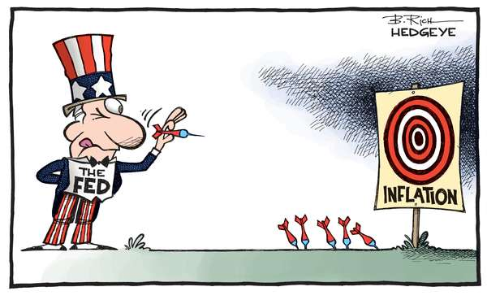

*图 1　山姆大叔（胸前牌子写 `THE FED`）正在往一块写着 `INFLATION` 的靶子投飞镖，靶前地上已经插着四支全部落在靶子下方，靶子上方一团灰色阴影。署名 B. Rich / HEDGEYE。画的是「美联储的目标是通胀，而且反复打短」（按原图裁切，未重绘；出自讲义 p.1）*

三个可观察的细节：

第一，**靶子上只写了一个词：INFLATION**。不是 GDP、不是失业率、不是股价。这幅漫画默认读者知道，美联储的问责标准是通胀，而不是它做过的那些别的事。

第二，**四支脱靶的飞镖全都插在靶子的下方和前方**，没有一支打穿靶子。方向一致地「打短」，这是漫画家对某一类政策失误的特定指控：不是乱开枪，而是**每次都算少了**。

第三，**靶子上方那团灰色阴影**。它罩在靶心上，意思是目标本身看不清楚。这一层最实用：**货币政策难，一半原因不是决策者笨，而是他要打的靶子在测量上是模糊的**——通胀用什么指数、用什么区间、当期还是预期，第 5 章讲 CPI 偏差时已经埋过这个伏笔。

这张漫画没有给出任何定义，但它给了本章一个判断标准：**学完这一章，你要能说清「美联储要在什么条件下、把什么工具调到什么值，才能把飞镖投中」。** 后面七节都在回答这句话。

### 1.2 为什么会有美联储：银行挤兑与它带来的衰退（p.4–p.5）

先给动因，再给机构，这是课件的顺序，也是正确的顺序。

1913 年，美国国会通过《联邦储备法》（Federal Reserve Act），设立联邦储备体系（Federal Reserve System），俗称「the Fed」。课件给的理由是一句话：**为了终结银行恐慌以及随之而来的衰退（With the intention of putting an end to bank panics and their accompanying recessions）**（p.4）。

这句话里有两个因果环节值得单独指出来：

- **恐慌（panic）本身是信息问题，不是资产问题**。它的定义是：银行恐慌发生在**顾客认为一家或多家银行可能破产时**（Banking panics occurred when customers believe one or more banks might be bankrupt，p.8）。注意「believe」——储户的判断可以是错的。第 9 章 p29–p32 讲挤兑时展开过这一层：银行做的是「借短贷长」，任何一家银行在任意时刻都只有存款的一小部分能立刻兑付，所以「**大家都来取**」这个动作本身就能让一家本来健康的银行关门。
- **恐慌为什么会带来衰退**：银行关门 → 贷款消失 → 依赖银行贷款的企业买不到投入品 → 产出下降。这条链解释了为什么动机里要把「accompanying recessions」写进去：**美联储要救的不只是银行，是银行停摆之后的实体经济**。

美联储的两项职责（p.4）由此而来：执行货币政策（conduct monetary policy）；监督与规范金融市场（oversee and regulate financial markets），后者被课件标为「解决金融危机的核心」（Central to solving financial crises）。

另外两件事实容易记混：**《联邦储备法》在 1913 年通过，联邦储备体系在 1914 年才开始运作（began operations in 1914）**（p.5）。立法年和开业年差一年，选择题最爱在这里挖坑。

同一页还给了一个机构性质的关键限定：**美联储不追求利润最大化（Does not attempt to maximize profit），它促进的是公共目标——经济增长、低通胀、金融市场平稳运行**。这一句解释了本章后面所有「反常」的操作：一家商业银行在利率为 0 时会停止放贷，而一家不以利润为目标的机构可以在利率为 0 时继续买债券（p.50 的量化宽松）。

### 1.3 三层架构：12 家地区银行、7 位理事、12 人委员会（p.6–p.7）

美联储的组织结构常被背成一堆名词。它其实回答的是一个具体设计问题：**一个国家的货币权力，应该怎么分配才既不会被华盛顿单独控制、也不会被华尔街单独控制？** 答案分三层。

**第一层：12 家联邦储备银行辖区（12 Federal Reserve Bank districts）**（p.6）。每家评估本地区的经济状况（assess economic conditions in their region），为本地区的商业银行提供服务（provide services to commercial banks in their region）。

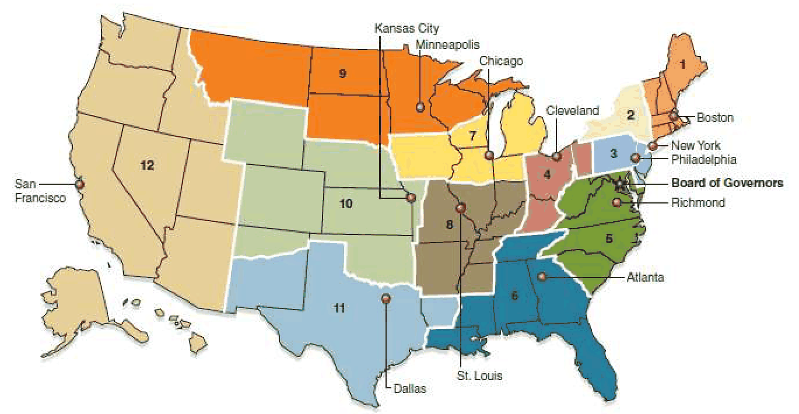

*图 2　12 家联邦储备银行的辖区图。编号与总部城市：1 Boston、2 New York、3 Philadelphia、4 Cleveland、5 Richmond、6 Atlanta、7 Chicago、8 St. Louis、9 Minneapolis、10 Kansas City、11 Dallas、12 San Francisco。`Board of Governors` 的引线指向华盛顿特区，它不是第 13 个辖区（按原图裁切，未重绘；出自讲义 p.7）*

这张辖区图有两处容易读错。其一，**辖区边界不是州界**：第 12 区（San Francisco）覆盖整个西部，含阿拉斯加与夏威夷；第 9 区（Minneapolis）横贯北平原。其二，**标着 `Board of Governors` 的那根引线不是第 13 个区**，它是设在华盛顿特区的联邦机构，只是被画在了东海岸那个位置。

**第二层：理事会（Board of Governors）**（p.6–p.7）。它提供领导（leadership is provided by the Board of Governors），职责是监督整个联邦储备体系。7 位理事由总统任命，任期 **14 年、不可连任（nonrenewable）**；总统从 7 人中指定一位为主席，主席任期 **4 年、可连任（renewable）**。

**第三层：联邦公开市场委员会（Federal Open Market Committee, FOMC）**（p.6–p.7）。它审议经济状况并制定货币政策（reviews economic conditions and sets monetary policy），负责公开市场操作。12 名成员、**每年开八次会**（p.6）。这 12 人的构成写在 p.7 右下角的文本框里：

| 机构 | 职责 | 人数 | 成员来源 | 任期 |
|---|---|---|---|---|
| Board of Governors（理事会） | 监督整个联邦储备体系 | 7 | 总统任命 | 理事 14 年、**不可连任**；主席 4 年、**可连任** |
| FOMC（联邦公开市场委员会） | 负责公开市场操作、设定货币政策 | 12 | 7 位理事 + 纽约联储银行行长 + 其余 11 家地区银行中**轮值**的 4 位行长 | 轮值行长 1 年一届；理事会主席兼任 FOMC 主席 |
| 12 家地区联储银行 | 评估本地区经济状况、为本地区商业银行提供服务 | — | — | — |

（表由 p.6 的要点与 p.7 两个文本框合并而成；「—」表示课件此处空白，未给该项信息。）

现在回到那个设计问题，三个数字各自解释一个可观察现象：

- **为什么是 12 家而不是 1 家**：1913 年的美国对「华盛顿的中央银行」极度不信任，于是把机构切成 12 个地区法人。**它解释的现象是：美联储的决策文件里为什么会有地区经济景气报告，为什么堪萨斯城的农业和旧金山的科技都能直接影响利率决定。**
- **为什么理事任期长达 14 年且不可连任**：让理事的政治寿命长于总统的任期（4 年 × 2 届）。**它解释的现象是：美联储可以在选举年前加息。** 一个由选举问责的机构做不到这件事。
- **为什么纽约联储行长是固定投票成员、其余 11 家轮值 4 席**：纽约是美国国债与银行间市场的物理所在地，公开市场操作必须有人天天盯着。**它解释的现象是：为什么美联储的「市场操作台」（open market desk）设在纽约联储而不是华盛顿。**

> [!CAUTION] p.6 与 p.7 的说法要合并才完整
> 「FOMC 有 12 members」这句话本身没说这 12 人怎么来（p.6），「7 位理事 + 纽约联储行长 + 其余 11 家轮值 4 位行长」是另一处才补出的（p.7），而「每年开八次会」只在前一处出现（p.6）。同理，理事 14 年任期在那里没写 nonrenewable、主席四年任期没写可否连任，两处补充都出自 p.7。**两页不矛盾，但任何单页都不完整——引用时以「p.6 + p.7 合并」为准。**

### 1.4 美联储怎么防挤兑：监管 + 借钱（p.8）

美联储防恐慌有两条手段（p.8）：**监督与规范银行（supervising and regulating banks）**，以及**在需要时向银行放款（loaning banks funds if needed）**。第二条就是第 9 章讲过的「最后贷款人」（lender of last resort）职能，本章把它放进 FOMC 与贴现窗口（p.46）的具体工具里。

这里有一个失败情形值得想清楚：**如果只有第一条（监管）没有第二条会怎样？** 监管是事前的资本与流动性约束，但恐慌是事后的、由信念触发的挤提——即使所有银行都合规，一旦「大家在传某家银行要倒」，挤提仍会耗尽它的现金。第二条存在的理由正是：**它是用来应对「信念变化」的，而监管只能应对「资产负债表变化」。** 反过来，只有第二条没有第一条，就会变成无条件的救助，把银行的风险变成公共成本（这就是第 9 章提到的道德风险）。

**练习 1（我的补充，非讲义内容）**：判断题——「美联储成立于 1913 年，其理事会的 7 位理事由总统任命、任期 4 年且可连任。」这句话里有几处错？

> [!TIP] 参考答案
> 三处。① 1913 年是《联邦储备法》**通过**之年，美联储**开始运作**在 1914 年（p.4 vs p.5）；② 理事任期是 **14 年**，4 年是**主席**的任期（p.7）；③ 理事**不可连任（nonrenewable）**，可连任的是主席（p.7）。

**练习 2（我的补充，非讲义内容）**：FOMC 的 12 个席位里，有多少个席位的人选**不**由总统直接任命？

> [!TIP] 参考答案
> 5 个。7 位理事由总统任命；另外 5 席是纽约联储行长（固定）加 4 位轮值地区银行行长，这 5 人由各地区银行体系产生，不由总统任命。这也解释了为什么 FOMC 的构成里同时存在政治任命与技术官僚。

---

## 二、传导链条的第一环：货币供给 → 名义利率 → 实际利率（p.9–p.13）

### 2.1 三段链：目标、手段、机制（p.10）

第 II 块一开始，课件用一页三个色块给出全章的骨架（p.10）。这三块的排列顺序不是时间顺序，而是「**目标在上、机制在下**」的倒金字塔，读的时候要反过来推。

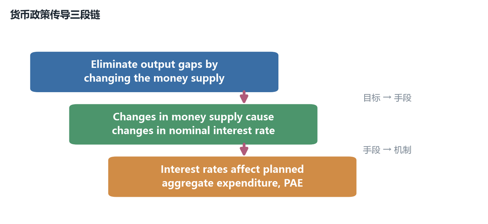

*图 3　货币政策传导三段链。自上而下分别是目标（消除产出缺口）、手段（改变货币供给）、机制（利率影响计划总支出）；课件用向下箭头串起来，但因果方向要从下往上读：$M \to i \to PAE$（按课件 p.10 示意重绘；出自讲义 p.10）*

把它翻译成一条可以顺着走的因果链，就是：

$$M \;\uparrow \;\Longrightarrow\; i \;\downarrow \;\Longrightarrow\; r \;\downarrow \;\Longrightarrow\; C\!\uparrow,\; I^{P}\!\uparrow \;\Longrightarrow\; PAE \;\uparrow \;\Longrightarrow\; Y \;\uparrow \times \frac{1}{1-mpc}$$

链条上每一环分别在本章哪一节被证明：$M \to i$ 在第六节（p.40–p.42 的 $MD \times MS$ 图），$i \to r$ 在本节（p.11），$r \to PAE$ 在第三节（p.14–p.18），$PAE \to Y$ 在第四节（p.21、p.28）。**第 9 章只讲了 $M$ 这一端（货币怎么被创造出来），本章补的是它右边这三环。**

### 2.2 为什么调 $i$ 就等于调 $r$：费雪方程的短期用法（p.11）

费雪方程那四句话是本章最容易被跳过、也最关键的一段（p.11）。顺序是：

1. Fed controls the money supply to control the nominal interest rate, $i$（美联储通过控制货币供给来控制名义利率）
2. Investment and saving decisions are based on the real interest rate, $r$（企业与家庭的决策依据的是实际利率）
3. The Fed has good control over $i$（美联储对 $i$ 有很强的控制力）
4. Inflation changes relatively slowly（通胀率变动相对缓慢）→ Changes in nominal rates become changes in real rates in the short run（名义利率的变动在短期里就变成实际利率的变动）

中间那个桥是费雪方程（Fisher equation）：

$$r = i - \pi$$

其中 $\pi$ 是通胀率（rate of inflation）。课件在第 5 章已经给过这个式子，这里直接拿来用，符号解释：$i$ 是名义利率（%每年）、$r$ 是实际利率（%每年）、$\pi$ 是通胀率（%每年），三者量纲相同、可直接相减。

**为什么「$\pi$ 动得慢」这句话是整条链的承重墙。** 把式子写成变动形式：

$$\Delta r = \Delta i - \Delta \pi$$

如果短期内 $\Delta \pi \approx 0$，那么 $\Delta r \approx \Delta i$——**美联储动 $i$ 多少，$r$ 就动多少**。这就是 p.11 的结论。反过来，如果 $\pi$ 和 $i$ 同时同幅变动（比如长期里通胀完全跟随货币政策，这正是第 9 章数量论的结论），那么 $\Delta r \approx 0$，**货币政策对实际利率就没有杠杆**。

于是得到一个本章最重要的对称认识：**同一根费雪方程，短期给出货币政策的权力，长期剥夺货币政策的权力。** 第 9 章讲的是长期那一半（货币中性），本章讲的是短期那一半（货币非中性）。

> [!CAUTION] 课件没交代 $\pi$ 是预期还是已实现
> 严格地说，事前（ex ante）实际利率应当是 $r = i - \pi^{e}$，$\pi^{e}$ 是**预期**通胀率；$r = i - \pi$ 用的是已实现通胀，那是事后（ex ante）口径，属于会计恒等式而非决策依据。课件全程写 $r = i - \pi$ 且不加限定，是初级课程的简化。**做题按课件；但要知道：如果一次加息让公众的预期通胀掉了 1 个百分点，$r$ 的实际下降幅度就接近 0，传导链在第二环就断了。** 这是货币政策「可信度」之所以重要的技术原因。

**小例子（我的补充，非讲义内容）**：$i$ 从 4% 升到 5%，$\pi$ 保持 2% 不变 → $r$ 从 2% 升到 3%，$\Delta r = +1$ 个百分点，美联储的意图完整传导。若同一时间 $\pi$ 从 2% 跳到 3% → $r$ 从 2% 升到 2%，$\Delta r = 0$，**加息完全被预期通胀抵消，对支出毫无影响**。

### 2.3 联邦基金利率：美联储真正盯住的那个数（p.12）

链条上还有一个中间量：美联储并不直接定 $i$，它定的是**联邦基金利率（federal funds rate）**——商业银行之间对短期（通常是隔夜）贷款收取的利率（the rate commercial banks charge each other on short-term (usually overnight) loans）。

联邦基金利率有三条属性，它们看似矛盾、实则互补（p.12）：

- **银行在资金不足时互相借款（Banks borrow from each other if they have insufficient funds）**：这个市场存在的原因是**准备金在银行间分布不均**——某天 A 行超额准备金多、B 行不足，B 就向 A 借隔夜。第 9 章的存款创造解释了为什么每家银行的准备金都不多，本页解释了为什么它们要互相借。
- **由市场决定的利率（Market determined rate）**：成交利率是借贷双方议价出来的，美联储不能直接宣布它。
- **被美联储盯住的（Targeted by the Fed）**：美联储通过移动准备金的供给量，让市场自己收敛到目标值。

这三条合起来的意思是：**美联储不定价，它改变稀缺程度，让价格自己动。** 这也是本章第六节 $MS$ 垂直线那张图的制度版本。

同一处还交代了方向，并以一句话收尾（p.12）：

- 要**降低**联邦基金利率，美联储执行**公开市场购买（open market purchases）**，结果是**准备金增加（Reserves increase）**。
- **利率倾向于同向变动（Interest rates tend to move together）**。

最后这句是传导链能延伸到实体经济的必要条件。联邦基金利率只是隔夜贷款利率，而企业投资用的是 5 年期利率、家庭买房用的是 30 年期抵押贷款利率。**如果这些利率不同向变动，美联储盯住隔夜利率就毫无意义。** 「tend to move together」是一个经验观察，课件没有证明它，本章也不需要——但你要知道它是被假设成立的。

### 2.4 43 年的目标轨迹：一条不断下降的阶梯（p.13）

本章唯一一张把「美联储到底在调什么」画了四十多年的图，标题是 `Daily Federal Funds Rate Targeting, 1982 - 2025`（p.13），值得逐段读。

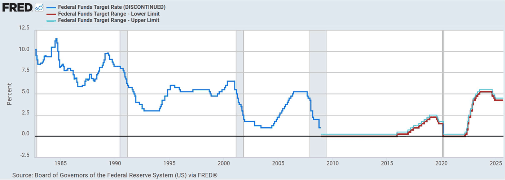

*图 4　联邦基金利率目标 1982–2025。蓝线是 1982–2008 年的单一目标水平（FRED 已标 DISCONTINUED），2008 年底之后改由红线（区间下限）与青绿线（区间上限）共同表示目标区间；灰色竖带是衰退期。可读到的大致水平：1982 年内峰值约 11%、1992 年底约 3%、2003 年年中约 1%、2006–2007 约 5.25%、2008 年底至 2015 年约 0–0.25%、2018 年底约 2.25%–2.50%、2020 年 3 月回到 0–0.25%、2023 年前后约 5.25%–5.50% 的平台、图右端（2025 年）约 4% 出头（按原图裁切，未重绘；出自讲义 p.13，数据源 Board of Governors of the Federal Reserve System (US) via FRED，`https://fred.stlouisfed.org/graph/?g=1Sju`）*

四个可观察的事实：

**第一，这条线是阶梯状的，不是平滑的。** 每一次垂直跳变对应一次 FOMC 会议（每年八次，p.6）。这个形状本身就在解释 p.6 那句「meet eight times a year」——**政策是离散决定的，市场在两次会议之间只能猜测。**

**第二，蓝线在 2008 年底消失，换成红/青绿两条几乎重合的线。** 图例已经告诉你原因：蓝线标着 `DISCONTINUED`。**2008 年 12 月起，美联储不再宣布一个点目标，而是宣布一个区间（target range）**，通常是 0 到 0.25%。原因很实际：当目标贴近 0 时，市场利率无法精确停在某一点，只能承诺一个带。**这张图的图例变化，就是 p.48 流动性陷阱的视觉证据。**

**第三，长期趋势是向下的。** 1982 年的两位数（约 10%–11%）到 2000 年代变成 5% 以下，再到 2008 年后贴近 0。这个下降轨迹与第 5 章的通胀轨迹（p.27 那张图会看到 1980 年后通胀中枢下移）几乎同步——因为 $i \approx r + \pi$，$\pi$ 下来了，$i$ 就下来了。**换句话说，图 4 的长期下行段主要不是货币政策「变松」，而是通胀变低。**

**第四，2022 年之后那段几乎垂直的上升，是四十多年里最陡的一段。** 从 0–0.25% 到 5% 出头只用了约一年多，斜率明显大于 1980 年代那次。

> [!WARNING] 读数精度有限，正文只给区间
> 这张图的纵轴网格间隔是 2.5 个百分点，**2.25%、2.50% 这类相邻的 25 个基点台阶在像素上无法区分**。上面列的读数里，「约 5.25%–5.50% 的平台」「约 2.25%–2.50%」「图右端约 4% 出头」这三处是**判读到网格线之间的估计**，两种读法都可能。凡是要用到精确基点数的场合（比如算加息次数），以课件正文文字给的数字为准——p.24、p.30 那些页的文字才是可核对的。

**练习 3（我的补充，非讲义内容）**：讲义断言「美联储对 $i$ 有很强的控制力」（p.11）。结合图 4，说出一个支持它的视觉证据，和一个削弱它的视觉证据。

> [!TIP] 参考答案
> 支持：图 4 的阶梯形状——每次会议后利率立刻跳到一个新水平并停住，说明目标定得住。削弱：2022 年之后那段近乎垂直的上升，说明美联储是在**追赶**已经起来的通胀，而不是提前控制它；$i$ 的变动幅度由通胀形势决定，而不是由美联储自由选择。这两条一起说明：p.11 那句「good control」在短期与名义意义上成立，在「提前把经济调到理想状态」这个强意义上不成立。

---

## 三、把利率装进凯恩斯模型：$PAE(Y,r)$（p.14–p.18）

### 3.1 利率通过哪两个组件进入支出（p.14）

在第 11 章的模型里，计划总支出 $PAE = C + I^P + G + NX$ 里的 $C$ 只依赖可支配收入，$I^P$ 是一个外生常数。现在要把利率放进去。理由只讲了两条通道（p.14）：

**第一条通道：家庭的储蓄决策（saving decisions of households）。** 利率越高，储蓄的回报越高 → 储蓄越多 → **消费越少**（Higher saving means less consumption）。注意这条链的方向：利率不是直接「让消费变少」，而是通过「让存钱更划算」间接起作用。

**第二条通道：企业的投资决策（investment by firms）。** 利率越高，投资越少。理由是一句判据：**投资只有在借款成本低于投资的回报率时才会进行（Investments are made if the cost of borrowing is less than the return on the investment）**（p.14）。

这句判据值得单独拆开，因为它是本章唯一一处把「利率为什么影响投资」讲到机制层面的话。设一台机器的边际效率（预期年回报率）是 $\rho$，借款名义利率是 $i$：

- 若 $\rho > i$，这台机器赚的比利息多 → 买；
- 若 $\rho < i$，买了就亏 → 不买。

一个企业面前有一堆机器可买，$\rho$ 从高到低排队（第 8 章的 $VMP$ 递减逻辑）。**利率就是那条横线，横线以上的机器才被买。** 所以 $i$ 上升 → 横线抬高 → 通过的数量减少 → $I^P$ 下降。这不是「企业家心情变差」，是一个可以画出来的筛选规则。

两条通道的结论句是：Both consumption and planned investment decrease when the interest rate increases（利率上升时，消费与计划投资同时下降）（p.14）。

### 3.2 模型的改动只有两处（p.15）

模型只改两处（**Two changes to the model**，p.15）：

$$C = \overline{C} + (mpc)(Y - T) - a\,r$$

$$I^{P} = \overline{I} - b\,r$$

其余照旧，三个变量仍然外生：

$$G = \overline{G} \qquad T = \overline{T} \qquad NX = \overline{NX}$$

符号解释（课件原话）：$a$ 衡量利率对消费的影响强度（measures the strength of the interest rate effect on consumption），$a > 0$；$b$ 衡量实际利率变动对计划投资的影响强度，$b > 0$。

逐符号读一遍，每个字母的量纲都要说清：

| 符号 | 含义 | 量纲 | 取值 | 为什么这样设计 |
|---|---|---|---|---|
| $\overline{C}$ | 自主消费（与收入和利率无关的部分） | 美元 | 常数 | 保证 $r$ 很高时消费不为负 |
| $mpc$ | 边际消费倾向 | 无量纲 | $0 < mpc < 1$ | 乘数 $1/(1-mpc)$ 由它定 |
| $Y - T$ | 可支配收入 | 美元 | — | 消费看的是税后可花的钱，不是产出 |
| $a$ | 消费的利率敏感度 | **美元 / 单位 $r$** | $a>0$ | $r$ 用小数（0.01 表示 1pp）代入 |
| $r$ | **实际**利率 | 无量纲（小数） | 例 0.05 | 注意是 $r$ 不是 $i$ |
| $\overline{I}$ | 自主投资 | 美元 | 常数 | 与利率无关的那部分投资 |
| $b$ | 投资的利率敏感度 | **美元 / 单位 $r$** | $b>0$ | 同上 |

**$\overline{C}$ 与 $\overline{I}$ 上面那一横是「自主（autonomous）」的记号，不是新变量。** 课件 p.15 的式子里 $\overline{I}$ 的上划线在文字层会丢失（显示成普通 $I$），读 PDF 时容易看漏。

> [!CAUTION] 为什么是 $r$ 而不是 $i$ 出现在支出函数里
> 式子里减的是 $a r$ 与 $b r$，**用的是实际利率**。这是对的：一台机器的回报率是实物口径（每年多产出多少产品），借款成本要换算成实物口径才能比较。但美联储操作的是 $i$。这两者靠 §2.2 的费雪方程桥接：**决策看 $r$，操作看 $i$，短期里 $\pi$ 不动所以两者同步。** 如果考试问「为什么美联储的加息会抑制投资」，完整答案必须走完 $i \to r \to I^P$ 这两步，只答一步是残缺的。

### 3.3 代数字：1 个百分点的利率，10 美元的支出（p.16）

符号换成数字之后，得到全章唯一一组参数，后面所有算例都复用它（p.16）：

| 组件 | 课件给的式子 | 读法 |
|---|---|---|
| $C$ | $640 + 0.8\,(Y - T) - 400\,r$ | $\overline{C}=640$，$mpc=0.8$，$a=400$ |
| $I^P$ | $250 - 600\,r$ | $\overline{I}=250$，$b=600$ |
| $G$ | $300$ | 外生 |
| $NX$ | $20$ | 外生 |
| $T$ | $250$ | 外生 |

于是 $a = 400$、$b = 600$：**利率每动 1 个单位（即 100 个百分点），消费动 400 美元、投资动 600 美元。** 这个「单位」是本章最容易算错的地方，p.16 立刻演示了一遍：

若 $r$ 从 $0.04$ 升到 $0.05$（即 4% 升到 5%）：

$$\Delta C = -400 \times 0.01 = -4$$

$$\Delta I^{P} = -600 \times 0.01 = -6$$

课件的结论：**A one percentage point increase in $r$ reduces planned spending by 10 – before the multiplier is considered**（1 个百分点的利率上升，在考虑乘数之前，使计划支出减少 10）。

**「before the multiplier is considered」这半句是本章最常丢的分点。** 10 美元只是**第一轮**的直接效应；乘数会把它放大 5 倍，最终产出效应是 50。所以：$r$ 每升 1 个百分点 → 自主支出降 10 → 均衡产出降 $10 \times 5 = 50$。这个 50 是第四节反推利率目标的钥匙。

> [!WARNING] $r$ 要代小数，不能代百分号里的数
> 最常见的错算：把「利率从 4% 升到 5%」代成 $\Delta r = 1$，得到 $\Delta C = -400$。正确是 $\Delta r = 0.01$。判据很简单：$a=400$ 的量纲是「美元每单位 $r$」，如果 $\Delta r = 1$ 意味着利率从 0% 升到 100%，那 400 美元的消费变动才对应得上。**看到 $r$ 是 0.04、0.05 这种写法就照它代；看到「5 percent」先除以 100。**

**小例子（我的补充，非讲义内容）**：$r$ 从 3% 升到 6%，自主支出变多少？$\Delta r = 0.03$，$\Delta PAE_{\text{自主}} = -(400+600)\times 0.03 = -30$；产出效应 $= -30 \times 5 = -150$。

### 3.4 合并成一条支出线（p.17）

把五个组件加总：

$$PAE = C + I^{P} + G + NX$$

$$PAE = 640 + 0.8(Y - 250) - 400r + 250 - 600r + 300 + 20$$

先把常数项理清：$0.8(Y-250) = 0.8Y - 200$，所以

$$\text{截距} = 640 - 200 + 250 + 300 + 20 = 1{,}010$$

$r$ 的系数 $= -400 - 600 = -1{,}000$。合起来就是本章的主方程：

$$PAE = 1{,}010 - 1{,}000\,r + 0.8\,Y$$

（我按课件逐项复算过：截距 1,010、$r$ 系数 −1,000、$Y$ 系数 0.8，三个都对得上课件 p.17。）

这一节的重点不是过渡句，而是那句结论：**planned aggregate expenditure depends on both the real interest rate and the level of output**（计划总支出同时依赖实际利率与产出水平），因此 **Equilibrium output can only be found once we know the value of $r$**（只有先知道 $r$ 的值，才能求出均衡产出）（p.17）。

这句话改变了第 11 章的解题流程。以前：给 $PAE = A + 0.8Y$，令 $PAE=Y$，一步出 $Y$。现在：$A$ 本身是 $r$ 的函数，所以**必须先固定 $r$，才能把 $A$ 算出来**。几何上，$r$ 每取一个值就对应**一条不同的支出线**，一族平行线（斜率永远是 0.8），$r$ 越低截距越高。

### 3.5 给定 $r = 5\%$，解出 $Y = 4{,}800$（p.18）

完整流程走一遍（p.18）：

$$PAE = 1{,}010 - 1{,}000(0.05) + 0.8Y = 960 + 0.8Y$$

短期均衡条件仍是 $PAE = Y$：

$$Y = 960 + 0.8Y \;\Longrightarrow\; 0.2Y = 960 \;\Longrightarrow\; Y = \$4{,}800$$

课件收尾一句：The graphical solution is the same as before（图形解法与之前一样）。这句话很重要——**它说明本章没有引入新几何，只是让截距多了一个来源。** 第 11 章那张 45° 线与支出线的图，本章原样复用，只是每次会画两条支出线来比较不同的 $r$。

**失败情形（我的补充，非讲义内容）**：如果忘记把 $T$ 代进 $0.8(Y-T)$，截距会算成 $640+250+300+20 = 1{,}210$，于是 $Y = (1210-50)/0.2 = 5{,}800$，比正确答案多出整整 1,000——**相当于凭空造出一个 1,000 的产出缺口。** 检查方法：截距必须包含 $-mpc \times T = -200$ 这一项，看到截距是 1,210 就说明税漏了。

**练习 4（我的补充，非讲义内容）**：若 $r$ 降到 2%，均衡产出是多少？若 $r$ 升到 8% 呢？

> [!TIP] 参考答案
> $r=0.02$：自主支出 $= 1{,}010 - 20 = 990$，$Y = 990/0.2 = \$4{,}950$。$r=0.08$：自主支出 $= 1{,}010 - 80 = 930$，$Y = 930/0.2 = \$4{,}650$。两问相差 $4{,}950-4{,}650=300$，对应利率差 $6$ 个百分点 × 每点 50 = 300 ✓，与 §3.3 推出的「每 1 个百分点 → 产出 50」一致。

**练习 5（我的补充，非讲义内容）**：把 $a$ 从 400 改成 0（即利率完全不影响消费），$r$ 上升 1 个百分点时自主支出变多少？这会让第四节反推的利率变动变大还是变小？

> [!TIP] 参考答案
> $a=0$ 时 $r$ 系数只剩 $-b = -600$，1 个百分点只让自主支出降 6（而不是 10）。第四节里要填 200 的缺口，需要 $\Delta r = 40/600 \approx 0.0667$，即**约 6.7 个百分点而不是 4 个百分点**。结论：**支出对利率越不敏感（$a+b$ 越小），同样的缺口就要用越大的利率变动去填，货币政策越钝。** 这正是「货币政策的传导强度取决于 $a$ 与 $b$」的含义。

---

## 四、用货币政策填缺口：两道对称的算例与两次实操（p.19–p.30）

### 4.1 传导链的两行版本（p.19）

§2.1 那条链条在这里具体化成两行四步，两行的名字分别是衰退缺口（Recessionary Gap）与膨胀缺口（Expansionary Gap）（p.19）。

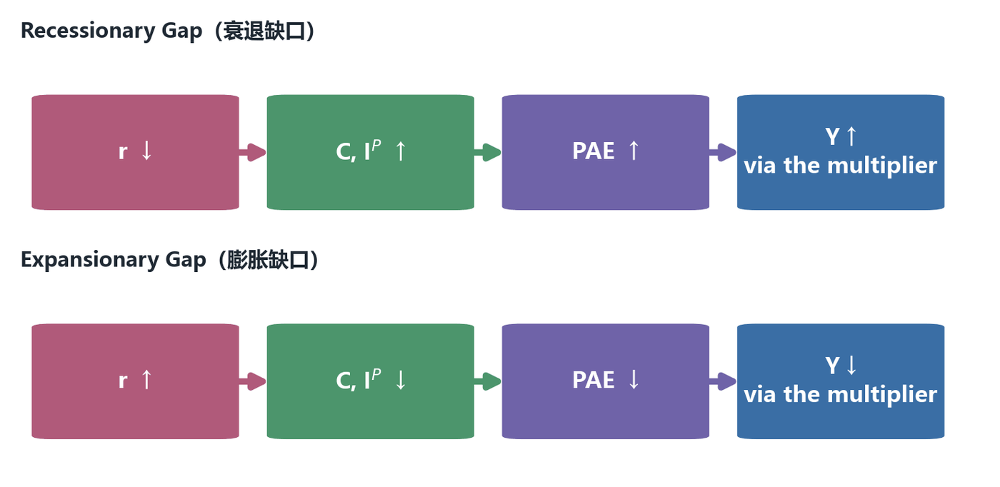

*图 5　货币政策的两条传导链。衰退缺口走第一行（降息→支出上升→产出经乘数放大）；膨胀缺口走第二行（加息→支出下降→产出经乘数缩小）。四步的色块与文字照课件，箭头即因果方向（按课件 p.19 示意重绘；出自讲义 p.19）*

读这张图要指出三处：

第一，**第 4 步特意写了 via the multiplier**。这不是装饰：前三步都是**一对一**的（$r$ 动 → $C$ 与 $I^P$ 动 → $PAE$ 动），只有第 4 步是**放大**的。§3.3 的「10 美元」在这里变成 50 美元。

第二，**第 1 步写的是 $r$，不是 $i$**。但美联储直接操作的是 $i$（p.11）。所以这四步其实跳了一环，完整链条是五步：$M \to i \to r \to (C, I^P) \to PAE \to Y$。**课件把它画成四步，是因为 $i \to r$ 在 §2.2 已经单独交代过。**

第三，**两行完全对称**。这不是巧合，是课件在教一个方法论：同一套机制，方向反过来就是另一种政策。第四节的两道算例（p.21 与 p.28）也正是这样成对出现的。

### 4.2 填衰退缺口：把 $r$ 从 5% 降到 1%（p.21–p.22）

现在做本章第一道完整的应用题。已知条件全在前面：$r = 5\%$ 时 $Y = 4{,}800$（§3.5）。再加一个新条件：**潜在产出（potential output）$Y^* = \$5{,}000$**（p.21）。

于是：

$$\text{衰退缺口（recessionary gap）} = Y^{*} - Y = 5{,}000 - 4{,}800 = \$200$$

求「美联储该把利率设成几」，四步走，每一步都要说清为什么：

**第 1 步：乘数是多少。**

$$\text{multiplier} = \frac{1}{1 - mpc} = \frac{1}{1 - 0.8} = 5$$

**第 2 步：需要的第一轮支出增量。** 缺口是 200，但第一轮支出只需要变动 $200/5 = 40$，因为乘数会放大它。课件原话：The first change in spending required is 200 / 5 = 40。**这一步是整个算法的机关**：很多人会直接把 200 当成支出增量去反推利率，结果算出 $\Delta r = 200/1000 = 0.2$，即 20 个百分点——错了五倍。

**第 3 步：把支出增量换成利率变动。** 自主支出对 $r$ 的系数是 $-1{,}000$，所以

$$1{,}000 \times \Delta r = 40 \;\Longrightarrow\; \Delta r = \frac{40}{1{,}000} = 0.04$$

**第 4 步：定方向。** 衰退缺口要**扩张性**政策，所以是**降**利率：

$$r:\; 5\% - 4\% = 1\%$$

课件结论：The Fed should decrease the real interest rate to 1%。

**验算（我的复算，非讲义内容）**：把 $r = 0.01$ 代回主方程，自主支出 $= 1{,}010 - 10 = 1{,}000$，$Y = 1{,}000/0.2 = 5{,}000$ ✓ 正好等于潜在产出。用乘数法也通：$\Delta Y = 5 \times 40 = 200$ ✓。

这道题的几何版本（p.22）：

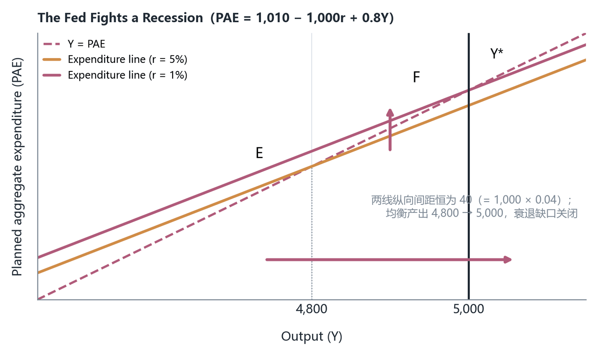

*图 6　美联储对抗衰退缺口。横轴产出 $Y$、纵轴计划总支出 $PAE$；两条支出线斜率都是 0.8，$r=5\%$ 那条截距 960、$r=1\%$ 那条截距 1,000，纵向间距恒为 40。均衡点 E 在 4,800、F 在 5,000，$Y^*=5{,}000$ 用竖线标出。降息使支出线上移，均衡产出沿 45° 线走到潜在产出，缺口关闭（按课件 p.22 示意重绘，数值取自主方程 $PAE=1{,}010-1{,}000r+0.8Y$；出自讲义 p.22）*

这张图上有两个细节值得指出。**其一，两条支出线是平行的**，因为 $mpc$ 没变，变的只是截距。**其二，纵向间距恒等于 40，在全轴 0–6,000 的尺度上几乎看不见**——所以课件的示意图把它画得很开，而我这张图把坐标范围收到 4,450–5,150，让真实的 40 间距可见。**读这张图的正确方式不是看间距的视觉宽度，而是看两个均衡点的横坐标差 200。**

> [!IMPORTANT] 缺口 200 ≠ 支出要动 200
> 本章的算法只有一处机关：**先除以乘数，再除以利率敏感度。** 写成一行就是 $$\Delta r = \frac{\text{gap}}{\text{multiplier} \times (a+b)} = \frac{200}{5 \times 1{,}000} = 0.04$$ 分母里少一个 5，答案就变成 20 个百分点；少一个 1,000，答案就变成荒谬的数字。**考场上先写这一行，再往里代数，比一步步推更不容易漏。**

### 4.3 2001 年那次真实的降息（p.23–p.25）

2001 年是本章的第一个真实实例（p.23–p.25）。背景三句（p.23）：经济在 2000 年底开始放缓（Economy began slowing in late 2000）；恐袭导致旅行、金融等行业收缩（Terrorist attack led to contraction in travel, financial, and other industries）；事后美联储担心消费者会削减支出（the Fed grew concerned that consumers would decrease spending）。

**这三句就是「衰退缺口出现」的现实版本**：外部冲击 → 支出预期下降 → $PAE$ 线下移 → 产出低于潜在。与 §4.2 的图完全同构。

利率路径分四步走（p.24）：

| 时点 | 联邦基金利率（课件原文） | 我的换算 |
|---|---|---|
| late 2000 | 6.5% | 起点 |
| January, 2001 | 6.0% | 第一次降息，$-0.5$ 个百分点 |
| July, 2001 | less than 4% | 半年内累计降幅超过 $2.5$ 个百分点 |
| November, 2001 | 2.0% | 比一年前低 **4.5 个百分点**（$6.5 - 2.0 = 4.5$ ✓） |

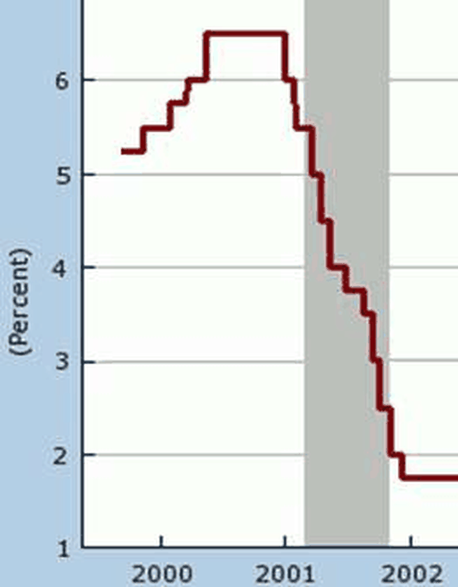

*图 7　2000–2002 年的联邦基金利率路径。深红色阶梯线在 2000 年年中抬到约 6.5% 的平台，2001 年全年逐次下调，2001 年底至 2002 年初落到 2% 附近；灰色竖带是 2001 年的衰退期。纵轴网格间隔 1 个百分点，因此 1.75% 与 2.0% 在图上无法区分，正文以课件文字给的 2.0% 为准（按原图裁切，未重绘；出自讲义 p.24）*

三个值得指出的现象：

**第一，12 个月降 4.5 个百分点是极快的。** 对照 §4.2 那道题：填 200 的缺口只要 4 个百分点。**现实中 4.5 个百分点的降幅，与课件算例所需的力度是同一个数量级**——这不是巧合，课件选这个例子就是为了说明「模型算出来的利率幅度，和美联储真实做的幅度对得上」。

**第二，阶梯状（p.24 图上每一次垂直下落）对应 FOMC 的离散决定**，与图 4 同样的形状。

**第三，p.25 的结论把功劳分给了三方**：**减税、增加国土安全支出的财政政策，加上激进的货币政策**（Combination of tax cuts, increased government expenditures for homeland security, and aggressive monetary policy）共同使 2001 年的衰退「又浅又短」（shallow and short）。

这一句是本章与第 11 章最直接的接缝：**课件自己承认，2001 年是财政与货币同时发力**。那么产出回升里哪一部分归谁？本章的框架无法回答，因为 $PAE$ 线只移动了一次，而现实中 $T\downarrow$、$G\uparrow$、$r\downarrow$ 三件事同时改变这条线。**这正是下一章（AD–AS）要处理的多个政策同时作用的问题。**

### 4.4 膨胀缺口为什么必须管：通胀从哪来（p.26–p.27）

前面都在讲衰退，现在换边：**膨胀缺口（expansionary gap）会导致通胀**（p.26）。机制是三句话，一句比一句深：

1. **Planned spending is greater than normal output levels at the established prices**——在既定价格下，计划支出超过了正常产出水平。这是膨胀缺口的定义：想买的比能生产的多。
2. **Short-run unplanned decreases in inventories**——短期内出现**非计划的存货减少**。这一句是第 10 章/第 11 章的存货调整机制在本章的复用：企业没料到卖得这么快，货架被清空。
3. **If gap persists, prices will increase**——**如果缺口持续，价格就会上涨。**

第 3 句里那个「if persists」是整章最容易被读漏的三个词。**存货被清空一次，不会立刻涨价；企业先补库存、先加班。只有当缺口持续存在、补库存也补不过来时，企业才提价。** 所以通胀是**缺口的滞后反应**，不是同时反应。这也解释了为什么央行的任务被表述成「关闭膨胀缺口」（p.26）——它是在**通胀发生之前**动手。

央行的四步动作是 Raise interest rates → Decrease consumption and planned investment → Decrease planned aggregate expenditure → Decrease equilibrium output（p.26），与图 5 第二行一字不差。

要看清「为什么值得为通胀动手」，需要知道通胀有多不稳定。回答来自一张 110 年的图（p.27）：

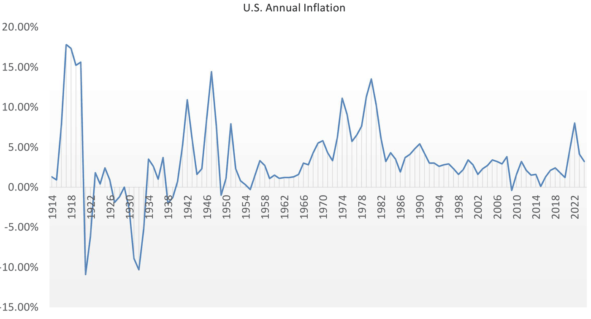

*图 8　美国年度通胀率 1914–2024（标题写 1914–2024，横轴刻度每 4 年印一个，最后印刷的是 2022）。可判读的极值：1917 年附近约 +17.6%（全图最高）、1921 年约 −11%（全图最低）、1947 年约 +14%–15%、1974 年约 +11%、1980 年约 +13.5%、2022 年附近约 +8%（图右端最后一个峰）。1982 年之后波动整体压进 ±5% 以内，直到 2021–2022 才再次冲出（按原图裁切，未重绘；出自讲义 p.27，数据源 Federal Reserve Bank of Minneapolis CPI 计算器）*

四个可观察现象：

**第一，通胀率的波动幅度远大于产出缺口给人的直觉。** 从 −11% 到 +17.6%，跨度近 29 个百分点。**如果美联储不管，物价可以在几年内走完这个跨度的三分之一。** 这就是 p.5 那句「低通胀（low inflation）」作为公共目标的份量。

**第二，两次深谷都是通缩（1921、1931 前后）**，都发生在大战或大危机之后的需求塌方期。**通缩同样是缺口——只不过是巨大的膨胀缺口反向。** 这一条把「央行为什么只盯通胀上限」的隐含假设暴露出来：这张图显示的下行风险同样剧烈。

**第三，1914–1982 的波动明显比 1982–2021 大。** 中间的分界点，恰好就是图 4 里联邦基金利率开始被日常化管理的年代（标题写的 1982）。**这是本章能给出的最强的一条「货币政策有效」的间接证据——虽然它只是相关性。**

**第四，2022 年那个约 +8% 的峰，是 1982 年以来的最高点。** 它解释了图 4 右端那段史上最陡的加息。

> [!NOTE] 这张图的口径是 CPI
> 图 8 的来源是 Minneapolis Fed 的 consumer price index 计算器，所以纵轴是 **CPI 年通胀率**，不是第 5 章讲过的 GDP 平减指数通胀率。两者的差别在第 5 章已经交代（进口品进 CPI 不进平减指数）。另外，标题写 1914–2024 而横轴最后印刷的刻度是 2022，两者不矛盾——刻度每 4 年印一次，数据本身延伸到 2024。

### 4.5 填膨胀缺口：把 $r$ 从 5% 升到 9%（p.28–p.29）

这一题与 §4.2 是刻意设计的对照题（p.28 与 p.21），**唯一的区别是潜在产出从 5,000 换成 4,600**：

| 步骤 | p.21（衰退缺口） | p.28（膨胀缺口） |
|---|---|---|
| 当前 $r$ 与当前 $Y$ | 5%，$4{,}800$ | 5%，$4{,}800$ |
| 潜在产出 $Y^*$ | $5{,}000$ | $4{,}600$ |
| 缺口 | $5{,}000-4{,}800 = \$200$（衰退） | $4{,}800-4{,}600 = \$200$（膨胀） |
| 乘数 | 5 | 5 |
| 第一轮支出变动 | $+200/5 = +40$ | $-200/5 = -40$ |
| $\Delta r$ | $-40/1{,}000 = -0.04$ | $+40/1{,}000 = +0.04$ |
| 目标 $r$ | $5\% - 4\% = 1\%$ | $5\% + 4\% = 9\%$ |

（表是我按课件 p.21 与 p.28 两页并列整理的，课件本身分两页给、没有合并表；两页的缺口数值相同、方向相反，是对照设计。）

验算：$r = 0.09$ 时自主支出 $= 1{,}010 - 90 = 920$，$Y = 920/0.2 = 4{,}600$ ✓ 等于潜在产出。

它的几何版本与图 6 同构，只是方向反过来（p.29 与 p.22）：

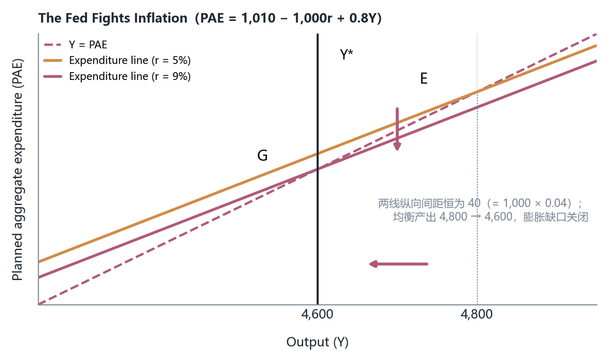

*图 9　美联储对抗通胀（关闭膨胀缺口）。$r=5\%$ 的支出线截距 960、$r=9\%$ 的截距 920，纵向间距恒为 40；均衡点从 E（4,800）移到 G（4,600），$Y^*=4{,}600$ 用竖线标出。加息使支出线下移，产出回落到潜在水平（按课件 p.29 示意重绘，数值取自主方程；出自讲义 p.29）*

把图 6 与图 9 并排看，会得到本章的一个几何结论：**扩张性与紧缩性货币政策是同一个动作的两个方向，工具没有区别，只有符号有区别。** 这也是为什么 p.44 会说美联储只能选一个变量当目标——它无法同时把 $Y$ 推到 5,000 又保持在 4,600。

### 4.6 2003–2005：先降到底，再逐步收（p.30）

「降息—等待—加息」的完整周期被压成八行数字（p.30），这是本章信息密度最高的一处：

| 时点 | 事件（课件原文数字） |
|---|---|
| November, 2001 | 经济开始缓慢复苏（slow recovery beginning） |
| June, 2003 | 利率继续下调至 **1.0%** |
| 2nd half, 2003 | 实际 GDP 增长接近 **6%**（nearly 6%） |
| 2004 | 增长 **4.4%** |
| June, 2004 | 失业率 **5.6%** |
| 2004 | 通胀上升，主要来自油价（mainly due to oil prices） |
| June, 2004 | 开始收紧：联邦基金利率 **1.0% → 1.25%** |
| August, 2005 | 利率升到 **3.5%** |

四个可观察现象：

**第一，复苏已经开始，降息仍继续了近两年（2001-11 → 2003-06）。** 这看起来矛盾，其实是政策时滞的标准案例：**产出的底部与劳动力市场、通胀的底部不同步**。美联储要等后者也确认底部，才敢停手。

**第二，加息的触发条件是通胀，不是增长。** 2004 年增长 4.4%、失业 5.6%——这两项都很好，但课件写的动手理由是「inflation increased in 2004, mainly due to oil prices」。**这就是图 1 那只靶子的作用：美联储的动作由通胀指标触发，而不是由 GDP 触发。**

**第三，从 1.00% 到 3.50% 是 +2.5 个百分点**（2004-06 至 2005-08，约 14 个月）。对照 §4.2 的算例：填 200 的缺口要 4 个百分点。**现实中一次完整收紧周期的幅度，与课件算例的幅度是同一量级。**

**第四，课件用词是 continued gradually raising（继续逐步上调）**，与 p.24 那次「12 个月降 4.5 个百分点」的激进形成对照。**同样的工具，冲击来时快、常态回归时慢**——这个不对称是货币政策操作的真实特征，课件没有明说，但两页并排就能看出来。

**练习 6（我的补充，非讲义内容）**：若潜在产出是 5,200、当前 $r = 5\%$，美联储该把利率设成几？

> [!TIP] 参考答案
> 缺口 $= 5{,}200 - 4{,}800 = 400$（衰退）。第一轮支出增量 $= 400/5 = 80$。$\Delta r = 80/1{,}000 = 0.08$，即降 8 个百分点。目标 $r = 5\% - 8\% = -3\%$。**实际利率可以为负（$r = i - \pi$，若 $i = 1\%$、$\pi = 4\%$，则 $r = -3\%$），但名义利率不能低于 0** —— 这正是 p.48 零利率下限那一节的入口：模型算出 $r$ 要 −3%，而工具只能把 $i$ 压到 0，剩下的缺口就补不上了。

**练习 7（我的补充，非讲义内容）**：如果 $mpc$ 从 0.8 升到 0.9，填同样的 200 缺口需要的 $\Delta r$ 变大还是变小？

> [!TIP] 参考答案
> 变小。乘数变成 $1/(1-0.9) = 10$，第一轮只需 $200/10 = 20$，$\Delta r = 20/1{,}000 = 0.02$，即 2 个百分点而不是 4。**乘数越大，同样的缺口需要越小的利率变动**——但代价是：同样的利率变动引起的产出波动也更大，政策的「刹车距离」变短。

---

## 五、货币需求：利率是怎么被「决定」出来的（p.31–p.39）

第四节结束的时候，我们已经在反复使用「美联储把利率设成 1%」这种说法，但**从来没有问过利率是怎么被定出来的**。前四节的逻辑到这里是悬空的：美联储凭什么能让利率停在它想要的位置？这一节补上第 9 章完全缺席的那一半——**货币需求（money demand）**。

### 5.1 为什么需要货币需求这一半（p.32）

全节的定位由三句话给出，第一句是：**Controlling the money supply is the primary task of the FOMC**（控制货币供给是 FOMC 的首要任务）（p.32）。紧接着两句把机制说清：

- **Money supply and demand determine the interest rate**（货币供给与货币需求共同决定利率）
- **Fed manipulates supply to achieve its desired interest rate**（美联储操纵供给，以达到它想要的利率）

这两句合起来是一个完整的供需逻辑：**美联储不是「定价者」，它是「供给的操纵者」，价格由供需双方共同定。** 这跟第 8 章可贷资金市场的思路同构，但对象不同：那里定价的是储蓄与投资，这里定价的是「持币的意愿」与「投放的货币量」。

在讲需求之前，p.32 先铺了一层资产选择的背景：

**资产配置决策**（portfolio allocation decisions）把一个人的财富分配到不同形式上（allocate a person's wealth among alternative forms）。**分散化**（diversification）是持有多种不同资产以管理风险（owning a variety of different assets to manage risk）。

这一层的用处是：**「持有多少货币」不是一个孤立决定，而是「财富的其余部分放在哪里」的镜像。** 你少持 1 美元现金，就多持 1 美元的股票、债券或存款。所以货币需求曲线本质上是**资产选择的结果**，这也解释了为什么它的价格变量是利率而不是物价。

于是本章的定义出现了（p.32）：

> The demand for money is the amount of wealth held in the form of money (cash & checking accounts).

**货币需求（demand for money）**：财富中以货币形式——现金与支票账户——持有的那部分数量。

**这里必须和第 9 章对一次口径。** 第 9 章把货币供给写成 $M = C + D$（公众持有通货 + 存款），并区分 M0（基础货币）、M1、M2 三层。本章这句定义括号里写的是 `cash & checking accounts`，**这正是 M1 的构成**，而不是 M0/基础货币。所以：

> [!CAUTION] 本章货币市场图的横轴 $M$ 要读作 M1，不是基础货币
> p.36–p.42 那六张图的横轴都标 `Money (M)`，课件从头到尾没有说明它是 M0、M1 还是 M2。结合 p.32 的定义（cash & checking accounts）与 p.33 的实证（M1 占 GDP 比例），**本章的 $M$ 全程是 M1 口径**。这一点很重要，因为第 9 章那张准备金市场图的横轴是**联邦基金市场上的准备金数量**，两者不是同一个量。看到「MS 右移」时，先问：移的是 M1 的供给，还是准备金的供给？（答案：本章是前者。）

### 5.2 流动性偏好与成本—收益原则（p.33）

货币需求有时被称为个人的**流动性偏好（liquidity preference）**——这个凯恩斯式的名字直接对应第 9 章讲过的**流动性（liquidity）**：一项资产能以多快、以多小的价格损失换成能立刻买东西的东西。

决策原则是**成本—收益原则（Cost–Benefit Principle）**：人们会比较持有货币的边际成本与边际收益（balance the marginal cost of holding money versus the marginal benefit）（p.33）。

**收益（benefit）**：Money's benefit is the ability to make transactions——货币的收益就是**能直接付款**。这一句把第 9 章「交换媒介」那项职能翻译成了个人层面的好处：你手里那 200 美元现金的价值，不在它能生息（它不生息），而在它能让你随时买到东西。

由此立刻得到两条可观察的推论：

**推论一：货币需求量随收入上升（Quantity of money demanded increases with income）。** 收入越高 → 交易越多 → 需要更多「随时能付款」的余额。这是 §5.4 里 $Y$ 那一项的来源。

**推论二：技术会压低货币需求。** 网银与 ATM 这类技术降低了货币需求（Technologies such as online banking and ATMs have reduced the demand for money）。机制是：ATM 让「取现」变得几乎零成本，于是你不需要在钱包里备着 300 美元，可以只放 50，其余留在生息账户里，需要时随时取。**货币的「付款便利」收益被技术部分替代了。**

支撑推论二的实证数字只有一个（p.33）：

$$\frac{M_{1}}{GDP}:\quad 1960\text{ 年为 } 28\% \;\longrightarrow\; 2013\text{ 年为 } 16\%$$

（课件原文：M1 has decreased from 28% of GDP in 1960 to 16% in 2013。）

这个 12 个百分点的降幅意味着：**53 年里，美国一年产出对应的交易性货币持有量减少了一半以上**（$16/28 \approx 0.57$）。这是「货币需求下降」最直观的一条证据。

> [!WARNING] 28% → 16% 这个数无法独立复算，且归因被简化
> 课件只给两个百分数，**没有给 M1 与 GDP 的年度数值，也没有给来源链接**，所以无法像 §3.4 那样逐项验算。另外，把 M1/GDP 的下降主要归因于交易技术是简化：同期还有储蓄账户与货币市场基金 competing（第 9 章 M2 那一节讲过）、信用卡与借记支付普及、以及金融脱媒。**机制方向是对的，但把它当成单一原因会误判。** 复习时按课件记 28% 与 16% 两个数即可，别把它当严格因果。

### 5.3 持有货币的边际成本 = 放弃的利息（p.34）

这一页是整节的心脏，因为它给出了 MD 曲线**为什么向下倾斜**。

**边际成本（marginal cost）：the interest foregone——放弃的利息。** 机制：货币（现金与支票账户）几乎不付息（Most forms of money pay little or no interest），而替代品——股票、债券——付正的利率。你手里多留 1 美元现金，就少 1 美元去买那些付息的资产，于是**每年损失 $i$ 美分**。

课件为了让这个成本可算，加了一条简化假设：**Assume the nominal interest rate on money is 0**（假设货币的名义利率为 0）。于是：

$$\text{持有 1 美元货币一年的边际成本} = i - 0 = i$$

**边际收益**则是多持有一单位货币带来的交易便利，它随持有量递减（第 1 美元现金解决「能不能买东西」，第 100 美元只解决「要不要跑一趟 ATM」）。

把两边一平衡，就得到 p.34 的结论句：

**The higher the nominal interest rate, the smaller the quantity of money demanded.**（名义利率越高，货币需求量越小。）

这一句就是 MD 曲线负斜率的全部内容。逻辑链再走一遍，确保没有跳步：$i \uparrow$ → 持币的机会成本 $\uparrow$ → 在同样的边际收益下，只有把持币量压小才划算 → 货币需求量 $\downarrow$。

一句常被忽略的事实补在持币动机的讨论末尾：**Business demand for money is similar to individuals' — Businesses hold more than half of the money stock**（企业的货币需求与个人类似——企业持有货币存量的**一半以上**）（p.34）。这一句的用处是：**MD 不是「家庭钱包里的现金」，它主要是企业为发工资、买原料而留的余额。** 所以 §5.4 里 $Y$（总产出）之所以能决定 MD，正是因为企业持币量与它们的业务规模挂钩。

> [!CAUTION] 「货币不付息」这条假设在 2008 年后被美联储自己废掉了
> p.34 的整套推导建立在「货币的名义利率为 0」上，于是边际成本恰好等于 $i$。**2008 年 10 月起，美联储开始对银行存放的准备金支付利息（IOER，后称 IORB）**，2021 年又开了面向非银机构的隔夜逆回购（ON RRP）作为下限工具。**一旦货币的利率不再是 0，边际成本就变成 $i - i_{m}$，MD 曲线的推导要重写。** 课件没有讲这一层（第 9 章末尾点的第二个空洞，本章没有补）。这里只交代边界：**本章的 MD 框架适用于「货币不付息」的世界，2008 年以后的美国不属于那个世界。**

### 5.4 三个决定因素，两种「变动」（p.35）

MD 的影响因素被收成一个三条的清单（p.35）。这张表本身不难，难的是**它区分了两种变动**——这正是经济学图表题的第一考点：

| 决定因素 | 符号 | 方向（课件原话） | 几何表现 |
|---|---|---|---|
| 名义利率 | $i$ | The higher the interest rate, the **lower** the quantity of money demanded | **沿同一条 MD 曲线移动**（点的移动） |
| 实际收入或产出 | $Y$ | The higher the level of income, the **greater** the quantity of money demanded | **整条 MD 曲线平移** |
| 物价水平 | $P$ | The higher the price level, the **greater** the quantity of money demanded | **整条 MD 曲线平移** |

（前两列与方向出自 p.35；第四列「几何表现」是把 p.36 与 p.37 两处的内容并到一起的结果，我把它们合进这张表，**这是我自己做的合并**。）

为什么 $Y$ 与 $P$ 都让 MD 上升，但机制不同？

- **$Y$ 走的是「交易数量」通道**：产出多 → 买卖的东西多 → 需要更多余额来完成这些交易。这是**实际变量**。
- **$P$ 走的是「交易价格」通道**：东西数量没变，但每件的标价翻倍 → 完成同样一笔交易需要的**美元**翻倍。这是**名义变量**。

第二条很重要，因为它给出一个可以自测的判据：**MD 是名义美元需求，所以物价水平翻倍、名义收入翻倍，MD 曲线大致也翻倍。** 这也解释了第 9 章数量论里 $V$ 为什么能近似稳定：$M^d$ 大致与 $P$ 成比例，所以 $P$ 上升时 $M$ 同比例上升，$V = PY/M$ 不变。**本章把第 9 章那个「观察」接到了微观基础上。**

### 5.5 货币需求曲线（p.36）

**货币需求曲线（money demand curve）**：总货币需求量 $M$ 与名义利率之间的关系（the relationship between the aggregate quantity of money demanded, $M$, and the nominal interest rate）。课件给的理由是 p.34 那条：**名义利率上升提高了持有货币的机会成本（An increase in the nominal interest rate increases the opportunity cost of holding money）**，所以 **Negative slope**（负斜率）。

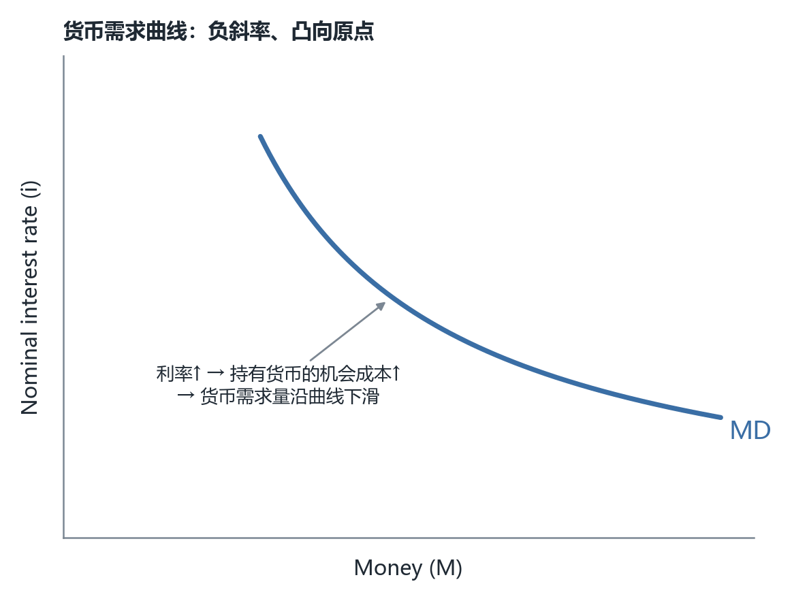

*图 10　货币需求曲线 MD。纵轴是名义利率 $i$、横轴是货币数量 $M$；曲线负斜率且凸向原点，表示利率越高、愿意以货币形式持有的财富越少。曲线本身是示意，课件没有给任何刻度数值（按课件 p.36 示意重绘；出自讲义 p.36）*

这张图有一个必须指出的**坐标轴惯例反转**：普通商品供需图纵轴是价格 $P$，这里纵轴是**利率 $i$**。为什么？因为对货币这种「资产」来说，**它的「价格」就是持有它的机会成本，也就是利率**。把这一点想通，MD 的负斜率就不再需要背了：**利率是持币的价格，价格越高、需求量越小，这是需求定律本身。**

顺带一个第 9 章的接缝：第 9 章 p41 讲过物价水平的另一种画法——纵轴是 $1/P$（货币的购买力）。那张图与这张图问的是**两个不同的问题**：$1/P$ 那张问「1 美元能买多少东西」（货币的价值），$i$ 这张问「1 美元一年要付多少利息成本（货币的"租金"）。两张都对，但本章用的是后者。

### 5.6 MD 的平移与五个因素（p.37）

「$i$ 之外的因素变了」怎么处理：**Changes in factors other than the nominal interest rate cause a shift in the money demand curve**（除名义利率之外的因素变动引起货币需求曲线的移动）（p.37）。

课件列了五个来源，但**没有给方向**：

| 因素（课件原文） | 方向 | 机制（我的补充，非讲义内容） |
|---|---|---|
| An increase in output | MD **右移** | 交易数量增加（§5.4 的 $Y$ 通道） |
| Higher price levels | MD **右移** | 同样交易需要更多美元（§5.4 的 $P$ 通道） |
| Transaction technology | MD **左移** | ATM/网银降低持币的必要性（p.33 已明说 reduced the demand for money） |
| Financial advances | MD **左移** | 借记/信用卡、货币基金让生息资产也能「随时付款」，替代货币的交易职能 |
| Foreign demand for domestic currency changes | **两个方向** | 外国人想多持美元 → 美国境内美元需求上升，MD 右移；反之左移 |

（前三行的方向由 p.33 与 p.35 两处表述直接可推；后两行的方向没有给，是我按机制补的。）

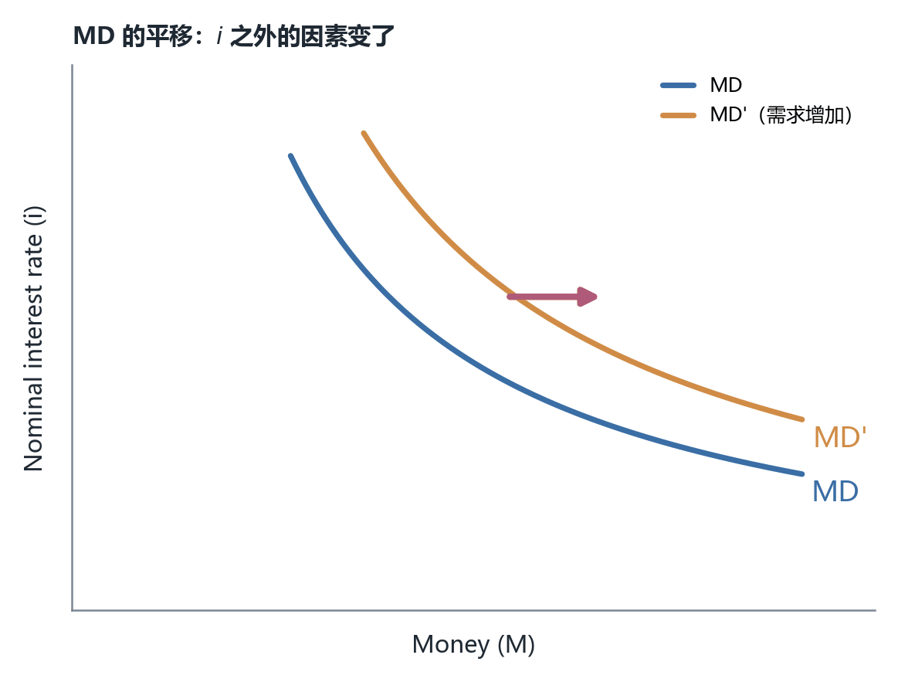

*图 11　MD 的平移。$i$ 之外的因素（产出、物价、支付技术、金融创新、外币需求）变动时，整条曲线移动；图中画的是需求增加的情形（$MD \to MD'$，右移），即在任一给定利率下人们愿意持有更多货币（按课件 p.37 示意重绘；出自讲义 p.37）*

> [!WARNING] 课件把「技术」与「金融进步」列进移动因素却没写方向
> p.37 的五行清单里，`Transaction technology` 与 `Financial advances` 只出现在「能引起移动的因素」列表里，**方向完全没给**。而 p.33 明确说过「online banking and ATMs have **reduced** the demand for money」。所以这两项应当是**左移**。考试若出「ATM 普及对均衡利率的影响」，正确链条是：ATM 普及 → MD 左移 → 在 $MS$ 不变时 $i$ **下降**。**如果按「因素能引起移动」这句话含糊作答而不给方向，拿不到分。**

### 5.7 两个真实案例：阿根廷人与百元美钞（p.38–p.39）

课件用两页讲 p.37 最后一条「外币需求」，这两页的价值在于它们把 MD 从抽象曲线变成能观察的现象。

**案例一：阿根廷（p.38）**

- The average Argentine holds more dollars than the average US citizen（普通阿根廷人持有的美元比普通美国人多）。
- 1970 与 1980 年代阿根廷高通胀 → 以比索计价资产的**实际回报下降**（Real returns on assets in pesos declined）→ 阿根廷人**改用美元作为价值储藏**（Argentines switched to dollars as a store of value）。
- 1990 年美元与比索 1:1，**两者都被接受用于交易**（Both were accepted for transactions）。
- 到 2001 年，通胀使固定汇率制度崩溃（inflation caused the fixed exchange rate system to break down），比索变得不如美元值钱。

这个案例解释的现象是：**当本国货币失去「价值储藏」职能时，人们会转向外国货币——这是第 9 章「三种职能可以分裂」那一节的现实版本**（本币仍可当交换媒介，但已不能储藏价值）。从 MD 的角度读：阿根廷人对**美元**的 MD 极高，对**比索**的 MD 极低，而两国的名义利率差异正是这个偏好的价格表现。

**案例二：大面额钞票（p.39）**

- 政治不稳定也会增加对美元的需求——可以避免没收与税收（Avoids confiscation and taxes）。
- **The largest U.S. bill is \$100, popular with drug dealers**（美国最大面额是 100 美元，受毒贩欢迎）。
- 欧元有 **€500 面额**，价值超过 500 美元，是**存放同等财富更紧凑的方式**（More compact way of storing a given amount of wealth）。
- 结论：**如果毒贩改用欧元持有现金，美元的需求就会下降**（the demand for the U.S. dollar will decrease）。

这条推理的骨架其实是一个**资产替代性**论证：现金作为价值储藏，它的竞争力取决于「单位体积/单位张数能装多少财富」。**面额越大，同样的财富需要的张数越少、体积越小、越容易藏匿**，因此对希望匿名持有财富的人（课件的例子是毒贩）而言，大面额钞票是更好的储藏手段。所以 €500 的发行相当于给美元现金的替代品降价 → 美元 MD 左移。

> [!NOTE] €500 已停发，但机制仍然成立
> 课件这条例子写于教材 2013 年版语境。**欧洲央行与英国已于 2016–2019 年间停止发行 500 欧元与 50 英镑大面额纸币**（反洗钱考虑）。所以这个具体例子在今天已经过时，但「**面额大小影响现金作为价值储藏的吸引力**」这条机制本身没有失效——它解释的仍是同一个可观察现象：为什么美元在海外被大量以现金形式持有，以及为什么各国央行对大面额纸币态度谨慎。

**练习 8（我的补充，非讲义内容）**：2008 年后「美元作为储备与藏匿手段的国际需求」上升，会让美国境内的 MD 曲线怎么移？在 $MS$ 不变时均衡名义利率怎么变？

> [!TIP] 参考答案
> 外国人增持美元现钞与美元存款，计入美国口径的货币需求（M1 的需求方）→ MD **右移** → $MS$ 不变时均衡 $i$ **上升**。这正是「美元的国际地位让美国能以较低的利率借钱」这一说法的**反面**：国际需求上升会推高境内利率，但同时也意味着境外愿意持有大量美元资产，两者分别体现在不同的市场上。**做这类题的关键是先确认 MD 的口径（谁的需求）与 MS 是否同步变动，别只写「右移所以利率升」。**

---

## 六、货币市场均衡：$MD \times MS$ 与美联储的三件工具（p.40–p.47）

### 6.1 垂直的货币供给（p.40）

供给端放上来是三句话（p.40）：

- **The Fed primarily controls the supply of money with open-market operations**（美联储主要用公开市场操作控制货币供给）。
  - 美联储**买入**债券 → 货币供给**增加**（An open-market purchase of bonds by the Fed increases the money supply）
  - 美联储**卖出**债券 → 货币供给**减少**（An open-market sale of bonds by the Fed decreases the money supply）
- **Supply of money is vertical**（货币供给是垂直的）。
- **Equilibrium is at E**（均衡在 E 点）。

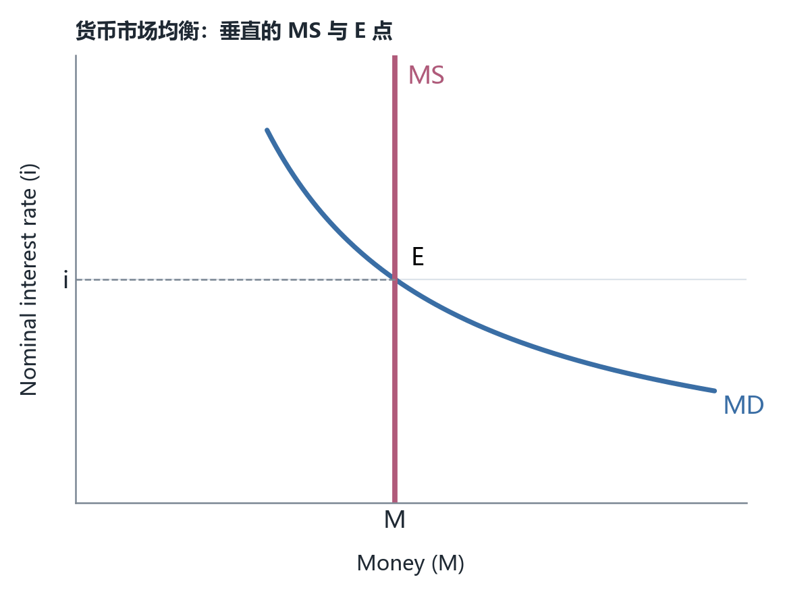

*图 12　货币市场均衡。红色 MS 是竖直线——在任一利率下货币供给量都是同一个 $M$，因为它由美联储决定而不是由利率决定；它与蓝色 MD 的交点 E 定出唯一相容的名义利率 $i$（按课件 p.40 示意重绘；出自讲义 p.40）*

**为什么 MS 是垂直的？** 因为美联储决定的货币供给量**不依赖利率**——它是一次公开市场操作的规模，是一个数量决策。垂直 = 「这个数量在任何利率下都一样」。

> [!CAUTION] 这张图与第 9 章那张准备金市场图不是同一张图
> 第 9 章 p40 画的是**准备金市场**：纵轴是联邦基金利率 $r_{ff}$、横轴是联邦基金数量 $F$，美联储通过公开市场操作移动**供给曲线**，而需求曲线（银行对准备金的需求）形状由银行的资产负债表约束决定，教材常画成向上倾斜。本章这张是**货币市场**：纵轴是**一般名义利率** $i$、横轴是 **M1 的货币数量**、供给垂直。**两张图都对，但对象不同、横轴不同、供给曲线形状也不同。** 如果把它们当同一张图，就会问出「准备金供给为什么在第 9 章是倾斜的、在这里是垂直的」这种伪矛盾。判据：看横轴标签——是 $F$（准备金/联邦基金数量）还是 $M$（货币存量）。

### 6.2 利率不在均衡时，市场怎么自己回去（p.41）

垂直供给曲线带来一个必须回答的问题：凭什么利率就停在 E？回答走的是**债券市场**（p.41），先给一条前提：

**Bond prices are inversely related to the interest rate**（债券价格与利率反向相关）。

这条前提的推导（第 5 章/第 8 章给过，这里复述一遍因为它是本节全部调整机制的地基）：一张固定付息的债券，票面利息是合同写死的。若它的市场价格 $P_B$ 上升，那么 $i \approx \text{利息}/P_B$ 就下降。**买贵了，收益率就低。** 所以「债券价格」与「债券收益率」是同一件事的两面。

现在假设利率在 $i_1$，**低于均衡**（below equilibrium）。课件的调整链条：

1. 在 $i_1$ 上，**货币需求量是 $M_1$，多于可用的货币**（Quantity of money demanded is $M_1$, more than the money available）。因为 $i_1$ 低 → 持币便宜 → 大家想多持币；但 $MS$ 是垂直的，供给就是 $M$，变不出来。
2. **想要更多货币的人就卖债券**（To get more money, people sell bonds）。这是资产选择的镜像：要持更多货币，就得减少持有债券。
3. 卖债券 → **债券价格下降，利率上升**（Bond prices go down, interest rates rise）。第 6.2 条前提直接用上了。
4. $i$ 上升 → **货币需求量从 $M_1$ 缩回到 $M$**（Quantity of money demanded decreases from $M_1$ to $M$）。回到 E。

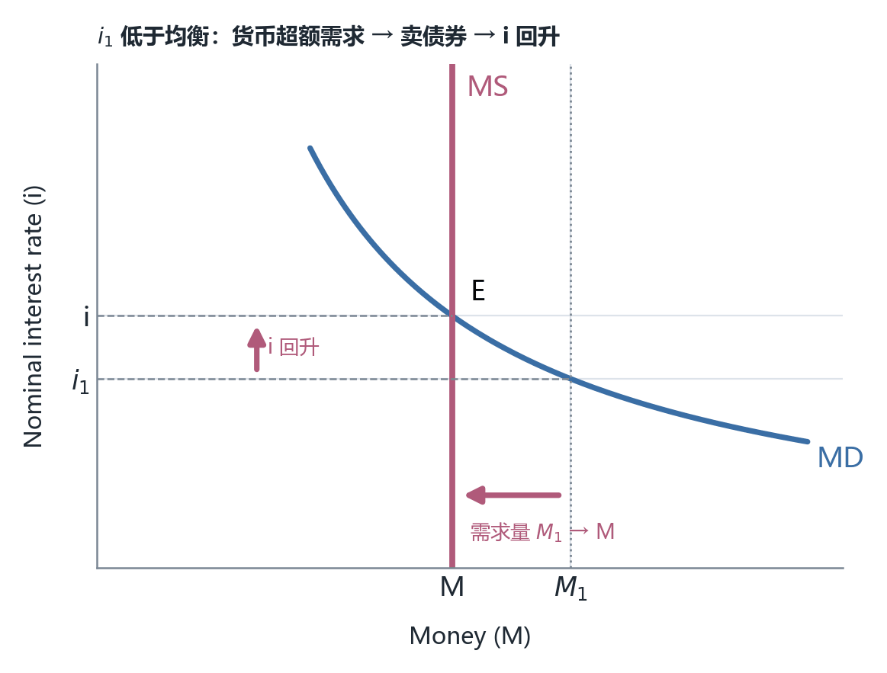

*图 13　利率低于均衡时的调整。$i_1 < i$ 时货币需求量为 $M_1$，超出垂直供给 $M$，形成超额货币需求；人们卖债券换货币 → 债券价格下跌 → 利率上升（纵轴处向上箭头）→ 沿 MD 曲线把需求量压回 $M$（横轴处向左箭头）。**注意调整靠的是「沿曲线移动」，MD 曲线本身没有动**（按课件 p.41 示意重绘；出自讲义 p.41）*

**失败情形（我的补充，非讲义内容）**：如果第 2 步走不通会怎样？——如果人们**没有**可以卖的债券（比如全部财富已经是现金），超额货币需求就无法通过资产转换消除，压力会转向**商品市场**：直接多买东西 → 物价上升。这正是第 9 章数量论里「超额货币余额被花掉 → $P$ 上升」的机制。**所以 p.41 这张图只在「价格黏住、资产市场畅通」的短期里成立；把它拉到长期，调整渠道就从利率换成了物价。** 这是本章与第 9 章长期结论的分界。

### 6.3 美联储怎么把利率压下来（p.42–p.43）

本章的机制在这里收口，第一句先说清政策语言：**Fed policy is stated in terms of interest rates — The tool they use is the supply of money**（政策用利率来表述，但他们用的工具是货币供给）（p.42）。

操作过程：初始均衡在 E；美联储把货币供给增加到 $MS'$；**新均衡在 F，利率降到 $i'$**——课件给的理由是那句值得背下来的：**to convince the market to hold the new, larger amount of money**（要让市场愿意持有这笔新增的、更大的货币量）。

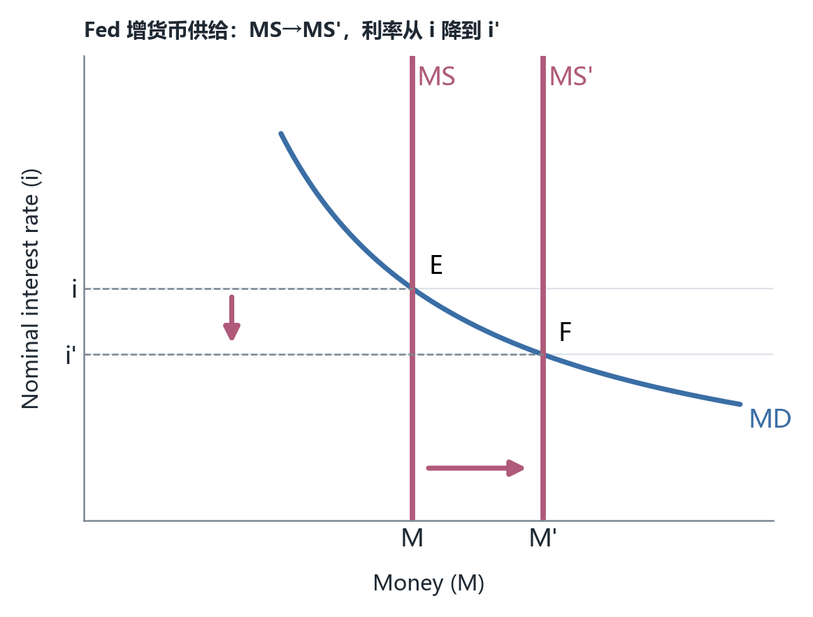

*图 14　美联储增加货币供给压低利率。$MS \to MS'$ 右移后，在新的利率 $i'$ 上，货币需求量恰好等于新增的货币量 $M'$，市场才愿意持有它。E → F 就是「降息」的几何含义（按课件 p.42 示意重绘；出自讲义 p.42）*

**「to convince the market to hold it」这句是整章最深的一句话。** 它的意思是：**多印出来的钱不会自动被人持有——必须让持币的成本（利率）低到人们愿意接受它。** 换句话说，美联储能控制 $M$，但 $M$ 变成 $i$ 的幅度取决于 MD 曲线的形状：**MD 越平坦，同样的 $M$ 增量需要越大的 $i$ 降幅才能被市场吸收；MD 越陡峭，同样的增量只需很小的利率变动就被吸收。** 这个斜率问题在 p.48 的流动性陷阱里会变成致命问题（MD 完全平坦 → 无论增加多少 $M$，$i$ 一点不动）。

同一件事改用**债券市场**的语言再讲一遍，是两条四步链（p.43）：

*图 15　公开市场操作通过债券市场起作用的两条链。上行收紧：卖债券 → 债券供给增加 → 债券价格下降 → 利率上升。下行放松：买债券 → 债券需求增加 → 债券价格上升 → 利率下降。两行第 2 步的措辞不对称（一行说供给、一行说需求），其实是同一机制的两面——美联储的交易本身就是债券市场的供给方或需求方（按课件 p.43 示意重绘；出自讲义 p.43）*

把图 14 与图 15 对上，就得到本章完整的一次降息操作：

| 步骤 | 动作 | 对应的几何表现 |
|---|---|---|
| 1 | FOMC 决定降息，指示纽约联储公开市场 Desk **买入债券** | 图 15 下行第 1 格 |
| 2 | 债券需求增加 → **债券价格上升** | 图 15 下行第 2、3 格 |
| 3 | 债券价格上升 → **收益率（利率）下降** | 图 15 下行第 4 格 |
| 4 | 买债券时付给公众的是存款/现金 → **货币供给增加** | 图 14 的 $MS \to MS'$ |
| 5 | 新的 $M'$ 在更低的 $i'$ 上被市场愿意持有 → 均衡移到 F | 图 14 的 E → F |
| 6 | 短期 $\pi$ 不动 → $r$ 同步下降 → $PAE$ 上移 → $Y$ 增加 | 图 6 |

**第 4 步与第 2 步其实是同一笔交易的两侧**：美联储买债券，付钱给卖方（银行或公众），钱进入银行体系变成准备金与存款（第 9 章的存款创造），同时债券被抽走、价格上升。**这就是第 9 章「公开市场操作」与本章「降息」之间的桥**——它们是同一个动作的两个记账视角。

### 6.4 美联储不能同时定利率与货币量（p.44）

本章的方法论结论、也是值得整段记住的一句是（p.44）：

**The Fed cannot set the interest rate and the money supply independently**（美联储不能独立地同时决定利率与货币供给）。

为什么？看图 14 就知道：$MS$ 是垂直线、$MD$ 是向下倾斜的曲线，**两条线只有一个交点**。你选定 $M$，$i$ 就被交点定死了；你选定 $i$，$M$ 就被定死了。**想同时任意指定两个数，除非移动其中一条线，否则无解。**

「为什么政策要用利率来宣布」有三条理由（p.44）：

- **Public is not familiar with the size of the money supply**——公众不熟悉货币供给的量级。
- **Interest rate changes affect planned spending and the level of economic activity**——利率变动影响计划支出与经济活动水平（就是第三、四节讲的那条链）。
- **Interest rates are easier to monitor than the money supply**——利率比货币供给更容易监测。

这三条各自解释一个可观察现象：

**第一条 + 第三条解释：为什么 FOMC 的新闻发布会只报一个数字（利率目标），从不报「本次投放多少基础货币」。** 因为利率每天在市场上被交易出来、随时可查，而 M1 是月度统计、还会因金融创新改变口径（第 9 章 M1/M2 分层的麻烦正在这里）。

**第二条解释：为什么盯利率比盯货币量更能稳定产出。** 如果美联储改盯 $M$（固定 $MS$），那么 MD 曲线的每一次随机移动（支付技术变化、信心变化、外币需求变化）都会**直接变成利率的波动**，再通过 §三 的链变成支出波动。**盯住 $i$ 等于自动抵消 MD 的移动**：MD 右移时美联储就同步增加 $M$ 把 $i$ 顶回去。这是本章对「为什么现代央行都盯利率」给出的最简洁回答，而课件只用一行字带过。

> [!IMPORTANT] 「不能同时定 $i$ 和 $M$」是第 9 章那个问题的答案
> 第 9 章留了一个疑问：既然美联储能控制货币供给，为什么那张准备金市场图要画成「瞄准联邦基金利率」（第 9 章 p40）？本章给出了正式回答（p.44）：**因为 $i$ 与 $M$ 在同一组供需线之间只能选一个当工具，另一个是结果。** 选了 $i$ 当目标，$M$ 就变成内生变量、随 MD 波动而调整。**两章不冲突，本章是那一页的理论补全。**

### 6.5 为什么偏偏盯联邦基金利率（p.45）

一个自然的追问是：既然只能选一个利率来盯，为什么偏偏选联邦基金利率，而不是国债利率、prime rate 或抵押贷款利率（p.45）？

课件的答案是：**The Fed targets this interest rate because it is closely tied to the level of bank reserves**（美联储盯这个利率，是因为它与银行准备金水平紧密相连）。

这一句把第 9 章的机制接回来了：联邦基金利率是银行间隔夜拆借准备金的利率，而**准备金正是公开市场操作直接改变的那个量**。所以从 $M$ 的操作到 $i$ 的结果，**中间最短的一跳就是准备金 → 联邦基金利率**。选它当目标，等于选了一个「离美联储的手最近」的价格。

还补了两句：这个利率**在金融市场上被密切关注**（closely watched in financial markets）；它的变动**指示美联储的政策意图**（Changes in the federal funds rate indicate the Fed's plans for monetary policy）（p.45）。

最后一句是重要的让步：**Other interest rates could be used to indicate the Fed's intentions**（其他利率也可以用来指示美联储的意图）。也就是说，**选联邦基金利率是惯例与便利性，不是逻辑必然**——这为 §七 的零下限问题埋下伏笔：当联邦基金利率贴到 0、失去下调空间时，「换一个利率来盯」就从可能变成必须（QE 盯的是长期利率）。

### 6.6 另外两件工具：贴现窗口与法定准备金率（p.46–p.47）

第 9 章已经把三大工具的机制讲透了（公开市场操作、法定准备金率、贴现率，以及「只有 RR 动的是乘数」这个关键区分），这里不重复，只按本章口径记下三件事。

**工具二：贴现窗口贷款（discount window lending）**（p.46）。美联储向银行提供贷款设施；银行需要准备金时可按**贴现率**（discount rate）向美联储借款。**The discount rate is the rate the Fed charges banks to borrow reserves**（贴现率是美联储对银行借入准备金收取的利率）。

- 放款增加准备金，最终增加货币供给（Lending increases reserves and ultimately increases the money supply）。
- **Changes in the discount rate signal tightening or loosening of the money supply**——贴现率的变动**是一种信号**。

「信号」这个词是本页的重点：**贴现窗口的规模由银行自己决定（银行不来借，你无法强迫），所以美联储无法用它精确控制数量；但它一改，市场立刻读出方向。** 这与第 9 章「贴现率不是主要工具」同调。

**工具三：法定准备金率（reserve requirement）**（p.47）。定义：**最低必须持有为准备金的银行存款百分比**（the minimum percentage of bank deposits that must be held in reserves）。

- **Open market operations are the main tool of money supply**——公开市场操作是货币供给的**主要**工具（这句把三件工具的排序定死了）。
- **The reserve requirement is rarely changed**——法定准备金率**很少被改动**。
- 降低准备金率 → 银行出现超额准备金可贷 → 货币供给增加；反之亦然（And vice versa）。

「很少改动」的原因在第 9 章讲过（频繁改动会扰乱银行体系），本章 p.47 用 rarely changed 呼应。这一句还给出一个可观察现象：**为什么 2008 年与 2020 年两次大冲击，美联储动的是利率和资产购买，而不是准备金率。**

> [!CAUTION] 准备金率 = 0 之后，这条工具就不存在了
> 美国法定准备金率自 **2020 年 3 月 26 日起降为 0**（第 9 章笔记已记录）。这在 p.47 的框架里意味着一件很尖锐的事：**若 $r_d = 0$，第 9 章那个存款创造上限 $1/r_d$ 就不存在了**——单家银行不再被要求持有准备金，货币创造的上界从「法定比率」换成了「超额准备金率 $e$ 与公众持币率 $c$」以及银行自身的放贷意愿。课件整章按 $r_d > 0$ 的世界讲，**所以 p.47 这条工具在 2026 年已经是历史工具**。做题按课件；理解现实要知道这一层。

**练习 9（我的补充，非讲义内容）**：美联储宣布把准备金率从 10% 提到 20%，同时不做任何公开市场操作。在图 14 的框架里，$MS$ 线怎么移？$i$ 怎么变？这与第 9 章的乘数口径怎么对接？

> [!TIP] 参考答案
> 基础货币 $M_0$ 没变（没有买卖债券），但货币乘数 $m$ 变小（$r_d$ 从 0.10 升到 0.20，若忽略 $c$ 与 $e$，$m$ 从 10 掉到 5）→ $M = m \times M_0$ 减半 → 图 14 的 $MS$ **大幅左移** → $i$ 上升。**注意动的是乘数而不是基础货币**：这是第 9 章「三大工具里只有 RR 作用于乘数」的直接应用。反过来说，如果这道题改成「卖出债券」，动的就是 $M_0$、$m$ 不变。**两条路径在图 14 里看起来一样（都是 MS 左移），但机制不同，这是选择题最爱设的坑。**

---

## 七、零下限、流动性陷阱与量化宽松（p.48–p.50）

前六节整条链——$M \to i \to r \to PAE \to Y$——有一个从头到尾没说出口的前提：**美联储总能把利率往下调。** 第三节到第四节反反复复把 $r$ 从 5% 调到 1%、从 5% 调到 9%，像是在一个可以随意滑动的刻度尺上取值。第七节要做的事，是问这把尺子的**下端在哪里**，以及碰到下端之后这套框架还剩什么。

### 7.1 为什么名义利率有个下限：现金这个不签合约的选项（p.48）

先算一件小事，不引任何定义。

假设某家银行为了逼你花钱，把一年期存款利率压到 $i = -1\%$。你存 1,000 美元，一年后拿回 $1{,}000 \times 0.99 = 990$ 美元。现在看另一个选择：把同样这 1,000 美元放进抽屉。一年后它还是 1,000 美元——**现金的名义收益率恒等于 0，不多给，也不扣**。

于是任何 $i < 0$ 的存款合约都自相矛盾：理性的储户会全部取现，银行手上瞬间没有可贷资金，它连自己都付不出运营费用。**银行不敢真把利率压到 0 以下，不是因为监管禁止，而是因为它的对手方随时可以退回到「零收益率」这个默认选项。** 这就是零下限（zero lower bound）的微观理由——它不是一条法律，是**现金这项资产的存在**给所有名义资产价格设的一条底线。

把这条底线接到本章的框架里，后果立刻显现。第二节的结论是短期内 $\Delta r \approx \Delta i$（因为 $\pi$ 动得慢），所以 $i$ 的下限直接变成 $r$ 的下限：

$$i \ge 0, \qquad \pi \approx 0 \ \Longrightarrow\ r = i - \pi \ge 0$$

**换句话说，美联储手里那把「调 $r$」的尺子，下端就在 0 附近。** 第四节能算出「把 $r$ 从 5% 降到 1%」是因为 1% 还在尺子上；如果算出来需要 $r = -3\%$，工具就够不着了。

**给失败情形想一层**：这条底线靠的是「现金能被个人随手拿走」。如果大额钞票被废除、或者存款改成中央银行直接对个人的电子账户（第 9 章读物乙讨论过的 CBDC 场景），个人退回零收益率的能力就大幅削弱，下限可以往下移。**课件没有这一层**，它把 $i \ge 0$ 当作物理常数来用。这个简化在小尺度上无害，但它是本节后面所有讨论的前提，值得知道它是**假的**还是**近似的**。

> [!CAUTION] 「不能低于零」是教科书假设，现实里叫「有效下限」
> 课件这句（Nominal interest rates cannot fall below zero）在 2010 年代的发达经济体并不严格成立：**欧元区**的存款便利工具利率自 2014 年 6 月转负，最低到约 $-0.5\%$；**日本** 2016 年 1 月起把政策利率压到 $-0.1\%$；**瑞士**曾深至约 $-0.75\%$。能做到的原因是：**负利率惩罚的是大型金融机构在央行的超额准备金，而它们持有巨额现金的物理成本（金库、保险、运输、点钞）高到不可行**，所以「退回零收益率」这个选项对它们不成立。对普通储户，下限仍然贴着 0。**所以现代文献把这条线叫有效下限（effective lower bound, ELB），而不是零下限**——它略低于 0，而且对不同的持有者高度不同。美元现券极少出现负收益率，但回购市场与部分短期国债、德国国债在压力期确实为负。**做题按课件（$i \ge 0$）；理解现实要记得下限是「有效」的、不是「零」。**

### 7.2 流动性陷阱：货币供给右移，利率一点不动（p.48）

现在把这条底线画进第六节那张货币市场图。关键改动只有一处：**MD 曲线在 $i = 0$ 附近变平，并且这条水平段一直向右延伸。**

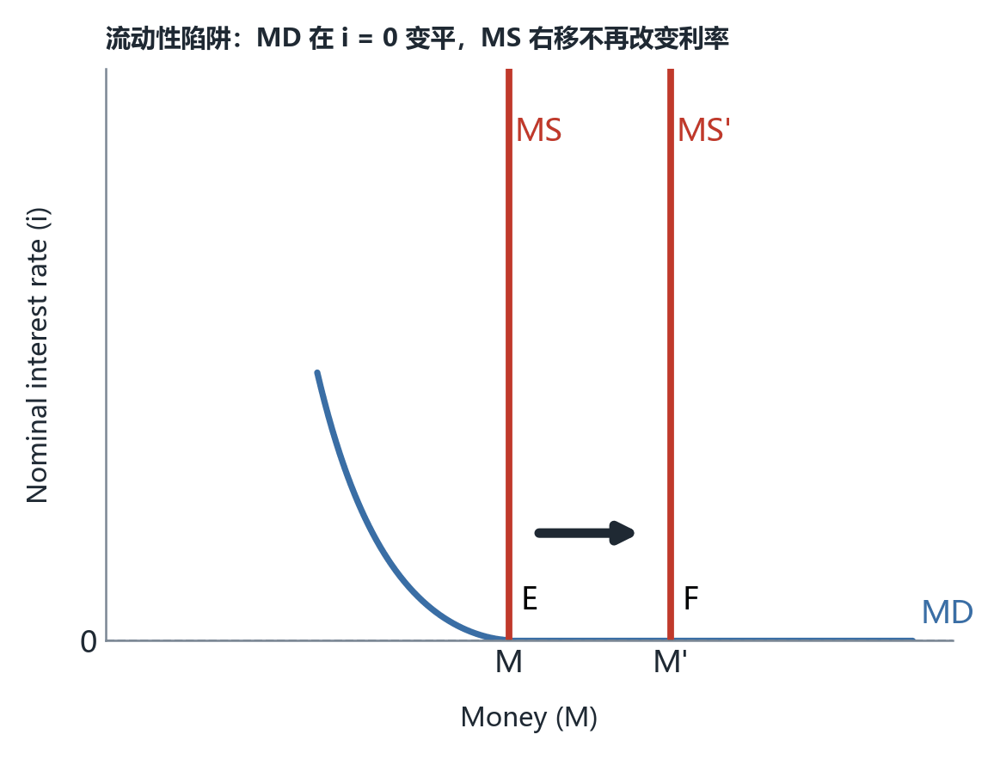

*图 16　流动性陷阱。MD 曲线在 $i = 0$ 处转为水平，并向右延伸到 $MS'$ 之外；两条红色竖直供给线 $MS$ 与 $MS'$ 与这条水平段分别交于 E 与 F，**E 与 F 在同一高度（= 0）**，所以把货币供给从 $M$ 增到 $M'$ 之后均衡利率毫无变化。纵轴刻度只有原点标了 0，并有一条水平虚线沿 0 延伸。（按课件 p.48 示意重绘；出自讲义 p.48）*

课件给的结论是四条，顺序正好是传导链从前往后断：

| 结果（课件原话） | 断在哪一环 | 机制 |
|---|---|---|
| Nominal (and real) interest rates **do not change** | $M \to i$ | MD 水平段上，任何 $MS$ 右移都交在同一高度 |
| **Banks increase their holdings of excess reserves** | 新增货币的去处 | 公众不愿多持币、银行被迫接盘，钱停在准备金账户 |
| Lending and Investment **does not increase** | $i \to r \to PAE$ | 利率没动，企业与家庭面对的借款成本没变 |
| Known as a **Liquidity Trap** | — | 流动性偏好（第五节）在零利率处变得无限大 |

**第二行才是这一页真正的物理事件，值得单独说清。** 第六节讲过一次成功的降息：$MS$ 右移，利率下降，**「要让市场愿意持有这笔新增的、更大的货币量」**。在图 16 的世界里，这句话失去了意义——**市场在 $i = 0$ 上愿意持有任意多的货币**，因为货币（现金与活期存款）和有息资产（债券）此时是无差异的：债券的收益也只剩下 0。**既然无差异，多出来的钱就不需要「降价」来劝人接手，它直接沉淀下来。** 沉淀在哪里？沉淀在银行的准备金账户里，成为超额准备金。

这里正好接回第 9 章那个被当成技术细节的符号。第 9 章的统一货币乘数是

$$m = \frac{1+c}{c + r_d + e}$$

其中 $e$ 是银行**自愿**持有的超额准备金率。第 9 章的算例里 $e$ 通常取 0 或 0.10，因为那个世界假设银行总想把钱贷出去。**图 16 描述的世界是 $e$ 突然变得极大的世界**：美联储通过公开市场操作把基础货币灌进银行体系（$M_0 \uparrow$），但银行贷不出去（借款人的信用被衰退打坏了，这是下一小节那句说明文字的内容），于是新增的准备金原封不动地留在账上，$e$ 变得极大 → 分母变大 → **$m$ 崩塌**。结果是**基础货币暴涨、货币存量 $M$ 涨幅小得多**。

> [!IMPORTANT] 陷阱里坏掉的不是「货币」，是「通过利率这条渠道」
> 这一节容易被读成「货币政策没用了」，这是错的，而且会做错判断题。准确的说法是：**$M \to i$ 这一环断了，所以美联储能改变的只剩数量，改变不了价格。** 三条推论：① 美联储**仍然**在扩大资产负债表，动作很大、效果为零，这两件事必须分开说；② 既然价格工具失灵，出路只有两条——**换一个价格**（把目标从隔夜利率换成长期利率，这就是量化宽松，见 §7.4）或**换一个工具**（财政直接动 $PAE$ 的截距，第 11 章的对象）；③ 陷阱不是「流动性偏好无限大」的字面意思，而是「MD 曲线在 0 附近水平」这个几何事实——**别把凯恩斯的流动性陷阱与第五节的流动性偏好混成一个词，后者是前者的基础，但只有加上零下限才有陷阱。**

**练习 10（我的补充，非讲义内容）**：在图 16 描述的世界里，美联储把货币供给从 $M$ 推到 $M'$、再推到 $M''$（假设是 $M$ 的三倍）。$i$、$r$、自主支出、均衡 $Y$ 各变多少？这道题里「美联储做了什么」和「经济发生了什么」为什么是两个不同的答案？

> [!TIP] 参考答案
> 四个量**全部变 0**。$i$ 不动（E、F 与第三个交点全在同一条水平段上）→ 短期 $\pi$ 不动所以 $r$ 不动 → 自主支出 $1{,}010 - 1{,}000r$ 不动 → $Y = 5{,}050 - 5{,}000r$ 不动。**但「美联储做了什么」是基础货币增加了两倍**：它买了资产、付了钱、钱进了银行体系。两个答案之所以分岔，是因为传导链上有一环（$M \to i$）断了——**这正是图 17 那张准备金曲线之所以长成那样的原因**。做这类题时，先问「断点在哪一环」，再决定是写「政策无效」还是写「政策未执行」。

### 7.3 零下限在这套模型里的算术边界（我的补充，非讲义内容）

课件只说了「利率不能低于零」，没有算出**这条线在第三节那套参数里到底值多少钱**。这一小节把它算出来，因为它是本节唯一能与前面六节真正接上的东西，而且考试可以直接考。

第三节的闭合解是 $Y = (1{,}010 - 1{,}000r)/0.2$，也就是

$$Y = 5{,}050 - 5{,}000r$$

（验算：$r = 5\% \to 4{,}800$、$r = 1\% \to 5{,}000$、$r = 9\% \to 4{,}600$，与第四节两个算例完全一致。）

现在把 $r \ge 0$ 这条约束代进去。**$\pi = 0$ 时 $r$ 的最小值是 0，于是货币政策能达到的最高产出是 $Y_{\max} = 5{,}050$。** 从 $r = 5\%$（$Y = 4{,}800$）这个起点出发：

| 量 | 表达式 | 数值 |
|---|---|---|
| 降息空间上限 | 当前的 $r$ 本身 | 5 个百分点 |
| 每 1 个百分点能买的产出 | $1{,}000 \times 5$ | 50 |
| 常规政策能补的最大衰退缺口 | $50 \times 5$ | **250** |
| 政策可达的最高产出 | $5{,}050 - 5{,}000 \times 0$ | **5,050** |

**这张表解释了第四节两个算例为什么都恰好能解。** 它们要的缺口都是 200，而 200 < 250，所以答案（$r$ 降到 1%、升到 9%）都落在尺子上。课件没有设计一个补不平的缺口——**练习 6 那个 400 的缺口是我加的，它需要 $r = -3\%$，超出上限 150，是这套框架里第一个「无解」的题。图 16 就是这个无解的图形版本。**

再往前一步：$r \ge 0$ 这个约束是 $\pi = 0$ 的产物。若预期通胀是 $\pi$，则 $i \ge 0$ 只要求 $r \ge -\pi$，产出上限变成 $Y_{\max} = 5{,}050 + 5{,}000\pi$：

| 预期通胀 $\pi$ | $r$ 可低至 | 政策可达的 $Y_{\max}$ | 比 $\pi = 0$ 时多出 |
|---|---|---|---|
| 0 | 0 | 5,050 | — |
| 1% | −1% | 5,100 | 50 |
| 2% | −2% | 5,150 | 100 |
| 3% | −3% | 5,200 | 150 |

**读法：每 1 个百分点的预期通胀，等于给美联储多买一次 1 个百分点的降息空间。** 这就是为什么零下限时代的央行花大量力气谈「预期管理」——它不是嘴上功夫，而是在**把 $r$ 的下限往下挪**。课件没有这一层（它把 $\pi$ 当常数），这一整张表是我的补充。

**练习 11（我的补充，非讲义内容）**：潜在产出 $Y^{*} = 5{,}100$，当前 $r = 5\%$。（a）若 $\pi = 0$，美联储能不能用常规工具填上这个缺口？（b）若 $\pi = 2\%$ 呢？需要把 $i$ 设成几？

> [!TIP] 参考答案
> （a）**不能。** 需要 $5{,}100 = 5{,}050 - 5{,}000r$，解得 $r = -1\%$；$\pi = 0$ 时 $i = r = -1\% < 0$，超出零下限，缺的正是 §7.3 那张表里的 50。（b）**能，而且根本不用碰到零下限。** 同样要 $r = -1\%$，但 $\pi = 2\%$ 时 $i = r + \pi = -1\% + 2\% = 1\% \ge 0$，可行。**这道题的要点是：被卡住的从来不是 $r$，而是 $i$；只要通胀预期够高，$r$ 为负并不需要名义利率为负。** 反过来说，如果预期通胀只有 0.5%，$i = -0.5\%$ 就够不着了——**同一个缺口能不能补，取决于预期，而不取决于美联储买了多少资产。**

### 7.4 换一个靶子：量化宽松（p.49–p.50）

零下限把隔夜利率这条路堵死之后，美联储做了两件事：**把利率目标留在 0，同时把资产负债表撑大**。第一张证据图就是这场操作的记账结果。

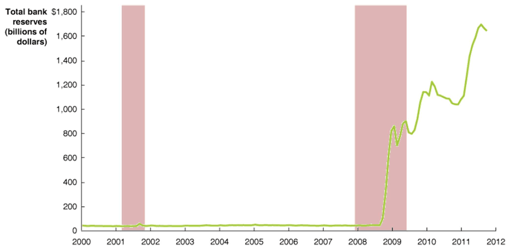

*图 17　美国银行体系总准备金（Total bank reserves，单位：十亿美元），2000–2012。按刻度定标反推的读数：2000–2007 年贴着横轴，约 34–54、中位约 40；2008 年初仍约 49，2008 年 9 月后垂直拉升，年底约 830；2009 年年中约 890；2010 年初约 1,160，随后回落到约 1,080–1,110；**2011 年年中达到峰值约 1,700**，曲线右端（约 2011 年秋季）回落到约 1,650。两段粉红阴影是 NBER 衰退期：约 2001 年 3 月–11 月与约 2007 年 12 月–2009 年 6 月。**峰值是平台的约 42 倍，增量约 1,650 十亿美元 ≈ 1.65 万亿。**（按原图裁切，未重绘；出处 p.49，数据源课件未标注，为教材位图；读图精度约 ±25 十亿美元）*

这张图值得盯住的是**它和图 16 的关系**。图 16 说「新增的货币会沉淀成超额准备金」，图 17 就是那句抽象话在现实里的样子：**2008 年 9 月到 2011 年，准备金从不到 50 涨到约 1,700，涨了三十多倍，而这段时间美国的通胀并没有起飞**——如果按第 9 章那个 $1/r_d$ 的上限去推，1,650 十亿美元的准备金足以撑起上万亿存款，现实里它没有撑起来，因为**这些钱从头到尾就是超额准备金，$e$ 巨大、$m$ 塌了**。这正是 §7.2 那句「沉淀在哪里」的答案。

课件配这段图的说明文字只有一句，但信息密度很高，逐句拆开：

> To stimulate the economy in late 2008, the Fed pushed the target for the federal funds rate to nearly zero and kept it there through 2011, but faced a *liquidity trap* when many banks began piling up excess reserves rather than lending the funds out to those whose financial positions had been damaged by the recession.

- **pushed the target … to nearly zero**：注意宾语是 **target**（目标），不是 market rate。美联储能钉住的是它宣布的目标区间，这与 §6.4「政策用利率来宣布」一脉相承。
- **kept it there through 2011**：这一句与本章另一张四十多年的利率轨迹图对不上——那张图显示目标区间直到 2015 年 12 月才第一次上调。**这句是 2013 年版教材的原话，写作时点早于后续事实**，已登记在第九节。
- **faced a liquidity trap when many banks began piling up excess reserves**：**课件在这句话里把图 16 的第二行结果和图 17 直接连上了**，这是全章唯一一处把「理论图」与「真实数据」并置的地方。
- **rather than lending the funds out to those whose financial positions had been damaged by the recession**：**这才是陷阱的成因**。不是银行不想赚利差，是**能还款的借款人没了**——家庭在衰退里毁掉了信用记录，银行面对的不是「利率太低所以不贷」，而是「利率多低都不贷」。**这一句把流动性陷阱从纯货币现象改成了信贷供给现象**，课件没有展开，但它是理解 2008 年后「为什么降息到 0 也没用」的关键。

然后是替代工具。量化宽松（Quantitative Easing, QE）的定义：

> Quantitative Easing (QE) refers to a central bank buying specified amounts of financial assets from commercial banks and other private financial institutions, thereby lowering the yield or return of those assets when conventional monetary policy is ineffective.

四个成分各自有分工，缺一个定义就不成立：

- **specified amounts**：**数量是事先宣布的**。这一点把它与常规的公开市场操作区分开——后者从来只报「本次净买入多少」，规模由利率目标倒推出来；QE 反过来，先定规模，让价格（收益率）自己动。
- **from commercial banks and other private financial institutions**：交易对手是金融机构，不是政府、不是家庭。所以 QE 的第一手效果仍然是「准备金换资产」，也就是图 17 那条曲线。
- **thereby lowering the yield or return of those assets**：**目标变量是所购资产的收益率，不是联邦基金利率。** 这是本节最重要的一处替换：隔夜利率被 0 卡住了，于是换一个没被卡住的价格去打。
- **when conventional monetary policy is ineffective**：这是**使用条件**，不是修饰语。它说明 QE 在课件的体系里是**后备工具**，常规政策有效时不该用。

课件补的第二条要点给出了作用渠道：purchasing assets of **longer maturity** thereby lowering **longer-term** interest rates（买期限更长的资产，从而压低长期利率）。

**为什么长期利率不受零下限约束？** 课件只说了做什么、没说凭什么，这里补一句（我的补充，非讲义内容）：一只 10 年期国债的收益率，近似等于未来若干年短期利率预期的平均，加上期限溢价。**下限卡住的是今天的短期利率，卡不住「预期路径的平均」与「期限溢价」这两项**——央行宣布长期大量买入，既能压低市场要求的期限溢价，也能改变预期路径，两条都能让长期收益率下行，哪怕隔夜利率已经躺在 0 上。**这也解释了为什么 QE 不违反 §6.4 那条「$i$ 与 $M$ 不能同时定」**：它仍然是「选定一个利率、让货币量随之而定」，只是**选的是另一个利率**。而 §6.5 早就留了这句话的口子——Other interest rates could be used to indicate the Fed's intentions（其他利率也可以用来指示美联储的意图）。

> [!WARNING] 「commercial debt」这个措辞不对
> 课件列 QE 购买清单时写的是 longer-term treasury notes, **commercial debt**, and Mortgage Backed Securities (MBS)。**应为 agency debt 与 agency MBS**（机构债与机构 MBS，即房利美、房地家、联邦住房贷款银行这三家政府支持企业发行的债券与抵押支持证券）。美联储在 QE1 期间确实大规模买入的是**机构 MBS 与机构债**，加上长期国债；它**从未**购买商业银行发行的公司债（那属于企业债，美联储 2020 年 3 月设立的 SMCCF 买的是符合投资级条件的**公司债券**，那是危机贷款工具而不是 QE 轮次，且规模远小于 QE）。**方向性结论不受影响：QE 打的是长期利率。** 原文、应为与判据见第九节编号条目。

课件最后一句给的是规模：The Fed has purchased **trillions of dollars** worth of … through several rounds of quantitative easing since the financial crisis in 2008（自 2008 年金融危机以来通过数轮量化宽松购买了数万亿美元资产）。**「trillions」这个数与图 17 的读数自洽**：准备金从约 40 涨到约 1,700（十亿美元），增量约 1.65 万亿，正好是「trillions」的量级。

**还有一件被并列提起、却没有兑现的事：扭曲操作。** 本节标题把 Quantitative Easing 与 Operation Twist 并列写出，但全章只给了前者的定义，**Operation Twist 一次也没有解释**。补一句定义（我的补充，非讲义内容）：**扭曲操作（Operation Twist）是央行在保持资产负债表总规模不变的前提下卖出短期证券、买入长期证券，目的是只压长期利率而不增加货币基础**——它是 QE 的「不扩表版」：**2011 年 9 月美联储宣布的期限延长计划（Maturity Extension Program）就是这一操作，市场当时叫它 Operation Twist**。**并列提及却没有内容这件事，已登记在第九节。**

**接缝交代（我的补充，非讲义内容）**：本章到这里已经把「政策如何移动计划支出线」讲完了——$M \to i \to r \to PAE \to Y$，五个环节全部走通，只在零下限处断掉。**但整章从头到尾把物价水平 $P$（以及通胀 $\pi$）当常数**，所以政策的效果全部表现为「支出线沿着同一条 45° 线平移」。**产出与物价如何被同时决定、通胀缺口持续时 $P$ 怎么内生地动起来、以及零下限在 $P$ 内生之后会不会松动——这三件事都要靠总需求—总供给模型，那是下一章（第 13 章 AD–AS）的对象。** 本章不需要提前处理它们。

---

## 八、速查表与易错点（p.51–p.52）

### 8.1 全章术语速查

| 术语（英文原名） | 中文译名 / 一句话定义 | 课件位置 |
|---|---|---|
| Federal Reserve System | 联邦储备体系：1913 年《联邦储备法》设立、1914 年开始运作的美国央行体系 | p.4–p.5 |
| Board of Governors | 理事会：7 位总统任命理事组成，为整个体系提供领导 | p.6–p.7 |
| Federal Open Market Committee (FOMC) | 联邦公开市场委员会：12 人，审议经济状况、制定货币政策、负责公开市场操作 | p.6–p.7 |
| Banking panic | 银行恐慌：顾客**认为**银行可能破产时发生的集体提款 | p.8 |
| Lender of last resort | 最后贷款人：央行在银行缺钱时按需放款 | p.8 |
| Federal funds rate | 联邦基金利率：银行间隔夜拆借准备金的利率，美联储实际盯住的目标 | p.12 |
| Open market operations (OMO) | 公开市场操作：买卖政府债券以改变货币供给，**主要工具** | p.40、p.43、p.47 |
| Discount window / discount rate | 贴现窗口／贴现率：银行向美联储借准备金的设施与对它的收费 | p.46 |
| Reserve requirement | 法定准备金率：必须持有为准备金的存款最低百分比 | p.47 |
| Fisher equation | 费雪方程：$r = i - \pi$，本章只取它的短期用法 $\Delta r \approx \Delta i$ | p.11 |
| Autonomous expenditure | 自主支出：不依赖 $Y$ 的那部分支出，本章里它是 $r$ 的函数 | p.15–p.17 |
| Potential output $Y^{*}$ | 潜在产出：政策想要把 $Y$ 拉回去的那个目标值 | p.21、p.28 |
| Recessionary gap | 衰退缺口：$Y^{*} > Y$，失业闲置 | p.19、p.21 |
| Expansionary gap | 膨胀缺口：$Y > Y^{*}$，通胀压力 | p.19、p.26、p.28 |
| Demand for money / money demand $MD$ | 货币需求：想以货币形式（现金与支票账户）持有的财富量 | p.32 |
| Liquidity preference | 流动性偏好：人们偏好持有流动性最高的资产，故货币需求是其价格的反函数 | p.33 |
| Cost–benefit principle | 成本—收益原则：边际收益小于边际成本就不再多做一单位 | p.33 |
| Money market equilibrium | 货币市场均衡：$MD$ 与垂直 $MS$ 的交点定出唯一的名义利率 | p.40 |
| Zero lower bound | 零下限：现金收益率为 0，因此名义利率降不下去 | p.48 |
| Effective lower bound | 有效下限：把持现成本算进去之后真实的下界略低于 0（我的补充，非讲义内容） | p.48 |
| Liquidity trap | 流动性陷阱：$MD$ 在 0 附近水平，$MS$ 右移不改变利率 | p.48 |
| Quantitative easing (QE) | 量化宽松：常规政策无效时，央行按**宣布的数量**购买指定资产以压低其收益率 | p.50 |
| Operation Twist | 扭曲操作：不扩表、卖短买长，只压长期利率（课件并列提及但未解释，定义是我的补充） | p.49 |
| Total bank reserves | 银行体系总准备金：图 17 的纵量，陷阱里暴涨的那个「证据」 | p.49 |

### 8.2 全章数字速查

只列**本章真正用过的**数，量纲照原样。带「我的补充」标记的数是课件没有给的。

| 数字 | 含义 | 出处 |
|---|---|---|
| 1913 / 1914 | 《联邦储备法》通过年 / 联邦储备体系开始运作年 | p.4 / p.5 |
| 12 / 7 / 12 | 地区联储银行数 / 理事数 / FOMC 成员数 | p.6–p.7 |
| 14 年、不可连任 | 理事任期 | p.7 |
| 4 年、可连任 | 理事会主席（兼 FOMC 主席）任期 | p.7 |
| 1 年一届 | 轮值地区银行行长任期 | p.7 |
| 每年 8 次 | FOMC 会议次数 | p.6 |
| 7 + 1 + 4 | FOMC 构成：理事 + 纽约联储行长 + 其余 11 家轮值 4 席 | p.7 |
| $640 - 0.8(250) + 250 + 300 + 20 = 1{,}010$ | 自主支出截距 | p.16 → p.17 |
| $-(400 + 600) = -1{,}000$ | $r$ 的系数 | p.16 → p.17 |
| $PAE = 1{,}010 - 1{,}000r + 0.8Y$ | 计划总支出函数 | p.17 |
| $1/(1-0.8) = 5$ | 凯恩斯支出乘数（**不是**货币乘数） | p.21、p.28 |
| $r=5\% \Rightarrow Y=4{,}800$ | 基准均衡 | p.18 |
| 缺口 200 → 首轮支出 40 → $\Delta r = 4$ 个百分点 | 填缺口的反推链 | p.21、p.28 |
| $r=1\% \Rightarrow Y=5{,}000$；$r=9\% \Rightarrow Y=4{,}600$ | 两道对称算例的答案 | p.22、p.29 |
| $Y^{*} = 5{,}000$ / $Y^{*} = 4{,}600$ | 衰退题与膨胀题的潜在产出**不同** | p.21 / p.28 |
| 6.5% → 6.0% → 4% 以下 → 2.0% | 2001 年联邦基金利率目标路径 | p.24 |
| 4.5 个百分点 / 12 个月 | 2000-11 到 2001-11 的降幅 | p.24 |
| 1.0% → 1.25% → 3.5% | 2003-06 见底、2004-06 起步、2005-08 到 3.5% | p.30 |
| 2.5 个百分点 / 约 14 个月 | 2004-06 至 2005-08 的加息幅度 | p.30 |
| M1/GDP：28%（1960）→ 16%（2013） | 货币需求相对规模长期下降 | p.33 |
| 一半以上 | 企业持有的货币存量占比 | p.34 |
| 1 : 1 | 1990 年美元对阿根廷比索的法定兑换率 | p.38 |
| 准备金约 40 → 峰值约 1,700（十亿美元） | 2000-07 平台到 2011 年峰值，约 42 倍 | p.49（读图） |
| 约 1,650 十亿美元 ≈ 1.65 万亿 | 准备金增量，与 trillions of dollars 同量级 | p.49、p.50 |
| $Y = 5{,}050 - 5{,}000r$ | 闭合解（我的补充） | 由 p.17、p.21 推出 |
| $Y_{\max} = 5{,}050$；可补缺口上限 250 | $\pi = 0$ 时常规政策的天花板（我的补充） | 由 p.17、p.48 推出 |
| 每 1 个百分点预期通胀 ≈ 50 产出 | 把 $r$ 的下限往下挪 1 个百分点的价值（我的补充） | 由 p.17、p.48 推出 |

### 8.3 四件工具对照

前三件是课件明列的三件工具，第四件是零下限之后加进来的。

| 工具 | 直接动的是什么 | 传导到 $i$ 的路径 | 流动性陷阱里还能用吗 | 使用频率 | 课件位置 |
|---|---|---|---|---|---|
| 公开市场操作 | 基础货币 → $MS$ 这条垂直线 | 买债券 → 货币供给增 → 沿 $MD$ 下滑到更低的 $i$ | **否**：$MD$ 已水平，右移不改 $i$ | 每次 FOMC 会议，**主要工具** | p.40、p.43、p.47 |
| 贴现窗口 / 贴现率 | 银行借款的成本与意愿 | 贴现率↑ → 银行少借准备金 → 准备金与货币供给收缩 → $i$↑ | **否**：瓶颈在借款人信用，不在银行资金成本 | 被动工具，主要当**信号** | p.46 |
| 法定准备金率 | 货币**乘数** $m$（不是基础货币） | $r_d$↑ → $m$↓ → 同样 $M_0$ 下 $M$↓ → $i$↑ | **否**，且 2020-03-26 起美国 $r_d = 0$，工具已空转 | **rarely changed** | p.47 |
| 量化宽松 QE | 长期资产的收益率（不是联邦基金利率） | 买长期资产 → 长期收益率↓ → 直接作用在 $b = 600$ 那条投资敏感度上 | **是**：它就是为这个情形设计的 | 常规政策无效时 | p.49–p.50 |

**这张表最该记住的一列是「陷阱里还能用吗」。** 三件传统工具全部靠「改变 $i$」起作用，所以在陷阱里一起失效；QE 之所以算新工具，不是因为它买得更多，而是**它换了一个不受 0 约束的价格去盯**。

### 8.4 全章框架图（p.52）

*图 18　全章概念地图。中央大框 `Interest Rates: Real, Nominal, Fed Funds` 是全章枢纽：左边「$MS$ + $MD$ → 货币市场 → 利率」是利率的**决定侧**，右侧「Monetary Policy → 三件工具 → 利率」是利率的**操纵侧**，右上 `Keynesian Model` 是利率的**作用场**。`The Fed` 与 `Stock Market` 之间是一条**双向虚线**，课件画了它但没有配任何文字。（按课件 p.52 示意重绘；出自讲义 p.52）*

十条连线的方向按 400 dpi 逐条放大核对过，列出来备查：

| # | 连线 | 线型 | 含义 |
|---|---|---|---|
| 1 | The Fed → Supply of Money | 实线 | 央行决定货币供给 |
| 2 | The Fed → Interest Rates | 实线 | 央行最终影响的是利率 |
| 3 | The Fed ↔ Stock Market | **双向虚线** | 语义未交代（见下方说明） |
| 4 | Supply of Money → Money Market | 实线 | 供给方进场 |
| 5 | Demand for Money → Money Market | 实线 | 需求方进场 |
| 6 | Money Market → Interest Rates | 实线 | 均衡定出利率 |
| 7 | Interest Rates ↔ Stabilization Policy | **双向实线** | 利率既是稳定政策的作用点，也受政策影响 |
| 8 | Interest Rates → Keynesian Model | 实线（**箭头落在 Keynesian Model**） | 利率进入支出模型 |
| 9 | Monetary Policy → Interest Rates | 实线 | 政策直接以利率表述 |
| 10 | Monetary Policy 下方竖排 OMO / Discount Rate / Reserve Requirement | **相接、无箭头** | 三件工具是政策的组成，不是并列的第四条线 |

第 8 条值得单独强调：**箭头是从利率指向凯恩斯模型，不是反过来。** 这与全章的因果顺序一致——利率是外生给定、进入支出函数、再决定产出；模型不会回头决定利率，利率由货币市场（第 4–6 条）决定。**第 10 条同样容易被读错**：三个工具框只是挨着画，课件没有从 Monetary Policy 给它们画箭头，也没有让它们互相指。

**第 3 条是唯一一条课件自己没解释的线。** 双向虚线连到 `Stock Market`，全章正文只在讲持有货币的替代资产时提过一句股票（第五节），既没说美联储怎么直接影响股市，也没说股市怎么反过来影响美联储。**两种读法**：A) 想表达「货币政策通过资产价格渠道起作用」（托宾 $q$、财富效应），但课件没有配套内容；B) 只是把第 9 章「股票不是货币」那条线画回来做个提醒。**我判不出课件本意，所以这张图的正确用法是：把第 3 条当作未定义项，其余九条当作全章的目录。**

框与小节的对照，复习时可以拿它当索引：

| 框 | 对应本笔记 | 一句话回忆 |
|---|---|---|
| The Fed | §1.2–§1.4 | 1913 年立法、1914 年开业，三层架构，不追求利润 |
| Supply of Money | §6.1 | 垂直线，由公开市场操作决定，与利率无关 |
| Demand for Money | §5.2–§5.6 | 想以货币形式持有的财富，$i$ 是它的价格 |
| Money Market | §6.1–§6.2 | 两条线的交点定出 $i$；偏离时靠卖债券拉回 |
| Interest Rates: Real, Nominal, Fed Funds | §2.2–§2.3 | 三个名字一条链：$i$ 定 $r$，$r$ 进模型 |
| Keynesian Model | §3.2–§3.5 | $PAE = 1{,}010 - 1{,}000r + 0.8Y$ |
| Stabilization Policy | §4.2、§4.5 | 缺口 200 → 首轮 40 → 利率动 4 个百分点 |
| Monetary Policy + 三件工具 | §6.3、§6.6 | OMO 是主力，贴现率是信号，准备金率很少动 |
| Stock Market | — | 画了线但没给内容 |

### 8.5 课堂选择题（p.51，课件不给答案）

原题逐字：

> Which of the following will lead to a **decrease** in the equilibrium interest rate in the economy?
> A) an increase in the price level
> B) a sale of government securities by the Fed
> C) a decrease in GDP
> D) an increase in the discount rate
> E) an increase in the reserve requirement

五个选项全部放进 $MD \times MS$ 这套语言里判一遍——**这就是这道题的考点：它考的不是背结论，而是「谁移动哪条线」**。

| 选项 | 动的是哪条线 | 往哪边动 | 为什么 | $i$ |
|---|---|---|---|---|
| A 物价水平上升 | $MD$ | 右移 | 名义交易变贵，同样的实际交易量需要更多名义货币 | 升 |
| B 美联储卖出政府证券 | $MS$ | 左移 | 卖债券收回准备金的对价，货币存量下降 | 升 |
| C GDP 下降 | $MD$ | 左移 | 实际产出与收入减少，交易性货币需求减少 | **降** |
| D 提高贴现率 | $MS$（间接） | 左移 | 银行借准备金变贵 → 少借 → 准备金与货币供给收缩 | 升 |
| E 提高法定准备金率 | $MS$ | 左移 | 动的是乘数 $m$：同样 $M_0$ 下 $M$ 变小 | 升 |

> [!TIP] 参考答案
> **选 C**（我的补充，非讲义内容）。**只有 C 移动的是需求曲线且方向向左**，其余四项全在推高利率。两个容易失分点：① A 与 C 都动 $MD$、方向相反，判据是「$MD$ 是**名义**货币需求」，所以 $P$ 与 $Y$ 都往同方向拉它；② D 的传导是**间接**的，课件没有画出「贴现率 → 银行借款 → 准备金 → 货币供给」这条链，只写了它「是一种信号」，所以这五个选项里 D 最需要自己补机制。**做这类题的固定三步：先问动的是供给还是需求，再问方向，最后读 $i$ 的新交点。**

### 8.6 最容易踩的十个坑

1. **1913 与 1914 不是同一个事件。** 立法年 1913、开始运作年 1914；判断题把两者写反是最便宜的陷阱。

2. **FOMC 的 12 人 ≠ 12 家银行。** 12 家地区联储银行是**机构**，FOMC 的 12 席是 7 位理事 + 纽约联储行长 + 其余 11 家轮值的 4 位行长。**地区银行里有 7 家在 FOMC 没有固定投票权。**

3. **理事 14 年不可连任，主席 4 年可连任。** 两个任期写在同一处，混着背必错；「不可连任」的是理事，不是主席。

4. **本章的 $MD \times MS$ 图与第 9 章的准备金市场图是两张图。** 判据只看横轴：$M$（货币存量，M1 口径、供给垂直）还是 $F$（联邦基金数量／准备金，供给常画成倾斜）。**混用会造出「准备金供给为什么一章垂直一章倾斜」这种伪矛盾。**

5. **两个乘数同章不同义。** 支出乘数 $1/(1-mpc) = 5$ 乘的是「第一轮支出 → 产出」；货币乘数 $m = (1+c)/(c+r_d+e)$ 乘的是「基础货币 → 货币供给」。**看到「乘数」先问它在乘什么。**

6. **$r$ 要代小数。** $1{,}010 - 1{,}000r$ 在 $r = 0.05$ 时给 960；代成 5 会得到 $-3{,}990$。**$a$ 与 $b$ 是按「1 单位 $r$」定的，而 1 单位 $r$ 等于 100 个百分点。**

7. **缺口 200 不等于支出要动 200。** 顺序是 $200 \div 5 = 40$（首轮支出），再 $40 \div 1{,}000 = 0.04$（利率）。**直接令支出动 200 会把所需降息放大五倍。**

8. **潜在产出在两道算例里不一样。** 衰退题 $Y^{*} = 5{,}000$、膨胀题 $Y^{*} = 4{,}600$，基准 $Y$ 都是 4,800。**把 $Y^{*}$ 当常数背，第二道题就会算出「不需要动利率」。**

9. **通胀不是「有缺口就涨」。** 条件是 if persists：企业先补库存、先加班，只有缺口持续、补不过来才提价。**看到「膨胀缺口 → 通胀」的判断题，先找「持续」这个限定词在不在。**

10. **零下限卡的是 $i$，不是 $r$；陷阱里「动作大」不等于「有效」。** $r = i - \pi$ 在 $\pi > 0$ 时可以为负，所以真正够不着的是名义利率。而图 17 那三十多倍的准备金增长证明美联储确实做了很多——**它改变的只是数量，传导链在 $M \to i$ 那一环就断了，所以 $r$、$PAE$、$Y$ 一个都没动。** 附带一条：QE 打的是**长期**利率，不是把联邦基金利率压成负数。

---

## 九、附：诚实备注

本讲的输入只有一份课件（52 页 PDF），**没有课堂口述记录、没有配套读物、没有 Ch12 的练习解答**（同目录有 Ch5 与 Ch7 的 Practice Question Notes，但没有本章的）。所有推导、算例解答、跨章连接与时效修正都是我基于课件展开的。中间产物在 `.qoder/inventory/`：逐页清单 `Ch12_inventory.md`、150 dpi 全页渲染 `Ch12_pages/`、400 dpi 放大裁切 `Ch12_zoom/`、文字层 `Ch12_text.txt`、图片元信息 `Ch12_imgmeta.json`；复算脚本 `calc_Ch12.py`，输出 `_calc_ch12.txt`。

### ① 发现的课件问题

按影响答案的程度排序，⚠️ 表示会影响做题结果或事实判断。

1. ⚠️ **p.49 的说明文字与 p.13 的利率轨迹图互相矛盾。** 原文（p.49）：`the Fed pushed the target for the federal funds rate to nearly zero and kept it there through 2011`。**应为「维持在零附近直到 2015 年 12 月才第一次上调」**——p.13 那张 1982–2025 的联邦基金目标图上，2008 年底之后那段贴着 0 的平台一直延伸到 2015 年 12 月，正文 §2.4 按图读数写的就是这个。**判据：两页出自同一份课件，图上平台明显长于「through 2011」所述；这句是教材 2013 年版写作时的口径，落后于后续事实。** 影响：如果按 p.49 这句答「零利率只维持到 2011」，会把 2011–2015 这四年漏掉，而这段时间正是 QE1/QE2/QE3 与扭曲操作的全部窗口。

2. **p.50 的 QE 购买清单里 `commercial debt` 措辞不对。** 原文：`longer-term treasury notes, commercial debt, and Mortgage Backed Securities (MBS)`。**应为 agency debt 与 agency MBS**（房利美、房地美、联邦住房贷款银行这三家政府支持企业发行的债券与抵押支持证券）。**判据：美联储 QE 三轮里买的资产是长期国债 + 机构 MBS + 机构债三类，「商业银行债务」不在其中；2020 年 3 月设立的 SMCCF 确实买过符合投资级条件的公司债，但那是危机贷款工具、不是 QE 轮次，规模也远小于 QE。** 方向性结论（QE 打长期利率）不受影响。

3. **p.42 拼写错误。** 原文：`Interest rated decrease to i'`。**应为 `Interest rates decrease to i'`。** 判据：同页另一行写的是 `Interest rate`，且 `rated` 在此语境无意义。纯排版错误，不影响结论。

4. **Operation Twist 被并列提起却没有被解释。** 它与 QE 并列出现在同一处的标题里（p.49），原文：`Too Low for Zero: The Fed Tries "Quantitative Easing" and "Operation Twist"`。**并列提及就要并列给出定义**，或干脆只写 QE。**判据：定义段只覆盖了 QE（buying specified amounts … thereby lowering the yield），全文没有一句提到卖短买长或资产负债表中性操作。** 正文 §7.4 已把定义补上并标为我的补充。

5. **全章框架图有一条没有解释的线（p.52）。** `The Fed` 与 `Stock Market` 之间是一条**双向虚线**，全章正文只在讲持有货币的替代资产时提过一句股票，既没写美联储如何直接影响股市，也没写股市如何反馈。**判据：这条线用的是虚线（其余九条全是实线），说明课件自己也把它当次要或存疑关系；配套文字为零。** 正文的处理是把它当未定义项列出，不替课件编一个解释。

6. ⚠️ **p.37 把两个因素列进「导致 MD 移动」却没写方向。** 原文列出 Transaction technology 与 Financial advances 作为移动因素，但没有说明它们使曲线往哪边移。**应为左移**。**判据：同一份课件在 p.33 讲持有货币的收益时明确写了 ATM 与网络银行**降低**了持有货币的需要，方向只能是一个。** 影响：这是选择题的直接考点（「下列哪项使 MD 左移」），方向缺失会让人靠猜。正文的表已补齐方向并标为我的补充。

7. **p.43 两条债券市场链条的口径不对称。** 收紧那条第 2 步写 `Supply of bonds increases`，放松那条第 2 步写 `Demand for bonds increases`。**严格说这是同一件事的两面**——美联储的交易本身就构成债券市场的供给方或需求方，两条链用的是不同参照系。**判据：两行第 1 步分别是 Fed sells / Fed buys，动作主体相同、参照对象不同；方向与结论都对。** 正文照课件讲并补了一句说明，不判为错误。

**另有六处属于简化或时效，不判为课件笔误，但必须知道边界**：一是 $r = i - \pi$ 未说明 $\pi$ 是预期还是已实现（p.11，见 §2.2 的 CAUTION）；二是 2008 年后蓝线断掉是 FRED 序列被停用而非数据缺失，这一层没有解释（p.13，见 §2.4）；三是 M1/GDP 从 28% 降到 16% 无来源、无年度数值，无法独立核验（p.33，见 §5.2 的 WARNING）；四是「Assume the nominal interest rate on money is 0」这条假设在 2008 年 10 月后被美联储自己废掉（p.34，见 §5.3 的 CAUTION）；五是 €500 面额纸币已于 2019 年停发（p.39，见 §5.7 的 NOTE）；六是法定准备金率自 2020 年 3 月 26 日起为 0、该工具已空转（p.47，见 §6.6 的 CAUTION），而「名义利率不能低于零」也是教科书假设、现实里叫有效下限（p.48，见 §7.1 的 CAUTION）。

### ② 我复算 / 补充出来的数字与内容

**课件给的数我逐格验算过**（p.16 的 4 / 6 / 10、p.17 的 1,010 与 −1,000、p.18 的 4,800、p.21 的 5 与 40 与 4 个百分点、p.22 的 5,000、p.24 的 4.5 个百分点、p.28 与 p.29 的 4,600、p.30 的 2.5 个百分点 / 14 个月），全部对得上，脚本 `calc_Ch12.py` 第 1 段可复跑。

**我算出来的、课件没有给的数字**（逐条指回正文小节）：

- **闭合解 $Y = 5{,}050 - 5{,}000r$**（§7.3）：把 p.17 的支出函数与 p.21 的乘数合起来一步写出，课件只给中间值。
- **常规政策的天花板 $Y_{\max} = 5{,}050$、可补缺口上限 250**（§7.3）：$\pi = 0$ 时 $r \ge 0$ 的直接后果。**这解释了为什么课件两道算例的缺口都是 200——200 < 250，恰好有解；它没有设计一个补不平的缺口。**
- **每 1 个百分点预期通胀 ≈ 50 的产出空间**（§7.3 那张四行表）：$r \ge -\pi$ 代入闭合解，$\pi = 1\%/2\%/3\%$ 对应 $Y_{\max} = 5{,}100/5{,}150/5{,}200$。
- **练习 6 的 $r = -3\%$、练习 11 的两问**（§7.3）：后者给出「$\pi = 2\%$ 时 $i = 1\%$ 就够到 $Y = 5{,}100$，不必碰零下限」这个反直觉结论。
- **p.49 那张准备金图的定量读数**（§7.4 图 17 的图注）：2000–2007 平台约 34–54（中位约 40）、2008 年 9 月后到年底约 830、2010 年初约 1,160、**峰值约 1,700 出现在 2011 年年中**、曲线右端约 1,650、**峰值约为平台的 42 倍、增量约 1,650 十亿美元 ≈ 1.65 万亿**，以及两段衰退阴影的日期范围（约 2001 年 3 月–11 月、约 2007 年 12 月–2009 年 6 月）。**这些数全部是像素定标反推的，不是目测**，方法与精度见 ③。
- **p.51 课堂选择题的答案 C 与五个选项的逐项判定表**（§8.5）：课件只给题目。
- **§8.3 那张工具对照表里「流动性陷阱里还能用吗」这一列**：课件没有这个维度，是我按 §7.2 的断链位置推出来的。

**我补充的、课件没有的内容**（按出现顺序）：§7.1 的「为什么 $i$ 有下限」用 1,000 美元存抽屉的手算例子（课件只宣告结论）；§7.1 末尾「取消现金则下限可下移」的失败情形；**有效下限（ELB）与欧元区/日本/瑞士负政策利率三个实例**（课件写的是 $i \ge 0$）；§7.2 把 p.48 那条「银行增加超额准备金」与第 9 章乘数里的 $e$ 连起来，并指出图 17 就是这条的实证；§7.4 的「为什么长期利率不受零下限约束」（预期路径 + 期限溢价）；**Operation Twist 的定义**；§7.4 末尾与第 13 章的接缝交代。

**这是讲义没有的图**：一张也没有。18 张图全部对应课件真实存在的图（6 张裁切、12 张重绘），其中图 18 是课件 p.52 那张概念图的重绘版。**表格倒有三张是课件没有的**：§8.3 的四工具对照、§8.4 的十条连线方向表、§8.5 的五选项判定表。

**三处我自己修正的地方，如实说明。**

1. **图 18 的 `Keynesian Model` 那条箭头，我原来画反了。** 逐页清单把它记成「Keynesian Model → 利率框」，脚本照此绘制。这次按 400 dpi 裁切放大（`Ch12_zoom/p52_keynes_arrow.png`）确认**箭头落在 Keynesian Model 上**，方向是「利率 → 凯恩斯模型」，与全章「利率外生进入支出函数」的顺序一致。已改脚本、重跑出图、正文 §8.4 按新方向写。**这不是课件的问题，是我上一阶段清单的抄录错误。**
2. **同一处放大时发现虚线 `The Fed ↔ Stock Market` 是双向的**（清单记的是「虚线双向」，正确），但脚本原来只画了一端的箭头，已补成双头；另外脚本原来从 `Monetary Policy` 向 `Open Market Operations` 多画了一条箭头，**课件那里没有箭头，三个工具框只是相接**，已删。这两处都属于「图与课件不符」，是我这次逐条核对才抓出来的。
3. **清单里两处标题抄录有误**：p.50 的标题实为 `Additional Controls over the Money Supply`（清单记作 "Quantitative Easing"），p.51 的标题实为 `Practice`（清单记作 "In-Class Question"）。正文不引用标题栏，所以不影响笔记内容，但登记在此以免后续复用清单时出错。**另外清单汇总表 B 末尾的裁切/重绘计数自相矛盾（写了「裁切 7 张」又列出 6 张），实际是裁切 6 张 + 重绘 12 张 = 18 张。**

### ③ 数值核验

**为什么敢在图注里写「峰值约 1,700」这种数。** 课件 p.49 那张图是教材位图（xref=249，2075×1017 px），没有配套数字表，所以只能从像素反推。做法是：先把原始位图按颜色分离出折线与坐标轴，用**刻度文字的行簇**定纵轴（10 个等距行簇，中心分别在行 47 到 937、间距 99 px，对应 1,800 到 0，得 2.0225 十亿美元/px），用**x 轴刻度短线**定横轴（轴水平线在行 938，其上方 5–7 px 的竖线段落在列 330 与 2013，即 2000 与 2012，得 140.25 px/年）。两个校准点都是**结构性特征**（刻度间距严格等距），不是拟合出来的，所以误差主要来自折线线宽：线宽约 8 px，**取值精度约 ±25 十亿美元**，即一个刻度（200）的八分之一。因此图注一律写「约」，并且只写能被这个精度区分的结论（平台在 50 以下、峰值在 1,700 附近、增量约 1.65 万亿），**没有**用它去区分 2010 年 1 月与 11 月那种相邻台阶。**复算脚本 `calc_Ch12.py` 第 4 段可整段重跑。**

**衰退阴影的日期**用同一张位图按颜色掩膜量出列范围（495–586 与 1,442–1,650），换算成年份是 2001.18–2001.83 与 2007.93–2009.41，与 NBER 官方口径（2001 年 3 月–11 月、2007 年 12 月–2009 年 6 月）在一个月以内吻合，所以图注按 NBER 写法给月、并注明是 NBER 衰退期。

**利率读数不敢给到 25 个基点（p.13 与 p.24）。** 图 4 与图 7 的纵轴网格间隔是 2.5 个百分点，2.25% 与 2.50% 在像素上不可区分。2001 年 11 月的数值文字写的是 2.0%（p.24），而曲线在那一处的台阶落在 1.75%–2.0% 之间无法分辨——**这类冲突一律以文字为准，曲线只作形状参考**（§2.4 的 WARNING 已交代）。

**p.33 的 28% → 16% 我没有核验。** 课件没给 M1 与 GDP 的年度数值，也没给来源链接，无法像 §3.3 那样逐项验算；正文如实引用并标注「无法独立核验」，不拿它做任何推论。

### ④ 与上一讲的对账

第 9 章笔记末尾「不够的部分」点了四个洞，其中两个明确归本章。我先把那两句原文抄出来，再逐条判定。

**空洞一，原话是：**「**货币需求（money demand）完全缺席。** 全讲只讲了货币的供给……没有 $M^d$，就没有利率决定的完整故事，也就没有"$V$ 为什么稳定"的微观基础。」

**判定：命中。** 三个分句逐个对：

- 「没有 $M^d$」→ 本章 §5 从零建起：货币需求的定义（想以现金与支票账户形式持有的财富量）、流动性偏好、成本—收益原则、持有货币的边际成本恰好等于放弃的利息 $i$、三个决定因素（$i$、$Y$、$P$）、MD 曲线、MD 的平移与五个因素。**这一半补得完整。**
- 「没有利率决定的完整故事」→ §6 给了：垂直 $MS$ 与 $MD$ 的交点定出 $i$（均衡）、利率偏离时靠卖债券→债券价格→利率的调整机制拉回（机制）、$MS$ 右移如何把 $i$ 压下来（操作）、以及 $i$ 与 $M$ 只能选一个当工具（方法论）。**故事闭合了，包括「凭什么利率停在 E」这一环。**
- 「没有 $V$ 为什么稳定的微观基础」→ §5.4 正面接上了：$MD$ 是**名义**货币需求，$P$ 翻倍则 $MD$ 大致翻倍，所以 $P$ 上升时 $M$ 同比例上升，$V = PY/M$ 不变。**第 9 章那个只能当观察记住的「M2 速度 fairly stable」，在本章有了微观基础。**

**但要如实说清补得不全的地方：本章的 $MD$ 没有函数式。** 全章没有一处写出 $M^{d} = P \cdot L(Y, i)$ 这种可代入的形式，MD 曲线只有形状与移动方向，$MS$ 也只有垂直这条性质、没有任何数量。所以**本章能定方向、不能算数值**——给一道「已知 $Y$、$P$ 与货币供给，求均衡利率」的题，用本章的工具做不出来。这是命中之后剩下的那道缝，也是 ⑤ 里「下一步该补什么」的第一条。

**空洞二，原话是：**「**央行的日常操作被一张教科书式的供需图代替了。** p40 画的是"准备金的供给与需求"，但 2008 年之后美联储实际用的是**利率走廊（interest on reserve balances + ON RRP）**，靠的是给准备金付息而不是微调准备金的供给量。」

**判定：未命中。** 这一条我判得严格一点，理由逐条摆出来：

- 全章**没有出现 IORB / IOER，没有出现 ON RRP，没有出现「给准备金付息」这个机制**，也没有出现「走廊」「上下限工具」这类词。
- 本章 p.40 与 p.48 的货币市场图，横轴是 **M1 的货币数量**、供给曲线**垂直**；这与第 9 章那张「纵轴 $r_{ff}$、横轴联邦基金数量 $F$、靠公开市场操作平移供给」的准备金市场图**不是同一张图**，更不是走廊图。§6.1 的 CAUTION 专门把两张图分开了，但那只是**避免打架，不是补洞**。
- 唯一沾边的是两处**症状描述**：p.48「Banks increase their holdings of excess reserves」与 p.49「piling up excess reserves」。**它们说的是旧框架失灵时发生了什么，没有说新框架怎么运转。** 换句话说，本章补上了「为什么 Ch9 那张图在 2008 年后不够用」，没有补上「那现在用什么」。
- 有一处**接近但未达标的交代**：§5.3 的 CAUTION 明写了 2008 年 10 月起美联储对准备金付息（IOER/IORB）、2021 年开了 ON RRP，并指出「一旦货币的利率不再是 0，边际成本就变成 $i - i_m$，MD 曲线的推导要重写」。**这是把洞的位置标出来了，不是把洞补上**——正文没有给出重写后的推导，也没有给走廊的图。所以我不给「部分命中」：**按第 9 章原话的要求（讲清 2008 年后的实际操作）衡量，本章没有交付。**

**口径冲突检查（本章 vs 第 9 章）。** 逐项对过，**没有实质冲突**，但有四处需要交代：

- **三大工具**：第 9 章的顺序是公开市场操作／法定准备金率／贴现率，本章是公开市场操作（p.40、p.43）／贴现窗口（p.46）／准备金率（p.47），**排序与命名不同、内容一致**；rarely changed 这一句（p.47）与第 9 章「频繁改动会扰乱银行体系」同调。✅
- **$M = C + D$**：本章从头到尾**没有写出这个式子**，但 p.32 把 money demand 定义为「以货币形式（cash & checking accounts）持有的财富」，**这正是 M1 口径**，与第 9 章做题用的 $M = C + D$（$C$ 通货 + $D$ 活期存款）是同一个量。✅ 不冲突。**但有一个真实的坑**：本章货币市场图的横轴只写 `Money (M)`，若把它读作第 9 章的基础货币 $M_0$，就会撞上第 9 章已经勘误过的那个「M1 = M0 + 活期存款」的重复计算错误。§5.1 的 CAUTION 挡的就是这一发。
- **货币乘数 $m = (1+c)/(c+r_d+e)$**：本章一次没有使用（用的是凯恩斯支出乘数 5），**不冲突**。而且**本章反过来给第 9 章补了一处**：第 9 章留下「2020 年后准备金率归零、乘数却没爆炸，因为决定乘数的是 $c$ 与 $e$ 这两个行为参数」，但**没有解释 $e$ 为什么会变那么大**；本章 §7.2 给出了机制（零下限 + 借款人信用被衰退打坏 → 银行想贷也贷不出去 → 新增准备金原样沉淀为超额准备金），图 17 就是 $e$ 的时间序列。**这是本章对第 9 章的一处额外回报。**
- **数量方程 $MV = PY$**：本章没有出现，也不与本章冲突——第 9 章讲的是长期（货币中性），本章讲的是短期（$\Delta r \approx \Delta i$）。**两章的分界线在本章 §6.2 的失败情形里被明确画出来了**：价格黏住、资产市场畅通时，超额货币余额通过**利率**调整；把它拉到长期，调整渠道换成**物价**。这正是第 9 章末尾预告的那条分界。
- **新增一条**：第 9 章坑 7 说「央行不能同时钉住数量与价格」，但只给了结论；本章 §6.4 用垂直 $MS$ 与倾斜 $MD$ 只有一个交点把它**推导**出来了。**本章是那一页的理论补全。**

**与第 11 章的对账。** 第 11 章末尾留了两条明确指向本章的：其一，「利率影响投资这条渠道在本章只是被**宣告**，从未被**使用**……它真正被用起来要到第 12 章」→ **命中**：本章 §3 把 $C$ 里的 $-400r$ 与 $I^{P} = 250 - 600r$ 装进支出函数，§4 用了两次（降息填衰退缺口、加息压膨胀缺口）。其二，「通胀缺口：p.46 用 output gaps 统称，但只给了衰退缺口的数值例，产出高于 $Y^{*}$ 时会发生什么没有交代」→ **命中**：本章 §4.4 给了机制（存货清空 → 若持续则提价），§4.5 给了数值例（$Y^{*} = 4{,}600$、$r$ 从 5% 升到 9%）。**另外第 11 章 p.57 那句「货币政策更常被用来稳定经济」的凭什么（不需要立法程序、时滞短），本章没有接——它属于第 13 章的政策比较。**

### ⑤ 本讲的「够 / 不够」与复习顺序

**讲足了的三块。** 第一，**传导链五环全部走通而且每一步都能算**：$M \to i$（§6 的 $MD \times MS$）、$i \to r$（§2 的费雪方程短期用法）、$r \to PAE$（§3 的 $-1{,}000r$）、$PAE \to Y$（§4 的乘数 5）。**这是本章最扎实的部分，也是能「合上书自己重算一遍」的部分。** 第二，**货币需求从无到有，而且把第 9 章的 $V$ 稳定性接上了微观基础**（§5.4）。第三，**零下限这一节有理论图（图 16）、有真实数据（图 17）、有可算的边界（§7.3 的 250 与 5,050）**，三样互相咬合，不是空喊「流动性陷阱」。

**抛题不解的六块。** 其一，**$MD$ 没有函数式**：全章只能定方向、不能算均衡利率的数值，任何「求 $i$」的计算题都超出本章工具。其二，**利率走廊缺席**（④ 里那条未命中的洞）。其三，**通胀预期全程是常数**：$\pi$ 不进模型、不变、不被政策影响，所以费雪方程只用了短期那一半，「央行管理预期」这件事本章只能靠 §7.3 那张我自己算的表来暗示。其四，**QE 只有定义没有机制**：组合再平衡效应、信号效应、期限溢价三条渠道一条没讲，资产负债表的规模数字也没给（只有 trillions 这个量级词）。其五，**财政与货币同时作用的合成没有**：p.25 自己承认 2001 年是两件政策同时发力，但本章的支出线每次只被移动一次，无法分解哪一部分归谁（§4.3 已点明）。其六，**供给冲击与滞胀没有**：本章的通胀全部是需求侧的（膨胀缺口持续 → 提价），油价上涨那种「产出降 + 物价升」的组合在本章框架里画不出来。

**被整块跳过的：没有。** 52 页全部覆盖，包括五张目录页（p.3、p.9、p.20、p.31 与 p.2）与最后的框架图（p.52）。

**下一步该补什么（给自己的清单）。** ① 找一个 $M^{d}$ 的具体形式（例如 $M^{d} = P(kY - hi)$），把 §6 的所有方向题改成数值题，看能不能解出 $i$ 的解析表达式，并与 §7.3 的 $Y_{\max}$ 联立；② 读一遍 IORB 与 ON RRP 的走廊图，把 §7 的「旧框架失灵」替换成「新框架怎么定利率」，并回答「走廊时代还有零下限吗」；③ 在第 13 章把 $\pi$ 内生之后，重做 §4 的两道算例，看膨胀缺口如何变成物价上升而不是被「假设 $P$ 不变」吞掉；④ 把 Mankiw 的流动性偏好章节与本章 §5 并排读一遍，对照他给的 $M^d$ 图与本章的 MD 曲线是不是同一条。

**建议的复习顺序。** **第一步，默写支出函数那一行**：$PAE = 1{,}010 - 1{,}000r + 0.8Y$，并说清 1,010 的五个来源与 −1,000 的两个来源（400 与 600）——写不出这一行，本章四节算例全部站不住。**第二步，手算两道对称的填缺口题**：从「缺口 200」推到「利率动 4 个百分点」，中间必须经过 $200/5 = 40$ 与 $40/1{,}000 = 0.04$ 两步，**每做一遍都要问一次 $r$ 是不是代的小数**。**第三步，画三遍货币市场图**：一遍均衡（垂直 $MS$ 交 $MD$ 于 E）、一遍 $i_1$ 低于均衡的调整（沿曲线移动、卖债券）、一遍 $MS$ 右移压利率（E → F）；**每画一遍都说清「移的是线还是点」**。**第四步，把图 16 与图 17 并排放在一起看一遍**，然后合上书回答：为什么准备金涨了三十多倍而通胀没有起飞？答不出就回到 §7.2 的 $e$ 与 §7.4 的「借款人信用被损坏」。**第五步，做 §7.3 那张天花板表**：给定任意缺口，先算需要多少个百分点的降息，再和当前的 $r$ 比——**这一步是本章唯一能把「政策能不能做」算成数字的地方，也是与第 13 章衔接的接口。**
