# ECO2021 课堂笔记：第 13 章　凯恩斯模型的总需求与总供给（The Keynesian Model of Aggregate Demand and Aggregate Supply）

> 对应课件：Chapter 13（文件 `Ch13 The Keynesian Model of Aggregate Demand and Aggregate Supply.pdf`，Instructor: Jieshuang He），共 **57 页**，页脚编号 `1` … `57`，与本笔记的 p 号一一对应，无偏移
> **本讲无课堂口述记录，正文基于课件（PDF）整理**；本章也没有配套读物，材料只有这一份课件
> 课件在 p.19、p.36、p.51 留了三组练习（共 14 小题）**一律不给答案**，本笔记逐题作答并标「我的补充，非讲义内容」；凡我复算、参数化或补充的内容，第十二节逐条交代
> 本讲的主线是一条：**Ch11 把产出写成支出的函数，代价是必须假设价格不动（p.3）；这一章把那个假设撤掉，让物价随缺口自己走（p.21–p.28），于是三条曲线在一个坐标系里相遇——AD 说"这个通胀率下大家想买多少"，AS 说"这个通胀率下企业想产多少"，LRAS 说"技术上最多能产多少"（p.4）。短期里前两条说了算，产出可以离开 $Y^{*}$；长期里第三条说了算，缺口自己愈合，但通胀会记住你走过的位置（p.41–p.43）。把这条时间轴拉长、让 $Y^{*}$ 本身逐年右移，就是动态模型（p.48–p.54），它顺手回答了一个前面回答不了的问题：为什么美国可以年年增长又年年有点通胀（p.54）**

---

## 〇、本讲地图

本章的骨架是一份四分节目录：I. Aggregate Demand、II. Aggregate Supply、III. Using AD-AS Model to Understand Business Cycles、IV. A Dynamic AD-AS Model（首次出现在课件 p.7，随后 p.20、p.37、p.48 各重复一次，每次只把当前那一节当作重点）。本笔记按这个骨架铺开，但把四分节切成十节正文，因为每一分节里都有一次"定义 → 推导 → 移动"的三级跳。全章 57 页被切成十节正文 + 速查 + 备注，**页区间首尾相接、不重叠、不遗漏**。

| 本章小节 | 对应讲义页 | 这一节在回答什么问题 |
|---|---|---|
| 一、封面与四条学习目标 | p.1–p.2 | 这一讲要交付哪四件事；"帮我刺激经济"为什么会成为一句标语 |
| 二、从既定价格到 AD-AS：框架与两种均衡 | p.3–p.6 | Ch10/Ch11 的模型凭什么解释不了通胀；AD、AS、LRAS 各说什么话；长期均衡与短期均衡差在哪 |
| 三、总需求曲线为什么向下倾斜 | p.7–p.10 | 通胀越高买得越少，这条负斜率是怎么从央行反应函数与乘数里推出来的 |
| 四、总需求的移动与沿曲线滑动 | p.11–p.19 | 什么让 AD 整体平移，什么只是让它上面的点换位置；政策紧缩长什么样 |
| 五、总供给曲线为什么向上倾斜 | p.20–p.28 | 通胀惯性、预期、长期合同怎样把"缺口"翻译成"通胀变动"；AS 那条线的方程是什么 |
| 六、总供给的移动：三类原因与教材变量表 | p.29–p.36 | 什么让 AS 平移；资源与技术、预期通胀、通胀冲击各往哪边推 |
| 七、用 AD-AS 理解商业周期：三种冲击造出缺口 | p.37–p.40 | 需求正/负冲击与供给负冲击分别把经济推到哪里去；滞胀的图形来源 |
| 八、缺口的自我修正与 2007–2009 例子 | p.41–p.47 | 没有政策出手，缺口凭什么会愈合；愈合要付什么代价；快慢由什么决定 |
| 九、动态 AD-AS：把长期增长放回模型 | p.48–p.54 | 三条曲线每年一起右移时，增长与通胀怎么同时出现；通胀的"通常原因"是什么 |
| 十、例题：1974–1975 石油冲击与滞胀的政策教训 | p.55–p.57 | 给一张真实数据表怎么画图；供给冲击面前政策能做什么、不能做什么 |
| 十一、速查表与易错点 | — | 三张表 + 十个坑 |
| 十二、附：诚实备注 | — | 我算了什么、补了什么、课件哪里有问题 |

**这份笔记的读法。** 括号里第一次出现的英文是术语的英文原名，中文是我给的译名，考试与作业以英文术语为准。这一章的**曲线本身就是内容**：全章只有一条方程（p.28 那句 $\pi = \pi^{e} + \text{缺口项}$）和一张真实数据表（p.55），其余全是曲线的移动，所以**每一节都请对着图把链条念一遍**，念不出方向就是没懂。凡我复算、补答、参数化的地方都在正文就地标明，并在第十二节汇总。

> [!IMPORTANT] 开讲前先分清两套纵轴
> 本章 57 页用了**两套纵轴口径**，而且来回切换：**p.4–p.47 用 "Inflation rate $\pi$"（通胀率）**，**p.34–p.35、p.50、p.53–p.56 用 "Price level"（价格水平，GDP 平减指数，2005 = 100）**。两者不是同义词：$\pi$ 是 $P$ 的变化率，$\pi \approx \Delta P / P$。同一件事在两套口径下的写法不同——"$\pi$ 上升"在 $P$ 轴上画成"斜率变陡"，"$P$ 上升"在 $\pi$ 轴上画成"$\pi$ 为正"。课件在 p.4 那一行小字里写了 "Inflation rate (or price level)"，把两者当同义词混放，**这是本章最容易在画图题上失分的地方**：本笔记所有自绘图统一用 $\pi$ 轴，只有 fig22–fig25 四张按课件原图用价格水平轴，图注里逐张标明。

---

---

## 一、封面与四条学习目标（p.1–p.2）

### 1.1 一句标语把整章讲完了（p.1）

本章从一格 Dave Carpenter 的漫画开场，开篇没有别的正文：街上两个人，一个举着自制标语牌，牌上写着 **"HELP ME TO DO MY PART TO STIMULATE THE ECONOMY"**（帮我尽一份力来刺激经济），手里端着咖啡杯；另一个提公文包、夹着报纸走过。

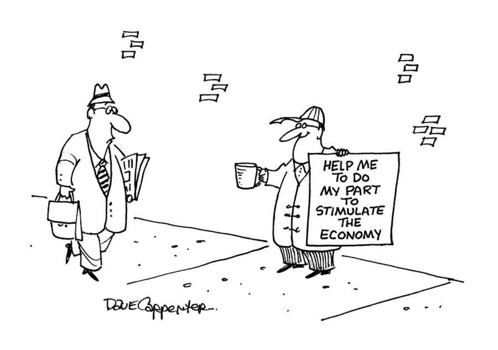

*图 1　封面漫画：一个人在街头请求路人"帮我尽一份力来刺激经济"。笑点在于它把宏观经济的成败写成了一件**人人有份的支出义务**——这正是凯恩斯世界的语法：产出由计划支出决定，所以"多花一点"是公共品。（按原图裁切，未重绘；出处 p.1，作者 Dave Carpenter）*

这张漫画是本章的**说明书**，不是装饰。它预设了三件事，三件事后面都会变成正式术语：

- **产出由购买意愿决定**——所以"刺激经济"等于"劝人多花钱"。这是 Ch11 的计划支出口径（$PAE = C + I^{P} + G + NX$）在街头语言里的样子。
- **花钱的人自己不承担全部后果**：一个人多买一杯咖啡，他的支出是别人的收入，别人再支出——乘数效应（multiplier effect，Ch11 已推过，$1/(1-mpc)$，$mpc = 0.8$ 时等于 5）。
- **但这句话隐含"价格不动"**。如果人人都去花钱而产能到顶，结果不是更多咖啡而是更贵的咖啡。**这一章就是来补这一课的**：下一节会直接说，前面那个模型解释不了通胀。

### 1.2 四条学习目标（p.2）

学习目标一共四条，四条的动词各不相同：

1. **Define** the aggregate demand curve, explain why it slopes downward, and explain why it shifts（定义总需求曲线，解释它为什么向下倾斜，解释它为什么会移动）
2. **Define** the aggregate supply curve, explain why it slopes upward, and explain why it shifts（定义总供给曲线，解释它为什么向上倾斜，解释它为什么会移动）
3. **Show how** the AD curve and AS curve determine output and the inflation rate over the business cycle（说明两条曲线怎样在商业周期中共同决定产出与通胀率）
4. **Analyze how** the economy adjusts to expansionary and recessionary gaps, and relate this to the concept of a self-correcting economy（分析经济如何调整扩张缺口与衰退缺口，并把它与"自我修正的经济"这个概念连起来）

四条的**动词梯度**就是考试题型梯度：1、2 条是名词解释与画图（"为什么向下/向上倾斜"要能写出传导链），3 条是给情景画三条曲线并标均衡点，4 条是简答论述（"该不该干预"要引自校正速度那条判据，见 §8.3）。**注意第 3、4 条只字未提动态模型**——也就是说最后十页的动态 AD-AS（课件 p.48–p.57）在目标里是隐形的，但它偏偏是全章唯一有真实数据的部分（1974–1975 那张表）。复习时别按目标跳过第四部分。

对照 Ch10 的五条目标与 Ch11 的四条目标（Ch10 第 2 条 "Use potential output and the output gap to analyze an economy's position"、Ch11 第 4 条 "how a change in PAE can cause a change in short-run equilibrium output"），本章第 3、4 条正是那两条的**合并升级版**：Ch10 给了缺口这个尺子、Ch11 给了支出这条链，本章把尺子竖起来变成 LRAS、把链变成 AD，再加上一条 AS 让价格动起来。

---

---

## 二、从既定价格到 AD-AS：框架与两种均衡（p.3–p.6）

### 2.1 旧模型的缺口：它解释不了通胀（p.3）

本章的出发点是一条自我批评：前面两章那套简单凯恩斯交叉解释不了通胀。三条要点的原文是——

> The simple Keynesian cross model (Ch 10 & 11) assumes that firms meet demand at preset prices — **Does not explain inflation**
> **Output gaps** can cause inflation to increase or decrease
> The (Keynesian) Aggregate Demand-Aggregate Supply model analyzes *both inflation and output* — Effective for analyzing the effects of macroeconomic policies — Applies to *both the short run and the long run*

三句分别对应本节后面三个小节：第一句说的是旧模型的地基，第二句说地基拆掉之后谁来顶（产出缺口），第三句是新模型的三项承诺——同时给通胀与产出、能评政策、短期长期通用。

第一句里的 **既定价格（preset prices，课件在 p.21 又写成 "present prices"，拼写不一致，见第十二节问题 3）** 就是 Ch11 整套推导的地基：那里的消费函数 $C = 620 + 0.8(Y - 250)$、支出线 $PAE = 960 + 0.8Y$，全部**不含价格变量**，均衡由 $Y = PAE$ 一条方程解出 $Y = 4{,}800$。企业被假设为"按既定价格满足任何需求"，所以产出完全由需求侧决定。

这个假设在教材的供给侧变量表里有一个更直白的名字（见 §6.4，p.34–p.35）：短期总供给曲线（short-run aggregate supply curve, SRAS）"很陡但不是竖直"；而它的成立期被限定在极短期（very short run，课件 p.21）。把两句话连起来读，旧模型的适用边界就清楚了：

> [!NOTE] 若 AS 是水平的，凯恩斯交叉就成立了
> 把这一章的 AS 曲线**放平**（斜率取 0），你会得到一条水平的供给线：任何产出水平上通胀都不变，于是 $Y$ 完全由 AD 决定，AD 又完全由 $PAE$ 决定——Ch11 的整套乘数机器原封不动地回来了，$PAE$ 自主支出降 10 就使 $Y$ 降 $10 \times 5 = 50$。**反过来，把 AS 取成竖直**（长期情形），需求侧的一切冲击都只改变通胀、不改变产出，乘数在产出上归零。Ch11 讲的"乘数 5"和 §8.3 讲的"缺口自己愈合"，其实是同一条 AS 曲线在两个斜率极限下的表现。**这就是本章与 Ch11 的全部关系：不是推翻，是补上斜率。**

第二句的 **产出缺口（output gap）** 沿用 Ch10 的口径：缺口 $= (Y - Y^{*}) / Y^{*}$，$Y^{*}$ 是**潜在产出（potential output）**，即充分就业与产能正常利用下的产出。第三句把新模型的功能写全了：同时分析通胀与产出，同时适用于短期与长期。

这个假设还配了一幅火柴人漫画：一个人皱着眉指着一块 A 字形立式价目牌，牌顶写 `PRICE`，牌面自上而下四个数字 5、8、20、100，其中 5 和 8 被斜线划掉。

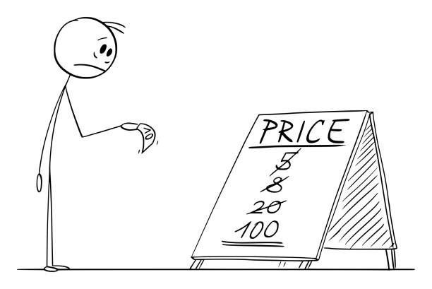

*图 2　"既定价格"的直观比喻：牌上的价格是**预先写好**的，改一次要划掉重写——5 和 8 已经作废，现在挂的是 20。价格不是市场连续竞价的结果，而是一份被设定好、要付出代价才能改写的文件。（按原图裁切，未重绘；出处 p.3）*

这幅画的用处是把 **菜单成本（menu cost，改价的实际开销）** 这个概念提前放进脑子里，§5.2 会正式用它解释"为什么有些企业短期内不改价"。

### 2.2 三条曲线各说什么话（p.4）

整个框架叫**总需求与总供给模型（Aggregate Demand and Aggregate Supply, AD-AS Model）**，它的五条纲领是——

> Shows how output and inflation are determined simultaneously — Short run (current situation) and long run (future changes) analysis
> Inflation rate (or price level) and output on the axis
> AD shows the relationship between planned spending and the inflation rate
> AS shows how output produced by firms depends on the inflation rate
> LRAS shows potential output or Y*

先把坐标系钉死（第二条）：**纵轴是通胀率 $\pi$（%）或价格水平 $P$（见〇节那条 IMPORTANT），横轴是实际产出 $Y$（实际 GDP）**。两条轴都没有刻度数字——前面这四十多页的图全是**示意图**、不含量级，这是它和动态模型那几张真实数据图（p.50、p.53、p.55）的根本区别。

三条曲线的分工，用"谁在回答什么问题"来记最不容易混：

| 曲线 | 英文原名 | 一句话定义（原文压缩） | 它在回答 | 斜率 | 由谁决定位置 |
|---|---|---|---|---|---|
| AD | Aggregate Demand（总需求） | 各通胀率下**计划支出**想买的产出量（planned spending vs inflation rate） | 想买多少 | 负（向下倾斜） | 央行反应函数 + 自主支出（§三、§四） |
| AS | Aggregate Supply（短期总供给） | 各通胀率下**企业愿意生产**的产出量 | 想产多少 | 正（向上倾斜） | 预期通胀 $\pi^{e}$ + 资源与技术 + 冲击（§五、§六） |
| LRAS | Long-Run Aggregate Supply（长期总供给） | **潜在产出 $Y^{*}$** | 技术上最多能产多少 | 竖直 | 资源、技术、制度（§九） |

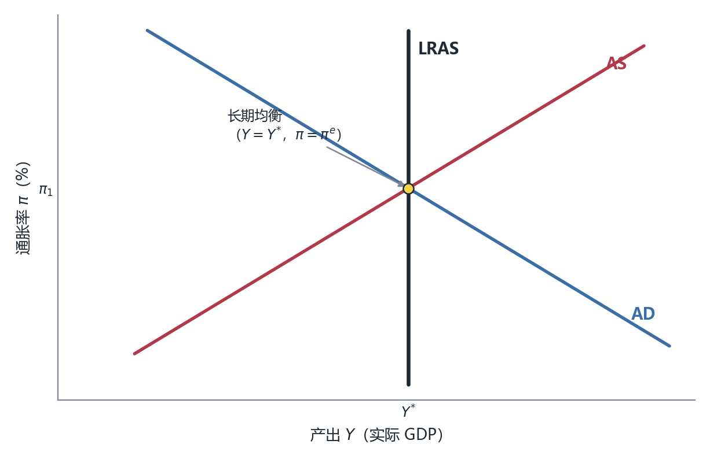

*图 3　AD-AS 框架与长期均衡：AD（蓝，负斜率）与 AS（红，正斜率）相交，交点恰好落在 LRAS（黑色竖直，位置 $Y^{*}$）上。三线共点就是长期均衡；共点的高度就是当时的通胀率。这张图在 p.4 首次给出、p.5 与 p.47 各复用一次（p.47 把 AS 写成 SRAS）。坐标轴无刻度，是示意图。（按课件 p.4 示意重绘，出处 p.4、p.5、p.47）*

三条线的**斜率符号**就是三条经济陈述：AD 向下 = 通胀越高、想买的越少（§三给出机制）；AS 向上 = 通胀越高、企业越想产（§五给出机制）；LRAS 竖直 = 长期里产出与技术有关、与价格无关（§九）。

### 2.3 长期均衡：两个等式同时成立（p.5）

长期均衡的两条判据，对应的位置就是图 3 那个三线共点（课件 p.5）——

> In the **long run**，Actual output equals potential output；Actual inflation rate equals expected inflation rate $\pi^{e}$
> **Long-run equilibrium** occurs at the intersection of Aggregate demand、Aggregate supply and LRAS

写成两个等式：

$$Y = Y^{*}, \qquad \pi = \pi^{e}$$

**第二个等式是本章的新东西**，也是理解全章的钥匙。**预期通胀率（expected inflation, $\pi^{e}$）** 是家庭与企业在做工资与价格决策时 assumed 的未来通胀率。$\pi = \pi^{e}$ 说的不是"通胀为零"，而是"**通胀落在大家预期的位置上**"——经济可以长期待在 $\pi = 6\%$ 且 $\pi^{e} = 6\%$ 的状态里，那是长期均衡，不是失衡。这一点后面 p.41–p.43 的自校正会反复用到：**愈合缺口不等于把通胀打下来，只是让通胀停在一个新的、被预期接受的水平上。**

小例子（**我的补充，非讲义内容**）：设 $\pi^{e} = 2\%$，AS 在 $Y = Y^{*}$ 处给出 $\pi = 2\%$。若 AD 把产出推到 $Y^{*}$ 上方，短期里 $\pi$ 变成 $3\%$；此时 $\pi \ne \pi^{e}$，长期均衡被破坏，$\pi^{e}$ 会往上追（p.31），追到 $3\%$ 时经济回到 $Y = Y^{*}$，但通胀停在 $3\% \ne$ 原来的 $2\%$。**长期均衡的两个等式恢复了，代价是通胀永久性地高了一档。**

### 2.4 短期均衡：$Y = PAE$，而且缺口只是暂时的（p.6）

短期均衡的判据有两条（课件 p.6）——

> Short-run equilibrium Y occurs when the AD and AS curves intersect (point A) — **Y = PAE**
> Short-run equilibrium Y **not** at Y* is **temporary** — Usually caused by a shift in either AD or AS

第一条是定义，第二条是本章最重要的一句承诺，下面分开落实。

**短期均衡（short-run equilibrium）** 的定义就是 AD 与 AS 的交点：在这个 $(Y, \pi)$ 组合上，企业按这个通胀率愿意产出的量，正好等于家庭、企业、政府与国外按这个通胀率想买的量（所以 $Y = PAE$，与 Ch11 的均衡条件同名同义，只是现在它是在含通胀的坐标系里成立）。

**缺口的两种名字**（沿用 Ch10）：

- **衰退缺口（recessionary gap）**：$Y < Y^{*}$，交点在 LRAS 左侧。
- **扩张缺口（expansionary gap）**：$Y > Y^{*}$，交点在 LRAS 右侧。

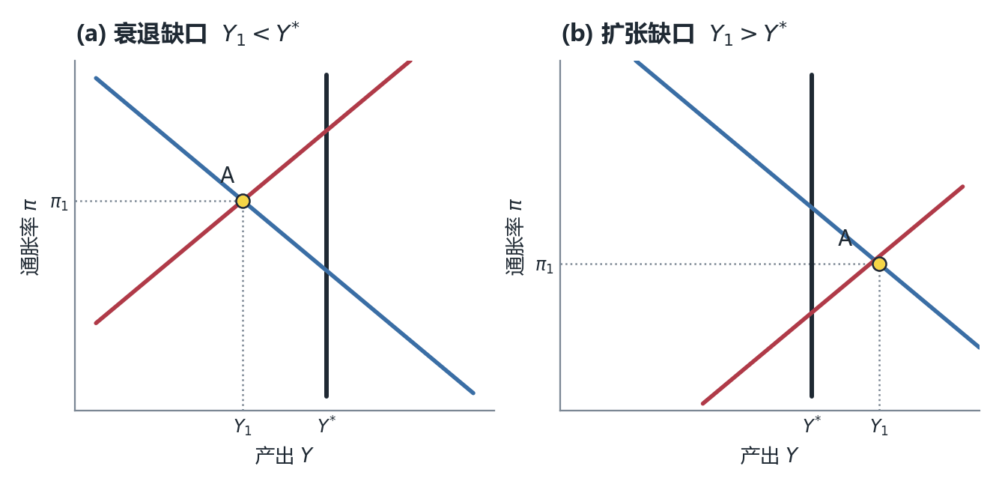

*图 4　短期均衡的两种缺口：(a) 衰退缺口 $Y_1 < Y^{*}$，(b) 扩张缺口 $Y_1 > Y^{*}$。两栏里均衡点都标 A、是 AD 与 AS 的交点，虚线把 A 分别投到纵轴 $\pi_1$ 与横轴 $Y_1$；LRAS 竖线在 $Y^{*}$。**注意 A 不在 LRAS 上，所以 $\pi_1$ 与 $\pi^{e}$ 不相等——这就是"缺口"的通胀含义。**（按课件 p.6 示意重绘，出处 p.6）*

第二条里的 "temporary" 是本章最硬的一句承诺，§8 的全部内容就是兑现它：**交点偏离 LRAS 不会自己待着，AS 会移动，把交点推回 $Y^{*}$ 那条竖线上**。它同时给出偏离的原因——"通常由 AD 或 AS 的移动造成"（a shift in either AD or AS）。这里要埋一个后面必考的区分：**造成缺口的是曲线的移动（shift），而缺口的愈合也靠曲线的移动；沿曲线滑动（movement along）只是愈合过程中的读数变化**（§4.4 与 §8.2 会把这两种运动彻底分开）。

一个能手算的例子（**我的补充**，数字取自 Ch11 那套 $PAE = 960 + 0.8Y$）：设 $Y^{*} = 4{,}800$。自主消费下降 10 使 $PAE$ 变成 $950 + 0.8Y$，短期均衡产出 $Y = 950 / 0.2 = 4{,}750$。缺口 $= (4{,}750 - 4{,}800) / 4{,}800 = -1.042\%$。按 Ch10 的奥肯定律（缺口每偏离 2%，失业率偏离自然率 1 个百分点），这对应周期性失业 $+0.52$ 个百分点。再按本章 AS 方程 $\pi = \pi^{e} + \alpha \cdot (Y - Y^{*})/Y^{*}$ 取系数 $\alpha = 0.5$（见 §5.5），$\pi - \pi^{e} = 0.5 \times (-1.042) = -0.52$ 个百分点——**通胀会比预期低半个百分点，而这正是 §8.2 那条自校正链的起点**。

> [!TIP] 三句话背下这一节
> ① 旧模型假设既定价格，所以只会算产出、不会算通胀。② 新模型用三条线：AD（想买）、AS（想产）、LRAS（能产），前两条定短期、第三条定长期。③ 长期均衡是两个等式 $Y = Y^{*}$ 与 $\pi = \pi^{e}$；短期均衡只要 $Y = PAE$，所以可以带着缺口，但缺口是暂时的。

**练习 2-A（我的补充，非讲义内容）**：一句话说明"为什么 $\pi = \pi^{e}$ 是长期判据而不是'物价稳定'的判据"。

> [!TIP] 参考答案
> 因为 $\pi = \pi^{e}$ 对通胀的**水平**没有任何约束：$\pi = \pi^{e} = 8\%$ 也是长期均衡。这条等式的真正内容是"**没有未被预期的通胀**"，即工资与合同的定价没有系统性错误，因而没有让 AS 继续移动的力量。反过来，"物价稳定"是对 $\pi$ 数值大小的要求（例如 $\pi$ 接近 0），那是政策目标，不是模型里的均衡条件。

**练习 2-B（我的补充）**：如果 "temporary" 那句承诺不成立（短期缺口可以永久持续），本章还有哪里会塌掉？

> [!TIP] 参考答案
> 塌掉的是**自我修正的经济**（self-correcting economy）这个概念（§8.3）与 §10.4 的政策结论。若衰退缺口可以永久存在，就没有"不干预也能回到 $Y^{*}$"这回事，稳定政策的必要性论证——政策有用与否取决于自校正快慢（§8.3）——会失去参照：你无法再说"政策只是加速一个本来会发生的过程"，因为那个过程根本不存在。凯恩斯本人的批评正是针对这一点，这也是 Ch11 笔记末尾"局限"清单里最硬的一条。

---

---

## 三、总需求曲线为什么向下倾斜（p.7–p.10）

### 3.1 定义与那条负斜率（p.8）

先立定义，再给两条性质——

> The **aggregate demand curve** shows the amount of output consumers, firms, government, and customers abroad want to purchase at each inflation rate — All else the same — Slopes downwards
> Along the AD curve, short-run Y equals planned spending

**总需求曲线（aggregate demand curve, AD）** 的三件套：中文"总需求曲线"、英文 AD、定义 = 在**每一个通胀率**下，消费者、企业、政府与国外买家**想买**的产出量，其余条件不变。四个买家对应 $PAE = C + I^{P} + G + NX$ 的四个分项（Ch11 口径），所以 AD 不是"需求曲线"的放大版，而是**整条计划支出线在含通胀坐标系里的影子**。

第二条 "Along the AD curve, short-run Y equals planned spending" 值得停一下：它说 AD 上的**每一个点都是一个短期均衡**（$Y = PAE$ 成立）。所以 AD 不是"想买的量与实际产出的差额"，而是"要让市场恰好清空，$(\pi, Y)$ 必须落在哪里"。这句话把 AD 与 Ch8 的可贷资金曲线区分开了：那条是流量对利率的函数，这条是**均衡轨迹**。

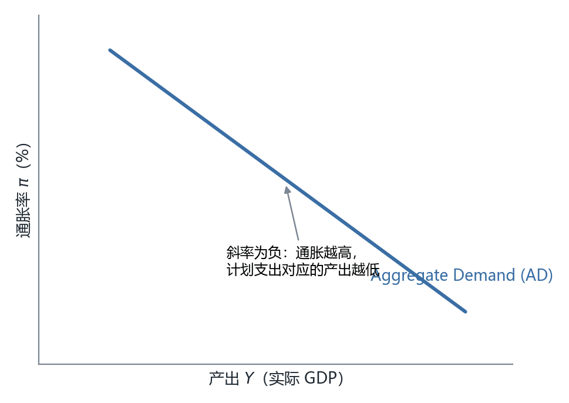

*图 5　总需求曲线本身：一条向下倾斜的直线，无刻度、无交点。它的负斜率不是假设，而是 §3.2 那条传导链的图形结果。（按课件 p.8 示意重绘，出处 p.8）*

### 3.2 通胀为什么压制支出：央行是那条斜率的引擎（p.9）

为什么 AD 向下倾斜？答案**不是**微观经济学的那三条经典理由（财富效应、利率效应、汇率效应），而是**一条以央行为核心的宏观传导链**（三条要点见课件 p.9）——

> A primary objective of the Central Bank is to maintain a low and stable inflation rate — Inflation is likely to occur when Y > Y* — To control inflation, the Central Bank must keep Y from exceeding Y*
> When inflation increases, — The Central Bank increases the nominal interest rate — Real interest rates increase (contractionary policy) — Aggregate spending decreases via the multiplier effect
> Similarly for a recessionary gap

链条四拍（图 6 把它画成四个色块三根箭头）：$\pi \uparrow \;\to\; r \uparrow \;\to\; C, I^{P} \downarrow \;\to\; PAE \downarrow \;\to\; Y \downarrow$。

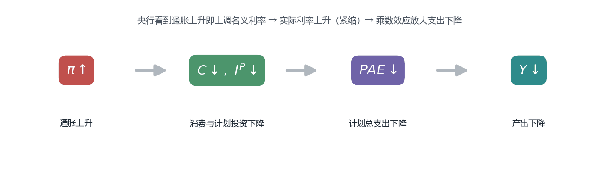

*图 6　AD 向下倾斜的机制：通胀上升 → 央行上调名义利率、实际利率随之上升（紧缩政策）→ 消费与计划投资下降 → 计划总支出下降 → 产出下降。产出下降正是"通胀越高、想买（并实际成交）的产出越少"，于是 $(\pi, Y)$ 空间里得到负斜率。四个色块无数据，是流程示意。（按课件 p.9 示意重绘，出处 p.9）*

逐条指出值得注意的地方：

**其一，斜率的来源是央行的反应，不是家庭的算术。** 这条链的第一环是"央行看到通胀就提利率"，这是 Ch12 的货币政策反应函数（monetary policy reaction function, MPRF）——央行将通胀率映射到（实际）利率的规则。若央行对通胀毫无反应（$r$ 与 $\pi$ 无关），这条链在第一环就断掉，**AD 会变成竖直线**：通胀再怎么涨，支出与产出都不变。

> [!CAUTION] 名义利率上升凭什么让实际利率上升
> 课件这里跳了一步。实际利率 $r \approx i - \pi^{e}$（$i$ 是名义利率），所以"提名义利率"要能变成"提实际利率"，必须**名义利率的上调幅度大于当期已调整的预期通胀**。这正是费雪效应的滞后版：短期里 $\pi^{e}$ 黏住不动，央行把 $i$ 提上去，$r$ 真的上升；长期里 $\pi^{e}$ 追上，$r$ 回到原处。Ch9 末尾"货币中性短期不成立"说的就是这段滞后，Ch12 讲操作时用的是同一套口径。**换句话说：AD 之所以向下倾斜，靠的是"短期"两个字。**

**其二，第三环到第四环是乘数在起作用。** "Aggregate spending decreases via the multiplier effect"——$C$ 与 $I^{P}$ 的下降通过 Ch11 的乘数放大：$\Delta Y = \text{multiplier} \times \Delta A$，$mpc = 0.8$ 时 1 元自主支出变动带来 5 元产出变动。**乘数决定的是 AD 的平坦程度**（**我的补充，非讲义内容**）：乘数越大，同样的 $\Delta r$ 造成的 $\Delta Y$ 越大，AD 越平；乘数为 0 时 AD 竖直。这句话没有明写，但它是上面那条传导链的直接推论。

**其三，"Similarly for a recessionary gap" 是整句话的镜像**：$\pi \downarrow \to$ 央行降利率 $\to r \downarrow \to C, I^{P} \uparrow \to PAE \uparrow \to Y \uparrow$。注意方向：通胀低 → 买得多，仍然落在同一条负斜率线上。

### 3.3 三联推导图：AD 是从 MPRF 与支出线里"生成"的（p.10）

把这条链从头走一遍，要用到三张连在一起的图；起点与终点由两条要点定死（课件 p.10）——

> Initial conditions: $\pi_1$, $r_1$, $Y_1$ — Point A on AD
> Suppose inflation increases to $\pi_2$ — Economy moves to $\pi_2$, $r_2$, $Y_2$ — Point B on AD

三个面板要按**因果顺序**读，每个面板都带标题与 1／2／3 编号：

1. **货币政策反应函数（MPRF）**：纵轴实际利率 $r$、横轴通胀 $\pi$，一条正斜率直线。线上两个点 A$(\pi_1, r_1)$ 与 B$(\pi_2, r_2)$，$\pi_2 > \pi_1$ 所以 $r_2 > r_1$。**这一步只说"央行怎么反应"。**
2. **收入-支出图（Income-Expenditure Diagram）**：纵轴 $PAE$、横轴 $Y$，加一条 45° 虚线 $Y = PAE$。两条平行的支出线 $PAE(r_1)$ 与 $PAE(r_2)$，因为 $r_2 > r_1$，$PAE(r_2)$ **整体在下方**；它与 45° 线的交点给出 $Y_2$，落在 $Y_1$ 左侧。**这一步是 Ch11 的机器，输入是利率。**
3. **总需求图（Aggregate Demand）**：把 A$(\pi_1, Y_1)$ 与 B$(\pi_2, Y_2)$ 画在 $(\pi, Y)$ 空间里，两点连成一条负斜率线，就是 AD。

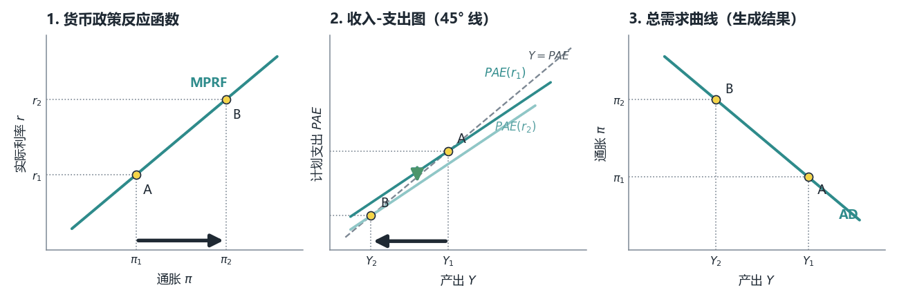

*图 7　AD 曲线的生成过程（本章最重要的推导图）：通胀从 $\pi_1$ 升到 $\pi_2$ → 沿 MPRF 把实际利率从 $r_1$ 提到 $r_2$ → 支出线 $PAE(r_1)$ 下移到 $PAE(r_2)$ → 与 45° 线的交点从 $Y_1$ 左移到 $Y_2$ → 在 $(\pi, Y)$ 空间得到 AD 上的第二个点 B。A 与 B 是**同一条 AD 上的两点**。（按课件 p.10 示意重绘，三张子图均无刻度数值，出处 p.10）*

**A 与 B 这两个点的含义，是本章第一大考点。** 它们是**同一条曲线上的两个点**：通胀变了，其他一切（政策规则、自主支出）没变，所以经济**沿 AD 滑动**。这与图 11 那对同样标着 A、B 的点**含义相反**——那里是 AD 整体移动。同一对字母被标在两种相反的运动上，是标号习惯而不是经济学差异，务必按 §4.4 的方式区分。

写成符号（**我的补充，非讲义内容**，课件只给图形）：

$$r = f(\pi), \quad f' > 0 \qquad PAE = A - b\,r \ (b > 0) \qquad Y = \frac{PAE}{1 - mpc} \;\Rightarrow\; \frac{dY}{d\pi} = \frac{-b\,f'}{1 - mpc} < 0$$

符号：$A$ 自主支出（Ch11 的 960 那一类）、$b$ 支出对利率的敏感度和 $mpc$ 一起决定 AD 的平坦度、$f'$ 是 MPRF 的斜率（Ch12 的泰勒式规则）。**三个旋钮里任何一个归零，AD 就变竖直**：央行不反应（$f' = 0$）、支出不理利率（$b = 0$，即"流动性陷阱"式的投资无利率弹性）、或没有乘数（$mpc = 0$ 时 $\Delta Y$ 只剩自主支出那一轮）。

**练习 3-A（我的补充，非讲义内容）**：若经济处于衰退缺口，用图 6 的链条说明 AD 上的点往哪个方向移动，以及 $\pi$ 与 $Y$ 各自怎么变。

> [!TIP] 参考答案
> 衰退缺口意味着 $Y < Y^{*}$，于是上面那条链条反向启动：通胀下降 → 央行下调名义与实际利率 → $C$ 与 $I^{P}$ 上升 → $PAE$ 上升 → 产出上升。在 AD 上读作**沿曲线往右下**滑动（$\pi$ 更低、$Y$ 更高）。注意这是滑动不是移动：政策规则没有变，只是通胀读数变了。若这条滑动把 $Y$ 带回 $Y^{*}$，则 $\pi$ 稳定在新的水平上，$\pi = \pi^{e}$ 恢复。

---

---

## 四、总需求的移动与沿曲线滑动（p.11–p.19）

### 4.1 定义与两个原因（p.11）

**总需求变动（change in aggregate demand）** 这个术语专指 AD 曲线本身的移动。它的判据与两个来源（课件 p.11）——

> A shift of the aggregate demand curve is called a **change in aggregate demand**
> At the given inflation rate, something causes output to rise (an increase in aggregate demand) or fall (a decrease in aggregate demand)
> Two main causes: Demand shocks — Stabilization policy

**总需求变动（change in aggregate demand）** 的定义标准是"**在给定通胀率下**产出意愿变了"。这个"给定通胀率"是判据的核心：只要变化是由 $\pi$ 引起的，就不算 AD 变动，只算沿 AD 移动。**判据可以直接当选择题用**：题面里出现"通胀上升导致……"→ 滑动；出现"在通胀不变/给定通胀下……"→ 移动。

### 4.2 需求冲击：外生变化的五种来源（p.12–p.14）

**需求冲击（demand shocks）** 的原文判据写得很硬（p.12）——

> Demand shocks are exogenous changes in planned spending **not** caused by a change in output or a change in the inflation rate

即既不能由产出变化引起，也不能由通胀变化引起，否则就只是沿曲线滑动。五个来源是：消费者信心（consumer confidence）、消费者财富（consumer wealth）、企业信心（business confidence）、企业购置新技术的机会、国外对我国出口品的需求（foreign demand for export goods）。

九个具体事件如下（方向逐条按原课表述，出处见表末列）：

| 事件（原文摘要） | 受影响分项 | $PAE$ | AD 移动 | 课件位置 |
|---|---|---|---|---|
| People decide to save more（人们决定多储蓄） | $C$ 降 | 降 | 左移 | p.13 |
| Stock market crash（股市崩盘） | $C$ 降（财富效应） | 降 | 左移 | p.13 |
| Tax cut, household income rises（减税使家庭收入上升） | $C$ 升 | 升 | 右移 | p.13 |
| Firms become pessimistic about future demand（企业对未来需求悲观） | $I$ 降 | 降 | 左移 | p.13 |
| Technological progress creates profitable opportunities（技术进步带来盈利机会） | $I$ 升 | 升 | 右移 | p.13 |
| Government increases spending on police（政府增加警察支出） | $G$ 升 | 升 | 右移 | p.14 |
| Cuts in infrastructure spending on roads（削减道路基建支出） | $G$ 降 | 降 | 左移 | p.14 |
| A boom overseas increases foreign demand for exports（海外繁荣拉动出口） | $NX$ 升 | 升 | 右移 | p.14 |
| Speculators cause the exchange rate to appreciate（投机使汇率升值） | $NX$ 降 | 降 | 左移 | p.14 |

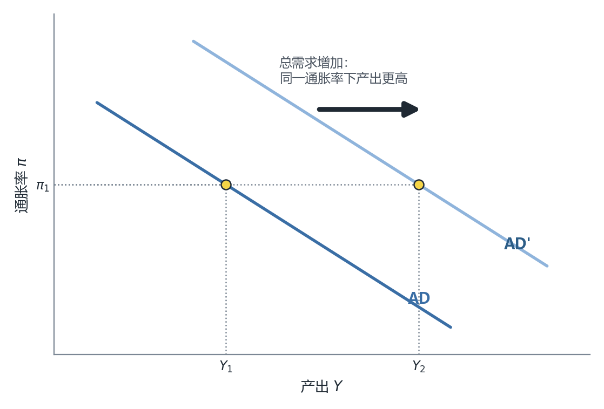

*图 8　总需求增加 = AD 整体右移：在**同一个通胀率** $\pi_1$ 上，均衡产出从 $Y_1$ 增到 $Y_2$。这张图在 p.12（需求冲击）与 p.15（稳定政策）各出现一次，含义相同。（按课件 p.12 示意重绘，出处 p.12、p.15）*

两处要补的口径（**我的补充**）：① 汇率那一行的"升值使 $NX$ 下降"指的是**实际汇率（real exchange rate）**，课件没写"实际"两字，但只有实际汇率才进入净出口；名义升值若伴随物价同比例下降，$NX$ 可以不动。② "减税"这一行与 Ch11 的**税式乘数**是两件事：Ch11 比的是"1 元减税带来的产出增量小于 1 元增支"（因为只有一部分进入消费），这里说的是"减税把可支配收入推高、从而在给定通胀下提高支出"，两者不矛盾，但别把 $-mpc/(1-mpc) = -4$ 这个系数当成"AD 移动的距离"——移动的距离是 $\Delta C = mpc \times \Delta (Y - T)$ 的水平量。

### 4.3 稳定政策与 MPRF 的移动（p.15–p.18）

**稳定政策（stabilization policies）** 的定义是（p.15）——

> Stabilization policies are government policies used to affect planned aggregate expenditure and eliminate output gaps

两类：**财政政策**（fiscal policy：改变政府购买或税收）、**货币政策**（monetary policy：改变目标通胀）。这一定义与 Ch11 那句"目标函数是消除产出缺口"完全一致——**注意目标写的是缺口，不是失业也不是物价**。

政策移动 AD 的画面就是图 8；真正要补的一环是**货币政策为什么能移动 AD**：机制是 MPRF 整条上移或下移（p.16–p.18）。

**货币政策反应函数（monetary policy reaction function, MPRF）** 一旦改变，规则本身随之平移（p.16）——

> The Central Bank's monetary policy reaction function ties inflation to real interest rates — Suppose the Central Bank's targets are $\pi_1$ and $r_1$
> Central Banks normally follow a stable MPRF — Central Bank can tighten or loosen monetary policy • Shifts MPRF — Easing policy raises long-run inflation target — Tightening policy lowers long-run inflation target

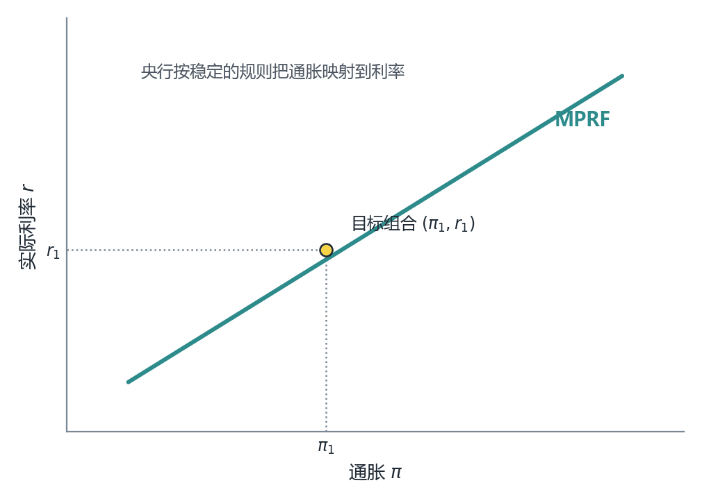

*图 9　货币政策反应函数与目标组合：一条正斜率的 MPRF，规则把每个通胀率对应到一个实际利率；央行长期想待的那一点是 $(\pi_1, r_1)$，用虚线投到两轴。**长期目标通胀 $\pi_1$ 就是这条线穿过的那一点的高度**——这是理解图 10 的前提。（按课件 p.16 示意重绘，出处 p.16）*

**根本性紧缩的货币政策（fundamentally tighter monetary policy）** 指的就是 MPRF 上移，它在图上分四步读（p.17）——

> Central Bank pursues fundamentally tighter monetary policy: results in **each level of inflation** associated with a higher interest rate, $r$
> An upward shift of the MPRF
> The economy begins at the original target inflation rate, $\pi_1$
> MPRF shifts to MPRF₂
> Central Bank increases interest rate from $r_1$ to $r_2$
> Long run target is now $\pi_2$

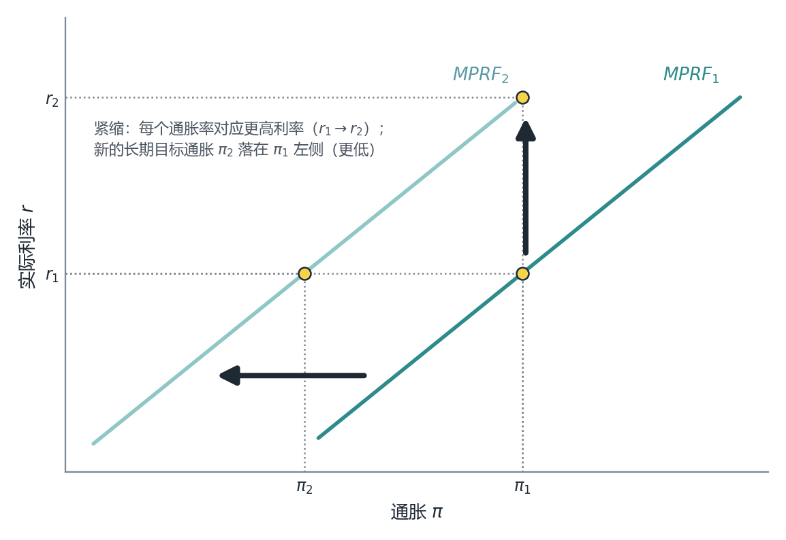

*图 10　MPRF 上移（紧缩）的读法：同一通胀 $\pi_1$ 上利率从 $r_1$ 升到 $r_2$（竖虚线与两根粗箭头）；而新线上"利率仍为 $r_1$"的那一点对应 $\pi_2$，**$\pi_2$ 在 $\pi_1$ 左侧**，即新的长期目标通胀更低。**"紧缩"同时意味着两件事：同一个通胀率对应更高的利率，以及长期目标通胀下移。**（按课件 p.17 示意重绘，出处 p.17）*

> [!WARNING] 符号口径：MPR、MPRF′、MPRF₂ 三种写法
> 同一个函数有三种记法：正文写作 "MPR shifts to MPR2"（**漏了 F**，p.17），曲线标签写作 MPR₁/MPR₂，另外两页写作 MPRF 与 MPRF′（p.16、p.18）。**同一概念在相邻三页里换了三次名字**。本笔记统一为 MPRF 与 MPRF₁/MPRF₂，判定依据是它在 p.16 的全称写法 "Monetary Policy Reaction Function (MPRF)"——缩写以全称为准。

把上面两步接成一条链，就是紧缩政策的完整传导（p.18）——

> MPRF shifts up; interest rate increases from $r_1^{*}$ to $r_2^{*}$
> Higher $r$ decreases PAE and shifts AD to AD'

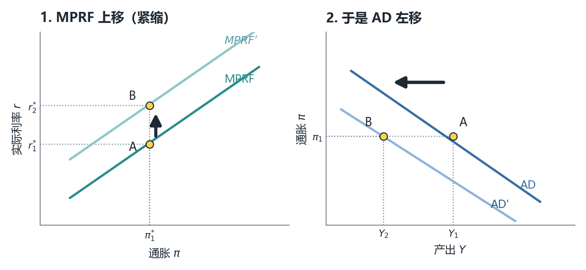

*图 11　政策紧缩的两步：第一步 MPRF 上移，在同一个 $\pi_1^{*}$ 上利率从 $r_1^{*}$ 升到 $r_2^{*}$（A → B）；第二步因为利率更高、支出更低，AD 左移到 AD′，同一通胀 $\pi_1$ 上产出从 $Y_1$ 降到 $Y_2$（A → B）。**这里的 A → B 是曲线的移动**，与图 7 的 A → B（沿曲线滑动）恰好相反。（按课件 p.18 示意重绘，出处 p.18）*

### 4.4 滑动与移动：本章第一分界（图 7 对照图 11）

| | 沿 AD 滑动（movement along） | AD 移动（shift） |
|---|---|---|
| 触发变量 | **通胀率本身变了** | 通胀率以外的东西变了 |
| 机制 | 沿 MPRF 换一点 → 利率变 → 支出线平移 → $Y$ 变 | MPRF 本身平移，或自主支出 $A$ 平移 |
| 曲线怎么变 | 同一条 AD 上从 A 到 B | 一条新 AD′，与旧线平行 |
| 课件位置 | p.10（图 7） | p.12、p.15、p.18（图 8、图 11） |
| 典型题 | "an increase in the inflation" | "higher interest rates **for a fixed inflation**" |

**判据只有一句话：变化是不是由通胀率本身引起的。** §4.5 那五小题的 a 与 d，就是专门用来撞这条判据的。

### 4.5 练习：五个事件对 AD 的影响（p.19）

> Explain how each of the following events would affect the AD curve.
> （解释下列每个事件怎样影响 AD 曲线。题面本身没有配答案，下列解答是**我的补充，非讲义内容**）

| 小题 | 题面原文 | 答案 | 理由（一句话） |
|---|---|---|---|
| a | An increase in the inflation | **沿 AD 滑动**，产出沿曲线往左下 | 通胀本身变了：沿 MPRF 利率升 → $PAE$ 降 → $Y$ 降（图 7） |
| b | An increase in government purchases | **AD 右移** | $G$ 是 $PAE$ 的直接分项，给定通胀下支出更高 |
| c | Higher state income taxes | **AD 左移** | 可支配收入降 → $C$ 降 → 给定通胀下支出更低 |
| d | Higher interest rates for a fixed inflation | **AD 左移** | 通胀不变而利率更高 = MPRF 上移（图 11）；这是移动不是滑动 |
| e | Faster income growth in other countries | **AD 右移** | 外国收入升 → 我国出口升 → $NX$ 升 |

**a 与 d 的对照是全章最典型的陷阱**：两个都"利率更高"，但 a 的原因是通胀（滑动），d 的原因是"通胀不变而利率更高"（移动）。**做题时先问"通胀变没变"，再问"哪条曲线动"。**

---

---

## 五、总供给曲线为什么向上倾斜（p.20–p.28）

### 5.1 定义，以及"既定价格"这条假设的退场（p.21）

进入总供给这一侧，先看它的定义与三条性质（课件 p.21）——

> The **aggregate supply curve (AS)** shows the relationship between the amount of output firms want to produce and the inflation rate — Holds all other factors constant
> The aggregate supply curve is upward sloping — An increase in aggregate demand will increase the willingness to supply and increase the inflation rate
> In past chapters firms met demand at present prices — Holds in the very short run — Not possible to indefinitely hold inflation constant and increase output

**总供给曲线（aggregate supply curve, AS）**：在每一个通胀率下企业**想生产**的产出量，其余条件不变，形状向上倾斜。

第三条是本章与 Ch10/Ch11 的正式接缝（引文里的 "present prices" 应为 "preset prices"，与 §2.1 那条假设是同一件事、两种拼法，见第十二节问题 3）。三条的层次很清楚：旧假设**在极短期成立**（very short run），但**不可能无限期地既把通胀钉住又不断增加产出**——这就是 AS 必须向上倾斜的直觉版本。

> [!NOTE] 为什么 AS 不能是水平的（失败情形）
> 假设 AS 水平（既定价格严格成立）。那么 AD 右移只增产出、不增通胀，AD 左移只减产出、不减通胀，**经济永远不会"自己"回到 $Y^{*}$**：没有任何力量让企业改变产量意愿，因为价格与成本都不动。§8.3 的自我修正、§10.4 的滞胀两难，全部消失。AS 的正斜率就是"名义世界与真实世界之间的那道铰链"——**没有它，Ch11 的模型只是一个永远走不出缺口的机器。**

### 5.2 菜单成本：为什么有些企业短期不改价（p.22）

菜单成本这一环有四条要点：有些企业**菜单成本**（menu costs）高，改价有代价；有些企业菜单成本极低（举的例子是网络零售商，Internet retailers），能对需求上升即时提价；要生产更多产出，有些企业最终必须收更高价格，因为资源会被过度使用（overworked resources）；**沿 AS 曲线的移动与通胀惯性和产出缺口有关**——最后这条是路标，指向下面的 §5.3 与 §5.5。

这一环的地位要小心处理：菜单成本解释的是"**短期里价格为什么有黏性**"，它**不是** AS 向上倾斜的正式理由。正式理由是后两节那两条：**通胀惯性 + 产出缺口**。两者的分工（**我的补充，非讲义内容**）：菜单成本说明"为什么 $\pi$ 不能瞬间调整"（时间上的滞后），通胀惯性说明"为什么 AS 的**位置**由 $\pi^{e}$ 决定"（水平上的锚）。这一层分工没有缝上，菜单成本与 AS 方程读起来像两个并列理由，实际是一深一浅。

### 5.3 通胀惯性：预期与长期合同（p.23–p.26）

**通胀惯性（inflation inertia）** 的定义是（课件 p.23）——

> Inflation will remain relatively constant ("sticky"), as long as the economy is at potential output and there are no external shocks to the price level

条件是两条同时成立：经济在潜在产出上，且没有外部价格冲击。

紧跟着给出决定通胀率的两个"密切相关"的因素：**通胀预期（inflation expectations）** 与 **长期工资与合同（long-term wage and price contracts）**。

预期之所以能自我实现，机制是这样：今天的通胀预期影响明天的实际通胀，因为预期被写进多期合同的定价里；预期通胀越高，名义工资与其他投入成本涨得越多；成本上升，企业提价以覆盖成本。

预期的形成则靠近期经验：通胀低而稳定时人们预期它继续低而稳定；通胀波动则预期也波动。于是两个圈——**良性循环（virtuous circle）** 让低通胀保持低，**恶性循环（vicious circle）** 让高通胀保持高。


*图 12　通胀惯性的两个循环：预期通胀 → 工资与生产成本涨得更快 → 高通胀 → 预期通胀更高，首尾相接、自我强化（恶性循环）；把三个标签各换成"慢涨 / 低通胀 / 低预期通胀"就是良性循环。三段箭头无数据，是流程示意。（按课件 p.24–p.25 示意重绘，出处 p.24、p.25）*

值得注意的地方：**这两个圈不是"通胀会爆炸"的证明，而是"AS 曲线的位置有惯性"的说法**。圈里没有任何产出变量——它只在 $\pi$ 与 $\pi^{e}$ 之间打转。所以它解释的是"为什么 AS 一旦抬高就不容易降回去"，而不是"为什么 AS 向上倾斜"。真正给出斜率的是 §5.4 那张缺口表。

第二条腿是长期合同（**原稿给这一项编的号 "2." 与上一项重号，那是动画步号不是主题编号**，本笔记不沿用，详见第十二节问题 12）：长期合同减少买卖双方反复谈判的成本，劳动合同常是多年期，高成本投入品的供货协议也跨年；合同里**已经把当前的通胀预期写进工资与价格的递增条款**；在没有外部冲击时通胀随时间趋于稳定，在低通胀的工业化经济体尤其如此。

这一环的价值是给 $\pi^{e}$ 一个**制度载体**：预期不是心理状态，而是**写在合同里的数字**。这解释了为什么"长期合同的使用程度"会被列为自校正速度的决定因素（§8.3）——合同期越长，$\pi^{e}$ 被锁得越久，AS 越不动。

### 5.4 缺口怎样变成通胀的变动（p.27）

缺口与通胀的对应关系是三行二列的一张表（课件 p.27），逐格抄录如下：

| 产出与潜在产出的关系 | 通胀的行为 | 课件位置 |
|---|---|---|
| 扩张缺口（expansionary gap）$Y > Y^{*}$ | 通胀上升，$\pi > \pi^{e}$ | p.27 |
| 无产出缺口（no output gap）$Y = Y^{*}$ | 通胀稳定，$\pi = \pi^{e}$ | p.27 |
| 衰退缺口（recessionary gap）$Y < Y^{*}$ | 通胀下降，$\pi < \pi^{e}$ | p.27 |

三行合起来就是 $\pi \gtrless \pi^{e} \Leftrightarrow Y \gtrless Y^{*}$，**这是 AS 曲线的文字版**：横轴条件（$Y$ 相对 $Y^{*}$）决定纵轴读数（$\pi$ 相对 $\pi^{e}$）。

> [!CAUTION] 表头说"通胀上升"，条件却是 $\pi > \pi^{e}$
> 这张表每一格的前半写"通胀上升 / 稳定 / 下降"（原文 "Inflation increases / is stable / decreases"），后半给的条件却是**水平比较** $\pi > \pi^{e}$。严格说 $\pi > \pi^{e}$ 只保证"实际通胀高于预期"，**不保证通胀率在时间上继续上升**（若 $\pi^{e}$ 一次性跳到 $\pi$，此后 $\pi$ 可以不变）。教材表格的这类口径含糊会引出错觉：与 §2.3 那条"长期 $\pi = \pi^{e}$"的判据连读，好像"长期里通胀必须正在升降"。**正确读法是把比较式当作"通胀相对预期是高还是低"**，把 increases/decreases 理解为"AS 曲线接下来会往哪边移"（p.31）。判定依据：AS 移动那条规律（p.31）用的正是 $\pi$ 与 $\pi^{e}$ 的水平比较来定移动方向，而不是 $\pi$ 的时间导数。

### 5.5 AS 的方程与那条正斜率（p.28）

本章唯一的"方程"就是 AS 的文字式，它被单独拎出来强调（课件 p.28）——

> Current inflation ($\pi$) = expected inflation ($\pi^{e}$) + inflation from an output gap

这条式子落到线上是三个点，三种情形各自怎么读：

> If the economy is operating at potential output, then $\pi = \pi^{e} = \pi_1$ at A
> If the economy has an expansionary gap, $Y > Y^{*}$ and $\pi_2 > \pi^{e}$ at B
> If the economy has a recessionary gap, $Y < Y^{*}$ and $\pi_3 < \pi^{e}$ at C
> The AS curve slopes up

**这里只给了文字式，没有给系数、也没有给正比形式。** 把它参数化（**我的补充，非讲义内容**，标准教材写法）：

$$\pi = \pi^{e} + \alpha \cdot \frac{Y - Y^{*}}{Y^{*}}$$

符号与量纲：$\pi$ 本期通胀率（%，即价格水平年变化率）、$\pi^{e}$ 预期通胀率（%，由 §5.3 那两条——预期与长期合同——给定，是 AS 的**位置参数**）、$(Y - Y^{*})/Y^{*}$ 产出缺口（%，Ch10 口径）、$\alpha$ 缺口对通胀的敏感度（**无量纲**，课件未给值）。$\alpha$ 越大 AS 越陡；$\alpha = 0$ 时 AS 变成水平线（回到 §5.1 的失败情形）。

取 $\alpha = 0.5$ 做一次实算（**我的补充**，用 §2.4 那个 Ch11 数字的例子）：$Y^{*} = 4{,}800$，自主支出降 10 使 $Y = 4{,}750$，缺口 $-1.042\%$，于是 $\pi - \pi^{e} = 0.5 \times (-1.042) = -0.52$ 个百分点。若 $\pi^{e} = 2\%$，则 $\pi = 1.48\%$。

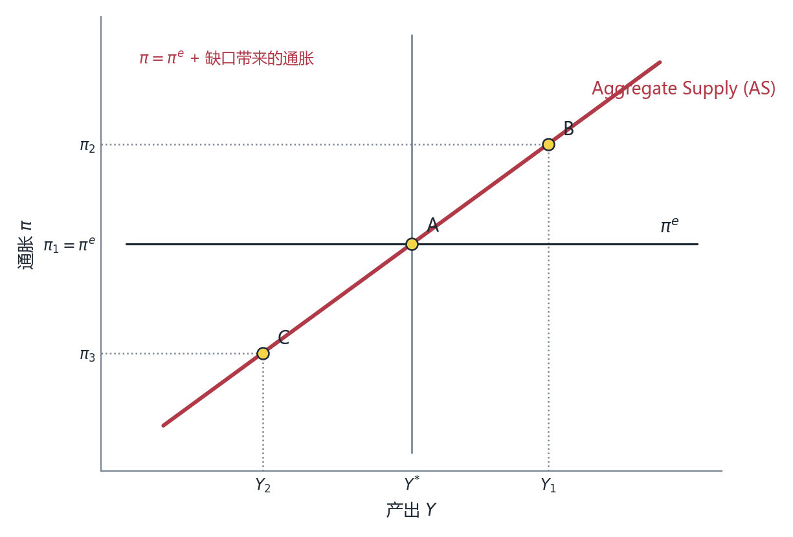

*图 13　AS 曲线的定义图：$\pi^{e}$ 画成一条水平线，与 $Y = Y^{*}$ 的竖线交于 AS 上的 A 点 $(Y^{*}, \pi_1)$，此处 $\pi_1 = \pi^{e}$。B 点 $(Y_1, \pi_2)$ 在 A 右上方，代表扩张缺口（$\pi_2 > \pi^{e}$）；C 点 $(Y_2, \pi_3)$ 在 A 左下方，代表衰退缺口（$\pi_3 < \pi^{e}$）。横轴从左到右是 $Y_2, Y^{*}, Y_1$；纵轴从下到上是 $\pi_3, \pi_1 = \pi^{e}, \pi_2$。**这是"一条曲线上的三个点"，没有曲线移动。**（按课件 p.28 示意重绘，出处 p.28）*

三个读法要点：**其一**，$\pi^{e}$ 那条水平线是 AS 的"锚"——AS 一定穿过 $(Y^{*}, \pi^{e})$ 这一点，所以 $\pi^{e}$ 变，整条线上下平移（§6.2）。**其二**，$Y^{*}$ 那条竖线在这里只是参考线，不是 LRAS：图 13 只有 AS 一条曲线，没有 AD。**其三**，$\pi_1$ 只是 $\pi^{e}$ 的一个具体取值，不是另一个独立变量（p.31 里 $\pi_1$、$\pi_2$ 变成两个不同高度，符号复用容易误读）。

**练习 5-A（我的补充，非讲义内容）**：若 $\alpha = 0.5$、$\pi^{e} = 3\%$，实际通胀读到 $\pi = 4\%$，产出缺口是多少？经济处于哪种缺口？

> [!TIP] 参考答案
> 由 $\pi - \pi^{e} = \alpha \cdot \text{gap}$ 得 gap $= (4 - 3) / 0.5 = +2\%$，即实际产出比潜在产出高 2%，**扩张缺口**。按 Ch10 的奥肯定律，这对应失业率低于自然率约 1 个百分点。注意本题的解法就是"把 AS 方程反解"，考试里 AS 相关的计算题基本都是这一种形状。

---

---

## 六、总供给的移动：三类原因与教材变量表（p.29–p.36）

### 6.1 定义与三个原因（p.29）

**总供给变动（change in aggregate supply）** 就是 AS 曲线本身的移动：右移是增加，左移是减少。原因只有三类（p.29，也就是 §6.2 与 §6.3 的目录）：**可用资源与技术（available resources and technology）**、**通胀预期（inflation expectations）**、**通胀冲击（inflation shock）**。

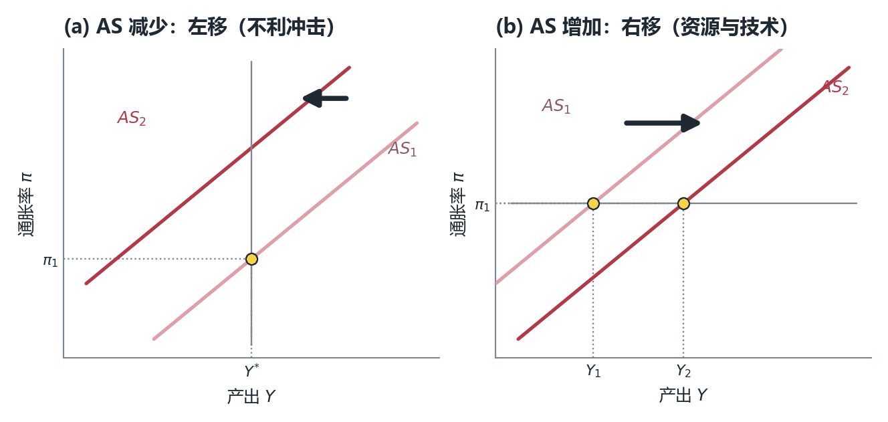

*图 14　AS 的两种移动：面板 (a) 是**减少**（AS₁ → AS₂ 左移），在 $Y^{*}$ 上通胀从 $\pi_1$ 升到更高；面板 (b) 是**增加**（AS₁ → AS₂ 右移），在同一个 $\pi_1$ 上产出从 $Y_1$ 增到 $Y_2$。两面板分别对应课件 p.29 与 p.30。（按课件 p.29–p.30 示意重绘，出处 p.29、p.30）*

### 6.2 资源与技术、预期通胀（p.30–p.31）

可用资源与技术增加使 AS 右移——**不必提价就能供给更多产出**；途径是雇更多劳动、资本或自然资源，或把现有劳动与机器用得更有效（p.30）。这一条与 LRAS 的移动用的是同一批因素（§9.1），区别只在"短期是否伴随价格调整"；**换句话说，能让 AS 右移的实际因素，最终都会让 LRAS 右移**。

预期通胀这一类讲的是一次比较：若实际通胀高于预期，**预期通胀**上升，AS 左移——在每一个产出水平上通胀更高；若实际通胀低于预期，AS 右移（p.31）。

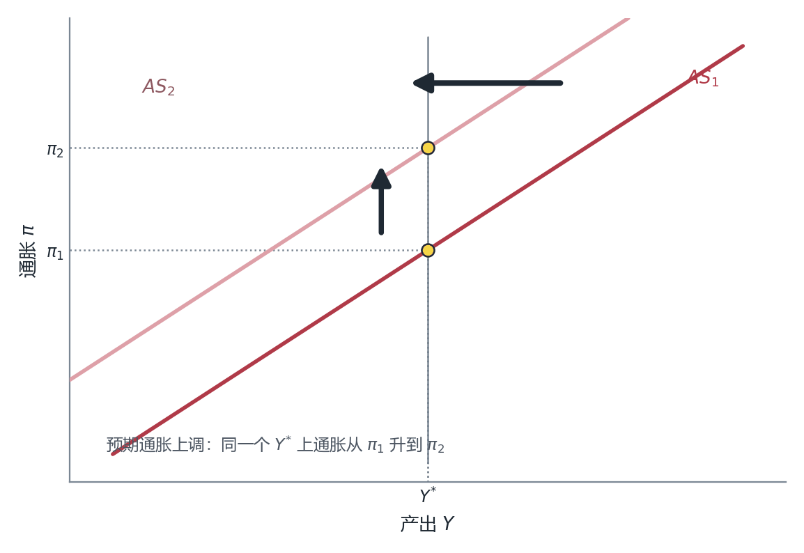

*图 15　预期通胀上升使 AS 左移：在**同一个产出 $Y^{*}$** 上，通胀从 $\pi_1$ 升到 $\pi_2$。这条读法是自校正机制（§8）的零件：缺口的存在使 $\pi \ne \pi^{e}$，$\pi^{e}$ 追上来，AS 平移，缺口缩小。（按课件 p.31 示意重绘，出处 p.31）*

> [!IMPORTANT] 预期调整是全部引擎
> "If actual inflation exceeds expectations, expected inflation increases" 这一句（p.31 的第一条）就是 §8 整节自校正机制的**全部引擎**：缺口 → $\pi \ne \pi^{e}$ → $\pi^{e}$ 调整 → AS 移动 → 缺口消失。§8 只是把它按时间展开、并补上"沿 AD 滑动"这一环。**如果只有一条要背，背这条。**

### 6.3 通胀冲击与三次油价（p.32–p.33）

**通胀冲击（inflation shock）** 是通胀正常行为的突然改变，**与产出缺口无关**（p.32）；石油价格突然上涨会推高汽油、柴油、航空燃油、取暖油，含油制品（合成橡胶、塑料等），以及大多数商品的运输成本；1973 年 OPEC 减产，油价大幅上涨（原文写作 "quadrupled"，倍数在三处说法不一致，见下面那条 WARNING），同期发生食品短缺，1974 年通胀急剧上升。

冲击的方向有两条（p.33）：**不利通胀冲击（adverse inflation shock）** 使 AS 左移，在每个产出水平上通胀更高，例：1973 年油价上涨；**有利通胀冲击（favorable inflation shock）** 使 AS 右移，例：1986 年油价下跌。

"与产出缺口无关"这五个字是这一类移动的定义特征：AS 的移动来源有三，前两条（资源技术、预期）都能用缺口或潜在产能讲通，第三条是**外生的成本冲击**，它在 $Y = Y^{*}$ 时也会把通胀推高——**这就是滞胀的图形来源（§7.3），也是政策两难的来源（§10.4）**。

> [!WARNING] 1973 年油价涨了几倍：课件三处不一致
> 同一件事在三处各给了一个说法：p.32 "price of oil quadrupled"（×4）、p.40 "1973-4 price of oil tripled"（×3）、p.55 "from less than \$3 to more than \$10"（> ×3.33）。**三处互斥**。判定依据：本讲材料内没有任何一处给出可核对的油价序列（无图表、无数据表），所以**无法判定哪个是"对的"**，只能判定三者不能同时成立。本笔记的处理：正文三处原文都保留并互相指回，第十二节问题 1 登记；考试若考"1973 年油价冲击"，**引唯一给了具体数值的那处美元区间最安全（p.55）**。

### 6.4 教材变量表：五类变量怎样移动 SRAS（p.34–p.35）

教材的**短期总供给移动变量表**（Variables That Shift the Short-Run Aggregate Supply Curve）一共五行，逐格抄录如下（列头依次为 "An increase in…" / "shifts the short-run aggregate supply curve…" / "because…"，出处见表末列）。**注意这一组用的是 Price level / Real GDP 坐标与 SRAS 记号**（见〇节 IMPORTANT），曲线画成陡峭正斜率线。

| 当……上升时 | 短期总供给曲线 | 因为…… | 课件位置 |
|---|---|---|---|
| 劳动力或资本存量（the labor force or the capital stock） | 右移 SRAS₁ → SRAS₂ | 每个价格水平下能生产更多产出（more output can be produced at every price level） | p.34 |
| 生产率（productivity） | 右移 SRAS₁ → SRAS₂ | 生产产出的成本下降（costs of producing output fall） | p.34 |
| 预期未来价格水平（the expected future price level） | 左移 SRAS₁ → SRAS₂ | 工人与企业提高工资与价格（workers and firms increase wages and prices） | p.34 |
| 工人与企业调整此前低估的价格水平（adjusting to having previously under-estimated the price level） | 左移 SRAS₁ → SRAS₂ | 工人与企业提高工资与价格 | p.35 |
| 某种重要自然资源的预期价格（the expected price of an important natural resource） | 左移 SRAS₁ → SRAS₂ | 生产产出的成本上升（costs of producing output rise） | p.35 |

第 4 行是这张表里最有价值的一格：**"此前低估了价格水平，现在调整"就是自校正的微观说法**（§8），与 §6.2 那条预期调整规律完全同构。第 5 行对应 §6.3 的通胀冲击。第 1、2 行对应 §6.2 的资源与技术。也就是说，**Mankiw 这五行把本节的三类原因全覆盖了**，两套表述可以一一对上（**我的整理**）：

| 三类原因（p.29） | 教材表五行（p.34–p.35） |
|---|---|
| 可用资源与技术 | 第 1 行（劳动/资本）、第 2 行（生产率） |
| 通胀预期 | 第 3 行（预期未来价格水平）、第 4 行（纠正此前的低估） |
| 通胀冲击 | 第 5 行（重要自然资源的预期价格） |

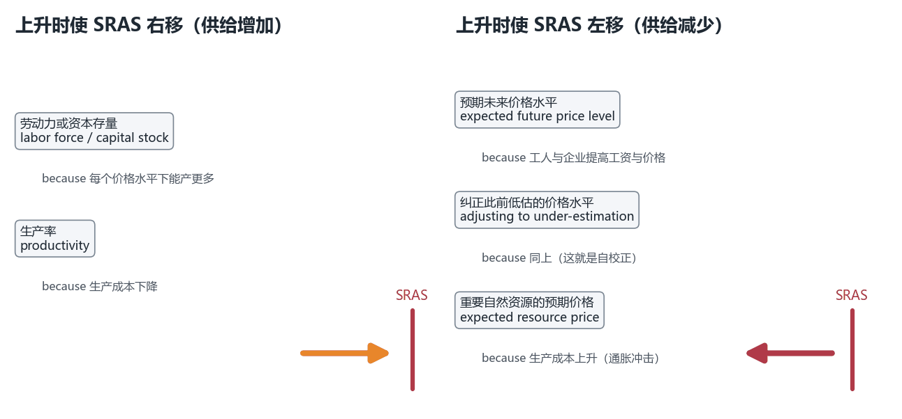

*图 16　五类变量对 SRAS 的作用汇总：上升时使 SRAS 右移的有劳动力/资本存量、生产率；使 SRAS 左移的有预期未来价格水平、对此前低估价格水平的调整、重要自然资源的预期价格。**这张合并图课件没有画**（课件 p.34–p.35 是五行各配一张小图），是我按表格整理的。（自绘整理图，数据源：课件 p.34–p.35 表格）*

### 6.5 练习：五个事件对 AS 的影响（p.36）

> Explain how each of the following events would affect the AS curve.
> （解释下列每个事件怎样影响 AS 曲线。题面之外没有配答案，下列解答是**我的补充，非讲义内容**）

| 小题 | 题面原文 | 答案 | 理由 |
|---|---|---|---|
| a | An increase in the inflation due to expansionary gap | **沿 AS 滑动**（先），随后 AS 左移 | 通胀上升本身是沿 AS 往左上（$Y > Y^{*}$）；但"a 的成因是缺口"会触发 $\pi^{e}$ 上调，**下一期** AS 左移（p.31） |
| b | An increase in the expectation of future inflation | **AS 左移** | 教材表第 3 行：预期上调 → 工资与价格提高 |
| c | An inflation that is currently higher than expected | **AS 左移** | §6.2 那条预期规律的直接套用：$\pi > \pi^{e} \Rightarrow \pi^{e}$ 追上来 |
| d | An unexpected increase in the price of an important raw material | **AS 左移** | 教材表第 5 行 / 不利通胀冲击（p.33） |
| e | An increase in the labor force participation rate | **AS 右移**（且 LRAS 也右移） | 教材表第 1 行：劳动力增加 → 每个价格下能产更多 |

**a 与 c 的区分是这道题唯一的难点**，而两处题面几乎同义（都是"实际通胀高于预期"）。**我的读法**：a 强调**成因**（缺口 → 沿 AS 滑动到更高通胀），c 强调**状态**（已经处于 $\pi > \pi^{e}$，于是预期调整 → AS 移动）。两者最终都导致 AS 左移，但 a 的第一步是滑动、c 直接是移动。考试时建议两句都写：**先滑动，再移动**。

---

---

## 七、用 AD-AS 理解商业周期：三种冲击造出缺口（p.37–p.40）

把 AD-AS 用来读商业周期，三个典型情形各自都是同一个三段式（p.38–p.40，标题都是 Understanding Business Cycles）：**先说经济原本在长期均衡（$\pi_1$ 与 $Y^{*}$ 三线共点），再说一条曲线移动，最后报出缺口类型**。三个情形分别是正需求冲击、负需求冲击、负供给冲击——商业周期的三个主要发生器。

### 7.1 正需求冲击 → 扩张缺口（p.38）

要点是 Aggregate demand shifts from AD1 to AD2，即 AD 从 AD₁ 右移到 AD₂，原因是 **positive demand shock**（需求正冲击）、**increase in government spending**（增加政府购买）、**decrease in taxes**（减税）；结果是 **expansionary gap**（扩张缺口）。举的实例是 **1995–2000 年的互联网泡沫（the dot-com bubble）**。

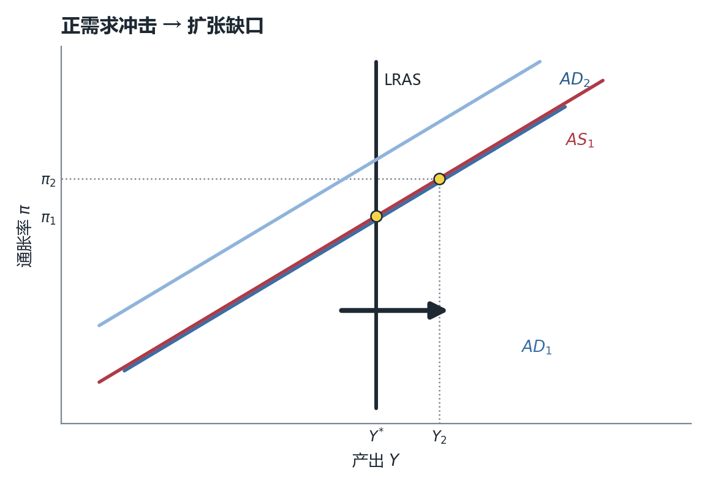

*图 17　正需求冲击造出扩张缺口：AD 从 AD₁ 右移到 AD₂，AS₁ 与 LRAS 不动，新短期均衡 $(Y_2, \pi_2)$ 落在 LRAS 右侧，$Y_2 > Y^{*}$ 且 $\pi_2 > \pi_1$。**通胀与产出同时上升**是这一格的特征。（按课件 p.38 示意重绘，出处 p.38）*

两个要点：**其一**，$G$ 上升与减税是 Ch11 的两个财政工具，方向与 Ch11 一致（$G$ 一对一进自主支出；减税提高可支配收入进而提高 $C$），但**本章不再算乘数大小**，只问"AD 往哪边动"。**其二**，dot-com bubble 属于哪一类？它是企业信心与新技术机会（§4.2 五个来源里的第三、四项）同时上冲，所以是需求冲击，而不是资源或技术进步——**$Y^{*}$ 并没有因为泡沫而提高**，这正是随后 §8.1 的自校正与 2000–2001 年下跌的伏笔。

### 7.2 负需求冲击 → 衰退缺口（p.39）

要点是 AD shifts from AD1 to AD2，即 AD 左移，原因是 **negative demand shock**（需求负冲击）、**decrease in government spending**（减少政府购买）、**increase in taxes**（加税）；结果是 **recessionary gap**（衰退缺口）。

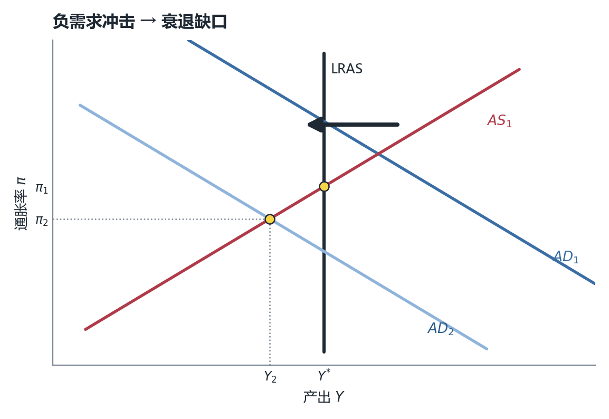

*图 18　负需求冲击造出衰退缺口：AD 左移到 AD₂，新均衡 $(Y_2, \pi_2)$ 在 LRAS 左侧，$Y_2 < Y^{*}$ 且 $\pi_2 < \pi_1$。**通胀与产出同时下降**——通缩压力是衰退的固有特征，不是政策失误的结果。（按课件 p.39 示意重绘，出处 p.39）*

> [!CAUTION] 下标 1/2 只表示先后，不表示左右
> 两种需求冲击都写 "shifts from AD1 to AD2"，但一个右移一个左移：**AD₂ 不一定在 AD₁ 右边**。同一套下标在自愈那一节又换了一次方向：图 20 的 $Y_1$ 是**高于** $Y^{*}$ 的短期产出，图 21 的 $Y_1$ 是**低于** $Y^{*}$ 的短期产出，而上面两个冲击情形用 $Y_2$ 表示缺口侧产出（四处出处依次是 p.38、p.39、p.41、p.43）。**下标没有统一约定**（第十二节问题 4 登记）。本笔记的处理：每张图的图注单独交代该图的标号含义，正文一律用"高于/低于 $Y^{*}$"而不是"下标大/小"来表述。

### 7.3 负供给冲击 → 缺口与通胀同向恶化（p.40）

要点是 AS shifts from AS1 to AS2，即 AS 左移，原因是 **negative supply shock**（负供给冲击）。这里列了**三次油价冲击**：1973-4 油价 tripled、1979 年 doubled、2007-2008 年 doubled；结果标的是 **Recessionary gap**（衰退缺口）。

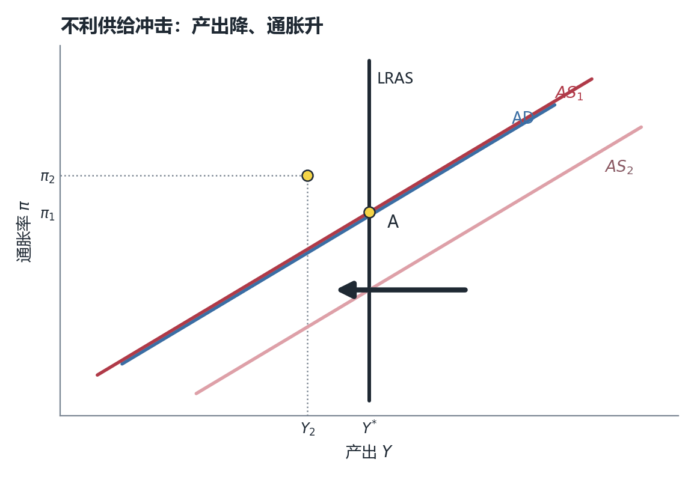

*图 19　不利供给冲击：AS 从 AS₁ 左移到 AS₂，AD 与 LRAS 不动，新均衡 $(Y_2, \pi_2)$ 落在 LRAS 左侧**且高于原通胀** $\pi_1$。产出降、通胀升同时发生，这就是滞胀（§10.2）的图形来源。原均衡点 A 是 AD×AS₁×LRAS 三线共点。（按课件 p.40 示意重绘，出处 p.40）*

这一栏只写了 "Recessionary gap" 半句，**必须补全**（**我的补充，非讲义内容**）：与 §7.2 的需求侧衰退缺口相比，这里多了半个坏消息——**通胀也在上升**（$\pi_2 > \pi_1$）。需求侧衰退自带通缩压力（图 18），给央行降息留出空间；供给侧衰退自带通胀压力（图 19），央行一动利率就被两头拉扯。**"同样是衰退缺口，政策空间完全不同"是供给侧与需求侧两种衰退缺口之间真正的区别**，也是 §10.4 政策两难的起点。

**练习 7-A（我的补充，非讲义内容）**：2020 年春天的疫情同时冻结了消费与供应链。用本章语言判断这是几条曲线在动。

> [!TIP] 参考答案
> 两条，方向相反地都坏：需求侧，消费者信心与支出崩塌使 AD 左移（图 18 那一型，带来 $Y \downarrow$ 与 $\pi \downarrow$）；供给侧，停工与供应链中断相当于不利供给冲击使 AS 左移（图 19 那一型，带来 $Y \downarrow$ 与 $\pi \uparrow$）。**两型叠加时产出必然下降，通胀方向不确定**——取决于哪条曲线动得更多。这正是本章工具能讲清、而 Ch11 单靠 AD 讲不清的地方（Ch11 里"停工"没有位置）。

---

---

## 八、缺口的自我修正与 2007–2009 例子（p.41–p.47）

### 8.1 扩张缺口的愈合（p.41–p.42）

扩张缺口自愈的起点是两条陈述（课件 p.41）——

> Initial short-run equilibrium at A — AD is stable as long as there is no change in government policy or exogenous spending
> In the long run, Inflation increases → expected inflation increases — Shifts AS curve to AS2 — Output returns to Y* — New LR equilibrium expected inflation is $\pi_2$

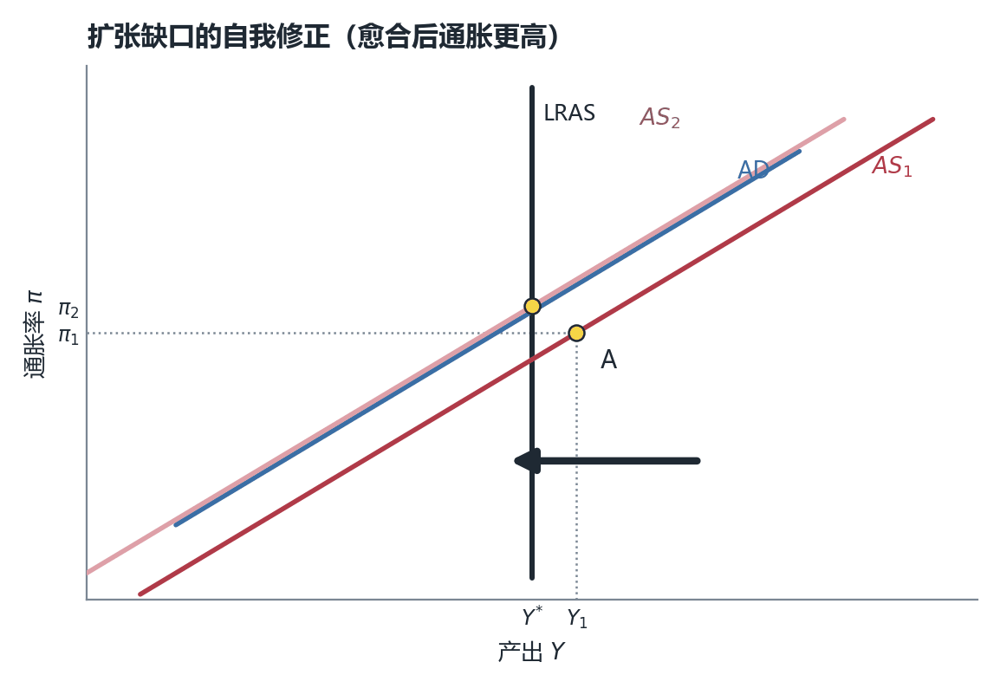

*图 20　扩张缺口的自我修正：初始短期均衡 A 在 $(Y_1, \pi_1)$，$Y_1 > Y^{*}$（扩张缺口）。缺口使实际通胀高于预期，预期通胀上调，AS 从 AS₁ 左移到 AS₂；新均衡落回 LRAS 上，产出 $= Y^{*}$，但通胀停在**更高的** $\pi_2$。**愈合缺口的代价是通胀永久性上移一档。**（按课件 p.41 示意重绘，出处 p.41）*

把图 20 逐环写成文字，就是全章最该背的一条链（p.42）——

> When output is above potential output, firms increase prices faster than the current expected rate of inflation
> – Causes expected inflation to increase
> – As inflation rises, the Fed increases interest rates
> – Consumption and planned investment spending decrease
> – Planned aggregate expenditures decrease
> – Output decreases → **movement along AD**
> This process continues until the economy reaches equilibrium at the potential level of output — Actual inflation is higher than initial level of inflation

**这条链有六个环，而原文把两种不同的运动混着写在一起**——"AS 移动"是第 ③ 环、"沿 AD 滑动"是第 ⑥ 环，这是本节最需要缝的地方（**我的补充**）：

| 环节 | 内容 | 运动类型 | 出处 |
|---|---|---|---|
| ① | $Y > Y^{*}$ → 企业提价快于预期 → $\pi > \pi^{e}$ | 沿 AS₁ 滑动（图 13 的 B 点） | p.27、p.42 |
| ② | $\pi > \pi^{e}$ → 预期通胀上调 | 合同与预期调整（无曲线） | p.24、p.42 |
| ③ | $\pi^{e} \uparrow$ → AS₁ 左移到 AS₂ | **AS 移动** | p.31、p.41 |
| ④ | 通胀更高 → Fed 提高利率 | 沿 MPRF 滑动（Ch12） | p.9、p.42 |
| ⑤ | $C$、$I^{P}$ 降 → $PAE$ 降 | 支出线平移 | Ch11、p.42 |
| ⑥ | $Y$ 下降，回到 $Y^{*}$ | **沿 AD 滑动**（原文明写 movement along AD） | p.42 |

③ 与 ④–⑥ 是**同一件事的两个视角**：AS 左移的**结果**就是均衡点沿 AD 往左上滑。上面两条陈述一条说"AS 移动"、一条说"沿 AD 滑动"，**没有把这两句缝起来**（第十二节问题 5 登记）。注意这条链里第一次把机构写成 **the Fed**（前文一律 "the Central Bank"），与 Ch12 的口径一致，不是新概念。

> [!IMPORTANT] 愈合之后经济并没有"变好"
> 链的最后一行：Actual inflation is higher than initial level of inflation。产出回到 $Y^{*}$，通胀却停在 $\pi_2 > \pi_1$，而且 $\pi_2$ 成为**新的预期通胀**（上面第二条要点的最后一句）。所以自我修正是**不对称的**：它把产出拉回原处，却把通胀留在高处。这正是"通胀有记忆"的含义（§5.3 那两个循环圈的宏观结果），也是为什么央行会在扩张缺口阶段就抢先收紧。

### 8.2 衰退缺口的愈合（p.43）

衰退缺口自愈的三条（课件 p.43）——

> Initial equilibrium is at A — AD curve remains stable unless government policy or exogenous spending changes
> With $Y_1$ below Y*, actual and expected inflation will fall — CB lowers the interest rate • **Movement along AD** — Aggregate supply shifts to AS2
> In the long run, economy returns to potential output with lower inflation of $\pi_2$

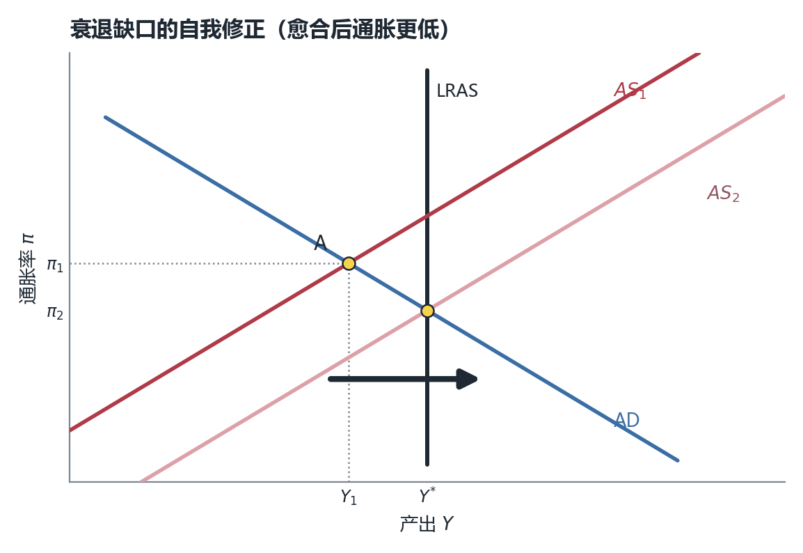

*图 21　衰退缺口的自我修正：初始均衡 A 在 $(Y_1, \pi_1)$，$Y_1 < Y^{*}$。实际与预期通胀都下降，AS 从 AS₁ **右移**到 AS₂，央行沿 MPRF 降低利率，均衡沿 AD 往右下滑动，最终回到 LRAS 上，通胀停在**更低的** $\pi_2$。与图 20 严格镜像。（按课件 p.43 示意重绘，出处 p.43）*

这里有一处**必须澄清的措辞**（**我的补充**）："CB lowers the interest rate" 读起来像央行主动降息（相机抉择），但下面 §8.3 把自校正定义成"不需要任何主动政策"。**它指的是沿 MPRF 的自动反应**：通胀降了，按 §3.2 那条规则利率就降，AD 并不移动。判定依据：同一行自己就写了 "Movement along AD"——如果央行主动改变政策规则，那是 AD 移动（图 11），不会写成"沿 AD"。

### 8.3 自我修正的经济与政策判断（p.44–p.45）

**自我修正的经济（self-correcting economy）** 是长期里的一条倾向，三条要点（课件 p.44）——

> In the long-run the economy tends to be self-correcting — **Missing from the simple Keynesian model** — Simple Keynesian model is only about the short-run; no price adjustments
> Given time, output gaps disappear **without any active changes** in monetary or fiscal policy
> Whether stabilization policies are needed depends on **the speed** of the self-correction process — The greater the gap, the longer the adjustment period

第二条是全章对 Ch11 的判决书：**简单凯恩斯模型缺了自我修正这一项，因为它没有价格调整**。这与 §2.1 的第一句、§5.1 的第三条是同一件事的三次陈述——本讲用三处反复强调，说明它认为这是学生最容易带出考场的错误印象（"凯恩斯交叉说经济会自己回到充分就业"恰恰是它没说的事）。

"要不要干预"于是变成一个**二择一判断**（p.45）：自校正**慢** → 财政与货币政策能帮助稳定经济；自校正**快** → 财政与货币政策**不有效，甚至可能 destabilize** the economy。校正速度取决于**长期合同的使用程度**与**劳动市场的效率与灵活性**；最后一条：**在试图消除大缺口时，财政与货币政策最有用**。

整理成判断表（**我的整理，原文是散点陈述**）：

| 情形 | 自校正速度 | 政策含义 | 课件位置 |
|---|---|---|---|
| 合同期长、劳动市场僵化（欧洲式） | 慢 | 政策能稳定经济，值得出手 | p.45 第 1 条 |
| 合同短、劳动市场灵活（美国式） | 快 | 政策不有效，反而可能 destabilize | p.45 第 2 条 |
| 缺口很大 | 更慢（"the greater the gap, the longer"） | 政策最有用 | p.44 末条 + p.45 末条 |

> [!CAUTION] "快/慢"没有任何量化口径
> 政策的有效性被完全交给自校正速度这一个参数，**但全章没有给任何衡量速度或时间跨度的办法**——多久算慢、缺口多大算大，都没有数。这是可证伪性缺口（第十二节问题 6 登记），正文按定性断言处理。考试里若要求"评价政策"，正确写法是把那两个决定因素（长期合同、劳动市场灵活性）当**机制**论证，而不是编一个"需要 3 年"的时间。

### 8.4 例子：2007–2009 年衰退（p.46–p.47）

2007–2009 年衰退这个例子先给四条事实（课件 p.46）——

> 2006 年 7 月房价泡沫破裂，此后 18 个月房价下跌 30%
> 2008 年秋金融恐慌（financial panic），家庭与企业借贷困难
> 油价冲击：2008 年 7 月汽油达到每加仑 \$4（比 2007 年翻倍）
> – 虽然油价上涨会造成供给冲击使 SRAS 左移，但 2008 年左移的幅度**没有 30 年前那么远**，因为许多企业此后转向了少依赖石油的生产流程
> – 然而到 2009 年 1 月，油价大致回到 2007 年 1 月的水平

这个例子紧跟着只给了一张图、没有任何文字：LRAS、AD、SRAS 三线共点于 LRAS 上的一个点，无刻度、无标号、无箭头——也就是**冲击发生之前的长期均衡起始帧**（p.47）。

> [!WARNING] 课件这张例题图只有第一帧
> 这个例子只画出了多步动画的第一步：三条冲击讲完了，画出来的却只有冲击前的状态，AD/SRAS 的移动与缺口都没有画出来（PDF 导出丢帧，第十二节问题 2 登记；同类情况还出现在 p.56）。**因此全章没有一张把 2007–2009 三条冲击走完的图**，本节用后面那张三冲击分解表补上，起始状态见图 3（那张图用的记号是 LRAS/SRAS，与前面各节的 AS 同义）。

三条冲击对本章曲线的作用分解（**我的整理，非讲义内容**，方向全部按上面四条事实）：

| 事实（p.46） | 分项 | 曲线 | 方向 | 对 $Y$ | 对 $\pi$ |
|---|---|---|---|---|---|
| 房价跌 30%（2006-07 起 18 个月） | $C$ 降（财富效应，§4.2 第二例） | AD | 左移 | ↓ | ↓ |
| 2008 年秋金融恐慌，借贷困难 | $C$ 与 $I^{P}$ 降 | AD | 左移 | ↓ | ↓ |
| 2008 年 7 月汽油 \$4/加仑 | 成本上升 | SRAS/AS | 左移（幅度小于 1973–74） | ↓ | ↑ |
| 2009 年 1 月油价回到 2007 年 1 月水平 | 成本回落 | SRAS/AS | 右移（有利冲击，§6.3） | ↑ | ↓ |

**净效应**：三条里两条压 $Y$、第三条也压 $Y$，所以产出方向明确向下（衰退缺口）；通胀方向**不确定**（需求侧压低、供给侧推高），原文没给读数，本笔记也不编。这张表的价值在于：**同一个衰退，AD 与 AS 同时在动，画图时必须画两条箭头**——只画 AD 左移（图 18 那一型）会漏掉 2008 年"通胀还在涨"这一半事实。

**练习 8-A（我的补充，非讲义内容）**：假设 2008 年只有油价冲击（AS 左移）而没有需求崩塌，用 §10.4 的语言说明央行会面对什么两难。

> [!TIP] 参考答案
> 就是滞胀两难（§10.4）：不干预，则通胀随 AS 左移上升、产出低于 $Y^{*}$，要靠自校正（预期上调使 AS 继续左移）慢慢愈合，期间是长期高失业；干预（增 $G$ 或降息使 AD 右移），产出回到 $Y^{*}$ 但通胀更高，而且更高的通胀会推高 $\pi^{e}$，触发下一轮 AS 左移——**政策与自校正互相加码**，正是 §10.4 引的那句 "Higher and higher inflation rates will result"。

---

---

## 九、动态 AD-AS：把长期增长放回模型（p.48–p.54）

### 9.1 前面那个模型把增长抽象掉了（p.49）

前面那套 AD-AS 模型有一条隐含假设，动态模型要做的就是把假设撤掉（课件 p.49）——

> The basic AD-AS model we have seen so far adopts the assumption that **the economy does not experience long-run growth**
> We can develop a more general AD-AS model by **dropping this assumption**
> Now, takes into account that the economy is not static but dynamic, with **potential real GDP that grows over time**

第二条是和 Ch7（Economic Growth）的正式接缝：在此之前 $Y^{*}$ 是一条**不动**的竖线，Ch10 的潜在产出、Ch7 的增长核算在这个坐标系里完全没有位置。动态模型做的事只有一件：**把 LRAS 变成每年右移的竖线**。

课件没有说破的一点（**我的补充**）：静态模型不只是"少了增长"，它还**系统性误导**关于通胀的判断。静态图里"通胀为正"意味着 AD 或 AS 移动了（有缺口或有冲击）；动态图里通胀可以在**产出恰好等于潜在产出、缺口为零**的每一步上保持为正（§9.4）。**同一个"通胀 4%"，在两套模型里的诊断完全不同**——这才是第四分节存在的理由。

### 9.2 LRAS 为什么移动，以及它移动多少（p.50）

长期总供给曲线移动的条件与用途有三条（课件 p.50）——

> The LRAS curve shifts when there is a long-run change in a nation's ability to produce output, or a change in potential level of real GDP
> The factors that shift LRAS are the same factors that determine economic growth: resources, technology, institutions, etc.
> We can illustrate economic growth by using the LRAS curve

第二条是本章与 Ch7 的接口清单：**移动 LRAS 的因素 = 决定经济增长的因素**（资源、技术、制度）。这与 §6.2 那条"能让 AS 右移的实际因素最终都会让 LRAS 右移"是同一句话的两半：**短期曲线与长期曲线共用同一个供给侧，区别只在时间跨度**。

图 22 是本章第一张**带真实数据**的图（教材位图，纵轴回到价格水平口径）：

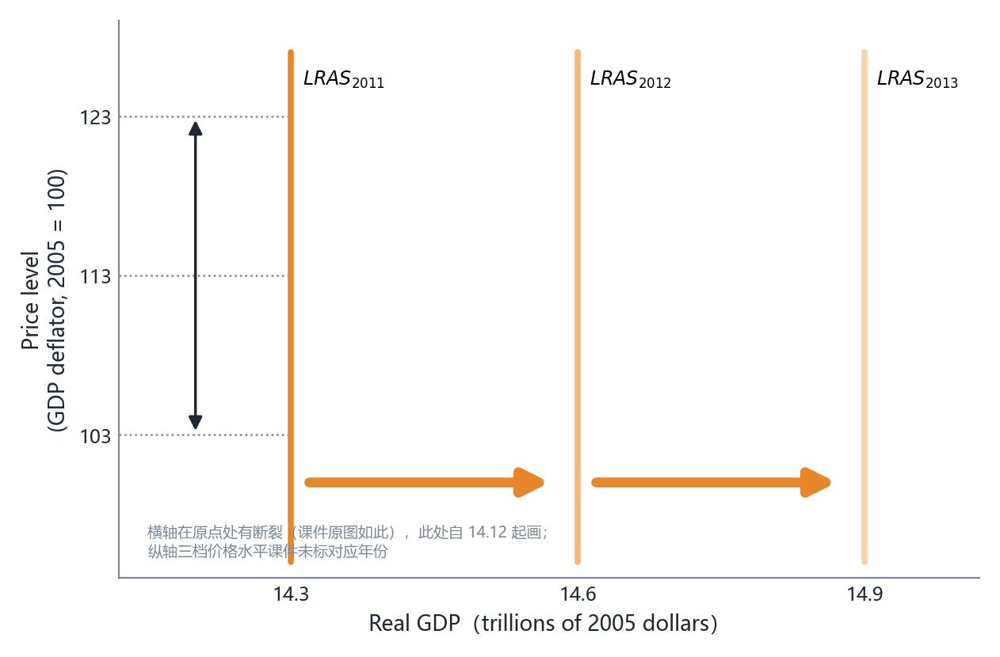

*图 22　用 LRAS 表示经济增长：LRAS₂₀₁₁ 在 \$14.3、LRAS₂₀₁₂ 在 \$14.6、LRAS₂₀₁₃ 在 \$14.9（单位：2005 年美元的万亿），两根橙色箭头表示逐年右移；纵轴价格水平（GDP 平减指数，2005 = 100）的三个刻度 103、113、123 与一根双向箭头表示同期价格水平上升。数值全部抄自课件。（按课件 p.50 重绘，数据源：课件 p.50 教材图，单位 trillions of 2005 dollars）*

把三档 LRAS 与三档价格刻度换成增速（**我的复算**，脚本 `.qoder/inventory/calc_Ch13.py`）：

$$\frac{14.6 - 14.3}{14.3} = 2.098\%, \qquad \frac{14.9 - 14.6}{14.6} = 2.055\%$$

潜在产出年均增长约 2.1%，与 Ch7 讲的美国长期趋势增速一致。价格水平两步涨幅是 $103 \to 113$ 的 9.709% 与 $113 \to 123$ 的 8.850%（整段 $103 \to 123$ 是 19.417%，年均 9.278%）。

> [!WARNING] 103 / 113 / 123 没有标年份
> 这三档价格水平**只有刻度，没有说明分别对应 2011、2012、2013 中的哪一年**（这张图唯一带年份的标签是三条 LRAS）。所以"年均 9.3% 的通胀"这个数**只能按相邻刻度算，不能按年份算**，而且它与 2011–2013 年美国实际通胀（约 2%/年）明显不符——这张教材图的纵轴刻度更可能是**示意性的等距三档**，不是真实数据。判定依据：同一本教材后面两张动态图用的是 100→100 与 100→104（p.53–p.54），量级完全不同；若都按真实数据读会互相打脸。**引用这张图时只引用横轴（14.3/14.6/14.9），纵轴当示意。**

### 9.3 动态模型的三条移动规律（p.52）

动态模型里三条曲线各自往哪边移，是三条规律（课件 p.52）——

> Potential real GDP increases continually, shifting the long-run aggregate supply curve **to the right**
> During most years, the aggregate demand curve shifts **to the right**
> Except during periods when workers and firms expect high rates of inflation, the short-run aggregate supply curve shifts **to the right**

三条规律各自来自前面哪一节（**我的整理**）：LRAS 右移来自 Ch7 的增长（p.50）；AD 右移来自收入与人口增长、投资与政府购买的增长（原图第一个说明框就是这么写的）；SRAS 右移是因为**同一批供给侧因素**也在短期起作用（第三个说明框），而"预期高通胀时除外"是 §6.2 那条预期规律的镜像——预期通胀上升时 SRAS 反而**左移**。

第三条有歧义：原文只说"除……之外都右移"，**没说预期高通胀时往哪边走**。按 §6.2 补全为：**预期高通胀时 SRAS 不右移、甚至左移**（第十二节问题 7 登记）。

### 9.4 两张对照图：增长可以配零通胀，也可以配通胀（p.53–p.54）

下面两张是**同一张教材图的两种情形**（p.53、p.54），横轴完全相同（\$14.0 → 14.3），只有 AD 的移动幅度与终点价格不同。两张合起来才是完整论证，所以必须并排读。

第一种情形是 AD 与 LRAS 同步右移：A 点是 AD₁×SRAS₁，落在 LRAS₁ 上、价格水平 100；B 点是 AD₂×SRAS₂，落在 LRAS₂ 上、价格水平**仍是 100**（图 23）。

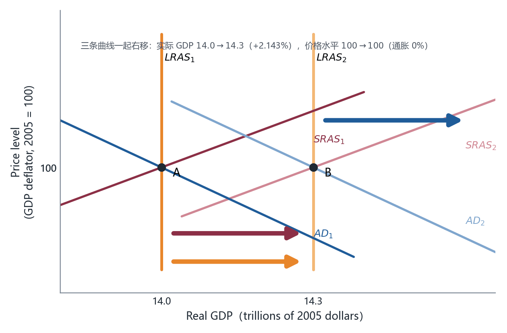

*图 23　动态模型：增长与零通胀同时成立。三条曲线一起右移，LRAS₁ 在 \$14.0、LRAS₂ 在 14.3（2005 年美元，万亿），AD₁×SRAS₁ 的 A 点与 AD₂×SRAS₂ 的 B 点都落在各自的 LRAS 上，价格水平 100 → 100。实际 GDP 增长 $(14.3-14.0)/14.0 = 2.143\%$，通胀 $0\%$。原图的五个说明框（callout）内容已并入本节正文。（按课件 p.53 重绘，数据源：课件 p.53 教材图）*

通胀的通常原因（the usual cause of inflation）就在两个说明框里（p.54）——

> 1. If AD shifts to the right more than LRAS…
> 2. …the price level rises.

两个均衡点的位置是 A 在 (14.0, 100)、B 在 (14.3, 104)。

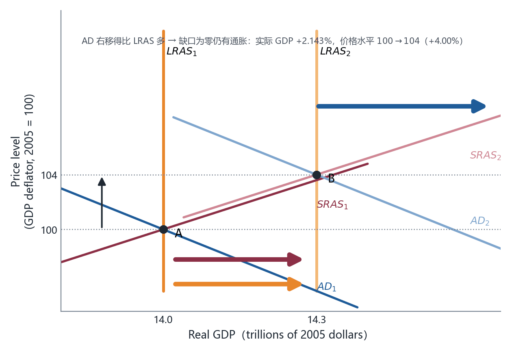

*图 24　通胀的通常原因：AD 右移得比 LRAS 多。LRAS 从 \$14.0 移到 14.3（+2.143%），AD 移得更多，于是 B 点虽然仍在 LRAS₂ 上（**缺口为零**），价格水平却从 100 涨到 104，通胀 **+4.00%**。（按课件 p.54 重绘，数据源：课件 p.54 教材图）*

这两张图的结论值得单独钉一下（**我的补充，非讲义内容**，但完全由两张图各自的两组数字给出）：**B 点在 LRAS₂ 上，说明产出缺口为零**。所以动态模型里的通胀**不是缺口的产物**——它是"支出增长快于产能增长"的产物。这与 §5.5 那条 AS 方程并不矛盾：方程说的是**给定 $\pi^{e}$** 时 $\pi$ 与缺口的关系，而动态模型里 $\pi^{e}$ 本身逐年跟着 $\pi$ 走，于是零缺口的经济可以年年有通胀。**长期里通胀由 AD 与 LRAS 的相对增速决定，短期里通胀的偏离由缺口决定**——这两句话分别就是 §9.4 与 §5.4 的内容，把它们对立起来是学生最常见的错误。

### 9.5 练习：四个事件对 LRAS 的影响（p.51）

> Explain how each of the following events would affect the LRAS curve.
> （解释下列每个事件怎样影响长期总供给曲线。题面之外没有配答案，下列解答是**我的补充，非讲义内容**）

| 小题 | 题面原文 | 答案 | 理由 |
|---|---|---|---|
| a | An increase in the price level | **LRAS 不移动** | 价格水平是纵轴变量，只造成沿 AD/SRAS 的移动；LRAS 只由供给侧决定 |
| b | An increase in the labor force | **LRAS 右移** | 资源（劳动）增加，潜在产出上升（§9.2 第二条） |
| c | An increase in the quantity of capital goods | **LRAS 右移** | 资源（资本）增加 |
| d | Technological change | **LRAS 右移** | 技术是 Ch7 增长核算里的全要素生产率 |

**a 是这一节的陷阱题，与 §4.5 的 a（通胀不动 AD）、§6.5 的 a（通胀沿 AS 滑动）同构**：三道题考的是同一件事——**纵轴变量本身的变化永远不移动以纵轴为变量的曲线**。

---

---

## 十、例题：1974–1975 石油冲击与滞胀的政策教训（p.55–p.57）

### 10.1 题目与数据（p.55）

这道例题（1974–1975 年石油冲击）的题面只有两句（课件 p.55）——

> Following the Arab–Israeli War of 1973, the Organization of the Petroleum Exporting Countries (OPEC) increased the price of a barrel of oil from less than \$3 to more than \$10.
> Use this information and the statistics in the table below to draw a dynamic aggregate demand and aggregate supply graph showing macroeconomic equilibrium for 1974 and 1975, **assuming that the aggregate demand curve did not shift between these two years**.

题目配了一张两年三列的数据表，列序依次是实际 / 潜在 / 价格水平，逐格抄录如下：

| 年份 | 实际真实 GDP（Actual Real GDP） | 潜在真实 GDP（Potential Real GDP） | 价格水平（Price Level） |
|---|---|---|---|
| 1974 | \$4.89 trillion | \$4.92 trillion | 30.7 |
| 1975 | \$4.88 trillion | \$5.09 trillion | 33.6 |

表下注明来源：*Data from U.S. Bureau of Economic Analysis; and Congressional Budget Office; base year is 2005.*（BEA 与 CBO，基年 2005 年美元）。

三个约束条件决定了这张图怎么画：**AD 不许动**（题目明写）、LRAS 按潜在 GDP 画在 4.92 与 5.09、两个均衡点必须落在 $(4.89, 30.7)$ 与 $(4.88, 33.6)$。

### 10.2 把表算开（我的复算）

```python
a74, q74, P74 = 4.89, 4.92, 30.7
a75, q75, P75 = 4.88, 5.09, 33.6
print((a74 - q74) / q74 * 100)      # 1974 output gap, percent
print((a75 - q75) / q75 * 100)      # 1975 output gap, percent
print((P75 - P74) / P74 * 100)      # inflation 1974->1975, percent
```

```text
-0.6097560975609807
-4.125736738703339
9.446254071661246
```

补齐其余四项（同一脚本 `.qoder/inventory/calc_Ch13.py` 的输出）：潜在产出增长 $(5.09-4.92)/4.92 = +3.455\%$；实际 GDP 变化 $(4.88-4.89)/4.89 = -0.204\%$；缺口变化 $-3.516$ 个百分点；名义 GDP（平减指数 × 实际）变化 $+9.222\%$，与 $\%\Delta P + \%\Delta Y = 9.446 - 0.204 = 9.242$ 的差异来自交叉项，两条路径互相验证。

读这张表的关键是**把"实际"与"潜在"分开看**：实际 GDP 几乎没动（$-0.2\%$），潜在 GDP 涨了 $3.5\%$——**衰退不是产出绝对量下降造成的，而是产出没能跟上一直在涨的产能**。这就是"缺口型衰退"，Ch10 的口径，也是本章 AS/LRAS 框架比单看 GDP 更有用的地方。

### 10.3 画图：AD 必须几乎竖直（p.55–p.56）

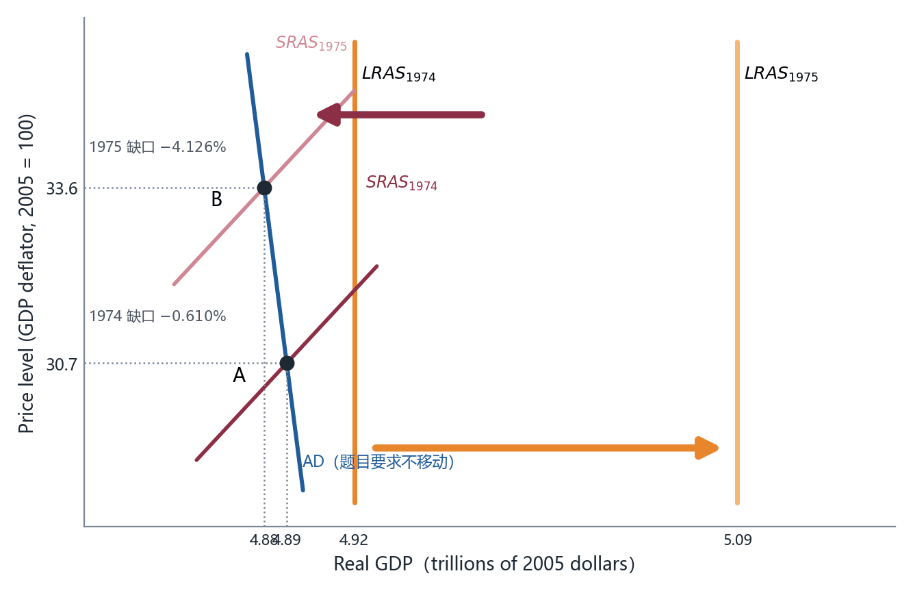

*图 25　1974–1975 石油冲击的动态 AD-AS 图：LRAS 从 \$4.92 右移到 \$5.09 万亿（潜在产出 +3.455%）；AD **不移动**（题目要求），两个均衡点 A $(4.89, 30.7)$ 与 B $(4.88, 33.6)$ 在同一条 AD 上；SRAS 从 1974 年左移到 1975 年，使均衡沿 AD 往左上滑，产出低于潜在的水平从 $-0.610\%$ 恶化到 $-4.126\%$，价格水平涨 $9.446\%$。**课件 p.56 只画了 LRAS₁₉₇₄ 一条线（动画首帧），本图按 p.55 表格数据补全；SRAS 与 AD 的斜率为示意，但两点坐标严格取自表格。**（自绘补全图，数据源：课件 p.55 表格，BEA 与 CBO，基年 2005）*

> [!CAUTION] 按真实比例画，AD 几乎是竖直的
> 两点横坐标只差 $-0.01$ 万亿、纵坐标差 $+2.9$ 点，所以这条 AD 的斜率是 $2.9 / (-0.01) = -290$ 价格点每万亿美元——**在真实比例下它看起来就是一条竖线**。这是本题作图最容易"画歪"的地方：把它画成常见的 45° 负斜率 AD，就同时违反了两条数据约束（AD 不动、两点在 AD 上）。**正确做法**：横轴范围压到 4.86–5.12、纵轴 29–35，AD 用两点直接连线；或者在图旁注明"AD 斜率不按真实比例，两点坐标按表"。判定依据：$-0.01$ 万亿的横向差只有横轴全距的约 2%，肉眼几乎看不出产出下降。

题目随后给了两句结论（p.56）——

> As a result of the supply shock, the economy moved from an equilibrium output just below potential GDP in 1974 to an equilibrium well below potential GDP in 1975.
> The unemployment rate soared from 5.6 percent in 1974 to 8.5 percent in 1975.

第二句给了一条与表格独立的信息，正好可以和 Ch10 的奥肯定律对一次账（**我的复算，非讲义内容**）：失业率上升 $8.5 - 5.6 = 2.9$ 个百分点，缺口恶化 $3.516$ 个百分点，两者之比 $3.516 / 2.9 = 1.21$——**表内数据隐含的奥肯系数约 1.2，而 Ch10 讲的是 2**。若按系数 2、并用 1974 年的缺口反推自然失业率（$u^{*} \approx 5.90\%$），1975 年的缺口应是 $-5.19\%$ 而不是 $-4.13\%$。

这个差异**不是课件算错**（表格与失业率都是真实数据），而是三条口径差异的合力（**我的补充**）：① 奥肯系数本身随年代与数据口径在 1.5–2.5 之间浮动，1970 年代的经验值偏低；② 课件的潜在产出来自 CBO 估算，而 CBO 在 1970 年代对 NAIRU 的估计本身事后被大幅修订；③ 失业率是年度平均、缺口是年度总量，两者不是同一频率。**结论：用奥肯定律做方向判断可靠，做定量反推要留 ±1 个百分点的余量。**

### 10.4 滞胀与政策教训（p.57）

**滞胀**（stagflation）这个词本身、以及它给政策出的难题，是两条陈述（课件 p.57）——

> 1970s was a period of **stagflation**: a period of falling output and rising prices
> Adverse oil shocks and stagflation are policy challenges
> – Central Bank and Government can keep policies constant — Inflation will eventually decrease; unemployment eventually falls — However, economy has a prolonged high unemployment during adjustment
> – If the government attacks unemployment with added government spending or the Central Bank loosens monetary policy — AD increases — Higher and higher inflation rates will result

**滞胀（stagflation）**：产出下降与物价上升同时发生的时期。定义需要两个口径同时成立——Ch5 的通胀（$P$ 在涨）与 Ch10 的产出缺口（$Y$ 在潜在以下且恶化），**这正是 §7.3 那张图 19 的两条箭头方向**。

两条政策路线的后果（整理成表，**我的整理，原文是散点陈述**）：

| 路线 | 具体动作 | 短期后果 | 长期后果 | 课件位置 |
|---|---|---|---|---|
| 不动（keep policies constant） | 财政与货币政策维持原样 | 高失业持续一段时间（prolonged） | 通胀 eventually 下降、失业 eventually 回落：AS 随 $\pi^{e}$ 下调右移，产出回到 $Y^{*}$ | p.57 第 2 条第 1 项 + p.43 |
| 治失业（attack unemployment） | 增加 $G$ 或放松货币政策使 AD 右移 | 产出回升、失业下降 | **通胀一轮高过一轮**（higher and higher inflation rates） | p.57 第 2 条第 2 项 |

第二条的机制课件只给结论没给名字，我补上（**我的补充，非讲义内容**）：这就是**工资-物价螺旋（wage-price spiral）**——AD 右移把产出推到 $Y^{*}$ 上方，$\pi > \pi^{e}$，$\pi^{e}$ 上调，SRAS 左移（图 15），产出又掉回 $Y^{*}$ 而通胀停在更高处；若政策当局不肯接受失业、再次右移 AD，同一个循环叠加上去，通胀率逐轮抬升。**1970 年代美国通胀的"棘轮形状"就是这个机制的时间序列表现**，而把它打断的是 1980 年代初的紧缩（本讲材料没有覆盖，属 Ch12 的口径）。

> [!IMPORTANT] 本章的政策结论是一句条件句
> 这一节没有说"该不该干预"，它说的是：**干预能买到产出，代价是通胀螺旋；不干预能压住通胀，代价是长期高失业**。判断依据是 §8.3 那条二择一——自校正越快，干预越没必要甚至有害。所以考试里"滞胀该怎么办"没有标准答案，只有"取决于自校正速度与当局对通胀的容忍度"这一类**条件式答案**。全章唯一被明确否定的做法是"用 AD 反复刺激"（higher and higher inflation）。

**练习 10-A（我的补充，非讲义内容）**：把 §10.1 那张表里的 1974 年当作"冲击前"，用 §5.5 的 AS 方程（$\alpha = 0.5$）检验：1975 年那 9.446% 的通胀，能不能只用产出缺口解释？

> [!TIP] 参考答案
> 1974 年缺口 $-0.610\%$，1975 年 $-4.126\%$。若 1974 年处于"接近长期均衡"（课件 p.56 第一句 "just below potential" 支持这个读法），则 $\pi_1 - \pi^{e} = 0.5 \times (-0.610) = -0.305$ 个百分点；1975 年 $\pi_2 - \pi^{e} = 0.5 \times (-4.126) = -2.063$ 个百分点。**两式相减得 $\pi_2 - \pi_1 = -1.758$ 个百分点，即模型预测通胀下降，而实际通胀涨了 9.446 个百分点。** 这个反向结果正是本题的要点：**1975 年的通胀不是缺口造成的，而是通胀冲击造成的**——它只能通过 $\pi^{e}$ 与外生成本项上升（SRAS 左移）来解释，也就是 §6.3 那句"与产出缺口无关"的数值验证。若硬要按 AS 方程拟合，得让 $\pi^{e}$ 在一年内上调约 11 个百分点，与"预期黏性"矛盾。

---

## 十一、速查表与易错点

### 表一：三条曲线 × 两种运动（全章画图题的总判据）

| 曲线 | 纵轴变量本身变化时 | 什么让它**移动** | 移动后短期结果 | 课件位置 |
|---|---|---|---|---|
| AD（总需求） | **沿 AD 滑动**：$\pi \uparrow \Rightarrow r \uparrow \Rightarrow Y \downarrow$ | 需求冲击（$C$、$I^{P}$、$G$、$NX$ 的外生变化）；MPRF 移动（政策） | 缺口出现（$Y$ 离开 $Y^{*}$），$\pi$ 同向变 | p.10、p.12–p.15、p.18 |
| AS（短期总供给） | **沿 AS 滑动**：$Y > Y^{*} \Rightarrow \pi > \pi^{e}$ | 资源与技术；$\pi^{e}$；通胀冲击 | 缺口与通胀**同向恶化**（左移）或同向改善（右移） | p.27–p.28、p.29–p.33 |
| LRAS（长期总供给） | **完全不动**（价格水平与通胀都不影响它） | 资源、技术、制度（= Ch7 增长因素） | $Y^{*}$ 本身改变，缺口的参照点移动 | p.4、p.50、p.51 |

**一句话判据：变化是不是由纵轴变量引起的。** 是 → 滑动；否 → 移动。三道练习（p.19 a、p.36 a、p.51 a）考的全是这一条。

### 表二：六类冲击的完整账（方向 + 愈合方式）

| 冲击 | 哪条线怎么动 | 新短期均衡 | 缺口类型 | 自校正后 AS | 最终 $\pi$ 相对初始 | 课件位置 |
|---|---|---|---|---|---|---|
| 正需求冲击（$G \uparrow$、减税、信心↑） | AD 右移 | $Y > Y^{*}$、$\pi \uparrow$ | 扩张 | 左移 | **更高** | p.38、p.41–p.42 |
| 负需求冲击（$G \downarrow$、加税、信心↓） | AD 左移 | $Y < Y^{*}$、$\pi \downarrow$ | 衰退 | 右移 | **更低** | p.39、p.43 |
| 不利供给冲击（油价↑、原料↑） | AS 左移 | $Y < Y^{*}$、$\pi \uparrow$ | 衰退（滞胀） | 继续左移（$\pi^{e}$ 上调） | 更高，且政策两难 | p.40、p.32–p.33、p.57 |
| 有利供给冲击（油价↓、生产率↑） | AS 右移 | $Y > Y^{*}$、$\pi \downarrow$ | 扩张（良性） | 右移回落 | 更低 | p.33、p.34 表第 2 行 |
| 政策紧缩（MPRF 上移） | AD 左移 | $Y \downarrow$、$\pi \downarrow$ | 衰退（有意制造） | 右移 | 更低（目标就是更低） | p.17–p.18 |
| 长期增长（劳动/资本/技术↑） | LRAS 与 AS 同时右移 | $Y = Y^{*}$ 逐年提高 | 零缺口 | — | 取决于 AD 是否同步（p.53 vs p.54） | p.50、p.52–p.54 |

### 表三：本章的记号冲突清单（考前必查）

| 冲突 | 出现处 | 本笔记的统一写法 |
|---|---|---|
| 纵轴 "Inflation rate $\pi$" vs "Price level" | p.4–p.47 vs p.34–p.35、p.50、p.53–p.56 | 示意图一律 $\pi$；四张数据图保留 $P$ 并在图注标明 |
| "AS" vs "SRAS" | AS 见于 p.21–p.43，SRAS 见于 p.34–p.35、p.46–p.47、p.53–p.54 | 同一概念，正文首次出现时并列给出两个名字 |
| MPRF vs MPR vs MPRF′ vs MPRF₁/₂ | p.16、p.17（漏 F）、p.18 | MPRF 与 MPRF₁/MPRF₂ |
| "preset prices" vs "present prices" | p.3 vs p.21 | preset prices（既定价格） |
| $Y_1$ 在扩张侧（p.41）vs 在衰退侧（p.43），另有 p.38/39 用 $Y_2$ | p.38、p.39、p.41、p.43 | 每张图注单独交代，正文只用"高于/低于 $Y^{*}$" |
| "the Central Bank" vs "the Fed" | p.9、p.16 vs p.42 | 同一机构，Ch12 口径 |

### 十个坑

1. **把"通胀上升"当成 AD 移动**。通胀上升本身只造成沿 AD 滑动（p.19 a）；只有"通胀不变而利率更高"或支出分项外生变化才是移动（p.19 d）。
2. **把 $Y = PAE$ 与 $Y = Y^{*}$ 混为一谈**。前者是短期均衡条件（任何 AD×AS 交点都满足），后者是长期均衡条件（只有交点落在 LRAS 上才满足）。两条判据分别见 §2.4 与 §2.3。
3. **以为长期均衡意味着低通胀**。长期均衡只要求 $\pi = \pi^{e}$，$\pi$ 可以是 8%。
4. **把自我修正说成"通胀回落"**。扩张缺口愈合后通胀**更高**（$\pi_2 > \pi_1$，p.41–p.42）；衰退缺口愈合后通胀**更低**（p.43）。愈合的是缺口，不是通胀。
5. **供给冲击只答"衰退缺口"半句**。图 19 同时给出 $\pi$ 上升，漏掉这一半就写不出滞胀（§10.4）与政策两难。
6. **把"CB lowers the interest rate"读成相机抉择**。那是沿 MPRF 的自动反应，AD 不移动；主动降息是政策，属于 AD 移动（图 11）。
7. **在动态模型里用缺口解释通胀**。图 24 的 B 点在 LRAS 上、缺口为零，却有 4% 通胀；通胀来自"AD 右移快于 LRAS"。零缺口 ≠ 零通胀。
8. **画 1974–1975 那张图时把 AD 画成 45°**。两点横向差只有 $-0.01$ 万亿，真实比例下 AD 近乎竖直（见 §10.3 的 CAUTION）。
9. **把 LRAS 与 AS 的移动因素当成两套**。它们是同一套（资源、技术、制度），LRAS 只多一条"制度"；区别在时间跨度，不在变量清单（§9.2 那一条的原话是 "the same factors"）。
10. **用油价倍数下结论**。课件三处给了三个数（×4、×3、>×3.33），材料内无法判定；答题时引唯一给了具体数值的美元区间（p.55，"from less than \$3 to more than \$10"），不要写倍数。

---

---

## 十二、附：诚实备注

### 12.1 发现的课件问题（编号；⚠️ = 会影响答案）

1. ⚠️ **1973 年油价涨幅三处互斥。** 三处原文分别是 "OPEC reduced supplies in 1973; price of oil **quadrupled**"（p.32）、"1973-4 price of oil **tripled**"（p.40）、"from less than \$3 to more than \$10"（p.55，即 > ×3.33）。**应为哪个无法判定**——本讲材料内没有任何油价序列可核对（无图表、无数据表）。判定依据：三个陈述两两矛盾，至少两个为错；本笔记的处理是三处原文都保留并互相指回，答题建议引唯一给出数值的美元区间（p.55）。
2. ⚠️ **两张例题图只有动画首帧（PDF 导出丢帧）。** 位置 p.47：整页只有 LRAS/AD/SRAS 三线共点的**冲击前状态**，无刻度、无标号、无箭头，而 p.46 讲了三条冲击；位置 p.56：整页只画了 **LRAS₁₉₇₄ 一条竖线**（横轴唯一刻度 4.92），没有 SRAS、AD、1975 年的 LRAS 与均衡点。应为：两页各自完整的移动后状态与缺口标注。判定依据：与同页文字（p.46 三条冲击、p.55 表格两年数据）对照，图上信息量明显少于文字要求；同类多步动画在 p.38–p.43 均以单帧呈现，说明导出时按首帧栅格化。本笔记的处置：p.47 用文字 + 三冲击分解表补（§8.4），p.56 用表格数据重绘完整图（fig25，图注已声明哪些是示意）。
3. **同一假设两种拼法。** 位置 p.3 "firms meet demand at **preset** prices" vs p.21 "firms met demand at **present** prices"。应为 preset prices。判定依据：p.3 是该假设的正式提出处，"preset（预先设定的）"才是价格黏性文献的标准词；present prices 语义不通（"当前的价格"不构成假设）。
4. ⚠️ **下标方向不统一。** $Y_2$ 用来表示缺口侧产出、$\pi_2$ 表示新通胀（见 p.38/p.39），但同一个 $Y_1$ 一会儿表示**高于** $Y^{*}$ 的短期产出（p.41）、一会儿表示**低于** $Y^{*}$ 的短期产出（p.43），另有一处只表示短期均衡产出（p.6）。应为同一符号在同一章内保持同一含义。判定依据：逐页渲染图核对横轴标签的左右位置（p.41 的 Y1 在 Y* 右、p.43 的 Y1 在 Y* 左）。影响答案：按"下标大小 = 产出高低"记规则的学生会在画图题上系统性画反。
5. **自愈过程的两种描述没有缝合。** 一处说愈合靠 "Shifts AS curve to AS2"（p.41），另一处说愈合过程中 "Output decreases → movement along AD"（p.42），两页都没指出这是同一件事的两面。应为：AS 左移 ⇒ 均衡沿 AD 往左上滑动 ⇒ 产出回到 $Y^{*}$。判定依据：两页共用同一张 AD 与同一对 $(\pi_1, \pi_2)$，几何上只可能是"曲线移动 + 沿另一条曲线滑动"的组合。本笔记在 §8.1 用六环表缝合。
6. **自校正"快慢"无量化口径。** p.45 把政策有效性完全交给自校正速度，但全章没有给出衡量速度或时间跨度的方法（多久算慢、缺口多大算大）。判定依据：p.44 末条只给了定性关系 "the greater the gap, the longer the adjustment period"。本笔记按定性断言处理，不编时间。
7. ⚠️ **动态模型第三条规律有歧义。** "Except during periods when workers and firms expect high rates of inflation, the short-run aggregate supply curve shifts to the right"（p.52）只说了例外时**不右移**，没说往哪边。应为：预期高通胀时 SRAS 左移（或至少不右移）。判定依据：更早那条预期规律 "If actual inflation exceeds expectations, expected inflation increases — AS curve shifts to the left"（p.31）。影响答案：按字面读会以为高通胀年份 SRAS 静止，从而把 1970 年代画成"只有 AD 在动"。
8. **缺口—通胀那张表的表头口径含糊。** 表格第一列写 "Inflation increases / is stable / decreases"，第二列给的条件却是水平比较 $\pi > \pi^{e}$ / $=$ / $<$（p.27）。应为"通胀高于/等于/低于预期"，或补一句"因此 AS 会左移/不动/右移"。判定依据：$\pi > \pi^{e}$ 不蕴含 $d\pi/dt > 0$；同一条件在预期调整那条规律里推出的是**曲线移动**而非通胀继续上升（p.31）。
9. **MPRF 记号有三种写法，其中一处漏字母。** 全称 "Monetary Policy Reaction Function (MPRF)"（p.16）；有一处正文写作 "MPR shifts to MPR2"（漏 F，p.17），同页的曲线标签写作 MPR₁/MPR₂；另一处曲线标签写作 MPRF/MPRF′（p.18）。应为统一记号。判定依据：缩写以全称出处为准。
10. ⚠️ **p.50 的价格水平刻度没标年份，且与 p.53–p.54 量级冲突。** p.50 纵轴 103/113/123（年均约 9.3%），p.53 是 100→100（0%）、p.54 是 100→104（4%），三张图都声称画的是美国。应为：注明各图年份区间与数据来源，或统一为示意刻度。判定依据：2011–2013 年美国实际 GDP 平减指数年涨幅约 2%，9.3% 明显不符；三档刻度更像等距示意。
11. **两套纵轴口径混用而不交代。** p.4 一行小字 "Inflation rate (or price level)" 把两者并列，随后 p.34–p.35、p.50、p.53–p.56 整页换成价格水平口径，全章没有一处说明两者换算。应为：明确 $\pi \approx \Delta P / P$，并说明哪些结论在两套口径下等价。本笔记在〇节 IMPORTANT 与 §9.2、§9.4 补上。
12. **通胀惯性与长期合同那几页的标题编号是动画步号，主题重号。** 三页标题依次是 "1. Inflation Expectations"（p.24）、"2. Inflation Expectations"（p.25）、"2. The Role of Long-Term Contracts"（p.26）——"2." 同时挂在两个不同主题上。判定依据：定义那一条只列了两项因素（预期与长期合同，见 p.23），说明 p.24/p.25 同属第一项。本笔记按主题组织，不沿用编号。
13. **p.36 练习 a 与 c 语义重叠。** a "An increase in the inflation due to expansionary gap" 与 c "An inflation that is currently higher than expected" 描述的是同一状态，题面区分度低。判定依据：两者都落在 $\pi > \pi^{e}$。本笔记在 §6.5 给出两种读法并注明"判不出课件是否有意区分"。
14. **p.43 措辞易误读为相机抉择。** "CB lowers the interest rate" 与 p.44 "without any active changes in monetary or fiscal policy" 直接冲突。应为"央行按 MPRF 自动降低利率"。判定依据：p.43 同一行自己写了 "Movement along AD"。
15. **p.46 的两句油价陈述隐含一次未给出的暴跌。** "Gas hit \$4 per gallon in July 2008 (doubled from 2007)" 与 "By January 2009, however, oil prices approximately returned to their January 2007 levels" 合起来要求油价在 6 个月内腰斩（$4.00 \to$ 约 \$2.00）。判定依据：纯算术；课件未给任何数据支持。本笔记按断言处理，只标注隐含推论。
16. **p.40 只写 "Recessionary gap"，未提通胀同时上升。** 与图 19 的实际内容（$\pi_2 > \pi_1$）不符，也与 p.57 的滞胀定义（产出降 + 物价升）不衔接。判定依据：同页图形。本笔记在 §7.3 补全。
17. **三处整页内容不在文字层。** p.34–p.35 的五行表、p.53 的五个 callout、p.54 的两个 callout，`get_text()` 全部返回空（除页码）；另有 p.38–p.47、p.49–p.57 的**标题栏文字**均不在文字层。判定依据：与渲染图逐页比对。生产提示：只靠文字层建骨架会丢掉本章约三分之一的内容，本笔记全部按渲染图（150 dpi 通看 + 300–400 dpi 放大）补齐。

### 12.2 我复算/补充的内容（按小节索引）

**复算与推导**：§2.4（用 Ch11 的 $PAE = 960 + 0.8Y$ 算出缺口 $-1.042\%$、周期性失业 $+0.52$pp、$\pi - \pi^{e} = -0.52$pp）、§3.3（AD 斜率的三旋钮参数化 $\frac{dY}{d\pi} = \frac{-b f'}{1-mpc}$，**这是讲义没有的推导**）、§5.5（AS 方程的 $\alpha$ 参数化，课件只给文字式）、§9.2（潜在产出增速 2.098%/2.055%、价格刻度涨幅 9.709%/8.850%/年均 9.278%）、§9.4（零缺口配 4% 通胀的读数）、§10.2（1974/1975 缺口 $-0.610\%$/$-4.126\%$、通胀 $+9.446\%$、潜在 $+3.455\%$、实际 $-0.204\%$、名义 $+9.222\%$、AD 斜率 $-290$）、§10.3（隐含奥肯系数 1.21 vs Ch10 的 2；按系数 2 反推 1975 缺口应为 $-5.19\%$）、§10.4（练习 10-A：AS 方程预测通胀下降 1.758pp，与实际 $+9.446$pp 反向，用来证明 1975 年通胀来自冲击而非缺口）。

**补充的机制与口径**：§3.2 名义→实际利率传导的费雪滞后条件、§4.2 实际汇率的补注与"减税移动 ≠ 税式乘数"的区分、§4.4 滑动/移动对照表、§5.2 菜单成本与通胀惯性的分工、§5.4 表头口径的更正、§6.4 三类原因与教材五行的对应表、§7.3 "同样是衰退缺口，政策空间不同"、§8.1 六环缝合表、§8.3 政策判断三行表、§8.4 三冲击分解表、§9.1 "静态模型系统性误导通胀判断"、§9.3 第三条的补全、§10.4 工资-物价螺旋（课件只给结论不给名称）、§11 三张表与十个坑。

**练习答案**：p.19（5 题，§4.5）、p.36（5 题，§6.5）、p.51（4 题，§9.5）共 14 题全部作答；另自加练习 2-A、2-B、3-A、5-A、7-A、8-A、10-A。

**这是讲义没有的图**（三张）：**fig16**（五类变量对 SRAS 的汇总图，课件 p.34–p.35 是五行各配一张小图，没有合并图）、**fig25**（1974–1975 完整动态图，课件 p.56 只有 LRAS₁₉₇₄ 一条线，其余按 p.55 表格补全）、**fig12**（把 p.24 与 p.25 两张循环圈并成一张双面板，课件是两页分绘）。此外 **fig07** 三联图与 **fig14** 双面板是把课件 p.10、p.29–p.30 的分散小图合排，形状与标号照课件。

### 12.3 数值核验

本节的数全部来自 `.qoder/inventory/calc_Ch13.py`（可复跑）。三处需要交代"为什么敢用"：

- **1974/1975 的六个数**（$-0.610\%$、$-4.126\%$、$+9.446\%$、$+3.455\%$、$-0.204\%$、$-290$）：直接由 p.55 表格四格算出，表格数字经 300 dpi 放大复核（列序 Actual / Potential / Price Level，与文字层抓到的顺序相反）。交叉验证：$\%\Delta P + \%\Delta Y = 9.446 - 0.204 = 9.242$ 与名义 GDP 直接算出的 $9.222$ 相差 0.020 个百分点，差额是交叉项，两条路径一致。
- **隐含奥肯系数 1.21**：分子 $3.516$pp 来自表格、分母 $2.9$pp 来自 p.56 的失业率两句。这个数与 Ch10 的 2 不符，我在正文按"口径差异"处理而非"课件算错"，理由是潜在产出本身是 CBO 估算量、且两个序列频率不同。
- **p.50 的 9.3% 通胀**：由刻度 103/113/123 算出，但**这三档没有标年份**（问题 10），所以我只把它当"相邻刻度涨幅"报出，并在正文写明不能按年份读。

### 12.4 与上一讲（及前几章）预告的对账

Ch9 末尾的第四条跨章接缝原话：**"与第 10 章以后：货币中性长期成立、短期不成立，这条分界线就是 AD-AS 模型的入口。"** 对账结果：

| 前章预告 | 本章落点 | 判定 |
|---|---|---|
| Ch9：货币中性这条分界线是 AD-AS 的入口 | p.3 的"既定价格不解释通胀"、p.44 的"简单凯恩斯模型只有短期、没有价格调整"确实是入口，但**入口被写成"价格黏性"而不是"货币中性"**；全章没有一处回到 $M$、$V$ 或货币供给 | **部分命中**：分界线本身讲透了（短期非中性 = AS 正斜率 + $\pi^{e}$ 黏性；长期中性 = LRAS 竖直），但**传导的货币侧被完全替换成利率侧**（p.9 用 MPRF 而非货币供给），Ch9 的数量论在本章没有出场 |
| Ch9 自评：货币需求理论缺席是本讲空洞 | 本章同样没有货币需求；AD 的利率弹性直接由 MPRF 给出，$r$ 的决定规则是政策设定而非市场出清 | **未命中**（Ch12 是否补上需查 Ch12；就本章而言，空洞仍在） |
| Ch10 目标 5：short run vs long run 的差别 | p.4–p.6 的两种均衡、p.44–p.45 的自校正、p.48–p.54 的动态模型，三处都在做短长期切分 | **命中**，且本章给的版本比 Ch10 更硬（有 $\pi = \pi^{e}$ 这个可检验条件） |
| Ch11 目标 4 与那句稳定政策定义（"eliminating output gaps"，Ch11 p.44） | 同一句定义在本章逐字重复了一次（p.15），乘数环节也直接引用 "via the multiplier effect"（见 p.9、p.42） | **命中**：Ch11 的机器被当作 AD 的内部零件复用，没有重述 |
| Ch11 p.54–p.57 的"局限" | p.44 第二条 "Missing from the simple Keynesian model" 正是那句局限的兑现 | **命中** |
| Ch12：央行按通胀调利率、三大工具 | p.9、p.16–p.18、p.42（"the Fed increases interest rates"）三处使用；本章把"改变目标通胀"当作移动 AD 的唯一货币政策通道 | **命中**，但口径收窄：Ch12 的三大工具在本章只剩"目标利率/目标通胀"一个旋钮，公开市场操作与准备金不出场 |
| Ch7：增长因素 | p.50 第二条 "the same factors that determine economic growth: resources, technology, institutions" | **命中**，且是本章与 Ch7 唯一的正式接缝 |

### 12.5 本讲的"够 / 不够"与复习顺序

**够的部分。** 三块扎实。**其一，短期/长期的分界给了可检验条件**：$\pi = \pi^{e}$ 比"长期产出由供给决定"这类口号强得多，可以直接判断一个状态是不是长期均衡（§2.3、§8）。**其二，AS 的微观基础讲到了合同与预期**（p.23–p.26），不是只给一条向上倾斜的线，所以"为什么 $\pi^{e}$ 移动 AS"能答出机制。**其三，第四分节的动态模型 + p.55 表格是全章唯一有真实数据的地方**，把"零缺口也能有通胀"这个静态模型讲不清的事实讲清了。

**不够的部分。** 按重要性排：**① 全章只有一条方程，且没有系数**（p.28 的 $\pi = \pi^{e} +$ 缺口项），因此除了 p.55 那道题，本章没有任何定量计算；乘数、缺口、通胀三者之间的数量关系没有闭合。**② 货币侧缺席**：AD 的推导完全走利率（MPRF），货币供给、货币需求、$V$ 都不出场，Ch9 与 Ch13 之间没有桥（这与 Ch9 自评的"货币需求空洞"是同一个洞，本章没补）。**③ 两张例题图残缺**（问题 2），使全章两个真实世界例子（2007–2009、1974–1975）都只有文字没有走完的图。**④ 自校正的速度没有口径**（问题 6），导致"该不该干预"这个全章的政策结论只能定性回答。**⑤ 预期如何形成完全没说**（$\pi^{e}$ 是适应性还是理性、由什么方程给出），只说"受近期经验影响"（p.25），这是后续宏观课程的分水岭，本讲没有交代。

**复习顺序。** ① 先合上书把**图 7**（三联推导图）自己画一遍：从 MPRF 取两点、把支出线平移、再落到 $(\pi, Y)$ 空间，画完就能答 §4.5 的 a 与 d。② 再画**图 13**（AS 定义图）并在旁边写出 $\pi = \pi^{e} + \alpha(Y - Y^{*})/Y^{*}$，用练习 5-A 的数字反解一次缺口。③ 然后把**图 17–图 21** 五张连画（正需求冲击、负需求冲击、负供给冲击、两种自愈），每画一张口述一遍"哪条线动、缺口类型、愈合后通胀比原来高还是低"——这五张图就是学习目标 3 与 4 的全部内容。④ 最后做 **§10.1 那道 1974–1975 的题**：不看课件把表格六项算出来，并解释"为什么 AD 必须几乎竖直"。①②③④ 走完，画图题与简答题都稳；计算题本章只可能出这一型。
