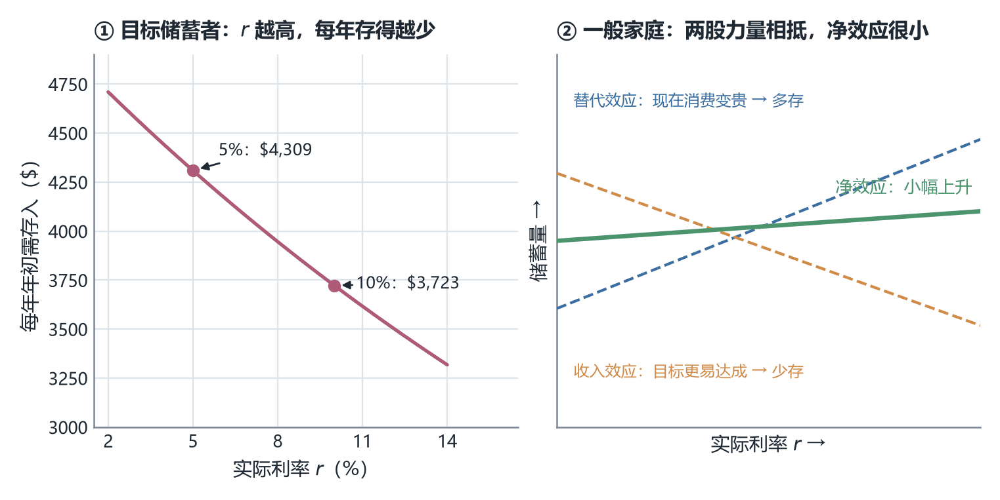
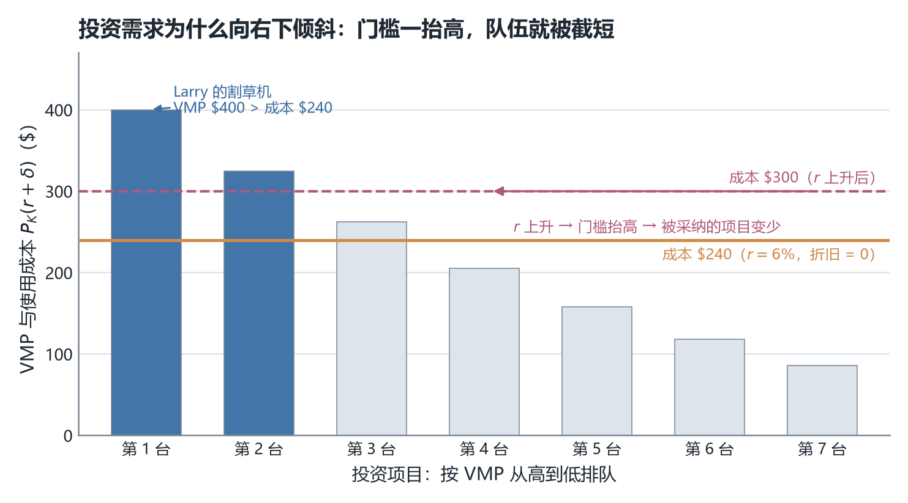
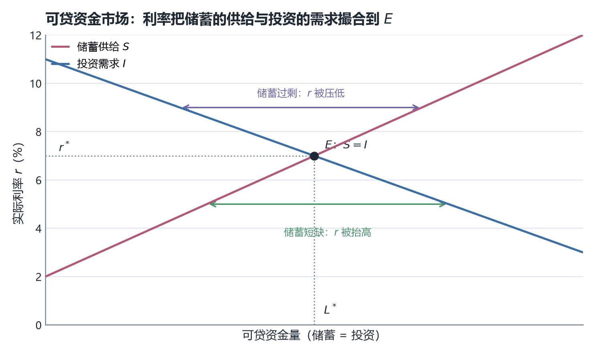
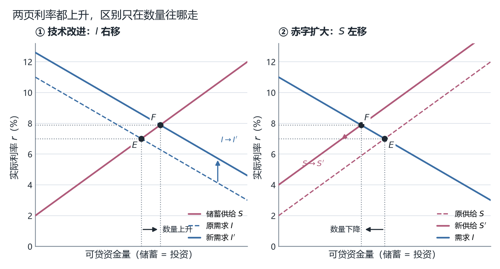

# ECO2021 课堂笔记：第 8 章　储蓄、资本形成与可贷资金市场（Saving, Capital Formation, and the Loanable Funds Market）

> 对应课件：Chapter 8（文件内部标题为 `Ch08.pptx`，Instructor: Jieshuang He），共 **77 页**
> **版本说明（2026-10-26 对齐）**：课件由 76 页增至 **77 页**，新增的是**第 38 页**——一张**无页码、无文字层**的四格动画截图页（图解 p37 最后一条 bullet 的示范效应）。因为它插在原第 37 页之后，**原 p38 及之后的页序整体后移一位**（旧 p38 → 新 p39，旧 p76 → 新 p77），本笔记的全部页码引用已按新版逐条对齐；那一页新增的内容写在 §6.7 末尾。
> <b>配套读物一份</b>：`Ch08 Reading_What causes people to save and invest.pdf`，即《经济学人》（The Economist）<b>2005 年 9 月 24 日</b>特别报道（Special report）<b>「Anatomy of thrift」</b>的 3 页节选，文字层完好。<b>它只摘了原报道的前半篇</b>，止于"先去看日本"那句转折，后半篇的逐国剖析不在手上。文中数字全部是<b>读物原文、2005 年口径</b>（最新到 2004 年），<b>早于 2008 年全球金融危机与 2020 年疫情</b>，引用时不要当成当代数据；"saving glut" 也是 Bernanke 语境里的用词（2005 年那场"全球储蓄过剩"演讲之后的通行说法），不是中性的统计描述。读物的每一段我都就地插进它最相关的那一节（落点见〇节表下的对照表），<b>不另立"读物补充"章节</b>；凡出自读物的句子一律标"（读物 pN）"，N 是这 3 页的页序（p1 讲 saving glut 与两派之争，p2 讲四种动机与六个经验因素，p3 讲富国／新兴市场与投资之谜）。
> 本讲**没有练习解答**，笔记内容**基于课件（PDF）与配套读物整理**（PDF 文字层 + 逐页渲染读图）。凡是课件只给题目不给答案的地方（第 24、25、26、75、76 页共五处），我在正文里给出了**自己算的解答并明确标注"我的补充，非讲义内容"**；凡是我复算、推导或补充的内容，第十三节逐条列出。
> 本讲的主线是一条：**先分清"储蓄是流量、财富是存量"（p4–p10），再把国民储蓄拆成私人储蓄与公共储蓄（p11–p17），用美国政府账本和三条分量曲线看这套拆法在数据上长什么样（p18–p23）；然后问人为什么储蓄（p28–p43），问储蓄通过什么工具变成别人的钱（p44–p56），问企业为什么要把钱变成机器（p57–p63）；最后把这三件事放进一个供需图，让利率当那个把储蓄和投资撮合在一起的价格（p64–p74）**。课件第 77 页自己画了总结图，全章骨架就是它：中间是 **National Saving<b>，右边两条支线（Household Saving → Private Saving、Government Budget → Public Saving）汇进来，下边 </b>Interest Rate** 也指进来，左边伸出去两条——一条到 **Wealth<b>（</b>Capital Gains and Losses** 也指进 Wealth），一条经 **Loanable Funds Market** 到 **Investment and Capital**。

---

## 〇、本讲地图

这张表是"一条线"的锚点：读正文时如果迷路，回到这里看当前这一节在整章里的位置。本讲的顺序**与课件页序一致**，只在四处做了合并（第 9–10 页的牛市图并入第二节、第 30–37 页的三国证据合成第六节后半、第 75–76 页两道分析题并入第十一节末尾），因为它们是前一节的直接延伸，拆开会打断思维。

| 本章小节 | 对应讲义页 | 这一节在回答什么问题 |
|---|---|---|
| 一、六个学习目标与三分法骨架 | p2–p3 | 这一讲要交付哪六件事、按什么顺序讲 |
| 二、储蓄与财富：一个流量、一个存量 | p4–p10 | 储蓄和财富是什么关系？资产负债表、浴缸图、资本损益 |
| 三、国民储蓄的会计恒等式 | p11–p17 | 一个国家的储蓄怎么算：$S=Y-C-G=S_{\text{PRIVATE}}+S_{\text{PUBLIC}}$ |
| 四、美国政府账本与三条储蓄分量 | p18–p23 | 这套拆法在真实数据上长什么样 |
| 五、课堂练习：一个 10 万亿美元的经济体 | p24–p27 | 减税到底会不会减少国民储蓄 |
| 六、人们为什么储蓄：三种动机与三国证据 | p28–p38 | 生命周期、预防性、遗赠；中国、日本、美国；p38 是新增的示范效应动画页 |
| 七、利率与储蓄：Thrifts 和 Spends | p39–p43 | 利率是储蓄的回报吗？多储蓄 35 年差多少 |
| 八、债券（Bonds） | p44–p49 | 储蓄通过什么工具借出去；债券价格为什么与利率反向 |
| 九、股票、风险溢价与金融市场的功能 | p50–p56 | 股票怎么定价；金融市场为什么能提高储蓄的配置效率 |
| 十、投资与资本形成 | p57–p63 | 企业为什么买资本品而不是买金融资产 |
| 十一、可贷资金市场 | p64–p76 | 储蓄与投资如何被一个利率撮合；技术冲击与财政赤字的后果 |
| 十二、速查表与易错点 | p77 | 考前速览 |
| 十三、附：诚实备注 | — | 我算了什么、补了什么、课件哪里有问题 |

读物的落点按"哪一节正在讲它说的那件事"定，索引如下：

| 读物段落 | 落在哪一节的末尾 | 为什么是那里 |
|---|---|---|
| p1：saving glut、经常账户、ex-post 与 ex-ante、古典 vs 凯恩斯 | §3.2（p12 的 $NX=0$ 假设）、§11.3（p67 均衡调整）、§11.4（p68 的 $\iff$） | 课件把"相等"当假设、当均衡、当恒等式的三处 |
| p2：四种储蓄动机 | §6.2（p29）、§5.3（p25–p27） | 第四种动机课件没有名字，只以"情形 1"出现 |
| p2：六个经验因素 | §6.7（p37 之后）、§6.6（p36） | 课件用三国证据讲动机，读物讲跨国差异 |
| p3：富国与新兴市场分道、IMF 46 国研究 | §6.7 | 与 p13 五国横比、p21–p22 分量曲线同源 |
| p3：投资之谜与四种结构性解释 | §10.3（p61） | 四条候选对应"投资曲线为什么左移"，课件只给了三个移动因素 |

**这份笔记的读法。** 括号里第一次出现的英文是课件原名，中文是我给的译名，考试与作业里请以英文术语为准。凡是课件给了数字的地方，我都保留原数字并说明口径；凡是我自己算的、补的，都集中在第十三节交代清楚，正文里只在两类地方加标记：**答案课件没给的练习题**（标"我的补充"），以及**课件自己内部对不上、需要我把两处并排摆出来的地方**。

> **一处结构上的提醒，值得在开讲前就知道。** 课件第 3 页（以及第 57、64 页两次重复的目录页）把本讲分成三块：I. Saving、II. Investment、III. The market for loanable funds。但**六个学习目标里的第 4、5 条（债券与股票、企业为什么买资本品）对应的内容，在页序上挂在 Part I 的尾巴上**——债券与股票那十三页（p44–p56）出现在"II. Investment"这个分隔页（p57）**之前**。所以"第三块"其实是"金融工具"这一整段，而课件把它归在储蓄部分下面。**复习时按 p3 的三分法背书，做题时按 p2 的六条目标找考点**，两套索引不要混。

---

## 一、六个学习目标与三分法骨架（p2–p3）

### 1.1 六条目标（p2）

六条目标不是并列的，而是"定义 → 拆解 → 动机 → 工具 → 需求 → 市场"的一条链：

第一，**解释储蓄与财富之间的关系（Explain the relationship between saving and wealth）**。这是本章的概念地基，也是最容易答错的一问——答案不是"储蓄就是财富"，而是"储蓄是流量、财富是存量，储蓄改变财富"。

第二，**识别并应用国民储蓄的组成部分（Identify and apply the components of national saving）**。这一条是纯计算：$S = Y - C - G$、$S_{\text{PRIVATE}} = Y - T - C$、$S_{\text{PUBLIC}} = T - G$，三个式子必须能默写并互相换算。

第三，**讨论人们为什么储蓄（Discuss the reasons why people save）**。三种动机：生命周期、预防性、遗赠。

第四，**区分债券与股票，并说明金融市场如何改善储蓄流向生产性用途的配置（Differentiate between bonds and stocks and show how the financial market improves the allocation of saving to productive uses）**。

第五，**讨论企业为什么选择投资于资本品而不是金融资产（Discuss the reasons why firms choose to invest in capital rather than financial assets）**。答案是成本—收益原则下的**价值边际产品（Value of the Marginal Product, VMP）**。

第六，**用供需工具分析可贷资金市场（Analyze loanable funds market using the tools of supply and demand）**。这是本章的落点，也是期末画图题的出题点。

连起来看，本章的路线是：**先把两个最容易混的概念（储蓄/财富）分开 → 把储蓄拆成可计算的三块 → 解释人为什么供给储蓄 → 解释储蓄通过什么工具流转 → 解释谁需求储蓄 → 用一个市场把供给和需求撮合，然后拿这个市场去评价财政政策**。第三、四、五条在课件里占了整整三十页（p28–p63），是本章的"血肉"；第二、六条只占十几页，但**几乎全部计算题和画图题都出自这两条**。

### 1.2 三分法骨架（p3，并在 p57、p64 重复）

全章目录是**I. Saving、II. Investment、III. The market for loanable funds**，这一页在本讲出现了**三次**（p3、p57、p64），分别在 Part I 开头、Part II 开头、Part III 开头，充当路标。**读法：第一次出现时看全貌，后两次出现时确认自己换段了。**

三块的分量差别很大：Part I（p4–p56）占 53 页，Part II（p57–p63）只占 7 页，Part III（p64–p76）占 13 页。**Part II 最短，但它是"需求方"，是挤出效应那半张图的主角**——不能因为页数少就跳。

---

## 二、储蓄与财富：一个流量、一个存量（p4–p10）

这一节是全章的概念地基。它要解决的问题很具体：**"我今年存了 5 万"和"我有 50 万财富"是同一件事吗？** 课件的回答是：不是，前者是**流量（flow）**、后者是**存量（stock）**，而且财富的变动有**两条**渠道，储蓄只是其中一条。

### 2.1 三个定义（p4）

**储蓄（Saving）＝当期收入减去当期需要的支出（current income minus spending on current needs）**；**储蓄率（saving rate）＝储蓄 ÷ 收入**。注意这个定义里"current needs"这个限定词——它是第三节整套国民储蓄核算的开关，那里会看到它被处理成"排除所有投资支出"。

**财富（Wealth）＝资产价值减去负债（the value of assets minus liabilities）**。<b>资产（Assets）</b>是"你拥有的任何有价值的东西，金融性的或真实性的都行"（anything of value that one owns, either financial or real）；<b>负债（Liabilities）</b>是"你欠的债"（the debts one owes）。

这里"financial or real"这个二分很重要，它决定了后面第八、九节为什么要讲债券和股票：**股票、存款、债券是金融资产；房子、车、机器是真实资产（real assets）**。财富把两类都算进去。

课件接着给了一句我认为比定义本身更好用的话：

> One way to think about wealth is that it is the **largest amount that you could consume without borrowing**, after having **paid off your debts** and **collected any money owed to you**.

翻译过来：财富就是"在还清别人欠你的账、收齐别人欠你的钱之后，你在**不借债**的前提下最多能消费掉的那个数"。这个说法把"财富"从一个静态的余额变成一个**可操作的上限**——它同时交代了财富定义里的两个扣除项：为什么减负债（先还债才轮到消费）、为什么要收回应收账款（那笔钱还没到你手上）。**这也是为什么财富是"点"上的量：这个"最多能消费多少"必须指定在哪一天算。**

### 2.2 一张资产负债表：把定义算一遍（p5）

**资产负债表（balance sheet）是一个经济单位的资产与负债清单**，它有两个限定：<b>特定日期（Specific date）</b>和**特定经济单位（企业、家庭等）**。

| 资产 Assets | 金额 | 负债 Liabilities | 金额 |
|---|---|---|---|
| 现金 Cash | 80 | 学生贷款 Student loan | 3,000 |
| 支票账户 Checking account | 1,200 | 信用卡余额 Credit card balance | 250 |
| 股票 Shares of stock | 1,000 | | |
| 汽车（市值）Car (market value) | 3,500 | | |
| 家具（市值）Furniture (market value) | 500 | | |
| **合计 Total** | **6,280** | **合计 Total** | **3,250** |

**净资产（Net worth）＝ $6{,}280 - 3{,}250 = \$3{,}030$**，与课件一致（我逐项加过：资产 $80+1{,}200+1{,}000+3{,}500+500 = 6{,}280$ ✓，负债 $3{,}000+250 = 3{,}250$ ✓）。

这张表里有三处值得停下来看：

**第一，"Car (market value)"这个括号是全套定义的关键。** 表里所有真实资产都按**市值**记，不按买入价。这意味着**汽车的价值从你把它开出 4S 店那一刻起就在往下掉，而财富表每天都在跟着变**——但你的储蓄没有减少一分钱。这正是第 8 页"资本损失"那一栏要处理的问题，也是第 61 页把"折旧（Depreciation）"列为资本的两项成本之一的原因。**同一个"价值下降"，在家庭账上叫资本损失，在企业账上叫折旧，在国民收入核算里叫固定资本消耗。**

**第二，最大的单项资产是那辆 3,500 美元的车，占资产的 56%。** 而这个人的流动资产（现金 + 支票账户）只有 1,280 美元，**比他的负债 3,250 少得多**。这是一个很典型的年轻人资产负债表：**账面净资产 3,030 美元，但"能立刻拿来花的钱"只有 1,280 美元。** 回到 2.1 那句"最多能消费多少"——如果车不能马上卖掉，这个上限其实远低于 3,030。**课件的定义是"理论上限"，现实中的上限还要再打一个"变现能力"的折扣。** 这一点课件没有讲，是我加的。

**第三，学生贷款 3,000 美元在负债里占 92%。** 这个人的负债几乎全部来自教育——而教育支出在第 7 章叫<b>人力资本（human capital）</b>投资。**它的回报不出现在这张表上**：这张表只记金融资产和真实资产，一个人的技能、健康、声誉都不在其中。**所以"财富"这个词在经济学里比日常用法窄得多**，别把"我很富有因为我很有能力"混进这个定义里。

### 2.3 流量与存量（p6）

把两件事分开就很清楚：

**流量值（A flow value）按单位时间定义**（is defined per unit of time）。例子：收入（Income）、支出（Spending）、储蓄（Saving）、工资（Wage）。**收入是"在一段时间内你收到的钱"（the amount of money you receive over some period of time），来源可以是市场收入、投资或政府。**

**存量值（A stock value）在时间点上定义**（is defined at a point in time），**它的单位不依赖时间**（Its units do not depend on time）。例子：财富（Wealth）、债务（Debt）。

**怎么判断一个量是流量还是存量？看它的单位里有没有"每"。** "美元/年"是流量，"美元"是存量。这一条判断在本章后面反复用到：储蓄是流量、财富是存量；政府**赤字**是流量、政府**债务**是存量（第 19 页那两张图的差别就在这里，见 §4.2）。

### 2.4 浴缸图：流量怎么改变存量（p7）

本章最好用的一个直觉模型是浴缸，标题写得很直白：**Wealth, Income, Depreciation, and Consumption: The Bathtub Analogy**（课件 p7）。

浴缸里装着水：**水位＝财富（Wealth）**；右上方一个花洒往里注水，标注 **Gross income**（总收入）；缸底有一个排水口向下流出，标注 **Consumption**（消费）；水面上方有三支虚线箭头向上蒸发，标注 **Depreciation**（折旧）。文字结论是：**储蓄的流量导致财富的存量发生变化；一个人每储蓄一美元，他的财富就增加一美元（Every dollar a person saves adds to his wealth）**。

这个类比的用处在于它把"存量—流量"关系变成一句话：**流量是水管，存量是水位。水位的变化等于进水管减去出水管。**

> **但课件 p7 的图和文字对不上，这一处必须看清楚。** 文字说的是"储蓄改变财富"，那张图里画的却是"总收入进、消费和折旧出"。两者只有在<b>把储蓄定义成"毛收入 − 消费 − 折旧"</b>时才等价；而课件 p4 的定义是"储蓄＝当期收入 − 当期需要的支出"，那里**没有折旧这一项**（折旧不是一笔"支出"，它是资产价值的自然下降）。所以课件在本章开头就留下了一个口径裂缝：**p4 的储蓄是毛口径，p7 的图是净口径。** 我的处理办法是：把 p7 读成"完整版本"，把 p4 读成"简化版本"，然后在 p8 那个公式里看课件自己怎么收场（见 §2.5）。**这个裂缝在第 61 页还会再出现一次**——那里"折旧"被明确列为企业使用资本的两项成本之一，说明课件是知道折旧的。

### 2.5 财富的第二条变动渠道：资本损益（p8）

本章第一个也是最重要的一个公式是（课件 p8）：

$$\text{Change in wealth} = \text{Saving} + \text{Capital gains} - \text{Capital losses}$$

**资本利得（Capital gains）＝已有资产价值的上升**，例子是"股票涨价了"；**资本损失（Capital losses）＝已有资产价值的下降**，例子是"车祸撞坏了保险杠和前大灯"。

这个式子的意思是：**财富有两条变动渠道，一条是你自己攒的（储蓄），另一条是市场替你重估的（资本损益）。** 第 7 章讲增长时说过"存量与流量"，这里是同一个道理在家庭层面的应用。

**为什么这条重要？因为它意味着"财富增加"不等于"你存了钱"。** 2020 年你的股票账户涨了 30%，你的储蓄率一点没变，但你的财富涨了。反过来，房价下跌可以让一个从不借钱、从不乱花的家庭变穷。**考试如果问"储蓄和财富的关系"，只答"储蓄增加财富"是半分答案，完整答案是那个三项式。**

**它也和 p7 那张图怎么接？** 图上有折旧、公式里没有。我的读法是：**公式里的"Capital losses"是一个大类，折旧是它的系统性的、可预期的那部分**（车祸是意外的、一次性的；折旧是每年都发生的）。这样 p7 的图与 p8 的公式就能对上，代价是要接受"p4 的储蓄定义里不含折旧"。**这是我对课件的调和方案，不是课件自己写的**，写进第十三节。

### 2.6 一个真实例子：牛市如何压低储蓄率（p9–p10）

实际股价的长期走势由一张图给出（课件 p9）：标题 **U.S. Bull Markets, 1974 – 2014**，纵轴是 **S&P/CPI, 1974 = 100**（即用 CPI 平减后的**实际**股价指数），横轴是年份。文字说明在 p10。

**我在那张图上量出来的读数**（把图内嵌位图在 400 dpi 下做坐标标定后逐列取曲线位置，标定用了两条独立校验：十个刻度标签的最小二乘拟合残差不超过 6.5 个指数点；1974 年起点读数为 96，而它按定义应当正好是 100，偏差 4%）：

| 年份 | 实际股价指数（约） | 事件 |
|---|---|---|
| 1974 | 100（按定义） | 起点 |
| 1982 | **约 55–61** | 全期最低点，比起点还低 40% |
| 1989 | 约 123 | |
| 1995 | 约 164 | |
| 1999–2000 | **约 406–425（峰值 2000 年中）** | 互联网泡沫顶点 |
| 2002–2003 | 约 236 | 泡沫破裂后 |
| 2007 | 约 344 | 次贷危机前高点 |
| 2009 | **约 175–201** | 全期第二深谷 |
| 2014 | 约 388 | 新一轮牛市 |

**这张图给了第 10 页文字所需的全部背景，但课件没有把两者连起来读，我连一下。** 从 1980 年（约 68）到 2014 年（约 388），实际股价涨了 5.7 倍，**折合年均约 5.25%（实际口径）**；从 1974 到 2014 四十年是 4 倍，**年均约 3.55%（实际口径）**。**这两个数字在第 42 页会变成一个矛盾**——那里写"8% 低于 1980 年以来共同基金的回报率"，而 8% 在这张图里被当成**实际**利率用。详见 §7.3。

配的文字（p10）讲了四件事，逻辑是一条因果链：

**1990 年代股票持有量上升**，渠道有三个：直接购买（Direct purchases）、共同基金（Mutual funds）、养老金与退休基金（Pension and retirement funds）。**股价快速上涨 → 股票的资本利得增加了家庭财富 → 这可能减少了家庭储蓄（May have decreased household saving）**。

**然后是一句很容易被读漏、但整页最值钱的话**：2000–2002 年股市下跌之后，**家庭储蓄率仍然很低（Household saving remained low）**，课件给的解释是**私人持有的住房价值快速上升**。

**为什么这句最重要？** 因为它把"财富 → 储蓄"这条负向关系做了**跨资产类别的检验**：股市跌了，储蓄率却没有回升，因为**另一类资产（房子）的资本利得补上了缺口**。换句话说，家庭看的不是"股票账户"这一个抽屉，而是**财富总额**这个抽屉。如果只看股市那条线，你会得出"股市跌→储蓄升"的错误预测。**这就是 §2.5 那个三项式的政策含义：只要资本利得那条渠道还在工作，储蓄这条渠道就可以不动。**

最后一句"Since 2009, a new bull market has taken hold"对应 2009 年那个约 175 的谷底之后一路回到 388。

---

## 三、国民储蓄的会计恒等式（p11–p17）

前两节都在讲一个家庭。宏观经济学要的是**总量**，这一节把"储蓄"这个词从家庭账本搬到国民收入核算表上，并给出本章最重要的三个式子。

### 3.1 出发点：支出法 GDP（p11）

课件先说明宏观研究的是**经济总量储蓄**，并指出家庭储蓄只是其中一块，**企业与政府储蓄是其余部分**。然后从第 4 章的支出法恒等式出发：

$$Y = C + I + G + NX$$

四个符号课件逐个标注：**$Y$** 是总产出/总收入（aggregate income）、**$C$** 是消费支出（consumption expenditure）、**$I$** 是投资支出（investment spending）、**$G$** 是政府对商品与服务的购买（government purchases of goods and services）、**$NX$** 是净出口（net exports）。

**注意 $Y$ 在这里的身份是"收入"而不是"产出"。** 之所以可以这样用，是因为第 4 章讲过的"生产＝收入"：每一块钱的产出都变成了某人的收入。这一句在第 12 页被明确写成"Current income is GDP or $Y$"。

### 3.2 两个简化假设与国民储蓄的定义（p12）

这里有两件事，**两件都是假设，不是事实**（课件 p12），考试喜欢考"你知不知道这是假设"。

**假设一：$NX = 0$（封闭经济）。** 于是 $Y = C + I + G$。

**定义：国民储蓄（National saving, $S$）＝当期收入 − 当期需要的支出。** 当期收入就是 $Y$。**"当期需要的支出"怎么处理？课件给了三条：** 排除所有投资支出（Exclude all investment spending $I$）；大部分消费和政府支出属于当期需要；**为简化，假设全部 $C$ 和全部 $G$ 都是当期需要**。于是：

$$S = Y - C - G$$

**这个推导里"排除 $I$、保留 $C$ 和 $G$"这一步是定义的核心，两个简化假设则是为了让这个定义能算。** 值得想清楚的是它们放弃了什么：

**第一，政府支出里其实有一部分是投资**——修一条高速公路、建一所学校，在第 7 章这些都被算作资本形成。把它们全归入"当期需要"，等于**系统性低估了国民储蓄**（因为 $G$ 被当成纯消耗，$S = Y - C - G$ 就偏小）。

**第二，消费里有一部分也是投资**——第 7 章的人力资本那一节讲得很清楚，教育支出是投资而不是消费。在 $S = Y - C - G$ 里，一笔学费完全等同于买一杯咖啡。

**第三，$NX = 0$ 这个假设在第 30 页被课件自己的图打破了**（中国那条线上储蓄长期大于投资），我在 §7.1 里专门讲这件事。**这是全章最"值钱"的一处内部矛盾**，因为它正好是"封闭经济假设"的边界所在。

**〔读物〕开放经济下的第三笔账：经常账户（读物 p1）**

读物第二段把这个假设补上了，而且口径比我的推导更细：

> And indeed that is true for the world as a whole, but it is not true for individual countries. Capital can flow across borders, so the amount an individual country saves does not have to be the same as the amount it invests. The difference between the two is the amount borrowed from or lent to foreigners; this is called the current-account deficit or surplus.

三层读法。第一，读物把"必须相等"限定在**全世界**、把"可以不等"留给**单个国家**，这正是第 12 页 $NX = 0$ 假设的边界（它假设的是一个"世界国"）。第二，差额有了名字：<b>经常账户（current account）</b>的赤字或盈余，就是"向外国人借的、或借给外国人的那笔钱"。第三，读物给了逆向读法："If a country's current-account surplus rises, it means that either its saving has increased or its investment has fallen, or both."（盈余上升，意味着储蓄上升、或投资下降、或两者兼有。）**这是第 30 页那张中国图的判读口诀**：紫线（储蓄）上移与橙线（投资）下移都表现为缺口扩大。

**与笔记的关系**：我在 §6.3 从 $Y = C + I + G + NX$ 与 $S \equiv Y - C - G$ 相减推过 $S - I = NX$，当时标的是"我的补充，非讲义内容"。读物不用 $NX$ 这个记号，用的是经常账户口径，两者的对账见 §6.3。记住一句：**第 12 页那个假设不是错的，它是有边界的；越过边界之后，"储蓄等于投资"从无条件恒等式降格为"只对全世界成立"。**

### 3.3 五国横比（p13）

五个国家的储蓄率长期横比由一张世界银行图给出（课件 p13）：**National Saving Rates, 1960 – 2024**，纵轴"National saving rate (% of GDP)"，五个国家 China / Japan / Germany / U.S. / U.K.（按线条颜色区分，来源 `data.worldbank.org/indicator/NY.GDS.TOTL.ZS`）。我读到的走向：

| 国家 | 1960 年前后 | 峰值（约） | 2024 年末（约） |
|---|---|---|---|
| 中国 China | 图上从 1960 年代起有断点，1970 年前后约 36% | **约 50.5%（2010）** | 约 43% |
| 日本 Japan | 约 23% | 约 43%（1970 年代中期至 1990 年代初长期在 33–43%） | 约 24% |
| 德国 Germany | 约 23% | 约 28% | 约 25% |
| 美国 U.S. | 约 22% | 约 23%（1960、1966） | 约 18% |
| 英国 U.K. | 无数据（图上从 1970 年起） | 约 19%（1967 前后为美国线，英国峰值约 17.5%） | 约 17% |

**三条可以直接背的结论**：中国是这张图上唯一一条"从低到高翻上去再回落"的曲线，2010 年 50% 附近是全图最高点；日本从 1990 年代中期的 40% 上下跌到 25% 附近，**这条下跌线与第 7 章第 5 页那张"日本人均 GDP 见顶回落"的曲线是同一件事的两面**（生产率停滞 → 收入预期下降 → 储蓄与投资同时收缩）；美国与英国长期在 15–23% 这个窄带里，是这张图上位置最低的两条。

**一个口径提醒**：这张图的"national saving rate"是世界银行的 **Gross savings, % of GDP**，与第 21、22 页 FRED 的口径不完全同源（那两页标题写的是 "Gross National Saving Rate"）。**跨页比较时先看标题里的 "Gross"。**

### 3.4 净税 $T$ 的定义（p14）

要把国民储蓄拆成私人部分和公共部分，必须先定义政府到底收了多少净税。课件先说明**私人储蓄＝家庭储蓄 + 企业储蓄**，然后给出：

家庭总收入是 $Y$，家庭从中缴税，但有两笔反向的流入要扣除：**政府转移支付**与**付给国债持有者的利息**。于是：

$$T = \text{Taxes} - \text{Transfers} - \text{Government interest payments}$$

**转移支付（Transfer payments）的定义课件写得很死：政府向家庭支付而没有取得任何商品或服务作为回报（made by the government to households without receiving any goods in return）。<b> 这个"没有取得任何商品"是判据——它把转移支付与政府购买 $G$ 区分开：政府买一架战斗机是 $G$（换到了东西），政府发一笔养老金是转移支付（换不到东西）。</b>这一条在第 4 章的 GDP 核算里就出现过，本章把它请回来是为了定义 $T$。**

**为什么 $T$ 要写成净额？** 因为后面 $S_{\text{PRIVATE}} = Y - T - C$ 和 $S_{\text{PUBLIC}} = T - G$ 相加时，**$T$ 必须完全消掉**才能得到 $S = Y - C - G$。如果 $T$ 只算毛税，那么转移支付和国债利息就会在两个式子里各漏一次。

### 3.5 私人储蓄（p15）

$$S_{\text{PRIVATE}} = Y - T - C$$

**读法：税后可支配收入（$Y - T$）减去消费。** 课件补了三层区分：

**家庭储蓄／个人储蓄（Household saving / personal saving）** 由家庭和个人完成。**企业储蓄（Business saving）在美国占私人储蓄的大多数**（makes up the majority of private saving in the U.S.）。**企业储蓄＝收入减运营成本减付给股东的股息（revenues less operating costs less dividends to shareholders）**。

**最后那个"减股息"是关键。** 企业赚的钱付给股东之后，就变成了股东的收入，由股东决定消费还是储蓄；**没付出来的那部分留在企业账上，叫留存收益（retained earnings），它就是企业储蓄**。所以"企业储蓄"不是另一个神秘主体，它就是**没有分掉的利润**。

课件还补了一句功能性的话：**企业储蓄可以用来购买新的资本设备（Business saving can purchase new capital equipment）**。这一句把储蓄与第十节的"投资"接上了——**企业是本章唯一一个"既供给储蓄、又需求储蓄"的双重身份主体**。

### 3.6 公共储蓄与两者相加（p16）

$$S_{\text{PUBLIC}} = T - G$$

**读法：公共部门的收入（净税 $T$）减去公共部门在当期需要上的支出（$G$）。**

然后是全章最漂亮的一步代数——**私人储蓄加公共储蓄正好等于国民储蓄**：

$$S_{\text{PRIVATE}} + S_{\text{PUBLIC}} = (Y - T - C) + (T - G) = Y - C - G = S$$

**$T$ 消掉了。** 我校验过：$(Y-T-C)+(T-G) = Y - C - G$，恒等成立 ✓。

**这个消去本身就是本章最重要的一个经济学结论，值得单独记住：国民储蓄只取决于 $Y$、$C$、$G$ 三个量，与税收 $T$ 的高低无关。** 换句话说，**减税本身既不减储蓄也不增储蓄**——它要通过改变 $C$（家庭拿回的钱花了多少）或 $G$ 才能影响 $S$。这正是第 25、26 页那道练习的全部机关，我在第五节把它拆开算。

### 3.7 平衡预算、盈余与赤字（p17）

**平衡预算（Balanced budget）**：政府支出等于净税收，即 $T = G$，于是 $S_{\text{PUBLIC}} = 0$。
**政府预算盈余（Government budget surplus）**：净税收入超过支出，即 $T - G > 0$。**课件明写：预算盈余＝公共储蓄（Budget surplus = public saving）。**
**政府预算赤字（Government budget deficit）**：支出超过净税收入。**课件明写：预算赤字就是公共负储蓄（Budget deficit is public dissaving），数额为 $G - T$。**

**"public dissaving"这个词是理解挤出效应的钥匙。** 赤字不是"钱不见了"，而是**政府在可贷资金市场上从储蓄的供给方变成了需求方**——它把 $T - G$ 这一块负数加到国民储蓄上，于是**私人可用的储蓄变少了**。第十一节 p72 那张图就是把这句话画成曲线。

---

## 四、美国政府账本与三条储蓄分量（p18–p23）

第三节给了三个式子，这一节是它们的"实拍照片"。六页材料里有两处数字对账，都通过了。

### 4.1 2021 年联邦收支桑基图（p18）

2021 年的美国联邦收支由一张 **US Government 2021 Revenue vs Expenditure** 桑基图（Sankey diagram，课件 p18）给出，**所有数字单位为十亿美元（All numbers in \$B）**。三个总量：**REVENUE 4,045**、**EXPENDITURE 6,820**、**DEFICIT 2,775**。

**我先做总量校验：$6{,}820 - 4{,}045 = 2{,}775$ ✓，与图上的 Deficit 2,775 完全一致。**

**再做分项校验（这一步课件没做，是我加的）：**

收入侧九项：Individual income taxes 2,044、Social Security & Medicare taxes 1,247、Corporate income taxes 372、Miscellaneous revenue 133、Custom duties 80、Excise taxes 75、Unemployment insurance 57、Estate & gift taxes 27、Other retirement 10。**相加 $=4{,}045$ ✓，与 REVENUE 分毫不差。**

支出侧：Income security 1,649、Social Security 1,135、Health 797、National defense 755、Medicare 696、Net interest 352、Commerce & housing credit 304、Education 297、General government 270、Veterans' benefits 234、Transportation 155，另有 Administration of justice 72、Agriculture 50、International affairs 47、Community & regional development 47、Natural resources 42、General science, space & technology 36、Energy 6，以及 **Offsetting revenue collected but not attributed to functions (124)**（括号表示负项）。**前十一项相加 6,644，加后七项 300 得 6,944，再减 124 得 6,820 ✓。**

**这张账本上有三处值得读出来：**

**第一，个人所得税（2,044）一项就占全部收入的 50.5%。** 联邦政府不是"收很多种税"，而是**主要靠一种税**。企业所得税只有 372，占 9.2%——**这个比例是理解"企业储蓄占私人储蓄大多数"（p15）的背景：企业赚的钱大部分没被政府拿走，所以能留在企业账上。**

**第二，支出侧最大的三项（Income security 1,649、Social Security 1,135、Health 797）合计 3,581，占支出的 52.5%，全部是转移支付或医疗。** 回到 §3.4 的定义：**这些钱在国民收入核算里不进 $G$，而是走 Transfers**。所以"政府花掉 6.8 万亿"**绝不等于**"$G = 6.8$ 万亿"——**$G$ 只包括政府购买商品与服务那部分**（国防 755、交通 155、教育 297 等），转移支付不在内。**这是本章最容易算错的一步，考试给"政府总支出"时先问它含不含转移支付。**

**第三，Net interest 352 单独成项。** 这就是 §3.4 里 $T$ 要减去"Government interest payments"的原因：**国债利息是上一轮赤字的账单，它既不是政府购买、也不是转移支付，但它确实要从收入里扣掉才能算出可用于当期的净税。** 352 占收入的 8.7%。

### 4.2 1857–2023：赤字是流量，债务是存量（p19）

美国债务的长期走势由两张叠放的图给出（Peter G. Peterson Foundation，课件 p19），总标题 **US Government Debt 1857-2023**，上方那句话是全页的论点：

> Historically, debt and deficits rose with **wars and economic downturns**. Today, they rise from factors such as **growing healthcare costs and an aging population**.

**上面那张：Deficits (+) and Surpluses (−) (% of GDP)。** 我读到的几个峰：Civil War 约 10%、WWI 约 18%、Great Depression 约 8%、**WWII 约 25%+（全期最高）**、Great Recession 约 10%、Pandemic 约 15%。中间 1955–1990 与 1995–2007 两段在 0 线附近甚至为负（盈余）。

**下面那张：Debt Held by the Public (% of GDP)。** Civil War 约 30%、WWI 后约 35%、**WWII 峰值约 105%**、之后长期下降到 1970 年代的约 20%、Great Recession 后升到约 100%、Pandemic 后约 120%，**虚线（Projected）之后一路上到 2053 年约 190%**。两图都在约 2024 年处画了 "Actual | Projected" 的分隔虚线。

**这两张图放在一起，就是 §2.3 那个"流量—存量"区间的政府版，而且是本章最直观的一张对照图。** 上面那张是**每年**的赤字（流量，% GDP），下面那张是**累积**的债务（存量，% GDP）。**读出来的结论是：赤字是一条条尖峰，债务却是一次次台阶。** 二战后债务从 105% 降到 20%，用了三十年；而它从 20% 回到 100% 只用了不到二十年。**因为存量要多年连续的反向流量才能改变，而流量只要一年就能把存量抬高。** 这正是 §2.4 浴缸图的政府版本：浴缸的水位一旦涨上去，放掉它比注满它慢得多。

### 4.3 政府预算变动的三个原因（p20）

第 20 页把预算变动归为三类，**每一类的机制不同，考试喜欢问"这一条属于哪一类"**：

**第一类：衰退期政府收入自动下降**（2001 年与 2007–2009 年两次衰退）。机制是"收入低→税少"（Lower income during recession means lower taxes）。**这是自动稳定器，不需要任何立法**——它同时是 §4.2 那张赤字图里 Great Recession 与 Pandemic 那两根尖峰的主因。

**第二类：税法修改（Tax changes）。** 课件点了三件：1980 年代初的 Reagan 减税、1990 年代初（Clinton 时期）的增税、2000 年代初的 Bush 减税。**这是相机抉择的（discretionary），需要立法。**

**第三类：2000–2010 年政府支出上升。** 原因是伊拉克与阿富汗战争，以及 2001 年 9·11 之后的国土安全支出（Homeland Security expenditures）。

**这三类的划分标准是"谁按下了按钮"**：第一类是经济周期自己按的，第二类是国会改税法按的，第三类是地缘事件按的。**这个区分决定了第五节那道题的答案：只有第二、三类是"政策选择"，第一类是"结果"。**

### 4.4 三条储蓄分量曲线（p21）

本章数据密度最高的一张图是储蓄的三条分量（课件 p21）：**U.S. National Saving Component, 1960 – 2024**，副标题 "U.S. National Saving Rate (% of GDP)"，**季度、季调（Seasonally Adjusted, quarterly data）**，四条来源链接分别是 FRED 的 `GGSAVE`（政府）、`W998RC1Q027SBEA`（家庭）、`W997RC1Q027SBEA`（企业）与 `GDP`。三条线：**Government Saving Rate（橙）**、**Household Saving Rate（青）**、**Business Saving Rate（紫）**。

我读到的三条线（数值为近似读数，单位 % of GDP）：

| 线 | 1960 年代 | 长期走势 | 2024 年末 |
|---|---|---|---|
| Business（紫） | 约 10–12% | 最平稳的一条，缓慢上移，2009 年后跳到 13–15% | 约 14% |
| Household（青） | 约 8–10% | 一路下滑，2005 年前后到 5–6%；**2020 年冲到约 25%、2021 年约 20%**，随后回落到 6% | 约 6% |
| Government（橙） | 约 +3~+5% | **1969 年后基本为负**，常年在 0 到 −5% 之间；2009–2010 年约 −9%；**2020 年最深，约 −22%** | 约 −4% |

**这张图能直接验证三件课件在别处说的话：**

**① p15 那句"企业储蓄占私人储蓄的大多数"——图上是真的。** 紫线常年在 11–14%，青线常年在 5–10%，**企业储蓄大约是家庭储蓄的 1.5–2.5 倍**。唯一的例外是 2020–2021 年那一段，青线短暂超过紫线。

**② p23 那句"1990 年代政府储蓄上升"——图上成立。** 橙线在 1992–2001 年确实爬到 0 以上（约 +1~+3%），对应 §4.3 里"1990 年代初增税"那一条。

**③ p10 那句"2000–2002 年股市跌了但家庭储蓄率仍然很低"——图上也成立。** 青线在 2000 年前后是 5–6%，比 1990 年代的 7–8% 更低，**股市崩了它没有回升**。课件给的解释是房价补上了资本利得。

**④ 最有意思的一处：2020 年那三个尖峰是同一件事的三面。** 橙线跌到 −22%（巨额财政刺激 + 税收下降），青线同时冲到 25%（发钱但花不出去：封锁期间服务消费停摆），紫线几乎不动。**这是本章"储蓄是事后恒等式"最好的一次展示**——$S = Y - C - G$，2020 年 $G$ 大涨、$C$ 大跌，两个方向的力同时作用在三条线上。

### 4.5 总量曲线与"12~25%"（p22）

把三条线加起来就是总量（课件 p22）：**U.S. Gross National Saving Rate (% of GDP)**，来源与上一页相同。课件的两句话：**自 1960 年以来国民储蓄率大约在 12~25%；比家庭储蓄波动小（Less volatile than household saving）**。

**我逐条核对：**

**"波动更小"——完全成立。** 家庭储蓄率 2020 年从 6% 跳到 25%（**振幅 19 个百分点**），而总量曲线同期只从 18% 附近掉到 16% 附近。**这就是加总的力量：三条线里两条反向变动，总量自然平稳。** 这也是 §4.4 第④点说的机制。

**"12~25%"——下限给宽了。** 我读到的曲线区间是**约 13.5%（2009 年谷底）到约 25%（1964 年前后的峰）**，从来没有到过 12%。**上限 25% 准确，下限写 12% 偏保守**（这一点记进第十三节的课件问题清单，不影响使用）。

**还有一件课件没在文字里说、但图上很明显的事：这条线是往下走的。** 1960 年代在 23–25%，1993 年前后到 17%，1998 年回到 21%，2009 年 13.5%，2014–2018 年约 18–20%，2024 年约 16%。**六十年间下移了约 7 个百分点。** 这个"下移"和第 23 页那句"1960 到 2002 年相当稳定"有张力，见下一小节。

### 4.6 四条结论与我对它的复核（p23）

四条结论（课件 p23）：**国民储蓄决定一国投资新资本品的能力**；家庭储蓄一直偏低、企业储蓄相当可观；1990 年代政府储蓄上升；**1960 到 2002 年国民储蓄率相当地稳定，2002 年之后政府负储蓄导致美国国民储蓄率下降**。

**第一条是本章的立论前提，值得单独标出来：** "National saving determines a country's ability to invest in new capital goods"。**注意它说的是"决定能力"，不是"决定投资"。** 这个措辞在第十一节会变成一张图——储蓄曲线就是"能力"的边界，投资曲线决定在这条边界上取哪一点。

**第三、四条我按 p22 的图复核了，结论是"方向对、时间标签不准"：**

**"1960 到 2002 年相当稳定"——严格说这段区间是 17%~25%，下移了约 6–7 个百分点。** 说"稳定"只有在**与家庭储蓄率对比**的意义下才成立（见 §4.5）。**如果考题问"美国国民储蓄率长期是否稳定"，正确的答法是"相对于家庭储蓄率稳定，但存在明显的长期下移趋势"，而不是照抄"fairly stable"。**

**"2002 年之后政府负储蓄导致下降"——图上 2002–2007 年这段恰恰是回升的**（从约 17.5% 升到约 20%）。**真正的深跌发生在 2007–2009 年（跌到 13.5%），而那是 §4.3 第一类"衰退自动稳定器"造成的**（橙线同期跌到 −9%），不是 2002 年那个政策转折的直接后果。**2020 年那一跌（橙线 −22%）力度更大，但总量只跌到 16%，因为同期家庭储蓄率暴涨对冲了。** 所以这句话**作为长期趋势描述是对的，作为时间归因是不准的**。我把这一处并排写在这里，因为它是本章"用图检验文字"最标准的一次练习。

---

## 五、课堂练习：一个 10 万亿美元的经济体（p24–p27）

**⚠ 本节五道题课件全部只给题目、留空作答，没有给答案。下面所有数值都是我自己算的补充，非讲义内容。** 算法只用第三节的三个式子，是本章最典型的送分题型，务必练熟。

### 5.1 第一题（p24）

**题面：** 设 $Y = \$10$ 万亿、$C = \$6.5$ 万亿、$G = \$2$ 万亿，政府预算赤字 3,000 亿美元（\$0.3 万亿）。求公共储蓄、税收、私人储蓄、国民储蓄、投资。

**我的解法（顺序很重要，从"赤字"倒推 $T$ 是唯一入口）：**

**公共储蓄**：赤字就是公共负储蓄，所以 $S_{\text{PUBLIC}} = T - G = -0.3$ 万亿。
**税收**：$T = G - 0.3 = 2 - 0.3 = \$1.7$ 万亿。
**私人储蓄**：$S_{\text{PRIVATE}} = Y - T - C = 10 - 1.7 - 6.5 = \$1.8$ 万亿。
**国民储蓄**：$S = S_{\text{PRIVATE}} + S_{\text{PUBLIC}} = 1.8 + (-0.3) = \$1.5$ 万亿。
**投资**：封闭经济均衡时 $S = I$，所以 $I = \$1.5$ 万亿。

**我用第二条路校验了国民储蓄**：$S = Y - C - G = 10 - 6.5 - 2 = 1.5$ ✓，与"私人 + 公共"的结果一致——**这正是 §3.6 那个 $T$ 消去的恒等式在起作用**。

### 5.2 减税 2,000 亿美元的两种情形（p25–p26）

**题面：** 现在政府减税 \$2,000 亿（\$0.2 万亿），于是 $T$ 从 1.7 变成 **1.5**。分两种情形求公共储蓄、私人储蓄、国民储蓄、投资。

**情形 1（p25）：消费者把减税的全部所得存下来（save the full proceeds）。** 意思是消费不变，$C = 6.5$。

$S_{\text{PUBLIC}} = T - G = 1.5 - 2 = \mathbf{-0.5}$ 万亿（赤字从 0.3 扩大到 0.5，正好等于减税额 ✓）。
$S_{\text{PRIVATE}} = Y - T - C = 10 - 1.5 - 6.5 = \mathbf{2.0}$ 万亿（比原来多 0.2，即家庭把减税的 0.2 全存了 ✓）。
$S = 2.0 + (-0.5) = \mathbf{1.5}$ 万亿——**不变**。校验：$Y - C - G = 10 - 6.5 - 2 = 1.5$ ✓。
$I = S = \mathbf{1.5}$ 万亿——**不变**。

**情形 2（p26）：消费者存 1/4、花 3/4。** 于是消费增加 $0.75 \times 0.2 = 0.15$，$C = 6.65$。

$S_{\text{PUBLIC}} = 1.5 - 2 = \mathbf{-0.5}$ 万亿（与情形 1 相同，因为 $T$ 与 $G$ 都没变）。
$S_{\text{PRIVATE}} = 10 - 1.5 - 6.65 = \mathbf{1.85}$ 万亿（比原来只多 0.05，即存下的那 1/4）。
$S = 1.85 - 0.5 = \mathbf{1.35}$ 万亿——**减少 0.15**。校验：$10 - 6.65 - 2 = 1.35$ ✓。
$I = \mathbf{1.35}$ 万亿——**减少 0.15**。

**两情形对照表（我的补充）：**

| | 原状 | 情形 1（全存） | 情形 2（存 1/4） |
|---|---|---|---|
| $T$ | 1.7 | 1.5 | 1.5 |
| $C$ | 6.5 | 6.5 | 6.65 |
| $G$ | 2.0 | 2.0 | 2.0 |
| 公共储蓄 $T-G$ | −0.3 | −0.5 | −0.5 |
| 私人储蓄 $Y-T-C$ | 1.8 | 2.0 | 1.85 |
| **国民储蓄 $S$** | **1.5** | **1.5（不变）** | **1.35（−0.15）** |
| **投资 $I$** | **1.5** | **1.5（不变）** | **1.35（−0.15）** |

**这张表就是本章全部政策分析的缩影。** 一句话读法：**减税对国民储蓄的打击，恰好等于家庭把减税花掉的那一部分**，即 $\Delta S = -\text{mpc} \times \Delta T_{\text{cut}}$。情形 1 里 mpc = 0，所以 $\Delta S = 0$；情形 2 里 mpc = 0.75，所以 $\Delta S = -0.15$。**注意 $T$ 本身在 $S$ 的表达式里消掉了（§3.6）——真正起作用的一直是 $C$。**

### 5.3 两个问题：哪个情形更现实、为什么重要（p27，课件抛题不解）

课件把两个情形重述一遍（p27），然后问：**"Which of these two scenarios do you think is the most realistic?"** 和 **"Why is this question important?"**

**我的回答（我的补充，非讲义内容）：**

**第一个问题：情形 2 更接近现实，但真实数字比 1/4 更接近"高"那一端。** 理由分三层。**经验层**：多数消费函数的估计给出边际消费倾向（MPC）在 0.2 到 0.6 之间，一次性减税的 MPC 通常低于持续减税的 MPC，因为家庭会把它当成暂时性收入。**机制层**：情形 1 要求家庭**完全理性地预期到今天少交的税就是将来多交的税或通胀**，并且**不受流动性约束**（本来就想借钱的家庭拿到减税一定先花掉）。**现实层**：这两种条件在低收入家庭身上都不成立——他们的 MPC 接近 1；在高收入家庭身上更接近情形 1。**所以真实答案是一个加权平均，而且权重偏向"花掉"那一端。**

**第二个问题才是重点：这道题的答案直接决定"赤字会不会挤出投资"。** 把 §5.2 的结论与第十一节的 p72 那张图并排看：

**如果情形 1 成立**（私人储蓄完全补偿公共储蓄的下降），那么**国民储蓄曲线根本不移动**，$S$ 不变、$r$ 不变、$I$ 不变——**p72 那张"赤字→挤出"的图就完全不会发生**。
**如果情形 2 成立**，国民储蓄左移 0.15，利率上升、投资下降，**挤出效应发生**。

**所以"赤字会不会挤出私人投资"这个政策争论，本质上就是在争 §5.3 第一个问题的答案。** 情形 1 有一个专门的名字：**李嘉图等价（Ricardian Equivalence）**，由 Robert Barro 在 1974 年系统化。课件没有给这个名字，但它是本讲第六个学习目标背后最标准的延伸考点。**这是我补充的内容，写进第十三节。**

**〔读物〕李嘉图等价：读物支持的是"部分"，不是"完全"（读物 p2）**

上一段我补的那个名字，在读物里是第四种储蓄动机，也是「Anatomy of thrift」全篇唯一一处直接给出经济学名词的地方：

> A final possibility is that people save in response to their government's actions. This theory, known as "Ricardian equivalence", suggests that people save more if government saves less because they expect higher taxes later on.

同一页第六个经验因素（财政政策）给出的检验结果，是全篇对我最有用的一句：

> In some countries, people do appear to behave as Ricardian equivalence theory suggests: they save more when budget deficits expand, perhaps because they expect higher taxes in the future, although private-sector saving rises by less than the rise in budget deficits. The big exception is America, where the impact of fiscal deficits on private saving appears to be weakest.

**与课件的关系是三层：命名、定量、划界。** 命名：第 25 页情形 1 就是完整版李嘉图等价的教科书形态（家庭把减税全部存下、$S$ 不变），课件却没给它名字。定量：读物说**私人储蓄的上升小于赤字的上升**——即补偿比例 $k = 1 - \text{mpc}$ 满足 $0 < k < 1$，等价于 $0 < \text{mpc} < 1$，**而这正是第 75 页那道画图题的题头写的"Assume that $0 < \text{mpc} < 1$"**（该题头由 p75 的第 1 题与 p76 的第 2 题共用；上一版笔记误记成"第 76 页"，本次已按页面正文更正）：课件在题面上悄悄预设了"部分李嘉图等价"，正文却一字未提。划界：美国是最大例外，读物原话是"the impact of fiscal deficits on private saving appears to be weakest"。

**于是第 27 页那两个问题要按读物的口径改写答案。** 问"哪个情形更现实"：**情形 1 是理论极端，情形 2（存 1/4）也不是平均水平，真实世界在两者之间、更靠近情形 2**——读物承认人们会为将来的税多存一点，但远不够抵消赤字。问"为什么重要"：它决定第 72 页那张图动不动——**完全等价则 $S$ 不动、没有挤出；部分等价则 $S$ 左移但小于赤字；零等价则左移 $\text{mpc}\times\Delta T$。** 所以"赤字挤出投资"照旧是标准答案，"李嘉图等价"只在写 caveat 时出场：**反驳存在，但不足以翻案。**

**美国为什么是最大例外，课件第 37 页几乎给了答案（这一段是我的推论，读物只给了"美国最弱"这个事实）。** 零首付按揭与 home equity loan（§6.7 第②条）意味着一大批家庭处在**流动性约束**下：减税的钱先去还高息卡债（p42：许多家庭卡债 5,000 美元以上），而不是存起来等将来加税。**流动性约束是李嘉图等价最硬的反例**——理论要求家庭能自由借贷平滑税负，借不到钱的家庭只能按当期现金流花钱。这也说明第 24–26 页那道题为什么必须分情形做：**它不是一个有唯一答案的计算题，而是一个用 $k$ 参数化的模型。**

**一条跨章连接（我的补充）：** 第 7 章 p60 讲"增长的成本是机会成本：更多的资本品意味着更少的消费品"。本节的情形 2 就是那句话的**可贷资金市场版本**——$C$ 上升 0.15 挤掉了 $I$ 的 0.15，**今天多消费的那 0.15 万亿，正是明天的资本存量的减少**。第 7 章讲"要不要付这个代价"，第 8 章讲"这个代价通过什么机制被付掉"（答案是利率）。**期末出跨章论述题，这是最短的一条路径。**

---

## 六、人们为什么储蓄：三种动机与三国证据（p28–p38）

第三节解决了"储蓄是多少"，这一节解决"储蓄从哪来"。三种动机是第 28–29 页两页的内容，第 30–37 页是八页的跨国证据（中国五页、日本一页、美国一页）。**这八页课件没有给任何新公式，全部是"用三种动机去解释三国的储蓄率差异"，是论述题的标准素材库。**

### 6.1 动机一：生命周期储蓄（p28）

**生命周期储蓄（Life-cycle saving）是为了满足长期目标（to meet long-term objectives）。** 课件给的理论表述是：

> **Lifecycle Theory of Saving**: By **borrowing, saving, and dissaving** at different times in life, workers can **smooth their consumption path**, improving their overall satisfaction.

**这句话里三个动作对应人生的三段，一张图把它们画得很清楚（课件 p28）**：横轴 Time，标了 **College, buying a first home**、**Prime working years**、**Retirement** 三个阶段；纵轴 Income, consumption；**收入路径（Income path）是一条先低、中间高、退休后又掉下去的驼峰曲线**，**消费路径（Consumption path）是一条水平直线**。

**三段读法：**
**第一段（大学、买首套房）**：收入线在消费线**下方**，缺口标注 **Borrowing**。
**第二段（职业黄金期）**：收入线**高于**消费线，两支向下的箭头标 **Saving**，把第一段的债还清并开始积累。
**第三段（退休）**：收入线跌回消费线下方，一支向上的箭头标 **Dissaving**（负储蓄／动用储蓄），靠消耗第二段积累的财富维持消费。

**这个图的核心 insight 只有一句话：人储蓄不是为了攒钱本身，而是为了把收入的时间分布改造成消费的时间分布。** 收入是驼峰形，消费想要平的，**中间那个驼峰就是储蓄的来源**。所以"退休潮会降低国民储蓄率"这个预言，正是从这张图直接读出来的——**黄金期人口占比高，社会总储蓄率就高**（第 36 页讲日本时课件原话用了 "Age structure of the population favored saving"）。

**"smooth consumption"为什么能"improving overall satisfaction"？** 因为**边际效用递减**：一个消费者在收入高的年份多花一块钱带来的满足，小于在收入低的年份少花一块钱带来的痛苦。**把一块钱从丰年搬到荒年，总满足上升而总量不变。** 这是这一页唯一没有写出来但必须知道的前提——**没有边际效用递减，就没有平滑消费的动机。**（我的补充，非讲义内容。）

### 6.2 动机二与动机三：预防性与遗赠（p29）

**预防性储蓄（Precautionary saving）是为了抵御挫折（for protection against setbacks）**。课件给的两个例子：**失业（Loss of job）**、**医疗紧急情况（Medical emergency）**。

**它与生命周期储蓄的区别不是"时间长短"，而是"有没有确定性的计划"**：生命周期储蓄对应的是**可预期**的收入形状（人知道自己会退休），预防性储蓄对应的是**不可预期**的冲击（人不知道哪一年失业）。**所以预防性储蓄的强度取决于社会安全网是否替你买了这份保险**——这一点在第 33 页解释中国时是核心论据。

**遗赠储蓄（Bequest saving）是为了留下遗产（to leave an inheritance）**，课件注明**主要来自高收入群体（Mainly higher income groups）**。

**遗赠储蓄是三种动机里唯一一种"自己永远花不到"的储蓄，所以它无法用生命周期理论解释**——一个人死后消费为零，按 §6.1 的逻辑他应该在死前把财富 Dissaving 到零。**遗赠动机意味着有人在意自己死后的消费**（子女的消费）。**这一点决定了财富分配：它让"高收入 → 高储蓄 → 高财富 → 传给下一代 → 下一代起点更高"这条链条成立。** 第 33 页讲中国的收入不平等时、第 37 页讲美国时，都靠这条链条。**三种动机不是并列的清单，它们各自解释一个不同的事实：生命周期解释年龄结构，预防性解释社会安全网，遗赠解释财富分配的不平等。**

**〔读物〕同一组动机，读物多说了三句（读物 p2）**

读物把动机列成四种（第四种是李嘉图等价，见 §5.3），前三种与 p28–p29 对应，但对每一种都补了一句课件没有的可检验含义：

> Another theory suggests that people save for "precautionary reasons", in case they need the money for a rainy day. This implies that people will save more if their income is variable. It also suggests that they will be more inclined to save if they have no access to credit.

> A third possibility is that people save because they want to leave assets to their children, either because they love them or as a way to bribe the children to look after their parents in old age. (Economists are always reluctant to believe in altruism.) Whatever the motive, the bequest theory of thrift suggests that savings might not actually be drawn down in retirement.

**三句各自的用处。** 第一句把预防性储蓄拆成两个自变量：**收入波动性**与**信贷可得性**，这正是第 33 页中国与第 37 页美国两条故事共用的那枚硬币：**中国"社保不发达 + 不能再靠子女"是信贷缺位，美国"零首付按揭 + home equity loan"是信贷充足，同一变量在两国给出相反符号**。第二句的括号是全篇唯一的方法论坦白（"经济学家总是不愿相信利他"）：遗赠在模型里常写作**策略性遗赠**，不是纯粹的爱。第三句最要紧：**遗赠动机强，人退休后就不会把财富花到零**——它直接打在 p28 生命周期图的第三段 Dissaving 上，也解释了 §6.4 那条**老年端储蓄率反而最高**的曲线。

**还有一句是方法论层面的（读物 p2）：** "Although it is hard to confirm Modigliani's hypothesis by studying individual households, it seems to hold for entire countries."（户级数据难以证实，但放到国家层面似乎成立。）**这正好解释 §6.4 那个矛盾**——户级数据画出 U 形、理论预测驼峰形，两边都不算错：**生命周期假说是关于一生的加总规律，单一年份的横截面本来就看不干净。** 考试若问"中国曲线为什么与理论不符"，先答"横轴只到 60 岁、退休段被截掉"，再补这一句。

### 6.3 中国：储蓄率与投资率（p30–p31）

中国的储蓄与投资由一张图给出（课件 p30）：**Chinese Saving and Investment 1985 – 2018**，副标题 "Chinese Saving and Investment as a percent of Chinese GDP"，三条线：**World Gross Saving (% of GDP)**（红，常年在 22–27%）、**China Gross Saving (% of GDP)**（紫）、**China Total Investment (% of GDP)**（橙）。

我读到的关键读数：紫线 1985 年约 35%，2000 年前后约 35–36%，**2008 与 2010 年两个峰约 52%**，2016 年跌到约 45%，2018 年回升到约 46%；橙线 1985 年约 39.5%，**1993 年冲高到约 43.5%（此时高于紫线）**，2000 年跌到约 34%，之后一路上升，**2010 年约 48%**，2018 年约 44%。

> **一处图例异常。** 这一页的 PDF 文字层里有**六个**图例条目（"World Gross savings"、"China Gross savings"、"China Total investment" 与 "World Gross Saving"、"China Total Investment"、"China Gross Saving"），但渲染出来**只有三条线、三个图例**。多出来的那一组大小写不同的标签在图上看不到，说明这张图被重做过一次、旧图例留在文件里。**这不影响读图，但如果你从 PDF 里复制文字，会看到六个名字，别以为漏看了三条线。**

**这张图最有价值的地方，是它暴露了第三节那个 $NX = 0$ 假设的边界（我的分析，课件没有讲）：**

本章的假设一是 $NX = 0$（p12），于是 $S = I$。**但中国的储蓄与投资并不相等。** 把恒等式还原成开放经济版本（我的推导，用 p11 的 $Y = C + I + G + NX$ 与 p12 的 $S \equiv Y - C - G$ 两式相减）：

$$S - I = NX$$

**这个式子可以直接读图：**
**2000 年之后**紫线长期高于橙线，缺口最大时约 4 个百分点（2008 年 52% vs 48%）——**$S > I$ 意味着 $NX > 0$，即中国是净债权人，把超出国内投资的储蓄借给了世界。** 这与 2005–2008 年中国经常账户顺差占 GDP 约 10% 的事实方向一致（顺差比图上这个缺口更大，因为图上是**毛储蓄/毛投资**口径，$NX$ 是净出口口径，两者不完全可加）。
**1985–1995 年那一段**，橙线多次压在紫线上方（1993 年 43.5% vs 41.5%）——**$I > S$ 意味着 $NX < 0$，即中国当时是净借款人，国内投资超过了国内储蓄，缺口由外资填补。** 这与 1990 年代外商直接投资大量流入的事实一致。

**所以这张图不只是"中国储蓄率高"的证据，它是"封闭经济假设什么时候失效"的证据。** 而课件在第 12 页做了 $NX=0$ 的假设、在第 30 页放了一张 $S \ne I$ 的图，**两页之间没有任何一句话把这件事说明白**。考试如果问"为什么 $S = I$"，完整答案是"在 $NX = 0$ 的假设下由恒等式得出"，**而不是"因为市场会撮合它们"——那是第十一节的事，是均衡条件而不是恒等式。** 这个区分见 §11.4。

**〔读物〕对账：读物的"经常账户"与我的 $NX$ 是不是同一个东西（读物 p1）**

读物给的等式是**经常账户口径**：差额是"the amount borrowed from or lent to foreigners; this is called the current-account deficit or surplus"。也就是说

$$\text{CA} = S - I$$

而我上面从课件两式相减得到的是**国民收入核算口径**的 $S - I = NX$。两个式子合起来看，**读物与笔记写的是同一件事的两个名字**：

$$\text{CA} = S - I = NX$$

**符号与读法完全一致**：经常账户盈余（$\text{CA} > 0$）⟺ $NX > 0$ ⟺ $S > I$ ⟺ 本国是**净贷出者**；赤字（$\text{CA} < 0$）⟺ $NX < 0$ ⟺ $I > S$ ⟺ 本国是**净借入者**。所以第 30 页中国那张图上"紫线压橙线"与"中国经常账户顺差"说的是同一件事，不必二选一。**口径差别只在两项**：国际收支的经常账户还含**净要素收入**（本国人在海外赚的利息与利润）与**净转移**，而 $NX$ 只有货物与服务。美国是净要素收入为正的大国，两个数字可以差出 GDP 的 1% 量级；中国 2000 年代的误差与遗漏项也不小。**所以做题时如果题目给的是"经常账户"，直接用 $\text{CA} = S - I$，不必绕 $NX$；如果题目给的是"净出口"，就用 $S - I = NX$。两者不要互相代入后再去查表核对，对不上是口径而不是算错。**

**为什么这处对账值得单列。** 我在初版里把 $S - I = NX$ 标成"我的补充，非讲义内容"，并在诚实备注里说"课件从未写出这条"。**现在读物明确写出了它的经常账户版本（2005 年版），这条从"我的推导"升级为"有文献支持的结论"**——但它仍然不是课件内容，考试引用时按"讲义口径 + 读物来源"两层写最稳。

三条解释（课件 p31）：**1980 年代中期以来家庭储蓄上升**；**经济与收入快速增长，生活方式与消费跟不上（Life-style and consumption don't keep up）**；**文化规范倾向于为未来、教育、住房和养老储蓄，而不是即期消费**。最后一条写着 "Life-cycle pattern (see next page)"。

**第二条是本章里我认为最反直觉、也最正确的一条**：储蓄率高**不一定**是因为人们克制，**可以只是因为收入涨得太快，而消费习惯是一种慢变量**。如果消费随收入同步调整，储蓄率就不会变。**这条机制在第 7 章讲增长时也出现过（收入水平 vs 消费水平），它是"高增长 → 高储蓄率"这个相关性的一个非心理层面的解释。**

### 6.4 中国：年龄—储蓄曲线（p32）

中国的年龄—储蓄曲线由 Yang, D. (2023), *Regional Science and Urban Economics* 99, 103855 的两张图给出（课件 p32），标题 **Household Saving in China: Average Household Age-Saving Rate Profile**，左 **Urban**、右 **Rural**，各画 1995 / 2002 / 2007 三条线，横轴 Age（25–60），纵轴 Savings rate。

**Urban 面板**：1995 线在 0.08–0.15 之间，2002 线 0.18–0.28，2007 线 0.29–0.39。**三条线都是 U 形**——从 25 岁起下降，在 **40–42 岁附近见底**，然后上升到 52–58 岁的第二个高点。
**Rural 面板**：1995 线从 0.20 起（25 岁处有个小峰 0.22），在 **30 岁附近跌到谷底约 0.17**，然后**单调上升到 59 岁的约 0.38**；2002 线大致在 0.13–0.25 之间波动上行；2007 线从 0.21 起**下降到 33–34 岁的谷底约 0.10**，然后上升到 60 岁的约 0.26。

课件的两句结论：**Increased saving rate through the years**（逐年上升）与 **U-shaped age-saving curve**（U 形年龄—储蓄曲线）。

**我逐条核对：**

**"逐年上升"——在 Urban 面板成立得很干净**（1995 < 2002 < 2007 三条线上下分明，间距约 0.10–0.12）；**在 Rural 面板不成立**：1995 线在 40 岁以后**高于** 2002 与 2007 线，2007 线在 30 岁以后**低于** 1995 线。**所以"逐年上升"是城镇样本的结论，不是农村样本的结论。**

**"U 形"——Urban 三条线都是干净的 U 形 ✓；Rural 的 1995 线只是"30 岁处一个小凹陷后单调上升"，2007 线是"先降到 33 岁再升到 60 岁"（这个算 U 形），2002 线接近单调上升。** 所以"U 形"作为对**城镇**的描述是准确的，作为对全部四条…六条线的描述则偏乐观。

**为什么 U 形与 §6.1 的生命周期理论**不完全**一致？** 理论预测的是"驼峰形储蓄"（青年负、中年正、老年负），而图上的**老年端储蓄率最高**。三个可能的解释（我的分析）：**① 图的横轴只到 60 岁，退休之后的下降段被截掉了**——所以看到的"右半边上升"正是"退休前的最后冲刺"；**② 中国农村没有养老金，60 岁前必须自己攒够养老钱**（预防性动机叠加）；**③ 遗赠动机在高龄段更强**。**这三条里第一条最要紧：读这张图时永远记住它只画了 25–60 岁，"U 形"和"生命周期驼峰"不是矛盾，而是同一驼峰的左半边。**

### 6.5 中国：预防性储蓄与收入不平等（p33–p35）

中国的预防性储蓄落到具体制度上有两条（课件 p33）：**社会安全网不发达——医疗、教育、养老金、失业保险**（Underdeveloped social safety nets, such as healthcare, education, pensions, and unemployment insurance）；以及**不能再靠子女养老（Can no longer rely on children for support）**。

**后一条值得多说一句**：它把"预防性储蓄"从"个人心理"变成"制度替代"——**过去养儿防老是一种非正式的养老保险，子女是那份保险的保单；社会化的养老体系没有建立、而子女又不再承担这个功能时，家庭必须自己买一份正式的保险，那就是储蓄。** 这一条与第 37 页讲美国时"Social Security 压低了美国储蓄"正好是**同一枚硬币的两面**：**公共养老金存在 → 私人预防性储蓄下降；公共养老金缺位 → 私人储蓄上升。** 把这两页并排读，本章关于"制度决定储蓄率"的论证就完整了。

第二条机制是**收入不平等（Income Inequality）**（课件 p33）：不平等限制了广大人口的购买力，**大量收入集中在高收入者手里，而他们的边际消费倾向更低（who have a lower marginal propensity to consume）**。

**这条机制值得用公式写出来（我的补充，非讲义内容）。** 设经济里有两组人，收入 $y_1$（高）与 $y_2$（低），边际消费倾向 $\text{mpc}_1 < \text{mpc}_2$。总储蓄 $S = (1-\text{mpc}_1)y_1 + (1-\text{mpc}_2)y_2$。**在总收入 $y_1 + y_2$ 固定的前提下，把一块钱从组 2 转到组 1，总储蓄变化 $= (1-\text{mpc}_1) - (1-\text{mpc}_2) = \text{mpc}_2 - \text{mpc}_1 > 0$。** 所以**收入越集中，总储蓄越高**——这就是"不平等推高储蓄率"的全部算术。**注意它的另一面：同样这块机制在需求侧是"不平等压低消费"，也就是第 33 页第一句话说的"限制了购买力"。同一件事，储蓄率上升、消费率下降。**

两张支撑图（课件 p34 用 OECD 数据，p35 用 Standardized World Income Inequality Database Version 9.6）**没有配任何文字**，我读了图：

**第 34 页**两张条形图。左：**Domestic general government health expenditure as a share of GDP, 2021**——United States 约 9.7%、Japan 约 9.2%、OECD members 约 8.8%、European Union 约 8.5%、World 约 6.5%、Brazil 约 4.5%、**China 约 3.1%（橙色高亮）**、Indonesia 约 2.2%、Low income 约 1.1%、India 约 1.0%。右：**Government expenditure on education as a share of GDP, 2020**——Brazil 约 5.8%、United States 约 5.4%、OECD 约 5.3%、European Union 约 4.9%、World 约 4.4%、India 约 4.2%、Low income 约 3.6%、**China 约 3.6%（橙色高亮）**、Indonesia 约 3.5%、Japan 约 3.4%。

**这两张图是第 33 页"社会安全网不发达"那句话的定量证据，而且是课件里唯一一组能直接支持它的数字**：中国政府医疗支出只有美国的约三分之一（3.1% vs 9.7%），教育支出低于世界平均（3.6% vs 4.4%）。**换句话说，中国家庭的高储蓄率里，有一部分是"政府没花的那部分钱"——它必须有人花，于是家庭用自己的储蓄去花，而存下来的那部分就成了储蓄率。**

**第 35 页**是"Income Inequality Before and After Transfers, 2020 (Gini points)"的哑铃图，三个量：**Market Gini (before taxes and transfers)**（空心点，右侧）、**Net Gini (after taxes and transfers)**（实心点，左侧）、中间标 **Absolute redistribution (difference between Market and Net Gini)**。我读到的几组：Denmark 48.8 → 25.8（再分配 **23**）、Germany 49.6 → 27.7（21.9）、France 50.5 → 29.3（21.2）、US 53.3 → 37.4（**15.9**）、**China 48.3 → 40.4（7.9，橙色高亮）**、Brazil 60.5 → 45.7（14.8）、Taiwan 36.5 → 31.8（4.7）、Bolivia 37.8 → 39.1（**−1.3**，唯一负值）。

**这张哑铃图给 p33 那段文字补了一个课件没写的机制**：中国的**市场不平等（48.3）比美国（53.3）低，但税后不平等（40.4）远高于美国（37.4）**，**差别全部来自再分配力度（7.9 vs 15.9，不到美国的一半）**。**所以"中国收入不平等推高储蓄率"这条论据，真正的落点不是市场分配得多不均，而是税收与转移支付几乎没有把它修正过来。** 这一句是我从图上读出来的，课件第 33 页的文字里没有。

### 6.6 日本：一个反向的自然实验（p36）

日本那一页给了六条（课件 p36）：战后家庭储蓄率 **15–25%**，**1990 年之后下降**；生命周期动机很重要——**预期寿命长**、**退休相对早、退休期长**、**人口年龄结构有利于储蓄**、**1990 年之前房价与首付要求非常高**；**1990 年之后房产价值下跌**；**遗赠储蓄重要、预防性储蓄低（Bequest saving matters; precautionary saving is low）**。

**这一页是全章写得最"经济学"的一页，因为它给了一个完整的自然实验：机制不变、变量变了、结果变了。** 拆开看：

**"预期寿命长 + 退休早 → 退休期长"**：这是 §6.1 生命周期公式的直接应用。设工作 $T_w$ 年、退休 $T_r$ 年，年均消费 $c$、年均收入 $y$，那么退休期要花的钱是 $c \cdot T_r$，工作期每年必须存 $\dfrac{c \cdot T_r}{T_w}$。**$T_r$ 上升（寿命延长或提前退休）或 $T_w$ 下降，都直接抬高储蓄率。** 日本这两项同时发生，所以储蓄率高。

**"1990 年之前房价与首付要求高 → 储蓄率高；1990 年之后房产价值下跌 → 储蓄率下降"**：这是 §2.6 那个"资本利得替代储蓄"机制的**反面**——**资产价格下跌本应通过财富效应压低消费、抬高储蓄，但日本的情况是储蓄率也降了。** 课件把两件事并排写在一起（"Property values decreased after 1990"），但没有解释方向。**我的读法：首付要求下降使年轻人不必为买房攒那么多钱，这是生命周期储蓄的"目标金额"变小了，与房价涨跌是两条渠道。** 课件把"房价高"和"首付要求高"写在同一条里（"Housing prices and down payment requirements were very high before 1990"），实际上**只有后一条能解释储蓄率**。（这一处是我的判断，非讲义内容。）

**"预防性储蓄低"**：这一句和中国那一节（p33）**正好相反**，而原因也正好相反——**日本有全民医保、有公共养老金**。见 §6.5 末尾说的那枚硬币。

**"Bequest saving matters"**：日本长期是高遗产税 + 高财富存量，遗赠动机强。**这一条与"预防性储蓄低"合起来，构成了对日本储蓄率下降的最好解释**：预防性储蓄那部分被社会保障永久地拿掉了，而遗赠那部分需要几十年才调整。

**〔读物〕日本是读物指定的第一站（读物 p2、p3）**

读物的"人口结构"那一条，例子正好是本章的三国："Saving rates do rise when the ratio of children in the population falls (as in China), and decline when the proportion of pensioners rises (as in Japan)."（儿童占比下降储蓄率就升，如中国；领取养老金者占比上升就降，如日本。）**这一句把 p32–p35 的中国与 p36 的日本用同一个变量串了起来**：中国是"抚养比下降"的升段，日本是"老龄化"的降段。而读物末句"先看日本"所指的那个"最大净储蓄国"，20 年后在 p36 已是一路下降——同一国、方向相反。

### 6.7 美国：为什么储蓄率被压低（p37–p38）

美国那一页的标题就是"US saving rate may be **depressed** by"（课件 p37），四条：

**① Social Security、Medicare 等面向老年人的政府项目。** 课件紧跟一句极重要的 caveat：**"Can't explain why US saving is less than Europe"**——**因为欧洲的社会保险比美国更慷慨**。这是课件自己做的一次**证伪检验**：**如果"公共养老金替代私人储蓄"这条机制是唯一的解释，那么社保越慷慨的国家储蓄率应该越低，但欧洲恰恰是社保最慷慨、储蓄率却比美国高的地区。** 所以这条机制在美国**成立但不足以解释水平差异**。**这个"机制对但解释不了跨国差异"的写法，是经济学论述题里最加分的一种 caveat，值得背下来照抄句式。**

**② 小额或零首付的按揭贷款**——鼓励借款（Encourages borrowing）；**"home equity loans"（房屋净值贷款）让进一步借款成为可能**。机制很直白：**§6.1 那个生命周期模型里，第一段本该是 Borrowing，而美国把这个借款渠道开得比别国大**——首付门槛低意味着年轻人不必先攒够钱再买房，于是他们可以在生命周期上更早地"透支"。Home equity loan 则把已经攒下的房产财富**重新变现**，等于把"晚年的 Dissaving"提前到中年。

**③ 股票与房产价值上升带来的繁荣信心（Confidence in a prosperous future）**。这是 §2.6 那条机制的复述：**资本利得替代储蓄**。

**④ 收入不平等加剧**，机制是**示范效应与地位商品（Demonstration effects and status goods）**。

**第④条与中国那一节（p33）形成一组绝佳的对照，而且方向相反——这是全章最值得记的一处对照。** 两边都在讲收入不平等，但**中国那条的结论是"储蓄率上升"**（高收入者 MPC 低 → 总储蓄上升，见 §6.5 的算术），**美国这条的结论是"储蓄率下降"**（低收入者模仿高收入者的消费、为地位商品举债 → MPC 上升 → 储蓄下降）。

**这不矛盾，关键在"钱怎么在两组人之间流动"。** §6.5 的算术假设**收入分配已定**，然后比较总储蓄——那时不平等确实抬高储蓄。**而第 37 页讲的是"低收入的组看到了高收入的组怎么花钱"**，示范效应改变的是**消费函数本身（MPC 上升）**，不是收入分配。**所以两条机制的变量不同：一条动 $y$，一条动 mpc。** 如果考试出"收入不平等对储蓄率的影响是正是负"，**唯一正确的答法是"取决于哪条机制占上风：只看高收入者的低 MPC，它抬高储蓄；看低收入者的示范效应与举债能力，它压低储蓄。净效应是经验问题。"** 我把这一处并排写在这里，因为课件把它们放在第 33 页和第 37 页、中间隔了三页，读者很容易只记住一边。

**〔读物〕六个经验因素，与富国、新兴市场的分道（读物 p2–p3）**

读物把"动机"与"证据"分开：动机是四条假说，证据是六个因素。**这六个因素相当于把课件 p28–p37 那八页三国证据重排成一张跨国比较表**，但有两条课件完全没有（贸易条件、金融发展）：

> •Terms-of-trade shock. If a country's exports suddenly go up in price, its saving rate tends to go up too, at least temporarily. Oil exporters, for example, put on a saving spurt if oil prices rise.

经济增长那一条（"Especially in poorer countries, saving rates rise as economies grow"）的机制与第 31 页中国三条解释里的第二条（"Life-style and consumption don't keep up"）是同一句，读物只是把它推广成"尤其对穷国成立"。**贸易条件是课件没有的渠道**——出口价格突然上涨（油价）会在短期内把收入推到消费之上，储蓄率随之一跳，这是解释产油国与 2000 年代新兴市场储蓄潮的关键。**金融发展那一条与 p37 第②条、p43 最后一句同源**（借钱越容易、储蓄越少），只是被写成国家层面的规律。

> •Capital gains. ... A study by the OECD published late last year suggests that housing wealth has a bigger effect on saving than financial wealth, and that this effect is stronger in economies with flexible mortgage markets and high rates of home ownership.

**这一条直接回答了课件 p9–p10 留下的那个疑问。** 课件在 p10 说"2000–2002 年股市崩了、家庭储蓄率仍然很低，因为住房价值上升"——当时只是猜测；读物的 OECD 研究把它变成有方向的结论：**住房财富对储蓄的抑制作用大于金融财富，且在按揭灵活、自有率高的经济里更强。** 美国三条全中（灵活按揭、高自有率、home equity loan），所以 §2.6 那个"跨资产类别的检验"正是这条规律的一个样本。

然后是富国与新兴市场的分道。**以下全部是读物原文、2005 年口径，最新数据只到 2004 年：**

> But there are indications that in rich countries the biggest disincentives to saving have been capital gains and the ability to borrow. National saving rates in rich countries have been falling gradually for more than two decades, and particularly steeply since the mid-1990s... Marco Terrones and Roberto Cardarelli, two economists at the IMF, looked at saving patterns in 46 countries between 1972 and 2004 and found that easier credit (thanks, probably, to higher house prices), along with bigger budget deficits, were the most important reasons for the overall drop in saving in rich countries since 1997.

> Over the past 35 years, the emerging economies' share of global saving has doubled, from 15% to 30%. In 2004, emerging economies saved the equivalent of 6% of global GDP. If there is a glut of saving, it is likely to be found in emerging economies and oil-exporting countries.

**这两段合起来就是"全球储蓄过剩"的资产负债表**：富国储蓄率往下走，两个主因是资本利得与更容易的信贷；新兴市场与产油国的份额往上走（35 年翻倍）。**"更容易的信贷"与"资本利得"在课件里是分开写的**（p37 第②③条、p43 最后一句），读物把它们并成富国下行的两个主因——**这正好对上课件 p21–p22 那条美国国民储蓄率在 1990 年代中期以后的陡降**（§4.5：1993 年约 17% → 2009 年约 13.5%）。论述题问"美国储蓄率为什么长期下行"，按读物给的排序答：**先资本利得，再信贷可得性，最后财政赤字。**

**时效提醒。** 这段判断写于 2005 年，引用必须带年份；2008 年之后新兴市场份额、油价周期与全球失衡格局都变过。

**课件在本版加了一页（现 p38），专门图解第 37 页最后一条。** 这一页没有文字层、也没有页脚编号，整页是四格动画截图——一部以澳洲牧牛犬一家为主题的儿童动画（*Bluey*）的四个镜头，我按位置读下来是这样：**左上**，一只小狗把一只刚做好的披萨推进自家后院新砌的柴火烤炉，台词"很不错吧"（它在向人展示自家新添的东西）；**右上**，隔壁一家四口趴在篱笆上往这边看，台词"他家的草坪真绿啊"——注意他们羡慕的不是那口烤炉，是"他家的"；**左下**，烤好的披萨特写，边上的配料溢出来、卖相并不精致；**右下**，两个孩子各自端着一盘披萨，台词"嘿 你的比我的大呀"。（课件 p38，本版新增的动画截图页；该页无文字层，四个分镜是我渲染后读图转述的；按本课惯例，截图本身不搬进笔记。）

**这四格演的正是第 37 页第④条那两个词：示范效应（demonstration effects）与地位性商品（status goods）。** 机制可以拆成三句话。**第一，满足感是相对的，不是绝对的**：左上那只狗对自家披萨的满意，取决于邻居有没有更好的东西；右上的邻居本来没打算装烤炉，看到"他家的草坪更绿"才开始比较。**第二，比较的锚点一变，消费的参照点（reference point）就被抬高**——右上的台词不是"他的披萨比我的好吃"，而是"他家的草坪真绿"，被羡慕的是**别人家拥有的那个东西本身**，这正是"地位性商品"的含义：它的价值主要来自"我比你多"，而不是来自使用价值。**第三，攀比落在消费上、不落在储蓄上**：看到别人升级，家庭的反应是把自己的消费往上调（右下连一块披萨的大小都要比一比），而储蓄是收入减掉消费之后的**余额**，消费一被抬高，余额就被挤掉——这就是"示范效应压低储蓄率"的全部算术。

**所以这条机制的方向是"不平等加剧 → 储蓄率下降"，与 §6.5 中国那条正好相反。** 区别在于两边动的是不同的变量：中国那条动的是**收入分配**（高收入者 MPC 低，收入越集中、总储蓄越高，见 §6.5 的三组算术），美国这条动的是**消费函数本身**（中低收入家庭把高收入家庭的消费水平当参照点，MPC 上升）。**同一句"收入不平等加剧"，在两条机制下给出方向相反的储蓄率预测**，而课件把它们分放在 p33 与 p37、中间不着一语——这四个分镜就是第 37 页那半句话的图解。（分镜的转述是我的读图，三项机制是我按 p37 的英文措辞展开的，非讲义原文；这一页课件只给了画面，没有一个字。）

---

## 七、利率与储蓄：Thrifts 和 Spends（p39–p43）

三种动机解释了"为什么储蓄"，但学习目标三、六还要回答"储蓄对利率有没有反应"。这一节从定义出发（p39），用一个两户人家的 35 年模拟（p40–p42）说明储蓄的回报，最后用行为经济学（p43）说明这个模型漏掉了什么。**本节第 8.2 小节是本讲全部数字里我复算得最彻底的一处，三个数字全部对上。**

### 7.1 实际利率（p39）

课件先说**储蓄常常采取付回报的金融资产形式（Saving often take the form of financial assets that pay a return）**，列了四种：**Interest-bearing checking**（付息支票账户）、**Saving account**（储蓄存款）、**Bonds**（债券）、**Stocks**（股票）。然后给出定义：

$$r = i - \pi$$

**实际利率（real interest rate, $r$）＝ 名义利率（nominal interest rate, $i$）− 通货膨胀率（rate of inflation, $\pi$）**。

> **一处技术提醒：这个 $\pi$ 在 PDF 文字层里丢了。** 我抽取第 39 页文字层时，"the rate of inflation (" 括号里是**空白**——课件用的数学斜体字体缺 ToUnicode 映射，文字层抽不出这个符号。**我是把这一页在 160 dpi 下渲染成图片后读出来的，确认是希腊字母 $\pi$。** 如果你用复制粘贴做笔记，这里会得到一个空括号。

课件给的实际利率的两条注脚：**"The increase in purchasing power from a financial asset"**（金融资产带来的**购买力**增加）与 **"Marginal benefit of the extra saving"**（额外那一单位储蓄的**边际收益**）。

**第二条注脚比定义本身更重要，因为它是第十一节那条向上倾斜的储蓄曲线的微观基础：利率是储蓄的边际收益，所以 $r$ 越高、储蓄越多。** 记住这个措辞——"marginal benefit of the extra saving"——考试问"为什么储蓄曲线向右上倾斜"，答案就是这一句。

**$r = i - \pi$ 是近似式，精确式是费雪关系（Fisher equation）的形式之一（我的补充，非讲义内容）：**

$$1 + r = \frac{1 + i}{1 + \pi} \quad\Longleftrightarrow\quad r = \frac{i - \pi}{1 + \pi}$$

**两者差多少？** 取 $i = 8\%$、$\pi = 3\%$：课件式给 $r = 5.00\%$，精确式给 $r = 4.85\%$，差 15 个基点。取 $i = 20\%$、$\pi = 15\%$：课件式给 5.00%，精确式给 4.35%，差 65 个基点。**低通胀下用课件式没问题；高通胀经济（第 5 章 CPI 那一讲提过）必须用精确式。** 这条与第 5 章的通胀度量偏差（替代偏差不等）是同一类问题：**所有"用减法代替除法"的近似，误差都随通胀率上升。**

### 7.2 两户人家的 35 年：Thrifts 和 Spends（p40–p41）

两户人家的 35 年对照实验（**Thrifts and Spends**，两户人家的姓，字面意思是"节俭家"和"挥霍家"；课件 p40）**输入表把 Spend 家庭放在左列、Thrift 家庭放在右列，而正文先讲 Thrifts，顺序相反——读表时容易串列，注意。**

| | Spends | Thrifts |
|---|---|---|
| Saving Rate | 5% | 20% |
| Start Date | 1980 | 1980 |
| End Date | 2015 | 2015 |
| Real Income | \$40,000 | \$40,000 |
| Real Interest | 8% | 8% |

课件的四句话：**其他条件完全相同的两户人家有不同的储蓄率**；**多储蓄会减少当期消费**——"Thrifts 在 1980 年消费 32,000 美元，Spends 消费 38,000 美元"；**Thrifts 得到更多非劳动收入（Thrifts get more unearned income）**；**Thrifts 的收入增长更快**；**从 1995 年起，Thrifts 消费比 Spends 多**。结果（p41）：**到 2015 年，Thrifts 的消费比 Spends 多 12,000 美元；Thrifts 累积储蓄 385,000 美元，Spends 累积储蓄 77,000 美元。**

**我复算了这一整页，而且反推出了课件没有写明的模型。** 这是本讲最重要的一次核验，因为**页面上没有任何公式**，只有输入表和四个输出数字。

**第一步，检查输入是否自洽。** $40{,}000 \times (1 - 0.20) = \$32{,}000$ ✓、$40{,}000 \times (1 - 0.05) = \$38{,}000$ ✓——**课件给的两个 1980 年消费数与储蓄率完全一致**，说明第一年还没有利息收入。

**第二步，排除一个显然的候选模型。** 最自然的想法是"每年存下 $s \times 40{,}000$，本金按 8% 复利滚存"：$W = 8{,}000 \times \dfrac{1.08^{35} - 1}{0.08}$。我算出来 Thrifts 得 **\$1,378,534**、Spends 得 **\$344,634**——**比课件的 385,000 / 77,000 大了近 4 倍，而且比值是 4.00，课件的比值是 5.00。** 所以这个模型不对。

**第三步，找到正确的模型。** 关键线索是那句"Thrifts get more **unearned income**"和"Thrifts' **income grows faster**"——**利息被当作收入发出来，家庭按储蓄率对"总收入的"储蓄，其中不储蓄的那部分被消费掉了，所以利息不会全部留在本金里滚存。** 模型是：

$$\text{第 } t \text{ 年总收入} = 40{,}000 + 0.08 \times W_{t-1}, \qquad W_t = W_{t-1} + s \times \text{总收入}$$

$$\text{第 } t \text{ 年消费} = (1 - s) \times \text{总收入}$$

**我逐年模拟（1980 年为第 1 年，年初财富 $W_0 = 0$），结果与课件四个数字全部对上：**

| 课件给的数字 | 课件值 | 我的复算值 | 结论 |
|---|---|---|---|
| 1980 年 Thrifts 消费 | \$32,000 | \$32,000 | ✓ 精确 |
| 1980 年 Spends 消费 | \$38,000 | \$38,000 | ✓ 精确 |
| "从 1995 年起 Thrifts 消费更多" | 1995 | **1994 年差 −221 美元，1995 年差 +258 美元** | ✓ 交叉点正好在 1995 |
| 2015 年两者消费之差 | \$12,000 | **\$12,076** | ✓ 四舍五入即 12,000 |
| Thrifts 累积储蓄 | \$385,000 | **\$385,408**（2015 年末） | ✓ |
| Spends 累积储蓄 | \$77,000 | **\$77,276**（2015 年末） | ✓ |

**六个数字，一个两行的模型，全部命中。课件这一段数字是认真算出来的，不是编的。**

**这个复算还给出了三件课件没说的结论：**

**① 收入差距确实拉开了。** 2015 年 Thrifts 的总收入是 **\$69,717**（其中 \$29,717 是利息），Spends 是 **\$45,998**（利息 \$5,998）。**"unearned income"占 Thrifts 收入的 42.6%，占 Spends 的 13.0%。** 这就是"Thrifts' income grows faster"的定量内容。

**② 财富比值为什么是 5 而不是 4。** 储蓄率之比是 $20/5 = 4$，如果模型是"只存固定额"，比值会永远是 4（我第二步算出来正好是 4.00）。**课件的比值是 5.00，多出来的那 25% 全部来自"利息也被按比例储蓄"这个二阶效应**——Thrifts 的利息收入是 Spends 的 5 倍，其中 20% 被存下的绝对额当然也更大。**这个"5 vs 4"是判断你是否真的看懂了这个模型的最好的一道自查题。**

**③ 交叉点为什么在 1995 年。** 1980 年 Thrifts 少消费 6,000 美元，此后差距每年缩小约 300–600 美元，1994 年只差 221 美元，1995 年反超 258 美元。**15 年才抹平 6,000 美元的当期牺牲，然后 20 年拉开到 12,000 美元——这个"先输后赢、越赢越快"的形状就是复利的形状**，与第 7 章第五节（复利与 72 法则）是同一件事在家庭储蓄上的翻版。

### 7.3 这个例子能信几分（p42）

课件在这里自己给了四条 caveat（p42），**这是全章写得最诚实的一页，考试喜欢考"课件给了哪些限定条件"**：

**① "8% is lower than the return to mutual funds since 1980."**（8% 低于 1980 年以来共同基金的回报率。）
**② "20% saving is higher than typical U.S. households"**——许多家庭反而有 5,000 美元以上的信用卡债务，且利率很高。
**③ Bottom line: High saving rate pays off in the long run.**（结论：高储蓄率长期是划算的。）
**④ 目标储蓄者（target savers）：如果人们设定储蓄目标，高利率反而降低储蓄率。** 例子：**要在五年后攒到 \$25,000，5% 利率下每年存 \$4,309，10% 利率下每年存 \$3,723。** 最后一句：**数据显示更高的实际利率只会小幅增加储蓄（Data show higher real rates increase saving modestly）。**

**我对第 ① 条和第 ④ 条都做了核验，一处对不上、一处完全对上：**

**第 ④ 条：完全对上，而且我找出了课件用的是哪种年金公式。** 普通年金（年末存入）：$A = \dfrac{25{,}000}{\left[(1+i)^5 - 1\right]/i}$，$i = 5\%$ 得 **\$4,524**、$i=10\%$ 得 **\$4,095**——**都不是课件的数**。改用**期初年金（annuity-due，年初存入）**，即分母乘 $(1+i)$：$i=5\%$ 得 **\$4,308.9 ≈ \$4,309** ✓、$i=10\%$ 得 **\$3,722.7 ≈ \$3,723** ✓。**两个数都精确命中，说明课件的模拟是"每年年初存入"。** 记法：**目标储蓄题默认用期初年金。**

**第 ① 条：与课件自己 p9 那张实际股价图对不上。** 我在 §2.6 量过那张 **S&P/CPI（1974=100）** 的图：**1980 年约 68、2014 年约 388，34 年年均实际回报约 5.25%；1974→2014 四十年年均约 3.55%。** 而第 40 页的模拟用的是 **Real Interest 8%**。**8% 的实际回报明显高于课件自己那张实际股价图所能支持的水平**——所以"8% 低于共同基金回报"这句话**只在名义口径下成立**（1980 年以来美国名义股票年化回报约 10%，减去约 3% 的通胀才勉强接近 7–8%）。**结论：第 40 页那个 8% 是一个偏乐观的假设值，它同时充当"实际利率"和"股票回报"两个角色，而课件 p9 那张图不支持它。** 这一处我记进第十三节的课件问题清单。**考试里这个数字照用（它是课件设定），但写论述题时把它当 caveat 用比当事实用更安全。**

**第 ④ 条的真正分量：它和第十一节那条向右上倾斜的储蓄曲线直接冲突。** §7.1 说利率是储蓄的边际收益，所以 $r$ 越高储蓄越多；**目标储蓄者的行为正好相反**——利率越高，每年需要存的越少。**这不是课件自相矛盾，而是标准的"替代效应 vs 收入效应"**：利率上升让"现在消费"变贵（替代效应 → 多储蓄），同时让"未来的目标更容易达成"（收入效应 → 少储蓄）。**对目标储蓄者，收入效应占上风；对一般家庭，替代效应略占上风——所以课件最后一句"modestly"（小幅增加）是这两股力量相抵之后的净结果。**（这一段是我对课件的展开，非讲义内容。）**考试问"储蓄曲线为什么向右上倾斜"时，能补一句"目标储蓄者会给出反向反应，实证上净效应很小"，是这一节能拿高分的关键。**

**两类家庭面对同一个利率变化，走的方向是相反的，图 1 把这两种反应并排摆出来。**

*图 1　同样的利率上升，两类家庭往相反方向走。左：目标储蓄者要在 5 年后攒到 \$25,000，按每年年初存入算，5% 利率下每年存 \$4,309、10% 利率下只需 \$3,723——利率越高，每年要存的越少（收入效应占上风）。右：一般家庭的两股力量方向相反，替代效应推高储蓄、收入效应压低储蓄，净效应只是小幅上升。左图曲线由期初年金公式现算，右图为示意图，仅示形状。*

### 7.4 行为经济学与制度设计（p43）

全章唯一一处明确偏离理性人假设的地方（课件 p43）：**心理学家认为个人的自我控制可能太弱，无法产生理性的结果（individual self-control may be too weak to produce rational outcomes）**，例子是**吸烟、肥胖、赌博与消费**（Smoking, obesity, gambling, and spending）。

由此得出**支持储蓄的装置（Devices to support saving）**：**让储蓄自动化、让提取变得昂贵（Make saving automatic and withdrawals costly）**，例子是**个人退休账户（Individual Retirement Account, IRA）提前取款要受罚**。

**这段话的经济学内容比它看起来多。** 它说的是：**如果人有时间不一致的偏好（今天想为明天储蓄、明天又想花掉），那么"提高储蓄率"的正确政策工具就不是改变价格（利率），而是改变选择架构（default 与惩罚）。** 这与 §7.3 的结论正好配套：**既然实证上利率只能小幅改变储蓄（p42 最后一句），那就别指望靠利率去推动储蓄，改规则更有效。** 第十一节的四条政策清单会回到这个思路（课件 p74，见 §11.9）。

**同一页最后一条反向机制：容易借款支持了高水平的当期消费（Easy borrowing supports high levels of current spending）**，例子是信用卡与房屋净值贷款。**这与第 37 页第②条是同一件事**（见 §6.7），课件在两处分别写了它。

---

## 八、债券（Bonds，p44–p49）

从这一节起，问题从"人为什么储蓄"转向"储蓄怎么从有钱的人手里流到需要钱的人手里"。先看一张实物照片：**一张 The Boeing Company 的债券凭证**（课件 p44），票面写着 **5½% CONVERTIBLE SUBORDINATED DEBENTURE DUE 1991**、面额 **\$5,000**、"REGISTERED"、受托银行 **THE CHASE MANHATTAN BANK**、两处 SPECIMEN 印章。

**这张照片比后面四页定义更有用，因为它把 §8.1 的每一个术语都变成了票面上的一个字段：**"5½%" 是票面利率（coupon rate）、"\$5,000" 是本金（principal）、"DUE 1991" 是到期日（maturation date）、"1991 减 1966"（票面内文提到 interest 从 September 14, 1966 起算）就是债券期限（term），而 "pay interest ... on the first day of **March 1 or September 1** of each year" 就是票息支付（coupon payments）——**每年两付**。"CONVERTIBLE"（可转换）与 "SUBORDINATED"（次级）是这张具体债券的额外条款，课件没有解释，但它们是真实债券市场上的标准字段：**次级意味着违约时清偿顺序靠后（对应 §8.2 的信用风险），可转换意味着持有人可以把它换成股票（介于债券与股票之间的工具）。**

### 8.1 债券的四个要素（p45）

**债券是一张偿还债务的法律承诺（A bond is a legal promise to repay a debt）。** 这句话的重点是 **legal promise**——**债券持有人是债权人，不是所有者**。这与 §9.1 的股票构成整节最核心的对照。

每只债券规定（Each bond specifies）：
**本金（Principal amount）**：最初借出的金额（the amount originally lent）。
**到期日（Maturation date）**：本金被偿还的那一天。
**票息支付（Coupon payments）**：付给债券持有人的周期性利息。
**票面利率（Coupon rate）**：施加在本金上、用来决定票息金额的利率。

**债券期限（The term of a bond）＝从发行到到期的时间长度。**

**四个要素里最容易混的是 coupon rate 与市场利率。** 票面利率是**写死在合同上**的，决定"每年付多少钱"；市场利率是**每天在变**的，决定"这只债券值多少钱"。§8.4 的全部计算都在处理这两者的差额。

### 8.2 票面利率由什么决定（p46）

**公司与政府发行债券。** 票面利率取决于三件事，课件每件都给了一个"越高／越低→"的方向：

**① 债券的期限（The bond's term）**：30 天到 30 年；**期限越长，票面利率越高**（longer term, higher coupon rate）。
**② 发行者的信用风险（The issuer's credit risk，即债券评级 bond ratings）**：**违约概率**（probability the issuer will default on repayment）；**风险越高，票面利率越高**。
**③ 票息的税收待遇（Tax treatment for the coupon payments）**：**市政债券（Municipal bonds）免联邦税**；**税越少，票面利率越低**。

**①的机制（我的展开）**：期限长意味着两个风险都更大——**利率风险**（见 §8.4，久期越长价格对利率越敏感）与**违约风险**（30 年内公司可能变坏）。所以长期限要付溢价，这就是"收益率曲线通常向上倾斜"的教科书版本。

**③的机制值得单独算一次，因为它是"税前税后"最干净的例子。** 如果市政债免联邦税而公司债要交税，那么**同一只债券，免税版本的票面利率可以更低，但投资者的税后回报相同**。设边际税率 30%，一只应税债券票面 5%，税后给投资者 3.5%；那么一只免税债券只要给 3.5% 的票面就等价。**这就是课件那句"Lower taxes, lower coupon rates"的算术内容：利率差异完全由税率决定。**（这一段是我补的推导，非讲义内容。）

### 8.3 美国国债的三种（p47）

课件给了三种美国国债，**期限与付息方式都不同，这张表是纯记忆题**：

| 品种 | 期限 | 付息方式 |
|---|---|---|
| **Treasury bonds（T-bonds，长期国债）** | 20 或 30 年 | **每 6 个月付息一次** |
| **T-notes（中期国债）** | 2 到 10 年 | **每 6 个月付息一次** |
| **T-bills（短期国债）** | **4 到 52 周**到期 | **只在到期时付息** |

课件接着说：**到期才付息的债券叫零息债券（zero-coupon bonds），因此 T-bills 可以被看作零息债券**（For this reason, the T-bills can be thought of as a zero-coupon bond）。**最后一句：短期美国政府债券往往是最安全的资产（Short-term U.S. government bonds tend to be the safest assets）。**

**"零息"不等于"无回报"，这一点必须说清楚（我的补充）**：T-bill 不付票息，它靠**贴现发行**赚钱——面值 \$1,000 的 26 周 bill，如果以 \$980 卖出，到期拿 \$1,000，那 \$20 就是利息。**所以"pay interest only at maturity"里的 interest 是以折价形式实现的。** 反算收益率：$20/980 = 2.04\%$（半年），年化约 4.1%。**这也是为什么 T-bill 的报价用"贴现率"而不是"票面利率"——它根本没有票面利率这个字段。**

**"最安全"这个说法要加两个限定（我的补充）**：① 它指的是**违约风险**最低（美国政府可以印美元还美元债），**不含通胀风险**——一只 30 年 T-bond 的通胀风险极大；② 它也**不含利率风险**——§8.4 会看到，期限越长价格对利率越敏感，所以 30 年 T-bond 的短期市值波动可以很剧烈。**"最安全"只在"持有到期 + 名义价值"这个口径下成立。**

### 8.4 债券可以在到期前卖出：价格与利率反向（p48–p49）

这是本节真正的考点。四句话（课件 p48）：**债券可以在到期日前卖出**；**任何时点的市场价值就是债券的价格**；**价格取决于票面利率与金融市场利率之间的关系**（Price depends on the relationship between the coupon rate and the interest rate in financial markets）；**债券卖出时的价格取决于当时的利率水平（prevailing interest rate）**。

**课件给的例子（p48）：** 一只**两年期**政府债券，本金 \$1,000，于 **2015 年 1 月 1 日**以 **\$1,000** 卖出，**票面利率 5%** → **2016 年 1 月 1 日付 \$50**，**2017 年 1 月 1 日付 \$1,050**。

**先核对这只债券本身：** $1{,}000 \times 5\% = \$50$ ✓（票息），到期时"本金 + 最后一期票息" $= 1{,}000 + 50 = \$1{,}050$ ✓。**注意这只债券只付两笔钱（1/1/16 与 1/1/17），因为它是"每年付一次"的简化设定**——真实 T-bond 是每半年付一次（§8.3）。

**定价（课件 p49）这样算。** 场景：你现在手上有一年陈的旧债券，**一年后应付 \$1,050**（即 1/1/17 那笔，包含本金 1,000 与票息 50；**1/1/16 那笔 \$50 已经付给你了，不再属于这只债券的价值**）。竞争对手是一只**新发行的一年期债券，本金 \$1,000、票面利率 6%，一年后付 \$1,060**。

于是课件写：

$$(\text{Bond price}) \times 1.06 = \$1{,}050 \quad\Longrightarrow\quad \text{Bond price} = \$991$$

**我复算：$1{,}050 / 1.06 = 990.566$，四舍五入为 \$991 ✓。**

**这一步的逻辑只有一句话：买哪只债券，一年后拿到的钱必须一样多。** 新债券一年后给 \$1,060，旧债券一年后给 \$1,050；如果两只债券现在都卖 \$1,000，那没有人会买旧的。**要让旧的有吸引力，它的价格必须低到"以 6% 折现后正好等于 1,050"，即 \$991。** 买家在 991 买入、一年后拿 1,050，赚 59 美元，$59/991 = 5.95\% \approx 6\%$——**他的实际收益率被价格下跌"补"到了 6%。**

**课件由此给出的结论句要一字不差地记住：Bond prices and interest rates are inversely related（债券价格与利率反向相关）。**

**为什么反向？因为债券的未来现金流是合同写死的。** 市场利率上升时，同样的现金流用更高的利率折现，现值就变小。**注意区分两件事：票面利率（5%）永远不会变，变的是价格。** 所以"利率上升让债券持有人亏钱"不是玩笑，而是 §2.5 那个"资本损失"的具体机制——**你持有的债券市值跌了，但你的储蓄一分没少。** 这一句把第八节和第二节缝在了一起。

**一个自查公式（我的补充，非讲义内容）：** 对一只只剩一年到期的债券，价格 $P$ 满足 $P(1+i) = $（本金 + 最后一期票息），即 $P = \dfrac{\text{本金} \times (1 + \text{coupon rate})}{1 + i}$。**$i$ 上升 → 分母上升 → $P$ 下降，恒成立。** 把上面的数代进去：$P = \dfrac{1{,}000 \times 1.05}{1.06} = 990.57$ ✓。

---

## 九、股票、风险溢价与金融市场的功能（p50–p56）

### 9.1 股票与两种回报（p50–p51）

另一张实物照片是 **The Walt Disney Company 的股票凭证**（课件 p50），"This Certifies that ROY A CAMPBELL ... is the record holder of **ONE** FULL-PAID AND NON-ASSESSABLE SHARES OF THE COMMON STOCK"，右上角写着 **COMMON / PAR VALUE \$0.01**、**CUSIP 254687 10 6**，日期 **AUG 07, 2008**，票面上印着 Walt Disney 的肖像与一群卡通角色。

**这张凭证上有一个数字特别值得注意：PAR VALUE \$0.01。** **面值（par value）是法律概念（每股 1 分钱），与市场价值毫无关系**——2008 年迪士尼股价大约 30 美元上下，是面值的三千倍。**很多初学者会把票面上印的钱当成"这张纸值多少"，第 44 页的债券票面印 \$5,000 就真的意味着本金 \$5,000（因为债券是债务凭证，本金是合同金额），而第 50 页的股票票面印 \$0.01 却完全不意味着这只股票值一分钱。这两张相邻的实物照片恰好是债券与股票最直观的区别。**（这一处对照是我的分析，非讲义内容。）

股票的定义（课件 p51）：**一股股票是对一家公司的部分所有权 claim（A share of stock is a claim to partial ownership of a firm）**。持有人获得两种回报：**股息（dividends）**——由管理层决定的周期性支付（a periodic payment determined by management）；以及若股价上升则获得**资本利得（capital gains）**。

**"claim to partial ownership" vs "legal promise to repay a debt"——这是本章第四、五个学习目标的标准答案，两者的差别全部推论如下（我的整理）：**

| | 债券 Bond | 股票 Stock |
|---|---|---|
| 法律关系 | 债权人（creditor） | 部分所有者（owner） |
| 支付义务 | 合同强制（不付即违约 default） | 管理层裁量（不发股息不违法） |
| 金额 | 本金 + 票息，事先写死 | 股息与售价都不确定 |
| 清偿顺序 | 优先 | 最后（residual claim） |
| 违约时 | 可诉、可清算资产 | 通常归零 |
| 价格驱动 | 市场利率（§8.4） | 对公司前景的预期（p51） |
| 回报来源 | 利息（+ 资本损益） | 股息 + 资本利得 |

同一页还有一句容易被跳、但很重要（p51）：**价格由股票市场决定，反映的是二级市场（secondary market）的供需；对股票的需求取决于诸如公司前景新闻等因素（Demand for stocks depends on factors such as news about the prospects of the company）。** **"二级市场"是别人之间转手的场所<b>（纽交所、纳斯达克），</b>公司本身在二级市场卖股票筹不到钱**——那是一级市场（发行）的事。第 56 页会回到这个区分。

### 9.2 给一只股票定价（p52）

**定价问题的本质：今天的 1 美元 vs 一年后的 1.06 美元，怎么换算？** 用 §8.4 的同一台机器。

课件的例子：**一家新公司，预计 1 年后付股息 \$1，预计 1 年后股票售价 \$80，无风险利率 6%（假设无风险）。**

**第一步，把一年后的两笔钱加起来：** 股息 \$1 + 售价 \$80 = **\$81**。课件原话："Value of the new stock is \$81 in 1 year."

**第二步，折现：**

$$(\text{Stock price}) \times 1.06 = \$81 \quad\Longrightarrow\quad \text{Stock price} = \$76.42$$

**我复算：$81/1.06 = 76.4151$ ✓。**

**第三步，课件给的三个"价值会更高"的条件，每一个都是对 $P = \dfrac{D + P_{t+1}}{1+i}$ 这个式子求偏导：** 股息更高 → $P$ 上升；一年后股价预期更高 → $P$ 上升；利率更低 → 分母更小 → $P$ 上升。**三条全部与公式一致 ✓。**

**这里有一个概念陷阱必须点出来（我的补充）：** 例子里那 \$80 的"一年后售价"本身也是**别人对未来股息的预期**。所以"用未来售价折现"在逻辑上是**循环的**——今天的价值最终取决于**无穷多年后**的股息，或者取决于有人永远愿意以更高价格接盘。**这就是"基本面估值"与"博傻理论（greater fool theory）"的分界处。** 课件用"假设无风险"绕过了它，但第 53 页那张 P/E 图正是这个循环在现实中的样子：**P/E 高，意味着市场愿意为同样的当期盈利付更多钱，也就是预期未来盈利会涨。**

### 9.3 一张 56 年的证据：P/E 与利率反向（p53）

56 年的证据由一张图给出（课件 p53）：**U.S. Stock Market Valuation and Interest Rate, 1965 - 2021**，图内标题 **S&P500 P/E Ratio vs 10Y Treasury Rates**（来源 currentmarketvaluation.com），左轴 P/E Ratio（0–40），右轴 Interest Rate（0%–18%）。页脚一句话：**PE: Price-to-Earnings Ratio（市盈率）。**

我读到的走向：<b>10 年期国债利率（橙线，右轴）</b>从 1965 年约 4.2% 一路升到 **1981 年前后约 15.8% 的峰值**，之后长期单调下降，**2020 年触底约 0.5%**，2021 年回到约 1.5%。<b>S&P 500 的 P/E（蓝线，左轴）</b>从 1965 年约 18–19 跌到 **1975 年前后约 7 的谷底**（这个谷底与橙线的爬升段对应），1982 年前后约 7–8（橙线峰值处），之后一路上升，**2000 年与 2009 年前后两次冲出图表上界（>40）**，2021 年约 25–27。

**这张图是 §9.2 第三条"利率更低 → 价值更高"的 56 年实证，而且是本章"资本利得"与"利率"两条线交汇的地方：利率下降本身就能抬高股价，从而制造资本利得，从而压低储蓄率（§2.6、§6.7 第③条）。** 把这条链写全（我的整理，课件没有把这四页连起来）：

$$\text{利率} \downarrow \;\Rightarrow\; \text{股价（P/E）} \uparrow \;\Rightarrow\; \text{家庭财富} \uparrow \;\Rightarrow\; \text{储蓄率} \downarrow \;\Rightarrow\; \text{可贷资金供给} \downarrow$$

**注意最后一步会反过来推高利率——这是一个负反馈。** 课件没有画这个环，但它是本章最漂亮的一个"两条曲线互相咬合"的例子。

**一个 caveat（我的补充）：** 相关性不等于因果，且 P/E 与利率在这 56 年里的关系**并不稳定**——1995–2000 年 P/E 从 15 涨到 40+ 而利率只在 5–6% 附近小幅波动；2013–2019 年利率在 1.5–3% 之间，P/E 却只在 18–25 之间。**所以"利率决定 P/E"是长期趋势，不是短期公式**，短期 P/E 更多由盈利预期与风险溢价（§9.4）驱动。

### 9.4 风险溢价（p54–p55）

**风险溢价（Risk premium）＝投资者持有风险资产所要求的回报率 − 安全资产的回报率**（the rate of return investors require to hold risky assets minus the rate of return on safe assets）。

课件的算例（FortuneCookie.com，与 §9.2 完全同构，只换了一个数）：安全投资利率 6%，但 FortuneCookie.com 有风险，所以**要求 10% 的回报**；股票 1 年后仍以 \$80 卖出、股息 \$1（即一年后仍是 \$81）：

$$(\text{Stock price}) \times 1.10 = \$81 \quad\Longrightarrow\quad \text{Stock price} = \$73.64$$

**我复算：$81/1.10 = 73.636$ ✓。** 与 §9.2 的 \$76.42 相比，**同一只股票、同样的现金流，仅仅因为要求回报从 6% 升到 10%，价格跌了 \$2.78（−3.6%）。**

课件的结论句：**Risk aversion increases the return required of a risky stock and lowers the selling price（风险规避提高了对风险股票所要求的回报，并压低其售价）。**

**这一页最容易被误读成"公司变差了"，必须掰开：公司的现金流（\$81）一点没变，变的只是投资者的心理。** 所以**股价下跌有两种完全不同的原因：基本面变差，或者要求的回报变高。** 二者在价格上无法区分，但政策含义完全相反。**这是第 55 页整页要讲的事。**

风险溢价的时间序列由 The Economist 的一张图给出（课件 p55），标题 **Risk Premium in the U.S.**，图内标题 "United States, equity risk premium\*"，单位 **Percentage points**，横轴 2006–2023，来源 Bloomberg 与 Federal Reserve。**脚注给出了这张图所用的定义：\*S&P 500's 12-month forward earnings yield minus ten-year Treasury yield（标普 500 未来 12 个月盈利收益率减 10 年期国债收益率）。**

我读到的走向：2006 年约 1.8，2008–2009 年冲到约 **6.9** 的峰，2011 年再冲约 **7.1**（全期最高），2013–2019 年在 2.5–4 之间，2020 年一个小峰约 4.9，**之后一路下坠，2023 年跌到 1 以下（图上最低）。** 课件的标题词就是 **Plummeted risk premium**（暴跌的风险溢价）。

**注意这张图的定义与 §9.4 课件定义不完全一样，但方向一致（我的核验）：** 盈利收益率（earnings yield）$= E/P = 1/(P/E)$，是"预期的股票回报率"的一个代理；减去 10 年期国债收益率，正是"风险资产回报 − 安全资产回报"。**所以图上的定义是课件定义的一个可操作版本 ✓。** 而且它把 §9.3 的 P/E 与这一页接上了：**P/E 上升 ⟹ 盈利收益率下降 ⟹ 风险溢价下降。** 2021 年 P/E 约 25–27 ⟹ 盈利收益率约 3.7%–4%，减 10 年期国债约 1.3% ⟹ 溢价约 2.4–2.7 个百分点，**与图上 2021 年的读数一致 ✓**。

**课件对"为什么暴跌"给了三个候选解释，三个都是"心理/预期"层面、都不涉及公司盈利变差：**
**① 投资者可能认为盈利即将开始快速增长**（earnings are about to start growing fast）——若如此，为同样的当期盈利付更多钱是理性的。
**② 或者他们可能担心国债现在更有风险了**（they might fear that Treasuries are now riskier）——**注意这条最反直觉**：风险溢价下降**不一定是股票变安全了，也可能是"安全资产"不再安全**（对应 §4.2 那条 2053 年债务 190% 的预测线）。
**③ 投资者可能认为通胀会更高 → 股票往往跑赢债券**（Investors may believe that inflation will be higher → stocks tend to outperform bonds）——**这条与 §7.1 的 $r = i - \pi$ 直接相关：通胀上升侵蚀固定票息的实际价值，而公司的名义盈利通常随通胀上升，所以未预期到的通胀对股票相对有利。**

**三条的共同点：风险溢价是"要求的回报"，而要求的回报可以在公司基本面完全不变的情况下大幅波动。这解释了为什么股市的波动远大于公司盈利的波动。**（这一句是我的总结，非讲义内容。）

### 9.5 金融市场的三大功能（p56）

这一大段的收束在这里（课件 p56），回答学习目标四的后半句"金融市场如何改善储蓄流向生产性用途的配置"。**三条功能：**

**① 把钱从储蓄者导向有生产性投资机会的借款者（Channel funds from savers to borrowers with productive investment opportunities）**——**新债券或新股票的发行可以为资本投资融资**（Sale of new bonds or new stock can finance capital investment）。**注意"new"这个词：只有发行市场（一级市场）才真正融资，二级市场转手不产生新投资。** 这正是 §9.1 那个"二级市场"注脚的用武之地。
**② 与银行一样，债券与股票市场配置储蓄（Like banks, bond and stock markets allocate saving）**，具体方式是**提供关于投资项目及其风险的信息**（Provision of information on investment projects and their risks）。
**③ 提供风险分担与跨项目分散化（Provide risk sharing and diversification across projects）。** **分散化（Diversification）＝把财富分散到多种投资上以降低风险。** 课件的最后一句是本页最重要的一句：**Diversification makes risky but potentially valuable projects possible（分散化使得有风险但潜在价值高的项目成为可能）。**

**为什么最后这句是重点？因为它回答了学习目标五的前半句：为什么储蓄者不直接把钱交给一家自己不了解的工厂？** 单个家庭承担不了"押注一家公司失败"的后果，**但把 \$10,000 分散到 500 家公司上就可以**。于是**那些单个家庭不敢碰、但社会回报很高的项目（新药研发、芯片厂、AI 基础设施）能被融资**。**金融市场的真正贡献不是"把钱搬过去"，而是"把风险切碎搬过去"。**

**这一条与第 7 章的制度那一节直接接上（我的补充）：** 第 7 章 p41–p45 讲"产权保护、政治与法律环境"是生产率的决定因素之一。**金融市场是产权保护在资本配置上的具体实现形式**——没有可执行的合同（§8.1 的 legal promise）与信息披露（功能②），分散化就无从谈起。**第 7 章说"要素齐备不等于增长"，本节给的就是那个缺失的中间层。**

---

## 十、投资与资本形成（p57–p63）

第 57 页是第二次出现的目录页（I. Saving / **II. Investment** / III. The market for loanable funds），Part II 只有七页，但它是可贷资金市场的需求方。

### 10.1 投资的定义与成本—收益原则（p58）

**投资（Investment）＝新资本品与住房的创造（the creation of new capital goods and housing）。**

**这个定义与日常用法冲突，必须先掰过来：经济学里的 investment 不包括"买股票、买债券、买二手房"。** 买股票只是把一张已有的凭证换了个人持有，**没有新资本品被创造**。第 4 章的 $I$ 与这里的定义是同一个：**厂房、设备、存货变动、新住宅**。

**企业购买新资本是为了增加利润（Firms buy new capital to increase profits），判据是成本—收益原则（Cost – Benefit Principle）：** **成本是使用这台机器或其他资本品的成本**（Cost is the cost of using the machine or other capital）；**收益是资本的边际产品价值**（Benefit is the value of the marginal product of the capital）。

**VMP 是什么？** 它是第 6 章的老朋友：**边际产品（Marginal Product, MP）＝多一单位投入带来的多产出；VMP ＝ MP × 产品价格**，即"多一单位投入带来的多收入"。**第 6 章讲劳动时用的是 $\text{VMP}_L$，这里换成资本 $\text{VMP}_K$，逻辑完全一样。** 而第 6 章那条"雇佣规则 $\text{VMP}_L \geq w$ 就雇人"，在这里变成"**$\text{VMP}_K \geq$ 使用资本的成本就买机器**"。**这条规则就是本节全部内容的引擎，也是第十一节那条向右下方倾斜的投资曲线的推导来源。**

### 10.2 Larry's Lawn Care：把 VMP 算出来（p59–p60）

**题面（p59）：** Larry 的草坪养护商业计划——**割草机成本 \$4,000**；**贷款利息 6%**；**假设割草机可以按 \$4,000 转售**；**净收入 \$6,000 每个夏季**；**税率 20%**；**Larry 在别处工作税后每个夏季可赚 \$4,400**。问：**成本—收益原则是否支持 Larry 创业？**

**课件的解答表（p60）：**

| 项目 | 金额 |
|---|---|
| Net revenue（净收入） | \$6,000 |
| Less taxes (20%)（减税） | \$1,200 |
| Less opportunity cost（减机会成本） | \$4,400 |
| **Equals VMP of lawnmower（＝割草机的 VMP）** | **\$400** |
| Less interest (6%)（减利息） | \$240 |
| **Equals net benefit（＝净收益）** | **\$160** |

**结论：Larry should start the business（Larry 应该创业）。**

**我逐项复算：$6{,}000 - 1{,}200 = 4{,}800$；$4{,}800 - 4{,}400 = 400$ ✓；$4{,}000 \times 6\% = 240$ ✓；$400 - 240 = 160$ ✓。**

**这张表里有三处容易被当成"显然"、实际上是本节最难的地方：**

**第一，VMP 是怎么变成 \$400 的？** 注意 \$400 **不是**"割草机生产的草坪面积 × 单价"这种意义上的产出价值。**它是"用割草机这门生意的税后净收入，减去 Larry 自己的时间的市场价值"。** 换句话说，**这里的 VMP 是"资本品的贡献"，已经把劳动的贡献（\$4,400）扣掉了**。如果不扣，\$4,800 会被误当成资本的贡献，净收益就会算成 \$4,560，结论完全错。**这是本章与第 6 章最紧的一条接缝：$\text{VMP}_K$ 必须在劳动按市场工资得到报酬之后来算。**

**第二，\$4,400 是机会成本，不是现金支出。** Larry 从来没花过这笔钱——它是"他本可以赚但没有赚"的钱。**成本—收益原则里的"成本"包含机会成本，这是第 4 章就讲过、每章都会重考的点。**

**第三，"假设割草机可以按 \$4,000 转售"这个假设的作用是什么？它把折旧设为零。** 因为使用资本的成本有两项（§10.3：折旧 + 实际利率），课件在这里刻意关掉了第一项，只留利息 $4{,}000 \times 6\% = \$240$。**所以这道练习题的成本项只有利息一项，是简化设定，不是通用公式。**（这一处是我的分析，非讲义内容。）

**如果补上折旧会怎样？（我的补充，非讲义内容）** 假设割草机每个夏季折旧 25%（\$1,000），那么使用成本 $= 240 + 1{,}000 = \$1{,}240 > \text{VMP} = \$400$，**净收益变成 −\$840，Larry 不该创业**。**这个翻转说明：在 Larry 这个例子里，"零折旧"这个假设承担了全部结论。** 考试若给折旧数字，务必先加进成本再比较。

### 10.3 使用资本的两项成本，与 VMP 的三个移动因素（p61）

把 Larry 的简化版推广成一般版（课件 p61）：**Two important costs（两项重要成本）：① 资本品的价值折旧（Depreciation of the value of the capital goods）；② 实际利率（Real interest rates）——投资的机会成本。**

**为什么是"实际"利率而不是"名义"利率？** 因为 VMP 是用**实物产出的价值**衡量的，比较两端必须同口径：**机器产出的是真实商品，所以要用真实价格去借钱的成本与之比较。** 回到 §7.1 的 $r = i - \pi$：**如果按名义利率 $i$ 算成本，通胀率 $\pi$ 会被重复计入——你的收入随通胀上升，那部分"利息"其实是用贬值的钱还的。**

**于是使用一单位资本的成本是 $P_K(r + \delta)$**（$P_K$ 为资本品价格、$r$ 为实际利率、$\delta$ 为折旧率）——**课件没有写成公式，这是我按它给的两项成本整理的记法（我的补充，非讲义内容）。** 购买判据是 $\text{VMP}_K \geq P_K(r + \delta)$。**从这个式子可以直接读出第十一节那两条曲线的斜率与位移：$r$ 上升 → 成本上升 → 投资减少 → 投资曲线向右下方倾斜 ✓。**

**这条判据画出来就是一排按 VMP 排队的项目，加一条水平的使用成本线，见 图 2。**

*图 2　投资需求为什么向右下倾斜：把投资项目按资本的边际产品价值（VMP）从高到低排队，使用成本 $P_K(r+\delta)$ 画成一条水平线，只有 VMP 高过这条线的项目才会被采纳。Larry 的割草机 VMP = \$400、成本 = \$240（$4{,}000 \times 6\%$，折旧设为零），稳稳通过；利率上升把成本线抬到 \$300（现算示意：\$4{,}000 × 7.5\%），通过的项目就从三个减到两个。柱高为示意，\$400 与 \$240 是课件原数。*

**收益端，课件给了三条定义与三个移动因素：** VMP 是<b>"扣除运营与维护费用、扣除对所产生的收入征税之后的"</b>资本边际产品价值（Net of operating and maintenance expenses and of taxes on revenues generated）。**技术革新提高收益；降低税收提高收益；产出价格上升提高收益。**

**"扣除运营与维护费用"这一句要紧，因为它是第 75 页那道题的入口**（环保监管抬高运营成本 → 直接压低 VMP → 投资曲线左移）。**"产出价格上升提高收益"则是第 6 章 $\text{VMP} = \text{MP} \times P$ 里那个 $P$ 的复现。**

**〔读物〕投资侧：预期回报对资本成本，以及一个"投资之谜"（读物 p3）**

读物对投资的处理比储蓄干脆：判据只有一句 "firms should invest if the expected return on their investment exceeds the cost of the capital they are using"，长期回报取决于"已有多少资本、用得有多有效率、劳动力增长多快"——**这正是 §10.3 那个 $\text{VMP}_K \geq P_K(r+\delta)$ 的文字版**，只是读物把折旧藏进了 "cost of the capital" 里。它给的弹性是本章唯一一个可引用的经验值：

> The IMF's analysis, for instance, suggests that a 1% increase in the cost of capital in rich countries will lead to a drop in investment rates of 0.4% of GDP.

**"资本成本 +1% ⟹ 投资率 −0.4% 个 GDP 点"是 §11.1"投资曲线向右下、画得较平"的定量依据**（我的推断：0.4 个 GDP 点不算小，说明曲线不垂直；但也不是无限弹性）。

接着是读物所谓的"投资之谜"：**按当时的利率与增长率推算，富国与新兴市场（中国除外）的投资都低于应有水平**，"Much of Mr Bernanke's saving glut is due to this unexpectedly low rate of investment"——**储蓄过剩有一半是投资不足造成的，这句话把全篇的重心从"储蓄太多"挪到了"投资太少"**。读物给了四条结构性解释，并且逐条自己拆台：

> •Declining capital intensity... in America the share of corporate profits that is generated by investment-heavy industries (oil, gas and chemicals, for instance) has fallen from 55% of the total in 1948 to 21% in 2004. ... But it does not explain investment busts in poor countries.

**这四条在课件里的对应物只有"三个移动因素"（技术、税收、产出价格）**，所以读物的四条是"投资曲线为什么会左移"的候选。四条各有疑点：人口结构变得太慢，解释不了日本与东亚的骤降；资本密集度下降（上引 UBS 的 55% → 21%）解释不了穷国的投资崩塌；资本品价格通缩只解释名义/实际口径的落差（IMF 重算后工业国投资的下降"比初看温和得多"），且相对价格终会走完、计算机折旧又快，早晚要补投资；中国崛起只是投资**地点**的转移，流向中国的资金还不足以解释那些国家的低迷。**读物的结论是四条都不够（"none of these explanations ... is altogether convincing"）——2005 年的判断，20 年后其中两条已被现实改写。**

### 10.4 两条证据：计算机与 AI（p62–p63）

一句话加一张图（课件 p62）：**计算机技术可能推动了 1995 年以来的生产率提升（Computer technology may have driven increases in productivity since 1995）**。图的标题是 **Investment in Computers in the U.S.**，纵轴 **Share of private nonresidential investment (%)**（私人非住宅投资中的份额），横轴 1970–2013，两条线。

我的读数：<b>Investment in software（红线）</b>从 1970 年约 1.8% 一路上升，1995 年前后约 5%，**2003 年约 14%、2009 年峰值约 15.9%，2013 年约 14.3%**。<b>Investment in computer equipment（蓝线）</b>从约 2% 上升到 **1984 年约 5.7%**，1999–2000 年峰值约 **7.1%**，之后**下降到 2013 年约 3.7%**。

**这两条线合起来讲了一个课件没有明说的故事：软件在涨、硬件在跌。** 我的读法（非讲义内容）：**计算机设备的相对价格在 1990 年代后暴跌（摩尔定律），所以同样的实物资本存量在名义投资额里占的份额下降；而软件不受摩尔定律压价（它是人力写的），份额持续上升。** **这正好是 §10.3 "技术革新提高收益"的实证：技术让同样的钱买到更多算力，于是投资的构成从硬件转向软件。**

AI 投资的国别分布由一张图给出（课件 p63）：**Global Private Investment in AI by Geographic Area, 2013–24**（来源 Stanford University 2025 AI Index report，hai.stanford.edu/ai-index/2025-ai-index-report/economy），纵轴 Total investment (in billions of US dollars)，三条线并在线尾标注数值：**United States 109.08、Europe 19.42、China 9.29**。

我的读数：美国线 2013 年约 4，2020 年约 44，**2021 年冲高约 87，2022 年回落到约 61.5，2023 年约 72，2024 年 109.08**（五年翻三倍多）。中国线 2021 年峰值约 26.5，之后下降到 2024 年的 9.29（**跌约三分之二**）。欧洲线 2021 年约 15.5，2023 年约 12.5，2024 年 19.42。**2024 年美国是中国的 11.7 倍、欧洲的 5.6 倍。**

**这一页在本章的位置：它是第 71 页那张"技术冲击使投资曲线右移"的 2024 年现场版。** 见 §11.7。

---

## 十一、可贷资金市场（p64–p76）

第 64 页第三次出现目录页，进入 **III. The market for loanable funds**。这是本章的落点，也是学习目标六的全部内容。**前面十节所有的定义（$S$、$I$、$r$、VMP、挤出）在这里合成一张图，然后被用来评价财政政策。**

### 11.1 两条曲线（p65）

**储蓄供给（Supply of saving, $S$）＝在每一个可能的实际利率下将会发生的储蓄量**；**供给量随 $r$ 上升而增加**（The quantity supplied increases as $r$ increases）。
**投资需求（Demand for investment, $I$）＝在每一个可能的实际利率下被借走的储蓄量**；**需求量与 $r$ 反向相关**（The quantity demanded is inversely related to $r$）。

**注意这两句话的措辞都是"at each possible real interest rate"——它们定义的是整条曲线，不是一个点。** 这是第 6 章就反复强调、本章还会考两次的区分：**沿曲线移动（利率变了）vs 曲线移动（别的因素变了）。**

**两条曲线的来源在前十节里已经各推了一遍（我的整理）：**
**储蓄曲线向右上**：微观基础是 §7.1 那句"实际利率是额外储蓄的**边际收益**"——$r$ 越高，少消费的补偿越多，于是储蓄越多。**但 §7.3 第④条给出了反向的目标储蓄者机制，实证上净效应"modestly"，所以这条曲线应该画得比较陡（利率弹性小）。** 课件没画陡缓，但这是画图题的隐性得分点。
**投资曲线向右下**：微观基础是 §10.3 那个 $\text{VMP}_K \geq P_K(r + \delta)$——$r$ 是要付的成本，成本越高、通过筛选的项目越少。**把项目按 VMP 从高到低排队，$r$ 就是那条切线（图 2），所以 $r$ 与"被采纳的项目数"反向。** 这条曲线应该画得比较平（项目很多、利率小幅变化就筛掉一批）。

### 11.2 模型的四个假设（p66）

这个模型要回答的问题是（课件 p66）：**什么影响储蓄、投资、利率（What affects saving, investment, the interest rate）**，以及**金融体系如何协调储蓄与投资（How the financial system coordinates saving & investment）**。然后给出假设：

**假设只有一个可贷资金市场（Assume: Only one loanable funds market）**，具体三条：**所有储蓄者把储蓄存入这个市场；所有借款者从这个市场贷款；只有一个利率，它既是储蓄的回报、也是借款的成本**（There is one interest rate, which is both the return to saving and the cost of borrowing）。

**这三个"一个"是本章最标准的"模型假设"考点。值得追问的是它们放弃了什么（我的补充，非讲义内容）：** 现实里利率是**一整套期限与风险结构**（§8.2 的期限溢价与信用风险、§9.4 的风险溢价）——**这些恰好是第八、九两节的内容，而第十一节的模型把它们全部抹平了。** 所以本讲的结构其实是：**先用第八、九节教你"利率不是一个数"，再用第十一节教你"把它当成一个数能推出什么结论"。** 这两件事不矛盾，是简化与现实的分工。**考试问"这个模型的假设"时，能补一句"它忽略了利率的风险结构与期限结构"，是最高分的写法。**

### 11.3 均衡与失衡的调整（p67）

可贷资金市场的图（**The Loanable Funds Market**，课件 p67，本笔记重画为 图 3）只有两样东西：纵轴 **Real interest rate (%)** 即实际利率 $r$，横轴 **Saving and investment** 即可贷资金量；**向上倾斜的红线标 Saving $S$**、**向下倾斜的蓝线标 Investment $I$**，交点处用虚线引出纵轴的均衡利率与横轴的均衡数量（课件把它标作 **S, I**——同一个点、两个名字，本图记作 $L^*$）。

*图 3　可贷资金市场：向上倾斜的储蓄供给 $S$ 与向下倾斜的投资需求 $I$ 交于 $E$，交点同时决定均衡利率 $r^*$ 与均衡数量 $L^*$。利率高于 $r^*$ 时储蓄过剩、被压低；低于 $r^*$ 时储蓄短缺、被抬高。横轴刻度略去；曲线斜率与纵轴刻度均为示意、无数据依据，只示方向与相对位置。*

三条文字（课件 p67）：**均衡利率使储蓄量等于所需求的投资资金量（Equilibrium interest rate equates the amount of saving with the investment funds demanded）**；**若 $r$ 高于均衡，储蓄过剩（surplus of saving）**；**若 $r$ 低于均衡，储蓄短缺（shortage of saving）**。

**"surplus of saving"具体指什么？（我的展开）** 利率太高 → 家庭想存的钱多于企业想借的钱 → **可贷资金卖不出去** → 金融中介手里的资金闲置、它们为争夺存款而**压低利率** → 回到均衡。**"shortage"则是反过来：借款者排队、利率被抬高。** **这就是 Equilibrium Principle（均衡原理，课件 p70）：可贷资金市场像任何其他市场一样通过供需与短缺来调整。**

**横轴上那个"S, I"的写法值得注意：均衡时储蓄与投资相等，所以横轴上只有一个点、两个标签。** 这个"一个点两个标签"就是 §11.4 那个等价关系的图形表达。

**〔读物〕事后恒等与事前意愿：课件 p64–p68 站在古典那一侧（读物 p1）**

这是全篇与课件张力最大的一段。读物一开口就把两件事分开：

> To use the language of economics, saving and investment are an "ex-post" identity, but the world's "ex-ante" appetite to save and invest may well be out of balance. Actual saving and investment must be equal. Desired saving and investment may not be.

接着是机制与两派之争：

> Most of the time, mismatches between the desired levels of saving and investment are brought into line fairly easily through the interest-rate mechanism. If people's desire to save exceeds their desire to invest, interest rates will fall so that the incentive to save goes down and the willingness to invest goes up.

> Classical economic theory suggests that interest rates automatically bring saving and investment into a productive balance. The central principle of Keynesianism, however, is that this alignment between saving and investment is not always automatic, and that a misalignment can have serious consequences.

> If an economy is not running at full capacity, John Maynard Keynes wrote in his "General Theory" in 1936, more saving might, paradoxically, result in less output rather than more... Hence the idea that you can have too much thrift, and that there is a place for "Keynesian" government spending policies to boost demand.

最后是现代共识，全篇最该背的一句：

> The modern consensus is that both classical and Keynesian theory can be right, but over different time frames. In the long term, saving and investment will be brought into line by the cost of capital. But in the short term, firms' appetite to invest is volatile, and policymakers may need to step in to shore up demand. Thus, although saving and investment are equal ex-post, economic theory leaves plenty of room for an ex-ante saving glut.

**与课件的关系：p64–p68 整套模型就是古典立场，课件没有为它辩护过一句。** p65 把供需定义成"每一个可能利率下"的数量；p67 写 "Equilibrium interest rate equates the amount of saving with the investment funds demanded"，并把偏离均衡叫 surplus of saving / shortage of saving——**预设了利率总能清算市场**；p68 那个 $\iff$ 更把"利率自由调整"当前提。**课件画的是"长期"，读物提醒你"短期"可以不在那张图上。** 课件也有让步：**p42 最后一句 "Data show higher real rates increase saving modestly" 是唯一一处实证退让**——储蓄对利率几乎不反应意味着 $S$ 曲线很陡，储蓄意愿上移时利率要跌很多才出清；利率若跌不下去（短期黏性、零下限），调整只能落在数量上、产出收缩。**这就是"节俭悖论"在第 8 章语言里的样子，也是 §7.3"目标储蓄者"的另一面。**

**术语对账：** 课件 p67 的"surplus of saving"是**事前**意愿过剩（想存的超过想投的），读物把同一件事叫 ex-ante saving glut；我初版区分过的"恒等式 $S \equiv I$（p12）与均衡 $S(r) = I(r)$（p67）"还漏了第三个对象——**事前的意愿**。三者关系：意愿可以不等 → 利率把意愿拉回相等 → 拉回后记账上必然 $S = I$。**若问"储蓄与投资是否相等"，分三段答：事后恒等（会计）、事前可不等（意愿）、长期由资本成本拉平、短期可能靠政策托底。** 只答"相等"，论述题会扣分。

**时效。** "saving glut" 在这里是 Bernanke 语境（2005 年演讲之后的通行说法），指**事前**意愿的过剩，不是统计上真有 $S > I$。

### 11.4 利率的特殊作用：两个均衡互相等价（p68）

**The Special Role of Interest Rates**（利率的特殊作用，课件 p68）做了一件本章一直在暗示、但只有这一页明说的事：**证明"可贷资金市场出清"与"商品与服务市场出清"是同一件事。**

课件的推导只有三步：**利率调整使可贷资金市场均衡，令投资等于储蓄**（Interest rates adjust to equilibrate the loanable funds market, making invest equal to saving）。若可贷资金市场处于均衡：

$$Y - C - G = I$$

**两边同时加上 $(C + G)$**：

$$Y = C + I + G \quad \text{(goods and services market)}$$

**于是课件用两个黄色方框并排写下结论，中间一个双向箭头 $\iff$：左边 "Equilibrium in Loanable Funds"、右边 "Equilibrium in production and demand"。**

**这个 $\iff$ 是本讲最抽象、也最值钱的一页。** 它说的不是"$S$ 恰好等于 $I$"，而是：**只要利率能自由调整，商品市场自动就不会过剩。** 反过来，如果利率被人为压低（金融抑制、利率管制），那么 $I > S$，**多出来的那部分需求会表现为商品短缺或通胀**——**这就是 §11.4 那个双向箭头在现实中的意义：它是"利率管制为什么会导致短缺"的推导。**

> **两处必须区分的 $S = I$。** 这一点很容易考错：
> **① 恒等式意义上的 $S \equiv I$**（第 12 页，靠 $NX = 0$ 假设 + 会计定义得到）——**它在任何利率下都成立，是定义**。
> **② 均衡意义上的 $S(r) = I(r)$**（第 67–68 页）——**它只在特定利率 $r^*$ 成立，是模型结论**。
> 课件第 68 页把两者用同一个式子 $Y - C - G = I$ 写了出来，**这正是混淆的来源**。**读法：在第 12 页它是"国民储蓄的定义"，在第 68 页它是"均衡条件"。** 考试若问"为什么储蓄等于投资"，必须先问自己问的是哪一个。

**〔读物〕这个 $\iff$ 的开放经济版本（读物 p1）**

读物把同一机制推到国界之外，给出了"价格"的第二把钥匙："Across borders, exchange rates have a similar effect. If a country has a saving deficit, its currency will fall to the point where its assets are cheap enough to lure foreign savings in."（跨国时汇率起同样作用：一国储蓄不足，本币会贬到资产便宜到足以把外国储蓄吸引进来。）**所以 p68 那个 $\iff$ 在开放经济里多出一个价格（汇率）和一个数量（$NX$）**：利率拉平国内的储蓄与投资意愿，汇率拉平一国的储蓄与投资差额。经常账户口径与 $NX$ 的对账在 §6.3。

### 11.5 循环流向图：把模型放回真实经济（p69）

本章全部章节的空间索引是一张循环流向图（circular flow diagram，课件 p69），**它值得逐个箭头读**：

**三个黄色方框（主体）**：Households（左）、Government（中）、Firms（右）。**四个蓝色方框（市场）**：Markets for Factors of Production（上）、Financial Markets（中上）、Markets for Goods and Services（下）。

**八条绿色箭头：**
**Income**：Markets for Factors of Production → Households（家庭出卖劳动、土地、资本，得到收入）。
**Factor payments**：Firms → Markets for Factors of Production（企业付要素报酬）。
**Taxes**：Households → Government。
**Private saving**：Households → Financial Markets。
**Public saving**：Government → Financial Markets（**箭头向上指向金融市场的公共储蓄标签**）。
**Consumption**：Households → Markets for Goods and Services。
**Government purchases**：Government → Markets for Goods and Services。
**Investment**：Financial Markets → Markets for Goods and Services（**注意这条：投资是金融市场把钱送到商品市场去买资本品**）。
**Firm revenue**：Markets for Goods and Services → Firms。

**这张图上有两个读法值得单独指出（我的分析，课件没有说）：**

**第一，公共储蓄那根箭头是从 Government 指向 Financial Markets 的。** 这画的是 $T - G > 0$ 的情形（盈余）。**如果是赤字（$T - G < 0$），这根箭头必须反向——从 Financial Markets 指向 Government。** **第 72 页那张"赤字使 S 曲线左移"的图，在这张循环流图上就是把公共储蓄箭头调头。** 把两页并排看，挤出效应的机制就一目了然：**政府从金融市场的供给方变成了需求方。**

**第二，Investment 那根箭头指向的是"商品与服务市场"，不是 Firms。** 这在会计上完全正确：**企业买一台机器，是在资本品市场上向另一家企业购买，钱最终成为设备制造商的收入。** 所以 $I$ 是**商品市场的需求方之一**，与 $C$、$G$ 并列——**这正是 $Y = C + I + G$ 的图形版本，也是第 68 页那个 $\iff$ 的另一半。**

### 11.6 移动与沿曲线移动（p70）

两句话，是后面几张图的方法论（课件 p70）：**可贷资金市场像其他市场一样通过过剩与短缺调整，均衡原理成立（Equilibrium Principle holds）**；**实际利率以外的其他因素变化会使储蓄曲线或投资曲线移动（Changes in factors other than real interest rates will shift the saving or investment curves），产生新均衡（New equilibrium）。**

**这张"谁移动"的对照表是画图题的判分点（我的整理，非讲义内容）：**

| 变的东西 | 哪条曲线动 | 往哪动 | 依据 |
|---|---|---|---|
| 实际利率 $r$ | **都不动**（沿曲线移动） | — | p65 |
| 技术革新（提高 VMP） | $I$ | 右移 | p61、p71 |
| 降低资本相关税收 | $I$ | 右移 | p61 |
| 产出价格上升 | $I$ | 右移 | p61 |
| 运营成本上升（监管） | $I$ | 左移 | p61"净除运营维护费"、p75 |
| 政府赤字扩大 | $S$ | 左移 | p17、p72 |
| 私人储蓄意愿上升（如预防性） | $S$ | 右移 | p28–p29 |
| 人口年龄结构偏向储蓄 | $S$ | 右移 | p28、p36 |
| 财富上升（资本利得）压低储蓄 | $S$ | 左移 | p10、p37 |

**判据只有一条：这件事改变的是"想存多少钱"（动 $S$），还是"想借多少钱"（动 $I$）？**

### 11.7 案例一：技术改进（p71）

**Technological Improvement（技术改进，课件 p71，重画为 图 4 左栏）** 的图形：**$S$ 一条红线向右上；$I$ 与 $I'$ 两条蓝线向右下，$I'$ 在 $I$ 右边，中间一个向右的短箭头表示移动**；**$E$ 是 $S \cap I$，$F$ 是 $S \cap I'$**；从 $E$、$F$ 各引虚线到纵轴的 $r$ 与 $r'$（$r'$ 在上），横轴上有一个向右的箭头表示数量增加；纵轴旁还有一个向上的箭头表示 $r \to r'$。

文字四条：**新技术提高资本的边际生产率（New technology raises marginal productivity of capital）→ 增加对投资资金的需求（Increases the demand for investment funds）→ 沿储蓄供给曲线上移（Movement up the saving supply curve）→ 更高的利率、更高的储蓄与投资水平。**

**这四条是一条完整的因果链，而且它把第 61、63 页与这一页接上了：** 技术 → VMP↑（§10.3，见 图 2）→ 同样的利率下有更多项目通过筛选 → $I$ 右移 → 利率上升 → **沿 $S$ 曲线移动**（不是 $S$ 移动！）→ 储蓄量与投资量同时上升。

**"沿储蓄供给曲线上移"这个措辞是本页唯一的陷阱。** 储蓄量增加了，但**储蓄曲线没有动**——是利率变高让家庭自愿多存。**"储蓄增加"（quantity 沿曲线）与"储蓄曲线右移"（供给条件变化）是两回事，这是第 6 章就考过、本章再考一次的区分。** 图 4 左栏里 $E \to F$ 是同一条红线上的两个点，这一点从图 4 上读得出来。

**图 4 左栏就是第 63 页那张 AI 投资图的模型版本（我的补充）：** 2023–2024 年全球私人 AI 投资从约 72 涨到 109（美国），正是 $I$ 右移；同期美国实际利率在 2022–2023 年大幅上升（美联储加息），方向与 $r \to r'$ 一致。**但注意：加息是名义利率政策，属于"利率变化"而不是"$I$ 曲线移动"，两者在这张图上不能混为一谈。**

### 11.8 案例二：政府赤字扩大与挤出（p72–p73）

**Government Budget Deficit Increases（赤字扩大，课件 p72，重画为 图 4 右栏）** 的图形：**$I$ 一条蓝线不动；$S$ 与 $S'$ 两条红线，$S'$ 在 $S$ 的左上方，中间一个向左的短箭头**；**$E$ 是 $S \cap I$，$F$ 是 $S' \cap I$**；$r'$ 高于 $r$，横轴上有一个**向左**的箭头表示数量减少。

文字：**政府预算赤字增加 → 减少国民储蓄（Reduces national saving）→ 沿投资曲线上移（Movement up the investment curve）→ 更高的利率、更低的储蓄与投资水平 → 私人投资被挤出（Private investment is crowded out）。**

**与 §11.7 严格对照着读，这两页是本章最重要的一组对照：**

| | 技术改进（p71） | 赤字扩大（p72） |
|---|---|---|
| 移动的曲线 | $I$ 右移 | $S$ 左移 |
| 沿哪条曲线移动 | 沿 $S$ 上移 | 沿 $I$ 上移 |
| 利率 $r$ | **上升** | **上升** |
| 国民储蓄量 | **上升** | **下降** |
| 投资量 | **上升** | **下降** |
| 福利含义 | 更好（更多资本） | 更差（资本存量下降） |

**这张对照表给出一个极其实用的判题技巧（我的补充，非讲义内容）：利率上升本身不能告诉你是谁动了。** 两个案例里 $r$ 都上升，**唯一的区别在数量方向**：**数量也上升 ⟹ 是需求（$I$）移动；数量下降 ⟹ 是供给（$S$）移动。** 反过来说，**若考题只告诉你"利率上升了"，你无法判断发生了什么——必须再问一个"储蓄/投资量往哪走"。** 这是本章画图题最常见的失分点。

**两页的图形并排画出来（图 4），上面这张表就是一眼的事：两栏的 $r$ 都往上走，只有数量的箭头一个朝右、一个朝左。**

*图 4　两次冲击的镜像。左：技术改进让投资需求从 $I$ 右移到 $I'$，利率由 $r$ 升到 $r'$，数量上升（$E \to F$）。右：赤字扩大让储蓄供给从 $S$ 左移到 $S'$，利率同样升到 $r'$，数量却下降（$E \to F$）。两栏利率同向、数量反向——所以只看到"利率上升"并不能判断是谁动了曲线。曲线的具体斜率与位移幅度为示意，仅示方向。*

第 73 页把挤出效应讲成一段完整的论证，**这是全章最像论述题答案的一页，值得整段背下来**：

**我们的分析：预算赤字增加导致投资下降（Our analysis: increase in budget deficit causes fall in investment）。政府为弥补赤字而借款，使更少的资金可用于投资（The government borrows to finance its deficit, leaving less funds available for investment）。这被称为挤出（This is called crowding out）。回想前一章：投资对长期经济增长很重要（Recall from the preceding chapter: Investment is important for long-run economic growth）。因此，预算赤字可能降低经济的增长率与未来的生活水平（Hence, budget deficits may reduce the economy's growth rate and future standard of living）。**

**"Recall from the preceding chapter"这一句是本讲与第 7 章的正式接口。** 第 7 章的结论是"投资率与增长率正相关（$r \approx 0.70$）、资本边际报酬递减、追赶效应"；本章的结论是"赤字 → 投资下降"。**两章合起来才是一个完整论证：赤字不只是"欠钱"，它是通过利率这个中间变量，把今天的财政决定转成明天的增长率。**

**但 §5.3 的分析对这条论证插了一刀（我的补充，非讲义内容）：** 挤出效应的前提是**国民储蓄曲线真的左移**。而 §5.2 情形 1 说明：**如果家庭完全预期到赤字终将靠加税偿还（李嘉图等价），他们会把减税全部存起来，$S_{\text{PRIVATE}}$ 增加恰好抵消 $S_{\text{PUBLIC}}$ 的减少，$S$ 曲线根本不动，也就没有挤出。** **所以"赤字→挤出"是有条件的结论，条件是私人储蓄不完全补偿。** 课件在第 27 页问了这个条件、在第 73 页默认了它成立，**但两页之间没有一句话把它们连起来**。**这是全章最大的一个内部缺口，也是我认为这一讲最可能出高分论述题的地方。**

### 11.9 政策：如何提高国民储蓄（p74）

全章的政策收口是四条（课件 p74）：**决策者知道提高国民储蓄率的好处——减少政府预算赤字会增加国民储蓄**；**政治困难（Political problems）**；**提高家庭的激励：联邦消费税（Federal consumption tax）、降低股息与投资收入的税收（Reduce taxes on dividends and investment income）**；**更高的国民储蓄率带来对新资本品更多的投资与更高的生活水平。**

**三条政策的机制各不相同，值得拆开（我的整理）：**

**① 减少赤字**：直接作用于 $S_{\text{PUBLIC}} = T - G$，**$S$ 曲线右移**。这是 §11.8 的镜像。**课件一句"Political problems"就带过了——这是全章最短的一句、也是最诚实的一句：最有效的政策恰恰是最难通过的。**
**② 联邦消费税**：**把税从"收入"挪到"支出"。** 所得税惩罚工作与储蓄，消费税惩罚消费。**在 $S = Y - C - G$ 里，对 $C$ 征税等价于降低消费的相对吸引力，抬高储蓄的相对回报——它移动的是 $S$ 曲线（储蓄意愿变化），而不只是沿曲线移动。** 这是新加坡、日本在 1990 年代讨论过的方案，也是"为什么中国储蓄率高"（§6.3）的一个镜像解释。
**③ 降低股息与投资收入的税**：**直接抬高 $r$ 的税后值**，即抬高 §7.1 那句"额外储蓄的边际收益"。**注意这条与 §8.2 第③条（市政债券免税 → 票面利率更低）是同一枚硬币的两面：给储蓄者减税，会降低市场出清的税前利率，但提高储蓄者的税后回报。** 第 7 章 p42 也列过这个工具（IRAs、投资抵免）。

**这三条的共同前提是 §7.3 结尾那句"Data show higher real rates increase saving modestly"——即 $S$ 曲线很陡，靠税收激励移动它，效果有限。** **所以本章的政策结论实际上偏向第①条（减赤字），而它恰恰政治上最难。** 这个"有效但难做"的张力，是这一页真正的信息（我的分析，非讲义内容）。

### 11.10 两道课后分析题（p75–p76）

**⚠ 这两题课件只给题目、没有给答案。下面全部解答是我的补充，非讲义内容。** 题面要求：**对下列每个情形，用供需分析预测实际利率、国民储蓄与投资的结果变化。假设 $0 < \text{mpc} < 1$。**

**第 1 题（p75）：一项临时性的新环保监管提高了企业运营资本的成本。**

**判据链：** "运营资本的成本"出现在 §10.3 那句定义里——VMP 是"**扣除运营与维护费用之后**"的边际产品价值。**运营成本上升 ⟹ VMP 下降 ⟹ 同样的 $r$ 下通过筛选的项目变少 ⟹ $I$ 曲线左移。** 题目说"temporary"，且没有涉及税收或政府支出，所以 **$S$ 曲线不动**（家庭既没有更多钱也没有更少钱）。

**结果：$I$ 左移、沿 $S$ 曲线下移 ⟹ $r$ 下降、国民储蓄量下降、投资下降。** 三个量：$r \downarrow$、$S \downarrow$、$I \downarrow$。

**校验：** 用 §11.8 末尾那个判据——$r$ 下降 ⟹ 必然是需求曲线左移（供给左移只会让 $r$ 上升）。✓ 自洽。

**第 2 题（p76）：政府临时提高对公司利润的征税；假设政府支出也变动，使政府的赤字保持不变。**

**这一题比第 1 题难，因为它同时动两条曲线。** 逐条拆：

**投资侧：** 公司利润税上升 ⟹ 资本的**税后** VMP 下降（§10.3 明确说"降低税收提高收益"，反向即提高税收降低收益）⟹ **$I$ 曲线左移。**

**政府侧：** "赤字保持不变"意思是 $G - T$ 不变。公司利润税上升使 $T$ 增加 $\Delta T$，**为保持赤字不变，$G$ 必须同样增加 $\Delta T$**。于是 $S_{\text{PUBLIC}} = T - G$ **不变**（两条都动 $\Delta T$）。

**家庭侧：** $T$ 上升使可支配收入 $Y - T$ 减少 $\Delta T$。因为 $0 < \text{mpc} < 1$，消费减少 $\text{mpc} \times \Delta T$，于是
$$\Delta S_{\text{PRIVATE}} = -\Delta T + \text{mpc} \times \Delta T = -(1-\text{mpc})\,\Delta T < 0$$
**私人储蓄下降，$S$ 曲线左移，幅度 $(1-\text{mpc})\Delta T$。**

**总量校验（用 $S = Y - C - G$ 独立算一遍）：** $\Delta S = -\Delta C - \Delta G = -(-\text{mpc}\,\Delta T) - \Delta T = \text{mpc}\,\Delta T - \Delta T = -(1-\text{mpc})\Delta T$ ✓ **两条路给出同一个数，说明推导自洽。**

**结果：** **两条曲线都左移 ⟹ 国民储蓄下降、投资下降（数量方向两条曲线的移动一致，都减少数量）；实际利率不确定（ambiguous）。**

**为什么 $r$ 不确定（我的展开）：** $S$ 左移单独作用会推高 $r$（§11.8），$I$ 左移单独作用会压低 $r$（§11.10 第 1 题），**两个力反向，谁赢取决于两条曲线移动多少**。极端情形看得最清楚：**若 mpc 接近 1，$(1-\text{mpc})\Delta T$ 接近 0，$S$ 几乎不动 ⟹ 结果像第 1 题，$r$ 下降；若 mpc 接近 0，家庭把税负全部自己消化、储蓄下降 $\Delta T$，$S$ 大幅左移 ⟹ $r$ 可能上升。** **这就是题目为什么要写"假设 $0<\text{mpc}<1$"——它是让你意识到 mpc 决定 $S$ 的移动幅度，而不是给你一个能算出确定答案的数。**

**两题对照（我的补充）：**

| | 第 1 题（环保监管） | 第 2 题（公司税↑、赤字不变） |
|---|---|---|
| $I$ 曲线 | 左移 | 左移 |
| $S$ 曲线 | **不动** | 左移 $(1-\text{mpc})\Delta T$ |
| 实际利率 $r$ | **下降** | **不确定** |
| 国民储蓄 | 下降（沿曲线） | 下降（曲线移动） |
| 投资 | 下降 | 下降 |

**这两题合起来教的是同一件事：先判断谁移动，再判断结果；两条曲线同向移动时数量确定、价格不定；单向移动时两者都定。**

---

## 十二、速查表与易错点（含 p77 总结图）

### 12.1 全章定义速查

| 术语（英文） | 中文 / 一句话定义 | 课件位置 |
|---|---|---|
| Saving | 储蓄：当期收入减当期需要的支出（**流量**） | p4 |
| Saving rate | 储蓄率＝储蓄 ÷ 收入 | p4 |
| Wealth | 财富＝资产 − 负债（**存量**）；不借贷前提下最多能消费的量 | p4 |
| Assets / Liabilities | 资产（金融性或真实性均可）／负债 | p4 |
| Balance sheet | 资产负债表：某一**特定日期**、某一**经济单位**的资产与负债清单 | p5 |
| Flow value / Stock value | 流量按单位时间定义／存量在时间点定义 | p6 |
| Capital gains / losses | 资本利得／资本损失：已有资产价值的上升／下降 | p8 |
| **$\Delta W = S + CG - CL$** | 财富变动＝储蓄＋资本利得−资本损失 | p8 |
| National saving $S$ | 国民储蓄 $= Y - C - G$（假设 $NX=0$、$C$ 与 $G$ 全为当期需要） | p11–p12 |
| Net taxes $T$ | $T =$ 税收 − 转移支付 − 政府利息支付 | p14 |
| Private saving | $S_{\text{PRIVATE}} = Y - T - C$ | p15 |
| Business saving | 企业储蓄＝收入 − 运营成本 − 股息（美国私人储蓄的主体） | p15 |
| Public saving | $S_{\text{PUBLIC}} = T - G$ ＝预算盈余 | p16–p17 |
| Balanced budget / deficit | 平衡预算 $T=G$／赤字 $G-T$ ＝公共**负**储蓄 | p17 |
| Life-cycle saving | 生命周期储蓄：借—存—耗存以**平滑消费** | p28 |
| Precautionary saving | 预防性储蓄：抵御失业、医疗等意外 | p29 |
| Bequest saving | 遗赠储蓄：留下遗产，主要来自高收入群体 | p29 |
| Real interest rate $r$ | $r = i - \pi$；储蓄的**边际收益** | p39 |
| Target savers | 目标储蓄者：利率越高、每年需存越少（反向机制） | p42 |
| Bond / principal / maturation date | 债券（偿还债务的法律承诺）／本金／到期日 | p45 |
| Coupon payments / coupon rate | 票息支付／施加在本金上决定票息的利率 | p45 |
| Term of a bond | 债券期限：发行到到期的时间 | p45 |
| T-bonds / T-notes / T-bills | 20–30 年半年付息／2–10 年半年付息／4–52 周到期付息（＝零息） | p47 |
| Zero-coupon bond | 零息债券：到期才付息（贴现发行） | p47 |
| **Bond price $\uparrow\downarrow$ interest rate** | 债券价格与利率**反向**相关 | p49 |
| Stock / dividends | 股票（部分所有权 claim）／股息（管理层决定的周期支付） | p51 |
| Risk premium | 风险溢价＝风险资产要求回报 − 安全资产回报 | p54 |
| Diversification | 分散化：把财富分散到多种投资以降低风险 | p56 |
| Investment | 投资：**新资本品与住房的创造**（不含买股票、二手房） | p58 |
| Cost–Benefit Principle | 成本—收益原则：$\text{VMP}_K$ vs 使用资本的成本 | p58 |
| VMP of capital | 资本的边际产品价值：**净除运营维护费与税后** | p58、p61 |
| Two costs of capital | 使用资本的两项成本：**折旧**与**实际利率** | p61、p59 假设折旧为 0 |
| Supply of saving | 储蓄供给：每个可能利率下的储蓄量，随 $r$ 上升而增加 | p65 |
| Demand for investment | 投资需求：每个可能利率下被借走的储蓄量，与 $r$ 反向 | p65 |
| **Crowding out** | 挤出：政府借款使可用于投资资金变少 | p72–p73 |
| Ricardian equivalence | 李嘉图等价：减税被完全储蓄则 $S$ 不变（**完全版**）；读物支持的只是**部分**版——私人储蓄升幅小于赤字 | p25–p27、读物 p2 |
| Ex-post identity / ex-ante desire | 事后恒等（实际储蓄必等于实际投资）／事前意愿可不等——saving glut 的定义基础 | 课件无；读物 p1、§11.3 |
| Current account | 经常账户赤字／盈余＝向外国借的／借给外国的钱 $= S - I$（读物口径；笔记另有 $NX$ 口径） | 课件无；读物 p1、§3.2、§6.3 |
| Saving glut | 储蓄过剩：**事前**储蓄意愿超过投资意愿（Bernanke 语境，2005 年读物口径） | 课件无；读物 p1、p3 |
| Six empirical drivers | 储蓄的六个经验因素：人口结构、经济增长、贸易条件、金融发展、资本利得、财政政策 | 读物 p2；经验版见 p28–p37 |
| Investment puzzle | 投资之谜：按资本成本与增长推算、投资本应更高；四条结构性解释都不够 | 读物 p3；对账见 §10.3 |

### 12.2 全章框架图（课件 p77）

课件最后一页的图标题 **Saving, Investment, and Financial Markets**，八个绿色方框，箭头如下（我逐个核对过方向）：

**右侧一条竖链**：Household Saving **↓** Private Saving **→** National Saving。
**右下**：Government Budget **↑** Public Saving **→** National Saving。
**中下**：Interest Rate **↑** National Saving。
**左下链**：Capital Gains and Losses **↑** Wealth **←** National Saving。
**中上**：Loanable Funds Market **↔** National Saving（双向），Loanable Funds Market **↔** Investment and Capital（双向）。

| 方框之间的连接（课件 p77） | 对应本章哪一节 |
|---|---|
| Household Saving → Private Saving → National Saving | 第三节（$S_{\text{PRIVATE}}$、$S_{\text{PUBLIC}}$） |
| Government Budget → Public Saving → National Saving | 第三节 §3.7、第四节 |
| Interest Rate → National Saving | 第七节（$r$ 是储蓄的边际收益） |
| National Saving → Wealth ← Capital Gains and Losses | 第二节（$\Delta W = S + CG - CL$） |
| Loanable Funds Market ↔ National Saving / Investment and Capital | 第八至十一节 |

**这张框架图上（课件 p77）有两处读法上的坑：**

**其一，"National Saving → Wealth"这条箭头的方向是对的，但它是"流量→存量"而不是"因果"。** 储蓄**增加**财富（§2.4 浴缸图），所以箭头从 $S$ 指向 Wealth 合理；**但图上 Wealth 与 Saving 之间没有画"资本损益"如何反过来影响储蓄**（§2.6 那条负向关系）。**这张图只画了本章讲透的那半个环。**

**其二，"Interest Rate → National Saving"这个箭头是本章最含糊的一条。** 它同时代表两件事：<b>§7.1 的"沿曲线移动"（利率改变储蓄量）</b>与<b>§11.4 的"利率是均衡的结果"</b>。第七节还给了反向的目标储蓄者机制。**一个箭头背了三层含义，复习时不要把它当成"利率决定储蓄"这么简单的一句话。**

### 12.3 最容易踩的坑（14 条，按从概念到政策排序）

1. **储蓄是流量，财富是存量，而且财富有两条变动渠道。** 完整答案是 $\Delta W = S + CG - CL$。**只答"储蓄增加财富"是半分。** 判断题里凡是"财富增加必然是因为储蓄增加"，一律为假——资产重估也能做到。
2. **国民储蓄与 $T$ 无关。** $S_{\text{PRIVATE}} + S_{\text{PUBLIC}} = (Y-T-C)+(T-G) = Y-C-G$，**$T$ 消掉了**。所以<b>"减税"本身不改变 $S$</b>，只有当它改变 $C$ 或 $G$ 时才改变。**这是第 24–26 页那三道题唯一的机关。**
3. **$G$ 不含转移支付。** 第 18 页那 6,820 十亿美元里，Social Security、Health、Income security 全是转移支付或不在 $G$ 里。**拿到"政府支出"这个数字，先问它含不含转移支付，再往 $S = Y - C - G$ 里代。**
4. **$G$ 与 $T$ 的口径要一致。** $T$ 的定义是**净额**（减掉转移支付与国债利息，课件 p14）。用毛税配净 $G$ 会两头错。
5. **票面利率不变，变的是价格。** 那只一年陈债券的 \$991 不是债券违约，是折现。**"coupon rate 5%" ≠ "投资者赚 5%"。**
6. **折现只折"这只债券还剩的现金流"。** 第 48–49 页那只两年期债券，一年陈之后 1/1/16 那笔 \$50 已经付掉了，**定价只看 \$1,050 与一年**。**把 \$1,100 拿来折现是这道题最常见的错。**
7. **股价下跌有两种原因，价格上无法区分。** 第 54 页：现金流 \$81 一点没变，仅因要求回报从 6% 升到 10%，价格从 \$76.42 跌到 \$73.64。**"公司变差"与"投资者要求的补偿变多"是两件事**（第 55 页三个解释全属后者）。
8. **沿曲线移动 vs 曲线移动——本章考三次。** 第 71 页"沿储蓄供给曲线上移"（$S$ 没动！）、第 72 页"沿投资曲线上移"（$I$ 没动！）。**"储蓄增加"不等于"储蓄曲线右移"。**
9. **利率上升不能告诉你是谁动了曲线。** 第 71、72 两页 $r$ 都上升，但一页储蓄与投资同升、另一页同降。**必须再看数量方向：数量同升 ⟹ 需求移动；数量下降 ⟹ 供给移动；两者同向移动 ⟹ 数量确定、利率不定（第 76 题）。**
10. **挤出效应有前提，而课件在第 27 页自己质疑了它。** 挤出成立要求私人储蓄**不完全**补偿公共储蓄的下降。**若李嘉图等价成立（第 25 页情形 1），$S$ 曲线不动、没有挤出。** 第 73 页把挤出当结论讲、第 27 页把它当问题问，**两页之间没有桥**——把这座桥补上就是这一讲最好的一道论述题。
11. **$r = i - \pi$ 是近似式。** 精确式 $1+r = (1+i)/(1+\pi)$；低通胀下差十几个基点，高通胀下差几十个基点。**与第 5 章的 CPI 偏差同源：所有"用减法代替除法"的近似，误差都随通胀上升。**
12. **经济学里的 Investment 不含买股票、买债券。** 定义是"新资本品与住房的创造"（课件 p58）。**"我投资了股市"这句话在宏观里不成立**——那叫 saving 的一种形式（第 39 页把它列在"储蓄采取金融资产形式"下）。
13. **恒等式 $S \equiv I$（靠 $NX=0$）与均衡条件 $S(r) = I(r)$ 不是一回事。** 前者在任何利率下成立、是定义；后者只在 $r^*$ 成立、是模型结论。**第 68 页用同一个式子写了它们，别看混。** 而且第 30 页中国的图（储蓄长期高于投资）正是 $NX \ne 0$ 的证据。
14. **目标储蓄者给出与储蓄曲线相反的行为。** 第 42 页：利率从 5% 升到 10%，每年需存的从 \$4,309 降到 \$3,723。**这是收入效应压过替代效应的特例，实证上净效应"modestly"——所以储蓄曲线画陡一点更贴近现实。**

---

## 十三、附：诚实备注

**关于本讲的输入。** 笔记内容来自**两份材料**：课件 `Saving, Capital Formation, and the Loanable Funds Market.pdf`（内部标题 `Ch08.pptx`，作者署名 Jieshuang He，**共 77 页**，PDF 元数据里的创建时间是 2026-10-20、修改时间 2026-10-22；我上一版笔记依据的旧档创建时间为 2026-10-08，已被覆盖），以及**配套读物一份**（`Ch08 Reading_What causes people to save and invest.pdf`，3 页，登记见下一条）。**本讲有配套读物，但没有练习解答**（同目录下有 `Ch5-Practice Question Notes.pdf` 与 `Ch7 - Practice Question Notes.pdf`，**但没有 Ch8 的**）。**来源说明：本笔记基于课件（PDF）与配套读物整理，不含任何课堂口述内容——所有讲解、推导、例题解答与跨国比较都是我基于这 77 页课件与那 3 页读物的展开与补充。** 课件页码（页脚数字 2–77）与我引用的 p 号一一对应，**唯一例外是新增的第 38 页：它没有页脚编号**，所以页脚序列在 37 与 39 之间断了一格（第 18、19、20 页页脚另标了 "8-18 / 8-19 / 8-20"，与 PDF 页序一致）。

**配套读物登记（2026-10-26 补入）。** 篇名 **Anatomy of thrift**（副题 What causes people to save and invest?），出处 **The Economist, Special report, Sep 24th 2005**，PDF 共 3 页，文字层完好；我只把 p1 页脚那张图（chart 4，Spot the difference）渲染出来读过，其余按文字层引用。**"本讲的输入"现在是两份材料**：课件 77 页 + 读物 3 页，出处分别写作"（pN）"与"（读物 pN）"。**我引用的数字全部是读物原文、2005 年口径**：IMF 46 国 1972–2004 年研究（Terrones 与 Cardarelli）、富国 1997 年后加速下降、新兴市场 15%→30%（2004 年占全球 GDP 的 6%）、UBS 的 55%→21%、资本成本 +1% 对应投资率 −0.4 个 GDP 点。**这些都不能当成 2026 年的现状**：读物写在 2008 年金融危机与 2020 年疫情之前，而课件 p21–p22 画到 2024 年——并排时年份差就是结论差。读物的 saving glut 是 Bernanke 语境（事前意愿的过剩），不是统计上真有 $S > I$。**本笔记现在有 4 张自制配图**（2026-10-30 补，图 1–图 4，脚本留档 `_scripts/ECO2021-L8_figs.py`）：它们是把正文里本来只靠文字描述的四个机制重画出来的，**没有一张是从课件截图裁的**，也没有新增任何课件里没有的结论。课件那二十余张数据图的原始数值我仍然只能靠渲染读数，本笔记不复刻它们。

**关于文字层与读图。** 这一份 PDF 的文字层**总体干净**（77 页共抽出约 21,400 字符，无重复字符），所以正文以文字层为准；**唯一的例外是新增的第 38 页，它整页没有文字层**（`get_text()` 返回空串，连页脚都没有），只能靠渲染读图，见 §6.7 末尾。**图形内容必须渲染才能读的页面共二十余页**，我把第 7、9、13、18、19、21、22、28、30、32、34、35、38、39、40、44、50、53、55、62、63、67、68、69、71、72、77 页在 140–400 dpi 下渲染成图片逐页读过。**三处文字层不可靠的地方：** ① 第 39 页的通胀符号 $\pi$ 在文字层里**丢失**（数学斜体字体缺 ToUnicode 映射），我渲染后确认是 $\pi$；② 第 30 页文字层里有**六个**图例条目而图上只有**三条线**（旧图例残留，见 §6.3 的引用块）；③ 第 9、18、19、21、22、30、32、34、35、53、55、62、63 页的图**没有配套文字数值**，正文里所有"我从图上读到的数字"都是我做坐标标定后取的近似，误差量级见下一条。

**我独立复算并验证的部分：**

- **第 5 页资产负债表**（§2.2）：资产 $80+1{,}200+1{,}000+3{,}500+500 = 6{,}280$ ✓、负债 $3{,}000+250 = 3{,}250$ ✓、净资产 $3{,}030$ ✓。
- **第 16 页恒等式**（§3.6）：$(Y-T-C)+(T-G) = Y-C-G$ ✓，逐项代数核验。
- **第 18 页桑基图（两处）**（§4.1）：总量 $6{,}820 - 4{,}045 = 2{,}775$ ✓；**九项收入相加正好 4,045** ✓；**十八项支出相加 6,944 减 124 冲抵项＝6,820** ✓。**分项与总量分毫不差，说明这张图的数字是同一份账。**
- **第 49 页债券定价**（§8.4）：$1{,}050/1.06 = 990.566 \approx \$991$ ✓；并给出通用式 $P = \dfrac{\text{本金}\times(1+\text{coupon})}{1+i}$。
- **第 52、54 页股票定价**（§9.2、§9.4）：$81/1.06 = 76.415 \approx \$76.42$ ✓、$81/1.10 = 73.636 \approx \$73.64$ ✓。
- **第 60 页 Larry 表**（§10.2）：$6{,}000-1{,}200-4{,}400 = 400$ ✓、$4{,}000\times 6\% = 240$ ✓、$400-240 = 160$ ✓。
- **第 42 页目标储蓄者（两个数全中，并识别出年金类型）**（§7.3）：普通年金给 \$4,524 / \$4,095，**都不是课件的数**；改**期初年金**（分母乘 $(1+i)$）得 \$4,308.9 与 \$3,722.7，**与课件的 \$4,309 / \$3,723 精确一致**。**由此判定课件的模拟是"每年年初存入"。**
- **第 40–41 页 Thrifts and Spends（本讲最重要的一次复算，六个数字全中）**（§7.2）：页面上**没有任何公式**，只有输入表和四个输出数。我先**排除**了"每年存 $sY$、本金按 8% 复利"这个最自然的模型（它给 \$1,378,534 / \$344,634，比值 4.00，而课件比值是 5.00），再据"unearned income"与"income grows faster"两句**反推出正确模型**：收入 $= 40{,}000 + 0.08 W_{t-1}$、$W_t = W_{t-1} + s\times$收入、消费 $=(1-s)\times$ 收入。**逐年模拟后六个数全部命中**：1980 年消费 \$32,000 / \$38,000（精确）、**交叉点恰在 1995 年**（1994 年差 −221、1995 年差 +258）、2015 年消费差 **\$12,076**（课件 \$12,000）、2015 年末财富 **\$385,408 / \$77,276**（课件 \$385,000 / \$77,000）。**顺带解释了"财富比值 5 而非 4"来自"利息也被按比例储蓄"这个二阶效应。**
- **第 9 页实际股价图的定量读数**（§2.6、§7.3）：把内嵌位图（650×371）在 400 dpi 下做坐标标定——**十个刻度标签的最小二乘拟合**（残差 ≤6.5 个指数点）与 **1974 年起点读数 96 vs 定义的 100**（偏差 4%），**两条独立校验通过后**才取数：1980 约 68、1982 谷底约 55–61、2000 年中的峰约 **425**、2002–03 约 236、2009 谷底约 175–201、2014 约 388。**由此算出 1980–2014 年均实际回报约 5.25%、1974–2014 约 3.55%。**
- **第 21、22 页储蓄分量与总量曲线**（§4.4、§4.5）：三条分量线的区间读数、2020 年三个尖峰（家庭 +25%、政府 −22%）、总量曲线的实际区间（约 13.5%–25%）都是从渲染图上读出的近似值，**精度约 ±1 个百分点**，我按这个精度使用它们。
- **第 30 页中国储蓄与投资**（§6.3）：三条线的交叉结构（1993 年投资 43.5% > 储蓄 41.5%；2000 年后储蓄长期高于投资，缺口最大约 4 个百分点）为图上读数，我用它来讨论 $S - I = NX$。
- **第 32 页中国年龄—储蓄曲线**（§6.4）：Urban 三条线 U 形（谷底 40–42 岁）、Rural 三条线形状各异的判断，来自渲染读图。
- **第 34、35 页 OECD 与 SWIID 数据**（§6.5）：中国医疗支出约 3.1%、教育约 3.6%、市场 Gini 48.3 → 净 Gini 40.4（再分配 7.9），美国 15.9、丹麦 23——**页码上没有任何文字数值，全部是我从图上读的。**
- **第 53、55 页**（§9.3、§9.4）：P/E 与 10 年期国债利率的 56 年走向、股权风险溢价 2008/2011 两个峰（6.9 / 7.1）与 2023 年跌破 1，均为图上读数。**并做了一次交叉验证：2021 年 P/E 约 25–27 ⟹ 盈利收益率 3.7%–4%，减 10 年期国债约 1.3% ⟹ 溢价约 2.4–2.7 个百分点，与《经济学人》图上 2021 年的读数一致 ✓。**
- **第 62、63 页**（§10.4）：软件/硬件投资份额的两条线走向、AI 投资三条线（含线尾标注 109.08 / 19.42 / 9.29 与 2021 年中国峰值约 26.5）为图上读数。
- **第 67、69、71、72、77 页五张图**：曲线斜率方向、箭头方向、$E/F$ 两点位置、$S'$ 在 $S$ **左侧**、$I'$ 在 $I$ **右侧**、循环流向图八条箭头的起点与终点，全部逐页渲染确认（其中第 69 页的 Investment 箭头终点是"商品与服务市场"而非 Firms，这一点只有看图才读得准）。

**我发现并核对了的课件问题（保持原文不做静默改写）：**

1. **第 42 页"8% is lower than the return to mutual funds since 1980"与课件自己的第 9 页对不上。** 第 40 页把 8% 标为 **Real Interest**，而我量第 9 页那张 **S&P/CPI（1974=100）** 实际指数图得到 1980–2014 年均实际回报约 **5.25%**、1974–2014 约 **3.55%**——**都低于 8%。** 所以那句话**只在名义口径下成立**。**考试里 8% 照用（它是课件给定的输入），但不要把它当成"股票实际回报的历史事实"引用。**
2. **第 7 页的浴缸图有 Depreciation 这一支出流，第 8 页的公式 $\Delta W = S + CG - CL$ 里没有折旧项，而第 4 页的储蓄定义是毛口径（不含折旧）。** 三处口径不完全一致。**我的调和方案是把"Capital losses"读成包含折旧**（折旧是系统性、可预期的资本损失），但**课件自己没写这句话**。第 61 页把折旧明确列为企业使用资本的两项成本之一，说明课件是知道折旧的。
3. **第 22 页"national saving rate has been about 12 ~ 25%"的下限偏宽。** 我读到的曲线区间是约 **13.5%（2009）到 25%（1964 前后）**，从未到过 12%。**上限准确，下限给保守了。**
4. **第 23 页"From 1960 to 2002, national saving rate was fairly stable"与第 22 页的图有张力。** 图上这段区间从约 24% 降到约 17%（**下移约 6–7 个百分点**）。"稳定"只有在**与家庭储蓄率对比**的意义下成立（§4.5）。
5. **第 23 页"After 2002, government dissaving contributed to a decline"的时间归因不准。** 图上 2002–2007 年总量是**回升**的（17.5% → 20%），**真正的深跌在 2007–2009 年（跌到 13.5%），那是衰退期自动稳定器所致**（第 21 页橙线同期跌到 −9%）。**长期趋势的说法对，把转折点标在 2002 年则不对。**
6. **第 32 页"U-shaped age-saving curve"与"Increased saving rate through the years"只对 Urban 面板严格成立。** Rural 面板上 1995 线在 40 岁后**高于** 2002 与 2007 线，"逐年上升"在农村样本上不成立；1995 线也只是一个 30 岁处的小凹陷后单调上升，不是干净的 U 形。
7. **第 12 页假设 $NX = 0$，第 30 页却放了一张中国储蓄 ≠ 投资的图，两页之间没有任何一句话。** 这是全章最实质的一处内容缺口：**开放经济下的 $S - I = NX$ 从未被写出、讲过或使用**，而它恰好是解释中国经常账户、美国赤字的关键工具。我在 §6.3 与 §11.4 里把它补上了（**我的补充，非讲义内容**）。**更正（2026-10-26，配套读物到手后）：** 这条判断的前半不变（课件确实从未写出 $S - I$），后半要改——**读物 p1 明确写出了同一件事，用的是经常账户口径**："The difference between the two is the amount borrowed from or lent to foreigners; this is called the current-account deficit or surplus."，并给了方向读法（盈余上升 ⟺ 储蓄上升或投资下降）。**所以这条从"内容空白"降级为"课件空白"。** 对账（$\text{CA} = S - I = NX$ 的符号与口径差）见 §6.3，汇率那一半见 §11.4；原话保留不删。
8. **第 68 页把恒等式与均衡条件写成同一个式子。** $Y - C - G = I$ 在第 12 页是**定义**（靠 $NX=0$ 恒成立），在第 68 页是**均衡条件**（只在 $r^*$ 成立）。**同一串字符承担两种逻辑地位，是本章最容易考错的一处。**
9. **第 68 页 "making invest equal to saving" 里 invest 是词性笔误**，应为 investment。
10. **第 40 页的表把 Spends 放在左列、Thrifts 放在右列，而正文先讲 Thrifts。** 顺序相反，读表容易串列（我在正文里保留了课件的列序并加了提醒）。
11. **第 39 页的通胀符号 $\pi$ 在 PDF 文字层里丢失**（自定义数学字体缺 ToUnicode 映射），复制粘贴会得到空括号。**第 30 页文字层里有六个图例条目而图上只有三条线**（旧图例残留）。两处都是文件层面的瑕疵，不影响内容。
12. **全讲数据截止年份不统一。** 第 9 页止于 **2014**，第 19 页止于 2023（含 2053 年预测），第 30 页止于 **2018**，第 13、21、22 页止于 **2024**，第 34 页医疗是 2021、教育是 2020，第 35 页是 2020，第 53 页止于 **2021**，第 55 页止于 **2023**，第 62 页止于 **2013**，第 63 页止于 **2024**。**跨页比较前先看年份**——尤其第 9 页（止于 2014）与第 53 页（止于 2021）不能拼成一条股价史。
13. **第 10 页 "Since 2009, a new bull market has taken hold"与第 9 页的图止于 2014。** 文字是 2010 年代中期的口吻，整份课件的图表底本跨了约十年（2014 到 2025 年的都有），**说明这是一份持续更新、但更新不完全同步的讲义**。
14. **第 47 页 "the T-bills can be thought of as a zero-coupon bond" 单复数不一致**（应为 zero-coupon bonds），且"pay interest only at maturity"严格说是**贴现发行、以折价实现利息**，T-bill 报价用贴现率而非票面利率。我在 §8.3 里补了这段机制。
15. **第 15 页 "Business saving makes up the majority of private saving in the U.S." 与第 21 页的图一致，但有一个例外时段。** 我核对过：企业线常年 11–14%、家庭线 5–10%，比值约 1.5–2.5 倍 ✓；**但 2020–2021 年家庭线短暂超过企业线**（约 25% vs 14%）。引用这句话时最好加"除 2020–2021 年外"。
16. **第 37 页第①条自己否定了自己。** "Social Security... Can't explain why US saving is less than Europe"——**这是课件自己做的一次证伪检验**（欧洲社保更慷慨而储蓄率更高）。我把它当优点记录，但**它同时说明第 37 页那四条里没有一条是"已证实的原因"**，全页措辞都是 "may be depressed by"。
17. **第 24–27、75–76 页共五道题，课件全部只给题目、留空作答。** 与第 7 章一样，**这份讲义没有给任何练习答案**（也没有 Ch8 的练习解答 PDF）。我在 §5.1、§5.2、§5.3、§11.10 给出了自己的解答，**并全部标注"我的补充，非讲义内容"**；§5.2 的两道题我用两条独立路径交叉校验了国民储蓄（"私人+公共"与"$Y-C-G$"），§11.10 第 2 题同样用两条路径校验了 $\Delta S = -(1-\text{mpc})\Delta T$。
18. **第 27 页问了"哪个情形更现实"和"为什么这个问题重要"，全讲再未回答。** 这是本章**唯一一个被明确提出、又完全没有下文**的问题，而它恰恰是第 73 页那个"挤出"结论的**前提条件**。李嘉图等价（Ricardian equivalence）这个名字课件从未给出。**我在 §5.3 与 §11.8 两处补了这座桥（我的补充，非讲义内容）。** **2026-10-26 补记：此缺口已由配套读物补上（课件侧仍是空白）**——读物 p2 给出 "Ricardian equivalence" 这个名字、第四种动机的表述，以及"私人储蓄升幅小于赤字、美国是最大例外"的经验结论，对账见 §5.3。
19. **第 44、50 页两张实物照片（波音债券凭证、迪士尼股票凭证）课件完全没配文字。** 票面上的字段（5½% convertible subordinated debenture due 1991、\$5,000、March 1/September 1 付息；PAR VALUE \$0.01、CUSIP、ONE share full-paid and non-assessable）我逐字读出并用来讲 §8.1 与 §9.1 的定义。**"债券票面的 \$5,000 是合同本金、股票票面的 \$0.01 是法律面值而非价值"这一处对照是我做的。**
20. **第 56 页"Like banks, bond and stock markets allocate saving"提了银行但全讲没有一节讲银行。** 可贷资金市场模型（p64–p74）里金融中介是完全隐身的（p66 假设"只有一个市场"）。**银行创造信用、货币与可贷资金的区别，都是本讲的空白**，属于内容缺口而非错误。

**课件版本更新记录（2026-10-26，本笔记已对齐新版并全量修正页码）。**

- **页数：76 → 77。** 新增的是**第 38 页**，位置在原第 37 页（美国储蓄率被压低那页）之后、原第 38 页（"储蓄采取付回报的金融资产形式"那页）之前。
- **新增页的性质：没有文字层、没有页脚编号、没有标题，整页是四格动画截图**（*Bluey*，一部以澳洲牧牛犬一家为主题的动画）。四个分镜：左上把披萨推进自家柴火烤炉、台词"很不错吧"；右上邻居一家隔着篱笆看、台词"他家的草坪真绿啊"；左下烤好的披萨特写；右下两个孩子比披萨、台词"嘿 你的比我的大呀"。**它图解的是 p37 最后一条 bullet 的 demonstration effects and status goods。** 处理方式：按本课体例**不把截图搬进笔记**，在 §6.7 末尾用三段文字写清四个分镜在演什么、以及"参照点被抬高 → 消费上调 → 储蓄余额被挤掉"这条机制；来源标"课件 p38（本版新增的动画截图页）"。
- **页序位移：原 p38 及之后整体后移一位**（旧 38 → 新 39，旧 76 → 新 77）。本笔记已把 〇节地图表、全部 `##`/`###` 标题后缀、正文里的"（pN）""第 N 页""pN"、§12 速查表的"课件位置"列、以及本节里所有带页码的条目逐处改过；1–37 的引用本来就在原位，核对后未动。**`读物 pN` 一律保留原样**（那 19 处指配套读物的 3 页页序，与课件页序无关）。
- **是否还有别的变化：在可检出范围内，除 p38 之外没有。** 做法是逐页抽 1–4 个英文短语（4-gram，去掉页脚数字）在新版全文里检索旧笔记：77 页中 **59 页能检出逐字原文**，8 页整页无文字（纯图/纯截图，其中就包括新增的 p38），剩 10 页（p5、7、11、16、34、41、52、53、63、76）零命中——逐页回看后确认是"我上一版用中文转述、没有逐字引英文"或"整页是图表"，正文里都有对应段落，不存在"课件写了、笔记没写"的新内容。**口径必须说清：旧的 76 页 PDF 已被覆盖，逐字节 diff 做不到**，上面是"文本指纹 + 图文结构 + 元数据"三重间接判断（元数据 creationDate 由 2026-10-08 变为 2026-10-20、modDate 为 2026-10-22；全文字符数 21,394，与上一版记的"约 21,400"一致，因为新增页一个字都抽不出；上一版列出的 20 条课件问题**一条也没有被修掉**，说明老师只加了这一页、没有回头改写正文）。**所以我只能说"在可检出范围内除 p38 外没有变化"，不能说"课件完全没变"。**
- **一处连带的算术修正：** §1.2 里"Part I 占 52 页"随插入变成 **53 页**（p4–p56），已改；〇节地图里第六节的范围由 p28–p37 改为 **p28–p38**，§6.7 的标题后缀改为 **（p37–p38）**。
- **一处原本就错的引用，顺手改掉了：** §10.3 说"'扣除运营与维护费用'这一句是第 73 页那道题的入口（环保监管抬高运营成本）"——**环保监管那道题在旧版就是旧 p74（新版 p75），上一版少写了一页**。这次按"以页面正文为准"核到 `A temporary new environmental regulation increases firms' costs of operating capital` 在**新版 p75**，已改为第 75 页。它不属于"因插入而位移"，是上一版就存在的偏差，单列在此。

**我修正的自身错误：** 本讲是第一版，没有上一版可修正。**这次课件更新也没有推翻任何一条旧结论**：三处复算（Thrifts/Spends 的六个数字、目标储蓄者的 \$4,309 / \$3,723、债券与股票的三个折现值）复核后仍然成立，20 条课件问题也一条没被老师改掉。唯一改动是页码位移与 §6.7 末尾补写的新增页解读。

**我补充的、课件没有的内容（课件只给题目、只给结论或完全没提的地方）：**

- **图 1–图 4 四张自制配图**（2026-10-30 补，脚本 `_scripts/ECO2021-L8_figs.py`）：§7.3 的两类储蓄者对照、§10.3 的 VMP 排队与成本门槛、§11.3 的可贷资金市场均衡、§11.7–11.8 的技术改进与赤字扩大的镜像。四张图**全部是把正文已有的文字描述重画一遍**，没有一个新结论；其中图 1 左栏的曲线由期初年金公式现算，图 2 的 \$400 与 \$240 取自课件 Larry 例，图 3、图 4 的斜率与位移幅度是示意。
- **§5.1、§5.2 两道储蓄分解题的完整解答与对照表**，以及 §5.3 对"哪个情形更现实"的回答与**李嘉图等价**这个课件未给的名字。
- **§11.10 两道分析题的完整解答**，包括第 2 题 $\Delta S = -(1-\text{mpc})\Delta T$ 的两条独立推导、"$r$ 为何不确定"的两个极端情形，以及两题对照表。
- **§7.2 那套反推出来的 Thrifts/Spends 模型**——课件只给了输入表和四个输出数，**没有任何公式**。这是本讲最大的一块自我补充。
- **§7.3 关于"8% 与第 9 页实际股价图矛盾"的核验**，以及**目标储蓄者题要用期初年金**这个判定。
- **§6.3 用 $S - I = NX$ 读第 30 页那张中国图**（1993 年 $I>S$ ⟹ 净借款、2000 年后 $S>I$ ⟹ 净债权），以及 §11.4 那个"恒等式 $S \equiv I$ vs 均衡 $S(r)=I(r)$"的区分。
- **§6.5 用两组 MPC 的算术证明"收入越集中总储蓄越高"**，以及从第 35 页哑铃图读出的"中国的不平等主要来自再分配不足而非市场分配"。
- **§6.7 中国（第 33 页）与美国（第 37 页）"收入不平等→储蓄率"方向相反的对照**，以及"一条动 $y$、一条动 mpc"的化解办法。
- **§9.3 那条五步链条**（利率↓ ⟹ P/E↑ ⟹ 财富↑ ⟹ 储蓄率↓ ⟹ $S$ 左移 ⟹ 反过来推高利率）与它的负反馈性质。
- **§10.2 补上折旧后的翻转算例**（折旧 25% ⟹ 净收益 −\$840 ⟹ Larry 不该创业），用来证明"零折旧假设承担了全部结论"。
- **§10.3 使用资本成本的公式化记法** $P_K(r+\delta)$，以及"为什么用实际利率而非名义利率"的口径论证。
- **§11.1 两条曲线陡缓的推断**（储蓄曲线陡、投资曲线平）及其依据。
- **§11.6 那张"谁移动"的九行对照表**与 §11.8 那张"技术 vs 赤字"六行对照表——**课件把两个案例放在相邻两页却没有做对照**。
- **§11.5 循环流向图上两处只有看图才能发现的读法**（赤字时公共储蓄箭头必须反向；Investment 箭头指向商品市场而非 Firms）。
- **§8.2 市政债免税的等价税率算术**、**§8.3 T-bill 贴现率的反算与"最安全"的两个限定**、**§9.1 债券 vs 股票的七行对照表**、**§9.2 关于"未来售价本身也是预期"的循环性提醒**。
- **§7.1 费雪精确式与两个误差算例**、**§6.1 生命周期需要边际效用递减这个前提**、**§6.6 日本"房价 vs 首付要求"两条渠道的区分**。
- **§12.1 的术语速查表**（课件没有这样一张汇总表）、**§12.3 的十四个坑**。
- **第 9、13、18、19、21、22、30、32、34、35、53、55、62、63 页各图的具体读数与走向描述**：课件只有图，没有文字数值。

**本讲的"够 / 不够"判断。**

**够的部分。** 有三块讲得很扎实。**第一，会计恒等式这一条链是闭合且可复算的**：$Y = C+I+G+NX$（p11）→ 两个简化假设（p12）→ $S = Y-C-G$ → $T$ 的净额定义（p14）→ $S_{\text{PRIVATE}}$、$S_{\text{PUBLIC}}$ 与那个 $T$ 消去（p15–p16）→ 盈余/赤字/负储蓄（p17）。**每一步都能代数验算，第 18 页那张 2021 年账本的分项与总量更是精确对上**（见上面的复算清单）。**第二，"储蓄—投资"两侧都给了可算的微观基础**：家庭侧有 p39 的"利率是储蓄的边际收益"与 p40–p41 那个我完整复算出来的两户人家模拟；企业侧有 p59–p60 那张 Larry 表，它把 VMP 这个抽象概念变成六行减法。**第三，这一讲罕见地给了自己三条反向证据**：p42 的目标储蓄者（与储蓄曲线反向）、p37 的"Can't explain why US saving is less than Europe"（自己否证自己的一条）、p42 的"higher real rates increase saving **modestly**"（给自己的机制打折）。**这三处让本讲的实证部分比第 7 章更可信。**

**不够的部分。** 有四处明显的缺口，按重要性排序：

其一，**开放经济完全缺席，而且被课件自己的图打破。** p12 假设 $NX = 0$、p66 假设只有一个市场，于是全章的 $S = I$ 都是封闭经济结论；**但 p13 是五国横比、p30 是中国的 $S \ne I$、p19 是美国债务占 GDP 190% 的预测线（其中相当一部分由外国人持有）**——**这些全是开放经济现象，而本讲没有任何工具去处理它们。** $S - I = NX$ 这个式子课件从未写出，**这是本讲最大的理论空洞**，也是与教材 Mankiw《Principles of Macroeconomics》第 13 章（Saving, Investment, and the Financial System，同目录里有这本 PDF）最明显的落差。**如果期末考到"美国赤字与贸易赤字的关系"，本讲给不出答案，必须自己补这一节。** **更正（2026-10-26，配套读物到手后）：** 对课件的判断不变——开放经济在 77 页课件里确实完全缺席；但"本讲最大的理论空洞"要加限定：**空的只是课件，不是这一讲的阅读材料**。读物 p1 两段给出了经常账户口径的 $S - I$、跨国的利率与汇率两种调整机制，以及"事后恒等、事前可不等"这句区分；§3.2、§6.3、§11.3、§11.4 已就地补入，§12.1 补了三条术语。所以现在是<b>"课件没讲、但读物讲了"</b>，而不是"没人讲"。原判断保留，供对照。

其二，**没有增长理论，也没有把本章接回第 7 章的模型。** p73 那句"Recall from the preceding chapter: Investment is important for long-run economic growth"是**引用**而不是**推导**。本章给出了"赤字 → $S$ 左移 → $r$ 上升 → $I$ 下降"，但**没有回答"$I$ 下降多少会让稳态资本存量下降多少、会让长期增长率下降多少"**——那需要索洛模型（储蓄率 $s$、折旧 $\delta$、稳态 $s f(k) = \delta k$）。**第 7 章笔记的诚实备注里也记了同一个缺口（"全讲没有增长理论"）。两章合起来看，这门课缺的是一个把"储蓄率"与"长期增长率"连起来的正式模型。**

其三，**金融市场这一段（p44–p56）只有工具、没有定价框架。** 债券与股票各给了一个折现算例（p49、p52、p54），**但都是"一年期"的**——**多年期债券的定价、久期与凸性、股息贴现模型（Gordon growth model）全都没有。** 于是 §8.4 那句"债券价格与利率反向"只能被当成结论记住，而不能被推导。**p53 那张 56 年的 P/E 图与 p55 那张风险溢价图，课件也没有给任何估值模型去解释它们。**

其四，**"金融中介"这一整块被一句 "Like banks" 带过**（p56），**银行、货币创造、以及"可贷资金"与"货币"的区别全讲未提**（见上面课件问题第 20 条）。**p66 那个"只有一个市场、只有一个利率"的假设，把 §8.2 与 §9.4 辛苦教过的"利率有风险结构与期限结构"完全抹平了，而课件没有说明为什么要抹平。**

**一条额外提醒（跨章连接）。** 本讲与前面四章各有一条现成的接缝，考试出跨章题基本就从这四条里挑：**① 与第 4 章**：$Y = C+I+G+NX$ 是本讲全部核算的起点（p11），而"转移支付不进 $G$"这条规则（p14）正是第 4 章 GDP 核算的那条规则。 **② 与第 5 章**：$r = i - \pi$（p39）依赖第 5 章的通胀度量，而第 5 章讲过的 CPI 偏差意味着**你算出的 $r$ 本身就带测量误差**。 **③ 与第 6 章**：$\text{VMP}_K$（p58、p61）与第 6 章的 $\text{VMP}_L$ 是同一个概念换了下标，而 Larry 那道题（p60）里"扣掉 \$4,400 机会成本"这一步，用的正是第 6 章劳动市场的市场工资。 **④ 与第 7 章**：p73 的挤出结论需要第 7 章"投资与增长正相关"才能变成福利判断，而第 7 章 p60"更多资本品意味着更少消费品"就是本章情形 2（§5.2）的另一种说法。**这四条里我认为最可能考的是 ④ 与 ①。**

**另外对一下账：** 同目录里现有的 `Assignment/` 只有 **Assignment 1**（Q1 增加值、Q2 支出法 GDP、Q3 增加值法与三种 GDP 口径、Q4 名义/实际 GDP、Q5 通胀率、Q6 百分比变化），**考的全是第 4–5 章，一题未涉第 6、7、8 章**（与我 Ch6、Ch7 笔记里的判断一致）。**所以本章很可能出现在 Assignment 2 或期中考里。** 我判断本章最可能被直接考的三种形式：**① 储蓄分解计算题**（给 $Y$、$C$、$G$、赤字求五个量，或给三个量检验自洽性——第 24–26 页那三道题就是模板，**注意"减税但 $S$ 不变"这个机关**）；**② 折现定价题**（债券或股票，第 49、52、54 页三个算例的格式，**注意"只折剩余的现金流"**）；**③ 画图分析题**（给一个冲击，画可贷资金图并判断 $r$、$S$、$I$ 的方向，**第 71、72、75、76 页是四个标准模板，其中第 76 题那种"两条曲线都动、利率不确定"是最难的**）。

**建议按这个顺序复习：先合上书把第 24、25、26 页三道题重做一遍（重点检查你有没有发现"$T$ 消掉了"），再做第 49 页那只旧债券的定价并说出"为什么只折 \$1,050 而不是 \$1,100"，然后把第 71 与第 72 两张图并排画出来、说出"两页利率都上升，怎么区分是谁动了曲线"，最后用自己的话回答第 27 页那两个问题（哪个情形更现实、为什么重要）并把它接到第 73 页的挤出论证上——说出"如果李嘉图等价成立，第 72 页那张图就不会移动"。这四件事做完，本讲的核心就稳了。**
