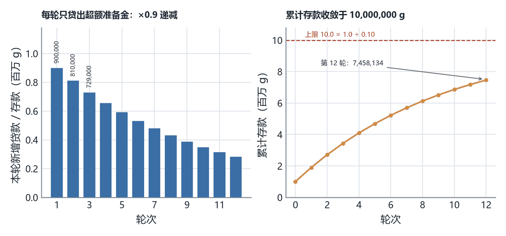
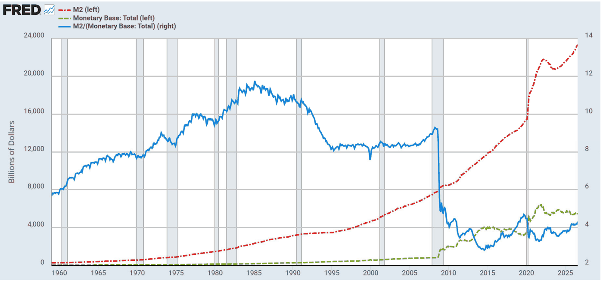
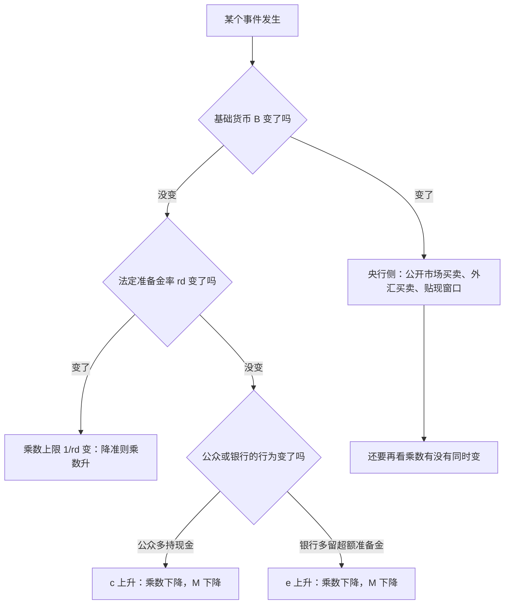
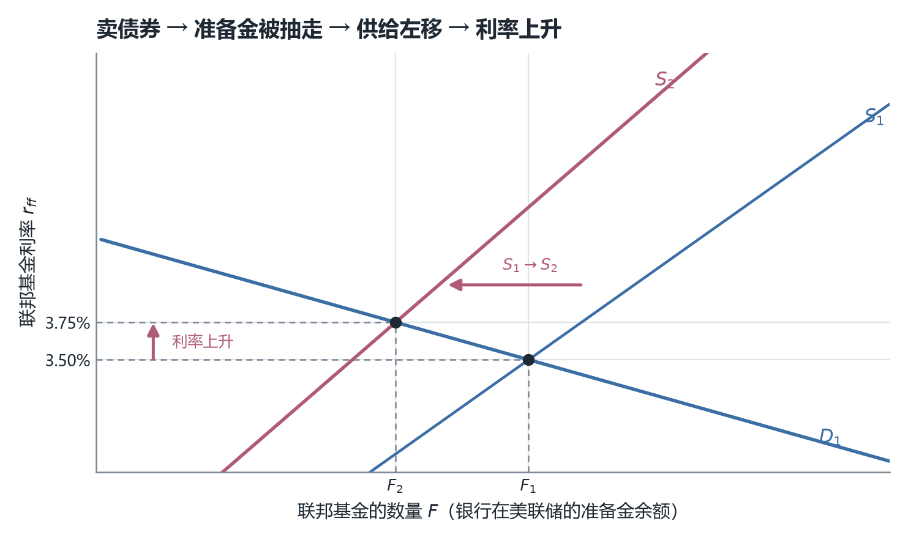
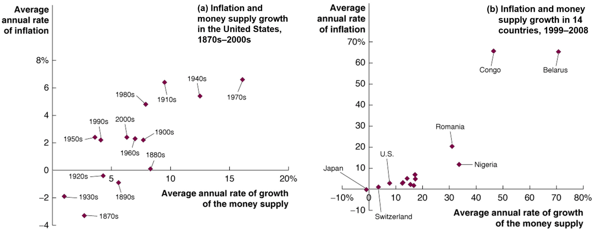
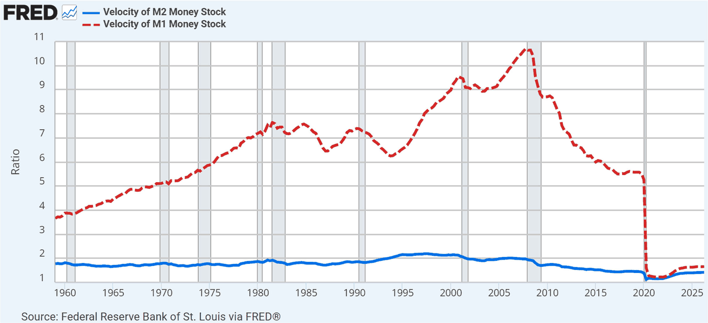
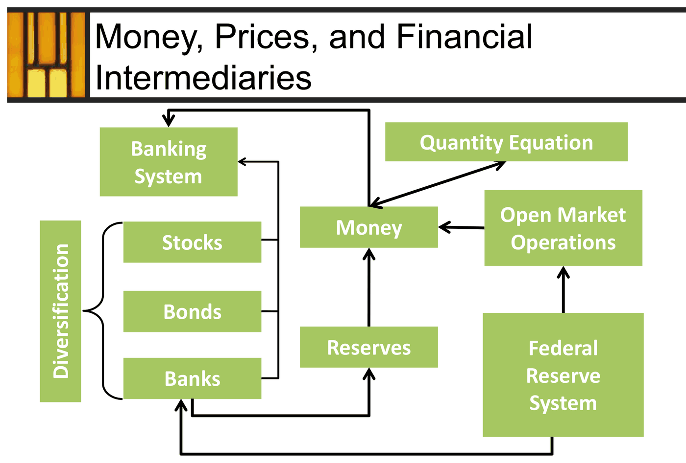

# ECO2021 课堂笔记：第 9 章　货币、物价与金融中介（Money, Prices, and Financial Intermediaries）

> 对应课件：Chapter 9（文件内部标题 `Ch.9 Money, Prices, and Financial Intermediaries.pdf`，Instructor: Jieshuang He），共 **58 页**，页脚编号 `9-1` … `9-58`，与本笔记的 p 号一一对应
> **配套读物两份，都是《经济学人》（The Economist）2021 年 5 月 8 日同一组特别报道（Special report "The future of banking"）里的文章**：读物甲 **"How fintech will eat into banks' business"**（纸刊标题 "Regime change"），**8 页**；读物乙 **"When central banks issue digital money"**（纸刊标题 "Going public"），**7 页**。两份 PDF **整页都是位图、没有文字层**（`get_text()` 每页只返回 2–8 个字符，是页码），所以我把 15 页全部按 170 dpi 渲染成图片**逐页读图抄录**。两份读物的内容都**就地插进最相关的那一节**（落点见〇节的对照表），不另立"读物补充"章节；凡出自读物的句子一律标「（fintech 读物 pN）」或「（CBDC 读物 pN）」，N 是该读物**自己的页序**
> 本讲**没有任何课堂口述记录**，正文全部**基于课件（PDF）与上面两份读物整理**。课件只给题目不给答案的地方（第 28、36、50、51 页共四处），我给出了自己算的解答并标注"我的补充，非讲义内容"；凡我复算、推导或补充的内容，第十三节逐条交代
> 本讲的主线是一条：**先把"货币"从日常语义里摘出来，给它三种职能和一个可度量的口径（p4–p14），再看商业银行怎样靠放贷把 1 个古尔登变成 10 个（p15–p28），接着看这套机制会在挤兑中反着转（p29–p32）；然后找到那个能踩刹车的机构——央行——和它手里的三件工具（p33–p40）；最后用一个恒等式把货币、物价与产出锁在一起，得出"长期里通胀是货币现象"（p41–p57）**。课件第 58 页自己画了一张总结图，全章骨架就是它：左边是**分散化**（Diversification）把股票、债券、银行括在一起，汇入**银行体系**（Banking System）并流向**货币（Money）**；右上**数量方程**（Quantity Equation）与货币双向相连；右下**联邦储备体系**推动**公开市场操作**，后者再作用于货币；中间**准备金（Reserves）**，由银行持有、也托着货币。

---

## 〇、本讲地图

这张表是"一条线"的锚点：正文严格按课件页序铺开，迷路时回到这里看当前这一节在整章里的位置。全章 58 页被切成十一节正文 + 一节速查，**页区间首尾相接、不重叠、不遗漏**（p1 是封面，在第一节里交代；p58 是总结图，归入第十二节）。

| 本章小节 | 对应讲义页 | 这一节在回答什么问题 |
|---|---|---|
| 一、四个学习目标与三分法骨架 | p2–p3 | 这一讲要交付哪四件事、按哪三块讲 |
| 二、货币是什么：三种职能与双重巧合 | p4–p6 | 为什么"钱"在经济学里不等于"收入""财富""储蓄"；没有货币会怎样 |
| 三、货币的形态：从商品货币到法定货币 | p7–p10 | 一张没有内在价值的纸，凭什么能换真东西 |
| 四、金融中介与货币供给的口径 | p11–p14 | 银行为什么存在；M0、M1、M2 到底怎么分层 |
| 五、Gorgonzola：存款创造的完整链条 | p15–p22 | 1,000,000 古尔登怎么变成 10,000,000 存款 |
| 六、货币乘数、通货漏出与季节性 | p23–p28 | 公众手里留现金，乘数为什么会掉；美国的乘数为什么长期在 3–5 之间 |
| 七、挤兑、大萧条与 2008 年危机 | p29–p32 | 存款创造为什么会倒着走；信息为什么是金融危机的主角 |
| 八、中央银行与三大工具 | p33–p39 | 谁在踩刹车；公开市场操作、法定准备金率、贴现率各管什么 |
| 九、瞄准联邦基金利率与"物价水平" | p40–p43 | 央行为什么改盯利率；$P$ 与 $1/P$ 分别是什么 |
| 十、货币流通速度与数量方程 | p44–p51 | $M \times V = P \times Y$ 从哪来；玉米经济的通胀率怎么算 |
| 十一、从货币增长到通胀：通胀税与货币中性 | p52–p57 | 长期里多印钱只改变价格不改变产量，这句话的边界在哪 |
| 十二、速查表与易错点 | p58 | 考前速览与全章框架图 |
| 十三、附：诚实备注 | — | 我算了什么、补了什么、课件哪里有问题 |

两份读物的落点按"哪一节正在讲它说的那件事"定，索引如下。注意这里有两个不同的页序体系：课件用 p1–p58，两份读物各自从 p1 起算。

| 读物段落 | 落在哪一节 | 为什么是那里 |
|---|---|---|
| fintech p1：Bagehot 引 Ricardo，银行"用别人的钱"并承担盈亏 | §4.1（p11 之后） | 课件只用一句话定义金融中介，读物给了它区别于基金的关键 |
| fintech p4：银行有存款、科技公司有信息；核心银行业 3 万亿美元收入、ROE 5–6% | §4.1、§7.5 | 前者是"银行凭什么存在"，后者是"它凭什么被绕开" |
| fintech p2–p3：支付宝/微信支付、0.1% 费率、数据替代抵押品 | §7.4（p32 信息不对称之后） | 这是"用数据降低信息成本"的现成案例，正好嵌在"金融摩擦"那一页后面 |
| fintech p5–p7：非银份额、普惠金融、网络效应与开放银行 | §7.5 | 讲完危机讲结构：谁在替银行放贷、监管在担心什么 |
| fintech p8：2020 年 3 月美联储直接进场买信用债 | §8.8（p39 之后） | 最后贷款人从"救银行"扩到"救市场" |
| CBDC p1：沙元、e-CNY、数字欧元；CBDC 等于"在央行的一笔存款" | §4.4（p14 之后） | 直接接 M0/M1/M2 的分层：央行负债直接面向公众会改变分层 |
| CBDC p2：广义货币九成是银行存款；Galbraith 那句话 | §5.8（p21 "创造货币不创造财富"之后） | 给 Gorgonzola 一个真实世界的比例尺 |
| CBDC p3、p5：期限错配、道德风险、窄银行与芝加哥计划 | §7.6（p32 之后） | 挤兑的制度根源，以及"取消部分准备金"这条极端方案 |
| CBDC p4、p6、p7：超额准备金 3.3 万亿、抵押品框架、公众同意 | §6.4、§8.8 | 前者解释乘数为什么掉下来，后两者是央行的边界 |

**这份笔记的读法。** 括号里第一次出现的英文是课件原名，中文是我给的译名，考试与作业请以英文术语为准。凡是课件给了数字的地方我都保留原数字并说明口径；凡是我自己算的、补的，都集中在第十三节交代，正文里只在三类地方加标记：**课件没给答案的练习题**（标"我的补充"）、**课件内部两处对不上、需要并排摆出来的地方**（标"口径提醒"）、**读物提供的现实材料**（标读物页序）。

> **一处结构上的提醒，值得开讲前就知道。** 本章开头就有**两套索引**：**四条**学习目标（p2）与**三块**的分法（p3）——I. Money and money supply、II. Central bank and control of money supply in the long run、III. Quantity theory of money。两套索引不是一一对应的：**第 4 条目标（央行如何控制货币供给、以及这种控制与长期通胀的关系）横跨第 II、III 两块**，而第 1 条目标（金融中介的角色）只在第 I 块里占了两页（p11–p12）就再没回来。复习时**按 p3 的三分法背框架，按 p2 的四条目标找考点**，两套索引不要混。另外，p3 这张目录在全讲出现三次（p3、p33、p43），三次都靠**颜色**告诉你现在走到哪儿了：当前那一条是黑体，另外两条是灰的；p43 那一次还在第 III 条下面多挂了一行小字"the price of goods and services is linked to the money supply in an economy"，这一行是 p3 与 p33 都没有的。

---

## 一、四个学习目标与三分法骨架（p2–p3）

### 1.1 四条目标（p2）

第 2 页（封面之后的第一个内容页，标题栏写 `Learning Objectives`）列了四件事，它们不是并列的四条知识，而是一条**从制度到机制再到总量**的链：

第一，**描述商业银行这类金融中介在金融体系中的角色（Describe the role of financial intermediaries such as commercial banks in the financial system）**。这一条问的是"银行为什么存在"，答案是两件事：把储蓄变成贷款时的**信息**与**风险分担**（p11 展开）。

第二，**讨论货币的三种职能，以及货币供给如何度量（Discuss the three functions of money and how the money supply is measured）**。三种职能是交换媒介、计价单位、价值储藏；度量则是 M0/M1/M2 的分层（p5、p13–p14）。

第三，**分析商业银行的放贷行为如何影响货币供给（Analyze how the lending behavior of commercial banks affects the money supply）**。这是全讲的技术核心，也是唯一一处需要动笔算的地方：Gorgonzola 岛那一串资产负债表（p15–p22）与货币乘数（p23–p28）。

第四，**解释中央银行如何控制货币供给，以及这种控制与长期通胀的关系（Explain how a central bank controls the money supply and how control of the money supply is related to inflation in the long run）**。前半句是三大工具（p34–p39），后半句是数量论（p44–p57）。**注意"in the long run"这个限定词**：它是整章最关键的两个词，第十一节会看到，货币中性只在长期成立。

连起来看，本章路线是：**先定义货币（是什么）→ 再定义它的度量（有多少）→ 再看商业银行如何凭空造出它（怎么变多）→ 再看央行如何控制它（谁能踩刹车）→ 最后把货币量与物价锁在一个恒等式里（为什么多了会涨价）**。四条目标里，第三、四条几乎承担了全部计算题与画图题；第一、二条是概念题与选择题的主场。

### 1.2 三分法骨架（p3，并在 p33、p43 重复）

第 3 页（标题栏 `Roadmap`）是全讲目录，三块的分量差别很大：

| 部分 | 标题（原文） | 页数 | 页区间 |
|---|---|---|---|
| I | Money and money supply | 29 页 | p4–p32 |
| II | Central bank and control of money supply in the long run | 9 页 | p34–p42 |
| III | Quantity theory of money | 14 页 | p44–p57 |

**第 II 块最短，但它是全讲的"手"**：第 I 块讲的是货币怎么被创造出来（商业银行的放贷），第 II 块讲的是谁能让它少创造一点（央行）。只读第 I 块，你会以为货币供给是银行家心情的函数；补上第 II 块才知道它的总闸在央行手里。**第 III 块是"为什么值得管"**：如果货币量涨了物价不涨，前面二十几页就白讲了。

读目录页时留意一个细节：**第 I 块与第 II 块的标题里都有 "money supply"**——前者讲它的创造，后者讲它的控制，两块其实是一条链的两端；**真正独立的第三块叫"数量论"，它是唯一一块讲"物价"的**。也就是说，"物价"这个本讲标题里的词，在目录上只对应最后十四页。这个比例（58 页里 14 页讲物价）值得记住：**这门课的重心在"货币是怎么来的"，不在"物价是怎么定的"**。

---

## 二、货币是什么：三种职能与双重巧合（p4–p6）

### 2.1 经济学家说的"钱"不是日常说的"钱"（p4）

第 4 页（标题 `Money in Economics`）先做了一次"祛魅"。日常语言里"钱"可以指任何跟财富有关的东西，但经济学里它有严格所指。课件用四个对照把界线画出来：

- **你的工资是收入（income）**，不是货币。收入是一段时间内的流量（每月多少），货币是此刻握在手里的存量。
- **你没花掉的收入是储蓄（saving）**，也不是货币。储蓄是一个**动作**（少消费），它的结果可以是银行存款、股票、房子。
- **你的股票涨了，那是资本利得（capital gain）**，不是货币。你什么都没卖，账面财富就变了。
- **你的房子升值了，你的财富（wealth）增加了**，这更不是货币。

这四句话的用处是给后面所有计算题定规矩：**凡是问"货币供给是多少"，答案里只能出现通货与各类存款，绝不能把股票市值、房产这类"财富"算进去**。Gorgonzola 那一节（§五）之所以把"存款"当货币、把"贷款"只当资产，根子就在这一页。

### 2.2 定义、流动性、三种职能（p5）

第 5 页（标题 `Money`）给出定义：**货币是任何可以在购买时使用的流动性资产（any liquid asset that can be used in making purchases）**。这句话里最关键的词是**流动性（liquidity）**——课件没有单独定义它，但它决定了后面所有的边界，所以我在这里补一句定义：**流动性指一项资产能以多快、以多小的价格损失换成"能立刻买东西的东西"**。现金的流动性最高（立刻、无折价）；活期存款次之（要取或转账，但几乎无折价）；股票就差得多（要先卖掉，T+1 到账，而且卖的时候价格可能已经跌了）。

于是课件那句 "Shares of stock are not money — not liquid" 就有了准确的意思：**股票不是货币，不是因为它不值钱，而是因为它不能直接用来付款**。你要拿股票买一杯咖啡，得先卖股票、等交割、再付款，中间隔了两道手续和一次价格风险。课件举的货币例子是硬币与通货、支票账户余额、旅行支票——共同点是"可以直接递给对方"。

接着是三种职能（three principal uses），这是本章第一个必背的三点：

**第一，交换媒介（medium of exchange）**：买方向卖方付款时递过去的东西。它回答的问题是"**用什么付**"。

**第二，计价单位（unit of account）**：人们标价、写合同、记债务时用的那把尺子。它回答的问题是"**标多少**"。

**第三，价值储藏（store of value）**：把购买力从现在搬到未来的手段。它回答的问题是"**留着会不会烂**"。

三者不必由同一种资产同时承担，这一点课件没有说，但很重要（**我的补充**）。恶性通胀时，本币仍然是交换媒介（你还在用它买东西），但几乎不再是价值储藏（没人愿意持有它过夜），人们会把工资立刻换成美元或实物；反过来，一栋房子是极好的价值储藏，却完全不能当交换媒介。**考试里凡是问"某物是不是货币"，判据是"能不能直接付款"（交换媒介），不是"能不能保值"。**

把三种职能各配一个"失效场景"，比背定义更有用：

| 职能 | 它在回答什么 | 失效时会怎样 | 典型例子 |
|---|---|---|---|
| 交换媒介 | 用什么付 | 交易退回以物易物，搜寻成本爆炸 | 战俘营里香烟抽完了 |
| 计价单位 | 标多少 | 合同无法写、账无法记、价格数目平方级膨胀 | 恶性通胀时商店改标美元 |
| 价值储藏 | 留着会不会烂 | 人们一拿到就立刻花掉或换成实物 | 1923 年的德国马克、2008 年的津巴布韦元 |

**注意最后一行与第一行的矛盾**：恶性通胀时，货币同时还是交换媒介、又已经不是价值储藏——**三种职能可以分裂，这正说明它们是三个独立的判据，而不是一句"货币有用"的三种说法。**

### 2.3 为什么需要货币：双重巧合（p6）

第 6 页（标题 `Money`）讲货币的对立面——**以物易物（barter）**，即"直接拿货换货"。课件给出一句关键判断：**以物易物要求双重巧合（double coincidence of wants）**，也就是"两个人各自正好有对方想要的东西"这件不太可能发生的事（unlikely occurrence）。

这句话的分量在下一页的计算里才显出来。假设一个经济体有 $n$ 种商品，以物易物时每一种商品都要和其他所有商品定一个交换比率，需要的价格数目是

$$\frac{n(n-1)}{2}$$

而一旦有了货币，只需要 $n$ 个用货币标的价格。（**这一段是我的补充，课件只给了"浪费资源"的定性说法，没有给这个算法。**）代入几个数就看得很清楚：$n=10$ 时要 45 个比率、$n=100$ 时要 4,950 个、$n=1{,}000$ 时要 499,500 个；有货币之后分别只要 10、100、1,000 个。**价格数目的增长速度是平方级的，而货币把它压回线性。** 这就是课件说的 "a huge waste of resources" 的定量版本：不是"找起来麻烦"这么轻，而是"整个价格体系会爆炸"。

还有一层：以物易物的人**必须花时间去找交易对手**（spend time searching for others to trade with），这份搜寻成本是纯粹的损耗——两个人把东西换到手之后，总财富一点没变，但过程中烧掉了时间。货币的作用就是把"一次双向的巧合"拆成"两次单向的交易"：我先用我的东西换货币（对方只要想要货币就行），再用货币换我要的东西（对方只要想要货币就行）。**只要所有人都接受货币，就再也不需要任何巧合。**

这一页也是全章唯一一次为"货币"做纯逻辑辩护的地方——后面所有内容（存款创造、乘数、数量论）都建立在"货币有用"这个前提上，而不再论证它。
---

## 三、货币的形态：从商品货币到法定货币（p7–p10）

第 7 到第 9 页共用一个标题栏 `The Evolution of Money`，是三页连排的"演化史"；第 10 页换标题，回答"凭什么"。这四页合起来是一个完整的论证：**货币的形式一直在变，变的方向是"内在价值越来越少、便利性越来越高"，而一旦内在价值归零，它的价值就只能来自制度与预期。**

### 3.1 商品货币（commodity money，p7）

**商品货币**指**本身就有内在价值（intrinsic value）的商品被当作货币**。课件给的三个例子很有讲究：**古罗马士兵领的盐**（课件在 `salary` 一词上用了斜体——工资 salary 源自拉丁语 *salarium*，本义就是"买盐的钱"）、**贝壳**、**战俘营里的香烟**。

优点一句话：**它自己就有用**（"It's useful on its own"）。盐可以腌肉，香烟可以抽，贝壳可以做装饰——所以哪怕没人承认它是货币，你也不会亏光。

缺点也是一句话，但拆开是三条：**难携带**（hard to carry）、**会腐烂**（can spoil）、**难分割**（hard to divide）。这三条恰好对应三种职能的失效：难携带削弱交换媒介，会腐烂削弱价值储藏，难分割让计价单位无法精细——你想买半条咸鱼，总不能把贝壳劈开。

补一句教材里的平行例子（**我的补充**，出自 Mankiw《Principles of Macroeconomics》8th ed. 第 16 章）：二战战俘营里香烟之所以能当货币，连不吸烟的战俘也愿意收，是因为他们相信**别人**也会收。这句话提前预告了 §3.4 的主题——货币的价值有一半是"信念"。

### 3.2 金属货币（metallic money，p8）

**金属货币**是**用有内在价值的金属铸成的硬币**，例子是铜、镍、银、金。一个值得记住的旁证：金属铸币在东西方是**各自独立**出现的——中国是**铲形币与刀币**（青铜铸造），希腊—罗马是**金银币**。

优点：**更耐用、更便携、更易分割，而且仍然有内在价值**。这三条正好把商品货币的三个缺点逐一补上。

缺点是这一页真正要考的东西，课件列了五条，每一条都对应一个制度问题：

其一，**大量使用时又重又不方便**。这是"为什么要有纸币"的最直接理由——一千枚铜钱串起来，交易成本高于货物本身。

其二，**开采与铸造昂贵，且有环境影响**。这一条把货币供给和采矿业的产能绑在了一起。

其三，**磨损、剪边与成色降低（wear, clipping, and debasement）**。这是金属货币时代的"通货膨胀"：君王把银币的边缘剪掉一圈、或在银里掺铜，同样重量的硬币里银子变少，但面值不变——**这就是最早的"货币贬值"，也是 p54 要讲的通胀税的祖先**。

其四，**供给缺乏弹性（supply can be inflexible）**，后果写在后面的括号里：**货币政策空间有限（limited monetary policy flexibility）**。这一条是全页最经济学的一句：金本位下，一国的货币量取决于挖出多少金子，央行想在经济衰退时多印钱也印不出来。**这是 20 世纪各国放弃金本位的根本理由**，也是第 II 块（央行）能够存在的前提。

### 3.3 代用货币与法定货币（representative money、fiat money，p9）

**代用货币**是**代表一定数量某种商品（通常是黄金）的一张纸**。例子是美国的旧"金币券（Gold Certificate）"——**一张 50 美元的票子**，票面下方印着 `FIFTY DOLLARS IN GOLD`——这行字就是它的全部意义：**这张纸本身不值钱，但它承诺可以换成 50 美元的金币**。注意它和今天的美元钞票在形式上几乎一样，区别只在"承诺"那一行：今天的钞票上写的是 "This note is legal tender for all debts, public and private"，**不再承诺任何东西**。

**法定货币**（fiat money，又叫纸币）是**政府发行的、没有内在价值的通货**。课件在 fiat money 后面用括号补了 "paper money"，说明这两个词在课件里是同义的。当代的法定货币摆在一起就是**人民币 100 元、英镑 5 镑、美元 100 元、欧元 100 元**——它们共同的物理特征是：**纸（或塑料）本身不值那个钱**。

所以真正的分界线在 p9 的下半页：**从代用货币到法定货币，切断的是"兑换承诺"这根线**。1971 年美元与黄金脱钩之后，全世界的货币都是法定货币。这一步一旦完成，"货币为什么有价值"就再也不能用"因为它能换成金子"来回答了。

### 3.4 法定货币为什么有价值（p10）

第 10 页（标题 `Why Does Fiat Money Have Value?`）正面回答这个问题。它先复述了那个看起来天真的疑问：**商人为什么愿意用有价值的真货，去换一张纸？** 然后给了三条理由：

**第一，几乎所有的人都愿意接受它有价值（readily accepted by almost everyone as having value）。** 这是"因为别人也收，所以我也收"的循环——它不是逻辑错误，而是**自我实现的均衡**：只要所有人都预期别人会接受，接受就是每个人的最优选择。**这一条是三条里最根本的**，因为另外两条只是给这个均衡加了一道保险。

**第二，法律规定它必须被接受用于清偿一切债务（Law of Legal Tender）。** 这里要分清一件事（**我的补充**）：**法偿（legal tender）解决的是"债务清偿"，不是"商家必须卖给你"**。你欠别人 100 元，用人民币还，债权人不能拒收；但你去商店买东西，那是一个自愿的买卖合同，对方不卖给你并不违法（中国另有《人民币管理条例》禁止拒收现金，那是另一条法规，不是法偿地位本身的效力）。考试里若问"法偿地位意味着什么"，标准答案是"债权人必须接受它清偿债务"。

**第三，只有法定货币才能用来缴税（only legal tender is acceptable for tax payments）。** 这一条最实在：政府说"你的税只能用我印的纸来交"，于是每个人都被迫先弄到这种纸——**政府用自己的征税权，为一种没有内在价值的东西创造了刚性需求**。这是法定货币与"游戏币"的根本区别，也是 p54 通胀税能成立的前提：能印钞票的政府，等于拥有一台可以给自己付账的机器。

三条理由的分量不同：第三条是**制度强制**，第二条是**法律兜底**，第一条是**信念**。真正撑住一张纸的是第一条——因为如果所有人都开始怀疑，法律也拦不住（后面 §7 的挤兑、§11 的恶性通胀都是这条的失效）。

### 3.5 四种形态的一张对照表

把 p7–p9 三页压成一张表，复习时按这张背：

| 形态 | 内在价值 | 代表什么 | 优点 | 致命缺点 | 课件页 |
|---|---|---|---|---|---|
| 商品货币（commodity money） | 有（盐、贝壳、香烟） | 它自己 | 本身有用，不会归零 | 难携带、会腐烂、难分割 | p7 |
| 金属货币（metallic money） | 有（铜、镍、银、金） | 它自己 | 耐用、便携、可分割 | 沉重；铸造成本与环境代价；磨损剪边成色；供给无弹性 | p8 |
| 代用货币（representative money） | 无（纸），但可兑换 | 一定量的商品（通常是金） | 轻便；受黄金约束因而不会滥发 | 受黄金产量约束；有挤兑黄金的风险 | p9 |
| 法定货币（fiat money） | 无 | 政府的信用与强制力 | 供给可调，央行能实施货币政策 | 可能被滥发，长期通胀风险 | p9–p10 |

这张表最后一行与第三行是**镜像关系**：代用货币用"可兑换"换了"可信"，代价是失去了货币政策的自由；法定货币用"货币政策自由"换了"可信"，代价是必须靠制度与信誉来维持。**整章后面三十页讲的全部机制，都建立在"我们选了第四行"这个前提上。**

---

## 四、金融中介与货币供给的口径（p11–p14）

### 4.1 银行为什么存在（p11）

第 11 页（标题 `The Allocation of Saving via the Banking System`）从一句很朴素的话开始：**存款利息是人们把钱放进银行的一个重要原因**。这句话把银行和"保险箱"区分开——保险箱只保管，银行付利息，因为它把你的钱借了出去。

接着是定义：**金融中介（financial intermediaries）是用从储蓄者那里筹来的资金，向借款人提供信贷的企业（firms that extend credit to borrowers using funds raised from savers）**。这个定义里有三个角色：储蓄者（savers）、借款人（borrowers）、以及站在中间的那家企业。银行赚的是"贷款利率减存款利率"这块差价。

课件给了银行体系的两项功能，都归在一个标题下——**改善储蓄的配置（improves the allocation of saving）**：

**第一，向储蓄者提供关于资金可能用途的信息（provides information to savers about the possible uses of their funds）。** 你手里有 10 万元，你知道该借给谁吗？大概率不知道。银行有征信、有抵押品估值、有行业经验，它把这件"信息生产"的活接了过去。

**第二，帮助储蓄者分担单个投资项目的风险（help savers share the risks of individual investment projects）。** 你把钱存进银行，银行把它拆成几百笔贷款；任何一笔坏账只影响银行的一小部分资产，不会让你个人血本无归。

这两条合起来推出全页最重要的一句：**风险分担使得那些有风险但可能极有生产力的项目也能获得融资（risk sharing makes funding possible for projects that are risky but potentially very productive）**。这句话是金融中介存在的**经济学理由**：不是因为银行善良，而是因为**如果不分担风险，那些高风险高回报的项目根本借不到钱，整个经济的生产力会下降**。这也解释了为什么 p31 的金融危机（银行不敢放贷）会让实体经济跟着萎缩。

读物在这里提供了一个课件缺的角度（**fintech 读物 p1**）：《经济学人》引 Walter Bagehot 在 1873 年引用李嘉图（Ricardo）的话——**"银行家区别于其他人的功能，从他开始用别人的钱那一刻起；只要他用自己的钱，他就只是个资本家。"** 读物接着把这句话讲透了：对冲基金、共同基金、养老金、私募也都用别人的钱，但它们与银行有一个决定性的差别——**基金的盈亏由出资人自己承担，银行的盈亏由银行自己承担**。存款人预期的是"本金全额拿回"，既不承担坏账，也不分享超额收益；**是银行在同时吃下亏损和收益**。这就是为什么银行必须有资本金、必须被监管，而基金不必。

读物 p4 又把这件事换成了比较优势的语言（**fintech 读物 p4**）：**"银行的优势在于它有存款可以放，即使它不知道该借给谁；科技公司的优势在于它知道该借给谁，即使它没有资金。"**（原文：A bank's advantage lies in having deposits to exploit, even if they do not know whom they should lend them to. Tech firms' advantage is that they know whom to lend to, even if they do not have the funds.）这句话把 §4.1 的两项功能拆成了两半：**信息**与**资金**。下一节会看到，货币创造靠的正是"资金"那一半（准备金），而 p32 要讲的金融危机靠的正是"信息"那一半。

### 4.2 银行还卖什么：支付服务与记录（p12）

第 12 页（标题 `Other Services Provided by the Banking System`）讲银行作为"支付系统"的一面，四点：

**有银行存款让支付更方便**——支票（checks）、ATM、借记卡（debit card）。**支票与借记卡比现金更安全**——丢了可以挂失，现金丢了就没了。**银行提供交易记录**——这一点在今天被低估了，它其实是"信用"的基础设施：有了流水，才有征信。最后一句是通往下一节的桥：**商业银行体系在决定经济中货币数量方面也起着核心作用（also plays a central role in determining the quantity of money in the economy）**。

**这最后一句是整章的转折点。** 到此为止，银行还只是一个"把钱从储蓄者转给借款人"的中介；从 p15 开始，银行变成了一台**制造货币的机器**。这两件事在教科书里通常分开讲（前者是金融学，后者是货币银行学），课件用一句话把它们缝在了一起：**正因为银行的负债（存款）被当作货币使用，它的放贷行为才会改变货币供给**。

### 4.3 货币供给包括什么（p13）

第 13 页（标题 `The Money Supply`）给出定义：**货币供给（money supply，又叫货币存量 money stock）是经济中可用的货币数量**。然后问了一个看似简单、实则很难的问题：**哪些资产算货币？** 课件列了两个候选：

**通货（currency）**：**在（非银行的）公众手中的纸币与硬币**。注意括号里那三个字——**放在银行金库里的现金不算"公众持有的通货"**，它是准备金。这条界线在 §五会反复用到：一张 100 元钞票从你口袋进了银行金库，公众持有的通货就少了 100 元。

**活期存款（demand deposits）**：**存款人可以随时支取用于支付的银行账户余额**，支取方式是写支票、用 ATM 或直接转账。

这两项就是最狭义的货币。一张**真实支票的样张**把这件事摆得很清楚（账户名、金额、签名栏、磁码行都在上面），它的用意是提醒你：支票账户里的数字之所以是货币，是因为你能**签一张纸就把它变成别人的钱**。

**顺手排掉一个最常见的误解（我的补充）：信用卡不是货币，借记卡是。** 刷信用卡时你没有动用任何存款，**发卡行先替你垫了一笔钱，你一个月后再还**——这是一笔**延期支付的债务**，它改变的是"支付的时点"，不是"货币的数量"。等你月底还款时，你的活期存款才减少，货币供给才变化。而刷借记卡是**立刻从你的活期存款里划走**，那是货币在转移。**所以"信用卡额度"绝不进 M1，也不进 M2**——考试里若选项里有"信用卡余额计入货币供给"，一律为错。

### 4.4 三层口径：M0、M1、M2（p14）

第 14 页（标题 `Definitions of Money Range from Narrow to Broad`）把货币按"流动性从高到低"分成三层，并配了一张**套娃式的插画**：最里面一个小人被标着 M0，中间一层标 M1，最外面一层标 M2——**这张图本身就是定义：M2 包含 M1，M1 包含 M0**。

课件的原文是：

- **M0（流动性最高的口径）**：流通中的通货 + 商业银行准备金，箭头指向 "**monetary base**"（基础货币）。
- **M1**：M0 + 商业银行的活期存款 + 其他流动性存款，箭头指向 "**narrow money**"（窄口径货币）。
- **M2**：M1 + 储蓄账户 + 定期存款（10 万美元以下）+ 零售货币市场基金。

三层的逻辑是清楚的：**越往外，越不"能立刻付款"，但仍然是"很快能变成付款能力"的资产**。这个分层不是为了学术洁癖，而是因为央行能直接控制的只有最里面那一层（M0），越往外，控制力越弱——这正是 §六要讲的"乘数"。

> **口径提醒（这是我的补充，也是本讲第一个需要标出来的课件内部矛盾）。** 上面 M1 那一行写成 "M0 + 活期存款"，而 M0 里**已经包含了银行准备金**。这会和后面 p21、p23 的口径打架。Gorgonzola 的终局是：公众持有通货 $C = 0$、准备金 $R = 1{,}000{,}000$、存款 $D = 10{,}000{,}000$。按 p14 的写法，$M1 = M0 + D = (0 + 1{,}000{,}000) + 10{,}000{,}000 = 11{,}000{,}000$；按 p21 的写法（"货币供给现在是 10,000,000"）与 p23 的公式（$MS = C + R/r_d$），$M1 = C + D = 10{,}000{,}000$。**同一组数字，两种口径差 1,000,000。**
>
> 标准口径（教材 8th ed. 第 16 章）是：**$M1$ = 通货 + 活期存款 + 旅行支票 + 其他可开支票存款**，**货币基础（monetary base）= 通货 + 准备金**，两者是并列关系，不是包含关系。所以 p14 的 M1 一行应改成 $M1 = M0 - R + D$，即"把 M0 里的准备金换成活期存款"。**课件从 p21 起一直用的是 $M = C + D$，这个口径是对的**；错的只是 p14 那一行的写法。本笔记后面凡涉及计算，一律用 $M = C + D$。
>
> 还有第二处：**p14 的 "M0" 与 p27 的 "M0" 不是同一个东西。** p14 把 M0 定义成"通货 + 准备金"（即美国的 monetary base），而 p27 那张中国春节的图上，M0 是最低、最平缓的一条线——那是**中国口径的 M0，即流通中现金**（中国的 M1 = M0 + 单位活期存款，M2 = M1 + 准货币）。同一个符号在一份讲义里指两种东西，读图时必须先问"这是哪国的 M0"。

读物乙在这一页的末尾接得正好（**CBDC 读物 p1**）：**央行数字货币（central bank digital currency, CBDC）是现金的数字版本，而"持有 CBDC 等于在央行有一笔存款"**。这就把上面那套分层搅动了——如果公众可以直接在央行开户，那么"准备金"和"公众持有的通货"之间的界线就消失了，M0 与 M1 的分层要重画。读物给的三个事实是：巴哈马 2020 年 10 月上线了**世界上第一个 CBDC**（名字叫"沙元"sand dollar，因为当地海滩上有一种五瓣花纹的海胆壳，形似银元）；中国有**十万人以上**下载了数字人民币的试点手机应用；欧洲官员希望**2025 年**推出数字欧元。读物还引国际清算银行（BIS）的调查说，**多数央行在研究或试验 CBDC**，可能"在短短三年内就被占世界人口五分之一的国家的居民使用"。

---

## 五、Gorgonzola：存款创造的完整链条（p15–p22）

这八页是全讲最"实"的一段，课件用一个小岛的故事把"商业银行创造货币"讲成了一个可以逐笔对账的过程。**读懂这八页，后面所有乘数题都是它的变形。**

### 5.1 设定：一个没有银行的国家（p15）

**Gorgonzola 共和国起初没有银行体系**。政府发行了 **1,000,000 古尔登（guilder，符号 g）**，然后有人开了银行来保管现金。支付有两种方式：**取现金**，或者**开支票**——支票的作用是"告诉银行，这笔古尔登的所有权换了人"（checks tell bankers of change in ownership of the specified amount of guilders）。

这一节埋了一句看起来无关紧要的话：**在没有利息的情况下，银行靠向存款人收费来赚利润**。这句话是下一节的引信：既然银行只能靠收费赚钱，它就有动机去找别的收入来源——放贷收息。

### 5.2 第一张资产负债表：100% 准备金（p16）

**所有古尔登都被存进了银行。** 课件给的定义是：**银行准备金（bank reserves）是银行持有的现金或类似资产**，用途有两个——**应付存款人的提款与支付**。此时 Gorgonzola 的银行是 **100% 准备金制（100% reserve banking）**，即**准备金等于存款的 100%**。

第一张资产负债表（课件标题 `Consolidated Bank Balance Sheet – Part 1`，"合并的银行资产负债表"）：

| 资产（Assets） | 金额 | 负债（Liabilities） | 金额 |
|---|---|---|---|
| 通货（Currency，即准备金） | 1,000,000 g | 存款（Deposits） | 1,000,000 g |

这张表要注意两点。**第一，存款是银行的负债**——银行欠存款人 1,000,000 g，随时要还；抵消它的资产是金库里的现金。**第二，这张表上货币供给没有变化**：原来公众手里有 1,000,000 g 通货，现在变成 1,000,000 g 存款，$M = C + D = 0 + 1{,}000{,}000$，还是 1,000,000。

### 5.3 为什么银行不会停在 100%：闲置的准备金（p17）

第 17 页（标题 `Bank Reserves`）是全章最重要的一页之一，它讲了三件事：

**第一，金库里的现金不创造额外的货币供给（cash in a bank's vault does not create extra money supply）。** 课件举的例子极其直白：**把一张 100 美元钞票存进你的支票账户，货币供给不变**——因为公众持有的通货少了 100，活期存款多了 100，一减一加正好抵消。

**第二，可用于交易的银行存款是货币供给的一部分。** 这一条与上一条是一对：**只有当"钱"从金库走到某人的账户上、并且这个人能拿它付款时，它才算货币**。准备金不算（公众拿不到），存款算。

**第三，银行家发现金库的进出会留下一些用不上的古尔登（inflows and outflows from vaults leave some guilders unused）**——**只需要 10% 的存款应付日常交易，剩下的 90% 可以借出去收利息**。

第三点是整个货币创造机制的**行为假设**：银行不是被迫放贷，而是**发现放贷有利可图**。这一点在考试里常被问成"为什么银行不持有 100% 准备金"，标准答案就是这一页：准备金不生息（课件这一页还没提准备金付息，那是 2008 年以后的事），而贷款生息，所以只要提款是可预测的，留一部分就够。

### 5.4 部分准备金：把 90% 贷出去（p18）

第二张资产负债表（`Part 2`）：

| 资产 | 金额 | 负债 | 金额 |
|---|---|---|---|
| 通货（准备金） | 100,000 g | 存款 | 1,000,000 g |
| 贷款（Loans） | 900,000 g | | |

配套两个定义：**准备金—存款比率（reserve-deposit ratio）是银行准备金除以存款总额**；**部分准备金银行体系（fractional reserve banking system）持有的准备金少于存款**，因此**准备金—存款比率小于 100%**。这里 $100{,}000 / 1{,}000{,}000 = 10\%$。

注意这张表仍然平衡：资产 $100{,}000 + 900{,}000 = 1{,}000{,}000$ = 负债。**放贷不改变资产负债表的总规模，只改变资产的构成**——这是理解后面所有步骤的钥匙：银行不是在"变出钱"，而是在"把不生息的金库现金换成生息的贷款"。

### 5.5 贷款的乘数式扩散（p19–p21）

**第三张表（`Part 3`，p19）**：农民借走 900,000 g 去买农资，**卖农资的人又把这 900,000 g 存回了银行**。于是：

| 资产 | 金额 | 负债 | 金额 |
|---|---|---|---|
| 通货 | 1,000,000 g | 存款 | 1,900,000 g |
| 贷款 | 900,000 g | | |

课件在这里写了一句必须打引号的话：**"银行存款就是全部的货币供给"（bank deposits are the entire money supply）**——所以**这笔 900,000 g 的贷款让货币供给增加了 900,000 g**。这句话成立的前提是**公众不持有任何通货**（所有古尔登都在银行体系里），在这个模型里确实如此。真实世界里公众会持有现金，那时"存款 = 货币供给"就不成立了（§六要处理这个）。

同时课件指出：**银行在 1,900,000 g 的存款上又持有了超额准备金**。$1{,}900{,}000 \times 10\% = 190{,}000$ 是它需要的，可它手里有 1,000,000。

**第四张表（`Part 4`，p20）**：于是再贷出 $1{,}000{,}000 - 190{,}000 = 810{,}000$。这笔钱又被花掉、又被存回：

| 资产 | 金额 | 负债 | 金额 |
|---|---|---|---|
| 通货 | 1,000,000 g | 存款 | 2,710,000 g |
| 贷款 | 1,710,000 g | | |

核对：$1{,}900{,}000 + 810{,}000 = 2{,}710{,}000$ ✓；$900{,}000 + 810{,}000 = 1{,}710{,}000$ ✓；资产合计 $1{,}000{,}000 + 1{,}710{,}000 = 2{,}710{,}000$ ✓。

**最后一张表（`The End`，p21）**：这个过程一直继续，直到**准备金正好是存款的 10%**：

| 资产 | 金额 | 负债 | 金额 |
|---|---|---|---|
| 通货 | 1,000,000 g | 存款 | 10,000,000 g |
| 贷款 | 9,000,000 g | | |

核对：$10{,}000{,}000 \times 10\% = 1{,}000{,}000$ ✓，准备金刚好够。整节的结论只有一句话（课件用紫色斜体标出）：

> **部分准备金银行体系创造了货币，但没有创造财富（A fractional reserve banking system creates money, but not wealth.）**

这句话值得单独解释（**我的补充**）。农民借到 900,000 g，手里多了 900,000 g 现金/存款，但他也背了 900,000 g 的债——**净资产一分没变**。整个经济体多出来的 9,000,000 g 存款，同时对应着 9,000,000 g 的贷款负债，一正一负相抵。所以"货币创造"创造的是**支付能力**，不是**购买力**：钱多了，但对应的债权债务也多了。**这正是它与"印钞票"的区别所在，也是它与"财富增加"的区别所在。**

### 5.6 把这条链算清楚（p15–p22 的复算）

**为什么每一轮是上一轮的 90%。** 因为每一轮只有两个去向：10% 被留作法定准备金（漏出体系，不再参与下一轮），90% 被贷出并重新存回（继续参与）。这是一个**公比为 0.9 的等比级数**。

**把每一轮列出来。** 用 $D_k$ 表示第 $k$ 轮结束后的存款总额，$L_k$ 表示第 $k$ 轮新贷出（也就是新存入）的金额，$L_k = 1{,}000{,}000 \times 0.9^{k}$：

| 轮次 $k$ | 本轮新增贷款 = 新增存款 | 期末存款 $D_k$ | 期末准备金 | 已走完全程的百分比 |
|---|---|---|---|---|
| 1 | 900,000 | 1,900,000 | 1,000,000 | 10.0% |
| 2 | 810,000 | 2,710,000 | 1,000,000 | 19.0% |
| 3 | 729,000 | 3,439,000 | 1,000,000 | 27.1% |
| 4 | 656,100 | 4,095,100 | 1,000,000 | 34.4% |
| 5 | 590,490 | 4,685,590 | 1,000,000 | 41.0% |
| 6 | 531,441 | 5,217,031 | 1,000,000 | 46.9% |
| 7 | 478,297 | 5,695,328 | 1,000,000 | 52.2% |
| 12 | 282,430 | 7,458,134 | 1,000,000 | 71.8% |
| $\infty$ | $\to 0$ | 10,000,000 | 1,000,000 | 100% |

几点值得注意（**这些数字是我算的，课件只给了第 1、2 轮的 900,000 与 810,000 以及终点的 10,000,000**）：

**其一，准备金从头到尾都是 1,000,000。** 表格最后一列永远是 1,000,000——**准备金的总额一次都没变过，变的是存款和贷款**。这一点极易看漏：学生常以为"银行越贷越有钱"，其实银行的准备金一分没多，它只是把同样的准备金"撑"在了更多存款下面。

**其二，第 7 轮才过半。** 存款在第 6 轮结束时是 5,217,031（46.9%），第 7 轮结束才到 52.2%。**指数的衰减是"前快后慢"，但"过半"比直觉要晚**——因为第一轮只贡献了 10%。

**其三，12 轮走完只剩四分之一。** 第 12 轮结束时累计 7,458,134，还差 2,541,866（25.4%）。**要补齐最后这四分之一，需要无穷多轮**——这就是为什么必须用级数而不是用"再算几轮"来求极限。

**其四，闭式解。** 存款总额是

$$D = 1{,}000{,}000 \times \left(1 + \frac{0.9}{1-0.9}\right) = \frac{1{,}000{,}000}{0.1} = 10{,}000{,}000$$

更一般地，若初始准备金为 $R$、法定准备金率为 $r_d$，则 $D = R / r_d$。**这个式子的经济含义比数学含义更重要：存款的天花板由"准备金总量 ÷ 准备金率"决定，而准备金总量是央行能直接控制的东西。** 这就把 §八的央行和这里的存款创造接上了。

*图 1　Gorgonzola 的存款创造：左图每一轮的贷款 = 上一轮存款的 90%（900,000 → 810,000 → 729,000 …），右图累计存款收敛于 $1{,}000{,}000 \div 0.10 = 10{,}000{,}000$ g；第 12 轮为 7,458,134 g，约走完全程的 71.8%。准备金全程恒为 1,000,000 g。（自制图，数据按 $L_k = 10^6 \times 0.9^k$ 现算）*

### 5.7 两个公式（p22）

第 22 页（标题 `Money Creation`）把上面那条链写成两行式子：

$$\frac{\text{Bank reserves}}{\text{Bank deposits}} = \text{Desired reserve-deposit ratio}$$

$$\text{Bank deposits} = \frac{\text{Bank reserves}}{\text{Desired reserve-deposit ratio}}$$

这一节还有一句话是"**准备金率 10%，每一个古尔登就支撑 10 个古尔登的存款**"。这里的 "desired"（意愿的）很重要：它是银行**想要**维持的比率，不一定等于法定的最低要求。当两者不等时，多出来的部分叫**超额准备金（excess reserves）**，而它正是下一节的主角。

**换个准备金率会怎样（我的补充）。** 把 $r_d$ 从 10% 提到 20%，准备金仍是 1,000,000 g，则存款上限跌到 $1{,}000{,}000 / 0.2 = 5{,}000{,}000$，**货币供给直接砍半**；每一轮的贷款变成上一轮的 80%（800,000、640,000、512,000 …）。有意思的是**收敛反而更快**：$0.8^{12} = 0.0687$，所以 12 轮走完已经到 $1{,}000{,}000 + 4{,}000{,}000 \times 0.9313 = 4{,}725{,}122$，即全过程增量的 **94.5%**（$r_d = 10\%$ 时 12 轮只走完 71.8%）。**规律是：准备金率越高，终点越低，但到达终点越快**——因为每一轮的漏出更大，级数衰减得更快。这条规律在考试里常被用来出"哪个体系更接近上限"的判断题。

### 5.8 读物给这条链的比例尺（CBDC 读物 p2）

Gorgonzola 是一个虚构的岛，读物给了它一个真实世界的对照（**CBDC 读物 p2**）：**在美国，广义货币中约九成是私人银行的存款**；欧元区是 **91%**、日本 **93%**、英国 **97%**。也就是说，**今天流通的"钱"里，只有很小一部分是央行印的现金，绝大部分是商业银行放贷时"记"出来的存款**。读物还引了加尔布雷斯（J.K. Galbraith）1975 年那句话：**"银行创造货币的过程简单到令人反感（The process by which banks make money is so simple that the mind is repelled）"**——这句话是对 §5.5 那五张表最好的注解：整个过程没有任何神秘动作，只是"贷款 → 存款 → 再贷款"。

读物还补了一个历史事实（同一页）：**银行能创造货币这件事，在银行业发展的早期就被发现了**，加尔布雷斯说那是因为"有钱可赚"（there was that interest to be earned）；而且**美国的广义货币占 GDP 的比重一百年来基本没变**（尽管疫情期间现金需求有过一次冲刺）。这句话解释了一个常被误解的现象：货币供给的绝对量在涨，但它相对于经济规模的比例长期稳定——**这说明货币创造是被经济需求"拉"着走的，不是银行想造多少就造多少**。
---

## 六、货币乘数、通货漏出与季节性（p23–p28）

§五 的模型有一个不真实的前提：**所有古尔登都在银行体系里，公众一分现金都不留**。这一节把这个前提放开，看看会发生什么。结论是：**货币供给不只取决于准备金，还取决于公众想持多少现金、银行想留多少超额准备金**——于是"货币乘数"从一个常数变成了一个可变的比值。

### 6.1 公众留下现金之后（p23）

第 23 页（标题 `Money Supply with Currency and Deposits`）改设定：**Gorgonzola 的居民把 500,000 古尔登留在手里当通货**，另外 500,000 存进银行（这 500,000 就成了准备金），准备金率仍是 10%。课件一步步算：

- 银行存款 $= 500{,}000 \div 0.10 = 5{,}000{,}000$ g；
- 货币供给 $= 500{,}000$（公众持有的现金）$+ 5{,}000{,}000$（存款）$= 5{,}500{,}000$ g。

底部用红字给出了一般公式：

$$\text{Money supply} = \text{Currency held by public} + \frac{\text{Bank reserves}}{\text{Desired reserve-deposit ratio}}$$

**同一个 1,000,000 的基础货币，货币供给从 10,000,000 掉到了 5,500,000。** 为什么？因为**公众留在手里的那 500,000 不支撑任何存款**——它躺在钱包里，一分钱的乘数效应都没有。原先 1,000,000 全部当准备金，能撑起 10,000,000 存款；现在只有一半当准备金，只能撑起 5,000,000。

这就是**通货漏出（currency drain）**：每一块钱从银行体系漏到公众手里，货币乘数就掉一截。**考试里凡是给"公众持有现金 X、准备金 Y"的题，第一步永远是先算存款（$Y/r_d$），第二步才是加总（$C + D$）**——顺序反了就会把现金也拿去乘。

### 6.2 货币乘数的定义与上限（p24）

第 24 页（标题 `The Money Multiplier`）给定义：**货币乘数（money multiplier）是每一美元准备金所生成的广义货币量**，写法是

$$\text{Money multiplier} = \frac{\text{Broad Money (M2)}}{\text{Monetary Base (M0)}}$$

然后给上限：**乘数最大不超过 $1/$准备金率（$1/\text{Reserve Ratio}$）**。例子是：准备金率 0.10 时乘数是 10，**100 美元的准备金能造出 1,000 美元的货币**。

最后一句最关键：**货币乘数通常小于 $1/$准备金率**，原因有两条——**其一，一部分通货被公众持有而不是放在银行；其二，银行还会持有一部分超额准备金**。这两条正好对应 §6.1（通货漏出）与下面要讲的超额准备金。

一个必须分清的细节（**我的补充**）：**$1/r_d$ 的严格含义是"存款 ÷ 准备金"的上限，而 M2/M0 的分母是"通货 + 准备金"**。两者只有在公众不持现金时才相等。所以课件那句"通常小于"其实包含了双重折扣：分子分母口径的折扣 + 通货漏出的折扣。

### 6.3 一个把四种情形统一起来的式子（我的补充）

课件给了三个散落的算例（p23 的 5.5、p26 的 3.0 与 2.6、p28 的练习题），但没有给一个能同时算出它们的公式。**把这三种"漏出"都写进去，可以得到一个统一的乘数：**

$$m = \frac{1+c}{c + r_d + e}, \qquad c = \frac{C}{D},\quad e = \frac{ER}{D}$$

三个符号的意思分别是：**$c$ 是通货—存款比**（公众持有的现金 ÷ 存款，衡量"公众想留多少现金"）；**$r_d$ 是法定准备金率**；**$e$ 是超额准备金率**（银行自愿多留的准备金 ÷ 存款，衡量"银行想留多少闲钱"）。**分子 $1+c$ 是因为每一块基础货币要么变成准备金、要么变成公众手里的现金，而现金也要按 $c$ 的比例"配"一份存款才能组成完整的货币供给。**

用这个式子把课件里所有算例重算一遍，**五个数全部对上**：

| 情形（课件页） | $C$ | $R$ | $r_d$ | $D = R/r_d$ | $M = C+D$ | 基础货币 | 观测乘数 $M/(C+R)$ | 公式 $(1+c)/(c+r_d)$ |
|---|---|---|---|---|---|---|---|---|
| 全部存入（p21） | 0 | 1,000,000 | 0.10 | 10,000,000 | 10,000,000 | 1,000,000 | 10.00 | 10.00 |
| 公众留一半现金（p23） | 500,000 | 500,000 | 0.10 | 5,000,000 | 5,500,000 | 1,000,000 | 5.50 | 5.50 |
| 圣诞节前（p26） | 500 | 500 | 0.20 | 2,500 | 3,000 | 1,000 | 3.00 | 3.00 |
| 圣诞节中（p26） | 600 | 400 | 0.20 | 2,000 | 2,600 | 1,000 | 2.60 | 2.60 |
| 练习题（p28） | 100 | 100 | 0.25 | 400 | 500 | 200 | 2.50 | 2.50 |

（p26 的单位是十亿美元，其余是古尔登与"元"，不影响比值。）

这张表的价值在于：**它把"乘数变小"的三种原因变成了三个可以分别拨动的旋钮**。想算"银行多留 10% 超额准备金会怎样"？令 $e=0.10$、$c=0$、$r_d=0.10$，得 $m = 1/0.20 = 5$——**乘数从 10 直接砍半**。这就是 2008 年之后美国发生的事（§6.4）。

*图 2　美国的 M2 货币乘数（M2 ÷ 货币基础，右轴，蓝线）与它的两个组成部分（左轴：M2 红色虚线、货币基础绿色虚线），1959 年 1 月至 2026 年 8 月。蓝线在 1959 年约 6、1985 年前后升到约 12、2008 年约 9，随后一路跌到 2014 年前后的约 2.6，2020 年后在 3.5–4.5 之间波动。（出自课件 p25，数据源 FRED；读数为图上取值，精度约 ±0.3）*

### 6.4 美国乘数的七十年：图 2 里的三个故事（p25）

第 25 页是一张 FRED 长图，标题 `U.S. Money Multiplier: Jan 1959 – Aug 2026`，三组序列：**M2**（左轴，红色虚线）、**货币基础（Monetary Base: Total）**（左轴，绿色虚线）、**M2 ÷ 货币基础**（右轴，蓝线，即乘数）。这张图还带了一句注：**美国的法定准备金率在 1993–2020 年是 10%，2020 年之后降到 0。**

这张图里至少有三个故事（**下面三段解读是我的补充，课件只有图和那一句注**）：

**第一段（1959–2008）：乘数缓慢爬升到 12，再回落到 9。** 乘数上升的原因是**存款结构的变化**——M2 里那些准备金率极低的储蓄存款与定期存款占比越来越高，把"加权平均准备金率"拉低了，于是同样的基础货币能撑起更多 M2。乘数在 1985 年前后接近 12，而当时交易性存款的法定准备金率是 10%–12%，$1/r_d$ 只有 8–10——**这并不矛盾**：$1/r_d$ 里的 $r_d$ 必须是"全部存款的加权平均"，而不是"交易性存款的那一档"。**这也是一个提醒：用 $1/r_d$ 估乘数时，先问 $r_d$ 是哪一档存款的。**

**第二段（2008–2014）：乘数从 9 掉到 2.6。** 这一段是全图最陡的下跌，也是一次**教科书级的"超额准备金"演示**：美联储通过量化宽松灌进去大量准备金，但银行没有把它们贷出去，而是又存回了美联储的准备金账户（2008 年 10 月起美联储开始给准备金付息）。**准备金总量暴涨、M2 没跟上，比值就被分母拉垮了。** 用 §6.3 的式子看，这等于 $e$ 大幅上升——不是 $r_d$ 变了，是银行的行为变了。

**第三段（2020 之后）：准备金率归零，乘数却没爆炸。** 这是全页最值得记住的一个"反教科书"事实。2020 年 3 月美国的法定准备金率降到 0，按 $1/r_d$ 的公式，上限变成**无穷大**；可图 2 里的乘数在 3.5–4.5 之间，一动不动。为什么？因为**决定乘数的一直不是 $1/r_d$ 这个上限，而是 $c$ 与 $e$ 这两个行为参数**。准备金率归零只拆掉了"上限"，没有改变"银行愿不愿意贷、公众愿不愿意存"。

> 这一段正好被读物补上了现实注脚（**CBDC 读物 p4**）：2021 年前后，**美国的银行存款约 16.8 万亿美元，而银行放在美联储的准备金比它们需要的多出约 3.3 万亿美元**。3.3 万亿的"超额"准备金，就是图 2 里第二、三段那个低乘数的物质基础——**钱在银行手里，只是没有变成贷款**。

### 6.5 圣诞节的现金需求（p26）

第 26 页（标题 `Money Supply at Christmas`）是一个干净的数值练习，也是"季节性通货漏出"的标准案例。

**初始状态**：银行持有 **5,000 亿美元**准备金，公众持有 **5,000 亿美元**现金，准备金率 0.20。货币供给

$$MS = 500 + \frac{500}{0.20} = 500 + 2{,}500 = 3{,}000 \text{（十亿美元）}$$

**圣诞节临近**：消费者从银行取出 **1,000 亿美元**存款转成现金。于是银行准备金变成 **4,000 亿**、公众现金变成 **6,000 亿**（基础货币仍然是 10,000 亿，一分没变）。货币供给

$$MS = 600 + \frac{400}{0.20} = 600 + 2{,}000 = 2{,}600 \text{（十亿美元）}$$

**基础货币没变，货币供给少了 4,000 亿。** 课件用一句话总结：**减少银行存款会减少货币供给**。这个例子的教学价值在于它把"货币供给"和"基础货币"彻底分开了：**央行什么都没做，货币供给却变了**，因为公众把 1,000 亿从"能生息、能派生"的存款搬到了"不能派生"的现金里。

### 6.6 中国的春节版本（p27）

第 27 页（标题 `Money Supply at Chinese New Year`）把同一个机制换成了中国的场景。左边三句话是逻辑链：**对实物货币的需求上升 → 银行存款减少 → 货币供给减少**；因此**货币供给在节日前倾向于收缩**，而**央行通常会在季节性事件前增加货币供给**作为对冲。

把这个机制画成时间序列，是 2007 年四季度到 2010 年三季度的四条线（M0、M1、M2、GDP），两个箭头分别落在 **2008 年一季度与 2009 年一季度**，写着 **"Chinese New Year effect（对实物通货的需求上升）"**。要点是**哪条线在跳**：**M0 在每个一季度都有一个尖峰，M1 只有轻微波动，M2 几乎看不出来，GDP 线完全平滑**。这正是本节逻辑的图形版——**春节效应作用在最狭义的那一层货币上**（现金），越往外层越被稀释。如果四条线一起跳，那就不是"现金需求"而是"总需求"了。

### 6.7 一道练习题：只知道货币供给和"现金 = 准备金"（p28）

第 28 页（标题 `Practice`）只给题干、不给答案：

> **货币供给是 500，公众持有的通货等于银行准备金。意愿准备金率是 0.25。求公众持有的通货与银行准备金。**

**（以下是我的补充，非讲义内容。）** 设通货 $C = R$（题干给的），准备金率 $r_d = 0.25$，则存款 $D = R/0.25 = 4R$。货币供给

$$MS = C + D = R + 4R = 5R = 500 \;\Longrightarrow\; R = 100,\quad C = 100,\quad D = 400$$

答：**公众持有通货 100，银行准备金 100；由此派生存款 400，基础货币 200，货币乘数 $500/200 = 2.5$。** 用 §6.3 的式子验算：$c = C/D = 100/400 = 0.25$，$m = (1+0.25)/(0.25+0.25) = 2.5$ ✓。

这道题的机关在"$C = R$"这个条件——它把两个未知数变成了一个。**若题干改成"通货是准备金的两倍"，答案会变成 $C = 200$、$R = 100$、$D = 400$、$MS = 600$，与题给的 500 冲突**——所以做题时先代回检验一遍总数，比直接套公式安全。

### 6.8 货币供给变动的两个来源：一张判断图

到这里，"货币供给为什么会变"已经有五个答案了（准备金、法定准备金率、超额准备金、公众持币、季节性）。考试里给一个事件让你判断"货币供给会怎样"，最容易错的是**把"基础货币变了"和"乘数变了"混为一谈**。下面这张图是我把这一节的逻辑整理成的判断顺序，**课件没有画这张图**：

判据只有一句话：**基础货币是央行能直接定的量，乘数是公众与银行的行为决定的比值**。p26 的圣诞节（$B$ 不变、$c$ 上升）与 p36 的公开市场购买（$B$ 上升、$c$ 不变）是这条判据的两端，把这两道题并排做一遍，就能分清"谁动了"。

---

## 七、挤兑、大萧条与 2008 年危机（p29–p32）

§六 讲的都是"货币供给怎么变多"，这一节讲**它怎么崩塌**。机制是同一个，只是方向相反：**存款创造靠"贷款—存款—再贷款"的正反馈，挤兑就是把这个正反馈倒过来放**。

### 7.1 挤兑的机制（p29）

第 29 页（标题 `Bank Runs and the Money Supply`）定义：**银行挤兑（a run on a bank）是指人们怀疑自己的银行出了问题，于是"跑"到银行把资金取出来、改为持有通货**。

部分准备金制度有一个**结构性脆弱**：**在部分准备金制下，银行没有足够的准备金偿付所有存款人，因此可能被迫关门**。这句话不是"银行经营不善"，而是**制度本身的性质**：准备金率 10% 意味着任何时候只有十分之一的存款能立刻兑现。**只要所有人同时来取，一家资产完全健康的银行也会倒。**

接下来的两句话描述了**反向的货币创造**：银行为了应付提款，会**少放贷、多留准备金**；这些行为合起来——**公众持有的现金增加、超额准备金增加、货币创造过程反转——最终导致货币供给收缩**。

**这条负反馈比正反馈快得多。** 正反馈（§5）需要一轮一轮地贷款、存款、再贷款，走完 12 轮才到 72%；负反馈只需要一个周末：**挤兑发生 → 银行收紧 → 企业借不到钱 → 企业倒闭 → 更多存款人恐慌 → 更严重的挤兑**。这是本章唯一一个"越快越糟"的机制，也是 p30 那个 28% 的来源。

### 7.2 1929–1933：货币供给下降 28%（p30）

第 30 页（标题仍是 `Bank Runs and the Money Supply`）给了本讲的**核心历史证据**：**1929–1933 年间，一波银行挤兑与银行倒闭使货币供给下降了 28%；11,000 家银行（接近美国银行总数的一半）倒闭。** **许多经济学家认为这极大地加重了大萧条的严重程度**（课件 p30）。

这三个数字的因果链值得写清楚（**这段展开是我的补充**）：银行倒闭 → 存款消失（存款是货币）→ 货币供给降 28% → 物价下跌、产出萎缩 → 更多企业还不上贷款 → 更多银行倒闭。**注意"存款消失"这一步**：银行倒闭时，存款人的存款并不是"转移"了，而是**被核销了**——那部分货币从统计上直接消失。所以大萧条中的货币收缩不是"大家把钱藏起来"，而是"钱的存在本身被抹掉了"。

紧接着是**两条制度性补救**，这是本节最实用的部分：

**第一，央行站在商业银行背后（Central Banks stand behind commercial banks）。** 具体做法是：**如果银行出问题，央行按需要借钱给它——央行充当最后贷款人（lender of last resort）**。这条的威力在于它**改变了预期**：只要存款人相信"央行会给银行输血"，他们就不会去挤兑——**最后贷款人最有效的时刻，是它什么都不用做的时候。**

**第二，政府机构提供存款保险（deposit insurance），让存款人不参与挤兑。** 课件举的例子是**中国的 PBoC、美国的 FDIC**。

> **口径提醒（我的补充）。** 课件把 PBoC 与 FDIC 并列成"提供存款保险的政府机构"，严格说这两个不是一类东西：**FDIC 是专门的存款保险机构**（1933 年根据《格拉斯—斯蒂格尔法》设立），而**中国人民银行是中央银行**；中国的存款保险是 2015 年《存款保险条例》建立的**存款保险基金**，由央行管理，但不是央行本身在承保。**"最后贷款人"与"存款保险"是两个不同的制度**：前者救银行（提供流动性），后者救存款人（提供偿付保证）。考试里若问"央行如何防止挤兑"，两条都要写，但不要混成一条。

**为什么存款保险能止住挤兑（我的补充）。** 挤兑的博弈结构是"**先到先得**"：银行只有 10 元准备金，却欠着 100 元存款，**先到的人能拿到钱，后到的人什么也拿不到**。于是对每一个存款人来说，不管这家银行实际上好不好，**"跑"的结果都不比"不跑"差**——跑是一个占优策略。这正是挤兑最麻烦的地方：**它不需要任何坏消息，只需要每个人都相信别人会跑。** 存款保险做的事就是把这个占优策略拆掉：有保险兜底时，跑与不跑的结果一样（都能拿回 100），**跑不再有优势，均衡就从"所有人都跑"切换到"所有人都不跑"**。代价是道德风险——银行知道存款有保险，就敢多冒一点险，所以存款保险总要配一套审慎监管（资本充足率、风险权重），两者是一对，不能只取其一。

### 7.3 2008 年：不是挤兑，是信息（p31）

第 31 页（标题 `Global Financial Crisis, 2008`）列出**大萧条以来最严重的金融危机**的成因，五条：

其一，**次贷危机之后的房价崩盘（housing market crash following the subprime mortgage crisis）**；其二，**金融去监管、理解不足的衍生品、过度承担风险（financial deregulation, poorly understood derivatives, excessive risk taking）**；其三，**全球化与国际影子银行的兴起（globalization, rise of international shadow banking）**；其四，**全球失衡：中国储蓄过剩、美国借贷过剩（global imbalances: excess savings in China, excess borrowing in the US）**；其五（这是结果而非原因），**金融市场恐慌、资产价值自由落体**，以及**信贷紧缩（credit crunch）导致随后的深度衰退**。

这张清单里有两条值得停下来看（**我的补充**）：

**"中国储蓄过剩、美国借贷过剩"这一条，与第 8 章的可贷资金市场是同一个故事的两面。** 第 8 章讲"储蓄供给右移 → 利率下降 → 投资增加"，这里的"全球失衡"就是那件事的跨国版本：储蓄从中国流向美国，压低了美国的利率，推高了美国的资产价格。**两章合起来看，2008 年的低利率不是美联储一家的政策结果，而是一个全球资金流向的结果。**

**"理解不足的衍生品"这一条，本质是信息问题，不是杠杆问题。** 一份由几千笔房贷打包再切分的证券，买家根本不知道里面装的是什么质量的贷款——**这就是下一页要定义的"金融摩擦"**。杠杆只是放大器，信息才是引信。

### 7.4 金融危机的定义：信息流断了（p32）

第 32 页（标题 `Financial Crisis`）给出全章最抽象、也最值得背的一个定义：

> **当金融市场中的信息流出现特别大的紊乱，结果是金融摩擦急剧上升、金融市场停止运转时，金融危机就发生了。随后经济活动会崩溃。**

配套的定义是：**金融摩擦（financial frictions）是那些阻碍资本有效配置的信息不对称（the asymmetric information that act as a barrier to efficient allocation of capital）**。

这两个定义把 §4.1 的"信息功能"翻转过来用了：**银行存在是因为它能生产信息（谁会还钱）；金融危机发生是因为信息突然不可信了（谁都不知道谁会还钱）。** 一旦"信息"这根柱子倒了，银行就不敢放贷（因为分不清好借款人还是坏借款人），信贷紧缩，实体经济跟着塌。

**信息不对称有两个时点，课件只给了名字，没有分（这是我的补充）**：**交易之前的逆向选择（adverse selection）**——利率越高，来借钱的越是那些本来就不打算还的人，于是银行干脆不借；**交易之后的道德风险（moral hazard）**——借到钱的人拿去做更高风险的事，因为亏了是银行的。**2008 年的次贷证券化把这两个问题同时放大了**：发起贷款的人不再持有贷款（道德风险），买证券的人看不懂底层资产（逆向选择）。

### 7.5 读物把"信息"这条线拉到了 2021 年

课件停在 2008 年，两份读物把同一个问题讲到了移动支付时代，而且**它们给的答案恰好是"信息可以被技术替代"**。

**先看支付平台怎样蚕食银行（fintech 读物 p2）。** 读物举的例子是 Grab（新加坡）、Gojek（印尼）、Mercado Pago（拉美最大电商 MercadoLibre 的金融部门），以及**最先进的样本：中国的支付宝与微信支付**。它的分析很精炼：**这些平台的金融服务都从"成为用户每天都在用的那项服务的主导提供者"开始**。支付宝最初只是一个**托管账户（escrow account）**——买家收到货之后才把钱转给卖家；2011 年它推出**二维码支付**，而二维码"生成起来容易得微不足道"，于是"店主只要把码摆出来就能收钱"。结果是：**支付宝有超过 10 亿活跃用户，2019 年处理了 16 万亿美元支付，几乎是 PayPal（中国以外最大的在线支付平台）的 25 倍**；2013 年腾讯把支付功能加进微信；**两家合起来处理了中国约 90% 的移动支付**。

**再看它们凭什么抢走银行最赚钱的那块（fintech 读物 p3）。** 三条：**费率低到 0.1%**（比银行的借记卡便宜），**交换费（interchange fee）被打下来了**——读物引瑞银（UBS）的 Aakash Rawat 说，印尼的交换费"从 200 个基点掉到只剩 70 个"；**更狠的是数据**：支付平台可以用交易数据判断借款人的信用，**蚂蚁 2014 年才开始做消费信贷，到 2020 年已经占中国消费金融市场约十分之一**。国际清算银行（BIS）总经理 Agustín Carstens 的那句话是全篇的题眼：**"数据可以替代抵押品"（Data can substitute for collateral）**。普林斯顿的 Markus Brunnermeier 说得更准：这是一种**信息不对称的反转（an inverse of the information asymmetry）**——**放贷人比借款人自己更了解他会不会还钱**。

**这两段正好接在 p32 的定义后面**：金融摩擦的本质是信息不对称，那么**降低信息不对称的技术，就等于在削弱金融摩擦**。读物的数据是：**五年里，中国的金融科技公司与大型科技公司人均放贷 450 美元，约占全部信贷的 2%**。2% 不大，但方向很清楚。

**为什么平台只抢"支付"、不抢"放贷"？读物给了一组回报率的数字（fintech 读物 p4）。** 它把银行业拆成两半：**核心银行业（core banking）**——吸收存款、发放贷款，受严格监管、资本密集——全球年收入约 **3 万亿美元**，但**净资产收益率（ROE）只有 5%–6%**；**支付与产品分销**这一半，年销售额 **2.5 万亿美元**，**ROE 高达 20%**。**同样一块钱的生意，支付端的回报是放贷端的三到四倍，而且不必承担资本充足率、存款保险、准备金这些合规成本。** 所以平台的最优策略是"在银行最赚钱、最轻资本的那一段收过路费"，把又重又受监管的资产负债表留给银行。市场也在给这个策略定价：读物说 **PayPal 的市值在一年里几乎翻倍、超过 3,100 亿美元，成为全球最有价值的支付平台**；**Stripe 估值 950 亿美元，是美国最大的私营科技公司**。

**接着是结构的变化（fintech 读物 p5）。** 金融稳定理事会（FSB）的数据：**2007 年全球非银行金融机构的资产为 100 万亿美元，相当于全球产出的 172%、总资产的 46%；到 2019 年，这两个数变成 200 万亿美元、228% 和一半**。摩根大通的 Jamie Dimon 那句话很到位：**"作为金融的一部分，银行体系比以前小了。"** 不过读物也给了反方向的数字：**非银行机构持有全部信贷资产（含证券与贷款）的略低于 40%，但银行仍持有全球贷款资产的 83%**——**银行在"放贷"这件事上仍然是绝对主力，只是在"持有资产"上被稀释了**。

**这场替代对谁有好处（fintech 读物 p6）。** 读物给了两个很好的数字：**美国有 700 万家庭没有银行账户**，只能去支票兑现店、当铺、发薪日贷款；**信用卡与借记卡向商户收取 1%–4% 的费用**，而刷卡奖励流向了富人——波士顿联储 2010 年的一篇论文估算，**一个只用现金的家庭一年实际上向刷卡家庭转移了 149 美元，而每个刷卡家庭从现金用户那里收到 1,133 美元**。另一个方向是印度：**统一支付接口（UPI）把手机号、生物识别与银行账户连起来，2014–2018 年间有 3.15 亿原先没有银行账户的印度人开了户，存入超过 8,000 亿卢比（120 亿美元），拿到 2.37 亿张借记卡**。**这两组数字说明，"谁承担支付成本"本身是一个分配问题**，而不只是效率问题。

**最后是监管的担心（fintech 读物 p7）。** 网络效应使支付平台的经济学与银行不同：**银行的价值主张随客户数线性增长（规模经济），支付平台的价值随网络指数增长**，因此更容易走向**赢家通吃**。监管的两条思路是**互操作性**（interoperability）与**开放银行（open banking）**——让数据能被所有潜在的金融服务提供者读取；以及担心平台**用市场支配地位造"数据孤岛"**。中国监管在 2020 年 11 月**叫停了蚂蚁的 IPO**，并要求它**收缩部分信贷产品、重新申请牌照、补充资本**——用读物的话说，"简而言之，**看起来、做起来都更像一家传统银行**"。

### 7.6 有没有第三条路：窄银行（CBDC 读物 p3、p5）

挤兑的制度根源在**期限错配**：**贷款是长期的非流动资产，存款是短期的流动负债**，所以银行永远需要最后贷款人；而最后贷款人的存在又带来**道德风险**（反正出事了有人救，就多冒点险），监管试图用审慎监管压住它，"但并不总是有效"（**CBDC 读物 p3**）。

读物乙给了一个走极端的方案（**CBDC 读物 p5**）：**窄银行（narrow banking）**——要求银行**持有足够的流动资产来支撑全部存款**（即回到 100% 准备金）。这个想法 1933 年大萧条之后以**芝加哥计划**（Chicago Plan）的名字被提出过，它的实质是**切断"信贷扩张"与"货币创造"之间的链条**。欧文·费雪（Irving Fisher）把它总结成一句话：**"简言之，把货币国有化，但不要把银行业国有化。"** 这个方案的支持者名单很硬：弗里德曼、托宾、明斯基。

但读物接着给了反对意见，而且这条反对意见恰好呼应 §5：**银行做的事是"把短期的流动资产变成长期的非流动资产"，这件事本身有价值**——存款闲着没用，一旦被当作风险贷款的基础，就把"偏好安全与流动性的储蓄者"和"偏好灵活与保障的借款人"连了起来，**这个好处是巨大的**。熊彼特（Schumpeter）在 1930 年代说过，把长期债务用短期借款来融资，是"资本主义金融面最典型的特征之一"，"这不只是技术，这是资本主义过程的核心"。**换句话说：挤兑的脆弱性与信贷的生产力，是同一枚硬币的两面。** 想拆掉前者，就得放弃后者。

### 7.7 一条时间线：这一节的六个日期（我的补充）

课件把六个日期散在四页里，拼起来才看得出制度是怎么被危机一次次推着走的：

| 年份 | 事件 | 它解决了什么 | 课件页 |
|---|---|---|---|
| 1907 | 银行恐慌（the panic of 1907） | 暴露了"没有最后贷款人"的体系 | p34 |
| 1913 | 美联储成立（12 月 23 日） | 提供了一个可以印钞的救火队 | p34 |
| 1929–1933 | 大萧条初期的银行倒闭潮：货币供给 −28%、11,000 家银行倒闭 | 证明了"没有存款保险的挤兑"能毁掉货币供给 | p30 |
| 1933 | FDIC 成立（《格拉斯—斯蒂格尔法》） | 用存款保险切断挤兑的占优策略 | p30 |
| 2008 | 次贷危机、雷曼、信贷紧缩 | 证明了"不是挤兑的危机"也能瘫痪信贷（信息失灵） | p31 |
| 2020 | 疫情冲击；美联储直接买入信用债 | 把"最后贷款人"扩成"最后做市商" | 读物甲 p8 |

**这条线的读法是"每一次都在补上一个洞，而每个补丁都带来新的洞"**：1907 年的洞是"没人救"，补丁是央行；1929 年的洞是"央行没救够 + 存款人 panic"，补丁是存款保险；2008 年的洞是"信息链断了，央行救银行也没用"，补丁是直接买资产；2020 年的补丁（直接买信用债）又带来了新问题——**央行开始给风险资产定价，就再也说不清自己是在救流动性还是在挑赢家**（读物甲 p8 的最后一句话）。

---

## 八、中央银行与三大工具（p33–p39）

### 8.1 换段：第 II 块开始（p33）

第 33 页又是那张目录，这次 **II 是黑的、I 与 III 是灰的**——你已经从"货币怎么被创造"走到了"谁来控制它"。这一块只有九页（p34–p42），但它是全章唯一讲"政策"的地方。

### 8.2 美联储：一个 1907 年恐慌的产物（p34）

第 34 页（标题 `Central Banks & Monetary Policy`）：**美联储（the Fed）是美国的中央银行**，**1913 年 12 月 23 日成立**，起因是**一连串金融恐慌，特别是 1907 年的恐慌**。它的职责是**货币政策，以及对金融市场的监督与监管**。

**货币政策（monetary policy）是决定并管理一国货币供给规模的行为。** 课件紧接着给了一句关键限定：**货币供给是被间接控制的（money supply is controlled indirectly）**。这句话是理解三大工具的前提：**央行不能直接命令银行"多放贷"，它只能改变银行面对的条件**，让银行自己选择多放或少放。

页末给出最常用的那个工具的两个方向：**美联储从公众手中公开市场买入政府债券（open-market purchase），会增加银行准备金与货币供给**；**美联储向公众卖出政府债券（open-market sale），会减少准备金与货币供给**。

### 8.3 工具一：公开市场操作（p35）

第 35 页（标题 `Tools of Monetary Control`）：**公开市场操作（open-market operations, OMOs）是中央银行买卖政府债券的行为。**（课件原文写的是 "the purchase and sale government bonds"，漏了一个 of，属于排版笔误。）

**要增加货币供给**：央行**买入政府债券或外汇，用新创造的美元支付**——这些美元**被存入银行，增加了准备金**——**银行用这些准备金去放贷，增加了货币供给**。三个箭头一路往下，就是 §五那条链的启动方式。

**要减少货币供给**：央行**卖出政府债券或外汇，把美元从流通中收回**，货币供给减少。

这里有一个值得强调的细节（**我的补充**）：**"用新创造的美元支付"这句话是公开市场操作的本质**。央行买债券时，钱不是从别处挪来的，是**记出来的**——它在卖方的银行账户上记一笔准备金。**所以公开市场操作改变的是基础货币的规模，而不是它的构成**；这也是它比另外两个工具更灵活、更常用的原因。

### 8.4 一道 shekel 练习（p36）

第 36 页（标题 `Increasing the Money Supply`）用一个小例子把 OMO 算了一遍：

> **一个经济体有 1,000 谢克尔（shekel）通货，银行准备金 200 谢克尔，准备金率 0.2。**

**初始货币供给**：

$$MS = 1{,}000 + \frac{200}{0.2} = 1{,}000 + 1{,}000 = 2{,}000 \text{ 谢克尔}$$

**央行花 100 谢克尔向公众买了一张债券**，并假设这 100 谢克尔**全部被存入银行**（即公众持有的通货不变，仍是 1,000）：

$$MS = 1{,}000 + \frac{300}{0.2} = 1{,}000 + 1{,}500 = 2{,}500 \text{ 谢克尔}$$

课件的结论是：**准备金增加 100 谢克尔，导致货币供给增加 500 谢克尔。** 这个 5 倍就是 $1/0.2$。

**这里有一个极易错的点（我的补充）**：**500 倍数是"准备金增量"的乘数，不是"基础货币增量"的乘数。** 这道题里基础货币从 1,200 变成 1,300，只增加了 100，而货币供给增加了 500——**货币供给的增量是基础货币增量的 5 倍**，这一点没错；但**货币供给的总量 2,500 只是基础货币 1,300 的 1.92 倍**。两个"倍数"差得很远，因为公众手里那 1,000 通货不参与派生。**考试里问"货币乘数是多少"，一定要先问清是"总量之比"还是"增量之比"。**

### 8.5 工具二：法定准备金率（p37）

第 37 页：**法定准备金要求（reserve requirements, RR）影响银行通过放贷能创造多少货币。** 课件先给了一条很重要的实践注记：**央行很少变动法定准备金率，因为频繁变动会扰乱银行体系（frequent changes would disrupt the banking system）**——一家银行不能今天按 10% 安排资产、明天就按 15%。

**要增加货币供给**：央行**降低准备金率**——**每一美元准备金能放更多贷款，于是货币乘数与货币供给都上升**。**要减少货币供给**：央行**提高准备金率**，过程相反。

用 §6.3 的式子看最清楚：降准直接压低分母里的 $r_d$，乘数上升。**这是三大工具里唯一直接作用于"乘数"而不是"基础货币"的工具**——记住这个区分，选择题常考。

### 8.6 工具三：贴现率（p38）

第 38 页：**贴现率（discount rate）是央行向银行发放贷款时收取的利率。** 当银行准备金不足时，它可以**向央行借准备金**。

**要增加货币供给**：央行**降低贴现率**，鼓励银行多向央行借准备金，银行更愿意放贷，货币供给上升。**要减少货币供给**：**提高贴现率**，抑制银行借款，贷款与货币供给下降。

贴现率与公开市场操作的区别在于**主动权在谁手里**：公开市场操作由央行主动发起，贴现窗口由**银行**决定要不要来借。**所以贴现率是一个"被动工具"**——央行只能调价格，不能调数量。这也是为什么它在三大工具里地位最低（教材把这个现象叫"银行不愿用贴现窗口，因为会被视为经营不稳的信号"）。

### 8.7 银行间隔夜利率：HIBOR、Shibor 与联邦基金利率（p39）

第 39 页（标题 `The Interbank Interest Rate`）讲的是**银行之间**借钱的市场：**每天都有资金不足的银行向资金多余的银行借钱**，这个利率在不同市场有不同的名字——**香港叫 HIBOR，上海叫 Shibor，美国叫联邦基金利率（federal funds rate）**。

香港还有一个更特别的机制：**由于香港实行联系汇率制（linked exchange rate），HIBOR 与联邦基金利率高度相关，所以美国联邦基金利率的变动对香港经济影响很大**。

最后一句是本章的枢纽：**美联储用公开市场操作来瞄准联邦基金利率，所以美联储的利率目标与货币政策是连在一起的（the Fed's interest rate target & monetary policy are connected）**。这句话解释了下一节那张图：**央行真正"设定"的不是货币数量，而是一个利率；货币数量是它为了达到这个利率而被动调整的结果。**

### 8.8 三大工具的一张对照表

| 工具 | 操作（扩张 / 收缩） | 作用于 | 主动权 | 使用频率 | 课件页 |
|---|---|---|---|---|---|
| 公开市场操作（OMOs） | 买债券或外汇 / 卖债券或外汇 | **基础货币** | 央行 | 最常用，天天做 | p34–p35 |
| 法定准备金率（RR） | 降准 / 提准 | **货币乘数** | 央行 | 极少动（会扰乱银行） | p37 |
| 贴现率（discount rate） | 降贴现率 / 提贴现率 | 基础货币（通过银行借款） | **银行**（要不要来借） | 象征意义大于实际 | p38 |

这张表的第三列是全表的关键：**只有 RR 动的是乘数，另外两个动的都是基础货币**。第四列解释了为什么三大工具的地位不同：**能主动、能频繁、能量大的工具，才是主力工具。**

读物在这一节的末尾补了两个当代的注脚，都指向"央行的工具箱正在变形"。

**第一个是抵押品（CBDC 读物 p6）。** 英格兰银行前行长默文·金（Mervyn King）提出过，央行应当**接受任何能提供抵押品的人来借款**，做一个"**四季皆宜的当铺**（a pawnbroker for all seasons）"来取代最后贷款人。但读物指出这条路有个技术难题：**欧洲的抵押品框架里有两万五千到三万种证券**，布兰迪斯大学的 Stephen Cecchetti 说，"过去十五年里，这个体系里有 25,000–30,000 种证券，其中许多是为了满足抵押品政策的要求而**专门构造出来的**"——"某处深藏着一种以**梅西的合同**为标的的证券"。**当代的央行不是在挑几个利率，而是在给几万种资产定价**，这是 p39 那种"一个利率"的图景所看不到的。

**第二个是"最后贷款人"变成"最后做市商"（fintech 读物 p8）。** 读物对比了两次危机：**2007–09 年美联储干预资本市场，但花了更大力气去支撑商业与投资银行；2020 年 3 月资本市场冻结时，银行却毫发无损**——因为这一次**美联储直接进场买信用债，从"银行的最后贷款人"变成了"市场的最后做市商"**。读物给的数量是"规模达 23.5 万亿美元的量化宽松"（**这个数字我存疑，见第十三节**）。

**还有一个制度层面的问题（CBDC 读物 p7）。** 美联储主席鲍威尔 2021 年 3 月说，要推进 CBDC，"**我们需要国会、政府和广大公众的支持**"，"最好是有一部授权立法，而不是我们去解释现有法律来允许它"——**一种新型公共货币的出现，最终要过政治这一关，而不是技术这一关。**

### 8.9 把全章串起来：一次公开市场操作走完全程（我的补充）

课件把这条链拆成了五段（§5 的存款创造、§6 的乘数、§8 的 OMO、§10 的数量方程、§11 的物价），但**从来没有一个例子把它们一次走完**。下面这个算例是我编的（数字取整以便心算），它把五段接成一条线：

**设定**：基础货币 $B = 4{,}000$，公众的通货—存款比 $c = 0.25$，意愿准备金率 $r_d = 0.25$，没有超额准备金（$e = 0$）。实际产出 $Y = 5{,}000$ 固定，速度 $V = 2$ 固定。

**第一步，算货币供给。** 由 $C = cD$、$R = r_d D$、$B = C + R$ 得 $D = B/(c + r_d) = 4{,}000/0.50 = 8{,}000$，于是 $C = 2{,}000$、$R = 2{,}000$、$M = C + D = 10{,}000$。乘数 $m = (1+0.25)/(0.25+0.25) = 2.5$，验算 $m \times B = 2.5 \times 4{,}000 = 10{,}000$ ✓。

**第二步，央行买入 400 的政府债券。** 基础货币 $B$ 从 4,000 升到 **4,400**。

**第三步，看乘数有没有变。** $c$ 与 $r_d$ 都没变，所以 $m$ 仍是 2.5；货币供给 $M = 2.5 \times 4{,}400 = \mathbf{11{,}000}$，**增加 1,000**。

**第四步，看这笔钱去了哪里。** 这一点最容易错：**央行花了 400，但准备金只增加了 200**（从 2,000 到 2,200），另外 200 变成了公众手里的现金（从 2,000 到 2,200）——因为公众按 25% 的比例持币，新增的存款会"带"出一部分现金。**"央行注入 400"与"准备金增加 400"不是一回事**，差的那部分就是通货漏出。

**第五步，看物价。** 由 $MV = PY$ 得 $P = MV/Y$：原来 $P = 10{,}000 \times 2 / 5{,}000 = 4.00$，之后 $P = 11{,}000 \times 2/5{,}000 = \mathbf{4.40}$，**通胀率 10%**——恰好等于货币供给的增幅 10%（因为 $V$ 与 $Y$ 都没变，这正是 p48 的结论）。

| 变量 | OMO 之前 | OMO 之后 | 变化 |
|---|---|---|---|
| 基础货币 $B$ | 4,000 | 4,400 | +400（+10%） |
| 准备金 $R$ | 2,000 | 2,200 | +200 |
| 公众持币 $C$ | 2,000 | 2,200 | +200 |
| 存款 $D$ | 8,000 | 8,800 | +800 |
| 货币供给 $M$ | 10,000 | 11,000 | +1,000（+10%） |
| 乘数 $m$ | 2.5 | 2.5 | 不变 |
| 物价 $P$ | 4.00 | 4.40 | +10% |

**这张表值得反复看，因为它同时说明了四件事**：**① 央行只动基础货币**（$B$ 加 400）；**② 商业银行把 400 放大成 1,000 的货币**（乘数 2.5）；**③ 放大倍数的上限由 $c$ 与 $r_d$ 定**（若 $c = 0$，倍数会是 4）；**④ 多出来的钱最终只体现在物价上**（$Y$ 不变，$P$ 涨 10%）。**从 p16 那张资产负债表到 p55 那个"相对价格不变"，中间隔了三十九页，而这四行就是那三十九页的压缩版。**
---

## 九、瞄准联邦基金利率与"物价水平"（p40–p43）

### 9.1 一张供需图：把利率目标画出来（p40）

图 3 是全讲唯一一张"市场供需图"，也是唯一一张需要你会画的图（课件 p40，标题 `Targeting the Interbank Interest Rate (Federal Funds Rate)`）。它的结构很简单，但每一处都要看懂：

**纵轴**是联邦基金利率 $r_{ff}$（图 3 只标了 **3.50%** 与 **3.75%** 两个刻度）；**横轴**是联邦基金的数量 $F$（标了 $F_1$ 与 $F_2$ 两个位置，课件没有给具体数值）；**需求曲线 $D_1$ 向下倾斜**（利率越低，银行越愿意借准备金）；**供给曲线 $S_1$ 向上倾斜**，初始均衡在 **3.50%、$F_1$**。

**冲击**：美联储**卖出政府债券**。于是多出一条新的供给曲线 **$S_2$，位于 $S_1$ 的左侧**（图 3 用一支向左的红箭头表示这次移动）。新均衡在 **3.75%、$F_2$**。

*图 3　联邦基金市场：纵轴是联邦基金利率 $r_{ff}$，横轴是银行在美联储的准备金余额（也就是"联邦基金"）的数量 $F$。需求曲线 $D_1$ 向下、供给曲线 $S_1$ 向上，初始均衡在 3.50%、$F_1$。美联储卖出政府债券，把准备金从银行体系里抽走，供给曲线左移到 $S_2$，均衡升到 3.75%、$F_2$——利率上升、数量下降。（按课件 p40 重绘；课件只标了 3.50% 与 3.75% 两个利率刻度，$F_1$、$F_2$ 只有相对位置、没有数值，两条曲线的斜率是示意）*

整条链条是四步：**要提高联邦基金利率，美联储卖出政府债券（OMO）→ 这从银行体系抽走准备金 → 联邦基金（可贷资金）的供给减少 → $r_{ff}$ 上升。**

**为什么"卖债券"会让"联邦基金的供给"左移？** 这一点课件没有解释，但它是理解这张图的关键（**我的补充**）：**联邦基金市场里的"商品"就是银行在美联储的准备金余额**。银行 A 准备金多余，借给准备金不足的银行 B，借的就是这笔余额。美联储卖债券时，买方（公众或银行）用自己在美联储的余额付款，**这些余额被划到美联储的账上，从银行体系里消失**——于是可借的余额变少，供给曲线左移。

图 3 还有两个细节值得记住：**$S_2$ 在 $S_1$ 的左边，而不是右边**（卖债券是收缩）；**$F_2 < F_1$**（利率上升、数量下降，是沿需求曲线的移动，不是需求曲线的移动）。**这两点决定了这道画图题的对错。**

**两条曲线为什么是这个斜率（我的补充，课件没有解释）。** **需求曲线 $D_1$ 向下**：银行把"在美联储的余额"当成一种缓冲——利率越高，持有余额的机会成本越高，银行越愿意把多余的余额借出去（或少留），所以**利率越低，想借的数量越多**。**供给曲线 $S_1$ 向上**：对拥有多余余额的银行来说，拆借出去要承担对手方风险与流动性风险，**利率越高才越愿意借出**。这两条斜率都不是"假设"，而是银行在"留着自己用"与"借出去赚息"之间的取舍。

**如果央行改为买入债券，整张图会镜像翻转**：买债券把准备金记到银行账上，可拆借的余额变多，**供给曲线右移（$S_3$ 在 $S_1$ 右侧）**，均衡利率下降到 3.50% 以下、数量上升。**画图题的标准答案是"卖 → 左移 → 利率升、数量降；买 → 右移 → 利率降、数量升"**，只要记住"卖债券=抽准备金"，方向就不会错。

### 9.2 央行为什么改盯利率：一个"控制不了数量"的坦白（p39–p40）

第 39 页那句"美联储用 OMO 来瞄准联邦基金利率"，到第 40 页就变成了一张供需图（图 3）。合起来看，这里有一个很重要的逻辑转折，值得单独说清（**我的补充**）：

**央行其实控制不了货币的数量，它只能控制货币的价格。** 理由在 §六已经给过了：货币供给 $M = m \times B$，而乘数 $m$ 取决于公众的持币意愿 $c$ 与银行的超额准备金意愿 $e$——这两个都不是央行能直接定的。所以央行若宣布"今年的货币供给目标是 5 万亿"，它大概率会错过；但如果它宣布"隔夜利率目标是 3.5%"，它可以通过公开市场操作**无限量地买卖债券**来做到——因为**利率是价格的出清点，只要央行愿意在任何价格上无限量供给，它就能把价格钉住**。

**这就带来一个无法回避的取舍：央行不能同时钉住"数量"和"价格"。** 钉住利率，就必须放弃对货币总量的控制（数量随需求浮动）；钉住数量，利率就会剧烈波动。**现代央行（包括美联储、欧洲央行、中国人民银行）都选择钉住利率**，这就是为什么 p40 那张图画的是"利率目标"而不是"数量目标"。

### 9.3 物价水平与货币的价值（p41）

第 41 页（标题 `Prices and the Value of Money`）从"钱能买多少东西"这个角度重新定义物价：

**$P$ 是物价水平（the price level）**，比如 CPI 或 GDP 平减指数。**$P$ 是一篮子商品的价格，用货币单位衡量。** 于是 **$1/P$ 就是 1 美元的价值，用商品衡量**——**这两个数是同一个硬币的两面**。

课件的例子极简：**篮子里只有一根糖果棒**。若 $P = \$2$，则 1 美元值 **半根**糖果棒；若 $P = \$3$，则 1 美元值 **三分之一根**。结论：**通胀推高价格，同时压低货币的价值（inflation drives up prices, and drives down the value of money）**。

这个视角的用处在于：**它把"通胀"从"东西变贵了"翻译成了"钱变毛了"**。前者让人以为是商家的行为，后者才指向真正的责任方——**发行货币的人**。这也为 §十一的"通胀税"埋了伏笔：如果通胀是"钱变毛了"，那么**持有钱的人就在被征税**。

### 9.4 长期里，货币量与物价同向（p42）

第 42 页（标题 `Money and Prices`）给了本讲第一张实证图，配文是两句话：**在长期，流通中的货币量与物价水平是紧密相连的**；**持续的高通胀总是伴随着相当高的货币供给增长率**。

*图 4　左图（a）：美国 1870 年代至 2000 年代，每个十年一个点，横轴是货币供给的年均增长率、纵轴是年均通胀率——1970 年代那个点（货币增长约 16.5%、通胀约 6.5%）在最右上方，1930 年代那个点（货币增长约 0.5%、通胀约 −2%）在最左下方。右图（b）：14 个国家 1999–2008 年，刚果与白俄罗斯的货币增长都在 45%–70%、通胀在 65% 上下，而日本、瑞士、美国都挤在原点附近。（出自课件 p42）*

这张图有两个面板，读法不同：

**图 4 的左图（a）是"一个国家的一百年"**——美国 1870 年代到 2000 年代，每个十年取一个平均值画一个点。整体斜率是正的，但**不是一条直线**：1970 年代（货币增长约 16.5%、通胀约 6.5%）在最右上方，1940 年代（约 12%、5.5%）在它左边，**1930 年代（约 0.5%、−2%）在左下角**。这个 1930 年代的点是全图最重要的一个点：**它说明货币收缩也会带来物价下跌**——**数量论是一把双刃剑，印钱会通胀，销毁钱会通缩**。

**右图（b）是"14 个国家的一年"**——1999–2008 年的平均值。这一张的斜率比左图陡得多：**刚果与白俄罗斯的货币增长在 45%–70%，通胀在 65% 上下**；罗马尼亚（货币增长约 30%、通胀约 20%）；尼日利亚（约 32%、约 10%）；而**日本、瑞士、美国三个点挤在原点附近**（货币增长 2%–7%，通胀 0%–3%）。

**两张图放在一起说明的是同一件事的两个强度**：在低通胀国家（左图的大部分点、右图的左下角），货币增长与通胀的关系很松散——**货币增长 6% 可能对应 2% 的通胀，也可能对应 3%**；但在高通胀国家（右图右上角），两者的关系几乎是 1:1。**"通胀是货币现象"这句话，在低通胀时是趋势，在高通胀时是铁律。**

### 9.5 换段：第 III 块开始（p43）

第 43 页是第三次目录页，**III 是黑的**。这一次它在第 III 条下面多挂了一行小字：**"商品与服务的价格，与一个经济体的货币供给是相连的"（the price of goods and services is linked to the money supply in an economy）**。这行字是第 III 块的路线图：接下来十四页要把"相连"这两个字变成一个等式。

---

## 十、货币流通速度与数量方程（p44–p51）

### 10.1 速度的定义（p44）

第 44 页（标题 `Velocity of Money (V)`）：**货币流通速度（velocity of money）衡量货币在为最终商品与服务进行的交易中换手的快慢**。公式是

$$V = \frac{\text{Nominal GDP}}{\text{Money stock}} = \frac{P \times Y}{M}$$

三个符号要逐一交代：**$P$ 是物价水平**（p41 已定义），**$Y$ 是实际 GDP**（用基期价格算的产量，单位是"商品篮子"），**$M$ 是货币存量**（用哪个口径要说清，M1 还是 M2）。**分子 $P \times Y$ 是名义 GDP**（用当年价格算的产量，单位是货币），**分母 $M$ 也是货币**，所以 **$V$ 是一个纯数字，单位是"次 / 年"**——它说的是"平均每一块钱，一年被用来买了几次最终产品"。

**注意分子里"最终（final）"这个词。** 如果一块钱被用来买面粉、面粉厂买小麦、农民买化肥，它转手三次，但**只对应一次最终产品的购买**（面包）。所以 $V$ 的分母用的是 GDP，而不是"全部交易额"——**用全部交易额算出来的速度会大得多**（这就是为什么有些教材会区分"收入速度"与"交易速度"）。

**所以"速度"至少有三种口径，做题前必须先看清是哪一种（我的补充）：** **$V_1 = PY/M1$**（用窄口径货币，数值最大，2013 年美国是 6.35）；**$V_2 = PY/M2$**（用广义货币，数值小，同年 1.53）；**交易速度 $= \text{全部交易额}/M$**（包括中间产品与二手交易；口径越宽，数值越大，可以比收入速度大一个量级以上）。**三者的差别全部来自分母或分子的口径，不来自任何经济行为。** 这也解释了一个常见困惑：为什么同一本教材里"速度"一会儿是 1.5、一会儿是 6——它们根本不是同一个量。

### 10.2 把 2013 年的美国算一遍（p45）

第 45 页（标题 `Velocity in the U.S., 2013`）给了四个数：

- $M1 = \$2{,}638.8$ billion
- $M2 = \$10{,}968.3$ billion
- 名义 GDP $= \$16{,}768.1$ billion
- **用 M1 算，速度是 6.35；用 M2 算，速度是 1.53**

两个式子并排写出来就是：

$$V = \frac{16{,}768.1}{2{,}638.8} = 6.35, \qquad V = \frac{16{,}768.1}{10{,}968.3} = 1.53$$

（**复算**：$16{,}768.1 \div 2{,}638.8 = 6.3544$，四舍五入到两位是 6.35 ✓；$16{,}768.1 \div 10{,}968.3 = 1.5288$，四舍五入到两位是 1.53 ✓。课件没有算错。）

**同一年的同一个经济，两个速度差了 4 倍多，原因是分母不同。** 这一点极重要：**"货币流通速度"从来不是一个客观常数，它依赖于你用什么定义"货币"。** M1 只算现金与活期存款（周转快），M2 还包括储蓄存款与定期存款（周转慢），所以 M2 的速度天然低。**所以看任何"速度"数据，第一件事是看它标的是 M1V 还是 M2V**——这也是下一张图的全部意义。

页末还有一句：**速度由许多因素决定，包括 ATM 与借记卡这类技术**。这句话的意思是：**速度不是一个物理常数，它随支付技术变化**。ATM 让你随时能取钱，于是你不必在身上带很多现金——**同样的产出只需要更少的货币支撑，$V$ 上升**。

### 10.3 名义 GDP 与 M2：两条曲线的七十年（p46）

第 46 页（标题 `U.S. Nominal GDP and M2: Jan 1959 – Aug 2026`）把名义 GDP（红色虚线）与 M2（蓝色实线）画在一张图上，左轴单位是十亿美元。三条观察（**我的补充，课件只有图**）：

**其一，两条线长期同向上升，但斜率不同。** 名义 GDP 从 1959 年的约 0.5 万亿涨到 2026 年的约 3.1 万亿（$31,000$ 十亿），M2 从约 0.3 万亿涨到约 2.3 万亿。**两者都在涨，但 GDP 涨得更快——这正是速度上升的图形表现**（$V = PY/M$ 的分子涨得比分母快）。

**其二，2020 年有一个垂直的台阶。** M2 在 2020 年几乎是一夜之间从约 15.4 万亿跳到 19 万亿以上——这是疫情应对的量化宽松与财政刺激同时落地。**这是"基础货币被灌大"的直接证据**，也是 §6.4 那张乘数图下跌的原因。

**其三，2022–2023 年 M2 出现了下降。** M2 在 2022 年到 2023 年间**从约 21.7 万亿回落到 20.8 万亿**，这是 1959 年以来极罕见的持续收缩。**这一段的政策含义是：货币供给不是只会涨的东西**——它在理论上可以收缩，只是现代央行很少主动这么做。

### 10.4 M1 速度与 M2 速度：为什么课件说"M2 比较稳定"（p47）

第 47 页（标题 `U.S. Velocity of M1 & M2 Money Stock: Jan 1959 – Apr 2026 (Quarterly)`）是这一节最重要的一张图，因为**它直接检验了下一节那个"$V$ 不变"的假设**。

*图 5　美国 M1 与 M2 的流通速度（季度，1959 年 1 月至 2026 年 4 月）。M1 速度（红色虚线）从 1959 年的约 3.5 一路升到 2008 年的约 10.6，随后跌到 2019 年的约 5.5，2020 年二季度断崖式跌到约 1.1；M2 速度（蓝色实线）六十年里只在 1.5–1.95 之间波动，2008 年后缓降到约 1.1，2020 年后回升到约 1.4。（出自课件 p47）*

课件的配文只有一句：**"M2 的流通速度在长期相当稳定（velocity of M2 is fairly stable over time）"**。这句话在图 5 上确实成立——**蓝线六十年的区间是 1.5 到 1.95，波动幅度不到 30%**；而红线（M1 速度）从 3.5 涨到 10.6 再跌到 1.1，**波动了近十倍**。

但图上有两处课件没有解释的断裂，值得单独拎出来（**以下是我的补充**）：

**第一处：2020 年 M1 速度的断崖。** 红线在 2020 年二季度**从约 5.5 直接掉到约 1.1**，跌幅 80%，而且之后再也没回去。这不是经济行为突变，而是**统计口径变了**：**2020 年 5 月，美联储重新定义了 M1，把储蓄存款也计入了 M1**。M1 的分母一夜之间膨胀了好几万亿，而分子（名义 GDP）没变，速度当然断崖。**这条断崖是"口径变化"而不是"行为变化"——看任何跨越 2020 年的 M1 数据都要先想到这一点。**

**第二处：M2 速度的"稳定"在 2008 年后也不成立了。** 蓝线在 1959–2008 年间确实很稳（1.5–1.95），但**2008 年之后它从约 1.9 一路降到 2020 年的约 1.1**，跌幅 40%，2020 年后才回到 1.4 附近。**所以"fairly stable"这句话，只对 1959–2008 年成立。** 这个修正很关键，因为下一节的整个数量论都建立在"$V$ 大致不变"这个假设上——**而这张图自己给出了反例。**

### 10.5 数量方程（p48）

第 48 页（标题 `Money and Inflation in the Long Run`）给出全章的核心恒等式——**数量方程（quantity equation）**：

$$M \times V = P \times Y$$

课件的说明分三层：

**第一层，它只是速度定义的改写。** 因为 $V = PY/M$，两边乘 $M$ 就得到 $MV = PY$。**所以数量方程本身不包含任何新信息，它是一个恒等式（identity）**——按定义永远成立，不是理论。

**第二层，它显示了货币与物价水平之间的关系。** 这里有一个关键假设：**假设速度与实际 GDP 都不变（suppose velocity and real GDP are constant）**，于是方程变成 $M \times \bar V = P \times \bar Y$（课件在 $V$ 与 $Y$ 上加了横杠，表示"固定"）。

**第三层，结论**：**货币供给增加一定的百分比，物价水平就会上升同样的百分比。** 理由很直接：右边 $\bar V$、$\bar Y$ 都不动，左边 $M$ 涨 10%，$P$ 只能涨 10%，否则等式不成立。

**这一页的逻辑地位必须记清楚**：数量方程是**恒等式**（永远真），而"$P$ 与 $M$ 同比例变动"是**在 $V$、$Y$ 不变这个假设下的推论**（有条件地真）。**考试里若问"数量方程说明了什么"，标准答案是"它把货币、速度、物价、产出锁在一个恒等式里；只有在 $V$ 与 $Y$ 不变时，才能推出货币增长等于通胀"。**

### 10.6 百分比变化的形式（p49）

第 49 页（标题 `Estimating Percentage Changes`）把恒等式取百分比变化。核心是一条数学规则：**乘积的百分比变化等于各变量百分比变化之和（percentage change in a product is the sum of the percentage changes in each variable）**。于是

$$MV = PY \;\Longrightarrow\; \%\Delta(MV) = \%\Delta(PY) \;\Longrightarrow\; \%\Delta M + \%\Delta V \approx \%\Delta P + \%\Delta Y$$

**为什么是"约等于"？** 因为严格地说，$(1+a)(1+b) = 1 + a + b + ab$，那个交叉项 $ab$ 被丢掉了。**当增长率很小时，交叉项可以忽略；当增长率很大时，误差就很可观**（这一点后面玉米题里会看到具体数字）。

一个算例：**$M$ 每年增长 4%、$V$ 每年增长 1%，则名义 GDP（$PY$）每年约增长 5%**；**若 $Y$（实际 GDP）每年增长 3%，则物价的百分比变化约为每年 2%**。

（**复算**：严格算，$1.04 \times 1.01 = 1.0504$，即名义 GDP 涨 5.04%；再除以 1.03 得 $1.0504/1.03 = 1.01981$，即物价涨 **1.98%**。课件的 5% 与 2% 都是四舍五入后的近似，误差 0.04 与 0.02 个百分点，**在这个量级上完全可以接受**。）

**这个 2% 的算法是全章最实用的一个式子**，因为它是"货币增长 → 通胀"的日常估算公式：**通胀 ≈ 货币增长 + 速度增长 − 实际产出增长**。把它记成一句话：**多印的钱，一部分被产出增长吸收，一部分被速度变化抵消，剩下的才是通胀。**

### 10.7 玉米经济：一道两问的计算题（p50–p51）

第 50、51 页是一道完整的练习题（标题 `Practice`），**课件只给题干，不给答案**：

> **只有一种商品：玉米。这个经济体有足够的劳动、资本与土地，可以生产出固定的 $Y = 800$ 蒲式耳玉米。$V$ 不变。2008 年，货币供给 $MS = \$2{,}000$，物价 $P = \$5/$蒲式耳。到 2009 年，美联储把货币供给增加 5%，达到 $\$2{,}100$。**
> **（a）计算 2009 年的名义 GDP 与 $P$，并计算 2008–2009 年的通胀率。**
> **（b）假设技术进步使 2009 年的 $Y$ 增加到 824，计算 2008–2009 年的通胀率。**

**（以下解法是我的补充，非讲义内容。）**

**第一步，从 2008 年的数据反解速度。** 题目没有直接给 $V$，但给了足够的信息：2008 年名义 GDP $= P \times Y = 5 \times 800 = \$4{,}000$。由 $MV = PY$ 得

$$V = \frac{4{,}000}{2{,}000} = 2$$

**这个 2 的意思是：一年里平均每一美元被用来买两次玉米。** 题目说"$V$ 不变"，所以 2009 年仍然是 2。

**第二步，做（a）。** 2009 年 $M = 2{,}100$、$V = 2$、$Y = 800$：

$$P \times Y = M \times V = 2{,}100 \times 2 = \$4{,}200 \quad\Longrightarrow\quad P = \frac{4{,}200}{800} = \$5.25$$

**通胀率** $= \dfrac{5.25 - 5.00}{5.00} = 5\%$。

**第三步，做（b）。** $Y$ 从 800 涨到 824（增幅 $24/800 = 3\%$），$M$ 与 $V$ 都不变，所以名义 GDP 仍然是 $\$4{,}200$：

$$P = \frac{4{,}200}{824} = \$5.0971 \quad\Longrightarrow\quad \text{通胀率} = \frac{5.0971 - 5.00}{5.00} = 1.94\%$$

**把两问并排看：**

| | 2008 | 2009（a） | 2009（b） |
|---|---|---|---|
| 货币供给 $M$ | 2,000 | 2,100 | 2,100 |
| 速度 $V$ | 2 | 2 | 2 |
| 实际产出 $Y$（蒲式耳） | 800 | 800 | 824 |
| 名义 GDP $= MV = PY$ | 4,000 | 4,200 | 4,200 |
| 物价 $P$（美元/蒲式耳） | 5.00 | **5.25** | **5.0971** |
| 通胀率 | — | **5.00%** | **1.94%** |

**这道题有三个机关，每一个都对应一条易错点：**

**机关一：$V$ 要自己反解，题目只给"$V$ 不变"。** 很多人会卡在"没给 $V$ 怎么算"，其实 $V$ 是用 2008 年的 $P$、$Y$、$M$ 三个数算出来的：$V = PY/M$。**凡是题干说"某变量不变"却不给数值，第一反应就是从基期反解。**

**机关二：（a）的答案是 5%，恰好等于货币增长率。** 这不是巧合：$V$ 与 $Y$ 都不变时，$P$ 与 $M$ 同比例变动（这就是 p48 的结论）。**（a）问其实是在验证数量论。**

**机关三：（b）的答案是 1.94%，而"5% − 3% = 2%" 只是近似。** 差距 0.06 个百分点，来自那个被丢掉的交叉项：精确地算，$P_{2009}/P_{2008} = (M_{2009}/M_{2008}) \times (Y_{2008}/Y_{2009}) = 1.05 \times (800/824) = 1.05 \times 0.970874 = 1.019417$，即 **1.9417%**。**用近似式算会得到 2.00%，误差 0.06 个点。** 考试里若题目要求"约"，2% 就够；若要求精确值，必须用除法。

**这道题还有一个隐含的教学点**：**技术进步（$Y$ 上升）是通缩的力量**。同样的货币量，能买到的玉米多了 3%，于是每一蒲式耳的价格就得降下来——**这就是为什么"经济增长快"的国家可以承受更高的货币增长而不出现高通胀**（p53 的第二条结论）。
---

## 十一、从货币增长到通胀：通胀税与货币中性（p52–p57）

### 11.1 速度真的不变吗（p52）

第 52 页（标题 `What is Left? Inflation`）把 p47 的"速度"拆成同比变化率，与 M2 增速、实际 GDP 增速画在一起，纵轴是"相对去年同期的百分比变化"，范围从 −30% 到 +30%。这张图是对 §10.5 那个"$V$ 不变"假设的**直接检验**。

三条线各自的行为如下（**读数取自课件 p52 的图，精度约 ±2 个百分点**）：

**蓝线（M2 速度的同比变化）**：大部分年份在 **−10% 到 +5%** 之间摆动，**2020 年二季度跌到约 −23%**，2021 年又反弹到约 **+10%**。**它从来不是零。**

**绿线（实际 GDP 的同比变化）**：战争与衰退时波动最大，**2020 年二季度约 −9%**，2021 年二季度反弹到约 **+12%**。

**红线（M2 的同比变化）**：长期在 0%–10% 之间，**2020–2021 年冲到约 25%**，**2022–2023 年掉到 −4% 附近**。

**结论很清楚：$V$ 不是常数，它的同比变化率在 −23% 到 +10% 之间摆动。** 那么数量论还有用吗？**有用，但要换个说法**：$V$ 的波动虽然大，但**它没有趋势**——长期均值接近零。所以在**长达几十年的尺度**上，$\%\Delta V$ 可以近似为零，$\%\Delta M \approx \%\Delta P + \%\Delta Y$ 才成立；在**一两年的尺度**上，$\%\Delta V$ 往往是主导项（2020 年就是典型：M2 涨 25%，速度跌 23%，两者几乎完全抵消，于是通胀没起来）。

**这一段是全讲最容易被忽略、也最实用的一段**：**2020 年美国 M2 暴涨而通胀没起来，靠的就是速度的暴跌**——钱印出来了，但它没有被花出去（人们把钱存起来、银行把准备金存回美联储）。**数量论没有错，它只是需要一个"$V$ 稳定"的前提，而这个前提在危机年份不成立。**

### 11.2 两条结论与一句总结（p53）

第 53 页（标题 `Lessons from the Quantity Theory of Money`）给出两条规则和一句"主要结论"：

**规则一：若实际 GDP 不变，则通胀率等于货币增长率。**
**规则二：若实际 GDP 在增长，则通胀率小于货币增长率。**
**主要结论（main takeaway）**：**经济增长增加了交易的数量**；**这些额外交易需要一部分货币增长来支撑**；**过度的货币增长导致通胀**。

规则一与规则二是同一个式子的两个特例：$\%\Delta P \approx \%\Delta M - \%\Delta Y$（在 $\%\Delta V = 0$ 时）。$\%\Delta Y = 0$ 时两者相等；$\%\Delta Y > 0$ 时通胀小于货币增长。**玉米题（a）与（b）问就是这两条规则的算术检验**：（a）$Y$ 不变，通胀 5% = 货币增长 5%；（b）$Y$ 涨 3%，通胀 1.94% < 5%。

> **口径提醒（我的补充，这是本讲第二处需要并排摆出来的地方）。** 上面两条规则**都省掉了 $\%\Delta V$ 这一项**，而 p48 明确写了"假设速度与实际 GDP 都不变"、p49 明确给了 $\%\Delta M + \%\Delta V \approx \%\Delta P + \%\Delta Y$。到了 p53，$V$ 这个条件**被悄悄丢掉了**。严格写法应该是：
>
> $$\%\Delta P \approx \%\Delta M + \%\Delta V - \%\Delta Y$$
>
> 丢掉 $\%\Delta V$ 在长期是可以的（p52 显示它没有趋势），在**短期会出错**。**p52 那张图放在 p53 前面，本来就是为了让你看到这一点**——但课件没有把两页连起来说。**考试里若问"货币增长 10%、实际 GDP 增长 3%，通胀是多少"，标准答案是 7%（假设 $V$ 不变）；若题目给了速度变化，就必须把它加进去。**

### 11.3 通胀税：政府怎样向持币者收税（p54）

第 54 页（标题 `The Inflation Tax`）讲一个很少被提起、但在高通胀国家是主轴的机制：

**年通胀率超过 100% 的国家，实际上是在把通胀当作一种税来用。** 当税收收入不足、借债能力又有限时，**政府可能印钞票来支付开支**。**印钞票得到的收入就是通胀税（inflation tax）：印钞引起通胀，而通胀就像对每一个持有货币的人征税。**

作为对照，**在美国，通胀税占全部收入不到 3%**（课件 p54）。

**这个定义值得慢慢拆（以下是我的补充）：**

**第一，"税基"是什么？** 是**公众持有的实际货币余额**。你手里持有 1,000 元现金，通胀 10%，这 1,000 元的购买力一年少了 100 元——**这 100 元就是你的"税"**，收税人是发行货币的政府。**它不是从你账户上扣的，而是从你钱包的购买力里蒸发的。**

**第二，它和"铸币税（seigniorage）"不是一回事。** 铸币税是**印钞的成本与面值之差**（印一张 100 元钞花几毛钱，剩下的就是政府的收入）；通胀税是**通胀对持币者的购买力的侵蚀**。两者在稳态下数值接近，但概念不同：**铸币税是政府的收入，通胀税是持有者的损失**。

**第三，它是最"隐蔽"的一种税。** 所得税要申报，消费税要开票，**通胀税不需要任何立法、不需要任何征收机构，也不需要任何人签字**——它自动发生在每一个持有现金的人身上。**这就是为什么政府在高通胀时偏爱它：它的政治成本最低，经济成本最高。**

**第四，它有一个内在的极限。** 通胀越高，人们越不愿意持有本币（§2.2 说的"货币失去价值储藏职能"），税基就缩小；政府为了收到同样的收入，只能印得更快——**这是一个正反馈，终点是恶性通胀与货币替代**（人们改用美元、黄金或实物）。**所以通胀税是一种"越收越少、越少越要收"的税。**

**把这条极限算出来（我的补充）。** 通胀税的收入可以写成 $T = \pi \times (M/P)$，其中 $\pi$ 是通胀率、$M/P$ 是公众持有的**实际**货币余额。假设初始余额是 1,000 亿元：$\pi = 20\%$ 时政府收 **200 亿**；但通胀升到 100% 时，人们会把余额砍到 300 亿，政府只能收 **300 亿**；再升到 200%，余额掉到 100 亿，收入反而回落到 **200 亿**。**这就是一条拉弗曲线（Laffer curve）**：税率（这里是通胀率）越高，税基（实际余额）缩得越快，收入先升后降。**它的政策含义很直接：政府不可能靠印钞无限度地融资，存在一个"收入最大化"的通胀率，超过它之后印得越多收得越少。**（这三个数是我为了说明形状而设的，不是任何国家的实测数据。）

### 11.4 货币中性：双倍的钱，同样的相对价格（p55）

第 55 页（标题 `The Neutrality of Money`）给出本章最重要的一个命题：

> **货币中性（monetary neutrality）：货币供给的变动不影响实际变量的命题。**

课件的论证方式很巧：**假设货币供给翻倍，所有名义价格都翻倍，那么相对价格会怎样？**

**起初**，一张 CD 相对于一张披萨的价格是

$$\frac{\text{price of cd}}{\text{price of pizza}} = \frac{\$15/\text{cd}}{\$10/\text{pizza}} = 1.5 \text{ 张披萨 / 张 CD}$$

**名义价格翻倍之后**，

$$\frac{\text{price of cd}}{\text{price of pizza}} = \frac{\$30/\text{cd}}{\$20/\text{pizza}} = 1.5 \text{ 张披萨 / 张 CD}$$

两组结果并排放着，中间一个括号写着 **"The relative price is unchanged"（相对价格不变）**。

**这个例子的力量在于"除法"两个字。** 名义价格翻倍，分子分母同时乘 2，比值不变——**货币是中性的，因为货币只是计价单位；单位变了，被衡量的东西没变**。就像把一把尺子从厘米改成毫米，所有长度数字都乘 10，但"这张桌子比那张长"这个事实不变。

**但要注意"中性"这个词的边界**（**我的补充**）：它说的是**货币供给的一次性变动不影响实际变量**，不是"货币政策永远没用"。而且它成立需要两个条件：**所有名义价格同比例调整**（没有粘性），**所有人的预期同步调整**（没有货币幻觉）。这两个条件在长期大致成立，在短期不成立——这正是 p57 要说的。

### 11.5 实际工资为什么不变（p56）

第 56 页（标题仍是 `The Neutrality of Money`）把中性的论证从"两种商品的比价"推进到"劳动市场"，这是全章逻辑最漂亮的一步：

**当货币供给增加、发生通胀时，实际工资 $W/P$ 保持不变。** 于是：

- **劳动的供给量不变**（工人关心的是能买多少东西，不是名义工资数字）；
- **劳动的需求量不变**（企业关心的是工资相对于产品价格的高低）；
- **工资与价格的比率不变**；
- **总就业量不变**。

**同样的道理适用于资本与其他资源**；**既然所有资源的就业量都不变，总产出也就不受货币供给影响**（课件 p56）。

**这一页的推理链是全章最完整的因果链**，值得画出来记：**$M \uparrow$ → $P \uparrow$ → $W$ 同比例 $\uparrow$ → $W/P$ 不变 → 劳动供求都不动 → 就业不变 → $Y$ 不变**。**注意最后一步**：产出不变，正是 §10.5 里那个"$\bar Y$ 固定"假设的微观基础——**数量论假设 $Y$ 不变，货币中性负责解释"为什么它不变"**。两页之间是有桥的，课件没有明说，但这条桥是整个第 III 块的骨架。

**这条链最脆弱的一环是"$W$ 同比例上升"。** 现实中工资是**合同**定下来的，通常一年一调；物价可以一天一调。**在工资调整到位之前，$W/P$ 会先下降**——实际工资下降，企业愿意多雇人，产出上升。**这就是"短期非中性"的全部秘密**：不是货币有魔力，而是**工资调得比价格慢**。

### 11.6 古典二分法与两个学派的分歧（p57）

第 57 页（标题仍是 `The Neutrality of Money`）把上面的结论放回思想史：

**古典经济学家（the classical economists）相信，货币方面的发展影响名义变量，但不影响实际变量。** 具体说：**如果央行把货币供给翻倍，所有名义变量——包括价格——都会翻倍；所有实际变量——包括相对价格——都保持不变。** 这种把名义变量与实际变量在理论上分开处理的做法，叫**古典二分法（classical dichotomy）**。

**现代经济学家相信，货币中性在长期成立**；同时承认**货币在短期可以有重要的实际影响（money can have important real short-run effects）**。

**这三句话的关系要理清**（**我的补充**）：

**古典二分法是一个"分析框架"**——它说"名义变量与实际变量可以分开研究"，这是一个方法论主张。
**货币中性是一个"命题"**——它说"货币变动不影响实际变量"，这是一个可以被检验的结论。
**长期成立、短期不成立，是一个"经验判断"**——它说这个命题在什么时间尺度上为真。

三者常被混为一谈。**考试里若问"古典二分法是什么"，答案是"名义变量与实际变量的理论分离"，不是"货币中性"**；若问"货币中性在短期成立吗"，答案是"不成立，短期有实际影响，长期才成立"。

**为什么短期不成立，课件只给了一句话，我补三条（我的补充）**：**其一，价格黏性（sticky prices）**——菜单成本让企业不愿频繁改价，货币扩张在短期内变成实际需求的增加；**其二，工资合同**——名义工资被合同锁定，$W/P$ 先跌，企业多雇人（§11.5 那条链的第一环断在这里）；**其三，预期不完全**——人们一时分不清"名义工资涨了"和"实际工资涨了"，会多干活（货币幻觉）。**这三条都属于"短期"的范畴，一旦价格与工资调整完毕，中性就恢复了。** 这也解释了为什么央行的货币政策总是在"短期稳增长"与"长期稳物价"之间走钢丝。
---

## 十二、速查表与易错点（含 p58 总结图）

### 12.1 全章定义速查

| 术语（英文） | 中文 / 一句话定义 | 课件位置 |
|---|---|---|
| Money | 货币：任何可用于购买的流动性资产；不是收入、储蓄、资本利得或财富 | p5 |
| Liquidity | 流动性：资产能以多快、以多小的折价换成支付手段（课件未定义，我给） | p5 |
| Medium of exchange | 交换媒介：买方向卖方付款时递过去的东西 | p5 |
| Unit of account | 计价单位：标价、写合同、记债务用的尺子 | p5 |
| Store of value | 价值储藏：把购买力从现在搬到未来 | p5 |
| Barter | 以物易物：直接拿货换货 | p6 |
| Double coincidence of wants | 双重巧合：两人各自正好有对方想要的东西（以物易物的前提） | p6 |
| Commodity money | 商品货币：本身有内在价值的商品充当货币（盐、贝壳、香烟） | p7 |
| Metallic money | 金属货币：有内在价值的金属铸币（铜、镍、银、金） | p8 |
| Representative money | 代用货币：代表一定量商品（通常是金）的纸 | p9 |
| Fiat money | 法定货币：政府发行的、无内在价值的通货 | p9 |
| Legal tender | 法偿：法律规定可用于清偿一切债务（解决"债务"，不解决"商家必须卖"） | p10 |
| Financial intermediaries | 金融中介：用储蓄者筹来的资金向借款人提供信贷的企业 | p11 |
| Risk sharing | 风险分担：让高风险但高生产力的项目也能获得融资 | p11 |
| Money supply / money stock | 货币供给／货币存量：经济中可用的货币数量 | p13 |
| Currency | 通货：非银行公众手中的纸币与硬币 | p13 |
| Demand deposits | 活期存款：可随时支取用于支付的账户余额 | p13 |
| M0 / monetary base | 基础货币：流通中通货 + 商业银行准备金 | p14 |
| M1 / narrow money | 窄口径货币：通货 + 活期存款 + 其他流动性存款 | p14 |
| M2 | 广义货币：M1 + 储蓄存款 + 小额定期存款 + 零售货币市场基金 | p14 |
| Bank reserves | 银行准备金：银行持有的、用于应付提款的现金或类似资产 | p16 |
| 100% reserve banking | 全额准备金制：准备金等于存款的 100% | p16 |
| Reserve-deposit ratio | 准备金—存款比率：银行准备金 ÷ 存款总额（意愿的比率） | p18 |
| Fractional reserve banking | 部分准备金制：准备金少于存款，比率小于 100% | p18 |
| Excess reserves | 超额准备金：超过意愿（法定）水平的那部分准备金 | p20、p24 |
| Money multiplier | 货币乘数：每单位基础货币（或准备金）所生成的货币量 | p24 |
| Currency drain | 通货漏出：公众把手里的现金留多、存款留少，使乘数下降（我给的名） | p23、p26–p27 |
| Bank run | 挤兑：存款人怀疑银行出事，同时来提款并改持现金 | p29 |
| Lender of last resort | 最后贷款人：央行在银行缺钱时按需放款 | p30 |
| Deposit insurance | 存款保险：政府机构担保存款，抑制挤兑动机 | p30 |
| Financial crisis | 金融危机：信息流严重紊乱 → 金融摩擦骤升 → 市场停止运转 → 经济活动崩溃 | p32 |
| Financial frictions | 金融摩擦：阻碍资本有效配置的信息不对称 | p32 |
| Monetary policy | 货币政策：决定并管理一国货币供给规模（间接控制） | p34 |
| Open-market operations (OMOs) | 公开市场操作：央行买卖政府债券（也买卖外汇） | p35 |
| Reserve requirements (RR) | 法定准备金要求：规定准备金占存款的最低比率 | p37 |
| Discount rate | 贴现率：央行向银行放款时收的利率 | p38 |
| Federal funds rate / HIBOR / Shibor | 银行间隔夜利率：美国／香港／上海三个市场的名字 | p39 |
| Price level $P$ | 物价水平：一篮子商品的价格，用货币衡量；$1/P$ 是 1 元的价值，用商品衡量 | p41 |
| Velocity $V$ | 流通速度：$V = PY/M$，平均每单位货币一年被用于最终产品交易的次数 | p44 |
| Quantity equation | 数量方程：$M \times V = P \times Y$（速度定义的改写，是恒等式） | p48 |
| Inflation tax | 通胀税：印钞引起通胀，等于对每个持币者征的税 | p54 |
| Monetary neutrality | 货币中性：货币供给变动不影响实际变量 | p55 |
| Classical dichotomy | 古典二分法：把名义变量与实际变量在理论上分开处理 | p57 |

### 12.2 全章框架图（课件 p58）

*图 6　课件的全章总结图：左侧 Diversification 用大括号把 Stocks、Bonds、Banks 括在一起并汇入 Banking System；Banking System 与 Reserves 各自指向 Money；右下 Federal Reserve System 分别指向 Banks 与 Open Market Operations，后者再指向 Money；Money 与 Quantity Equation 之间是双向箭头。（出自课件 p58）*

图 6 有九个方框、九条连线，方向我逐个放大核对过（300 dpi 与 500 dpi 两轮）。按"谁指向谁"列出来：

**左侧一束**：**Diversification** 用一个大括号把 **Stocks、Bonds、Banks** 三个框括在一起——括号不是箭头，它的意思是"这三样东西是分散化的三个去处"。三个框各自向右引一条线，汇入一条竖直的总线，总线向上进入 **Banking System**（箭头指向 Banking System）。

**中间一束**：**Banking System** 从顶部引出一条线，向左上、再向右、再向下，箭头落在 **Money** 的上方——即"银行体系创造货币"。**Banks** 从底部引出一条线，向下、向右、再向上，箭头落在 **Reserves** 的下方——即"银行持有准备金"。**Reserves** 向上指向 **Money**——即"准备金支撑货币"。

**右侧一束**：**Federal Reserve System** 向上指向 **Open Market Operations**；**Open Market Operations** 向左指向 **Money**。另外，**Federal Reserve System** 还从底部引出一条长线，沿图的最下沿向左走到 Banks 的下方，再向上进入 **Banks**——**这条线是全图最容易看漏的一条**（它走的是最底下那条几乎贴着图框的长横线）。

**右上**：**Money** 与 **Quantity Equation** 之间是一条**双向箭头**（300 dpi 下能同时看到两端的箭头）。

图 6 上有两处读法上的坑：

**其一，九个框里只有"数量方程"这条线是双向的，其余全是单向。** 这不是画图偷懒，而是**逻辑地位不同**：其他八条都是因果关系（银行创造货币、央行改变准备金），而**数量方程是恒等式**——它不"导致"货币，也不被货币"导致"，它只是对货币、速度、物价、产出之间关系的一个定义式改写。**双向箭头恰好画出了"恒等式"这三个字。**

**其二，图上没有 "Fed → Reserves" 这条箭头。** 直觉上央行当然控制准备金，但图上把这条路径画成了 **Fed → OMO → Money**，以及 **Fed → Banks**。**所以这张图不是"央行直接调准备金"，而是"央行通过公开市场操作与对银行的监管来间接影响货币"**——这正好呼应 p34 那句"货币供给是被间接控制的"。**别把图读成"央行不碰准备金"**：准备金的变化发生在 OMO 那一步（买债券就是把准备金记到银行账上），只是图把它压缩进了一个框。

复习时这张图可以当索引：九个框各指回一节。

| 图上的方框 | 对应本笔记的哪一节 | 一句话回忆 |
|---|---|---|
| Diversification | §4.1、§7.5 | 风险分担让高风险高回报的项目能融到资 |
| Stocks / Bonds | §4.1（第 8 章展开） | 储蓄的另外两个去处，收益与风险都高于存款 |
| Banks | §5.1、§7.1 | 收存款、放贷款，也因此天生怕挤兑 |
| Banking System | §5.4–§5.6 | 部分准备金制把 1 变成 10 |
| Money | §5.5、§6.3 | $M = C + D$，由基础货币乘上乘数得到 |
| Reserves | §5.6、§8.3 | 存款的天花板 $= R/r_d$；$R$ 由央行灌进来 |
| Quantity Equation | §10.5 | $MV = PY$，恒等式，不是理论 |
| Open Market Operations | §8.3 | 买债券放水、卖债券抽水，动的是基础货币 |
| Federal Reserve System | §8.2 | 1913 年成立，货币政策与监管 |

### 12.3 最容易踩的十个坑

1. **$M1 \neq M0 + \text{存款}$。** 课件 p14 把 M1 写成 "M0 + 活期存款"，而 M0 里已经含准备金，这会与 p21/p23 的口径打架（Gorgonzola 终局按 p14 算是 11,000,000，按 p21 算是 10,000,000）。**做题一律用 $M = C + D$**，M0 与 M1 是并列关系而非包含关系。

2. **准备金在整个创造过程中一分没变。** Gorgonzola 从第一张表到最后一张表，准备金永远是 1,000,000 g，变的是存款（1,000,000 → 10,000,000）与贷款（0 → 9,000,000）。**"银行越贷越有钱"是错的**——它只是把同样的准备金撑在了更多存款下面。

3. **创造货币不等于创造财富。** 农民借到 900,000 g，同时背上 900,000 g 的债，净资产不变。**整个经济体多出的 9,000,000 g 存款，对应着 9,000,000 g 贷款负债。** 判断题里"银行创造货币即创造财富"必判为假。

4. **"倍数"有两个，别混。** p36 那道 shekel 题里，货币供给的**增量**是基础货币增量的 5 倍（100 → 500），但货币供给的**总量**只是基础货币的 1.92 倍（2,500 / 1,300）。**问"货币乘数是多少"时先问清是总量之比还是增量之比。**

5. **$1/r_d$ 是上限，不是乘数本身。** 2020 年 3 月美国的法定准备金率降到 0，$1/r_d$ 变成无穷大，可 M2/M0 只有 3.5–4.5——**因为决定乘数的是公众的持币意愿 $c$ 与银行的超额准备金意愿 $e$**。降准不等于乘数爆炸。

6. **基础货币不变，货币供给也能变。** 圣诞节那道题里，基础货币一直是 10,000 亿，货币供给却从 30,000 亿掉到 26,000 亿——**因为公众把 1,000 亿从存款搬成了现金**。春节的 M0 尖峰是同一件事的季节版。**"央行没动手"不等于"货币供给没变"。**

7. **央行不能同时钉住数量与价格。** p40 那张图的目标是**利率**（3.50% → 3.75%），不是货币数量；数量（$F_1$ → $F_2$）是**结果**。**钉住利率就必须放弃对货币总量的控制**，这是现代央行的通行选择。

8. **数量方程是恒等式，不是理论。** $MV = PY$ 按定义永远成立；"货币增长 = 通胀"只在 $V$ 与 $Y$ 都不变时成立。**p53 的两条结论偷偷省掉了 $\%\Delta V$**，而 p52 的图显示 $\%\Delta V$ 在 −23% 到 +10% 之间摆动。严格式是 $\%\Delta P \approx \%\Delta M + \%\Delta V - \%\Delta Y$。

9. **玉米题的两个坑：$V$ 要反解，精确值要用除法。** $V$ 不在题干里，要用基期的 $PY/M$ 算出来（$4{,}000/2{,}000 = 2$）；第二问的通胀率是 **1.94%** 而不是 "5% − 3% = 2%"，**差值来自被丢掉的交叉项**。

10. **货币中性是长期命题，"古典二分法"也不是"货币中性"。** 短期里工资调得比价格慢，$W/P$ 会先跌，企业多雇人、产出上升——**这就是短期非中性**。而古典二分法说的是"名义变量与实际变量可以分开研究"，是一个方法论主张，不是"货币不影响实际变量"这个结论本身。

---

## 十三、附：诚实备注

**一、关于本讲的输入与材料。** 笔记内容来自**三份材料**：课件 `Ch.9 Money, Prices, and Financial Intermediaries.pdf`（**58 页**，页脚 `9-1` … `9-58`，与正文的 p 号一一对应），以及**两份配套读物**——**读物甲** "How fintech will eat into banks' business"（**8 页**）与**读物乙** "When central banks issue digital money"（**7 页**），两份都出自《经济学人》**2021 年 5 月 8 日**的特别报道 "The future of banking"（纸刊标题分别是 "Regime change" 与 "Going public"，同期封面专题叫 "Govcoins"）。**本讲没有任何课堂口述记录、也没有练习解答**（同目录下有 `Ch5-Practice Question Notes.pdf` 与 `Ch7 - Practice Question Notes.pdf`，但没有 Ch9 的），所有讲解、推导与例题解答都是我基于这三份材料展开的。**两份读物的 PDF 整页是位图、没有文字层**（每页 `get_text()` 只返回 2–8 个字符，是页码），所以我把 15 页全部按 170 dpi 渲染后**逐页读图抄录**，正文里读物的引文都是照图逐字抄的；个别长句我做了删节但保留原词。**读物里的数字全部是 2021 年 5 月口径**（最新数据到 2020 年底或 2021 年初），引用时不要当成 2026 年的现状。

**二、关于文字层与读图。** 这份课件 58 页只抽出 **19,985 字符**（约 345 字符/页），**文字层是"提纲式"的**——每页只有几条要点，图、表、公式排版全在图形层里，所以我把 **58 页全部按 110 dpi 渲染通看了一遍**，再对含图表的页面按 **260–500 dpi 分区放大核读**。其中三类页面必须看图才能写：**其一，T 型账户**（p16、p18、p19、p20、p21 五张资产负债表的表头与数字，文字层虽然抽到了数字，但"资产/负债"两栏的归属只有看图才不会错）；**其二，纯图或图为主的页**（p7 的盐与战俘营照片、p8 的中国铲币与希腊罗马金币、p9 的 50 美元金币券与法币拼贴、p14 的 M0/M1/M2 套娃插画、p42 的两幅散点、p58 的框架图）；**其三，公式的排版**（p22、p23、p44、p49、p55 的分式，文字层会把分子分母抽成上下两行，容易读错谁除谁）。**p58 的九条箭头方向是靠 300 dpi 与 500 dpi 两轮放大才定下来的**——尤其是从 Federal Reserve System 底部绕到 Banks 的那条长线，整页缩略图上几乎看不见。另外三处文字层不可靠：p5 的 "Shares of stock are not money — not liquid" 在文字层里丢了破折号，读起来像"不是货币不是流动的"；p48 的 $\bar V$ 与 $\bar Y$ 上的横杠在文字层里完全丢失（只剩 "V and Y, respectively"）；p35 的 "the purchase and sale government bonds" 漏了一个 of。

**三、我发现并核对了的课件问题（编号，保留原文不做静默改写）：**

1. **p14 的 M1 定义与 p21/p23 的货币供给口径互斥。** 原文（p14）：`M1: M0 + demand deposits at commercial banks + other liquid deposits → "narrow money"`，而同一页把 M0 定义成 `currency in circulation + commercial bank reserve → "monetary base"`。**问题在于 M0 已经包含准备金，再加活期存款就等于把准备金算了两遍。** 证据是课件自己的数字：Gorgonzola 终局 $C=0$、$R=1{,}000{,}000$、$D=10{,}000{,}000$，按 p14 得 $M1 = 11{,}000{,}000$，按 p21 的 "the money supply is now 10,000,000" 与 p23 的公式 $MS = C + R/r_d$ 得 $10{,}000{,}000$。**应为 $M1 = M0 - R + D$**（把 M0 里的准备金换回活期存款）。判定依据：教材（Mankiw 8th ed. 第 16 章，PDF 第 323–325 页）的 M1 = 通货 + 活期存款 + 旅行支票 + 其他可开支票存款，货币基础 = 通货 + 准备金，两者并列。**课件从 p21 起一直用 $M = C + D$，那是对的；错的只是 p14 那一行。**

2. **p14 的 "M0" 与 p27 的 "M0" 同名异义。** p14 把 M0 定义成"通货 + 准备金"（即美国的 monetary base），而 p27 那张中国春节图上 M0 是最低、最平缓的一条线——**那是中国口径的 M0，即流通中现金**（中国：M0 = 流通中现金，M1 = M0 + 单位活期存款，M2 = M1 + 准货币）。**同一个符号在一份讲义里指两种东西**，读图前必须先问"这是哪国的 M0"。这不是计算错误，但它会让 p27 那张图的读法完全反过来（按 p14 的口径，M0 应远大于 M1 而不是最小）。

3. **p53 的两条结论省掉了 $\%\Delta V$，与 p48、p49、p52 冲突。** 原文（p53）：`If real GDP is constant, then inflation rate = money growth rate`、`If real GDP is growing, then inflation rate < money growth rate`。而 p48 明确写了 `Suppose velocity and real GDP are constant`、p49 明确给了 `% change in M + % change in V ≈ % change in P + % change in Y`，p52 的图更显示 $\%\Delta V$ 在 −23% 到 +10% 之间摆动。**应为 $\%\Delta P \approx \%\Delta M + \%\Delta V - \%\Delta Y$**，p53 的两条结论只在 $\%\Delta V = 0$ 时成立。判定依据：把 p48 的假设与 p53 的结论并排读，p53 少了"速度不变"这个前提；这不是笔误，而是**假设在翻页时被丢掉了**。

4. **p30 把 PBoC 与 FDIC 并列为"提供存款保险的政府机构"。** 原文：`Government agencies provide deposit insurance... (PBoC in China, FDIC in US)`。**FDIC 是专门的存款保险机构（1933 年设立），而中国人民银行是中央银行**；中国的存款保险是 2015 年《存款保险条例》建立的存款保险基金（由央行管理，但不是央行本身承保）。**"最后贷款人"与"存款保险"是两个不同的制度**，前者救银行、后者救存款人。判定依据：p30 上一句自己把央行定位成 lender of last resort，下一句又把同一个机构当成存款保险机构，两个角色混在了一句里。

5. **p42 的图没有注明"货币供给"是 M1 还是 M2。** 两个面板的横轴都只写 "Average annual rate of growth of the money supply"，而 p45 已经显示同一年的 M1 速度与 M2 速度差 4 倍（6.35 对 1.53）——**口径不同，横轴的位置会整体平移**。这不是错误，是欠交代；引用这张图的结论时最好补一句"按 M2 计"。

6. **两处小笔误与一处措辞过强。** p35 的 `the purchase and sale government bonds` 漏了 of（应为 `purchase and sale of government bonds`）；p19 的 `Bank deposits are the entire money supply` **在这个模型里成立（因为公众不持现金），但它不是一般结论**——真实世界里存款只是货币的一部分（美国约占广义货币九成，见 §5.8），照抄这句会做错 §6 的所有题。

**四、我复算出来的数字，以及我补充的、课件没有的内容。**

先说我**算出来的、课件没给的数字**（这些数字课件一个都没有）：

- **存款创造的完整级数**（§5.6）：第 3 到第 12 轮的金额与累计存款我全部列了表——第 3 轮 729,000、第 7 轮累计 5,695,328（**第 7 轮才过半，不是第 6 轮**）、第 12 轮累计 **7,458,134**（走完 71.8%，还差 25.4%）。课件只给了第 1、2 轮与终点。
- **统一的货币乘数公式** $m = (1+c)/(c+r_d+e)$（§6.3）：用课件自带的五个算例回代，**5.50、3.00、2.60、2.50、10.00 全部命中**。这解释了课件那句"乘数通常小于 $1/r_d$"的两个原因，也把 $c$ 与 $e$ 变成了两个可以分别拨动的旋钮（$e=0.10$ 时乘数从 10 直接砍到 5）。
- **p28 练习题的答案**（§6.7）：$C = 100$、$R = 100$、$D = 400$、基础货币 200、乘数 2.5，并用统一公式验算通过。
- **p36 的两个倍数**（§8.4）：货币供给**增量**是基础货币增量的 5 倍，但货币供给**总量**只是基础货币的 1.92 倍（2,500/1,300）。
- **玉米题（b）的精确通胀率**（§10.7）：**1.9417%**，而不是"5% − 3% = 2%"；同时给出 p49 那个例子的精确值 **1.98%**（近似 2%）。
- **p45 的速度**：$16{,}768.1/2{,}638.8 = 6.3544$、$16{,}768.1/10{,}968.3 = 1.5288$，课件的 6.35 与 1.53 是四舍五入，**不是算错**。
- **以物易物的价格数目**（§2.3）：$n$ 种商品需要 $n(n-1)/2$ 个比率，$n=100$ 时是 4,950 个，有货币后只要 100 个。
- **p42 图上各点的读数**（§9.4）：1970 年代（货币增长约 16.5%、通胀约 6.5%）、1930 年代（约 0.5%、−2%）、刚果（约 45%、65%）、白俄罗斯（约 70%、68%）。这些是**图上取值**，精度约 ±2 个百分点。

再说我**补充的、课件没有的内容**（按出现顺序）：

- §2.2 流动性的定义，以及"三种职能不必由同一种资产承担"（恶性通胀时货币只剩交换媒介）。
- §2.3 的价格数目论证（$n(n-1)/2$）——课件只有"浪费资源"的定性说法。
- §3.4 "法偿解决的是债务清偿，不是商家必须卖给你"这个区分；§3.5 四种货币形态的对照表。
- §4.1 把读物的 Bagehot/Ricardo 与"银行同时吃亏损与收益"接进来；§4.4 关于 M1 口径与"两个 M0"的两段提醒。
- §5.8 用读物的"广义货币九成是银行存款"给 Gorgonzola 一个真实世界比例尺。
- §6.3 的统一乘数公式与五算例回代表；§6.4 对 p25 那张图的三段解读（存款结构、超额准备金、降准不等于乘数爆炸）；§6.8 那张"谁动了货币供给"的判断图（**这张图是我整理的，课件没有画**）。
- §7.5 把读物的四组材料（支付平台、数据替代抵押品、非银份额与普惠金融、网络效应与监管）接在 p32 的"信息不对称"后面；§7.6 用读物的"窄银行/芝加哥计划"回答"有没有第三条路"。
- §8.8 三大工具对照表；§9.2 "央行不能同时钉住数量与价格"；§10.2 速度依赖口径；§10.4 对 M1 速度 2020 年断崖的**口径解释**（2020 年 5 月美联储把储蓄存款并入 M1）；§11.5 "短期非中性"的三条原因。
- §12 的三张表与十个坑。

**一处我自己修正的地方，要说明。** `img/` 里那张自制图（图 1 的前身）原来在右图标注 "第 12 轮：7,462,000"。**这个数是把 $0.9^{12}$ 圆整成 $0.282$ 之后算出来的**（$1{,}000{,}000 + 9{,}000{,}000 \times 0.718 = 7{,}462{,}000$），精确值应为 **7,458,134**（$0.9^{12} = 0.2824295$）。我重画了这张图，右图标注与正文全部改用精确值，并顺手把左图前三个柱子的数值标注挪进了坐标区内。**这不是课件的问题，是我上一版素材的圆整误差。**

**五、本讲的"够 / 不够"判断。**

**够的部分。** 有三块讲得很扎实。**第一，存款创造这一条链是闭合且可逐笔对账的**：五张 T 型账户（p16、p18、p19、p20、p21）每一张的资产与负债都相等，贷款—存款—再贷款的每一步都能接上，最后收敛到 $1{,}000{,}000 \div 0.10 = 10{,}000{,}000$——**这是全讲唯一可以"合上书自己重算一遍"的地方，也是考试最可能出计算题的地方**。**第二，三大工具的因果链完整**：谁作用于基础货币、谁作用于乘数、主动权在谁手里，三条都交代清楚了（p35–p38），再加上 p40 那张供需图，画图题有现成模板。**第三，数量论从定义到恒等式到百分比变化到两道例题是一条直线**（p44–p51），中间没有跳跃，玉米题那两问把"$V$ 要反解""精确值要用除法"两个坑都演示了一遍。

**不够的部分。** 有四处明显的缺口，按重要性排序：

其一，**货币需求（money demand）完全缺席。** 全讲只讲了货币的供给（商业银行创造 + 央行控制），**没有讲人们为什么想持有货币**——没有 $M^d$，就没有利率决定的完整故事，也就没有"$V$ 为什么稳定"的微观基础。p47 那句 "velocity of M2 is fairly stable" 因此只能当一个**观察**记住，不能解释。**这是本讲最大的理论空洞**：数量论需要一个稳定的 $V$，而 $V$ 的稳定性本应由货币需求理论给出。

其二，**央行的日常操作被一张教科书式的供需图代替了。** p40 画的是"准备金的供给与需求"，但 2008 年之后美联储实际用的是**利率走廊（interest on reserve balances + ON RRP）**，靠的是给准备金付息而不是微调准备金的供给量。**p25 那句"2020 年准备金率降到 0"其实已经暗示了这套旧框架失效**——准备金率归零之后，$1/r_d$ 这个上限就不存在了，央行只能靠利率走廊。课件没有讲这一层，p40 那张图在 2026 年看已经有点"历史"了。

其三，**短期非中性只有一句话**（p57 的 `Money can have important real short-run effects`）。为什么短期不中性？需要价格黏性、工资合同、预期误差——**这三样都要 AD-AS 模型才能讲清**，而那是第 10 章以后的事。所以本讲结束时，你对"长期中性"有完整论证，对"短期非中性"只有一个断言。

其四，**数字货币（CBDC）在课件里一个字都没有。** 这一块全靠读物乙补，而它恰恰是 2026 年最可能被考到的时事：CBDC 会改变 M0 与 M1 的分层（§4.4）、会加速挤兑（§7.6）、会把央行的资产负债表从 8 万亿撑到 21.5 万亿（CBDC 读物 p4）。**课件停在 2008 年的框架里，读物停在 2021 年的争论里，而 2026 年的现实两边都没覆盖。**

**一条额外提醒（跨章连接）。** 本讲与前后各章有四条现成的接缝：**① 与第 4 章**：$P \times Y$ 就是名义 GDP，$Y$ 就是实际 GDP——数量方程的两边其实是第 4 章那套核算的另一种写法。**② 与第 5 章**：$P$ 是 CPI 或 GDP 平减指数，而第 5 章讲过的 CPI 偏差（替代偏差、新产品偏差）意味着**你算出的通胀率本身就带测量误差**，$1/P$ 的"货币价值"也跟着不准。**③ 与第 7、8 章**：p11 的"金融中介改善储蓄配置"就是第 8 章可贷资金市场里的"金融体系把储蓄导向投资"，而 p31 那句"中国储蓄过剩、美国借贷过剩"正是第 8 章 $S$ 与 $I$ 的跨国版本。**④ 与第 10 章以后**：货币中性在长期成立、短期不成立，这条分界线就是 AD-AS 模型的入口。**这四条里我认为最可能考的是 ① 与 ④。**

**最后对一下账。** 同目录的 `Assignment/` 里只有 Assignment 1（Q1 增加值、Q2 支出法 GDP、Q3 三种 GDP 口径、Q4 名义/实际 GDP、Q5 通胀率、Q6 百分比变化），**考的全是第 4–5 章**。所以本章大概率出现在 Assignment 2 或期末。我判断本章最可能被直接考的三种形式：**① 存款创造与乘数的计算题**（给准备金、准备金率、公众持币，求存款、货币供给、乘数——p23、p26、p28、p36 是四个模板，**注意"现金不参与派生"与"增量倍数 ≠ 总量倍数"两个机关**）；**② 玉米题那种数量论计算**（给 $M$、$V$、$Y$ 中的三个求第四个，再求通胀率——**注意 $V$ 要反解、精确值要用除法**）；**③ 三大工具的方向题**（给一个"要增加货币供给"，问该买还是该卖、该提准还是降准、该提贴现率还是降——**注意只有 RR 动的是乘数**）。

**建议按这个顺序复习：先合上书把 Gorgonzola 那五张 T 型账户自己画一遍，每画一张就核对"资产 = 负债"，画到第 12 轮；再把 p28 那道"现金 = 准备金"的题与 p36 那道 shekel 题并排做，说出"为什么一个乘数是 2.5、另一个是 5"；然后把玉米题两问重做，第二问必须算出 1.94% 而不是 2%；最后把 p40 那张图画三遍——一遍原图、一遍"卖债券"、一遍"买债券"，每一遍都说清 $S$ 曲线往哪边移、$r$ 与 $F$ 各自怎么变。这四件事做完，本讲的计算题与画图题就稳了。**
