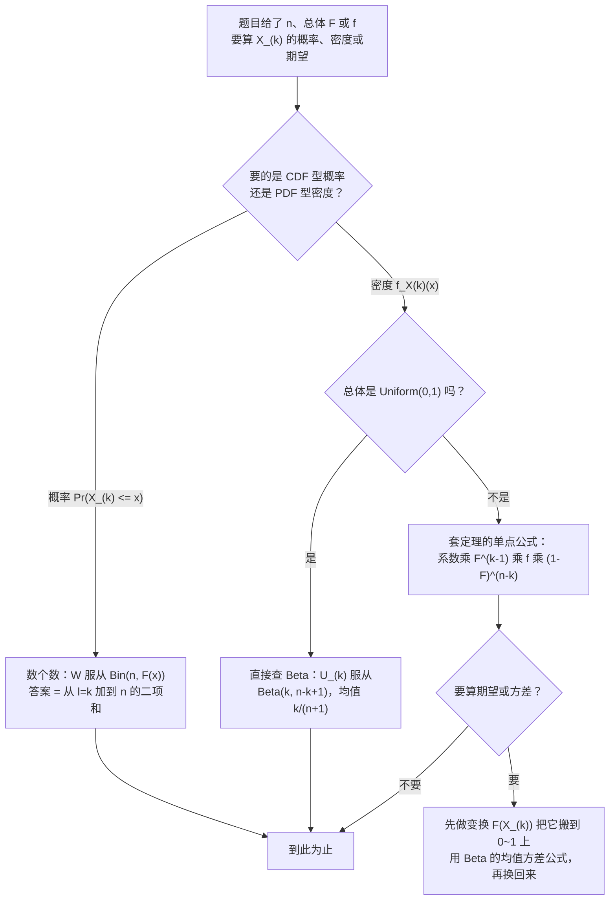
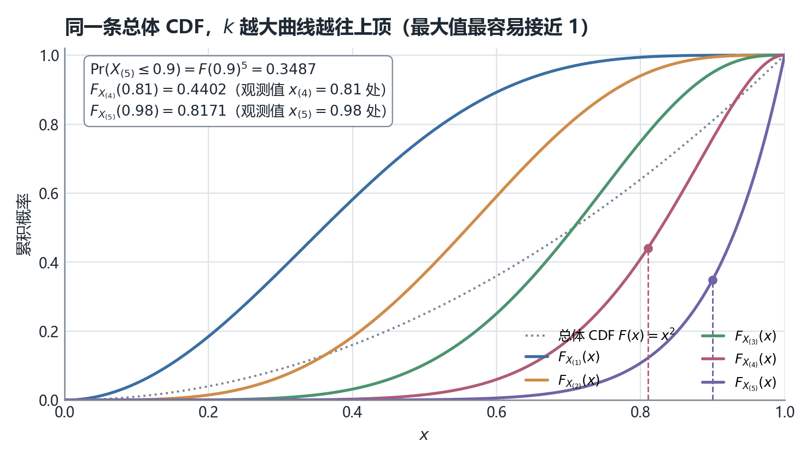
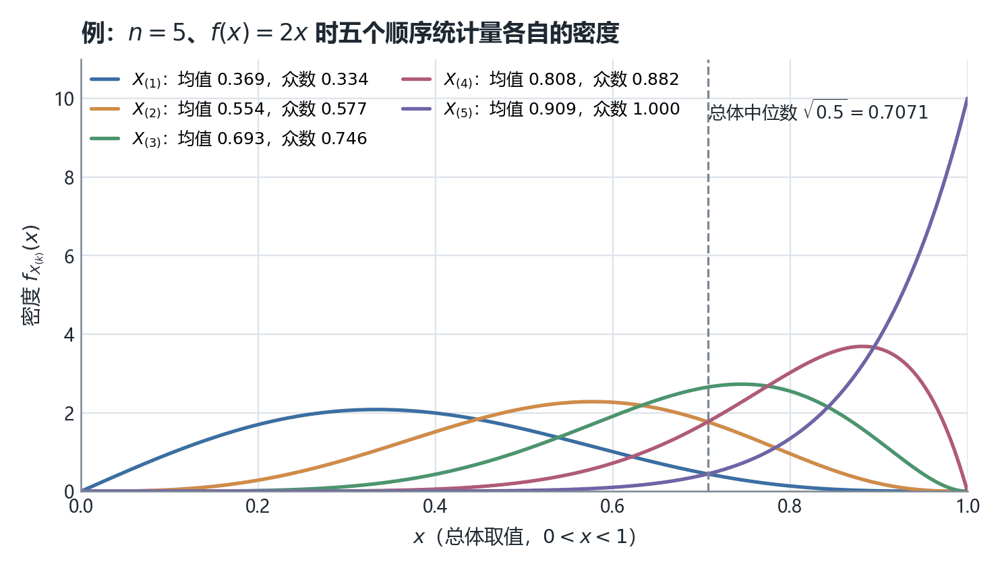
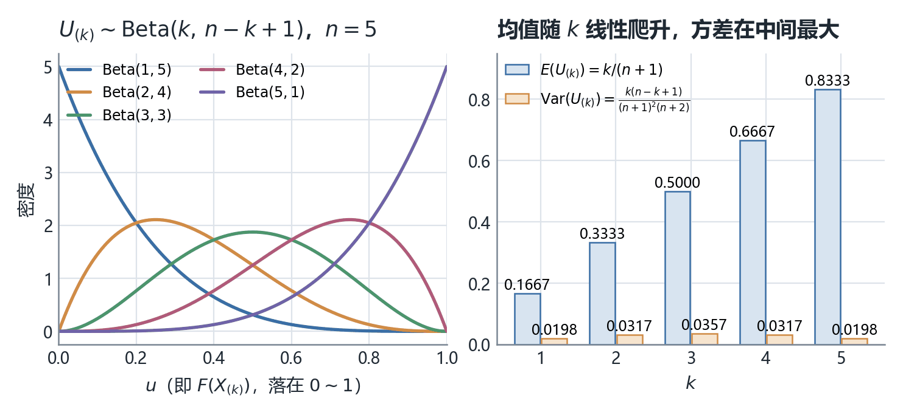
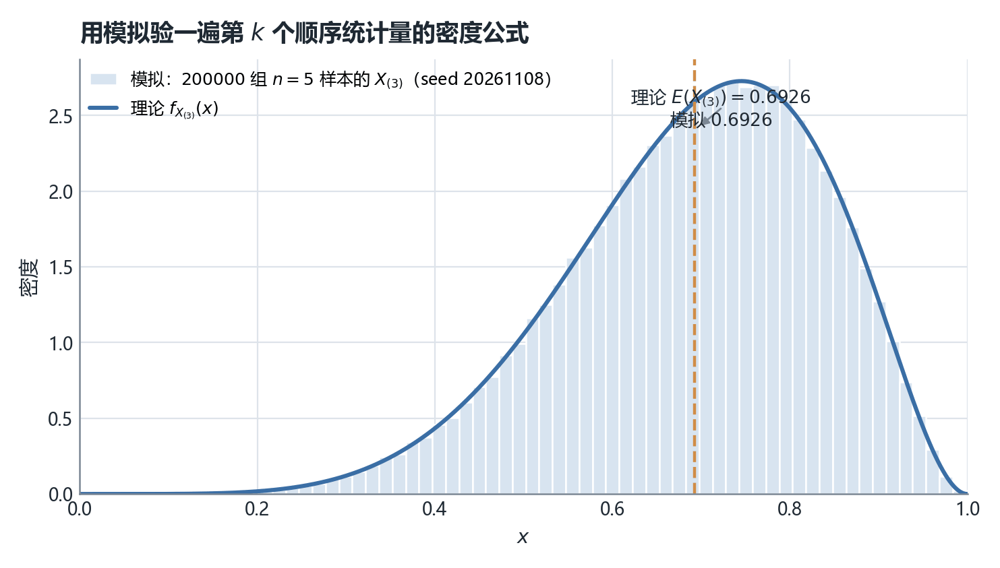

# STA2002 概率与统计 II · 第 10 讲笔记
## Order Statistics（顺序统计量：把样本排好队，再问排第几的那个服从什么分布）

> 授课：Zhenxing Guo、Ka Wai Tseng（香港中文大学（深圳）数据科学学院，2026 年 10 月）
> 教材：Hogg, Tanis & Zimmerman (2015) *Probability and Statistical Inference*, 9th ed., Pearson
> 对应教材章节：**§6.3 Order Statistics**（讲义第 2 页给出 "Suggested reading: Chapter 6.3 of the textbook"，我在教材目录里核对过，第 6 章 Point Estimation 的第 3 节标题正是 Order Statistics，页码指引无误）。
> 材料构成：讲义 `Lecture10 - Order Statistics.pdf`（**17 页**），笔记内容**完全基于课件（PDF）整理**，本讲没有收到板书，全文没有 `【板书 NN】` 标记，也不设「板书原图」一节；凡属我补充、推导或复算的部分，一律用 **【补】** 或 alert 标出，并在文末诚实备注中逐条列出。
> **组织方式**：正文**按讲义（PPT）的页序**撰写，讲义每一页都能在正文里找到对应位置（对照表见 §0）。讲义的全部 17 页我都以 150 dpi 渲染成图片逐页看过（公式在文本层里丢上标，只能看图确认）；讲义里出现的**每一个数值与每一个系数**（$x^{10}$、$10x^{9}$、$\binom{5}{4}=5$、$\frac{5!}{3!1!1!}=20$、$\frac{n!}{(k-1)!(n-k)!}$、$E(U_{(k)})=\frac{k}{n+1}$、$\operatorname{Var}(U_{(k)})=\frac{k(n-k+1)}{(n+1)^2(n+2)}$）我都用 `scipy` 独立复算过，其中密度是否归一、CDF 与二项求和是否一致、$E[F(X_{(k)})]$ 是否真等于 $\frac{k}{n+1}$，还各做了一次 20 万组的模拟交叉验证（见 §14）。**本讲没有发现算错的数值**，但有一处记号混用（第 16 页的 $X_k$ 与第 17 页的 $X_{(k)}$），见诚实备注第 1 条。

---

## 0. 本讲地图（先说清楚这一讲在干什么）

*这一节回答：前九讲一直在算"样本均值 $\bar X$"和"样本方差 $S^2$"的分布，这一讲换成另一类统计量——"排好队以后第 $k$ 小的那个"，它凭什么能算、算出来长什么样。*

**三遍阅读路线。** 这一讲只有 17 页，但公式密度高，建议按下面的顺序读，每一遍只解决一个问题：

| 遍次 | 读哪里 | 读完应该能 |
| --- | --- | --- |
| 第一遍（主线） | §2（定义）→ §4–§5（最大值与次大值怎么算）→ §6（一般公式）→ §11（$U_{(k)}\sim\mathrm{Beta}$） | 拿到 $n$ 和 $F$，写出 $X_{(k)}$ 的 CDF 与 PDF |
| 第二遍（深化） | §7（四块概率的解读）→ §8（证明）→ §12–§13（$F(X_{(k)})$ 为什么是 Beta） | 说清那个多项系数从哪来、求导时为什么只剩一项 |
| 第三遍（考前） | §14（用途与衔接）→ §15–§18 | 用速查表做题，并知道哪些结论是我补的、哪些是讲义原话 |

第一遍刻意跳过两块。**§8 是定理的证明**：它只用到"数一数有几个观测落在 $x$ 左边"这一个技巧，但求导那一步是望远镜相消，第一遍读容易卡住，可以直接跳到 §9。**§12 是概率积分变换**（$F(X)\sim U(0,1)$），它是第 13 节那行结论的引理，本身不产生新公式。跳过这两块不影响主线——主线只用三样东西：$X_{(k)}\le x$ 等价于"至少 $k$ 个观测 $\le x$"、二项求和、以及 $\mathrm{Beta}$ 查表。

前九讲的抽样分布全部围绕**两个用"加减乘除"定义的统计量**：$\bar X=\frac1n\sum X_i$ 和 $S^2=\frac1{n-1}\sum(X_i-\bar X)^2$。它们的分布之所以能算干净，是因为线性组合好处理（正态的可加性、$\chi^2$ 的定义）。本讲换成另一类统计量——**用"排序"定义的**：

$$X_{(1)}\le X_{(2)}\le\cdots\le X_{(n)},\qquad X_{(1)}=\min_i X_i,\quad X_{(n)}=\max_i X_i.$$

这类统计量没法用可加性，但有一个更好用的替代入口：**"第 $k$ 小 $\le x$" 这句话可以翻译成"落在 $(-\infty,x]$ 里的观测至少有 $k$ 个"**，而"数个数"正是二项分布的看家本领。整讲 17 页就是把这一句话反复用了四遍。

讲义第 2 页原文只有四行：

> In this lecture we will introduce the concept and distribution of order statistics
> Order statistics is an important concept to examine the distributional properties of data

交付顺序是：先给定义（第 3 页）→ 用一个 $f(x)=2x$ 的例子把 $X_{(5)}$、$X_{(4)}$ 两条分布手算一遍（第 4–8 页）→ 提炼成定理（第 9 页）→ 解读公式里每一块的含义（第 10 页）→ 证明（第 11–12 页）→ 均匀分布特例引出 Beta（第 13–15 页）→ 两条"变换后服从什么分布"的结论（第 16–17 页）。

| 讲义页 | 内容 | 本笔记 | 配图 |
| --- | --- | --- | --- |
| 第 1 页 | 封面 | —— | — |
| 第 2 页 | Introduction：本讲覆盖什么、三个应用场景 | §1 | — |
| 第 3 页 | 顺序统计量的定义 + 一组有并列值的样例 | §2 | — |
| 第 4 页 | 例题设定：$n=5$、$f(x)=2x$、五个观测值 | §3 | — |
| 第 5 页 | 例题第一问：观测到的顺序统计量 | §3.2 | — |
| 第 6 页 | $X_{(5)}$ 的 CDF 与 PDF | §4 | — |
| 第 7 页 | $X_{(4)}$ 的 CDF：引入计数变量 $W$ | §5.1 | — |
| 第 8 页 | $X_{(4)}$ 的 PDF：求导与合并 | §5.2 | — |
| 第 9 页 | 定理：一般 $k$ 的 CDF 与 PDF | §6 | 图 6.1、图 6.2 |
| 第 10 页 | 公式四块的含义 + 多项系数 | §7 | — |
| 第 11–12 页 | 定理证明（CDF 用二项、PDF 用望远镜相消） | §8 | — |
| 第 13 页 | 均匀分布的 $U_{(k)}$ 密度 → 凑成 Beta 形式 | §9 | — |
| 第 14 页 | Beta 分布的定义、均值与方差 | §10 | — |
| 第 15 页 | $U_{(k)}\sim\mathrm{Beta}(k,n-k+1)$ 及其均值方差 | §11 | 图 11.1 |
| 第 16 页 | 概率积分变换：$F(X_k)\sim U(0,1)$ | §12 | — |
| 第 17 页 | $F(X_{(k)})\sim\mathrm{Beta}(k,n-k+1)$ | §13 | — |
| — | 用途、模拟验证、速查表、核心直觉、术语对照、诚实备注 | §14–§18 | 图 14.1 |

### 0.1 一句话概括本讲的结构

> [!IMPORTANT]
> **顺序统计量不能用"可加性"，但能用"数个数"。** 全部四个结果（$X_{(5)}$ 的 CDF、$X_{(4)}$ 的 CDF、一般 $X_{(k)}$ 的 CDF、以及证明）都来自同一个等价改写：
> $$\{X_{(k)}\le x\}\iff\{\text{至少有 }k\text{ 个 }X_i\le x\}\iff\{W\ge k\},\qquad W\sim\mathrm{Bin}(n,F(x)).$$
> 于是 $F_{X_{(k)}}(x)=\Pr(W\ge k)=\sum_{l=k}^{n}\binom{n}{l}F(x)^l[1-F(x)]^{n-l}$，求导以后中间项全部相消，只剩边界那一项 $\frac{n!}{(k-1)!(n-k)!}[F(x)]^{k-1}f(x)[1-F(x)]^{n-k}$。**记住"数个数"这一个动作，本讲的两条公式都不用背。**

### 0.2 与本讲关系最近的三处往讲接口（这张表是我整理的，讲义没有画）

| 往讲留下的线 | 本讲在哪里接上 |
| --- | --- |
| 第 1 讲 §分布函数：$F(x)=\Pr(X\le x)$、$F$ 单调不减、连续型可求导得 $f=F'$ | 本讲第 6、8 页两次"把 CDF 对 $x$ 求导得 PDF"，用的正是这条；第 16 页的概率积分变换 $F(X)\sim U(0,1)$ 也是第 1 讲变换公式的直接应用 |
| 第 1 讲 / 第 2 讲：分位数 $\pi_p$ 满足 $F(\pi_p)=p$；箱线图用样本四分位描述数据 | 本讲给出的是"样本分位数（即 $X_{(k)}$）服从什么分布"，把第 2 讲的图形描述升级为概率描述；第 11 讲的分位数与 Q-Q 图正是要用这个 |
| 第 4–5 讲：置信区间靠枢轴量，且要求枢轴量的分布不依赖未知参数 | 本讲第 13 页的 $U_{(k)}\sim\mathrm{Beta}(k,n-k+1)$ 与第 17 页的 $F(X_{(k)})\sim\mathrm{Beta}(k,n-k+1)$ **分布里一个未知参数都没有**，这正是第 12 讲"非参数置信区间"能成立的机制（本讲只铺路，不展开） |

第 6–9 讲（假设检验与功效）与本讲没有直接接口，本讲切回"描述样本结构"这条线，是课程后半段（非参数方法）的新起点。

### 0.3 拿到"求第 $k$ 个顺序统计量的某个概率"这类题，怎么走

**这张图是我整理的，讲义没有画。** 三个分岔点对应本讲的三个结构判断：要概率还是要密度（前者留求和、后者给闭式）、总体是不是均匀（是的话一切都在 $[0,1]$ 上、直接查 Beta）、要不要算数字特征（要就先做 $F(\cdot)$ 变换，别在原始尺度上硬积分）。

### 0.4 来源标注约定

- 无标记 → 讲义原文或对讲义的直接展开；
- **【补】** → 讲义没有、由我补充、推导或复算的内容（文末诚实备注逐条列出）；
- alert（`> [!NOTE]` / `[!TIP]` / `[!IMPORTANT]` / `[!WARNING]`）→ 同样是补充，标题里写明它属于哪一类。

---

## 1. 本讲要交付什么（讲义第 2 页）

讲义第 2 页给了三个应用场景，原话是：

> In quality control, the minimum and maximum values help identify potential outliers or defects in a production line.
> In finance, order statistics are used to calculate Value-at-Risk (VaR) by determining the quantile of potential losses, such as the 5th percentile of daily returns.
> In environmental studies, researchers might use sample median to describe typical pollution levels and be more robust to extreme measurements than sample mean

三句话对应三个不同的 $k$：质量控制关心 $k=1$ 和 $k=n$（最小值、最大值），金融的 VaR 关心最小的那几个（第 5 百分位就是靠 $X_{(\lceil 0.05n\rceil)}$ 估计的），环境研究关心中间的 $k$（样本中位数就是 $X_{((n+1)/2)}$）。

**为什么这三件事需要一套专门的理论？** 因为"排第几"这个操作把 $n$ 个独立变量之间的关系彻底改写了。排序之后 $X_{(1)},\dots,X_{(n)}$ **不再独立**（知道最小值是 0.31，就知道其余四个都 $\ge 0.31$），也不再同分布（$X_{(1)}$ 的密度贴着 0，$X_{(n)}$ 的密度贴着上界）。所以第 1–5 讲里"独立同分布求线性组合"的那套工具在这里全部失效，必须另起炉灶。本讲另起炉灶的方式只有一句话——**换成数个数**。

> [!NOTE] 补充：为什么"数个数"这一招够用
> 【补】关键在于事件 $\{X_{(k)}\le x\}$ 只问"有几个观测落在 $x$ 左边"，不问"具体是哪几个、它们内部谁大谁小"。前者是 $n$ 次独立伯努利试验的计数问题（每个 $X_i$ 落在左边的概率都是 $F(x)$），后者才需要处理排序带来的相关性。**把"顺序"问题降级成"计数"问题，是本讲唯一的技巧，也是它比 $\bar X$ 的分布好算的原因。**

---

## 2. 顺序统计量的定义（讲义第 3 页）

讲义第 3 页的定义原文：

> **Definition (order statistics).** Suppose that $X_1,\ldots,X_n$ are i.i.d. random samples from a common distribution. For any $k=1,2,\ldots,n$, the $k$-th order statistic is the random variable $X_{(k)}=$ kth smallest of $X_1,\ldots,X_n$.

**顺序统计量**（order statistics）就是把 $n$ 个独立同分布的随机样本按从小到大排好队之后，取"排第 $k$ 位"的那个作为新的随机变量，记作 $X_{(k)}$。三个要点：

1. **括号下标是"排第几"，不是"第几个观测"。** 这个记号区别是本讲全部推导的前提：$X_3$ 是原始样本里的第三个观测，和它数值多大无关；$X_{(3)}$ 是排序后第三小的那个，它是个随机变量，取值依赖整组数据。
2. **两端有专门的名字。** $X_{(1)}=\min\{X_1,\ldots,X_n\}$ 叫**样本极小值（sample minimum）**，$X_{(n)}=\max\{X_1,\ldots,X_n\}$ 叫**样本极大值（sample maximum）**。中间那个（$n$ 为奇数时的 $X_{((n+1)/2)}$）就是第 2 讲箱线图里用的**样本中位数（sample median）**。
3. **极差（sample range）** $R=X_{(n)}-X_{(1)}$ 是本讲顺带定义的一个统计量，讲义没单独给它名字，我在 §14 里回到它。

讲义紧接着给了一组带并列值的样例（第 3 页原文）：

> Some values are equal: The order statistics for $X_1=1,\;X_2=3,\;X_3=2,\;X_4=2$ are $X_{(1)}=1,\;X_{(2)}=2,\;X_{(3)}=2,\;X_{(4)}=3$.

这组样例值得停下来看一眼，因为它演示了**排序是有重复的排序**这件事：$2$ 出现了两次，于是 $X_{(2)}$ 和 $X_{(3)}$ 都等于 $2$。原始下标 $X_3=2$ 落在第二位、$X_4=2$ 落在第三位，谁前谁后无所谓，因为它们的值相同。

> [!WARNING] 注意：并列值只在离散总体才会出现
> 【补】本讲第 9 页的定理开头写着 "i.i.d. **continuous** random variables"，这不是客套话。若总体是离散型（比如第 1 讲里的二项、泊松），$X_{(2)}=X_{(3)}$ 有正概率发生，$\Pr(X_{(k)}\le x)$ 仍然是那个二项和，但**对它求导得不到密度**——因为分布函数有跳跃、根本没有导数。第 8 页那次"求导得 PDF"、以及 §12 概率积分变换里要求 $F$ **严格递增**，全部依赖"连续"这条假设。做离散总体的顺序统计量题目时，只能算 CDF 或 $\Pr(X_{(k)}=x_j)$，不要套密度公式。

**一个能手算的小例子。**【补】设 $n=2$，总体是 Uniform(0,1)。$X_{(1)}=\min(X_1,X_2)$。用"数个数"：$\{X_{(1)}\le x\}$ 的补事件是"两个都 $>x$"，概率 $(1-x)^2$，所以 $F_{X_{(1)}}(x)=1-(1-x)^2=2x-x^2$，求导得 $f_{X_{(1)}}(x)=2-2x=2(1-x)$。直觉检验：最小值当然更可能出现在靠近 0 的地方，密度递减 ✓；归一化 $\int_0^1(2-2x)\,dx=1$ ✓。同一思路算 $X_{(2)}$：$F_{X_{(2)}}(x)=x^2$，密度 $2x$（这正是讲义第 6 页 $n=5$ 版本的 $n=2$ 特例）。

> [!TIP] 练习 2.1
> $n=3$、总体 Uniform(0,1)，写出 $X_{(2)}$ 的 CDF。
>
> **参考答案。**【补】$W\sim\mathrm{Bin}(3,x)$，$\Pr(W\ge2)=\binom32x^2(1-x)+x^3=3x^2-2x^3$。求导得密度 $f_{X_{(2)}}(x)=6x(1-x)$，即 $\mathrm{Beta}(2,2)$——与 §9 的结论 $U_{(k)}\sim\mathrm{Beta}(k,n-k+1)$ 在 $n=3,k=2$ 处吻合。

---

## 3. 例题开场：$n=5$、$f(x)=2x$ 的一组观测（讲义第 4–5 页）

### 3.1 设定（讲义第 4 页）

讲义第 4 页给出：

> Let $X_1,\ldots,X_5$ be i.i.d. random samples from the PDF $f(x)=2x,\;0<x<1$. Its CDF is, for $0<x<1$, $F(x)=\int_0^x 2y\,dy=x^2$.
> The values $x_1=0.62,\;x_2=0.98,\;x_3=0.31,\;x_4=0.81,\;x_5=0.53$ are the observed values.

三个符号层次要分清，这是本讲最容易混的地方：

| 记号 | 是什么 | 本例的值 |
| --- | --- | --- |
| $X_i$ | 第 $i$ 个**随机变量**（抽样之前） | 未实现，服从 $f(x)=2x$ |
| $x_i$ | 它的**观测值**（抽样之后，小写） | $0.62,\;0.98,\;0.31,\;0.81,\;0.53$ |
| $X_{(k)}$ | 排序后的**随机变量** | 未实现，分布待求 |
| $x_{(k)}$ | 排序后的**观测值** | 见 §3.2 |

$F(x)=x^2$ 这一步要检查两件事：$F(0)=0$、$F(1)=1$ ✓，且 $F'(x)=2x=f(x)$ ✓。

### 3.2 第一问：观测到的顺序统计量（讲义第 5 页）

讲义第 5 页直接把五个数排好：

$$x_{(1)}=\min\{x_1,\ldots,x_5\}=0.31,\quad x_{(2)}=0.53,\quad x_{(3)}=0.62,\quad x_{(4)}=0.81,\quad x_{(5)}=\max=0.98.$$

**这一步没有任何概率内容**，纯粹是排序。它的意义在于：$x_{(4)}=0.81$ 是"第二大的观测值"，而 $X_{(4)}$ 是"第二大的那个随机变量"——讲义接下来两页问的是后者的分布。

> [!TIP] 技巧：把观测值当"刻度"用
> 【补】讲义特意选 $0.81$ 和 $0.98$ 这两个数，是因为它们恰好在后面两页被代回 CDF 当检验点。读到这里可以先猜一下答案的量级：$X_{(5)}\le 0.98$ 是"五个观测都不超过 0.98"，概率应该是 $F(0.98)^5=0.9604^5\approx 0.817$（我算得 $0.8171$）——挺高，合理；而 $X_{(4)}\le 0.81$ 要求"至多一个观测超过 0.81"，$F(0.81)=0.6561$，算出来只有 $0.4402$（见 §5.2）。**排序位置越靠中间，CDF 曲线越靠右，同一个 $x$ 处读到的概率越小**，图 6.1 会把这件事画成五条曲线。

---

## 4. 最大值 $X_{(5)}$ 的分布（讲义第 6 页）

讲义第 6 页的推导原文（我把它逐行拆开）：

> $\Pr(X_{(5)}\le x)=\Pr(\max\{X_1,X_2,X_3,X_4,X_5\}\le x)=\Pr(X_1\le x,X_2\le x,\ldots,X_5\le x)=\prod_{i=1}^{5}\Pr(X_i\le x)=F(x)^5=x^{10}.$

**四个等号，每个都在干一件事：**

1. **第一个等号是定义。** $X_{(5)}$ 就是五个数的最大值。
2. **第二个等号是本讲的关键翻译。** "最大值 $\le x$" 和"**每一个**都 $\le x$" 是同一件事。注意方向：这里出现的是"全部满足"，不是"至少一个满足"——后者对应的是 $\min$。
3. **第三个等号用独立性。** 五个事件 $X_i\le x$ 相互独立（因为 $X_i$ 相互独立），所以联合概率等于边缘概率之积。
4. **第四个等号用同分布。** 每个 $\Pr(X_i\le x)$ 都是同一个 $F(x)$，五个相乘得 $F(x)^5$；代入 $F(x)=x^2$ 得 $x^{10}$。

> [!NOTE] 补充：第 6 页那句 "(by i.i.d.)" 其实用了两件事
> 【补】讲义在第三个等号后面标 "(by i.i.d.)"。严格说，**等号成立靠的是"独立"**（把联合概率拆成乘积），而"把五个不同的 $\Pr(X_i\le x)$ 写成同一个 $F(x)$"靠的是**同分布**。两个词都装在 "i.i.d." 这个缩写里，所以讲义的标注不算错，但考试若问"这一步用了哪条假设"，答案是"独立性"。

**检查 $x^{10}$ 合不合理。**【补】$x=1$ 时 $F_{X_{(5)}}(1)=1$ ✓；$x=0$ 时为 0 ✓；曲线比 $F(x)=x^2$ 更"贴着右边"，因为 $x^{10}$ 在 $x<1$ 时比 $x^2$ 小得多——最大值的 CDF 应该**在左边低**（不太可能取到很小的值）。定量看：$\Pr(X_{(5)}\le 0.9)=0.9^{10}=0.3487$，也就是说五个观测全都 $\le 0.9$ 的概率只有三分之一，反过来说"至少有一个超过 0.9"的概率高达 $0.6513$。这个数我在图 6.1 里标了出来。

讲义接着写：

> Differentiate the above CDF to obtain the PDF of $X_{(5)}$ denoted by $f_{X_{(5)}}(x)$: $f_{X_{(5)}}(x)=10x^{9}=5F(x)^{4}f(x),\quad 0<x<1.$

**这里把求导结果反向整理成了"用 $F$ 和 $f$ 表示"的形状**，这一步不是装饰：$10x^9=5\cdot(x^2)^4\cdot(2x)=5F(x)^4f(x)$。之所以要写成后者，是因为下一节算 $X_{(4)}$ 时求导会复杂得多，只有保持 $F$、$f$ 的抽象形式才能合并同类项；而且 §6 的定理就是 $F$、$f$ 形式的，讲义在这里提前把学生引到那个形状上。

**极小值的对照版本。**【补】讲义只算了极大值，但同一页的技巧对极小值几乎镜像：$\{X_{(1)}>x\}\iff$ "每一个都 $>x$"，所以 $1-F_{X_{(1)}}(x)=[1-F(x)]^5$，即 $F_{X_{(1)}}(x)=1-(1-x^2)^5$，密度 $f_{X_{(1)}}(x)=10x(1-x^2)^4$。用 §6 定理核对：系数 $\frac{5!}{0!\,1!\,4!}=5$，$[F]^0f[1-F]^4=5\cdot2x(1-x^2)^4=10x(1-x^2)^4$ ✓。

> [!TIP] 练习 4.1
> 【补】$n=5$、$f(x)=2x$，求 $\Pr(X_{(1)}>0.5)$。
> **参考答案。** 每个观测都 $>0.5$ 的概率是 $[1-F(0.5)]^5=(1-0.25)^5=0.75^5=0.2373$。我用 20 万组模拟（seed 20261108）跑出的频率是 $0.2364$，差在模拟误差量级内 ✓。

---

## 5. 次大值 $X_{(4)}$ 的分布：计数变量 $W$ 登场（讲义第 7–8 页）

### 5.1 CDF（讲义第 7 页）

第 6 页的"全部 $\le x$"技巧在这里不够用了：$X_{(4)}\le x$ **允许有一个观测超过 $x$**，所以不能拆成五个事件的交。讲义第 7 页换招：

> Define a random variable $W$, where $W$ is the number of $X_i$ such that $X_i\le x$. Since $X_1,\ldots,X_5$ are i.i.d., $W\sim\mathrm{Bin}(5,F(x))$, i.e. the "success probability" is $\Pr(X_i\le x)=F(x)$.

**这一步是本讲的心脏。** 三件事要说清：

1. **$W$ 是随机变量，而且它的分布依赖 $x$。** 对每个固定的 $x$，$W$ 服从参数 $(5,F(x))$ 的二项分布。换个 $x$ 就换个"成功概率"。这是顺序统计量分布"看起来怪"的根源——$W$ 不是一个固定的分布，而是一族分布。
2. **"成功"的定义是"落在 $x$ 左边"**，每次试验的成功概率是 $F(x)$，共 $n=5$ 次独立试验。
3. **翻译**：$X_{(4)}\le x$ 意思是"第四小的那个不超过 $x$"，等价于"落在 $x$ 左边的至少有 4 个"，即 $W\ge 4$。

于是（讲义第 7 页最后一行）：

$$\Pr(X_{(4)}\le x)=\Pr(W\ge4)=\Pr(W=4)+\Pr(W=5)=\binom{5}{4}F(x)^4[1-F(x)]^1+F(x)^5.$$

**代回 $F(x)=x^2$ 看看这个函数长什么样。**【补】$F_{X_{(4)}}(x)=5x^8(1-x^2)+x^{10}=5x^8-4x^{10}$。检查边界：$x=1$ 时 $5-4=1$ ✓；$x=0.81$ 时 $F(0.81)=0.6561$，$\Pr(X_{(4)}\le0.81)=5(0.6561)^4(0.3439)+(0.6561)^5=0.4402$（我复算，与图 6.1 上标出的点一致）。

### 5.2 PDF（讲义第 8 页）

讲义第 8 页把 CDF 对 $x$ 求导，原文三步：

> $f_{X_{(4)}}(x)=\binom{5}{4}4F(x)^3f(x)(1-F(x))+\binom{5}{4}F(x)^4(-f(x))+5F(x)^4f(x)=\binom{5}{4}4F(x)^3f(x)(1-F(x))=\dfrac{5!}{3!\,1!\,1!}F(x)^3f(x)[1-F(x)],\;0<x<1.$

**中间那一行的三项从哪来，是这一页唯一容易看漏的地方。**【补】对 $\binom54F^4(1-F)$ 用乘积法则（外层对 $F$ 求导、内层 $F'=f$）：

$$\frac{d}{dx}\left[5F^4(1-F)\right]=5\cdot4F^3f\,(1-F)+5F^4\cdot(-f),\qquad \frac{d}{dx}\left[F^5\right]=5F^4f .$$

后两项 $-5F^4f$ 与 $+5F^4f$ **正好抵消**，只剩第一项。这就是"望远镜相消"在这个 $n=5$ 特例里的样子，§8 的证明是它在一般 $n$ 下的重演。

**系数核对。** $\binom{5}{4}\cdot4=5\cdot4=20$，而讲义写的 $\frac{5!}{3!1!1!}=\frac{120}{6}=20$ ✓ 两种写法一致。代回 $F=x^2$、$f=2x$：$f_{X_{(4)}}(x)=20(x^2)^3(2x)(1-x^2)=40x^7(1-x^2)$。归一性我单独验过：$\int_0^1 40x^7(1-x^2)\,dx=40(\frac18-\frac1{10})=1.000000$ ✓。

> [!IMPORTANT] 重要：为什么"抵消"不是巧合
> 【补】$F_{X_{(k)}}$ 是"从 $l=k$ 加到 $n$"的二项和，每一项求导都会裂成两块：一块带 $l$（往 $F^{l-1}$ 那一档走），一块带 $(n-l)$（往 $[1-F]^{n-l-1}$ 那一档走）。相邻两档之间，前一档的"第二块"与后一档的"第一块"符号相反、大小相等，于是逐档抵消，最后只剩**最左边那一档的第一块** $\frac{n!}{(k-1)!(n-k)!}F^{k-1}f(1-F)^{n-k}$。理解了这一点，§6 那条密度公式就不需要背——它是"求导后中间全消"的必然结果。

---

## 6. 定理：一般 $k$ 的 CDF 与 PDF（讲义第 9 页）

讲义第 9 页把前两节的两个特例提炼成定理，原文：

> **Theorem.** Suppose that $X_1,\ldots,X_n$ are i.i.d. **continuous** random variables with common PDF $f(x)$ and CDF $F(x)$. For $k=1,\ldots,n$, denote the CDF and PDF of the $k$-th order statistic $X_{(k)}$ to be respectively $F_{X_{(k)}}$ and $f_{X_{(k)}}$. They can be written as
> $$F_{X_{(k)}}(x)=\sum_{l=k}^{n}\binom{n}{l}F(x)^{l}\bigl[1-F(x)\bigr]^{n-l},\qquad f_{X_{(k)}}(x)=\frac{n!}{(k-1)!\,1!\,(n-k)!}\,[F(x)]^{k-1}f(x)\,[1-F(x)]^{n-k}.$$

**逐符号解释密度公式**（$x$ 是"考察点"，$k$ 是"排第几"，$n$ 是样本量）：

| 因子 | 取值范围 | 含义 |
| --- | --- | --- |
| $\dfrac{n!}{(k-1)!\,1!\,(n-k)!}$ | 正整数 | 多项系数：把 $n$ 个观测分成"左边 $k-1$ 个 / 正好在 $x$ 处 1 个 / 右边 $n-k$ 个"三组，有多少种分法 |
| $[F(x)]^{k-1}$ | $0\sim1$ | 那 $k-1$ 个都落在 $x$ 左边的概率 |
| $f(x)$ | $\ge0$ | 恰有 1 个落在 $x$ 附近（密度，不是概率） |
| $[1-F(x)]^{n-k}$ | $0\sim1$ | 剩下 $n-k$ 个都落在 $x$ 右边的概率 |

**分母里那个孤零零的 $1!$ 是干嘛的？**【补】它是多项系数的组成部分，对应"恰有 1 个观测落在 $x$ 处"这一组，$1!=1$ 所以数值上没影响，但**留着它能让你看出公式的对称结构**：三个组的大小分别是 $k-1$、$1$、$n-k$，加起来正好是 $n$。讲义第 10 页正是靠这个结构来解读公式的（见 §7）。到 §9 化简成 Beta 时，这个 $1!$ 就被"吃掉"了——这也是判断"自己抄公式有没有抄错"的一个小抓手。

**用第 4–5 节的结果验一遍。**【补】$n=5,k=5$：系数 $\frac{5!}{4!\,1!\,0!}=5$，密度 $=5[F]^4f[1-F]^0=5F^4f$ ✓ 与第 6 页一致。$n=5,k=4$：系数 $\frac{5!}{3!\,1!\,1!}=20$，密度 $=20F^3f(1-F)$ ✓ 与第 8 页一致。$n=5,k=1$：系数 $\frac{5!}{0!\,1!\,4!}=5$，密度 $=5f(1-F)^4$ ✓ 与 §4 末尾我补的极小值公式一致。

图 6.1 和图 6.2 把 $n=5$ 时 $k=1,\ldots,5$ 的五条曲线全部画了出来。

*图 6.1　$n=5$、$F(x)=x^2$ 时五条 CDF（我绘制；公式即 §6 定理的第一条，数值用二项求和现算并与 `scipy.stats.binom` 对过）。灰虚线是总体自己的 $F(x)=x^2$。规律是 $k$ 越大曲线越靠上：$F_{X_{(1)}}$ 在 $F$ 上方、$F_{X_{(5)}}$ 在 $F$ 下方，两者在 $F=1$ 处（$x=1$）汇合。左上角标了三个数：$\Pr(X_{(5)}\le0.9)=0.3487$、$F_{X_{(4)}}(0.81)=0.4402$、$F_{X_{(5)}}(0.98)=0.8171$，前两个正是讲义第 6、7 页算的量，第三个用来对照"最大值很容易接近 1"*

*图 6.2　同一设定下五条密度 $f_{X_{(k)}}$（我绘制；系数与指数取自 §6 定理）。图例里给出每条曲线的均值与众数：均值 $0.369,0.554,0.693,0.808,0.909$，众数 $\sqrt{(2k-1)/9}$ 即 $0.333,0.577,0.745,0.882,1.000$（$k=5$ 那条单调上升，众数落在边界 $x=1$）。灰虚线是总体中位数 $\sqrt{0.5}=0.7071$——注意 $X_{(3)}$ 的均值 $0.6926$ 比它略小，说明**样本中位数在这个偏态总体上是略微偏低的**（详见 §14.2）*

> [!CAUTION] 注意：最大值那条的密度峰值落在边界上，不是画错了
> 【补】图 6.2 里紫色那条（$k=5$）一路爬到 $x=1$ 处等于 10，中间没有鼓包。这不是数值错误：$f_{X_{(5)}}(x)=10x^9$ 在 $(0,1)$ 上严格递增，最大值只能出现在边界。做"求 $X_{(n)}$ 的众数"这类题时，答案是"在支撑的上端点"，而不是"令导数为零解出的那个点"——令导数为零会解出 $x=0$（那是极小值的位置）。

---

## 7. 公式四块的含义（讲义第 10 页）

讲义第 10 页逐块解读密度公式，原文四条：

> - $F(x)^{k-1}$ corresponds to the probability that there are $k-1$ samples less than $x$
> - $f(x)$ corresponds to the probability that there are 1 sample around $x$, namely $X_{(k)}$
> - $(1-F(x))^{n-k}$ corresponds to the probability that there are $n-k$ samples greater than $x$
> - The multinomial coefficient $\frac{n!}{(k-1)!1!(n-k)!}$ in the front captures all the different combinations in the ordering of the sample items.

**这四条合起来是一个"微元论证"**【补】，值得用严格一点的话重述，否则容易留下误解：

把"$X_{(k)}$ 落在长度为 $dx$ 的小区间 $[x,x+dx]$ 里"这件事拆开，需要同时满足三个条件——恰有 $k-1$ 个观测 $<x$、恰有 1 个观测落在 $[x,x+dx]$、恰有 $n-k$ 个观测 $>x+dx$。三块概率分别近似 $F^{k-1}$、$f(x)\,dx$、$(1-F)^{n-k}$，再乘上"哪 $k-1$ 个在左、哪一个在中、哪 $n-k$ 个在右"的分法数 $\frac{n!}{(k-1)!1!(n-k)!}$，最后除以 $dx$ 就是密度。

> [!WARNING] 课件笔误：密度 f(x) 不是"概率"
> 讲义第 10 页第二条写的是 "$f(x)$ corresponds to the **probability** that there are 1 sample around $x$"。连续型总体里 $f(x)$ 是**密度**，$\Pr(X_i=x)=0$；正确的说法是"$f(x)\,dx$ 是落在 $x$ 附近宽度 $dx$ 小区间里的概率"。这个措辞在第 9 页定理里没出问题（那里 $f(x)$ 是公式的一部分），但在第 10 页的解读里会误导——**它恰好是"为什么密度公式可以大于 1"的唯一解释**：图 6.2 里 $k=5$ 那条峰值到 10，因为它是"概率除以 $dx$"，不是概率。判据：讲义第 10 页把三块 $F$ 型因子都叫 probability（对），只对 $f(x)$ 那一块叫 probability（错）；我按"密度 $\times\,dx$ 才是概率"改写。

**多项系数那一块，讲义的说法可以更准。**【补】"captures all the different combinations in the ordering of the sample items"——它数的不是"排序方式"，而是**哪几个观测被分到左中右三组**的组合数。给定三组的人数 $(k-1,1,n-k)$，把 $n$ 个**有编号的**观测填进这三组的分法数就是多项系数。之所以不需要再乘"组内怎么排"，是因为组内顺序不影响事件"$X_{(k)}$ 在 $x$ 附近"——这个"不需要"正是本讲把顺序问题降级成计数问题的体现。

> [!TIP] 技巧：用"三项加起来等于 n"自检系数
> 【补】$(k-1)+1+(n-k)=n$。任何版本的多项系数只要三组人数加起来不是 $n$，就一定抄错了。同理可自检 Beta 化简：§9 里 $x^{k-1}(1-x)^{n-k}$ 的两个指数 $(k-1)+(n-k)=n-1$，对应 $\mathrm{Beta}(\alpha,\beta)$ 里 $(\alpha-1)+(\beta-1)=\alpha+\beta-2$，代 $\alpha=k,\beta=n-k+1$ 得 $n-1$ ✓。

---

## 8. 定理证明（讲义第 11–12 页）

### 8.1 CDF 部分（讲义第 11 页）

讲义第 11 页只做一件事，就是把 §5.1 的 $n=5$ 换成一般 $n$：

> We define $W\sim\mathrm{Bin}(n,F(x))$. That is, $W$ is the number of $X_i$ such that $X_i\le x$. Then CDF of $X_{(k)}$ is
> $F_{X_{(k)}}(x)=\Pr(X_{(k)}\le x)=\Pr(W\ge k)=\sum_{l=k}^{n}\Pr(W=l)=\sum_{l=k}^{n}\binom{n}{l}F(x)^l(1-F(x))^{n-l}.$

**两个等号的合法性**【补】：$\{X_{(k)}\le x\}\iff\{W\ge k\}$ 是集合相等（不是概率相等），因为"第 $k$ 小 $\le x$"和"落在 $x$ 左边的个数 $\ge k\,$"互为充要；第二个等号把事件概率换成随机变量的概率，靠的是 $W$ 的分布已知。**连续这个假设在这一页还没用上**——CDF 公式对离散总体也成立（第 3 页那组并列值的例子就是离散的）。连续假设是下一页求导才需要的。

### 8.2 PDF 部分：望远镜相消（讲义第 12 页）

这一页是 17 页里代数最密的一页。讲义写了五行，我把每一行的动作标出来：

**第一行**：对 $l=k,\ldots,n-1$ 的每一项求导（乘积法则），裂成两个和式，另外单独写出 $l=n$ 那一项的导数 $n[F(x)]^{n-1}f(x)$：

$$f_{X_{(k)}}(x)=\sum_{l=k}^{n-1}\binom{n}{l}l[F]^{l-1}f[1-F]^{n-l}+\sum_{l=k}^{n-1}\binom{n}{l}(n-l)[F]^{l}(-f)[1-F]^{n-l-1}+nF^{n-1}f .$$

**第二行**：讲义把第一行第一个和式的上限从 $n-1$ 抬到 $n$，同时把那个孤零零的 $nF^{n-1}f$ 吸收掉。【补】这一步的合法性值得单独验一次：$l=n$ 时第一项是 $\binom nn\cdot n\cdot[F]^{n-1}f\cdot[1-F]^0=nF^{n-1}f$，与被吸收的那一项**逐字相同**。所以"抬上限"和"删尾项"是同一件事，讲义没写理由，但这是全页最容易看漏的一步。

**第三行**：对第二个和式换元 $l'=l+1$，于是 $l$ 从 $k$ 到 $n-1$ 变成 $l'$ 从 $k+1$ 到 $n$，且 $\binom{n}{l}(n-l)=\binom{n}{l'-1}(n-l'+1)$。讲义把它写成第二个和式 $\sum_{l'=k+1}^{n}\binom{n}{l'-1}(n-l'+1)[F]^{l'-1}(-f)[1-F]^{n-l'}$。

**第四行**：两个和式都用阶乘展开系数，$\binom nl\,l=\frac{n!}{(l-1)!(n-l)!}$ 与 $\binom{n}{l'-1}(n-l'+1)=\frac{n!}{(l'-1)!(n-l')!}$——**两者形式完全一样**。于是把 $l'$ 换回 $l$ 再对齐下标，两个和式从 $l=k+1$ 到 $n$ 的部分**逐项抵消**，只剩 $l=k$ 那一项：

$$f_{X_{(k)}}(x)=\frac{n!}{(k-1)!\,1!\,(n-k)!}[F(x)]^{k-1}f(x)[1-F(x)]^{n-k}.\qquad\blacksquare$$

> [!NOTE] 补充：为什么抵消要求"连续"
> 【补】整页只有一处真正用到连续性：把 $\Pr(X_i\le x)$ 的导数写成 $f(x)$。若总体离散，$F$ 是阶梯函数，第一行那个求导在跳跃点不存在，第二、三行的望远镜结构也就无从谈起。**证明的思路（数个数）与连续性无关，证明的工具（求导）与连续性有关**——这是"为什么定理的假设里有 continuous"的准确答案。

**用 $n=5,k=4$ 走一遍抵消。**【补】第一个和式（$l=4$）给 $\frac{5!}{3!1!}F^3f(1-F)^1=20F^3f(1-F)$；第二个和式换元后从 $l'=5$ 开始，即 $-\frac{5!}{4!0!}F^4f=-5F^4f$；第一个和式在 $l=5$ 那项是 $+5F^4f$。两项抵消，剩 $20F^3f(1-F)$ ✓ 与第 8 页一致（第 8 页是直接在 $n=5$ 的特例上做的同样的事）。

---

## 9. 均匀分布的顺序统计量（讲义第 13 页）

讲义第 13 页把总体换成 Uniform(0,1)，原文：

> Suppose that $U_1,\ldots,U_n\overset{\text{i.i.d.}}{\sim}\mathrm{Uniform}(0,1)$. Then its CDF and PDF are $F_{U_1}(x)=x,\;f_{U_1}(x)=1,\;0<x<1$. Denote the order statistics by $U_{(1)},U_{(2)},\ldots,U_{(n)}$. By the Theorem, the PDF of $U_{(k)}$ for $k=1,\ldots,n$ is
> $$f_{U_{(k)}}(x)=\frac{n!}{(k-1)!1!(n-k)!}x^{k-1}(1-x)^{n-k}=\frac{n!}{(k-1)!(n-k)!}x^{k-1}(1-x)^{n-k+1-1}=\frac{\Gamma(k+n-k+1)}{\Gamma(k)\Gamma(n-k+1)}x^{k-1}(1-x)^{n-k+1-1},$$
> where $\Gamma(k)=\int_0^\infty x^{k-1}e^{-x}dx$ represents the Gamma function. For any positive integer $n$, $\Gamma(n)=(n-1)!$

**这一步在干什么**：把定理里的 $F(x)=x$、$f(x)=1$ 代进去，密度立刻变成"幂函数 $\times$ 幂函数"的形状。然后讲义做了两次改写：

1. **吃掉 $1!$**：$\frac{n!}{(k-1)!1!(n-k)!}=\frac{n!}{(k-1)!(n-k)!}$，同时把 $(1-x)^{n-k}$ 写成 $(1-x)^{(n-k+1)-1}$——**这个"加一再减一"是纯粹的形状伪装**，目的是凑成下一节 Beta 密度的指数形式。
2. **把阶乘换成 Gamma**：$\Gamma(m)=(m-1)!$ 对正整数成立，于是 $n!=\Gamma(n+1)=\Gamma(k+n-k+1)$、$(k-1)!=\Gamma(k)$、$(n-k)!=\Gamma(n-k+1)$。

> [!WARNING] 注意：第 13 页末尾那句 Gamma 等式里的 n 与样本量 n 撞名
> 【补】这一页上半段刚用 $n$ 表示样本量，最后一句"For any positive integer $n$, $\Gamma(n)=(n-1)!$"里的 $n$ 却是 Gamma 函数的自变量，两者毫无关系。同一页里同一个字母两种含义，读的时候容易把 $\Gamma(n+1)=n!$（样本量版本）和这句混起来。我的读法是：把最后那句改写成"对任意正整数 $m$，$\Gamma(m)=(m-1)!$"，然后按 $m=k$、$m=n-k+1$、$m=n+1$ 三处分别代入——讲义正文用的正是这三个代入，结果 $\frac{\Gamma(n+1)}{\Gamma(k)\Gamma(n-k+1)}$ 与 $\frac{n!}{(k-1)!(n-k)!}$ 完全一致，我数值验过（$n=5,k=3$：$\frac{120}{2!\cdot2!}=30$，Gamma 版本 $\frac{\Gamma(6)}{\Gamma(3)\Gamma(3)}=\frac{120}{2\cdot2}=30$ ✓）。

**Gamma 函数本身**【补】：$\Gamma(s)=\int_0^\infty t^{s-1}e^{-t}dt$，满足 $\Gamma(s+1)=s\Gamma(s)$，故正整数处退化成阶乘。第 1 讲里 $\chi^2(\nu)$ 分布的密度就含 $\Gamma(\nu/2)$，所以这个函数不是新东西；本讲只是第一次把它写进"顺序统计量"的语境。注意讲义在定义里把积分变量也写成 $x$（$\Gamma(k)=\int_0^\infty x^{k-1}e^{-x}dx$），而同一页的 $x$ 是 Uniform 的取值——**这是同一个字母第三次兼职**。数学上无妨（积分变量是约束变元），但读图 11.1 时别把两者混起来。

---

## 10. Beta 分布的定义、均值与方差（讲义第 14 页）

讲义第 14 页给定义：

> **Definition (Beta Distribution).** A random variable $X$ is said to follow the Beta distribution with parameters $\alpha,\beta>0$, written as $X\sim\mathrm{Beta}(\alpha,\beta)$, if its PDF can be written as $f(x)=\frac{\Gamma(\alpha+\beta)}{\Gamma(\alpha)\Gamma(\beta)}x^{\alpha-1}(1-x)^{\beta-1},\;0<x<1$.
> The mean and variance of $X$ which follows a beta distribution with parameters $\alpha$ and $\beta$ are $E(X)=\frac{\alpha}{\alpha+\beta}$, $\operatorname{Var}(X)=\frac{\alpha\beta}{(\alpha+\beta+1)(\alpha+\beta)^2}$.

**逐符号解释**：支撑永远是 $(0,1)$（这是 Beta 的定位——它是"比例/概率"这类量的分布）；$\alpha$ 管 $x^{\alpha-1}$ 即在 0 附近的行为，$\beta$ 管 $(1-x)^{\beta-1}$ 即在 1 附近的行为；$\alpha=\beta=1$ 时密度退化成常数 1，即 Uniform(0,1)——**Beta 包含均匀分布作为特例**。

**均值 $\frac{\alpha}{\alpha+\beta}$ 的直觉**【补】：把 $\alpha,\beta$ 想成"两次成功计数"，均值就是 $\alpha$ 占总数的比例。方差 $\frac{\alpha\beta}{(\alpha+\beta)^2(\alpha+\beta+1)}$ 可以拆成两部分读：$\frac{\alpha\beta}{(\alpha+\beta)^2}$ 是"Bernoulli 型"的最大可能方差，$\frac1{\alpha+\beta+1}$ 是"总计数越多、越集中"的收缩因子。**$\alpha+\beta$ 越大，分布越紧**——这个性质在 §11 里会变成"$n$ 越大，$U_{(k)}$ 越稳"。

> [!TIP] 技巧：判断"是不是 Beta"只看指数
> 【补】拿到一个 $(0,1)$ 上的密度 $c\,x^a(1-x)^b$，它就是 $\mathrm{Beta}(a+1,b+1)$，且 $c=\frac{\Gamma(a+b+2)}{\Gamma(a+1)\Gamma(b+1)}$。用这一条反查 §9 的结果：$a=k-1$、$b=n-k$，所以 $\alpha=k$、$\beta=n-k+1$，系数应为 $\frac{\Gamma(n+1)}{\Gamma(k)\Gamma(n-k+1)}$ ✓ 与讲义第 13 页最后一行完全一致。反过来，若你算出的密度形如 $c\,x^a(1-x)^b$ 而系数对不上这个 Gamma 比值，说明前面的多项系数算错了。

---

## 11. $U_{(k)}\sim\mathrm{Beta}(k,n-k+1)$ 及其数字特征（讲义第 15 页）

讲义第 15 页把 §9 和 §10 接上，原文：

> $U_{(k)}$ follows beta distribution, $U_{(k)}\sim\mathrm{Beta}(k,n-k+1)$. The mean and variance of $U_{(k)}$ are, $E(U_{(k)})=\frac{k}{n+1}$, $\operatorname{Var}(U_{(k)})=\frac{k(n-k+1)}{(n+1)^2(n+2)}$.

**这两行是怎么来的？**【补】把 $\alpha=k$、$\beta=n-k+1$ 代进 §10 的两条公式：

$$E=\frac{\alpha}{\alpha+\beta}=\frac{k}{k+(n-k+1)}=\frac{k}{n+1},\qquad \operatorname{Var}=\frac{\alpha\beta}{(\alpha+\beta)^2(\alpha+\beta+1)}=\frac{k(n-k+1)}{(n+1)^2(n+2)} .$$

**均值 $\frac{k}{n+1}$ 值得多看一眼**——它比"$X_{(k)}$ 大概在全体的 $\frac{k}{n}$ 分位"这个朴素猜测更精细，而且 $\frac{n+1}{n}$ 这个放大系数有实际后果：$E(U_{(n)})=\frac{n}{n+1}<1$，**样本最大值系统地低估总体上界**。第 2–3 讲 MLE 里那个"$\hat\theta=X_{(n)}$ 有偏、要乘 $\frac{n+1}{n}$ 才无偏"的例子（Uniform 总体的 $U(0,\theta)$ 情形），依据正是这一行。

图 11.1 把 $n=5$ 时五个 Beta 密度与两条公式的数值画在一起。

*图 11.1　$n=5$ 时 $U_{(k)}\sim\mathrm{Beta}(k,6-k)$ 的五个密度（左）与两条数字特征公式的取值（右）（我绘制；数值由 `scipy.stats.beta` 现算）。左图注意 Beta(1,5) 与 Beta(5,1) 是镜像、Beta(3,3) 关于 0.5 对称；右图均值是 $0.1667,0.3333,0.5,0.6667,0.8333$ 的等差数列（公差 $\frac16$），方差是 $0.0198,0.0317,0.0357,0.0317,0.0198$ 的对称数列，**中间那个 $k$ 最不确定**——"排第 3"比"排第 1"难猜得多*

> [!IMPORTANT] 重要：均匀顺序统计量的期望 k/(n+1) 就是 Q-Q 图取点约定的出处
> 【补】第 11 讲画 Q-Q 图时，纵轴是 $x_{(k)}$、横轴要配一个"理论分位数"，最常用的取点 $\frac{k}{n+1}$（或 $\frac{k-0.5}{n}$）不是随手选的：它是 $U_{(k)}$ 的**期望分位位置**。换句话说，"$\frac{k}{n+1}$ 这个位置"是第 10 讲这条均值公式的直接推论，而不是另一套约定。理解这一点后，"为什么分母是 $n+1$ 而不是 $n$"这个问题就有了答案：用 $\frac kn$ 会让最后一个点必然落在 $1$（$U_{(n)}$ 的理论位置被推到边界），而 $E(U_{(n)})=\frac{n}{n+1}<1$ 才符合"最大值通常取不到上界"这个事实。

**对称性。**【补】$U_{(k)}$ 与 $1-U_{(n-k+1)}$ 同分布（$\mathrm{Beta}(k,n-k+1)$ 与 $\mathrm{Beta}(n-k+1,k)$ 互为镜像），因此 $U_{(1)}$ 与 $1-U_{(n)}$ 同分布。$n=5$ 时图 11.1 左图里 $\mathrm{Beta}(1,5)$ 与 $\mathrm{Beta}(5,1)$ 正好关于 $x=0.5$ 镜像 ✓。

---

## 12. 概率积分变换：$F(X_k)\sim U(0,1)$（讲义第 16 页）

讲义第 16 页的标题是 "Distributions of $F(X_k)$"，正文：

> Suppose that $X_1,\ldots,X_n$ are i.i.d. continuous random variables with strictly increasing CDF $F$. Show that $F(X_k)\sim\mathrm{Uniform}(0,1)$.
> Define $Y=F(X_k)$, then its CDF is, for $0<y<1$, $\Pr(Y\le y)=\Pr(F(X_k)\le y)=\Pr(X_k\le F^{-1}(y))=F(F^{-1}(y))=y$, which is exactly the CDF of Uniform(0,1).

**这一页只有四行，但它是本讲通往"非参数"的那扇门。** 逐行看：

1. **要求 $F$ 严格递增**，否则 $F^{-1}$ 不存在（一般连续总体只能取广义逆 $F^{-1}(y)=\inf\{x:F(x)\ge y\}$，证明要改写）。讲义把这条假设写在第一行，是对的。
2. **第二个等号**用 $F$ 单调递增保序：$F(X_k)\le y\iff X_k\le F^{-1}(y)$。
3. **第三个等号**只是 $F$ 的定义：$\Pr(X_k\le t)=F(t)$。
4. **第四个等号**是逆函数：$F(F^{-1}(y))=y$，对 $0<y<1$ 成立。

结论：**任何连续总体的观测值，经过自己的 CDF 一映射，都变成 Uniform(0,1)**。这就是**概率积分变换（probability integral transform）**。它的威力在于"把总体抹平"——不管原来正态、指数还是 $f(x)=2x$，$F(X)$ 的分布都是同一个 $U(0,1)$。

> [!WARNING] 课件笔误：第 16 页的 X_k 与第 17 页的 X_(k) 撞记号
> 讲义第 16 页全篇写 $X_k$（无括号下标），第 17 页写 $X_{(k)}$（顺序统计量）。按本讲第 3 页建立的记号约定，$X_k$ 指"原始样本里的第 $k$ 个观测"，与它数值多大无关；而第 16 页想说的其实是"任取一个观测"。**这里既不是顺序统计量，也谈不上第 $k$ 个**——正确的写法应是 $X_i$（任意一个）或干脆 $X$。这一处不影响结论（对每个 $i$，$F(X_i)\sim U(0,1)$ 都成立），但和第 17 页对照着读会误以为第 16 页是第 17 页的特例（$k=n$？）——它不是。判据：第 16 页正文说 "Show that $F(X_k)\sim\mathrm{Uniform}(0,1)$"，而若 $X_k$ 真是顺序统计量，结论应是 Beta 而不是均匀（第 17 页正是这么说的），两页放在一起就自相矛盾了。

**用本讲的例子验一次。**【补】$f(x)=2x$、$F(x)=x^2$，$0<x<1$。取 $y=0.3$：$\Pr(X^2\le0.3)=\Pr(X\le\sqrt{0.3})=F(\sqrt{0.3})=0.3$ ✓ 精确等于 $y$。这也解释了我在 §14 的模拟为什么能用 `X = sqrt(U)` 生成服从 $2x$ 的样本——逆变换采样正是这条定理反过来用。

---

## 13. $F(X_{(k)})\sim\mathrm{Beta}(k,n-k+1)$（讲义第 17 页）

讲义第 17 页把前两页合起来，原文：

> **Show that** $F(X_{(k)})\sim\mathrm{Beta}(k,n-k+1)$, where $X_{(k)}$ denotes the $k$-th order statistic.
> Since the CDF $F$ is strictly increasing, $X_i<X_j\iff F(X_i)<F(X_j)$. Thus, $F(X_{(k)})$ is the $k$-th smallest of $F(X_1),F(X_2),\ldots,F(X_n)$. Let $U_i=F(X_i)$ be a sequence of i.i.d. Uniform(0,1) random variables. $F(X_{(k)})$ has the same distribution as $U_{(k)}$, that is, $F(X_{(k)})\sim\mathrm{Beta}(k,n-k+1)$.

**证明只有三步，但第二步是全讲的收口**【补】：

1. **$F$ 保序**：$X_i<X_j\iff F(X_i)<F(X_j)$。因此"先把 $X$ 排序再套 $F$"和"先套 $F$ 再排序"**结果一样**：$F(X_{(k)})=\bigl(F(X)\bigr)_{(k)}$。这一步把"顺序统计量"和"变换"两个操作交换了次序，是整页唯一的实质内容。
2. **$\{U_i=F(X_i)\}$ 是 i.i.d. Uniform(0,1)**：同分布来自 §12，独立来自 $X_i$ 独立且 $F$ 是确定性映射。
3. **套用 §11**：$k$ 个 i.i.d. 均匀变量的第 $k$ 小服从 $\mathrm{Beta}(k,n-k+1)$，得证。

**这条结论为什么比 §11 更有用？** 因为 §11 只对均匀总体成立，而 §13 对**任何连续总体**成立——$F$ 已经把总体的形状吸收掉了。用它可以直接算原总体的顺序统计量：

$$\Pr\bigl(X_{(k)}\le x\bigr)=\Pr\bigl(F(X_{(k)})\le F(x)\bigr)=\Pr\bigl(U_{(k)}\le F(x)\bigr)=F_{\mathrm{Beta}(k,n-k+1)}\bigl(F(x)\bigr),$$

**这正是 §6 定理第一条 CDF 公式的另一条来路**【补】，而且比望远镜求导干净得多。

**用它验一个讲义没给的数。**【补】$n=5$、$f(x)=2x$，求 $E[X_{(k)}]$。§13 只给 $E[F(X_{(k)})]=\frac{k}{6}$，**不能**直接开平方（$E[\sqrt{Y}]\ne\sqrt{E[Y]}$）。我用 §6 的密度直接积分，得 $E[X_{(k)}]=0.3694,0.5541,0.6926,0.8081,0.9091$（图 6.2 图例里的五个均值）；而 $\sqrt{k/6}$ 给出 $0.4082,0.5774,0.7071,0.8165,0.9129$——**每个都比真实均值大**，差距最大在 $k=1$（$0.4082$ vs $0.3694$）。这是"Jensen 不等式"在本讲的具体样子，也是做期望题时最容易犯的一个偷懒错误。

> [!CAUTION] 注意：k/(n+1) 是分位位置的期望，不是第 k 个顺序统计量的期望
> 【补】$E\!\left[F(X_{(k)})\right]=\frac{k}{n+1}$ 说的是"在总体 CDF 尺度上"的平均位置；$E[X_{(k)}]$ 要回到原始尺度算，一般没有闭式。两者只在总体本身是 Uniform(0,1) 时数值相同（因为那时 $F$ 是恒等映射）。上一段的对照数字就是这件事的量化版。

---

## 14. 顺序统计量能干什么：三个用途与一条通往下一讲的桥（【补】整节）

讲义在第 17 页结束，没有给应用。这一节是我补的，把本讲的三条结论用起来，并交代它与第 11–13 讲的关系。

### 14.1 极差与"覆盖中位数的概率"

**极差（sample range）** $R=X_{(n)}-X_{(1)}$ 是"数据跨度"的度量。$n=5$、$f(x)=2x$ 时我模拟得 $E[R]=0.5396$（20 万组，seed 20261108），与 $E[X_{(5)}]-E[X_{(1)}]=0.9091-0.3694=0.5396$ 完全一致——这**不是巧合，而是均值的线性性**，$X_{(1)}$ 与 $X_{(5)}$ 相关也不影响它成立。要当心的是**方差**：$\operatorname{Var}(R)=\operatorname{Var}(X_{(5)})+\operatorname{Var}(X_{(1)})-2\operatorname{Cov}(X_{(1)},X_{(5)})$，两个极值高度正相关，把协方差项丢掉会明显低估。

更有用的是"区间 $[X_{(r)},X_{(s)}]$ 盖住总体中位数"的概率。用 §0.1 那句"数个数"，一步到位：总体中位数 $m$ 满足 $F(m)=\tfrac12$，所以落在 $m$ 左边的观测数 $W\sim\mathrm{Bin}(n,\tfrac12)$，而

$$\Pr\bigl(X_{(r)}\le m\le X_{(s)}\bigr)=\Pr(r\le W\le s-1)=\sum_{l=r}^{s-1}\binom{n}{l}2^{-n}.$$

**注意上界是 $s-1$ 不是 $s$**【补】：$m\le X_{(s)}$ 意思是"落在 $m$ 左边的**至多** $s-1$ 个"。$n=5$ 时我算得：

| 区间 | 覆盖概率 | 计算 |
| --- | --- | --- |
| $[X_{(1)},X_{(5)}]$（全距） | $0.9375$ | $1-2\cdot2^{-5}$ |
| $[X_{(2)},X_{(4)}]$ | $0.6250$ | $(\binom52+\binom53)/32$ |
| $[X_{(3)},X_{(3)}]$（单点=样本中位数） | $0$ | 连续型里单点覆盖概率为 0 |
| $n=10$ 的 $[X_{(3)},X_{(8)}]$ | $0.8906$ | 二项和 |
| $n=10$ 的 $[X_{(2)},X_{(9)}]$ | $0.9785$ | 二项和 |

**这张表就是第 12 讲 "Distribution-free Confidence Interval" 的全部内容。**【补】第 12 讲会把它一般化到任意分位数 $\pi_p$（把 $\tfrac12$ 换成 $p$），并反过来问"想要 95%，该选哪对 $(r,s)$"。本讲只需要记住：**覆盖概率里不出现任何未知参数**（既不含 $f$ 也不含 $F$ 的具体形状，只含 $n$、$r$、$s$ 和那个 $p$），这就是"非参数（distribution-free）"三个字的含义，而它的全部来源就是 §13 那条 $F(X_{(k)})\sim\mathrm{Beta}(k,n-k+1)$。

### 14.2 样本中位数到底偏不偏

$n=5$ 时 $X_{(3)}\sim$（在 $F$ 尺度上）Beta(3,3)，均值 $0.5$、中位数 $0.5$（Beta(3,3) 对称），所以 $F(X_{(3)})$ **不偏**。但回到原始尺度：总体中位数是 $m=\sqrt{0.5}=0.7071$，而 $E[X_{(3)}]=0.6926$——**样本中位数在这个偏态总体上系统性偏低**（图 6.2 里绿线峰值 $0.7456$ 反而高于 $m$）。

> [!NOTE] 补充：无偏性依赖总体形状
> 【补】"样本中位数是中位数的无偏估计"这句话一般不成立，它需要总体分布关于 $m$ 对称。本例 $f(x)=2x$ 在 $(0,1)$ 上单调递增、明显不对称，于是 $E[X_{(3)}]=0.6926\ne0.7071$。反过来，$F(X_{(3)})$ 的均值永远是 $0.5$（§11 的 $\frac{k}{n+1}$，$n=k=3$ 时给 $\frac36=0.5$）——**区别在这里**：在 CDF 尺度上无偏永远真，在原始尺度上无偏要看对称性。这个区分在第 2–3 讲讨论估计量好坏时会反复用到。

### 14.3 用模拟把整讲的公式验一遍

图 14.1 是我最直接的一道保险：把 §6 的密度公式和一个不依赖该公式的模拟对撞。

*图 14.1　$X_{(3)}$ 的密度：浅色柱是 20 万组模拟（每组 $n=5$，用 §12 的逆变换 $X=\sqrt{U}$ 从 Uniform(0,1) 生成服从 $2x$ 的样本，seed 20261108），深蓝线是 §6 定理给出的 $f_{X_{(3)}}(x)=\frac{5!}{2!1!2!}(x^2)^2(2x)(1-x^2)^2=60x^5(1-x^2)^2$（我绘制）。模拟均值 $0.6926$、理论均值 $0.6926$，橙色虚线在理论均值处；直方图与曲线在整段 $(0,1)$ 上重合*

**为什么这个模拟是独立证据**【补】：生成数据只用了一次 §12（逆变换采样），完全没用到 §6 的顺序统计量公式；排序取第三个也只是排序操作。如果 §6 的系数或指数写错，直方图会整体偏离曲线，而不会恰好贴合。同一脚本里我还跑了两个概率检验：$\Pr(X_{(1)}>0.5)$ 模拟 $0.2364$ vs 理论 $0.75^5=0.2373$、$\Pr(X_{(5)}\le0.9)$ 模拟 $0.3496$ vs 理论 $0.9^{10}=0.3487$，都在 20 万组的模拟误差内 ✓。

---

## 15. 一页纸速查表

| 要什么 | 公式 | 条件 / 注意 | 课件位置 |
| --- | --- | --- | --- |
| 定义 | $X_{(1)}\le\cdots\le X_{(n)}$；$X_{(1)}=\min$、$X_{(n)}=\max$ | 并列值会出现（离散总体） | 第 3 页 |
| 极值 CDF | $F_{X_{(n)}}(x)=[F(x)]^n$；$1-F_{X_{(1)}}(x)=[1-F(x)]^n$ | 只用独立性，离散也成立 | 第 6 页（$n=5$ 版） |
| 一般 CDF | $F_{X_{(k)}}(x)=\sum_{l=k}^{n}\binom{n}{l}F^{l}(1-F)^{n-l}$ | 靠 $W\sim\mathrm{Bin}(n,F(x))$ 数个数 | 第 9、11 页 |
| 一般 PDF | $\frac{n!}{(k-1)!1!(n-k)!}[F]^{k-1}f[1-F]^{n-k}$ | **要求总体连续**；由 CDF 求导、望远镜相消 | 第 9、12 页 |
| 均匀特例 | $U_{(k)}\sim\mathrm{Beta}(k,n-k+1)$，$E=\frac{k}{n+1}$，$\operatorname{Var}=\frac{k(n-k+1)}{(n+1)^2(n+2)}$ | 支撑 $(0,1)$ | 第 13、15 页 |
| Beta 定义 | $f=\frac{\Gamma(\alpha+\beta)}{\Gamma(\alpha)\Gamma(\beta)}x^{\alpha-1}(1-x)^{\beta-1}$ | $\alpha,\beta>0$；$\alpha=\beta=1$ 退化成 Uniform | 第 14 页 |
| 概率积分变换 | $F(X)\sim U(0,1)$ | 需 $F$ 严格递增（一般连续型用广义逆） | 第 16 页 |
| 一般总体的位置 | $F(X_{(k)})\sim\mathrm{Beta}(k,n-k+1)$ | 与总体形状无关——非参数方法的根 | 第 17 页 |
| 覆盖中位数 | $\Pr(X_{(r)}\le m\le X_{(s)})=\sum_{l=r}^{s-1}\binom{n}{l}2^{-n}$ | 【补】上界是 $s-1$；第 12 讲的起点 | 讲义没有 |
| 极差 | $R=X_{(n)}-X_{(1)}$ | $E$ 可拆，$\operatorname{Var}$ 不可拆（相关） | 【补】 |

**四个最常错的点：**

1. **$X_k$ 与 $X_{(k)}$ 不是一回事**——前者是"第几个观测"，后者是"第几小的那个"（讲义第 16 页自己混了一次，见诚实备注第 1 条）。
2. **密度可以大于 1**：$f_{X_{(5)}}(x)=10x^9$ 在 $x\to1$ 处趋于 10，因为它不是概率。
3. **求和上界**：CDF 用 $\sum_{l=k}^{n}$，"区间覆盖"用 $\sum_{l=r}^{s-1}$，两者只差一个"是否含端点"，抄错就差一整档概率。
4. **$E[X_{(k)}]\ne\sqrt[k]{\frac{k}{n+1}}$ 之类的"换尺度偷懒"**：$\frac{k}{n+1}$ 只在 $F$ 尺度上成立，原始尺度要重新积分（§13 末尾给了 $n=5$ 的十个对照数）。

---

## 16. 本讲核心直觉（考前回顾用）

1. **"排第几"翻译成"数个数"，是本讲唯一的技巧。** $\{X_{(k)}\le x\}\iff\{W\ge k\}$，$W\sim\mathrm{Bin}(n,F(x))$。有了它，CDF 是二项尾和，PDF 是它求导后的单项。
2. **密度公式的四块就是三组人 + 一个分法数**：左边 $k-1$ 人（$F^{k-1}$）、中间 1 人（$f$）、右边 $n-k$ 人（$(1-F)^{n-k}$），多项系数数"谁进哪组"。三组人数加起来必须等于 $n$，用这条自检。
3. **望远镜相消解释了"为什么 PDF 只有一项而 CDF 是一个和"**：求导后相邻两档互为相反数，全消到只剩最左一档。第 8 页 $n=5$ 的 $-5F^4f+5F^4f$ 就是这个现象的最小版本。
4. **$F(\cdot)$ 把任何连续总体抹平成 Uniform(0,1)**，因此"顺序统计量在 CDF 尺度上的分布"与总体无关——这就是 $\mathrm{Beta}(k,n-k+1)$ 之所以"非参数"的原因，也是第 12 讲置信区间的发动机。
5. **$\frac{k}{n+1}$ 是"第 $k$ 小的平均位置"**，它是 Q-Q 图取点约定的出处（第 11 讲），也是"$\hat\theta=X_{(n)}$ 有偏、要乘 $\frac{n+1}{n}$"（第 2–3 讲 MLE）的出处。
6. **顺序统计量彼此不独立**：知道 $X_{(1)}$ 就给其余的设了下界。所以涉及它们的方差、区间宽度时，不能按独立处理。
7. **连续假设只保护"求导"这一步**：CDF 公式对离散总体照样成立，密度公式则不。做离散题只算概率、不算密度。

---

## 17. 中英术语对照

| 英文 | 中文 | 一句话 |
| --- | --- | --- |
| order statistics | 顺序统计量 | 样本排序后"排第 $k$ 小"的那个随机变量 $X_{(k)}$ |
| $k$-th smallest | 第 $k$ 小 | 定义顺序统计量的说法 |
| sample minimum / maximum | 样本极小值 / 极大值 | $X_{(1)}$ 与 $X_{(n)}$ |
| sample range | 极差 | $R=X_{(n)}-X_{(1)}$ |
| sample median | 样本中位数 | $n$ 奇数时为 $X_{((n+1)/2)}$ |
| multinomial coefficient | 多项系数 | $\frac{n!}{(k-1)!\,1!\,(n-k)!}$，数"分三组"的分法 |
| Gamma function | Gamma 函数 | $\Gamma(s)=\int_0^\infty t^{s-1}e^{-t}dt$，正整数处 $(s-1)!$ |
| Beta distribution | Beta 分布 | $(0,1)$ 上的两参数分布，$\alpha=\beta=1$ 时是均匀 |
| probability integral transform | 概率积分变换 | $F(X)\sim U(0,1)$ |
| quantile / percentile point | 分位数 | 满足 $F(\pi_p)=p$ 的那个 $\pi_p$ |
| distribution-free | 非参数 / 与分布无关 | 分布不依赖总体形状，只依赖 $n$ 与位置 |
| plotting position | 描点位置 | Q-Q 图里给第 $k$ 个点配的理论分位（如 $\frac{k}{n+1}$） |
| Value-at-Risk (VaR) | 在险价值 | 讲义第 2 页的应用：用损失分布的低分位数（如第 5 百分位） |
| inverse transform sampling | 逆变换采样 | 由 $U\sim\mathrm{Uniform}$ 取 $X=F^{-1}(U)$ 生成总体样本 |

---

## 18. 附：本笔记相对讲义的补充与说明（诚实备注）

### 发现的课件问题

1. **第 16 页记号与第 3 页约定冲突（不影响结论）。** 第 16 页标题与正文写 $F(X_k)$，$X_k$ 按本讲第 3 页的定义是"原始样本里的第 $k$ 个观测"，而这一页想说的是"任取一个观测"，应写 $X_i$ 或 $X$。**判据**：若 $X_k$ 真指顺序统计量，第 16 页的结论应是 Beta（第 17 页正是这么说的），而不是 Uniform；两页并列即自相矛盾。第 16 页的推导本身（四行）对任意单个观测成立，无需改动。
2. **第 10 页把 $f(x)$ 称作 probability（措辞错，公式对）。** 原文 "$f(x)$ corresponds to the probability that there are 1 sample around $x$"。连续型里 $f(x)$ 是**密度**，$\Pr(X_i=x)=0$；应为"$f(x)\,dx$ 是落在宽度 $dx$ 小区间里的概率"。**判据**：按原文理解会得出"密度 $\le1$"的错误推论，而第 6 页自己的 $f_{X_{(5)}}(x)=10x^9$ 在 $x\to1$ 时趋于 10，直接反证。
3. **第 13 页同一页里 $n$ 有两种含义（易混，非错）。** 上半段 $n$ 是样本量，末句 "For any positive integer $n$, $\Gamma(n)=(n-1)!$" 里 $n$ 是 Gamma 的自变量；同页定义 $\Gamma(k)=\int_0^\infty x^{k-1}e^{-x}dx$ 又让 $x$ 同时充当积分变量和 Uniform 的取值。**判据**：把末句改写成"对任意正整数 $m$"后代回原式，$\frac{\Gamma(n+1)}{\Gamma(k)\Gamma(n-k+1)}$ 与 $\frac{n!}{(k-1)!(n-k)!}$ 在 $n=5,k=3$ 处同为 $30$，说明讲义的代入是对的，只是字母复用。
4. **第 6 页 "(by i.i.d.)" 的标注不够精确（措辞，非错）。** 第三个等号（联合概率拆成乘积）靠**独立性**，把五个 $\Pr(X_i\le x)$ 写成同一个 $F(x)$ 靠**同分布**。见 §4 的 alert。
5. **第 2 页 "Suggested reading: Chapter 6.3"** 我核对过教材目录：第 6 章 Point Estimation 的 §6.3 标题确为 Order Statistics，指引正确。

### 我补充的内容（逐条指回正文）

| 编号 | 内容 | 位置 |
| --- | --- | --- |
| A1 | "为什么顺序统计量不能用第 1–5 讲的可加性工具"的动机段 | §1 |
| A2 | "数个数这一招为什么够用"的解释 | §1 末尾 alert |
| A3 | 并列值样例的解读、"连续假设保护求导"的警告 | §2 与其后 alert |
| A4 | $n=2$ 的 Uniform 手算小例、练习 2.1 及答案 | §2 |
| A5 | 四层记号（$X_i/x_i/X_{(k)}/x_{(k)}$）对照表 | §3.1 |
| A6 | 用观测值预判概率量级的小技巧 | §3.2 alert |
| A7 | 极小值的镜像公式 $f_{X_{(1)}}=10x(1-x^2)^4$ 及与定理的核对 | §4 |
| A8 | 练习 4.1（$\Pr(X_{(1)}>0.5)$）与模拟对照值 | §4 |
| A9 | $F_{X_{(4)}}(x)=5x^8-4x^{10}$ 的化简、归一性积分验证 | §5.1、§5.2 |
| A10 | "抵消不是巧合"的一般解释 | §5.2 后 alert |
| A11 | 密度公式四块的逐因子解释表、$1!$ 的作用、"三项加起来等于 $n$"自检 | §6、§7 |
| A12 | 图 6.1、图 6.2、图 11.1、图 14.1 四张图（讲义没有任何图） | §6、§11、§14.3 |
| A13 | 第 12 页证明的分行动作标注，特别是"$l=n$ 项如何被吸收"与换元 $l'=l+1$ | §8.2 |
| A14 | 用 $n=5,k=4$ 走一遍望远镜抵消 | §8.2 末 |
| A15 | Gamma 函数的回顾（与第 1 讲 $\chi^2$ 的关联） | §9 |
| A16 | "只看指数判断是不是 Beta"的反查技巧 | §10 alert |
| A17 | $E(U_{(n)})=\frac{n}{n+1}$ 与 Uniform 总体 MLE 偏差的关联 | §11 |
| A18 | "plotting position $\frac{k}{n+1}$ 的出处"这一段 | §11 alert |
| A19 | $U_{(k)}$ 与 $1-U_{(n-k+1)}$ 的对称性 | §11 末 |
| A20 | 用本讲例子验证概率积分变换（$y=0.3$） | §12 末 |
| A21 | §13 末尾的 $E[X_{(k)}]$ 十个数（密度积分 vs $\sqrt{k/6}$ 的错误对照） | §13 |
| A22 | "Jensen 不等式 / 换尺度偷懒"的警告 | §13 alert |
| A23 | §14 整节：极差、覆盖中位数的概率表（$n=5,10$ 共五行）、样本中位数偏倚、模拟验证 | §14 |
| A24 | 速查表里"覆盖中位数""极差"两行 | §15 |
| A25 | 核心直觉第 6、7 条（不独立、离散只算 CDF） | §16 |

**图片登记**：图 6.1、图 6.2、图 11.1、图 14.1 **全部是我绘制的，讲义 17 页里没有任何统计图形**（第 9、13、15 页只有公式框）。生成脚本 `_scripts/STA2002-L10_figs.py`，图里所有数值（均值、众数、CDF 取值、Beta 均值方差、模拟频率）都由 `scipy`/`numpy` 当场计算，没有手打的近似值；模拟部分固定 seed 20261108、20 万组，可复现。

### 数值核验

讲义本讲没有给出需要"复算才知道对不对"的数字例题（第 6–8 页全是代数），但有三处我算出的数不在讲义上、且支撑了正文与图，说明为什么敢用：

- **$E[X_{(k)}]$（$n=5$、$f=2x$）：$0.3694,0.5541,0.6926,0.8081,0.9091$。** 用 §6 密度直接数值积分（`scipy.integrate.quad`），并用 20 万组模拟独立复核（$0.3692/0.6926/0.9088$，误差 $<0.0005$）。这组数进了图 6.2 的图例和 §13 的 Jensen 对照。
- **$\int_0^1 f_{X_{(k)}}=1$（$k=4,5$）**：$1.000000$（数值积分），确认 §5.2、§6 的系数没有抄错。
- **覆盖中位数的五个概率（$0.9375,0.6250,0,0.8906,0.9785$）**：用 `scipy.stats.binom` 与手算二项和双路核对，供 §14.1 的表和图 14.1 之外的第三处引用。

### 与上一讲（第 9 讲）的对账

第 9 讲末尾的"够/不够"里预告了两条线，本讲的命中情况：

| 第 9 讲的预告 / 遗留 | 本讲是否接上 |
| --- | --- |
| "两样本比例的样本量仍无官方公式" | **未命中**。本讲完全没碰检验与样本量，切到了抽样分布的另一条线 |
| "Neyman–Pearson 最优性已连挂四讲" | **未命中**。本讲不涉及临界域选择 |
| "$\sigma$ 未知世界只有一页免责声明，建议后续用软件或非中心 $t$" | **未命中**，且本讲给了另一条出路：如果连正态假设都不要，就用顺序统计量——这正是第 12、13 讲的主题 |

**结论：讲义序列在这里换了轨道。** 第 6–9 讲是"在正态族里做检验并设计功效"，第 10 讲起是"不假设分布形状时还能说什么"。第 9 讲遗留的三个缺口都不会由第 11–13 讲补上，需要回到教材 §8.5 与习题自行补齐。这个断点值得在复习时留意：**别指望后面的讲次会回到功效函数**。

### 本讲的"够 / 不够"

**够（讲足了的部分）：**

- **定义与动机（第 3 页）**：一组带并列值的样例（$1,3,2,2$）比十句解释有用，它把"排序是有重复的排序"这件事一次说清。
- **从特例到定理的顺序（第 4–9 页）**：先在 $n=5$ 上把 $X_{(5)}$、$X_{(4)}$ 各算一遍，再抽象成定理。这个顺序让 §6 的两条公式有出处，不是从天而降。
- **证明（第 11–12 页）**：完整写出望远镜相消，没有"易证可证"。第 12 页五行代数虽密，但每一步都可检验，我逐步验过。
- **均匀 → Beta → 概率积分变换 → $F(X_{(k)})$ 这条链（第 13–17 页）**：四页把"非参数"的机制搭完了，第 17 页收口干净。

**不够（按重要性排序）：**

1. **没有任何图。** 全讲 17 页零统计图形，而顺序统计量恰恰是"密度随 $k$ 移动"这种一眼能看懂的现象（图 6.1、6.2、11.1 补的就是这个）。
2. **只有极大值与次大值两个特例。** 极小值（第 6 页技巧的镜像）和一般中间位置 $k$ 都没有数值例题，学生很容易在 $k=1$ 时把 $[1-F]^n$ 与 $F^n$ 搞反。我在 §4 末、§2 补了 $n=2,3$ 的小例。
3. **$E[X_{(k)}]$ 只字未提。** 讲义只给 $F$ 尺度上的 $E[U_{(k)}]=\frac{k}{n+1}$，没有提醒"回到原始尺度要重新积分、不能开方"。这是本讲最容易做错的地方（§13 末尾的对照数字）。
4. **没有联合分布。** 顺序统计量的二维情形（$X_{(r)}$ 与 $X_{(s)}$ 的联合密度、以及"两者之间"的概率）讲义完全跳过，而第 12 讲的区间 $[X_{(r)},X_{(s)}]$ 恰好需要它。教材 §6.3 有这一段，建议自行补读。
5. **没有练习题。** 与第 6–9 讲同款遗憾。我在 §2、§4 各补了一道带答案的练习，但覆盖不到"给定 $n$ 反解 $k$"这类真正的考点。
6. **应用只停留在口头（第 2 页三句话）。** VaR、质量控制、污染中位数三个场景一个都没算，讲义没有给任何一组真实数据。

**如果只做三件事，建议这三件：**

1. **遮住第 9 页，从"$W$ 数个数"出发重推 CDF 与 PDF 两条公式**，推完与第 6、8 页的两个 $n=5$ 特例对答案（$k=5$ 给 $5F^4f$、$k=4$ 给 $20F^3f(1-F)$）。推得出来，本讲就通了。
2. **手算 $n=2$、Uniform(0,1) 的 $X_{(1)}$ 与 $X_{(2)}$ 密度**，再验证 $X_{(1)}\sim\mathrm{Beta}(1,2)$、$X_{(2)}\sim\mathrm{Beta}(2,1)$，并解释为什么 $E[X_{(2)}]=\frac23<1$（"最大值取不到上界"）。这一小题同时练到了 §6、§9、§11 三处。
3. **算一遍 $\Pr(X_{(2)}\le m\le X_{(4)})$（$n=5$）**，注意上界是 $s-1$，得 $0.625$。这是第 12 讲的入场券——提前知道那一讲要用的全部机制就是这一行二项和。
