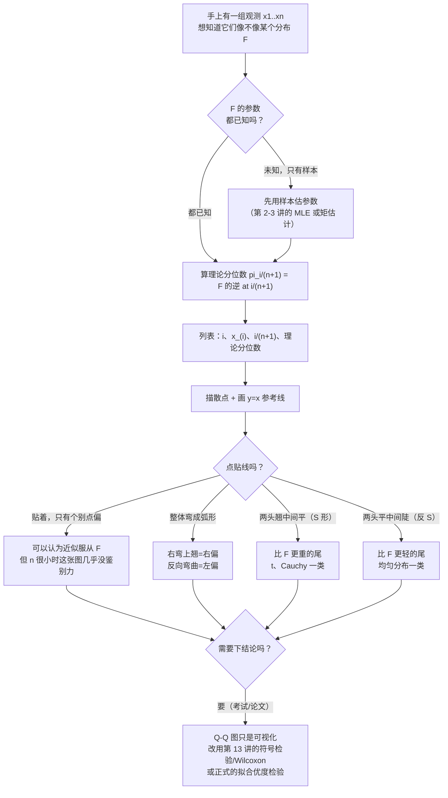
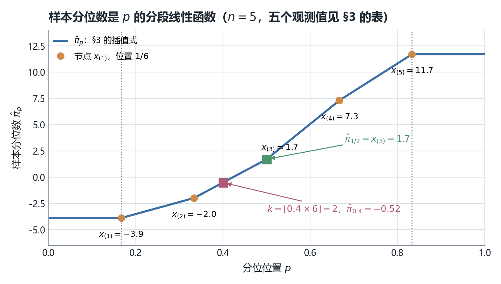
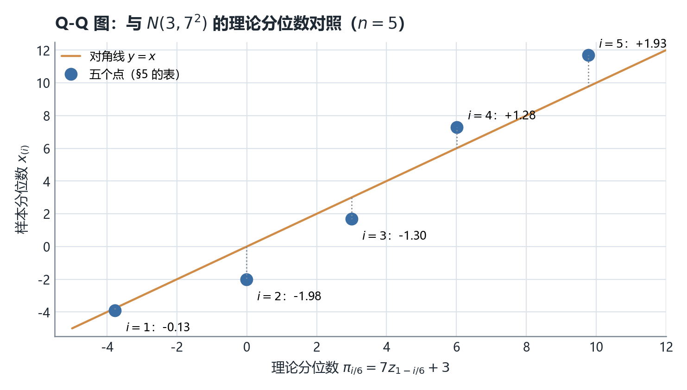
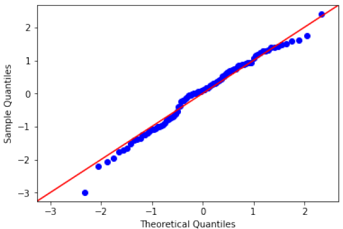
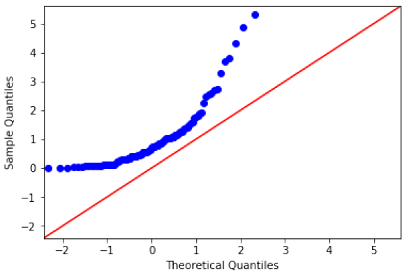
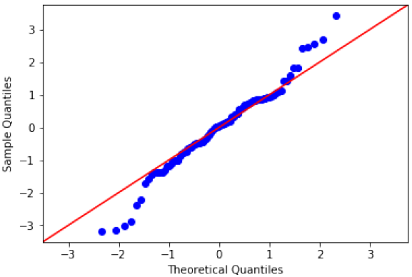
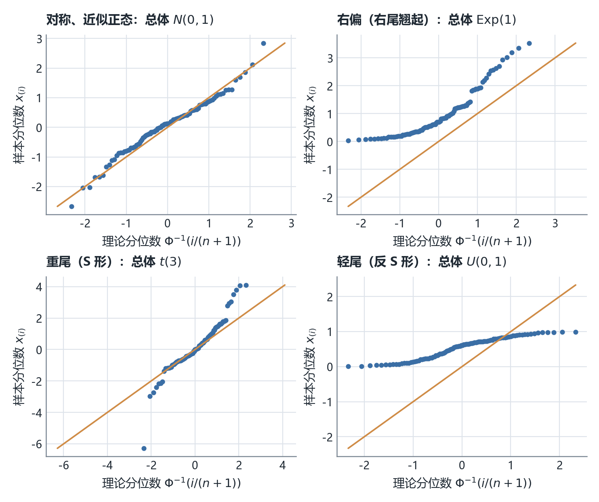

# STA2002 概率与统计 II · 第 11 讲笔记
## Quantile and Q-Q Plots（分位数与分位数图：不知道分布长什么样时，怎么描述和检验一份数据）

> 授课：Zhenxing Guo、Ka Wai Tseng（香港中文大学（深圳）数据科学学院，2026 年 10 月）
> 教材：Hogg, Tanis & Zimmerman (2015) *Probability and Statistical Inference*, 9th ed., Pearson
> 对应教材章节：**§6.3 Order Statistics**（讲义第 2 页给出 "Suggested reading: Chapter 6.3 of the textbook"）。我在教材里核对过：样本分位数的插值公式、肥皂重量例题、以及 q–q 图的定义都在 §6.3（教材第 261–263 页），指向准确。要额外留意的是，教材 §6.1–6.2 也讲百分位数与箱线图，但用的是"位置 $(n+1)p$ 的加权平均"这一套，与本讲公式同源；而**教材画 q–q 图时把样本分位数放在横轴、理论分位数放在纵轴，与本讲的坐标方向正好相反**（见 §13）。
> 材料构成：讲义 `Lecture11 - Quantile and Q-Q plots.pdf`（**18 页**），笔记内容**完全基于课件（PDF）整理**，本讲没有收到板书，全文没有 `【板书 NN】` 标记；凡属我补充、推导或复算的部分，一律用 **【补】** 或 alert 标出，并在文末诚实备注中逐条列出。
> **组织方式**：正文**按讲义（PPT）的页序**撰写，讲义每一页都能在正文里找到对应位置（对照表见 §0）。第 14–17 页的四张 R 输出图我逐张导出原始位图核对过（第 15–17 页三张直接进本笔记，见 §12）；讲义里出现的**每一个数值**（$-0.52$、$1.7$、$-3.77/-0.015/3.00/6.02/9.77$、$0.7833$、$\ln 2=0.6931$、$30\left(\frac19-\frac2{16}+\frac1{25}\right)$）我都独立复算过，全部吻合；另外我查出一处**定义在右端点上不完整**（$p=\frac{n}{n+1}$ 时公式要用到不存在的 $x_{(n+1)}$），见诚实备注第 1 条。

---

## 0. 本讲地图（先说清楚这一讲在干什么）

*这一节回答：第 10 讲给了我们"排第 $k$ 位的那个随机变量"的分布，这一讲要把它反过来用——用排好队的观测值去**估计**总体分位数，并且用"样本分位数 vs 理论分位数"这张散点图去**质疑**任何关于分布形状的假设。*

**三遍阅读路线。** 本讲前半是定义与代数，后半是看图，建议分三遍：

| 遍次 | 读哪里 | 读完应该能 |
| --- | --- | --- |
| 第一遍（主线） | §2（总体分位数）→ §5（样本分位数插值式）→ §7（例题）→ §11（画 Q-Q 图） | 给一组数，算出 $\hat\pi_p$；给一张 Q-Q 图，说出"像不像正态" |
| 第二遍（深化） | §3（$z_\alpha$ 记号）→ §4（为什么位置取 $\frac{k}{n+1}$）→ §8–§9（有偏性的反例） | 解释 $\frac{k}{n+1}$ 的来历、说清"样本分位数为什么不无偏" |
| 第三遍（考前） | §13（形状与坐标轴陷阱）→ §15–§18 | 拿到任意形状的 Q-Q 图能判断偏态/尾重，并知道哪些结论是我补的 |

第一遍刻意跳过两块。**§8–§9 是"无偏性"插曲**：它不改变任何计算公式，只是提醒 $\hat\pi_p$ 不是好得无懈可击的估计量。**§13 是我补的形状对照表**：讲义只给了三张图和三句话，我把四类典型偏离一次画全，并指出教材与本讲坐标方向相反这件事——考前容易翻，但第一遍不必看。

前十讲的抽样分布有一个共同的隐含前提：**先假定总体属于某个分布族**（正态、指数、Gamma……），再在这个族里估参数、做检验。本讲开始处理另一个问题：

1. **族不知道、或者不敢假设时，"中位数""第 90 百分位"这些东西怎么从数据里估出来？** 这就是 §2–§9 的样本分位数（sample quantile）。
2. **怎么用手头的样本去质疑"这组数据来自正态分布"这句话？** 这就是 §10–§14 的 Q-Q 图（quantile–quantile plot）。

两件事共用同一块地基——第 10 讲的顺序统计量，尤其是 $E\!\left[F(X_{(k)})\right]=\frac{k}{n+1}$ 这一条。

| 讲义页 | 内容 | 本笔记 | 配图 |
| --- | --- | --- | --- |
| 第 1 页 | 封面 | —— | — |
| 第 2 页 | Introduction：本讲覆盖什么 | §1 | — |
| 第 3 页 | 总体分位数 $\pi_p$ 的定义、中位数/四分位/$z_\alpha$ | §2 | — |
| 第 4 页 | 正态总体 $\pi_p=\sigma z_{1-p}+\mu$；提出问题：不知分布怎么办 | §3、§4 | — |
| 第 5 页 | 用 $E(F(X_{(k)}))=\frac{k}{n+1}$ 引出 $\hat\pi_{k/(n+1)}=x_{(k)}$ | §4 | — |
| 第 6 页 | 线性插值定义样本分位数 $\hat\pi_p$ | §5 | — |
| 第 7 页 | 中位数特例：$n$ 奇 / $n$ 偶 | §6 | 图 6.1 |
| 第 8 页 | 例题：五个数，算 $\hat\pi_{1/2}$ 与 $\hat\pi_{0.4}$ | §7 | — |
| 第 9 页 | 延伸：$\hat\pi_p$ 未必无偏；Exp(1) 的反例题 | §8 | — |
| 第 10–11 页 | 反例的完整计算：$E[X_{(3)}]=0.7833\ne\ln2$ | §9 | — |
| 第 12 页 | Q-Q 图的动机与构造 | §10 | — |
| 第 13–14 页 | 例题：与 $N(3,7^2)$ 的 Q-Q 图（含 R 输出） | §11 | 图 11.1 |
| 第 15 页 | 评价：拟合良好（含图） | §12.1 | 图 12.1 |
| 第 16 页 | 评价：右尾偏重（含图） | §12.2 | 图 12.2 |
| 第 17 页 | 评价：重尾（含图） | §12.3 | 图 12.3 |
| 第 18 页 | Summary：三条结论 + "可视化不是检验" | §14 | — |
| — | 形状对照与坐标轴陷阱、速查表、核心直觉、术语对照、诚实备注 | §13、§15–§18 | 图 13.1 |

### 0.1 一句话概括本讲的结构

> [!IMPORTANT]
> **"位置 $\frac{k}{n+1}$"是本讲唯一的支点，其余全是它的推论。** 第 10 讲告诉我们 $F(X_{(k)})\sim\mathrm{Beta}(k,n-k+1)$，于是 $E\!\left[F(X_{(k)})\right]=\frac{k}{n+1}$。这句话翻译成操作语言就是三条：
> ① **估计**：$x_{(k)}$ 就是 $\pi_{k/(n+1)}$ 的估计，中间的值靠线性插值（§5–§6）；
> ② **画图**：把 $x_{(i)}$ 对 $\pi_{i/(n+1)}=F^{-1}\!\left(\frac{i}{n+1}\right)$ 描点，若假设成立，点应贴着 $y=x$（§10–§11）；
> ③ **判图**：偏离的形状有规律——翘右尾是右偏、两头翘是重尾（§12–§13）。
> 而第 10 讲同时给了警告：$E[X_{(k)}]\ne F^{-1}\!\left(\frac{k}{n+1}\right)$，所以 ① 只是"roughly"，样本分位数**可能有偏**（§8–§9 的反例 $0.7833$ vs $0.6931$）。

### 0.2 与本讲关系最近的三处往讲接口（这张表是我整理的，讲义没有画）

| 往讲留下的线 | 本讲在哪里接上 |
| --- | --- |
| 第 1 讲：分布函数 $F$ 与分位数 $\pi_p$（$F(\pi_p)=p$）、$z_\alpha$ 记号 | 第 3–4 页把 $\pi_p$ 正式写成 $\pi_p=\sigma z_{1-p}+\mu$，并说明 $F$ 已知时 $\pi_p=F^{-1}(p)$ |
| 第 2 讲：箱线图、五数概括（用样本四分位描述数据） | 第 5–8 页给出"四分位数到底怎么算"的官方口径，本笔记 §7.2 把例题的五数概括补齐 |
| 第 10 讲：$F(X_{(k)})\sim\mathrm{Beta}(k,n-k+1)$、$E(F(X_{(k)}))=\frac{k}{n+1}$ | 第 5 页原文直接以 "Recall that ..." 开头引用它，整个样本分位数的定义建立在这条之上；第 9 页的"有偏"警告也来自同一处 |

第 6–9 讲（检验与功效）在本讲只以"H0 假设"的口吻出现一次（第 15–17 页把"数据来自标准正态"写成 $H_0$），但讲义第 18 页明确说 Q-Q 图**不是**严格的检验——真正的非参数检验在第 13 讲。

### 0.3 拿到"这组数据像不像某个分布"这类题，怎么走

**这张图是我整理的，讲义没有画。** 三个关键分岔：参数已知还是未知（决定理论分位数怎么算）、贴不贴线（决定后续判断）、要不要严格结论（决定是继续看图还是换检验）。最后那个分岔对应讲义第 18 页原话 "Q-Q plot is a visualization tool instead of rigorous hypothesis testing"。

### 0.4 来源标注约定

- 无标记 → 讲义原文或对讲义的直接展开；
- **【补】** → 讲义没有、由我补充、推导或复算的内容（文末诚实备注逐条列出）；
- alert → 同为补充，标题写明它属于哪一类（补充 / 技巧 / 重要 / 课件笔误 / 注意）。

---

## 1. 本讲要交付什么（讲义第 2 页）

讲义第 2 页原文：

> In this lecture we will discuss
> Quantile or percentile
> Quantile-Quantile (Q-Q) plots
> Suggested reading: Chapter 6.3 of the textbook

两个主题的关系是"一个工具 + 一个用途"：**分位数**（quantile / percentile）是描述分布的位置刻度，**Q-Q 图**是把两组刻度放在一起比较的图。讲义把顺序排成"先定义刻度（第 3–11 页）、再用刻度做比较（第 12–17 页）"，第 18 页收尾。

> [!NOTE] 补充：为什么"分位数"在统计里比"均值"更常被拿来做这件事
> 【补】均值依赖加减运算，遇到重尾数据会被极端值拖走（第 6 讲之后反复见过这个毛病）。分位数只依赖**排序**，对极端值天然稳健。而排序正是第 10 讲的顺序统计量，所以"分位数的理论"和"顺序统计量的理论"其实是同一件事的两面——这也是本讲开头就要 "Recall that $F(X_{(k)})\sim\mathrm{Beta}(\cdot)$" 的原因。

---

## 2. 总体分位数的定义（讲义第 3 页）

讲义第 3 页的定义原文：

> **Definition.** The $p$-th quantile or $100p$-th percentile of a distribution with CDF $F$ is the value $\pi_p$ such that $F(\pi_p)=\Pr(X\le\pi_p;\,X\sim F)=p$.

**分位数**（quantile）或**百分位数**（percentile）就是把"累积概率达到 $p$"的那个**取值**找出来。三个要点：

1. **$p$ 是概率（$0<p<1$），$\pi_p$ 是数据单位。** 说"第 90 百分位"时，$p=0.9$ 是"左边有 90% 的概率质量"，$\pi_{0.9}$ 则和原始数据同量纲。两者永远不要混着写。
2. **定义是"求 $F$ 的反函数"**：$\pi_p=F^{-1}(p)$。若 $F$ 有平坦段或跳跃，$F^{-1}$ 不唯一，严格写法是 $\pi_p=\inf\{x:F(x)\ge p\}$；本讲全程假设 $F$ 连续且严格递增，所以不用管这个技术细节。
3. **三个专门的名字**（讲义第 3 页的例子段）：$p=\frac12$ 时 $\pi_{1/2}$ 叫**中位数（median）**；$p=\frac14,\frac34$ 时叫**第一/第三四分位数（first / third quartile）**；$z_\alpha$ 是标准正态的 $(1-\alpha)$ 分位数。

**$z_\alpha$ 这条最容易记反，值得单独立一个表。**【补】按讲义约定（第 3 页 "The critical value $z_\alpha$ is the $(1-\alpha)$-th quantile"），下标 $\alpha$ 指的是**右尾面积**：

| 记号 | 含义 | 数值 |
| --- | --- | --- |
| $z_{0.05}$ | $\Pr(Z>z_{0.05})=0.05$，即 $0.95$ 分位数 | $1.6449$ |
| $z_{0.025}$ | $0.975$ 分位数 | $1.9600$ |
| $z_{0.5}$ | $0.5$ 分位数 = 中位数 | $0$ |
| $z_{1-p}$ | $p$ 分位数 | $\Phi^{-1}(p)$ |

**最后一行是本讲的关键翻译**：$\Phi^{-1}(p)=z_{1-p}$。第 4 页的公式 $\pi_p=\sigma z_{1-p}+\mu$ 用的正是它。

> [!CAUTION] 注意：两套下标口径指的是同一个数，不是相反数
> 【补】两套教材体系并存：一套写 $z_p=\Phi^{-1}(p)$（"下标 = 左边面积"），本讲与 Hogg 教材写 $z_\alpha$ = 右尾面积 $\alpha$ 的分位点（"下标 = 右边面积"）。**同一个数在两套体系里下标互补**：本讲的 $z_{0.05}=1.6449$，在另一套里写作 $z_{0.95}$。第 4–5 讲的置信区间、第 6–9 讲的检验都按本讲这套走，第 11 讲的 $\pi_p=\sigma z_{1-p}+\mu$ 也按这套。做数值题时先确认下标口径，再看表。

---

## 3. 正态总体的分位数公式（讲义第 4 页）

讲义第 4 页的推导原文：

> Consider the $p$-th quantile of $X$, $X\sim N(\mu,\sigma^2)$. $p=\Pr(X\le\pi_p)=\Pr\left(Z\le\frac{\pi_p-\mu}{\sigma};\,Z\sim N(0,1)\right)$. Then, $\frac{\pi_p-\mu}{\sigma}=z_{1-p}$. Thus, the $p$-th quantile of $X$ is given by $\pi_p=\sigma z_{1-p}+\mu$.

**四步的落点**【补】：第一步是定义 $\Pr(X\le\pi_p)=p$；第二步是标准化 $Z=\frac{X-\mu}{\sigma}$（第 1 讲的老技巧，把不等式两边同减 $\mu$ 同除 $\sigma$）；第三步说"标准正态在 $\frac{\pi_p-\mu}{\sigma}$ 处左边面积是 $p$"，按 §2 的翻译表这就是 $z_{1-p}$；第四步解出 $\pi_p$。

**这条公式的形状比结论更重要**：$\pi_p=\mu+\sigma\cdot(\text{只依赖 }p\text{ 的数})$。也就是说，**正态族里所有分位数都是标准正态分位数的仿射变换**。这正是 Q-Q 图能工作的原因——如果数据真的来自某个 $N(\mu,\sigma^2)$，把样本分位数对"标准正态分位数"描点，得到的应该是一条斜率 $\sigma$、截距 $\mu$ 的直线；讲义第 13 页把 $\mu,\sigma$ 直接取成 $3,7$，于是参考线退化成 $y=x$。

讲义第 4 页末尾还给了通用一句：

> When CDF is known, the quantile can be obtained by solving $F(\pi_p)=p\Rightarrow\pi_p=F^{-1}(p)$

然后抛出本讲的核心问题：

> **Question:** Given a sample or observed data without knowing the distribution, how can we estimate $\pi_p$?

---

## 4. 不知道分布时怎么办：把顺序统计量反过来用（讲义第 4–5 页）

讲义第 5 页的原文（"Recall" 就是第 10 讲的结论）：

> Recall that $F(X_{(k)})\sim\mathrm{Beta}(k,n-k+1)$, so we have $E(F(X_{(k)}))=\frac{k}{n+1}$. For the $k$-th order statistics $x_{(k)}$ of the observations, we roughly have $x_{(k)}\approx F^{-1}\!\left(\frac{k}{n+1}\right)$. A good and natural estimate for $\pi_{k/(n+1)}$ is $\hat\pi_{k/(n+1)}=x_{(k)}$.

**这段推理有三层，中间那层是"roughly"，不是等号。**【补】

1. **精确层**：$E\!\left[F(X_{(k)})\right]=\frac{k}{n+1}$ 是第 10 讲 Beta 分布的均值公式给的，**恒等式，无近似**。它说的是"$X_{(k)}$ 平均落在总体的第 $\frac{k}{n+1}$ 分位上"。
2. **近似层**：把 $F$ 当成可逆的确定性函数搬到外面去，得到 $x_{(k)}\approx F^{-1}\!\left(\frac{k}{n+1}\right)$。**这一步不严格**，因为 $E[F(Y)]\ne F(E[Y])$（Jensen），反过来 $E[Y]\ne F^{-1}(E[F(Y)])$ 也一样不成立。讲义自己写了 "roughly"，第 9 页还会专门回来打这个补丁（§8）。
3. **定义层**：既然第 $k$ 小的观测"大约"对应第 $\frac{k}{n+1}$ 分位，就直接把 $\hat\pi_{k/(n+1)}:=x_{(k)}$ 定为估计。

**为什么分母是 $n+1$ 而不是 $n$？**【补】这是初学者最常问的一句。三个理由，第一个是硬的：

- **由 Beta 均值来的**：$\frac{k}{n}$ 没有任何定理支撑，$\frac{k}{n+1}$ 是 $E[F(X_{(k)})]$ 的**精确值**。
- **边界好看**：$k=n$ 时 $\frac{n}{n+1}<1$，承认"样本最大值通常达不到总体上界"（第 10 讲 §11 的 $E(U_{(n)})=\frac{n}{n+1}$）；用 $\frac kn$ 会强行让最后一个点落在 $p=1$。
- **对称**：位置 $\frac{k}{n+1}$ 与 $\frac{n+1-k}{n+1}$ 关于 $\frac12$ 对称，与 $U_{(k)}$、$1-U_{(n+1-k)}$ 同分布这件事一致。

> [!TIP] 技巧：k/(n+1) 这类取点有个名字叫 plotting position
> 【补】软件里这一族取点还有别的写法（$\frac{k-0.5}{n}$、$\frac{k-1}{n-1}$、$\frac{k-3/8}{n+1/4}$ 等），统称**描点位置（plotting position）**。本讲与教材用的是 $\frac{k}{n+1}$ 这一支，考试按它算；用 `numpy`/`R` 复现时要显式指定口径，否则默认值会给出不同的数（§7.3 给了对照表）。

---

## 5. 样本分位数的插值定义（讲义第 6 页）

第 4 节只定义了 $n$ 个离散位置 $\frac{1}{n+1},\ldots,\frac{n}{n+1}$ 上的估计。讲义第 6 页补上中间的值，原文：

> For any $p\in\left[\frac{1}{n+1},\frac{n}{n+1}\right]$, let $k=\lfloor p(n+1)\rfloor$, then $\frac{k}{n+1}\le p<\frac{k+1}{n+1}$. Consider the linear interpolation between $\hat\pi_{k/(n+1)}=x_{(k)}$ and $\hat\pi_{(k+1)/(n+1)}=x_{(k+1)}$:
> $$\frac{\hat\pi_p-x_{(k)}}{p-\frac{k}{n+1}}=\frac{x_{(k+1)}-x_{(k)}}{\frac{k+1}{n+1}-\frac{k}{n+1}}.\qquad(1)$$
> **Definition.** The $p$-th sample quantile is defined as $\hat\pi_p=x_{(k)}+\bigl(p(n+1)-k\bigr)\bigl(x_{(k+1)}-x_{(k)}\bigr)$, where $k=\lfloor p(n+1)\rfloor$ and $p\in\left[\frac1{n+1},\frac n{n+1}\right]$. Define $\hat\pi_p=x_{(1)}$ for $p<\frac1{n+1}$ and $\hat\pi_p=x_{(n)}$ for $p>\frac n{n+1}$.

**从方程 (1) 到定义式的代数**【补】：方程 (1) 右边分母是 $\frac{k+1}{n+1}-\frac{k}{n+1}=\frac{1}{n+1}$，所以右边 $=(n+1)(x_{(k+1)}-x_{(k)})$。乘过去：

$$\hat\pi_p=x_{(k)}+\left(p-\frac{k}{n+1}\right)(n+1)\bigl(x_{(k+1)}-x_{(k)}\bigr)=x_{(k)}+\bigl(p(n+1)-k\bigr)\bigl(x_{(k+1)}-x_{(k)}\bigr).\qquad\checkmark$$

**读法**：$h:=p(n+1)$ 是"位置落在第几个节点之间"的连续版本，$k=\lfloor h\rfloor$ 是左端节点，$h-k\in[0,1)$ 是往右走的**比例**。所以 $\hat\pi_p$ 是 $x_{(k)}$ 与 $x_{(k+1)}$ 的加权平均，权重为 $(1-(h-k))$ 与 $(h-k)$。教材 §6.3 用的正是同一套（肥皂例题：$(12+1)(0.25)=3.25$ → $\hat q_1=0.75y_3+0.25y_4=1021.75$，我复算吻合）。

> [!WARNING] 课件笔误：定义在右端点 p=n/(n+1) 处不完整
> 讲义写 $p\in\left[\frac1{n+1},\frac n{n+1}\right]$ 是**闭区间**，但在这个右端点上 $h=p(n+1)=n$、$k=\lfloor n\rfloor=n$，定义式里出现了 $x_{(k+1)}=x_{(n+1)}$——**不存在的第 $n+1$ 个顺序统计量**。此时系数 $h-k=0$，按极限读法答案应当是 $x_{(n)}$，与讲义下一句"$p>\frac n{n+1}$ 时取 $x_{(n)}$"接得上，所以数值上没有真正的错，但**定义本身要写成左闭右开 $\left[\frac1{n+1},\frac n{n+1}\right)$，或者把 $p=\frac n{n+1}$ 单独列出**。判据：我用讲义公式直接写代码算 $n=5,p=\frac56$，程序在索引 $x_{(6)}$ 处越界报错；把 $k\ge n$ 特判为 $x_{(n)}$ 才能跑通（脚本 `_scripts/STA2002-L11_figs.py` 里就留了这个特判）。

---

## 6. 中位数特例：$n$ 奇与 $n$ 偶（讲义第 7 页）

讲义第 7 页把 $p=\frac12$ 代进定义，原文：

> When $n$ is odd and $p=1/2$, then $p(n+1)=(n+1)/2$ is an integer, so $\hat\pi_{1/2}=X_{((n+1)/2)}$.
> When $n$ is even and $p=1/2$, then $k=\lfloor p(n+1)\rfloor=\lfloor(n+1)/2\rfloor=n/2$, so $\hat\pi_{1/2}=\dfrac{X_{(n/2)}+X_{(n/2+1)}}{2}$.

**两条各自为什么成立**【补】：

- **$n$ 奇**：$h=\frac{n+1}{2}$ 是整数，$k=h$、$h-k=0$，插值退化，$\hat\pi_{1/2}=x_{(k)}=x_{((n+1)/2)}$——就是"正中间那个观测"。
- **$n$ 偶**：$h=\frac{n+1}{2}=m+\frac12$（$m=\frac n2$），于是 $k=m$、$h-k=\frac12$，$\hat\pi_{1/2}=x_{(m)}+\frac12(x_{(m+1)}-x_{(m)})=\frac{x_{(m)}+x_{(m+1)}}2$——"中间两个的平均"。

**这正是第 2 讲箱线图里那条中线的算法**，也是绝大多数软件的中位数定义；换句话说，本讲的插值口径不是冷门约定，它把"中位数"这个常识推广到了任意 $p$。

> [!NOTE] 补充：第 7 页有两处排版/记号小瑕疵
> 【补】① 第二行原文写作 "$k=\lfloor p(n+1)\rfloor=\lfloor(n+1)/2\rfloor=n/2$"，中间那个 $\lfloor(n+1)/2\rfloor$ 的右括号排成了左括号（"⌊(n+1)/2⌊"），是 LaTeX 笔误，不影响读法。② 这一页用**大写** $X_{(k)}$ 表示"观测的顺序统计量"，而第 5–6 页用小写 $x_{(k)}$；按第 10 讲建立的约定，大写是随机变量、小写是实现值。讲义在这里混用了，本笔记统一用小写表示观测值。

图 6.1 把 §5 的定义画成函数——$\hat\pi_p$ 随 $p$ 变化长什么样。

*图 6.1　$n=5$、五个观测值为 $-3.9,-2.0,1.7,7.3,11.7$ 时，$\hat\pi_p$ 作为 $p$ 的函数（我绘制；节点位置 $\frac{i}{6}$、节点值 $x_{(i)}$，节点之间按 §5 的插值式连线）。三个特征：① 五个节点之间是**直线段**；② $p<\frac16$ 与 $p>\frac56$ 两段是**水平线**（讲义规定分别取 $x_{(1)}$ 与 $x_{(5)}$），意味着"外推"永远得不到比样本极值更极端的数；③ 图中标出的两点正是 §7 例题的答案 $\hat\pi_{0.4}=-0.52$ 与 $\hat\pi_{1/2}=1.7$*

---

## 7. 例题：算样本中位数与 $\hat\pi_{0.4}$（讲义第 8 页）

### 7.1 题目与解答（讲义第 8 页）

讲义第 8 页给了一张表（$n=5$）：

| $i$ | $x_{(i)}$ | $\frac{i}{n+1}$ |
| --- | --- | --- |
| 1 | $-3.9$ | $1/6$ |
| 2 | $-2.0$ | $2/6$ |
| 3 | $1.7$ | $3/6$ |
| 4 | $7.3$ | $4/6$ |
| 5 | $11.7$ | $5/6$ |

> **Please compute** sample median and sample quantile $\hat\pi_{0.4}$.
> Based on our formula, the sample median is $\hat\pi_{1/2}=x_{(3)}=1.7$.
> As $k=\lfloor0.4\times6\rfloor=\lfloor2.4\rfloor=2$, $\hat\pi_{0.4}=x_{(2)}+(0.4\times6-2)(x_{(3)}-x_{(2)})=-2+0.4\times3.7=-0.52$.

**逐步核对**【补】：$n=5$ 奇 → 中位数取正中间 $x_{(3)}=1.7$ ✓。$h=0.4\times6=2.4$ → $k=2$、$h-k=0.4$；$x_{(3)}-x_{(2)}=1.7-(-2.0)=3.7$；$0.4\times3.7=1.48$；$-2.0+1.48=-0.52$ ✓ 我复算一致。

**注意 $\hat\pi_{0.4}$ 落在哪**：它在 $x_{(2)}$ 与 $x_{(3)}$ 之间，离 $x_{(2)}$ 更近（权重 0.6 对 0.4），值 $-0.52$ 也确实离 $-2.0$ 比离 $1.7$ 近 ✓。这是检查自己算错的最好办法：**结果必须夹在两个节点之间，且偏向权重大的那一侧**。

### 7.2 顺手把这组数据的五数概括补齐（【补】）

| 量 | 计算 | 值 |
| --- | --- | --- |
| 最小值 $x_{(1)}$ | 直接 | $-3.9$ |
| 第一四分位 $\hat\pi_{0.25}$ | $h=0.25\times6=1.5$，$k=1$ → $x_{(1)}+0.5(x_{(2)}-x_{(1)})$ | $-2.95$ |
| 中位数 $\hat\pi_{0.5}$ | $x_{(3)}$ | $1.7$ |
| 第三四分位 $\hat\pi_{0.75}$ | $h=4.5$，$k=4$ → $x_{(4)}+0.5(x_{(5)}-x_{(4)})$ | $9.5$ |
| 最大值 $x_{(5)}$ | 直接 | $11.7$ |
| 四分位距 IQR | $9.5-(-2.95)$ | $12.45$ |

**这组数明显右偏**：中位数 $1.7$ 到最大值 $11.7$ 的距离是 $10.0$，到最小值 $-3.9$ 只有 $5.6$；上四分位与中位数差 $7.8$，下四分位与中位数差 $4.65$。这个印象在第 13 节的 Q-Q 图上会变成看得见的弯曲——**而本讲的例题（§11）却用同一组数得出了"像 $N(3,7^2)$"的结论**，两者的张力值得留意（见 §11.3）。

### 7.3 同一道题，不同软件口径给出不同的数（【补】）

$\hat\pi_{0.4}$ 不是数据的内在属性，而是"数据 + 口径"的产物。我实测了三种：

| 口径 | 位置公式 | 本题 $p=0.4$ 的结果 | 备注 |
| --- | --- | --- | --- |
| **本讲 / 教材 §6.3** | $h=p(n+1)$，$k=\lfloor h\rfloor$ | $-0.52$ | 即 `numpy` 的 `method='weibull'`、`R` 的 `type=4` |
| `numpy` 默认 / `R` type 7 | $h=1+p(n-1)$ | $0.22$ | 位置用 $\frac{k-1}{n-1}$，两端正好取到 $p=0,1$ |
| Hazen / $\frac{k-0.5}{n}$ | 中点位置 | 另一值 | 概率纸常用 |

**结论：拿到别人算的分位数，先问口径。** 我在 `_scripts/STA2002-L11_figs.py` 末尾同时打印了 $-0.52$（本讲）与 $0.22$（`numpy` 默认），两者都对，只是定义不同。考试按讲义口径（$-0.52$）作答。

---

## 8. 延伸讨论：$\hat\pi_p$ 未必无偏（讲义第 9 页）

讲义第 9 页原文：

> We have shown that $E(F(X_{(k)}))=\frac{k}{n+1}$, but we **DO NOT** have $E(X_{(k)})=F^{-1}\!\left(\frac{k}{n+1}\right)$. Thus, sample quantile $\hat\pi_p$ may not be an unbiased estimator for $\pi_p$.
> **Example.** Let $X_1,X_2,X_3,X_4,X_5\overset{\text{i.i.d.}}{\sim}\mathrm{Exp}(1)$. Show that the sample median $X_{(3)}$ is not an unbiased estimator of $m=\pi_{1/2}$.

**"DO NOT" 那三个大写字母在警告什么**【补】：警告的是 §4 第 2 层那个不严格的搬运。$E[F(Y)]=c$ 只说明"$F(Y)$ 的期望是 $c$"，要得到 $E[Y]$ 必须先把 $F^{-1}$ 放进期望里，而 $F^{-1}$ 一般非线性，$\mathbb{E}[F^{-1}(Y)]\ne F^{-1}(\mathbb{E}[Y])$（Jensen）。**只有当 $F^{-1}$ 是线性时才成立，也就是总体本身是均匀分布的仿射变换时**。

反例选 $\mathrm{Exp}(1)$ 很讲究：指数分布的 $F^{-1}(p)=-\ln(1-p)$ 是**凸函数**，凸函数的期望大于期望的函数值，所以可以预判 $E[X_{(3)}]$ 会**偏大**——讲义下一页算出的正是这个方向。

> [!TIP] 练习 8.1
> 【补】不用计算，判断 $n=5$、总体 Uniform(0,1) 时 $E[X_{(3)}]$ 与 $\pi_{1/2}=0.5$ 的大小关系。
> **参考答案。** 相等，$E[X_{(3)}]=\frac{3}{6}=0.5$。因为此时 $F^{-1}(p)=p$ 是线性的，"把 $F^{-1}$ 搬进期望"合法。这与 §8 的指数例子形成对照：**无偏与否取决于总体形状，不取决于 $n$**。

---

## 9. 反例的完整计算：$E[X_{(3)}]=0.7833$ 而 $\ln2=0.6931$（讲义第 10–11 页）

### 9.1 密度（讲义第 10 页）

讲义第 10 页原文：

> For $\mathrm{Exp}(1)$, the CDF and PDF of $X_i$ is $F(x)=1-e^{-x}$, $f(x)=e^{-x}$, $x>0$. For $k=3$, $n=5$, the PDF of $X_{(3)}$ is
> $$f_{X_{(3)}}(x)=\frac{5!}{2!\cdot2!}\left[1-e^{-x}\right]^{2}\left[e^{-x}\right]^{2}e^{-x}=30\left[1-e^{-x}\right]^{2}e^{-3x}=30\left(e^{-3x}-2e^{-4x}+e^{-5x}\right).$$

**每一步的来源**【补】：这是第 10 讲定理的直接代入——系数 $\frac{n!}{(k-1)!\,1!\,(n-k)!}=\frac{5!}{2!\,1!\,2!}=30$；$[F]^{k-1}=(1-e^{-x})^2$；$f=e^{-x}$；$[1-F]^{n-k}=(e^{-x})^2$。讲义把 $1-F(x)=e^{-x}$ 这一步算对了（指数分布的"右边概率"恰好还是指数尾，这是它被选作例题的另一个原因）。展开 $(1-e^{-x})^2=1-2e^{-x}+e^{-2x}$，乘 $e^{-3x}$ 得三项 ✓。归一性我数值验过：$\int_0^\infty f=1.000000$ ✓。

### 9.2 期望（讲义第 10–11 页）

> $E[X_{(3)}]=\int_0^\infty x\cdot30(e^{-3x}-2e^{-4x}+e^{-5x})\,dx=30\left[\int_0^\infty xe^{-3x}dx-2\int_0^\infty xe^{-4x}dx+\int_0^\infty xe^{-5x}dx\right]$
> Recall: $\int_0^\infty xe^{-ax}dx=\frac1{a^2}$, $a>0$. Apply: $E[X_{(3)}]=30\left(\frac1{3^2}-2\cdot\frac1{4^2}+\frac1{5^2}\right)=30\left(\frac19-\frac2{16}+\frac1{25}\right)\approx0.7833$
> True population median of $\mathrm{Exp}(1)$: $F(m)=1-e^{-m}=\frac12\Rightarrow m=\ln(2)\approx0.6931$. Therefore, the sample median $X_{(3)}$ is a biased estimator for $m$.

**$\int_0^\infty xe^{-ax}dx=\frac1{a^2}$ 从哪来**【补】：Gamma 积分 $\int_0^\infty x^{s-1}e^{-ax}dx=\frac{\Gamma(s)}{a^s}$，取 $s=2$、$\Gamma(2)=1!=1$。也可以理解为 $\mathrm{Gamma}(\text{shape}=2,\text{rate}=a)$ 的密度积分为 1、其均值为 $\frac{s}{a}=\frac2a$，反推 $\int x\cdot a^2xe^{-ax}dx=\frac2a$ → $\int xe^{-ax}dx=\frac2{a^3}\cdot\frac{a^2}{2}=\frac1{a^2}$ ✓。

**逐项核对**【补】：$\frac19=0.111111$、$\frac2{16}=0.125$、$\frac1{25}=0.04$，和为 $0.026111$，乘 30 得 $0.783333$ ✓ 与讲义 $0.7833$ 一致。$\ln2=0.693147$ ✓。**偏差 $=0.7833-0.6931=+0.0902$**，相对偏差约 $13\%$——不是四舍五入能解释的量级，是真正的有偏。

**我用两种方式独立复核**：① 直接对 $f_{X_{(3)}}$ 数值积分，$E=0.783333$ ✓；② 40 万组模拟（`rng.exponential(1,(400000,5))` 排序取第三个），得 $0.78355$ ✓。

> [!IMPORTANT] 重要：有偏的是"均值"，中位数意义下它反而正好
> 【补】同一批模拟数据里，$X_{(3)}$ 的**中位数**是 $0.6936$，与真中位数 $\ln2=0.6931$ 吻合到小数点后三位。原因是 Beta 对称性：$F(X_{(3)})\sim\mathrm{Beta}(3,3)$ 关于 $\frac12$ 对称，所以 $X_{(3)}$ 的中位数恰好落在总体的中位数上。这给出一条实用区分——**"样本中位数是中位数的无偏估计"在对称总体成立、在指数总体不成立，但"样本中位数的中位数等于总体中位数"却普遍成立**。做选择题时，"unbiased"（讲期望）和"median-unbiased"（讲中位数）是两个不同的判断。

---

## 10. Q-Q 图的动机（讲义第 12 页）

讲义第 12 页原文：

> Given a sample $\{x_1,\ldots,x_n\}$, we suspect whether they are coming from a common distribution, say normal, exponential, or gamma distribution. Recall that if $X_1,\cdots,X_n\overset{\text{i.i.d.}}{\sim}F$, then $F(X_{(i)})\sim\mathrm{Beta}(k,n-k+1)$, $E(F(X_{(i)}))=\frac{i}{n+1}$. If the sample comes from distribution $F$, then the scatter plot of the pairs $\left(F(x_{(i)}),\frac{i}{n+1}\right)_{i=1}^{n}$ should be close to the diagonal line $y=x$. In reality, we apply $F^{-1}$ on these pairs and draw the scatter plots of $\left(\underbrace{x_{(i)}}_{\text{Sample quantile}},\ \underbrace{F^{-1}\!\left(\frac{i}{n+1}\right)=\pi_{\frac{i}{n+1}}}_{\text{Theoretical quantile}}\right)_{i=1}^{n}$.

**这段是整讲最需要"翻译"的一页，四句话说的是四件事**【补】：

1. **要判断的东西**：数据是否来自某个指定的 $F$（正态、指数、Gamma 都行，Q-Q 图不限于正态）。
2. **理论依据**：若假设成立，则 $F(x_{(i)})$ 的期望是 $\frac{i}{n+1}$。
3. **第一个图（讲义没画）**：把 $(F(x_{(i)}),\frac{i}{n+1})$ 描出来应贴近 $y=x$。$F(x_{(i)})$ 其实就是**经验分布函数**在节点上的取值 $\frac{i}{n}$ 的兄弟，所以这一步的图等价于"ECDF 与假设的 $F$ 是否重合"。
4. **实际画的图**：两边同时套 $F^{-1}$（单调变换不改变"贴不贴线"这件事的本质），得到 $(x_{(i)},\pi_{i/(n+1)})$——**纵轴样本分位数、横轴理论分位数**（讲义第 13–14 页的表与图按这个方向画，见 §11）。

> [!NOTE] 补充：第 12 页有一处下标串了
> 【补】原文 "$F(X_{(i)})\sim\mathrm{Beta}(k,n-k+1)$" 左边用 $i$、右边用 $k$，两者指同一个位置，应为 $\mathrm{Beta}(i,n-i+1)$。同一句里 $E(F(X_{(i)}))=\frac{i}{n+1}$ 用的是 $i$，是对的。不影响理解，但抄公式时容易顺手抄错。

---

## 11. 画一张 Q-Q 图：例题（讲义第 13–14 页）

### 11.1 列表（讲义第 13 页）

讲义第 13 页给了一张完整的三步表，我把它连同复核结果一起列出（数据沿用 §7 那五个数，假设 $N(3,7^2)$，即 $\mu=3$、$\sigma=7$）：

| $i$ | $x_{(i)}$ | $p=\frac{i}{n+1}$ | $z_{1-p}=\Phi^{-1}(p)$ | $\pi_p=\sigma z_{1-p}+\mu$ | 残差 $x_{(i)}-\pi_p$ |
| --- | --- | --- | --- | --- | --- |
| 1 | $-3.9$ | $1/6$ | $-0.9674$ | $-3.77$ | $-0.13$ |
| 2 | $-2.0$ | $2/6$ | $-0.4307$ | $-0.015$ | $-1.99$ |
| 3 | $1.7$ | $3/6$ | $0$ | $3.00$ | $-1.30$ |
| 4 | $7.3$ | $4/6$ | $0.4307$ | $6.02$ | $+1.29$ |
| 5 | $11.7$ | $5/6$ | $0.9674$ | $9.77$ | $+1.93$ |

**最后一列是我加的**（讲义没有算残差）。前四列全部复算吻合：$\Phi^{-1}(1/6)=-0.9674$，$7\times(-0.9674)+3=-3.772$ ✓；$\Phi^{-1}(1/3)=-0.4307$，$7\times(-0.4307)+3=-0.015$ ✓；$p=\frac12$ 时 $z=0$、$\pi=3$ ✓；对称的两个给 $6.015$ 与 $9.772$ ✓。

> [!TIP] 技巧：先查标准正态分位数，再乘标准差加均值
> 【补】$N(\mu,\sigma^2)$ 的分位数没有独立表，全部靠 $\pi_p=\mu+\sigma\Phi^{-1}(p)$ 换算。手算时顺序是：① 写位置 $\frac{i}{n+1}$；② 查/算标准正态分位 $z$；③ 乘 $\sigma$ 加 $\mu$。跳过第 ② 步直接"估"是本题最常见的错源。

### 11.2 描点与结论（讲义第 14 页）

讲义第 14 页只有两行：

> All the five points are close to the diagonal line
> The sample is likely to come from $N(3,7^2)$

图 11.1 是我按 §11.1 的表重画的版本，带残差标注。

*图 11.1　横轴理论分位数 $\pi_{i/6}=7z_{1-i/6}+3$、纵轴样本分位数 $x_{(i)}$（我绘制；数值即 §11.1 的表，橙色线是 $y=x$）。灰点虚线是各点到参考线的**竖直残差**，标在图旁：$-0.13,-1.99,-1.30,+1.29,+1.93$。五点确实都落在 $y=x$ 附近，但注意残差的符号排列是"负负负正正"——中间偏下、两端偏上，这是轻微 S 形（比正态略重尾）的痕迹，与 §7.2 观察到的右偏印象一致*

### 11.3 "close" 到底 close 不 close：给这张图一个量化标准（【补】）

讲义说"五点都靠近对角线"，但没给"靠近"的标准。我算了一个：**如果 $N(3,7^2)$ 是真的，$n=5$ 时残差通常有多大？**

用真模型模拟 20 万组 $n=5$ 样本，排序后与同一批理论分位数相减：

| $i$ | 1 | 2 | 3 | 4 | 5 |
| --- | --- | --- | --- | --- | --- |
| $E[X_{(i)}]$（真模型下） | $-5.145$ | $-0.468$ | $3.000$ | $6.466$ | $11.143$ |
| $\mathrm{SD}[X_{(i)}]$ | $4.682$ | $3.902$ | $3.737$ | $3.900$ | $4.678$ |
| 本例残差 | $-0.13$ | $-1.99$ | $-1.30$ | $+1.29$ | $+1.93$ |
| 残差 $\div$ SD | $-0.03$ | $-0.51$ | $-0.35$ | $+0.33$ | $+0.41$ |

**两个结论**：

1. **本例的残差全部不到 0.51 个标准差**，确实"靠近"——甚至偏近。真模型下"最大残差"的中位数是 $5.744$，而本例只有 $1.985$；模拟显示 $P(\max_i\lvert\text{残差}\rvert\ge1.985)=0.9786$，即**真模型成立时，97.9% 的样本会比这组数据更偏离对角线**。
2. **所以这张图几乎没有任何鉴别力。** $n=5$ 时五个点的散布本身就极大，"贴着线"既不能证明正态、也不能排除别的分布。讲义第 14 页那句 "likely to come from $N(3,7^2)$" 在"无法拒绝"的意义上成立，但它**不是**一个有证据支持的结论。

> [!CAUTION] 注意：不要把"图上看直"当成"分布假设成立"
> 【补】三件容易踩的事：① 小样本（$n<20$）的 Q-Q 图噪声极大，判形主要看**趋势**而不是单点；② 若 $\mu,\sigma$ 是从数据估出来的（第 13 页这题是直接给定的，属于"参数已知"的少数情况），点会更贴线，因为参数本身就是照着数据调的；③ 讲义第 18 页的原话是 "Q-Q plot is a visualization tool instead of rigorous hypothesis testing"——真要下结论得用检验（第 13 讲的符号检验/Wilcoxon 不要求正态，正是为这种情况准备的）。

---

## 12. 评价 Q-Q 图：三个例子（讲义第 15–17 页）

讲义用三张 R 输出的 Q-Q 图示范"怎么读图"。三张图 $H_0$ 都是"数据来自标准正态"，横轴是理论分位数、纵轴是样本分位数（与 §11 同方向），红色线是 $y=x$。三张都是讲义自带的位图，我直接导出原始字节放进笔记，未重画。

### 12.1 拟合良好（讲义第 15 页）

> Hypothesis $H_0$: the data come from a standard normal distribution. This dataset looks like a good fit.

*图 12.1　$n\approx100$ 的标准正态样本（取自讲义第 15 页的 R 输出）。点沿红线密排，中段几乎完全重合；两处值得注意：右上角最后几个点略**低于**红线，左下角有一个孤立点在 $(-2.3,-3)$ 附近——那是一个偏低的离群值，它把左端拉出一个缺口。讲义的判词是 "looks like a good fit"，即**个别点偏离不影响整体判断***

### 12.2 右尾偏重（讲义第 16 页）

> This is a poor fit, since the data is clearly non-negative, and is more likely to take on larger values than normal distribution. Larger "right tail"

*图 12.2　一份非负、右尾比正态长的数据（取自讲义第 16 页的 R 输出）。形状是**向下凹再向上翘的弧**：左端点几乎水平贴在 $y=0$ 附近（因为数据不能为负，最小的一批观测都挤在 0 上），右端点急剧离开红线向上（同样概率位置下，实际观测比正态大得多）。判词的两个证据：横坐标 $-2$ 处纵坐标仍是 $0$（非负），横坐标 $+2$ 处纵坐标已到 $5$ 以上（右尾长）*

### 12.3 重尾（讲义第 17 页）

> This is a poor fit, since the data is more likely to take on extremely large or extremely small values than standard normal. Sampled from a heavy-tailed distribution

*图 12.3　一份对称但比正态更重尾的数据（取自讲义第 17 页的 R 输出）。形状是**S 形**：中间一段斜率接近 1（贴着红线），两端斜率明显变大——左下角最后几个点掉到 $-3$ 以下、右上角几个点冲到 $+3$ 以上。与图 12.2 的区别是关键：图 12.2 只有一端翘（偏态），图 12.3 两端对称地翘（尾重）*

---

## 13. 四类典型形状与一个坐标轴陷阱（【补】整节）

讲义只给了三张图、三种判词（好 / 右尾长 / 重尾）。这一节我把四类常见形状一次画全，并说明**形状与总体偏度、峰度的对应关系**，最后提醒教材与本讲的坐标方向相反。

*图 13.1　四组 $n=100$ 的模拟数据对标准正态画 Q-Q 图（我绘制；seed 20261108，四个总体分别是 $N(0,1)$、$\mathrm{Exp}(1)$、$t(3)$、$U(0,1)$，理论分位数取 $\Phi^{-1}(i/101)$）。左上：对称正态，点沿线随机散布；右上：右偏（指数），整条曲线向下凹、右端急剧上翘，形状与图 12.2 同款；左下：重尾（$t(3)$），S 形、两端斜率大于 1，与图 12.3 同款；右下：轻尾（均匀），**反 S 形**——中间陡、两端被"压平"，因为数据的极值远不如正态那样伸展*

**读图口诀（【补】）**：

| 看到的形状 | 数据的性质 | 常见总体 |
| --- | --- | --- |
| 直线，随机散布 | 与假设分布吻合 | — |
| 向下凹（右端上翘） | 右偏 | Exp、Lognormal、Gamma(形状<1 除外) |
| 向上凸（左端下坠） | 左偏 | 上面那些的镜像 |
| S 形（两端都比线陡） | 尾部比假设重 | $t$、Cauchy |
| 反 S 形（两端都比线平） | 尾部比假设轻 | Uniform、有界支撑 |
| 整体平行于线但不重合 | 位置/尺度不对 | 均值或方差不等于假设值 |

> [!WARNING] 注意：教材把两个轴调了个身，判词也跟着反
> 【补】讲义第 13–14 页与 R 的默认输出都是**横轴理论、纵轴样本**；而教材 §6.3 明确写 "if the sample quantiles are plotted as the **x-coordinates** of the pairs and the $N(0,1)$ quantiles as the **y-coordinates**"，教材的 Figure 6.3-2 也按这个方向画。**横竖一换，"向下凹"会变成"向上凸"**，右偏与左偏的判词跟着互换。所以读图前第一件事是看坐标轴标签，而不是背形状。附带一条：教材还说"斜率的倒数是 $\sigma$ 的好估计"，那是**它的方向**下的说法；在讲义的方向下，斜率本身约等于 $\sigma$、截距约等于 $\mu$。本例（§11.1 的五个点）我实测：按讲义方向拟合 $x_{(i)}\sim\pi$ 得斜率 $1.2164$、截距 $-0.6892$；按教材方向拟合 $\Phi^{-1}\sim x_{(i)}$ 得斜率 $0.7935$，其倒数 $1.2602$——**两个斜率并不互为倒数**（最小二乘对调 $x,y$ 不等价），这是"看图估参数"时另一个容易想当然的地方。

---

## 14. 小结与本讲的边界（讲义第 18 页）

讲义第 18 页的 Summary 原文三条：

> (Theoretical) $p$-th quantile: $F(\pi_p)=\Pr(X\le\pi_p;X\sim F)=p$
> Sample $p$-th quantile: $\hat\pi_p=x_{(k)}+(p(n+1)-k)(x_{(k+1)}-x_{(k)})$, where $k=\lfloor p(n+1)\rfloor$.
> When a Q-Q plot between the sample quantiles of observed data and the theoretical quantiles of a distribution is close to the diagonal line $y=x$, the data is likely to follow the assumed distribution. **Q-Q plot is a visualization tool instead of rigorous hypothesis testing.**

**三条各对应本讲的一块地基**【补】：定义（§2–§3）、估计（§4–§7）、比较（§10–§13）。最后那句加粗是讲义自己给本讲划的边界，值得当成一条"考点"记：

- Q-Q 图给的是**印象与诊断**，不是 $p$ 值。它不能告诉你"在 5% 水平下拒绝正态"。
- 但它是第 13 讲那些非参数检验的**前置动作**：符号检验与 Wilcoxon 符号秩检验之所以有用，正是因为 Q-Q 图告诉你"正态假设可疑"。第 6–7 讲的 $t$ 检验依赖正态（或大样本 CLT），而第 13 讲的方法不依赖——这条判断链是：Q-Q 图（本讲）→ 要不要放弃参数法 → 用哪个非参数方法（第 13 讲）。
- 与本讲并列的另一条路是第 12 讲：不检验形状，而是直接给出**与分布无关的**分位数区间估计。

---

## 15. 一页纸速查表

| 要什么 | 公式 / 做法 | 注意 | 课件位置 |
| --- | --- | --- | --- |
| 总体分位数 | $F(\pi_p)=p$，即 $\pi_p=F^{-1}(p)$ | $p$ 是概率，$\pi_p$ 是数据单位 | 第 3 页 |
| 中位数 / 四分位 | $\pi_{1/2}$；$\pi_{1/4}$、$\pi_{3/4}$ | 分别叫 median、first/third quartile | 第 3 页 |
| $z_\alpha$ 记号 | 标准正态的 $(1-\alpha)$ 分位数 | 下标 = **右尾**面积；$\Phi^{-1}(p)=z_{1-p}$ | 第 3 页 |
| 正态分位数 | $\pi_p=\mu+\sigma z_{1-p}$ | 先查 $z$，再乘 $\sigma$ 加 $\mu$ | 第 4 页 |
| 位置从哪来 | $E\!\left[F(X_{(k)})\right]=\frac{k}{n+1}$ | 第 10 讲 Beta 均值，恒等式 | 第 5 页 |
| 样本分位数 | $\hat\pi_p=x_{(k)}+(p(n+1)-k)(x_{(k+1)}-x_{(k)})$，$k=\lfloor p(n+1)\rfloor$ | $p<\frac1{n+1}$ 取 $x_{(1)}$，$p>\frac n{n+1}$ 取 $x_{(n)}$ | 第 6 页 |
| 样本中位数 | $n$ 奇：$x_{((n+1)/2)}$；$n$ 偶：$\frac12(x_{(n/2)}+x_{(n/2+1)})$ | 与软件默认一致 | 第 7 页 |
| 有偏性 | $E[X_{(k)}]\ne F^{-1}\!\left(\frac{k}{n+1}\right)$ | Exp(1)、$n=5$：$0.7833$ vs $\ln2=0.6931$ | 第 9–11 页 |
| Q-Q 图的点 | $\left(x_{(i)},\ \pi_{i/(n+1)}\right)$ | 本讲横轴理论、纵轴样本；**教材相反** | 第 12–13 页 |
| 判图 | 贴近 $y=x$ → 假设站得住 | 只是可视化，不是检验 | 第 14、18 页 |
| 形状 | 右端上翘=右偏；两端翘=重尾；两端平=轻尾 | 先看轴标签再判 | 【补】§13 |

**四个最常错的点：**

1. **$z$ 的下标方向**：$\pi_p=\mu+\sigma z_{1-p}$，不是 $z_p$；代错就把分位数搬到对称轴另一边。
2. **$k=\lfloor p(n+1)\rfloor$ 里的 $n+1$**：用 $n$ 会得到不同的节点（$n=5$、$p=0.4$ 时 $0.4\times6=2.4\to k=2$，而 $0.4\times5=2.0\to k=2$ 但插值系数变成 $0$，答案从 $-0.52$ 变成 $-2.0$）。
3. **外推是平的**：$p$ 超出 $\left[\frac1{n+1},\frac n{n+1}\right]$ 时 $\hat\pi_p$ 恒等于 $x_{(1)}$ 或 $x_{(n)}$，**不会**给出比样本极值更极端的数。想估 99.9% 分位而 $n=5$，这张图/这个公式都帮不了你。
4. **把"贴着线"读成"证明正态"**：§11.3 的模拟显示，$n=5$ 时真模型下 97.9% 的样本比本例更偏离对角线——小样本的 Q-Q 图鉴别力极低。

---

## 16. 本讲核心直觉（考前回顾用）

1. **分位数是"概率刻度"，顺序统计量是"数据刻度"，$\frac{k}{n+1}$ 是两者之间的换算率。** 本讲所有公式都从这个换算率派生。
2. **样本分位数 = 顺序统计量的线性插值。** 五个观测给出五个节点，节点之间连线、节点外水平延伸；这就是 $\hat\pi_p$ 的全部图像（图 6.1）。
3. **分位数没有"唯一正确答案"，只有"口径 + 数据"。** 同一组数在本讲口径下 $\hat\pi_{0.4}=-0.52$、在 `numpy` 默认口径下 $0.22$，两个都对（§7.3）。
4. **$E[F(Y)]=c$ 不等于 $E[Y]=F^{-1}(c)$。** 这是第 10 讲"换尺度要重新积分"在本讲的复发，反例是 $0.7833$ vs $0.6931$。
5. **Q-Q 图是"两组刻度的对照表"，不是拟合优度检验。** 它把"分布假设"变成"点是否贴线"的视觉判断，代价是没有 $\alpha$、没有 $p$ 值。
6. **形状有方向性，且依赖坐标轴约定。** 同一份数据，横竖一换，右偏看起来就像左偏（§13 的教材对照）。
7. **稳健性是分位数路线的卖点。** 中位数不被极端值拖走，代价是丢掉幅度信息——这句话在第 13 讲（符号检验 vs $t$ 检验）会再讲一遍。

---

## 17. 中英术语对照

| 英文 | 中文 | 一句话 |
| --- | --- | --- |
| $p$-th quantile / $100p$-th percentile | 第 $p$ 分位数 / 第 $100p$ 百分位数 | 满足 $F(\pi_p)=p$ 的取值 $\pi_p$ |
| median | 中位数 | $\pi_{1/2}$ |
| first / third quartile | 第一 / 第三四分位数 | $\pi_{1/4}$、$\pi_{3/4}$ |
| five-number summary | 五数概括 | 最小值、$Q_1$、中位数、$Q_3$、最大值（§7.2） |
| sample quantile | 样本分位数 | 由顺序统计量插值出的 $\hat\pi_p$ |
| order statistics | 顺序统计量 | $x_{(1)}\le\cdots\le x_{(n)}$，第 10 讲 |
| plotting position | 描点位置 | 给第 $i$ 个点配的 $p$，本讲取 $\frac{i}{n+1}$ |
| theoretical quantile | 理论分位数 | 假设分布 $F$ 的 $\pi_p=F^{-1}(p)$ |
| quantile–quantile (Q-Q) plot | 分位数–分位数图 | 样本分位数与理论分位数的散点图 |
| probability plot | 概率图 | Q-Q 图的另一称呼（教材用法） |
| empirical distribution function (ECDF) | 经验分布函数 | $F_n(x)=\frac{\#\{X_i\le x\}}{n}$，§10 第 3 件事 |
| heavy-tailed / light-tailed | 重尾 / 轻尾 | 尾比假设分布长 / 短（图 13.1 左下 / 右下） |
| right-skewed | 右偏 | 右尾长，Q-Q 图向上翘（图 12.2） |
| unbiased estimator | 无偏估计 | $E[\hat\theta]=\theta$；样本分位数一般不满足 |
| goodness-of-fit | 拟合优度 | 判断"数据像不像某分布"这一类问题 |

---

## 18. 附：本笔记相对讲义的补充与说明（诚实备注）

### 发现的课件问题

1. **第 6 页样本分位数的定义在右端点不完整（⚠️ 影响编程实现）。** 原文给 $p\in\left[\frac1{n+1},\frac n{n+1}\right]$（闭区间）配 $k=\lfloor p(n+1)\rfloor$ 与 $x_{(k+1)}$；在 $p=\frac n{n+1}$ 处 $k=n$，$x_{(n+1)}$ 不存在。**应为**：区间写成左闭右开 $\left[\frac1{n+1},\frac n{n+1}\right)$，或补一句"$p=\frac n{n+1}$ 时 $\hat\pi_p=x_{(n)}$"（与它自己给的 $p>\frac n{n+1}$ 分支一致）。**判据**：我按原文写代码，$n=5,p=\frac56$ 时索引越界报错；把 $k\ge n$ 特判为 $x_{(n)}$ 才能运行（`_scripts/STA2002-L11_figs.py` 的 `pi_hat` 里留了这个特判）。数学上系数 $p(n+1)-k=0$，极限值确实是 $x_{(n)}$，所以只是定义没写全，不是算错。
2. **第 12 页下标串用（不影响结论）。** "$F(X_{(i)})\sim\mathrm{Beta}(k,n-k+1)$" 应为 $\mathrm{Beta}(i,n-i+1)$。**判据**：同页下一行自己写的是 $E(F(X_{(i)}))=\frac{i}{n+1}$，用的是 $i$；而第 10 讲定理的结论是"第 $k$ 个配 $\mathrm{Beta}(k,n-k+1)$"，把 $i$ 换成 $k$ 是笔误。
3. **第 7 页两处排版/记号瑕疵（不影响结论）。** ① "$\lfloor(n+1)/2\rfloor$" 的右括号排成了左括号；② 该页用大写 $X_{(k)}$ 表示观测的顺序统计量，与第 5–6 页的小写 $x_{(k)}$ 不一致（按第 10 讲约定，大写是随机变量）。**判据**：同一页的结论 $\hat\pi_{1/2}=\frac{X_{(n/2)}+X_{(n/2+1)}}2$ 是对观测值算的数值（第 8 页正是用小写 $x_{(3)}=1.7$ 作答），故此处大写只是排版随意。
4. **第 14 页 "All the five points are close to the diagonal line" 缺少可检验的标准（措辞，非错）。** 讲义没给"多近算近"。**判据**：我按 $N(3,7^2)$ 为真模型模拟 20 万组 $n=5$，$\max_i\lvert x_{(i)}-\pi_{i/6}\rvert$ 的中位数是 $5.744$，本例只有 $1.985$，且 $P(\max\ge1.985)=0.9786$——这组点比"真模型下的典型样本"更贴线，所以判词没错，但**它同时也说明这张图在 $n=5$ 时几乎没有反证能力**。讲义第 18 页 "instead of rigorous hypothesis testing" 正是对这句话的自我限定，两页应连着读。
5. **教材与本讲的 Q-Q 图坐标方向相反（不是错，是陷阱）。** 教材 §6.3 把样本分位数放横轴、理论分位数放纵轴，并说"斜率的倒数估计 $\sigma$"；讲义与 R 的输出相反。**判据**：教材原文 "if the sample quantiles are plotted as the x-coordinates of the pairs and the $N(0,1)$ quantiles as the y-coordinates"，以及教材 Figure 6.3-2 的轴标签。本笔记在 §13 末尾给了双向的实测斜率（$1.2164$ 与 $0.7935$），说明两者互不倒数。

### 我补充的内容（逐条指回正文）

| 编号 | 内容 | 位置 |
| --- | --- | --- |
| B1 | $z_\alpha$ 记号对照表与"$z_{1-p}=\Phi^{-1}(p)$"的翻译、两套下标体系的警告 | §2 |
| B2 | "$\pi_p=\mu+\sigma\cdot(\text{只依赖 }p\text{ 的数})$ 这条形状为什么决定 Q-Q 图能工作" | §3 |
| B3 | §4 的三层拆解（精确 / 近似 / 定义），并点明 "roughly" 不严格 | §4 |
| B4 | "为什么分母是 $n+1$ 而不是 $n$" 的三个理由 | §4 |
| B5 | plotting position 一词与各软件口径的说明 | §4 alert |
| B6 | 方程 (1) 到定义式的完整代数；与教材肥皂例题的同口径核对 | §5 |
| B7 | 第 6 页右端点定义不完整的说明与修正 | §5 alert、诚实备注 1 |
| B8 | $n$ 奇偶两条的推导细节；与第 2 讲箱线图中线的关联 | §6 |
| B9 | 第 7 页两处排版/记号瑕疵 | §6 alert |
| B10 | 图 6.1（$\hat\pi_p$ 作为 $p$ 的分段线性函数）——讲义没有这张图 | §6 |
| B11 | §7.2 五数概括（$-3.9/-2.95/1.7/9.5/11.7$、IQR $12.45$）与右偏印象 | §7.2 |
| B12 | §7.3 三种软件口径的对照表（$-0.52$ vs $0.22$） | §7.3 |
| B13 | §8 的 Jensen 解释、"指数分布 $F^{-1}$ 是凸函数"可预判偏差方向 | §8 |
| B14 | 练习 8.1 与答案（Uniform 情形反而无偏） | §8 |
| B15 | §9.1 密度公式的来源逐项核对、归一性数值验证 | §9.1 |
| B16 | $\int_0^\infty xe^{-ax}dx=\frac1{a^2}$ 的两种推法 | §9.2 |
| B17 | 数值复核：闭式 $0.783333$、数值积分 $0.783333$、40 万组模拟 $0.78355$ | §9.2 |
| B18 | "$X_{(3)}$ 的中位数 $0.6936$ 恰好等于 $\ln2$" 与 median-unbiased 的区分 | §9 alert |
| B19 | §10 四句话的逐句翻译，含 ECDF 的关联 | §10 |
| B20 | §11.1 表格里我加的 $z$ 列与残差列；全部数值复核 | §11.1 |
| B21 | 图 11.1（重画的例题 Q-Q 图，带残差） | §11.2 |
| B22 | §11.3 整节：真模型下 $E[X_{(i)}]$、$\mathrm{SD}[X_{(i)}]$、残差标准化、$\max$ 残差分布 | §11.3 |
| B23 | §13 整节：四类形状四方格图 + 形状口诀表 + 坐标轴方向陷阱 + 双向斜率实测 | §13 |
| B24 | §14 里"Q-Q 图 → 第 13 讲非参数检验"的判断链 | §14 |
| B25 | 速查表"形状"一行与四个易错点 | §15 |
| B26 | 核心直觉第 3、6 条 | §16 |

**图片登记**：

- **取自课件**（原始位图直接导出，未重画，清晰度足够）：图 12.1（讲义第 15 页）、图 12.2（第 16 页）、图 12.3（第 17 页）。三张都是 R 的 base graphics 输出，坐标轴标签为 Theoretical / Sample Quantiles。
- **这是讲义没有的图**（我绘制）：图 6.1（$\hat\pi_p$ 的分段线性图像）、图 11.1（例题 Q-Q 图，带残差标注）、图 13.1（四类典型形状四方格，$n=100$ 模拟，seed 20261108）。
- 生成脚本 `_scripts/STA2002-L11_figs.py`，同时负责从 PDF 导出那三张课件位图，重跑即可复现全部六张图。

### 数值核验

讲义本讲的数值我全部复算且**未发现算错**；但有三组数不在讲义上、支撑了正文与图，交代为什么敢用：

- **教材 §6.3 肥皂例题同口径复核**：$n=12$，我按讲义公式算出 $\hat q_1=1021.75$、$\hat q_3=1039.75$、$\hat\pi_{0.60}=1034.6$、中位数 $1030.5$，与教材印的四个数**逐位一致**，并等于 `numpy` 的 `method='weibull'`。这证明本讲口径 = 教材口径 = R `type=4`，§7.3 的对照表据此写。
- **§11.3 的 $E[X_{(i)}]$、$\mathrm{SD}[X_{(i)}]$、$\max$ 残差中位数 $5.744$、$P(\max\ge1.985)=0.9786$**：全部来自 20 万组按真模型 $N(3,7^2)$ 生成的模拟（seed 7），是我判断"这张图有没有鉴别力"的唯一依据，不是从讲义推出来的。
- **§9 的 $0.7833$**：闭式 $30\left(\frac19-\frac2{16}+\frac1{25}\right)$、数值积分、40 万组模拟三条路一致（$0.783333$ / $0.783333$ / $0.78355$）。

### 与上一讲（第 10 讲）的对账

| 第 10 讲留下的线 | 本讲是否接上 |
| --- | --- |
| 第 10 讲 §11 的 $E(U_{(k)})=\frac{k}{n+1}$，以及"plotting position 的出处"那段（我补的） | **命中**。本讲第 5 页原文 "Recall that $F(X_{(k)})\sim\mathrm{Beta}(k,n-k+1)$" 直接引用，整个样本分位数定义建立在这条上 |
| 第 10 讲 §13 末尾我补的"$E[X_{(k)}]\ne$ 把 $\frac{k}{n+1}$ 开回来"与 Jensen 警告 | **命中**。本讲第 9 页 "we DO NOT have $E(X_{(k)})=F^{-1}(\frac{k}{n+1})$" 就是同一件事，讲义自己给了 Exp(1) 的反例 |
| 第 10 讲"不够"清单第 4 条：顺序统计量的**联合分布**讲义没讲 | **未命中**。本讲同样只用单变量结论，没有用到 $(X_{(r)},X_{(s)})$ 的联合分布 |
| 第 10 讲"不够"清单第 2 条：只有极大/次大两个特例 | **部分命中**。本讲补上了 $k=3$（中位数）这一档的完整计算（第 10–11 页），但仍没有极小值 $k=1$ 的例子 |
| 第 10 讲 §14.1 我补的"覆盖中位数的概率"表 | **未命中**（本讲没接），那是第 12 讲的入口 |

### 本讲的"够 / 不够"

**够（讲足了的部分）：**

- **样本分位数的定义链（第 5–7 页）**：从"回忆 Beta 均值"到插值公式再到奇偶特例，三步一环扣一环，而且第 5 页老实写了 "roughly"，没有把近似藏成等式。
- **有偏性的反例（第 9–11 页）**：本讲最好的一段教学设计。第 9 页先给警告，第 10–11 页立刻用一个能积出闭式的例子兑现，$30\left(\frac19-\frac2{16}+\frac1{25}\right)$ 全程可手算，学生不必信任何权威。
- **读图三例（第 15–17 页）**：好 / 右尾长 / 重尾三张图配三句判词，每句都指出**证据在图上的哪个位置**（"data is clearly non-negative"、"extremely large or extremely small values"），不是空说"不像"。
- **第 18 页的边界声明**：一句话把 Q-Q 图的地位钉死为"可视化而非检验"，避免本讲被误读成一种检验方法。

**不够（按重要性排序）：**

1. **没有讲经验分布函数 $F_n$。** 第 12 页提到"把 $(F(x_{(i)}),\frac{i}{n+1})$ 描出来应贴线"，但没定义 $F_n(x)=\frac{\#\{X_i\le x\}}n$，而它是理解这张图"为什么该贴线"的关键，也是第 12 讲非参数区间的地基。【补】见 §10 第 3 件事。
2. **没有讲相关系数检验或 Shapiro–Wilk。** 讲义说 Q-Q 图不是检验，却没给"那什么才是检验"的任何替代，学生只能带着问题离开教室。教材 §6.3 也没有。**建议的下一步**：需要正式结论时用软件做正态性检验，或改用不依赖正态的第 13 讲方法。
3. **参数未知的情形完全没讲。** 第 13 页的例题是"已知 $N(3,7^2)$"，实务里 $\mu,\sigma$ 都要估。教材 §6.3 反而讲了（用样本对标准正态分位数画图的斜率截距估 $\sigma,\mu$）。【补】见 §13 末尾的双向斜率实测。
4. **左偏与轻尾两种形状没给图。** 三张图只覆盖"好 / 右偏 / 重尾"，缺左偏与反 S 形（轻尾），学生遇到 Uniform 类数据没有对照。图 13.1 补了这两格。
5. **没有练习题。** 与第 6–10 讲同款遗憾。教材 §6.3 的习题 6.3-1 至 6.3-7 是现成补口，其中 6.3-5（$n=8$、$\pi_{0.7}=27.3$，求 $\Pr(Y_7<27.3)$ 与 $\Pr(Y_5<27.3<Y_8)$）我算得 **$0.2553$ 与 $0.7482$**（$W\sim\mathrm{Bin}(8,0.7)$，前者 $=\Pr(W\ge7)$、后者 $=\Pr(5\le W\le7)$；上界取 $s-1=7$ 的理由见第 10 讲 §14.1）——这一题同时练到本讲的定义和第 10 讲的"数个数"。
6. **样本分位数的其他口径没提。** §7.3 的对照表是我补的；讲义没告诉学生"软件默认值和你手算的不一样"是正常现象，这在实验课上一定会撞。

**如果只做三件事，建议这三件：**

1. **用 §7 那五个数手算 $\hat\pi_{0.25}$、$\hat\pi_{0.75}$ 与 IQR**（答案 $-2.95$、$9.5$、$12.45$），再和图 6.1 上的连线对一遍——确认自己真的理解"$h=p(n+1)$、$k=\lfloor h\rfloor$、系数 $h-k$"这三件事，而不是背公式。
2. **把 §9 的 $0.7833$ 与 $\ln2=0.6931$ 的推导遮住重做一遍**：先写 $f_{X_{(3)}}$（用第 10 讲定理）、再展开成三项指数、再用 $\int_0^\infty xe^{-ax}dx=\frac1{a^2}$。做完再回答一句："为什么偏偏选指数分布做反例？"（答：$F^{-1}$ 凸、且积分有闭式。）
3. **自己造三份 $n=100$ 的数据（右偏、重尾、轻尾各一）画 Q-Q 图**，与图 12.1–12.3、图 13.1 逐一对照，然后**把横竖轴调换乘教材的画法再做一次**，亲眼看到"右偏变成上凸"——这样才不会被坐标轴约定坑到。
