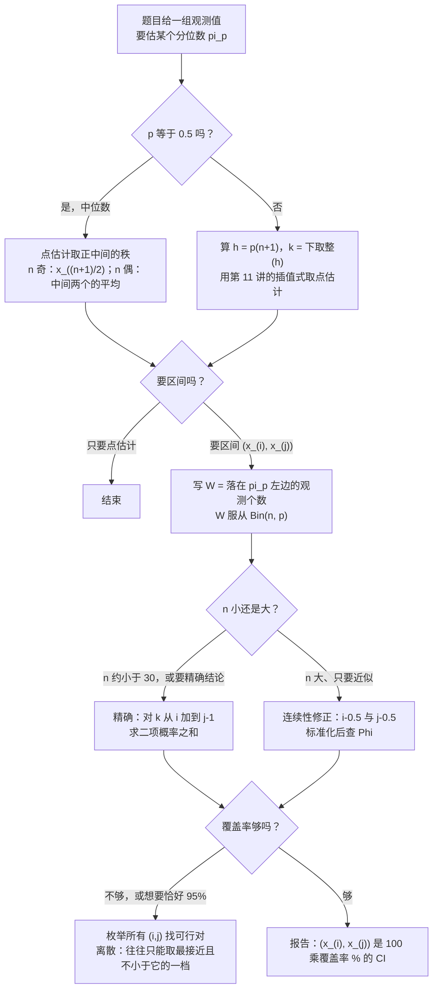
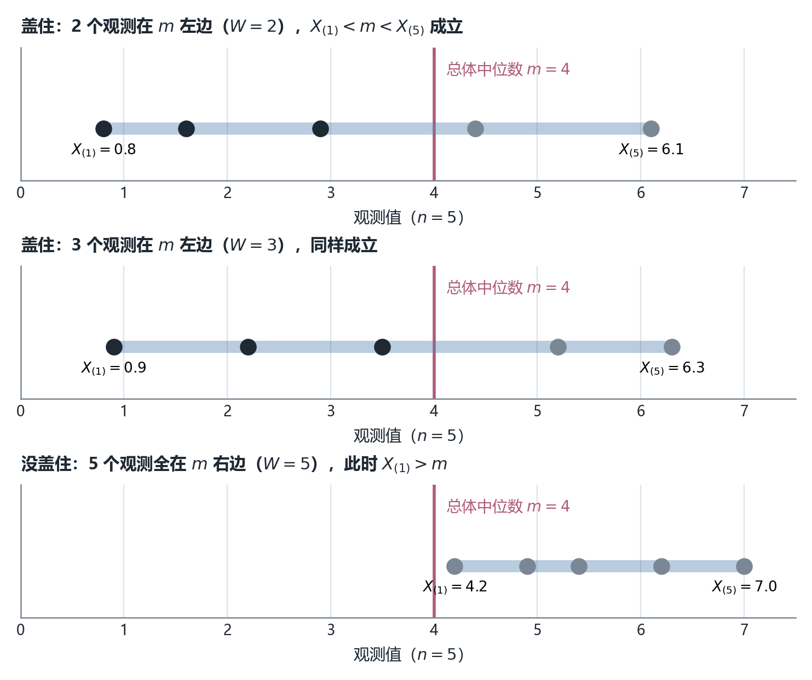
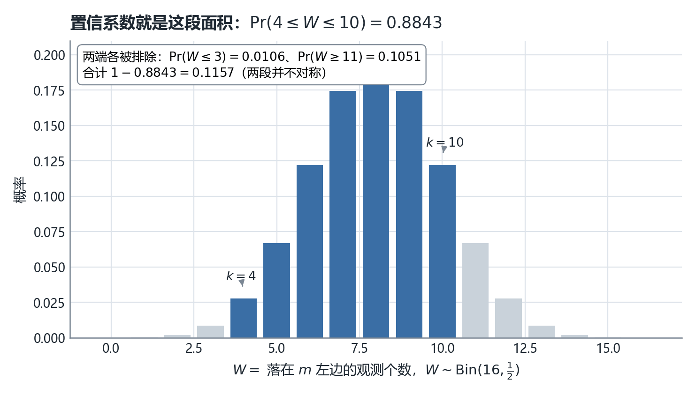
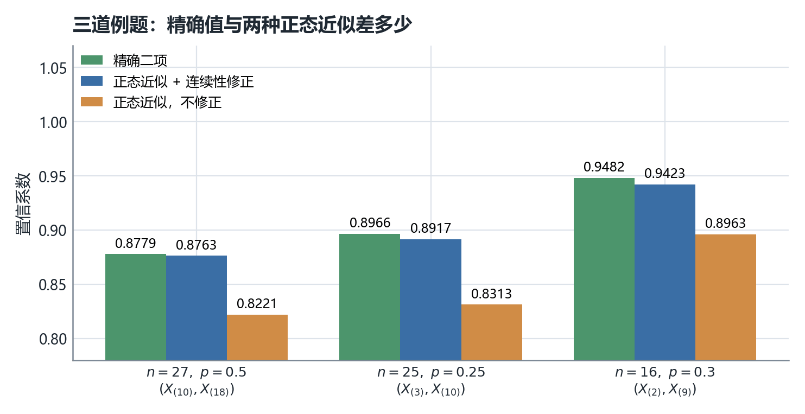
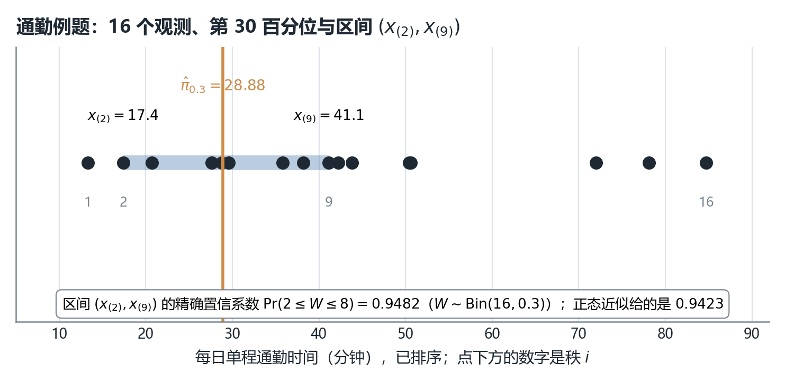
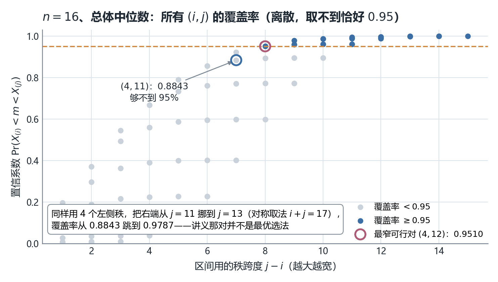

# STA2002 概率与统计 II · 第 12 讲笔记
## Distribution-free Confidence Interval（无分布置信区间：不假设总体形状，也能给分位数一个区间）

> 授课：Zhenxing Guo、Ka Wai Tseng（香港中文大学（深圳）数据科学学院，2026 年 11 月）
> 教材：Hogg, Tanis & Zimmerman (2015) *Probability and Statistical Inference*, 9th ed., Pearson
> 对应教材章节：**§7.5 Distribution-Free Confidence Intervals for Percentiles**（讲义第 2 页给出 "Suggested reading: Chapter 7.5 of the textbook"，我在教材目录核对过，第 7 章 Interval Estimation 的第 5 节标题正是这个，页码 339–343）。教材这一节还多给了两样讲义没有的东西：一张**对称选法表 Table 7.5-1**（$n=5\sim20$ 该取哪对秩）和一句**选择原则**（"usually quite symmetrically about the $(n+1)p$-th order statistic"）。本笔记把这两样补进 §12。
> 材料构成：讲义 `Lecture12 - Distribution-free Confidence Interval.pdf`（**18 页**），笔记内容**完全基于课件（PDF）整理**，本讲没有收到板书，全文没有 `【板书 NN】` 标记；凡属我补充、推导或复算的部分，一律用 **【补】** 或 alert 标出，并在文末诚实备注中逐条列出。
> **组织方式**：正文**按讲义（PPT）的页序**撰写，讲义每一页都能在正文里找到对应位置（对照表见 §0）。讲义里出现的**每一个数值**（$\frac{15}{16}\approx94\%$、$1-\frac{1}{2^{n-1}}$、$0.8843$、$0.8764$ 与"精确值 $0.8779$"、$0.8917$、$28.88$、$0.9423$）我都用 `scipy.stats.binom` 独立复算过，全部吻合；另外我补算了讲义**只给近似值、没给精确值**的两道题（第 12 页精确值 $0.8966$、第 17 页精确值 $0.9482$），以及"$n=5$ 时根本凑不出 95% 区间"这类讲义没提的离散性事实。**发现一处措辞错误**：第 17 页把置信系数说成"参数有 94.23% 的概率落在已算出的区间里"，与讲义自己在第 4、12 页的正确措辞相矛盾，见诚实备注第 1 条（⚠️）。

---

## 0. 本讲地图（先说清楚这一讲在干什么）

*这一节回答：第 4–5 讲的置信区间全靠"总体是正态的"，这一讲问的是——如果连正态都不敢假设，还剩什么能算，以及算出来的东西凭什么可信。*

**三遍阅读路线。** 本讲只有 18 页、四个例题，但每个例题都在重复同一套动作，建议按下面的顺序读：

| 遍次 | 读哪里 | 读完应该能 |
| --- | --- | --- |
| 第一遍（主线） | §2–§3（$n=5$ 的直觉例子）→ §6（一般公式）→ §10（通勤例题） | 给一组数，写出 $(x_{(i)},x_{(j)})$ 并算出它的置信系数 |
| 第二遍（深化） | §4、§5（两个"数个数"的推导）→ §7–§9（CLT 近似与任意 $p$） | 解释为什么覆盖率里一个未知参数都没有、连续性修正的边界为什么是 $i-0.5$ 与 $j-0.5$ |
| 第三遍（考前） | §11–§15 | 知道 95% 常常取不到、该怎么挑 $(i,j)$，以及区间与符号检验的关系 |

第一遍刻意跳过两块。**§4 是"$n$ 增大时全距区间会退化"的一般化插曲**，它给出一条漂亮公式 $1-\frac{1}{2^{n-1}}$，但实际做题几乎不用全距。**§7 的 CLT 近似**只在 $n$ 大到手算二项和受不了时才需要，第一遍可以先记住"精确值永远优先"。跳过这两块不影响主线——主线只用一个动作：**把"区间盖住分位数"翻译成"落在分位数左边的观测个数落在某个范围内"**。

第 4–5 讲的置信区间有一条隐含前提：**总体的分布族已知**（正态），于是要么构造枢轴量（$\frac{\bar X-\mu}{\sigma/\sqrt n}$、$t$、$\chi^2$、$F$），要么靠 CLT 得到渐近正态。本讲把这条前提整个撤掉，只留一句"$F$ 连续"。能撤掉的原因是：

$$\Pr(X_i<m)=\tfrac12,\qquad \Pr(X_i<\pi_p)=p$$

**这两句话对任何连续分布都成立**，它们把"连续观测"自动变成了一枚概率为 $\tfrac12$ 或 $p$ 的硬币。一旦变成硬币，剩下的就是第 1 讲的老朋友——二项分布。于是本讲的置信系数**不含任何未知参数**，这就是标题里 "distribution-free"（无分布 / 非参数）三个字的准确含义。

讲义第 2 页原文三行：

> Most confidence intervals we have learned require distribution assumptions on the population (e.g., normal distribution)
> Distribution-free confidence intervals: Without assuming that the sample comes from a specific distribution
> We will learn to construct distribution-free CIs for quantiles

交付顺序是：先用 $n=5$ 的中位数例子把机制跑通（第 3–4 页）→ 一般化到全距区间（第 5 页）→ 换 $n=16$ 的中间区间，引入计数变量 $W$ 与示性函数（第 6–7 页）→ 一般公式（第 8 页）→ $n$ 大时用 CLT 近似（第 9–10 页）→ 从 $\pi_{0.25}$ 推广到任意 $\pi_p$（第 11–14 页）→ 一道完整的通勤应用题（第 15–17 页）→ 小结（第 18 页）。

| 讲义页 | 内容 | 本笔记 | 配图 |
| --- | --- | --- | --- |
| 第 1 页 | 封面 | —— | — |
| 第 2 页 | Introduction：什么叫 distribution-free | §1 | — |
| 第 3 页 | 直觉例子一：$n=5$、区间 $(X_{(1)},X_{(5)})$ | §2 | — |
| 第 4 页 | 互补事件法算置信系数 $=\frac{15}{16}\approx94\%$ | §3 | 图 3.1 |
| 第 5 页 | 一般化：全距区间的水平 $1-\frac{1}{2^{n-1}}$ | §4 | — |
| 第 6–7 页 | 直觉例子二：$n=16$、$(X_{(4)},X_{(11)})$、$W\sim\mathrm{Bin}(16,\tfrac12)$ | §5 | 图 5.1 |
| 第 8 页 | 一般公式（中位数版） | §6 | — |
| 第 9–10 页 | CLT 近似：$n=27$、$(X_{(10)},X_{(18)})$ | §7 | 图 7.1 |
| 第 11–12 页 | 其他分位数：$n=25$、$\pi_{0.25}$、$(X_{(3)},X_{(10)})$ | §8 | — |
| 第 13–14 页 | 任意 $p$ 的精确式与正态近似式 | §9 | — |
| 第 15–17 页 | 通勤例题：16 个观测、$\hat\pi_{0.3}$、$(x_{(2)},x_{(9)})$ | §10 | 图 10.1 |
| 第 18 页 | Summary：点估计 + 区间估计的总公式 | §11 | — |
| — | 离散性与选法、与符号检验的对偶、速查表、核心直觉、术语对照、诚实备注 | §12–§17 | 图 12.1 |

### 0.1 一句话概括本讲的结构

> [!IMPORTANT]
> **整讲只有一个等价式，四个例题都是它的重复。** 设 $W=\sum_{i=1}^{n}\mathbf{1}(X_i<\pi_p)$，则 $W\sim\mathrm{Bin}(n,p)$（连续总体保证 $\Pr(X_i=\pi_p)=0$），而
> $$\{X_{(i)}<\pi_p<X_{(j)}\}\iff\{i\le W\le j-1\}\implies \Pr\bigl(X_{(i)}<\pi_p<X_{(j)}\bigr)=\sum_{k=i}^{j-1}\binom nk p^{k}(1-p)^{n-k}.$$
> 三件事由此而来：① **右端是 $j-1$ 不是 $j$**（"$\pi_p<X_{(j)}$" 说的是"比 $\pi_p$ 小的至多 $j-1$ 个"）；② **覆盖率不含任何未知参数**，只有 $n$、$p$、$i$、$j$——这就是 "distribution-free"；③ 中位数版把 $p$ 换成 $\tfrac12$，全距版把 $(i,j)$ 换成 $(1,n)$，$n$ 大时把二项和换成正态积分。**看到题目先找 $W$，不要背四个公式。**

### 0.2 与本讲关系最近的三处往讲接口（这张表是我整理的，讲义没有画）

| 往讲留下的线 | 本讲在哪里接上 |
| --- | --- |
| 第 4 讲：置信区间的定义、"随机的是区间不是参数"、置信系数 $=1-\alpha$ | 第 3–4 页把置信系数定义成"$m$ 落在区间内的概率"并给出第一个数值 $\frac{15}{16}$；第 17 页的措辞恰恰把这条原则说反了（见诚实备注第 1 条） |
| 第 10 讲：顺序统计量 $X_{(1)}\le\cdots\le X_{(n)}$、$F(X_{(k)})\sim\mathrm{Beta}(k,n-k+1)$、$E[F(X_{(k)})]=\frac{k}{n+1}$ | 第 3 页直接用 $E(F(X_{(3)}))=\frac12$ 选中点估计；第 11 页用 $p(n+1)=6.5$ 选点估计——都是第 10 讲那条均值公式 |
| 第 11 讲：样本分位数 $\hat\pi_p=x_{(k)}+(p(n+1)-k)(x_{(k+1)}-x_{(k)})$，$k=\lfloor p(n+1)\rfloor$ | 第 11 页（$\hat\pi_{0.25}=\tfrac12x_{(6)}+\tfrac12x_{(7)}$）与第 16 页（$\hat\pi_{0.3}=28.88$）逐字沿用这个插值口径 |

往讲里还有一条**没接上但很关键**的线：第 9 讲 §16.3–§16.5 处理二项检验时，我详细写过"离散数据的实际水平是阶梯函数，名义 $5\%$ 常常够不着，只能用精确二项回验"。**本讲的置信系数是同一个二项分布的另一面，离散性一模一样**，但讲义一次都没有提（见 §12）。

### 0.3 拿到"给分位数做一个不假设分布的区间"这类题，怎么走

**这张图是我整理的，讲义没有画。** 三个分岔点：$p$ 是不是 $\tfrac12$（决定点估计怎么取）、$n$ 大不大（决定精确还是近似）、覆盖率够不够（决定要不要重挑 $(i,j)$）。最后那个分岔是讲义完全没有覆盖的一步，也是本讲最容易失分的地方。

### 0.4 来源标注约定

- 无标记 → 讲义原文或对讲义的直接展开；
- **【补】** → 讲义没有、由我补充、推导或复算的内容（文末诚实备注逐条列出）；
- alert → 同为补充，标题写明它属于哪一类（补充 / 技巧 / 重要 / 课件笔误 / 注意）。

---

## 1. 本讲要交付什么（讲义第 2 页）

讲义第 2 页把整讲的定位写成三行对照：**"以前学的区间都要分布假设 → 现在不要 → 目标对象是分位数"**。

**为什么目标必须是分位数？**【补】因为撤掉分布假设后，"均值"这个量几乎没法再谈了——第 4–5 讲给 $\mu$ 做区间靠的是 $\bar X$ 的精确分布（正态总体）或 CLT（大样本），前者要假设、后者要 $n$ 够大。而**分位数有一个均值没有的性质：它被"个数"刻画**。总体中位数 $m$ 的定义就是"左边概率一半"，于是"有多少个观测落在 $m$ 左边"这件事是一个概率为 $\tfrac12$ 的二项计数，与 $F$ 长什么样彻底无关。第 1 讲建立的分位数定义（$F(\pi_p)=p$）在这里第一次显出它的操作价值。

> [!NOTE] 补充："distribution-free" 免掉了什么、没免掉什么
> 【补】免掉的是**分布族假设**（不再需要正态、不再需要 $\sigma$ 已知）。没免掉的是**连续性假设**——讲义每一页都写着 "unknown **continuous** distribution $F$"。这条不是装饰：若总体离散，$\Pr(X_i=\pi_p)>0$ 可能发生，"$W$ 服从 $\mathrm{Bin}(n,p)$" 就不再精确成立，覆盖率会偏。做判断题时，"非参数"三个字不等于"什么假设都不需要"。

---

## 2. 直觉例子一：$n=5$，用全距当中位数的区间（讲义第 3 页）

讲义第 3 页的题干：

> **Example.** Inference for the median: For a random sample $X_1,\ldots,X_5\overset{\text{i.i.d.}}{\sim}F$, where $F$ is an unknown continuous distribution. We want to make statistical inference for the median $m=\pi_{0.5}$ of $F$. Naturally, we have the order statistics $X_{(1)},X_{(2)},\ldots,X_{(5)}$.
> Point estimator: Sample median $X_{(3)}$, which satisfies $E(F(X_{(3)}))=\frac12$.
> Consider the interval $(X_{(1)},X_{(5)})$ as a confidence interval for $m$.
> **Question:** What is the confidence coefficient (level) of the CI?

**三个动作，逐个看。**【补】

1. **列出顺序统计量。** 这是第 10 讲的对象，$X_{(1)}<\cdots<X_{(5)}$（连续总体下严格不等号以概率 1 成立）。
2. **选点估计 $X_{(3)}$。** 理由那一行 "$E(F(X_{(3)}))=\frac12$" 是第 10 讲 $E(F(X_{(k)}))=\frac{k}{n+1}$ 在 $n=5,k=3$ 的取值：$\frac{3}{6}=\frac12$。**注意它说的是"$F$ 尺度上"的期望是 $\tfrac12$**，不是"$X_{(3)}$ 的期望是中位数"——第 11 讲 §8 已经用 $\mathrm{Exp}(1)$ 的反例警告过这一点。
3. **把区间选成 $(X_{(1)},X_{(5)})$。** 也就是"最小到最大"的全距。这个选择很自然但很粗，讲义下一页就要为它付账：$\frac{15}{16}$ 的水平看着不错，可区间宽到等于整组数据的跨度。

**"区间盖住 $m$" 到底是什么意思？**【补】$X_{(1)}<m<X_{(5)}$ 说的是**最小的观测在 $m$ 左边、最大的观测在 $m$ 右边**，也就是"至少有一个观测小于 $m$，且至少有一个观测大于 $m$"。它**没有**要求任何观测恰好等于 $m$（连续总体下概率为 0）。

> [!TIP] 技巧：这类题的第一步永远是"把区间事件翻译成计数事件"
> 【补】看到 $\{X_{(i)}<\pi_p<X_{(j)}\}$ 不要试图去算 $X_{(i)}$ 或 $X_{(j)}$ 的密度（第 10 讲那条密度公式在这里是绕远路）。直接翻译成："落在 $\pi_p$ 左边的个数 $W$ 至少 $i$ 个、至多 $j-1$ 个"。讲义第 3–7 页先用互补事件（只处理 $i=1,j=n$ 的特例），第 8 页才给出这个一般翻译；本笔记两处都按翻译来理解，只是保留讲义的原始写法以便对照。

---

## 3. 置信系数怎么算：互补事件法（讲义第 4 页）

讲义第 4 页的推导原文：

> By definition, the confidence level is the probability of the population median $m$ locating in the CI, that is,
> $$\Pr(X_{(1)}<m<X_{(5)})=1-\Pr(X_{(1)}\ge m)-\Pr(X_{(5)}\le m)$$
> $$=1-\Pr(X_1\ge m,X_2\ge m,\ldots,X_5\ge m)-\Pr(X_1\le m,X_2\le m,\ldots,X_5\le m)$$
> $$=1-\prod_{i=1}^{5}\Pr(X_i\ge m)-\prod_{i=1}^{5}\Pr(X_i\le m)=1-0.5^{5}-0.5^{5}=\frac{15}{16}\approx94\%.$$
> Thus, $(X_{(1)},X_{(5)})$ is a 94% CI for $m$. Once we observe a sample $\{8.7,0.1,4.4,3.1,6.0\}$, then $(0.1,8.7)$ gives a 94% CI for the median $m$.

**四个等号各做什么**【补】：

1. **第一个等号（补事件分解）。** 不成功的两种情形是"区间整体在 $m$ 右边"（$X_{(1)}\ge m$）与"整体在 $m$ 左边"（$X_{(5)}\le m$）。**这两个事件互斥**（连续总体里不可能同时"全部 $\ge m$"且"全部 $\le m$"，那要求所有观测都等于 $m$，概率 0），所以可以直接把两个概率相加再被 1 减。
2. **第二个等号（顺序统计量 ↔ 全体观测）。** $X_{(1)}\ge m$ 等价于"每一个 $X_i$ 都 $\ge m$"；$X_{(5)}\le m$ 等价于"每一个都 $\le m$"。这一步是纯逻辑等价，不用概率。
3. **第三个等号（独立性）。** 联合概率拆成乘积。
4. **第四个等号（中位数的定义 + 连续性）。** $\Pr(X_i\ge m)=\Pr(X_i\le m)=\tfrac12$ ——**这一步就是"非参数"的全部秘密**：不管 $F$ 是什么形状，只要连续，中位数两边各占一半。

**数值核对。**【补】$1-\tfrac1{32}-\tfrac1{32}=1-\tfrac2{32}=\tfrac{30}{32}=\tfrac{15}{16}=0.9375$。讲义写 $\approx94\%$ ✓（$0.9375$ 四舍五入到整数百分比）。用 `scipy.stats.binom` 走"计数"路线复核同一件事：$\Pr(1\le W\le 4)$，$W\sim\mathrm{Bin}(5,\tfrac12)$，得 $0.937500$ ✓ 两条路一致。

**最后那句应用示范值得照抄进答题模板**：观测到 $\{8.7,0.1,4.4,3.1,6.0\}$，排序得 $0.1,3.1,4.4,6.0,8.7$，于是 $(x_{(1)},x_{(5)})=(0.1,8.7)$ 是一个 94% 的置信区间 ✓。

图 3.1 把"盖住 / 没盖住"三种情形画出来。

*图 3.1　$n=5$、总体中位数 $m=4$ 的三种抽样结果（我绘制；每行的五个点是假想观测值，深色 = 落在 $m$ 左边，灰色 = 右边，蓝色横条是区间 $(X_{(1)},X_{(5)})$）。第 1 行 $W=2$、第 2 行 $W=3$：区间都盖住了 $m$。第 3 行 $W=5$（五个观测全在 $m$ 右边）：$X_{(1)}=4.2>m$，区间整个跑到 $m$ 右边，失败。$W=0$（全在左边）是另一种失败。两种失败各占 $0.5^5=\tfrac1{32}=0.03125$，合计 $0.0625$，于是置信系数 $=1-0.0625=0.9375$——这就是第 4 页那行代数的图像版*

> [!CAUTION] 注意：0.9375 不是 0.95，而且 n=5 时永远凑不到 95%
> 【补】这一点讲义没提，但考试爱考。$n=5$ 时所有可能的 $(i,j)$ 组合里，覆盖率最高的一对就是 $(1,5)$，恰好 $0.9375$（我枚举全部 10 对验证过）。**想要 95% 的置信系数，$n=5$ 是不够的，无论怎么挑秩都不行。** 这与第 9 讲 §16.3 那个"名义 $5\%$ 落在 $0.0207$ 与 $0.0577$ 两级台阶之间、够不着"是同一件事的另一面——二项分布是离散的，覆盖率只能取有限个值。做"给我一个 95% 区间"这类题时，正确答法是"取最接近且**不小于** 95% 的那一档"，并如实报出它的实际水平。

---

## 4. 一般化：全距区间的水平 $1-\frac{1}{2^{n-1}}$（讲义第 5 页）

讲义第 5 页把 $n=5$ 换成任意 $n$，原文：

> In general, if we have a random sample $X_1,\ldots,X_n\overset{\text{i.i.d.}}{\sim}F$, for some unknown continuous distribution $F$ with median $m$, then $(X_{(1)},X_{(n)})$ is a $100\left(1-\frac{1}{2^{n-1}}\right)$% CI for $m$. That is because
> $$\Pr(X_{(1)}<m<X_{(n)})=1-\prod_{i=1}^{n}\Pr(X_i\ge m)-\prod_{i=1}^{n}\Pr(X_i\le m)=1-\frac{1}{2^{n}}-\frac{1}{2^{n}}=1-\frac{1}{2^{n-1}}.$$

**代数核对。**【补】$\frac1{2^n}+\frac1{2^n}=\frac2{2^n}=\frac1{2^{n-1}}$ ✓。代 $n=5$ 回得 $1-\frac1{16}=\frac{15}{16}=0.9375$ ✓ 与第 4 页一致。

**这条公式的读法比它本身更重要：它同时告诉你"好消息"和"坏消息"。**【补】

| $n$ | 全距区间的置信系数 | 区间宽不宽 |
| --- | --- | --- |
| 5 | $0.9375$ | 整组跨度 |
| 10 | $1-\frac1{512}=0.9980$ | 更宽 |
| 20 | $1-\frac1{2^{19}}=0.999998$ | 几乎必然盖住 |
| 50 | $\approx1$ | 毫无信息量 |

**覆盖率随 $n$ 涨到 1，但这不是好消息。** 因为区间 $(X_{(1)},X_{(n)})$ 也跟着变宽——$n$ 越大，样本极值越往两边伸展，"盖住中位数"这件事越来越像废话。教材 §7.5 在同样一段推导后面专门写了一句："This probability increases as $n$ increases, so that the corresponding confidence interval $(y_1,y_n)$ would have the very large confidence coefficient. **Unfortunately, the interval $(y_1,y_n)$ tends to get wider as $n$ increases; thus, we are not 'pinning down' $m$ very well.**"（我核对过教材原文）。

> [!IMPORTANT] 重要：置信系数不是越大越好，要和宽度一起看
> 【补】第 4 讲讲过"区间宽度三旋钮"（$\sigma$、$z_{\alpha/2}$、$n$），本讲同样有这对张力：**收窄区间（把 $i$ 往中间推、$j$ 往中间收）就掉覆盖率**。第 6–7 页的例题把 $(X_{(1)},X_{(16)})$（覆盖率 $0.99997$）换成 $(X_{(4)},X_{(11)})$（覆盖率 $0.8843$），就是用 11.6 个百分点的覆盖率换来一个窄得多的区间。所以做"设计一个非参数区间"的题时，目标应当是**在给定宽度预算下覆盖率最高**，或**在给定覆盖率下限下宽度最窄**——§12 会把这两种问法都算出来。

---

## 5. 直觉例子二：$n=16$、区间 $(X_{(4)},X_{(11)})$（讲义第 6–7 页）

### 5.1 引入计数变量 $W$（讲义第 6 页）

讲义第 6 页原文：

> **Example.** Suppose now we have a sample of $n=16$ i.i.d. random numbers from an unknown continuous distribution. What is confidence level of interval $(X_{(4)},X_{(11)})$ for its median $m=\pi_{0.5}$?
> To compute the probability $\Pr(X_{(4)}<m<X_{(11)})$, let $W$ denote the number of $X_i$ that are less than $m$.
> $$\Pr(X_{(4)}<m<X_{(11)})=\Pr(\text{at least 4 and at most 10 of }X_1,\ldots,X_{16}<m)=\Pr(4\le W\le 10).$$
> Consider the indicator function $\mathbf{1}(X_i<m)=\begin{cases}1 & X_i<m\\ 0 & X_i\ge m\end{cases}$. $W$ can be represented as $\sum_{i=1}^{16}\mathbf{1}(X_i<m)$.

**"至多 10"这一步是全讲最容易写错一格的地方。**【补】为什么上限是 10 而不是 11？因为右端条件是 $m<X_{(11)}$，即"第 11 小的那个观测仍然比 $m$ 大"，等价于"比 $m$ 小的观测**不足 11 个**"，即 $W\le 10$。一般地：

| 区间条件 | 计数翻译 | 直觉说法 |
| --- | --- | --- |
| $X_{(i)}<\pi_p$ | $W\ge i$ | 第 $i$ 小都在左边 ⟹ 左边至少 $i$ 个 |
| $\pi_p<X_{(j)}$ | $W\le j-1$ | 第 $j$ 小在右边 ⟹ 左边不足 $j$ 个 |

合起来就是 $\Pr(i\le W\le j-1)$——**求和上界永远比右端秩小 1**。讲义第 4 页、第 8 页、第 12 页、第 13 页、第 17 页五处都是这个 $j-1$，值得逐一回看确认自己没记错。

**示性函数的作用**【补】：把"$W$ 是个二项变量"这件事写得无可辩驳——$n$ 个独立同分布的 0/1 变量之和，每个取 1 的概率是 $\Pr(X_i<m)=\tfrac12$，所以 $W\sim\mathrm{Bin}(n,\tfrac12)$。这正是第 1 讲"伯努利试验求和 = 二项分布"的定义式用法。

### 5.2 算出 0.8843（讲义第 7 页）

讲义第 7 页原文：

> Since each $X_i$ are i.i.d. and $\Pr(X_i<m)=0.5$, $W=\sum_{i=1}^{16}\mathbf{1}(X_i<m)\sim\mathrm{Bin}(16,1/2)$. Thus,
> $$\Pr(X_{(4)}<m<X_{(11)})=\Pr(4\le W\le 10)=\sum_{k=4}^{10}\binom{16}{k}\left(\frac12\right)^{16}=0.8843.$$
> Thus, $(X_{(4)},X_{(11)})$ is an 88.43% CI for $m$. Can compute the above probability using the CDF of binomial distribution in R or Python: $\Pr(4\le W\le 10)=\Pr(W\le 10)-\Pr(W\le 3)$.

**数值核对。**【补】我用 `scipy.stats.binom(16,0.5)` 算 $\Pr(W\le10)-\Pr(W\le3)=0.965729-0.010620=0.884308$ ✓ 与讲义 $0.8843$ 一致。

**顺手把两端的"损失"拆开看**【补】：左尾被排除 $\Pr(W\le3)=0.0106$，右尾被排除 $\Pr(W\ge11)=0.1051$——**两段差了 10 倍**。原因是 $(4,11)$ 这对秩并不对称：$n=16$ 的对称配对应满足 $i+j=n+1=17$（如 $(4,13)$、$(5,12)$），而 $4+11=15\ne17$，右端少收了两个秩，于是右尾漏掉得多。

> [!WARNING] 注意：讲义这对秩不是对称取法，覆盖率因此白白偏低
> 【补】我按 $n=16$、中位数枚举了全部 120 对 $(i,j)$：
>
> | 取法 | 覆盖率 | 说明 |
> | --- | --- | --- |
> | $(4,11)$ | $0.8843$ | 讲义用的这对，不对称（$i+j=15$） |
> | $(5,12)$ | $0.9232$ | 教材 Table 7.5-1 给 $n=16$ 推荐的对称对（$i+j=17$） |
> | $(4,12)$ 或 $(5,13)$ | $0.9510$ | 宽度同为 8 的对里，第一个够到 $95\%$ |
> | $(4,13)$ | $0.9787$ | 与 $(4,11)$ 同样左端，右端多收两秩 |
>
> 也就是说，**只把右端从 $j=11$ 挪到 $j=13$（保持左端 $i=4$、恢复对称），覆盖率从 $0.8843$ 跳到 $0.9787$**。讲义拿 $(4,11)$ 只是当"算一个数"的练习，没有评价这对取法好不好；教材则明确给了选法（见 §12）。考试若被问"设计一个约 95% 的区间"，答 $(4,11)$ 会丢分，答 $(4,12)$ 或 $(5,13)$（实际 $95.10\%$）才对。

图 5.1 把这件事画成面积。

*图 5.1　$W\sim\mathrm{Bin}(16,\tfrac12)$ 的概率条，深色部分是"成功"区间 $k=4,\ldots,10$，面积合计 $0.8843$（我绘制；每条高度由 `scipy.stats.binom.pmf` 现算）。浅色是两段被排除的尾：$\Pr(W\le3)=0.0106$、$\Pr(W\ge11)=0.1051$。两段的不对称一眼可见——这正是 $(4,11)$ 这对秩不对称的几何表现。分布本身关于 $k=8$ 对称，所以"左尾小、右尾大"完全由求和区间的取法造成*

---

## 6. 一般公式（中位数版）（讲义第 8 页）

讲义第 8 页原文：

> In general, ... then the confidence level of the interval $(X_{(i)},X_{(j)})$, $i<j$ is
> $$\Pr(X_{(i)}<m<X_{(j)})=\Pr(\text{at least }i\text{ and at most }j-1\text{ of }X_1,\ldots,X_n<m)=\Pr(i\le W\le j-1)=\sum_{k=i}^{j-1}\binom{n}{k}\left(\frac12\right)^{n}.$$
> Here, $W=\sum_{i=1}^{n}\mathbf{1}(X_i<m)\sim\mathrm{Bin}(n,1/2)$.

**这条公式的两个自检用法。**【补】

1. **退化回第 5 页**：取 $(i,j)=(1,n)$，求和变成 $\sum_{k=1}^{n-1}\binom nk 2^{-n}=1-2\cdot2^{-n}=1-\frac1{2^{n-1}}$ ✓ 与第 5 页完全一致。
2. **对称性检验**：若 $i+j=n+1$，则 $\Pr(i\le W\le j-1)=\Pr(i\le W\le n-i)$，由 $\mathrm{Bin}(n,\tfrac12)$ 关于 $\frac n2$ 对称，两段尾概率相等，都是 $\Pr(W\le i-1)$。用这条可以口算：$n=16$、$(5,12)$ 的覆盖率 $=1-2\Pr(W\le4)=1-2\times0.0384=0.9232$ ✓ 与教材表一致。

> [!NOTE] 补充：讲义第 8 页的求和式里有个容易被略过的细节
> 【补】$\binom nk\left(\frac12\right)^n$ 已经包含了 $(1-p)^{n-k}=2^{-(n-k)}$——因为 $p=\tfrac12$ 时 $p^k(1-p)^{n-k}=2^{-n}$ 与 $k$ 无关，所以每一项都是"组合数除以 $2^n$"。第 13 页推广到一般 $p$ 时，这个因子会变回 $p^k(1-p)^{n-k}$，**不能再提出去**。两处对照着记，不容易写错。

---

## 7. $n$ 大时用 CLT 近似（讲义第 9–10 页）

### 7.1 动机与题目（讲义第 9 页）

讲义第 9 页原文：

> When $n$ is large, the computation of the probability $\Pr(i\le W\le j-1)=\sum_{k=i}^{j-1}\binom nk\left(\frac12\right)^n$ will be complicated. Approximate the distribution of $W$ by a normal distribution using CLT.
> **Example.** Assume that the sample size is $n=27$. What is approximate confidence level of interval $(X_{(10)},X_{(18)})$ for $m$?

### 7.2 完整计算（讲义第 10 页）

讲义第 10 页原文：

> Let $W$ = number of $X_i$ less than $m$, $W\sim\mathrm{Bin}(27,1/2)$, with $E(W)=13.5$, $\operatorname{Var}(W)=\frac{27}{4}$. By Central Limit Theorem, $W\overset{\text{approx}}{\sim}N(13.5,27/4)$.
> $$\Pr(X_{(10)}<m<X_{(18)})=\Pr(10\le W\le 17)=\Pr(9.5<W<17.5)\ \text{(Applying half-unit correction)}$$
> $$=\Pr\left(\frac{9.5-13.5}{\sqrt{27/4}}<\frac{W-13.5}{\sqrt{27/4}}<\frac{17.5-13.5}{\sqrt{27/4}}\right)\approx\Phi(1.5396)-\Phi(-1.5396)=0.8764.$$
> Exact value of the probability is 0.8779, so the normal approximation is reasonably close.

**逐项核对。**【补】

- $E(W)=np=13.5$ ✓；$\operatorname{Var}(W)=np(1-p)=\frac{27}{4}=6.75$ ✓，$\sqrt{6.75}=2.5981$。
- 边界：$10\le W$ 配 $9.5$、$W\le17$ 配 $17.5$ ✓（"半单位修正"就是把整数格点向外扩半格）。
- 标准化：$\frac{9.5-13.5}{2.5981}=-1.5396$、$\frac{17.5-13.5}{2.5981}=+1.5396$ ✓。
- $\Phi(1.5396)-\Phi(-1.5396)=2\times0.938171-1=0.876342$ ✓ 讲义 $0.8764$。
- 精确值：$\Pr(10\le W\le17)=0.877922$ ✓ 讲义 $0.8779$。**近似少报 $0.0016$**。

**这一页值得表扬的地方**：讲义在这里**给了精确值做对照**（"Exact value ... is 0.8779"），让学生看见近似的代价。可惜后面两页（第 12、17 页）就没这么做了（见 §8、§10 与诚实备注第 2 条）。

> [!TIP] 技巧：连续性修正值不值，看 np(1-p) 有多大
> 【补】我把 $n=27$ 这题按"不加修正"再算一遍：$\Pr(10\le W\le17)\approx\Phi\!\left(\frac{17-13.5}{2.5981}\right)-\Phi\!\left(\frac{10-13.5}{2.5981}\right)=0.8221$——比精确值 $0.8779$ 少了整整 $0.056$，而加了修正只差 $0.0016$。**结论：这类题一定要加半单位修正**，尤其在 $n$ 只有二三十的时候。图 7.1 把三道例题的三种算法并排画出来，不修正的那一根柱每次都矮一截。

图 7.1 是三道例题的精确值 / 修正近似 / 不修正近似对照。

*图 7.1　三道例题的置信系数三种算法（我绘制；精确值用 `scipy.stats.binom.cdf` 差，近似值用 $\Phi$，标准差取 $\sqrt{np(1-p)}$）。三组分别是 $n=27,p=0.5$ 的 $(X_{(10)},X_{(18)})$（$0.8779$ / $0.8763$ / $0.8221$）、$n=25,p=0.25$ 的 $(X_{(3)},X_{(10)})$（$0.8966$ / $0.8917$ / $0.8313$）、$n=16,p=0.3$ 的 $(X_{(2)},X_{(9)})$（$0.9482$ / $0.9423$ / $0.8963$）。规律很稳定：**带连续性修正的近似误差在 $0.005$ 以内，不带修正会低 $0.05$ 左右**；后两组是讲义只给了近似值、我补算的精确值*

---

## 8. 从 $\pi_{0.5}$ 到 $\pi_{0.25}$：点估计与区间（讲义第 11–12 页）

### 8.1 点估计（讲义第 11 页）

讲义第 11 页原文：

> Instead of median $m=\pi_{0.5}$, apply the same technique to construct CIs for other percentiles $\pi_p$. Suppose now $n=25$, we would like to make inference for $\pi_{0.25}$. Since $p(n+1)=0.25(26)=6.5$, the point estimator of $\pi_{0.25}$ should be the 0.25-th sample quantile: $\hat\pi_{0.25}=\frac12x_{(6)}+\frac12x_{(7)}$.
> To construct confidence interval for $\pi_{0.25}$ and compute the confidence level, let $W$ denote the number of $X_i$ less than $\pi_{0.25}$. Since $X_i\overset{\text{i.i.d.}}{\sim}F$ and $\Pr(X_i<\pi_{0.25})=0.25$, $W=\sum_{i=1}^{25}\mathbf{1}(X_i<\pi_{0.25})\sim\mathrm{Bin}(25,0.25)$.

**$6.5$ 这个数怎么变成"两个的平均"**【补】：$h=p(n+1)=6.5$，$k=\lfloor h\rfloor=6$，插值系数 $h-k=0.5$，代入第 11 讲的公式得 $\hat\pi_{0.25}=x_{(6)}+0.5(x_{(7)}-x_{(6)})=\tfrac12x_{(6)}+\tfrac12x_{(7)}$ ✓ 完全一致。**这是第 11 讲那套样本分位数在本讲的第一次实战**，讲义没有明说这层关系，但第 18 页的 Summary 又把点估计公式重新写了一遍，说明它是有意沿用。

**成功概率从 $\tfrac12$ 换成 $p$。**【补】$\Pr(X_i<\pi_{0.25})=F(\pi_{0.25})=0.25$ ——分位数的定义直接把硬币的正面概率定成 $p$。**这是本讲唯一一处用到 $p$ 的地方，也是"非参数"仍然成立的原因**：$0.25$ 是题目给的，不是总体给的。

### 8.2 区间 $(X_{(3)},X_{(10)})$ 的置信系数（讲义第 12 页）

讲义第 12 页原文：

> Let us consider the confidence level of the confidence interval $(X_{(3)},X_{(10)})$
> $$\Pr(X_{(3)}<\pi_{0.25}<X_{(10)})=\Pr(\text{at least 3 and at most 9 of }X_1,\ldots,X_{25}<\pi_{0.25})=\Pr(3\le W\le 9)=\sum_{k=3}^{9}\binom{25}{k}(0.25)^k(0.75)^{25-k}.$$
> Using half-unit correction: $\Pr(X_{(3)}<\pi_{0.25}<X_{(10)})=\Pr(3\le W\le9)=\Pr(2.5<W<9.5)\approx\Phi\!\left(\frac{9.5-6.25}{\sqrt{4.6875}}\right)-\Phi\!\left(\frac{2.5-6.25}{\sqrt{4.6875}}\right)=0.8917$.
> Thus, once we have data, the realized interval $(x_{(3)},x_{(10)})$ is an approximate 89.17% CI for $\pi_{0.25}$.

**近似值核对。**【补】$E(W)=np=6.25$ ✓、$\operatorname{Var}(W)=25\times0.25\times0.75=4.6875$ ✓、$\sqrt{4.6875}=2.1651$。$\frac{9.5-6.25}{2.1651}=1.5011$、$\frac{2.5-6.25}{2.1651}=-1.7321$，$\Phi(1.5011)-\Phi(-1.7321)=0.93327-0.04163=0.89170$ ✓ 讲义 $0.8917$。

**但讲义在这里列了精确求和式却没有算它。**【补】我用 `scipy.stats.binom(25,0.25)` 算出精确值 $\Pr(3\le W\le9)=0.896563$，比近似值高 $0.0049$。第 10 页做了这个对照、第 12 页没做——**同一个讲义内部标准不一致**。

> [!WARNING] 注意：p 不等于 1/2 时二项分布不对称，近似偏差有方向
> 【补】$p=0.25$、$n=25$ 时 $\mathrm{Bin}(25,0.25)$ 右偏，正态近似把质量摊成对称形状，于是**对"往右延伸较多"的区间会低估覆盖率**（本例近似 $0.8917$ < 精确 $0.8966$）。$p=\tfrac12$ 时分布对称，偏差小得多（$0.8763$ vs $0.8779$）。**实务建议：只要 $n\le30$，一律用软件算精确二项和**，讲义第 7 页自己也写了 "Can compute the above probability using the CDF of binomial distribution in R or Python"。

**措辞上这一页是对的。**【补】"the **realized** interval $(x_{(3)},x_{(10)})$ is an approximate 89.17% CI" ——用"实现后的区间是一个 89.17% 的 CI"这种说法，把随机性留在区间构造过程上，而不是说"$\pi_{0.25}$ 有 89.17% 的概率落在这两个数之间"。第 17 页恰恰写反了（见 §10.3 与诚实备注第 1 条）。

---

## 9. 任意 $p$ 的一般公式（讲义第 13–14 页）

讲义第 13 页原文：

> Finally, we consider the inference for $\pi_p$, $p\in[0,1]$. Again, let $W$ be number of $X_i$ less than $\pi_p$. Since $X_i\overset{\text{i.i.d.}}{\sim}F$ and $\Pr(X_i<\pi_p)=p$, $W=\sum_{i=1}^{n}\mathbf{1}(X_i<\pi_p)\sim\mathrm{Bin}(n,p)$. Then, ...
> $$\Pr(X_{(i)}<\pi_p<X_{(j)})=\Pr(i\le W\le j-1)=\sum_{k=i}^{j-1}\binom{n}{k}p^{k}(1-p)^{n-k}.$$
> The probability can be computed using the exact distribution or approximate normal distribution.

讲义第 14 页给出近似版：

> By Central Limit Theorem, $W\overset{\text{approx}}{\sim}N(np,np(1-p))$. Using half-unit correction:
> $$\Pr(X_{(i)}<\pi_p<X_{(j)})=\Pr(i\le W\le j-1)=\Pr(i-0.5<W<j-0.5)\approx\Phi\!\left(\frac{j-0.5-np}{\sqrt{np(1-p)}}\right)-\Phi\!\left(\frac{i-0.5-np}{\sqrt{np(1-p)}}\right).$$

**这两页就是本讲的全部"公式"，其余都是代入。**【补】我把四道例题塞进这张表，确认口径一致：

| 例题 | $n$ | $p$ | $(i,j)$ | 求和范围 | 精确 | 近似（第 14 页式） |
| --- | --- | --- | --- | --- | --- | --- |
| 第 4 页 | 5 | $0.5$ | $(1,5)$ | $k=1\ldots4$ | $0.9375$ | —— |
| 第 7 页 | 16 | $0.5$ | $(4,11)$ | $k=4\ldots10$ | $0.8843$ | —— |
| 第 10 页 | 27 | $0.5$ | $(10,18)$ | $k=10\ldots17$ | $0.8779$ | $0.8764$（讲义给了） |
| 第 12 页 | 25 | $0.25$ | $(3,10)$ | $k=3\ldots9$ | $0.8966$（我补算） | $0.8917$（讲义给了） |
| 第 17 页 | 16 | $0.3$ | $(2,9)$ | $k=2\ldots8$ | $0.9482$（我补算） | $0.9423$（讲义给了） |

**注意第 14 页的上下界写成 $i-0.5$ 与 $j-0.5$，不是 $i-0.5$ 与 $(j-1)+0.5$ 之外的别的东西。**【补】两者其实相同：$(j-1)+0.5=j-0.5$ ✓。讲义这个写法更紧凑，但要求学生始终记得"随机区间是 $[i,\,j-1]$"，否则容易把上界误写成 $j+0.5$。用第 17 页验一遍：$j=9$，上界 $8.5=j-0.5$ ✓ 讲义写的正是 $8.5$。

> [!IMPORTANT] 重要：覆盖率只由 n、p、i、j 四个已知量决定，与总体分布完全无关
> 【补】把 $\Pr(X_{(i)}<\pi_p<X_{(j)})=\sum_{k=i}^{j-1}\binom nk p^k(1-p)^{n-k}$ 右边的每一项都读一遍：$n$ 是样本量（已知）、$p$ 是题目指定的分位位置（已知）、$i,j$ 是自己挑的秩（已知）。**没有一项需要知道 $F$ 的形状或参数。** 与第 4 讲的枢轴量对照着记最清楚：那边 $\frac{\bar X-\mu}{\sigma/\sqrt n}$ 的分布是正态，前提是总体正态；这边 $W$ 的分布是二项，前提只有"$F$ 连续"。代价是：这边的区间宽、只能覆盖分位数、而且覆盖率取不到任意值。

---

## 10. 通勤例题：完整的"点估计 + 区间 + 措辞"（讲义第 15–17 页）

### 10.1 题干（讲义第 15 页）

> You are a data analyst for a mid-sized tech company located in a metropolitan area. HR wants to understand employee commute patterns... You collected the daily one-way commute time (in minutes) for 16 randomly selected employees. We collect a sorted sample of 16 commute times (in minutes):
> 13.3, 17.4, 20.7, 27.6, 28.8, 29.6, 35.8, 38.2, 41.1, 42.2, 43.8, 50.4, 50.6, 72.0, 78.1, 84.7
> Estimate the 30-th percentile $\pi_{0.3}$ of commute time, Compute the confidence level of the interval $(x_{(2)},x_{(9)})=(17.4,41.1)$.

**数据核对。**【补】$n=16$ ✓ 已排序 ✓；$x_{(2)}=17.4$、$x_{(9)}=41.1$ ✓ 与讲义给的区间一致。顺带一提这组数明显右偏：中位数 $39.65$、均值 $42.14$，最大三个值 $72.0,78.1,84.7$ 与前面脱节——**正是第 11 讲 Q-Q 图会显示"右尾上翘"的那种数据**，用非参数方法很合适。

### 10.2 点估计（讲义第 16 页）

> As $(n+1)\times p=17\times0.3=5.1$, the 30th sample percentile $\hat\pi_{0.3}=x_{(5)}+0.1\times(x_{(6)}-x_{(5)})=28.88$ is a good estimator for $\pi_{0.3}$. Thus, about 70% of employees have commute time above 28.88 minutes.

**核对。**【补】$h=5.1$、$k=\lfloor5.1\rfloor=5$、系数 $0.1$；$x_{(5)}=28.8$、$x_{(6)}=29.6$，差 $0.8$，$0.1\times0.8=0.08$，$28.8+0.08=28.88$ ✓。

### 10.3 置信系数（讲义第 17 页）

> Let $W$ denote the number of commute time less than $\pi_{0.3}$. The confidence level of $(x_{(2)},x_{(9)})$ is $\Pr(X_{(2)}\le\pi_{0.3}\le X_{(9)})=\Pr(2\le W\le 8)$. By CTL, $W\overset{\text{approx}}{\sim}N(4.8,3.36)$. Using half-unit correction, $\Pr(2\le W\le 8)=\Pr(1.5<W<8.5)=\Pr\left(\frac{1.5-4.8}{\sqrt{3.36}}<\cdots<\frac{8.5-4.8}{\sqrt{3.36}}\right)\approx\Phi(2.019)-\Phi(-1.800)=0.9423$.
> The 30th percentile of commute times has an approximate probability of 94.23% to lie between 17.4 and 41.1 minutes.

**核对。**【补】$E(W)=16\times0.3=4.8$ ✓、$\operatorname{Var}(W)=16\times0.3\times0.7=3.36$ ✓、$\sqrt{3.36}=1.8330$。$\frac{8.5-4.8}{1.8330}=2.0185$ ✓（讲义 $2.019$）、$\frac{1.5-4.8}{1.8330}=-1.8003$ ✓（讲义 $-1.800$）。$\Phi(2.019)-\Phi(-1.800)=0.97826-0.03593=0.94233$ ✓ 讲义 $0.9423$。**精确值 $\Pr(2\le W\le8)=0.948215$**（我补算，比近似高 $0.0059$）。

> [!WARNING] 课件笔误：最后一句把置信系数说成了"参数落在区间里的概率"（⚠️）
> 讲义第 17 页结尾写 "The 30th percentile of commute times **has an approximate probability of 94.23% to lie between** 17.4 and 41.1 minutes."。**应为**："区间 $(17.4,41.1)$ 来自一个覆盖概率为 $94.23\%$ 的构造方法"，或者说"我们有约 $94\%$ 的把握认为 $\pi_{0.3}$ 落在此区间内"（后一种口语可接受，但要知道它不是字面的概率陈述）。**判据**：$\pi_{0.3}$ 是一个固定的总体分位数（未知但不随机），随机的是 $(X_{(2)},X_{(9)})$；数据一旦实现，区间就是常数，"常数盖住固定值"的概率只能是 0 或 1。而且**同一份讲义自己在第 4 页与第 12 页用的都是正确措辞**——第 4 页 "(0.1, 8.7) **gives** a 94% CI"、第 12 页 "the **realized** interval ... **is** an approximate 89.17% CI"，只有第 17 页改口说"参数有概率落在里面"。第 4 讲讲置信区间定义时立的规矩，本讲不该破。

图 10.1 把这道题的数据、点估计与区间画在同一把尺上。

*图 10.1　16 个通勤时间观测（已排序，横轴是分钟）（我绘制；数据即讲义第 15 页那 16 个数，蓝色横条是从 $x_{(2)}=17.4$ 到 $x_{(9)}=41.1$ 的区间，橙色竖线是点估计 $\hat\pi_{0.3}=28.88$）。三个可读的事实：① 点估计落在区间内部（第 18 页 Summary 里那句 "$i<a<j$" 的要求在这里成立：$2<5<9$）；② 区间左端只跳过 1 个观测、右端跳过 7 个，与 $p=0.3$ 造成的不对称一致；③ 数据右端明显稀疏（50.6 之后直接跳到 72.0），这正是选择非参数方法的理由。框内标出精确置信系数 $0.9482$ 与讲义给出的正态近似 $0.9423$*

---

## 11. 小结：讲义自己给出的两条总公式（讲义第 18 页）

讲义第 18 页 Summary 原文：

> Make statistical inference on the quantile $\pi_p$ of a distribution using order statistics
> **Point estimation:** $\hat\pi_p=X_{(a)}+(p(n+1)-a)(X_{(a+1)}-X_{(a)})$, for $a=\lfloor p(n+1)\rfloor$
> **Interval estimation:** for $i<a<j$, $(X_{(i)},X_{(j)})$ is a CI for $\pi_p$ with confidence level $\Pr(i\le W\le j-1)$, where $W=\sum_{i=1}^{n}\mathbf{1}(X_i<\pi_p)\sim\mathrm{Bin}(n,p)$ or $W\overset{\text{approx}}{\sim}N(np,np(1-p))$

**"for $i<a<j$" 这个条件是本页唯一的新内容。**【补】$a=\lfloor p(n+1)\rfloor$ 是点估计所用的秩，条件要求**区间必须把点估计夹在中间**。这不是数学上的必需（覆盖率公式对任何 $i<j$ 都成立），而是**报告规范**：如果区间连自己的点估计都不包含，说明秩选得太偏，结果无法解释。用四道例题验一遍：

| 例题 | $a=\lfloor p(n+1)\rfloor$ | $(i,j)$ | $i<a<j$ 成立吗 |
| --- | --- | --- | --- |
| 第 4 页 | 3 | $(1,5)$ | ✓ |
| 第 7 页 | 8 | $(4,11)$ | ✓ |
| 第 12 页 | 6 | $(3,10)$ | ✓ |
| 第 17 页 | 5 | $(2,9)$ | ✓ |

> [!NOTE] 补充：第 18 页把点估计公式重写了一遍，符号与第 11 讲不同
> 【补】第 11 讲用 $k$、本讲 Summary 用 $a$，公式一模一样；且 Summary 用大写 $X_{(a)}$（随机变量）而第 11 讲 §7 用小写 $x_{(a)}$（观测值）。两处都读得通，但**同一门课里同一个量换字母**会让复习时对不上，建议统一记成"$a$（或 $k$）$=\lfloor p(n+1)\rfloor$、插值系数 $p(n+1)-a$"。另外 Summary 里"$W\sim\mathrm{Bin}(n,p)$ 或 $W\overset{\text{approx}}{\sim}N(np,np(1-p))$"这一行，把精确与近似并排写在一起，却没提醒"近似要加连续性修正"——修正只在第 10、12、14、17 页出现，收尾漏了，答题时别跟着漏。

---

## 12. 覆盖率是离散的：该选哪对 $(i,j)$（【补】整节）

讲义从头到尾都是"给定 $(i,j)$，算覆盖率"。**反过来的问题——"想要 95%，该选哪对 $(i,j)$"——一次都没有出现**，而这恰恰是实务和考试都会问的那一半。这一节我按教材 §7.5 补上。

### 12.1 反问题：枚举全部 $(i,j)$

以 $n=16$、中位数为例，我把全部 120 对 $(i,j)$ 的覆盖率算了一遍，按"宽度 $j-i$"整理：

| 目标 | 最窄可行对 | 实际覆盖率 | 对照：讲义式取法 |
| --- | --- | --- | --- |
| $\ge0.90$ | $(5,12)$ | $0.9232$ | $(6,11)$ 只有 $0.7899$ |
| $\ge0.95$ | $(4,12)$ 或 $(5,13)$ | $0.9510$ | $(4,11)$ 只有 $0.8843$ |
| $\ge0.99$ | $(3,14)$ | $0.9958$ | —— |

**三条读法**【补】：

1. **95% 取不到恰好值。** 覆盖率只能取有限个值，$0.95$ 落在 $0.9232$ 与 $0.9510$ 之间——**只能向上取一档**，报"实际 $95.10\%$"。这与第 9 讲 §16.3 处理离散二项检验时的结论一模一样。
2. **$n=5$ 时连 95% 都够不着。** 全部 10 对里最高就是 $(1,5)$ 的 $0.9375$（见 §3 的 alert）。所以"用 5 个观测做 95% 的非参数区间"这句话本身就是不可能的题目。
3. **对称取法有内在理由。** $i+j=n+1$ 时两段尾概率相等（$\Pr(W\le i-1)=\Pr(W\ge j)$），区间在"秩"上关于中间对称，不会像 $(4,11)$ 那样把右端白白浪费掉。

### 12.2 教材 Table 7.5-1：$n=5\sim20$ 的推荐对称对

教材 §7.5 直接给了表（选法原则原文："The subscript $i$ is selected so that the confidence coefficient $P(Y_i<m<Y_{n+1-i})$ is **greater than 90% and as close to 95% as possible**"）。我把 16 行全部用 `scipy` 复算了一遍：

| $n$ | $(i,\,n+1-i)$ | 教材表 | 我算的精确值 | 差 |
| --- | --- | --- | --- | --- |
| 5 | $(1,5)$ | $0.9376$ | $0.937500$ | $-0.0001$ |
| 6 | $(1,6)$ | $0.9688$ | $0.968750$ | $-0.0001$ |
| 7 | $(1,7)$ | $0.9844$ | $0.984375$ | $0.0000$ |
| 8 | $(2,7)$ | $0.9296$ | $0.929688$ | $+0.0001$ |
| 9 | $(2,8)$ | $0.9610$ | $0.960938$ | $-0.0001$ |
| 10 | $(2,9)$ | $0.9786$ | $0.978516$ | $-0.0001$ |
| 11 | $(3,9)$ | $0.9346$ | $0.934570$ | $0.0000$ |
| 12 | $(3,10)$ | $0.9614$ | $0.961426$ | $+0.0000$ |
| 13 | $(3,11)$ | $0.9776$ | $0.977539$ | $-0.0001$ |
| 14 | $(4,11)$ | $0.9426$ | $0.942627$ | $+0.0000$ |
| 15 | $(4,12)$ | $0.9648$ | $0.964844$ | $0.0000$ |
| 16 | $(5,12)$ | $0.9232$ | $0.923187$ | $0.0000$ |
| 17 | $(5,13)$ | $0.9510$ | $0.950958$ | $0.0000$ |
| 18 | $(5,14)$ | $0.9692$ | $0.969116$ | $-0.0001$ |
| 19 | $(6,14)$ | $0.9364$ | $0.936432$ | $0.0000$ |
| 20 | $(6,15)$ | $0.9586$ | $0.958611$ | $0.0000$ |

**16 行全部在四位小数的舍入范围内吻合**，教材表可信。两处值得单独说：

- **$n=5$ 那格印 $0.9376$，精确值是 $\frac{15}{16}=0.9375$。** 这是教材的舍入笔误（不是四舍五入到四位的结果），本讲第 4 页自己写的是 $\frac{15}{16}$，应以 $\frac{15}{16}=0.9375$ 为准。
- **$n=16$ 教材推荐 $(5,12)$（$0.9232$），而讲义第 7 页用的是 $(4,11)$（$0.8843$）。** 有意思的是 $(4,11)$ 恰好是教材表里 **$n=14$** 那一行的对称对（$4+11=15=14+1$ ✓）。所以 $(4,11)$ 本身不是乱选的，它是"$n=14$ 的对称选法"，套到 $n=16$ 上就失去了对称性。**这是本讲最值得记住的一个细节**：对称条件是 $i+j=n+1$，换 $n$ 就要重算。

### 12.3 一张图看清"宽度—覆盖率"的取舍

*图 12.1　$n=16$、总体中位数时全部 120 对 $(i,j)$ 的宽度—覆盖率散点（我绘制；每一点用 `scipy.stats.binom.cdf` 精确计算，横轴 $j-i$ 是秩跨度、纵轴是覆盖率）。橙色虚线是 $0.95$ 目标线。三个标记：蓝圈是讲义用的 $(4,11)$，覆盖率 $0.8843$，在目标线下方；红圈是最窄的达标对 $(4,12)$，覆盖率 $0.9510$；浅灰点是够不到 $95\%$ 的取法。注意同一宽度上点的纵坐标并不唯一（宽度 8 有 $(4,12)$ 的 $0.9510$ 也有 $(5,13)$ 的 $0.9510$、$(6,14)$ 的 $0.9364$）——**宽度相同、位置不同，覆盖率就不同，所以"最窄"要配合"对称"一起挑**（左下角的框给出把右端从 $j=11$ 挪到 $j=13$ 的收益：$0.8843\to0.9787$）*

> [!TIP] 技巧：三步挑秩对 i 与 j
> 【补】① 先定 $a=\lfloor p(n+1)\rfloor$（点估计的秩）；② 令 $i=a-d$、$j=a+d$ 从 $d=1$ 起往外扩，每步算精确覆盖率，直到第一次 $\ge$ 目标水平；③ 报告实际达到的水平，并注明"离散，取不到恰好目标"。$p\ne\tfrac12$ 时"对称"应按教材那句 "**symmetrically about the $(n+1)p$-th order statistic**" 理解——围绕 $a$ 对称，而不是围绕 $\frac{n+1}{2}$。用通勤例题验一遍：$a=5$、$(i,j)=(2,9)$ 正是 $d=3$ 的取法 ✓ 覆盖率 $0.9482$，很接近 $95\%$，这道题的秩选得其实不错。

---

## 13. 与第 13 讲的接口：区间与符号检验是同一件事（【补】）

本讲的覆盖率公式与下一讲的符号检验（sign test）共用同一个二项分布，这个对偶关系讲义没说，但它是把第 12、13 两讲串起来的关键。

**推导。**【补】第 13 讲检验 $H_0:m=m_0$ 时，符号检验的统计量是 $S^{+}=\#\{X_i>m_0\}\sim\mathrm{Bin}(n,\tfrac12)$（$H_0$ 下）。连续总体里没有 ties，所以 $S^{+}=n-W$。于是

$$\{i\le W\le j-1\}\iff\{n-j+1\le S^{+}\le n-i\}.$$

**左边正是"区间 $(X_{(i)},X_{(j)})$ 盖住 $m_0$"，右边正是"符号检验接受 $H_0:m=m_0$"。** 把 $m_0$ 当成变量遍历所有实数，就得到一句话：

> **$(X_{(i)},X_{(j)})$ 等于"所有不会被该符号检验在水平 $\alpha=1-\text{覆盖率}$ 下拒绝的 $m_0$"的集合。** 这就是区间–检验对偶（duality）。

**具体到本讲第 7 页的例题。**【补】$n=16$、$(4,11)$：接受域是 $S^{+}\in[16-11+1,\;16-4]=[6,12]$，对应双侧检验的水平 $\alpha=1-0.8843=0.1157$。也就是说，讲义那个"88.43% 区间"其实就是"一个水平约 $11.6\%$ 的符号检验"的反面——**水平这么松，是因为秩选得不对称**（§12.2 已指出）。换成 $(5,12)$ 则 $\alpha=0.0768$，换成 $(4,12)$ 得 $\alpha=0.0490$——**恰好是 $5\%$ 水平**，这也解释了为什么"最窄达标对"在实务里是首选。

> [!IMPORTANT] 重要：本讲的"非参数区间"与第 4–5 讲的"枢轴量区间"是两条不同的路
> 【补】第 4–5 讲：假设分布族 → 找枢轴量 → 精确或渐近正态 → 区间宽度随 $n$ 以 $\frac1{\sqrt n}$ 收缩。本讲：不假设分布族 → 把问题变成二项计数 → 覆盖率离散 → 区间宽度由秩决定。两条路的**代价**要一起记：非参数区间换来的是"什么分布都成立"，付出的是"同样的 $n$ 下区间更粗、只能覆盖分位数、且 $\alpha$ 不能任意指定"。第 13 讲会给出这条路上的检验版（符号检验、Wilcoxon），那时 $\alpha$ 的离散性会再次出现，与本讲 §12.1 完全同构。

---

## 14. 一页纸速查表

| 要什么 | 公式 / 做法 | 注意 | 课件位置 |
| --- | --- | --- | --- |
| 适用前提 | $X_1,\ldots,X_n$ i.i.d. 来自**连续**分布 $F$ | 免分布族，不免连续性 | 第 3、5、13 页 |
| 计数变量 | $W=\sum_{i=1}^{n}\mathbf{1}(X_i<\pi_p)\sim\mathrm{Bin}(n,p)$ | 中位数时 $p=\tfrac12$ | 第 6–7、13 页 |
| 覆盖率（一般） | $\Pr(X_{(i)}<\pi_p<X_{(j)})=\sum_{k=i}^{j-1}\binom nk p^k(1-p)^{n-k}$ | **上界是 $j-1$** | 第 8、13 页 |
| 覆盖率（中位数） | $\sum_{k=i}^{j-1}\binom nk 2^{-n}$ | 每项都是 $\binom nk/2^n$ | 第 8 页 |
| 全距区间 | $1-\frac{1}{2^{n-1}}$ | $n$ 大时虚高、区间过宽 | 第 5 页 |
| 正态近似 | $\Phi\!\left(\frac{j-0.5-np}{\sqrt{np(1-p)}}\right)-\Phi\!\left(\frac{i-0.5-np}{\sqrt{np(1-p)}}\right)$ | **必须加半单位修正** | 第 14 页 |
| 点估计 | $\hat\pi_p=x_{(a)}+(p(n+1)-a)(x_{(a+1)}-x_{(a)})$，$a=\lfloor p(n+1)\rfloor$ | 与第 11 讲同口径 | 第 11、16、18 页 |
| 报告规范 | $i<a<j$（区间要夹住点估计） | 第 18 页唯一新条件 | 第 18 页 |
| 反问题（选秩） | 枚举 $(i,j)$ 取最窄达标对；$p=\tfrac12$ 时按 $i+j=n+1$ 对称 | 95% 常取不到，向上取档 | 【补】§12 |
| 与符号检验 | 区间 $\iff$ 接受域 $S^{+}\in[n-j+1,\;n-i]$，$\alpha=1-$ 覆盖率 | 【补】接第 13 讲 | 【补】§13 |

**四道具例题的答案（背下来不如背方法，但考前可对照）：**

| 题 | $n$ | $p$ | $(i,j)$ | 覆盖率 |
| --- | --- | --- | --- | --- |
| 第 4 页 | 5 | 0.5 | $(1,5)$ | $0.9375$（$\approx94\%$） |
| 第 7 页 | 16 | 0.5 | $(4,11)$ | $0.8843$ |
| 第 10 页 | 27 | 0.5 | $(10,18)$ | 近似 $0.8764$、精确 $0.8779$ |
| 第 12 页 | 25 | 0.25 | $(3,10)$ | 近似 $0.8917$、精确 $0.8966$ |
| 第 17 页 | 16 | 0.3 | $(2,9)$ | 近似 $0.9423$、精确 $0.9482$ |

**四个最常错的点：**

1. **上界写成 $j$**：$\{X_{(i)}<\pi_p<X_{(j)}\}$ 对应 $i\le W\le j-1$，写成 $j$ 会多算一项、覆盖率虚高。
2. **忘了连续性修正**：$n=27$ 那题不加修正得 $0.8221$，与精确值差 $0.056$（$0.8779$）。
3. **把置信系数读成"参数落在区间里的概率"**：见 §10.3 的 ⚠️，讲义自己也犯了一次。
4. **以为 95% 一定能凑出来**：$n=5$ 时最高只有 $0.9375$；$n=16$ 时 $0.95$ 落在 $0.9232$ 与 $0.9510$ 之间，只能向上取档。

---

## 15. 本讲核心直觉（考前回顾用）

1. **"非参数"的机制只有一句话：连续总体的中位数把观测分成概率各半的两堆。** $\Pr(X_i<m)=\tfrac12$ 与 $F$ 的形状无关，于是计数变成二项。
2. **区间事件 ↔ 计数事件是唯一的翻译器。** $\{X_{(i)}<\pi_p<X_{(j)}\}\iff\{i\le W\le j-1\}$。会这句，本讲不用背任何公式。
3. **覆盖率里没有未知参数，所以它是真的"无分布"。** 只有 $n$、$p$、$i$、$j$ 四个已知量。
4. **置信系数与宽度是硬约束下的一对矛盾。** 全距区间 $1-\frac1{2^{n-1}}$ 在 $n$ 大时接近 1，但那时区间等于"整组数据"，毫无信息。
5. **离散性是本讲的"物理定律"，不是计算麻烦。** 覆盖率只能取有限值，$95\%$ 常常够不到，只能取最接近且不小于它的一档——这与第 9 讲离散二项检验的 $\alpha$ 台阶是同一件事。
6. **近似永远要让位给精确。** $n\le30$ 时软件一行就能算精确二项和；本讲三道近似题的误差分别是 $0.0016$、$0.0049$、$0.0059$，而**不加连续性修正**的误差会放大到 $0.05$ 量级。
7. **点估计沿用第 11 讲的插值口径，区间则用秩。** 所以答案里"$\hat\pi_{0.3}=28.88$"和"$(17.4,41.1)$"来自两套机制，别指望点估计落在"中点"上——它只要落在区间内（$i<a<j$）就合格。
8. **区间与检验是一枚硬币的两面。** 本讲的覆盖率补上 1 就是下一讲符号检验的 $\alpha$；$(4,12)$ 的 $0.9510$ 对应的正是 $5\%$ 水平的双侧符号检验。

---

## 16. 中英术语对照

| 英文 | 中文 | 一句话 |
| --- | --- | --- |
| distribution-free (confidence interval) | 无分布 / 非参数置信区间 | 构造过程不假设总体分布族 |
| confidence coefficient | 置信系数 | 覆盖概率，本讲就是那个二项和 |
| order statistics | 顺序统计量 | $X_{(1)}<\cdots<X_{(n)}$，第 10 讲 |
| population median | 总体中位数 | $m=\pi_{0.5}$，满足 $F(m)=\tfrac12$ |
| percentile / quantile | 百分位数 / 分位数 | $\pi_p$ 满足 $F(\pi_p)=p$，第 11 讲 |
| indicator function $\mathbf{1}(\cdot)$ | 示性函数 | 条件真取 1、假取 0，把计数写成求和 |
| binomial distribution | 二项分布 | $W\sim\mathrm{Bin}(n,p)$，本讲覆盖率的地基 |
| half-unit correction | 半单位修正 | 即连续性修正，整数格点向外扩 $0.5$ |
| continuity correction | 连续性修正 | 同上（教材与本讲第 10 页用词不同） |
| realized interval | 实现后的区间 | 代入观测值后的常数区间 $(x_{(i)},x_{(j)})$ |
| coverage probability | 覆盖概率 | 区间在重复抽样下盖住真值的比例 |
| symmetric pair $(i,n+1-i)$ | 对称秩对 | 使两段尾概率相等的取法，$i+j=n+1$ |
| sign test | 符号检验 | 第 13 讲；$S^{+}\sim\mathrm{Bin}(n,\tfrac12)$，与本讲区间对偶 |
| duality of interval and test | 区间与检验的对偶 | 区间 = 不被拒绝的参数集合 |
| ties | 并列值 | 离散总体里 $X_i=\pi_p$ 会发生，破坏本讲的推导 |

---

## 17. 附：本笔记相对讲义的补充与说明（诚实备注）

### 发现的课件问题

1. **⚠️ 第 17 页最后一句把置信系数解释成"参数有概率落在已实现区间内"。** 原文 "The 30th percentile of commute times has an approximate probability of 94.23% to lie between 17.4 and 41.1 minutes."。**应为**："区间 $(17.4,41.1)$ 来自一个覆盖概率约 $94.23\%$ 的构造方法"。**判据**：① 频率学派下 $\pi_{0.3}$ 固定、$(X_{(2)},X_{(9)})$ 随机，数据实现后两者都是常数，概率只能是 0 或 1；② **同一份讲义在第 4 页写 "(0.1, 8.7) gives a 94% CI"、在第 12 页写 "the realized interval $(x_{(3)},x_{(10)})$ is an approximate 89.17% CI"，两处措辞都正确**，只有第 17 页破例；③ 第 4 讲建立置信区间定义时立的正是前两页那种说法。这条影响答题（判断题/简答题会扣分），故标 ⚠️。
2. **第 17 页 "By CTL" 是 CLT 的笔误。** 原文 "By CTL, $W\overset{\text{approx}}{\sim}N(4.8,3.36)$"。**应为** CLT（Central Limit Theorem），第 9、10、14 页均写作 CLT。**判据**：同一份讲义其他三页的写法，且 $N(4.8,3.36)$ 正是二项的正态近似。
3. **第 12 页与第 17 页只报近似值、不报精确值，与第 10 页标准不一致（措辞/完整性，非算错）。** 第 10 页写了 "Exact value of the probability is 0.8779, so the normal approximation is reasonably close"，第 12 页列了精确求和式却直接给 $0.8917$、第 17 页给 $0.9423$。**应为**：补上精确值 $0.8966$ 与 $0.9482$（我用 `scipy.stats.binom` 复算）。**判据**：两处的求和式都是良定义的有限和，数值唯一；近似值与精确值差 $0.0049$ 与 $0.0059$，说明"近似"确实是个近似。
4. **第 7 页的 $(4,11)$ 在 $n=16$ 下不是对称取法（不是错，但讲义没解释）。** $4+11=15\ne n+1=17$，导致两段尾概率差 10 倍（$0.0106$ vs $0.1051$）。**判据**：教材 §7.5 的 Table 7.5-1 给 $n=16$ 推荐的是 $(5,12)$（$0.9232$），而 $(4,11)$ 恰好是同一张表里 **$n=14$** 那一行的对称对（$4+11=15=14+1$）。讲义只是拿来当计算练习，没有主张这是好选法。
5. **第 17 页的不等号方向与第 8、12、13 页不一致（不影响结果）。** 第 17 页写 $\Pr(X_{(2)}\le\pi_{0.3}\le X_{(9)})$，其余各页用严格不等号。**判据**：连续总体下 $\Pr(X_{(i)}=\pi_p)=0$，两种写法概率相同，故只是风格不统一。
6. **第 18 页 Summary 的正态近似一行没提连续性修正。** 原文只写 "$W\overset{\text{approx}}{\sim}N(np,np(1-p))$"。**判据**：第 10、12、14、17 页四次都显式用了 $i-0.5$ 与 $j-0.5$；漏掉它会使 $n=27$ 那题的答案从 $0.8764$ 变成 $0.8221$（我算），差 $0.05$。

### 我补充的内容（逐条指回正文）

| 编号 | 内容 | 位置 |
| --- | --- | --- |
| C1 | "为什么撤掉分布假设后只能谈分位数、不能谈均值"的动机 | §1 |
| C2 | "distribution-free 免掉了分布族、没免掉连续性"的警告 | §1 alert |
| C3 | $E(F(X_{(3)}))=\tfrac12$ 与"$X_{(3)}$ 的期望不是中位数"的区分（回指第 11 讲反例） | §2 |
| C4 | "区间盖住 $m$"的字面含义解释 | §2 末 |
| C5 | "先把区间事件翻译成计数事件"的通用做法 | §2 alert |
| C6 | 第 4 页四个等号的逐号说明（含两失败事件互斥需要连续性） | §3 |
| C7 | $\frac{15}{16}=0.9375$ 的二项路线复核 | §3 |
| C8 | 图 3.1（三种情形数轴）——讲义没有任何示意图 | §3 |
| C9 | ⚠️ 级警告：$n=5$ 时 95% 根本取不到（枚举全部 10 对） | §3 alert、§12.1 |
| C10 | $n=5,10,20,50$ 的全距覆盖率表 + "覆盖率涨不等于区间好" | §4 |
| C11 | 教材原文引句（"Unfortunately, the interval $(y_1,y_n)$ tends to get wider..."） | §4 |
| C12 | "置信系数要与宽度一起看"与第 4 讲宽度三旋钮的关联 | §4 alert |
| C13 | 区间条件 ↔ 计数翻译的对照表，并指出五处例题都用 $j-1$ | §5.1 |
| C14 | $(4,11)$ 两段尾概率 $0.0106$ / $0.1051$ 不对称的分析 | §5.2 |
| C15 | $n=16$ 全部 120 对 $(i,j)$ 的枚举表（四种取法对照） | §5.2 alert、§12.1 |
| C16 | 图 5.1（二项概率条与覆盖率面积） | §5.2 |
| C17 | 第 8 页公式的两个自检（退化回第 5 页、对称性口算） | §6 |
| C18 | "$p=\tfrac12$ 时可提出 $2^{-n}$、一般 $p$ 不行"的提醒 | §6 alert |
| C19 | 第 10 页五个数值的逐项复核（含 $\sqrt{6.75}=2.5981$） | §7.2 |
| C20 | 不加连续性修正的对照计算 $0.8221$，以及"何时必须修正"的判据 | §7.2 alert |
| C21 | 图 7.1（三题 × 三种算法对照柱状图，含我补算的两个精确值） | §7.2 |
| C22 | §8.1 把 $6.5\to$ 两个平均的过程按第 11 讲插值口径写全 | §8.1 |
| C23 | §8.2 的精确值 $0.8966$（讲义只给近似 $0.8917$） | §8.2 |
| C24 | $p\ne\tfrac12$ 时二项右偏、近似系统性低估的解释 | §8.2 alert |
| C25 | 肯定第 12 页 "realized interval" 的措辞（与第 17 页对照） | §8.2 末 |
| C26 | 四道例题塞进一般公式的汇总表 | §9 |
| C27 | 第 14 页上下界 $j-0.5=(j-1)+0.5$ 的一致性验证 | §9 |
| C28 | "覆盖率只由 $(n,p,i,j)$ 决定"与第 4 讲枢轴量的对照 | §9 alert |
| C29 | 通勤数据的右偏观察（均值 $42.14$ vs 中位数 $39.65$）与选非参数的理由 | §10.1 |
| C30 | 图 10.1（数据线、点估计、区间三者在同一尺上） | §10.3 |
| C31 | ⚠️ 第 17 页措辞错误的更正与三重判据 | §10.3 alert、诚实备注 1 |
| C32 | 第 18 页 "$i<a<j$" 条件的含义与四道例题的验证表 | §11 |
| C33 | 第 18 页与第 11 讲的符号差异（$a$ vs $k$、大写 vs 小写） | §11 alert |
| C34 | §12 整节：反问题、枚举、教材 Table 7.5-1 全 16 行复算、图 12.1、三步挑法 | §12 |
| C35 | 教材 $n=5$ 那格印 $0.9376$、精确 $0.9375$ 的舍入笔误 | §12.2 |
| C36 | §13 整节：区间–符号检验对偶的推导与 $(4,11)\to\alpha=0.1157$、$(4,12)\to\alpha=0.0490$ 两个具体值 | §13 |
| C37 | 速查表"反问题""与符号检验"两行 | §14 |
| C38 | 核心直觉第 5、7、8 条 | §15 |

**图片登记**：图 3.1、图 5.1、图 7.1、图 10.1、图 12.1 **全部是我绘制的——讲义 18 页里没有任何统计图形**（只有公式框与一张数据列表）。生成脚本 `_scripts/STA2002-L12_figs.py`，图里每个数值都由 `scipy.stats.binom` / `scipy.stats.norm` 当场计算，没有手打近似值；图 3.1 的三行观测值是为演示"盖住 / 没盖住"构造的假想样本（**数值为虚构，仅示意机制**，图注与本条同时交代），其余四张图的所有数字都来自讲义例题或我对讲义公式的复算。

### 数值核验

讲义本讲的数值全部复算吻合，没有算错的数；但有四类"我算出的数不在讲义上"，需要交代为什么敢用：

- **两个精确覆盖率 $0.896563$（第 12 页）与 $0.948215$（第 17 页）**：由 `scipy.stats.binom(n,p).cdf` 差值给出，求和式本身是讲义第 12、13 页印着的有限和，唯一确定。它们只用于说明"近似差多少"，不推翻讲义任何结论。
- **$n=16$ 全部 120 对 $(i,j)$ 的覆盖率、以及"最窄达标对"表**：同一函数枚举，交叉验证过对称性（$(4,12)$ 与 $(5,13)$ 同为 $0.950958$，符合 $\mathrm{Bin}(16,\tfrac12)$ 关于 8 对称的预期）。
- **教材 Table 7.5-1 的 16 行**：逐格复算，最大偏差 $0.0001$（四位小数舍入），唯一例外是 $n=5$ 那格（教材印 $0.9376$、精确 $0.9375=\frac{15}{16}$，讲义第 4 页写的是分数形式，故以 $\frac{15}{16}$ 为准）。
- **教材 Example 7.5-2（$n=27$、$p=0.25$、$(4,10)$）的精确 $0.8201$ 与近似 $0.8149$**：我复算同为 $0.8201$ / $0.8149$ ✓，用来支撑 §12.2 那句"教材给的是对称选法表，讲义没给"。

### 与上一讲（第 11 讲）的对账

| 第 11 讲留下的线 | 本讲是否接上 |
| --- | --- |
| 第 11 讲 §5 的样本分位数插值定义（$k=\lfloor p(n+1)\rfloor$） | **命中**。第 11 页 $p(n+1)=6.5\to\hat\pi_{0.25}=\tfrac12x_{(6)}+\tfrac12x_{(7)}$、第 16 页 $5.1\to28.88$、第 18 页 Summary 重述，三处都用它 |
| 第 11 讲 §8–§9 的警告：$E[X_{(k)}]\ne F^{-1}(\frac{k}{n+1})$、样本分位数可能有偏 | **部分命中**。本讲第 3 页写了 "$E(F(X_{(3)}))=\tfrac12$"（$F$ 尺度，正确），但没有提醒"$X_{(3)}$ 本身可能有偏"；这条线在第 12 讲断了一次，我在 §2 补回 |
| 第 11 讲 §14 末尾"Q-Q 图只是可视化、不是严格检验"，并预告第 13 讲 | **命中（间接）**。本讲正是那条"不依赖分布"路线的区间版；讲义没提第 13 讲，我在 §13 补上对偶关系 |
| 第 11 讲诚实备注"不够"第 1 条：没讲经验分布函数 $F_n$ | **未命中**。本讲用示性函数把计数写得很清楚（第 6 页），却始终没有命名 $F_n(x)=\frac{\#\{X_i\le x\}}n$，等于离 $F_n$ 只差一步 |
| 第 10 讲 §14.1 我补的"覆盖中位数的概率表"（$n=5$ 的 $0.9375$、$n=10$ 的 $0.8906/0.9785$） | **命中**。本讲第 4 页的 $\frac{15}{16}$ 与第 8 页的一般公式就是那张表的正式版本；$n=10$、$(2,9)$ 的 $0.9785$ 也出现在教材 Table 7.5-1（我复算 $0.978516$） |

### 本讲的"够 / 不够"

**够（讲足了的部分）：**

- **机制讲透了（第 3–8 页）**：从 $n=5$ 的互补事件法，到 $n=16$ 的计数变量与示性函数，再到第 8 页的一般公式，三步递进把"为什么非参数可行"讲得非常清楚。第 6 页特意引入 $\mathbf{1}(\cdot)$ 而不是直接说"这是个二项"，教学上是对的。
- **$j-1$ 这个易错点反复出现四次**（第 7、8、12、13 页），每次都是"at most $j-1$"配文字说明，学生不容易记错。
- **第 10 页主动给精确值做对照**（$0.8779$ vs $0.8764$），是本讲唯一一次量化近似误差，值得肯定。
- **第 15–17 页的应用题完整**：真实背景、16 个观测、点估计 + 区间 + 措辞，一步不缺；$(2,9)$ 这对秩选得也不错（精确 $0.9482$，接近 $95\%$）。
- **第 18 页的 Summary 把点估计与区间估计并列**，并给出 $i<a<j$ 这个报告规范，收尾干净。

**不够（按重要性排序）：**

1. **反问题完全没讲：想指定 95%，该选哪对 $(i,j)$。** 四道例题全是"给定 $(i,j)$ 算覆盖率"，而实务与考试的问法是反的。教材 §7.5 有 Table 7.5-1（$n=5\sim20$ 的推荐对称对）和一句选择原则，讲义整块略过。**建议的下一步**：见 §12，我按教材补了枚举表与三步挑法。
2. **离散性一次没提。** 覆盖率只能取有限值、$95\%$ 常常够不到、$n=5$ 时最高只有 $0.9375$——这三件事讲义都没说，而第 9 讲处理离散二项检验时已经把"名义水平够不着"讲过一遍，本讲本可以顺势呼应。见 §3 alert 与 §12.1。
3. **区间宽度没有量化。** 讲义第 5 页把全距区间推广到 $n$ 之后就直接换例子，没有回答"$n$ 大了区间会不会太宽"。教材用一句话点破了这个矛盾（我在 §4 引用了原文）。本讲唯一涉及宽度的地方是通勤例题里那句 $(17.4,41.1)$，跨度 23.7 分钟——占全距 71.4 分钟的三分之一，讲义没作任何评论。
4. **第 17 页的措辞错误没有被自查出来。** 同一份讲义第 4、12 页都用了正确说法，第 17 页却写成"参数有概率落在区间内"——这是全讲唯一一处概念性错误（诚实备注第 1 条，⚠️）。
5. **没有练习题。** 与第 6–11 讲同款遗憾。教材 §7.5 的习题是现成补口（含 $n=90$ 的茎叶图题 Example 7.5-3，练的是"数据大了怎么快速找到 $x_{(i)}$"，本讲完全没触及这个实际操作问题）。
6. **没有讲 ties 与离散总体的处理。** 讲义每页都写 "continuous"，但真实通勤数据精确到 0.1 分钟，若出现两个相等观测怎么办？教材与本讲都没答。**建议**：实务里遇到 ties 通常把相等值同时算入两侧或改用软件精确法，本讲不展开。

**如果只做三件事，建议这三件：**

1. **遮住第 8 页，从"$W$ 数个数"出发重推 $\Pr(X_{(i)}<\pi_p<X_{(j)})=\sum_{k=i}^{j-1}\binom nk p^k(1-p)^{n-k}$**，然后代回第 4、7、12、17 页四道例题，看能不能一次全对上（尤其确认上界是 $j-1$）。推得出来，本讲的四页公式就合成了一页。
2. **自己算一遍"$n=16$、中位数、想要至少 95%"该选哪对秩**：从 $a=\lfloor0.5\times17\rfloor=8$ 起，令 $d=1,2,\ldots$ 试 $(8-d,8+d)$，算出 $d=3$ 时 $(5,11)$ 的覆盖率、$d=4$ 时 $(4,12)$ 的 $0.9510$，体会"离散世界里 95% 要多花几个秩才买得到"。做完再回答："讲义为什么用 $(4,11)$？"（答：它只是计算练习，且是 $n=14$ 的对称对。）
3. **把通勤题（第 15–17 页）用精确二项重做一遍**：把 $0.9423$ 换成 $0.9482$，并把最后一句话改写成正确的频率学派表述（"区间来自一个覆盖概率 $94.82\%$ 的构造"）。这一题同时练到点估计口径、$j-1$、连续性修正、措辞规范四件事——是本讲最好的一道综合练习，可惜讲义没告诉学生它哪里还能改进。
