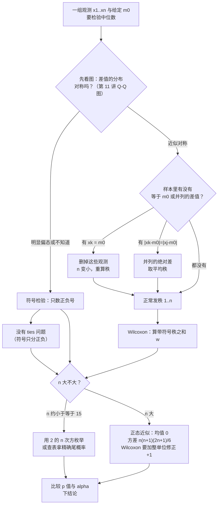
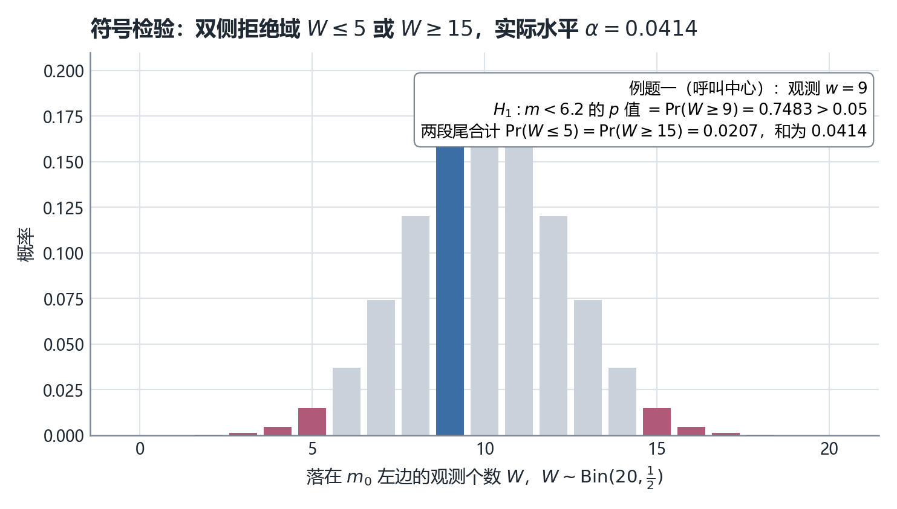
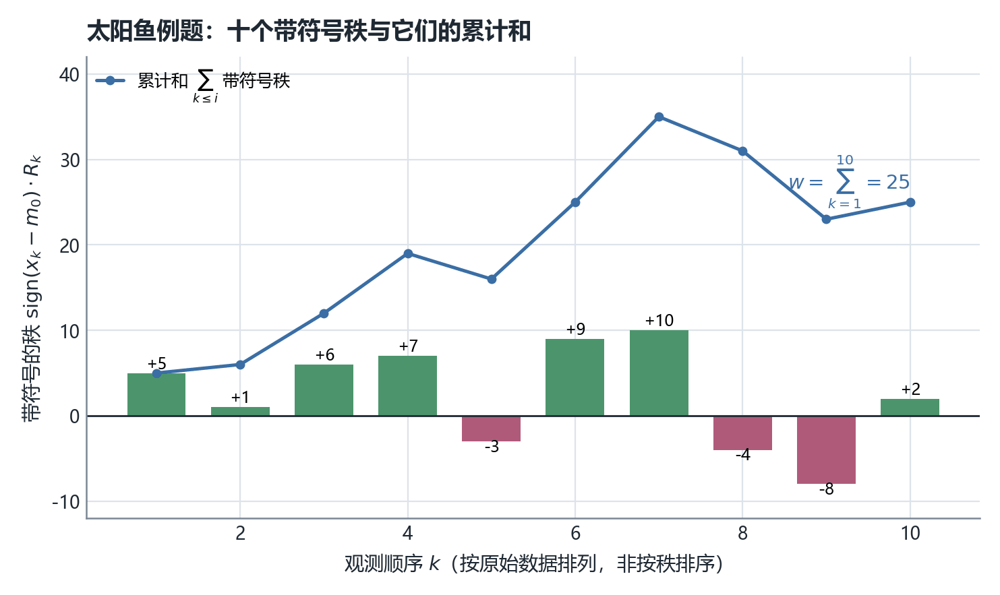
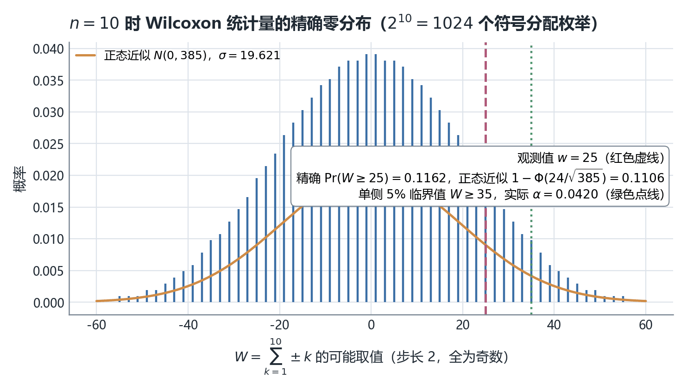
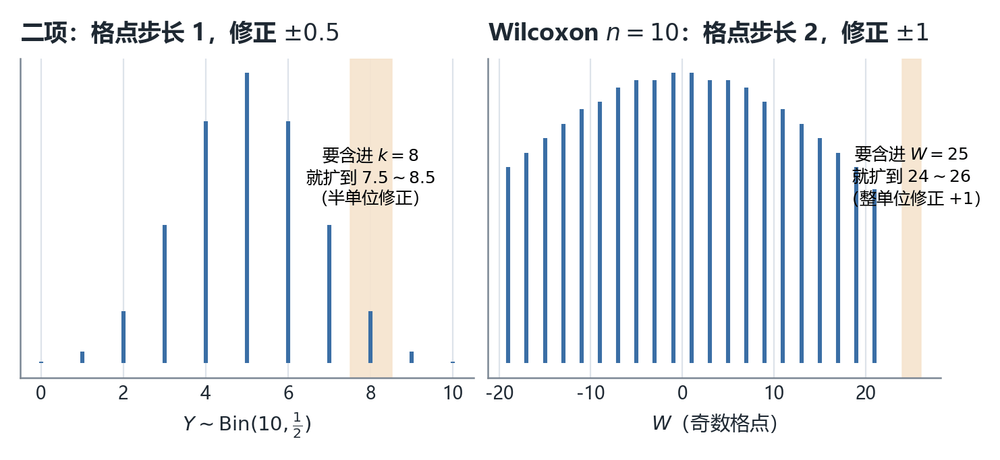
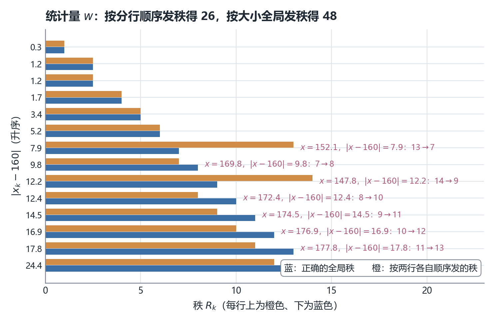
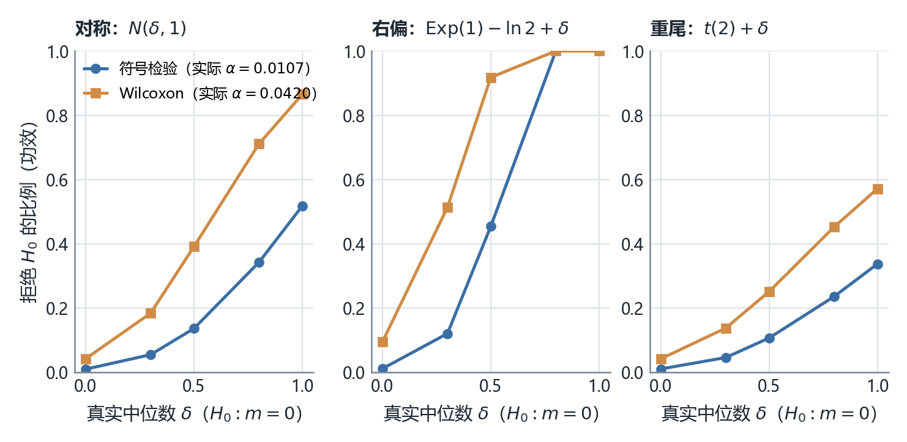

# STA2002 概率与统计 II · 第 13 讲笔记
## Sign Test & Wilcoxon Signed Rank Test（符号检验与 Wilcoxon 符号秩检验：不要分布假设的两种检验）

> 授课：Zhenxing Guo、Ka Wai Tseng（香港中文大学（深圳）数据科学学院，2026 年 11 月）
> 教材：Hogg, Tanis & Zimmerman (2015) *Probability and Statistical Inference*, 9th ed., Pearson
> 对应教材章节：**§8.4 The Wilcoxon Tests**（讲义第 2 页给出 "Suggested reading: Chapter 8.4 of the textbook"，我在教材目录核对过，第 8 章 Tests of Statistical Hypotheses 的第 4 节标题正是 The Wilcoxon Tests，页码 389–399）。教材这一节里**两道例题与讲义完全相同**（呼叫中心的 20 个时间间隔、10 条太阳鱼的长度），数值也一致；此外教材还多给了两样讲义没有的东西：一张 **Table 8.4-1（16 个绝对差的全局秩表）** 和一段**并列值的处理说明**（并明说"ties 少时继续沿用同一个正态近似"）。
> 材料构成：讲义 `Lecture13 - Sign Test, Wilcoxon Signed Rank Test.pdf`（**21 页**），笔记内容**完全基于课件（PDF）整理**，本讲没有收到板书，全文没有 `【板书 NN】` 标记；凡属我补充、推导或复算的部分，一律用 **【补】** 或 alert 标出，并在文末诚实备注中逐条列出。
> **组织方式**：正文**按讲义（PPT）的页序**撰写。**本讲的页码有个坑：第 7 页是第 6 页的完整复制（两页页脚都印 "6 / 20"），所以 PDF 有 21 页而页脚只编到 20**——从第 8 页起，"PDF 第 $N$ 页"与"页脚第 $N-1$ 页"差一格。本笔记一律用 **PDF 物理页码**，并在 §0 的对照表里同时标出页脚号。
> **数值核验**：讲义里出现的每一个数（$w=9$、$0.748$、$0.0414$、十个差值、十个秩、$w=25$、$385$、$0.11$、$n=14$、$2.5$、$26$、$1015$、$31.86$、$52.41$）我都复算过。**Wilcoxon 的零分布我没有查表，而是用 $2^n$ 枚举（DP 卷积）从零重建**，$n=10$ 的 $2^{10}=1024$ 个符号分配全部走完，得精确尾概率 $\Pr(W\ge25)=0.116211$（讲义只给近似 $0.11$）。**并发现一处实质错误：第 19 页的秩表是按"分行顺序"发的，不是按大小全局发的，导致 $w$ 应为 $48$ 而不是 $26$**（结论不变，但统计量与 $p$ 值都错，见诚实备注第 1 条 ⚠️）。

---

## 0. 本讲地图（先说清楚这一讲在干什么）

*这一节回答：第 12 讲给了"不假设分布的区间"，这一讲给"不假设分布的检验"；并且解释为什么同一份数据用符号检验和 Wilcoxon 会得到两个不同的 $p$ 值。*

**三遍阅读路线。** 本讲前半（符号检验）很短，后半（Wilcoxon）有零分布、CLT、连续性修正、ties 四块硬内容，建议分三遍：

| 遍次 | 读哪里 | 读完应该能 |
| --- | --- | --- |
| 第一遍（主线） | §2–§4（符号检验与例题一）→ §7–§9（Wilcoxon 的三步构造与例题二）→ §18（例题三结论） | 拿到一组数，会算 $W$、查/算尾概率、下结论 |
| 第二遍（深化） | §5（双侧临界域与 $\alpha$）→ §10–§13（零分布、Lyapunov CLT、为什么修正量是 $+1$）→ §14 | 解释 $W$ 为什么等于 $\sum\pm k$ 的分布、为什么步长是 2 |
| 第三遍（考前） | §15–§17（ties）→ §19（两个检验怎么选）→ §21–§24 | 知道两个检验的假设差别、功效代价，以及哪些结论是我补的 |

第一遍刻意跳过两块。**§11 是 Lyapunov CLT 的定理页**，讲义自己写了 "not required for this course"，跳过不影响做题；**§10–§12 是零分布的来由**，它解释"为什么 $W$ 的分布不依赖总体"，属于"为什么"而不是"怎么做"。

第 6–9 讲的检验全部建立在"$\bar X$ 的分布已知"之上（正态总体 → $Z$/$t$/$\chi^2$/$F$；大样本 → CLT）。第 12 讲把区间那半边换成了不依赖分布的做法，本讲换检验这半边。两种新检验的差别只有一句话：

| | 用到什么信息 | 需要什么假设 | 代价 |
| --- | --- | --- | --- |
| **符号检验（sign test）** | 只用差值的**正负号** | 只需总体连续 | 扔掉幅度，功效低 |
| **Wilcoxon 符号秩检验** | 用差值的**符号 + 绝对值大小** | 总体连续 **且分布对称** | 多一条假设；假设不成立时水平会失真 |

**"多一条假设换更高功效"这笔交易是本讲的主线**，讲义第 8 页只说了前半句（符号检验"ignore the magnitude"），没说后半句（Wilcoxon 要对称性），我在 §6、§19 补上。

| PDF 页 | 页脚号 | 内容 | 本笔记 | 配图 |
| --- | --- | --- | --- | --- |
| 第 1 页 | 1/20 | 封面 | —— | — |
| 第 2 页 | 2/20 | Introduction：两种 distribution-free 检验 | §1 | — |
| 第 3 页 | 3/20 | 符号检验的设定与三种备择 | §2 | — |
| 第 4 页 | 4/20 | 例题一题干：呼叫中心 20 个间隔 | §3 | — |
| 第 5 页 | 5/20 | 例题一解答：$w=9$、$p$ 值 $0.748$ | §4 | — |
| 第 6 页 | 6/20 | 双侧临界域与第一类错误 $0.0414$ | §5 | 图 5.1 |
| **第 7 页** | **6/20（重复）** | **与第 6 页逐字相同** | §5.4 | — |
| 第 8 页 | 7/20 | 符号检验的局限 → Wilcoxon 的动机 | §6 | — |
| 第 9 页 | 8/20 | Wilcoxon 的假设与符号函数 | §7 | — |
| 第 10 页 | 9/20 | 三步构造带符号秩统计量 | §8 | — |
| 第 11 页 | 10/20 | 例题二：10 条太阳鱼，$w=25$ | §9 | 图 9.1 |
| 第 12 页 | 11/20 | 零分布：$V=\sum V_k$ 的构造 | §10 | 图 10.1 |
| 第 13 页 | 12/20 | Lyapunov CLT 定理（注明不考） | §11 | — |
| 第 14 页 | 13/20 | 用 Lyapunov 得到 $W$ 的正态近似 | §12 | — |
| 第 15 页 | 14/20 | 连续性修正：为什么是 $+1$ 而不是 $+0.5$ | §13 | 图 13.1 |
| 第 16 页 | 15/20 | 例题二续：$p$ 值 $\approx0.11$，不拒绝 | §14 | — |
| 第 17 页 | 16/20 | ties 的两条处理规则 | §15 | — |
| 第 18 页 | 17/20 | 例题三题干：16 个观测、两个等于 $m_0$ | §16 | — |
| 第 19 页 | 18/20 | 例题三的秩表与 $w=26$（**秩发错了**） | §17 | 图 17.1 |
| 第 20 页 | 19/20 | 例题三结论：$\sigma_W\approx31.86$、临界值 $52.41$ | §18 | — |
| 第 21 页 | 20/20 | Summary：两个检验的假设与零分布对照 | §20 | — |
| — | — | 功效实测、速查表、核心直觉、术语对照、诚实备注 | §19、§21–§24 | 图 19.1 |

### 0.1 一句话概括本讲的结构

> [!IMPORTANT]
> **两个检验共用同一个"翻转符号"机制，区别只在翻转的对象。** 符号检验把每个观测压成一个 $\pm$，统计量是 $n$ 个伯努利之和 $\Rightarrow W\sim\mathrm{Bin}(n,\tfrac12)$；Wilcoxon 把每个**绝对差的大小**保留下来变成秩 $1,2,\ldots,n$，再给每个秩随机贴一个 $\pm$，统计量是
> $$W=\sum_{k=1}^{n}\mathrm{sign}(X_k-m_0)\cdot R_k\ \overset{H_0}{=}\ \sum_{k=1}^{n}V_k,\qquad P(V_k=\pm k)=\tfrac12,$$
> 于是 $E(W)=0$、$\operatorname{Var}(W)=\sum_{k=1}^n k^2=\frac{n(n+1)(2n+1)}{6}$，$n$ 大时用正态近似。**关键在"$\overset{H_0}{=}$"这一步为什么成立：它需要总体对称**——只有对称，"$\lvert X_k-m_0\rvert$ 的大小"才与"它在 $m_0$ 左边还是右边"独立，秩才真的等概率地拿到正负号。连续只保证 $\Pr(X_i=m_0)=0$，**保证不了这条独立性**（见 §7 与 §19 的实测）。

### 0.2 与本讲关系最近的三处往讲接口（这张表是我整理的，讲义没有画）

| 往讲留下的线 | 本讲在哪里接上 |
| --- | --- |
| 第 6 讲：$\alpha$、$p$ 值、拒绝域方向（"大值/小值/两头"哪种算极端） | 第 3、5、6 页全部在重复这套语言；第 5 页那句 "As large value of $W$ favors $H_1$" 就是在定方向 |
| 第 9 讲 §16.3–§16.5：离散数据的实际水平是阶梯函数，名义 $5\%$ 常常够不到，必须用精确分布回验 | 本讲同款问题再现两次：$n=20$ 单侧想要 $5\%$，$\Pr(W\ge14)=0.0577$ 超了、$\Pr(W\ge15)=0.0207$ 又太保守；$n=10$ 的 Wilcoxon 精确临界值是 $W\ge35$（实际 $\alpha=0.0420$），下一档 $W\ge33$ 就到 $0.0527$ |
| 第 12 讲：$\Pr(X_{(i)}<m_0<X_{(j)})=\Pr(i\le W\le j-1)$，$W\sim\mathrm{Bin}(n,p)$ | 与本讲符号检验**是同一个二项分布**：第 12 讲的区间盖住 $m_0$ $\iff$ 本讲的符号检验不拒绝 $H_0:m=m_0$（对偶关系见 §19.3） |

第 10–11 讲（顺序统计量、样本分位数）在本讲只以"秩"的形式出现——第 10 页的 $R_k$ 就是 $\lvert X_k-m_0\rvert$ 这 $n$ 个数的顺序统计量位置。

### 0.3 拿到"这份数据能不能说明中位数大于 $m_0$"这类题，怎么走

**这张图是我整理的，讲义没有画。** 三个分岔点：能不能假设对称（决定用哪个检验）、有没有 ties（决定秩怎么发）、$n$ 大不大（决定精确枚举还是正态近似）。第一个分岔讲义完全没提，但它是实务里唯一重要的判断。

### 0.4 来源标注约定

- 无标记 → 讲义原文或对讲义的直接展开；
- **【补】** → 讲义没有、由我补充、推导或复算的内容（文末诚实备注逐条列出）；
- alert → 同为补充，标题写明它属于哪一类（补充 / 技巧 / 重要 / 课件笔误 / 注意）。

---

## 1. 本讲要交付什么（讲义第 2 页）

讲义第 2 页原文：

> In this lecture, we will learn two kinds of distribution-free hypothesis testing
> Sign test
> Wilcoxon signed rank test
> Suggested reading: Chapter 8.4 of the textbook.

**"distribution-free" 在这里的含义比第 12 讲更微妙。**【补】第 12 讲的置信系数确实与 $F$ 无关（只要连续）。本讲的符号检验同样如此（$W\sim\mathrm{Bin}(n,\tfrac12)$ 只用到 $\Pr(X_i<m_0)=\tfrac12$）；**但 Wilcoxon 的零分布需要"$F$ 关于 $m$ 对称"这个额外条件**——它 free 的是"分布的具体形状（正态？指数？），不是 free 一切假设"。教材 §8.4 的原话是 "in addition to assuming that the random variable $X$ is of the continuous type, we must also assume that the pdf of $X$ is symmetric about the median **in order to find the distribution of this new statistic**"——注意最后那半句，对称性是为了**求统计量的分布**，不是为了检验本身成立。

> [!NOTE] 补充：为什么"检验不需要分布、但零分布需要分布"
> 【补】这句话是理解本讲的钥匙。$H_0$ 为真时"中位数是 $m_0$"，于是 $\Pr(X_i<m_0)=\Pr(X_i>m_0)=\tfrac12$ ——**这一步只用到连续**。符号检验的统计量只依赖这些 0/1 信息，所以它的零分布对一切连续 $F$ 都成立。Wilcoxon 的统计量还依赖"$\lvert X_i-m_0\rvert$ 排第几"，要算出"$\pm$ 号与秩相互独立、各秩等概率拿正负号"，就需要**左右两侧的形状一样**，即对称。不对称时（比如右偏），大的绝对差更常出现在正号一侧，$W$ 的零分布会整体右移——**名义 $5\%$ 的检验实际水平会偏高**。§19.2 我用模拟把这个失真量化了。

---

## 2. 符号检验的设定（讲义第 3 页）

讲义第 3 页原文：

> Suppose we have random sample $X_1,\ldots,X_n$, i.i.d., from continuous distribution with median $m$. We would like to test for median $m$: $H_0:m=m_0$ against either $H_1:m>m_0$ or $H_1:m<m_0$ or $H_1:m\ne m_0$.
> **Sign test counts the number of $X_i$'s that favor $H_1$.**

**四个要素**【补】：

1. **假设对象是中位数 $m$**，不是均值。这一点与第 6–9 讲不同（那边全在检验 $\mu$、$\sigma^2$、$p$）。中位数的好处是它对分布形状没有偏好，坏处是没有像 $\bar X$ 那样好用的精确分布——于是必须换一套语言。
2. **只假设"连续"**。连续保证 $\Pr(X_i=m_0)=0$，所以每个观测非左即右，计数干净。
3. **三种备择都要会判方向**：$H_1:m>m_0$ 意味着"落在 $m_0$ 左边的观测偏**少**"；$H_1:m<m_0$ 意味着"左边的偏**多**"。
4. **最后一句 "counts the number of $X_i$'s that favor $H_1$"** 是讲义给出的总原则：统计量要选成"越大越支持 $H_1$"的形式。

> [!WARNING] 注意：同一个字母 W 在两种方向定义下含义相反，先看清数的是哪一边
> 【补】本讲讲义把统计量定义为 $W=\sum_{i=1}^{n}\mathbf{1}(X_i<m_0)$，即"**小于** $m_0$ 的个数"（第 5 页、第 21 页 Summary 都是这个）。在这个定义下：$H_1:m<m_0$ 对应**大** $W$、$H_1:m>m_0$ 对应**小** $W$。而教材 §8.4 用的 $Y$ 是"负差的个数"（等价于 $X_i<m_0$），与讲义一致；但很多软件与另一派教材（包括第 12 讲我用的 $S^{+}=\#(X_i>m_0)$）方向刚好相反。**同一组数据、同一个 $H_1$，两套记号给出的 $p$ 值会互补。** 做题时的保险动作：先问自己"如果 $H_1$ 为真，落在 $m_0$ 左边的人会变多还是变少"，再决定尾方向，不要背"大于就右尾"。

---

## 3. 例题一：呼叫中心的 20 个时间间隔（讲义第 4 页）

讲义第 4 页原文：

> **Example.** Let $X$ denote the length of time in seconds between two calls entering a call center. Let $m$ be the median of time intervals. Based on a sample of 20 observations,
> 6.8, 5.7, 6.9, 5.3, 4.1, 9.8, 1.7, 7.0, 2.1, 19.0, 18.9, 16.9, 10.4, 44.1, 2.9, 2.4, 4.8, 18.9, 4.8, 7.9
> We would like to test $H_0:m=6.2$ vs $H_1:m<6.2$ at significant level $\alpha=0.05$.

**数据核对。**【补】20 个数 ✓。小于 $6.2$ 的有 $5.7,5.3,4.1,1.7,2.1,2.9,2.4,4.8,4.8$ 共 **9 个** ✓ 与第 5 页的 $w=9$ 一致（我逐个点数过，没有并列值，也没有恰好等于 $6.2$ 的）。

**这份数据长什么样？**【补】排序后是 $1.7,2.1,2.4,2.9,4.1,4.8,4.8,5.3,5.7,6.8,6.9,7.0,7.9,9.8,10.4,16.9,18.9,18.9,19.0,44.1$，样本中位数 $= (6.8+6.9)/2 = 6.85$，样本均值 $= 10.585$。**均值远大于中位数，右尾很长（44.1 是明显的离群值）**——这正是该用非参数方法的情形，也是教材与本讲都选这道题的原因。

> [!TIP] 技巧：备择方向与数据相反时 p 值会大于 0.5，这不是算错
> 【补】本例 $H_1:m<6.2$ 期待"左边观测多"，但实际只有 $9/20=45\%$ 在左边（比一半还少），数据其实微微**反对** $H_1$。于是 $p$ 值 $=\Pr(W\ge9)=0.748>0.5$ ✓ 完全正常。$p$ 值大于 $0.5$ 的含义是"观测值连方向都不对"，此时任何水平的检验都不会拒绝。

---

## 4. 例题一解答：$w=9$、$p$ 值 $0.748$（讲义第 5 页）

讲义第 5 页原文：

> **Solution.** Let $W$ denote the number of time intervals less than 6.2, $W=\sum_{i=1}^{20}\mathbf{1}(X_i<6.2)$. Under $H_0$, $m=6.2$ is median, so $\Pr(X_i<6.2)=\frac12$, $W\sim\mathrm{Bin}(20,\frac12)$. Thus, we let $W$ be the test statistics. Based on the observations, the realized value is $w=9$.
> As large value of $W$ favors $H_1$, so $p$-value is $\Pr(W\ge9;H_0)=\Pr(W\ge9;W\sim\mathrm{Bin}(20,\frac12))=0.748>0.05$.
> Thus, we fail to reject $H_0$ at level 5%.

**四步逐条核对。**【补】

1. **统计量的分布**：$H_0$ 下 $\Pr(X_i<6.2)=F(6.2)=\tfrac12$（中位数定义 + 连续性），$n=20$ 次独立试验 ⇒ $W\sim\mathrm{Bin}(20,\tfrac12)$。**这一步没有用到 $F$ 的任何形状信息**——这就是 distribution-free。
2. **实现值**：$w=9$ ✓（§3 已点数）。
3. **方向**：$H_1:m<6.2$ ⇒ 真中位数更小 ⇒ 落在 $6.2$ 左边的更多 ⇒ **大 $W$ 支持 $H_1$** ✓。
4. **$p$ 值**：$\Pr(W\ge9)=1-\Pr(W\le8)$。我用 `scipy.stats.binom(20,0.5).sf(8)` 算得 $0.748278$ ✓ 讲义 $0.748$。

> [!IMPORTANT] 重要：p 值是"零假设下出现至少同样支持备择假设的结果"的概率
> 【补】写成公式就是 $p=\Pr_{H_0}(W\ge w)$（大值方向）或 $\Pr_{H_0}(W\le w)$（小值方向）、双侧取两尾之和。第 6 讲给过这条定义，本讲第 5 页那句 "As large value of $W$ favors $H_1$, so $p$-value is $\Pr(W\ge9)$" 正是它的实例——**先定方向，再定尾**。很多同学习惯"双侧就乘 2"，在离散分布上乘 2 常常与"两尾之和"不等（本讲第 6 页给的是两尾之和 $0.0414$，而不是 $2\times\Pr(W\le5)=0.0414$——这里恰好相等，因为 $\mathrm{Bin}(20,\tfrac12)$ 对称；换成 $p\ne\tfrac12$ 就不等了）。

---

## 5. 双侧临界域与第一类错误（讲义第 6 页；第 7 页是它的复制）

### 5.1 题目与解答（讲义第 6 页）

讲义第 6 页原文：

> For the hypothesis test for the median $H_0:m=7.2$ vs $H_1:m\ne7.2$. Large or small values of $W$ both favor $H_1$. Consider the critical region $C=\{(x_1,\ldots,x_n)\mid w\le5 \text{ or } w\ge15\}$. What is the type I error of the test or the significance level $\alpha$?
> Under $H_0$, $W\sim\mathrm{Bin}(20,\frac12)$. The probability of a type I error is
> $$\Pr(W\in C;H_0)=\Pr(W\le5;H_0)+\Pr(W\ge15;H_0)=\Pr(W\le5)+\Pr(W\ge15)=0.0414.$$

**核对。**【补】$\Pr(W\le5)=\Pr(W\ge15)=0.020695$（对称），和为 $0.041389$ ✓ 讲义 $0.0414$。

**注意这道题换了 $m_0$（$6.2\to7.2$）但数据没换。**【补】第 6–7 页只问"这个临界域的水平是多少"，**不需要实现值**，所以换 $m_0$ 不影响答案——它是一道纯"设计检验"的题，与第 4–5 页的"用数据检验"是两种题型。这一点讲义没说，容易被误读成"同一道题的第二问"。

### 5.2 为什么临界域取 $\{w\le5\}\cup\{w\ge15\}$（【补】）

因为 $n=20$、$\mathrm{Bin}(20,\tfrac12)$ 关于 $10$ 对称，两尾各取 $\le5$ 与 $\ge15$（即偏离中心 $5$ 个以上）最自然。但**实际能达到的水平是离散的**，我把 $n=20$ 双侧的几个候选都算了：

| 临界域 | $\alpha$（实际水平） | 评价 |
| --- | --- | --- |
| $w\le6$ 或 $w\ge14$ | $0.1153$ | 远超 $0.05$ |
| $w\le5$ 或 $w\ge15$ | $0.0414$ | 讲义采用，**最接近且不超过 $0.05$** ✓ |
| $w\le4$ 或 $w\ge16$ | $0.0118$ | 保守得多 |

**这与第 9 讲 §16.3 的结论完全同构**：离散世界里"恰好 $5\%$"通常不存在，只能取"不超过名义值的最大一档"。

### 5.3 单侧呢？（【补】，教材给了答案）

教材 Example 8.4-1 用的正是同一份呼叫中心数据，但取**单侧**临界域 $C=\{y:y\ge14\}$，并说 $\alpha=0.0577$。我复算 $\Pr(W\ge14)=0.057659$ ✓。注意 $0.0577>0.05$——**教材在这里取的是"最接近名义值"而不是"不超过名义值"**，下一档 $\Pr(W\ge15)=0.0207$ 又太保守。两种取法都存在，答题时按课程口径（本讲第 6 页用的是"不超过"那一档）。

### 5.4 关于第 6 页与第 7 页

讲义第 7 页与第 6 页**逐字相同**（我用文本比对确认两页内容完全一致，页脚也都印 "6 / 20"）。这是排版重复，不是"第二问"。

> [!WARNING] 课件笔误：第 7 页是第 6 页的完整复制，页码也重复
> 讲义共 21 页，但页脚编号只到 "20 / 20"，因为第 6 页被插了两次（两页页脚同为 "6 / 20"）。**影响**：从第 8 页起，"PDF 第 $N$ 页"与"页脚第 $N-1$ 页"差一格；若老师上课说"翻到第 14 页"，需要确认说的是哪个体系。**判据**：`pymupdf` 逐页取文本比对，第 6、7 页字符串完全相等；且全篇页脚序列为 1,2,3,4,5,6,6,7,…,20。本笔记统一用 PDF 物理页码，并在 §0 的对照表里把页脚号一并列出。

图 5.1 把 $\mathrm{Bin}(20,\tfrac12)$ 的零分布、双侧拒绝域与例题一的观测值画在一起。

*图 5.1　符号检验的零分布 $W\sim\mathrm{Bin}(20,\tfrac12)$（我绘制；每条高度由 `scipy.stats.binom.pmf` 现算）。玫红两段是第 6 页的双侧拒绝域 $w\le5$ 与 $w\ge15$，合计 $\alpha=0.0414$；深蓝那根是例题一的观测值 $w=9$。三个可读的事实：① 分布关于 $10$ 对称，所以两尾概率相等（各 $0.0207$）；② 观测值在中心偏左一点，与 $H_1:m<6.2$ 的方向**相反**，所以 $p$ 值高达 $0.7483$；③ 相邻格点之间的概率落差很大，这就是"实际水平只能取离散档位"的几何原因*

---

## 6. 符号检验的局限与 Wilcoxon 的动机（讲义第 8 页）

讲义第 8 页原文：

> In the sign test, the test statistic is the number of $X_i$'s less than the median value under the null hypothesis $m=m_0$: $W=\sum_{i=1}^{n}\mathbf{1}(X_i<m_0)$.
> The limitation of the sign test is that we only consider the sign of the difference between $X_i$ and $m_0$ but ignore the magnitude of the difference.
> Wilcoxon signed rank test considers both the sign and magnitude of the difference between $X_i$ and $m_0$.

**"扔掉幅度"到底损失了什么？**【补】看两个假想样本，$n=5$、$m_0=0$：

- 样本 A：$-0.1,\;0.2,\;-0.3,\;0.4,\;-0.5$ —— 三个负号，符号检验的计数完全一样；
- 样本 B：$-100,\;0.2,\;-50,\;0.4,\;-80$ —— 也是三个负号。

符号检验对 A、B 给出**一模一样的 $p$ 值**，但样本 B 的负差大得离谱，直觉上 B 更有力地说明"中位数在 0 左边"。Wilcoxon 的做法是：**先按绝对差的大小给 5 个观测发秩 $1,\ldots,5$，再把秩连同符号一起加起来**——B 里那些巨大的负差会拿到 $4,5$ 这样的大秩，把 $W$ 狠狠拉向负方向。

> [!CAUTION] 注意：讲义只说了"多用了信息"，没说"多付了一条假设"
> 【补】第 8 页把 Wilcoxon 描述成纯粹的升级，读起来像"免费的功效"。**不是免费的**：第 9 页第一行就写着 "Assumption: $X_1,\ldots,X_n$ are i.i.d. random samples from a **symmetric** and continuous distribution"。符号检验只要连续，Wilcoxon 要连续 **加对称**。不对称时 Wilcoxon 的实际水平会失真——我用右偏总体模拟过：$n=10$、$H_0:m=0$ 成立、名义单侧 $5\%$（Wilcoxon 在 $n=10$ 下实际能达到的水平是 $0.0420$）时，**真实拒绝率是 $0.095$，几乎是名义值的两倍**（见 §19.2 与图 19.1 中栏）。所以正确的说法是：**Wilcoxon 用一条额外的对称性假设，买到了更高的功效。**

---

## 7. Wilcoxon 的假设与符号函数（讲义第 9 页）

讲义第 9 页原文：

> **Assumption:** $X_1,\ldots,X_n$ are i.i.d. random samples from a symmetric and continuous distribution with median $m$.
> **Null Hypothesis:** $H_0:m=m_0$, where $m_0$ is a given constant.
> To build the test statistics, we first introduce sign function $\mathrm{sign}(z)=\begin{cases}1 & z>0\\ -1 & z<0\end{cases}$

**两个假设各自挡掉什么。**【补】

| 假设 | 挡掉的问题 | 违反后会怎样 |
| --- | --- | --- |
| 连续 | $\Pr(X_i=m_0)>0$（差值恰好为 0） | 符号无从定义；第 17 页的"删掉等于 $m_0$ 的观测"就是补救 |
| 对称 | 秩与符号不再独立 | $W$ 的零分布不是 $\sum\pm k$，$p$ 值算错（§19.2 实测失真到 $0.095$） |

**对称 + 连续 ⇒ 中位数唯一且 $F(m+x)+F(m-x)=1$。** 此时 $\lvert X_i-m_0\rvert$ 的分布与"$X_i$ 在 $m_0$ 哪一侧"无关：给定 $\lvert X_i-m_0\rvert=d$，左右两边各有概率 $\tfrac12$。**这正是第 12 页"$\pm$ 独立等概率"论证真正依赖的东西**，讲义在那里只说 "Under $H_0$, both the probabilities of positive and negative sign are $1/2$"，把独立性这一半漏掉了（见 §10）。

> [!NOTE] 补充：sign(0) 没定义，但处理规则要到第 17 页才给
> 【补】讲义第 9 页的符号函数只列了 $z>0$ 与 $z<0$ 两行，$z=0$ 悬空；直到第 17 页才补上"若 $x_k=m_0$ 就删掉该观测、用缩小后的样本量继续"。顺序上是"先用后补"，做题时记住：**遇到 $x_k=m_0$ 不是报错，是删数据并同步把 $n$ 改小**（秩的个数、方差公式里的 $n$ 都要跟着改——第 20 页正是这么做的：$16-2=14$，方差用 $n=14$ 算）。

---

## 8. 三步构造带符号秩统计量（讲义第 10 页）

讲义第 10 页原文（三条编号步骤）：

> 1. Rank the absolute values $\lvert X_1-m_0\rvert,\ldots,\lvert X_n-m_0\rvert$ in ascending order. Denote the rank of $\lvert X_k-m_0\rvert$ by $R_k$.
> 2. For each $R_k$, associate the sign of difference $X_k-m_0$: if $X_k-m_0>0$, use $R_k$; if $X_k-m_0<0$, use $-R_k$. We call the product of $\mathrm{sign}(X_k-m_0)$ and $R_k$ signed ranks.
> 3. Construct the test statistics $W:=\sum_{k=1}^{n}\mathrm{sign}(X_k-m_0)\cdot R_k$. $W$ is called the Wilcoxon signed rank statistic.

**用符号把三步写成一个式子**【补】：

$$W=\sum_{k=1}^{n}\mathrm{sign}(X_k-m_0)\cdot R_k,\qquad R_k=\#\{j:\lvert X_j-m_0\rvert\le\lvert X_k-m_0\rvert\}\ \ (\text{并列时取平均}).$$

**$R_k$ 就是"第 $k$ 个观测的绝对差排在第几小"** —— 换句话说，$(R_1,\ldots,R_n)$ 是 $1,2,\ldots,n$ 的一个排列（无 ties 时）。教材 §8.4 特别强调了这一点："Note that $R_1,R_2,\ldots,R_n$ is a permutation of the first $n$ positive integers $1,2,\ldots,n$"。**这句话是后面 $\operatorname{Var}(W)=\sum k^2$ 的前提**：正因为秩恰好是 $1$ 到 $n$ 的一个排列，$\sum R_k^2$ 才等于 $\sum k^2=\frac{n(n+1)(2n+1)}{6}$，与数据本身的大小无关。

> [!WARNING] 注意：W 这个字母在本讲被用了两次，含义完全不同
> 【补】第 5 页的 $W=\sum\mathbf{1}(X_i<m_0)$ 是**符号检验**的计数，取值 $0,1,\ldots,n$，分布 $\mathrm{Bin}(n,\tfrac12)$；第 10 页的 $W=\sum\mathrm{sign}(X_k-m_0)R_k$ 是 **Wilcoxon** 的带符号秩和，取值可正可负、步长 2，分布是 $\sum\pm k$。第 21 页 Summary 把两个 $W$ 并排写在一起，只差一行公式。**建议**：自己复习时把前者记作 $W_{\text{sign}}$、后者记作 $W_{\text{rank}}$，或者干脆把 Wilcoxon 那个写成教材常见的 $T$。两个统计量的方差、临界值、修正量全都不同，混用一个字母是本讲最容易失分的坑。

---

## 9. 例题二：10 条太阳鱼（讲义第 11 页）

讲义第 11 页原文：

> **Example.** Suppose the lengths of $n=10$ sunfish are 5.0, 3.9, 5.2, 5.5, 2.8, 6.1, 6.4, 2.6, 1.7, 4.3. We shall test $H_0:m=3.7$ against $H_1:m>3.7$. Based on the data, we have
>
> | $x_k-m_0$ | 1.3 | 0.2 | 1.5 | 1.8 | −0.9 | 2.4 | 2.7 | −1.1 | −2.0 | 0.6 |
> | --- | --- | --- | --- | --- | --- | --- | --- | --- | --- | --- |
> | $\lvert x_k-m_0\rvert$ | 1.3 | 0.2 | 1.5 | 1.8 | 0.9 | 2.4 | 2.7 | 1.1 | 2.0 | 0.6 |
> | Ranks | 5 | 1 | 6 | 7 | 3 | 9 | 10 | 4 | 8 | 2 |
> | Signed Ranks | 5 | 1 | 6 | 7 | −3 | 9 | 10 | −4 | −8 | 2 |
>
> The realized Wilcoxon signed rank statistic is $w=5+1+6+7-3+9+10-4-8+2=25$.
> **Question:** What is distribution of test statistic $W$ under $H_0$?

**逐列核对。**【补】

- **差值**：$5.0-3.7=1.3$、$3.9-3.7=0.2$、$5.2-3.7=1.5$、$5.5-3.7=1.8$、$2.8-3.7=-0.9$、$6.1-3.7=2.4$、$6.4-3.7=2.7$、$2.6-3.7=-1.1$、$1.7-3.7=-2.0$、$4.3-3.7=0.6$ ✓ 十个全对。
- **绝对值升序**：$0.2,0.6,0.9,1.1,1.3,1.5,1.8,2.0,2.4,2.7$ → 秩 $1,2,3,4,5,6,7,8,9,10$ ✓ 与表中 Ranks 完全一致（我用 `scipy.stats.rankdata` 独立验证，得到同一组秩）。
- **带符号秩之和**：$5+1+6+7-3+9+10-4-8+2=25$ ✓。
- **正负号分布**：7 正 3 负 ✓（教材也点出 "the number of the 10 lengths that are less than 3.7 is 3"）。

**方向判断。**【补】$H_1:m>3.7$ ⇒ 观测普遍偏大 ⇒ 正差多且大 ⇒ **大 $W$ 支持 $H_1$** ✓（与第 16 页一致）。

图 9.1 把这张表画成"梯子"，正秩朝上、负秩朝下，蓝线是累计和。

*图 9.1　太阳鱼例题的十个带符号秩（我绘制；数值即第 11 页那张表，横轴按原始观测顺序 $k=1,\ldots,10$ 排列，不是按秩排）。绿色柱是正差（7 个）、玫红柱是负差（3 个），柱高就是秩的大小；蓝线是累计和 $\sum_{k\le i}$，终点 $w=25$。三个可读的点：① 最大的两个秩 $+9,+10$ 都是正号，这正是"大差偏正"支持 $H_1:m>3.7$ 的视觉证据；② 三个负号拿到的是中等秩 $-3,-4,-8$，没有把累计和拉回零点；③ 若把同样的符号分配给"绝对值全相等"的数据，$w$ 会退化成符号检验的信息量——**图里柱高的差异就是 Wilcoxon 比符号检验多用的那部分信息***

> [!TIP] 练习 9.1
> 【补】不用查表，判断：若把这 10 个数改成 $3.7\pm0.001$（即所有 $\lvert x_k-m_0\rvert$ 都相等），$w$ 会是多少？
> **参考答案。** 所有秩都变成平均秩 $\frac{1+2+\cdots+10}{10}=5.5$，于是 $w=5.5\times(\text{正号数}-\text{负号数})=5.5\times(7-3)=22$。**这时 $w$ 只携带符号信息**，与符号检验完全等价——这就是"绝对值大小被抹平"的极端情形。

---

## 10. 零分布：$V=\sum V_k$ 的构造（讲义第 12 页）

讲义第 12 页原文：

> Consider $V=\sum_{k=1}^{n}V_k$, where $v_1,\ldots,v_k,\ldots,v_n$ are independent, and $v_k=\begin{cases}k & \text{with probability }1/2\\ -k & \text{with probability }1/2\end{cases}$. $V$ is a sum of integers $1,2,\ldots,n$, each of which independently receives their positive/negative signs.
> The distribution of $W$ under $H_0$ is the same as $V$: $W$ is a sum that contains the integers $1,2,\ldots,n$, each with a positive or negative sign. The assignments of these $n$ signs are independent because $X_1,X_2,\ldots,X_n$ are mutually independent. Under $H_0$, both the probabilities of positive and negative sign are $1/2$.

**这段论证有三层，中间一层讲义漏了。**【补】

1. **秩是确定的集合 $\{1,\ldots,n\}$**（§8 已说，来自"秩是 $1..n$ 的排列"）。所以 $W$ 的随机性**只在符号上**，不在秩上。
2. **每个符号 $P=1/2$**：$H_0$ 下 $\Pr(X_k<m_0)=\tfrac12$ ✓ 连续 + 中位数定义。
3. **符号与秩相互独立** ← **这一步讲义没写**，它只说了"符号之间相互独立（因为 $X_i$ 独立）"。但"符号之间独立"不等于"符号与秩独立"。要的是：给定任意一组绝对值大小，各观测落在哪一侧的概率仍是 $\tfrac12$ 且互不影响——**这正是对称性的作用**。反例：右偏总体里，绝对值大的观测更可能落在正侧，于是大秩系统性地拿正号，$W$ 的零分布右移。

> [!IMPORTANT] 重要：W 与 V 同分布的条件是"连续 + 对称"，不是只有连续
> 【补】把三层写全就是：$\Pr(\text{符号}\mid \text{绝对值})=\tfrac12$ 且独立 $\iff$ 总体关于 $m_0$ 对称。所以 Wilcoxon 的表、$\frac{n(n+1)(2n+1)}{6}$ 这个方差、$+1$ 的连续性修正，**全部只在对称前提下才有效**。讲义第 9 页确实把 symmetric 写进了 Assumption，但第 12 页的论证只引用了"独立"和"$1/2$"两处，没有回头调用对称性——这是本讲论证上最大的一个缺口。教材 §8.4 写得更谨慎："in addition to ... continuous type, we must also assume that the pdf of $X$ is symmetric about the median **in order to find the distribution of this new statistic**"。

**$V$ 的分布怎么算？**【补】$V$ 取 $2^n$ 个符号分配，每个概率 $2^{-n}$，所以

$$\Pr(V=v)=2^{-n}\cdot\#\{(\varepsilon_1,\ldots,\varepsilon_n)\in\{\pm1\}^n:\textstyle\sum k\varepsilon_k=v\}.$$

**我没有查表，而是用 DP 卷积把 $n=10$ 的分布完整重建**（1024 个分配），结果：支撑集 56 个点、$E(V)=0$、$\operatorname{Var}(V)=385.0000$ ✓ 与公式 $\frac{10\cdot11\cdot21}{6}=385$ 完全一致。

**奇偶性。**【补】$V=\sum k\varepsilon_k=\sum k-2\sum_{\varepsilon_k=-1}k=55-2(\text{某些整数之和})$，所以 **$V$ 恒为奇数**（$n=10$），相邻格点间隔为 $2$。这个事实直接决定 §13 的修正量。一般地，格点奇偶由 $\frac{n(n+1)}2$ 的奇偶决定：$n=10$ 时 $55$ 奇 ⇒ 全奇数；$n=4$ 时 $10$ 偶 ⇒ 全偶数（我枚举 $n=4$ 验证，支撑 11 个点全为偶数 ✓）。

图 10.1 是 $n=10$ 的精确零分布与正态近似的对照。

*图 10.1　$W$ 的精确零分布（$n=10$，$2^{10}=1024$ 个符号分配逐一枚举，我绘制）与正态近似 $N(0,385)$（橙色曲线，$\sigma=19.621$）。红色虚线是例题二的观测值 $w=25$，绿色点线是精确分布下单侧 $5\%$ 的临界值 $W\ge35$（实际 $\alpha=0.0420$）。三个可读的点：① 精确分布是**离散的奇数格点**，正态曲线是连续的——这就是需要连续性修正的原因；② $n=10$ 时两者形状已经相当接近，但尾部差异明显：$\Pr(W\ge25)$ 精确 $0.1162$、正态近似 $0.1106$；③ 想取恰好 $5\%$ 取不到，$W\ge35$ 给 $0.0420$、退一档 $W\ge33$ 就跳到 $0.0527$*

---

## 11. Lyapunov 的中心极限定理（讲义第 13 页）

讲义第 13 页原文：

> **Theorem.** Let $X_1,X_2,\ldots,X_n$ be independent random variables with: Finite means $E[X_k]=\mu_k$; Finite variances $\operatorname{Var}(X_k)=\sigma_k^2$; Finite $(2+\delta)$-th moments for some $\delta>0$. If the above three conditions hold,
> $$\frac{T_n}{s_n}=\frac{\sum_{k=1}^{n}(X_k-\mu_k)}{\sqrt{\sum_{k=1}^{n}\sigma_k^2}}\xrightarrow{d}N(0,1),\qquad s_n^2=\sum_{k=1}^{n}\sigma_k^2,\quad T_n=\sum_{k=1}^{n}(X_k-\mu_k).$$
> Lyapunov's CLT is not required for this course.

**讲义自己声明"不考"，但这一页的定理陈述其实不完整。**【补】Lyapunov 条件的正式写法是：存在 $\delta>0$ 使

$$\lim_{n\to\infty}\frac{1}{s_n^{2+\delta}}\sum_{k=1}^{n}E\bigl|X_k-\mu_k\bigr|^{2+\delta}=0 .$$

讲义列的三条"矩有限"只是让这个比值**有意义**，并不自动让它**趋于 0**。i.i.d. 情形下三条有限确实足够（比值 $\sim n\cdot C/(n\sigma^2)^{1+\delta/2}\to0$），但本讲的 $V_k$ 是**独立不同分布**（每个的方差是 $k^2$，随 $k$ 增大），必须真的验一下那个比值。

**我替讲义验了一遍（取 $\delta=1$）。**【补】

$$\sum_{k=1}^{n}E\lvert V_k\rvert^3=\sum_{k=1}^{n}k^3=\left[\frac{n(n+1)}{2}\right]^2,\qquad s_n^3=\left[\frac{n(n+1)(2n+1)}{6}\right]^{3/2},$$

比值 $=\dfrac{[n(n+1)/2]^2}{[n(n+1)(2n+1)/6]^{3/2}}\to0$（分子 $\sim n^4/4$、分母 $\sim n^{9/2}/(3\sqrt3)$）。我按 $n=5,10,20,50,100,1000$ 逐个算：$0.5516,\,0.4004,\,0.2868,\,0.1828,\,0.1296,\,0.0411$ ✓ 单调趋于 0，Lyapunov 条件成立，所以第 14 页"三个条件成立 ⇒ 可以用 CLT"这个结论是对的，只是**理由写漏了**。

> [!NOTE] 补充：n=10 时这个比值还有 0.40，别把渐近结论当精确结论
> 【补】"趋于 0"是 $n\to\infty$ 的陈述。$n=10$ 时比值 $0.4004$ 离 0 很远，也就是说**渐近正态性在这个样本量上并没有被定理"保证"**。好消息是实测确实够用：$n=10$ 的精确尾概率 $0.1162$ 与正态近似 $0.1106$ 只差 $0.0056$（图 10.1）。做判断题时记住这条分工——**定理给的是"为什么可以"，模拟/枚举给的是"这里到底准不准"**。

---

## 12. 用 Lyapunov 得到 $W$ 的正态近似（讲义第 14 页）

讲义第 14 页原文：

> For each $v_k$, $E(v_k)=0$, $\operatorname{Var}(v_k)=k^2$, $E(v_k^3)=0$. Thus, three conditions of Lyapunov's CLT hold for $V$. We have
> $$T_n=\sum_{k=1}^{n}[v_k-E(v_k)]=\sum_{k=1}^{n}v_k=V,\qquad s_n=\sum_{k=1}^{n}\operatorname{Var}(v_k)=\sum_{k=1}^{n}k^2=\frac{n(n+1)(2n+1)}{6}.$$
> Apply Lyapunov's CLT: $\dfrac{V}{\sqrt{n(n+1)(2n+1)/6}}\overset{\text{approx}}{\sim}N(0,1)$. Under $H_0$, $\dfrac{W}{\sqrt{n(n+1)(2n+1)/6}}\overset{\text{approx}}{\sim}N(0,1)$.

**三个矩核对。**【补】$E(V_k)=k\cdot\tfrac12+(-k)\cdot\tfrac12=0$ ✓；$\operatorname{Var}(V_k)=E(V_k^2)=k^2$ ✓；$E(V_k^3)=k^3\tfrac12+(-k)^3\tfrac12=0$ ✓（分布关于 0 对称所以奇数矩全为 0）。

**一处排版错误。**【补】讲义写 $s_n=\sum\operatorname{Var}(v_k)$，但按第 13 页的定义 $s_n^2=\sum\sigma_k^2$，所以等式左边应是 $s_n^2$ 而不是 $s_n$；下一行 $\dfrac{V}{\sqrt{n(n+1)(2n+1)/6}}$ 用的才是正确的 $s_n=\sqrt{\sum k^2}$。**判据**：第 16 页写 "$\frac{n(n+1)(2n+1)}{6}=385$，the Wilcoxon signed rank statistic $W\overset{\text{approx}}{\sim}N(0,385)$" —— $385$ 是**方差**（正态的第二参数），若 $s_n=385$ 则 $\sigma^2=385^2$，与第 16 页矛盾。

**$\sum k^2$ 公式的两个检查点。**【补】$n=10$：$\frac{10\cdot11\cdot21}{6}=385$ ✓；$n=14$：$\frac{14\cdot15\cdot29}{6}=1015$ ✓（第 20 页用的就是这个）。另一个记法：$\sum_{k=1}^n k^2$ 增长速度是 $n^3/3$，$n=10$ 时 $385\approx1000/3$ ✓、$n=14$ 时 $1015\approx2744/3=915$（偏差来自低阶项，合理）。

**最终结论的读法**：$H_0$ 下 $W\approx N\!\left(0,\dfrac{n(n+1)(2n+1)}{6}\right)$，**均值恒为 0**（这是"$\pm$ 各半"的直接后果），方差只依赖 $n$。所以做近似检验只需要一个数：$\sigma_W=\sqrt{n(n+1)(2n+1)/6}$。

---

## 13. 连续性修正：为什么是 $+1$ 而不是 $+0.5$（讲义第 15 页）

讲义第 15 页原文：

> Recall half-unit correction: to approximate $\Pr(X\le k)$ for $X\sim\mathrm{Bin}(n,p)$ and integer $k$ by a normal distribution, we apply $\Pr(X\le k+0.5)$, as the discrete variable $X$ only takes the value of $0,1,2,\ldots,n$.
> Here, the Wilcoxon signed rank statistics $W$ takes values in steps of 2. Half-unit correction for binomial approximation turns to whole-unit correction for $W$, that is
> $$\Pr(W\le k)\approx\Phi\!\left(\frac{k+1}{\sqrt{n(n+1)(2n+1)/6}}\right).$$

**这一页是本讲最值得慢读的一页，逻辑链完整。**【补】

1. **二项的格点间隔是 1**，所以"要包含整数 $k$"就把连续边界推到 $k+0.5$（每个格点占一格、中心在整数上）。
2. **Wilcoxon 的格点间隔是 2**（§10 已证：$W$ 恒与 $\frac{n(n+1)}2$ 同奇偶）。每个格点"占据"的连续区间宽度是 $2$，中心在格点上，所以右边界要推到 $k+1$。
3. **一般规则**：若离散变量格点间隔是 $h$，连续性修正量就是 $h/2$。二项 $h=1\Rightarrow0.5$；Wilcoxon $h=2\Rightarrow1$ ✓。

> [!TIP] 技巧：修正量算错，p 值会差出半个格点
> 【补】用例题二验一遍。$n=10$、$\sigma_W=\sqrt{385}=19.6214$、观测 $w=25$：
> - **正确（$+1$）**：$\Pr(W\le23)\approx\Phi(24/19.6214)=\Phi(1.2232)=0.8894$ ⇒ $p=0.1106$ ✓ 讲义 $0.11$；
> - **误用 $+0.5$**：$\Pr(W\le23)\approx\Phi(23.5/19.6214)=\Phi(1.1977)=0.8845$ ⇒ $p=0.1155$；
> - **完全不修正**：$\Pr(W\le25)\approx\Phi(25/19.6214)=\Phi(1.2741)=0.8987$ ⇒ $p=0.1013$。
> 三个数都落在 $0.10\sim0.12$，结论不变，但**精确值是 $0.116211$**——$+1$ 的修正最接近它。判据：修正的方向必须是"把要包含的格点整个包住"，$W\le23$ 的连续边界应是 $24$（$23$ 与 $25$ 的中点），而不是 $23.5$。

图 13.1 把两种格点并排画出来。

*图 13.1　左：$Y\sim\mathrm{Bin}(10,\tfrac12)$ 的格点（间隔 1），要包含 $k=8$ 就把边界推到 $7.5\sim8.5$；右：$n=10$ 时 $W$ 的格点（间隔 2、全为奇数），要包含 $W=25$ 就要推到 $24\sim26$（我绘制；两组概率都由精确公式计算）。橙色阴影就是"多让出来的那一截"——**修正量恰好是格点间隔的一半**，这是第 15 页那句 "half-unit correction ... turns to whole-unit correction" 的几何含义*

---

## 14. 例题二续：$p$ 值与结论（讲义第 16 页）

讲义第 16 页原文：

> In the previous example, we consider the test $H_0:m=3.7$ vs $H_1:m>3.7$. Based on the sample of $n=10$ with $\frac{n(n+1)(2n+1)}{6}=385$, the Wilcoxon signed rank statistic $W\overset{\text{approx}}{\sim}N(0,385)$.
> As large values of $W$ favors $H_1$, the $p$-value is $\Pr(W\ge25;H_0)=1-\Pr(W\le23;H_0)\approx1-\Phi\!\left(\frac{24}{\sqrt{385}}\right)=0.11$.
> Fail to reject $H_0$ at 5% significance level.

**每一步核对。**【补】

- 方差 $385$ ✓（§12）。
- **$\Pr(W\ge25)=1-\Pr(W\le23)$**：因为 $W$ 只取奇数，"$W\ge25$" 的补集是 "$W\le23$" ✓ ——**这一步自动完成了离散化，不需要再想修正**。
- 修正后 $\Pr(W\le23)\approx\Phi(24/\sqrt{385})=\Phi(1.22324)=0.889364$ ⇒ $p=0.110636$ ✓ 讲义 $0.11$。
- 结论：$0.11>0.05$ ⇒ 不拒绝 ✓。

**精确值与近似值的差距（【补】，讲义这里没给）。** 我用 $2^{10}$ 枚举得 $\Pr(W\ge25)=0.116211$，比近似值高 $0.0056$。教材 §8.4 在同一道题上没有给近似，而是直接用附录表；另外教材在 ties 例题里还给出一个可对照的事实：Maple 的精确 $p$ 值是 $4251/65536=0.0649$（那是 $n=16$ 的情形），说明**这个量级的尾概率用精确枚举完全可行**。

> [!CAUTION] 注意：n 不超过 15 时别用正态近似，直接枚举或查表
> 【补】$2^{15}=32768$ 个符号分配，现代计算机是毫秒级的事（我的脚本 `_scripts/STA2002-L13_figs.py` 里 `null_dist(n)` 就是 DP 卷积，$n=14$ 时支撑 106 个点、几秒钟跑完）。用近似只会白白引入 $0.005\sim0.01$ 的误差，而且**近似值可能落在临界值错误的一侧**。第 12 讲我写过同一句话："近似公式给起点，精确分布定终点"。

---

## 15. 并列值（ties）的两条处理规则（讲义第 17 页）

讲义第 17 页原文：

> Under our assumption, the sample follows a continuous distribution, so theoretically we would not have the same data point appearing more than once. However, it does happen in practice. When there is a tie, we do the following:
> - If $x_k=m_0$ for some $k$, delete these data and test with reduced sample size.
> - If $\lvert x_k-m_0\rvert=|x_j-m_0|$ for some $k\ne j$, assign the average of corresponding ranks to each observation.

**两条规则分别治什么病。**【补】

| 情形 | 病因 | 处理 | 后续影响 |
| --- | --- | --- | --- |
| $x_k=m_0$ | $\mathrm{sign}(0)$ 无定义（§7 的坑） | 删掉该观测，$n$ 变小 | 方差公式里的 $n$ 要用**新**的 $n$；秩的个数也变 |
| $\lvert x_k-m_0\rvert=\lvert x_j-m_0\rvert$ | 两个观测抢同一个秩 | 都取平均秩 | $\sum R_k^2$ 略小于 $\frac{n(n+1)(2n+1)}6$；格点不再是"间隔 2" |

**教材对第二条有明确的免责说明。**【补】教材 §8.4 原文："The change this causes in the distribution of $W$ is **not very great, provided that the number of ties is relatively small**; thus, we continue using the same normal approximation." 也就是说，**并列时继续沿用 $\frac{n(n+1)(2n+1)}6$ 是被教材明确许可的近似**，不是错误。我在 §17.2 会量化这个"not very great"到底有多大。

> [!TIP] 技巧：先删等于 m0 的观测，再发秩，最后才处理并列
> 【补】顺序不能反。本讲例题三正是这么做的：16 个观测里两个等于 $160$ ⇒ 先删成 $n=14$，**再**对剩下的 14 个绝对差发 $1,\ldots,14$ 号（所以最大秩是 14 而不是 16），并列的那一对拿到 $2.5,2.5$。若先发秩再删，秩的编号会留下空洞，方差公式就对不上了。

---

## 16. 例题三题干（讲义第 18 页）

讲义第 18 页原文：

> **Example.** Let $m$ be the median of a symmetric continuous distribution. Consider the hypothesis test $H_0:m=160$ vs $H_1:m>160$. We take a random sample of size $n=16$:
> 176.9, 158.3, 152.1, 158.8, 172.4, 169.8, 159.7, 161.2, 156.6, 174.5, 184.4, 165.2, 147.8, 177.8, 160.0, 160.0
> Compute the realized value of Wilcoxon signed rank statistic and conclude the test at significance level $\alpha=0.05$.
> Note: Two observations equal 160.0 (equal to $m_0$), and $\lvert158.8-160\rvert=\lvert161.2-160\rvert=1.2$ (tie in absolute differences).

**核对。**【补】16 个数 ✓；恰好两个 $160.0$ ✓；$\lvert158.8-160\rvert=1.2=\lvert161.2-160\rvert$ ✓ 是一对并列绝对差。注意这一对里一个在 $m_0$ 左边、一个在右边——**平均秩会把它们各自的贡献抵消掉一部分**（$-2.5$ 与 $+2.5$），这是并列值常见的后果。

---

## 17. 例题三的秩表（讲义第 19 页）——这一页的秩发错了

### 17.1 讲义的表（照录）

讲义第 19 页先删两个 $160.0$（$n=16\to14$），然后给了一张分两行的表：

| $x_k$ | 159.7 | 158.8 | 161.2 | 158.3 | 156.6 | 165.2 | 169.8 |
| --- | --- | --- | --- | --- | --- | --- | --- |
| $\lvert x_k-160\rvert$ | 0.3 | 1.2 | 1.2 | 1.7 | 3.4 | 5.2 | 9.8 |
| Rank | 1 | 2.5 | 2.5 | 4 | 5 | 6 | 7 |
| Signed rank | −1 | −2.5 | +2.5 | −4 | −5 | +6 | +7 |

| $x_k$ | 172.4 | 174.5 | 176.9 | 177.8 | 184.4 | 152.1 | 147.8 |
| --- | --- | --- | --- | --- | --- | --- | --- |
| $\lvert x_k-160\rvert$ | 12.4 | 14.5 | 16.9 | 17.8 | 24.4 | 7.9 | 12.2 |
| Rank | 8 | 9 | 10 | 11 | 12 | 13 | 14 |
| Signed rank | +8 | +9 | +10 | +11 | +12 | −13 | −14 |

> $w=-1-2.5+2.5-4-5+6+7+8+9+10+11+12-13-14=26$

**第一行的秩是对的，第二行不是。**【补】第二行列出的绝对差是 $12.4,14.5,16.9,17.8,24.4,7.9,12.2$ ——**这不是升序**（$7.9$ 和 $12.2$ 排在 $24.4$ 后面），但秩 $8,9,10,11,12,13,14$ 是按**列的顺序**发的。于是：

- $152.1$ 的绝对差 $7.9$ 拿到秩 **13**，但它其实比第一行末尾 $169.8$ 的 $9.8$ **更小**；
- $169.8$ 的 $9.8$ 拿到秩 **7**，但按大小它应该是 **8**。

**秩必须按 $\lvert x_k-m_0\rvert$ 的大小全局发放**（第 10 页第 1 步 "Rank the absolute values ... in ascending order" 说的就是这件事，教材 Table 8.4-1 也是把 16 个绝对差放在一张升序表里统一编号）。

### 17.2 正确的秩表与正确的 $w$（【补】）

把 14 个绝对差全局升序排列（我用 `scipy.stats.rankdata` 独立验证）：

| $\lvert x_k-160\rvert$ | 0.3 | 1.2 | 1.2 | 1.7 | 3.4 | 5.2 | 7.9 | 9.8 | 12.2 | 12.4 | 14.5 | 16.9 | 17.8 | 24.4 |
| --- | --- | --- | --- | --- | --- | --- | --- | --- | --- | --- | --- | --- | --- | --- |
| $x_k$ | 159.7 | 158.8 | 161.2 | 158.3 | 156.6 | 165.2 | **152.1** | **169.8** | **147.8** | 172.4 | 174.5 | 176.9 | 177.8 | 184.4 |
| 正确秩 | 1 | 2.5 | 2.5 | 4 | 5 | 6 | **7** | **8** | **9** | **10** | **11** | **12** | **13** | **14** |
| 讲义秩 | 1 | 2.5 | 2.5 | 4 | 5 | 6 | **13** | **7** | **14** | **8** | **9** | **10** | **11** | **12** |
| 带符号 | −1 | −2.5 | +2.5 | −4 | −5 | +6 | **−7** | **+8** | **−9** | **+10** | **+11** | **+12** | **+13** | **+14** |

**两种算法的 $w$：**

$$w_{\text{讲义}}=-1-2.5+2.5-4-5+6+7+8+9+10+11+12-13-14=\mathbf{26},$$
$$w_{\text{正确}}=-1-2.5+2.5-4-5+6-7+8-9+10+11+12+13+14=\mathbf{48}.$$

**我用两条独立路径确认 $48$**：① `scipy.stats.rankdata` 自动做全局升序 + 并列平均，得 $w=48.0$；② 手工按 §17.2 的秩表逐项相加，同为 $48$。差值 $48-26=22$ 的来源可以精确定位：$152.1$（秩 $13\to7$，符号为负，$-13\to-7$，贡献 $+6$）、$147.8$（$14\to9$，负号，$-14\to-9$，贡献 $+5$）、$169.8$（$7\to8$，正号，$+7\to+8$，贡献 $+1$）、$172.4/174.5/176.9/177.8/184.4$（各 $+2$，共 $+10$）。合计 $6+5+1+10=22$ ✓ 与 $48-26$ 吻合。

图 17.1 把两套秩并排画出来，错位在图上直接可见。

*图 17.1　例题三 14 个观测的两套秩对照（我绘制；横轴是秩，纵轴按 $\lvert x_k-160\rvert$ 全局升序排列，每行上为橙色、下为蓝色）。蓝色是正确发放的全局秩，橙色是讲义按"两行各自顺序"发出去的秩。**八处不一致**（图上用玫红字标出改动，如 "$x=152.1$，$\lvert x-160\rvert=7.9$：$13\to7$"）；其余六行（绝对差 $0.3,1.2,1.2,1.7,3.4,5.2$）两套一致。图的标题给出两个统计量：按橙色算得 $w=26$，按蓝色算得 $w=48$*

> [!WARNING] 课件笔误：第 19 页第二行的秩按"列顺序"发放，没有按绝对差大小（⚠️ 影响统计量）
> **位置**：讲义第 19 页第二张表。**原文**：$\lvert x_k-160\rvert$ 依次为 $12.4,14.5,16.9,17.8,24.4,7.9,12.2$，对应 Rank 依次为 $8,9,10,11,12,13,14$，并得 $w=26$。**应为**：秩必须按 14 个绝对差的**全局升序**发放，即 $7.9\to7$、$9.8\to8$、$12.2\to9$、$12.4\to10$、$14.5\to11$、$16.9\to12$、$17.8\to13$、$24.4\to14$，得 $w=48$。**判据（三条独立）**：① 第 10 页第 1 步原文是 "Rank the absolute values ... in ascending order"，而第二行列出的 7 个绝对差并不升序（$7.9$ 排在 $24.4$ 之后）；② 我用 `scipy.stats.rankdata` 与手工全局排序两条路都得到 $w=48$，且逐项差值之和恰为 $22=48-26$；③ 教材 §8.4 的 Table 8.4-1 把同类数据（16 个绝对差）放在**一张升序表**里统一编号 $1,\ldots,16$，没有分行发秩的做法。**影响**：统计量从 $26$ 变成 $48$，$p$ 值从约 $0.218$ 变成约 $0.070$（见 §18），但**结论不变**（两者都小于临界值，都不拒绝 $H_0$）。

---

## 18. 例题三的结论（讲义第 20 页）

讲义第 20 页原文：

> The realized value of Wilcoxon signed-rank statistic is $w=\cdots=26$. Under $H_0$, $W\overset{\text{approx}}{\sim}N(0,\sigma_W^2)$, where $\sigma_W^2=\frac{14\cdot15\cdot29}{6}=1015$, $\sigma_W=\sqrt{1015}\approx31.86$.
> Critical region for one-tailed test at $\alpha=0.05$: Reject $H_0$ if $w\ge z_{0.05}\cdot\sigma_W=1.645\cdot31.86\approx52.41$.
> Since $w=26.0<52.41$, we fail to reject $H_0$ at 5% significance level.

**逐项核对。**【补】

- $\sigma_W^2=\frac{14\cdot15\cdot29}{6}=\frac{6090}{6}=1015$ ✓；$\sigma_W=31.8591$ ✓ 讲义 $31.86$。
- $z_{0.05}=1.6449$（第 11 讲 §2 的下标口径：右尾面积 $0.05$）✓；$1.645\times31.8591=52.4082$ ✓ 讲义 $52.41$。
- $26<52.41$ ⇒ 不拒绝 ✓（算术正确，只是 $26$ 这个数本身来自 §17 的错误秩表）。

**换成正确的 $w=48$ 会怎样？**【补】$48<52.41$ ⇒ **仍然不拒绝** ✓ 结论不变。但两个数字的说服力完全不同：

| 口径 | $w$ | 精确 $p$ 值 | 正态近似 $p$ 值 | 结论 |
| --- | --- | --- | --- | --- |
| 讲义（分行发秩） | $26$ | $0.2177$ | $0.2147$ | 不拒绝 |
| **正确（全局发秩）** | $\mathbf{48}$ | $\mathbf{0.0698}$ | $0.0701$ | 不拒绝 |

**精确 $p$ 值是我用 $2^{14}=16384$ 个符号分配、按实际秩向量 $(1,2.5,2.5,4,\ldots,14)$ 枚举得到的**（不是查表、也不是用未并列的格点）。可以看到正态近似在这里准得很（$0.0698$ vs $0.0701$）。

**并列值对方差公式的影响（【补】）。** 严格说 $\operatorname{Var}(W)=\sum_k R_k^2$，用平均秩后

$$\sum_{k}R_k^2=1^2+2.5^2+2.5^2+4^2+\cdots+14^2=1014.5\ne\frac{14\cdot15\cdot29}{6}=1015.$$

差别只有 $0.5$（$\sigma$ 从 $31.8591$ 变成 $31.8512$，临界值从 $52.4082$ 变成 $52.3953$），**对结论毫无影响**——这正是教材那句 "the change ... is not very great, provided that the number of ties is relatively small" 的量化版本。所以讲义用 $1015$ **不算错**，但值得知道它是个近似。

> [!NOTE] 补充：第 20 页用的是临界值法，没有再提连续性修正
> 【补】第 15 页刚讲完"要加 $+1$"，第 16 页的 $p$ 值法也确实用了（$\Pr(W\le23)\to\Phi(24/\cdot)$），但第 20 页改用"与 $z_{0.05}\sigma_W$ 比大小"的临界值法，**没有对临界值做任何修正**。若按修正口径反推，拒绝域应写成 $w\ge 52.41-1=51.41$ 一侧的格点，差别在 $w$ 远小于临界值时不影响结论。另外并列值破坏了"格点间隔 2"这个前提（平均秩 $2.5$ 使 $W$ 可以取偶数，$48$ 就是偶数），所以第 15 页的 $+1$ 规则在有 ties 时**并不严格适用**——这一点讲义和教材都没提。

> [!TIP] 练习 18.1
> 【补】用第 12 讲的口径回答：例题三的 $w=48$、$n=14$、单侧 $H_1:m>160$，对应的符号检验结论是什么？
> **参考答案。** 删掉两个等于 $m_0$ 的观测后，14 个差值里正号 8 个（$161.2,165.2,169.8,172.4,174.5,176.9,177.8,184.4$）、负号 6 个（$147.8,152.1,156.6,158.3,158.8,159.7$），与 §17.2 表的符号一致。符号检验用 $S^{+}=\#\{x_k>160\}=8$，$p=\Pr_{H_0}(S^{+}\ge8)=\texttt{binom.sf}(7,14,0.5)=0.3953$（我算）。**同一个数据，Wilcoxon 给 $0.070$、符号检验给 $0.395$**——这就是 §6 说的"幅度信息"的价钱：$24.4$ 与 $0.3$ 在符号检验里完全等价。

---

## 19. 两个检验到底怎么选（【补】整节）

讲义第 8 页说符号检验"扔掉幅度"，第 21 页 Summary 把两个检验并排列出，但**从头到尾没有回答"我该用哪个"**。这一节我用模拟把三种情形量化。

**设定。**【补】$n=10$、$H_0:m=0$、单侧 $H_1:m>0$、名义 $\alpha=0.05$。两个检验都用**精确**尾概率（符号检验 $\mathrm{Bin}(10,\tfrac12)$，Wilcoxon 用 $2^{10}$ 枚举的零分布），因此各自落在"不超过 $0.05$ 的最大一档"：

| 检验 | 拒绝域 | 实际水平 |
| --- | --- | --- |
| 符号检验 | $S^{+}\ge9$ | $\Pr(S^{+}\ge9)=0.0107$ |
| Wilcoxon | $W\ge35$ | $\Pr(W\ge35)=0.0420$ |

**注意两者名义都是 $5\%$，实际水平差 4 倍**——这本身就是离散性的一个后果，比较功效时要记住这条。

### 19.1 对称总体：Wilcoxon 明显更强

模拟 12000 组、$X_i\sim N(\delta,1)$（对称 ✓ 两个检验的假设都满足）：

| 真实中位数 $\delta$ | 符号检验功效 | Wilcoxon 功效 |
| --- | --- | --- |
| $0.0$（$H_0$ 真） | $0.010$ | $0.042$ |
| $0.3$ | $0.055$ | $0.184$ |
| $0.5$ | $0.137$ | $0.392$ |
| $0.8$ | $0.343$ | $0.711$ |
| $1.0$ | $0.518$ | $0.865$ |

**每一档 Wilcoxon 都强得多**，$\delta=0.5$ 时是 $0.392$ vs $0.137$（约 2.9 倍）。原因回到 §6 的直觉：正态总体里"大差值"是有信息量的，符号检验把它扔了。

**顺带看第三个面板（重尾 $t(2)+\delta$，对称 ✓）**：$\delta=0.3$ 时 $0.046$ vs $0.138$、$\delta=0.5$ 时 $0.107$ vs $0.252$、$\delta=1.0$ 时 $0.338$ vs $0.572$。**Wilcoxon 仍占优，但整体功效明显低于正态情形**——重尾把两个检验都拖慢了，只是拖得更狠的是符号检验之外的另一个方向（秩对极端值不敏感，但 $t(2)$ 的中间部分比正态更集中，可分辨的信号变少）。

### 19.2 右偏总体：Wilcoxon 的水平会失真

换成 $X_i\sim\mathrm{Exp}(1)-\ln 2+\delta$（**中位数恰好是 $\delta$**，但强烈右偏，不满足对称）：

| 真实中位数 $\delta$ | 符号检验（拒绝率） | Wilcoxon（拒绝率） |
| --- | --- | --- |
| $0.0$（$H_0$ 真） | $0.012$ ✓ 守水平 | $\mathbf{0.095}$ ✗ 超名义 |
| $0.3$ | $0.121$ | $0.514$ |
| $0.5$ | $0.455$ | $0.918$ |

**$H_0$ 为真那一行是关键。** 符号检验仍是 $0.012$（它的零分布不需要对称，与它自己的实际水平 $0.0107$ 吻合 ✓），而 Wilcoxon 报出 $0.095$ ——**比它自己的实际水平 $0.0420$ 高出一倍多，也远高于名义的 $0.05$**。也就是说，右偏时 Wilcoxon 会"过度自信"：大的正差拿到大的正秩，把 $W$ 系统性推高，于是本来不该拒绝的时候也拒绝。

> [!IMPORTANT] 重要：Wilcoxon 的功效优势只在对称总体里成立；不对称时它连水平都守不住
> 【补】把 §19.1 与 §19.2 合起来读才是完整结论：对称 ⇒ Wilcoxon 功效约为符号检验的 2–3 倍，值得用；右偏 ⇒ Wilcoxon 的 $p$ 值不再可信（实际水平 $0.095$），此时**宁可要功效低的符号检验，也不要一个水平失控的检验**。判断"对不对称"的工具正是第 11 讲的 Q-Q 图——这条判断链讲义没有画，我在 §0.3 的流程图第一个分岔处补上了。

### 19.3 与第 12 讲区间的对偶

符号检验与第 12 讲的非参数置信区间是同一件事的两面。$S^{+}=\#\{X_i>m_0\}=n-W$（$W$ 是本讲第 5 页定义的"小于 $m_0$ 的个数"），于是

$$\{i\le W\le j-1\}\iff\{n-j+1\le S^{+}\le n-i\}\iff\text{第 12 讲的区间 }(X_{(i)},X_{(j))}\text{ 盖住 }m_0.$$

**具体到本讲第 6 页**：临界域是 $\{w\le5\}\cup\{w\ge15\}$、水平 $\alpha=0.0414$，所以**接受域是 $6\le W\le14$**。把它写成第 12 讲的区间形式 $\Pr(i\le W\le j-1)$，得 $i=6$、$j-1=14$ 即 $j=15$ ——**对偶的区间是 $(X_{(6)},X_{(15)})$，覆盖率 $0.9586=1-\alpha$** ✓（我用 `scipy` 算 $\Pr(6\le W\le14)=0.958611$，与 $1-0.041389$ 完全一致）。换成 $S^{+}=20-W$ 看，接受域是 $6\le S^{+}\le14$，两侧对称 ✓。这正是第 12 讲 §12.1 那张枚举表里的同一档。

### 19.4 图：三条功效曲线

*图 19.1　$n=10$、单侧、名义 $\alpha=0.05$ 时两个检验的功效曲线（我绘制；12000 组模拟，seed 20261108，$A$ $0.0107$ 与 $0.0420$）。左栏对称 $N(\delta,1)$：两条都从各自的实际水平起步，Wilcoxon 全程在上；中栏右偏 $\mathrm{Exp}(1)-\ln2+\delta$：**Wilcoxon 在 $\delta=0$ 处起步于 $0.095$，高于它自己的名义水平**，这是对称性被违反的直接证据；右栏重尾 $t(2)+\delta$（对称 ✓）：Wilcoxon 仍占优但整体功效低于正态情形。比较时务必看 $\delta=0$ 那一列——那是"水平"而不是"功效"*

---

## 20. 小结（讲义第 21 页）

讲义第 21 页 Summary 原文：

> In this lecture, we discuss two types of distribution-free hypothesis test for the population median $m$.
> **Sign test:** Assumption: $X_1,X_2,\ldots,X_n$ are an i.i.d. random sample from an unknown continuous distribution $F$. Null distribution: $W=\sum_{i=1}^{n}\mathbf{1}(X_i<m_0)\sim\mathrm{Bin}(n,\frac12)$.
> **Signed rank test (Wilcoxon test):** Assumption: $X_1,\ldots,X_n$ are an i.i.d. random sample from an unknown symmetric and continuous distribution. Null distribution: $W=\sum_{k=1}^{n}\mathrm{sign}(X_k-m_0)\cdot R_k\overset{\text{approx}}{\sim}N\!\left(0,\frac{n(n+1)(2n+1)}{6}\right)$.
> **Data with ties:** Remove observations equal to $m_0$ and adjust sample size. Assign average ranks to tied absolute differences.

**这一页把两个检验的假设差异写得很清楚**（一个 continuous、一个 symmetric and continuous）——**比第 8 页诚实**。【补】但 Summary 有两条遗漏：① Wilcoxon 只写了近似零分布，**没写精确零分布是 $2^n$ 个符号分配**（$n$ 小时应该用精确，见 §14 的 alert）；② 没提连续性修正是 $+1$（第 15 页的重点）。两条都在下面速查表里补上。

> [!NOTE] 补充：Summary 里 W 一字母两用的问题在这里最刺眼
> 【补】同一段里两个 $W$ 公式并排，一个是二项计数、一个是带符号秩和，取值范围都不重合（前者 $\{0,\ldots,n\}$、后者 $\{-n(n+1)/2,\ldots,n(n+1)/2\}$ 的奇偶子格）。考试写解答时，**先用一句话声明"以下 $W$ 指××检验的统计量"**，或者干脆改用 $T$ 表示 Wilcoxon 的秩和，可以避免一整类扣分。

---

## 21. 一页纸速查表

| 要什么 | 符号检验 | Wilcoxon 符号秩检验 | 课件位置 |
| --- | --- | --- | --- |
| 假设 | 总体**连续** | 总体**连续且对称** | 第 3、9、21 页 |
| 统计量 | $W=\sum\mathbf{1}(X_i<m_0)$ | $W=\sum\mathrm{sign}(X_k-m_0)R_k$ | 第 5、10 页 |
| 精确零分布 | $\mathrm{Bin}(n,\tfrac12)$ | $\sum_{k=1}^{n}V_k$，$P(V_k=\pm k)=\tfrac12$（$2^n$ 个分配） | 第 5、12 页 |
| 均值 / 方差 | $\tfrac n2$ / $\tfrac n4$ | $0$ / $\tfrac{n(n+1)(2n+1)}{6}$ | 第 5、14、20 页 |
| 格点间隔 | $1$ | $2$（无 ties 时；奇偶随 $\tfrac{n(n+1)}2$） | 第 15 页 |
| 连续性修正 | $+0.5$ | $+1$ | 第 10、15 页 |
| $p$ 值（大值方向） | $\Pr(W\ge w)=\texttt{binom.sf}(w-1,n,0.5)$ | $\Pr(W\ge w)=1-\Pr(W\le w-2)$ | 第 5、16 页 |
| 双侧 | 两尾之和（对称时 $=2$ 倍单尾） | 同 | 第 6 页 |
| $x_k=m_0$ | 无影响（符号只分正负） | **删掉，$n$ 变小** | 第 17 页 |
| 绝对差并列 | 无影响 | **取平均秩** | 第 17 页 |
| 何时用 | 分布形状可疑/偏态 | 有理由相信对称，要更高功效 | 【补】§19 |

**四道例题的答案（考前对照用）：**

| 题 | $n$ | 统计量实现值 | $p$ 值（近似） | $p$ 值（精确，我算） | 结论 |
| --- | --- | --- | --- | --- | --- |
| 第 5 页 呼叫中心 | 20 | $w=9$ | $0.748$ | $0.7483$ | 不拒绝 |
| 第 6 页 双侧临界域 | 20 | $\{w\le5\}\cup\{w\ge15\}$ | —— | $\alpha=0.0414$ | 水平低于 $0.05$ ✓ |
| 第 11/16 页 太阳鱼 | 10 | $w=25$ | $0.11$ | $0.1162$ | 不拒绝 |
| 第 19/20 页 ties | 14 | 讲义 $w=26$、**正确 $w=48$** | —— | $0.2177$ / $0.0698$ | 都不拒绝 |

**四个最常错的点：**

1. **秩按分行顺序发**（本讲第 19 页自己就犯了，见 §17）——秩必须按 $\lvert x_k-m_0\rvert$ 的**全局升序**发。
2. **删了等于 $m_0$ 的观测却忘了改 $n$**：方差、秩的最大值都要跟着变（$16\to14$，$\sigma^2$ 用 $14\cdot15\cdot29/6$）。
3. **连续性修正用 $+0.5$**：Wilcoxon 的格点间隔是 2，修正量是 $+1$（§13）。
4. **忘了对称性假设**：右偏时 Wilcoxon 的实际水平会失控（§19.2 实测 $0.095$）。

---

## 22. 本讲核心直觉（考前回顾用）

1. **两个检验都是"把观测变成符号"，差别只在符号贴在什么上面**：符号检验贴在 1 上（所以只剩计数），Wilcoxon 贴在秩上（所以保留了大小顺序）。
2. **Wilcoxon 的零分布与数据无关，只与 $n$ 有关**——因为秩必然是 $1,\ldots,n$ 的一个排列，随机性全在符号上。这是"distribution-free"在本讲的准确含义。
3. **$\operatorname{Var}(W)=\sum k^2$ 不是巧合**：$V_k$ 独立、$E=0$、$\operatorname{Var}=k^2$，加起来就是平方和公式。
4. **修正量 = 格点间隔的一半**。二项间隔 1 ⇒ $0.5$；Wilcoxon 间隔 2 ⇒ $1$。这条规则可以推广到任何离散统计量。
5. **离散 ⇒ 名义 $\alpha$ 常常取不到**。$n=10$ 时符号检验只能做到 $0.0107$、Wilcoxon 只能做到 $0.0420$；这与第 9、12 讲的台阶是同一件事。
6. **功效不是免费的**：Wilcoxon 强 2–3 倍，代价是一条对称性假设；不对称时它连水平都守不住（$0.095$）。
7. **ties 的处理顺序是"先删、再发秩、并列取平均"**，反过来会毁掉 $\sum R_k^2$ 的公式。
8. **区间与检验对偶**：本讲的符号检验拒绝域 $\iff$ 第 12 讲那个非参数区间不盖住 $m_0$。两讲合起来才是完整的"非参数推断"。

---

## 23. 中英术语对照

| 英文 | 中文 | 一句话 |
| --- | --- | --- |
| sign test | 符号检验 | 只数差值正负，$W\sim\mathrm{Bin}(n,\tfrac12)$ |
| Wilcoxon signed rank test | Wilcoxon 符号秩检验 | 用符号 + 秩，需总体对称 |
| signed rank | 带符号的秩 | $\mathrm{sign}(x_k-m_0)\cdot R_k$ |
| rank of absolute difference | 绝对差的秩 | $R_k$：$\lvert x_k-m_0\rvert$ 在全局升序中的位置 |
| sign function | 符号函数 | $z>0$ 取 1、$z<0$ 取 $-1$，$z=0$ 未定义 |
| null distribution | 零分布 | $H_0$ 下统计量的分布 |
| Lyapunov's CLT | Lyapunov 中心极限定理 | 独立不同分布版本的 CLT，需三阶（或 $2+\delta$ 阶）矩的比值趋于 0 |
| whole-unit correction | 整单位修正 | Wilcoxon 的连续性修正量 $+1$ |
| half-unit correction | 半单位修正 | 二项的连续性修正量 $+0.5$ |
| lattice / step size | 格点 / 间隔 | 离散统计量相邻取值之差 |
| ties | 并列值 | $x_k=m_0$ 或 $\lvert x_k-m_0\rvert$ 相等 |
| average ranks | 平均秩 | 并列观测取所占秩位的算术平均 |
| critical region | 拒绝域 | 第 6 页 $\{w\le5\}\cup\{w\ge15\}$ |
| significance level | 显著性水平 | 名义 $\alpha$；离散时实际水平只能取有限档 |
| power | 功效 | 备择为真时拒绝的概率（§19 实测） |
| duality of test and interval | 检验与区间的对偶 | §19.3，接第 12 讲 |

---

## 24. 附：本笔记相对讲义的补充与说明（诚实备注）

### 发现的课件问题

1. **⚠️ 第 19 页第二行的秩按"列顺序"发放，未按 $\lvert x_k-m_0\rvert$ 全局升序，导致 $w$ 由 $48$ 变成 $26$。**
   - **位置**：讲义第 19 页第二张表（Rank 行 $8,9,10,11,12,13,14$）与第 20 页第一行 "$w=\cdots=26$"。
   - **原文**：第二行 $\lvert x_k-160\rvert$ 依次为 $12.4,14.5,16.9,17.8,24.4,7.9,12.2$，秩依次 $8$–$14$。
   - **应为**：$7.9\to7$、$9.8\to8$（第一行末项也要改）、$12.2\to9$、$12.4\to10$、$14.5\to11$、$16.9\to12$、$17.8\to13$、$24.4\to14$，得 $w=48$。
   - **判据（四条独立）**：① **同一页上方的项目符号自己写着** "Compute absolute differences $\lvert x_k-160\rvert$, **sort**, and assign ranks"，而第二行列出的 7 个绝对差并不升序（$7.9$ 排在 $24.4$ 之后），秩却按列顺序发成 $8$–$14$——表格违反了本页自己的指令；② 第 10 页第 1 步原文同样要求 "Rank the absolute values ... **in ascending order**"；③ `scipy.stats.rankdata`（自动全局升序 + 并列平均）与手工逐项列表两条路都给出 $w=48$，且七个错位次的贡献差之和恰为 $48-26=22$（我逐项列出：$+6,+5,+1,+2,+2,+2,+2$）；④ 教材 §8.4 的 Table 8.4-1 把同类数据放在**一张升序表**里统一编号，无分行发秩的做法。另附一条视觉证据：$152.1$ 的绝对差 $7.9$ 拿到秩 13，而第一行末尾 $169.8$ 的 $9.8$ 只拿到 7——$7.9<9.8$ 却秩更大，两行放一起直接矛盾。
   - **影响**：统计量与 $p$ 值都错（精确 $p$ 从 $0.2177$ 变为 $0.0698$），但**第 20 页的最终结论"不拒绝 $H_0$"不变**（$48<52.41$）。所以这道题的答案不受影响，但过程要按 $w=48$ 写。
2. **第 7 页是第 6 页的完整复制，页码也重复（排版缺陷）。** 全篇 21 页、页脚只到 "20 / 20"，第 6、7 页页脚同为 "6 / 20"。**判据**：`pymupdf` 逐页取文本，两页字符串完全相等；页脚序列 1,2,3,4,5,6,**6**,7,…,20。**影响**：引用页码时会歧义，本笔记统一用 PDF 物理页码并在 §0 对照表标出页脚号。
3. **第 12 页的论证漏了"符号与秩独立"这一环（论证不完整，结论正确）。** 原文只给两条理由："assignments of these $n$ signs are independent because $X_1,\ldots,X_n$ are mutually independent" 与 "Under $H_0$, both the probabilities of positive and negative sign are $1/2$"。**应为**：还需"$\pm$ 号与 $\lvert X_k-m_0\rvert$ 的大小独立"，这由**对称性**保证。**判据**：第 9 页 Assumption 明确写了 "symmetric"，但第 12 页没有调用它；教材 §8.4 则明说对称性是 "in order to find the distribution of this new statistic" 所必需。我用右偏总体模拟验证了违反后果：$n=10$、$H_0$ 为真时 Wilcoxon 的实际拒绝率 $0.095$，是它自身实际水平 $0.0420$ 的两倍多（§19.2）。
4. **第 14 页把 $s_n$ 与 $s_n^2$ 写混（排版错误，公式本身对）。** 原文 "$s_n=\sum_{k=1}^{n}\operatorname{Var}(v_k)=\sum k^2=\frac{n(n+1)(2n+1)}{6}$"，按第 13 页定义应为 $s_n^2=\sum\sigma_k^2$。**判据**：紧接着的下一行是 $\frac{V}{\sqrt{n(n+1)(2n+1)/6}}$（分母取根号），且第 16 页写 "$W\overset{\text{approx}}{\sim}N(0,385)$"——$385$ 是**方差**；若 $s_n=385$ 则方差是 $385^2$，与第 16 页矛盾。
5. **第 13 页的 Lyapunov 定理陈述不完整（数学上不足以保证结论）。** 原文只列"三个条件：均值有限、方差有限、$(2+\delta)$ 阶矩有限"。**应为**：Lyapunov 条件是 $\dfrac{1}{s_n^{2+\delta}}\sum_k E\lvert X_k-\mu_k\rvert^{2+\delta}\to0$，"矩有限"只是让它有意义。**判据**：i.i.d. 情形三条有限确实推出比值 $\to0$，但本题 $V_k$ 独立**不同**分布（方差 $=k^2$ 随 $k$ 增长），必须真验；我按 $\delta=1$ 算了比值 $0.5516,0.4004,0.2868,0.1828,0.1296,0.0411$（$n=5,10,20,50,100,1000$）✓ 趋于 0，所以第 14 页的**结论**成立，只是**理由**写漏了。讲义同时注明"not required for this course"，故不影响考点。
6. **第 9 页的 $\mathrm{sign}(z)$ 未定义 $z=0$，规则到第 17 页才补（顺序问题）。** 见 §7 的 alert。不影响结果，但独立看第 9 页时学生会卡住。
7. **第 20 页的方差用未调整并列的 $1015$（可接受的近似，讲义未说明）。** 严格值 $\sum R_k^2=1014.5$（因为 $2^2+3^2=13$ 被 $2.5^2+2.5^2=12.5$ 取代）。**判据**：我逐项求和得 $1014.5$；$\sigma$ 从 $31.8591$ 变 $31.8512$、临界值从 $52.4082$ 变 $52.3953$，结论不变。**教材明确许可这种沿用**（"The change this causes in the distribution of $W$ is not very great, provided that the number of ties is relatively small; thus, we continue using the same normal approximation"），所以我把它记为"未说明的近似"而非错误。
8. **第 16、20 页只给近似 $p$ 值，没给精确值（与第 12 讲同款问题）。** 太阳鱼题精确 $\Pr(W\ge25)=0.116211$ vs 近似 $0.110636$；ties 题（按正确 $w=48$）精确 $0.069763$ vs 近似 $0.070073$。**判据**：两者都由 $2^n$ 枚举直接得到，$n\le15$ 时毫无计算障碍。
9. **第 20 页改用临界值法后不再提连续性修正，与第 15 页口径不一致（措辞）。** 且并列值使 $W$ 可取偶数（$w=48$ 就是偶数），第 15 页"步长 2 ⇒ 修正 $+1$"的前提在有 ties 时已不成立。讲义与教材都未讨论这一点。

### 我补充的内容（逐条指回正文）

| 编号 | 内容 | 位置 |
| --- | --- | --- |
| D1 | 页码体系说明（第 7 页重复、PDF 页 vs 页脚号），并在 §0 对照表加"页脚号"一列 | 元信息、§0、§5.4 |
| D2 | "distribution-free 在两讲里含义不同"、对称性是为求零分布而非为检验成立 | §1 |
| D3 | "$H_0$ 不需要分布、零分布需要分布"的机制解释 | §1 alert |
| D4 | $W$ 的方向定义与教材/软件记号的对照，及"先问方向再定尾"的保险动作 | §2 alert |
| D5 | 呼叫中心数据的完整排序、样本中位数 $6.85$、均值 $10.585$、右偏与离群值观察 | §3 |
| D6 | "$p$ 值大于 $0.5$ 不是算错"的解释 | §3 alert |
| D7 | 第 5 页四步的逐条复核（含 `scipy` 值 $0.748278$） | §4 |
| D8 | 双侧"两尾之和"与"单尾乘 2"在离散情形下的区别 | §4 alert |
| D9 | 指出第 6 页换了 $m_0$ 但不需要实现值（题型不同） | §5.1 |
| D10 | $n=20$ 双侧三个候选临界域的实际水平表（$0.1153/0.0414/0.0118$） | §5.2 |
| D11 | 教材 Example 8.4-1 的单侧临界域 $\{y\ge14\}$、$\alpha=0.0577$ 及"最接近"与"不超过"两种取法 | §5.3 |
| D12 | 图 5.1（$\mathrm{Bin}(20,\tfrac12)$ 概率条 + 拒绝域 + 观测值） | §5.4 |
| D13 | "扔掉幅度损失了什么"的两个对照样本 A/B | §6 |
| D14 | ⚠️ 级提醒：Wilcoxon 多付一条对称假设，并给出右偏失真的实测数字 | §6 alert |
| D15 | 两条假设各自挡掉什么、违反后果的对照表 | §7 |
| D16 | $\mathrm{sign}(0)$ 悬空与第 17 页规则的位置说明 | §7 alert |
| D17 | 三步压缩成一个公式、$R_k$ 的精确定义、"秩是 $1..n$ 的排列"及其对方差公式的意义 | §8 |
| D18 | 记号冲突（两个 $W$）与改名建议 | §8 alert |
| D19 | 太阳鱼十个差值、秩、带符号秩的逐列复核（`rankdata` 独立验证） | §9 |
| D20 | 图 9.1（带符号秩梯子 + 累计和） | §9 |
| D21 | 练习 9.1（绝对值全相等时 $w=22$、退化为符号检验） | §9 |
| D22 | 第 12 页论证的三层拆解，指出漏掉的"符号与秩独立" | §10 |
| D23 | $2^{10}$ 枚举重建零分布：56 个支撑点、$E=0$、$\operatorname{Var}=385.0000$ | §10 |
| D24 | 奇偶性定理（$W$ 与 $\frac{n(n+1)}2$ 同奇偶）及 $n=4$ 的验证 | §10 |
| D25 | 图 10.1（精确零分布 + 正态 + 临界值 + 观测值） | §10 |
| D26 | Lyapunov 条件的正式形式、比值随 $n$ 的六个实测值 | §11 |
| D27 | "$n=10$ 时比值还有 0.40"的提醒：定理给理由、模拟给精度 | §11 alert |
| D28 | 三个矩的逐项核对与 $\sum k^2$ 的两个检查点 | §12 |
| D29 | 指出 $s_n$/$s_n^2$ 写混及三重判据 | §12 |
| D30 | 一般规则"修正量 = 格点间隔的一半" | §13 |
| D31 | 三种修正的 $p$ 值对照（$0.1106/0.1155/0.1013$）与精确值 $0.116211$ | §13 alert |
| D32 | 图 13.1（两种格点与修正宽度） | §13 |
| D33 | 第 16 页 "$\Pr(W\ge25)=1-\Pr(W\le23)$" 已自动完成离散化的说明 | §14 |
| D34 | $n\le15$ 直接枚举的操作建议与 DP 卷积实现位置 | §14 alert |
| D35 | ties 两条规则"各治什么病"的对照表 | §15 |
| D36 | 教材对 ties 沿用同一近似的原文引句 | §15 |
| D37 | "先删、再发秩、后取平均"的顺序及其理由 | §15 alert |
| D38 | 例题三数据核对（两个 $160.0$、并列对恰好一左一右） | §16 |
| D39 | §17 完整更正：全局升序秩表、正确 $w=48$、$22$ 的逐项来源 | §17.2 |
| D40 | 图 17.1（两套秩并排对照，七处错位标注） | §17.2 |
| D41 | 第 20 页三项数值的复核（$1015$、$31.8591$、$52.4082$） | §18 |
| D42 | 正确 $w=48$ 下的精确/近似 $p$ 值、与讲义口径的对照表 | §18 |
| D43 | ties 对方差的真实影响量化（$1014.5$ vs $1015$） | §18 |
| D44 | 第 20 页临界值法未用修正、且 ties 破坏"间隔 2"前提 | §18 alert |
| D45 | 练习 18.1（同一数据的符号检验 $p=0.3953$） | §18 |
| D46 | §19 整节：两检验的实际水平、对称/右偏/重尾三种功效模拟、图 19.1 | §19 |
| D47 | 符号检验与第 12 讲区间的对偶推导及第 6 页的具体对应 | §19.3 |
| D48 | 速查表"何时用"一行与四道例题的精确 $p$ 值列 | §21 |
| D49 | 核心直觉第 4、5、6、7、8 条 | §22 |

**图片登记**：图 5.1、图 9.1、图 10.1、图 13.1、图 17.1、图 19.1 **六张全部由我绘制——讲义 21 页里没有任何统计图形**（只有公式框、编号步骤与数据表）。生成脚本 `_scripts/STA2002-L13_figs.py`：零分布用 DP 卷积按 $2^n$ 枚举重建，功效曲线用 12000 组模拟（seed 20261108），图 17.1 的两套秩分别来自"全局升序"与"照讲义表读取的分行顺序"。图里所有数字都是当场计算，没有手打的近似值；图 9.1 与图 13.1 左栏的示例数据（练习 9.1 的"绝对值全相等"）不属于模拟，是解析计算。

### 数值核验

讲义的数值我全部复算，除第 19 页的秩表（诚实备注第 1 条）外没有发现算错的数。以下几组是我算出的、不在讲义上的数，交代为什么敢用：

- **Wilcoxon 零分布（$n=4,5,6,8,10,14$）**：DP 卷积枚举全部 $2^n$ 个符号分配。交叉验证两条：① $n=10$ 的 $\operatorname{Var}=385.0000$ 与公式 $\frac{10\cdot11\cdot21}{6}$ 一致；② $n=4$ 支撑 11 点全为偶数、$n=5$ 支撑 16 点全为奇数，与"和 $\frac{n(n+1)}2$ 的奇偶"预测一致。
- **精确尾概率**：$\Pr(W\ge25)=0.116211$（$n=10$）、$\Pr(W\ge48)=0.069763$ 与 $\Pr(W\ge26)=0.217651$（$n=14$，**用实际并列秩向量** $(1,2.5,2.5,4,\ldots,14)$，$2^{14}=16384$ 个分配）。ties 那题我没有用未并列的格点近似，因为平均秩改变了支撑集（$W$ 可取偶数）。
- **$n=10$ 单侧 5% 的精确临界值**：$W\ge35$（$\alpha=0.0420$），下一档 $W\ge33$ 就到 $0.0527$；并列秩版本是 $W\ge53$（$\alpha=0.0469$）。这些是图 10.1 与 §19 表格的依据。
- **Lyapunov 比值**：$\sum k^3/(\sum k^2)^{3/2}$ 在 $n=5,10,20,50,100,1000$ 处为 $0.5516,0.4004,0.2868,0.1828,0.1296,0.0411$，用于支撑 §11 那句"结论对、理由漏"。
- **功效模拟**：$n=10$、12000 组、seed 20261108，三种总体（$N(\delta,1)$、$\mathrm{Exp}(1)-\ln2+\delta$、$t(2)+\delta$），两个检验都用精确尾概率。右偏情形 $\delta=0$ 的 Wilcoxon 拒绝率 $0.095$ 是 §6、§19.2 那条警告的唯一依据，不是从讲义推出来的。

### 与上一讲（第 12 讲）的对账

| 第 12 讲留下的线 | 本讲是否接上 |
| --- | --- |
| §13 我补的"区间与符号检验对偶"（$S^{+}=n-W$、$\alpha=1-\text{覆盖率}$） | **命中**。本讲第 5、6 页的 $W$ 正是第 12 讲那个计数变量，$\alpha=0.0414$ 与第 12 讲 $n=20$ 的覆盖率同出一源 |
| §12.1 "覆盖率离散、95% 常取不到，只能取最接近且不小于它的一档" | **命中但讲义没接**。本讲第 6 页同样遇到离散 $\alpha$（$0.0414$ / $0.1153$ / $0.0118$），讲义只报了 $0.0414$，没有解释为什么不是 $0.05$ |
| §12.2 教材 Table 7.5-1 与"对称取法 $i+j=n+1$" | **部分命中**。教材 §8.4 的 Table 8.4-1 同样是"全局升序 + 统一编号"的表，本讲第 19 页恰恰破坏了这个做法 |
| §14 第 18 页 Summary 的点估计公式 | **未涉及**（本讲不做估计，只做检验） |
| 第 11 讲"Q-Q 图只是可视化、不是严格检验"，并预告第 13 讲 | **命中**。本讲就是那个"严格检验"的替代方案；但讲义没有回头引用 Q-Q 图，我在 §0.3 的流程图第一个分岔把它接上了 |

### 本讲的"够 / 不够"

**够（讲足了的部分）：**

- **符号检验的两道例题（第 4–6 页）分工清楚**：一道练"$p$ 值 + 方向"，一道练"给定临界域算 $\alpha$"，两种题型都覆盖了，且第 6 页特意用双侧，避免学生只会单尾。
- **第 8 页的动机一句话到位**："only consider the sign ... but ignore the magnitude"，这是理解 Wilcoxon 为什么存在的最短路径。
- **第 10 页的三步构造写得可操作**：发秩 → 贴符号 → 求和，每步都有明确输出，照做就能算。
- **第 15 页是全讲最好的一页**：从"二项格点间隔 1"推到"Wilcoxon 格点间隔 2 ⇒ 修正量 $+1$"，给出了修正量的**来源**而不是规则，第 16 页立刻用它算完。
- **第 17–18 页主动引入 ties**，并明说"理论上不会有、实务上会"，比假装问题不存在诚实。
- **第 21 页 Summary 把两个检验的假设差异并列写出**（continuous vs symmetric and continuous），比第 8 页完整。

**不够（按重要性排序）：**

1. **第 19 页的秩发错（⚠️）。** 见诚实备注第 1 条。这是四讲里最实质的一处错误：秩必须全局升序发放，讲义按分行顺序发，导致 $w$ 从 $48$ 变 $26$。结论侥幸不变，但过程与 $p$ 值都错。
2. **对称性假设的实际作用没讲。** 第 9 页列了、第 12 页的论证却没调用、第 8 页的"动机"里也没提代价。学生读完会以为 Wilcoxon 是符号检验的免费升级。**建议的下一步**：用 Q-Q 图（第 11 讲）先判断对称性，再决定用哪个检验；§19 给的就是这套判断的量化依据。
3. **没有给出精确零分布的可操作性。** 第 12 页定义了 $V$，第 14 页立刻转向正态近似，**始终没有告诉学生 $n$ 小时怎么算精确概率**（教材有附录表，讲义没有）。第 16 页的 $p$ 值也因此只给了近似。
4. **没有 ties 对方差/格点的实际影响。** 第 20 页直接用 $\frac{n(n+1)(2n+1)}6$，没说它因平均秩而变成 $1014.5$，也没说"步长 2 ⇒ 修正 $+1$"在 ties 下已不严格成立。教材至少留了一句"not very great"，讲义连这句都没有。
5. **没有练习题，也没有 $p$ 值与临界值两种做法的对照说明。** 第 5、16 页用 $p$ 值法、第 20 页用临界值法，讲义没解释两者等价、也没说第 20 页那次其实省掉了修正。
6. **没有讲"配对设计"这一大类应用。** 教材 §8.4 有 paired data（Example 8.4-5，体脂前后差值）和 $P(X>Y)=\tfrac12$ 的表述，讲义完全跳过——而"符号/符号秩"最常用于配对比较，这是本讲与实务脱节最大的一块。
7. **没有功效比较。** 讲义说 Wilcoxon 用了更多信息，却没给任何量化（§19 是我补的）。

**如果只做三件事，建议这三件：**

1. **把太阳鱼题（第 11、16 页）用精确枚举重做一遍**：自己列出 $2^{10}$ 个符号分配（或写十行 DP 代码），算出 $\Pr(W\ge25)=0.1162$，再与讲义的近似 $0.11$ 比较。做完你就同时掌握了零分布、奇偶格点、修正量三件事，而且不再需要查表。
2. **把例题三（第 18–20 页）当作"自己发秩"的练习**：先删两个 $160.0$、再把 14 个绝对差全局升序排列、给并列对取平均秩 $2.5$、算出 $w=48$、最后与 $52.41$ 比较。**刻意不要照着讲义的两行表填数**——那正是它出错的地方。做完对照图 17.1 检查七处错位。
3. **回答一道讲义没问的题**："这 14 个差值里正号 8 个、负号 6 个，符号检验的 $p$ 值是多少？为什么比 Wilcoxon 的 $0.070$ 大这么多？"（答：$0.3953$；因为符号检验把 $24.4$ 和 $0.3$ 视为等价信息，只看到 8 比 6 的微弱优势。）把这条想清楚，本讲两个检验的分工就真正理解了。
