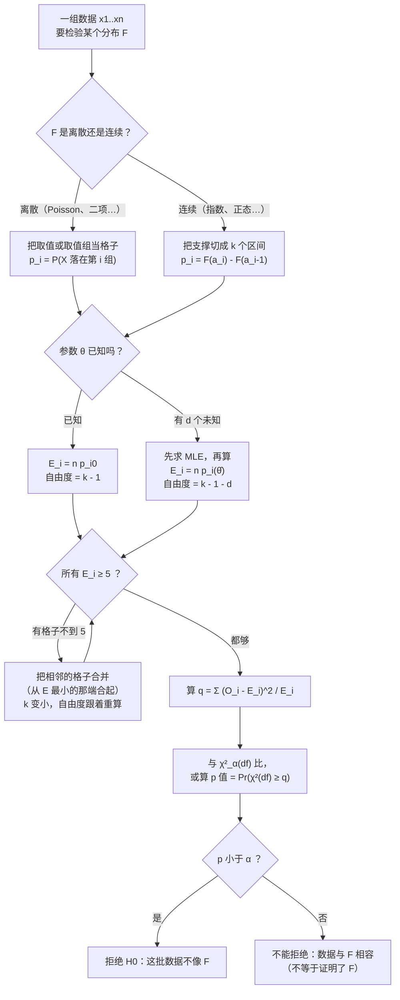
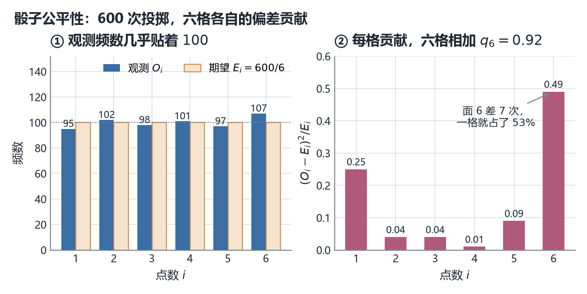
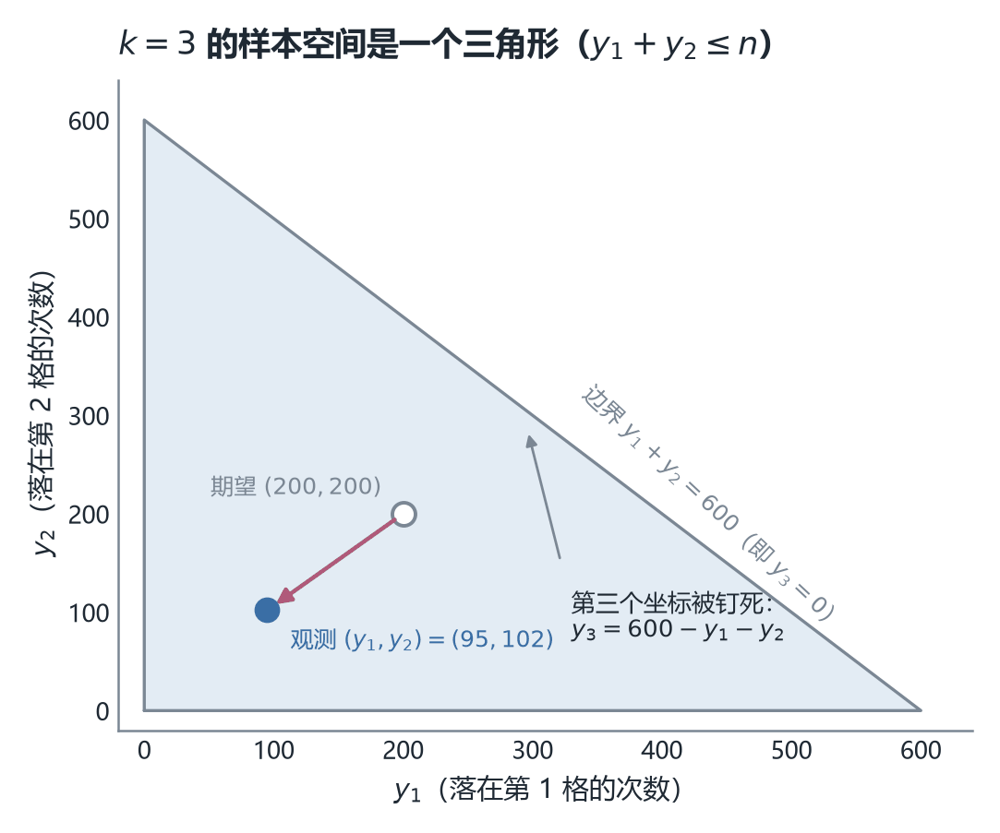
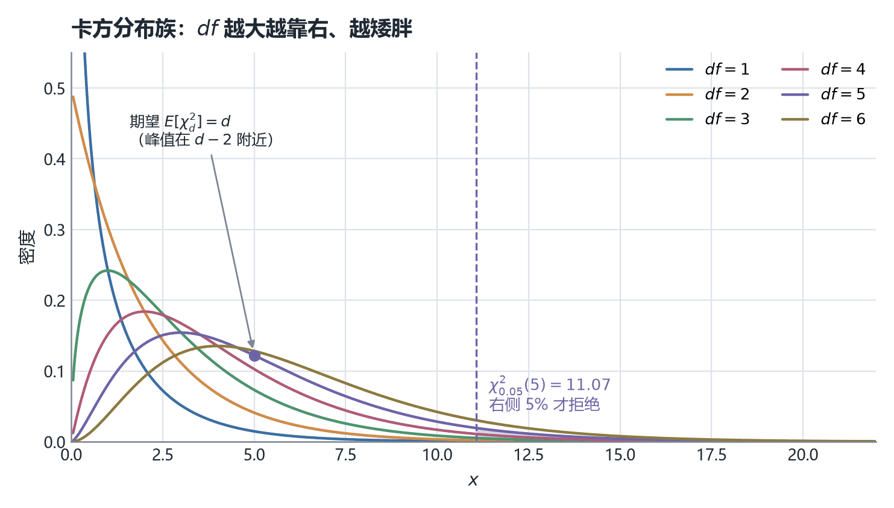
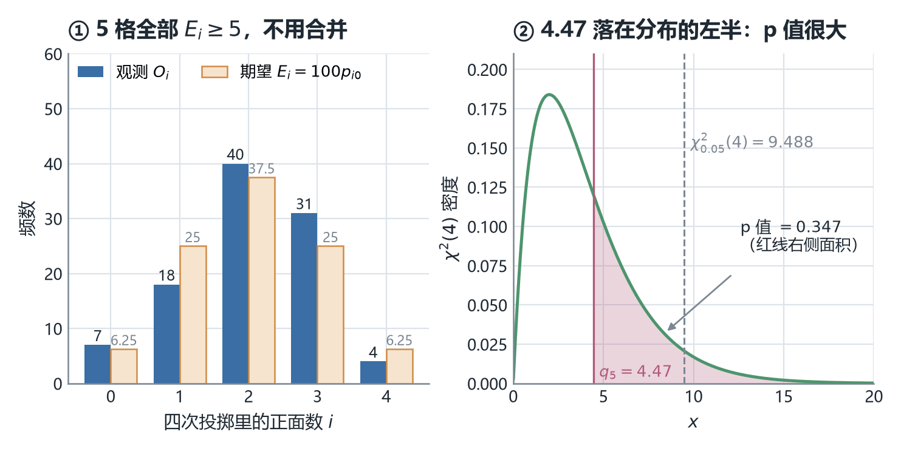
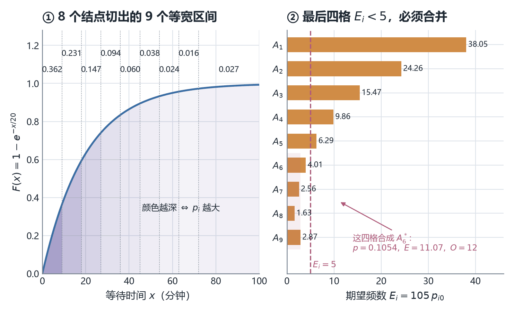
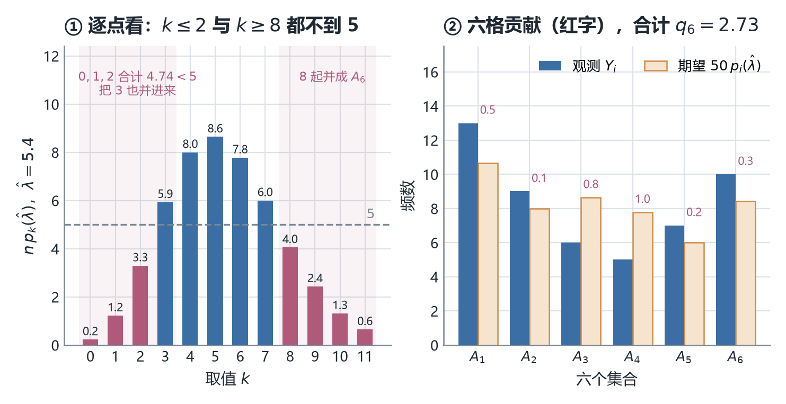

# STA2002 概率与统计 II · 第 14 讲笔记
## 拟合优度检验（Goodness-of-Fit Test：用 Pearson 卡方统计量判断"这组数据像不像某个分布"）

> 授课：Zhenxing Guo、Ka Wai Tseng（香港中文大学（深圳）数据科学学院，2026 年 11 月）
> 教材：Hogg, Tanis & Zimmerman (2015) *Probability and Statistical Inference*, 9th ed., Pearson
> 对应教材章节：**§9.1 Chi-Square Goodness-of-Fit Tests**（教材第 424–430 页）。我在教材原文里核对过：讲义用的三个例子——四枚硬币（教材 Example 9.1-2）、911 通话间隔 105 个观测（Example 9.1-4）、盖革计数器 50 个观测（Example 9.1-3）——**数据与教材逐字相同**。但两处路线不同：① 911 那题教材**不合并**尾部四格，保留 $k=9$、$q_8=4.6861$、$p=0.7905$；讲义合并成 $k=6$、$q_6=2.9797$（自由度 $5$）。同一份数据、两条合法路线，结论一致，见 §14。② 统计量的下标：教材记 $Q_{k-1}$（下标取自由度），讲义记 $Q_k$（下标取格数），**同一个东西，别被下标骗了**。
> 材料构成：讲义 `Lecture14 - Goodness of fit test.pdf`（**26 页**，PDF 页码与页脚 "N / 26" 完全一致，没有第 13 讲那种页码错位），笔记内容**完全基于课件（PDF）整理**，本讲没有收到板书，全文没有 `【板书 NN】` 标记；凡属我补充、推导或复算的部分，一律用 **【补】** 或 alert 标出，并在文末诚实备注中逐条列出。
> **组织方式**：正文**按讲义页序**撰写。§0 给出全页对照表；正文每一节对应讲义的一段；所有例题的表格都以实体形式重排（不是"见课件那张表"）。
> **数值核验**：讲义出现的每一个数（六面频数、$q_5=4.47$、$p=0.346$、九格的 $p_{i0}$ 与 $E_i$、$q_6=2.9797$、$\lambda=5.4$、Poisson 六格的 $p_i$ 与 $E_i$、$q_6=2.763$）我都用 `scipy` 与手算两条路复算过。**没有一处算错**，但有 6 条"记号与口径"问题（其中两条会让照表复算的人对不上第三位小数），见诚实备注第 1–6 条。**讲义从未算出骰子那题的 $q$**，我补算得 $q_6=0.92$、$p=0.9688$。

---

## 0. 本讲地图（先说清楚这一讲在干什么）

*这一节回答：第 6–9 讲检验的都是一个或两个参数（$\mu$、$\sigma^2$、$p$、$\mu_1-\mu_2$），这一讲要检验的是"**整个分布**"——而这需要一套新的语言（多项分布）和一个新的统计量（Pearson 卡方）。*

**三遍阅读路线。** 本讲的公式都不难，难的是"自由度为什么是 $k-1$、有未知参数时为什么再减 $d$"，以及"连续分布要怎么变成格子"。建议分三遍：

| 遍次 | 读哪里 | 读完应该能 |
| --- | --- | --- |
| 第一遍（主线） | §2–§4（一个面 → 六格）→ §7–§9（定理与决策规则）→ §10（四硬币） | 拿到一张频数表，会算 $q$、会定自由度、会查临界值/算 $p$ 值、会下结论 |
| 第二遍（深化） | §5–§6（定义与多项分布）→ §7（图 2 的三角形）→ §17（$k-1-d$ 的记账） | 说清"自由度"到底是什么在数什么，以及为什么估参数要扣自由度 |
| 第三遍（考前） | §11–§15（连续分箱与合并）→ §16–§18（参数未知）→ §19–§22 | 面对"检验这批数据是不是指数/正态/Poisson"的题，能独立走完全流程 |

第一遍刻意跳过 §6 的多项分布定义（它只是把二项推广到 $k$ 类，做题时不必每次写 PMF）和 §17 的理论解释。

**本讲与前面几讲的关系只有一句话**：前面所有检验的统计量都是"一个数减去它的期望，除以它的标准差"；这一讲把这句话用 $k$ 次，再把 $k$ 个平方加起来——**但只加 $k-1$ 个独立的方向**。

| PDF 页 | 页脚号 | 内容 | 本笔记 | 配图 |
| --- | --- | --- | --- | --- |
| 第 1 页 | 1/26 | 封面 | —— | — |
| 第 2 页 | 2/26 | Introduction：Pearson 1900 的卡方统计量与应用 | §1 | — |
| 第 3 页 | 3/26 | 骰子例题：600 次投掷、六面频数 | §2 | — |
| 第 4 页 | 4/26 | 只盯一面：二项分布与正态近似 | §2 | — |
| 第 5 页 | 5/26 | $Q(p)$ 近似 $\chi^2(1)$ 与临界域 | §2 | — |
| 第 6 页 | 6/26 | 六面同时检验的假设怎么写 | §3 | — |
| 第 7 页 | 7/26 | 关键恒等式：一个 $Z^2$ = 两格的 Pearson 和 | §4 | 图 1 |
| 第 8 页 | 8/26 | 拟合优度检验的一般定义 | §5 | — |
| 第 9 页 | 9/26 | 多项分布的定义 | §6 | — |
| 第 10 页 | 10/26 | 定理：$Q_k$ 近似 $\chi^2(k-1)$ 与自由度的来历 | §7 | 图 2 |
| 第 11 页 | 11/26 | 统计量的最终形式与 $O_i$、$E_i$ | §8 | — |
| 第 12 页 | 12/26 | 决策规则：临界域与 $p$ 值 | §9 | 图 3 |
| 第 13 页 | 13/26 | 四硬币例题题干 | §10 | — |
| 第 14 页 | 14/26 | 四个 $p_{i0}$ 的计算与多项分布 | §10 | — |
| 第 15 页 | 15/26 | $q_5=4.47$ 的逐项计算 | §10 | — |
| 第 16 页 | 16/26 | 结论、$E(Q_5)=4$ 与 $p$ 值 $0.346$ | §10 | 图 4 |
| 第 17 页 | 17/26 | 连续分布要分箱 + 105 个观测 | §11 | — |
| 第 18 页 | 18/26 | 分箱的记号：结点、$A_i$、$p_i=F(a_i)-F(a_{i-1})$ | §12 | — |
| 第 19 页 | 19/26 | 九格表：$p_{i0}$、$E_i$、$O_i$，以及 $E_i<5$ 的麻烦 | §13 | — |
| 第 20 页 | 20/26 | 合并尾部四格成 $A_6^*$ | §14 | 图 5 |
| 第 21 页 | 21/26 | $q_6=2.9797$ 与结论 | §15 | — |
| 第 22 页 | 22/26 | 盖革计数器：50 个观测 | §16 | — |
| 第 23 页 | 23/26 | 分组与"$\lambda$ 未知"的复合假设 | §16 | — |
| 第 24 页 | 24/26 | 参数未知时的四步法与自由度 $k-1-d$ | §17 | — |
| 第 25 页 | 25/26 | Poisson 六格的计算与 $q_6=2.763$ | §18 | 图 6 |
| 第 26 页 | 26/26 | Summary | §19 | — |
| — | — | 速查表、核心直觉、术语对照、诚实备注 | §20–§23 | — |

### 0.1 一句话概括本讲的结构

> [!IMPORTANT]
> **整讲只有一个统计量：把每个格子里的"实际次数减期望次数"标准化后平方，加起来。**
> $$Q_k=\sum_{i=1}^{k}\frac{(O_i-E_i)^2}{E_i},\qquad O_i=\text{第 }i\text{ 格的实际次数},\quad E_i=\text{第 }i\text{ 格的期望次数}=n\,p_{i0}$$
> 它的零分布是 $\chi^2$，自由度按"**独立的信息有几条**"数：$k$ 个格子先被总数 $\sum_i Y_i=n$ 钉掉一条，得 $k-1$；若 $p_{i0}$ 里还有 $d$ 个参数是拿数据估出来的，每条估计再钉掉一条，得 $k-1-d$。判断规则永远是**只拒绝大值**（偏差越大越不像 $H_0$）。剩下的全是细节：离散分布怎么分格、$E_i$ 太小时怎么合并、参数未知时怎么估。

### 0.2 与本讲关系最近的四处往讲接口

| 往讲留下的线 | 本讲在哪里接上 |
| --- | --- |
| 第 6 讲：$\alpha$、$p$ 值、"哪种取值算极端"要先看备择的方向 | §2、§9 重复同一套语言；但本讲的 $H_1$ 是"任何偏离"，方向无法指定，于是"极端"只剩一个方向：**$Q$ 大**（§9） |
| 第 8 讲：比例的检验里，离散统计量让名义 $\alpha$ 只能取到有限档 | 本讲换了对象：$Q$ 是连续的（$\chi^2$ 近似），不再有"取不到 $5\%$"的问题；但代价换成"近似本身靠 $E_i\geq5$ 撑住"（§13） |
| 第 11 讲：Q-Q 图是"看"数据像不像某个分布，只是可视化、不是严格检验 | 本讲就是那个严格检验。教材在这一节开头也明说 "Recall that we have considered problems of this type in which we used q–q plots"，然后把它换成可算 $p$ 值的卡方 |
| 第 2–3 讲：Poisson 的 MLE 是 $\hat\lambda=\bar X$，正态的 MLE 是 $(\bar X,S^2)$ | §17–§18 直接用这一步：**先估参数，再算期望频数，最后把自由度扣掉 $d$**（§17） |

第 13 讲（符号检验、Wilcoxon）与本讲**没有直接接口**：那一讲检验中位数、不假定分布形状，本讲检验整个分布、并且完全依赖"$n$ 很大、每格近似正态"。两讲的唯一共同点是都在回答"这批数据支持这个模型吗"，但一个用秩、一个用频数。

### 0.3 拿到"这批数据像不像某个分布"这类题，怎么走



**这张图是我整理的，讲义没有画。** 三个分岔点决定了整道题的走向：离散还是连续（决定怎么分格）、参数知不知道（决定自由度减不减 $d$）、$E_i$ 够不够 $5$（决定要不要合并）。§17 的四步法是这条流程的通用版，但它是按"参数未知"写的；参数已知时第 2 步跳过。

### 0.4 来源标注约定

- 无标记 → 讲义原文或对讲义的直接展开；
- **【补】** → 讲义没有、由我补充、推导或复算的内容（文末诚实备注逐条列出）；
- alert → 同为补充，标题写明它属于哪一类（补充 / 技巧 / 重要 / 课件笔误 / 注意）。

---

## 1. 这一讲要交付什么（讲义第 2 页）

原话：

> In this lecture we will learn
> Chi-square test statistic proposed by Karl Pearson in 1900
> Applications of chi-square test statistic for many different types of tests.
> Test the appropriateness of different probabilistic models.
> Suggested reading: Chapter 9.1 of the textbook.

三句话三件事：**一个统计量**（Pearson 在 1900 年提出的卡方统计量）、**一大类用法**（拟合优度、独立性、齐性——后两个是第 15 讲）、**一个目的**（判断"某个概率模型是否合适"）。

值得先记住的历史位置：这是统计学里最早的"万能检验"之一。它的万能来自一个很省事的想法——**不管你要检验的分布长什么样，都把它切成有限个格子，只比较每个格子的次数**。代价是丢掉"格子内部的顺序与大小"这类信息，所以它对任何具体的偏离都不算敏感（§19 会量化这一点）。教材把这件事说得更直接：卡方检验是 a many-sided test，"the alternative hypothesis is very general"，因此在同样的水平下，它比一个"方向正确"的单侧检验更难拒绝 $H_0$（教材第 426 页）。

---

## 2. 先只盯一个面：二项 → 正态 → 卡方（讲义第 3–5 页）

### 2.1 例题与数据（讲义第 3 页）

原话：

> Suppose that we have a dice and suspect whether the dice is fair or biased for the six faces. We conduct an experiment of rolling the dice $n=600$ times and record the frequency of each face up.

观测到的频数：

| 点数 | 1 | 2 | 3 | 4 | 5 | 6 | 合计 |
| --- | --- | --- | --- | --- | --- | --- | --- |
| 观测频数 $O_i$ | 95 | 102 | 98 | 101 | 97 | 107 | **600** |
| 期望频数 $E_i=600\times\frac16$ | 100 | 100 | 100 | 100 | 100 | 100 | 600 |

六个数的和正好是 $600$（我加过一遍），这一点很重要——它是后面"自由度要减 1"的物理来源：**六个数里只有五个能自由变，第六个被总数钉死**。

这一页用两个问句把整讲的问题抛出来："能不能构造一个假设检验来判断骰子公不公平？统计量和它的零分布是什么？"

### 2.2 退一步：只怀疑"6 点"这一面（讲义第 4 页）

先做最简单的事：只问"6 点的概率是不是 $\frac16$"。

设 $p$ 是 6 点朝上的真实概率，$Y$ 是 $n=600$ 次投掷中 6 点出现的次数，则

$$Y\sim\mathrm{Bin}(n,p),\qquad E(Y)=np,\qquad \operatorname{Var}(Y)=np(1-p).$$

要检验的是

$$H_0:p=\tfrac16\quad\text{vs}\quad H_1:p\neq\tfrac16 .$$

$n$ 大时，由中心极限定理（第 1 讲）$\dfrac{Y-np}{\sqrt{np(1-p)}}$ 近似 $N(0,1)$，把它平方就得到

$$Q(p)=\frac{(Y-np)^2}{np(1-p)}\ \overset{\text{approx}}{\sim}\ \chi^2(1).$$

**这一步是本讲所有公式的种子**：$Q$ 就是"标准化残差的平方"，也就是 $Z^2$。在 $H_0$ 下取 $p=\frac16$，

$$Q\!\left(\tfrac16\right)=\frac{(Y-n/6)^2}{n\cdot\frac16\cdot\frac56}\ \overset{\text{approx}}{\sim}\ \chi^2(1),$$

而"$Q$ 大"等价于"$\lvert Z\rvert$ 大"（$Z$ 是那个标准正态），所以临界域是 $q\!\left(\frac16\right)\geq\chi^2_\alpha(1)$，其中 $\chi^2_\alpha(1)$ 是 $\chi^2(1)$ 的上 $\alpha$ 分位点（$\alpha=0.05$ 时是 $3.841$，恰好等于 $1.96^2$）。

**代入这一面的数据。**【补】原文没有算这一步，我补上：$Y=107$，于是

$$q\!\left(\tfrac16\right)=\frac{(107-100)^2}{600\cdot\frac16\cdot\frac56}=\frac{49}{83.3333}=0.5880,\qquad z=\frac{7}{\sqrt{83.3333}}=0.7668,$$

$p$ 值 $=\Pr(\chi^2(1)\geq0.588)=0.4432$，远大于 $0.05$，不拒绝。**只看 6 点这一面，骰子看不出问题**——这正是下一节要处理的事：一面一面看，很容易看漏。

> [!CAUTION] 注意：$Q(p)$ 的分母是 $np(1-p)$，不是 $np$，因为它暗中是"两格"的检验
> 【补】为什么分母带 $(1-p)$？因为 $H_1:p\neq\frac16$ 是**双侧**的，而"6 点"这一格与"不是 6 点"那一格是一对互补的结果：$Y$ 与 $n-Y$ 的联合分布是两类的多项分布。§4 会证明 $\frac{(Y-np)^2}{np(1-p)}$ 恰好等于两个格子各贡献一项的和。
> 顺带一个方向性的提醒：这里的 $H_1$ 是双侧，所以用 $Z^2$ 正好；若题目问的是 $H_1:p>\frac16$，就该用 $Z$ 而不是 $Z^2$——**平方把方向信息抹掉了**，卡方检验天生是"双尾"的。这一点在第 6–8 讲里已经练过，本讲因为 $H_1$ 是"任何偏离"，所以反而不成为问题（§5）。

---

## 3. 六面同时检验：为什么不能把六个 $Q$ 加起来（讲义第 6 页）

原话：

> Here, we expect to test all the six faces simultaneously. Let $p_k$ represent the underlying probability of face $k$ up and $Y_k$ denote the number or frequency of face $k$ up in $n$ rolls. The hypotheses turns to
> $$H_0:p_1=p_2=\cdots=p_6=\tfrac16\quad\text{vs}\quad H_1:\text{any one of }p_k\neq\tfrac16$$
> Question: How to construct test statistics for this test?

**假设写法的三个要点。**【补】

1. $H_0$ 把六个概率**全部**指定了（都是 $\frac16$），所以它是一个**简单假设**——没有未知参数，零分布可以直接算。
2. $H_1$ 是"至少有一个不等于 $\frac16$"，这是一个巨大的复合假设（五维参数空间里挖掉一个点）。它不指定偏离的方向，所以检验必须是"对任何方向的偏离都敏感"，这也是后面统计量要用**平方和**的原因。
3. $H_0$ 里其实只有五个自由参数：$p_1+\cdots+p_6=1$ 使最后一个由前五个决定。

**一个看起来很自然、其实错误的做法**：对每一面各做一次 2.1 节那种 $\chi^2(1)$ 检验，然后把六个统计量相加。它错在两处：

- **多重比较**：每一面各用 $5\%$，六次里至少误判一次的概率是 $1-0.95^6=0.265$，远不是 $5\%$。
- **相加的分布不是 $\chi^2(6)$**：六个 $Q_i\!\left(\frac16\right)$ 共享同一个 $n$，彼此相依（一面多了，别的面必然少），而且每个 $Q_i$ 的分母是 $n\cdot\frac16\cdot\frac56$，与"六格版"每格分母 $n\cdot\frac16$ 差一个因子 $\frac56$。

> [!CAUTION] 注意：六个 $Q_i(\frac16)$ 的和等于 $\frac65 Q_6$，不是 $\chi^2(6)$
> 【补】用本讲的数据验证：六个 $\chi^2(1)$ 型统计量之和是
> $$\sum_{i=1}^{6}\frac{(Y_i-100)^2}{600\cdot\frac16\cdot\frac56}=\frac{92}{83.3333}=1.104,$$
> 而下一节要构造的 $Q_6=\sum_i\frac{(Y_i-100)^2}{100}=\frac{92}{100}=0.92$。两者之比恰为 $\frac{100}{83.3333}=\frac65$。**所以"把六次单面检验加起来"不但水平不对，连数值都对不上**。正确做法是让每一格用**自己的**期望频数当分母，这正是第 7 页要做的推广。

---

## 4. 关键恒等式：一个二项 $Z^2$ 就是两格的 Pearson 和（讲义第 7 页）

这一节做了一件很漂亮的事：把 2.2 节那个 $Q(p)$ 拆成"两格各自贡献一项"。原话是 "Note that $Q(p)$ can be written as"，然后三行推导：

$$Q(p)=\frac{(Y-np)^2}{np(1-p)}=\frac{(Y-np)^2}{np(1-p)}(1-p+p)=\frac{(Y-np)^2}{np}+\frac{(Y-np)^2}{n(1-p)}$$

$$=\frac{(Y-np)^2}{np}+\frac{\big[(n-Y)-n(1-p)\big]^2}{n(1-p)} .$$

**逐行解释。**【补】

1. 第一行乘的 $(1-p+p)$ 就是 $1$，纯粹为了把分母拆开：$(1-p)+p=1$，于是 $\frac{1-p}{np(1-p)}=\frac1{np}$、$\frac{p}{np(1-p)}=\frac1{n(1-p)}$。
2. 第二行到第三行用的是 $(Y-np)^2=\big[(n-Y)-n(1-p)\big]^2$。理由：$(n-Y)-n(1-p)=np-Y=-(Y-np)$，两者只差一个负号，平方后相等。
3. 拆出来的两项各有清楚的解释：第一项是"6 点"这一格的贡献（观测 $Y$、期望 $np$），第二项是"非 6 点"那一格的贡献（观测 $n-Y$、期望 $n(1-p)$）。**分母都变成了各自的期望频数**。

用本讲的数据验证这个恒等式（$n=600$、$p=\frac16$、$Y=107$）：

| 格子 | 观测 $O_i$ | 期望 $E_i$ | 贡献 $(O_i-E_i)^2/E_i$ |
| --- | --- | --- | --- |
| 6 点 | $107$ | $100$ | $49/100=0.4900$ |
| 非 6 点 | $493$ | $500$ | $49/500=0.0980$ |
| 合计 | $600$ | $600$ | $0.5880$ |

两项之和 $0.5880$ 与 2.2 节直接算的 $Q(\frac16)$ 一字不差——**这就是恒等式的数值证据**。

于是顺势推广："Similarly, we build test statistics"

$$Q=\sum_{i=1}^{6}\frac{(Y_i-np_i)^2}{np_i},$$

其中 $Y_i$ 是第 $i$ 面朝上的观测次数，$np_i$ 是它的期望次数。**从两格到六格，唯一的变化是"另一格"不再只有一格，所以每一格都写成自己的 $E_i$。**



*图 1　左侧是 $600$ 次投掷的六面观测频数与期望频数 $100$（数据取自讲义第 3 页）；右侧是每一格的贡献 $(O_i-E_i)^2/E_i$（我绘制，数值现算）。三个可读的事实：① 六个数全在 $95$–$107$ 之间，看上去"很公平"；② 但贡献并不平均，第 6 面差 $7$ 次就贡献 $0.49$，占总和 $0.92$ 的 $53\%$，而第 4 面只差 $1$ 次、贡献 $0.01$；③ 平方让大偏差的权重急剧放大，这正是卡方检验"只对大偏差敏感"的来源（讲义第 7 页之后没有算这个 $q$，$q_6=0.92$ 是我补的，见 §8 练习 8.1）*

**这个统计量的直观是什么？**【补】把每一格想成一次"标准化"：$(O_i-E_i)/\sqrt{E_i}$ 是"偏差除以它的标准差量级"，平方后相加就是"总共偏了几个标准差那么远"。注意分母用的是 $E_i$ 而不是 $E_i(1-p_i)$：每个格子的边际方差确实是 $np_i(1-p_i)$，但 $k$ 个格子彼此**负相关**（$\operatorname{Cov}=-np_ip_j$），若每格都用边际方差作分母，相加时同一份"总数固定"的约束会被重复计入，得到的和不再是卡方。Pearson 的 $np_i$ 版本才恰好给出 $\chi^2(k-1)$（§7）。

---

## 5. 拟合优度检验的正式定义（讲义第 8 页）

原话：

> In general, a test to assess whether a sample comes from a specified distribution is also called **goodness-of-fit test**. Suppose that an experiment has $k$ different possible results, say $A_1,A_2,\ldots,A_k$. $p_i=\Pr(A_i)$: the probability of $A_i$ occurring, for $i=1,2,\ldots,k$ with $\sum_{i=1}^{k}p_i=1$. We would like to test, $H_0:p_i=p_{i0}$, $i=1,2,\ldots,k$, against $H_1:$ Any one of $p_i\neq p_{i0}$, where $p_{i0}$, $i=1,2,\ldots,k$ are some fixed constants with $\sum_k p_{i0}=1$.

**三件套。** **拟合优度检验**（goodness-of-fit test）是检验"一个样本是否来自某个指定分布"的检验；它不问参数等于几，而问"整套概率是否对得上"。

四个要素值得逐一说清（原文是四句话，我重排成表并补上"为什么重要"一列）：

| 要素 | 内容 | 为什么重要 |
| --- | --- | --- |
| 结果 | $k$ 个**互斥且完备**的事件 $A_1,\ldots,A_k$ | "完备"保证 $\sum p_i=1$，这是后面自由度减 1 的来源 |
| 参数 | $p_i=\Pr(A_i)$，全是未知的，但受一条约束 $\sum p_i=1$ | 未知参数有 $k-1$ 个，不是 $k$ 个 |
| 原假设 | $p_i=p_{i0}$ 对**每个** $i$ 都成立 | 简单假设：$p_{i0}$ 是给定的常数，不含未知参数 |
| 备择 | 至少有一个 $i$ 使 $p_i\neq p_{i0}$ | 复合且"巨大"，无法指定方向 ⇒ 统计量只能对"整体偏离"敏感 |

**"完备"这一步最容易被忽略。** 若 $A_1,\ldots,A_k$ 漏掉了一种可能结果，$\sum p_i$ 就不等于 $1$，后面 $E_i=n p_{i0}$ 的总和也不等于 $n$，$Q$ 的分布整个作废。做题时如果发现"期望频数加起来不是 $n$"，先查这一条。

**与"$H_0:\mu=\mu_0$"那类假设的本质差别。**【补】第 6–9 讲的 $H_0$ 是"一个参数等于某个值"，被拒绝时你知道**哪个方向**出了问题（均值偏大？方差偏小？）。本讲的 $H_0$ 是"整套概率都对"，被拒绝时只知道"某个地方不对"，**不知道是哪里、往哪个方向**。这个代价换来的是适用范围：前面那些检验都要求你先说清"要检验哪个参数"，而这里只要你能算 $p_{i0}$，什么分布都能检。

---

## 6. 多项分布：$Q$ 的零分布要从这里推（讲义第 9 页）

要算 $Q$ 的分布，先要知道 $(Y_1,\ldots,Y_k)$ 的联合分布。定义是这样的：

> **Definition (Multinomial Distribution).** Let $Y=(Y_1,Y_2,\ldots,Y_k)^T$ be a random vector such that $0\leq Y_i\leq n$ and $\sum_{i=1}^{k}Y_i=n$ for some positive integer $n$. $Y$ is said to follow a **multinomial distribution** with parameters $n$ and $p=(p_1,\ldots,p_k)^T$, $p_i\geq0$, $\sum_i p_i=1$, if the PMF of $Y$ is given by
> $$\Pr(Y_1=y_1,\ldots,Y_k=y_k)=\frac{n!}{y_1!y_2!\cdots y_k!}\,p_1^{y_1}p_2^{y_2}\cdots p_k^{y_k}.$$
> Also denote as $Y\sim\mathrm{Multinomial}(n,p_1,\ldots,p_k)$.

**三件套。** **多项分布**（multinomial distribution）是"$n$ 次独立重复试验，每次落入 $k$ 个类别之一"的计数向量分布，是二项分布在 $k>2$ 时的推广。

**怎么读这个 PMF。**【补】分三段：

1. $\frac{n!}{y_1!\cdots y_k!}$ 是"把 $n$ 个位置分成 $k$ 组、每组 $y_i$ 个"的排列数（多项式系数）；
2. $p_1^{y_1}\cdots p_k^{y_k}$ 是某一种具体排列出现的概率（独立性使概率相乘）；
3. 两者相乘 = "所有满足这种计数的排列"的概率之和。

**四条性质，第 1、3、4 条是本讲真正用到的。**

| 性质 | 表达式 | 用在哪 |
| --- | --- | --- |
| 边际分布 | $Y_i\sim\mathrm{Bin}(n,p_i)$，故 $E(Y_i)=np_i$ | $E_i=np_{i0}$ 的定义（§8） |
| 边际方差 | $\operatorname{Var}(Y_i)=np_i(1-p_i)$ | 单个格子的标准差是 $\sqrt{np_i(1-p_i)}$，**但统计量里用的是 $\sqrt{np_i}$** |
| 协方差 | $\operatorname{Cov}(Y_i,Y_j)=-np_ip_j$（$i\neq j$） | 六个格子负相关 ⇒ 六个残差只张成 $k-1$ 维（§7） |
| 退化 | $k=2$ 时就是 $\mathrm{Bin}(n,p_1)$ | 就是 §4 那个恒等式 |

$k=2$ 的退化值得单独确认一下：$y_2=n-y_1$，$\frac{n!}{y_1!(n-y_1)!}p_1^{y_1}(1-p_1)^{n-y_1}$ 正是二项 PMF ✓。

**骰子例题的写法**：$(Y_1,\ldots,Y_6)\sim\mathrm{Multinomial}(600,\frac16,\ldots,\frac16)$，五维（第六个由 $600-\sum_{i=1}^5Y_i$ 决定）。

**负协方差是自由度 $k-1$ 的根源。**【补】$\operatorname{Cov}(Y_i,Y_j)=-np_ip_j<0$ 的意思是：第 1 面多出现几次，别的面就必然少几次（总数固定）。六个偏差 $Y_i-np_i$ 之和恒等于 $0$，它们被一条线性约束串在一起——**这就是自由度 $k-1$ 的全部物理内容**，图 2 把它画成了一个三角形。

---

## 7. 定理：$Q_k$ 近似服从 $\chi^2(k-1)$（讲义第 10 页）

原话：

> **Theorem.** If $(Y_1,Y_2,\ldots,Y_k)^T\sim\mathrm{Multinomial}(n,p_1,\ldots,p_k)$, $n$ is large and $np_i\geq5$ for $i=1,2,\ldots,k$, then
> $$Q_k=\sum_{i=1}^{k}\frac{(Y_i-np_i)^2}{np_i}\ \overset{\text{approx}}{\sim}\ \chi^2(k-1).$$
> The proof is not required for this course, involving the derivation of $\operatorname{Cov}(Y_i,Y_j)$ and matrix theories.
> As $Y_k=n-Y_1-Y_2-\cdots-Y_{k-1}$, the number of random quantities in $\{Y_1,Y_2,\ldots,Y_k\}$ is $k-1$, inducing the resulting Chi-square distribution with the degree of freedom $k-1$.

**定理的三个条件，一个都不能漏。**【补】

1. **多项分布**：$n$ 次独立重复、$k$ 类互斥完备。若抽样不独立（比如无放回且样本量占总体比例大），这条就不成立。
2. **$n$ 大**：这是"每个格子的计数近似正态"的来源，本质上还是 CLT。
3. **$np_i\geq5$**：保证每个格子都够"厚"，否则某个格子里的计数可能是 $0$ 或 $1$，正态近似彻底失真。这条不是装饰——§13 的合并就是为它服务的。

**自由度 $k-1$ 的来历。** 原文给的解释是"$Y_k$ 由前 $k-1$ 个决定，所以只有 $k-1$ 个自由的量"。这句话方向对，但容易读成"少了一维格子"。正确的说法是：**残差向量 $\big(Y_1-np_1,\ldots,Y_k-np_k\big)$ 满足一条恒等式**

$$\sum_{i=1}^{k}(Y_i-np_i)=\sum_i Y_i-n\sum_i p_i=n-n=0,$$

所以这 $k$ 个偏差不能独立变动，它们全部躺在一个 $(k-1)$ 维的超平面里。



*图 2　自由度 $k-1$ 的几何解释（我绘制）：以 $k=3$、$n=600$ 为例，计数向量 $(y_1,y_2,y_3)$ 必须满足 $y_1+y_2+y_3=600$，所以它只能落在三角形（灰色区域）里的格点上，而不是整个第一象限；只要给出 $(y_1,y_2)$，$y_3$ 就被钉死。骰子那题是 $k=6$、$n=600$，同样的道理发生在 $5$ 维的"单纯形"上，画不出来但结论一样：**$k$ 个格子只提供 $k-1$ 个独立方向**。箭头从期望点 $(200,200)$ 指向观测点 $(95,102)$，这条残差也只能在 $2$ 个方向上取值*

> [!IMPORTANT] 重要：自由度的准确说法
> 【补】严格地说，$Q_k$ 的协方差结构是 $\Sigma=n(\operatorname{diag}(p)-pp^T)$，这个 $k\times k$ 矩阵的秩是 $k-1$（因为 $pp^T$ 是秩 $1$ 的投影，$\operatorname{diag}(p)$ 满秩 $k$，减掉一维）。卡方分布的自由度来自"二次型里真正有方差的那些方向"的个数，也就是 $\Sigma$ 的秩。那句"$Y_k$ 由前 $k-1$ 个决定"是这件事的初等版本，**记住"秩 $k-1$"这个说法，遇到别的二次型也能自己数**。

**顺手记住两个矩。**【补】$Q_k$ 近似 $\chi^2(k-1)$，于是均值与方差都不必另算：

$$E(Q_k)=k-1,\qquad \operatorname{Var}(Q_k)=2(k-1),\qquad \text{标准差}=\sqrt{2(k-1)} .$$

这两个矩比"自由度"一个数有用得多：$k=6$ 时 $Q$ 的典型大小是 $5\pm3.2$，所以 $q=0.9$ 与 $q=11$ 都还在"两倍标准差"之内，$q=30$ 才明显不对。**"$q$ 与 $df$ 差两三倍不算异常"这句话的根据就在这里**，别拿 $df$ 当尺子硬量。

---

## 8. 统计量的最终形式（讲义第 11 页）

原话：

> Therefore, we construct the Chi-square test statistics as $Q_k=\sum_{i=1}^{k}\frac{(Y_i-np_{i0})^2}{np_{i0}}$. For large $n$ and $np_i\geq5$, $Q_k\overset{\text{approx}}{\sim}\chi^2(k-1)$ under $H_0$. Once data is collected, calculate the realized test statistic,
> $$q_k=\sum_{i=1}^{k}\frac{(y_i-np_{i0})^2}{np_{i0}}=\sum_{i=1}^{k}\frac{(O_i-E_i)^2}{E_i},$$
> $O_i=y_i$: observed frequency of result $A_i$; $E_i=np_{i0}$: expected frequency of result $A_i$ under $H_0$.

**从定理到统计量，只改了一个下标。** 定理里的 $np_i$ 是"真实参数下的期望"，而 $H_0$ 下 $p_i=p_{i0}$，所以换成 $np_{i0}$——这个替换正是"检验"发生的地方：**如果 $H_0$ 为假，分母用的还是 $p_{i0}$，$Q_k$ 就会系统性地变大，于是拒绝**。

四个记号对照（考试写解答时用哪一套都行，但要统一）：

| 本讲写法 | 含义 | 常写作 | 取值范围 |
| --- | --- | --- | --- |
| $Y_i$ | 第 $i$ 类的**随机**计数 | $O_i$（观测频数 observed frequency） | $0,\ldots,n$ |
| $y_i$ | 它的**实现值**（数出来的数） | $O_i$ | $0,\ldots,n$ |
| $np_{i0}$ | $H_0$ 下的期望计数 | $E_i$（期望频数 expected frequency） | $>0$ |
| $Q_k$ / $q_k$ | 统计量 / 它的实现值 | $X^2$、$\chi^2_{\text{obs}}$ | $\geq0$ |

**两个容易混的点。**【补】

- $Q_k$ 的下标是**格数** $k$，不是自由度。教材用的是 $Q_{k-1}$（下标取自由度），两本书对照读时不要以为是两个不同的统计量。
- $E_i$ 是"$H_0$ 成立时应该出现几次"，它与 $O_i$ 的合计都是 $n$：$\sum_iE_i=n\sum_i p_{i0}=n$ ✓。检验时若发现 $\sum O_i\neq n$，说明数据抄错了或格子没覆盖完。

> [!TIP] 技巧：先把 $E_i$ 写成整数倍，再算 $q$
> 【补】$q$ 的手算错误九成出在"$E_i$ 写错"上。稳妥的顺序是：① 先算 $p_{i0}$（分数或四位小数）；② 再乘 $n$ 得 $E_i$，**顺便检查 $\sum E_i=n$**；③ 最后逐格算 $(O_i-E_i)^2/E_i$，每算一格就把符号记下来（正的表示"比期望多"）。本讲三个例题的 $E_i$ 都列在表里，照着核对即可。

**并列的另一个统计量：似然比卡方（本课不考）。**【补】与 $Q_k$ 齐名的还有

$$G^2=2\sum_{i=1}^{k}O_i\ln\frac{O_i}{E_i},$$

它在 $H_0$ 下同样近似 $\chi^2(k-1)$，而且对"某格太小"比 $Q_k$ 宽容一些（对数把极端值压住了）。两个统计量的数值通常很接近：骰子那题 $G^2=0.914$（$q=0.92$）、四硬币那题 $G^2=4.690$（$q=4.467$），$p$ 值分别是 $0.969$ 与 $0.321$（对 $0.347$），结论完全一致。Pearson 的 $Q_k$ 之所以成为默认选择，是因为它只用四则运算、不必取对数——1900 年没有计算器。**本课程只用 $Q_k$**，这里提一句是为了让你在别的书上看到 $G^2$ 时不至于以为换了模型。

**练习 8.1（我补的）。** 用 §2.1 的骰子数据算完整的 $q_6$、自由度和 $p$ 值，并判断在 $\alpha=0.05$ 下是否拒绝"骰子公平"。

> [!TIP] 参考答案
> 期望频数全是 $100$，逐格贡献：$0.25,\ 0.04,\ 0.04,\ 0.01,\ 0.09,\ 0.49$（对应点数 $1$–$6$，见图 1 右栏），合计 $q_6=0.92$。自由度 $k-1=5$，临界值 $\chi^2_{0.05}(5)=11.070$，而 $p$ 值 $=\Pr(\chi^2(5)\geq0.92)=0.9688$。**结论：远不能拒绝**，$600$ 次的数据与"公平骰子"完全相容。注意 $q_6=0.92$ 比自由度 $5$ 小得多（左尾只有 $3\%$）——这是"拟合得好得少见"的情形，但还不至于说明数据造假（§7 的"两个矩"给了判断尺度）。

---

## 9. 决策规则：只拒绝大值（讲义第 12 页）

原话：

> Large value of $Q_k$ favors $H_1$. The critical region at significance level $\alpha$ is $C=\{(y_1,\ldots,y_k)\mid q_k\geq\chi^2_\alpha(k-1)\}$, where $\chi^2_\alpha(k-1)$ is the $(1-\alpha)$-th quantile of $\chi^2(k-1)$. $p$-value can be computed as $p\text{-value}=\Pr(Q_k\geq q_k;H_0)=\Pr(Q_k\geq q_k;Q_k\sim\chi^2(k-1))$.

**为什么只拒绝大值？**【补】因为 $Q_k\geq0$ 恒成立，而 $Q_k$ 小意味着"每个格子的观测都贴着期望"，这恰恰是 $H_0$ 预测的样子。$H_0$ 从来没有预测"$Q$ 会很小到某个程度"，它只预测"$Q$ 的大小由随机波动决定，典型量级是 $k-1$、标准差是 $\sqrt{2(k-1)}$"。所以只有"大得超出随机波动"才算证据。



*图 3　$\chi^2(1)$ 到 $\chi^2(6)$ 的密度（我绘制，`scipy.stats.chi2.pdf` 现算）。三个要看的地方：① 自由度越大，曲线整体右移且变矮胖——因为均值就是自由度 $d$，方差是 $2d$；② 每条曲线都是右偏的，"大的尾部"永远在右边，这就是"只拒绝大值"的几何原因；③ 紫色阴影是 $\chi^2(5)$ 的上 $5\%$ 尾，起点在 $\chi^2_{0.05}(5)=11.07$——骰子那题的 $q_6=0.92$ 连这个门坎的十分之一都不到*

**$p$ 值的读法。**【补】$p$ 值就是"$q_k$ 右边那块面积"。它回答的问题是：**如果 $H_0$ 为真，有多大的机会看到一个至少这么不像 $H_0$ 的样本？** 注意这里的"不像"由 $Q_k$ 定义，而这一定义依赖于你的分箱方式——换一种分箱，$p$ 值会变（§19 会讲）。

**临界值法与 $p$ 值法是同一件事。**【补】拒绝 $\iff q_k\geq\chi^2_\alpha(k-1)\iff \Pr(\chi^2(k-1)\geq q_k)\leq\alpha\iff p\leq\alpha$。第三条等价是因为卡方分布的尾概率随 $q$ 单调递减。考试里两种写法都给分，但**给出 $p$ 值更安全**：它让阅卷人一眼看出你有没有把方向搞反（$p$ 大 = 不拒绝）。

---

## 10. 例题一：四枚硬币（讲义第 13–16 页）

### 10.1 题目（讲义第 13 页）

原话：

> Let $X$ denote the number of heads that occur when four coins are tossed at random. Under the assumption that the four coins are independent and the probability of heads on each coin is $1/2$, that is, $X\sim\mathrm{Binomial}(4,1/2)$. If we repeat the experiment 100 times and observe 0, 1, 2, 3, and 4 heads in 7, 18, 40, 31, and 4 trials, respectively. Should we support or oppose the assumption?

这道题与骰子题的结构相同、对象不同：骰子是"六个面"，这里是"$X$ 的五个可能取值"。$X$ 是从 $100$ 次**重复实验**里数出来的计数（每次实验 = 掷 4 枚硬币），所以 $n=100$ 而"格子"是 $X$ 的取值 $0,1,2,3,4$。

### 10.2 五个 $p_{i0}$（讲义第 14 页）

原话：

> Under the assumption that $X\sim\mathrm{Binomial}(4,1/2)$, let $p_{i0}$ denote the assumed probability of $k$ heads in one toss
> $$p_{00}=p_{40}=\binom40\left(\tfrac12\right)^4=\frac1{16}=0.0625,\quad p_{10}=p_{30}=\binom41\left(\tfrac12\right)^4=\frac4{16}=0.25,\quad p_{20}=\binom42\left(\tfrac12\right)^4=\frac6{16}=0.375 .$$
> Let $Y_i$ denote the frequency of trials with $i$ heads in 100 tosses.
> $(Y_0,Y_1,Y_2,Y_3,Y_4)^T\sim\mathrm{Multinomial}(100,p_{00},p_{10},p_{20},p_{30},p_{40})$.

**核对。**【补】$\frac1{16}+\frac4{16}+\frac6{16}+\frac4{16}+\frac1{16}=\frac{16}{16}=1$ ✓，五个概率完备。这里 $k=5$，注意 $p_{00}$ 的下标有两层意思：第一个 $0$ 是"类别编号"（对应 $X=0$），第二个 $0$ 是"$H_0$ 下的值"。原文混用了 $p_{i0}$ 与 $p_{00}$ 两种写法，读的时候别晕。

### 10.3 统计量与实现值（讲义第 15 页）

原话：

> The hypotheses are proposed as $H_0:p_i=p_{i0}$, $i=0,1,2,3,4$, against $H_1:$ Any one of $p_i\neq p_{i0}$. The test statistics is defined as $Q_5=\sum_{i=0}^{4}\frac{(Y_i-np_{i0})^2}{np_{i0}}$. The realized value of test statistic $Q_5$ is
> $$q_5=\frac{(7-6.25)^2}{6.25}+\frac{(18-25)^2}{25}+\frac{(40-37.5)^2}{37.5}+\frac{(31-25)^2}{25}+\frac{(4-6.25)^2}{6.25}=4.47 .$$

**逐项核对。**【补】

| $i$（正面数） | $O_i$ | $E_i=100p_{i0}$ | $O_i-E_i$ | 贡献 |
| --- | --- | --- | --- | --- |
| 0 | 7 | 6.25 | $+0.75$ | $0.5625/6.25=0.0900$ |
| 1 | 18 | 25 | $-7$ | $49/25=1.9600$ |
| 2 | 40 | 37.5 | $+2.5$ | $6.25/37.5=0.1667$ |
| 3 | 31 | 25 | $+6$ | $36/25=1.4400$ |
| 4 | 4 | 6.25 | $-2.25$ | $5.0625/6.25=0.8100$ |
| 合计 | 100 | 100 | $0$ | $4.4667$ |

$\sum O_i=100$ ✓，$\sum E_i=100$ ✓，$\sum(O_i-E_i)=0$ ✓（这正是 §7 说的那条约束在起作用），$q_5=4.4667$，与原文的 $4.47$ 一致 ✓。

**五个 $E_i$ 全部 $\geq5$**（最小是 $6.25$），所以这道题**不需要合并**——这也是它被选作第一个例子的原因。

### 10.4 结论与 $p$ 值（讲义第 16 页）

原话：

> At significance level $\alpha=0.05$, $\chi^2_{0.05}(4)=9.488$. As $q_5=4.47<\chi^2_{0.05}(4)=9.488$, we cannot reject the null hypothesis. Data support the assumption that $\mathrm{Binomial}(4,1/2)$ is a reasonable probabilistic model for $X$. Recall that the mean of a chi-square random variable is its degree freedom, that is, $E(Q_5)=4$, under $H_0$; $q_5=4.47$ is just slightly larger than $4$. We are confident that the null hypothesis is true with $p$-value equal to $\Pr(Q_5\geq q_5;Q_5\sim\chi^2(4))=0.346$.

**三个数核对。**【补】$\chi^2_{0.05}(4)=9.4877$ ✓（原文 $9.488$）；$E(Q_5)=4$ ✓（卡方分布的均值就是自由度）；$p$ 值 $=\Pr(\chi^2(4)\geq4.4667)=0.34652$，原文写 $0.346$（截断而非四舍五入，精确到三位应是 $0.347$，差 $0.0005$，不影响任何结论）。

**"$q_5$ 略大于 $4$"这句话的用处。**【补】$E(Q_k)=k-1$ 给了我们一个**快速的合理性检查**：如果算出来的 $q$ 与自由度同量级，说明数据与 $H_0$ 相容；如果 $q$ 是自由度的好几倍，就要怀疑。这条经验在考场上比查表快得多。用它回看两道例题：指数题的 $q=2.98$（$df=5$）落在左尾 $30\%$ 的位置，是典型的"正好"；骰子题的 $q=0.92$（$df=5$）落在左尾 $3\%$ 的位置，**偏低得有点少见**（拟合得太好了，$p$ 值 $0.969$），但还在合理范围内，不必疑神疑鬼。



*图 4　左：五个格子的观测与期望频数（数据取自讲义第 13–14 页；贡献值现算）；右：$q_5=4.47$ 落在 $\chi^2(4)$ 的什么位置（我绘制）。要点：① 最大的两格贡献来自 $X=1$（差 $-7$）与 $X=3$（差 $+6$），它们恰好一左一右，像是"把 $X=2$ 的概率挤向了两侧"；② 玫红阴影的面积就是 $p$ 值 $0.347$，几乎覆盖了整条曲线；③ 虚线 $9.488$ 才是 $5\%$ 的门坎，$q_5$ 只有它的一半不到*

> [!CAUTION] 注意：$p$ 值大 ≠ "$H_0$ 为真"
> 【补】最后一句却写成 "We are confident that the null hypothesis is true with $p$-value equal to $0.346$"，这句话在措辞上越界了——**同一页上一句自己写的还是 "we cannot reject the null hypothesis"**。正确的说法只有一种：*这批数据不足以否定 $H_0$*。$p=0.346$ 的准确含义是"若 $H_0$ 为真，有 $34.7\%$ 的机会看到这么不像 $H_0$ 的样本"，它对"$H_0$ 为真"的概率**什么都没说**（那需要先验）。
> 为什么这个区别在本讲特别要紧？因为拟合优度检验的 $H_0$ 是"整套分布都对"，它几乎永远不可能字面上为真（真实的骰子总有微小的偏心）。$n$ 一大，任何真实数据都会被拒绝（§19）。所以这里正确的结论措辞是"**数据与 $\mathrm{Binomial}(4,\frac12)$ 相容**"，而不是"$X$ 服从 $\mathrm{Binomial}(4,\frac12)$"。

---

## 11. 连续分布：为什么必须分箱（讲义第 17 页）

原话：

> Distribution of interest is a continuous distribution: Partition the support of the target distribution into several bins.

**一句话的理由。**【补】连续分布满足 $\Pr(X=x)=0$，所以"$X$ 恰好等于某个值"的次数永远是 $0$，没法数。唯一的出路是把支撑切成有限个区间，数"落在每个区间里"的次数——**这就是分箱（binning）**，被切出来的小区间叫**箱**（bin），切点叫**结点**（knot）。

代价要说清楚：分箱之后检验的**不再是**"$F=F_0$"，而是"每个箱的概率对不对"

$$H_0':\ \Pr(X\in A_i)=p_{i0}\ \text{对每个}\ i,$$

这是一个**更弱的命题**（教材第 429 页明确写出 $H_0'$ 并说"若 $H_0'$ 不被拒绝，我们就不拒绝 $H_0:F=F_0$"，但反过来不成立）。两个不同的分布完全可以有相同的分箱概率——尤其是箱很少时。**箱越多，检验越接近原假设；但箱越多，$E_i$ 就越小**，这是本讲的核心张力（§13–§14）。

题目给的数据（105 个观测，7 行 × 15 个）：

```text
30 17 65  8 38 35  4 19  7 14 12  4  5  4  2
 7  5 12 50 33 10 15  2 10  1  5 30 41 21 31
 1 18 12  5 24  7  6 31  1  3  2 22  1 30  2
 1  3 12 12  9 28  6 50 63  5 17 11 23  2 46
90 13 21 55 43  5 19 47 24  4  6 27  4  6 37
16 41 68  9  5 28 42  3 42  8 52  2 11 41  4
35 21  3 17 10 16  1 68 105 45 23  5 10 12 17
```

【补】我逐行点数过：$7\times15=105$ ✓；均值 $20.486$，最小值 $1$，最大值 $105$（有一个间隔长达 $105$ 分钟，是明显的离群值）。要问的问题是：**"间隔时间 $X$ 服从 $\theta=20$ 的指数分布"这个模型合适吗？**

---

## 12. 分箱的形式化（讲义第 18 页）

原话：

> Recall the CDF is $F(x;\theta)=1-e^{-x/\theta}$, $x>0$, $\theta>0$. We partition $(0,\infty)$ into $k$ intervals by $k-1$ knots $a_i$, $i=1,2,\ldots,k-1$, and denote the $i$-th possible result $A_i$ as $A_i=\{X\in(a_{i-1},a_i]\}$, for $i=1,2,\ldots,k$ with $a_0=0$, $a_k=\infty$. The probability of observing $A_i$ is $p_i=\Pr(A_i)=F(a_i;\theta)-F(a_{i-1};\theta)$. Let $Y_i$ denote the frequency of times falling into the interval $(a_{i-1},a_i]$ in $n$ trails. $(Y_1,Y_2,\ldots,Y_k)^T\sim\mathrm{Multinomial}(n,p_1,\ldots,p_k)$.

**四个要点。**【补】

1. **$k-1$ 个结点切出 $k$ 个区间**（不是 $k$ 个）。端点约定 $a_0=0$、$a_k=\infty$，区间一律**左开右闭** $(a_{i-1},a_i]$，这样每个观测恰好落进一个区间、不重不漏。
2. $p_i$ 就是 CDF 的**增量**：$p_i=F(a_i)-F(a_{i-1})$。这一步把"连续分布"翻译成"多项分布的概率"，其余全部照搬 §5–§8。
3. 因为是左开右闭，恰好等于结点的观测（这组数据里 $9$ 出现 $2$ 次，$18,27,45,63$ 各 $1$ 次）归**左边**那一格。我用这条约定重数了 105 个观测，得到的九个频数与 §13 表格的 $O_i$ 列完全一致（$41,22,11,10,9,5,2,3,2$）——若改用左闭右开，九个频数会变成 $39,23,11,11,8,6,1,4,2$：$9$ 被算进第 2 格，第 1 格就少了两个。**这是本讲最容易出错的一个细节。**
4. "in $n$ trails" 应为 "trials"，无影响。

> [!TIP] 技巧：等宽分箱还是等概率分箱？
> 【补】两条路都合法，代价不同：
> - **等宽**（本例：每 $9$ 分钟一刀）：箱好解释、好画图，但尾部概率小，$E_i$ 很容易掉到 $5$ 以下（本例第 6–9 格的 $E_i$ 是 $4.01,2.56,1.63,2.87$）。
> - **等概率**（让每个 $p_{i0}=\frac1k$，结点取 $F^{-1}(\frac ik)$）：$E_i=\frac nk$ 全部相等，$n\geq5k$ 就永远不会触发合并；代价是箱宽不一、不好画图，"$X$ 在 $[0,9]$ 分钟的观测有多少"这种问题也不好回答。
> 教材给的是第三种思路：先把 $[0,1]$ 等分再取 $a_i=F^{-1}(b_i)$，本质也是等概率分箱（教材 §9.1，第 429 页）。
> **无论选哪种，结点必须在看数据之前定下来。** 看着数据挑结点等于给 $p$ 值作弊（挑到"最像"的那组刀口，$p$ 值必然偏大）。本例的 $9,18,\ldots$ 是"整数分钟、等宽"这个与数据无关的规则，所以合法。

**$k$ 该取几？** 讲义直接给了 $k=9$，没说为什么。常见的经验是让 $E_i$ 落在 $5$ 到 $20$ 之间：太小则近似不可靠，太大则每格只剩几个观测、$Q$ 的分布偏离卡方，而且格子一多、每格的 $O_i-E_i$ 里有一半是正一半是负，$Q$ 反而变得不那么敏感。以 $n=105$ 为例，$k=5$ 或 $k=6$ 时 $E_i$ 大约在 $8$–$30$，比 $k=9$ 舒服得多；讲义选 $9$ 是为了演示"合并"这件事本身。**做题时若题目给了 $k$，就用题目的 $k$；若让你自己定，$k=5\sim8$ 一般是安全区。**

---

## 13. 九个格子与 $E_i<5$（讲义第 19 页）

原话：

> In this example, know $\theta=20$ and set $k=9$ and the 8 knots in the table.

表格全文（$n=105$，$\theta=20$ 已知，所以 $p_{i0}$ 不含未知参数）：

| 结果 | 区间 | $p_{i0}$ | $E_i=105p_{i0}$ | $O_i$ |
| --- | --- | --- | --- | --- |
| $A_1$ | $[0,9]$ | 0.3624 | 38.0520 | 41 |
| $A_2$ | $(9,18]$ | 0.2311 | 24.2655 | 22 |
| $A_3$ | $(18,27]$ | 0.1473 | 15.4665 | 11 |
| $A_4$ | $(27,36]$ | 0.0939 | 9.8595 | 10 |
| $A_5$ | $(36,45]$ | 0.0599 | 6.2895 | 9 |
| $A_6$ | $(45,54]$ | 0.0382 | 4.0110 | 5 |
| $A_7$ | $(54,63]$ | 0.0244 | 2.5620 | 2 |
| $A_8$ | $(63,72]$ | 0.0155 | 1.6275 | 3 |
| $A_9$ | $(72,\infty)$ | 0.0273 | 2.8665 | 2 |
| 合计 | —— | 1.0000 | 105.0000 | 105 |

原话接着说：

> The last column: the observed frequency in each interval. However, $E_6,E_7,E_8$ and $E_9<5$ do not follow the condition of chi-square approximation.

**这张表的三个检查。**【补】

1. $\sum p_{i0}=1.0000$ ✓（九个数加起来正好 $1$，说明九个区间完备）。
2. $\sum E_i=105$ ✓、$\sum O_i=105$ ✓（我逐格加过）。
3. $p_{i0}$ 可以用 $e^{-x/20}$ 逐个验：$p_{10}=1-e^{-9/20}=0.36237$、$p_{20}=e^{-9/20}-e^{-18/20}=0.23106$、……、$p_{90}=e^{-72/20}=0.02732$ ✓ 全部对上。

**问题在第 6–9 格**：$4.01,\ 2.56,\ 1.63,\ 2.87$，四个都不到 $5$。位置很自然——指数分布的尾部本来就薄，等宽分箱把概率越切越少。

> [!WARNING] 课件笔误：$A_1$ 写成 $[0,9]$，与第 18 页自己的定义矛盾
> **位置**：第 19、20 页两张表格的第一行（教材 Table 9.1-2 同）。
> **原文**：$A_1:[0,9]$。
> **应为**：$A_1:(0,9]$（或写成 $0<X\leq9$）。
> **判据**：① 第 18 页明确定义 $A_i=\{X\in(a_{i-1},a_i]\}$ 且 $a_0=0$，左端是**开**的；② 指数分布的支撑是 $x>0$，$[0,9]$ 里的 $0$ 根本不在支撑内；③ 若真按 $[0,9]$ 计数，$X=0$ 会被算进第 1 格 —— 但 $\Pr(X=0)=0$，这一格的概率里并没有它的份。
> **影响**：无。本组数据最小值是 $1$，没有观测落在 $0$ 上，九个频数不变。

---

## 14. 合并尾部（讲义第 20 页）

原话：

> Simply combine the last four intervals by letting $A_6^*=\bigcup_{i=6}^{9}A_i=\{X\in(45,\infty)\}$.

| 结果 | 区间 | $p_{i0}$ | $E_i$ | $O_i$ |
| --- | --- | --- | --- | --- |
| $A_1$ | $(0,9]$ | 0.3624 | 38.0520 | 41 |
| $A_2$ | $(9,18]$ | 0.2311 | 24.2655 | 22 |
| $A_3$ | $(18,27]$ | 0.1473 | 15.4665 | 11 |
| $A_4$ | $(27,36]$ | 0.0939 | 9.8595 | 10 |
| $A_5$ | $(36,45]$ | 0.0599 | 6.2895 | 9 |
| $A_6^*$ | $(45,\infty)$ | 0.1054 | 11.0669 | 12 |
| 合计 | —— | 1.0000 | 105.0000 | 105 |

**核对。**【补】$p_{60}^*=0.0382+0.0244+0.0155+0.0273=0.1054$ ✓，也可以直接算 $e^{-45/20}=0.105399$ ✓（$\Pr(X>45)=1-F(45)=e^{-2.25}$）。$E=105\times0.105399=11.0669$ ✓，$O=5+2+3+2=12$ ✓。合并后 $k=6$，自由度将从 $8$ 降到 $5$。



*图 5　左：$\theta=20$ 的指数 CDF 与 $8$ 个结点切出的九个等宽区间，颜色深浅表示 $p_{i0}$（我绘制，概率由 $F(9i)-F(9(i-1))$ 现算，标签给了三位小数）。右：九个格子的期望频数与 $5$ 的门坎，最后四格全部低于门坎，正是第 20 页要合并的那四格；合并后 $E=11.07$、$O=12$，一下变成"最厚"的格子之一。这张图解释了合并这件事在做什么：**它不是在改数据，而是在改"格子的分辨率"——把四个薄格子拧成一个厚格子，代价是尾部信息被压成一个数***

> [!NOTE] 补充：合并方案不唯一，教材走的是另一条路
> 【补】从尾部往前的贪心合并有两种走法：
> - 本讲采用的做法：$A_7+A_8+A_9=2.56+1.63+2.87=7.06\geq5$ 后停，但 $A_6=4.01$ 仍不达标，只能一路并到 $A_6$，得四格合一（$E=11.07$）。
> - 另一种走法：把 $A_8+A_9=4.49$ 并成一格（仍 $<5$），再把 $A_7$ 拉进来得 $7.06$；同时把 $A_6$ 往左并进 $A_5$ 得 $10.30$。这样也是六格，但组成不同（$A_6'=(36,54],\ A_7'=(54,\infty)$），算出来的 $q$ 与 $p$ 值都不同。
> 两条路都合规（都满足 $E_i\geq5$），**自由度都是 $6-1=5$**。所以"合并"这一步不是唯一的，答案会随合并方式小幅变化——这也是为什么卡方检验的 $p$ 值只能当"量级参考"，不宜当成精确刻度。
> 顺带回答一个常见的困惑：合并之后**必须重算 $k$**。本讲从 $9$ 格变 $6$ 格，自由度从 $k-1=8$ 变成 $5$，不是"$9-1$ 再减 $4$"——两者数值恰好相同，但理由不同（后者会让人误以为"每合并一次扣一个自由度"，那是错的）。
> 还有第三条路，是教材选的：**干脆不合并**。教材 Example 9.1-4 用全部九格算，得 $q_8=4.6861$、$df=8$、$p=0.7905$，并称之为 "an extremely good fit"。它敢这么做，是因为教材把那句 "some writers suggest $np_i\geq5$" 定性为 *probably good advice for the beginner to follow*，并说 "we have seen the approximation work very well when $np_i\geq1$"——真正要防的是某个 $np_i$ 小到让 $(Y_i-np_i)^2/np_i$ 那一项**独占**整个统计量。

两条路的对照（教材的 $p$ 值取它自己印的数）：

| 路线 | 格数 | $q$ | $df$ | $p$ 值 | 结论 |
| --- | --- | --- | --- | --- | --- |
| 合并（本讲路线） | 6 | 2.9797 | 5 | 0.7031 | 不拒绝 |
| 不合并（教材路线） | 9 | 4.6861 | 8 | 0.7905 | 不拒绝 |

结论一致、$p$ 值差 $0.09$。**同一份数据、两条合法路线给出两个 $p$ 值**，这件事本身就是本讲最该记住的一课：$p$ 值依赖于你怎样分箱。

---

## 15. 算出 $q_6$ 与结论（讲义第 21 页）

原话：

> The test statistics is $Q_6=\sum_{i=1}^{6}\frac{(O_i-E_i)^2}{E_i}$. Under $H_0$, $Q_6\overset{\text{approx}}{\sim}\chi^2(5)$. The realized value of the chi-square goodness-of-fit statistic is
> $$q_6=\frac{(41-38.0520)^2}{38.0520}+\frac{(22-24.2655)^2}{24.2655}+\cdots+\frac{(12-11.0669)^2}{11.0669}=2.9797 .$$
> The critical value at significance level $\alpha=0.05$ is $\chi^2_{0.05}(5)=11.071>q_6$. Retain $H_0$, which means that the exponential distribution with $\theta=20$ is an pretty good fit.

**逐格贡献。**【补】这里的 $E_i$ 用未截断的 $p_{i0}$ 算（$E_1=38.0490$ 而非表里的 $38.0520$，差在第三位小数）；用表里那四位小数算，$q_6$ 会是 $2.9785$ 而不是 $2.9797$。

| 格子 | $O_i$ | $E_i$ | $O_i-E_i$ | 贡献 |
| --- | --- | --- | --- | --- |
| $A_1$ | 41 | 38.0490 | $+2.951$ | 0.2289 |
| $A_2$ | 22 | 24.2611 | $-2.261$ | 0.2107 |
| $A_3$ | 11 | 15.4696 | $-4.470$ | 1.2914 |
| $A_4$ | 10 | 9.8638 | $+0.136$ | 0.0019 |
| $A_5$ | 9 | 6.2895 | $+2.711$ | 1.1681 |
| $A_6^*$ | 12 | 11.0669 | $+0.933$ | 0.0787 |
| 合计 | 105 | 105.000 | $0$ | **2.9797** |

$q_6=2.9797$ ✓ 与原文一致。$\chi^2_{0.05}(5)=11.0705$ ✓（原文 $11.071$）。$p$ 值 $=\Pr(\chi^2(5)\geq2.9797)=0.7031$（原文没给，我补的）。**结论：远不能拒绝**，$\theta=20$ 的指数模型与这 105 个间隔很相容。

**两个观察。**【补】

- 最大的两格贡献来自 $A_3$（$11$ 个观测 vs 期望 $15.47$）与 $A_5$（$9$ vs $6.29$）——都是**中间的格子**在起伏，尾部反而贴合得好。这说明"拟合不好"的具体形状要靠逐格看贡献，光看总和的 $p$ 值看不出来。
- $q_6=2.98$ 与 $df=5$ 同量级，落在左尾 $30\%$，属正常。合并前后 $q$ 从 $4.68$ 降到 $2.98$，原因是尾部四格并成一格后，那里的正负残差互相抵消了：四格的 $(O_i-E_i)$ 分别是 $+0.99,-0.56,+1.37,-0.87$，相加只剩 $+0.93$，而分开算时每一项都要平方再加（$0.244+0.123+1.157+0.262=1.786$）。这也是合并会削弱"尾部偏离敏感度"的具体机制。

**练习 15.1（我补的）。** 若不合并、直接用九格（教材路线），$q$ 和 $p$ 值是多少？与合并后的结论是否一致？

> [!TIP] 参考答案
> 九格逐项算得 $q_9=4.6801$（用表里四位小数的 $p_{i0}$ 得 $4.6864$，教材写 $4.6861$，差异来自有效位），$df=9-1=8$，$p$ 值 $=\Pr(\chi^2(8)\geq4.680)=0.7912$。**结论一致：都不拒绝。** 但要注意这条路踩了 $E_i<5$ 的红线（四格的 $E_i$ 只有 $1.63$–$4.01$），近似的可靠性打了折扣——这正是本讲选择合并的理由。

---

## 16. 参数未知：盖革计数器（讲义第 22–23 页）

### 16.1 数据（讲义第 22 页）

原话：

> Let $X$ denote the number of alpha particles emitted by barium-133 in one tenth of a second. The following 50 observations of $X$ were taken with a Geiger counter in a fixed position:

```text
 7  4  3  6  4  4  5  3  5  3
 5  5  3  2  5  4  3  3  7  6
 6  4  3 11  9  6  7  4  5  4
 7  3  2  8  6  7  4  1  9  8
 4  8  9  3  9  7  7  9  3 10
```

【补】$5\times10=50$ ✓；均值 $\bar x=5.4$（原文给的均值就是 $5.4$，我复算 $270/50=5.4$ ✓）；取值从 $1$ 到 $11$，没有 $0$。

要检验的是：**"$X$ 服从某个 Poisson 分布"**，但 $\lambda$ 未知。

### 16.2 分组与复合假设（讲义第 23 页）

原话：

> The hypotheses are proposed as $H_0:X\sim\mathrm{Pois}(\lambda)$, for some $\lambda$ vs $H_1:X$ does not follow a Poisson distribution. Again, we partition the support of a Poisson random variable, all non-negative integers, into the several subsets $A_1=\{0,1,2,3\}$, $A_2=\{4\}$, $A_3=\{5\}$, $A_4=\{6\}$, $A_5=\{7\}$, and $A_6=\{8,9,10,\ldots\}$. As the sample mean is 5.4, we combine the values with small probabilities into a set to satisfy the condition $np_i\geq5$ for all subsets and ensure approximation for the null distribution, say $A_1=\{0,1,2,3\}$ and $A_6=\{8,9,10,\ldots\}$.

**这道题与前面两题的三处不同。**【补】

1. **$H_0$ 是复合假设**：$\lambda$ 没有指定（"for some $\lambda$"）。这意味着零分布不能直接算——必须先估 $\lambda$。这是 §17 的主题。
2. **离散分布的"分箱"就是分组**：Poisson 的支撑是全体非负整数，本身已经是离散的，所以"箱子"是取值的集合（$\{4\}$、$\{5\}$……），不是区间。
3. **合并的判据变成了 $np_i(\hat\lambda)\geq5$**：期望频数依赖估计值，所以要估完再判。

**为什么是 $\{0,1,2,3\}$ 和 $\{8,9,\ldots\}$？** 原文只说"把概率小的并起来"，没给数字。我把逐点的 $n\,p_k(\hat\lambda)$ 算出来（$\hat\lambda=5.4$，$n=50$）：

| $k$ | 0 | 1 | 2 | 3 | 4 | 5 | 6 | 7 | 8 | 9 | 10 | 11 |
| --- | --- | --- | --- | --- | --- | --- | --- | --- | --- | --- | --- | --- |
| $50\,p_k(\hat\lambda)$ | 0.23 | 1.22 | 3.29 | 5.93 | 8.00 | 8.64 | 7.78 | 6.00 | 4.05 | 2.43 | 1.31 | 0.64 |

看这张表就明白为什么是这么分的：$k=0,1,2$ 三格分别只有 $0.23,1.22,3.29$，**三者加起来才 $4.74$，仍然不到 $5$**，所以必须把 $k=3$（$5.93$）也并进来，得 $10.65$ 才达标；右端 $k=8$ 起逐个不到 $5$（$4.05$ 也差一点），一路并到无穷，得 $8.90$。（$k\geq12$ 的剩余概率合计约 $0.48$，都在 $A_6$ 里。）

> [!CAUTION] 注意：归并的依据是 $np_k(\hat\lambda)\geq5$，不是"均值等于 5.4"
> 【补】原文写的是 "As the sample mean is 5.4, we combine the values with small probabilities into a set..."。均值 $5.4$ 只决定**哪些**取值的概率小（离 $5.4$ 越远越小），真正的判据是 $np_k(\hat\lambda)\geq5$ 这一条。上面那张逐点表才是"为什么是这四格并成 $A_1$"的完整依据；原文没有列它，所以读者无法验证 $k=3$ 是不是多余的——**它不是多余的，少了它 $A_1$ 只有 $4.74$**。

---

## 17. 一般四步法与自由度 $k-1-d$（讲义第 24 页）

原话：

> In general, to assess whether a sample comes from the distribution $F$ with unknown parameter $\theta\in\Omega$
> 1. Partition the support of $F$ into $k$ intervals $\{A_i,i=1,2,\ldots,k\}$, under $H_0:X\sim F$; $(Y_1,\ldots,Y_k)^T\sim\mathrm{Multinomial}(n,p_1(\theta),\ldots,p_k(\theta))$ with $p_i(\theta)=\Pr(X\in A_i;X\sim F)$
> 2. Find the MLE $\hat\theta$ of $\theta$
> 3. Validate $np_i(\hat\theta)\geq5$, otherwise, combine the intervals with $np_i(\hat\theta)<5$ until the condition is satisfied for all intervals
> 4. Under $H_0:X\sim F$, $Q_k(\hat\theta)=\sum_{i=1}^{k}\frac{(Y_i-np_i(\hat\theta))^2}{np_i(\hat\theta)}\overset{\text{approx}}{\sim}\chi^2(k-1-d)$, for large $n$; $d$: the number of unknown parameters to estimate; $d=1$ if $F$ is a Poisson distribution with unknown $\lambda$; $d=2$ if $F$ is a normal distribution with unknown mean and variance.

**四步的顺序不能换。**【补】为什么必须先估再验 $E_i$？因为 $E_i=n p_i(\hat\theta)$ 依赖 $\hat\theta$；先验一遍 $E_i$ 再估参数，会白验一次。为什么必须先合并再算 $Q$？因为 $k$ 变了，自由度和 $p_i(\hat\theta)$ 都得跟着变。

**自由度记账。** 原文只给了结论 $k-1-d$，没给理由。这是本讲最需要补的一环：

| 项 | 从哪来 | 直觉 |
| --- | --- | --- |
| $k$ | 格子的个数 | 一共 $k$ 条"格子里的次数"这一类的信息 |
| $-1$ | 约束 $\sum_i Y_i=n$ | 总数是固定的，第 $k$ 格的次数由前 $k-1$ 格决定，有一条信息是重复的 |
| $-d$ | $d$ 个参数是拿同一批数据估的 | 每估一个参数，就"用掉"数据里的一个方向 |

> [!IMPORTANT] 重要：为什么"估一个参数就扣一个自由度"
> 【补】三种说法，按严格程度排：
> ① **最小二乘式的直觉**：$\hat\theta$ 是挑出来让拟合最好的那个值（若用 minimum chi-square 估计，它直接让 $Q$ 取最小）。既然 $Q$ 已经被"调到最小"，它自然比"参数已知时"要小一点——这点"免费的好处"必须从自由度里扣掉，否则检验会偏保守。
> ② **投影的说法**：把 $\hat\theta$ 看作把残差向量投影到一个 $d$ 维的子空间上（估计方程 $\partial Q/\partial\theta=0$ 给出 $d$ 条约束），投影掉的 $d$ 维不再提供检验信息，剩下的维度是 $k-1-d$。
> ③ **严格证明**：需要渐近理论（Chernoff–Lehmann 那一类结果），教材也明说不加证明。
> 考试只需要记结论，但知道①就够解释"为什么不是 $k-1$ 而是 $k-1-d$"。

> [!NOTE] 补充：教材用的估计量与讲义不同，这会影响"保守/激进"
> 【补】教材的原话是"自由度被估计的每个参数减一"，但限定估计方法是 **the minimum chi-square technique**（让 $q$ 最小的那个估计量，教材第 428 页）。它紧接着说：实际上最小卡方估计很难求，所以大家改用"合理的方法"，**最大似然就可以**，代价是算出的 $q$ 会比最小值**略大**，于是"拒绝 $H_0$ 的概率略高"。
> 讲义第 24 页直接写 "Find the MLE $\hat\theta$"，省略了这段辨析。对 Poisson 这个例子两者几乎无差别（最小卡方给出的 $\hat\lambda$ 与 $\bar x=5.4$ 只差千分位），但概念上要清楚：**$k-1-d$ 这条规则的前提是"估计量足够有效"，不是"随便估一个都行"**。

---

## 18. Poisson 例题的计算（讲义第 25 页）

原话：

> Recall that the MLE of $\lambda$ in Poisson $(\lambda)$ is $\hat\lambda=\bar X$. Here, the realized sample mean is $\hat\lambda=\bar x=5.4$.

| | $A_1=\{0,1,2,3\}$ | $A_2=\{4\}$ | $A_3=\{5\}$ | $A_4=\{6\}$ | $A_5=\{7\}$ | $A_6=\{8,\ldots\}$ | 合计 |
| --- | --- | --- | --- | --- | --- | --- | --- |
| 概率 $p_i(\hat\lambda)$ | 0.213 | 0.160 | 0.173 | 0.156 | 0.120 | 0.178 | 1.000 |
| 期望 $n p_i(\hat\lambda)$ | 10.65 | 8.00 | 8.65 | 7.80 | 6.00 | 8.90 | 50.00 |
| 频数 $Y_i$ | 13 | 9 | 6 | 5 | 7 | 10 | 50 |

原话接着算：

> $$q_6=\frac{[13-10.65]^2}{10.65}+\cdots+\frac{[10-8.90]^2}{8.90}=2.763<9.488=\chi^2_{0.05}(4).$$
> Thus, we cannot reject the null hypothesis, that is, the sample is likely to come from a Poisson distribution.

**核对。**【补】

1. **概率**：$e^{-5.4}=0.0045166$，$p_1=\sum_{k=0}^{3}\frac{e^{-5.4}5.4^k}{k!}=0.2133$ ✓，$p_2=\frac{e^{-5.4}5.4^4}{24}=0.1600$ ✓，$p_3=0.1728$ ✓，$p_4=0.1555$ ✓，$p_5=0.1200$ ✓，$p_6=1-\sum_{1}^{5}=0.1783$ ✓。三项小数与原文完全一致。
2. **期望**：$50\times0.213=10.65$ ✓，$8.00$ ✓，$8.65$ ✓，$7.80$ ✓，$6.00$ ✓，$8.90$ ✓，合计 $50$ ✓。
3. **频数**：$13,9,6,5,7,10$ 与数据逐个点数一致 ✓，合计 $50$ ✓。
4. **$q_6$**：贡献依次为 $0.519,\ 0.125,\ 0.812,\ 1.005,\ 0.167,\ 0.136$，合计 $2.763$ ✓。
5. **自由度**：$k-1-d=6-1-1=4$ ✓，所以临界值是 $\chi^2_{0.05}(4)=9.488$（**不是** $\chi^2_{0.05}(5)=11.071$，也不是 $\chi^2_{0.05}(6)=12.592$）。$p$ 值 $=\Pr(\chi^2(4)\geq2.763)=0.6034$。



*图 6　左：逐点的 $n\,p_k(\hat\lambda)$（$\hat\lambda=5.4$、$n=50$，我现算），蓝色达标、玫红不达标；粉底标出两组被合并的取值。右：合并后六格的观测与期望（数据取自讲义第 25 页），红字是每格贡献。要点：① 合并的依据是"每点都够 $5$"，不是"看起来像"；② $\{0,1,2\}$ 单独合并只有 $4.74$，所以必须把 $k=3$ 也拉进来；③ 六格里最大的贡献来自 $A_4$（$5$ vs $7.80$，贡献 $1.005$）与 $A_3$（$6$ vs $8.65$，贡献 $0.812$），两者相加才 $1.8$，离拒绝线很远*

**"相容"不等于"就是 Poisson"。**【补】$p=0.60$ 只说明这批数据没被否掉。两点提醒：① 检验只看到六个格子的计数，"Poisson 的方差等于均值"这条特征几乎没被检验到（分箱把它抹掉了）；② $n=50$ 的样本量对检验"分布形状"来说很小，功效很低——一个形状略有偏差的分布完全可以给出 $p=0.6$。更强的做法是比较样本方差与均值（Poisson 下二者应近似相等），这道题里样本方差是 $5.63$、均值 $5.40$，也相符，但那是另一条证据，不是卡方检验给的。

---

## 19. 小结（讲义第 26 页）

原话：

> **Summary**
> Application of chi-square test statistics in goodness-of-fit tests
> Null hypothesis: $H_0$: Data follow a specified distribution $F$ with parameter $\theta$
> Partition the support of $F$ into $k$ bins, $A_1,A_2,\ldots,A_k$
> Chi-square test statistics $Q_k=\sum_{i=1}^{k}\frac{(O_i-E_i)^2}{E_i}$, where $O_i$ and $E_i$ denote the observed and expected frequency data falling in bin $i$, respectively.
> $E_i\geq5$ for all $i$: ensure that chi-square approximation is valid.
> Under $H_0$, $Q_k\sim\chi^2(q)$, $q=k-1$ ($\theta$ is known) or $q=k-1-d$ ($\theta$ has $d$ unknown terms).
> Decision rules: Reject $H_0$ if $q_k>\chi^2_\alpha(q)$ or $p$-value $=\Pr(Q_k>q_k)<\alpha$.

**五行，五个要点，正好是全讲的骨架**：统计量 → 期望频数怎么来 → $E_i\geq5$ → 自由度怎么数 → 怎么判。三处措辞不严（见诚实备注第 3、4 条）：$Q_k\sim\chi^2(q)$ 漏了"近似"；拒绝规则写 $>$ 而 §9 写 $\geq$；"$H_0$: Data follow $F$" 与 §5 的 "$H_0:p_i=p_{i0}$" 是同一件事的两种说法（后者才是真正被检验的命题，见 §11 关于 $H_0'$ 的说明）。

> [!CAUTION] 注意：样本一大，这张表上的检验几乎必然拒绝
> 【补】原文与教材都没提这件事，但它是实务里最重要的一条：**只要 $H_0$ 有固定偏离，$Q_k$ 就会随 $n$ 线性增长**（$H_0$ 精确成立时期望恒为 $k-1$，与 $n$ 无关；但现实中偏离从不为零，于是 $Q_k$ 的增长是 $n$ 乘以"偏离的加权平方"）。所以只要 $n$ 足够大，**任何真实数据都会被拒绝**——因为没有任何真实分布精确等于理论模型。这不是检验坏了，而是"$H_0$ 精确成立"这个命题本身在 $n\to\infty$ 时总会变成假的。
> 三条对策：① 把 $p$ 值当成"相容程度"的粗略指标，不要当判决书；② 关心"偏离有多大"就用效应量（比如逐格的标准化残差 $(O_i-E_i)/\sqrt{E_i}$，看是哪几格在推高 $Q$）；③ 真要"接受"一个模型，需要的是**拟合指标**（AIC、交叉验证）而不是假设检验。
> 反过来，$n$ 太小时功效极低，$p$ 值大也不能说明模型好（§18 的 Poisson 例子就是 $n=50$）。

**三种"卡方检验"的分工。**【补】第 15 讲会用同一个统计量做另外两件事，先把三者的差别摆清楚，免得混在一起：

| 检验 | $H_0$ 说什么 | 数据长什么样 | 自由度 | 本讲 |
| --- | --- | --- | --- | --- |
| 拟合优度 | 一个样本来自某个指定分布 | 一个变量的频数表 | $k-1-d$ | 本讲 |
| 独立性 | 两个分类变量相互独立 | 二维列联表（$r\times c$ 格） | $(r-1)(c-1)$ | 第 15 讲 |
| 齐性 | 几个总体的分类比例相同 | 若干张一维频数表并排 | $(r-1)(c-1)$ | 第 15 讲 |

三者的统计量长得一模一样，都是 $\sum(O-E)^2/E$；差别只在"$E$ 怎么算"：拟合优度里 $E_i=np_{i0}$（$p_{i0}$ 由模型给定），独立性与齐性里 $E_{ij}=\frac{(\text{第 }i\text{ 行合计})\times(\text{第 }j\text{ 列合计})}{n}$（由边际自动算出）。**自由度也都能用"格子数减约束数"数出来**：$rc$ 个格子，行与列的合计各钉掉 $r-1$ 与 $c-1$ 条，剩下 $(r-1)(c-1)$。

---

## 20. 一页纸速查表

| 要什么 | 内容 | 课件位置 |
| --- | --- | --- |
| 统计量 | $Q_k=\sum_{i=1}^{k}\dfrac{(O_i-E_i)^2}{E_i}$ | 第 11、26 页 |
| 记号 | $O_i$ 观测频数；$E_i=np_{i0}$（参数已知）或 $np_i(\hat\theta)$（参数未知） | 第 11、24 页 |
| 零分布 | $Q_k\overset{\text{approx}}{\sim}\chi^2(k-1)$；有 $d$ 个估计参数时 $\chi^2(k-1-d)$ | 第 10、24 页 |
| 均值 | $E(Q_k)=$ 自由度，所以"$q\approx df$"就是正常 | 第 16 页 |
| 条件 | $n$ 大 **且** 所有 $E_i\geq5$ | 第 10、26 页 |
| 不满足 $E_i\geq5$ | 把相邻的格合并（从 $E$ 最小的那端起），合并后**重算 $k$ 与 $df$** | 第 19–20 页 |
| 拒绝域 | $q_k\geq\chi^2_\alpha(k-1)$，**只拒绝大值** | 第 12 页 |
| $p$ 值 | $\Pr(\chi^2(df)\geq q_k)$，右边那块面积 | 第 12 页 |
| 离散分布怎么办 | 每个取值或取值组当一格 | 第 23 页 |
| 连续分布怎么办 | 用 $k-1$ 个结点切 $k$ 个左开右闭区间，$p_i=F(a_i)-F(a_{i-1})$ | 第 18 页 |
| 参数未知怎么办 | 先求 MLE $\hat\theta$，再用 $p_i(\hat\theta)$ 算 $E_i$，$df$ 减 $d$ | 第 24 页 |
| 区间端点 | 左开右闭 $(a_{i-1},a_i]$，等于结点的观测归左格 | 第 18 页 |
| 结点怎么选 | 与数据无关的规则（等宽或等概率），**不能看着数据挑** | 【补】§12 |

**六道例题的答案（考前对照用）：**

| 题 | $n$ | 格数 $k$ | $q$ | $df$ | 临界值 | $p$ 值 | 结论 |
| --- | --- | --- | --- | --- | --- | --- | --- |
| 骰子，只测 6 点（§2） | 600 | 2 | 0.5880 | 1 | 3.841 | 0.4432 | 不拒绝 |
| 骰子，六面（§8 练习） | 600 | 6 | 0.9200 | 5 | 11.070 | 0.9688 | 不拒绝 |
| 四硬币（§10） | 100 | 5 | 4.4667 | 4 | 9.488 | 0.3465 | 不拒绝 |
| 911 间隔，合并（§15） | 105 | 6 | 2.9797 | 5 | 11.071 | 0.7031 | 不拒绝 |
| 911 间隔，不合并（§14） | 105 | 9 | 4.6861 | 8 | 15.507 | 0.7905 | 不拒绝 |
| 盖革计数器（§18） | 50 | 6 | 2.7630 | 4 | 9.488 | 0.6034 | 不拒绝 |

（六行的 $q$ 与 $p$ 值全部由我复算；原文只给过一个 $p$ 值 $0.346$，"骰子六面"与"911 不合并"两行连 $q$ 都是【补】的。）

**四个最常错的点：**

1. **自由度少写一个 $-1$**。$k$ 个格子的自由度是 $k-1$，不是 $k$——因为总数 $\sum Y_i=n$ 钉掉一条。骰子题写 $df=6$ 就会拿 $\chi^2_{0.05}(6)=12.592$，结论可能翻转。
2. **有估计参数时忘了再减 $d$**。Poisson 那题 $df=6-1-1=4$，写成 $5$ 或 $6$ 都会用错临界值（$9.488$ vs $11.071$ vs $12.592$）。
3. **合并了格子却不改 $k$**（或者反过来，以为"每合并一次扣一个自由度"）。判据只有一条：**合并后的格数**是几，$df=k_{\text{后}}-1-d$。
4. **把"不能拒绝"说成"$H_0$ 为真"**，或者拿 $p$ 值大小比较两个模型谁"更对"。$p$ 值大只说明这批数据不足以否定它；比 $p$ 值等于比"谁更含糊"。

---

## 21. 本讲核心直觉（考前回顾用）

1. **$Q$ 是一张偏差账单**：每格记一笔 $(O-E)^2/E$，总和就是"这批数据离模型有多远"。除以 $E$ 是为了让大格子和小格子可比——$10$ 个期望里差 $3$ 个，比 $1000$ 个期望里差 $3$ 个严重得多。
2. **自由度的算法只有一句话**：数一数"有几条独立的信息"。$k$ 个格子减去 $1$ 条总数约束，再减去 $d$ 条被估计参数用掉的方向。
3. **零分布只依赖 $k$（和 $d$），不依赖 $n$、也不依赖分布本身**。这是它万能的原因：指数、正态、Poisson、二项，只要分好箱，全都查同一张卡方表。代价是它看不见"箱子内部"的信息。
4. **只拒绝大值**。$Q$ 小不是证据（模型预测的就是"$Q$ 大概等于自由度"），$Q$ 大才是。
5. **$E(Q)=df$ 是最好的自检**：算完 $q$ 先和 $df$ 比一眼。$q\approx df$ 就正常，$q$ 是 $df$ 的五六倍才值得怀疑。
6. **分箱是自由的，但必须与数据无关**。换一种分箱，$q$、$df$、$p$ 值全变（§14 的对照表里，同一份数据 $p$ 值 $0.70$ 与 $0.79$）——所以卡方检验的 $p$ 值只有量级意义。
7. **这是一个"多面手"检验**：对任何方向的偏离都有一点功效，对任何特定方向都不强。教材第 426 页明说它比"方向正确的单侧检验"更难拒绝，这是万能的价格。
8. **$E_i\geq5$ 不是数学定理，是经验门槛**。低于它近似会失真，但失真主要在"某一格小到独占统计量"这种情形；教材说 $np_i\geq1$ 常常也够用，所以合并是稳妥做法而非唯一做法。

---

## 22. 中英术语对照

| 英文 | 中文 | 一句话 |
| --- | --- | --- |
| goodness-of-fit test | 拟合优度检验 | 检验样本是否来自某个指定分布的检验 |
| chi-square test statistic | 卡方检验统计量 | $Q_k=\sum(O_i-E_i)^2/E_i$，Pearson 1900 |
| Pearson's statistic | Pearson 统计量 | 上式的原名，$\chi^2$ 型的"加权平方和" |
| observed frequency | 观测频数 | $O_i$，数出来的次数 |
| expected frequency | 期望频数 | $E_i=n p_{i0}$，$H_0$ 下应该出现的次数 |
| multinomial distribution | 多项分布 | $n$ 次试验落入 $k$ 类的计数向量分布 |
| multinomial coefficient | 多项式系数 | $n!/(y_1!\cdots y_k!)$ |
| bin / cell | 箱 / 格 | 分箱后的一个区间或一个取值组 |
| knot | 结点 | 切分箱子的端点 $a_1,\ldots,a_{k-1}$ |
| partition | 划分 | 互斥且完备地把支撑分成若干块 |
| degrees of freedom | 自由度 | 独立信息的条数：$k-1$（参数已知）或 $k-1-d$ |
| critical value | 临界值 | $\chi^2_\alpha(df)$，上 $\alpha$ 分位点 |
| $p$-value | $p$ 值 | $H_0$ 下出现"至少这么极端"结果的概率 |
| significance level | 显著性水平 | 名义的 $\alpha$，即允许的第一类错误概率 |
| composite hypothesis | 复合假设 | 含未知参数的假设，如 $X\sim\mathrm{Pois}(\lambda)$ |
| simple hypothesis | 简单假设 | 参数完全指定的假设，如 $p_i=p_{i0}$ 全部给定 |
| pooling / combining bins | 合并格子 | $E_i<5$ 时把相邻格并起来，$k$ 与 $df$ 都要重算 |
| maximum likelihood estimate (MLE) | 最大似然估计 | $\hat\lambda=\bar X$ 就是 Poisson 的 MLE |
| noncentral chi-square | 非中心卡方 | $H_0$ 为假时 $Q_k$ 的真实分布（本讲不涉及，但它是"功效"的来源） |

---

## 23. 附：本笔记相对讲义的补充与说明（诚实备注）

### 发现的课件问题

1. **第 11 页的条件写成 $np_i\geq5$，但统计量的分母是 $np_{i0}$，两处口径不一。**
   - **位置**：第 11 页 "For large $n$ and $np_i\geq5$"（统计量紧接在上面，分母是 $np_{i0}$）。
   - **原文**：$Q_k=\sum_i\frac{(Y_i-np_{i0})^2}{np_{i0}}$；"For large $n$ and $np_i\geq5$"。
   - **应为**：$np_{i0}\geq5$。
   - **判据**：同一个式子的分母是 $p_{i0}$；第 10 页定理用 $np_i$（此时 $p$ 是真实参数），第 24 页又改成 $np_i(\hat\theta)$。三处的 $p$ 不是同一个东西，读者容易以为"条件与统计量用的是不同参数"。
   - **影响**：无（$H_0$ 下 $p_i=p_{i0}$）。
2. **第 19、20 页把 $A_1$ 写成 $[0,9]$，与第 18 页自己的定义 $A_i=(a_{i-1},a_i]$ 矛盾。**
   - **位置**：第 19、20 页两张表的第一行（教材 Table 9.1-2 同）。
   - **原文**：$A_1:[0,9]$。
   - **应为**：$A_1:(0,9]$。
   - **判据**：第 18 页定义 $A_i=\{X\in(a_{i-1},a_i]\}$ 且 $a_0=0$（左端开）；指数分布支撑 $x>0$，$0$ 不在支撑内；若按 $[0,9]$ 计数，$X=0$ 会被算进第 1 格，但 $\Pr(X=0)=0$，它没有资格贡献概率。
   - **影响**：无。数据最小值是 $1$，九个频数不变（我按左开右闭重数过，与表一致）。
3. **第 16 页把"不能拒绝"写成"$H_0$ 为真"。**
   - **位置**：第 16 页最后一行。
   - **原文**："We are confident that the null hypothesis is true with $p$-value equal to $\Pr(Q_5\geq q_5;Q_5\sim\chi^2(4))=0.346$"。
   - **应为**："The data are consistent with $H_0$; $p$-value $=0.347$"。
   - **判据**：同一页上一行自己写的是 "we cannot reject the null hypothesis"；$p$ 值只度量"数据与 $H_0$ 的相容程度"，不给出 $\Pr(H_0\mid\text{data})$。另：$0.34652$ 四舍五入到三位是 $0.347$，讲义取的是截断值 $0.346$。
   - **影响**：数值无影响；**措辞与概念有影响**，这类句子考试里会被扣分（§10.4 有专门讨论）。
4. **第 26 页与第 12 页的拒绝规则不一致，且 $Q_k\sim\chi^2(q)$ 漏了"近似"。**
   - **位置**：第 26 页 Summary。
   - **原文**："Under $H_0$, $Q_k\sim\chi^2(q)$"；"Reject $H_0$ if $q_k>\chi^2_\alpha(q)$"。
   - **应为**："$Q_k\overset{\text{approx}}{\sim}\chi^2(q)$"；拒绝规则用 $\geq$（与第 12 页一致）。
   - **判据**：第 10、24 页的定理本身写的就是 $\overset{\text{approx}}{\sim}$ 与 $\geq$。连续分布下 $>$ 与 $\geq$ 数值无差别，但"$\sim$"漏掉"近似"是实质性的（$Q_k$ 从不精确服从卡方）。
   - **影响**：无。
5. **第 23 页把归并依据写成"因为均值是 5.4"，且从未列出逐点的 $np_k(\hat\lambda)$。**
   - **位置**：第 23 页 "As the sample mean is 5.4, we combine the values with small probabilities into a set..."。
   - **原文**：见上。
   - **应为**：判据是 $np_k(\hat\lambda)\geq5$；逐点值是 $0.23,1.22,3.29,5.93,8.00,8.64,7.78,6.00,4.05,2.43,1.31,0.64$。
   - **判据**：我自己按 $\hat\lambda=5.4$ 算的这串数（§16.2 的表）；其中 $k=0,1,2$ 三格合计 $4.74<5$，这正是"必须把 $k=3$ 也并进来"的唯一理由，而讲义没有给出这步——不列这张表，读者会以为 $\{0,1,2\}$ 单独成组也够 $5$。
   - **影响**：不影响最终分组与答案，但影响"为什么这样分"的可验证性。
6. **两道例题对"表值 vs 精确值"的处理相反，照表复算会对不上第三位小数。**
   - **位置**：第 21 页 $q_6=2.9797$；第 25 页 $q_6=2.763$。
   - **原文**：两处都只给最终值，没说是用表里的四位/三位小数算的还是用未截断值算的。
   - **应为**：指数那题必须用未截断的 $p_{i0}$ 才得 $2.9797$（用表里的四位小数只得 $2.9785$）；Poisson 那题恰好是用三位小数的表值算的（$2.763$；用精确值则是 $2.733$）。
   - **判据**：两条独立复算，差 $0.0012$ 与 $0.030$。
   - **影响**：都不改变结论（$2.98$ 与 $2.76$ 都远小于 $9.49$），但**同一份讲义里两种口径并存**，抄答案的人会对不上。

### 我补充的内容（逐条指回正文）

| 编号 | 内容 | 位置 |
| --- | --- | --- |
| D1 | 骰子数据的合计核对（$600$）与"六个数只有五个自由"的伏笔 | §2.1 |
| D2 | 单面检验的完整数值：$q=0.5880$、$z=0.7668$、$p=0.4432$、$\chi^2_{0.05}(1)=3.841=1.96^2$ | §2.2 |
| D3 | "分母为什么是 $np(1-p)$"以及"$Z^2$ 抹掉方向、卡方天生双尾"的说明 | §2 的 alert |
| D4 | "六个 $Q_i(\frac16)$ 之和 $=1.104=\frac65 Q_6$"的数值反例，以及多重比较 $1-0.95^6=0.265$ | §3 的 alert |
| D5 | 恒等式三行推导的逐步解释（含 $(n-Y)-n(1-p)=np-Y$ 这一步）与两格数值表 | §4 |
| D6 | 图 1（骰子六格的观测/期望与逐格贡献） | §4 |
| D7 | "完备性"为什么不能漏、以及"$\sum E_i\neq n$ 就是错"的检查法 | §5 |
| D8 | 多项分布 PMF 的三段读法、四条性质（含 $\operatorname{Cov}=-np_ip_j$）与 $k=2$ 的退化验证 | §6 |
| D9 | "自由度 $k-1$ = 协方差矩阵的秩"的准确说法 | §7 的 alert |
| D10 | 图 2（$k=3$ 的三角形：为什么只有 $k-1$ 个方向） | §7 |
| D11 | 统计量四个记号的对照表，以及"$Q_k$ 的下标是格数不是自由度"的提醒（对应教材的 $Q_{k-1}$） | §8 |
| D12 | 手算顺序建议（先 $p_{i0}$、再 $E_i$、查 $\sum E_i=n$、最后逐格） | §8 的 alert |
| D13 | 练习 8.1（骰子六面：$q=0.92$、$p=0.9688$） | §8 |
| D14 | 图 3（卡方族与上尾拒绝域，含 $E[\chi^2_d]=d$） | §9 |
| D15 | "临界值法与 $p$ 值法等价"的三步等价链 | §9 的 alert |
| D16 | 四硬币的逐项贡献表与 $\sum(O_i-E_i)=0$ 的验证 | §10.3 |
| D17 | $p$ 值的精确值 $0.34652$ 与讲义 $0.346$ 的截断差异 | §10.4 |
| D18 | "$q$ 与 $df$ 同量级"的快速自检法 | §10.4 |
| D19 | 图 4（四硬币的分格贡献与 $p$ 值面积） | §10.4 |
| D20 | "不能拒绝 ≠ 为真"的完整讨论，以及"$H_0$ 几乎不可能字面为真" | §10.4 的 alert |
| D21 | 分箱使检验对象变成更弱的 $H_0'$（教材第 429 页的写法） | §11 |
| D22 | 105 个观测的重排与基本统计量（均值 $20.486$、极值 $1$ 与 $105$） | §11 |
| D23 | 左开右闭约定对九个频数的影响（改用左闭右开则 $9$、$18$ 会串格） | §12 |
| D24 | 等宽 / 等概率 / 教材的 $F^{-1}$ 三种分箱法的取舍，以及"结点必须与数据无关" | §12 的 alert |
| D25 | 九格表的三个检查（$\sum p=1$、$\sum E=\sum O=105$、$p_{i0}$ 用 $e^{-x/20}$ 逐个验） | §13 |
| D26 | 合并后的 $p_{6}^*=e^{-45/20}=0.1054$ 的两种算法 | §14 |
| D27 | 图 5（CDF 分箱 + 尾部合并） | §14 |
| D28 | "合并方案不唯一"的第二种走法，以及"重算 $k$"的理由 | §14 的 alert |
| D29 | 教材不合并的路线（$q_8=4.6861$、$p=0.7905$）与两条路线的对照表 | §14 的 alert |
| D30 | 六格逐项贡献表与 $p$ 值 $0.7031$ | §15 |
| D31 | 练习 15.1（不合并：$q_9=4.680$、$p=0.791$） | §15 |
| D32 | 逐点 $np_k(\hat\lambda)$ 表（解释为什么是那四格并成 $A_1$） | §16.2 |
| D33 | "均值 $5.4$ 不是归并判据"的纠正 | §16 的 alert |
| D34 | 自由度记账表与"为什么估一个参数扣一个自由度"的三种说法 | §17 |
| D35 | 教材"minimum chi-square 估计量"与讲义"MLE"的差别，以及"$q$ 略大、检验略保守" | §17 的 alert |
| D36 | Poisson 例题五项核对（概率、期望、频数、$q$、自由度）与 $p=0.6034$ | §18 |
| D37 | 图 6（逐点达标情况 + 六格拟合） | §18 |
| D38 | "$p=0.6$ 不代表就是 Poisson"（分箱抹掉了方差=均值的特征） | §18 的 alert |
| D39 | "样本一大就必然拒绝"的通病与三条对策 | §19 的 alert |
| D40 | 速查表的"结点怎么选"一行、六道例题的答案表 | §20 |
| D41 | 核心直觉第 6、7、8 条（分箱依赖、多面手、$E_i\geq5$ 的性质） | §21 |
| D42 | 两个矩：$E(Q)=k-1$、$\operatorname{Var}(Q)=2(k-1)$，以及"差两三倍不算异常"的尺度 | §7 |
| D43 | 似然比卡方 $G^2$ 与 $Q_k$ 的对照（两题实测值），说明 $G^2$ 为何不是本课的选择 | §8 |
| D44 | "$k$ 该取几"的经验（让 $E_i$ 落在 $5$–$20$） | §12 |
| D45 | 拟合优度 / 独立性 / 齐性三种卡方检验的分工对照表（前瞻第 15 讲） | §19 |
| D46 | "$H_0:\mu=\mu_0$ 与 $H_0:p_i=p_{i0}$ 的本质差别"的完整讨论 | §5 |

**图片登记**：图 1–图 6 **全部由我绘制**——讲义 26 页里没有任何统计图形（只有公式框、编号步骤与数据表）。生成脚本 `_scripts/STA2002-L14_figs.py`：所有频数从讲义数据现算（105 个观测与 50 个观测在脚本里以数组形式保存，按左开右闭重新计数，与原表逐格一致），密度与临界值来自 `scipy.stats.chi2`，逐点 $np_k$ 来自 `scipy.stats.poisson`。图 2 的三角形只能画 $k=3$（$k=6$ 画不出来），标题里已注明是示意。

### 数值核验

讲义的数我都复算过，**没有算错的**；下面是讲义没给、但复算给出的有用数字，以及两处需要交代口径的地方。

- **骰子（讲义从未算 $q$）**：$q_6=0.92$，$df=5$，$p=0.9688$，$\chi^2_{0.05}(5)=11.0705$。单面版 $q=0.5880$、$p=0.4432$。六个单面统计量之和 $1.104=\frac65\times0.92$。这组数字是图 1 与练习 8.1 的依据。
- **四硬币**：$q_5=4.4667$（讲义 $4.47$ ✓），$p=0.34652$（讲义 $0.346$，截断），$\chi^2_{0.05}(4)=9.4877$ ✓。`scipy.stats.chisquare` 与手算两条路给出同一个 $q$。
- **911 间隔**：按左开右闭重数 105 个观测得 $41,22,11,10,9,5,2,3,2$，与讲义逐格一致（改用左闭右开会得到 $39,23,11,11,8,6,1,4,2$，第 $1$、$2$ 两格直接对调了两位）。合并后 $q_6=2.9797$ ✓（用未截断 $p_{i0}$）、$p=0.7031$；不合并 $q_9=4.6801$、$p=0.7912$（教材 $4.6861$、$0.7905$，差在有效位）。$p_{60}^*=e^{-2.25}=0.105399$ ✓。
- **Poisson**：$\bar x=270/50=5.4$ ✓；逐点 $np_k$ 与六格 $p_i$、$E_i$、$Y_i$ 全部与讲义一致；$q_6=2.7631$（讲义 $2.763$ ✓，用三位小数表值）、精确值 $2.7334$；$p=0.6034$；$\chi^2_{0.05}(4)=9.4877$ ✓。
- **为什么敢用这些数**：全部由 `scipy` 现算，并与手算逐格对过（每个例题都列了逐项贡献表）；合并/不合并两条路的差异也量化了（$p$ 值差 $0.09$），所以 §14 那句"$p$ 值依赖分箱"不是猜测。

### 与上一讲（第 13 讲）的对账

第 13 讲讲符号检验与 Wilcoxon，末尾**没有预告本讲**，所以逐条对账大多是"未命中"——如实记录：

| 第 13 讲留下的线 | 本讲是否接上 |
| --- | --- |
| §24 的"下一步该补什么"里提过"配对设计"、"功效比较" | **未命中**。本讲完全不做功效分析，也不涉及配对 |
| 第 13 讲反复强调的"离散统计量 ⇒ 名义 $\alpha$ 取不到" | **未命中（但换了形态）**。本讲的 $Q$ 是连续的，$\alpha$ 能精确取到；离散性转移到了"$E_i\geq5$ 的近似是否可靠"上 |
| 第 12–13 讲的"分布自由"（distribution-free）路线 | **方向上相反**。本讲是"重参数"路线：完全依赖"$n$ 大 + 每格正态"的近似，$n$ 小时什么都不成立 |
| 第 11 讲"Q-Q 图只是可视化、不是严格检验" | **命中（但讲义没回头引用）**。教材在 §9.1 开头明说 "we have considered problems of this type in which we used q–q plots"，把它换成了卡方；讲义第 17 页只说"分成几个箱"，没提 Q-Q 图 |

一句话：第 13 讲与本讲是**两条平行线**（一个不假定分布、一个完全依赖近似），不是接力。真正的接力对象是第 6–9 讲（假设检验的框架）与第 2–3 讲（MLE）。

### 本讲的"够 / 不够"

**够（讲足了的部分）：**

- **第 7 页的恒等式是全讲最漂亮的一页**：它把"一个 $Z^2$"和"两格的 Pearson 和"接起来，让人第一次看懂"为什么分母是 $E_i$ 而不是别的"。这一步讲义给了完整推导，一步没跳。
- **三个例题覆盖了三种情形**：参数全已知且不用合并（四硬币）、参数已知但要合并（911）、参数未知（盖革计数器）。这是教科书式的例题配置。
- **第 18 页的分箱记号写得干净**：$k-1$ 个结点、左开右闭、$p_i=F(a_i)-F(a_{i-1})$，照着就能操作。
- **第 24 页的四步法可以直接背下来当模板**，而且顺序（分箱 → 估参数 → 验 $E_i$ → 算 $Q$）是对的。
- **第 19–20 页主动暴露 $E_i<5$ 的麻烦**，而不是假装数据很漂亮。

**不够（按重要性排序）：**

1. **自由度的两半都不完整**：$k-1$ 只有一句"$Y_k$ 由其余决定"（第 10 页），$k-1-d$ 则完全没有理由（第 24 页直接给结论）。学生能背不能用，换个场景（比如"两个参数都估"）就会犹豫。**建议的下一步**：把图 2 那种"数独立方向"的思路自己走一遍（$k=2,3,4$ 各画一次）。
2. **没有交代"分箱方式会影响结论"**。同一份 911 数据，合并与否给出 $p=0.70$ 与 $p=0.79$，教材与讲义各选一条路，谁都没说"另一个也对"。这直接影响"$p$ 值能不能当精确刻度"的理解。
3. **$E_i\geq5$ 只给了规则，没给理由，也没给"违反后会怎样"**。教材至少说了"真正要防的是某一格小到独占统计量"，讲义只剩一句 "do not follow the condition"。
4. **没有任何功效/样本量的讨论**。$n$ 大了必拒绝、$n$ 小了没功效，这两件事合起来才是"拟合优度检验该怎么用"的答案，讲义两头都没碰（§19 我补了）。
5. **复合假设 $H_0:X\sim\mathrm{Pois}(\lambda)$ 与简单假设的处理被混在一起**：第 23 页写 "for some $\lambda$"，第 24 页的四步法才说"先估再算"，但两页之间没有一句话把它们连起来。
6. **没有练习题**，也没有"$p$ 值法 vs 临界值法"在同一道题上的对照（四硬币用 $p$ 值、Poisson 用临界值，读者要自己发现两者等价）。

**如果只做三件事，建议这三件：**

1. **把骰子题从头算到尾**（$q=0.92$、$df=5$、$p=0.969$），再把它和第 16 页的四硬币（$q=4.47$、$df=4$、$p=0.347$）放在一起看：两题的 $q$ 都比 $df$ 小、都落在分布的左半边（$p$ 值 $0.97$ 与 $0.35$），这让你对"卡方统计量的典型量级"有一次具体的感觉。
2. **把 911 那题按两种分箱各算一遍**（合并六格 / 不合并九格），亲手得到 $2.98$ 与 $4.69$ 两个 $q$、两个 $p$ 值。做完你就再也不会把"$p$ 值"当成分布的唯一指纹。
3. **回答一道讲义没问的题**：盖革计数器那题如果把 $\lambda$ 当作已知的 $5.4$（而不是估出来的），$df$ 应该是几？答案会怎么变？（答：$df=6-1=5$；$q$ 不变仍是 $2.763$，但 $p$ 值从 $0.603$ 变成 $0.736$——自由度只影响"跟谁比"，不影响"偏差有多大"。）把这条想清楚，$k-1-d$ 就不再是背下来的公式。
