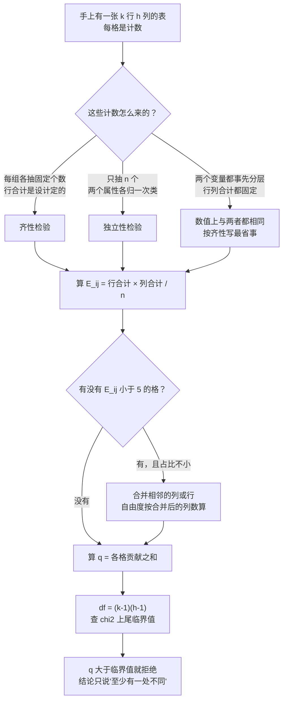
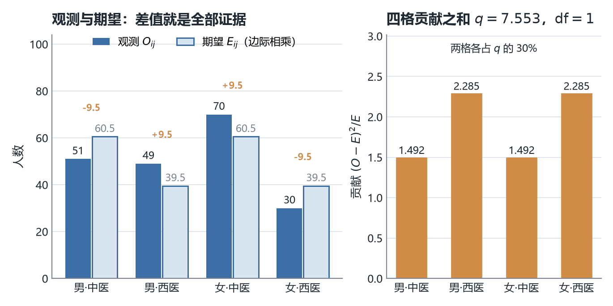
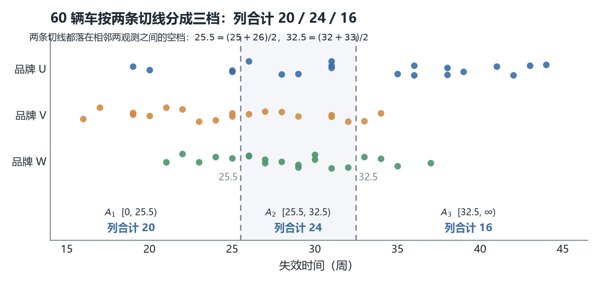
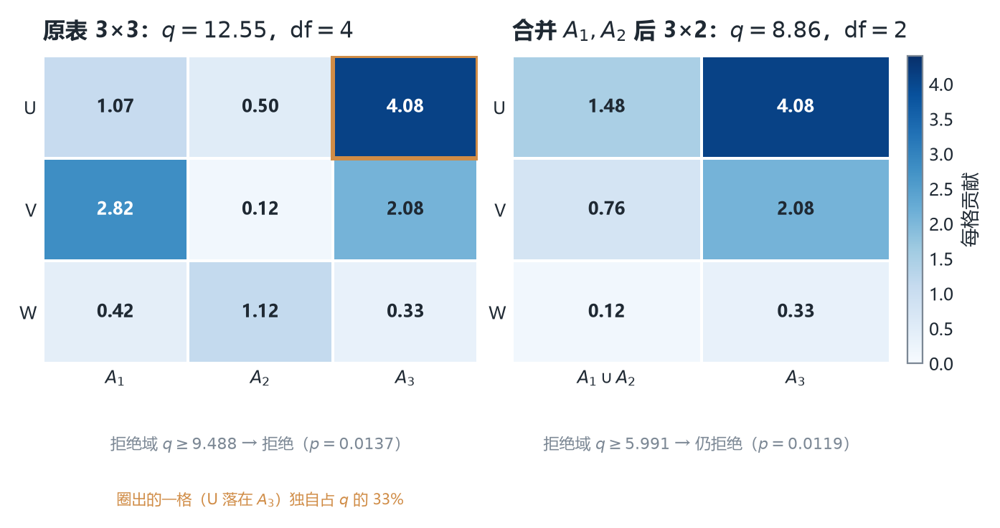
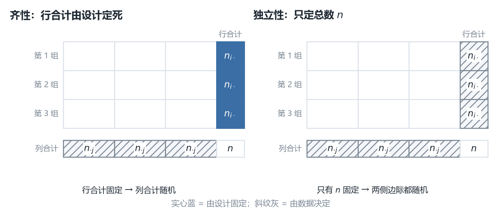
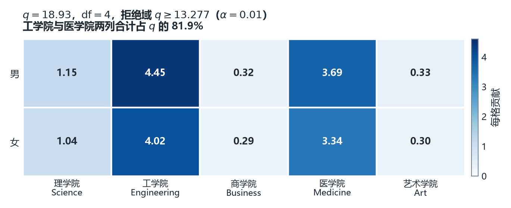
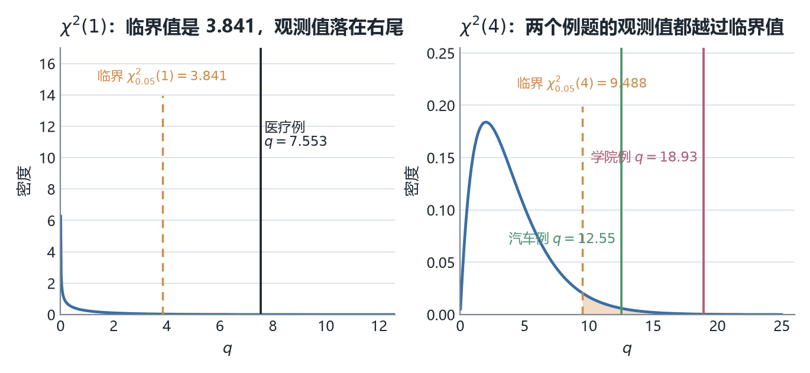

# STA2002 概率与统计 II · 第 15 讲笔记
## Test for Homogeneity and Test for Independence（齐性检验与独立性检验：同一台卡方机器，两个入口）

> 授课：Zhenxing Guo、Ka Wai Tseng（香港中文大学（深圳）数据科学学院，2026 年 11 月）
> 教材：Hogg, Tanis & Zimmerman (2015) *Probability and Statistical Inference*, 9th ed., Pearson
> 对应教材章节：**§9.2 Test for Homogeneity and Test for Independence**（讲义第 2 页给出 "Suggested reading: Chapter 9.2 of the textbook"；上一讲讲拟合优度时给的是 **Chapter 9.1**，所以教材第 9 章的前两节正好是本课程的第 14、15 两讲，先拟合优度、再列联表，顺序与讲义一致）
> 材料构成：讲义 `Lecture15 - Test for Homogeneity and Test for Independence.pdf`（**21 页**），笔记内容**完全基于课件（PDF）整理**；本讲没有收到板书，全文没有 `【板书 NN】` 标记。凡属我补充、推导或复算的内容，重要的用 alert 标出，其余就地写入正文，并在文末诚实备注中逐条列出（D1–D36）。
> **组织方式**：正文**严格按讲义页序**（第 2 页 → 第 21 页）撰写，每节标题末尾标出对应的讲义页码。
> **数值核验**：三张列联表的行列合计、每一格的 $E_{ij}$、每一格的贡献、三个 $q$、三个自由度、三个临界值，我都用 `scipy.stats.chi2_contingency` 与手写公式两条路复算过，**结果与讲义一致**（只有 $q=7.554$ 与 $7.553$ 的末位来自"先四舍五入再相加"，差 $0.001$，不影响任何结论）。我在诚实备注里只登记**讲义没有给、但值得知道的数**：三个 $p$ 值（$0.0060$、$0.0137$、$0.00081$）、$2\times2$ 情形下 $q=z^2$ 的恒等式、以及"合并一列后自由度与 $q$ 各自怎么变"。

---

## 0. 本讲地图（先说清楚这一讲在干什么）

*这一节回答：第 14 讲已经会用卡方做"一组数据像不像某个分布"，这一讲为什么还要学两个新名字？答案会让你有点意外——**统计学上它们是同一件事**。*

第 14 讲解决的是"**一组**数据能否用某个分布描述"：把取值范围切成 $k$ 个箱，数每箱的观测数 $O_i$，与 $H_0$ 下的期望数 $E_i$ 比，得到 $Q_k=\sum_i (O_i-E_i)^2/E_i\sim\chi^2(k-1)$（参数未知时用 $k-1-d$）。本讲把"一组数据"换成"**一张表**"：如果个体同时被两个属性分类（男女 × 中医/西医；品牌 × 失效时间档），那么表里就有 $k\times h$ 个格子，每格一个观测数与一个期望数，同样比一遍、同样求和，就得到本讲的统计量

$$Q=\sum_{i=1}^{k}\sum_{j=1}^{h}\frac{(O_{ij}-E_{ij})^2}{E_{ij}}\ \overset{\text{approx}}{\sim}\ \chi^2\big((k-1)(h-1)\big).$$

**跟第 14 讲唯一真正的区别在自由度**：$k-1$ 变成 $(k-1)(h-1)$。所以本讲的内容可以拆成三件：① 表长什么样、期望数怎么来（$E_{ij}=n_{i\cdot}n_{\cdot j}/n$，两个边际相乘再除总数）；② 自由度为什么是 $(k-1)(h-1)$，而且是**两条完全不同的路**数出来的同一个数；③ 两个名字（齐性 / 独立性）到底差在哪——**差在抽样方式，不在计算**。

**三遍阅读路线。** 本讲有三个例题、两套设定，但真正的新东西只有一个公式和一张对照表：

| 遍次 | 读哪里 | 读完应该能 |
| --- | --- | --- |
| 第一遍（主线） | §2–§5（医疗偏好例走完全程）→ §9–§11（三品牌例）→ §17–§19（学院例） | 拿到任意一张 $k\times h$ 表，算出 $E_{ij}$、$q$、自由度，下结论 |
| 第二遍（深化） | §4（$k(h-1)-(h-1)$ 的推导）→ §7（合并估计 $p_{\cdot j}$）→ §13–§16（独立性的乘法法则与 $kh-1-(k+h-2)$） | 解释两条自由度路线为什么同源，以及为什么独立时"两个边际都要估" |
| 第三遍（考前） | §20（Summary 对照表逐行）→ §21 速查表 → §22 核心直觉 | 遇到"这题是齐性还是独立性"能一句话答对，且知道差别不影响 $q$ |

第一遍刻意跳过 §13–§16 的推导链，只记住 $H_0:p_{ij}=p_{i\cdot}p_{\cdot j}$ 这句话；它是"独立性"三个字的全部数学内容，推导只是为了数清自由度。

**与往讲的接口。** 第 14 讲是**拟合优度检验**：$Q_k=\sum_i (O_i-E_i)^2/E_i$，多项分布 → $\chi^2(k-1)$，有 $d$ 个参数要估就减 $d$。本讲是把**同一台机器**搬到列联表上：格子从 $k$ 个变成 $kh$ 个，约束从 1 个（总数）变成 $k+h-1$ 个（行合计 + 列合计），于是自由度从 $k-1$ 变成 $kh-(k+h-1)=(k-1)(h-1)$。两个变体（齐性 / 独立性）的统计量、零分布、自由度**全都相同**，差别只在"行合计是谁定的"。这条主线在讲义里的落点是第 21 页那张 Summary 对照表——它是全讲最该背下来的一页。

| PDF 页 | 页脚号 | 内容 | 本笔记 | 配图 |
| --- | --- | --- | --- | --- |
| 第 1 页 | 1/21 | 封面 | —— | — |
| 第 2 页 | 2/21 | Introduction：三个关键词、教材 §9.2 | §1 | — |
| 第 3 页 | 3/21 | 医疗偏好例题：$2\times2$ 表，100 男 + 100 女 | §2 | — |
| 第 4 页 | 4/21 | "若男女相同，表该长什么样"：$H_0$、$E_{ij}$ 的一般式 | §3 | — |
| 第 5 页 | 5/21 | 卡方统计量一般式、自由度 $k(h-1)-(h-1)$ | §4 | — |
| 第 6 页 | 6/21 | 回到例题：$q=7.554$、临界值 $3.841$、拒绝 | §5 | 图 5.1 |
| 第 7 页 | 7/21 | 齐性检验的正式设定：$k$ 组 × $h$ 类 | §6 | — |
| 第 8 页 | 8/21 | 齐性下的统计量：$n_{i\cdot}$ 事先定，$\hat p_{\cdot j}=n_{\cdot j}/n$ | §7 | — |
| 第 9 页 | 9/21 | 决策规则：临界域与 $p$ 值 | §8 | — |
| 第 10 页 | 10/21 | 三品牌例题题干：60 个失效时间 | §9 | — |
| 第 11 页 | 11/21 | 为什么要切区间、$25.5$ / $32.5$、$3\times3$ 表 | §10 | 图 10.1 |
| 第 12 页 | 12/21 | 期望频数表（三行相同）、$q=12.55$、拒绝 | §11 | 图 11.1 |
| 第 13 页 | 13/21 | 独立性检验的设定：两个属性交叉分类 | §12 | 图 12.1 |
| 第 14 页 | 14/21 | $p_{ij}=\Pr(A_i\cap B_j)$ 与乘法法则 | §13 | — |
| 第 15 页 | 15/21 | $H_0:p_{ij}=p_{i\cdot}p_{\cdot j}$、$kh$ 元多项 | §14 | — |
| 第 16 页 | 16/21 | 统计量构造、$\hat p_{i\cdot}$、$\hat p_{\cdot j}$、参数个数 $k+h-2$ | §15 | — |
| 第 17 页 | 17/21 | 自由度 $kh-1-(k+h-2)=(k-1)(h-1)$ | §16 | — |
| 第 18 页 | 18/21 | 性别 × 学院例题题干：400 名学生、$2\times5$ | §17 | — |
| 第 19 页 | 19/21 | 期望频数表与十个分项之和 $18.93$ | §18 | — |
| 第 20 页 | 20/21 | 自由度 $4$、临界值 $13.28$、结论、一个 $E<5$ | §19 | 图 19.1 |
| 第 21 页 | 21/21 | Summary：齐性 vs 独立性五行对照 | §20 | 图 20.1 |
| — | — | 速查表、核心直觉、术语对照、诚实备注 | §21–§24 | — |

### 0.1 一句话概括本讲的结构

> [!IMPORTANT]
> **两个检验共用同一个统计量与同一个零分布，差别只在"行合计是谁定的"。**
> $$Q=\sum_{i=1}^{k}\sum_{j=1}^{h}\frac{(O_{ij}-E_{ij})^2}{E_{ij}},\qquad E_{ij}=\frac{n_{i\cdot}n_{\cdot j}}{n},\qquad Q\ \overset{H_0}{\approx}\ \chi^2\big((k-1)(h-1)\big).$$
> - **齐性**（homogeneity）：$k$ 组人是**分别**抽的，每组抽多少个是你事先定的（$n_{i\cdot}$ 固定），问这 $k$ 组的类别分布是否相同。
> - **独立性**（independence）：只抽 $n$ 个人，然后每人被两个属性各归一次类，问这两个属性是否**独立**（$p_{ij}=p_{i\cdot}p_{\cdot j}$）。
> 两者在数学上是同一个检验：一旦你**条件在全部边际上**（行合计与列合计都当成已知），两种抽样方式给出的表的条件分布完全相同，$q$ 的计算式和它的零分布自然一模一样。

### 0.2 与本讲关系最近的往讲接口

| 往讲留下的线 | 本讲在哪里接上 |
| --- | --- |
| 第 14 讲：$Q_k=\sum (O_i-E_i)^2/E_i\sim\chi^2$，自由度 $=$ 箱数 $-1-$（要估的参数个数）；"$E_i\ge5$ 否则合并区间" | 第 4–5 页的 $Q$ 就是 $k\times h$ 版；第 11 页直接引用"$E_{ij}\ge5$"这条规则来决定切几条线；自由度公式是同一个"总格数 $-1-$ 参数数" |
| 第 8 讲：两个比例之差的双侧 $z$ 检验（$\hat p_1-\hat p_2$ 除以合并标准误） | $2\times2$ 表的卡方检验与它是**同一个检验**：本讲医疗例的 $q=7.553$ 正好等于那个 $z$ 的平方（$z=-2.748$），自由度 1 就是"一个平方项"。见 §5 的 alert |
| 第 6–8 讲：显著性水平、$p$ 值、拒绝域方向（"大值方向"还是"小值方向"）；第 7 讲：单方差检验用的 $\chi^2$ 与两方差检验用的 $F$ | 第 9、17 页反复用"$H_1$ favors large value of $Q$"，所以拒绝域永远在**右尾**；这条与第 7 讲讲过的 $\chi^2$ 检验完全同款 |
| 第 14 讲：多项分布（multinomial）$\mathrm{Mult}(n,p_1,\ldots,p_k)$ 与 $E(Y_i)=np_i$ | 第 3、15 页把每一行（或整张表）说成"多项分布"，$E(n_{ij})=n_{i\cdot}p_{ij}$ 就是多项分布各分量的均值；第 14 讲已经用它算过每一箱的期望 |

需要提醒一句：本讲**没有**出现"两个变量的相关性强弱"这个话题（那是回归的地盘），卡方只回答"独不独立"这个是非题。想把"显著"翻译成"有多强"，得自己补一个效应量（§19 的 alert 给了两个）。

### 0.3 拿到一张 $k\times h$ 表，怎么走

**这张图是我整理的，讲义没有画。** 三个分岔点：抽样方式决定检验叫什么名字（但**不改计算**）、$E_{ij}<5$ 决定要不要合并（**合并会改自由度**，这是最容易漏的一步，见 §11）、结论只能下到"至少一处不同"（**不能**说"两两都不同"，见 §11 的 alert）。

### 0.4 来源标注约定

- 无标记 → 讲义原文、对讲义的直接展开，或我已就地融入正文的小补充（均登记在文末 D 表）；
- alert → 讲义没有、由我补充、推导或复算的内容，标题写明它属于哪一类（补充 / 技巧 / 重要 / 课件笔误 / 注意），文末诚实备注逐条列出；
- 页码只出现在节标题、图注末尾、速查表的"课件位置"列与文末诚实备注四处。

---

## 1. 本讲要交付什么（讲义第 2 页）

讲义第 2 页原文：

> In this lecture we will learn
> - Contingency tables
> - Test for homogeneity: whether two or more multinomial distributions are equal
> - Test for independence: whether the classification based on two attributes are independent
>
> These two types of tests rely on similar test statistics.
> Suggested reading: Chapter 9.2 of the textbook.

第 2 页只有三行字，但三个术语都要现讲，因为它们后面每一个公式都要用。

**列联表**（contingency table）是把 $n$ 个个体按**两个**属性同时分类、把落在每个交叉格里的个数填进去得到的一张 $k\times h$ 表。行对应第一个属性的 $k$ 个水平，列对应第二个属性的 $h$ 个水平。说它"列联"，是因为它显示的是两个分类**联在一起**（contingent）时的计数分布，而不是各自单独的分布。

**边际频数**（marginal frequency）是表的最后一行、最后一列的那些合计：$n_{i\cdot}$ 是第 $i$ 行的合计（点号的位置告诉你"对哪个下标求和"），$n_{\cdot j}$ 是第 $j$ 列的合计，$n$ 是总数。之所以叫"边际"，是因为它们写在这张表的边缘（margin）上。记号上有个约定要记住：$n_{i\cdot}=\sum_{j=1}^{h}n_{ij}$，$n_{\cdot j}=\sum_{i=1}^{k}n_{ij}$，而 $n=\sum_i\sum_j n_{ij}$ 同时也是 $\sum_i n_{i\cdot}$ 和 $\sum_j n_{\cdot j}$。

**齐性**（homogeneity）在统计里指"若干组**同分布**"——把同一套类别用在 $k$ 个不同的组上，问这 $k$ 组的类别概率是不是一样。注意它说的是"分布的形状相同"，不是"人数相同"：第 3 页男女各 100 人是设计，概率是否相同才是问题。

为什么"检验分布相同"会落到一张表上？因为"分布相同"这句话没法直接算：分布是一个函数，而数据是 $k$ 组计数。要把它变成可算的量，唯一的办法是**先把取值离散化成有限个类别**（$h$ 个），于是每组只剩 $h$ 个概率 $p_{i1},\ldots,p_{ih}$，"分布相同"就退化成"这 $h$ 列概率逐列相等"，正好是 $k\times h$ 个格子的比较。这也解释了为什么三品牌那批连续型的失效时间必须先切区间——不切就没有"列"。

---

## 2. 医疗照护偏好例题（讲义第 3 页）

讲义给的第一道例题：

> In a health policy study, researchers recruited 100 male patients and 100 female patients from outpatient clinics across multiple hospitals. Each participant was asked to indicate their preferred type of medical care: Chinese or Western.

**表 2.1　医疗照护偏好 × 性别（观测频数）**

| 性别 | 中医 Chinese | 西医 Western | 行合计 |
| --- | --- | --- | --- |
| 男 Men | $51\ (n_{11})$ | $49\ (n_{12})$ | $100\ (n_{1\cdot})$ |
| 女 Women | $70\ (n_{21})$ | $30\ (n_{22})$ | $100\ (n_{2\cdot})$ |
| 列合计 | $121\ (n_{\cdot 1})$ | $79\ (n_{\cdot 2})$ | $200\ (n)$ |

要回答的问题是：**男女在中医 / 西医之间的偏好是否不同？**

这张表就是本讲的第一个**列联表**：$k=2$ 行（两个性别）、$h=2$ 列（两种医疗类型），一共 $kh=4$ 个格子。它的概率模型是：对第 $i$ 组（$i=1$ 男、$2$ 女），计数向量 $\{n_{i1},n_{i2}\}$ 服从参数为 $n_{i\cdot}$ 与 $(p_{i1},p_{i2})$ 的多项分布。$h=2$ 的多项分布就是二项分布（100 次独立的二选一），所以这句话可以读成"男性的 100 人里，偏好中医的人数 $\sim\mathrm{Bin}(100,p_{11})$"，女性同理。

这里有个必须点出来的设计事实：**100 和 100 是研究者定的**。他们决定招募 100 男 100 女，然后才去看各自多少人偏好中医。所以行合计 $n_{1\cdot}=n_{2\cdot}=100$ 是**常数**，随机的是列合计 $121$ 与 $79$。下一节还会强调一次，而它正是"齐性检验"这个名称的来源——**先定每组多少人，再看分布**。

注意这道例题**跑在定义之前**：这三页把题从头做到尾（$q$、临界值、结论都给了），到下一节才正式定义"齐性检验"。读的时候不要被顺序误导，第 4 页那句 $H_0:p_{11}=p_{21},\,p_{12}=p_{22}$ 就是齐性检验的零假设，只是当时还没给它名字。§6 会把名字补上，并说明两个写法完全等价。

顺带把这道题的**效应方向**算清楚，因为后面结论会用到：男性偏好中医的比例 $51/100=0.51$，女性 $70/100=0.70$，差 $19$ 个百分点；优势比（odds ratio）是 $\dfrac{51/49}{70/30}=1.041/2.333=0.446$，取倒数得 $2.24$——**女性偏好中医的优势是男性的 2.24 倍**。这个数是讲义没有的，但它比"显著不同"更能说明差异有多大。

---

## 3. 若男女偏好相同，表该长什么样（讲义第 4 页）

讲义第 4 页用一个反问把 $H_0$ 引出来：

> Question: What would the table look like if men and women had the same preferences?
> $H_0$: Men and women have the same preference distribution for medical care, that is, $p_{11}=p_{21}$, $p_{12}=p_{22}$.

"偏好相同"翻译成概率就是：中医这一列，男的概率等于女的概率；西医这一列同理。因为每行概率之和为 1，两条等式其实只有一条是独立的（$p_{12}=1-p_{11}$、$p_{22}=1-p_{21}$，所以 $p_{11}=p_{21}$ 一成立，$p_{12}=p_{22}$ 自动成立）。

接下来做本讲第一个**关键的构造**：既然两组共享同一个 $p_1$，就把两组的"中医人数"加起来看，

$$n_{\cdot 1}=n_{11}+n_{21}\sim \mathrm{Binomial}(n,p_1).$$

这一步依赖两件事：两个样本**互相独立**（不同医院、不同病人），以及两组共享同一个 $p_1$（正是 $H_0$）。两个独立的 $\mathrm{Bin}(100,p_1)$ 相加是 $\mathrm{Bin}(200,p_1)$，与两组的样本量是否相等无关。

然后是期望频数。$H_0$ 只告诉我们"两组概率相同"，没说 $p_1$ 是多少，所以要用数据估它：合并后的中医比例是 $\hat p_{\cdot 1}=n_{\cdot 1}/n=121/200=0.605$。于是每格的期望人数是"这组有多少人"乘上"中医的合并比例"：

$$E_{ij}=n_{i\cdot}\,\hat p_{\cdot j}=n_{i\cdot}\cdot\frac{n_{\cdot j}}{n}=\frac{n_{i\cdot}n_{\cdot j}}{n}.$$

**表 3.1　医疗偏好例的期望频数（$H_0$ 下）**

| 性别 | 中医 | 西医 | 行合计 |
| --- | --- | --- | --- |
| 男 | $E_{11}=\dfrac{100\times121}{200}=60.5$ | $E_{12}=\dfrac{100\times79}{200}=39.5$ | $100$ |
| 女 | $E_{21}=\dfrac{100\times121}{200}=60.5$ | $E_{22}=\dfrac{100\times79}{200}=39.5$ | $100$ |
| 列合计 | $121$ | $79$ | $200$ |

注意这张期望表的形状：**两行完全相同**。这不是巧合，也不是算错——$H_0$ 说的就是"两行概率相同"，所以两行的期望分布必须一样，差别只可能出现在观测里。后面三品牌那道例题会出现类似的现象，但成因不同（那里是三组的样本量恰好都等于 20），两处要分清。

讲义在第 4 页还特意写了一句话提醒读者这个设计的不对称：

> Note that row sums $n_{1\cdot}$ and $n_{2\cdot}$ are pre-determined, column sums $n_{\cdot 1}$ and $n_{\cdot 2}$ are random.

**行合计固定、列合计随机**，这是齐性检验的标志。后面三品牌那一节会看到：一旦抽样方式换成"只定总数 $n$"，两个边际就都变成随机的，那就是独立性检验。这条对照是全讲的骨架。

> [!TIP] 技巧：$E_{ij}$ 的三种算法，选最不容易错的那条
> ① 按定义 $n_{i\cdot}n_{\cdot j}/n$，四个格子各算一次；② 先算一个格（$60.5$），再用"期望表的两行必须成比例"推出其余三个（$39.5=100-60.5$，第二行与第一行相同）；③ 用一个格子加行/列合计守恒反推。**检验的办法是三个方向都对得上**：每行期望之和 $=$ 该行合计，每列期望之和 $=$ 该列合计，总和 $=n$。这张表三个方向都成立（$60.5+39.5=100$，$60.5+60.5=121$），所以算对了。

---

## 4. 卡方统计量的一般形式与自由度（讲义第 5 页）

第 5 页把 $2\times2$ 推广到 $k\times h$，并给出本讲的核心公式。

设表有 $k$ 行 $h$ 列。记

- $O_{ij}=n_{ij}$：**观测频数**（observed frequency），第 $i$ 行第 $j$ 列格子里实际数到的人数；
- $E_{ij}=\dfrac{n_{i\cdot}n_{\cdot j}}{n}$：**期望频数**（expected frequency），$H_0$ 成立时该格"应该"有多少人。

两者的差距用平方相对误差累计：

$$Q=\sum_{i=1}^{k}\sum_{j=1}^{h}\frac{(O_{ij}-E_{ij})^2}{E_{ij}}.$$

逐符号读一遍：$(O_{ij}-E_{ij})$ 是这一格"多了还是少了"，平方是为了不分正负、且大偏差罚得更重；除以 $E_{ij}$ 是**标准化**——期望 50 人的格子差 10 人，和期望 5 人的格子差 10 人，严重程度完全不同，前者只差 20%、后者差两倍，除掉之后就都变成"相对偏差的平方"。求和是把所有格子的证据加起来。所以 $Q$ 的量纲是无量纲的，取值 $[0,\infty)$，**越大越不像 $H_0$**。

自由度的推导讲义给了一条"记账式"的路，分三步：

1. 对每一行 $i$，$(n_{i1},\ldots,n_{ih})$ 是一个多项分布，$h$ 个分量、和为 $n_{i\cdot}$，所以只有 $h-1$ 个自由度。$k$ 行独立，合计 $k(h-1)$ 个自由度。
2. 但 $H_0$ 说 $p_{1j}=p_{2j}=\cdots=p_{kj}$，也就是说这 $k$ 行**共享**同一组概率 $(p_1,\ldots,p_h)$。这组概率有 $h-1$ 个自由参数（和为 1），必须用数据估，每估一个就少一个自由度，于是减掉 $h-1$。
3. 相减：

$$k(h-1)-(h-1)=(k-1)(h-1).$$

于是

$$Q\ \overset{\text{approx}}{\sim}\ \chi^2\big((k-1)(h-1)\big).$$

"approx"这个词不能省：卡方是**大样本近似**，靠的是多项分布的正态近似（多元 CLT，本课程不单独证明），所以才有第 11 页那条"$E_{ij}\ge5$"的实用门槛。

> [!IMPORTANT] 重要：自由度 = 格数 $- 1 -$（要估的参数个数）
> 这句话是第 14 讲那条规则的直接推广，也是本讲唯一需要背的东西。$k\times h$ 表有 $kh$ 个格子，减 1 是因为总和 $=n$ 固定，再减掉 $H_0$ 下需要估的参数个数。齐性时参数是"共享的那 $h-1$ 个概率"，独立性时参数是"$k-1$ 个行边际 $+$ $h-1$ 个列边际"，两条路都得到 $(k-1)(h-1)$。**遇到新题型（比如三维表、或者某一列被合并过）时，回到这句话去数，比套公式可靠。**

还有一条更省事的数法：把表看成 $kh$ 个计数，它们只有 $kh-1$ 个自由度（总和固定）。$H_0$ 并没有把边际钉死，它只是说"格概率 $=$ 行边际 $\times$ 列边际"，所以要先估出 $k$ 个行边际与 $h$ 个列边际；两组边际各有一个"和为 1"的约束，故独立参数是 $(k-1)+(h-1)=k+h-2$ 个。减掉：

$$kh-1-(k+h-2)=(k-1)(h-1).$$

与上面那三步走法的结果相同。§15–§16 讲独立性时用的正是这一条，两条路在那一页会合。

---

## 5. 回到例题：算 $q$、查临界值、下结论（讲义第 6 页）

这一页把四个格子摆成一张对照表，然后逐格算贡献：

**表 5.1　医疗偏好例：观测与期望并列**

| 格子 | 观测 $O_{ij}$ | 期望 $E_{ij}$ | $O_{ij}-E_{ij}$ | 贡献 $(O-E)^2/E$ |
| --- | --- | --- | --- | --- |
| 男·中医 | 51 | 60.5 | $-9.5$ | $90.25/60.5=1.4917$ |
| 男·西医 | 49 | 39.5 | $+9.5$ | $90.25/39.5=2.2848$ |
| 女·中医 | 70 | 60.5 | $+9.5$ | $90.25/60.5=1.4917$ |
| 女·西医 | 30 | 39.5 | $-9.5$ | $90.25/39.5=2.2848$ |
| 合计 | 200 | 200 | 0 | $q=7.5531$ |

讲义写的是

$$q=\frac{(49-39.5)^2}{39.5}+\frac{(51-60.5)^2}{60.5}+\frac{(30-39.5)^2}{39.5}+\frac{(70-60.5)^2}{60.5}=2.285+1.492+2.285+1.492=7.554.$$

这个式子有一个值得注意的对称结构：四个格子的偏差**大小都是 9.5**，只有方向不同；而 $E$ 只有两个值（$60.5$ 与 $39.5$），所以贡献也只有两个值（$1.492$ 与 $2.285$），各出现两次。换句话说，$2\times2$ 表的 $q$ 永远是"两倍的甲加两倍的乙"这种形状——**表越接近独立，四个偏差越小，$q$ 也越小**。

自由度 $(2-1)(2-1)=1$，临界值 $\chi^2_{0.05}(1)=3.841$。因为 $q=7.553>3.841$，**在 $\alpha=0.05$ 下拒绝 $H_0$**。讲义的结论原文是：

> There is statistically significant evidence that men and women have different preferences between Chinese and Western medical treatments. Women show a stronger preference for Chinese medicine compared to men.

后一句是把方向说清楚的动作，值得学：卡方本身是**无方向**的（平方抹掉了正负），方向必须回去看观测表。这里女性中医 $70\%$ vs 男性 $51\%$，所以是"女性更偏中医"。

*图 5.1　左：四格的观测与期望并列，柱顶标出偏差 $+9.5$ 或 $-9.5$——四个偏差绝对值相同、符号成对相反，这是"两行期望相同"的必然结果。右：每格的贡献 $(O-E)^2/E$，两格 $2.285$、两格 $1.492$，相加得 $q=7.553$；贡献的大小差别只来自分母（$39.5<60.5$，所以同样的偏差在西医那格罚得更重）。（我绘制；数值由讲义第 3、6 页的观测表当场算出，脚本 `_scripts/STA2002-L15_figs.py`）*

> [!NOTE] 补充：$2\times2$ 的卡方就是第 8 讲那个两比例 $z$ 检验的平方
> 把男 / 女看成两个总体，检验 $H_0:p_1=p_2$，第 8 讲用的统计量是
> $$z=\frac{\hat p_1-\hat p_2}{\sqrt{\hat p(1-\hat p)\left(\frac{1}{n_1}+\frac{1}{n_2}\right)}},\qquad \hat p=\frac{x_1+x_2}{n_1+n_2}.$$
> 代入 $x_1=51$、$n_1=100$、$x_2=70$、$n_2=100$，得 $\hat p=0.605$、分母 $=0.06914$、$z=-2.7483$，于是 $z^2=7.5531$——**与 $q$ 一模一样**。这不是巧合：自由度 1 的 $\chi^2$ 就是标准正态的平方，而 $2\times2$ 表只有一个独立的偏差方向。所以两讲的结论必然一致（这里 $z$ 的双侧 $p$ 值 $=0.0060$，与卡方的右尾 $p$ 值相同）。**但两讲的"方向"说法不同**：$z$ 检验可以单侧（"女性比男性更偏中医"），卡方只能双侧意义上的"不同"——因为平方之后符号没了。要单侧结论，得另做 $z$ 检验。

> [!TIP] 技巧：$2\times2$ 有一个不用算期望的速算公式
> 记四格为 $a,b,c,d$（按行排列），则
> $$q=\frac{n(ad-bc)^2}{(a+b)(c+d)(a+c)(b+d)}.$$
> 代入 $a=51,b=49,c=70,d=30$：$ad-bc=1530-3430=-1900$，分子 $=200\times3\,610\,000=7.22\times10^{8}$，分母 $=100\times100\times121\times79=9.559\times10^{7}$，得 $q=7.5531$ ✓。考场上四个格子一眼就能算，比逐个算 $E_{ij}$ 快，而且不会在 $60.5$ 这种小数上出错。注意这个公式**只对 $2\times2$ 成立**。

> [!CAUTION] 注意：卡方检验永远是单尾，别写成 $2\times p$
> 三道例题的比较都是 $q>c$ 的形式，且都只比上尾。原因是 $Q$ 是平方和，$H_1$ 的任何偏离（男女谁更偏中医都算）都让 $Q$ **变大**，所以"极端"只有"太大"一个方向。把 $z$ 检验的"双侧 $p$ 值 $=2\Pr(Z>\lvert z\rvert)$"照搬过来会得到 $2\times0.0060=0.012$，那是错的值。

---

## 6. 齐性检验的正式设定（讲义第 7 页）

第 7 页把前面那道题抽象成一般情形：

> We want to test whether data collected from different groups follow the same distribution.
> Assume that $k$ independent groups and the results are classified into $h$ mutually exclusive and exhaustive categories.

四个词要落实：

- **$k$ 个独立组**：组的来源互不影响（不同品牌的车、不同性别的人）。"独立"是**抽样独立**，不是"两属性独立"——后者是本讲后半的主题，两个"独立"含义完全不同，读的时候别混。
- **$h$ 个互斥且完备的类别**（mutually exclusive and exhaustive）：互斥 = 每个个体只进一个格子；完备 = 没有个体落在所有类别之外。这两条保证每行概率之和为 1。
- $p_{ij}$：第 $i$ 组的个体落入第 $j$ 类的概率。
- **齐性**：这 $k$ 个多项分布对应位置的概率相等。

零假设与备择假设写成

$$H_0:p_{1j}=p_{2j}=\cdots=p_{kj},\quad j=1,2,\ldots,h,\qquad \text{against}\qquad H_1:\text{All alternative possibilities}.$$

**$H_0$ 有 $h$ 条等式，但只有 $h-1$ 条是独立的**（因为每行概率和为 1，最后一条由前 $h-1$ 条自动满足）。这一点在数自由度时已经用过一次：减掉的 $h-1$ 就是它。

$H_1$ 的写法 "All alternative possibilities" 意思是"只要存在某一列 $j$ 使得两组概率不等，就算备择成立"。所以**拒绝 $H_0$ 只说明"至少有一列不等"，不说明"每一列都不等"，更不说明"两两之间都不同"**。这条限制在后面两道例题的结论里会反复出现，是学生最常越界的地方。

$H_0$ 还有一个等价写法值得记住：把 $p_{ij}$ 分解成 $p_{ij}=p_{\cdot j}$（不依赖 $i$），$H_0$ 就等于"$p_{ij}$ 与行下标 $i$ 无关"。这句话与"两个属性独立"（$p_{ij}=p_{i\cdot}p_{\cdot j}$）在**形式上**很像，但含义不同：齐性是"行不影响列分布，列的边际随便"，独立性是"行与列互不影响，但两个边际都要估"。§15–§16 会把这点讲透。

---

## 7. 齐性下的统计量与 $E_{ij}$ 的来路（讲义第 8 页）

第 8 页重复了统计量，但补上了两个前面没说透的环节。

第一个环节：**$n_{i\cdot}$ 是事先定的**。

> In experiments, we predetermine the number of observation for each group $n_{i\cdot}$.

这句话决定了整个推导的起点：$n_{ij}$ 的均值是

$$\mathbb{E}(n_{ij})=n_{i\cdot}p_{ij},$$

因为第 $i$ 组一共 $n_{i\cdot}$ 个个体，每个以概率 $p_{ij}$ 落进第 $j$ 类。这是多项分布各分量的均值，不需要任何近似。

第二个环节：$H_0$ 说各组的第 $j$ 列概率相同，记这个共同值为 $p_{\cdot j}$（点号在第一位，表示"对行求和后剩下的那个"）。它未知，用**合并**（pooled）的比例估：

$$\hat p_{\cdot j}=\frac{n_{\cdot j}}{n}.$$

"合并"这个词很重要：不是把 $k$ 个组内比例平均，而是把 $k$ 组的计数**先加起来再除**。两者在样本量相等时数值相同，不等时不同——而 $H_0$ 下的正确做法是先加后除，因为 $H_0$ 说的是"共享同一个 $p$"，那么最优估计自然是把所有组的信息合在一起用（这正是约束下的 MLE）。

代入得

$$E_{ij}=n_{i\cdot}\hat p_{\cdot j}=\frac{n_{i\cdot}n_{\cdot j}}{n},$$

$$Q=\sum_{i=1}^{k}\sum_{j=1}^{h}\frac{(O_{ij}-E_{ij})^2}{E_{ij}}\ \overset{\text{approx}}{\sim}\ \chi^2\big((k-1)(h-1)\big).$$

这里有个容易反复追问的问题：分母为什么是 $E_{ij}$，而不是单个格子的方差 $\operatorname{Var}(O_{ij})=n_{i\cdot}p_{ij}(1-p_{ij})$？因为 $Q$ 不是 $kh$ 个独立项的和：格子之间有"行和为 $n_{i\cdot}$"的约束，各格是**负相关**的，逐格标准化再简单相加会得到一个方差不为 2 的量。正确的做法是在多项分布的协方差矩阵下做二次型，化简之后恰好等价于"除以 $E_{ij}$"这一形式，自由度也随之变成 $(k-1)(h-1)$。所以分母是 $E_{ij}$ 是化简的结果，不是定义。教材 §9.1 有完整推导，本课程不要求。

---

## 8. 决策规则（讲义第 9 页）

第 9 页把规则写全。设 $q$ 是统计量的**实现值**（realized value，即把数据代进去算出的那个数，以区别于随机变量 $Q$）：

> Reject $H_0$ at significance level $\alpha$, if $q\ge\chi^2_\alpha\big((k-1)(h-1)\big)$.
> The critical region is of the form $C:=\{q\ge\chi^2_\alpha((k-1)(h-1))\}$.
> The p-value is $\text{p-value}=\Pr(Q\ge q;H_0)\approx\Pr(Q\ge q;Q\sim\chi^2((k-1)(h-1)))$.

三件事值得停一下：

**① 临界域只有一个尾巴。** 写作 $\{q\ge c\}$ 而不是 $\{q\le c_1\}\cup\{q\ge c_2\}$，理由是 $H_1$ 是"任意偏离"，而任意偏离都让 $Q$ 变大。所以 $\chi^2_\alpha$ 是**上** $\alpha$ 分位点：$\Pr(\chi^2_{\mathrm{df}}>\chi^2_\alpha)=\alpha$。查表时不要用错成下分位点。

**② $p$ 值的方向与 $q$ 一致。** $p$ 值是"$H_0$ 为真时，得到一个不小于现有 $q$ 的统计量的概率"。$p$ 小 $\iff$ $q$ 大 $\iff$ 数据与 $H_0$ 不合。这条与第 7、8 讲的 $p$ 值定义完全一样，只是分布的家族换成了 $\chi^2$。

**③ 临界值法的边界是"$\ge$"，$p$ 值法写"$\ge$"还是"$>$"都行。** 因为 $\chi^2$ 是连续分布，等号那一点的概率为 0；但如果统计量是离散的（例如做了连续性修正，或者用精确分布），两种写法的 $p$ 值就会差一点。本讲三张表的 $q$ 都是连续近似，不必纠结。

---

## 9. 三品牌例题的题干（讲义第 10 页）

> Select, at random, 20 cars of each of three comparable major-brand models (Brand U, Brand V, Brand W). They are driven many miles over very poor roads in a short time, and their failure times (in weeks) are recorded as follows:

**表 9.1　三个品牌的失效时间（周）**

| 品牌 | 失效时间（20 辆） |
| --- | --- |
| U | 25, 31, 20, 42, 39, 19, 35, 36, 44, 26, 38, 31, 29, 41, 43, 36, 28, 31, 25, 38 |
| V | 28, 17, 33, 25, 31, 21, 16, 19, 31, 27, 23, 19, 25, 22, 29, 32, 24, 20, 34, 26 |
| W | 30, 22, 27, 35, 29, 24, 32, 26, 37, 21, 28, 25, 31, 23, 33, 27, 29, 30, 26, 34 |

问题有两问：

> Based on the data, do the three brands have different distributions for the length of life under accelerated life testing? Is one brand significantly better than the others?

第一问是齐性检验（三个品牌的寿命**分布**是否相同），第二问是"哪个更好"——注意这是**两个不同的问题**，第二问不能用第一问的答案直接回答（§11 的 alert 会展开）。

数据本身是**连续型**的失效周数，一共 $20\times3=60$ 个观测。如果照搬"每辆车一个类别"，就是 $h=60$ 列，每格期望人数 $E_{ij}=1$，远远低于 $E\ge5$——卡方近似会失效。所以必须先**离散化**。

这批数据长什么样？三个品牌的中位数分别是 $33.0$、$25.0$、$28.5$，均值是 $33.15$、$25.35$、$28.45$——U 明显活得久、V 明显短，W 居中，后面 $q=12.55$ 拒绝 $H_0$ 的实质来源就是这个"U 长、V 短"的排序。但**光看中位数不能代替检验**：样本量只有 20，中位数差 8 周也可能只是运气；而且中位数只用了排序信息，卡方比较的是"落在哪一档"的比例，两者问的不是同一个问题。

---

## 10. 切区间：$E_{ij}\ge5$ 逼出来的三个类别（讲义第 11 页）

讲义第 11 页的第一句就是为什么要切：

> Recall the chi-square approximation needs $E_{ij}\ge5$ for each cell, so we select two dividing marks to evenly separate 60 cars into 3 categories.
> Here, we take $25.5$ and $32.5$ as two dividing marks, then the data can be summarized into 3 intervals:
> $$A_1:[0,25.5),\quad A_2:[25.5,32.5),\quad A_3:[32.5,\infty).$$

**表 10.1　三品牌 × 失效时间档（观测频数，$k=3$、$h=3$）**

| 品牌 | $A_1$：$[0,25.5)$ | $A_2$：$[25.5,32.5)$ | $A_3$：$[32.5,\infty)$ | 行合计 |
| --- | --- | --- | --- | --- |
| U | 4 | 6 | 10 | 20 |
| V | 11 | 7 | 2 | 20 |
| W | 5 | 11 | 4 | 20 |
| 列合计 | 20 | 24 | 16 | 60 |

逐格核对一遍（这是最容易出错的地方，因为要按区间去数）：U 的 20 个值里小于 $25.5$ 的是 $19,20,25,25$ 四个；落在 $[25.5,32.5)$ 的是 $26,28,29,31,31,31$ 六个；剩下 $35,36,36,38,38,39,41,42,43,44$ 十个。V 是 $11/7/2$、W 是 $5/11/4$，三行都加到 20，三列是 $20/24/16$，总共 60。

*图 10.1　60 辆车的失效时间按品牌分三行画出，两条竖虚线是切点 $25.5$ 与 $32.5$，中间一档用浅灰底标出。可见 U 的点整体靠右、V 整体靠左、W 居中偏左，三档的列合计是 $20/24/16$。（我绘制；散点位置由讲义第 10 页的 60 个原始数值直接生成，纵向抖动只为了避免重叠）*

切点是怎么定的？看排序后的数据：第 20、21 个次序统计量是 $25$ 和 $26$，取中点得 $25.5$；第 44、45 个是 $32$ 和 $33$，中点得 $32.5$。**取中点是为了让没有观测恰好落在切点上**，区间开闭（`[0,25.5)` 与 `[25.5,32.5)`）才不会产生歧义。

> [!WARNING] 课件笔误：不是"evenly separate"
> 讲义写 "evenly separate 60 cars into 3 categories"，但三档人数是 $20/24/16$，不是均分。**而且这道题根本做不出 $20/20/20$**：把 60 个值排序后，第 40、41 个都是 $31$（并列），要三等分就得在 $31$ 中间切一刀，把相等的观测分到两档去——这在一张计数表里是不能做的。
>
> **真正的约束是 $E_{ij}\ge5$**：三行样本量都是 20，$E_{ij}=20\times(\text{列合计})/60=(\text{列合计})/3$，所以 $E_{ij}\ge5\iff$ 列合计 $\ge15$。$20/24/16$ 三档都满足。
>
> **判据**：第 20、21 个次序统计量是 $25$ 与 $26$，所以 $25.5$ 恰好是三分之一分位点；而第 40、41 个都是 $31$。若把第二个切点改到 $31.5$（能得到最接近均分的 $20/22/18$），$q$ 从 $12.55$ 变成 $10.09$——仍拒绝，但说明**切点位置对 $q$ 有约 $2.5$ 的影响**。
>
> **影响**：措辞 $+$ 一个隐含的"切点主观性"，不改变本节结论；但学生若以为"必须三等分"，遇到并列值就会卡住。

这里有个方法论上的代价必须说清楚：切点是**看完数据才选的**（先看 60 个数，再挑 $25.5$ 与 $32.5$）。这在实务里是允许的，否则没法保证 $E\ge5$；但代价是分组本身携带了数据信息，$p$ 值只是近似。规范的做法是预先按领域知识定档（比如"一年内 / 一到两年 / 两年以上"），或者用等频分箱但在看 $q$ 之前定稿。最该避免的是"换几组切点试试，哪组显著报哪组"——那是 $p$ 值操纵。第 14 讲"合并区间直到 $E\ge5$"也有同样的性质，两讲都没提。

**这张表现在可以直接做齐性检验**：三行是三个独立样本（每个品牌各抽 20 辆），三列是同一套类别（三个失效时间档），行合计 $20/20/20$ 由设计定死——完全是 §6 的设定。

---

## 11. 三品牌例的检验与结论（讲义第 12 页）

讲义的假设与期望频数：

> $H_0$: The three brands have the same distribution across intervals.
> $H_1$: At least one brand has a different distribution.

**表 11.1　三品牌例的期望频数**

| 品牌 | $A_1$ | $A_2$ | $A_3$ |
| --- | --- | --- | --- |
| U | $6.67$ | $8.00$ | $5.33$ |
| V | $6.67$ | $8.00$ | $5.33$ |
| W | $6.67$ | $8.00$ | $5.33$ |

三行**完全一样**，原因与 §3 的医疗例不同：那里是因为 $H_0$ 说两行概率相同且样本量相等；这里同样有 $H_0$，但更直接的原因是**三行样本量都等于 20**。$E_{ij}=20\times(20,24,16)/60=(6.67,8.00,5.33)$，与 $i$ 无关。如果三个品牌抽的车数不同（比如 $20/30/10$），三行就会不同，而列合计仍然相同——那时表格才能看出"样本量"这一维。

十格贡献与总和：

**表 11.2　三品牌例的每格贡献 $(O_{ij}-E_{ij})^2/E_{ij}$**

| 品牌 | $A_1$ | $A_2$ | $A_3$ | 行和 |
| --- | --- | --- | --- | --- |
| U | $1.0667$ | $0.5000$ | $4.0833$ | $5.6500$ |
| V | $2.8167$ | $0.1250$ | $2.0833$ | $5.0250$ |
| W | $0.4167$ | $1.1250$ | $0.3333$ | $1.8750$ |
| 列和 | $4.3000$ | $1.7500$ | $6.5000$ | $q=12.5500$ |

$q=12.55$，自由度 $(3-1)(3-1)=4$，临界值 $\chi^2_{0.05}(4)=9.488$，$12.55>9.488$，**在 $\alpha=0.05$ 下拒绝 $H_0$**。结论：三个品牌的寿命分布不全相同，其中 U 最耐久、V 最差（$A_3$ 的比例 $10/20$ vs $2/20$，中位数 $33.0$ vs $25.0$）。

*图 11.1　左：原表 $3\times3$ 的每格贡献，最深的一格（U 落在 $A_3$，$4.08$）独自占 $q$ 的 $33\%$；$A_3$ 整列的贡献 $6.50$ 是一半以上。右：把 $A_1$ 与 $A_2$ 合并成两列后重算，$q$ 降到 $8.86$，自由度也随之从 $4$ 降到 $2$，在 $5\%$ 下仍然拒绝。（我绘制；两栏的 $E_{ij}$ 与贡献都由观测表按 $n_{i\cdot}n_{\cdot j}/n$ 现算）*

> [!IMPORTANT] 重要：合并类别，自由度必须跟着变
> 若某几格 $E_{ij}<5$，标准做法是把**相邻**的行（或列）合并。但合并之后，列数从 $h$ 变成 $h'$，自由度就是 $(k-1)(h'-1)$，**不是原来的 $(k-1)(h-1)$**。用这张表做个对照：把 $A_1$ 与 $A_2$ 合并成"$\le32.5$"与"$>32.5$"两档（观测变成 $10/10$、$18/2$、$16/4$），得到 $q=8.8636$、$\mathrm{df}=2$、临界值 $5.991$，仍然拒绝，$p=0.0119$。**若漏改自由度**（还用 $9.488$ 去比），$8.86<9.49$ 就会得出"不拒绝"的相反结论——这是本讲最容易造成整题错的地方。第 14 讲"$k$ 是合并**之后**的箱数"那条规则，就是这句话的一维版本。

> [!CAUTION] 注意：整体显著 $\ne$ 两两都不同
> 讲义的 $H_1$ 是 "At least one brand has a different distribution"，拒绝 $H_0$ 只买到"至少有一处不同"。而结论句写成 "the three brands have different lifetime distributions"，读起来像"三者两两都不同"，**这是比 $H_1$ 强的结论**。看表就知道：W 的 $5/11/4$ 与 U 的 $4/6/10$、V 的 $11/7/2$ 都有距离，但 W 与 U 的差别（贡献 $0.42+1.13+0.33=1.88$）远小于 U 与 V 的差别。真要说"哪两个不同"，得单独做三次 $2\times3$ 的检验：U vs V 的 $q=8.677$（$\mathrm{df}=2$，$p=0.0131$，显著），U vs W 是 $4.153$（$p=0.125$），V vs W 是 $3.806$（$p=0.149$）——**只有 U 与 V 这一对站得住，W 与两者都分不开**。而且三次比较还要做多重比较校正（Bonferroni：每次用 $\alpha/3$）。第 16 讲的 ANOVA 会系统处理这个问题，本讲的卡方没有。

这个结论还**对 $\alpha$ 敏感**：$q=12.55$ 在 $\alpha=0.05$ 下显著（临界值 $9.488$），在 $\alpha=0.01$ 下就**不**显著（$\chi^2_{0.01}(4)=13.277>12.55$）。$p$ 值是 $0.0137$，离 $0.05$ 不远。这种"边缘显著"的场合，报告 $p$ 值比报告"拒绝 / 不拒绝"更诚实。三道例题里只有这一道会随 $\alpha$ 翻转。

---

## 12. 独立性检验的设定（讲义第 13 页）

前两节（§6–§11）都是齐性。第 13 页换了一个完全不同的起点：

> Suppose a random experiment results in outcomes classified by two different attributes (e.g., height and weight).
> First attribute falls into one and only one of $k$ mutually exclusive and exhaustive events: $A_1,A_2,\ldots,A_k$.
> Second attribute falls into one and only one of $h$ mutually exclusive and exhaustive events: $B_1,B_2,\ldots,B_h$.

**属性**（attribute）在这里就是一个分类变量（性别、学院、身高段）。注意措辞的变化：齐性说"$k$ 个**组** × $h$ 个**类别**"，独立性说"$k$ 个**水平** × $h$ 个**水平**"——同一个 $k$、同一个 $h$，但来源不同：前面是"抽了 $k$ 拨人"，这里是"一个人被量了两次"。

列联表的结构与前面一样，只是记号换成 $y_{ij}$：

**表 12.1　两个属性的列联表（一般形式，$y_{ij}$ 是 $Y_{ij}$ 的实现值）**

| 频数 | $B_1$ | $B_2$ | $\cdots$ | $B_h$ | 行合计 |
| --- | --- | --- | --- | --- | --- |
| $A_1$ | $y_{11}$ | $y_{12}$ | $\cdots$ | $y_{1h}$ | $y_{1\cdot}$ |
| $A_2$ | $y_{21}$ | $y_{22}$ | $\cdots$ | $y_{2h}$ | $y_{2\cdot}$ |
| $\vdots$ | $\vdots$ | $\vdots$ | $\ddots$ | $\vdots$ | $\vdots$ |
| $A_k$ | $y_{k1}$ | $y_{k2}$ | $\cdots$ | $y_{kh}$ | $y_{k\cdot}$ |
| 列合计 | $y_{\cdot 1}$ | $y_{\cdot 2}$ | $\cdots$ | $y_{\cdot h}$ | $n$ |

*图 12.1　同一张 $3\times3$ 表，两种抽样方式。左（齐性）：每组抽多少人是设计定的，行合计是实心（固定），列合计是斜纹（随机）。右（独立性）：只定总数 $n$，两侧边际都由数据决定。（我绘制；示意图，格内不填数）*

这张对照图是全讲最该带走的一张：**两个检验的差别就是"哪条边际是实心蓝"**。齐性里行合计固定（你自己决定每组抽 20 个），独立性里只有总数 $n$ 固定（你抽 400 个学生，男女各多少、各学院多少人全是随机的）。

还有第三种情形：**两条边际都固定**。例如"按性别配额抽 200 男 200 女、且按学院配额各抽 80 人"，行列合计都由设计定死，图 12.1 里的斜纹格子全变成实心。这时**检验的数值仍然不变**：条件在全部边际上之后，表在 $H_0$ 下的条件分布是同一个（多元超几何，与多项分布在"给定边际"下一致）。所以实务中不必纠结"这算齐性还是独立性"，算出来的 $q$ 与自由度一样，只在写结论时选一种说法。

---

## 13. 独立性 = 乘法法则（讲义第 14 页）

第 14 页把"独立"翻译成概率：

> $p_{ij}=\Pr(A_i\cap B_j)$: the probability of $A_i$ and $B_j$ occurring simultaneously.
> Then, $\sum_{j=1}^{h}\sum_{i=1}^{k}p_{ij}=1$.
> Independence of two attributes is equivalent to $\Pr(A_i\cap B_j)=\Pr(A_i)\Pr(B_j)$ holds for all $i,j$.

**$p_{ij}$ 是联合概率**：一个个体同时属于 $A_i$ 与 $B_j$ 的概率。$kh$ 个格子覆盖了全部可能，所以概率之和为 1。

独立性的定义用的是概率论第一课就学过的乘法法则：两个事件独立 $\iff$ 交事件的概率等于概率之积。把它逐格写出：

$$p_{ij}=p_{i\cdot}\,p_{\cdot j}\quad\text{for all } i=1,\ldots,k,\ j=1,\ldots,h.$$

其中边际概率由求和得到（这正是"边际"一词的概率版来源）：

$$p_{i\cdot}=\sum_{j=1}^{h}p_{ij}=\Pr(A_i),\qquad p_{\cdot j}=\sum_{i=1}^{k}p_{ij}=\Pr(B_j),$$

且有 $\sum_{i=1}^{k}p_{i\cdot}=\sum_{j=1}^{h}p_{\cdot j}=1$。

这里有个反直觉的地方：$H_0$ 写了 $kh$ 条 $p_{ij}=p_{i\cdot}p_{\cdot j}$，看起来约束很多，其实不然——只要知道 $k-1$ 个行边际与 $h-1$ 个列边际，$kh$ 个格子概率就全被乘法法则定死了，其余格子不需要额外条件。所以 $H_0$ 真正施加的约束数是 $kh-\big[(k-1)+(h-1)\big]=(k-1)(h-1)$，**这个数就是后面自由度的来源**，与 §16 的记账完全对上。记住这条，就不必每次重新数参数。

---

## 14. 独立性检验的假设（讲义第 15 页）

> Hypotheses for independence of two attributes: $H_0:p_{ij}=p_{i\cdot}p_{\cdot j}$ for all $i,j$, versus $H_1$: All alternative probabilities.
> Question: how to build test statistics?
> Repeat the experiment $n$ times independently. $Y_{ij}$: the frequency of $A_i$ and $B_j$ occurring simultaneously, we have $\sum_{j=1}^{h}\sum_{i=1}^{k}Y_{ij}=n$.
> $(Y_{11},Y_{12},\cdots,Y_{1k},Y_{21},Y_{22},\cdots,Y_{kh})$ follows a multinomial distribution with $kh$ different possible results with $\mathbb{E}(Y_{ij})=np_{ij}$.

这里的模型与齐性有一个根本差别：**整张表是一个 $kh$ 元的多项分布**，而不是 $k$ 个 $h$ 元多项分布的拼装。因为抽样只有一次（抽 $n$ 个人），每人落进 $kh$ 个格子中的哪个，是同一个多项实验的 $kh$ 个结果。所以 $n$ 固定，行合计 $y_{i\cdot}$ 与列合计 $y_{\cdot j}$ **都是随机的**。

$Y_{ij}$ 的均值是 $\mathbb{E}(Y_{ij})=np_{ij}$：$n$ 次试验，每次以概率 $p_{ij}$ 落进这一格。

> [!WARNING] 课件笔误：$kh$ 元组的第二个下标
> 讲义写 $(Y_{11},Y_{12},\cdots,Y_{1k},Y_{21},Y_{22},\cdots,Y_{kh})$，其中 $Y_{1k}$ 应为 $Y_{1h}$。**判据**：第 13 页的表头是 $B_1,\ldots,B_h$，列只有 $h$ 个；第 16 页的求和上下限写的是 $\sum_{j=1}^{h}\sum_{i=1}^{k}$；$Y_{1k}$ 会暗示"第 1 行有 $k$ 列"，与 $k$ 是行数矛盾。同一个枚举还把第二行省成了"$Y_{21},Y_{22},\cdots,Y_{kh}$"，中间应有 $Y_{2h}$ 再到 $Y_{31}$。**影响**：纯记号，不影响任何公式；但独立阅读时会卡住，且容易把 $k$ 与 $h$ 弄反。

---

## 15. 独立性检验的统计量：把未知参数换成 MLE（讲义第 16 页）

第 16 页先写"理想版"统计量，再处理"参数未知"的麻烦。

理想版：如果 $p_{ij}$ 已知，直接比观测与期望，

$$Q:=\sum_{j=1}^{h}\sum_{i=1}^{k}\frac{(Y_{ij}-np_{ij})^2}{np_{ij}}\ \overset{H_0}{=}\ \sum_{j=1}^{h}\sum_{i=1}^{k}\frac{(Y_{ij}-np_{i\cdot}p_{\cdot j})^2}{np_{i\cdot}p_{\cdot j}}.$$

麻烦在于 $E_{ij}=np_{ij}$ 依赖 $k+h-2$ 个未知参数（$k$ 个行边际、$h$ 个列边际，各自有一个"和为 1"的约束）。第 14 讲遇到未知参数时用的是"把 $\theta$ 换成 MLE"，这里照做：

$$\hat p_{i\cdot}=\frac{\sum_{j=1}^{h}y_{ij}}{n}=\frac{y_{i\cdot}}{n},\qquad \hat p_{\cdot j}=\frac{\sum_{i=1}^{k}y_{ij}}{n}=\frac{y_{\cdot j}}{n},$$

于是

$$\hat E_{ij}=n\,\hat p_{i\cdot}\hat p_{\cdot j}=n\cdot\frac{y_{i\cdot}}{n}\cdot\frac{y_{\cdot j}}{n}=\frac{y_{i\cdot}y_{\cdot j}}{n}.$$

**这个式子与齐性那版的 $n_{i\cdot}n_{\cdot j}/n$ 一模一样**——不是巧合，而是 $H_0$ 的乘法形式决定的：一旦你假设"格概率 $=$ 边际之积"，期望人数就必然是"行合计 × 列合计 / 总数"，用哪套记号写都一样。

接着数自由度：

> Degree of freedom for $\{Y_{ij}\}$ is $(kh-1)$.
> As $\sum_{i=1}^{k}p_{i\cdot}=1$, $(k-1)$ unknown parameters in $(p_{1\cdot},\ldots,p_{k\cdot})$ to estimate.
> As $\sum_{j=1}^{h}p_{\cdot j}=1$, $(h-1)$ unknown parameters in $(p_{\cdot 1},\ldots,p_{\cdot h})$ to estimate.
> In total, $k+h-2$ unknown parameters to estimate.

三个数都要看懂：$kh-1$ 是"$kh$ 个格子减去总和固定"；$k-1$ 与 $h-1$ 是"两个边际各自去掉一个约束"；$k+h-2$ 是两者相加。**这里最容易错的是把 $k+h-2$ 写成 $k+h$**——两个和式各有一个约束，各减 1。

$E_{ij}$ 还有一个可以当检查用的**秩一**结构：$E_{ij}=y_{i\cdot}y_{\cdot j}/n$ 能写成两个向量的外积 $E=\frac{1}{n}\,\mathbf{r}\,\mathbf{c}^{\mathsf T}$，其中 $\mathbf{r}=(y_{1\cdot},\ldots,y_{k\cdot})^{\mathsf T}$、$\mathbf{c}=(y_{\cdot 1},\ldots,y_{\cdot h})^{\mathsf T}$。由此立刻得到两条实用性质：① 期望表的**所有行成比例**（第 $i$ 行是第 $1$ 行的 $y_{i\cdot}/y_{1\cdot}$ 倍）；② 期望表的秩为 $1$。所以看到"期望表每行一样 / 成比例"不要怀疑算错，那是 $H_0$ 的必然结果；反过来，观测表越接近"行成比例"，$q$ 就越小。这条比背公式更能解释"为什么 $q$ 衡量的是偏离独立"。

---

## 16. 自由度一步一步约掉（讲义第 17 页）

$$kh-1-(k+h-2)=kh-k-h+1=(k-1)(h-1).$$

中间那步只是把括号展开、合并同类项：$kh-1-k-h+2=kh-k-h+1$；最后一步是分组分解 $k(h-1)-(h-1)=(k-1)(h-1)$。于是

$$Q\ \overset{H_0}{\approx}\ \chi^2\big((k-1)(h-1)\big),$$

临界域与 $p$ 值：

$$C:=\{q\ge\chi^2_\alpha((k-1)(h-1))\},\qquad \text{p-value}\approx\Pr\big(Q>q;\ Q\sim\chi^2((k-1)(h-1))\big).$$

> [!IMPORTANT] 重要：两条自由度路线在这里合流
> §4（齐性）走的是"$k$ 个多项分布共 $k(h-1)$ 个自由度，减去共享的 $h-1$ 个参数"；§15–§16（独立性）走的是"$kh$ 个格子共 $kh-1$ 个自由度，减去 $k+h-2$ 个边际参数"。两条路的**出发点完全不同**（一个是"$k$ 个独立实验"，一个是"一个 $kh$ 元实验"），却得到同一个 $(k-1)(h-1)$。原因是：条件在行合计上之后，"$k$ 个多项分布"与"一个多项分布在给定边际下"是同一个分布。**这正是两个检验在数学上等价的最短证明**，也是第 21 页 Summary 说 "These two types of tests rely on similar test statistics" 的严格版本。

---

## 17. 性别 × 学院例题（讲义第 18 页）

> The 400 undergraduate students in a random sample at a university were classified according to college enrollment and gender.
> Based on data, please conclude whether or not the college in which a student enrolls is independent of the gender of that student at significance level $0.01$?

**表 17.1　性别 × 学院（观测频数，$k=2$、$h=5$、$n=400$）**

| 性别 | 理学院 Science | 工学院 Engineering | 商学院 Business | 医学院 Medicine | 艺术学院 Art | 行合计 |
| --- | --- | --- | --- | --- | --- | --- |
| 男 Male | 21 | 16 | 145 | 2 | 6 | 190 |
| 女 Female | 14 | 4 | 175 | 13 | 4 | 210 |
| 列合计 | 35 | 20 | 320 | 15 | 10 | 400 |

抽样方式是"随机抽 400 名学生，然后按学院与性别各归一次类"——**只有 $n=400$ 固定**，男女各多少（$190/210$）、各学院多少人（$35/20/320/15/10$）全是数据给定的。所以这是**独立性检验**，不是齐性。（讲义第 20 页数自由度时用的 $(k-1)(h-1)=1\times4=4$ 对两种检验都成立，单看这一句区分不出来。）

---

## 18. 期望频数与 $q$（讲义第 19 页）

十格期望全部按 $E_{ij}=y_{i\cdot}y_{\cdot j}/n$ 算：

**表 18.1　性别 × 学院的期望频数**

| 性别 | 理学院 | 工学院 | 商学院 | 医学院 | 艺术学院 | 行合计 |
| --- | --- | --- | --- | --- | --- | --- |
| 男 | $\frac{190\times35}{400}=16.625$ | $\frac{190\times20}{400}=9.5$ | $\frac{190\times320}{400}=152$ | $\frac{190\times15}{400}=7.125$ | $\frac{190\times10}{400}=4.75$ | 190 |
| 女 | $\frac{210\times35}{400}=18.375$ | $\frac{210\times20}{400}=10.5$ | $\frac{210\times320}{400}=168$ | $\frac{210\times15}{400}=7.875$ | $\frac{210\times10}{400}=5.25$ | 210 |
| 列合计 | 35 | 20 | 320 | 15 | 10 | 400 |

注意每行是另一行的 $190/210$ 倍：$16.625\times\frac{210}{190}=18.375$ ✓。这就是 §15 说的"秩一结构"。

$q$ 是十个分项之和：

$$q=\frac{(21-16.625)^2}{16.625}+\frac{(16-9.5)^2}{9.5}+\frac{(145-152)^2}{152}+\frac{(2-7.125)^2}{7.125}+\frac{(6-4.75)^2}{4.75}+\frac{(14-18.375)^2}{18.375}+\frac{(4-10.5)^2}{10.5}+\frac{(175-168)^2}{168}+\frac{(13-7.875)^2}{7.875}+\frac{(4-5.25)^2}{5.25}=18.93.$$

**表 18.2　十格的贡献（我逐格列出，讲义只给了总和）**

| 性别 | 理学院 | 工学院 | 商学院 | 医学院 | 艺术学院 | 行和 |
| --- | --- | --- | --- | --- | --- | --- |
| 男 | $1.1513$ | $4.4474$ | $0.3224$ | $3.6864$ | $0.3289$ | $9.9364$ |
| 女 | $1.0417$ | $4.0238$ | $0.2917$ | $3.3353$ | $0.2976$ | $8.9425$ |
| 列和 | $2.1930$ | $8.4712$ | $0.6141$ | $7.0217$ | $0.6265$ | $q=18.9265$ |

两个数字很说明问题：**商学院有 320 人（占八成），贡献却只有 $0.61$**——因为男 $145$、女 $175$，与期望 $152/168$ 几乎一样，这个大格子对"独立"毫无异议；**工学院只有 20 人，贡献 $8.47$**（男 $16$ 而期望 $9.5$）。可见 $q$ 不是"哪个格子人多"，而是"哪个格子与独立假设差得远"。

---

## 19. 结论与那句"一个期望数小于 5"（讲义第 20 页）

> Degrees of freedom: $(k-1)(h-1)=1\times4=4$. Critical value at level $0.01$: $\chi^2_{0.01}(4)=13.28$. Since $q>\chi^2_{0.01}(4)$, we reject the null hypothesis $H_0$.
> Conclusion: Gender and college enrollment are not independent.
> Enrollments in engineering and medicine are more highly dependent on gender than in the other colleges, because they have contributed the most to the value of the chi-square statistic.
> One expected number less than 5: the associated term in $q$ does not contribute an unusual amount to the chi-square value, so it does not concern us.

第一句的结论要精确：**"不独立"$\ne$"性别决定了学院"**，它只说明两个分类变量的联合分布偏离乘法法则。第二句是"回看贡献"的动作：工学院 $8.47$ + 医学院 $7.02$ = $15.49$，占 $q$ 的 **81.9%**（这个百分比是我算的），所以"这两个学院的入学更依赖性别"是有据的；而理学院（男 $21$ / 期望 $16.6$，女 $14$ / 期望 $18.4$）方向相反但幅度小，商学院几乎无关。

*图 19.1　$2\times5$ 表的每格贡献（$\mathrm{df}=4$）。工学院与医学院两列合计占 $q$ 的 $81.9\%$，是"不独立"的全部来源；商学院占八成人数却只贡献 $0.61$。（我绘制；$E_{ij}$ 与贡献按 $y_{i\cdot}y_{\cdot j}/n$ 现算）*

最后那句关于 $E<5$ 的话针对的是"男·艺术"格：$E=4.75<5$，它的贡献 $0.3289$ 很小。讲义的判断是"这一格没有异常地推高 $q$，所以不必担心"。

> [!NOTE] 补充：$E\ge5$ 这条规则的标准版本
> 单看"有一个格子 $E<5$ 就要合并"太严格，实务上用 Cochran 的经验法则：**$E_{ij}<5$ 的格子不超过总数的 20%，且没有任何格子 $E_{ij}<1$，卡方近似就可以接受**。本讲三张表逐个查：医疗例最小 $E=39.5$；汽车例最小 $E=5.33$；学院例只有一个 $4.75$（占 $1/10$），没有低于 $1$ 的——三张表都过关。讲义第 20 页那句判断与此一致，只是它没给出判据，读起来像在自我安慰。第 14 讲只写了"$E_i\ge5$"这一条硬线，同样缺这个"不超过 20%"的弹性。

> [!CAUTION] 注意：$q$ 会随样本量长大，"显著"不等于"关系强"
> $q$ 是 $n$ 乘以某种相对偏差：样本翻四倍，同样的比例结构会让 $q$ 大致翻四倍，于是**几乎必然显著**。要判断"关系有多强"，得用不随 $n$ 增长的量：$2\times2$ 用 $\phi=\sqrt{q/n}$，一般表用 Cramér's $V=\sqrt{q/\big(n\cdot\min(k-1,h-1)\big)}$。三道例题算出来是 $\phi=0.194$（医疗例）、$V=0.323$（汽车例）、$V=0.218$（学院例）——按 Cohen 的惯例（$0.1$ 小、$0.3$ 中、$0.5$ 大），都只是小到中等。所以"男女偏好显著不同"的正确读法是"有差异，但差异不大"，不是"差异巨大"。讲义三处结论都只说了"显著"，没提强度，这是本讲离实务最远的一处。

---

## 20. Summary：齐性与独立性的逐行对照（讲义第 21 页）

第 21 页是全讲的收口，一张五行表：

**表 20.1　讲义第 21 页的 Summary（照录）**

| 方面 Aspect | 齐性 Homogeneity | 独立性 Independence |
| --- | --- | --- |
| 设定 Setting | $k$ 组，所有组共用同一套 $h$ 个类别 | 第一个属性 $k$ 个水平，第二个属性 $h$ 个水平 |
| 目的 Purpose | 若干多项分布的概率是否相等 | 两个属性是否统计独立 |
| 抽样 Sampling | 从每组**分别**独立抽样，每组的样本量固定 | 从**单一**总体抽样，$n$ 固定 |
| 分布 Distribution | 每组各自的**多项分布** | 两个属性的**联合分布** |
| 检验统计量 Test Statistic | $Q=\sum_{i=1}^{k}\sum_{j=1}^{h}\dfrac{(Y_{ij}-E_{ij})^2}{E_{ij}}\overset{\text{approx}}{\sim}\chi^2((k-1)(h-1))$，其中 $E_{ij}=\dfrac{n_{i\cdot}n_{\cdot j}}{n}$ 或 $\dfrac{Y_{i\cdot}Y_{\cdot j}}{n}$ | （与左栏相同，两栏合并） |

逐行读一遍，看差异到底在哪：

**① Setting。** 差别是"组"与"属性"这两个词背后有没有"抽样单位"。齐性的 $k$ 组是**分开抽**的 $k$ 拨人（或车），每拨人有自己的样本量；独立性的 $k$ 个水平是**同一批人**身上的一个变量。所以齐性的表里"第 $i$ 行"是一个样本，"第 $j$ 列"是一个类别；独立性里"第 $i$ 行"和"第 $j$ 列"都是同一个样本的两个变量取值。

**② Purpose。** 齐性问"分布相不相同"，独立性问"两个变量有没有关联"。注意数学上这两个问题的 $H_0$ **写法不同但含义相通**：$p_{1j}=\cdots=p_{kj}$ 说的是"列的分布与行无关"，$p_{ij}=p_{i\cdot}p_{\cdot j}$ 说的是"行与列独立"。前者只约束列、不管行边际；后者两个边际都要出现在等式里。差别只在"行边际是否也被当成待估的随机量"。

**③ Sampling。** 这是唯一真正有操作含义的一行，也是判断题型的第一依据：**行合计是设计定的吗？** 是 → 齐性；只有 $n$ 定的 → 独立性。医疗偏好例（$100+100$）与汽车例（每品牌 20 辆）都是前者；学院例（随机 400 人）是后者。

**④ Distribution。** 齐性里"分布"是 $k$ 个并列的 $h$ 元多项；独立性里"分布"是**一个** $kh$ 元的联合分布。这一行的措辞差异对应着 §4 与 §15 两条不同的自由度数法。

**⑤ Test Statistic。** 讲义把这一行的两栏**合并成了一格**——这是全表最诚实的一处：**统计量完全一样**，连 $E_{ij}$ 的两个写法都只是记号的差别（齐性用 $n$，独立性用 $Y$）。所以第 21 页实际上在说："名字有两个，机器只有一台。"

*图 20.1　左：$\chi^2(1)$ 与医疗例的 $q=7.553$（临界值 $3.841$，$p=0.0060$）。右：$\chi^2(4)$ 与汽车例的 $q=12.55$、学院例的 $q=18.93$（临界值 $9.488$，$p$ 分别为 $0.0137$ 与 $0.00081$）。三个观测值都在右尾，但"深"的程度不同：学院例最深。（我绘制；曲线由 `scipy.stats.chi2` 的密度函数给出）*

> [!IMPORTANT] 重要：为什么两个检验数学上是同一个
> 关键一步是"**条件在全部边际上**"。给定行合计与列合计之后：
> - 齐性模型说每行是独立的多项分布、共享列概率 $p_{\cdot j}$，于是给定边际时表服从多元超几何分布；
> - 独立性模型说整张表是一个 $kh$ 元多项分布、格概率为 $p_{i\cdot}p_{\cdot j}$，给定边际时表**也**服从同一个多元超几何分布（这正是 Fisher 精确检验的分布）。
> 两个条件分布相同 ⇒ 同一个统计量有同一个零分布 ⇒ 同一个 $p$ 值。**所以"齐性还是独立性"只影响你怎么写 $H_0$ 与怎么描述抽样，不影响任何计算。** 反过来说：如果你在网上看到"齐性检验与独立性检验是两个不同的检验"，那是在说**实验设计**不同，不是说算法不同。

> [!TIP] 技巧：考场上判断题型的三句话
> ① 题干出现"分别从每组抽 $n_i$ 个"或"每组固定多少"→ 齐性；② 出现"随机抽 $n$ 个，按两个变量分类"→ 独立性；③ 只给一张表没给抽样说明 → 两种写法都对，但自由度、$q$、$p$ 值完全一样，随便挑一个写，别在名字上纠结。真正要小心的是**自由度**（有没有合并过列）和**结论的强度**（只能说"至少一处不同"）。

---

## 21. 一页纸速查表

| 要什么 | 内容 | 课件位置 |
| --- | --- | --- |
| 统计量 | $Q=\sum_{i=1}^{k}\sum_{j=1}^{h}\dfrac{(O_{ij}-E_{ij})^2}{E_{ij}}$ | 第 5、8、21 页 |
| 期望频数 | $E_{ij}=\dfrac{n_{i\cdot}n_{\cdot j}}{n}$（齐性）/ $\dfrac{y_{i\cdot}y_{\cdot j}}{n}$（独立性）——同一个式子 | 第 4、8、16、21 页 |
| 自由度 | $(k-1)(h-1)$；两条路线：$k(h-1)-(h-1)$ 与 $kh-1-(k+h-2)$ | 第 5、17 页 |
| 零分布 | $\chi^2\big((k-1)(h-1)\big)$，大样本近似 | 第 5、8、17 页 |
| 拒绝域 | $q\ge\chi^2_\alpha((k-1)(h-1))$，**只有右尾** | 第 9、17 页 |
| $p$ 值 | $\Pr\big(Q\ge q\big)$，$Q\sim\chi^2((k-1)(h-1))$ | 第 9、17 页 |
| $2\times2$ 速算 | $q=\dfrac{n(ad-bc)^2}{(a+b)(c+d)(a+c)(b+d)}=z^2$ | 第 6 页（我补的恒等式） |
| $E\ge5$ | 每格期望至少 5；否则合并相邻行/列，**自由度按合并后算** | 第 11、20 页 |
| 齐性判据 | 每组的 $n_{i\cdot}$ 由设计固定 | 第 4、8、21 页 |
| 独立性判据 | 只固定 $n$，两侧边际随机；$H_0:p_{ij}=p_{i\cdot}p_{\cdot j}$ | 第 15、21 页 |
| 结论措辞 | 只能说"至少一处不同"；方向要回看观测表；强度要另算效应量 | 第 6、12、20 页 |

**三道例题的答案（考前对照用）：**

| 题（课件位置） | $k\times h$ | $\mathrm{df}$ | $q$ | 临界值 | $p$ 值（我算） | 结论 |
| --- | --- | --- | --- | --- | --- | --- |
| 医疗偏好（第 3–6 页） | $2\times2$ | 1 | $7.553$ | $3.841$（$\alpha=0.05$） | $0.0060$ | 拒绝；女性更偏中医（OR $=2.24$） |
| 三品牌（第 10–12 页） | $3\times3$ | 4 | $12.55$ | $9.488$（$\alpha=0.05$） | $0.0137$ | 拒绝；U 最耐久、V 最差 |
| 性别×学院（第 18–20 页） | $2\times5$ | 4 | $18.93$ | $13.277$（$\alpha=0.01$） | $0.00081$ | 拒绝；工学院与医学院贡献 $81.9\%$ |

**四个最常错的点：**

1. **合并了列却忘了改自由度。** 汽车例若把 $A_1,A_2$ 并成一列，$q$ 从 $12.55$ 变 $8.86$、$\mathrm{df}$ 从 $4$ 变 $2$；仍用 $9.488$ 去比就会得出相反的结论（§11）。
2. **把卡方当双侧，$p$ 值乘 2。** 平方抹掉了方向，拒绝域只在右尾；$2\times0.0060=0.012$ 是错的（§5）。
3. **结论说得比 $H_1$ 强。** "$H_1$: 至少一个不同" $\ne$ "两两都不同"；要两两比较得另做检验并校正多重比较（§11）。
4. **把两个"独立"混为一谈。** 齐性要求"$k$ 组抽样独立"（组间互不影响），独立性要求"两个属性统计独立"（$p_{ij}=p_{i\cdot}p_{\cdot j}$）。同一段话里出现两个"独立"时，先问它修饰的是"抽样"还是"变量"（§6）。

---

## 22. 本讲核心直觉（考前回顾用）

1. **一台机器，两个入口。** 齐性与独立性的 $Q$、$E_{ij}$、零分布、自由度全都一样；差别只在"行合计是设计定的还是随机长出来的"。Summary 那张表把五行里的四行写得不同、第五行合并成一格，就是在说这件事。
2. **$E_{ij}$ 永远是"边际相乘除总数"。** 因为 $H_0$ 无论哪种写法，落到期望上都等价于"格概率 $=$ 边际之积"。这也解释了期望表为什么总成比例——它的秩是 1。
3. **自由度是数出来的，不是背出来的。** 格数 $-1-$（要估的参数个数）。齐性减 $h-1$，独立性减 $k+h-2$，两条路都到 $(k-1)(h-1)$。合并过列就回到这句话重新数。
4. **$q$ 只回答"像不像独立"，不回答"差多少"。** 它随 $n$ 线性增长，样本一大就必然显著。想知道强弱要另算 $\phi$ 或 Cramér's $V$（三道例题都只有 $0.19$–$0.32$）。
5. **$2\times2$ 的卡方就是两比例 $z$ 检验的平方。** $q=z^2$、$\mathrm{df}=1$ 是同一件事的两种写法；要单侧结论就必须回到 $z$，卡方给不了方向。
6. **方向必须回看观测表。** 卡方只说"不同"，谁高谁低得看 $O_{ij}$ 与 $E_{ij}$ 的大小；三道例题的结论都做了这一步（"女性更偏中医"、"U 最耐久"），它是最容易被漏写的采分点。
7. **$E\ge5$ 是为了让卡方近似站得住。** 不满足就合并相邻类别，而合并一定改自由度；合并的另一种代价是丢掉类别内部的顺序信息（汽车例把 60 个连续值压成 3 档，只用了"落在哪一档"）。
8. **拒绝 $H_0$ 只买到"至少一处不同"。** 想指出"哪一处"，要么看贡献（$81.9\%$ 来自工学院与医学院），要么做两两检验并校正——后者本讲没有，第 16 讲的 ANOVA 会接手同一类问题。

---

## 23. 中英术语对照

| 英文 | 中文 | 一句话 |
| --- | --- | --- |
| contingency table | 列联表 | 按两个属性交叉计数排成的 $k\times h$ 表 |
| marginal frequency | 边际频数 | 表的边缘合计 $n_{i\cdot}$、$n_{\cdot j}$ |
| observed frequency | 观测频数 | 格子里实际数到的个数 $O_{ij}=n_{ij}$ |
| expected frequency | 期望频数 | $H_0$ 下应有的个数 $E_{ij}=n_{i\cdot}n_{\cdot j}/n$ |
| test for homogeneity | 齐性检验 | $k$ 组分别抽样（行合计固定），问分布是否相同 |
| test for independence | 独立性检验 | 只固定 $n$，问两个属性是否满足 $p_{ij}=p_{i\cdot}p_{\cdot j}$ |
| homogeneity | 齐性 | 若干组的多项分布对应概率相等 |
| multinomial distribution | 多项分布 | $h$ 个类别、概率和为 1 的计数分布 |
| mutually exclusive and exhaustive | 互斥且完备 | 每个个体只进一格、且必落其一 |
| attribute | 属性 | 一个分类变量（性别、学院） |
| joint distribution | 联合分布 | 两个属性同时取值的概率分布 |
| multiplication rule | 乘法法则 | 独立时 $\Pr(A\cap B)=\Pr(A)\Pr(B)$ |
| degrees of freedom | 自由度 | 格数 $-1-$（要估的参数个数） |
| pooled estimate | 合并估计 | 先把各组合计再除，$\hat p_{\cdot j}=n_{\cdot j}/n$ |
| Cramér's $V$ | Cramér's $V$ | $\sqrt{q/(n\min(k-1,h-1))}$，不随 $n$ 增长的关联强度 |
| effect size | 效应量 | 把"显著"翻译成"多强"的量 |
| post-hoc comparison | 事后比较 | 整体显著后找出"哪几组不同"，需多重比较校正 |

---

## 24. 附：本笔记相对讲义的补充与说明（诚实备注）

### 发现的课件问题

1. **⚠️ 第 11 页说"evenly separate"，但实际三档是 $20/24/16$，并不均分。**
   - **位置**：第 11 页第一颗子弹与紧随的 $A_1,A_2,A_3$ 定义。
   - **原文**："we select two dividing marks to evenly separate 60 cars into 3 categories"。
   - **应为**：不是"均分"，而是"选两个切点使每格 $E_{ij}\ge5$"。因为三行样本量都是 20，$E_{ij}=(\text{列合计})/3$，故约束等价于每列合计 $\ge15$。
   - **判据**：第 11 页自己的表里列合计是 $20,24,16$，均分应为 $20,20,20$。而且 $20/20/20$ 在这批数据上**不可实现**：第 40、41 个次序统计量都是 $31$，三等分必须在 $31$ 中间切开，把相等的观测分到两档。$32.5$ 是第 44、45 个（$32$ 与 $33$）的中点，对应 $20/24/16$；改切 $31.5$ 得 $20/22/18$（最接近均分），$q=10.088$ 而非 $12.55$。另：$25.5$ 恰好是第 20、21 个（$25$ 与 $26$）的中点，正好是三分之一分位点，这一刀与"均分"一致，第二刀不一致。
   - **影响**：措辞，不改变本节的"拒绝"结论（两种切法都在 $5\%$ 下拒绝），但揭示了一个方法论问题：$q$ 的数值依赖切点，而切点是看完数据才定的（见 §10 的讨论）。

2. **⚠️ 第 12 页的结论强于 $H_1$：写"three brands have different distributions"，而 $H_1$ 只保证"至少一个不同"。**
   - **位置**：第 12 页 "Conclusion" 一句。
   - **原文**："there is significant evidence that the three brands have different lifetime distributions. Brand U appears to be the most durable, while Brand V is the least."
   - **应为**："at least one brand's distribution differs"；"U 最耐久、V 最差"是**事后**从观测表读出的方向，不是检验结论的一部分，且 W 与 U 的差异远小于 U 与 V。
   - **判据**：同一页的 $H_1$ 原文是 "At least one brand has a different distribution"；逐格贡献显示 W 三格合计仅 $1.88$（$q$ 的 $15\%$），而 U 与 V 的差距是 $5.65+5.03$。若要断言"每两个品牌都不同"，需做三次 $2\times3$ 检验：U vs V 为 $q=8.677$、$p=0.0131$（显著），而 U vs W 为 $4.153$（$p=0.125$）、V vs W 为 $3.806$（$p=0.149$），**都不显著**——即数据只能支持"U 与 V 不同"，W 与两者都分不开。
   - **影响**：结论措辞。**考试按 $H_1$ 的口径写"不全相同"最安全**，然后再补一句方向的观察（不算检验结论）。

3. **第 15 页的 $kh$ 元组下标写错：$Y_{1k}$ 应为 $Y_{1h}$，且枚举不完整。**
   - **位置**：第 15 页倒数第二颗子弹。
   - **原文**："$(Y_{11},Y_{12},\cdots,Y_{1k},Y_{21},Y_{22},\cdots,Y_{kh})$ follows a multinomial distribution with $kh$ different possible results"。
   - **应为**：$(Y_{11},Y_{12},\cdots,Y_{1h},Y_{21},Y_{22},\cdots,Y_{2h},\cdots,Y_{kh})$。
   - **判据**：第 13 页表头列只有 $B_1,\ldots,B_h$；第 16 页求和上限是 $\sum_{j=1}^{h}\sum_{i=1}^{k}$；$Y_{1k}$ 与"$k$ 是行数"直接矛盾。
   - **影响**：纯记号，不影响 $q$、自由度与结论；但独立阅读时容易把 $k,h$ 互换（而 $k,h$ 一换，自由度 $(k-1)(h-1)$ 不变、期望表却会转置）。

4. **第 21 页 Summary 的记号与前文不统一，且"Test Statistic"一行把两栏合并成一格，$E_{ij}$ 的两种写法并列出现却没有说明各自对应哪种检验。**
   - **位置**：第 21 页最后一行。
   - **原文**："$Q=\sum\sum (Y_{ij}-E_{ij})^2/E_{ij}$ ... where $E_{ij}=n_{i\cdot}n_{\cdot j}/n$ or $Y_{i\cdot}Y_{\cdot j}/n$"。
   - **应为**：齐性那几页（第 3–12 页）的观测频数一律写 $n_{ij}$ 或 $O_{ij}$，独立性那几页（第 13–20 页）写 $Y_{ij}$；Summary 统一用 $Y_{ij}$，与前半讲不一致。两种 $E_{ij}$ 写法也不是"或"的关系，而是**同一式子的两套记号**。
   - **判据**：第 5 页定义 $O_{ij}=n_{ij}$、$E_{ij}=n_{i\cdot}n_{\cdot j}/n$；第 16 页用 $Y_{ij}$ 与 $n p_{i\cdot}p_{\cdot j}$；两者在 $n_{i\cdot}=y_{i\cdot}$ 时完全相同。
   - **影响**：无（数值相同），但会让人误以为"齐性与独立性要用不同的期望公式"。

5. **第 5 页 "multionimial" 拼写错误（应为 multinomial），第 20 页 "One expected number less than 5 ... does not concern us" 未给判据。**
   - **位置**：第 5 页第四颗子弹；第 20 页最后一颗子弹。
   - **应为**：前者更正拼写；后者补上判据（Cochran 经验法则：$E<5$ 的格子不超过 $20\%$、且无 $E<1$，本表 $1/10$ 且最小 $4.75$，故可接受）。
   - **判据**：第 20 页的期望表里只有"男·艺术"一格 $4.75<5$；讲义只说"它贡献不大"，没有说"为什么贡献不大就可以不管"。
   - **影响**：均不影响答案；后者是本讲唯一一处"结论对、理由缺"的地方。

6. **第 6 页的 $q=7.554$ 与精确值 $7.5531$ 差 $0.001$（先四舍五入再相加导致的累积误差）。**
   - **位置**：第 6 页 $q$ 的第二个等号后。
   - **原文**："$=2.285+1.492+2.285+1.492=7.554$"。
   - **应为**：$2.2848+1.4917+2.2848+1.4917=7.5531$，三位小数为 $7.553$。
   - **判据**：$90.25/39.5=2.284810$、$90.25/60.5=1.491736$，相加为 $7.553091$；`scipy.stats.chi2_contingency` 同样给 $7.553091$。
   - **影响**：无（$7.553$ 与 $7.554$ 都远大于 $3.841$）。列在这里只为说明"四个分项各自舍入后再相加"会产生这种末位差，考试时中间量不要提前舍入。

### 我补充的内容（逐条指回正文）

| 编号 | 内容 | 位置 |
| --- | --- | --- |
| D1 | 三个新术语的定义：列联表、边际频数、齐性（含"边际"一词的来历） | §1 |
| D2 | "先定每组人数、再看分布"是本讲的设计内核，并指出第 3–6 页跑在定义之前 | §2 |
| D3 | 医疗例的方向量化：$51\%$ vs $70\%$、优势比 $2.24$ | §2 |
| D4 | 期望表"两行相同"的两种成因（$H_0$ 与样本量相等）及三方向自检法 | §3、§11 |
| D5 | $E_{ij}$ 的三种算法与"行和/列和/总和"三条校验 | §3 |
| D6 | 自由度 = 格数 $-1-$ 参数个数，作为统一口诀；以及"为什么分母是 $E_{ij}$ 不是方差" | §4、§7 |
| D7 | 自由度的第二种数法 $kh-1-(k+h-2)$，与讲义第 5 页那三步走法对照 | §4 |
| D8 | $2\times2$ 的 $q=z^2$ 恒等式（$z=-2.7483$，$q=7.5531$）与"卡方给不了方向" | §5 |
| D9 | $2\times2$ 的交叉积速算公式 $n(ad-bc)^2/\prod$ | §5 |
| D10 | 图 5.1（观测/期望/贡献三联），说明"同样偏差在西医格罚得更重" | §5 |
| D11 | "$H_0$ 有 $h$ 条等式但只有 $h-1$ 条独立"；"$H_1$ = 至少一列不等"的边界 | §6 |
| D12 | 齐性 $H_0$ 的等价写法"$p_{ij}$ 与行下标无关"，与独立性的形式对照 | §6 |
| D13 | 为什么 $\hat p_{\cdot j}$ 用"先加后除"的合并估计（约束下的 MLE） | §7 |
| D14 | 三品牌数据的中位数/均值（$33.0/25.0/28.5$）与"中位数不能代替检验" | §9 |
| D15 | 切点 $25.5$、$32.5$ 的来源（相邻次序统计量中点）与"切点由数据定"的代价 | §10 |
| D16 | $E_{ij}\ge5$ 与"列合计 $\ge15$"的等价（因三行样本量都是 20） | §10 |
| D17 | 图 10.1（60 个点的分箱图） | §10 |
| D18 | 图 11.1（$3\times3$ 与 $3\times2$ 贡献热图对照）与合并一列后的 $q=8.86$、$\mathrm{df}=2$ | §11 |
| D19 | "整体显著 $\ne$ 两两不同"，并给出三次 $2\times3$ 检验（U vs V：$q=8.677$、$p=0.0131$；U vs W、V vs W 都不显著）与 Bonferroni | §11 |
| D20 | 汽车例对 $\alpha$ 敏感：$5\%$ 拒绝、$1\%$ 不拒绝（$p=0.0137$） | §11 |
| D21 | 图 12.1（两种抽样的边际：实心 = 固定、斜纹 = 随机） | §12 |
| D22 | 第三种情形（行列边际都固定）的数值等价性 | §12 |
| D23 | "$kh$ 条独立等式其实只有 $(k-1)(h-1)$ 条"的约束计数 | §13 |
| D24 | $E_{ij}$ 的秩一结构（期望表行成比例）及其两条实用推论 | §15 |
| D25 | 两条自由度路线"为什么合流"的说明（条件分布相同） | §16 |
| D26 | 十格贡献的完整分解表（讲义只给总和）与"商学院占八成人数只贡献 $0.61$" | §18 |
| D27 | 工学院 + 医学院贡献占比 $81.9\%$ 的量化 | §19 |
| D28 | 图 19.1（$2\times5$ 贡献热图） | §19 |
| D29 | Cochran 经验法则（$E<5$ 不超过 $20\%$、无 $E<1$），并逐表核对 | §19 |
| D30 | 效应量 $\phi$ 与 Cramér's $V$（$0.194/0.323/0.218$）及"显著 $\ne$ 强" | §19 |
| D31 | 图 20.1（三个 $q$ 在各自卡方分布上的位置）+ 三个 $p$ 值 | §20 |
| D32 | Summary 五行的逐行解读，特别是第 ⑤ 行"两栏合并"的含义 | §20 |
| D33 | "齐性与独立性数学等价"的严格理由（条件在边际上后同为多元超几何） | §20 |
| D34 | 判断题型的三句话与三条考场保险动作 | §20 |
| D35 | 速查表、三道例题的 $p$ 值与 OR/Cramér's $V$ 列、四个最常错的点 | §21 |
| D36 | 核心直觉八条（含"一台机器两个入口"与"自由度是数出来的"） | §22 |

**图片登记**：图 5.1、图 10.1、图 11.1、图 12.1、图 19.1、图 20.1 **六张全部由我绘制**——讲义 21 页里没有任何统计图形（只有公式框、编号步骤与三张数据表）。生成脚本 `_scripts/STA2002-L15_figs.py`：三张列联表的 $E_{ij}$、贡献、$q$ 全部在脚本里按 $n_{i\cdot}n_{\cdot j}/n$ 现算，卡方密度与临界值取自 `scipy.stats.chi2`，图 10.1 的 60 个点直接来自讲义第 10 页的原始数值（纵向抖动是 `default_rng(20261118)` 生成的，只为避免重叠）。图 12.1 是示意图，格内不填数。

### 数值核验

讲义的 $q$、临界值、自由度我都复算过；唯一的偏差是第 6 页 $7.554$ 的末位舍入（见上文第 6 条），不影响任何结论。下面几组是我算出的、不在讲义上的数，交代为什么敢用：

- **三个 $p$ 值**：$0.00599$（医疗例）、$0.01370$（汽车例）、$0.000813$（学院例），由 `scipy.stats.chi2.sf(q, df)` 给出，与 `chi2_contingency` 的返回值一致。讲义只给"$q$ 与临界值比大小"，$p$ 值能让读者看出汽车例其实很接近 $\alpha$。
- **$2\times2$ 恒等式**：$z=(0.51-0.70)/\sqrt{0.605\times0.395\times(1/100+1/100)}=-2.748289$，$z^2=7.553091$，与卡方的 $q$ 精确相等（不是近似）。这条同时验证了"$\mathrm{df}=1$"不是巧合。
- **合并一列后的后果**：把 $A_1,A_2$ 并为"$\le32.5$"（观测 $10/18/16$ 与 $10/2/4$），$E=(14.667,5.333)$ 三行相同，$q=8.8636$、$\mathrm{df}=2$、临界值 $5.9915$、$p=0.0119$。这组数只用于说明"合并必须改自由度"。
- **贡献份额**：汽车例里 U 落在 $A_3$ 那一格贡献 $4.0833$，占 $q$ 的 $32.5\%$；$A_3$ 整列占 $51.8\%$。学院例里工学院 + 医学院两列占 $81.9\%$。这三个百分比是讲义"contributed the most"那句话的量化。
- **效应量**：$\phi=\sqrt{7.553091/200}=0.1943$；$V=\sqrt{12.55/(60\times2)}=0.3234$；$V=\sqrt{18.926483/(400\times1)}=0.2175$。
- **三个品牌的中位数**：$33.0$、$25.0$、$28.5$（20 个值的中位数取第 10、11 个的均值），用于支撑"U 最耐久"这个方向判断。

### 与上一讲（第 14 讲）的对账

第 14 讲的落点是"$Q_k=\sum (O_i-E_i)^2/E_i\sim\chi^2(q)$，$q=k-1$ 或 $k-1-d$，$E_i\ge5$ 否则合并区间"。逐条对照：

| 第 14 讲留下的线 | 本讲是否接上 |
| --- | --- |
| $Q_k$ 的公式与"$E_i\ge5$"门槛 | **命中**。第 5 页的 $Q$ 是同一个式子的双下标版；第 11 页直接引用"$E_{ij}\ge5$"来决定切几条线 |
| 自由度 = 箱数 $-1-$（要估的参数个数），参数未知时减 $d$ | **命中**。第 5 页减 $h-1$、第 17 页减 $k+h-2$，都是这句话的应用；第 17 页的 $kh-1-(k+h-2)$ 就是"总格数 $-1-$ 参数数" |
| 合并区间直到 $n\hat p_i\ge5$，且 $k$ 是**合并后**的箱数 | **部分命中**。规则被第 11 页引用，但**本讲没有真正做合并**（它是先切区间再建表，切点已经保证了 $E\ge5$），所以"合并后要改自由度"这件事讲义没有演示。我在 §11 用 $A_1\cup A_2$ 补了一个算例 |
| $H_0$ 下 $Q_k$ 的零分布是 $\chi^2$，拒绝域在右尾 | **命中**。第 5、8、17 页三次写出 $\overset{\text{approx}}{\sim}\chi^2$，第 9 页的临界域只有上尾 |
| 第 14 讲的多项分布 $\mathrm{Mult}(n,p_1,\ldots,p_k)$ | **命中且升级**。本讲用了两种用法：$k$ 个并列的 $h$ 元多项（齐性）与一个 $kh$ 元多项（独立性），第 21 页的 Distribution 一行就是在区分这两者 |
| 第 14 讲的例题都是"一组数据对一个分布" | **未涉及但自然延伸**。本讲的 $k=1$ 退化情形就是第 14 讲：一行 $h$ 列的表、$E_j=n\hat p_j$、$\mathrm{df}=h-1$——与第 14 讲的 $k-1$（箱数 $-1$）完全一致。这条对照讲义没写，但能解释"为什么两讲是同一台机器" |

### 本讲的"够 / 不够"

**够（讲足了的部分）：**

- **第 3–6 页把一道 $2\times2$ 题从头做到尾**：$H_0$ → 期望 → $q$ → 临界值 → 结论 → 方向解读，五步齐全，是最完整的模板。
- **第 5 页与第 17 页给了两条不同的自由度推导**，虽然没说它们等价，但两条都写清楚了，读者自己对照就能看出同源。
- **第 11 页主动交代了"为什么要切区间"**，并明说是为了满足 $E_{ij}\ge5$——比直接给一张表诚实。
- **第 12 页用一张三行相同的期望表**，让"齐性下每组期望一样"这件事一眼可见（前提是样本量相等，讲义没说这个前提，见"不够"第 4 条）。
- **第 20 页主动指出有一个 $E<5$ 的格子**，并给了判断，说明作者知道这个坑。
- **第 21 页的五行对照表是全讲最好的东西**：Setting / Purpose / Sampling / Distribution / Test Statistic，五个维度把两个检验的异同铺开，最后一行合并成一格更是直接承认"统计量一样"。

**不够（按重要性排序）：**

1. **没有说清"两个检验在数学上是同一个"。** 第 21 页说 "rely on similar test statistics"，但 "similar" 太弱——它们是**同一个**统计量、**同一个**零分布、**同一个** $p$ 值，只在抽样设计上不同。讲义没有任何一处解释"为什么"（条件在边际上之后同为多元超几何）。这导致学生容易把两个检验当成两套要分别背的公式。**建议的下一步**：把第 21 页第五行读三遍，再用 §20 的 alert 补上理由。
2. **$2\times2$ 与两比例 $z$ 检验的关系完全没提。** 这是最能帮学生"少背一套公式"的一条（$q=z^2$），也是唯一能解释"为什么 $\mathrm{df}=1$ 而不是 2"的直观理由。第 8 讲刚讲过两个比例的 $z$ 检验，接口就在手边。
3. **合并类别改自由度这件事只被引用、没被演示。** 第 11 页为了绕开 $E<5$ 而**先切区间**（聪明的做法），代价是读者永远看不到"合并"这个动作，也就学不到"合并后 $(k-1)(h-1)$ 里的 $h$ 要改"。而这是考试最常见的错。
4. **"期望表三行相同"没有解释前提。** 第 12 页的三行 $6.67/8.00/5.33$ 之所以相同，是因为三个品牌都抽了 20 辆；若样本量不等，期望表就不同。讲义没说这句，学生会误以为"齐性下期望永远相同"。第 4 页的 $2\times2$ 表也是同理（$100/100$）。
5. **结论的强度没有把关。** 第 12 页写 "the three brands have different distributions"，超出 $H_1$ 的范围；第 20 页的 "not independent" 也没提醒"这只是说联合分布偏离乘法法则，不是因果"。
6. **没有效应量，也没有样本量的敏感性讨论。** 三处结论都只报"显著"，而 $\phi$ 与 $V$ 都只有 $0.2$–$0.3$；汽车例换个 $\alpha$ 就翻盘这件事也没提。
7. **没有练习题，也没有"从原始数据到列联表"的完整示范。** 第 10 页给了 60 个值、第 11 页直接给出计数表，中间"怎么数"没有任何示范（只有一句 "the data can be summarized into 3 intervals"）。这一步恰恰是学生自己动手时最容易错的地方（区间开闭、边界值归属）。

**如果只做三件事，建议这三件：**

1. **把医疗例（第 3–6 页）不看答案重做一遍**：先自己算四个 $E_{ij}$，再用 $q=z^2$ 的两条路各算一次 $q$（一条逐个格子算贡献，一条用 $n(ad-bc)^2/\prod$），两个结果必须都是 $7.553$；然后查 $3.841$、写结论，最后补一句方向（女性更偏中医，OR $=2.24$）。做完你就同时掌握了期望的构造、$2\times2$ 的速算、以及"卡方不给方向"这三件事。
2. **把汽车例的 60 个值亲手数进 $3\times3$ 表**（第 10–11 页）：按 $[0,25.5)$、$[25.5,32.5)$、$[32.5,\infty)$ 三档逐个数，核对 $4/6/10$、$11/7/2$、$5/11/4$。数完再故意把切点改成 $26$ 与 $33$（让部分观测落在切点上），看区间开闭怎么写才不重不漏——这一步比算 $q$ 更能防止低级错误。
3. **回答一道讲义没问的题**："如果把汽车例的 $A_1$ 与 $A_2$ 合并成两档，$q$ 和自由度各变成多少？结论变不变？"（答：$q=8.8636$、$\mathrm{df}=2$、临界值 $5.991$，仍拒绝，$p=0.0119$；但若忘了改自由度、仍用 $9.488$，就会得出"不拒绝"——这就是第 3 条"不够"的实战版。）
