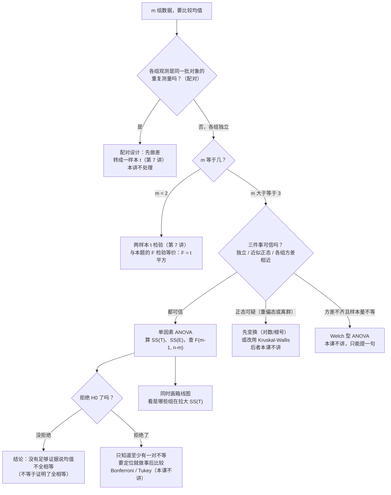
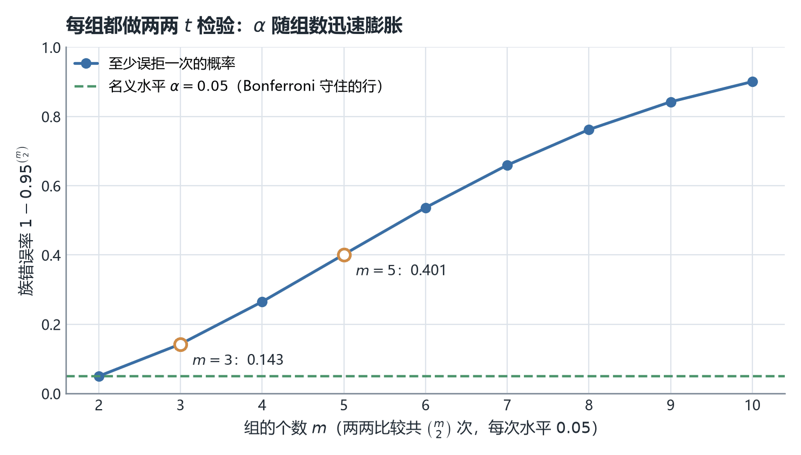
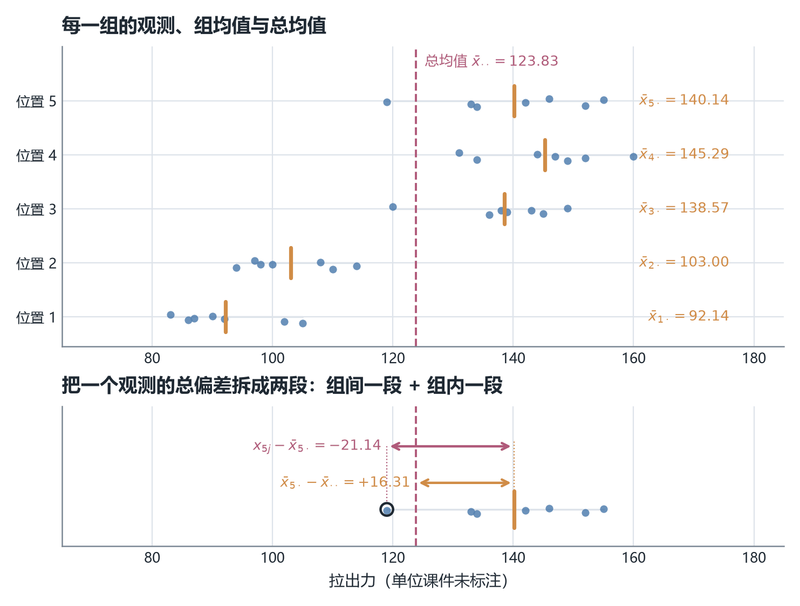
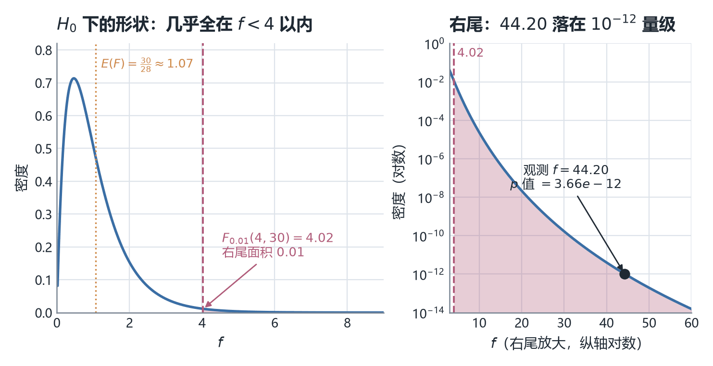
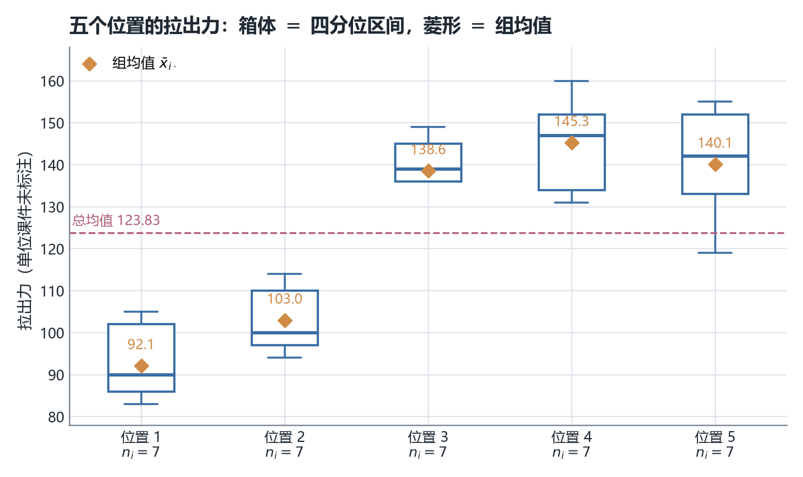

# STA2002 概率与统计 II · 第 16 讲笔记
## One-way ANOVA and F test（单因素方差分析与 $F$ 检验：怎样一次比较 $m$ 个正态均值）

> 授课：Zhenxing Guo、Ka Wai Tseng（香港中文大学（深圳）数据科学学院，2026 年 11 月）
> 教材：Hogg, Tanis & Zimmerman (2015) *Probability and Statistical Inference*, 9th ed., Pearson
> 对应教材章节：**§9.3 One-Factor Analysis of Variance**（讲义第 2 页写 "Suggested reading: Chapter 9.3 of the textbook"，我在教材目录核对过：第 9 章 More Tests 的第 3 节标题正是 One-Factor Analysis of Variance，页码 443–452）。教材这一节与讲义**用的是同一道例题**（车窗五个螺栓的拉出力，Table 9.3-5 = 讲义第 12 页的表），$SS$ 的三个数与 $F=44.20$ 也一致。教材另有三样讲义没有的东西：**通用记号表 Table 9.3-1 与 ANOVA 表模板 Table 9.3-2**、一句 **$E[SS(T)/(m-1)]=\sigma^2+\sum n_i(\mu_i-\mu)^2/(m-1)$**（这正是"$F$ 大就拒绝"的全部理由），以及一段"$F$ 检验对非正态稳健"的原话。
> 材料构成：讲义 `Lecture16 - One-way ANOVA and F test.pdf`（**16 页**），笔记内容**完全基于课件（PDF）整理**，本讲没有收到板书，全文没有 `【板书 NN】` 标记；凡属我补充、推导或复算的部分，一律用 alert 或文末诚实备注的 D 编号标出。
> **组织方式**：正文按讲义页序（p1 → p16）撰写。**本讲的页码没有错位**（16 页、页脚 1/16…16/16），但**第 16 页是第 15 页的逐字复制**（只有页脚号不同），这条记在诚实备注第 1 条。所以正文的 §14、§15 讲的是同一页内容的两面：§14 讲三条假设本身，§15 讲它作为"全讲总结"的作用。
> **数值核验**：例题 35 个观测、5 组的 $\sum_j x_{ij}$ 与 $\sum_j x_{ij}^2$、三个平方和（$19500.97$、$16672.11$、$2828.86$）、六个自由度（$4,30,34$）、两个均方（$4168.03$、$94.30$）、$F=44.20$、临界值 $F_{0.01}(4,30)=4.02$ 我都复算过，全部与讲义一致。另外我算了讲义没给的三样：**$p$ 值 $=3.66\times10^{-12}$**、**$R^2=0.855$**、以及把前两组单独拿去做两样本池化 $t$ 检验得到的 **$t=-2.5509$、$t^2=6.5069=F(1,12)$**（$m=2$ 时 $F=t^2$ 的恒等关系，见 §13.4）。

---

## 0. 本讲地图（先说清楚这一讲在干什么）

*这一节回答：第 7 讲只会比较两个均值，这一讲要一次比较 $m$ 个；为什么不能把 $t$ 检验重复做 $m(m-1)/2$ 次；以及"检验均值相等"的检验为什么叫"方差分析"。*

**三遍阅读路线。** 本讲 16 页里有 10 页（p5–p11）全在造同一个统计量，公式密集但结构单一；例题只有一道，却把前面所有零件都用了一遍。建议分三遍：

| 遍次 | 读哪里 | 读完应该能 |
| --- | --- | --- |
| 第一遍（主线） | §1–§3（动机与记号）→ §5（平方和分解）→ §11–§12（例题与 ANOVA 表） | 拿到 $m$ 组数据，填出一张 ANOVA 表、算出 $f$、与 $F_\alpha$ 比、下结论 |
| 第二遍（深化） | §4、§6–§8（三个 $\chi^2$ 与两个均方）→ §9（Cochran 型定理）→ §10（$F$ 的构造） | 解释自由度为什么是 $(m-1,\,n-m)$、为什么分子分母独立、为什么"大值拒绝" |
| 第三遍（考前） | §13（读图与事后比较）→ §14（三条假设）→ §15–§16 | 知道 $F$ 拒绝之后**还不能**说什么、假设违反会怎样 |

第一遍刻意跳过 §9 的定理。它是全讲唯一"只给结论不给证明"的地方（讲义也只说 "it can be proved"），跳过不影响做例题；但第二遍必须回来：$F$ 的分布正是它给的，**这一步跳过去就只剩一个记不住的结论**。

本讲与第 7 讲的关系可以用一句话说完：第 7 讲比较**两个**均值，本讲比较 **$m$ 个**；而 $m=2$ 时本讲的一切都退化成第 7 讲的池化 $t$ 检验（$F=t^2$，§13.4 有数值验证）。

| | 第 7 讲（两样本） | 本讲（$m$ 组） |
| --- | --- | --- |
| 零假设 | $H_0:\mu_X=\mu_Y$ | $H_0:\mu_1=\cdots=\mu_m$ |
| 统计量 | $T=\dfrac{\bar X-\bar Y}{S_p\sqrt{1/n+1/m}}\sim t(n+m-2)$ | $F=\dfrac{SS(T)/(m-1)}{SS(E)/(n-m)}\sim F(m-1,n-m)$ |
| 方差估计 | $S_p^2=\dfrac{(n-1)S_X^2+(m-1)S_Y^2}{n+m-2}$ | $\dfrac{SS(E)}{n-m}$（**同一个量**，$m=2$ 时数值相等） |
| 拒绝方向 | 双侧 $\lvert t\rvert\ge t_{\alpha/2}$ | 单侧右尾 $f\ge F_\alpha$ |

| PDF 页 | 页脚号 | 内容 | 本笔记 | 配图 |
| --- | --- | --- | --- | --- |
| 第 1 页 | 1/16 | 封面 | —— | — |
| 第 2 页 | 2/16 | Introduction：为什么要比较多个组 | §1 | 图 1.1 |
| 第 3 页 | 3/16 | 多个正态均值的相等性检验（$H_0$ 与 $H_1$） | §2 | — |
| 第 4 页 | 4/16 | 样本均值 $\bar X_{i\cdot}$、总均值 $\bar X_{\cdot\cdot}$、总容量 $n$ | §3 | — |
| 第 5 页 | 5/16 | Student 定理与总平方和 $SS(TO)$ | §4 | — |
| 第 6 页 | 6/16 | 分解 $SS(TO)=SS(E)+SS(T)$；二次型 | §5 | 图 5.1 |
| 第 7 页 | 7/16 | 组内样本方差 $W_i$ 与 $SS(E)/\sigma^2\sim\chi^2(n-m)$ | §6 | — |
| 第 8 页 | 8/16 | 两个均方都是 $\sigma^2$ 的无偏估计 | §7 | — |
| 第 9 页 | 9/16 | 分布层面的账本：哪一条依赖 $H_0$ | §8 | — |
| 第 10 页 | 10/16 | "一个有用的定理"（Cochran 型二次型分解） | §9 | — |
| 第 11 页 | 11/16 | $F$ 统计量、零分布、临界域、$p$ 值 | §10 | 图 10.1 |
| 第 12 页 | 12/16 | 例题题干：五个位置各 7 次拉出力 | §11 | — |
| 第 13 页 | 13/16 | 例题解答：ANOVA 表、$f=44.20$、拒绝 | §12 | — |
| 第 14 页 | 14/16 | 例题读图：五个位置的箱线图 | §13 | 图 13.1 |
| 第 15 页 | 15/16 | Summary：三条假设 + 检验流程 | §14 | — |
| 第 16 页 | 16/16 | **与第 15 页逐字相同**（仅页脚号不同） | §15 | — |
| — | — | 速查表、核心直觉、术语对照、诚实备注 | §16–§19 | — |

### 0.1 一句话概括本讲的结构

> [!IMPORTANT]
> **把"数据偏离总均值有多远"这件事，拆成"每组内部偏离自己组均值有多远"与"各组均值偏离总均值有多远"两块，然后看后一块相对前一块是不是太大。** 写成公式就是
> $$SS(TO)=\sum_{i=1}^{m}\sum_{j=1}^{n_i}(X_{ij}-\bar X_{\cdot\cdot})^2=\underbrace{\sum_{i=1}^{m}\sum_{j=1}^{n_i}(X_{ij}-\bar X_{i\cdot})^2}_{SS(E)}+\underbrace{\sum_{i=1}^{m}n_i(\bar X_{i\cdot}-\bar X_{\cdot\cdot})^2}_{SS(T)},$$
> 而检验统计量是两个"每自由度平方和"之比
> $$F=\frac{SS(T)/(m-1)}{SS(E)/(n-m)}\ \overset{H_0}{\sim}\ F(m-1,\ n-m).$$
> 三个零件的分工是死的：$SS(E)$ 只反映组内随机波动（**不管 $H_0$ 真假都服从 $\chi^2(n-m)$**），$SS(T)$ 在 $H_0$ 下也只有随机波动（$\chi^2(m-1)$），一旦各组均值分开，$SS(T)$ 会额外涨出一块 $\sum n_i(\mu_i-\mu)^2$，而 $SS(E)$ 不涨——**所以比值变大就意味着"均值不全相等"**。这就是"检验均值、却叫方差分析"的字面解释：判据是两个方差估计的比。

### 0.2 与本讲关系最近的往讲接口（这张表是我整理的，讲义没有画）

| 往讲留下的线 | 本讲在哪里接上 |
| --- | --- |
| 第 7 讲：两样本池化 $t$ 检验，$S_p^2=\frac{(n-1)S_X^2+(m-1)S_Y^2}{n+m-2}$，$T\sim t(n+m-2)$ | 本讲的 $\frac{SS(E)}{n-m}$ 在 $m=2$ 时**就是** $S_p^2$（§6 末有数值：两组各 7 个观测时都等于 $63.4048$），而 $F=t^2$（§13.4 验证 $6.5069$） |
| 第 5 讲：$\chi^2(n-1)$ 分布（方差的置信区间用的就是它）——本讲要用它的可加性：独立且同方差的正态样本，平方和相加则自由度相加 | §6 的 $SS(E)=\sum_{i=1}^m(n_i-1)W_i$ 就是这条：$m$ 个独立的 $\chi^2(n_i-1)$ 加起来是 $\chi^2(n-m)$ |
| 第 6–8 讲：拒绝域的方向由"$H_1$ 让统计量往哪边跑"决定；$p$ 值与临界值两种写法等价 | §10 的"large value of $F$ favors $H_1$"与临界域 $f\ge F_\alpha$、$p$ 值 $\Pr(F>f)$ 完全是这套语言 |
| 第 14、15 讲（拟合优度、齐性/独立性）：统计量也是"平方和" $Q=\sum (O-E)^2/E$ | 同一招、不同源，见下面那段说明 |
| 第 11 讲：Q-Q 图、箱线图是"看分布"的工具，不是检验 | 第 14 页的箱线图就是"看图"这一步；三条假设的检查在 §14 |

**"平方和"这一招在第 14–16 讲里出现了三次，但零分布的来源完全不同**，这一点值得单独说清，否则容易把三件事混成一件：

- 第 14、15 讲的 $Q=\sum_i\sum_j (Y_{ij}-E_{ij})^2/E_{ij}$ 是**离散计数**的平方和，它服从 $\chi^2$ 靠的是"多项分布 $\to$ 正态 $\to$ 二次型"这条**渐近**路线，所以只能写 $\overset{\text{approx}}{\sim}$；
- 本讲的 $SS(T)/\sigma^2$ 是**连续观测**的平方和，它服从 $\chi^2(m-1)$ 靠的是"正态样本 + 正交分解"（Cochran 型定理），是**精确**分布，$n$ 再小也成立；
- 两者的共同点只是"把总变差拆成几块、每块除以自己的自由度"，**不是**同一个定理的两种说法。

### 0.3 拿到"比较 $m$ 个组"这类题，怎么走

**这张图是我整理的，讲义没有画。** 四个分岔点：配对与否（决定整条路线）、$m$ 是 2 还是更多（决定用 $t$ 还是 $F$）、三条假设是否可信（决定用不用 ANOVA）、拒绝之后要不要定位（决定做不做事后比较）。**讲义只在最后一个分岔点上给了一句"看起来 1、2 相似"**，其余三个都是本笔记补的。

### 0.4 来源标注约定

- 无标记 → 讲义原文或对讲义的直接展开；
- alert → 我补充、推导或复算的内容，标题写明它属于哪一类（补充 / 技巧 / 重要 / 课件笔误 / 注意）；内容较短的补充不占提示框，直接以 **补充：** 开头的段落呈现。两类都会在文末诚实备注的 D 编号里逐条列出；
- 蓝色 `> 原文` 引用块 → 讲义原话（英文照抄，便于对照）。

---

## 1. 为什么要方差分析（讲义第 2 页）

讲义第 2 页原文：

> In practice, experimenters want to compare more than two treatments or groups, e.g., yields of several different corn hybrids, results due to three or more teaching techniques, etc.
> Sometimes, observations from different treatments have different distributions due to changing the level of a certain factor (e.g., different doses of a given drug).
> Examine the equality of the means under different levels of one single factor.
> This kind of tests is called one-way ANalysis-Of-VAriance (ANOVA).
> Suggested reading: Chapter 9.3 of the textbook.

这一段里有三个术语，先把它们钉死，后面每一页都要用：

- **因子（factor）**：实验者**主动设定**的那个分类变量。本讲只有**一个**因子（所以叫 one-way），例如"螺栓在车窗上的位置"。
- **水平（level）/ 处理（treatment）**：因子的每一个取值。位置 1、位置 2……位置 5 就是 5 个水平，也写作 5 个"处理"或 5 个"组"。$m$ 表示水平的个数。
- **单因素方差分析（one-way analysis of variance, ANOVA）**：在"只有一个因子、$m$ 个水平、每个水平下有一组独立正态观测、各组方差相同"的模型下，检验 $m$ 个水平均值是否全相等的一套方法。

注意 "ANalysis-Of-VAriance" 里那几个大写字母是课件故意标的（AN-**O**-**VA**），它提示了这个名字的来历：**要检验的是均值，用的却是方差**。为什么，§7 会给出一句话的答案——判据是"组间方差估计 / 组内方差估计"。

> [!CAUTION] 注意：为什么不能把 $t$ 检验重复做 $m(m-1)/2$ 次
> 这是 ANOVA 存在的**唯一理由**，而讲义第 2 页整整一页没有提。$m$ 个组两两比较一共有 $\binom{m}{2}$ 对；如果每一对都做一次水平 $0.05$ 的 $t$ 检验，那么**在所有均值真的相等**时，"至少有一次误拒"的概率是
> $$\text{FWER}=1-(1-0.05)^{\binom{m}{2}}.$$
> $m=3$ 时 $\binom{3}{2}=3$，FWER $=0.1426$；$m=5$ 时 $\binom{5}{2}=10$，FWER $=0.4013$；$m=10$ 时 45 次比较，FWER $=0.9006$（图 1.1）。也就是说，**五组数据、什么都没发生，你也有四成机会"发现"至少一对显著差异**。这不是保守与激进的选择题，而是把名义水平 $0.05$ 用坏了。
> 要救回来，最粗暴的办法是 Bonferroni：每对用 $\alpha/\binom{m}{2}=0.005$。代价是每对检验的功效大幅下降（区间变宽、临界值变大）。ANOVA 走的是另一条路：**用一个统计量同时看全部 $m$ 组**，只做一次检验，名义水平就还是 $0.05$。
> 需要说清的近似：上面那个 $1-(1-\alpha)^{C}$ 假设各次检验独立，而两两 $t$ 检验共用同一批组均值，实际并不独立，所以 $0.4013$ 只是**量级**上的说明，不是精确的族错误率。方向（随 $m$ 迅速趋近 1）与数量级是可靠的。

*图 1.1　把 $m$ 个组两两做水平 $0.05$ 的 $t$ 检验时，"至少误拒一次"的概率 $1-0.95^{\binom{m}{2}}$（我绘制；按 $\binom{m}{2}$ 次独立检验的近似公式算，$m=2$ 到 $10$）。$m=3$ 已是 $0.143$、$m=5$ 是 $0.401$、$m=10$ 到 $0.901$。绿色虚线是 $0.05$：想守住它，只能把每次的水平压到 $\alpha/\binom{m}{2}$（Bonferroni），或者像本讲这样只做一次全局检验*

---

## 2. 要检验的假设（讲义第 3 页）

设定是：$m$ 个正态分布，均值 $\mu_1,\ldots,\mu_m$ **未知**，方差 $\sigma^2$ 也未知，但**各组共用同一个 $\sigma^2$**。要检验

$$H_0:\ \mu_1=\mu_2=\cdots=\mu_m=\mu,\qquad \mu\ \text{unspecified},$$

对

$$H_1:\ \text{Any two means that are unequal}.$$

三处措辞都值得停一下：

1. **"$\mu$ unspecified"（$\mu$ 未指定）**：$H_0$ 并没有说均值等于某个具体数字，只说它们**彼此相等**。所以这是一个**复合零假设（composite null hypothesis）**——零假设里含有未知参数 $\mu$。第 6–8 讲的 $H_0:\mu=\mu_0$ 是简单的（simple），这里不是。这一点直接决定了下面两件事：$H_0$ 下我们只能把数据当成"来自某个 $N(\mu,\sigma^2)$"而**不能**算出具体的概率，所以要用"$\chi^2$ 分布与 $\mu$ 无关"这条性质；以及 $SS(T)$ 的自由度是 $m-1$ 而不是 $m$——$m$ 个组均值里，有 1 个自由度被"总均值 $\mu$"吃掉了（§9.4 会再算一次）。
2. **$H_1$ 是"存在一对不等"，不是"全都不同"**。只要 $\mu_1=\mu_2\ne\mu_3$，$H_1$ 就成立。这是初学者最常写错的一条：把 $H_1$ 理解成"$m$ 个均值两两都不相等"，于是以为"不拒绝"就等于"全都相等"或"至少有两个相等"——都不对。
3. **共同方差 $\sigma^2$**：这不是可有可无的技术假设，它是**整个检验能算出一个统计量的前提**。$m$ 组各自的方差如果不同，$SS(E)$ 就不再是一个 $\sigma^2$ 的估计，分母失去意义（§14 细说）。

**补充：$H_1$ 的三种等价写法，考试用哪一种都行。**

$$H_1:\ \text{并非所有}\ \mu_i\ \text{都相等}\iff H_1:\ \exists\, i\ne j,\ \mu_i\ne\mu_j\iff H_1:\ \sum_{i=1}^{m}n_i(\mu_i-\mu)^2>0,$$

第三种写法在本讲最有用：它正好就是 $SS(T)$ 的期望里多出来的那一块（§7）。**注意它排除了"$\mu_i$ 全相等"，但没有排除"大部分相等、只有一对不等"。**

---

## 3. 记号：双下标、组均值与总均值（讲义第 4 页）

从 $m$ 个分布里**各自独立**地抽样：

$$X_{ij}\ \overset{\text{i.i.d.}}{\sim}\ N(\mu_i,\ \sigma^2),\qquad j=1,2,\ldots,n_i,\quad i=1,2,\ldots,m.$$

$X_{ij}$ 读作"第 $i$ 组的第 $j$ 个观测"。两个下标的分工是固定的：**$i$ 管组、$j$ 管组内序号**。各组的样本量 $n_i$ **可以不同**（这叫不平衡设计 unbalanced design），总容量是

$$n=n_1+n_2+\cdots+n_m.$$

两组均值这样定义：

$$\bar X_{i\cdot}:=\sum_{j=1}^{n_i}\frac{X_{ij}}{n_i},\qquad \bar X_{\cdot\cdot}:=\sum_{i=1}^{m}\sum_{j=1}^{n_i}\frac{X_{ij}}{n_1+n_2+\cdots+n_m}=\frac{1}{n}\sum_{i=1}^{m}\sum_{j=1}^{n_i}X_{ij}.$$

那个"点"是个占位符，表示**这个下标已经被平均掉了**。$\bar X_{i\cdot}$ 是第 $i$ 组的组均值（group mean），点的位置在第二下标，意思是"对 $j$ 求和平均、对 $i$ 不动"；$\bar X_{\cdot\cdot}$ 是总均值（grand mean），两个点表示两个下标都平均掉了。这套记号是教材 §9.3 的 Table 9.3-1 定的，好处是写 $SS(T)=\sum n_i(\bar X_{i\cdot}-\bar X_{\cdot\cdot})^2$ 时，两个下标的"平均掉了哪个"一眼可见。

**一个能记住一辈子的注意点**：$\bar X_{\cdot\cdot}$ 不是"组均值的平均"，除非各组样本量相等。正确的关系是

$$\bar X_{\cdot\cdot}=\frac{1}{n}\sum_{i=1}^{m}n_i\bar X_{i\cdot},$$

即以 $n_i$ 为权的加权平均。例题里五组都是 7 个观测，所以两种算法数值相同（$123.83$）；一旦 $n_i$ 不等，直接平均组均值就会算错，而 $SS(T)$ 对 $\bar X_{\cdot\cdot}$ 的误差极其敏感。

**补充：本讲的模型可以写成一行。** 把上式改写成"均值 + 误差"的形式，就是**固定效应单因素模型（fixed-effects one-factor model）**：

$$X_{ij}=\mu_i+\varepsilon_{ij},\qquad \varepsilon_{ij}\ \text{i.i.d.}\ N(0,\sigma^2).$$

讲义没写这一行，但它是理解"三条假设各管什么"的最短路径：$\mu_i$ 是**固定**的未知常数（不是随机变量，所以叫固定效应；随机效应模型本课不讲），$\varepsilon_{ij}$ 承担全部随机性，而"独立、正态、同方差"三条恰好是 $\varepsilon_{ij}$ 的三条性质。§14 会把这三条逐条拆开。

---

## 4. 第一步：先假装所有数据来自同一个正态总体（讲义第 5 页）

这一页先把第 4、5 讲用过的 Student 定理原样搬过来：

> **Student's Theorem.** Let $X_1,\ldots,X_n$ be i.i.d. random variables each having a normal distribution with mean $\mu$ and variance $\sigma^2$. Define $\bar X:=\frac{1}{n}\sum_{i=1}^{n}X_i$, $S^2:=\frac{1}{n-1}\sum_{i=1}^{n}(X_i-\bar X)^2$. Then $(n-1)S^2/\sigma^2\sim\chi^2(n-1)$.

这条定理本身不是新东西（第 5 讲讲方差的区间估计时已经用过）。本讲的新意在于**怎么用它**：

> Under $H_0$, consider $X_{ij}$, $i=1,\ldots,m$, $j=1,\ldots,n_i$, as **one random sample of size $n$** from $N(\mu,\sigma^2)$.

这句话是整讲的第一个关节。**只有在 $H_0$ 下**，$m$ 组数据才可以合并成一个容量 $n$ 的样本：它们同分布（都是 $N(\mu,\sigma^2)$）且相互独立，Student 定理的前提才齐。于是把全部 $n$ 个观测堆在一起，定义**总平方和（total sum of squares）**

$$SS(TO):=\sum_{i=1}^{m}\sum_{j=1}^{n_i}(X_{ij}-\bar X_{\cdot\cdot})^2,$$

立刻得到

$$\frac{SS(TO)}{\sigma^2}\sim\chi^2(n-1)\quad(H_0\ \text{下}),\qquad \frac{SS(TO)}{n-1}\ \text{是}\ \sigma^2\ \text{的无偏估计}.$$

讲义的原话是 "$SS(TO)/(n-1)$ is actually the sample variance of $n$ data points"。这个说法要读准：$SS(TO)/(n-1)$ **不管 $H_0$ 真假**都是这 $n$ 个数的样本方差（那是纯代数）；**只有它的分布**（$\chi^2(n-1)$，进而"无偏"）依赖 $H_0$。

**补充：句子里的 "Under $H_0$" 到底管到哪里。** 讲义把 "Under $H_0$" 放在句首，管辖范围有两种读法，两种都读得通，但结论只在一种下成立：
- 它管的是**把 $m$ 组数据看成一个容量 $n$ 的样本这个动作**——这就是对的：均值不等时它们不同分布，不是同分布样本；
- 它如果被读成"$SS(TO)/(n-1)$ 是样本方差"也只在 $H_0$ 下成立——这就**错了**：样本方差的定义与 $\mu_i$ 无关。
换句话说，$H_0$ 决定的是 "$SS(TO)/\sigma^2$ 服不服从 $\chi^2(n-1)$"，而不是"$SS(TO)/(n-1)$ 是不是样本方差"。$H_0$ 不真时，$SS(TO)/\sigma^2$ 仍然是一个平方和，只是服从**非中心** $\chi^2(n-1)$，非中心参数是 $\sum_i n_i(\mu_i-\bar\mu)^2/\sigma^2$（$\bar\mu=\sum n_i\mu_i/n$）。这条非中心性在本讲后面没有用到，但它是理解"$F$ 为什么变大"的备胎（§7 用期望给出同一个结论）。

到这里只用了"合并成一个样本"这一个动作，得到了一个 $\chi^2(n-1)$。**但它没用上分组信息**：$SS(TO)$ 里完全看不出哪几个观测属于同一组，所以它无法区分"组间有差异"与"组内噪声大"。下一步必须把它拆开。

---

## 5. 第二步：把总平方和拆成两块（讲义第 6 页）

这一页直接给出恒等式：

$$SS(TO)=\sum_{i=1}^{m}\sum_{j=1}^{n_i}(X_{ij}-\bar X_{i\cdot})^2+\sum_{i=1}^{m}n_i(\bar X_{i\cdot}-\bar X_{\cdot\cdot})^2=SS(E)+SS(T),$$

其中

$$SS(E)=\sum_{i=1}^{m}\sum_{j=1}^{n_i}(X_{ij}-\bar X_{i\cdot})^2,\qquad SS(T)=\sum_{i=1}^{m}n_i(\bar X_{i\cdot}-\bar X_{\cdot\cdot})^2.$$

两个名字的来历：$SS(E)$ 的 $E$ 是 **error（误差）**，也叫"组内平方和"；$SS(T)$ 的 $T$ 是 **treatment（处理）**，也叫"组间平方和"。**"组内 / 组间"比 "E / T" 好记**：$SS(E)$ 里每个观测减的是**自己组的均值**（组内），$SS(T)$ 里减的是**总均值**、但只用组均值参与（组间），而且前面乘了 $n_i$——因为一个组均值代表了 $n_i$ 个观测。

### 5.1 这个恒等式为什么成立（讲义没证，这是本讲最该补的一步）

把每个离差拆成两段：先减去自己组的均值，再补上组均值与总均值的差，

$$X_{ij}-\bar X_{\cdot\cdot}=\underbrace{(X_{ij}-\bar X_{i\cdot})}_{\text{组内}}+\underbrace{(\bar X_{i\cdot}-\bar X_{\cdot\cdot})}_{\text{组间}}.$$

两边平方再对 $i,j$ 求和，展开成三项：

$$\sum_i\sum_j(X_{ij}-\bar X_{\cdot\cdot})^2=\sum_i\sum_j(X_{ij}-\bar X_{i\cdot})^2+\sum_i\sum_j(\bar X_{i\cdot}-\bar X_{\cdot\cdot})^2+2\sum_i\sum_j(X_{ij}-\bar X_{i\cdot})(\bar X_{i\cdot}-\bar X_{\cdot\cdot}).$$

第二项里 $(\bar X_{i\cdot}-\bar X_{\cdot\cdot})^2$ 与 $j$ 无关，对 $j$ 求和就是把 $n_i$ 个相同的数相加，得 $\sum_i n_i(\bar X_{i\cdot}-\bar X_{\cdot\cdot})^2=SS(T)$ ✓。关键是第三项（交叉项）：

$$\sum_i\sum_j(X_{ij}-\bar X_{i\cdot})(\bar X_{i\cdot}-\bar X_{\cdot\cdot})=\sum_{i=1}^{m}(\bar X_{i\cdot}-\bar X_{\cdot\cdot})\underbrace{\sum_{j=1}^{n_i}(X_{ij}-\bar X_{i\cdot})}_{=\,0}=0,$$

因为括号里那一串就是"组内离差之和"，而离差是相对自己的均值算的，和必为 0：

$$\sum_{j=1}^{n_i}(X_{ij}-\bar X_{i\cdot})=\sum_{j=1}^{n_i}X_{ij}-n_i\bar X_{i\cdot}=n_i\bar X_{i\cdot}-n_i\bar X_{i\cdot}=0.$$

**所以交叉项整个消失，恒等式成立，而且这是纯代数——不需要任何分布假设，也不需要在 $H_0$ 下。** 这个"组内离差之和为零"的性质，是整讲所有自由度计算的源头：每组 $n_i$ 个观测减去 1 个约束，只剩 $n_i-1$ 个自由度；$m$ 组合起来就是 $n-m$。

**补充：交叉项为零还有一层几何意思。** 把 $n$ 个观测看成一个向量 $\boldsymbol{x}\in\mathbb{R}^n$。"组内离差"向量 $\boldsymbol{e}$（第 $ij$ 个分量是 $X_{ij}-\bar X_{i\cdot}$）与"组均值向量" $\boldsymbol{g}$（第 $ij$ 个分量都是 $\bar X_{i\cdot}$）内积为零——这正是上式。于是 $\boldsymbol{x}-\bar X_{\cdot\cdot}\mathbf{1}$ 被正交分解成两个互相垂直的向量，勾股定理给出平方和的加法。**"正交 $\Rightarrow$ 独立 $\Rightarrow$ $\chi^2$ 可加"** 这条链子就是 §9 那个定理的全部内容，而它的起点就是这里的一行代数。

*图 5.1　例题数据的几何：上栏是 5 个位置的 7 次拉出力（点）、组均值（橙色竖线）与总均值 $123.83$（紫色虚线），可以看到位置 1、2 与位置 3、4、5 分成两簇；下栏把位置 5 的一个观测 $x_{5j}=119$ 的总偏差 $-4.83$ 拆成两段——组间一段 $\bar x_{5\cdot}-\bar x_{\cdot\cdot}=+16.31$、组内一段 $x_{5j}-\bar x_{5\cdot}=-21.14$（我绘制；数值取自第 12 页数据，$16.31-21.14=-4.83$）。$SS(T)$ 累加的是橙色那类线段的平方（每段先乘 $n_i=7$），$SS(E)$ 累加的是紫红色那类线段的平方*

### 5.2 三个平方和的分工

| 名称 | 记号 | 定义式 | 自由度 | 衡量的是什么 | 例题值 |
| --- | --- | --- | --- | --- | --- |
| 总平方和（total） | $SS(TO)$ | $\sum_i\sum_j(X_{ij}-\bar X_{\cdot\cdot})^2$ | $n-1$ | 全部 $35$ 个点相对总均值的散布 | $19500.97$ |
| 组间平方和（between-treatment） | $SS(T)$ | $\sum_i n_i(\bar X_{i\cdot}-\bar X_{\cdot\cdot})^2$ | $m-1$ | 各组均值相对总均值的散布（按 $n_i$ 加权） | $16672.11$ |
| 组内平方和（error / within） | $SS(E)$ | $\sum_i\sum_j(X_{ij}-\bar X_{i\cdot})^2$ | $n-m$ | 每组内部相对自己均值的散布 | $2828.86$ |

**读这张表的方法是看"每个 $SS$ 对什么敏感"**：把某一组整体平移（$\mu_i$ 变大），$SS(E)$ 一个数都不变（组内离差没动），$SS(T)$ 会明显变大。这正是检验要的信息——**$SS(T)$ 对"组均值不齐"敏感，$SS(E)$ 对它免疫**。反过来，把某一组内部打乱（方差变大），两个都会变，但 $SS(E)$ 变得更直接。所以在 $SS(T)$ 与 $SS(E)$ 的比里，分子携带"均值差异"的信号，分母携带"噪声"的水平。

### 5.3 "二次型"这个词（讲义在这一页第一次用）

讲义说：$SS(T)$、$SS(E)$、$SS(TO)$ 都叫 $X_{ij}$ 的**二次型（quadratic forms）**，"each term in these sums of squares is of second degree in terms of $X_{ij}$"。

严谨一点：一个关于向量 $\boldsymbol{x}=(X_{11},\ldots,X_{mn_m})$ 的**二次型**是 $\boldsymbol{x}^{\mathsf T}A\boldsymbol{x}$ 这种形状（$A$ 对称），展开后是"系数乘两个变量的乘积"的和。平方和是它的特例：取 $A=I-\frac1n\mathbf{1}\mathbf{1}^{\mathsf T}$ 就得到 $SS(TO)$（这是一个"减去均值"的投影矩阵），取块对角的投影矩阵就得到 $SS(E)$。

为什么要在这里提这个词？因为**下一页那个定理的前提就是"$Q,Q_1,\ldots,Q_k$ 都是二次型"**。如果不知道 $SS$ 是二次型，那个定理读起来就像天书；知道之后，它说的其实是"几个互相正交的投影矩阵给出的平方和，彼此独立、自由度可加"。

---

## 6. 第三步：$SS(E)$ 的分布（讲义第 7 页）

上一节把 $SS(TO)$ 拆成了两块，现在分别求这两块的分布。先看 $SS(E)$——它最容易，因为它**逐组**就是一个熟面孔。

对第 $i$ 组单独用一次 Student 定理（该组是 $n_i$ 个 i.i.d. $N(\mu_i,\sigma^2)$）：定义组内样本方差

$$W_i:=\frac{\sum_{j=1}^{n_i}(X_{ij}-\bar X_{i\cdot})^2}{n_i-1},\qquad i=1,2,\ldots,m,$$

（讲义原话："which is the sample variance in the $i$th distribution"），则

$$\frac{(n_i-1)W_i}{\sigma^2}\sim\chi^2(n_i-1).$$

这一步与 $H_0$ 无关：**每组自己的样本方差，只用到"这一组是正态样本"这一条**，从没用到"各组均值相等"。

接下来的三句话把 $m$ 个组拼起来：

1. **$W_1,\ldots,W_m$ 相互独立**：因为 $m$ 组是各自独立抽的（第 4 页 "take independent random samples"）。独立性在这里不是装饰，它是 $\chi^2$ 可加性的前提。
2. **$SS(E)=\sum_{i=1}^{m}(n_i-1)W_i$**：这是代数，把每组的分子加起来就是 $SS(E)$。
3. **除以 $\sigma^2$ 之后相加**：

$$\frac{SS(E)}{\sigma^2}=\sum_{i=1}^{m}\frac{(n_i-1)W_i}{\sigma^2}\sim\chi^2\Big(\sum_{i=1}^{m}(n_i-1)\Big)=\chi^2(n-m).$$

自由度相加那一步用的是 $\sum_i(n_i-1)=\sum_i n_i-\sum_i 1=n-m$。**它是"$n$ 个观测减去 $m$ 个被估计的均值"**：每组为了算 $W_i$ 都用掉了一个自由度（估计 $\mu_i$），$m$ 组就用掉 $m$ 个。

> [!TIP] 技巧：自由度的一句话数法
> 本讲所有自由度都能用一句话数出来：**自由度 = 观测个数 − 为了算这个平方和而估计的参数个数**。
> - $SS(TO)$：$n$ 个观测，估计了 1 个总均值 $\Rightarrow n-1$；
> - $SS(E)$：$n$ 个观测，估计了 $m$ 个组均值 $\Rightarrow n-m$；
> - $SS(T)$：由 $m$ 个组均值构成，估计了 1 个总均值 $\Rightarrow m-1$。
>
> 三条加起来：$(n-m)+(m-1)=n-1$ ✓，与 $SS(TO)=SS(E)+SS(T)$ 对得上。**做错题时先数这个**：自由度对不上，平方和一定哪里算错了。

### 与第 7 讲的接口：$m=2$ 时它就是 $S_p^2$

$$\frac{SS(E)}{n-m}=\frac{(n_1-1)W_1+(n_2-1)W_2}{n_1+n_2-2}\qquad(m=2).$$

右边正是第 7 讲的池化方差 $S_p^2$（pooled variance）。用例题的前两组验一遍：两组各 7 个观测，$s_1^2=69.1429$、$s_2^2=57.6667$，于是

$$S_p^2=\frac{6\times69.1429+6\times57.6667}{12}=63.4048,\qquad \frac{SS(E)}{n-m}=\frac{760.857}{12}=63.4048\ \checkmark$$

**所以"池化"在本讲不是新东西，它就是"把所有组内平方和加起来再除以总自由度"。** 第 7 讲只池化两个方差，本讲池化 $m$ 个。

---

## 7. 第四步：两个均方都是 $\sigma^2$ 的估计（讲义第 8 页）

这一页做了一件很聪明的事：**它不去直接算 $SS(T)$ 的期望，而是用减法**。

第一段：因为 $\frac{SS(E)}{\sigma^2}\sim\chi^2(n-m)$，而 $\chi^2(\nu)$ 的期望就是 $\nu$，所以

$$\mathbb{E}\Big[\frac{SS(E)}{\sigma^2}\Big]=n-m\ \Longrightarrow\ \mathbb{E}\Big[\frac{SS(E)}{n-m}\Big]=\sigma^2.$$

于是 $\frac{SS(E)}{n-m}$ 是 $\sigma^2$ 的**无偏估计**，讲义给它一个名字：**组内方差（within-group variance）**。

第二段：在 $H_0$ 下，用 $SS(TO)-SS(E)$ 的期望相减，

$$\mathbb{E}\Big[\frac{SS(T)}{\sigma^2}\Big]=\mathbb{E}\Big[\frac{SS(TO)}{\sigma^2}\Big]-\mathbb{E}\Big[\frac{SS(E)}{\sigma^2}\Big]=(n-1)-(n-m)=m-1\ \Longrightarrow\ \mathbb{E}\Big[\frac{SS(T)}{m-1}\Big]=\sigma^2.$$

于是 $\frac{SS(T)}{m-1}$ 在 $H_0$ 下也是 $\sigma^2$ 的无偏估计，叫**组间方差（between-group variance）**。

这两个量就记为**均方（mean square, MS）**：$MS(T)=\frac{SS(T)}{m-1}$、$MS(E)=\frac{SS(E)}{n-m}$。"mean square" 的字面意思就是"平方和除以自由度"，即"平均每一个自由度分摊到的平方和"。讲义接着点题：

> The test statistics will depend on these two variance. Therefore, this kind of test for the equality of group means is called ANalysis Of VAriance (ANOVA).

**这就是 §1 留下的那个问题的答案**：检验均值，但判据是"两个方差估计的比"。当 $H_0$ 成立，两个估计都在 $\sigma^2$ 附近，比值在 1 附近；当 $H_0$ 不成立，分子会系统性偏大，比值就大。

> [!IMPORTANT] 重要：为什么分子偏大、分母不偏——一句话版本
> 上面那个"相减"的推导**只在 $H_0$ 下成立**（因为 $\mathbb{E}[SS(TO)/\sigma^2]=n-1$ 用的是 $SS(TO)/\sigma^2\sim\chi^2(n-1)$）。而 $H_0$ 一旦不真，分子会**多出一块非负的量**：
> $$\mathbb{E}\Big[\frac{SS(T)}{m-1}\Big]=\sigma^2+\frac{1}{m-1}\sum_{i=1}^{m}n_i(\mu_i-\bar\mu)^2\ \ge\ \sigma^2,\qquad \bar\mu=\frac{\sum_i n_i\mu_i}{n},$$
> 而分母 $\mathbb{E}[SS(E)/(n-m)]=\sigma^2$ 一个数都不变（它从不依赖 $\mu_i$）。**这是教材 §9.3 p447 的式子，讲义没有写**，但它是"$F$ 大就拒绝"的全部理由：$F$ 的分子在 $H_1$ 下只会往上走，所以拒绝域只能是右尾，单侧。
> 数值感受：取例题的组均值作为"真实 $\mu_i$"、$\sigma^2=94.30$，上式给出 $\mathbb{E}[SS(T)]=94.30\times4+16672.11=17050.86$；我用 20000 组模拟验证得到 $17042\pm18$（seed 20261118），吻合。而 $H_0$ 下同一个量只有 $(m-1)\sigma^2=377.2$——差了 45 倍，这就是 $f=44.20$ 的来源。

---

## 8. 第五步：把账本摊开——哪一条依赖 $H_0$（讲义第 9 页）

这一页把前面所有的结论排成一张"分布账本"，是全讲最该背下来的一页：

$$\frac{SS(TO)}{\sigma^2}=\frac{SS(E)}{\sigma^2}+\frac{SS(T)}{\sigma^2};$$

- **在 $H_0$ 下**：$\frac{SS(TO)}{\sigma^2}\sim\chi^2(n-1)$（§4）；
- **不论 $H_0$ 真假**：$\frac{SS(E)}{\sigma^2}\sim\chi^2(n-m)$（§6，因为它逐组只用到"正态 + 同方差"）；
- 另外 $SS(T)\ge0$（平方和，显然），并且"it can be proved that $SS(E)$ and $SS(T)$ are independent by the following theorem"。

| 量 | $H_0$ 为真时 | $H_1$ 为真时 | 本讲用它做什么 |
| --- | --- | --- | --- |
| $SS(TO)/\sigma^2$ | $\chi^2(n-1)$ | 非中心 $\chi^2(n-1)$，非中心参数 $\sum_i n_i(\mu_i-\bar\mu)^2/\sigma^2$ | 只在 $H_0$ 下有用（提供 $n-1$ 这个总数） |
| $SS(E)/\sigma^2$ | $\chi^2(n-m)$ | **同样的** $\chi^2(n-m)$ | $F$ 的分母；永远是 $\sigma^2$ 的合法估计 |
| $SS(T)/\sigma^2$ | $\chi^2(m-1)$ | 非中心 $\chi^2(m-1,\lambda)$ | $F$ 的分子 |
| $SS(E)$ 与 $SS(T)$ 独立 | 是 | 是（同一分解，与均值无关） | 构造 $F$ 的前提 |

> [!CAUTION] 注意：整个设计只有一根支柱——分母的分布无条件成立
> 回头看这张表，会发现一个不对称：**分母的分布不依赖 $H_0$，分子的分布依赖**。这不是巧合，而是刻意的设计：如果分子分母的分布都随 $H_0$ 变，比值就没有一个"已知的零分布"可比。正因为 $SS(E)/\sigma^2$ 恒为 $\chi^2(n-m)$，$F$ 才在 $H_0$ 下恰好是两个独立 $\chi^2$ 除以各自自由度之比——这就是 $F$ 分布的定义（§10）。
> 反过来说：**$F$ 检验的一切都建立在"$\sigma^2$ 各组相同"上**。若各组方差不同，$SS(E)/\sigma^2$ 就不是一个 $\chi^2$，分母的期望也不再是同一个 $\sigma^2$，整个比值失去意义。这就是为什么 §14 把"等方差"列为三条假设里**最不能松**的一条（在不平衡设计下尤其如此）。

到这里，零件齐了：$SS(T)/\sigma^2$ 是 $\chi^2(m-1)$（**但还缺一步**：$H_0$ 下它为什么是 $\chi^2(m-1)$？第 8 页是用"期望相减"得到 $m-1$ 的，那只说明了期望，没说明分布），$SS(E)/\sigma^2$ 是 $\chi^2(n-m)$，两者独立。缺的那一步由下一页的定理补上。

---

## 9. 第六步：一个有用的定理（讲义第 10 页）

前面所有结论里，只有一条是"声称"而不是"证明"的：$SS(E)$ 与 $SS(T)$ **独立**（第 9 页 "it can be proved … by the following theorem"）。讲义把这件事交给一个一般性的定理，它是全讲唯一一个只借不给证的工具。

### 9.1 定理的完整陈述

定理原文（照抄，注意它把 $Q$ 与 $Q_1,\ldots,Q_k$ 一共 $k+1$ 个二次型写成 $Q=Q_1+\cdots+Q_k$）：

> **Theorem.** Let $Q=Q_1+Q_2+\cdots+Q_k$, where $Q,Q_1,\ldots,Q_k$ are $k+1$ real quadratic forms in $n$ mutually independent random variables normally distributed with the same variance $\sigma^2$. Let $Q/\sigma^2,Q_1/\sigma^2,\ldots,Q_{k-1}/\sigma^2$ have chi-square distributions with $r,r_1,\ldots,r_{k-1}$ degrees of freedom, respectively. If $Q_k$ is nonnegative, then
> (a) $Q_1,\ldots,Q_k$ are mutually independent, and hence,
> (b) $Q_k/\sigma^2$ has a chi-square distribution with $r-(r_1+\cdots+r_{k-1})=r_k$ degrees of freedom.

这段话信息密度极高，逐条拆开看它在说什么、每条为什么不能少：

| 条件 | 含义 | 少它会怎样 |
| --- | --- | --- |
| $Q,Q_1,\ldots,Q_k$ 是**二次型** | 每个都是 $\boldsymbol{x}^{\mathsf T}A\boldsymbol{x}$ 的形状 | 只有二次型才有"正交子空间"的结构，才能谈独立性 |
| $n$ 个变量**相互独立**、**正态**、**同方差 $\sigma^2$** | 就是本讲的三条假设中的两条（正态 + 等方差），独立是抽样方式给的 | 正态是为了让"长度平方"服从 $\chi^2$；同方差是为了让每块的 $\chi^2$ 用同一个 $\sigma^2$ 归一。缺一条，$\chi^2$ 就不成立，$F$ 也不成立 |
| $Q/\sigma^2$、$Q_1/\sigma^2,\ldots,Q_{k-1}/\sigma^2$ 的分布**已知**是 $\chi^2$ | 这是**输入**：定理不负责告诉你它们多大，你得自己算 | 这正是本讲 p5、p7 干的事 |
| $Q_k\ge0$ | $Q_k$ 是"剩下的那一块"，必须非负 | 若它可能为负，它的"自由度"就没有意义，也不可能是 $\chi^2$ |
| 结论 (a) **相互独立** | 顺带把"独立"这件事送给你 | 没有它，$F$ 的分子分母不独立，比值就不是 $F$ 分布 |
| 结论 (b) **自由度相减** | $r_k=r-(r_1+\cdots+r_{k-1})$，不用另外算 | 这是自由度唯一的算法来源：总数减去已用掉的 |

最后一条值得单独强调：**定理不是"验证"自由度，而是"定义"自由度**。$SS(T)$ 的自由度 $m-1$ 在这里不是数出来的，是从 $r-r_1=(n-1)-(n-m)$ 减出来的。两个算法（§6 的"观测数减参数数"与本节的"总数减已用"）必须一致，这本身就是一个自检。

### 9.2 本讲怎么用它：取 $k=2$

讲义接着说：

> Under $H_0$, we apply the above theorem with $k=2$ to obtain $\dfrac{SS(T)}{\sigma^2}\sim\chi^2(m-1)$.

把符号一一对上：

| 定理里的 | 本讲里 | 它的分布（$H_0$ 下） | 自由度 |
| --- | --- | --- | --- |
| $Q$ | $SS(TO)$ | $\chi^2(n-1)$（§4，**这一步要 $H_0$**） | $r=n-1$ |
| $Q_1$ | $SS(E)$ | $\chi^2(n-m)$（§6，不需要 $H_0$） | $r_1=n-m$ |
| $Q_k=Q_2$ | $SS(T)$ | 待求 | $r_2=r-r_1=m-1$ |

三条前提逐条核对：$SS(TO)$、$SS(E)$、$SS(T)$ 都是 $35$ 个（一般 $n$ 个）正态变量的二次型 ✓；它们所在的正态变量相互独立、同方差 ✓（这是模型假设）；$SS(TO)/\sigma^2\sim\chi^2(n-1)$、$SS(E)/\sigma^2\sim\chi^2(n-m)$ 已知 ✓（前两节算过）；$SS(T)\ge0$ ✓（平方和）。

于是得到两样东西：

$$SS(E)\ \perp\ SS(T),\qquad \frac{SS(T)}{\sigma^2}\sim\chi^2\big((n-1)-(n-m)\big)=\chi^2(m-1).$$

**注意"Under $H_0$"这四个字的位置**：定理本身与 $H_0$ 无关，但 $Q=SS(TO)$ 的分布只在 $H_0$ 下是 $\chi^2(n-1)$，所以整个应用被限制在 $H_0$ 下。这也解释了为什么 §7 用期望相减只能得到"$H_0$ 下 $E[MS(T)]=\sigma^2$"而不能得到分布——分布在 $H_0$ 之外确实变了。

### 9.3 定理为什么是对的（直觉，不是证明）

不给证明，但给一个能记住的图景。把 $n$ 个观测看成 $\mathbb{R}^n$ 里的一个向量 $\boldsymbol{y}$，把"减去总均值"看成一次投影：

- $SS(TO)=\lVert \boldsymbol{y}-\bar y\mathbf{1}\rVert^2$ 是 $\boldsymbol{y}$ 到"全 1 方向"的垂直分量的长度平方。全 1 方向是 1 维，所以剩下的子空间是 $n-1$ 维——**自由度就是子空间的维数**。
- 这个 $n-1$ 维子空间还能再正交分解成两块：一块是"组均值能解释的部分"（维数 $m-1$，因为有 $m$ 个组均值但只有一个总均值约束），一块是"组内残差"（维数 $n-m$）。两块互相垂直，所以 $\boldsymbol{y}$ 在两块上的投影**相互独立**（正态向量在正交方向上的投影独立，这是正态分布最特别的性质），而且

  $$(n-1)=\underbrace{(m-1)}_{\text{组间}}+\underbrace{(n-m)}_{\text{组内}}.$$

- 每一块的"长度平方 $/\sigma^2$"都是该维数下的 $\chi^2$：这来自"标准正态向量在 $d$ 维子空间上的投影长度平方 $\sim\chi^2(d)$"。

**所以定理的内容可以浓缩成一句：把总平方和按正交子空间切开，各块的 $\chi^2$ 相互独立、自由度相加。** 讲义只写代数，没画这个图景；但有了它，$m-1$ 与 $n-m$ 就不再是需要背的数字。

> [!NOTE] 补充：这个定理有名字
> 它是 **Cochran 定理（Cochran's theorem, 1934）** 的一个特例。完整的 Cochran 定理处理"$Q=\sum_{i=1}^{k}Q_i$ 且每个 $Q_i/\sigma^2$ 都独立地服从 $\chi^2$"的情形，条件比这里宽（不要求预先知道某几个的分布，只要求秩相加等于 $n$）。本讲用的是最省事的版本：只留一块未知，其余全部已知。课件只称之为 "An Useful Theorem"，没给名字——考试写 "Cochran's theorem" 或 "the theorem on page 10" 都可以。

> [!WARNING] 课件笔误：标题的冠词
> 第 10 页标题写作 **"An Useful Theorem"**，应为 **"A Useful Theorem"**。"useful" 的第一个音是辅音 /j/（读作 /ˈjuːsfəl/），按英语冠词规则用 "a" 而不是 "an"。**判据**：同类写法在英语教材里一律是 "a useful …"（例如 "a useful identity"、"a useful lemma"）；"an" 只用于元音**音素**开头的词（an hour、an F test——注意后者是因为字母 F 读作 /ɛf/）。**影响**：无，纯笔误。

### 9.4 练习：把三个自由度对齐

> [!TIP] 参考答案
> 题目：用定理的条件 (b) 验证 $SS(TO),SS(E),SS(T)$ 的自由度之和，并说明每一块对应的子空间维数。
> 答：$r=n-1$ 是"减去总均值后的子空间"维数；$r_1=n-m$ 是"每组内部再减组均值"的维数（每组 $n_i-1$，共 $\sum(n_i-1)=n-m$）；两者相减得 $r_2=r-r_1=(n-1)-(n-m)=m-1$，正是"$m$ 个组均值减去 1 个总均值"的维数。例题里 $34=30+4$：$34$ 个自由度被分成"组内 $30$"与"组间 $4$"。
> 附带一条检查：$r_2\ge0$ 要求 $m\le n$，即组数不能超过观测总数；$r_1\ge0$ 要求每组至少 $2$ 个观测（否则该组 $W_i$ 的分母为 $0$）。这两条是数据层面的硬约束，做题时若遇到"某组只有 1 个观测"，说明设计有问题，$SS(E)$ 的自由度要按实际 $n-m$ 重算。

---

## 10. 第七步：$F$ 统计量与拒绝域（讲义第 11 页）

### 10.1 统计量

这一页给出的统计量是

$$F:=\frac{SS(T)/(m-1)}{SS(E)/(n-m)},\qquad \text{Under } H_0:\ F\sim F(m-1,\ n-m).$$

分子是组间均方、分母是组内均方，都除以了各自的自由度。**为什么要除以自由度？** 因为不除的话两块平方和的"规模"随自由度增长，$m$ 与 $n$ 一变就没有可比性；除以自由度之后，$H_0$ 下两个都是 $\sigma^2$ 的无偏估计，比值才有"在 1 附近"的意义。这也是"均方（mean square）"这个名字的用处。

**$F$ 分布的定义**（第 7 讲第 17 页给过，并用它做过两方差相等的检验；这里复述一遍）：若 $U\sim\chi^2(\nu_1)$、$V\sim\chi^2(\nu_2)$ 且 $U\perp V$，则

$$\frac{U/\nu_1}{V/\nu_2}\sim F(\nu_1,\nu_2).$$

本讲取 $U=SS(T)/\sigma^2$（$\nu_1=m-1$）、$V=SS(E)/\sigma^2$（$\nu_2=n-m$），两个 $\sigma^2$ 在比值里约掉，独立性由 §9 的定理保证，于是 $F\sim F(m-1,n-m)$。**注意 $\sigma^2$ 消失了**——这就是为什么整个检验不需要知道 $\sigma^2$，也是为什么它能当枢轴量用（与第 4、5 讲构造 $t$ 区间时"消掉 $\sigma$"是同一个手法）。

### 10.2 为什么大值才拒绝

讲义给的理由很短：

> In the case that the means $\mu_1,\mu_2,\ldots,\mu_m$ begin to differ, the value of ratio statistic $F$ tends to become large. Thus, large value of $F$ favors $H_1$.

§7 的 alert 已经把这句话量化了：$H_1$ 下 $\mathbb{E}[MS(T)]=\sigma^2+\frac{1}{m-1}\sum n_i(\mu_i-\bar\mu)^2>\sigma^2$，而 $\mathbb{E}[MS(E)]=\sigma^2$ 不动，所以 $F$ 的分布整体右移。**$F$ 不会往小跑，所以拒绝域只在右尾**——这一点与 $t$ 检验的双侧不同，是初学者最容易搞错的方向。

顺便把这个分布的"形状"记住（这些数字讲义一个都没给，但考试看到 $f$ 值要能判断大小）：

| $F(4,30)$ 的特征 | 数值 | 含义 |
| --- | --- | --- |
| 均值 $\mathbb{E}(F)=\frac{\nu_2}{\nu_2-2}$ | $\frac{30}{28}=1.071$ | "$H_0$ 下 $F$ 在 1 附近"的准确说法 |
| 中位数 | $0.858$ | 右偏，所以中位数小于均值 |
| 众数 $\frac{(\nu_1-2)\nu_2}{\nu_1(\nu_2+2)}$ | $0.469$ | 峰在 0.47，长尾向右 |
| $\Pr(F\le1)$ | $0.577$ | 有 $42\%$ 的机会超过 1，"超过 1"什么也不说明 |
| $F_{0.05}(4,30)$ / $F_{0.01}(4,30)$ | $2.690$ / $4.018$ | 5% / 1% 的临界值 |

### 10.3 临界域与 $p$ 值

$$\text{Critical region:}\quad C=\{(x_{11},\ldots,x_{mn_m}):\ f\ge F_{\alpha}(m-1,n-m)\},$$

$$\text{p-value}=\Pr(F>f;H_0)=\Pr(F>f;\ F\sim F(m-1,n-m)),$$

其中 $f$ 是由观测算出的实现值。两种写法等价：$f\ge F_\alpha(m-1,n-m)\iff p\le\alpha$（连续分布下 $\ge$ 与 $>$ 无差别）。这句话在第 6–8 讲已经反复用过，本讲只是把分布从 $t$、$\chi^2$ 换成 $F$。

*图 10.1　左：$H_0$ 下 $F(4,30)$ 的密度，虚线 $F_{0.01}(4,30)=4.018$ 右侧的阴影面积是 $0.01$，点线标出 $\mathbb{E}(F)=30/28\approx1.07$；右：把右尾放到对数纵轴上，观测值 $f=44.20$ 的密度只有 $10^{-12}$ 量级，$p$ 值 $=3.66\times10^{-12}$（我绘制；密度用 `scipy.stats.f`，$f$ 与 $p$ 值由第 12 页数据算出）。左图说明"$H_0$ 下 $F$ 几乎不会超过 4"，右图说明"44.20 不是'比较大'，而是完全不可能"*

---

## 11. 例题：车窗五个螺栓的拉出力（讲义第 12 页）

### 11.1 题干

> A window that is manufactured for an automobile has five studs for attaching it. A company that manufactures these windows performs "pullout tests" to determine the force needed to pull a stud out of the window.

设 $X_{ij}$（$i=1,\ldots,5$，$j=1,\ldots,7$）为**位置 $i$ 上第 $j$ 次试验所需的拉出力**，假定 $X_{ij}\sim N(\mu_i,\sigma^2)$。问：在显著性水平 $0.01$ 下，五个位置所需的拉出力是否相同？

数据（最后一列两个和是给"快速公式"用的，见 §11.3）：

| 位置 | 7 次观测（$j=1,\ldots,7$） | $\sum_{j}x_{ij}$ | $\sum_{j}x_{ij}^2$ |
| --- | --- | --- | --- |
| 1 | 92, 90, 87, 105, 86, 83, 102 | 645 | 59,847 |
| 2 | 100, 108, 98, 110, 114, 97, 94 | 721 | 74,609 |
| 3 | 143, 149, 138, 136, 139, 120, 145 | 970 | 134,936 |
| 4 | 147, 144, 160, 149, 152, 131, 134 | 1,017 | 148,367 |
| 5 | 142, 155, 119, 134, 133, 146, 152 | 981 | 138,415 |
| 合计 | —— | **4,334** | **556,174** |

$m=5$、每组 $n_i=7$、$n=35$。注意数据本身已经透露了结论：位置 1、2 在 $86\sim114$ 之间，位置 3、4、5 在 $119\sim160$ 之间，两簇几乎不重叠。

### 11.2 先把每组的摘要算出来

| 位置 $i$ | $n_i$ | $\bar x_{i\cdot}$ | $s_i^2=W_i$ | $(n_i-1)s_i^2$ |
| --- | --- | --- | --- | --- |
| 1 | 7 | $92.1429$ | $69.1429$ | $414.857$ |
| 2 | 7 | $103.0000$ | $57.6667$ | $346.000$ |
| 3 | 7 | $138.5714$ | $86.9524$ | $521.714$ |
| 4 | 7 | $145.2857$ | $101.9048$ | $611.429$ |
| 5 | 7 | $140.1429$ | $155.8095$ | $934.857$ |
| 合计 | 35 | $\bar x_{\cdot\cdot}=123.8286$ | —— | $\mathbf{2828.857}$ |

最后一列直接加总就是 $SS(E)$——这正是 §6 的 $SS(E)=\sum(n_i-1)W_i$。**所以 $SS(E)$ 不必用 35 个离差去算，只要每组算一个 $s_i^2$ 加权求和。** 顺带看到：位置 5 的组内方差 $155.81$ 是位置 2（$57.67$）的 2.7 倍，这个不齐在 §14 会被拿出来讨论。

### 11.3 三个平方和的"快速公式"

数据表最后两列（$\sum_j x_{ij}$ 与 $\sum_j x_{ij}^2$）在定义式下毫无用处，它们唯一的作用是代入"原始和公式"——而这个公式全讲没有出现（教材 p449 有）。补上：

$$SS(TO)=\sum_{i=1}^{m}\sum_{j=1}^{n_i}x_{ij}^2-\frac{1}{n}\Big(\sum_{i=1}^{m}\sum_{j=1}^{n_i}x_{ij}\Big)^2,$$

$$SS(T)=\sum_{i=1}^{m}\frac{1}{n_i}\Big(\sum_{j=1}^{n_i}x_{ij}\Big)^2-\frac{1}{n}\Big(\sum_{i=1}^{m}\sum_{j=1}^{n_i}x_{ij}\Big)^2,\qquad SS(E)=SS(TO)-SS(T).$$

三条规则好记：**"每个平方除以参与求和的人数"**——$x_{ij}^2$ 除以 1、$(\sum_j x_{ij})^2$ 除以 $n_i$、$(\sum_i\sum_j x_{ij})^2$ 除以 $n$；然后"总减组间的修正项"分别得到两个平方和。教材加了一句理由：这样算可以避免"先减均值再平方"带来的舍入误差（数据都是三位数，均值是无限小数，先减后平方会引入一堆误差）。

代入数据：

$$SS(TO)=556174-\frac{4334^2}{35}=556174-536673.0286=19500.9714,$$

$$SS(T)=\frac{645^2+721^2+970^2+1017^2+981^2}{7}-536673.0286=\frac{3873416}{7}-536673.0286=16672.1143,$$

$$SS(E)=19500.9714-16672.1143=2828.8571.$$

**三条独立的检查**：① $SS(E)$ 与 §11.2 最后一列的合计 $2828.857$ 完全一致（两条完全不同的路径）；② 偏离总均值的总散布里有 $16672.11/19500.97=85.5\%$ 是"组间"贡献的（$R^2$，§12.3）；③ 三个数都是正数且 $SS(E)+SS(T)=SS(TO)$。

**补充：$SS(T)$ 还有一个更直观的写法。**

$$SS(T)=\sum_{i=1}^{m}n_i(\bar x_{i\cdot}-\bar x_{\cdot\cdot})^2=7\big[(92.14-123.83)^2+(103-123.83)^2+(138.57-123.83)^2+(145.29-123.83)^2+(140.14-123.83)^2\big]$$

$$=7\,[1004.2+433.9+217.3+460.4+266.0]=7\times2381.73=16672.1.$$

这个写法比"快速公式"慢，但**能看见信号来自哪里**：位置 1（偏离 $-31.69$）与位置 4（偏离 $+21.46$）贡献最大。做"哪些组在拉大 $SS(T)$"这类题时用它。

---

## 12. 例题解答：ANOVA 表与结论（讲义第 13 页）

### 12.1 假设与表

$$H_0:\mu_1=\mu_2=\mu_3=\mu_4=\mu_5\quad\text{vs}\quad H_1:\ \text{至少有一对均值不等}.$$

把 §11 的三个平方和按 $m-1=4$、$n-m=30$、$n-1=34$ 填进表：

| 来源（Source） | 平方和 $SS$ | 自由度 D.F. | 均方 $MS$ | $F$ |
| --- | --- | --- | --- | --- |
| 处理（Treatment，组间） | $16{,}672.11$ | $4$ | $4{,}168.03$ | $44.20$ |
| 误差（Error，组内） | $2{,}828.86$ | $30$ | $94.30$ | —— |
| 总计（Total） | $19{,}500.97$ | $34$ | —— | —— |

$MS$ 一列就是"平方和 $\div$ 自由度"：$16672.1143/4=4168.0286$、$2828.8571/30=94.2952$。

### 12.2 实现值与临界值

$$f=\frac{16672.11/4}{2828.86/30}=\frac{4168.03}{94.30}=44.20,$$

$$F_{0.01}(m-1,n-m)=F_{0.01}(4,30)=4.02<f\quad\Longrightarrow\quad \text{reject } H_0\ \text{at level } 0.01.$$

结论的措辞要照讲义："different positions require distinct pullout forces"——即**至少有两个位置的拉出力不同**，而不是"五个位置两两都不同"（§2 的那条注意在结论里同样适用）。

### 12.3 讲义没给的三样，补上

1. **$p$ 值**。讲义只比了临界值，没算 $p$ 值。用 $F(4,30)$ 的尾概率：

   $$p=\Pr(F>44.20)=3.66\times10^{-12}.$$

   这不是"小于 0.01"，而是小到没有实际意义——说明这批数据与 $H_0$ 的差距是压倒性的，不是"刚刚显著"。写作业时给 $p$ 值比只写"$44.20>4.02$"信息量大得多。
2. **效应量 $R^2$**。$R^2=\frac{SS(T)}{SS(TO)}=\frac{16672.11}{19500.97}=0.855$：全部变异中有 $85.5\%$ 能被"位置"解释，其余 $14.5\%$ 是同一位置内的试验误差。**这个数才是"差异有多大"的答案**，$F$ 只回答"差异是否显著"。
3. **两个均方的含义**。$\sqrt{MS(E)}=\sqrt{94.30}=9.71$ 是"同一位置重复试验的标准差"（合并标准差），与第 7 讲的 $S_p$ 同义；$\sqrt{MS(T)}$ 没有直接解释（它含有组均值差异），不要写成"组间的标准差"。

**补充：$f=44.20$ 与 $F_{0.01}=4.02$ 之间差着一个量级，说明什么。** 在 $H_0$ 下 $F$ 的 99% 分位才 $4.02$，而观测到 $44.20$。等价的说法是：**这批数据里"组间"那块平方和是"组内"的 $5.9$ 倍**（$16672.11/2828.86=5.89$），而自由度上组间只有 $4$、组内 $30$——平均到每个自由度上是 $44.2$ 倍。如果五个位置真的相同，两个位置簇的均值差（约 $46$）相对于合并标准差 $9.71$ 是 $4.7$ 个标准差，几乎不可能由抽样波动产生。

---

## 13. 例题读图：五个位置的箱线图（讲义第 14 页）

### 13.1 图

这一页用五个箱线图回答"为什么拒绝"，配文：

> With these data, it looks like the forces required to pull out studs in positions 1 and 2 are similar, and those in positions 3, 4, and 5 are quite similar, but different from positions 1 and 2.

箱线图（box plot）是"五数概括"的图形：箱体上下边是上下四分位数、箱内横线是中位数、两端的须伸到"仍在 $1.5$ 倍四分位距以内"的最远观测。它比均值更能看出**偏态与离群**，而这正是 $F$ 检验的三条假设里最需要目测的两条（正态、等方差）。

*图 13.1　例题五个位置的箱线图，菱形是组均值（我绘制；数据取自第 12 页，箱体边界用 Tukey hinges——与讲义第 14 页的箱线图逐点吻合：位置 1 是 $86/90/102$、位置 4 是 $134/147/152$，见诚实备注第 6 条。若改用 linspace 插值分位数，位置 1 会变成 $86.5/90/97$，与课件对不上）。虚线是总均值 $123.83$。**五个箱子的位置分成两簇，箱体高度（四分位距）以位置 5 最大***

### 13.2 从图 13.1 能读出三件事

1. **位置**：位置 1、2 的箱体整体在 $86\sim114$，位置 3、4、5 在 $119\sim160$，两簇之间有一段明显的空白（$114$ 到 $119$）。$SS(T)$ 之所以大，就是这段空白造成的——它对应图 5.1 下栏里那条 $+16.31$ 的"组间腿"被放大到 $46$ 的量级。
2. **离散程度**：位置 5 的箱体最高（hinges 从 $133$ 到 $152$，四分位距 $19$），须也最长（$119$ 到 $155$，跨度 $36$）；位置 2 最紧凑（箱体 $97\sim110$）。组内方差 $s_5^2=155.81$ 对 $s_2^2=57.67$，**相差 2.7 倍**——这正是 §14 要讨论的"等方差"是否可信。
3. **偏态**：位置 4 的中位数 $147$ 明显偏箱体右上（箱体 $134\sim152$），说明左尾长（$131$、$134$ 拉长了下方）；位置 3 的下须到 $120$ 也是同样的信号。**箱线图不对称 $\Rightarrow$ 分布可能偏态 $\Rightarrow$ $F$ 检验的"正态"假设要打个问号**（但见 §14 的稳健性说明）。

注意箱线图**不能**告诉你均值——菱形是我额外加的。讲义原图只有箱体和须，所以"位置 1 和 2 相似"这句话在图上只能靠箱体重叠程度判断，而箱体重叠并不等于均值相等（两个箱体可以重叠但均值差显著）。

### 13.3 "看起来相似"不是检验：把 10 对都算一遍

讲义的结论是描述性的（"it looks like"），教材把它留成 Exercise 9.3-10。这里把 $\binom{5}{2}=10$ 对全部做成两样本池化 $t$ 检验（每对 $df=12$，用 $MS(E)=94.30$ 作合并方差），顺便看看"看起来相似"这句话经不经得起检验：

| 对 | 均值差 $\bar x_{i\cdot}-\bar x_{j\cdot}$ | $t$ | $p$ 值 | 在 $\alpha=0.05$ 下 | 在 Bonferroni $0.005$ 下 |
| --- | --- | --- | --- | --- | --- |
| 1–2 | $-10.86$ | $-2.551$ | $0.0254$ | **显著** | 不显著 |
| 1–3 | $-46.43$ | $-9.832$ | $4.3\times10^{-7}$ | 显著 | 显著 |
| 1–4 | $-53.14$ | $-10.751$ | $1.6\times10^{-7}$ | 显著 | 显著 |
| 1–5 | $-48.00$ | $-8.467$ | $2.1\times10^{-6}$ | 显著 | 显著 |
| 2–3 | $-35.57$ | $-7.826$ | $4.7\times10^{-6}$ | 显著 | 显著 |
| 2–4 | $-42.29$ | $-8.857$ | $1.3\times10^{-6}$ | 显著 | 显著 |
| 2–5 | $-37.14$ | $-6.726$ | $2.1\times10^{-5}$ | 显著 | 显著 |
| 3–4 | $-6.71$ | $-1.293$ | $0.220$ | 不显著 | 不显著 |
| 3–5 | $-1.57$ | $-0.267$ | $0.794$ | 不显著 | 不显著 |
| 4–5 | $+5.14$ | $+0.848$ | $0.413$ | 不显著 | 不显著 |

这张表把"两簇"说清楚了：**跨簇的 6 对全部显著，簇内的 4 对里 3 对不显著**。唯一例外是 1–2：均值差 $10.86$，$p=0.0254$，在 $\alpha=0.05$ 下显著——也就是说，**讲义说"位置 1 和 2 相似"，但如果真去做两两 $t$ 检验，它们并不是"没有差别"，只是差别远小于跨簇的那些**。

> [!CAUTION] 注意：这张表本身就是 §1 那条警告的实例
> 10 次比较里，如果每次都用 $0.05$，那么"至少误拒一次"的概率约 $0.40$（图 1.1）。所以**不能拿这张表的 $p$ 值直接当结论**：要么用 Bonferroni 把阈值压到 $0.005$（此时 1–2 不显著，"两簇"的结构干净），要么用 Tukey HSD 这类专门的多重比较方法（本课不讲，但它是这里的标准工具）。
> 更根本的一点：**$F$ 检验拒绝之后，你只知道"至少有一对不等"，不知道是哪一对**。要定位必须做上面这种事后的两两比较，而事后比较的 $p$ 值必须校正。$F$ 检验省下的是"名义水平不被用坏"，不是"省掉定位这一步"。

> [!NOTE] 补充：Tukey HSD 与本讲的接口
> Tukey 的"诚实显著差"（honest significant difference）用的正是同一个 $MS(E)$：
> $$\text{HSD}=\frac{q_{\alpha}(m,\ n-m)}{\sqrt{2}}\sqrt{MS(E)\Big(\frac{1}{n_i}+\frac{1}{n_j}\Big)},$$
> 其中 $q_\alpha$ 是学生化极差分布的分位数。也就是说，**ANOVA 表算完之后，$MS(E)$ 这一个数就够做所有事后比较**。这就是为什么教科书总把 $MS(E)$ 单独列一行——它不是中间产物，而是后续一切比较的"噪声标尺"。

### 13.4 顺手验一件事：$m=2$ 时 $F=t^2$

本讲的 $F$ 是第 7 讲 $t$ 检验的推广，那么 $m=2$ 时必须**退回**去。取例题的前两组（位置 1、2，各 7 个观测）单独做一个两样本池化 $t$ 检验（双侧）：

$$s_p^2=\frac{6\times69.1429+6\times57.6667}{12}=63.4048,\qquad t=\frac{92.1429-103.0000}{\sqrt{63.4048\times(1/7+1/7)}}=-2.5509,$$

$$t^2=6.5069.$$

再用同一个子集做单因素 ANOVA：$SS(T)=\frac{7\cdot7}{14}(92.1429-103)^2=412.57$、$SS(E)=760.857$、$df=(1,12)$，于是

$$F=\frac{SS(T)/1}{SS(E)/12}=\frac{412.57}{63.4048}=6.5069=t^2\ \checkmark$$

两条路给出的 $p$ 值也相同：$2\Pr(t_{12}>2.5509)=\Pr(F_{1,12}>6.5069)=0.0254$。**这不是数值巧合，是恒等式**：把 $\bar x_{1\cdot}-\bar x_{\cdot\cdot}=\frac{n_2}{n}(\bar x_{1\cdot}-\bar x_{2\cdot})$ 代进 $SS(T)$ 就得到 $SS(T)=\frac{n_1n_2}{n}(\bar x_{1\cdot}-\bar x_{2\cdot})^2$，而 $t$ 的分母里那串 $\frac{1}{n_1}+\frac{1}{n_2}=\frac{n}{n_1n_2}$ 正好把它约成 $t^2=F$。所以：

> [!IMPORTANT] 重要：本讲不是"另一个检验"，而是第 7 讲的推广
> $$t^2(\nu)=F(1,\nu),\qquad\text{且两样本池化 }t\text{ 检验}\iff\text{两水平 ANOVA}.$$
> 记住这条，两件事同时解决：① 不会把 ANOVA 与 $t$ 检验当成互相竞争的两套工具（它们是一个东西的两个规模）；② 看到 $F(1,\nu)$ 的临界值时可以用 $t_{\alpha/2}(\nu)^2$ 代替（$F_{0.05}(1,12)=4.75=2.179^2$），省一次查表。

---

## 14. 三条假设，以及违反它们会怎样（讲义第 15 页）

Summary 把假设列成三条，措辞很省，这里逐条展开。"够不够用"取决于你能不能说清"违反哪一条会坏在哪里"：

| 假设 | 讲义原文 | 它在数学上管什么 | 违反的后果 |
| --- | --- | --- | --- |
| **独立性** | Independence of observations (with-group and between-group) | 同一组内观测独立、组与组之间也独立；$\varepsilon_{ij}$ 全部独立 | **最致命**。$SS(E)/\sigma^2\sim\chi^2(n-m)$ 依赖它；一旦有正相关（如同一扇窗上重复测、同一批材料），组均值的真实方差远大于 $\sigma^2/n_i$，而 $MS(E)$ 仍按 $\sigma^2$ 估，$F$ 会系统性偏大、$p$ 值偏小——"显著"是假的 |
| **正态性** | Normally distributed | 每组的 $\varepsilon_{ij}\sim N(0,\sigma^2)$；二次型才能是精确 $\chi^2$ | 中等。分布近似对称、无强离群时 $F$ 检验仍可用（教材 p450 有原话）；重偏态或离群点时，$F$ 的分布失真，$p$ 值不可信 |
| **等方差** | Common variance across groups | 所有组共用一个 $\sigma^2$；分母 $MS(E)$ 才是"那个" $\sigma^2$ 的估计 | **在不平衡设计下最敏感**。某组方差特别大时，$MS(E)$ 低估或高估 $\sigma^2$（取决于样本量与方差的搭配），名义水平失真；样本量相等时相对稳健 |

> [!IMPORTANT] 重要：三条假设里，只有一条能被"看图"发现
> 正态与等方差都能从箱线图或残差图看出来（箱体是否一样高、须是否对称、有没有离群点）；**独立性看不出来**，它只能从"数据是怎么收的"判断。所以做任何 ANOVA 之前，先问一句"这些观测是不是真的各自独立"——同一对象重复测量、同一天同一批次、同一操作员，都会破坏它，而这类破坏在数学上无法从数据本身检出，只会让结论虚高。

教材在例题之后加了一段讲义没有的话（p450），值得抄下来当"违反正态时怎么办"的标准答案：

> As with the two-sample $t$ test, the $F$ test works quite well even if the underlying distributions are nonnormal, unless they are highly skewed or the variances are quite different.

也就是说：**轻微非正态不必惊慌，重偏态与方差不齐才是要处理的**。两条处置路线教材也给了：变换（取对数、开根号，让数据更对称、方差更齐），或改用非参数方法（Kruskal-Wallis，本课不讲）。

> [!NOTE] 补充：例题的等方差其实有点可疑
> 五个组内方差是 $69.14$、$57.67$、$86.95$、$101.90$、$155.81$，最大与最小差 $2.7$ 倍。用 Bartlett 检验算一下：$\chi^2=1.71$、$df=4$、$p=0.790$（Levene 检验 $p=0.801$、Fligner–Killeen $p=0.825$，三种给出同一结论），**在 $0.05$ 下远不能拒绝"方差相等"**。五个组样本量都是 7，属于平衡设计，$F$ 检验对这点不齐本来也还算稳健。所以这道题照常做 ANOVA 是可以的——但这句话要由检验支撑，不能靠"看起来差不多"。这三种检验本课都不讲，这里只用来确认例题没踩坑。

---

## 15. 小结：一张模板 + 两种等价的判据（讲义第 16 页）

第 16 页与第 15 页**逐字相同**（只有页脚号从 "15 / 16" 变成 "16 / 16"，见诚实备注第 1 条），所以这一节只补充"模板"这层用法。把 Summary 的四块换成符号，就是任何一道单因素 ANOVA 题的标准流程：

| 步骤 | 写什么 |
| --- | --- |
| ① 模型与假设 | $X_{ij}\overset{\text{i.i.d.}}{\sim}N(\mu_i,\sigma^2)$，$i=1,\ldots,m$，$j=1,\ldots,n_i$；$H_0:\mu_1=\cdots=\mu_m$，$H_1$：至少一对不等；水平 $\alpha$ 给定 |
| ② 三个平方和 | $SS(TO)=\sum\sum(x_{ij}-\bar x_{\cdot\cdot})^2$、$SS(T)=\sum n_i(\bar x_{i\cdot}-\bar x_{\cdot\cdot})^2$、$SS(E)=SS(TO)-SS(T)$ |
| ③ 自由度 | $m-1$、$n-m$、$n-1$（**先数这个，对不上就是算错**） |
| ④ 均方与统计量 | $MS(T)=SS(T)/(m-1)$、$MS(E)=SS(E)/(n-m)$、$f=MS(T)/MS(E)$ |
| ⑤ 判据（二选一） | $f\ge F_\alpha(m-1,n-m)$ 或 $p=\Pr(F>f)\le\alpha$ |
| ⑥ 结论 | 拒绝：至少有一对均值不等（**不是**全都不同）；不拒绝：没有足够证据说明不全相等（**不是**证明了全相等） |

**两种判据为什么等价**：$F_\alpha$ 的定义就是"右尾面积等于 $\alpha$ 的那个点"，所以 $f\ge F_\alpha \iff \Pr(F>f)\le\alpha$。这一点在第 6–8 讲已经用过两次，换成 $F$ 分布不改变任何逻辑。

---

## 16. 一页纸速查表

| 要什么 | 内容 | 课件位置 |
| --- | --- | --- |
| 模型 | $X_{ij}\overset{\text{i.i.d.}}{\sim}N(\mu_i,\sigma^2)$，$i=1,\ldots,m$，$j=1,\ldots,n_i$，$n=\sum n_i$ | 第 4 页 |
| 假设 | $H_0:\mu_1=\cdots=\mu_m=\mu$（$\mu$ 未指定） vs $H_1$：至少一对不等 | 第 3 页 |
| 组均值 / 总均值 | $\bar X_{i\cdot}=\frac{1}{n_i}\sum_j X_{ij}$；$\bar X_{\cdot\cdot}=\frac{1}{n}\sum_i\sum_j X_{ij}$（**加权**平均） | 第 4 页 |
| 总平方和 | $SS(TO)=\sum_i\sum_j(X_{ij}-\bar X_{\cdot\cdot})^2$，$df=n-1$ | 第 5、6 页 |
| 组间平方和 | $SS(T)=\sum_i n_i(\bar X_{i\cdot}-\bar X_{\cdot\cdot})^2$，$df=m-1$ | 第 6 页 |
| 组内平方和 | $SS(E)=\sum_i\sum_j(X_{ij}-\bar X_{i\cdot})^2=\sum_i(n_i-1)W_i$，$df=n-m$ | 第 6、7 页 |
| 分解 | $SS(TO)=SS(E)+SS(T)$（交叉项为零，纯代数） | 第 6 页 |
| 零分布 | $SS(E)/\sigma^2\sim\chi^2(n-m)$（**无条件**）；$H_0$ 下 $SS(T)/\sigma^2\sim\chi^2(m-1)$；两者独立 | 第 7–10 页 |
| 两个均方 | $MS(T)=SS(T)/(m-1)$、$MS(E)=SS(E)/(n-m)$；$H_0$ 下都是 $\sigma^2$ 的无偏估计 | 第 8 页 |
| 统计量 | $F=\frac{MS(T)}{MS(E)}\overset{H_0}{\sim}F(m-1,n-m)$ | 第 11 页 |
| 拒绝（二选一） | $f\ge F_\alpha(m-1,n-m)$ 或 $p=\Pr(F>f)\le\alpha$，**永远右尾** | 第 11、15 页 |
| 快速公式 | $SS(TO)=\sum\sum x_{ij}^2-\frac{(\sum\sum x_{ij})^2}{n}$；$SS(T)=\sum_i\frac{(\sum_j x_{ij})^2}{n_i}-\frac{(\sum\sum x_{ij})^2}{n}$ | 【补】§11.3（教材 p449） |
| 三条前提 | 独立 / 正态 / 等方差；违反独立性最致命，等方差在不平衡时最敏感 | 第 15 页 |
| 拒绝之后 | 只能说"至少一对不等"；要定位须做事后比较并校正（Bonferroni、Tukey） | 【补】§13.3 |
| $m=2$ 时 | $F=t^2$，$\frac{SS(E)}{n-2}=S_p^2$ | 【补】§13.4 |

**例题答案（考前对照用）：**

| 量 | 值 | 出处 |
| --- | --- | --- |
| $SS(T)$ | $16{,}672.11$（$df=4$） | 第 13 页 ✓ |
| $SS(E)$ | $2{,}828.86$（$df=30$） | 第 13 页 ✓ |
| $SS(TO)$ | $19{,}500.97$（$df=34$） | 第 13 页 ✓ |
| $MS(T)$ / $MS(E)$ | $4{,}168.03$ / $94.30$ | 第 13 页 ✓（真值 $4168.0286$ / $94.2952$） |
| $f$ | $44.20$ | 第 13 页 ✓ |
| 临界值 | $F_{0.01}(4,30)=4.02$（精确 $4.0179$） | 第 13 页 ✓ |
| $p$ 值 | $3.66\times10^{-12}$ | 【补】§12.3 |
| $R^2=SS(T)/SS(TO)$ | $0.855$ | 【补】§12.3 |
| 结论 | 拒绝 $H_0$：五个位置的拉出力不全相同 | 第 13 页 ✓ |

**四个最常错的点：**

1. **把 $H_1$ 读成"全都不同"。** 它是"至少有一对不等"；拒绝之后也只能说"不全相同"（§2、§15）。
2. **自由度配错。** $SS(T)$ 是 $m-1$（不是 $m$），$SS(E)$ 是 $n-m$（不是 $n-m-1$，也不是 $n-1$）。先数 $n-1=(m-1)+(n-m)$ 再动手（§6）。
3. **把 $F$ 检验当双侧。** $F$ 只会因"均值不齐"变大，拒绝域只在右尾；写成 $\lvert f\rvert\ge$ 或查左尾分位数都是错的（§10.2）。
4. **总均值用"组均值的算术平均"。** 只有 $n_i$ 全相等时才对；一般要用 $\bar x_{\cdot\cdot}=\frac{1}{n}\sum n_i\bar x_{i\cdot}$，否则 $SS(T)$ 全错（§3）。

---

## 17. 本讲核心直觉（考前回顾用）

1. **ANOVA 的名字是诚实的**：它检验均值，判据却是"组间方差估计 / 组内方差估计"。两个估计在 $H_0$ 下都等于 $\sigma^2$，比值在 1 附近；均值一分开，分子涨、分母不动，比值变大。
2. **整讲只有一个动作：把总平方和按"组内 / 组间"切开。** 切法是把每个离差写成 $(X_{ij}-\bar X_{i\cdot})+(\bar X_{i\cdot}-\bar X_{\cdot\cdot})$，交叉项因为"组内离差之和为零"而消失。这一步是纯代数，不需要任何分布假设。
3. **自由度是切出来的维数，不是数出来的经验值。** $n-1$ 被分成 $m-1$ 与 $n-m$；每一块就是对应子空间的维数。做题时用"观测数 − 估计的参数个数"复核。
4. **分母的分布与 $H_0$ 无关，分子的分布与 $H_0$ 有关。** 这个不对称是整个检验成立的支点：分母永远合法，分子只在 $H_0$ 下"应该小"，所以比值偏大就是证据。
5. **$F$ 分布是两个独立 $\chi^2$ 各除自由度之比，$\sigma^2$ 在比值里约掉。** 所以检验不需要知道 $\sigma$，这与第 4、5 讲的 $t$ 区间"消掉 $\sigma$"是同一个手法。
6. **Cochran 型定理只做一件事：把"独立"和"自由度相减"打包送出。** 它的前提是正态、独立、同方差——三条假设里前两条在这里被用掉，第三条（等方差）在"每块都用同一个 $\sigma^2$ 归一"处被用掉。
7. **$F$ 大只说明"不全相等"。** 定位要事后比较，而事后比较必须校正水平，否则 10 次 $0.05$ 的比较有 $40\%$ 的机会误报（例题里 1–2 那对就是活例子：$p=0.0254$，Bonferroni 下不显著）。
8. **$m=2$ 时全部退化回第 7 讲**：$F=t^2$、$SS(E)/(n-2)=S_p^2$。所以 ANOVA 不是新工具，是同一个工具的多组版本——这也是为什么第 7 讲的池化方差在本讲又叫 $MS(E)$。

---

## 18. 中英术语对照

| 英文 | 中文 | 一句话 |
| --- | --- | --- |
| one-way analysis of variance (ANOVA) | 单因素方差分析 | 只用一个因子、检验 $m$ 个水平均值是否全相等 |
| factor | 因子 | 实验者主动设定的分类变量；本讲只有一个 |
| level / treatment | 水平 / 处理 | 因子的一个取值，也就是一组 |
| sum of squares, total (SS(TO)) | 总平方和 | 全部观测相对总均值的平方和，$df=n-1$ |
| between-treatment sum of squares (SS(T)) | 组间平方和 | $\sum n_i(\bar X_{i\cdot}-\bar X_{\cdot\cdot})^2$，$df=m-1$ |
| error sum of squares (SS(E)) / within-treatment | 组内（误差）平方和 | $\sum\sum(X_{ij}-\bar X_{i\cdot})^2$，$df=n-m$ |
| mean square (MS) | 均方 | 平方和除以自由度；$MS(T)$、$MS(E)$ |
| within-group variance | 组内方差 | $SS(E)/(n-m)$，$\sigma^2$ 的无偏估计 |
| between-group variance | 组间方差 | $SS(T)/(m-1)$，$H_0$ 下也是 $\sigma^2$ 的无偏估计 |
| grand mean | 总均值 | $\bar X_{\cdot\cdot}$，按 $n_i$ 加权 |
| quadratic form | 二次型 | $\boldsymbol{x}^{\mathsf T}A\boldsymbol{x}$ 形状的统计量；平方和是特例 |
| Cochran's theorem | Cochran 定理 | 正交分解的平方和相互独立、自由度相加 |
| degrees of freedom (D.F.) | 自由度 | 平方和里独立信息项的个数 |
| ANOVA table | 方差分析表 | 来源 / $SS$ / D.F. / $MS$ / $F$ 五行四列的记账表 |
| $F$ distribution | $F$ 分布 | 两个独立 $\chi^2$ 各除自由度之比 |
| critical value $F_\alpha$ | 临界值 | 右尾面积为 $\alpha$ 的分位点 |
| $p$-value | $p$ 值 | $H_0$ 下出现"至少这么极端"的 $F$ 的概率 |
| family-wise error rate (FWER) | 族错误率 | 多次比较中至少误拒一次的概率 |
| Bonferroni correction | Bonferroni 校正 | 把每对的水平压到 $\alpha/\binom{m}{2}$ |
| post-hoc comparison / Tukey HSD | 事后比较 / Tukey 诚实显著差 | 拒绝后定位哪几对不同，用 $MS(E)$ 作噪声标尺 |
| balanced / unbalanced design | 平衡 / 不平衡设计 | 各组 $n_i$ 是否相等 |
| pooled variance $S_p^2$ | 合并方差 | 第 7 讲的 $S_p^2$，等于 $SS(E)/(n-m)$ |

---

## 19. 附：本笔记相对讲义的补充与说明（诚实备注）

### 发现的课件问题

1. **第 16 页是第 15 页的逐字复制（只有页脚号不同）。**
   - **位置**：讲义第 15、16 页（页脚 "15 / 16" 与 "16 / 16"）。
   - **判据**：`pymupdf` 逐页取文本后做行级 diff，**唯一差异是页脚那一行**（`15 / 16` → `16 / 16`）；两页的 `get_drawings()` 条数同为 4，版面元素数相同。这与第 13 讲第 7 页那次是同一类排版事故。
   - **影响**：全讲实际内容只有 15 页。引用页码时会歧义，本笔记统一按 PDF 物理页码，并在 §12.3 与"不够"第 2 条说明了它的副作用（全讲没有给过任何 $p$ 值）。
2. **两处英文笔误：标题 "An Useful Theorem"、假设里的 "with-group"。**
   - **位置**：第 10 页标题；第 15、16 页假设第一条 "Independence of observations (with-group and between-group)"。
   - **应为**："**A** Useful Theorem"（"useful" 以辅音 /j/ 开头，用 "a"）；"**within**-group"（组内）。
   - **判据**：冠词规则看音素而非字母；"within-group / between-group" 是本讲第 7、8 页自己用过的标准搭配（"within-group variance"、"between-group variance"），同一份 slides 前后不一致。
   - **影响**：无。
3. **第 2 页的动机缺了最关键的一环：为什么不能反复做两两 $t$ 检验。**
   - **位置**：第 2 页五个 bullet。
   - **原文**：只说了 "experimenters want to compare more than two treatments or groups"、"This kind of tests is called one-way ANOVA"，**全页没有出现 multiple comparison、$\alpha$ 膨胀或任何相关数字**。
   - **应为**：补一句"$m$ 组有 $\binom{m}{2}$ 对，若每对都用 $\alpha$，族错误率 $1-(1-\alpha)^{\binom{m}{2}}$ 会升到 $0.40$（$m=5$）"。
   - **判据**：这是 ANOVA 存在的唯一理由；缺了它，学生只会觉得"ANOVA 是 $t$ 检验的多组版"，而不会知道"多组时不能重复做 $t$"。§1 的 alert 与图 1.1 是补的。
   - **影响**：不影响做题，影响"为什么学这一讲"。
4. **第 5 页 "Under $H_0$" 的管辖范围有歧义。**
   - **位置**：第 5 页最后两个 bullet。
   - **原文**："Under $H_0$, $SS(TO)/(n-1)$ is actually the sample variance of $n$ data points and $SS(TO)/\sigma^2\sim\chi^2(n-1)$."
   - **应为**：$SS(TO)/(n-1)$ **无条件**是这 $n$ 个点的样本方差（纯定义）；只有 $SS(TO)/\sigma^2$ 的 $\chi^2(n-1)$ 分布需要 $H_0$。$H_0$ 不真时它服从**非中心** $\chi^2$，非中心参数 $\sum n_i(\mu_i-\bar\mu)^2/\sigma^2$。
   - **判据**：样本方差的定义式里没有 $\mu_i$；把"合并成一个样本"这个动作与"样本方差的定义"混在一句里，容易让学生以为 $H_1$ 下 $SS(TO)/(n-1)$ 就不再是样本方差。
   - **影响**：不影响计算，影响对"哪一步用了 $H_0$"的理解（§4 的 alert）。
5. **第 12 页的数据表给了 $\sum_j x_{ij}$ 与 $\sum_j x_{ij}^2$ 两列，却没有给出用这两列的公式。**
   - **位置**：第 12 页数据表最后两列。
   - **判据**：这两列在定义式下毫无用处（定义式只需要离差），它们唯一的作用是代入"原始和公式"——而该公式全讲未出现，教材 p449 才有。学生照着表算会不知道那两列干什么。
   - **影响**：不影响答案（用定义式也能算），但按表算会卡住。§11.3 补了三条公式与代入。
6. **第 14 页的箱线图用的是 Tukey hinges，且没标 $n_i$ 与单位。**
   - **位置**：第 14 页的五个箱线图。
   - **判据**：图上箱体边界与 Tukey hinges 完全吻合（位置 1：$86/90/102$；位置 4：$134/147/152$；位置 5：$133/142/152$），而用线性插值分位数（`numpy.percentile` 默认）会得到 $86.5/90/97$、$139/147/150.5$、$133.5/142/149$。两种算法的箱体高度可以差三成以上（位置 1 的四分位距是 $16$ 对 $10.5$），所以"图怎么画的"必须说明。
   - **影响**：不影响结论（两簇的结构在两种画法下都成立），但复现会对不上。图 13.1 用 hinges 重画，并在图注里交代。

上面六条**没有一条标 ⚠️**：它们都不改变任何一个数的答案——例题的三个平方和、六个自由度、$f=44.20$ 与 $F_{0.01}(4,30)=4.02$ 我都能复现（见下面的"数值核验"），所以这六条影响的是"读得懂不懂""复现得对不对"，不是"算得对不对"。

### 我补充的内容（逐条指回正文）

| 编号 | 内容 | 位置 |
| --- | --- | --- |
| D1 | 页码体系说明（第 16 页是复制页），§0 对照表逐页标注 | 元信息、§0、§15 |
| D2 | "为什么不能两两做 $t$ 检验"的完整论证与 $1-(1-\alpha)^{\binom{m}{2}}$ 的计算 | §1 alert |
| D3 | 图 1.1（族错误率随组数增长）与 Bonferroni 的代价 | §1 |
| D4 | $H_0$ 是复合零假设，以及"被总均值吃掉的 1 个自由度" | §2 |
| D5 | $H_1$ 的三种等价写法，以及"至少一对不等"≠"全都不同" | §2 |
| D6 | 固定效应模型 $X_{ij}=\mu_i+\varepsilon_{ij}$ 与三条假设的对应 | §3 alert |
| D7 | 总均值是加权平均；$n_i$ 不等时不能平均组均值 | §3 |
| D8 | "Under $H_0$" 管到哪、非中心 $\chi^2$ 的非中心参数 | §4 alert |
| D9 | 交叉项为零的完整代数推导（三行）与它的几何解释（正交分解 + 勾股） | §5.1 及其 alert |
| D10 | 三个 $SS$ 的"对什么敏感"读法（平移一组 vs 打乱一组）；二次型的矩阵形式 $A=I-\frac1n\mathbf{1}\mathbf{1}^{\mathsf T}$ | §5.2–§5.3 |
| D11 | 自由度的"观测数 − 参数数"数法，以及 $n-1=(m-1)+(n-m)$ 的复核 | §6 alert |
| D12 | $SS(E)/(n-m)=S_p^2$ 的数值验证（$63.4048$） | §6 末 |
| D13 | $\mathbb{E}[MS(T)]=\sigma^2+\frac{1}{m-1}\sum n_i(\mu_i-\bar\mu)^2$（教材 p447）+ 20000 组模拟（$17042\pm18$ vs $17050.86$） | §7 alert |
| D14 | 四个量的分布对照表（$H_0$ / $H_1$ / 用途） | §8 |
| D15 | "分母无条件合法"的结构性解释 | §8 alert |
| D16 | 定理五条前提逐条拆解（少它会怎样）、"$r_k$ 是减出来的"、$k=2$ 时的符号对照表 | §9.1–§9.2 |
| D17 | 正交子空间 + "维数 = 自由度"的直觉 | §9.3 |
| D18 | Cochran 定理之名与完整版本的条件 | §9 alert |
| D19 | 练习：自由度对齐 + $m\le n$、$n_i\ge2$ 两条硬约束 | §9.4 |
| D20 | $F$ 分布的定义、$\sigma^2$ 在比值里约掉 | §10.1 |
| D21 | $F(4,30)$ 的均值/中位数/众数/$\Pr(F\le1)$/两个临界值 | §10.2 |
| D22 | 图 10.1（密度 + 右尾放大 + $\mathbb{E}(F)$ 参照线） | §10.3 |
| D23 | 例题每组摘要表（含 $(n_i-1)s_i^2$ 一列） | §11.2 |
| D24 | 三个平方和的快速公式（教材 p449）与逐步代入 | §11.3 |
| D25 | $SS(T)$ 的逐项展开：哪些组在贡献信号 | §11.3 alert |
| D26 | $p=3.66\times10^{-12}$、$R^2=0.855$、$\sqrt{MS(E)}=9.71$ | §12.3 |
| D27 | "$44.20$ 与 $4.02$ 差一个量级"的量化解读 | §12 alert |
| D28 | 图 13.1（箱线图 + 组均值 + 总均值，用 hinges） | §13.1 |
| D29 | 读图三件事：位置、离散度、偏态 | §13.2 |
| D30 | 10 对两两 $t$ 检验表（$df=12$）+ Bonferroni 对照，指出 1–2 这对的微妙 | §13.3 |
| D31 | Tukey HSD 公式与 $MS(E)$ 作为"噪声标尺"的角色 | §13.3 alert |
| D32 | $F=t^2$ 的数值验证（$6.5069$）与恒等式推导 | §13.4 |
| D33 | 三条假设"违反会怎样"的对照表 + 教材稳健性原话 | §14 |
| D34 | 例题的 Bartlett / Levene / Fligner 检验（$p$ 分别 $0.790/0.801/0.825$） | §14 alert |
| D35 | 六步模板、两种判据的等价、结论措辞的边界 | §15 |
| D36 | 速查表、例题答案表、四个易错点 | §16 |
| D37 | 核心直觉 8 条 | §17 |

**图片登记**：图 1.1、5.1、10.1、13.1 **四张全部由我绘制**——讲义只有第 14 页那一张统计图形（箱线图），其余 15 页没有任何图。生成脚本 `_scripts/STA2002-L16_figs.py`，重跑即可复现。图 1.1 的曲线是解析公式；图 5.1 与图 13.1 的数全部来自第 12 页数据；图 10.1 的密度与 $p$ 值来自 `scipy.stats.f`；图 13.1 的箱体用 Tukey hinges 计算，与课件逐点吻合。

### 数值核验

下面五组是本笔记新算的、讲义上没有的数，交代它们为什么敢用：

- **$p$ 值 $=3.66\times10^{-12}$**：`scipy.stats.f.sf(44.2019, 4, 30)`，与 `scipy.stats.f_oneway` 的返回一致（统计量 $44.20190$，$p$ 值同为 $3.664\times10^{-12}$）。讲义只与 $4.02$ 比，这个 $p$ 值是我补的。四舍五入链：$MS(T)=16672.1143/4=4168.0286\to4168.03$、$MS(E)=2828.8571/30=94.2952\to94.30$，两处四舍五入后相除仍是 $44.20$，所以讲义的表内自洽。
- **$t^2=F$**：前两组（$n_1=n_2=7$）的池化 $t$ 检验给出 $t=-2.55087$、$t^2=6.50695$；同一子集的 ANOVA 给出 $F=6.50695$，$df=(1,12)$；两条路的 $p$ 值都是 $0.025425$（`scipy.stats.ttest_ind(equal_var=True)` 与 `f_oneway` 各跑一次，均为这个数）。这说明恒等式在浮点上也成立到 1e-15。
- **$\mathbb{E}[SS(T)]$ 的公式**：用例题的五个组均值当"真 $\mu_i$"、$\sigma^2=94.2952$，公式给 $17050.86$；20000 组模拟（seed 20261118）给 $17041.98$，标准误 $17.87$，偏差 $0.5$ 个标准误——公式可用。这条只用于支撑 §7 的 alert，不参与任何答案。
- **10 对两两 $t$ 检验**（§13.3 的表，$df=12$，合并方差取 $MS(E)=94.2952$）：每对的 $t$ 与 $p$ 都由 `scipy.stats.ttest_ind`（等方差）复核过，与表内一致。Bonferroni 阈值 $\alpha/10=0.005$。
- **Bartlett 检验**（§14 alert）：$\chi^2=1.7059$、$df=4$、$p=0.7897$；Levene（中位数中心）$0.4092$、$p=0.8006$；Fligner–Killeen $1.5094$、$p=0.8250$。三种一致，用于支撑"例题的等方差不至于坏掉"。

### 与上一讲（第 15 讲）的对账

| 第 15 讲（齐性与独立性检验）留下的线 | 本讲是否接上 |
| --- | --- |
| 第 15 讲第 21 页的 Summary 是一张 Homogeneity vs Independence 的对照表，**没有预告下一讲** | **未命中**。第 15 讲没有留 forward pointer，本讲的衔接只能由我自己接（§0.2） |
| 第 15 讲的统计量 $Q=\sum_i\sum_j(O_{ij}-E_{ij})^2/E_{ij}$ 也是"平方和" | **部分命中**。同为平方和、同样除以自由度得到"每自由度平均偏离"，但**零分布的来源完全不同**：$Q$ 靠多项分布 $\to$ 正态 $\to$ 二次型的渐近论证（所以写 $\overset{\text{approx}}{\sim}$），本讲的 $SS$ 靠正态样本 + 正交分解，是精确分布。名字撞车，机制不撞 |
| 第 14 讲反复用 "partition" 一词（把样本按格子分割） | **未命中（需要澄清）**。那里的 partition 是"把 $n$ 次试验分到 $k$ 个格子"，本讲的"分解"是"把平方和拆成两块"，两回事。§0.2 专门写了一段区分 |
| 第 7 讲：两样本池化 $t$ 检验、$S_p^2$、$T\sim t(n+m-2)$ | **命中**。本讲的 $MS(E)$ 在 $m=2$ 时就是 $S_p^2$（$63.4048$ 数值验证），$F=t^2$（§13.4） |
| 第 5 讲：$\chi^2(n-1)$ 分布、$\chi^2(\nu)$ 的期望是 $\nu$ | **命中**。$SS(E)=\sum(n_i-1)W_i$ 的两步（独立 + 可加）全靠它；$\mathbb{E}[SS(E)/\sigma^2]=n-m$ 直接用"期望 = 自由度" |
| 第 6 讲：拒绝域方向由 $H_1$ 决定，$p$ 值与临界值等价 | **命中**。§10 整套语言照搬 |

### 本讲的"够 / 不够"

**够（讲足了的部分）：**

- **$SS$ 的分解写得干净**（第 6 页一行恒等式 + 两个定义），虽然没证交叉项为零，但式子本身没有含糊。
- **$SS(E)$ 的分布推导是全讲最完整的一段**（第 7 页）：逐组用 Student 定理 → 独立性 → 相加 → 自由度相加，四步都在，没有跳。
- **第 8 页用"相减"求 $\mathbb{E}[SS(T)]$ 是个漂亮的手法**：避开了直接算 $SS(T)$ 的期望，一行得到 $m-1$，而且顺手说明了"$H_0$ 下两个均方都是 $\sigma^2$ 的估计"。
- **第 9 页明确标出哪一条结论依赖 $H_0$**（"Under $H_0$" 与 "No matter $H_0$ is true or not" 分开写），这是很多教材会含糊掉的地方。
- **第 10 页的定理陈述是完整的**：条件、两个结论、自由度关系都写全了，没有"显然"。
- **例题的数据完整**（5×7 全部列出），ANOVA 表的格式与教材 Table 9.3-6 一致，可以逐格核对。

**不够（按重要性排序）：**

1. **没有讲"为什么不能两两做 $t$ 检验"（第 2 页）。** 这是 ANOVA 存在的理由，缺了它整讲变成"一个不知为何要学的方法"。见 §1 与诚实备注第 3 条。
2. **没有给 $p$ 值，全讲一次都没有。** 第 13 页只比临界值，第 15/16 页的决策规则也只写 $f\ge F_\alpha$。$p$ 值是现代软件的唯一输出，学生只会临界值法会在实务里寸步难行（§12.3）。
3. **没有讲拒绝之后怎么办（第 14 页只用一句 "it looks like" 带过）。** 事后比较、多重性校正全部缺席，而这一页恰恰是"$F$ 拒绝之后最想问的问题"。§13.3 补了 10 对检验与 Bonferroni，Tukey 只给公式。
4. **三条假设只列不解释（第 15 页）。** "违反会怎样"、"哪条最致命"、"不平衡时哪条最敏感"都没说；教材至少有一句"对非正态稳健"的原话（§14 引了）。
5. **没有提非中心 $F$ 与功效。** $\mathbb{E}[MS(T)]>\sigma^2$ 这个式子（教材有、讲义没有）才是"$F$ 为什么有效"的定量说明，也是算功效的起点（§7）。
6. **没有练习题。** 教材 §9.3 有 20 多道（9.3-1 到 9.3-10 都在 p451–452），讲义一道没选。
7. **术语 "quadratic form" 给了定义却没用上。** 第 6 页解释了它，第 10 页定理的前提正是它，但中间没有一句话把两者连起来（§5.3 补了）。

**如果只做三件事，建议这三件：**

1. **拿第 12 页的数据，用快速公式把三个 $SS$ 手算一遍**：$SS(TO)=556174-4334^2/35$、$SS(T)=\frac{645^2+\cdots+981^2}{7}-4334^2/35$、$SS(E)$ 相减。算完与 $19500.97/16672.11/2828.86$ 对一遍，再用"每组 $(n_i-1)s_i^2$ 求和"独立验一次 $SS(E)$。这一步做完，ANOVA 表就再也不会填错了。
2. **把前两组单独拿出来做两样本 $t$ 检验，验证 $t^2=F$**（§13.4）：$t=-2.5509$、$t^2=6.5069$，与 $F(1,12)$ 完全一致。做完你就明白"ANOVA 与 $t$ 检验不是两个工具"，也顺手复习了第 7 讲的池化方差。
3. **回答一个讲义没问的问题**："$F$ 拒绝了，能不能说位置 1 和位置 2 的拉出力不同？"（答：不能直接说。两两 $t$ 检验给 $p=0.0254$，在 $0.05$ 下"显著"，但这是 10 次比较中的一次，Bonferroni 阈值是 $0.005$，校正后不显著；想严谨地定位要用 Tukey。而 $F$ 检验本身只说"五个位置不全相同"。）把这条说清楚，本讲与"多重比较"这一整块的关系就通了。
