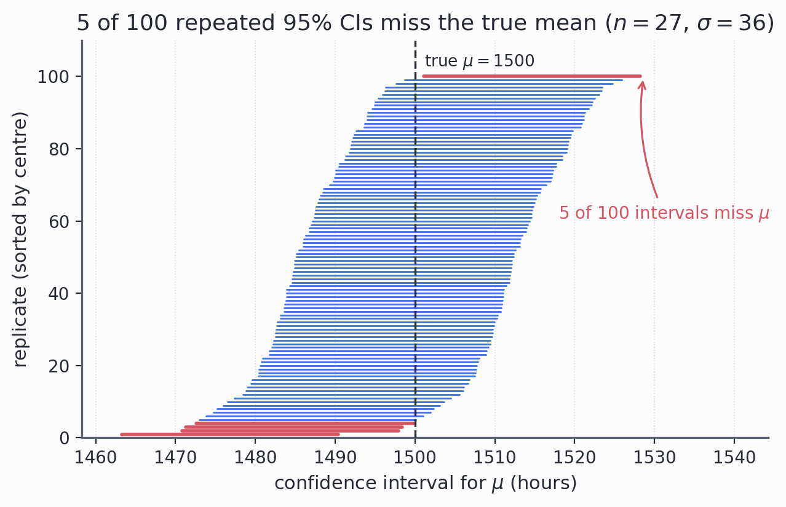
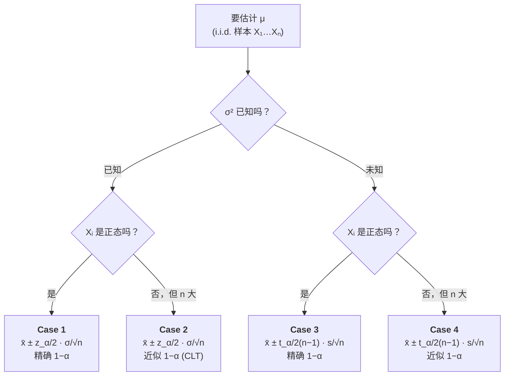
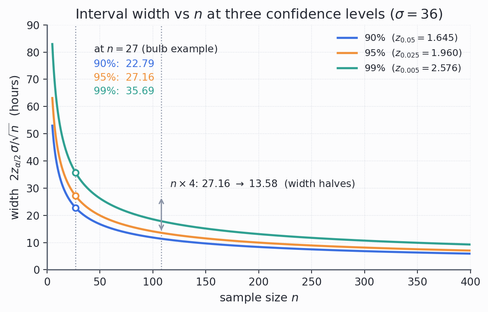
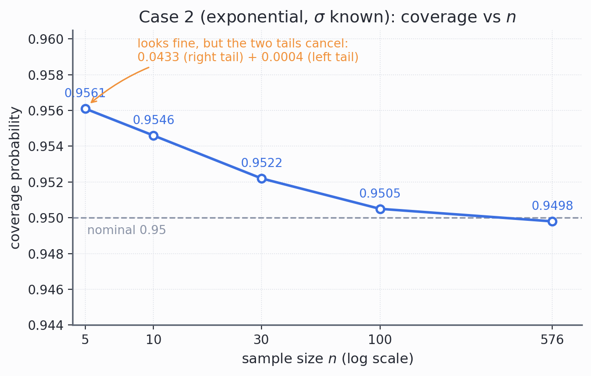
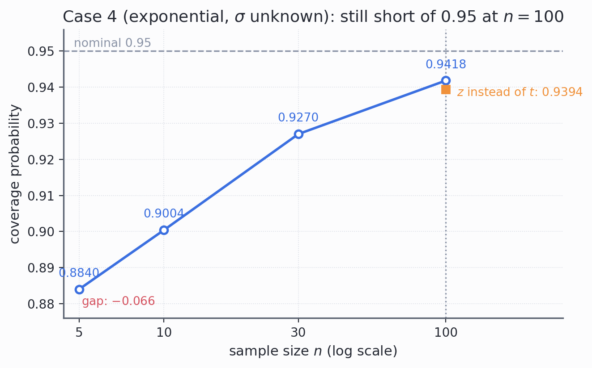

# STA2002 概率与统计 II · 第 4 讲笔记
## Confidence Interval I（置信区间 I）

> 授课：Zhenxing Guo、Ka Wai Tseng（香港中文大学（深圳）数据科学学院，2026 年 9 月）
> 教材：Hogg, Tanis & Zimmerman (2015) *Probability and Statistical Inference*, 9th ed., §7.1
> 材料：讲义 `Lecture4 - Confidence Interval I.pdf`（17 页）+ 课堂板书 9 张（原图在 `img/`，清单见 §13）。笔记不含超出这两份材料的内容；我补充、复算或模拟的部分在文末诚实备注逐条列出。
> **来源标注**：无标记 → 讲义原文或直接展开；**【板书】** → 课堂板书（编号对应 §13）；**【补】** → 讲义板书都没有，由我补充。
> 精简版说明：本版在 2026-09-28 由原 2046 行版压缩重写，技术内容（公式、数值、模拟结果、caveat）全部保留，删减的是重复叙述与元信息；原版存于 `STA2002_Lecture4_笔记_精简前备份.md`。
> 本次重整新增 matplotlib 配图 4 张（见文末配图清单），正文只做插入与局部改写，公式、数值、例题与板书标记未动。

---

## 0. 本讲地图

*这一节回答：本讲与第 2、3 讲的点估计是什么关系，四种情形怎么记，以及这份笔记按什么顺序读。*

第 2、3 讲解决**点估计**：把 $\theta$ 估成**一个数**。本讲换一个交付物：给**一段范围**——**置信区间（confidence interval, CI）**。讲义第 2 页明确限定本讲**只处理均值 $\mu$ 的 CI**（比例的、方差的在后续讲次）。

### 0.1 三遍阅读路线

**三遍阅读路线。** 正文按"定义 → 四格 → 单边 → 总结"排，不建议一次从头读到尾；每一遍只解决一个问题：

| 遍次 | 读哪里 | 读完应该能 |
| --- | --- | --- |
| 第一遍（主线） | §1–§2（动机与定义）→ §3（四格地图）→ §4.1–§4.7（Case 1 与灯泡例）→ §9（总结表） | 说清 $1-\alpha$ 属于随机区间，并把灯泡例代进 $\bar x \pm z_{\alpha/2}\sigma/\sqrt n$ |
| 第二遍（深化） | §5–§7（Case 2–4 与三张模拟表）、§8（单边）、§4.8（等尾最短） | 解释"同公式、精确与近似的区别"，以及"整体覆盖率为什么会骗人" |
| 第三遍（考前） | §10–§13 + 文末诚实备注 | 用速查表做题，并分清哪些是我补的、哪些是讲义原文 |

第一遍刻意跳过 §5.3 与 §6.2 的两段收敛性论证（$\xrightarrow{d}$、$\xrightarrow{P}$ 与 Slutsky）：它们是 Case 3 的技术支撑，不影响套公式，第二遍再回来看。

### 0.2 四格与本讲唯一结构

"正态 / 非正态" × "$\sigma^2$ 已知 / 未知" = **四种情形**，这是本讲唯一结构：

| 情形 | 分布假设 | $\sigma^2$ | 用什么分布 | 讲义页 | 配图 |
| --- | --- | --- | --- | --- | --- |
| **Case 1** | $X_i \sim N(\mu,\sigma^2)$ | 已知 | $N(0,1)$（精确） | 5–7 | 图 2.1、图 4.1 |
| **Case 2** | 任意分布，$n$ 大 | 已知 | CLT → $N(0,1)$（近似） | 8–9 | 图 5.1 |
| **Case 3** | $X_i \sim N(\mu,\sigma^2)$ | 未知 | $t(n-1)$（精确） | 10–12 | — |
| **Case 4** | 任意分布，$n$ 大 | 未知 | 近似 $t(n-1)$ | 13–14 | 图 7.1 |

第 15–16 页加变体**单边 CI**，第 17 页全表总结。

### 0.3 同一个三步套路走四遍

**四格不是四个公式，是同一个三步套路走四遍**：

1. **造枢轴量（pivot）**：把 $\mu$ 包装成 $\dfrac{\hat\mu - \mu}{\text{标准误}}$，使其分布**与 $\mu$ 无关**（Case 1/2 用 $\frac{\bar X - \mu}{\sigma/\sqrt n}$，Case 3/4 用 $\frac{\bar X - \mu}{S/\sqrt n}$）。
2. **写概率**：$\Pr(-c \le \text{pivot} \le c) = 1-\alpha$，$c$ 是分位数。
3. **反解不等式**：得 $\mu \in [\bar X - c\cdot\text{SE},\ \bar X + c\cdot\text{SE}]$。

**第 2、3 讲回答"估多少"，本讲回答"敢说多少"。** 连续分布下 $\Pr(\bar X = \mu) = 0$，点估计的价值从来不在"猜中"；CI 把"离真值多远"**直接写进答案**——一个数加上由 $n$、$\sigma$、$\alpha$ 决定的**误差范围（margin of error）**。所以本讲所有公式长得几乎一样，唯一区别是**那个 $c$ 用谁**：$z_{\alpha/2}$、$t_{\alpha/2}(n-1)$，或单边的 $z_\alpha$。

### 0.4 与第 3 讲、第 5 讲的接口

**与前几讲的三处衔接**（讲义没明说）：

- $t$ 分布能出现，靠第 3 讲的分布事实 $(n-1)S^2/\sigma^2 \sim \chi^2(n-1)$：Case 3 的推导是"标准正态 ÷ 根号（卡方/自由度）"，$\sigma$ 恰好约掉——**这是"$\sigma$ 未知也能做"的全部秘密**（§6.4）。
- 无偏性在这里换身份：第 3 讲问 $E[\hat\theta] \stackrel{?}{=} \theta$，本讲问"随机区间覆盖 $\theta$ 的概率是不是 $1-\alpha$"——都是频率主义的长期行为，**都不能回答"这一次"**。
- MoM/MLE 之争本讲退场：$\bar X$ 给定（正态下既是 MLE 也是 MoM），本讲只给它配误差范围。

**与第 3 讲、第 5 讲的接口**：往回看，第 3 讲交来两件工具——$\bar X$ 的抽样分布与 $(n-1)S^2/\sigma^2\sim\chi^2(n-1)$（连同 $\bar X\perp S^2$），本讲靠它们把 $\sigma$ 从统计量里约掉（§6.4）；往前看，第 5 讲把这里的"一个均值"扩成"两均值之差、配对差、两个比例"，骨架仍是"估计 ± 临界值 × 标准误"，而 §4.8 的"等尾未必最短"在那里升级成"最短置信区间"。

### 0.5 章节与讲义页序对照

**章节与讲义页序对照**：§1 = 第 2 页；§2 = 第 3 页；§3 = 第 4 页；§4–§7 = Case 1–4；§8 = 单边；§9 = 总结；§10–§12 = 速查 / 直觉 / 术语；§13 = 板书原图，其后是诚实备注。

---

## 1. 从点估计到区间估计（讲义第 2 页 + 【板书 01】）

*这一节回答：为什么"平均寿命 1478 小时"这种点估计无法被验证，以及第 3 讲的两条点估计路线在这里怎么交班。*

灯泡例（讲义第 7 页）：$n=27$、$\bar x = 1478$ 小时。回答"平均寿命是 1478"是一个**几乎肯定错、却又没法被判错**的答案：$\bar X$ 以 $\mu$ 为中心、标准差 $\sigma/\sqrt n = 36/\sqrt{27} \approx 6.93$，光抽样波动就有 7 小时量级；而真值 $\mu$ 没人知道。**点估计的困境：它给出的承诺无法被验证。** CI 的做法是把不确定性明码标价：$\mu$ 大概率在 $1478 \pm 13.58$ 内，这个 $\pm 13.58$ 由 $n$、$\sigma$、$\alpha$ 算出。

### 1.1 交接：第 2–3 讲留下的两条路线 【板书 01 · 左栏】

课堂先把上一讲的点估计框架速记重写了一遍（**不是新内容**，是第 3 讲板书的压缩重现；完整讨论见第 3 讲笔记 §2.6、§4.6）：

$$
\begin{aligned}
& X_1,\ldots,X_n \stackrel{iid}{\sim} P(x;\theta), \quad \theta \in \Omega,\ \ \theta \in \mathbb{R}^k \\
& \hat\theta(X_1,\ldots,X_n): \quad \text{MLE}\ (L(\theta)) \ \ / \ \ \text{MoM} \\
& E(X^j) = \alpha_j(\theta_1,\ldots,\theta_k) \ \longrightarrow\ \theta_j = h_j(EX, \ldots, EX^k) \ \longrightarrow\ \hat\theta_j = h_j\!\left(\tfrac1n\sum X_i, \ldots, \tfrac1n\sum X_i^k\right)
\end{aligned}
$$

与第 3 讲板书的差异（速记压缩，含义不变）：① 把 $\hat\alpha_j$ 直接展开成求和式，两行并一行；② 新增 $\theta \in \mathbb{R}^k$ 一行（严格应写 $\Omega \subseteq \mathbb{R}^k$，见符号说明）；③ $EX_1$ 简写成 $EX$；④ **未见 plug-in 规则**（$\tau=g(\theta)\Rightarrow\hat\tau_{MoM}=g(\hat\theta)$），仍以第 3 讲笔记 §4.6 为准。用大写 $P(x;\theta)$ 是**泛指分布**，一个字母省掉 PMF/PDF 分支讨论。

### 1.2 点估计的困境与"换问题" 【板书 01 · 右栏】

板书把动机压成两行符号（**讲义完全没有**，第 3 页直接进定义）：

$$
X_1,\ldots,X_n \stackrel{iid}{\sim} N(\mu, \sigma^2), \quad \hat\mu = \bar X, \quad P\{\mu = \bar X\} = 0, \quad |\bar X - \mu| \ \longrightarrow\ \text{confidence interval.}
$$

- **$P\{\mu = \bar X\} = 0$ 是核心**：$\bar X$ 是连续型随机变量，任何单点概率为 0——"恰好命中"这条路走不通。
- **但不能读成"点估计没用"**：恰好相等从来不是点估计的承诺，$\bar X$ 仍无偏，价值在"平均多接近"。错的是提问方式——"$\bar X$ 离 $\mu$ 有多远"才是对问题。
- **为什么用绝对值**：$\bar X - \mu$ 期望为 0、正负抵消，取绝对值才度量"大小"；且"盖住 $\mu$"本身两侧对称，预告了 $\bar x \pm \cdots$ 的形式。

**桥到讲义第 5 页**【补】：把 $|\bar X - \mu|$ 除以标准误，$\frac{|\bar X - \mu|}{\sigma/\sqrt n} \le z_{\alpha/2} \iff -z_{\alpha/2} \le \frac{\bar X-\mu}{\sigma/\sqrt n} \le z_{\alpha/2}$——右边正是讲义第 5 页推导的第一行。**板书给"要度量什么"，讲义给"怎么算概率"。**

> [!NOTE]
> 记号省略：$P\{\mu=\bar X\}=0$ 严格应写 $P_\mu\{\bar X = \mu\} = 0$（下标指明概率对 $\bar X$ 的分布算）。板书省略了下标；讲义第 3 页写 $P_\theta[\cdot]$，更能防"把 $\mu$ 当随机变量"的误读（§2.3）。

---

## 2. 置信区间的定义（讲义第 3 页 + 【板书 01】）

*这一节回答：一个区间要满足什么条件才配叫 $1-\alpha$ 置信区间，以及为什么"95%"描述的是方法而不是某一次结果。*

讲义原文定义：

> **Definition (Confidence Interval).** Let $X_1, \ldots, X_n$ be a sample on $X$ with PDF $f(x;\theta)$, $\theta \in \Omega$. Let $L = L(X_1, \ldots, X_n)$ and $U = U(X_1, \ldots, X_n)$ be two statistics. Given $\alpha \in (0,1)$, $(L, U)$ is a $(1-\alpha)100\%$ CI for $\theta$ if
> $$1-\alpha = P_\theta[\theta \in (L, U)].$$
> $1-\alpha$ is called the **confidence coefficient**.

### 2.1 端点是统计量，不是常数

$L, U$ 是**样本的函数 = 随机变量**。拿到数据前后是两个阶段：

| 阶段 | 讲义用词 | 端点形态 | 概率陈述 |
| --- | --- | --- | --- |
| 数据**之前** | **random interval** | $L, U$ 随机变量 | $P_\theta[\theta \in (L,U)] = 1-\alpha$ **精确成立** |
| 数据**之后** | **computed interval** | $l, u$ 是具体的数 | $\mu$ 要么在要么不在，**无概率可言** |

**$1-\alpha$ 只属于随机区间，不属于算完那个具体区间。**

### 2.2 板书的等价写法 【板书 01 · 右栏】

板书把定义写成不等式链：

$$
P\{L(X_1,\ldots,X_n) \le \theta \le U(X_1,\ldots,X_n)\} = 1-\alpha \ \Rightarrow\ [L, U]\ \text{is a } (1-\alpha)\ \text{CI of } \theta
$$

与讲义的差别（均不影响数学内容）：① **闭区间** $[L,U]$ vs 讲义开区间 $(L,U)$——连续分布下等价（端点概率 0），闭区间与后面所有计算形式统一；② 不带参数下标；③ "**be two statistics**" 把"端点是随机变量"钉死（statistics 这个词本身就意味着样本的函数）；④ 省略 $\alpha \in (0,1)$（不能真省：$\alpha \to 0$ 区间扩成整条实轴，$\alpha \to 1$ 缩成一点）。**更正记录**：初稿把"开/闭并存"读成讲义前后矛盾；板书定义行就用闭区间，故定性改为**惯例差异**（讲义沿用教科书严谨写法，讲授与计算一律用闭）。

### 2.3 随机的是区间，不是 $\theta$ 【板书 03】

本讲最容易说错的一句话。设灯泡 95% CI 为 $[1464.42, 1491.58]$：

- ❌ "$\mu$ 有 95% 的概率落在 $[1464.42, 1491.58]$ 里。"
- ✅ "重复实验很多次，约 95% 的区间会盖住 $\mu$。"

频率派框架里 $\mu$ 是**固定未知常数**，没有分布，只有真假。**95% 是关于"构造方法"的性能评级，不是对"这一次结果"的判定**——这正是 CI 与贝叶斯可信区间（credible interval）的区别。

板书 Remarks 1 把这件事画了出来："$(1-\alpha)$ CI $[L(X_1,\ldots,X_n), U(X_1,\ldots,X_n)]$ **is random**"，配重复抽样记号 $(X_1^{(j)},\ldots,X_n^{(j)}) \Rightarrow [L^{(j)}, U^{(j)}]$（上标 $(j)$ = 第几批样本）和示意图：**$\theta$ 只有一根垂线，区间有很多条**——看一眼就明白谁在动、谁不动。（示意图线段条数太少，我不据它数覆盖率；$1-\alpha$ 的准确含义以定义式为准。）

*图 2.1　把 §4.7 的灯泡实验重复 100 次的 95% 置信区间（Case 1：正态、$\sigma=36$、$n=27$，真值取 $\mu=1500$）：蓝线盖住真值，红线没盖住，100 条里 5 条失手；长期频率约 95%，单次区间要么覆盖要么不覆盖（我绘制，讲义没有这张图；真值 1500 是为画图设定的，讲义未给真值）*

图 2.1 是板书 03 那张草图的定量版：**真值只有一根竖线，区间有 100 条，动的是区间**。长期频率约 95%，落到单次，"盖住"或"没盖住"只有两种结局，没有"95% 盖住"这种中间状态。图里 5 条红线 4 条在下方、1 条在上方——**正态数据下失手方向本来就可左可右**，这也解释了 §5.5 为什么要拆两尾看。

### 2.4 $P_\theta$ 的下标与 $\alpha$ 的两个身份

- $P_\theta[\cdot]$ 的下标 = "在真实参数为 $\theta$ 时计算"。定义要求**对每个 $\theta$ 都等于 $1-\alpha$**——这叫**一致覆盖（uniform coverage）**：不管真值是 5 还是 5000，这套构造都有同样的覆盖率。（对照：无偏性 $E[\hat\theta]=\theta$ 也是对每个 $\theta$ 成立，一致无偏估计是良好 CI 的基础。）
- $\alpha$ 的双重身份：既是 $1-\alpha$ 里的水平参数，又出现在分位数**下标**里（$z_{\alpha/2}$、$z_\alpha$）。**双边用 $\alpha/2$、单边用 $\alpha$**，这是本讲最容易写错公式的地方（§8.5）。
- 常见取值：$1-\alpha = 0.90/0.95/0.99 \iff \alpha = 0.10/0.05/0.01$；$\alpha$ 也叫漏掉的概率（miss probability）。

---

## 3. 四种情形的地图（讲义第 4 页）

*这一节回答：正态/非正态、$\sigma^2$ 已知/未知这两个开关，怎样把均值 CI 分成四格，四格里为什么只有两个公式。*

四条共同前提：**i.i.d. + 有限均值**。两个开关：

- **正态 / 非正态**：决定 $\bar X$ 的分布是否**精确已知**。正态时 $\bar X \sim N(\mu, \sigma^2/n)$ 精确成立；非正态只能靠 **CLT** 近似。
- **$\sigma^2$ 已知 / 未知**：决定标准误 $\sigma/\sqrt n$ **能不能算出数**。$\sigma$ 未知时 Case 1 公式只是个符号——这不是"准不准"，是"能不能动手"（Case 3 的动机）。

**最该注意：Case 1 = Case 2 的公式，Case 3 = Case 4 的公式。四格只有两个公式**，区别不在形式，而在那个 $1-\alpha$ 是**精确还是近似**（§5.6、§7.1）。

---

## 4. Case 1：正态、$\sigma^2$ 已知（讲义第 5–7 页 + 【板书 02、04、05】）

*这一节回答：$\sigma^2$ 已知且正态时，区间从哪个枢轴量推出来、宽度由什么决定，以及"1.96"这个数从哪来。*

### 4.1 枢轴量：整套方法的引擎 【板书 02 · 上半】

由正态性质，$\bar X \sim N(\mu, \sigma^2/n)$（方差缩 $n$ 倍 = "多测更准"的数学表达，也是所有公式里 $\sqrt n$ 的来源）。标准化：

$$
Z = \frac{\bar X - \mu}{\sigma/\sqrt n} \sim N(0,1).
$$

**这个 $Z$ 就是枢轴量**：分布完全已知、不依赖未知参数（$\mu$ 在分子、$\sigma$ 在分母抵消）。因为 $Z$ 的分布与 $\mu$ 无关，才能在不知道 $\mu$ 时讨论它的概率。

> [!NOTE]
> "枢轴量（pivot）"这个提法**来自板书，讲义全篇没有出现 "pivot" 一词**——讲义只给具体推导，课堂先讲一般框架再落到 Case 1。

板书的一般框架：

$$
\hat T = h(X_1,\ldots,X_n;\theta), \qquad h \sim P, \qquad P\left\{\varrho_{1-\frac{\alpha}{2}} \le h \le \varrho_{\frac{\alpha}{2}}\right\} = 1-\alpha,
$$

配钟形草图：左尾标 $\varrho_{1-\alpha/2}$、右尾标 $\varrho_{\alpha/2}$，文字标注 "**upper $\frac{\alpha}{2}$ quantile**"。三行的含义：① $\hat T$ **同时含数据与参数，不是估计量**；② 关键在它的分布 $P$ 完全已知、与 $\theta$ 无关；③ 用两个分位数把中间的 $1-\alpha$ 夹出来。**这个框架解释了四格为什么长得一样：一个方法，四次套用。**

**记号 $\varrho$**（板书引入，讲义没有）：规则与 $z$、$t$ 完全相同——

$$
\Pr(X > \varrho_p) = p \qquad\Longleftrightarrow\qquad \varrho_p = \text{"上尾概率为 } p\text{" 的分位数}.
$$

**下标 = 上尾概率；下标越大、位置越靠左**（$z_{0.05}=1.645$ 在 $z_{0.025}=1.96$ 左边 ✓）。这行 "upper quantile" 文字也确认了"下标 = 上尾概率"是课堂明确讲过的约定（§6.9）。

### 4.2 从枢轴量到区间：三步推导（讲义第 5 页）【板书 02 · 下半】

$$
\Pr\!\left(-z_{\alpha/2} \le \frac{\bar X - \mu}{\sigma/\sqrt n} \le z_{\alpha/2}\right) = 1-\alpha
\ \Longrightarrow\
\Pr\!\left(\bar X - z_{\alpha/2}\frac{\sigma}{\sqrt n} \le \mu \le \bar X + z_{\alpha/2}\frac{\sigma}{\sqrt n}\right) = 1-\alpha .
$$

第一行靠对称性：中间留 $1-\alpha$，两尾各 $\alpha/2$，其中 $z_{\alpha/2}$ 的定义（讲义同页给出）是**上尾分位数** $\Pr(Z > z_{\alpha/2}) = \alpha/2$。**本讲所有 $z$、$t$ 下标都按"上尾剩余概率"读。**

| 记号 | 数值 | 用途 |
| --- | --- | --- |
| $z_{0.05} = 1.6449$ | 90% 双边 / **95% 单边** | |
| $z_{0.025} = 1.9600$ | 95% 双边 | |
| $z_{0.005} = 2.5758$ | 99% 双边 | |
| $z_{0.0025} = 2.8070$ | 99.5% 双边 | |

（数值已用自写分位数函数复算，与 R `qnorm` 逐位一致。）

反解逐字走一遍（**正负号陷阱**）：三边同乘 $\sigma/\sqrt n$（正数，不变号）→ 三边同乘 $-1$（**负数，不等号翻转**）→ 三边加 $\bar X$：

$$
-z_{\alpha/2} \le \frac{\bar X - \mu}{\sigma/\sqrt n} \le z_{\alpha/2}
\ \xrightarrow{\times\,\sigma/\sqrt n}\
-z_{\alpha/2}\frac{\sigma}{\sqrt n} \le \bar X - \mu \le z_{\alpha/2}\frac{\sigma}{\sqrt n}
\ \xrightarrow{\times(-1),\ +\bar X}\
\bar X - z_{\alpha/2}\frac{\sigma}{\sqrt n} \le \mu \le \bar X + z_{\alpha/2}\frac{\sigma}{\sqrt n}.
$$

**"乘 $-1$ 翻方向"正是区间以 $\bar X$ 为中心的来源。**

板书把同一段推导写得更细，**多出两步**：① 把中心化单独写出 $\bar X - \mu \sim N(0, \sigma^2/n)$（减掉 $\mu$ 后分布里就没有 $\mu$ 了——**中心化就是实现"分布与 $\theta$ 无关"的动作**）；② 把两端分别解出（left: $\mu \le \bar X + z_{\alpha/2}\frac{\sigma}{\sqrt n}$；right: $\mu \ge \bar X - z_{\alpha/2}\frac{\sigma}{\sqrt n}$），再合并成 $[\bar X \pm z_{\alpha/2}\frac{\sigma}{\sqrt n}]$——"为什么是对称形式"变成显然的。草图还演示了 $z_{1-\alpha/2} = -z_{\alpha/2}$（上尾 $1-\alpha/2$ 的分位数落在最左、是负数）。板书的区间写**方括号闭区间**，与板书 01 定义一致。

> [!NOTE]
> 板书草图下写 $\alpha = 0.1, 0.05, 0.025$，**字面有歧义**：读作 $\alpha$ → 置信度 90/95/97.5%；读作 $\alpha/2$ → 置信度 80/90/95%（三个常用水平，且每步减半）。我倾向后者，但按字面转写、两读并列（见符号说明）。

### 4.3 从随机区间到具体区间（讲义第 6 页）

拿到数据后 $\bar X \to \bar x$：

$$
\bar x \pm z_{\alpha/2}\frac{\sigma}{\sqrt n}
\qquad\text{或}\qquad
\left[\bar x - z_{\alpha/2}\frac{\sigma}{\sqrt n},\; \bar x + z_{\alpha/2}\frac{\sigma}{\sqrt n}\right],
$$

即 $\mu$ 的 $100(1-\alpha)\%$ 双边 CI。两点：① 中心 $\bar x$ 就是第 2–3 讲的点估计——**CI 是在点估计外面套一层由数据精度决定的壳**；② 此处发生"身份切换"：$L, U$ 变成具体的数，**概率陈述 $1-\alpha$ 不再适用**（§2.3 的落地位置）。

### 4.4 区间的性质：宽度与三个旋钮（讲义第 6 页）【板书 04 · Remarks 3】

宽度 $W = 2z_{\alpha/2}\sigma/\sqrt n$，三个旋钮：

- **$\sigma$**：总体固有噪声，**改不了**（账面条件）。
- **$n$**：唯一花钱能买的，但有**平方根**——**$n$ 翻 4 倍，宽度减半**（复算：$n=27$ 宽 $27.158$，$n=108$ 宽 $13.579$；半宽压到 5 小时需 $n \ge 200$）。反解公式：半宽 $\le m \Rightarrow n \ge (z_{\alpha/2}\sigma/m)^2$。
- **$\alpha$**：$\alpha$ 大 → $z_{\alpha/2}$ 小 → 区间窄，**但置信度降**（$n=27$：90% 宽 $22.792$、95% 宽 $27.158$、99% 宽 $35.692$）。**"更短"与"更高把握"不能同时要。**

**"更短的区间"本身不是优点**：$[\bar x, \bar x]$ 宽度 0 但覆盖率 0；$(-\infty,\infty)$ 覆盖率 100% 但没用。**CI 的评价必须成对看：宽度 + 覆盖概率**——这是第 5 讲"最优区间"的入口。

板书 Remarks 3 用控制变量写同一公式（fixed $\alpha,\sigma$：$n\uparrow\Rightarrow W\downarrow$；fixed $\sigma,n$：$\alpha\downarrow\Rightarrow W\uparrow$；**fixed $\alpha,n$：$\sigma\uparrow\Rightarrow W\uparrow$——这条讲义没有**）。"fixed …" 前缀值得照搬：宽度的增减必须指明其他量不变才有意义。

*图 4.1　全宽 $W=2z_{\alpha/2}\sigma/\sqrt n$ 随 $n$ 的衰减（$\sigma=36$，取自灯泡例）：三条线对应 90%/95%/99%，$n=27$ 处分别为 22.79、27.16、35.69 小时；$n$ 从 27 增到 108（翻 4 倍），95% 全宽从 27.16 降到 13.58（我绘制，讲义没有这张图；半宽是它的一半）*

图 4.1 把三个旋钮里的两个画在一起：**沿一条曲线往右走是加样本，换一条曲线是改置信水平**。两条路的代价完全不同——$n$ 要翻 4 倍才让宽度减半；置信水平从 95% 抬到 99%，宽度涨 31%（$2.576/1.960$），却一个样本都不用加。图中 $n=27$ 的三个点就是灯泡例（§4.7）在三个水平下的全宽。

### 4.5 估计误差的正式定义 【板书 05 · Remarks 4】

板书把**半宽**正式命名为**估计误差（estimation error）**：

$$
E := |\bar X - \mu| = z_{\frac{\alpha}{2}}\frac{\sigma}{\sqrt n}
$$

$:=$ 是定义不是计算。同一个东西三个名字：**半宽（half-width）= 误差范围（margin of error）= 标准误的 $z_{\alpha/2}$ 倍**。为什么成立：$\bar X - \mu \sim N(0, \sigma^2/n)$，其"正常波动幅度"就是 $z_{\alpha/2}$ 倍标准差。**注意半宽 vs 全宽差一个因子 2**；且此式只对 Case 1 成立（$\sigma$ 未知换 $t_{\alpha/2}(n-1)s/\sqrt n$，非正态再叠 CLT 近似）。

### 4.6 为什么是 1.96

$z_{0.025} = 1.96$：标准正态在 $1.96$ 左边的面积是 $0.975$，$[-1.96, 1.96]$ 罩住 95%，两尾各 2.5%。**区间半宽 = 抽样误差的正常波动范围**：$\bar X$ 偏离 $\mu$ 超过 1.96 个标准误的概率只有 5%。

### 4.7 例题：灯泡寿命（讲义第 7 页）

$X \sim N(\mu, 1296)$，$n = 27$，$\bar x = 1478$，95% CI：

$$
\left[1478 - 1.96\left(\frac{36}{\sqrt{27}}\right),\; 1478 + 1.96\left(\frac{36}{\sqrt{27}}\right)\right] = [1464.42,\ 1491.58].
$$

- **唯一的坑**：$1296$ 是**方差**，公式要标准差 $\sigma = \sqrt{1296} = 36$（把 1296 当 $\sigma$ 会得出负下界，常识可救，考试时未必）。
- **$\alpha$ 换算链**：95% → $\alpha=0.05$ → 双边各 $0.025$ → $z_{0.025}=1.96$；R 验证 `qnorm(0.975)`（**定义用上尾、R 函数用下尾**，写 $1-\alpha/2$）。
- 复算：$1.959964 \times 6.928203 = 13.5790$，区间 $[1464.421, 1491.579]$，**与讲义逐位一致**。
- 怎么读：宽 $27.16$ 小时（$\bar x$ 的 $1.8\%$），做质量宣称够用；但要检测两批灯泡 10 小时的差异则**宽度 > 待检测效应，$n=27$ 不够**——"区间宽度 vs 效应大小"是后续假设检验功效（power）讨论的前身。

### 4.8 延伸：尾部概率等分给出最短区间 【板书 04 · Remarks 2】

**板书中唯一"讲义完全没有、且直接指向下一讲"的内容。** 夹住中间 $1-\alpha$ 时，两侧尾部概率怎么分是自由的：

- 等分（红圈）：$[\varrho_{1-\alpha/2},\ \varrho_{\alpha/2}]$；不等分：$[\varrho_{1-3\alpha/4},\ \varrho_{\alpha/4}]$——总概率都是 $1-\alpha$（$(1-\frac{3\alpha}{4})-\frac{\alpha}{4} = 1-\alpha$ ✓），**都合法，只是长度不同**。
- 板书结论（红箭头）：**等分给出更短的 CI**，并给不等式 $z_{\alpha/4} - z_{1-3\alpha/4} \ > \ z_{\alpha/2} - z_{1-\alpha/2}$。

我的复算（$\alpha=0.10$）：等分长度 $3.2897$ < 不等分 $3.3995$ ✓（$\alpha=0.01\sim0.30$ 均成立）。扫描右尾占比 $f$：长度在 $f=0.5$（等分）处最小，向两侧对称递增（$f=0.1$ 或 $0.9$ 时为 $3.6671$）。

**直觉**：分位数非线性——尾部概率越小，分位数往外跑得越快。把概率挤向一侧时，那一侧分位数被推远的幅度（$1.645 \to 1.960$，$+0.315$）大于另一侧缩回的幅度（$-1.645 \to -1.440$，$-0.205$），净效果是变长。

> [!IMPORTANT]
> **边界条件**：等尾最短只对**单峰对称**分布成立；不对称分布的最短区间通常不是等尾的——这正是**第 5 讲"最短置信区间"**的主题。本讲所有区间默认等尾，而这个默认其实是可以优化的选择。

### 4.9 Case 1 的两个使用前提

- **正态性怎么知道？** 寿命类数据常右偏；小样本下正态性检验力低。正态性在 Case 1 是精确性的来源，$n$ 大时由 CLT 兜底（Case 2）。
- **$\sigma^2$ 已知几乎不成立**：灯泡的 $\sigma=36$ 只能来自历史数据。**这正是 Case 3 的现实理由**——通常只能用样本自己估 $\sigma$，代价是换更胖的 $t$ 分布。

---

## 5. Case 2：非正态、$\sigma^2$ 已知（讲义第 8–9 页 + 【板书 06、09】）

*这一节回答：放掉正态假设、只靠 CLT 时，公式为什么一个字都不用改，而"95%"的含义改了什么。*

### 5.1 放松正态假设：把 CLT 插进来（讲义第 8 页）

> $X_1,\ldots,X_n$ i.i.d. with mean $\mu$ and variance $\sigma^2$ (known). **We release the normal distribution assumption.** By CLT, for large $n$: $\dfrac{\bar X - \mu}{\sigma/\sqrt n} \stackrel{approx}{\sim} N(0,1)$.

唯一变化：精确的 $N(\mu,\sigma^2/n)$ 变成近似标准正态。CLT 不关心 $X_i$ 原分布（只要方差有限），所以枢轴量构造与 Case 1 **逐字相同**，区间也是同一个 $\bar x \pm z_{\alpha/2}\frac{\sigma}{\sqrt n}$，只是 $\sim$ 变成 $\stackrel{approx}{\sim}$、$=$ 变成 $\approx$。

### 5.2 板书的写法：$\xrightarrow{d}$ 与 "asymptotic" 【板书 06 · 下板】

板书把 CLT 写成**极限命题**（与讲义"for large $n$"的经验说法严谨程度不同）：

$$
\text{By CLT}\quad \frac{\sqrt n(\bar X-\mu)}{\sigma} \xrightarrow{\ d\ } N(0,1) \quad \text{as } n \to +\infty,
\qquad
P\left\{-z_{\frac{\alpha}{2}} \le \frac{\sqrt n(\bar X-\mu)}{\sigma} \le z_{\frac{\alpha}{2}}\right\} \approx (1-\alpha)
$$

$$
\Rightarrow\ \text{one \textbf{asymptotic} two-sided } (1-\alpha)\text{ CI of } \mu\text{ is } \left[\bar X \pm z_{\frac{\alpha}{2}}\dfrac{\sigma}{\sqrt n}\right].
$$

三点：① $\xrightarrow{d}$ = 依分布收敛（定义见 §5.3），是定理；$\stackrel{approx}{\sim}$ 只是"近似服从"；② **"asymptotic（渐近）"比 "approximate（近似）"更诚实**：它明说 $1-\alpha$ 是 $n \to \infty$ 的极限值，不承诺任何具体 $n$ 的覆盖率（§7.2 的模拟：指数分布 $n=100$ 实际只有 $0.9418$）；③ 板书显式写 $\mathrm{Var}(X_1) < +\infty$（CLT 的必需条件），并把 pivot 框架与 Case 2 写在同一块板上——"一个方法加四次套用"的版面示范。"**one**" 被红笔圈出：CI 不唯一（§4.8）。

### 5.3 两种收敛：$\xrightarrow{d}$ 与 $\xrightarrow{P}$ 的定义 【板书 09】

讲义全篇**没有定义这两个记号**却直接使用（第 8、10、13 页），板书 09 并排补上：

$$
\text{依分布收敛：}\ X_n \xrightarrow{d} X \iff \lim_{n\to\infty} F_n(x) = F(x)\ \ \text{for any continuity point of } X
\ \Big(\text{即 } P\{X_n \le x\} \to P\{X \le x\}\Big)
$$

$$
\text{依概率收敛：}\ X_n \xrightarrow{P} X \iff \forall \varepsilon > 0,\ \lim_{n\to\infty} P\left\{|X_n - X| > \varepsilon\right\} = 0
$$

| | $\xrightarrow{d}$ | $\xrightarrow{P}$ |
| --- | --- | --- |
| 比较对象 | 两个**分布函数** $F_n$ 与 $F$ | 两个**随机变量**（须同概率空间，**配对**） |
| 判据 | $F_n(x)\to F(x)$，只需 $F$ 的**连续点** | $P\{\lvert X_n-X\rvert>\varepsilon\}\to 0$，对每个 $\varepsilon>0$ |
| 强弱 | 弱 | 强：$\xrightarrow{P} \Rightarrow \xrightarrow{d}$，反之不然 |

**左栏例子（$\xrightarrow{d}$ 里没有"靠近"）**：$X \sim N(0,1)$、$X_n = -X$。分布仍是 $N(0,1)$ → $X_n \xrightarrow{d} X$；但 $|X_n - X| = 2|X|$ 不随 $n$ 变，$P\{|X_n-X|>1\} = 2[1-\Phi(0.5)] = 0.6171 \not\to 0$ → **不依概率收敛**。

**右栏例子（配对是定义的一部分）**：$Z \sim N(0,1)$、$X = Z$、$X_n = Z + \frac1n$（**同一个 $Z$**）→ $|X_n - X| = \frac1n$ 是确定性的 → 依概率收敛。

> [!IMPORTANT]
> **忘了配对，同一例子结论相反**：若 $X_n = Z' + \frac1n$ 用独立的 $Z' \perp Z$，则 $X_n - X \sim N(1/n, 2)$，$P\{|X_n-X|>0.5\} \approx 0.72$ 永远不趋于 0。**边缘分布一样 ≠ 靠近；不一样 ≠ 不靠近**——依概率收敛只取决于**联合分布**。

**蒙特卡洛检验法**（板书右栏）：生成 $M$ 组**配对**样本 $(X_n^{(i)}, X^{(i)})$，算 $D_n^{(i)} = |X_n^{(i)} - X^{(i)}|$，看指示函数平均 $\frac{1}{M}\sum \mathbf{1}\{D_n^{(i)} > \varepsilon\}$——由大数定律它收敛到 $P\{|X_n-X|>\varepsilon\}$；固定 $n$ 加大 $M$ 得稳定值，再加大 $n$ 应趋于 0。

**我的复算**（$B=200{,}000$）：左栏例子 $\varepsilon=1$ 实测 $0.6182$（理论 $0.6171$），**四个 $n$ 给出完全相同的数**——"不收敛"表现为纹丝不动；右栏配对 $n=1,5,100$ 为 $1.0000, 0.0000, 0.0000$ ✓；不配对约 $0.72$ 不随 $n$ 变 ✓。

**（补）两个附加点**：① "连续点"条件必需：$X_n \equiv \frac1n$、$X \equiv 0$ 时 $F_n(0)=0 \not\to F(0)=1$，坏点恰在 $F$ 唯一的不连续处；② 关系：$\xrightarrow{P} \Rightarrow \xrightarrow{d}$（一行证明：$F_n(x) \le F(x+\varepsilon) + P\{|X_n-X|>\varepsilon\}$ 及反向，再令 $\varepsilon \to 0$）；$\xrightarrow{d} \not\Rightarrow \xrightarrow{P}$（左栏反例）；**但极限是常数时反向成立**：$X_n \xrightarrow{d} c \Rightarrow X_n \xrightarrow{P} c$。

**本讲哪里用**：§5.2 的 CLT 用 $\xrightarrow{d}$；§6.2 的 Slutsky 用 $\xrightarrow{P}$（$S^2 \to \sigma^2$）；两者拼出 $\hat T \xrightarrow{d} N(0,1)$。

### 5.4 例题：橙汁消费量（讲义第 9 页）

$\sigma = 96$（已知），$n = 576$，$\bar x = 133$，近似 90% CI：

$$
133 \pm 1.645\left(\frac{96}{\sqrt{576}}\right) = 133 \pm 1.644854 \times 4 = [126.42,\ 139.58] \quad(\text{复算一致}).
$$

注意 $\alpha$ 换了：90% → $z_{0.05} = 1.645$（不是 1.96）——**换置信度就换临界值，考试最易串行**。这个例子本身在演示"没有正态假设也能干活"（每日橙汁消费量显然右偏，不正态）。

### 5.5 "$n$ 足够大"到底多大：我的模拟 【补】

指数分布（偏度 2）、名义 95%、$B = 400{,}000$：

| $n$ | 5 | 10 | 30 | 100 | 576 |
| --- | --- | --- | --- | --- | --- |
| 模拟覆盖概率 | 0.9561 | 0.9546 | 0.9522 | 0.9505 | 0.9498 |

> [!WARNING]
> **"$n=5$ 覆盖 0.9561"是个陷阱**：覆盖概率把两尾误差加在一起，$n$ 小时两尾误差**方向相反、互相抵消**。拆开看误差立刻现形（§7.5）。

*图 5.1　Case 2 的覆盖率随 $n$ 变化（指数分布、$\sigma$ 已知、名义 95%、$B=400{,}000$，数值取自 §5.5 的表）：横轴对数刻度，纵轴只截取 0.944–0.960 以看清差异；$n=5$ 的 0.9561 高于名义值，是两尾误差 0.0433 与 0.0004 相互抵消的结果——单尾看，0.0433 已是名义 0.025 的 1.7 倍（我绘制，讲义没有这张图）*

图 5.1 的横轴是对数刻度：$n$ 从 5 涨到 576（一百多倍），覆盖率只从 0.9561 挪到 0.9498（半个百分点）。**这条几乎水平的线正是"asymptotic"的含义**——极限是对的，但收敛很慢；曲线从上方贴回 0.95，$n$ 小时"超额覆盖"的那部分，就是两尾误差相抵的余额（§7.5）。

### 5.6 为什么 Case 1 与 Case 2 同公式、含义不同

| 分布假设 | 枢轴量分布 | 95% 区间 |
| --- | --- | --- |
| $N(\mu,\sigma^2)$，$\sigma^2$ 已知 | $\sim N(0,1)$ | $\bar x \pm z_{\alpha/2}\frac{\sigma}{\sqrt n}$ |
| 任意分布，$n$ 大，$\sigma^2$ 已知 | $\stackrel{approx}{\sim} N(0,1)$ | $\bar x \pm z_{\alpha/2}\frac{\sigma}{\sqrt n}$ |

右列一模一样，差别全在 $\sim$ vs $\stackrel{approx}{\sim}$：Case 1 的 $1-\alpha$ **精确**（模拟：$n=27$ 覆盖 0.9502、$n=5$ 覆盖 0.9498）；Case 2 的是**名义**值，实际覆盖取决于 $n$ 与分布形状。**Case 2/4 的写法必须带 "approximate"**——抄公式时丢掉这个词，就掉进"同公式、两种含义"的陷阱。

---

## 6. Case 3：正态、$\sigma^2$ 未知（讲义第 10–12 页 + 【板书 07、08】）

*这一节回答：$\sigma$ 未知时为什么不能直接套 Case 1，换成 $S$ 之后凭什么还能得到精确的 $t(n-1)$。*

### 6.1 麻烦在哪（讲义第 10 页）

> As $\sigma$ is unknown, we cannot use the CI in Case 1 since the interval $\bar x \pm z_{\alpha/2}\left(\frac{\sigma}{\sqrt n}\right)$ **depends on $\sigma$**.

这是硬障碍：**公式算不出数**。Case 3 必须重新造一个不含 $\sigma$ 的枢轴量。

### 6.2 换成 $S$ 之后为什么还能用：渐近论证 【板书 07 · Slutsky】

讲义只说"不能用"，**没回答"换成 $S$ 凭什么还能用"**——板书补上（整讲的技术顶点）：

$$
\hat T := \frac{\sqrt n(\bar X-\mu)}{S} = \underbrace{\frac{\sqrt n(\bar X-\mu)}{\sigma}}_{\xrightarrow{d}\ N(0,1)\ (\text{CLT})}\cdot\underbrace{\left(\frac{\sigma}{S}\right)}_{\xrightarrow{P}\ 1}\ \xrightarrow{\ d\ }\ N(0,1) \qquad(\text{Slutsky 定理})
$$

**第一步**（恒等拆分，论证枢纽）：$\frac{\sigma}{S}$ 被红笔圈出——它是唯一新引进的东西，成败全压在"它收敛到 1"。

**第二步**（证 $S^2 \xrightarrow{P} \sigma^2$，用第 3 讲的代数恒等式 + 大数定律）：

$$
\frac{n-1}{n}S^2 = \frac{1}{n}\sum(X_i-\bar X)^2 = \underbrace{\frac{1}{n}\sum(X_i-\mu)^2}_{\xrightarrow{P}\ \sigma^2\ (\text{LLN})} - \underbrace{(\bar X-\mu)^2}_{\xrightarrow{P}\ 0} \xrightarrow{\ P\ } \sigma^2,
\qquad
S^2 = \frac{n}{n-1}\cdot\frac{n-1}{n}S^2 \xrightarrow{\ P\ } \sigma^2 .
$$

**第三步**：Slutsky 定理（依分布收敛 × 依概率收敛到常数 → 依分布收敛），$\hat T \xrightarrow{d} N(0,1)$。**结论：$\sigma$ 未知不破坏渐近正态性。**

> [!IMPORTANT]
> 这与讲义第 13 页的 $t(n-1)$ **不矛盾**，是同一问题的两个层次：有限 $n$ + 正态 → 精确 $t(n-1)$；$n \to \infty$（任意分布）→ 渐近 $N(0,1)$。$t(n-1)$ 在 $n \to \infty$ 时趋于 $N(0,1)$，**两条路在极限处会合**——"用 $t$ 还是 $z$"在 $n$ 大时根本不是问题（§6.4 的模拟定量确认）。

### 6.3 替代方案：把 $\sigma$ 换成 $S$（讲义第 10 页）

$$
S^2 = \frac{1}{n-1}\sum_{i=1}^{n}(X_i-\bar X)^2,
\qquad
\frac{\bar X - \mu}{S/\sqrt n} \sim t(n-1) \quad(\text{讲义直接给出，未证明}).
$$

两件事：① 分母 $\sigma \to S$，"用数据自己估自己的精度"；② 分布尾巴变粗——$S$ 自己也在波动，$t$ 比正态胖，**这是额外不确定性的代价**（§6.8 量化）。

### 6.4 $t$ 分布是什么、$\sigma$ 为什么恰好被约掉 【板书 08】

板书给出构造式（第 8 张，一整列三行）：

$$
\frac{\dfrac{\sqrt n(\bar X-\mu)}{\sigma}}{\sqrt{\dfrac{(n-1)S^2}{\sigma^2}\Big/(n-1)}}\ \xrightarrow{\ d\ }\ t(n-1)
$$

**（a）$t$ 分布的定义【补】**：$Z \sim N(0,1)$、$V \sim \chi^2(\nu)$、$Z \perp V$，则 $T = \frac{Z}{\sqrt{V/\nu}} \sim t(\nu)$。$V/\nu$ 平均为 1，但 $V$ 偶尔 $<\nu$ 时 $\sqrt{V/\nu}<1$、$T$ 被放大——**这是尾巴变厚的机制**。

**（b）为什么本讲的统计量恰好是这个形式**：拼三个事实——$Z = \frac{\bar X - \mu}{\sigma/\sqrt n} \sim N(0,1)$；$\frac{(n-1)S^2}{\sigma^2} \sim \chi^2(n-1)$（第 3 讲的分布事实）；$\bar X \perp S^2$（**正态专属性质【补】**）：

$$
\frac{\bar X - \mu}{S/\sqrt n}
= \frac{\dfrac{\bar X - \mu}{\sigma/\sqrt n}}{\sqrt{\dfrac{(n-1)S^2/\sigma^2}{n-1}}}
= \frac{Z}{\sqrt{V/(n-1)}} \sim t(n-1).
$$

**最关键一步：分子分母的 $\sigma$ 互相约掉——$\sigma$ 不是被估出来的，是被消掉的。** 代价是分母那个随机量把尾巴撑胖。

> [!NOTE]
> $\bar X \perp S^2$ 只对正态成立（指数分布下就不独立）——这是 Case 3 只能在正态下精确、Case 4 只能近似的根本原因。

**板书三行的编排逻辑**：① 最上是 $[\bar X \pm z_{\alpha/2}\frac{S}{\sqrt n}]$（要用的公式，见 §7.3）；② 中间写成分数 → 正态下精确 $t(n-1)$；③ 最下写成乘积 $\frac{\sqrt n(\bar X-\mu)}{\sigma}\cdot\frac{\sigma}{S}$ → CLT + Slutsky 渐近 $N(0,1)$。**②③是同一个量的两种写法**（$\sqrt{\frac{(n-1)S^2}{\sigma^2}/(n-1)} = \frac{S}{\sigma}$）：写成分数得精确 $t$，写成乘积得渐近正态——这就回答了 Case 4 的实际问题"临界值用 $z$ 还是 $t$"：**两个都对，看你要精确还是渐近。**

> [!WARNING]
> 板书第 2 行箭头写 $\xrightarrow{d} t(n-1)$，字面是"收敛到 $t$"，但正态下这是**恒等**（每个 $n$ 精确服从 $t(n-1)$），规范写法应为 $\sim t(n-1)$；且按"收敛"读在非正态下是错的（极限是 $N(0,1)$ 不是 $t$）。按"服从"读完全正确，抄笔记建议写 $\sim$。

**数值验证【补】**（$B=400{,}000$，统计量 $\frac{\sqrt n(\bar X-\mu)}{S}$ 的实测 2.5%/97.5% 分位）：

| 数据分布 | $n$ | 实测 | $t(n-1)$ 理论 | $N(0,1)$ 理论 | 结论 |
| --- | --- | --- | --- | --- | --- |
| 正态 | 5 | $\mp 2.773/2.774$ | $\pm 2.7764$ | $\pm 1.96$ | **与 $t(4)$ 吻合**（CDF 逐点最大偏差 0.0004） |
| 正态 | 30 | $-2.035/2.052$ | $\pm 2.0452$ | $\pm 1.96$ | 与 $t(29)$ 吻合 |
| 指数 | 5 | $-6.450/1.708$ | $\pm 2.7764$ | $\pm 1.96$ | 两个都不像，左尾重得离谱 |
| 指数 | 30 | $-2.865/1.665$ | $\pm 2.0452$ | $\pm 1.96$ | 两个都不像 |
| 指数 | 200 | $-2.215/1.804$ | $\pm 1.9720$ | $\pm 1.96$ | 两个都不像，但在向正态靠 |

> [!IMPORTANT]
> **分布不正态时，"用 $t$ 还是 $z$"不是主要矛盾**：$n=200$ 时两个理论值只差 $0.6\%$，实测值却差它们 $0.24$——真正的误差来自 CLT 还没收敛。量化：指数、$n=100$、名义 95%，用 $t(99)$ 覆盖 $0.9421$、用 $z$ 是 $0.9394$——换临界值只值 $0.0027$，离 $0.95$ 缺的 $0.008$ 大部分是 CLT 自己的账（§7.2 的表与图 7.1 把这条差距随 $n$ 的变化画了出来）。

### 6.5 自由度为什么是 $n-1$ 【补】

$\sum(X_i - \bar X)^2$ 里 $n$ 个离差**不自由**：它们满足线性约束 $\sum(X_i - \bar X) = n\bar X - n\bar X = 0$——知道任意 $n-1$ 个，最后一个被迫确定。**每用掉一个约束少一个自由度**，故 $\chi^2(n-1)$，传递到 $t(n-1)$。记忆法：自由度 = 观测数 − 已用样本估掉的参数数（这里用 $\bar X$ 估了 $\mu$）。第 3 讲 $S^2$ 分母用 $n-1$ 同理。

### 6.6 推导（讲义第 11 页）

与 Case 1 逐字平行（同乘分母、同乘 $-1$ 翻号、同加 $\bar X$），只把 $\sigma \to S$、$z \to t$（$t$ 也关于 0 对称）：

$$
\Pr\!\left(-t_{\alpha/2}(n-1) \le \frac{\bar X - \mu}{S/\sqrt n} \le t_{\alpha/2}(n-1)\right) = 1-\alpha
\ \Longrightarrow\
\left[\bar x - \frac{s\cdot t_{\alpha/2}(n-1)}{\sqrt n},\; \bar x + \frac{s\cdot t_{\alpha/2}(n-1)}{\sqrt n}\right]
$$

（讲义注明 "$s$ represents the realized value of $S$"——又一次随机量变具体数。）

### 6.7 例题（讲义第 12 页）

$X \sim N(\mu,\sigma^2)$ 均未知，$n = 20$，$\bar x = 507.50$，$s = 89.75$，90% CI：

$$
507.50 \pm 1.729\left(\frac{89.75}{\sqrt{20}}\right) = [472.80,\ 542.20]
\qquad(\text{复算：}1.729133 \times 20.06868 = 34.7015,\ [472.798, 542.202]\ \checkmark)
$$

换算链：90% → $\alpha/2 = 0.05$ → $t_{0.05}(19)$（**自由度 $n-1=19$，双边下标 $\alpha/2$**）；R 验证 `qt(0.975, 19)`。与灯泡例对照：本题 $n$ 更小、离散度大 2.5 倍，区间宽 $69.4$（$\bar x$ 的 $13.7\%$）——**CI 宽度就是数据质量的体检报告。**

### 6.8 $t$ 与 $z$ 差多少：复算表 【补】

95% 水平，$t_{\alpha/2}(n-1)$ 相对 $z_{\alpha/2}$ 的放大倍数 = "用 $s$ 顶替 $\sigma$ 的代价"：

| $n$ | 3 | 5 | 10 | 20 | 30 | 50 | 100 | 500 |
| --- | --- | --- | --- | --- | --- | --- | --- | --- |
| $t_{0.025}(n-1)$ | 4.3027 | 2.7764 | 2.2622 | 2.0930 | 2.0452 | 2.0096 | 1.9842 | 1.9647 |
| 放大倍数 | **2.1953** | 1.4166 | 1.1542 | 1.0679 | 1.0435 | 1.0253 | 1.0124 | 1.0024 |

① $n$ 小代价极大（$n=3$ 区间宽一倍多）；② 下降快但尾巴长（$n=30$ 还差 4.35%，上百后才可忽略）；③ $t$ 恒 $> z$——**"不知道"的代价，也是这个方法的诚实之处。**

### 6.9 分位数记号约定 【板书 02 确认】

讲义对 $z_{\alpha/2}$ 给了定义，**对 $t_\alpha(n-1)$ 从头到尾没给形式定义**，只有 R 代码 `qt(0.975, 19)`。按"上尾分位数"读（$\Pr(T > t_\alpha(n-1)) = \alpha$）是唯一让 $t_{0.05}(19) = 1.729$ 与 `qt` 一致的读法（已复算）。**板书 02 的 "upper $\frac{\alpha}{2}$ quantile" 文字确认这条约定课堂明确讲过**；只是板书只演示了 $\varrho$ 与 $z$，"$t$ 同规则"仍是反推+外推（有旁证，可信度高）。

---

## 7. Case 4：非正态、$\sigma^2$ 未知（讲义第 13–14 页）

*这一节回答：既不正态、$\sigma$ 又未知时，两层近似叠加要付多大代价，"$n\ge100$"这条经验法则有多可靠。*

### 7.1 两个近似叠在一起（讲义第 13 页）

> If $n$ is large enough (say $n \ge 100$), or if each $X_i$ is approximately normal, then $\dfrac{\bar X - \mu}{S/\sqrt n} \stackrel{approx}{\sim} t(n-1)$.

两层近似：**① $\bar X$ 的正态性**（CLT，$n$ 大时兜住）；**② $S/\sigma$ 的随机性**（Case 3 里靠 $\bar X \perp S^2$ 与卡方性质精确，非正态时这两条都不再严格成立）。区间照抄 Case 3 的 $t$ 版，称 approximate CI。

**技术细节**：严格大样本理论（$S^2 \xrightarrow{P} \sigma^2$ + Slutsky）极限其实是 $N(0,1)$；讲义选 $t(n-1)$ 是**更保守**的做法（临界值大 → 区间宽 → 覆盖偏高而非偏低）。这条论证课堂完整讲过（【板书 07、08】，见 §6.2）；"为什么用 $t$ 更保守"是我的解读【补】。

### 7.2 $n \ge 100$ 这个经验法则可靠吗 【补】

指数分布、$\sigma$ 未知用 $s$、名义 95%、$B=400{,}000$：

| $n$ | 5 | 10 | 30 | **100** |
| --- | --- | --- | --- | --- |
| 模拟覆盖概率 | 0.8840 | 0.9004 | 0.9270 | **0.9418** |

**$n=100$ 实际覆盖 0.9418，比名义低 0.8 个点**——"say $n \ge 100$"在中等偏斜（偏度 2）下只算**勉强够用**；更偏的分布（收入、索赔额）需要更大的 $n$。这张表正是 "**asymptotic** ≠ 有限 $n$" 的量化证据（§5.2）。

*图 7.1　Case 4 的覆盖率随 $n$（指数分布、$\sigma$ 未知用 $s$、名义 95%，数值取自 §7.2 的表）：$n=5$ 只有 0.8840，$n=100$ 到 0.9418 仍差 0.008；橙方块是同一设定下把 $t$ 换成 $z$ 的结果 0.9394（§6.4），比 $t$ 版更低（我绘制，讲义没有这张图；两次模拟独立，$t$ 的两次读数 0.9418 与 0.9421 的差别在模拟误差内）*

图 7.1 把这张表画成曲线：缺口随 $n$ 单调收窄，但 $n=100$ 处仍欠 0.008；把 $t$ 换成 $z$ 只会让它更低（§6.4：0.9394，比 $t$ 版少 0.0027）——**换临界值补不上这个缺口，缺的是 CLT 还没收敛**。小 $n$ 时 $z$ 只会更糟：$n=5$ 的临界值 $1.96$ 对 $2.776$（§6.4），区间窄掉近三成，覆盖只会更低。这正是 §5.2 "asymptotic 比 approximate 更诚实"那句话的图示。

> [!IMPORTANT]
> **Case 2/4 报出的置信水平是名义的，不是实际的**——$n$ 不大时名义 95% 可能打七到九折。

### 7.3 用 $z$ 替代 $t$ 的简化版（讲义第 14 页）

$n$ 大时 $t_{\alpha/2}(n-1) \approx z_{\alpha/2}$，可用 $\left[\bar x \pm z_{\alpha/2}\frac{s}{\sqrt n}\right]$。**注意方向**：$t \ge z$ 恒成立，用 $z$ 会把区间**做窄、置信水平压低**（$n=30$ 差 4.35%，已在"省事"与"失实"之间；$n=100$ 差 1.24%，可接受）。手算好用（只记 1.645 / 1.96 / 2.576）。板书 08 把这个公式摆在整列之首——**先给要用的东西，再用 $t$ 与 Slutsky 两条路背书。**

### 7.4 讲义的警告（第 14 页）

> If $n$ is small or when each $X_i$ does not look like a normal distribution (e.g., very skewed), this method has to be used with caution.

四格里唯一的免责声明，只出现在 Case 4——只有它会**同时**被 "$n$ 不够" 和 "分布太偏" 两个方向攻击（偏斜分布下 $\bar X$ 收敛慢、$S$ 更不稳定）。

### 7.5 把"整体覆盖率"拆成两条尾巴 【补】

本笔记最实质的一处补充。§5.5 里指数分布 $n=5$ 双边整体覆盖 0.9561 看似很好；**拆开尾巴结论完全变了**（Case 2 设定，$B=500{,}000$）：

| $n$ | 区间偏低（漏右侧） | 区间偏高（漏左侧） | 整体覆盖 |
| --- | --- | --- | --- |
| 5 | **0.0433** | 0.0004 | 0.9564 |
| 10 | **0.0395** | 0.0059 | 0.9547 |
| 30 | **0.0337** | 0.0139 | 0.9524 |
| 100 | **0.0303** | 0.0194 | 0.9503 |
| 576 | **0.0272** | 0.0229 | 0.9500 |

名义两尾各应 0.0250。$n=5$ 时一侧是名义值的 **1.7 倍**、另一侧几乎为零——**整体漂亮是误差抵消的产物**。机制：指数右偏 → 小 $n$ 时 $\bar X$ 仍右偏、易低于 $\mu$ → $\mu$ 易掉在区间上方。**实际含义：做单边判断时，偏斜直接伤害你，双边的"覆盖率没问题"帮不上忙**（§8.6 量化）。

---

## 8. 单边置信区间（讲义第 15–16 页 + 【板书 05】）

*这一节回答：只关心一个方向时，区间怎样改、临界值为什么从 $z_{\alpha/2}$ 换成 $z_\alpha$。*

### 8.1 为什么需要单边（讲义第 16 页）

买灯泡的人只关心"平均寿命**至少**多长"——上界毫无价值。双边区间为保证上界把下界推高了，浪费一半信息。**把保险只买在需要的那一侧，那一侧的界就更靠近 $\bar x$。**

### 8.2 推导（讲义第 15 页，Case 1 设定）

$$
\Pr\!\left(\frac{\bar X - \mu}{\sigma/\sqrt n} \le z_\alpha\right) = 1-\alpha
\ \Longrightarrow\
P\!\left(\mu \ge \bar X - z_\alpha\frac{\sigma}{\sqrt n}\right) = 1-\alpha .
$$

**注意用 $z_\alpha$ 不是 $z_{\alpha/2}$**（单边与双边唯一也是最重要的区别，§8.5）。反解是纯代数（也有翻号，且单边**没有对称性这个天然纠错线索，更易错**）。

### 8.3 两个单边区间（讲义第 16 页）

$$
\left[\bar x - z_\alpha\frac{\sigma}{\sqrt n},\; \infty\right)
\qquad\text{和}\qquad
\left(-\infty,\; \bar x + z_\alpha\frac{\sigma}{\sqrt n}\right]
$$

分别是**置信下界 / 上界**。它们**不是"半截区间"**——另一半是无穷，只承诺一个方向。也不是"把双边砍一半"：临界值不同（$z_\alpha$ vs $z_{\alpha/2}$），有限端更靠近 $\bar x$。

### 8.4 单边的一般定义与 pivot 版 【板书 05 · Remarks 5】

讲义只给 Case 1 实例；板书抽象成一般定义：

$$
P\{\theta \le U(X_1,\ldots,X_n)\} = 1-\alpha \quad(\text{上界}),
\qquad
P\{\theta \ge L(X_1,\ldots,X_n)\} = 1-\alpha \quad(\text{下界})
$$

pivot 版：$P\{h \le \varrho_\alpha\} = 1-\alpha$；$P\{h \ge \varrho_{1-\alpha}\} = 1-\alpha$。按"下标 = 上尾概率"验算两式均自洽。**正面证据：双边用 $\varrho_{\alpha/2}$、单边用 $\varrho_\alpha$**——同一个 $\alpha$ 同一个 pivot，下标差一个因子 2（§8.5）。有了这个抽象定义，任何分布的 pivot 都能照套（§8.7 的 $t$ 版单边即由此而来）。

RECALL 块（$X_i \sim N(\mu,\sigma^2)$）给出两条链：$z_\alpha \Rightarrow [\bar X - z_\alpha\frac{\sigma}{\sqrt n}, +\infty)$；$z_{1-\alpha} \Rightarrow (-\infty, \bar X + z_\alpha\frac{\sigma}{\sqrt n}]$（第二条起步用 $z_{1-\alpha}$ 让概率一眼可读，收尾用 $z_{1-\alpha} = -z_\alpha$ 换成正数好算）。

### 8.5 单边用 $z_\alpha$：风险预算花在哪

双边把 $\alpha$ **均分两侧**（两种意外都得防）；单边只防一侧，把**整个 $\alpha$ 压在一侧**：$\Pr(Z > z_\alpha) = \alpha$ 就够。后果：同水平下单边临界值更小——

$$
z_{\alpha/2} = z_{0.025} = 1.9600\ (\text{双边}) \qquad vs \qquad z_\alpha = z_{0.05} = 1.6449\ (\text{单边}).
$$

灯泡题：双边左端 $1464.42$ vs 单边下界 $1466.60$——**单边下界高 2.18 小时**（一般式 $0.3151\cdot\sigma/\sqrt n$），这是"不用管上界"净赚的。

> [!TIP]
> **换算技巧**：单边 95% 与双边 90% 用同一个临界值 $1.645$（都把 0.05 放一侧）。手上只有双边表时，单边 95% 查双边 90%、单边 97.5% 查双边 95%。

### 8.6 单边在 CLT 近似下比双边更脆弱 【补】

单边没有另一端可以抵消，CLT 误差全部暴露（指数分布、名义 95%、$\sigma$ 已知）：

| $n$ | 单边下界覆盖率 | 单边偏差 | 双边覆盖率（对照） |
| --- | --- | --- | --- |
| 5 | 0.9329 | $-0.0171$ | 0.9563 |
| 10 | 0.9363 | $-0.0137$ | 0.9551 |
| 30 | 0.9409 | $-0.0091$ | 0.9521 |
| 100 | 0.9446 | $-0.0054$ | 0.9505 |

$n=10$ 时单边只有 **0.9363**，双边却有 0.9551。**结论【补】**：报双边别用"整体覆盖看着没问题"为小样本背书；报单边时 $n$ 的门槛应比双边更严。

### 8.7 $t$ 版本的单边区间 【补】

讲义的单边只给 $\sigma^2$ 已知。$\sigma$ 未知时同构替换：

$$
\left[\bar x - t_\alpha(n-1)\frac{s}{\sqrt n},\ \infty\right),
\qquad
\left(-\infty,\ \bar x + t_\alpha(n-1)\frac{s}{\sqrt n}\right],
$$

下标 $\alpha$（**不是** $\alpha/2$），自由度 $n-1$：如 $n=20$、90% 单边用 $t_{0.10}(19) = 1.328$（`qt(0.90, 19)`），不是双边的 $t_{0.05}(19) = 1.729$。（$n=20$ 正态模拟覆盖 0.9505 ✓。）

---

## 9. 四格总结（讲义第 17 页）

*这一节回答：四格与单边能不能压成一张表，以及表的哪一列决定"精确还是近似"。*

| Distribution of $X_i$ | 枢轴量分布 | Two-sided $1-\alpha$ CI |
| --- | --- | --- |
| $N(\mu,\sigma^2)$, $\sigma^2$ known | $\frac{\bar X-\mu}{\sigma/\sqrt n} \sim N(0,1)$ | $\bar x \pm z_{\alpha/2}\frac{\sigma}{\sqrt n}$ |
| Any, large $n$, $\sigma^2$ known | $\stackrel{approx}{\sim} N(0,1)$ | $\bar x \pm z_{\alpha/2}\frac{\sigma}{\sqrt n}$ |
| $N(\mu,\sigma^2)$, $\sigma^2$ unknown | $\frac{\bar X-\mu}{S/\sqrt n} \sim t(n-1)$ | $\bar x \pm t_{\alpha/2}(n-1)\frac{s}{\sqrt n}$ |
| Any, large $n$, $\sigma^2$ unknown | $\stackrel{approx}{\sim} t(n-1)$ | $\bar x \pm t_{\alpha/2}(n-1)\frac{s}{\sqrt n}$ |

一句话浓缩：**正态性决定 $\sim$ 是精确还是近似；$\sigma$ 是否已知决定分母 $\sigma$ 还是 $s$、临界值 $z$ 还是 $t$。**

单边补全（第二行讲义未给【补】）：

| 情形 | 单边下界 | 单边上界 |
| --- | --- | --- |
| 正态、$\sigma^2$ 已知 | $[\bar x - z_\alpha\frac{\sigma}{\sqrt n},\ \infty)$ | $(-\infty,\ \bar x + z_\alpha\frac{\sigma}{\sqrt n}]$ |
| 正态、$\sigma^2$ 未知 | $[\bar x - t_\alpha(n-1)\frac{s}{\sqrt n},\ \infty)$ | $(-\infty,\ \bar x + t_\alpha(n-1)\frac{s}{\sqrt n}]$ |

---

## 10. 一页纸速查表

*这一节回答：考前只剩十分钟时，哪些公式、分位数和数字必须记住。*

**主线**：定义（p3）→ 四情形（p4）→ Case 1 精确 $z$（p5–7）→ Case 2 CLT 近似 $z$（p8–9）→ Case 3 精确 $t$（p10–12）→ Case 4 两层近似 $t$（p13–14）→ 单边 $z_\alpha$（p15–16）→ 总结表（p17）。

**记号与分位数**

| 项目 | 内容 |
| --- | --- |
| 下标规则 | $\Pr(Z > z_{\alpha/2}) = \alpha/2$；$\Pr(T > t_\alpha(n-1)) = \alpha$（**上尾分位数**；$t$ 的定义讲义未给、板书确认课堂讲过） |
| R 换算 | `qnorm(1-α/2)`、`qt(1-α/2, n-1)`（定义用上尾、R 用下尾） |
| 常用 $z$ | $z_{0.05}=1.6449$（90% 双 / 95% 单）、$z_{0.025}=1.9600$（95% 双）、$z_{0.005}=2.5758$（99% 双） |
| 常用 $t$（95% 双） | $n=3$: 4.303；$n=10$: 2.262；$n=20$: 2.093；$n=30$: 2.045；$n=100$: 1.984 |
| 单边↔双边 | **单边 95% ≡ 双边 90% 的临界值** |

**枢轴量与分布事实**

| 项目 | 内容 |
| --- | --- |
| 主干 | $\frac{\bar X-\mu}{\text{SE}}$，SE = $\sigma/\sqrt n$（已知）或 $s/\sqrt n$（未知）；分布不依赖未知参数 |
| 正态事实 | $\bar X \sim N(\mu,\sigma^2/n)$；$\frac{(n-1)S^2}{\sigma^2} \sim \chi^2(n-1)$；$\bar X \perp S^2$（正态专属） |
| $t$ 定义 | $T = Z/\sqrt{V/\nu}$，$Z\sim N(0,1)$、$V\sim\chi^2(\nu)$、$Z \perp V$；$\sigma$ 上下约掉 |
| $z$ 还是 $t$（板书 08） | 写成分数 → 正态下精确 $t(n-1)$；写成乘积 → CLT + Slutsky 渐近 $N(0,1)$；$n$ 大时几乎无差（$n=200$ 差 0.6%） |
| 两种收敛（板书 09） | $\xrightarrow{d}$：$F_n(x)\to F(x)$ 只需连续点；$\xrightarrow{P}$：$\forall\varepsilon,\ P\{\lvert X_n-X\rvert>\varepsilon\}\to 0$；$\xrightarrow{P}\Rightarrow\xrightarrow{d}$，反之不然（反例 $X_n=-X$）；极限为常数时反向成立 |
| 宽度 | $W = 2c\cdot\text{SE} \propto 1/\sqrt n$（**$n$ 翻 4 倍宽度减半**）；半宽 $\le m \Rightarrow n \ge (z_{\alpha/2}\sigma/m)^2$ |
| 估计误差（板书 05） | $E := \lVert\bar X-\mu\rVert = z_{\alpha/2}\frac{\sigma}{\sqrt n}$ = 半宽 = margin of error |

**三个例题（均已独立复算一致）**：灯泡（$n=27, \sigma=36, \bar x=1478$, 95%）→ $[1464.42, 1491.58]$；橙汁（$n=576, \sigma=96, \bar x=133$, 90%）→ $[126.42, 139.58]$；正态 $t$（$n=20, s=89.75, \bar x=507.50$, 90%）→ $[472.80, 542.20]$。

**我的模拟结论（覆盖概率，名义 95%，$B = 40\sim50$ 万）**：Case 1 正态 $n=27$ → 0.9502 ✓；Case 3 正态 $n=20$ → 0.9500 ✓；**Case 4 指数 $n=100$ → 0.9418、$n=30$ → 0.9270**；Case 2 指数双边 $n=10$ → 0.9547（**但两尾 0.0395 / 0.0059 严重不均**）；**单边下界指数 $n=10$ → 0.9363**。

---

## 11. 本讲八条核心直觉（考前回顾用）

*这一节回答：如果只带走八句话，应该是哪八句。*

**一、CI 的概率属于"方法"，不属于"结果"。** $P_\theta[\theta\in(L,U)] = 1-\alpha$ 描述随机区间的长期行为；代入数据后 $\mu$ 要么在要么不在。"$\mu$ 有 95% 概率落在 $[1464.42, 1491.58]$"是错的。讲义用下标 $P_\theta$ 防这个误读，板书用 "be two statistics" 防——两种防法合起来看就不会错。

**二、核心是造一个不含未知参数的枢轴量。** 四格骨架相同：$\frac{\hat\mu-\mu}{\text{SE}}$ 分布完全已知 → 取分位数 → 反解。记住骨架就不用背四个公式；也知道何时该怀疑区间（导出条件不成立时它只是近似）。板书铺路：$P\{\mu=\bar X\}=0$（不会恰好中）→ $|\bar X-\mu|$（度量误差）→ pivot 框架 $\hat T = h(X_1,\ldots,X_n;\theta) \sim P$——"要度量什么"这一步讲义省略了。

**三、$\sigma$ 未知的代价是换一个更胖的分布。** $\frac{\bar X-\mu}{S/\sqrt n} \sim t(n-1)$：直觉是"标准正态 ÷ 独立的、平均为 1 的随机量"，分母偶尔偏小就把比值放大。根本原因是 **$\sigma$ 在约分中消失**（不是被估出来，是被消掉）；严格依赖正态（需 $\bar X \perp S^2$ 与卡方性质）。

**四、宽度是数据质量的仪表盘，$n$ 的回报是开方的。** $W \propto 1/\sqrt n$：$n$ 翻 4 倍宽度减半（灯泡例压到半宽 5 小时需 $n=200$）。另一旋钮 $\alpha$：95% → 99% 宽度增 31%（$2.576/1.960$）——更短与更高把握不能同时要。

**五、四格只有两个公式，差别全在"精确 vs 近似"。** "正态/非正态"不改变公式，只改变 $1-\alpha$ 是真数还是名义数。用 Case 2/4 报"95% CI"时，你报的是"配方写着 95%"，不是"实际覆盖 95%"（见直觉六）。

**六（模拟补充）：整体覆盖率会骗人——两尾误差可互相抵消。** 指数、$n=5$、名义 95%：整体 0.9564 看似完美，拆开一侧 0.0433（名义 1.7 倍）、一侧 0.0004。单边没有抵消，$n=10$ 实际只有 0.9363。**报双边别拿整体覆盖率为小样本背书；报单边要更保守。**

**七、单边 vs 双边 = 风险预算怎么花。** 双边 $\alpha$ 均分两侧，单边整个压一侧 → $z_{\alpha/2}$ 变 $z_\alpha$、界更靠近 $\bar x$（灯泡例净赚 2.18 小时）。记忆钩子：**单边 95% ≡ 双边 90% 的临界值 1.645**。板书记号版：单边 $\varrho_\alpha$ vs 双边 $\varrho_{\alpha/2}$。

**八（板书 Remarks 2，讲义没有）：尾部概率怎么分是可以优化的——等分最短。** 两侧尾巴分配自由（和为 $\alpha$ 即可），等分给出最短区间（不等式 $z_{\alpha/4} - z_{1-3\alpha/4} > z_{\alpha/2} - z_{1-\alpha/2}$，已复算+扫描验证 $f=0.5$ 处最小）。原因是分位数非线性。**边界：只对单峰对称分布成立**——这正是第 5 讲"最短 CI"的伏笔。

---

## 12. 中英术语对照

*这一节回答：读英文讲义或考试题时，这些术语各自对应什么。*

| 中文 | English | 中文 | English |
| --- | --- | --- | --- |
| 点估计 / 区间估计 | point / interval estimation | 枢轴量 | pivot / pivotal quantity |
| 置信区间 | confidence interval (CI) | 标准误 | standard error (SE) |
| 置信系数 / 置信水平 | confidence coefficient / level | 上尾分位数 | upper-tail quantile |
| 覆盖概率 | coverage probability | 通用分位数记号 $\varrho$（板书） | generic quantile notation |
| 随机区间 | random interval | 中心极限定理 | central limit theorem (CLT) |
| 单边 / 双边 CI | one-sided / two-sided CI | 大数定律 | law of large numbers (LLN) |
| 置信下界 / 上界 | lower / upper confidence bound | $t$ 分布 | Student's $t$-distribution |
| 估计误差（板书 $E$） | estimation error | 卡方分布 | chi-square distribution |
| 误差范围 / 半宽 | margin of error / half-width | 自由度 | degrees of freedom (df) |
| 等尾 / 非等尾分配 | equal-tailed / unequal tail allocation | 依分布收敛 $\xrightarrow{d}$ | convergence in distribution |
| 渐近 / 近似 | asymptotic / approximate | 依概率收敛 $\xrightarrow{P}$ | convergence in probability |
| 斯卢茨基定理 | Slutsky's theorem | 连续映射定理 | continuous mapping theorem |
| 配对（板书 "paired"） | paired / coupling | 相合性 | consistency |
| 连续点 | continuity point | 指示函数 | indicator function |
| 偏斜 / 偏度 | skewed / skewness | 蒙特卡洛方法 | Monte Carlo method |
| 频率主义 | frequentist | 样本量确定 | sample size determination |
| 贝叶斯可信区间（对比，本课不讲） | credible interval | 假设检验 / 功效 | hypothesis testing / power |

---

## 13. 板书原图（9 张，归档于 `img/`）

*这一节回答：9 张板书照片分别对应正文哪一节，读图时哪些地方不能照字面信。*

| 文件 | 内容 | 对应章节 |
| --- | --- | --- |
| `板书01-MLE与MoM复习和CI定义引入` | 左栏：第 3 讲 MLE/MoM 框架速记；右栏：动机（$P\{\mu=\bar X\}=0$、$\lVert\bar X-\mu\rVert$）+ CI 定义（不等式链、闭区间） | §1.1、§1.2、§2.2 |
| `板书02-枢轴量一般框架与正态方差已知推导` | 上半：pivot 框架（$\hat T=h(\cdot)$、$\varrho$、"upper $\alpha/2$ quantile"）；下半：Case 1 推导链（含 $\bar X-\mu\sim N(0,\sigma^2/n)$）、left/right 分叉、$z_{1-\alpha/2}=-z_{\alpha/2}$、$\alpha=0.1,0.05,0.025$ | §4.1、§4.2 |
| `板书03-CI随机性图解与重复抽样记号` | Remarks 1："CI is random" + 重复抽样记号 + 悬挂区间示意图 | §2.3 |
| `板书04-尾部概率分配与区间宽度三旋钮` | Remarks 2：等分 vs 不等分（红圈）、"shorter length" 红箭头、不等式；Remarks 3：宽度公式 + 三个 "fixed…" | §4.4、§4.8 |
| `板书05-上板全景估计误差与单边CI` | 上板全景：Remarks 1)、4)（$E := \lVert\bar X-\mu\rVert = z_{\alpha/2}\frac{\sigma}{\sqrt n}$）、5)（单边抽象定义 + pivot 版）+ RECALL 两条链 | §4.5、§8.4 |
| `板书06-CLT渐近CI与Case2推导` | 上下两板同框：上板 Remarks 4)、5)；下板 pivot 框架 + Case 2 完整推导（$\xrightarrow{d}$、"one asymptotic CI"） | §5.2 |
| `板书07-方差未知渐近论证与Slutsky` | 上板右端 $S^2 \xrightarrow{P}\sigma^2$；下板 Case 3 开头："2) $\sigma^2$ is unknown"、$\hat T$ 拆分（$\frac{\sigma}{S}$ 圈出）、$\frac{n-1}{n}S^2 \xrightarrow{P}\sigma^2$ | §6.2 |
| `板书08-方差未知的两条论证与精确t构造` | 板面左部一列三行：① $[\bar X \pm z_{\alpha/2}\frac{S}{\sqrt n}]$；② 精确 $t$ 构造式；③ 两因子各自极限（$d \to N(0,1)$、$P \to 1$）+ "Slutsky's Thm"（右列被裁断，只露出 "Conver…"） | §6.4、§7.3 |
| `板书09-依分布与依概率收敛的定义` | 左右两栏：$\xrightarrow{d}$（$F_n \to F$ 连续点；例 $X_n=-X$ 被圈）与 $\xrightarrow{P}$（$\forall\varepsilon$ 定义 + 蒙特卡洛检验法 + 例 $X_n=Z+\frac1n$，"paired" 被圈） | §5.3 |

**编号与读取说明**（压缩版，详见备份）：编号 = 拍摄顺序（收到时刻）；挂钟读数与收到时刻多处矛盾，**一律不采用挂钟**（三条独立证据）。板书 03/04/05 为连拍、内部先后不可考；板书 08、09 与第 5 讲两张板书背景一致，**板书 09 可能是第 4 讲收尾与第 5 讲开头之间的过渡页**（假说，依据是背景+时间相邻+内容顺序）；仍放本讲是因为 $\xrightarrow{d}$、$\xrightarrow{P}$ 在本讲首次实质使用。共 10 次提交 9 个不同文件（板书 06 重复提交一次，MD5 去重）。读取方式：讲义 17 页渲染成图逐页核对；板书裁切放大 3–9 倍逐行读取，含混处见文末符号说明。

---

## 附：诚实备注

### 材料来源与边界

讲义 17 页 + 板书 9 张，**本讲材料只有这两份**，笔记不含超出内容（对第 2、3 讲的交叉引用除外）。我没有虚构"老师上课讲了什么"。2026-09-23 曾做过一轮结构重排（以讲义页序为骨架、板书融入对应位置），重构前版本存 `STA2002_Lecture4_笔记_重构前备份.md`；本次（2026-09-28）为纯压缩精简，**不增删技术内容**，精简前版本存 `STA2002_Lecture4_笔记_精简前备份.md`。

### 配图清单（本次重整新增）

四张图**均为我绘制，讲义没有这些图**；数值全部取自正文已有算式或模拟表，图注逐张注明来源。

| 图号 | 文件 | 内容 | 对应章节 | 说明 |
| --- | --- | --- | --- | --- |
| 图 2.1 | `STA2002-L4-可视化01-置信区间覆盖率.png` | 100 次重复的 95% CI，蓝线覆盖、红线失手，共 5 条未覆盖 | §2.3 | 我绘制；讲义与板书只有示意草图，没有可数覆盖率的图。参数 $n=27$、$\sigma=36$、真值 $\mu=1500$（为画图设定），seed 141 |
| 图 4.1 | `STA2002-L4-可视化04-区间宽度三旋钮.png` | 全宽 $W$ 随 $n$ 的衰减，90/95/99 三条曲线，标出 $n=27$ 与 $n=108$ | §4.4 | 我绘制；数值取自 §4.4 的复算（22.792 / 27.158 / 35.692 与 13.579） |
| 图 5.1 | `STA2002-L4-可视化02-Case2覆盖率随n.png` | Case 2 覆盖率 vs $n$，附 $n=5$ 两尾抵消注记 | §5.5 | 我绘制；数值取自 §5.5 的模拟表（0.9561 / 0.9546 / 0.9522 / 0.9505 / 0.9498） |
| 图 7.1 | `STA2002-L4-可视化03-z与t覆盖率.png` | Case 4 覆盖率 vs $n$，$n=100$ 处标出 $z$ 版 0.9394 | §7.2 | 我绘制；数值取自 §7.2 表（0.8840 / 0.9004 / 0.9270 / 0.9418）与 §6.4 的 $z$ 对照值 |

### 本次重整的改动

- **§0 补强**：拆成 §0.1–§0.5，新增"三遍阅读路线"表、四格表的"配图"列、与第 3/5 讲接口的两行；§0 全长 57 行（要求 40–80 行）。
- **导航句**：§1–§13 每个大节开头补一句"这一节回答……"（13 处，均为导航，不引入新结论）。
- **新增 4 张 matplotlib 图**（见上表）。图 2.1 的 100 次抽样是本次新跑的模拟（$n=27$、$\sigma=36$、$\mu=1500$、seed 141），不是正文模拟表的重跑；其余三张只重画正文已有数值，未改任何模拟参数。
- **排版修正**：3 张表里的 5 处字面竖线（`|X_n-X|`、`\|\bar X-\mu\|`）改为 `\lvert/\rvert`、`\lVert/\rVert`，数学含义不变，目的是通过渲染自检。
- **交叉引用修正**：头部"清单见 §11"、来源标注"编号对应 §11"与 §0 末句"§11 后附板书清单"统一改为 §13（板书原图所在节）——原先这三处都指错了节。
- **未改动**：任何公式、数值、例题、模拟表、【板书 NN】/【补】标记与既有诚实备注；只做插入与局部改写，可与 `.backup/20261019_before_visualizations/` 中的原文件逐段对照。

### 板书相对讲义的主要增量（已全部融入正文）

① 动机两行（$P\{\mu=\bar X\}=0$、$|\bar X-\mu|$，§1.2）；② CI 定义的不等式链/闭区间写法（§2.2）；③ pivot 一般框架与 $\varrho$ 记号（§4.1）；④ Case 1 的中心化一步与 left/right 分叉（§4.2）；⑤ "CI is random" 示意图（§2.3）；⑥ 尾部分配等分最短 + 不等式（§4.8）；⑦ 宽度的控制变量写法与 $\sigma$ 一条（§4.4）；⑧ 估计误差定义 $E := |\bar X-\mu|$（§4.5）；⑨ Case 2 的 $\xrightarrow{d}$ 与 "asymptotic"（§5.2）；⑩ Slutsky 渐近论证全过程（§6.2）；⑪ 精确 $t$ 构造式与两因子极限标注（§6.4）；⑫ 单边抽象定义与 pivot 版（§8.4）；⑬ 两种收敛的定义、反例与蒙特卡洛检验法（§5.3）。板书未写 plug-in 规则，以第 3 讲笔记 §4.6 为准。

### 板书符号说明（读不清或有歧义处，精简保留 10 条）

1. **$\theta \in \mathbb{R}^k$**（板书 01）：严格应写 $\Omega \subseteq \mathbb{R}^k$；按"$\theta$ 是 $k$ 维实向量"理解。
2. **$\varrho$ 的字母**（板书 02）：圆环加右下斜撇、无竖线，判为 $\varrho$（rho 花体）而非 $\varphi$；用法由草图与 "upper quantile" 标注锁定，**字母即使读错不影响推导**。
3. **$\alpha = 0.1, 0.05, 0.025$**（板书 02）：读作 $\alpha$ 或 $\alpha/2$ 两解，见 §4.2；按字面转写、两读并列。
4. **$\hat T$ 的帽子**（板书 02）：pivot 不是估计量（含未知 $\theta$），按"由样本构造的量"理解，勿读成"$T$ 的估计"。
5. **单边草图的下标**（板书 05）：第二条链确认为 $z_{1-\alpha}$（放大 6 倍），对应草图疑似读作 $z_{1-\alpha/2}$；**以链为准，草图只看形状**。
6. **板书 08 第 2 行箭头**：$\xrightarrow{d} t(n-1)$ 应按"服从"读（正态下恒等），抄笔记写 $\sim t(n-1)$；详见 §6.4 的 WARNING。
7. **板书 08 右列 "Conver…" 残片**：被画面裁断，读不到不推测。
8. **$S^2 = \frac{n}{n-1}\cdot\frac{n-1}{n}S^2$ 一行**（板书 07）：字面是恒等式；含义是"乘子 $\to 1$ 故 $S^2$ 也收敛"——这是我的解读，板书无文字说明。
9. **圈选与波浪线**（共约 7 处）：红圈、红箭头、波浪线均按"老师标重点"理解；**唯一改变结论的是 "paired" 的圈**（忘记配对时同一例子不收敛，§5.3）。
10. **板书 03 示意图比例**：只记"5 条线段、至少一条偏一侧"，不据示意图推算覆盖率。

（完整 32 条含笔迹确认细节，见精简前备份。）

### 属于"讲义未给出、我自行补充"的部分（考试以讲义与教师要求为准）

**概念推导类**：① $t$ 分布一般定义 $T = Z/\sqrt{V/\nu}$ 与 $V/\nu$ 的直觉（§6.4a；构造式本身板书写过）；② 自由度 $n-1$ 的解释（§6.5）；③ $\bar X \perp S^2$ 是正态专属（§6.4）；④ "随机区间 vs 具体区间"两阶段表（§2.1）；⑤ $t_\alpha(n-1)$ 定义从 `qt` 反推（§6.9）；⑥ "用 $t$ 比 $z$ 更保守"的解读（§7.1）；⑦ $z$ 替代 $t$ 会压低置信水平的方向性（§7.3）；⑧ 单边 $t$ 版公式（§8.7）；⑨ "单边 95% ≡ 双边 90%"技巧（§8.5）；⑩ $n\ge100$ 门槛的适用性讨论（§7.2）；⑪ "连续点"必要性的例子与两种收敛的关系证明（§5.3）。

**数值模拟类**（Python + NumPy，$B = 20\sim50$ 万，标准误约 $0.0003$，只有前两位小数可靠；**只验证过指数分布**，偏度 2 属中等，更强偏斜结论更悲观，勿当普适门槛）：分位数复算（自写 `qnorm`/`qt`，与 R 逐位一致）；三例题复算；宽度-$n$ 关系；Case 2/4 覆盖概率（§5.5、§7.2）；两尾拆解（§7.5）与单边 vs 双边对照（§8.6）——**这两张表支撑直觉六，是本笔记最有价值的增量**；板书 08 两路线的分位数验证（§6.4）；板书 09 两例子的复算（§5.3）。

### 数值复算结果（均与讲义逐位一致）

| 项目 | 讲义值 | 复算值 |
| --- | --- | --- |
| 例 1 灯泡 95% CI | $[1464.42, 1491.58]$ | $[1464.421, 1491.579]$（半宽 $13.5790$） |
| 例 2 橙汁 90% CI | $[126.42, 139.58]$ | $[126.421, 139.579]$（半宽 $6.5794$） |
| 例 3 90% CI（$t_{0.05}(19)=1.729$） | $[472.80, 542.20]$ | $[472.798, 542.202]$（$t$ 复算 $1.729133$） |
| $z_{0.025}$ / $z_{0.05}$ | $1.96$ / $1.645$ | $1.959964$ / $1.644854$ |

覆盖概率模拟汇总见 §10 末段与 §5.5、§7.2、§7.5、§8.6 各表。

### 发现的讲义疑点

1. **定义用开区间、计算用闭区间**（p3 vs p6/11/13/16）——惯例差异非错误（板书定义即闭区间），连续分布无影响，离散参数会有实质差别。
2. **$t_\alpha(n-1)$ 无形式定义**（p11–12）——课堂讲过（板书 02 文字确认），讲义文字缺失；"$t$ 同 $z$ 规则"是反推+外推。
3. **第 15 页 $\Pr$ 与 $P$ 记号不统一**；**第 16 页笔误** "care about **the a** lower or upper bound"（多冠词 a）。
4. **"large enough" 的尺度不小**（p14）：$n=30$ 时 $t$ 与 $z$ 差 4.35%，上百后才无害。
5. **"say $n \ge 100$" 偏乐观**（p13）：指数分布下 $n=100$ 实际覆盖 0.9418；偏度抬高门槛，讲义未提醒。
6. **单边只给 $\sigma^2$ 已知**（p15–16）——实际更常用的 $\sigma$ 未知版未给（补在 §8.7）。
7. **Case 1=2、3=4 公式重合未用文字强调**（p17 只在表格里区分 $\sim$ 与 $\stackrel{approx}{\sim}$），易误以为要背四个公式。
8. **本讲只处理均值的 CI**（p2）——方差与比例在后续讲次（标题 "Confidence Interval **I**"）。
9. **讲义无动机页、未定义两个收敛记号**（p8/10/13）——本讲最大的讲义缺口；$\xrightarrow{d}$、$\xrightarrow{P}$ 的定义全靠板书 09 补（§5.3），不补则 §6.2 的 Slutsky 链条在严格场合接不上。
10. **本笔记模拟只验证指数分布**——具体 $n$ 数字不是普适门槛。
