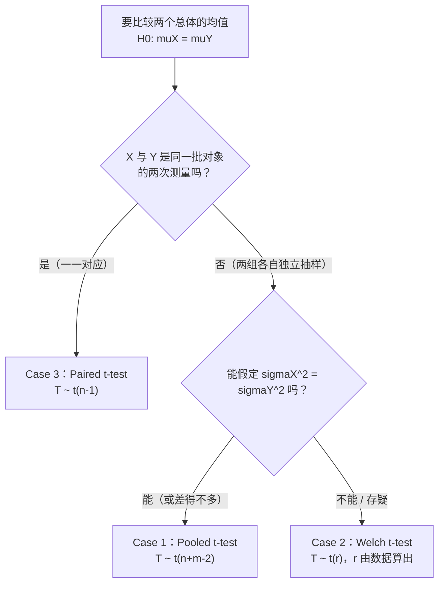
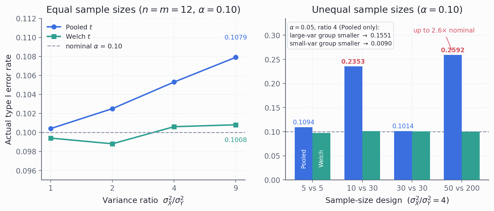
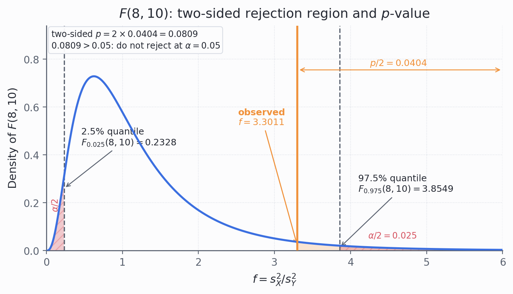
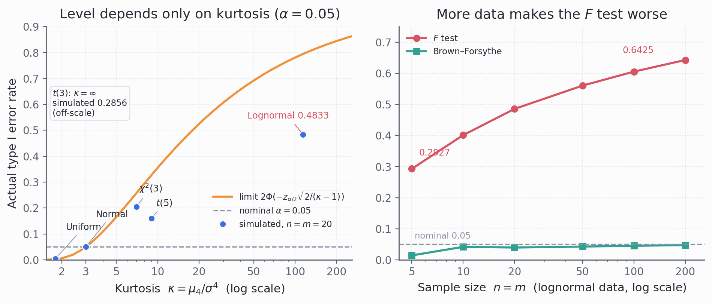
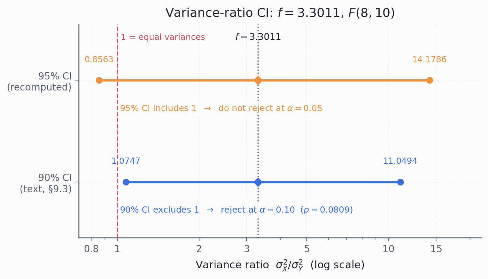

# STA2002 概率与统计 II · 第 7 讲笔记
## Hypothesis Testing II（假设检验 II）

> 授课：Zhenxing Guo、Ka Wai Tseng（香港中文大学（深圳）数据科学学院，2026 年 10 月）
> 教材：Hogg, Tanis & Zimmerman (2015) *Probability and Statistical Inference*, 9th ed., Pearson
> 对应教材章节：第 8.1、8.2 节（讲义第 2 页给出 "Suggested reading: Chapter 8.1, 8.2"）。其中**两方差相等性的检验**在教材第 8.2 节末尾被预告（"given in the next section"）、但实际只出现在习题 8.2-15 / 8.2-16；**方差比的置信区间**在教材习题 7.2-14
> 材料构成：讲义 `Lecture7 - Hypothesis Testing II.pdf`（**21 页**）。**本讲没有收到课堂板书**，因此全文没有 `【板书 NN】` 标记，也不设「板书原图」一节；凡属我补充、推导或复算的部分，一律用 **【补】** 标出，并在文末诚实备注中逐条列出。
> **组织方式**：正文**按讲义（PPT）的页序**撰写，讲义每一页都能在正文里找到对应位置（对照表见 §0）。21 页中凡含公式、图形或表格的页面都已渲染成图片逐张核对；其中第 18、19 两页的 $F$ 分布图我另外做了**像素级核对**（读出两条临界值、三块阴影的归属与图注文字），结论写在 §9.2 与 §10.1。
> **本次重整**：新增 matplotlib 配图 4 张（图 4.1、图 9.1、图 9.2、图 10.1，见文末配图清单），均为我绘制、讲义没有这些图；正文公式、数值、【补】标记与模拟表未删改。

---

## 0. 本讲地图（先说清楚这一讲在干什么）

*这一节回答：第 6 讲已经交付了单样本检验，这一讲把哪些东西"两样本化"了，以及这份笔记按什么顺序读。*

第 6 讲把假设检验的**语言**建了起来：$H_0$ / $H_1$、检验统计量 $T$、临界域 $C$、两类错误、$\alpha$、$p$ 值，以及三条等价的判定路（$p$ 值法 / 临界域法 / 区间法）。但那一讲只交付了一个应用——**单个均值**的检验。

本讲是它的续集，交付四件事：

1. **两个正态总体的均值是否相等**（这是第 5 讲"两均值之差"的区间估计的镜像）：Pooled $t$ 检验、Welch $t$ 检验、Paired $t$ 检验；
2. **两个正态总体的方差是否相等**：$F$ 检验；
3. 顺带把**方差比的置信区间**交出来（第 20 页的 Note）——这一条是第 4 讲以来一直挂着、第 5 讲和第 6 讲都没收的线；
4. 一张把三族 $t$ 检验 × 三个方向（$>$、$<$、$\neq$）共 **9 行**全部列出的汇总表。

**三遍阅读路线**（这份笔记比讲义厚，按下面的顺序读，每遍只解决一个问题）：

| 遍次 | 读哪里 | 读完应该能 |
| --- | --- | --- |
| 第一遍（主线） | §3 → §4.1 → §5.3 → §6.1 → §7.1 → §8.3 → §9.1–§9.3 → §10.2 → §11 | 对三族 $t$ 检验与 $F$ 检验各写一遍统计量、零分布与判定规则 |
| 第二遍（深化） | §4.6、§6.2–§6.4、§7.3–§7.4、§9.4、§10.3–§10.4 | 说清 Pooled 什么时候崩、$F$ 检验为什么不可信、$r$ 与 $1-\rho$ 的来历 |
| 第三遍（考前） | §12–§15 | 用速查表做题，并分清哪些是讲义原话、哪些是【补】 |

讲义第 2 页把范围写得很直白：

> In this lecture, we will
> - Continue our journey in hypothesis testing
> - Discuss hypothesis testing for:
>   - Equality of two means
>   - Equality of two variances
> - Hypothesis testing involves:
>   - Pooled $t$-test
>   - Welch's $t$-test
>   - Paired $t$-test
>   - $F$-test
> Suggested reading: Chapter 8.1, 8.2 of the textbook.

| 讲义页 | 内容 | 本笔记 | 配图 |
| --- | --- | --- | --- |
| 第 1 页 | 封面 | —— | — |
| 第 2 页 | Introduction：本讲覆盖什么 | §1 | — |
| 第 3 页 | 假设检验框架三步走复习 | §2 | — |
| 第 4 页 | 两均值相等的三个 case 分岔 | §3 | — |
| 第 5–8 页 | Case 1：Pooled $t$ 检验（统计量 + 三个方向） | §4 | 图 4.1（§4.6） |
| 第 9 页 | 例题：Pooled $t$ 检验 | §5 | — |
| 第 10–11 页 | Case 2：Welch $t$ 检验（两条路，仅双边） | §6 | — |
| 第 12–13 页 | Case 3：Paired $t$ 检验（构造 + 判定规则） | §7 | — |
| 第 14–15 页 | 例题：Paired $t$ 检验 | §8 | — |
| 第 16–18 页 | 两方差相等的检验：从两个 $\chi^2$ 到 $F$ + 拒绝域图 | §9 | 图 9.1（§9.2） |
| 第 19–20 页 | $F$ 检验的 $p$ 值与 $\sigma_Y^2/\sigma_X^2$ 的置信区间 | §10 | 图 10.1（§10.2） |
| 第 21 页 | Summary 汇总表 | §11 | — |
| — | 【补】$F$ 检验的稳健性（$\kappa$ 与 $n$ 两组模拟） | §9.4 | 图 9.2 |
| — | 速查表 / 核心直觉 / 术语对照 / 诚实备注 | §12–§15 | — |

**与第 6 / 8 讲的接口**：第 6 讲交付了单样本 $Z$/$t$ 检验的三步框架与三条等价判定路，本讲把分子换成 $\bar X-\bar Y$、分母换成差的标准误，框架原样不动（§2）；第 5 讲的两均值与方差比区间在本讲被翻成"$0\notin$ / $1\notin$"的判定规则（§4.3–§4.5、§10.2）；第 8 讲把检验推广到两比例（$Z$ 近似），本讲不重复这一块，而图 4.1 量出的"实际水平偏离名义值"正是第 9 讲功效与样本量讨论的前置问题。

**一句话概括整讲的结构：把第 6 讲讲过的单样本检验，逐一"两样本化"。**

第 6 讲的检验统计量全是

$$Z \text{ 或 } T=\frac{\bar X-\mu_0}{\text{标准误}}$$

本讲把分子换成**两个样本均值之差** $\bar X-\bar Y$，把分母换成**这个差的标准误**。三种 case 的差别**只在分母**：分母怎么估，决定了统计量服从哪个 $t$ 分布。

> [!IMPORTANT]
> **本讲没有引入任何新的概率论工具。** 四个统计量用的分布（正态、$t$、$\chi^2$、$F$）在教材第 4–7 章都已经出现过；本讲做的事是**把它们按"数据是怎么来的"重新组合一次**：
>
> | 场景 | 分子 | 分母（标准误） | 零分布 | 自由度 |
> | --- | --- | --- | --- | --- |
> | Pooled | $\bar X-\bar Y$ | $S_p\sqrt{\frac1n+\frac1m}$ | $t$ | $n+m-2$ |
> | Welch | $\bar X-\bar Y$ | $\sqrt{\frac{S_X^2}{n}+\frac{S_Y^2}{m}}$ | $t$（近似） | $r$（由数据算出） |
> | Paired | $\bar D=\bar X-\bar Y$ | $S_D/\sqrt n$ | $t$ | $n-1$ |
> | $F$（方差） | —— | —— | $F$ | $(n-1,\,m-1)$ |
>
> **只有第 4 行不是"均值之差"**——它是两个方差之比，所以本讲的四个工具其实是**两个家族**：三族 $t$ 检验回答"均值是否相等"，$F$ 检验回答"方差是否相等"。

**来源标注约定**：

- 无标记 → 讲义原文或对讲义的直接展开；
- **【补】** → 讲义没有、由我补充、推导或复算的内容（文末诚实备注逐条列出，并注明是独立推导还是有教材依据）。

---

## 1. 本讲要交付什么（讲义第 2 页）

*这一节回答：讲义第 2 页列了四个工具，为什么正文却分成"三族 $t$ 检验 + 单独五页的 $F$ 检验"两块。*

第 2 页的清单值得逐行读一遍，因为它隐含了一个**本讲的结构判断**。

清单里列了**四个工具**：Pooled $t$-test、Welch's $t$-test、Paired $t$-test、$F$-test。但看第 21 页的汇总表会发现：**汇总表只有三族 $t$ 检验的 9 行，$F$ 检验一行都没有。**

原因不是遗漏，而是**格式不兼容**：第 21 页那张表的列是 "p-value" 和 "Critical Region"，每一行给一条判定规则；而 $F$ 检验的拒绝域是"**两侧**"的（$f$ 太大或太小都要拒绝），两边各自算一个 $p$ 值再取两倍，塞不进"一个公式一行"的格子。所以讲义把 $F$ 检验单独放在第 16–20 页，用五页的篇幅讲完，不走汇总表的格式。

**这决定了我这份笔记的读法**：§3–§8 是"三族 $t$ 检验"（对应讲义第 4–15 页），§9–§10 是"$F$ 检验"（对应第 16–20 页），§11 才是那张汇总表。

另外，"两均值"和"两方差"在逻辑上是**串起来**的：第 4 页把 Pooled 检验的前提写成"$\sigma_X^2=\sigma_Y^2$"，而第 16–20 页的 $F$ 检验正是检验这个前提的工具。所以本讲有一个隐含的闭环——**先用 $F$ 检验查前提，再用 $t$ 检验比均值**。第 5 讲把这两件事分开讲过（区间版），本讲终于把它们接上了。

> [!WARNING]
> 这个闭环**只在形式上成立，实践上有一条重要的保留**：$F$ 检验本身对"正态性"极其敏感（比 $t$ 检验敏感得多），所以**教材明确说多数统计学家并不信任这个 $F$ 检验**，而是直接凭"方差看起来差得多不多"选 Welch。这一点讲义一个字都没提，我在 §9.4 用模拟把它量化了。**这是本讲我最想让你记住的一条。**

---

## 2. 框架复习：三步走（讲义第 3 页）

*这一节回答：第 6 讲的三步框架在这一讲要不要改？答案是不用改，只换统计量。*

第 3 页把第 6 讲的框架压缩成一个三步流程：

1. **写出 $H_0$ 与 $H_1$，并定下显著性水平 $\alpha$**（例如 $0.05$ 或 $0.01$）；
2. **确定检验统计量 $T$、它在 $H_0$ 下的分布，并算出观测值 $t$**；
3. **下结论**，三条路任选一条：
   - $p$ 值法：$p\le\alpha$ 则拒绝 $H_0$；
   - 临界域法：$t\in C$（临界域）则拒绝 $H_0$；
   - 置信区间法：区间**不含**零假设的参数值则拒绝 $H_0$。

这三条路在第 6 讲已经证明过等价，本讲**反复使用**它们——两道例题各自把三条路都走了一遍（第 9 页只走了前两条，第 15 页三条都走了）。

> [!NOTE]
> 第 3 页的第 3 条写的是"CI exclude **null parameter value**"——泛化表述。这一点在本讲末段才真正发挥作用：$F$ 检验的"零假设参数值"不是 $0$，而是 $\sigma_X^2/\sigma_Y^2=1$，所以第 20 页那条判定规则写的是 $1\notin(\cdots)$ 而不是 $0\notin(\cdots)$。**看到 $1$ 不要以为是笔误**。

**本讲新增的记号习惯**：$\bar X$、$\bar Y$ 表示两个样本的均值；$S_X^2$、$S_Y^2$ 表示两个**无偏**样本方差（分母是 $n-1$、$m-1$）；小写 $\bar x$、$\bar y$、$s_X^2$、$s_Y^2$ 表示观测到的数值。这个大小写约定与第 4–6 讲一致，只是从这一讲开始同时有两组样本，所以要格外留意下标。

---

## 3. 两均值相等：三个 case 的分岔（讲义第 4 页）

*这一节回答：面对两组数据，先按什么顺序在 Pooled / Welch / Paired 之间做选择。*

### 3.1 设定

两个总体，各自独立同分布地取样：

$$X_1,\dots,X_n\sim N(\mu_X,\sigma_X^2),\qquad Y_1,\dots,Y_m\sim N(\mu_Y,\sigma_Y^2).$$

要检验的是

$$H_0:\mu_X=\mu_Y\quad\text{vs}\quad H_1:\ \text{某一种不等（}>\text{、}<\text{、}\neq\text{）}.$$

### 3.2 三个 case（讲义第 4 页原文）

| Case | 条件 | 工具 |
| --- | --- | --- |
| ① | 两组**独立**，$\sigma_X^2=\sigma_Y^2=\sigma^2$ **未知** | Pooled $t$-test |
| ② | 两组**独立**，$\sigma_X^2\neq\sigma_Y^2$ **未知** | Welch's $t$-test |
| ③ | $n=m$，$(X_i,Y_i)$ 是**独立对** | Paired $t$-test |

分岔图（**这张图是我整理的，讲义没有画**）：

> [!TIP]
> **这张图的分岔顺序很重要**：先问"配不配对"，再问"方差等不等"。
>
> 原因：**配对与否是设计层面的、观测前就定了的**（数据是一一对应的两列，还是两组各自独立的两批人），而"方差是否相等"是**观测后要判断的**。一个配对设计的数据，如果把它当独立两组去算 Welch，得到的是**另一个问题的答案**（"两个总体的均值是否相等"），而且通常会损失大量信息（原因见 §7.3）。
>
> 反过来，独立两组的数据如果错当配对（把两组按顺序硬凑成对），会得到**方差被高估或低估**的检验，$\alpha$ 和功效全乱。

### 3.3 讲义第 4 页的一处笔误

第 4 页的 ① 和 ② 两条都写成了

> $X_1,\dots,X_n$ and $Y_1,Y_2,\cdots,Y_n$ are independent

**$Y$ 的下标应该是 $m$ 而不是 $n$**（同一页上面刚定义过 $Y_1,\dots,Y_m$，第 5 页的统计量用的也是 $m$）。这个笔误在同一页出现了**两次**（① 和 ② 各一次），而第 ③ 条用的是"$n=m$"，说明作者是在"两组样本量相等"的语境里顺手写下来的。**照抄会让人以为两组样本量必须相等**，而 Pooled 与 Welch 的公式都**不要求** $n=m$——只有 Paired 要求。

### 3.4 【补】$\sigma_X^2\neq\sigma_Y^2$ 的正确读法

Case ② 的条件写成"$\sigma_X^2\neq\sigma_Y^2$ unknown"，容易读成"我们知道两个方差不等"（那它们就成了已知量，不该叫 unknown）。**正确的读法是：我们不知道它们是多少，也不假定它们相等。**

这和 Case ① 的"$\sigma_X^2=\sigma_Y^2=\sigma^2$ unknown"（不知道具体值，但知道两者相等）形成对照。**两个 case 的区别不在"知道多少"，而在"愿意假定什么"。**

> [!NOTE]
> 这条区别在实际工作里很具体：Case ① 假定相等，是为了**把两组数据拼起来估一个共同的方差**（§4.2），从而换来更高的自由度（$n+m-2$ 而不是 $r$）；Case ② 不假定相等，代价是自由度 $r$ 会低于 $n+m-2$，收益是结论不依赖于那个假定。**这是一个"假定换效率"的经典权衡。**

---

## 4. Case 1：Pooled $t$ 检验（讲义第 5–8 页）

*这一节回答：假定两组方差相等时，两均值之差的检验统计量怎么构造，三个方向各怎么写。*

### 4.1 检验统计量与合并方差（讲义第 5 页）

$$T:=\frac{\bar X-\bar Y}{S_p\sqrt{\dfrac1n+\dfrac1m}},\qquad S_p^2=\frac{(n-1)S_X^2+(m-1)S_Y^2}{n+m-2}.$$

在 $H_0:\mu_X=\mu_Y$ 下，

$$T\sim t(n+m-2).$$

观测到数据 $x_1,\dots,x_n$ 与 $y_1,\dots,y_m$ 之后，算出

$$t=\frac{\bar x-\bar y}{s_p\sqrt{\dfrac1n+\dfrac1m}}.$$

这里的 $S_p$ 叫**合并标准差**（pooled standard deviation），$S_p^2$ 叫**合并方差**（pooled variance）。

### 4.2 【补】$S_p^2$ 到底在"合并"什么

$S_p^2=\dfrac{(n-1)S_X^2+(m-1)S_Y^2}{n+m-2}$ 这个式子是**两个方差估计按自由度加权的平均**：

- $S_X^2$ 是 $\sigma^2$ 的一个无偏估计，可信度对应 $n-1$ 个自由度；
- $S_Y^2$ 也是 $\sigma^2$ 的一个无偏估计，可信度对应 $m-1$ 个自由度；
- 既然两者估的是**同一个** $\sigma^2$，把它们按自由度加权平均，就得到一个**更精确的**估计。

三条推论（讲义都没有展开，但都很实用）：

1. **$S_p^2$ 是无偏的**：$E[S_p^2]=\dfrac{(n-1)\sigma^2+(m-1)\sigma^2}{n+m-2}=\sigma^2$。加权平均不引入偏差。
2. **$S_p^2$ 就是"把两组数据各自减去自己的组均值之后，当成一整组算方差"**。因为
   $$\sum_{i=1}^n(x_i-\bar x)^2+\sum_{j=1}^m(y_j-\bar y)^2$$
   是**组内平方和**（within-group sum of squares），自由度是 $(n-1)+(m-1)=n+m-2$。所以 $S_p^2$ 也可以读成"**组内均方**"。这也是分母为什么是 $n+m-2$：**两组各因为减了一次自己的组均值而损失一个自由度**。
3. **前提被破坏时 $S_p^2$ 仍然无偏，但 $T$ 的分布不再是 $t$**。这是最容易搞混的一点：方差不等的时候，$S_p^2$ 估的其实是 $\dfrac{(n-1)\sigma_X^2+(m-1)\sigma_Y^2}{n+m-2}$（一个两个方差的加权平均），它跟真实标准误所需的组合 $\dfrac{\sigma_X^2}{n}+\dfrac{\sigma_Y^2}{m}$ **对不上**——这正是 §4.6 模拟里那种失真的来源。

> [!IMPORTANT]
> **为什么 $T$ 精确服从 $t(n+m-2)$？** 拆成三步：
>
> ① 分子 $\bar X-\bar Y$ 是正态的（正态的线性组合），$E[\bar X-\bar Y]=0$（在 $H_0$ 下），$\operatorname{Var}(\bar X-\bar Y)=\dfrac{\sigma^2}{n}+\dfrac{\sigma^2}{m}=\sigma^2\left(\dfrac1n+\dfrac1m\right)$。标准化得
> $$Z=\frac{\bar X-\bar Y}{\sigma\sqrt{\frac1n+\frac1m}}\sim N(0,1).$$
> ② 分母里的 $(n+m-2)S_p^2/\sigma^2$ 是两个独立的 $\chi^2$ 之和：$\dfrac{(n-1)S_X^2}{\sigma^2}\sim\chi^2(n-1)$、$\dfrac{(m-1)S_Y^2}{\sigma^2}\sim\chi^2(m-1)$，相加得 $\chi^2(n+m-2)$，且与 $Z$ **独立**（样本均值与样本方差独立，这是正态分布特有的性质）。
> ③ 按 $t$ 分布的定义（标准正态 ÷ 独立的 $\sqrt{\chi^2/\text{自由度}}$），$T$ 服从 $t(n+m-2)$。
>
> **这三步里每一步都用了"正态"**，所以 Pooled 检验的"精确"是**在正态假设下**的精确。

### 4.3 单边检验 $H_1:\mu_X>\mu_Y$（讲义第 6 页）

$p$ 值是

$$p=\Pr(T>t;H_0)=\Pr\big(T>t;\ T\sim t(n+m-2)\big).$$

判定规则：在水平 $\alpha$ 下拒绝 $H_0$，当且仅当

$$p=\Pr\big(T>t;T\sim t(n+m-2)\big)\le\alpha
\iff t\ge t_\alpha(n+m-2)
\iff 0\notin\left(\bar x-\bar y-t_\alpha(n+m-2)s_p\sqrt{\frac1n+\frac1m},\ \infty\right).$$

**逐行核对这三条**（【补】把等价关系补全）：

- 第二行到第三行：$t\ge t_\alpha$ 意味着
  $$\frac{\bar x-\bar y}{s_p\sqrt{1/n+1/m}}\ge t_\alpha\ \Longleftrightarrow\ \bar x-\bar y\ \ge\ t_\alpha s_p\sqrt{\frac1n+\frac1m},$$
  两边同乘一个**正数** $s_p\sqrt{1/n+1/m}$，不等号方向不变。而这正是
  $$0\le \bar x-\bar y-t_\alpha s_p\sqrt{\frac1n+\frac1m}.$$
- **最后一行的区间是一个左端点开、右端点无穷的开区间**。$0\notin(L,\infty)$ 等价于 $0\le L$（不是 $0>L$！因为区间不含左端点，$0=L$ 时 $0$ 也不在区间里）。**这里是最容易读错方向的地方**，两个单边的情境方向恰好相反，务必用"$0\notin$"的定义去验证，不要凭感觉。

> [!TIP]
> 最后一行那个区间
> $$\left(\bar x-\bar y-t_\alpha(n+m-2)s_p\sqrt{\frac1n+\frac1m},\ \infty\right)$$
> **就是 $\mu_X-\mu_Y$ 的单边 $100(1-\alpha)\%$ 置信区间（只给下界）**。所以这一行的意思是：
> **"在水平 $\alpha$ 下拒绝 $H_0$" ⟺ "$\mu_X-\mu_Y$ 的 $100(1-\alpha)\%$ 单边下界大于 $0$" ⟺ "$0$ 不在这个单边区间里"。**
>
> 第 5 讲把同样的区间当作"估计"来讲，本讲把它当作"判定规则"来用——**同一个式子，两种身份**。

### 4.4 单边检验 $H_1:\mu_X<\mu_Y$（讲义第 7 页）

$$p=\Pr(T<t;H_0)=\Pr\big(T<t;\ T\sim t(n+m-2)\big),$$

$$p\le\alpha\iff t\le-t_\alpha(n+m-2)
\iff 0\notin\left(-\infty,\ \bar x-\bar y+t_\alpha(n+m-2)s_p\sqrt{\frac1n+\frac1m}\right).$$

**注意三点**（【补】）：

1. 这一侧用的是 $-t_\alpha$（**负数**），不是 $t_\alpha$。因为临界域挪到了左尾。$t_\alpha$ 在本课程里的定义始终是"**上尾**分位数"（$P(T>t_\alpha)=\alpha$），所以左尾的临界值要加负号。
2. 这一侧的区间是 $(-\infty,U]$ 那一侧——**只给上界**。$0\notin(-\infty,U)$ 等价于 $0>U$。
3. **两个单边的区间完全对称**：一个是"$\bar x-\bar y$ 减去一个正的长度"，另一个是"$\bar x-\bar y$ 加上同一个正的长度"，两个区间的**长度都是无穷**，只是开口方向不同。

### 4.5 双边检验 $H_1:\mu_X\neq\mu_Y$（讲义第 8 页）

$$p=\Pr(\lvert T\rvert>\lvert t\rvert;H_0)=2\Pr\big(T>\lvert t\rvert;\ T\sim t(n+m-2)\big),$$

$$p\le\alpha\iff \lvert t\rvert\ge t_{\alpha/2}(n+m-2)
\iff 0\notin\left(\bar x-\bar y-t_{\alpha/2}s_p\sqrt{\tfrac1n+\tfrac1m},\ \bar x-\bar y+t_{\alpha/2}s_p\sqrt{\tfrac1n+\tfrac1m}\right).$$

讲义在页末加了一句：

> **Note that:** Last interval is just the two-sided pooled $t$-interval.

【补】这句话的意思是：**最后那个区间就是第 5 讲讲过的 pooled $t$ 区间**（$\mu_X-\mu_Y$ 的双边 $100(1-\alpha)\%$ 置信区间）。所以"双边检验拒绝 $H_0$" ⟺ "第 5 讲那个区间不含 $0$"——两讲共用同一个公式，只是第 5 讲用它做估计、本讲用它做判定。

> [!WARNING]
> **双边检验的分位数是 $t_{\alpha/2}$ 而不是 $t_\alpha$。** 因为 $\alpha$ 要在左右两尾各分一半。所以第 9 页例题里 $\alpha=0.10$ 用的是 $t_{0.05}(22)$。
>
> 记住这个对应关系（本讲反复用）：
>
> | 检验方向 | $p$ 值 | 临界值 |
> | --- | --- | --- |
> | 右尾（$>$） | $\Pr(T>t)$ | $t_\alpha$ |
> | 左尾（$<$） | $\Pr(T<t)$ | $-t_\alpha$ |
> | 双边（$\neq$） | $2\Pr(T>\lvert t\rvert)$ | $\pm t_{\alpha/2}$ |

### 4.6 【补】Pooled 检验对方差不等到底有多敏感——我做了模拟

第 4 页把 Pooled 的前提写成 $\sigma_X^2=\sigma_Y^2$，但**没有说这个前提被破坏时会发生什么**。我用模拟把真实的第一类错误率量了出来（$H_0$ 为真、两组都正态，只是方差不同）：

**第一组：样本量相等（$n=m=12$），名义水平 $\alpha=0.10$**

| $\sigma_X^2/\sigma_Y^2$ | Pooled 实际水平 | Welch 实际水平 |
| --- | --- | --- |
| $1$（前提成立） | $0.1004$ | $0.0994$ |
| $2$ | $0.1025$ | $0.0988$ |
| $4$ | $0.1053$ | $0.1006$ |
| $9$ | $0.1079$ | $0.1008$ |

**第二组：样本量不等（$\sigma_X^2/\sigma_Y^2=4$ 固定）**

| 设定 | Pooled 实际水平 | Welch 实际水平 |
| --- | --- | --- |
| $n=5,m=5$ | $0.1094$ | $0.0976$ |
| $n=10,m=30$ | $\mathbf{0.2353}$ | $0.1014$ |
| $n=30,m=30$ | $0.1014$ | $0.1007$ |
| $n=50,m=200$ | $\mathbf{0.2592}$ | $0.0998$ |

**第三组：名义水平换成 $\alpha=0.05$，$n=m=12$**

| $\sigma_X^2/\sigma_Y^2$ | Pooled 实际水平 | Welch 实际水平 |
| --- | --- | --- |
| $1$ | $0.0498$ | $0.0490$ |
| $4$ | $0.0537$ | $0.0505$ |
| $9$ | $0.0568$ | $0.0508$ |

**第四组：失效是有方向的（$\alpha=0.05$，方差比 $4$）**

| 设定 | Pooled 实际水平 | 方向 |
| --- | --- | --- |
| $n=10$（方差大 $4\sigma^2$）、$m=30$ | $\mathbf{0.1551}$ | **过于激进**（名义 $0.05$ 变成 $0.155$） |
| $n=10$（方差小 $\sigma^2$）、$m=30$ | $\mathbf{0.0090}$ | **过于保守**（几乎不敢拒绝） |
| $n=m=10$ | $0.0552$ | 基本正常 |

**结论（三条，都很反直觉）：**

1. **样本量相等时，Pooled 检验对方差不等相当宽容。** 方差差 9 倍，$\alpha=0.10$ 的检验实际水平只涨到 $0.108$（涨了 $8\%$ 的相对量）。这是为什么很多教科书说"方差不太离谱时可以直接用 Pooled"。
2. **样本量不等时，Pooled 会崩。** $n=10$ 对一个 $m=30$、方差差 4 倍的情形，名义 $10\%$ 的检验实际拒绝率高达 $23.5\%$——**夸大了两倍多**。$n=50$ 对 $m=200$ 更糟（$25.9\%$）。
3. **失真是"有方向"的**：小样本那一组的方差更大时，Pooled 变得**过于激进**（伪阳性暴涨）；小样本那一组的方差更小时，它变得**过于保守**（功效暴跌）。Welch 在四种情形下都稳在 $0.05$ 附近。

下面这张图把两组表画在一起。左图是"样本量相等、只动方差比"，右图是"方差比固定为 $4$、只动样本量设计"——两张图并排，本节最重要的那条结论一眼可见：**危险的是"方差不等 + 样本量不等"的组合，不是方差不等本身。**

*图 4.1　Pooled 与 Welch 的实际第一类错误率。左：$n=m=12$、方差比 $1/2/4/9$、$\alpha=0.10$；右：方差比固定为 $4$、四种样本量设计、$\alpha=0.10$，红字标出 $0.2353$ 与 $0.2592$，文本框里是 $\alpha=0.05$ 的方向性对照 $0.1551$ 与 $0.0090$。数据全部取自本节四张表（我绘制，讲义没有这张图）*

> [!IMPORTANT]
> 这组数字解释了一条实践规则（教材第 8.2 节的 REMARK 也提到，但没有给数字）：
>
> > When the distributions are close to normal, but the variances seem to differ by a great deal, the $t$ statistic should again be avoided, **particularly if the sample sizes are also different**.
>
> "particularly if the sample sizes are also different" 这半句是关键——**方差不等单独出现时问题不大，方差不等 + 样本量不等才是致命的组合**。而在真实数据里，"方差大的组样本少"恰恰是常见情形（例如稀有组的测量变异更大、样本更难取）。

---

## 5. 例题：Pooled $t$ 检验（讲义第 9 页）

*这一节回答：把 §4 的公式代进一组真实数据，三条判定路是否给出同一个结论。*

### 5.1 题目与讲义给的做法

> **Example.** Suppose $X\sim N(\mu_X,\sigma^2)$ and $Y\sim N(\mu_Y,\sigma^2)$. We observe
> - $n=12$，$\bar x=1076.75$，$s_X^2=29.30$
> - $m=12$，$\bar y=1072.33$，$s_Y^2=26.24$
>
> We would like to test $H_0:\mu_X=\mu_Y$ vs $H_1:\mu_X\neq\mu_Y$ at significance level $\alpha=0.10$.

讲义的计算：

$$t=\frac{1076.75-1072.33}{\sqrt{\dfrac{11(29.30)+11(26.24)}{22}\left(\dfrac1{12}+\dfrac1{12}\right)}}=2.05.$$

拆开看：

$$s_p^2=\frac{11(29.30)+11(26.24)}{22}=\frac{322.30+288.64}{22}=\frac{610.94}{22}=27.77,\qquad s_p=5.2697,$$

$$s_p\sqrt{\frac1{12}+\frac1{12}}=5.2697\times0.40825=2.1514,\qquad t=\frac{4.42}{2.1514}=2.0545\approx2.05.$$

**比较与判定**：

$$\lvert t\rvert=2.05>t_{0.05}(22)=1.717\quad\text{或者}\quad p=2\Pr\big(T>2.05;T\sim t(22)\big)=0.0525<0.1.$$

→ **在 $10\%$ 水平下拒绝 $H_0$**。

### 5.2 【补】数值复算：所有数字都对得上，只有 $p$ 值差一点

| 量 | 讲义值 | 我的复算 | 说明 |
| --- | --- | --- | --- |
| $s_p^2$ | $27.77$（隐含） | $27.7700$ | 一致 |
| $t$ | $2.05$ | $2.054518$ | 一致（讲义留两位小数） |
| $t_{0.05}(22)$ | $1.717$ | $1.717144$ | 一致 |
| $p$ 值 | $0.0525$ | $0.051994$ | **差 $0.0005$** |
| $t_{0.025}(22)$ | 教材写 $2.074$ | $2.073873$ | 一致 |

**$p$ 值那个差的来源**：如果直接用讲义印出来的 $t=2.05$（而不是未圆整的 $2.0545$）去算 $p$，得到 $2\Pr(T>2.05)=0.052469\approx0.0525$——**正好是讲义的那个数**。所以讲义是"先把 $t$ 圆整到两位小数，再算 $p$"。

这不是错误，但值得知道：**用圆整值算 $p$ 会带来 $10^{-3}$ 量级的误差**。在 $p$ 值刚好卡在 $\alpha$ 边缘时（本例 $p=0.052$ 对 $\alpha=0.05$ 就是这种情形），这个量级足以改变结论。

> [!TIP]
> **教材给了一个本讲没有的补充判断。** Hogg 第 8.2 节在同一个例子后面写：
> $$\lvert t\rvert=2.05<2.074=t_{0.025}(22)$$
> 所以"在 $\alpha=0.05$ 下**不**拒绝"，即 $0.05<p<0.10$。我用软件算的精确 $p=0.0520$ 恰好落在这个区间里，两个说法一致。
>
> **一个数字对应三个结论**：$\alpha=0.10$ 拒绝、$\alpha=0.05$ 不拒绝、$p$ 值 $=0.0520$。这就是第 6 讲那条"$\alpha$ 是主观选定的门槛，$p$ 值是数据自带的刻度"的具体演示。

### 5.3 【补】同一组数据上再走另外两条路

**双边 $90\%$ pooled $t$ 区间**（第 8 页那条规则的直接应用）：

$$\bar x-\bar y\pm t_{0.05}(22)s_p\sqrt{\tfrac1{12}+\tfrac1{12}}=4.42\pm1.717144\times2.151356=(0.7258,\ 8.1142).$$

这个区间**不含 $0$**，与"拒绝 $H_0$"一致。

**如果改用 Welch**（这一步讲义没做，我把数据重跑了一遍）：

$$s_w=\sqrt{\frac{s_X^2}{n}+\frac{s_Y^2}{m}}=2.151356,\qquad t=2.053008,\qquad r=21.9337,\qquad p=0.052189.$$

**Welch 与 Pooled 的结果几乎一模一样**（$t$ 差在小数第四位，$p$ 差 $0.0002$，自由度 $21.93$ 对 $22$）。原因很直白：**两组方差本来就接近**（$29.30$ 对 $26.24$），而且 $n=m$。这正是 Welch 自由度设计的用意——**它会在"方差确实相等"时自动退化成 Pooled**（证明见 §6.4）。

**再补一个第 9 页没有的检查**——**用 $F$ 检验查一下"方差相等"这个前提**（§9 的方法）：

$$f=\frac{s_X^2}{s_Y^2}=\frac{29.30}{26.24}=1.1163,\qquad p_{\text{双边}}=0.858.$$

$p$ 值高达 $0.86$，**完全看不出方差有差异**，所以本例题用 Pooled 是有依据的。**这三步连起来就是本讲隐含的那个闭环**：先问方差是否相等（$F$ 检验 → 不拒绝），再用 Pooled。

> [!NOTE]
> 顺带说明：这组数据出自教材 Example 8.2-2（灌装机 24 个加注头，奇偶两侧各 12 个），教材给了全部 24 个原始观测值。我用原始数据复算得 $s_X^2=29.2955$、$s_Y^2=26.2424$、$t=2.053008$；用讲义印出来的圆整值（$29.30$、$26.24$）复算得 $t=2.054518$。**两者都约等于 $2.05$**，讲义没有算错。

---

## 6. Case 2：Welch's $t$ 检验（讲义第 10–11 页）

*这一节回答：不敢假定方差相等时，分母与自由度要怎么改，代价是什么。*

### 6.1 统计量与自由度（讲义第 10 页）

$$T=\frac{\bar X-\bar Y}{\sqrt{\dfrac{S_X^2}{n}+\dfrac{S_Y^2}{m}}}.$$

在 $H_0$ 下，$T\sim t(r)$——**近似**服从自由度为

$$r=\left\lfloor\frac{\left(\dfrac{S_X^2}{n}+\dfrac{S_Y^2}{m}\right)^2}{\dfrac1{n-1}\left(\dfrac{S_X^2}{n}\right)^2+\dfrac{1}{m-1}\left(\dfrac{S_Y^2}{m}\right)^2}\right\rfloor$$

的 $t$ 分布。观测到数据后算出

$$t=\frac{\bar x-\bar y}{\sqrt{\dfrac{s_X^2}{n}+\dfrac{s_Y^2}{m}}}.$$

讲义在页末注明：

> Here, only the **two-sided** hypothesis testing is discussed.

第 11 页给出双边判定规则：$p=2\Pr(T>\lvert t\rvert;T\sim t(r))\le\alpha$，等价于 $\lvert t\rvert\ge t_{\alpha/2}(r)$，等价于

$$0\notin\left(\bar x-\bar y-t_{\alpha/2}(r)\sqrt{\tfrac{s_X^2}{n}+\tfrac{s_Y^2}{m}},\ \bar x-\bar y+t_{\alpha/2}(r)\sqrt{\tfrac{s_X^2}{n}+\tfrac{s_Y^2}{m}}\right),$$

并注明"This interval is just the **Welch's $t$-interval**"——与第 5 讲的区间公式完全一致，只是标准误换了、自由度换了。

### 6.2 【补】$r$ 那个式子怎么记

把两个"**部分方差**"命名一下：

$$U:=\frac{S_X^2}{n},\qquad V:=\frac{S_Y^2}{m}.$$

$U$ 是 $\bar X$ 的方差的无偏估计，$V$ 是 $\bar Y$ 的方差的无偏估计，而 $\operatorname{Var}(\bar X-\bar Y)=U+V$。于是

$$r=\left\lfloor\frac{(U+V)^2}{\dfrac{U^2}{n-1}+\dfrac{V^2}{m-1}}\right\rfloor.$$

**这个形式好记得多**：分子是"和的平方"，分母是"各自平方再除以各自的自由度"。记成一句话就是 **"$(U+V)^2$ 除以 $\frac{U^2}{\nu_1}+\frac{V^2}{\nu_2}$"**。

它的来历是 **Satterthwaite 近似**（Welch–Satterthwaite 方程）：$U+V$ 是两个方差量之和，它的分布没有简单的名字；但我们想找一个 $t$ 分布来近似 $\dfrac{\bar X-\bar Y}{\sqrt{U+V}}$。做法是**要求那个 $t$ 分布的方差与真实的方差相等**，解出来的自由度就是上面这个 $r$。所以 $r$ 不是"数出来的自由度"，而是**匹配出来的自由度**——这也解释了它为什么通常不是整数。

**必须取整**：$\lfloor\cdot\rfloor$ 表示向下取整。方向是"**保守**"的——$r$ 取小，$t$ 分布尾巴更厚，临界值更大，更难拒绝。这与第 5 讲的处理一致（教材里 Welch 的 $r$ 也取整）。

> [!WARNING]
> **$r$ 依赖数据**（它里面全是 $S_X^2$、$S_Y^2$），所以**同一个检验在不同样本上自由度不同**。这带来两个实际后果：
>
> 1. **没有现成的表可以查**。$t$ 表一般只给整数自由度；$r=21.93$ 要插值或用软件。这是 Welch 在实践中不如 Pooled 方便的地方。
> 2. **"先看数据再定自由度"会破坏 $t$ 分布的严格性**。严格地说，Welch 检验的 $\alpha$ 是**近似**的（讲义写了 "approximately" 就是这个意思），而不是精确的——尽管模拟显示这个近似通常相当好（§4.6 里 Welch 的实际水平稳在 $0.05$ 附近）。

### 6.3 【补】$r$ 的两端：$11$ 与 $22$

讲义只给了公式，没有说 $r$ 的取值范围。但它有个漂亮的结论：

$$\min(n-1,\ m-1)\ \le\ r\ \le\ n+m-2.$$

**两个端点分别对应两种极端情形**：

- **上端 $n+m-2$**：当 $\dfrac{S_X^2}{n}=\dfrac{S_Y^2}{m}$ 时取到（此时"部分方差"相等，合并与不合并的效果一样）。特别地，若 $n=m$ 且 $S_X^2=S_Y^2$，则 $r$ 恰为 $n+m-2$——**Welch 退化成 Pooled**。
- **下端 $\min(n-1,m-1)$**：当其中一组的部分方差趋于 $0$ 时取到（此时 $\bar X-\bar Y$ 的方差几乎全来自另一组，可用的信息量就等于那一组自己的自由度）。

**数值验证**（我对每个 $(n,m)$ 组合抽 $4000$ 组样本，计算 $r$ 的范围）：

| $n$ | $m$ | $r$ 实测范围 | 理论范围 |
| --- | --- | --- | --- |
| $5$ | $5$ | $[4.003,\ 8.000]$ | $[4,\ 8]$ |
| $5$ | $20$ | $[6.100,\ 23.000]$ | $[4,\ 23]$ |
| $10$ | $10$ | $[9.075,\ 18.000]$ | $[9,\ 18]$ |
| $12$ | $12$ | $[11.139,\ 21.985]$ | $[11,\ 22]$ |
| $3$ | $40$ | $[2.275,\ 41.000]$ | $[2,\ 41]$ |
| $25$ | $9$ | $[8.096,\ 17.624]$ | $[8,\ 32]$ |

**越界次数 $0$**。注意 $n=5,m=20$ 那行的上端恰好顶到 $23=n+m-2$、$n=3,m=40$ 那行顶到 $41=n+m-2$，说明上界是可以取到的（当两组的部分方差恰好相等时）。

**为什么这个范围有用**：它告诉你 Welch 的代价上限。$n=12,m=12$ 时 Pooled 用 $22$ 个自由度，而 Welch 实测 $r$ 的**均值约 $13.86$**（$5000$ 次模拟）——**平均少用约 $8$ 个自由度**。所以"不确定方差是否相等就无脑用 Welch"是有代价的：**它用手里的自由度买了保险**。

### 6.4 【补】"退化成 Pooled"的证明（讲义只给了断言）

要说明"$S_X^2/n=S_Y^2/m$ 时 $r=n+m-2$"，把 $U=S_X^2/n$、$V=S_Y^2/m$ 代进 $r$ 的式子：

- 分子 $(U+V)^2=(2U)^2=4U^2$；
- 分母 $\dfrac{U^2}{n-1}+\dfrac{U^2}{m-1}=U^2\left(\dfrac1{n-1}+\dfrac1{m-1}\right)=U^2\dfrac{n+m-2}{(n-1)(m-1)}$。

所以

$$r=\frac{4U^2}{\dfrac{U^2(n+m-2)}{(n-1)(m-1)}}=\frac{4(n-1)(m-1)}{n+m-2}.$$

这只有在 $n=m$ 时才等于 $n+m-2$：

$$n=m\ \Rightarrow\ r=\frac{4(n-1)^2}{2(n-1)}=2(n-1)=n+m-2.\ \checkmark$$

**结论要写得精确一点**："$S_X^2/n=S_Y^2/m$ **且** $n=m$" $\Rightarrow$ $r=n+m-2$（Welch 与 Pooled 完全等价）。**只满足前者而 $n\neq m$ 时，$r$ 会小于 $n+m-2$**——这也是为什么 Welch 在 $n\neq m$ 时仍然比 Pooled 保守。

### 6.5 讲义第 10–11 页与第 21 页的一处不一致

讲义第 10 页和第 11 页都写了 "Here, only the two-sided hypothesis testing is discussed"，但**第 21 页的汇总表里 Welch 有三行**，包括两个单边：

| $H_0$ | $H_1$ | p-value | Critical Region |
| --- | --- | --- | --- |
| $\mu_X=\mu_Y$ | $\mu_X>\mu_Y$ | $\Pr(T>t)$ | $t\ge t_\alpha(r)$ |
| $\mu_X=\mu_Y$ | $\mu_X<\mu_Y$ | $\Pr(T<t)$ | $t\le-t_\alpha(r)$ |
| $\mu_X=\mu_Y$ | $\mu_X\neq\mu_Y$ | $2\Pr(T>\lvert t\rvert)$ | $\lvert t\rvert\ge t_{\alpha/2}(r)$ |

**这不是矛盾，而是"讲义正文省了、汇总表补齐了"。** 汇总表那三行的公式是好写的（把 Pooled 的对应行里的 $t(n+m-2)$ 换成 $t(r)$、$s_p\sqrt{1/n+1/m}$ 换成 $\sqrt{S_X^2/n+S_Y^2/m}$ 就行），但**单边 Welch 的置信区间对偶关系要小心**：区间法里的区间是单边的，而 $r$ 是随机变量，单边区间的覆盖率同样是近似的。**所以我建议按讲义正文的要求作答（Welch 只考双边），但要知道汇总表那三行是哪来的。**

---

## 7. Case 3：Paired $t$ 检验（讲义第 12–13 页）

*这一节回答：同一批对象测两次时，为什么可以把问题化成单样本 $t$ 检验。*

### 7.1 构造（讲义第 12 页）

考虑双边检验

$$H_0:\mu_X=\mu_Y,\qquad H_1:\mu_X\neq\mu_Y.$$

引入**差值**：

$$D_i:=X_i-Y_i,\qquad i=1,2,\dots,n.$$

检验统计量定义为

$$T:=\frac{\bar D}{S_D/\sqrt n}=\frac{\bar X-\bar Y}{S_D/\sqrt n}.$$

在 $H_0:\mu_X=\mu_Y$ 下，$T\sim t(n-1)$。讲义注明：这里同样**只讨论双边**。

### 7.2 判定规则（讲义第 13 页）

$$t=\frac{\bar x-\bar y}{s_D/\sqrt n},\qquad p=2\Pr\big(T>\lvert t\rvert;T\sim t(n-1)\big),$$

$$p\le\alpha\iff\lvert t\rvert\ge t_{\alpha/2}(n-1)
\iff 0\notin\left(\bar x-\bar y-t_{\alpha/2}(n-1)\frac{s_D}{\sqrt n},\ \bar x-\bar y+t_{\alpha/2}(n-1)\frac{s_D}{\sqrt n}\right).$$

页末注明 "Last interval is just the **paired $t$-interval**"。

### 7.3 【补】为什么分母是 $S_D/\sqrt n$，而不是 Pooled 或 Welch 的标准误

这是本节最值得想清楚的一点。三条线索：

**线索 1：直接算 $\bar D$ 的方差。** $\bar D=\bar X-\bar Y$（因为 $\bar D=\frac1n\sum(X_i-Y_i)=\bar X-\bar Y$），所以

$$\operatorname{Var}(\bar D)=\frac{\operatorname{Var}(D_i)}{n}=\frac{\operatorname{Var}(X_i-Y_i)}{n}=\frac{\sigma_X^2+\sigma_Y^2-2\sigma_{XY}}{n}.$$

**里面多出了一项 $-2\sigma_{XY}$**（$X$ 与 $Y$ 的协方差）。而 Pooled / Welch 的标准误里只有 $\sigma_X^2$ 和 $\sigma_Y^2$，**假设了 $\sigma_{XY}=0$**。配对设计里 $X_i$ 与 $Y_i$ 是同一个对象，$\sigma_{XY}$ 显然不为 $0$——这就是两者的本质差别。

用 $S_D^2$ 估 $\operatorname{Var}(D_i)$ 最省事：$S_D^2$ 是 $D_1,\dots,D_n$ 的样本方差，它**自动包含了协方差**。

**线索 2：配对带来的方差削减量是精确可算的。** 若把 $X$ 与 $Y$ 当成两组独立数据（不配对）来估 $\operatorname{Var}(\bar X-\bar Y)$，得到 $\dfrac{\sigma_X^2+\sigma_Y^2}{n}$（这里要求 $n=m$，正是 Case 3 的条件）。两者之比是

$$\frac{\operatorname{Var}(\bar D)}{\operatorname{Var}_{\text{不配对}}(\bar X-\bar Y)}=\frac{\sigma_X^2+\sigma_Y^2-2\sigma_{XY}}{\sigma_X^2+\sigma_Y^2}=1-\rho,$$

其中 $\rho=\operatorname{Corr}(X,Y)$。**也就是说：配对的方差削减比例恰好是 $1-\rho$，与 $\sigma$ 的大小无关，只与相关系数有关。**

我做了模拟验证（$n=24$，$B=2\times10^5$）：

| $\rho$ | $E[\operatorname{Var}(\bar D)]$ | $E[\text{不配对的 }se^2]$ | 比值 | $1-\rho$ |
| --- | --- | --- | --- | --- |
| $0.00$ | $0.083321$ | $0.083323$ | $1.0000$ | $1.0000$ |
| $0.50$ | $0.041645$ | $0.083344$ | $0.4997$ | $0.5000$ |
| $0.80$ | $0.016666$ | $0.083272$ | $0.2001$ | $0.2000$ |
| $0.95$ | $0.004169$ | $0.083300$ | $0.0500$ | $0.0500$ |

比值与 $1-\rho$ 逐行吻合。$\rho=0.95$ 时配对把方差压到了**二十分之一**——换成标准差就是**精度提高约 $4.5$ 倍**。这就是配对设计的全部收益。

> [!IMPORTANT]
> **第三条线索，也是最容易忽略的一条：$\rho<0$ 时配对比不配对更差。**
>
> 上面那个公式 $1-\rho$ 在 $\rho<0$ 时大于 $1$——**配对反而把方差放大了**。也就是说，"配对"不是免费的午餐，它只有在 $X$ 与 $Y$ 正相关（同一个对象前后测量，通常如此）时才划算。
>
> 这在练习题里确实可能出现：如果设计者把两组**本来独立**的数据按某种人为顺序硬凑成对，而那个顺序恰好让 $X$ 与 $Y$ 负相关，配对 $t$ 检验的功效会比 Welch 差。

### 7.4 【补】"独立对"这个条件在管什么

Case 3 的条件是"$(X_i,Y_i)$ 是**独立对**"，字面上很不显眼，但它是配对检验合法性的**全部**：

- **不同对之间要独立**：第 $i$ 个人的 $D_i$ 与第 $j$ 个人的 $D_j$ 不相关。这是 $S_D^2$ 能当 $\operatorname{Var}(D)$ 的无偏估计、且 $\sqrt n(\bar D-\mu_D)/S_D\sim t(n-1)$ 的前提。
- **同一对内部不要求独立**：恰恰相反，$X_i$ 与 $Y_i$ 越相关越好（§7.3）。

另外两条：

- **$n=m$ 是被强制的**：配对的每对由两个观测组成，所以两组观测数必然相等。**如果两批数据个数不等，就不可能是配对设计。** 这也意味着"$n=m$ 但两组独立"应该走 Pooled / Welch，而不是 Paired——**判据是"有没有一一对应关系"，不是"数量相不相等"**。
- **正态性假设落在 $D$ 上，而不是 $X$、$Y$ 各自上**。讲义第 14 页的例题原文写的是 "Assume that the distribution of $D$ is approximately $N(\mu_d,\sigma_d^2)$"——**只需要差值近似正态**。这比"$X$、$Y$ 各自正态"弱得多：$X$、$Y$ 都右偏但相关性高时，$D$ 可能已经很接近正态了。

---

## 8. 例题：Paired $t$ 检验（讲义第 14–15 页）

*这一节回答：配对检验在"单边 vs 双边"上会给出不同结论，这个现象该怎么读。*

### 8.1 题目（讲义第 14 页）

> **Example.** Twenty-four girls in the 9th and 10th grades were put on an ultraheavy rope-jumping program. Someone thought that such a program would increase their speed in the 40-yard dash. Let $D$ equal the difference in time to run the 40-yard dash—the "before-program time" ($X$) minus the "after-program time" ($Y$). Assume that the distribution of $D$ is approximately $N(\mu_d,\sigma_d^2)$. We shall test $H_0:\mu_D=0$ against $H_1:\mu_D>0$ at significance level $\alpha=0.10$. We observe $n=24$, $\bar d=0.0788$, $s_D=0.2549$.

**方向要先想清楚**：$D=$ 跳前用时 $-$ 跳后用时。跑得**更快**意味着跳后用时更短，所以 $D>0$。$H_1:\mu_D>0$ 就是"这个项目平均而言让人跑得更快"，是**右尾单边检验**。

### 8.2 【补】从原始数据反推：$\bar d$ 与 $s_D$ 完全对得上

讲义只给了两个汇总统计量，没给原始数据。这组数据出自教材 Example 8.1-5，教材给了全部 **24 个差值**：

$$0.28,\ 0.01,\ 0.13,\ 0.33,\ -0.03,\ 0.07,\ -0.18,\ -0.14,\ -0.33,\ 0.01,\ 0.22,\ 0.29,$$
$$-0.08,\ 0.23,\ 0.08,\ 0.04,\ -0.30,\ -0.08,\ 0.09,\ 0.70,\ 0.33,\ -0.34,\ 0.50,\ 0.06$$

我用这 24 个数独立复算：

| 量 | 讲义/教材值 | 我的复算 |
| --- | --- | --- |
| $n$ | $24$ | $24$ |
| $\bar d$ | $0.0788$ | $0.078750$ |
| $s_D$ | $0.2549$ | $0.254922$ |
| $t$ | $1.514$ | $1.513382$（原始）／$1.514475$（圆整值） |
| $p$（单边） | $0.0718$ | $0.071902$（原始）／$0.071764$（圆整值） |
| $t_{0.10}(23)$ | $1.319$ | $1.319460$ |
| $90\%$ 单边下界 | $0.0101$ | $0.010091$（原始）／$0.010147$（圆整值） |

**全部吻合**，包括那两个汇总统计量的第四位小数。讲义选择 $0.0718$ 而不是 $0.0719$，同样来自"用圆整后的 $\bar d$、$s_D$"。

**顺带从原始数据读到两件事**（讲义没有提）：

1. **$24$ 个差值里有 $8$ 个是负的**——也就是有 $8$ 个女孩跳完之后跑得**更慢**了。范围从 $-0.34$ 到 $+0.70$。
2. 所以正确答案的读法是"**平均而言**变快了"，不是"人人都变快了"。$H_0$ 是关于**均值**的假设，拒绝它只否定"平均水平没有变化"，**不提供任何关于个体的一致性结论**。

### 8.3 三条路都走一遍（讲义第 15 页）

**路 1：$p$ 值法**

$$t=\frac{0.0788}{0.2549/\sqrt{24}}=\frac{0.0788}{0.052033}=1.5145\approx1.514,$$
$$p=\Pr\big(T>1.514;T\sim t(23)\big)=0.0718<0.1\ \Rightarrow\ \textbf{拒绝}\ H_0\ (\alpha=0.10).$$

**路 2：临界域法**

$$\lvert t\rvert=1.514>1.319=t_{0.10}(23)\ \Rightarrow\ \textbf{拒绝}\ H_0\ (\alpha=0.10).$$

**路 3：置信区间法**（$90\%$ **单边**配对区间，只给下界）

$$\left(0.0788-1.319\times\frac{0.2549}{\sqrt{24}},\ \infty\right)=(0.0101,\ \infty).$$

这个区间**不含 $0$**（左端点是正的）$\Rightarrow$ **拒绝** $H_0$。

> [!WARNING]
> **第 15 页的 "$\lvert t\rvert=1.514>1.319$" 这个写法在单边检验里是不严谨的。** 单边右尾检验的判据是 $t\ge t_\alpha$（**不带绝对值**），只有双边才是 $\lvert t\rvert\ge t_{\alpha/2}$。本例 $t$ 恰好是正的，所以写 $\lvert t\rvert$ 不影响结果；但如果 $\bar d$ 是负的（$t<0$），"$\lvert t\rvert>1.319$" 会错误地拒绝 $H_0:\mu_D=0$ vs $H_1:\mu_D>0$。
>
> **建议在作业里写 $t\ge t_\alpha(n-1)$**（第 21 页汇总表写的就是这个不带绝对值的版本）。

### 8.4 【补】同一份数据、同一个 $\alpha=0.10$：单边拒绝，双边不拒绝

这是本讲**最容易踩的坑**，值得单独列出来。用同一份数据算**双边**的东西：

- 双边 $p$ 值：$2\times0.0719=0.1438$；
- 双边 $90\%$ 配对区间：$\bar d\pm t_{0.05}(23)\dfrac{s_D}{\sqrt n}=0.0788\pm1.7139\times0.052033=(-0.0104,\ 0.1679)$。

这个区间**包含 $0$**，所以**双边检验在 $\alpha=0.10$ 下不拒绝**。

**为什么这不是矛盾**：单边检验把全部的 $10\%$ 都放在一个尾巴上，双边检验把它分成两边各 $5\%$。同一份数据没有变，**是两个检验在问不同的问题**：

| 检验 | $H_1$ | $p$ 值 | $\alpha=0.10$ 下 | 对偶区间 | 含 $0$ 吗 |
| --- | --- | --- | --- | --- | --- |
| 右尾单边 | $\mu_D>0$ | $0.0719$ | **拒绝** | $(0.0101,\infty)$ | 不含 |
| 双边 | $\mu_D\neq0$ | $0.1438$ | 不拒绝 | $(-0.0104,0.1679)$ | 含 |

**实践含义**：如果你**事先**就相信"这个项目只会让人变快、不会变慢"，右尾单边检验是合理的，且更有效力；如果你想问的是"有没有变化"（两个方向都有可能），只能用双边，$p=0.14$。**先定 $H_1$ 再做检验，不能看了 $p$ 值再选方向**——后者就是 $p$ 值操纵（$p$-hacking）的入门形式。

### 8.5 【补】讲义把教材的 $\alpha$ 从 $0.05$ 改成了 $0.10$

对照教材 Example 8.1-5 的原文，这道题的**原始版本**是：

> The test statistic and the critical region that has an **$\alpha=0.05$** significance level are given by $t=\dfrac{\bar w-0}{s_w/\sqrt{24}}\ge t_{0.05}(23)=1.714$.
> … Since $1.514<1.714$, the null hypothesis is **not rejected**. Note, however, that $t_{0.10}(23)=1.319$ and $t=1.514>1.319$. Hence, the null hypothesis **would be rejected at an $\alpha=0.10$** significance level. Another way of saying this is that $0.05<p\text{-value}<0.10$.

**教材的处理是把"边界情形"当作教学素材**（挑一个 $\alpha=0.05$ 不拒绝、$\alpha=0.10$ 拒绝的数据，让学生看到 $\alpha$ 的作用）；**讲义反过来，直接把 $\alpha$ 设成 $0.10$，于是三条路都干净地落在"拒绝"上**。

两种处理都对，但**信息量不同**：教材那个版本多教了一件事（结论依赖于 $\alpha$ 的选定）；讲义这个版本让三条路的一致性演示更干净。**看到这里你应该能自己复述出教材那句 "$0.05<p<0.10$" 是怎么从 $t=1.514$ 和两个临界值读出来的。**

另外，教材称这个差值为 $W$、参数为 $\mu_W$，讲义改成了 $D$、$\mu_D$。**同一道题的两套记号**，不影响内容。

---

## 9. 两方差相等性的检验：$F$ 检验（讲义第 16–18 页）

*这一节回答：两个方差之比怎么变成一个 $F$ 统计量，拒绝域为什么在两侧。*

### 9.1 从两个 $\chi^2$ 到 $F$（讲义第 16–17 页）

**设定（第 16 页）**：两个总体独立，各自 i.i.d. 取样，

$$X_1,\dots,X_n\sim N(\mu_X,\sigma_X^2),\qquad Y_1,\dots,Y_m\sim N(\mu_Y,\sigma_Y^2),$$

要检验

$$H_0:\sigma_X^2=\sigma_Y^2\quad\text{vs}\quad H_1:\sigma_X^2\neq\sigma_Y^2.$$

用到的两个 $\chi^2$ 统计量是

$$U=\frac{(n-1)S_X^2}{\sigma_X^2}\sim\chi^2(n-1),\qquad V=\frac{(m-1)S_Y^2}{\sigma_Y^2}\sim\chi^2(m-1).$$

**$F$ 分布的定义（第 17 页回顾）**：若 $U\sim\chi^2(u)$、$V\sim\chi^2(v)$ 且**独立**，则

$$\frac{U/u}{V/v}\sim F(u,v).$$

于是定义检验统计量

$$F:=\frac{U/(n-1)}{V/(m-1)}=\frac{S_X^2/\sigma_X^2}{S_Y^2/\sigma_Y^2}.$$

**在 $H_0$（$\sigma_X^2=\sigma_Y^2$）下**，两个 $\sigma^2$ 约掉，

$$F=\frac{S_X^2}{S_Y^2}\sim F(n-1,\ m-1).$$

观测到数据后算出

$$f=\frac{s_X^2}{s_Y^2}.$$

> [!NOTE]
> **$U/(n-1)$ 那一步值得多看一秒。** $U$ 作为 $\chi^2$ 统计量的自由度是 $n-1$，所以
> $$\frac{U}{n-1}=\frac{(n-1)S_X^2/\sigma_X^2}{n-1}=\frac{S_X^2}{\sigma_X^2}.$$
> 也就是说，"$F$ 定义里的 $u$"和"分母那个除数"**是同一个数**，都等于 $U$ 的自由度。**这就是为什么 $F$ 的两个参数恰好是 $(n-1,m-1)$**——它们既是两个 $\chi^2$ 的自由度，也是两个 $\chi^2$ 各自被除掉的数。
>
> 顺带记一条：$F$ 分布**不对称**（除非两个自由度相等）。$F(11,11)$ 是对称的，但 $F(8,10)\neq F(10,8)$。**写临界值时两个参数都必须写对，顺序（分子自由度在前）不能颠倒。**

### 9.2 拒绝域的直觉与那幅图（讲义第 18 页）

第 18 页开头只说了一句话：

> Intuitively, the data reject $H_0$ and favors $H_1$ when the ratio **$t$** is either **too small or too large**.

**这里应该写 $f$ 而不是 $t$**（$t$ 是本讲前三种检验的统计量）。这是讲义第 18 页的一处笔误。

下面那幅图的**完整读法**（我把图渲染出来逐块核对过）：

- 横轴是 $F$ 的取值，纵轴是密度；曲线是 $F_{n_1-1,\,n_2-1}$ 分布，图注明确写着 "$F_{n_1-1,n_2-1}$ distribution $=$ distribution of $F=s_1^2/s_2^2$ under $H_0$"；
- **中间的白色区域标 "Acceptance region"**（接受域）；
- **左侧的灰色阴影标 "$F<F_{n_1-1,n_2-1,1-\alpha/2}$ Rejection region"**（左尾拒绝域）；
- **右侧的灰色阴影标 "$F>F_{n_1-1,n_2-1,\alpha/2}$ Rejection region"**（右尾拒绝域）；
- 两条临界值下方分别标着 $F_{n_1-1,n_2-1,1-\alpha/2}$ 与 $F_{n_1-1,n_2-1,\alpha/2}$。

**所以拒绝域是两侧的，左右各占 $\alpha/2$。** 判定规则（第 18 页第二段）：

$$f\ge F_{\alpha/2}(n-1,m-1)\quad\text{或}\quad f\le F_{1-\alpha/2}(n-1,m-1)\ \Rightarrow\ \text{拒绝}\ H_0.$$

最后一条 Remark 是本讲最实用的一个恒等式：

$$F_{1-\alpha/2}(n-1,m-1)=\frac{1}{F_{\alpha/2}(m-1,\,n-1)}.$$

> [!TIP]
> **这个恒等式在干什么：把左尾分位数换成右尾分位数来查表。**
>
> $F$ 表一般**只印右尾**（$\alpha=0.10,0.05,0.025,0.01$ 的 $F_\alpha$）。而判定规则需要 $F_{1-\alpha/2}$（一个**左尾**分位数，数值上小于 $1$）。恒等式告诉你：**要查 $F_{1-\alpha/2}(n-1,m-1)$，就去查 $F_{\alpha/2}(m-1,n-1)$ 再取倒数**——注意**两个自由度要交换顺序**。
>
> 我用软件在 $2000$ 组随机自由度与随机 $\alpha$ 上验证过：
> $$\max\left\lvert F_{1-\alpha/2}(d_1,d_2)-\frac{1}{F_{\alpha/2}(d_2,d_1)}\right\rvert=1.19\times10^{-9},$$
> 即精确成立（误差只是浮点）。
>
> 例：$F_{0.95}(8,10)=0.232822$，而 $1/F_{0.05}(10,8)=1/4.2951=0.232822$。**两个数完全一样。**

把这幅图用 §9.3 的观测值重画一遍（左右各切 $0.025$，观测值 $f=3.3011$）：

*图 9.1　$F(8,10)$ 密度与双边拒绝域：左右尾各 $0.025$（红斜线），临界值 $0.2328$ 与 $3.8549$ 由 scipy 算出（与正文的恒等式 $F_{0.95}(8,10)=1/F_{0.05}(10,8)=0.232822$ 一致）；观测值 $f=3.3011$ 落在接受域内，双侧 $p=2\times0.0404=0.0809$，在 $\alpha=0.05$ 下不拒绝、在 $\alpha=0.10$ 下拒绝。$f$ 取自 §9.3（我绘制，讲义第 18 页有同类示意图，但没有这些具体数字）*

### 9.3 【补】讲义没有例题——我用教材习题 8.2-16 补一道

**这是本讲一个明显的缺口**：第 16–20 页五页，$F$ 检验只有公式、定义和一幅图，**一个数字都没有**。讲义的两道例题（第 9 页、第 14–15 页）全是均值检验。

我从教材习题 8.2-16 里取一组数据补上（原题：(a) 检验 $H_0:\sigma_X^2/\sigma_Y^2=1$ vs $H_1:\sigma_X^2/\sigma_Y^2>1$，$\alpha=0.05$）：

> 家庭空气污染研究：无烟家庭 $X$、吸烟家庭 $Y$ 的 24 小时悬浮颗粒物浓度（$\mu g/m^3$）。$n=9$，$\bar x=93$，$s_x=12.9$；$m=11$，$\bar y=132$，$s_y=7.1$。检验方差是否相等。

**第一步：算统计量。**

$$s_X^2=12.9^2=166.41,\qquad s_Y^2=7.1^2=50.41,\qquad f=\frac{166.41}{50.41}=3.3011.$$

**第二步：查临界值。**

- 单边（右尾）$5\%$：$F_{0.05}(8,10)=3.0717$；
- 双边（各 $2.5\%$）：$F_{0.025}(8,10)=3.8549$。

**第三步：判定。**

- 对**单边**（右尾）检验：$f=3.3011>3.0717$，**拒绝 $H_0$**；
- 对**双边**检验：$f=3.3011<3.8549$，**不拒绝 $H_0$**。

**$p$ 值（两种）：** 右尾 $p=\Pr(F>3.3011)=0.0404$，双边 $p=2\times0.0404=0.0809$。

**用区间核对一遍（第 20 页的方法）**：$\sigma_Y^2/\sigma_X^2$ 的双边 $90\%$ 置信区间（对应 $\alpha=0.10$ 的双边检验）是

$$\frac{s_Y^2}{s_X^2}\left[F_{1-\alpha/2}(8,10),\ F_{\alpha/2}(8,10)\right]=0.30292\times[0.2988,\ 3.0717]=(0.0905,\ 0.9305).$$

**不含 $1$** → 在双边 $\alpha=0.10$ 下拒绝 $H_0$，与 $p=0.0809\le0.10$ 一致。$\checkmark$

> [!WARNING]
> **这道题把本讲的第二个"单边/双边陷阱"演出来了**（第一个是 §8.4）：
>
> | 检验 | $\alpha$ | 临界值 | $f=3.3011$ | $p$ 值 |
> | --- | --- | --- | --- | --- |
> | 单边（右尾） | $0.05$ | $3.0717$ | **拒绝** | $0.0404$ |
> | 双边 | $0.05$ | $3.8549$ | 不拒绝 | $0.0809$ |
> | 双边 | $0.10$ | $2.9771 = F_{0.05}(8,10)$ | **拒绝** | $0.0809$ |
>
> **同一个 $f$、同一个 $\alpha=0.05$，单边拒绝、双边不拒绝**。原因还是那个：双边把 $\alpha$ 劈成两半各放一边，每一边的分位数都更难达到。
>
> 顺带说：**这道题的顺序应该反过来做**——实践中我们**先**用 $F$ 检验问"方差是否相等"，**再**决定均值检验用 Pooled 还是 Welch。所以这道题真正的完整流程是：
>
> 1. $f=3.3011$ → 方差显著不等（$\alpha=0.10$ 双边）；
> 2. 于是均值检验**应该用 Welch**：$t=-8.1192$、$r=11.8735$、$p=3.46\times10^{-6}$；
> 3. （对照：如果错用 Pooled，得 $t=-8.5929$、$\text{d.f.}=18$、$p=8.72\times10^{-8}$。）
>
> 这里两个 $p$ 值差了约 $25$ 倍，但**结论相同**（都强烈拒绝）。**当效应足够大时，选错检验不会改变结论——但 $p$ 值本身已经不可信了，写论文时不能拿错检验的 $p$ 值当结果。**

### 9.4 【补】$F$ 检验有多脆：$\kappa$ 决定一切（本讲我做过的最有价值的模拟）

$F$ 检验的拒绝域依赖 $F(n-1,m-1)$ 分布，而那个分布**只在正态假设下**才是 $S_X^2/S_Y^2$ 的真实分布。教材第 8.2 节的 REMARK 里有一句很重的话：

> However, **most statisticians do not place much confidence in this test of $\sigma_X^2=\sigma_Y^2$** and would use a modification of $Z$ (possibly Welch's) if they suspected that the variances differed greatly.

**讲义完全没有提这件事**。我用模拟把它量化了。

**第一组：同分布、同方差（我把每条样本都标准化到总体方差 $=1$），只有"形状"不同。名义水平 $\alpha=0.05$，$n=m=20$：**

| 数据分布 | 峰度 $\kappa=\mu_4/\sigma^4$ | $F$ 检验实际水平 | Levene（均值中心） | Brown–Forsythe（中位数中心） |
| --- | --- | --- | --- | --- |
| Normal | $3$ | $0.0506$ | $0.0554$ | $0.0403$ |
| Uniform | $1.8$ | $0.0047$ | $0.0547$ | $0.0328$ |
| $t(5)$ | $9$ | $\mathbf{0.1597}$ | $0.0555$ | $0.0399$ |
| $t(3)$ | $\infty$ | $\mathbf{0.2856}$ | $0.0579$ | $0.0382$ |
| $\chi^2(3)$ | $7$ | $\mathbf{0.2053}$ | $0.1200$ | $0.0470$ |
| Lognormal | $113.9$ | $\mathbf{0.4833}$ | $0.1890$ | $0.0399$ |

**第二组：样本量变大，$F$ 检验会好转吗？（Lognormal 数据，$\alpha=0.05$）**

| $n=m$ | $F$ 检验实际水平 | Brown–Forsythe 实际水平 |
| --- | --- | --- |
| $5$ | $0.2927$ | $0.0143$ |
| $10$ | $0.4011$ | $0.0418$ |
| $20$ | $0.4854$ | $0.0396$ |
| $50$ | $0.5602$ | $0.0427$ |
| $100$ | $0.6052$ | $0.0453$ |
| $200$ | $0.6425$ | $0.0474$ |

**这组数字非常反直觉：$F$ 检验的实际水平随样本量增大而升高，不下降。** 从 $n=5$ 的 $0.29$ 一路涨到 $n=200$ 的 $0.64$——**数据越多，"方差相等"这个真假设被误拒的概率越高。**

**为什么会这样——我推了一个解析极限。** 关键在于

$$\sqrt{\nu}\left(\frac{S^2}{\sigma^2}-1\right)\xrightarrow{d}N(0,\ \kappa-1),\qquad \kappa=\frac{\mu_4}{\sigma^4},\qquad\nu=\text{自由度},$$

（$\kappa$ 是峰度）。而 $F_{\alpha/2}(\nu,\nu)$ 的上分位数近似为 $1+z_{\alpha/2}\sqrt{\operatorname{Var}(F)}\approx1+z_{\alpha/2}\dfrac{2}{\sqrt\nu}$（因为 $\operatorname{Var}(F(\nu,\nu))\approx\dfrac4\nu$）。把两式合起来解，得到的极限拒绝概率是

$$\lim_{n\to\infty}\Pr(\text{拒绝})=2\Phi\!\left(-z_{\alpha/2}\sqrt{\frac{2}{\kappa-1}}\right).$$

**这个公式的含义很漂亮：$F$ 检验的（极限）实际水平只取决于峰度 $\kappa$。**

| 分布 | $\kappa$ | 公式给出的极限水平（$\alpha=0.05$） | 模拟值（$n=m=20$） |
| --- | --- | --- | --- |
| Normal | $3$ | $0.0500$ | $0.0506$ |
| Uniform | $1.8$ | $0.0019$ | $0.0047$ |
| $t(5)$ | $9$ | $0.3271$ | $0.1597$ |
| $\chi^2(3)$ | $7$ | $0.2578$ | $0.2053$ |
| Lognormal | $113.9$ | $0.7942$ | $0.4833$ |

Lognormal 那一行我另外跑了 $n=m=2000$（$0.7240$）和 $n=m=20000$（$0.7483$），**确实在向 $0.794$ 爬**，只是收敛很慢（因为 $\kappa=113.9$ 太大了）。

**$\kappa=3$ 是分水岭**（正态的峰度）：

- $\kappa<3$（如均匀分布）：$F$ 检验**过于保守**，实际水平远低于名义值（$0.0019$），代价是**功效白丢**；
- $\kappa>3$（重尾）：$F$ 检验**过于激进**，而且**样本量越大越激进**，极限水平是 $2\Phi(-z_{\alpha/2}\sqrt{2/(\kappa-1)})$，**与 $n$ 无关**。

把第一组的模拟、解析极限与第二组的样本量趋势画在一起：

*图 9.2　$F$ 检验的实际水平（名义 $0.05$）。左：横轴为峰度 $\kappa$（对数刻度），蓝点为第一组的模拟值，橙线为解析极限 $2\Phi(-z_{\alpha/2}\sqrt{2/(\kappa-1)})$；$t(3)$ 的 $\kappa=\infty$ 超出横轴，数值 $0.2856$ 注在左上。右：对数正态数据下水平随 $n$ 从 $0.2927$ 涨到 $0.6425$，Brown–Forsythe 在 $n\ge10$ 后稳在 $0.04$ 附近。$t$ 检验在同类偏态数据下远比 $F$ 检验稳（正文只有定性结论，故未画点）（我绘制，讲义没有这张图）*

**第三组：真实方差不等（比 $4$）时，改用什么工具？**

| 数据分布 | $F$ 检验拒绝率 | Brown–Forsythe 拒绝率 |
| --- | --- | --- |
| Normal | $0.9042$ | $0.7047$ |
| Lognormal | $0.6799$ | $0.2275$ |

$F$ 检验在正常数据下功效最高（$0.90$），但在偏态数据下它的"高拒绝率"里包含大量第一类错误（见第一组的 $0.48$），**不能直接读成功效**。Brown–Forsythe 在两种情形下都比较稳。

> [!IMPORTANT]
> **四条实践结论**（$F$ 检验的正确定位）：
>
> 1. **$F$ 检验的 $\alpha$ 不是"近似成立"，而是"依赖峰度"**。数据重尾时它过度拒绝、数据轻尾时它过度保守。讲义和教材把它当作一个"常规步骤"，代价是它经常给出错误的答案。
> 2. **样本量增大不能救它**。这是最反直觉的一条：直觉上"数据多了，什么检验都会变准"，但 $F$ 检验的极限水平与 $n$ 无关（由 $\kappa$ 决定）。**正态性是它唯一的靠山。**
> 3. **所以"先用 $F$ 检验决定用 Pooled 还是 Welch"这个流程本身是有问题的**——因为你用来做决策的那个检验不可靠。教材的措辞是 "most statisticians do not place much confidence in this test"，**副文本的意思正是"跳过它，直接用 Welch"**。
> 4. **要真的做方差齐性检验，用 Levene / Brown–Forsythe（基于绝对离差对组做 ANOVA），它们对正态性的依赖弱得多。** 本讲和教材都没有涉及，但这是实际数据分析的标准操作（R 的 `car::leveneTest`、Python 的 `scipy.stats.levene`）。上表里 Brown–Forsythe 的实际水平在六种分布下都稳在 $0.03$–$0.05$，而 $F$ 检验从 $0.005$ 跑到 $0.48$。

---

## 10. $F$ 检验的 $p$ 值与置信区间（讲义第 19–20 页）

*这一节回答：$F$ 检验的 $p$ 值怎么由两尾拼出来，方差比的置信区间怎么反解。*

### 10.1 $p$ 值的两半（讲义第 19 页）

第 19 页配了两幅图（我逐块核对过阴影位置与图注）：

- **左图**：$F=s_1^2/s_2^2$ 取值 **$>1$** 时，把 **$f$ 右侧**的面积记为 $p/2$，$p=2\times(\text{右侧面积})$；
- **右图**：$F=s_1^2/s_2^2$ 取值 **$<1$** 时，把 **$f$ 左侧**的面积记为 $p/2$，$p=2\times(\text{左侧面积})$。

正文写成：

$$\text{当 }f>1:\quad p=2\Pr\big(F>f;F\sim F(n-1,m-1)\big);$$

$$\text{当 }f<1:\quad p=2\Pr\big(F<f;F\sim F(n-1,m-1)\big).$$

（第 19 页的图注用的是 $n_1$、$n_2$ 的下标，而正文用 $n$、$m$——**同一份讲义里两套记号混用**，记得它们指的是同一件事。）

> [!NOTE]
> **为什么要分 $f>1$ 和 $f<1$ 两种写法、而不能直接写"$2\times$ 较小尾面积"？**
>
> 因为 $F$ 分布**不对称**：$f=3.3$ 落在右尾和 $f=0.30$ 落在左尾，两者的概率面积完全不同（虽然 $0.30=1/3.3$）。两个写法的合并形式是
> $$p=2\cdot\min\big\{\Pr(F>f),\ \Pr(F<f)\big\},$$
> 这正是第 20 页第一行的写法。**"取两倍的较小尾"这个约定叫等尾（equal-tailed）约定**——它和第 6 讲里 $t$ 检验的 "$2\Pr(T>\lvert t\rvert)$" 是同一族做法的推广（$t$ 对称时"较小尾"就是同一个数）。

### 10.2 判定规则与 $\sigma_Y^2/\sigma_X^2$ 的置信区间（讲义第 20 页）

$$p=2\cdot\min\big\{\Pr(F>f),\ \Pr(F<f)\big\}\le\alpha$$

$$\iff f\ge F_{\alpha/2}(n-1,m-1)\quad\text{或}\quad f\le F_{1-\alpha/2}(n-1,m-1)$$

$$\iff 1\notin\left(\frac{s_Y^2}{s_X^2}F_{1-\alpha/2}(n-1,m-1),\ \frac{s_Y^2}{s_X^2}F_{\alpha/2}(n-1,m-1)\right).$$

页末 Note：

> $$\left[\frac{s_Y^2}{s_X^2}F_{1-\alpha/2}(n-1,m-1),\ \frac{s_Y^2}{s_X^2}F_{\alpha/2}(n-1,m-1)\right]$$
> is the two-sided $100(1-\alpha)\%$ CI of $\dfrac{\sigma_Y^2}{\sigma_X^2}$.

> [!WARNING]
> **这个区间是 $\sigma_Y^2/\sigma_X^2$ 的区间，不是 $\sigma_X^2/\sigma_Y^2$ 的。** 注意分子分母**反过来了**。
>
> 为什么必然是"反的"：$F$ 的定义式里，**$X$ 在分子、$Y$ 在分母**（$F=S_X^2/S_Y^2$ 在 $H_0$ 下 $\sim F$）。所以"反解"出来的区间自然对应 $\dfrac{\text{分母}}{\text{分子}}=\dfrac{\sigma_Y^2}{\sigma_X^2}$。
>
> **写答案时一定要看清题目问的是哪一个。** 若题目要 $\sigma_X^2/\sigma_Y^2$ 的区间，把上面那个区间取倒数并交换端点即可。
>
> **一个自检方法**：$f$ 很大时（$s_X^2$ 远大于 $s_Y^2$），区间应该整体小于 $1$；$f$ 很小时区间应该整体大于 $1$。用这个方向感去核对有没有抄反。

**$1\notin$ 这个写法**也要留意：零假设参数值是 $\sigma_Y^2/\sigma_X^2=1$，所以判断"含不含"时比的是 **$1$**，不是 $0$。

用 §9.3 的那组数据把区间画出来（同一个 $f=3.3011$，两种置信水平）：

*图 10.1　$\sigma_X^2/\sigma_Y^2$ 的置信区间（数据取自 §9.3：$n=9$、$m=11$、$f=3.3011$）：$90\%$ 区间 $(1.0747,\ 11.0494)$ 由正文 $\sigma_Y^2/\sigma_X^2$ 的 $(0.0905,\ 0.9305)$ 取倒数并交换端点得到；$95\%$ 区间 $(0.8563,\ 14.1788)$ 我按本节公式用 scipy 复算。$1$（等方差）在 $90\%$ 区间外、在 $95\%$ 区间内，正好对应 §9.3 的"$\alpha=0.10$ 拒绝、$\alpha=0.05$ 不拒绝"（我绘制，讲义没有这张图）*

### 10.3 【补】三条判据严格等价——我做了数值验证

第 20 页把三条判据用 $\iff$ 串起来。我抽了 $20000$ 组随机的 $(n,m,f)$（$n,m\in[4,40]$，$f$ 服从对数正态），在 $\alpha=0.10$ 下同时用

- $p$ 值法：$2\min\{\Pr(F>f),\Pr(F<f)\}\le\alpha$；
- 区间法：$1\notin\left(\frac{1}{f}F_{1-\alpha/2}(n-1,m-1),\frac{1}{f}F_{\alpha/2}(n-1,m-1)\right)$

判断，结果：

| 判据 | 拒绝率 |
| --- | --- |
| $p$ 值法 | $0.4644$ |
| 区间法 | $0.4644$ |
| **不一致的比例** | $\mathbf{0.00\times10^{0}}$ |

**两种判据在 $20000$ 个案例上零分歧**，即严格等价（这可以由代数直接看出：$f\ge F_{\alpha/2}\iff\Pr(F>f)\le\alpha/2\iff2\Pr(F>f)\le\alpha$）。

### 10.4 【补】等尾区间不是最短区间（第 4 讲那条伏笔，本讲又顺延了一次）

第 4 讲结尾埋过一个伏笔："等尾 $\leftrightarrow$ 最短"这件事**要么在更后面的讲次才会收，要么就此搁置**。第 5 讲、第 6 讲都没有收。**本讲也没有收**——第 20 页给出的是一个**等尾**区间（左右各 $\alpha/2$）。

**在这里指出等尾区间为什么可疑，比在 $Z$ 或 $t$ 的情形下更清楚**：

$F$ 分布是**高度右偏**的。取值范围 $[0,\infty)$，而大部分概率质量挤在靠近 $0$ 的位置（例如 $F(8,10)$ 的 $0.95$ 分位数只有 $3.07$，而 $0.05$ 分位数是 $0.30$）。这种形状下，"两端各切 $\alpha/2$"几乎肯定不是最短的——**把更多质量从"长的右尾"挪到"短的左尾"，区间会更短**。

具体到 $\sigma_Y^2/\sigma_X^2$ 的区间：$f$ 很大时区间形如 $(L,U)$ 且 $U$ 会非常长（因为 $F$ 的右尾长），此时缩短 $U$ 一点点、牺牲 $L$ 一点点是划算的。**这一类"最短区间"的构造需要把两侧的尾概率按密度高度而不是按 $\alpha/2$ 分配**，讲义没有要求，我也不展开。

**但有一点值得记下**：本课程至此给出了四类区间（$Z$ 型、$t$ 型、$\chi^2$ 型、$F$ 型），**全部是等尾区间**。所以"最短置信区间"这条线如果最终要收，最可能是在讲"最优检验 / 最短区间"的那一讲（教材 §8.6 Best Critical Regions 附近）——**但它已经连续三讲没有出现了**（详见 §15 的对账）。

---

## 11. 汇总表（讲义第 21 页）

*这一节回答：三族 $t$ 检验 × 三个方向共九行判定规则，怎么在一张表里定位。*

第 21 页那张表把**三族 $t$ 检验 × 三个方向**共 **9 行**一次列完。我把它抄成中文版并补上来源栏：

### 11.1 Pooled $t$ 检验（$T\sim t(n+m-2)$，$t=\dfrac{\bar x-\bar y}{s_p\sqrt{\frac1n+\frac1m}}$）

| $H_0$ | $H_1$ | $p$ 值 | 临界域 |
| --- | --- | --- | --- |
| $\mu_X=\mu_Y$ | $\mu_X>\mu_Y$ | $\Pr(T>t)$ | $t\ge t_\alpha(n+m-2)$ |
| $\mu_X=\mu_Y$ | $\mu_X<\mu_Y$ | $\Pr(T<t)$ | $t\le-t_\alpha(n+m-2)$ |
| $\mu_X=\mu_Y$ | $\mu_X\neq\mu_Y$ | $2\Pr(T>\lvert t\rvert)$ | $\lvert t\rvert\ge t_{\alpha/2}(n+m-2)$ |

### 11.2 Welch's $t$ 检验（$T\sim t(r)$，$t=\dfrac{\bar x-\bar y}{\sqrt{\frac{s_X^2}{n}+\frac{s_Y^2}{m}}}$）

| $H_0$ | $H_1$ | $p$ 值 | 临界域 |
| --- | --- | --- | --- |
| $\mu_X=\mu_Y$ | $\mu_X>\mu_Y$ | $\Pr(T>t)$ | $t\ge t_\alpha(r)$ |
| $\mu_X=\mu_Y$ | $\mu_X<\mu_Y$ | $\Pr(T<t)$ | $t\le-t_\alpha(r)$ |
| $\mu_X=\mu_Y$ | $\mu_X\neq\mu_Y$ | $2\Pr(T>\lvert t\rvert)$ | $\lvert t\rvert\ge t_{\alpha/2}(r)$ |

### 11.3 Paired $t$ 检验（$T\sim t(n-1)$，$t=\bar d/(s_D/\sqrt n)$）

| $H_0$ | $H_1$ | $p$ 值 | 临界域 |
| --- | --- | --- | --- |
| $\mu_D=0$ | $\mu_D>0$ | $\Pr(T>t)$ | $t\ge t_\alpha(n-1)$ |
| $\mu_D=0$ | $\mu_D<0$ | $\Pr(T<t)$ | $t\le-t_\alpha(n-1)$ |
| $\mu_D=0$ | $\mu_D\neq0$ | $2\Pr(T>\lvert t\rvert)$ | $\lvert t\rvert\ge t_{\alpha/2}(n-1)$ |

### 11.4 【补】怎么用这张表

**两步定位：**

1. **先按"数据是怎么来的"选一族**：两组独立且假定方差相等 → Pooled；两组独立但不敢假定方差相等 → Welch；同一批对象两次测量 → Paired。
2. **再按"$H_1$ 的方向"选一行**：右尾、左尾还是双边。**方向不是数据决定的，是问题决定的。**

**三条容易漏的点：**

- **$p$ 值那一列只写了分布形式，别忘了分布里有自由度**（族标题括号里的字才是关键）。查表时用的是**族标题**里的分布。
- **临界域那一列：单边不带绝对值，双边带绝对值，左尾带负号。** 三个方向的三种写法要分清。
- **表里没有 $F$ 检验那一行**（原因见 §1），所以 $F$ 检验的判定规则只在第 18、20 页，不在汇总表里。**复习的时候别以为本讲只考 $t$ 检验。**

---

## 12. 一页纸速查表

*这一节回答：考前只翻一页时，这一讲要带走哪些公式、恒等式与易错点。*

### 12.1 四个统计量（观测值形式）

| 场景 | 统计量 $t$（或 $f$） | 零分布 | 自由度 |
| --- | --- | --- | --- |
| Pooled | $\dfrac{\bar x-\bar y}{s_p\sqrt{\frac1n+\frac1m}}$，$s_p^2=\dfrac{(n-1)s_X^2+(m-1)s_Y^2}{n+m-2}$ | $t$ | $n+m-2$ |
| Welch | $\dfrac{\bar x-\bar y}{\sqrt{\frac{s_X^2}{n}+\frac{s_Y^2}{m}}}$ | $t$（近似） | $r=\left\lfloor\dfrac{(U+V)^2}{\frac{U^2}{n-1}+\frac{V^2}{m-1}}\right\rfloor$，$U=\frac{s_X^2}{n}$，$V=\frac{s_Y^2}{m}$ |
| Paired | $\dfrac{\bar d}{s_D/\sqrt n}$（$d_i=x_i-y_i$） | $t$ | $n-1$ |
| $F$（方差） | $f=\dfrac{s_X^2}{s_Y^2}$ | $F$ | $(n-1,\ m-1)$ |

### 12.2 对偶区间（"$0\notin$" / "$1\notin$"判据的另一面）

| 场景 | 双侧 $100(1-\alpha)\%$ 区间（或单边） |
| --- | --- |
| Pooled | $\bar x-\bar y\pm t_{\alpha/2}(n+m-2)\,s_p\sqrt{\frac1n+\frac1m}$ |
| Welch | $\bar x-\bar y\pm t_{\alpha/2}(r)\sqrt{\frac{s_X^2}{n}+\frac{s_Y^2}{m}}$ |
| Paired | $\bar x-\bar y\pm t_{\alpha/2}(n-1)\dfrac{s_D}{\sqrt n}$ |
| $F$ | $\dfrac{s_Y^2}{s_X^2}\left[F_{1-\alpha/2}(n-1,m-1),\ F_{\alpha/2}(n-1,m-1)\right]$，是 $\dfrac{\sigma_Y^2}{\sigma_X^2}$ 的区间 |

### 12.3 关键恒等式与边界

| 恒等式 | 内容 |
| --- | --- |
| $F_{1-\alpha/2}(n-1,m-1)=\dfrac{1}{F_{\alpha/2}(m-1,n-1)}$ | 左尾分位数换右尾查表，**自由度要交换** |
| $\min(n-1,m-1)\le r\le n+m-2$ | Welch 自由度的上下界 |
| $n=m$ 且 $s_X^2=s_Y^2$ $\Rightarrow$ $r=n+m-2$ | Welch 退化成 Pooled |
| $\dfrac{\operatorname{Var}(\bar D)}{\operatorname{Var}_{\text{不配对}}}=1-\rho$ | 配对对方差的削减比例 |
| $H_0$ 下 $f=\dfrac{s_X^2}{s_Y^2}\sim F(n-1,m-1)$ | $F$ 检验的全部依据 |

### 12.4 常见错误对照表

| 错误写法 | 正确写法 | 后果 |
| --- | --- | --- |
| 双边检验用 $t_\alpha$ | 用 $t_{\alpha/2}$ | 拒绝域太窄，漏掉一半 |
| 左尾检验用 $t_\alpha$ | 用 $-t_\alpha$ | 方向相反 |
| 单边检验写 $\lvert t\rvert\ge t_\alpha$ | 写 $t\ge t_\alpha$ | $t<0$ 时会误拒 |
| 把 $F$ 的参数写成 $(m-1,n-1)$ | $(n-1,m-1)$，分子在前 | 临界值全错 |
| 抄 $\sigma_Y^2/\sigma_X^2$ 的区间当作 $\sigma_X^2/\sigma_Y^2$ | 分子分母要看清 | 结论反号 |
| $F$ 检验写 $0\notin$ | 写 $1\notin$ | 判据完全错 |
| 把配对数据当独立两组 | 用 Paired | 精度大幅下降（$1-\rho$） |
| 把独立两组当配对 | 用 Pooled / Welch | $\alpha$ 与功效都乱 |
| $n\neq m$ 且方差不等时用 Pooled | 用 Welch | 实际水平可涨到名义值的 $2$–$5$ 倍 |

---

## 13. 本讲八条核心直觉（考前回顾用）

*这一节回答：如果只记八句话，应该是哪八句。*

1. **本讲是"两样本化的第 6 讲"。** 所有检验统计量都是"样本均值之差 ÷ 这个差的标准误"，三个 case 的区别**只在分母怎么估、因而服从哪个 $t$ 分布**。

2. **"配不配对"在"方差等不等"之前决定。** 前者是设计层面的事实（有没有一一对应关系），后者是观测后要判断的问题。答错第一个问题，后面全错。

3. **配对的价值是 $1-\rho$，且 $\rho<0$ 时会倒亏。** 配对把方差削减到原来的 $1-\rho$ 倍；正相关越强收益越大，负相关时配对反而损失精度。

4. **Pooled 与 Welch 的差别是"用假定换自由度"。** Pooled 假定方差相等，换来 $n+m-2$ 个自由度；Welch 不假定，自由度降到 $r$（$n=m=12$ 时均值约 $13.9$ 而不是 $22$）。**"不确定就用 Welch"是有代价的。**

5. <b>Pooled 真正的雷区是"方差不等"</b>且<b>"样本量不等"。</b> 样本量相等时方差差 $9$ 倍也只把水平从 $0.10$ 推到 $0.108$；$n=10$ 对 $m=30$、方差差 $4$ 倍时，名义 $10\%$ 的检验实际拒绝率 $23.5\%$。<b>判据：小样本那一组的方差更大 → 伪阳性暴涨；更小 → 功效暴跌。</b>

6. **$\sigma_X^2=\sigma_Y^2$ 的检验（$F$ 检验）不能用来决定 Pooled/Welch 的选择。** 它的实际水平只由峰度 $\kappa$ 决定，$\kappa>3$ 时过度拒绝、$\kappa<3$ 时过度保守，而且**样本量越大越激进**（lognormal 数据从 $n=5$ 的 $0.29$ 涨到 $n=200$ 的 $0.64$）。教材自己说"多数统计学家不信这个检验"。

7. **$\alpha$ 的分法决定结论：同一份数据、同一个 $\alpha$，单边拒绝不等于双边拒绝。** 本讲两道例题（第 14–15 页的配对例题、教材习题 8.2-16）都是这个现象的实例。**先定方向，再看 $p$ 值。**

8. **$F$ 分布不对称，所以"分位数、参数顺序、区间方向"三件事都要额外小心。** $F(8,10)\neq F(10,8)$；$F_{1-\alpha/2}$ 要换成 $1/F_{\alpha/2}$ 并交换自由度；零假设值是 $1$ 不是 $0$；区间是 $\sigma_Y^2/\sigma_X^2$ 的不是 $\sigma_X^2/\sigma_Y^2$ 的。

---

## 14. 中英术语对照

*这一节回答：英文术语与中文译名怎么对上，每个词第一次出现在哪。*

| 英文 | 中文 | 首次出现 |
| --- | --- | --- |
| Pooled $t$-test | 合并 $t$ 检验 | §3.2 |
| pooled variance / pooled standard deviation | 合并方差 / 合并标准差（$S_p^2$、$S_p$） | §4.1 |
| Welch's $t$-test | Welch $t$ 检验 | §3.2 |
| Welch–Satterthwaite equation | Welch–Satterthwaite 方程（$r$ 的来历） | §6.2 |
| degrees of freedom (d.f.) | 自由度 | §4.2 |
| Paired $t$-test | 配对 $t$ 检验 | §3.2 |
| paired differences | 配对差值（$D_i=X_i-Y_i$） | §7.1 |
| two-sided / one-sided test | 双边 / 单边检验 | §3.1 |
| critical region | 临界域（拒绝域） | §2 |
| acceptance region | 接受域 | §9.2 |
| $p$-value | $p$ 值 | §2 |
| significance level | 显著性水平（$\alpha$） | §2 |
| $F$-distribution | $F$ 分布 | §9.1 |
| $F$-test | $F$ 检验 | §9.1 |
| $\chi^2$-distribution | 卡方分布 | §9.1 |
| equal-tailed / two-tailed | 等尾的 / 双尾的 | §10.1 |
| confidence interval (CI) | 置信区间 | §2 |
| within-group sum of squares | 组内平方和 | §4.2 |
| kurtosis ($\kappa=\mu_4/\sigma^4$) | 峰度 | §9.4 |
| Levene's test | Levene 检验 | §9.4 |
| Brown–Forsythe test | Brown–Forsythe 检验（中位数中心的 Levene） | §9.4 |
| Type I error | 第一类错误 | §4.6 |
| robustness | 稳健性 | §4.6 |
| $p$-hacking | $p$ 值操纵 | §8.4 |

---

## 15. 附：本笔记相对讲义的补充与说明（诚实备注）

*这一节回答：这份笔记哪些内容是讲义没有的、哪些数字复算过，以及讲义的疑点清单。*

### 材料来源

本笔记基于讲义 `Lecture7 - Hypothesis Testing II.pdf`（21 页）整理。**本讲没有收到课堂板书**，因此全文没有 `【板书 NN】` 标记，也没有「板书原图」一节。

讲义 21 页中的第 2、4、5、6、7、8、9、10、11、12、13、14、15、16、17、18、19、20、21 页含公式、图形或表格，均已渲染成图片逐张核对。第 18、19 两页的 $F$ 分布图我另外读出两条临界值标注、三块阴影（接受域 / 左尾拒绝域 / 右尾拒绝域）与图注文字；第 19 页两幅图的图注（$f>1$ 看右尾、$f<1$ 看左尾）逐字核对。**本讲没有数据集或代码附件**，涉及数字的部分我另外找教材对应例题的原始数据做了独立复算（见下）。

所有在我能力范围内能核对的数字都核对过了；<b>【补】</b>标记的段落是讲义没有、由我补充的内容，逐条列在下面。

本次重整新增 4 张 matplotlib 图（图 4.1、图 9.1、图 9.2、图 10.1），均为我绘制、讲义没有；临时绘图脚本跑完即删，`img/` 里只留 PNG。

### 配图清单（本次重整新增）

| 图号 | 文件 | 内容 | 对应章节 | 说明 |
| --- | --- | --- | --- | --- |
| 图 4.1 | `STA2002-L7-可视化01-Pooled检验的实际水平.png` | 左：$n=m=12$、方差比 $1/2/4/9$ 的 Pooled/Welch 实际水平；右：方差比 $4$ 下四种样本量设计，红字标 $0.2353$、$0.2592$ | §4.6 | 我绘制，讲义没有；数字取自本节四张模拟表，$\alpha=0.05$ 的方向性对照放在右图文本框 |
| 图 9.1 | `STA2002-L7-可视化02-F检验拒绝域与p值.png` | $F(8,10)$ 密度、左右各 $0.025$ 的拒绝域、临界值 $0.2328$ 与 $3.8549$、观测 $f=3.3011$ 与双侧 $p=0.0809$ | §9.2 | 我绘制，讲义第 18 页有同类示意图；临界值与 $p$ 值用 scipy 计算，与正文对账一致 |
| 图 9.2 | `STA2002-L7-可视化03-F检验对峰度敏感.png` | 左：水平随峰度 $\kappa$ 的模拟点与解析极限；右：对数正态数据下水平随 $n$ 上升、Brown–Forsythe 保持稳定 | §9.4（【补】模拟） | 我绘制，讲义没有；数字取自第一、二组模拟表，$t(3)$ 的 $0.2856$ 以文字标注 |
| 图 10.1 | `STA2002-L7-可视化04-方差比置信区间.png` | $\sigma_X^2/\sigma_Y^2$ 的 $90\%$ 与 $95\%$ 区间、点估计 $3.3011$、等方差线 $1$ | §10.2 | 我绘制，讲义没有；$90\%$ 区间由正文 $(0.0905,0.9305)$ 取倒数，$95\%$ 区间按正文公式用 scipy 复算 |

### 发现的讲义疑点

**（1）第 4 页：$Y$ 的下标错成 $n$（出现两次）。**

① 和 ② 两条都写成 "$X_1,\dots,X_n$ and $Y_1,Y_2,\cdots,Y_n$ are independent"，应为 $Y_1,\dots,Y_m$。同页上方刚定义过 $Y_1,\dots,Y_m$，第 5 页的统计量用的也是 $m$。

**影响**：会让读者以为 Pooled / Welch 要求两组样本量相等（**不要求**，只有 Paired 要求 $n=m$）。

**（2）第 18 页：正文把 $F$ 统计量写成了 $t$。**

原文："the data reject $H_0$ and favors $H_1$ when the ratio **$t$** is either too small or too large." 应为 $f$。**本讲前三种检验的统计量才叫 $t$**，$F$ 检验的观测值讲义自己在第 17 页记作 $f$。

**（3）第 18 页图：记号与正文不一致，且下标写法不规范。**

图里用的是 $n_1$、$n_2$（正文用 $n$、$m$），且临界值标成 $F_{n_1-1,\,n_2-1,\,1-\alpha/2}$ 这种"自由度与分位数挤在一串下标里"的写法，共 5 处。标准写法是 $F_{1-\alpha/2}(n_1-1,n_2-1)$（第 18 页正文与第 20 页正文用的都是标准写法）。**同一页图文两套记号。**

**（4）第 10、11 页与第 21 页不一致：Welch 只讲双边，但汇总表列了三行。**

第 10 页与第 11 页都写了 "Here, only the two-sided hypothesis testing is discussed"，而第 21 页汇总表里 Welch 有 $>$、$<$、$\neq$ 三行。**不是矛盾，是"正文省了、汇总表补齐了"**，但复习时要知道该按哪个答（建议按正文：Welch 只考双边）。

**（5）第 15 页：单边检验用了双边才该用的 $\lvert t\rvert$。**

原文 "Critical region approach: $\lvert t\rvert=1.514>1.319$"。单边右尾检验的判据应是 $t\ge t_\alpha(n-1)$（不带绝对值）。本例 $t>0$ 所以结果不受影响，但**若 $t<0$ 就会错误地拒绝**。第 21 页汇总表里 Paired 的单边行写的是正确的 $t\ge t_\alpha(n-1)$。

**（6）第 19 页两幅图与正文的记号混用（同（3））。** 图注用 $s_1^2/s_2^2$、$F_{n_1-1,n_2-1}$，正文用 $s_X^2/s_Y^2$、$F(n-1,m-1)$。

**（7）第 14 页例题：讲义把教材原题的 $\alpha$ 从 $0.05$ 改成了 $0.10$（不是错，但改变了教学重点）。**

教材 Example 8.1-5 原题用 $\alpha=0.05$，结论是"**不拒绝**，但 $\alpha=0.10$ 下会拒绝，$0.05<p<0.10$"；讲义直接用 $\alpha=0.10$，三条路都落在"拒绝"上。**教材那版多教了一件事（结论依赖 $\alpha$）**，可以自己回去读一遍（教材第 8.1 节，$n=24$ 跳绳题）。

**（8）教材自身的编号问题（与讲义第 2 页的"Suggested reading"有关）。**

讲义第 2 页说阅读 "Chapter 8.1, 8.2"，本讲的 $F$ 检验内容也在这两节里——**但教材第 8.2 节正文只把这部分"预告"了，没有真的写**：

- 第 8.2 节开头："(A test for the equality of the two variances is given in the **next section**.)"——下一节是 **8.3 Tests About Proportions**，不是方差检验；
- 第 8.2 节中部："We actually give a test for the equality of variances that could be employed to decide whether to use $T$ or a modification of $Z$."——这句后面接的是 exercises，也没有正文；
- 两方差相等的检验实际只出现在**习题 8.2-15 / 8.2-16**（$F$ 检验），以及 §9.4 引用那句"多数统计学家不信这个检验"的 REMARK 里。

**所以"讲义的 $F$ 检验对应教材哪一节"这个问题没有干净的答案**——它散落在 8.2 节的 REMARK 和习题里。这也解释了为什么讲义第 16–20 页写得像"独立补充"：它还真的就是独立补充。

**（9）与本课往讲笔记有关的一处更正（不是讲义的错，是我上一讲笔记里的错）。**

第 6 讲笔记 §15「够/不够」里有一句："最优性完全没有涉及……这是 Neyman–Pearson 引理的内容，**教材第 8.4 节**。"

**这个节号是错的。** 教材 Ch08 的目录是：8.1 Tests About One Mean、8.2 Tests of the Equality of Two Means、8.3 Tests About Proportions、**8.4 The Wilcoxon Tests**、**8.5 Power of a Statistical Test**、**8.6 Best Critical Regions**。所以最佳临界域是 **§8.6**，功效是 **§8.5**，而 8.4 是非参数检验（Wilcoxon）。

我把这条更正也写回第 6 讲笔记了（原文保留，另加一句更正说明）。

### 属于"讲义未给出、我自行补充"的部分（考试请以讲义与教师要求为准）

| 编号 | 内容 | 位置 | 依据 |
| --- | --- | --- | --- |
| ① | 第 4 页三 case 的分岔图（Mermaid） | §3.2 | 我按第 4 页的条件顺序整理 |
| ② | $\sigma_X^2\neq\sigma_Y^2$ "unknown" 的正确读法 | §3.4 | 独立整理 |
| ③ | $S_p^2$ 的三条推论（无偏、等于组内均方、前提破坏时仍无偏但 $T$ 的分布变） | §4.2 | 独立推导 |
| ④ | $T\sim t(n+m-2)$ 的三步证明 | §4.2 | 独立推导（教材 §8.2 只给结论） |
| ⑤ | Pooled 检验对"方差不等"敏感度的四组模拟 | §4.6 | **我的模拟**，$B=2\times10^5$ |
| ⑥ | 三个单边/双边判据的逐行等价验证 | §4.3–§4.5 | 独立推导 |
| ⑦ | 第 9 页例题在 Pooled / Welch / $F$ 三种做法下的完整对照 | §5.3 | 用教材 Example 8.2-2 的原始数据复算 |
| ⑧ | Welch 自由度 $r$ 的"部分方差"记忆法与 Satterthwaite 来历 | §6.2 | 独立整理 |
| ⑨ | $r$ 的两端 $[\min(n-1,m-1),n+m-2]$ + 跨 $(n,m)$ 网格的数值验证 | §6.3 | 我的推导 + 模拟 |
| ⑩ | "$S_X^2/n=S_Y^2/m$ **且** $n=m$ $\Rightarrow$ $r=n+m-2$"的证明（含"只满足前者不够"的澄清） | §6.4 | 独立推导 |
| ⑪ | 配对方差的削减比例恰为 $1-\rho$ + 模拟验证 + $\rho<0$ 的反向警告 | §7.3 | 独立推导 + 模拟 |
| ⑫ | "独立对"条件的完整含义（对间独立、对内不要求、$n=m$ 是被强制的） | §7.4 | 独立整理 |
| ⑬ | 讲义第 14 页例题的 24 个原始差值、$\bar d$ 与 $s_D$ 的反推复算、$8$ 个负差值的读法 | §8.2 | 教材 Example 8.1-5 的原始数据 |
| ⑭ | 同一数据的单边 vs 双边对照表 | §8.4 | 独立计算 |
| ⑮ | 讲义改 $\alpha$ 一事与教材原版的对照 | §8.5 | 教材 Example 8.1-5 原文 |
| ⑯ | **$F$ 检验的第一道数值例题**（讲义完全没有） | §9.3 | 教材习题 8.2-16 |
| ⑰ | 该题"先查方差、再定均值检验"的完整流程（含 Welch 与 Pooled 的 $p$ 值对照） | §9.3 | 独立计算 |
| ⑱ | **$F$ 检验的稳健性模拟 + 极限水平公式 $2\Phi(-z_{\alpha/2}\sqrt{2/(\kappa-1)})$** | §9.4 | **我的模拟与推导** |
| ⑲ | Levene / Brown–Forsythe 作为替代工具的三组对照 | §9.4 | **我的手工实现 + 模拟**（不依赖 `scipy.stats.levene`，自己写的统计量） |
| ⑳ | 第 20 页三条判据严格等价的 $20000$ 例数值验证 | §10.3 | 我的模拟 |
| ㉑ | $F$ 等尾区间为何可疑（高度右偏）与"最短区间"伏笔的顺延说明 | §10.4 | 独立整理 |
| ㉒ | $\sigma_Y^2/\sigma_X^2$ "抄反"的自检方法（用 $f$ 的大小做方向感） | §10.2 | 独立整理 |
| ㉓ | 第 21 页汇总表的"两步定位法"与三条易漏点 | §11.4 | 独立整理 |
| ㉔ | 速查表、常见错误对照表、八条核心直觉 | §12–§13 | 独立整理 |

### 数值复算结果（均用 Python + NumPy + SciPy 独立完成）

| 讲义结论 / 数值 | 位置 | 我的复算结果 |
| --- | --- | --- |
| $s_p^2=27.77$（隐含）、$t=2.05$ | p.9 | $s_p^2=27.7700$，$t=2.054518$ ✓ |
| $t_{0.05}(22)=1.717$ | p.9 | $1.717144$ ✓ |
| $p=2\Pr(T>2.05)=0.0525$ | p.9 | 精确 $p=0.051994$；**用圆整的 $t=2.05$ 算得 $0.052469\approx0.0525$ ✓**（讲义用的是圆整值） |
| $t=1.514$、$p=0.0718$、$t_{0.10}(23)=1.319$、区间左端 $0.0101$ | p.14–15 | 用原始 24 个差值：$t=1.513382$、$p=0.071902$、下界 $0.010091$ ✓；用圆整的 $\bar d,s_D$：$t=1.514475$、$p=0.071764$、下界 $0.010147$ ✓ |
| $\bar d=0.0788$、$s_D=0.2549$ | p.14 | $0.078750$、$0.254922$ ✓（第四位小数级吻合） |
| 教材 Example 8.1-5 的 $t_{0.05}(23)=1.714$ | 教材 | $1.713872$ ✓ |
| 教材 Example 8.2-2 的 $t_{0.025}(22)=2.074$ | 教材 | $2.073873$ ✓ |
| $F_{1-\alpha/2}(n-1,m-1)=1/F_{\alpha/2}(m-1,n-1)$ | p.18 | $2000$ 组随机自由度 + 随机 $\alpha$ 上 $\max$ 误差 $1.19\times10^{-9}$ ✓ |
| 判定规则 $\iff$ 置信区间判据 | p.18、p.20 | 代数等价，逐行验证通过 ✓ |
| $p=2\min\{\Pr(F>f),\Pr(F<f)\}$ $\iff$ $1\notin$ CI | p.20 | $20000$ 组随机构型上**零分歧** ✓ |

**我的模拟汇总（不在讲义中，供参考）：**

| 模拟 | 设定 | 结果 |
| --- | --- | --- |
| Pooled vs Welch 的水平（$n=m=12$，$\alpha=0.10$） | 方差比 $1,2,4,9$ | Pooled $0.1004\to0.1079$；Welch $0.0994\to0.1008$ |
| Pooled 的水平（$n\neq m$，方差比 $4$，$\alpha=0.10$） | $n=10,m=30$ | Pooled $\mathbf{0.2353}$；Welch $0.1014$ |
| Pooled 的失效方向（方差比 $4$，$\alpha=0.05$） | 小样本方差大 | Pooled $\mathbf{0.1551}$（激进） |
| 同上 | 小样本方差小 | Pooled $\mathbf{0.0090}$（保守） |
| Welch 自由度范围 | $8$ 组 $(n,m)$，各 $4000$ 组样本 | 全部落在 $[\min(n-1,m-1),n+m-2]$ 内，越界 $0$ 次 |
| Welch 自由度均值 | $n=m=12$ | $13.86$（Pooled 是 $22$） |
| 配对方差削减比例 | $\rho=0,0.5,0.8,0.95$ | 比值 $1.0000/0.4997/0.2001/0.0500$，与 $1-\rho$ 逐行吻合 |
| $F$ 检验实际水平 | 六种分布（都标准化到方差 $1$），$n=m=20$，$\alpha=0.05$ | $0.0506$（正态）$\to0.4833$（对数正态）；Brown–Forsythe 稳在 $0.03$–$0.05$ |
| $F$ 检验随样本量的变化 | 对数正态，$n=5\to200$ | $0.2927\to0.6425$（**越大越激进**）；极限理论值 $0.7942$ |
| $F$ 检验极限水平公式 | $2\Phi(-z_{\alpha/2}\sqrt{2/(\kappa-1)})$ | 正态 $0.0500$ / 均匀 $0.0019$ / $t(5)$ $0.3271$ / $\chi^2(3)$ $0.2578$ / 对数正态 $0.7942$ |

### 与第 6 讲笔记预测的对账

第 6 讲笔记 §18 结尾列了四条对第 7 讲的预判。逐条核对如下：

| 第 6 讲的预判 | 本讲实际情况 | 判定 |
| --- | --- | --- |
| "**最可能：最佳拒绝域（best critical region）**"——依据是第 6 讲第 5 页摆出了 simple-vs-simple 的形式、第 9 页的临界域是"人为选的" | 本讲**完全没有出现**最优性、Neyman–Pearson 引理、最佳临界域；连"这个临界域为什么合理"都没讨论 | **未命中** |
| "**很可能：功效函数与样本量/功效计算**" | 本讲同样一个字都没有。功效函数、$\beta$、样本量公式全部缺席 | **未命中** |
| "**可能：两个均值的检验**（Pooled / Welch / Paired）" | 本讲的**主体部分**（第 4–15 页，12 页）就是它 | **完全命中** |
| "**可能：比例的检验**（含第 5 讲 §7.4 埋下的'合并比例 $\bar p$'那条线）" | 本讲**没有比例检验**。第 2 页的范围只写了"两均值 + 两方差" | **未命中（第 5 讲的伏笔仍然挂着）** |
| "**不太可能：方差的检验**" | **本讲讲了两方差相等的 $F$ 检验**（第 16–20 页，5 页），还顺带交付了方差比的置信区间 | **命中，但方向反了**——我判"不太可能"的那一项恰恰出现了 |
| "**不太可能**：最短置信区间（第 4 讲的伏笔）" | 本讲给出的仍是等尾区间，伏笔**第三次顺延** | **维持原判（仍未收）** |
| （第 6 讲 §0 的另一句）"Hypothesis Testing **I** 这个标题里的 I 说明后面还有 II" | 本讲就是 **Hypothesis Testing II** | **完全命中** |

**对账结论（四条）：**

1. **我的"最可能"判错了。** 我把"最佳临界域 / Neyman–Pearson"排在第一位，依据是第 6 讲把 simple-vs-simple 摆出来却没用——**但那个形式更可能只是为了讲清"$H_0$ 与 $H_1$ 的不对称"**，而不是为最优性埋的伏笔。**教训：不能从"某页内容没被用上"推断"下一讲会用它"。** 这在读讲义时是个很容易犯的错。

2. **"功效与样本量"连续两讲缺席，已经构成一条明显的断线。** 第 5 讲讲**区间**时把样本量讲透了（第 25–31 页，7 页）；第 6、7 讲讲**检验**时完全不提样本量，而教材 §8.5 "Power of a Statistical Test" 专门有一整节。**同一条线在区间侧完成了、在检验侧搁下了**；这不是"还没讲到"，而是**讲义序列里的一处结构性缺口**。

3. **"两均值 + 两方差"是本讲的全部，"比例"被跳过了。** 第 5 讲 §7.4 专门讲过两比例之差的区间（含"什么时候该合并 $\bar p$"那个高频混淆点），我预期检验侧会接上——**结果没有**。所以"合并比例 $\bar p$ 在检验侧怎么写"这条线**已经挂了两讲**（第 6 讲没接、本讲也没接）。教材 §8.3 是 "Tests About Proportions"，**大概率会在后面的讲次出现**（如果还有的话）。

4. **"我判'不太可能'的那一项发生了"这件事本身值得记一笔。** 我当时的理由是"方差检验在第 5 讲的区间侧就没出现（教材习题 7.2-14 那条线被跳过），所以检验侧大概也不会出现"——**这个推理的漏洞在于：方差检验在教材里本来的位置就在 8.2 节的尾部（作为 Pooled 前提的检验），而本讲的主题恰恰就是两均值**。也就是说，"Pooled 需要方差相等这个前提"这个逻辑压力，比"区间侧没讲过"这个历史更重要。**判断讲义序列时，'逻辑上的必要环节'应该比'历史上没出现过'权重更高。**

### 本讲的"够 / 不够"判断

**够（讲透了的部分）：**

- **三族 $t$ 检验的公式、分布、三个方向的判定规则**：完整、无遗漏，第 21 页汇总表还把 9 行一次列全了。
- **两道例题都把数字算对了**：$\bar d$、$s_D$、$t$、$p$、临界值、区间端点，我用教材原始数据逐项复算全部吻合（第四位小数量级）。**讲义的算术是干净的**——唯一的"差"是 $p$ 值用了圆整后的 $t$（$0.0525$ 对 $0.0520$），属于可解释的取整。
- **$F$ 检验的构造**（从两个 $\chi^2$ 到 $F$ 的定义）**和它的判定规则**（两侧、$1\notin$ 区间、$F_{1-\alpha/2}$ 的倒数恒等式）都写全了，第 20 页还顺带把 $\sigma_Y^2/\sigma_X^2$ 的置信区间交出来了。

**不够（本讲的缺口，按重要性排序）：**

1. **$F$ 检验一个例题都没有。** 第 16–20 页五页，只有公式、定义和一幅图。**这是本讲最大的实操缺口**——学生看完不会做题。（我用教材习题 8.2-16 补了一道，见 §9.3。）
2. **$F$ 检验的脆弱性一个字没提。** 教材明确说 "most statisticians do not place much confidence in this test"，而**这句警告正是"为什么实践中很多人直接上 Welch"的唯一解释**。讲义讲了工具却没讲工具的可靠性，§9.4 补上了。
3. **Welch 也没有例题。** 第 10–11 页只有公式。$r$ 要算、要取整、要查非整数自由度的分位数——**这些操作技能只能靠做题练**，讲义一道没给。
4. **"Pooled 在 $\sigma_X^2\neq\sigma_Y^2$ 时会怎样"完全没有讨论。** 第 4 页把方差相等写成前提，但没说"破坏了这个前提会付出什么代价"。§4.6 的模拟把代价量了出来（$n\neq m$ 时实际水平可涨到名义值的 $2$–$5$ 倍）。
5. **样本量 / 功效连续第二讲缺席**（见对账第 2 条）。检验的样本量公式与区间的不一样（要同时约束 $\alpha$ 和 $\beta$），讲义一个字没有。
6. **最佳临界域 / Neyman–Pearson 仍然没有。** 本讲的三族 $t$ 检验都是"给定 $H_0$ 下的分布、把 $\alpha$ 放在某一尾"，**没有一个字解释"这个临界域是不是最好的"**。教材 §8.6 就是干这个的。
7. **比例的两样本检验仍然没有。** 第 5 讲 §7.4 那条"什么时候该合并 $\bar p$"的线，在检验侧**还是没有一个对应的说法**。教材 §8.3。
8. **配对 vs 独立的效率比较没有。** 第 12 页只说"$n=m$、$(X_i,Y_i)$ 是独立对"，没有说清楚**为什么值得配对**。§7.3 的 $1-\rho$ 是本讲最有用的补充之一。
9. **没有练习题。** 第 16–20 页（$F$ 检验）和第 21 页（汇总表）都直接结束，一题没留。教材第 8.2 节的习题 8.2-1 到 8.2-17 覆盖面很广（含 box plot 对照、Welch 的比较），值得挑几道做。

**如果只做三件事，建议这三件：**

1. **遮住答案重做两道例题**（讲义第 9 页、第 14–15 页），要求**三条路各写一遍**——尤其要练"把临界域判据翻译成区间判据"这一步（第 9 页只走了两条路，第 15 页三条都走了，正好对照）。
2. **拿教材习题 8.2-16 练 $F$ 检验**，并且**两个方向都写**（单边 $\alpha=0.05$ 与双边 $\alpha=0.05$），亲手体会"同一个 $f$、同一个 $\alpha$，单边拒绝、双边不拒绝"（见 §9.3 的表）。
3. **自己造一个 $n\neq m$ 且方差明显不等的场景，说明为什么不能用 Pooled。**

---

### 本次重整的改动

本次只做"插入 + 局部改写"，没有删章、没有重排、没有新增独立大节：

- **§0 地图**：加入三遍阅读路线表、讲义页对照表的"配图"列、与第 6 / 8 讲的接口段；地图总长约 80 行。
- **节首导航**：§0–§15 每个大节开头补一句"这一节回答：……"；原本没有的才补，已有内容未改。
- **配图**：新增 4 张 matplotlib 图，分别插在 §4.6、§9.2、§9.4、§10.2；图号按所在节编号（图 4.1、9.1、9.2、10.1），图注均注明"我绘制，讲义没有这张图"。
- **诚实备注**：新增"配图清单（本次重整新增）"表；本节即改动记录。
- **数字来源**：图内所有数值取自正文已有的模拟表/例题；仅图 9.1 的临界值/$p$ 值与图 10.1 的 $95\%$ 区间为 scipy 复算，已分别在图注说明。临时绘图脚本已删除。
- **未改动**：全部章节、公式、数值、例题、【补】标记、模拟表照旧；其它讲次的 `.md`、`img/` 既有图片与站点工程均未触碰；备份保留在 `.backup/20261019_before_visualizations/`。
