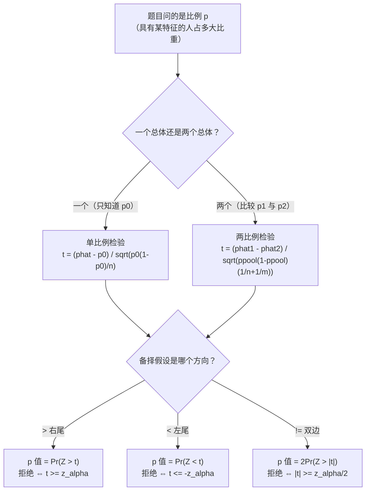

# STA2002 概率与统计 II · 第 8 讲笔记
## Hypothesis Testing III（假设检验 III）

> 授课：Zhenxing Guo、Ka Wai Tseng（香港中文大学（深圳）数据科学学院，2026 年 10 月）
> 教材：Hogg, Tanis & Zimmerman (2015) *Probability and Statistical Inference*, 9th ed., Pearson
> 对应教材章节：**第 8.3 节 Tests About Proportions**（讲义第 2 页给出 "Suggested reading: Chapter 8.3 of the textbook"）。这一节同时包含讲义**没有讲**的两块内容（功效与第二类错误、两比例之差的置信区间），我在 §8 补上并逐项复算。
> 材料构成：讲义 `Lecture8 - Hypothesis Testing III.pdf`（**17 页**）。**本讲没有收到课堂板书**，因此全文没有 `【板书 NN】` 标记，也不设「板书原图」一节；凡属我补充、推导或复算的部分，一律用 **【补】** 标出，并在文末诚实备注中逐条列出。
> **组织方式**：正文**按讲义（PPT）的页序**撰写，讲义每一页都能在正文里找到对应位置（对照表见 §0）。17 页**每一页都含公式或表格**，已全部渲染成图片逐张核对；两道例题、讲义汇总表、教材 §8.3 的六个数字、以及"讲义用的判据到底有多好"这一节，都用**精确二项枚举**独立复算（见 §9.3 与文末数值复算表）。

---

## 0. 本讲地图（先说清楚这一讲在干什么）

前两讲把假设检验的框架搭完、把**均值**和**方差**两类参数都做了一遍：

- 第 6 讲：单个均值的检验（$\sigma^2$ 已知用 $Z$，未知用 $t$）；
- 第 7 讲：两个均值是否相等（Pooled / Welch / Paired $t$）、两个方差是否相等（$F$）。

本讲换一类参数：**比例（proportion）**，也就是"总体里具有某个特征的人占多大比重"。

讲义第 2 页把范围写得很直白：

> In this lecture we will continue our journey in hypothesis testing and discuss hypothesis testing for proportions.
> Recall that, we have already learned the following tests:
> - Pooled t-test / Welch's t-test / Paired t-test / F-test
> Suggested reading: Chapter 8.3 of the textbook.

交付三件事：

1. **一个比例的检验**（第 3–10 页）：统计量构造 + 三个方向（$>$、$<$、$\neq$）+ 一道例题；
2. **两个比例是否相等的检验**（第 11–16 页）：合并比例的由来 + 双边判定 + 一道例题；
3. **一张六行的汇总表**（第 17 页）：两个家族 × 三个方向。

| 讲义页 | 内容 | 本笔记 |
| --- | --- | --- |
| 第 1 页 | 封面 | —— |
| 第 2 页 | Introduction：本讲覆盖什么 | §1 |
| 第 3 页 | 单比例：参数与 Bernoulli 建模 | §2.1 |
| 第 4 页 | $Y$ 的分布、矩、CLT 与 $\hat p$ 的近似分布 | §2.2–§2.3 |
| 第 5 页 | 检验统计量 $T$ 与它的零分布 | §2.4 |
| 第 6 页 | 单比例右尾检验 $H_1:p>p_0$ | §3.1 |
| 第 7 页 | 单比例左尾检验 $H_1:p<p_0$ | §3.2 |
| 第 8 页 | 单比例双边检验 $H_1:p\neq p_0$ | §3.3 |
| 第 9 页 | 例题一：骰子（题干 + 统计量） | §4.1 |
| 第 10 页 | 例题一：解答（三条路 + $\alpha=0.1$） | §4.2–§4.4 |
| 第 11 页 | 两比例：设定与目标 | §5.1 |
| 第 12 页 | 两比例：两个 MLE 与渐近分布 | §5.2 |
| 第 13 页 | 两比例：$H_0$ 下的方差 + 那个没答的问题 | §5.3 |
| 第 14 页 | 两比例：合并估计与统计量 | §5.4 |
| 第 15 页 | 两比例：双边判定规则 | §5.5 |
| 第 16 页 | 例题二：低出生体重 | §6 |
| 第 17 页 | Summary 六行汇总表 | §7 |
| — | 【补】讲义用的判据有多好（score vs Wald） | §3.4 与 §8.5 |
| — | 【补】教材 §8.3 有而讲义没有的内容 | §8 |
| — | 速查表 / 核心直觉 / 术语对照 / 诚实备注 | §9–§12 |

### 0.1 一句话概括本讲的结构

> [!IMPORTANT]
> **本讲没有出现 $t$ 分布，也没有出现任何自由度。** 全部六个检验用的都是标准正态 $N(0,1)$ 的近似。
>
> 原因不是"比例比较特殊"，而是一个可以直接说清的事实：**比例的方差 $p(1-p)/n$ 是参数 $p$ 的函数**。所以
>
> - 单个比例检验里，$H_0:p=p_0$ **把方差也一起定死了**——分母 $\sqrt{p_0(1-p_0)/n}$ 在 $H_0$ 下是一个**已知常数**，不需要估任何东西 → 走 $Z$ 这条线（对照第 6 讲"$\sigma^2$ 已知"那一格）；
> - 两个比例检验里，$H_0:p_1=p_2$ 只说两个方差**相等**、没说等于多少 → 仍有一个未知量，要用数据估它 → 于是出现"合并比例" $\hat p=\frac{Y_1+Y_2}{n+m}$（对照第 7 讲的 Pooled $t$ 检验）。
>
> **整讲所以只有 $z$、没有 $t$，就是因为第 6 讲那个"$\sigma$ 已知还是未知"的分岔在这一讲被 $H_0$ 自己给定死了。**

### 0.2 与第 7 讲的逐格对照（这张表是我整理的，讲义没有画）

| 第 7 讲（均值 / 方差） | 第 8 讲（比例） |
| --- | --- |
| 单均值，$\sigma$ **已知** → $Z=\frac{\bar X-\mu_0}{\sigma/\sqrt n}$ | 单比例 → $Z=\frac{\hat p-p_0}{\sqrt{p_0(1-p_0)/n}}$，**分母在 $H_0$ 下是常数** |
| 单均值，$\sigma$ **未知** → $T=\frac{\bar X-\mu_0}{S/\sqrt n}\sim t(n-1)$ | **没有对应物**——比例的方差是 $p$ 的函数，$p$ 被 $H_0$ 定住，方差就跟着定住了 |
| Pooled $t$（假定 $\sigma_X^2=\sigma_Y^2$，把两组拼起来估一个共同方差） | 两比例（$H_0$ 说 $p_1=p_2$，把两组拼起来估一个共同比例 $\hat p$） |
| Welch $t$（不假定方差相等，各用各的） | 不合并的版本（各用 $\hat p_1,\hat p_2$）——教材 REMARK 提到，**数值差别很小**（§5.5 有量化） |
| 查 $t$ 表，自由度 $n-1$、$n+m-2$、$r$ | **一律查标准正态表，没有自由度** |

### 0.3 拿到一道比例检验题，怎么走

**这张图是我整理的，讲义没有画。** 它的两个分岔点正是本讲的两处结构判断：先问"一个还是两个总体"（决定要不要合并），再问"哪个方向"（决定把 $\alpha$ 放在哪一尾、要不要除以 2）。

### 0.4 来源标注约定

- 无标记 → 讲义原文或对讲义的直接展开；
- **【补】** → 讲义没有、由我补充、推导或复算的内容（文末诚实备注逐条列出，并注明是独立推导、模拟复算还是有教材依据）。

---

## 1. 本讲要交付什么（讲义第 2 页）

第 2 页除了给出范围，还做了一件容易被跳过的事：**把第 7 讲的四个检验列了一遍当作复习**。

这份复习清单本身有信息量：第 7 页讲过 **Pooled、Welch、Paired $t$、$F$** 四个工具，分别对应"两均值"和"两方差"。**四个全是连续型数据的工具**——这恰好说明本讲的必要性：前七讲的参数（$\mu$、$\sigma^2$）都是连续总体的参数，而"比例"是**离散的 Bernoulli 总体的参数**，只在"样本量足够大"时才能借用正态的那套工具。

顺着这条线，本讲与前几讲的关系可以一句话说清：

> **本讲是把第 6 讲的检验框架，套到第 5 讲已经处理过的二项/比例问题上。**

第 5 讲 §7.3–§7.4 已经交付了**两比例之差的置信区间**（用的是不合并的标准误），并且在 §7.4 留下一张表，明确写出"两比例相等性的假设检验要**合并**，用 $\bar p=\frac{Y_1+Y_2}{n_1+n_2}$"——**那张表里属于"检验"的那一行，本讲第 13–14 页给出了完整做法**。所以第 5 讲挂了两讲的伏笔（第 6、7 讲都没接），在本讲收口了。这一点在 §5.3 展开。

标题里的 **"III"** 也值得记一笔：第 6 讲是 Hypothesis Testing **I**、第 7 讲是 **II**、本讲是 **III**，说明这条线还会继续（教材第 8 章后面还有 §8.4 Wilcoxon、§8.5 功效、§8.6 最佳临界域，本讲一个都没碰——见 §12 的对账）。

---

## 2. 单个比例的检验：从 Bernoulli 到 $z$ 统计量（讲义第 3–5 页）

### 2.1 参数与建模（讲义第 3 页）

讲义原文：

> - Let $p$ be the proportion of population who has a certain characteristic.
> - To estimate $p$, we draw $n$ i.i.d. random samples $X_1,\dots,X_n\overset{\text{i.i.d.}}{\sim}\operatorname{Bernoulli}(p)$, where each $X_i$ is $1$ if the individual has the characteristic, and is $0$ if the individual does not have that characteristic.

这三行做的事是**把"比例"翻译成一个我们已经会处理的模型**：

- $p$ 是**总体的**比例（一个未知参数，是我们要推断的东西）；
- 抽样得到的是 $n$ 个**指示变量**（indicator）：抽到的人有该特征记 $1$、没有记 $0$；
- "有该特征的概率是 $p$、没有的概率是 $1-p$"这正好就是 $\operatorname{Bernoulli}(p)$ 的定义。

所以**比例问题 = Bernoulli 总体的均值问题**。这一步翻译是整个第 8 讲的起点：$p$ 就是 $\operatorname{Bernoulli}(p)$ 的期望，而后面所有的 $\hat p$ 都是"样本均值"。

> [!NOTE]
> 讲义的措辞 "the proportion of population who has a certain characteristic" 里有一个不太严谨的地方：**它没说清 $p$ 是哪个总体的比例**。严格写应该是"某个总体的成员中具有该特征的比例"。这不影响后面的推导（$p$ 全程只是一个 $[0,1]$ 上的未知常数），但写作业时建议补上"of **the** population"里的那个 the——同一句话在教材第 8.3 节里也是这么写的，属沿用。

### 2.2 $Y$ 的分布与矩（讲义第 4 页上）

讲义原文：

> Denote $Y=\sum_{i=1}^n X_i\sim\operatorname{Binomial}(n,p)$, then $\mathbb E(Y)=np$ and $\operatorname{Var}(Y)=np(1-p)$.

三件事：

1. **$Y$ 的含义**：$n$ 个人里"有该特征"的**人数**。它是 $n$ 个独立同分布 Bernoulli 之和，所以服从二项分布 $\operatorname{Binomial}(n,p)$。
2. **$\mathbb E(Y)=np$**：$n$ 个 $1$ 的概率各为 $p$，加起来就是 $np$。
3. **$\operatorname{Var}(Y)=np(1-p)$**：独立和的方差等于方差之和，而单个 Bernoulli 的方差是 $p(1-p)$。

> [!TIP]
> **为什么讲义先讲 $Y$ 的矩，再讲 $\hat p$ 的分布？** 因为 $\hat p=Y/n$，而"除以常数"这件事对矩的处理是机械的：
> $$\mathbb E(\hat p)=\frac{\mathbb E(Y)}{n}=p,\qquad \operatorname{Var}(\hat p)=\frac{\operatorname{Var}(Y)}{n^2}=\frac{np(1-p)}{n^2}=\frac{p(1-p)}{n}.$$
> 于是 $\hat p$ 是 $p$ 的**无偏**估计量（$\mathbb E\hat p=p$，第 2 讲的无偏性定义），标准误是 $\sqrt{p(1-p)/n}$。**注意这个标准误是 $\sqrt{\cdot/n}$ 而不是 $\sqrt{\cdot}/\sqrt n$ 的某个别的形式——分母那个 $n$ 是从 $\operatorname{Var}(Y)$ 除以 $n^2$ 来的**。

### 2.3 大样本下的近似分布（讲义第 4 页下）

讲义原文：

> Moreover, if $n$ is large enough, then by Central Limit Theorem, we have
> $$\hat p=\frac Yn=\frac{\sum_{i=1}^nX_i}{n}\overset{\text{approx}}{\sim}N\!\left(p,\ \frac{p(1-p)}{n}\right).$$

**这一行是本讲所有检验的根基**，值得把"为什么"补出来：$\hat p$ 就是 $X_1,\dots,X_n$ 的**样本均值** $\bar X$，而第 4 讲讲过的中心极限定理说

$$\frac{\hat p-p}{\sqrt{p(1-p)/n}}\ \xrightarrow{\ d\ }\ N(0,1),$$

把分母乘过去、把 $p$ 挪到右边，就得到讲义那一行。**也就是说：讲义给的不是"$\hat p$ 恰好正态"，而是"$(\hat p-p)$ 除以它的标准误近似标准正态"**——这正是后面能构造出检验统计量的原因。

讲义用的记号是 $\overset{\text{approx}}{\sim}$（近似服从），这个记号要一直盯住：**它是近似，不是精确**。而两比例那一侧会看到，这个"近似"的来源其实有两个层次（一个是 CLT，另一个是把未知的 $p$ 换成 $\hat p$，见 §5.4）。

**【补】正态近似什么时候够用。** 讲义在 $n$ 后面加了一个括注 "if $n$ is large enough"，但**没有给"多大算大"**。常见的经验阈值有两档：

| 口径 | 阈值 | 说明 |
| --- | --- | --- |
| 宽松 | $np\ge5$ 且 $n(1-p)\ge5$ | 老教材的标准，$p$ 靠近 $0$ 或 $1$ 时不可靠 |
| 较严 | $np(1-p)\ge10$ | 用"方差足够大"来保证格点化误差被平滑掉 |

在本讲的语境下，更值得记的是**这类检验的第一类错误率在 $n$ 中等时会剧烈振荡**（因为 $Y$ 是离散的，拒绝域的边界不可能刚好落在整数格点上）。我在 §3.4 用精确二项枚举把这个振荡量出来了：在 $p_0=1/6$ 下，名义 $5\%$ 的检验实际水平是 $n=10$ 时 $0.0697$、$n=30$ 时 $0.0239$、$n=100$ 时 $0.0592$、$n=500$ 时 $0.0546$、$n=8000$ 时 $0.0512$。**"不单调"本身就说明这层误差是离散性造成的，而不是"样本越大越好"这句话能概括的。**

### 2.4 检验统计量与它的零分布（讲义第 5 页）

讲义原文：

> Given the null hypothesis test $H_0:p=p_0$, we construct the following test statistic,
> $$T:=\frac{\hat p-p_0}{\sqrt{p_0(1-p_0)/n}}.$$
> Under $H_0$, $T\sim N(0,1)$ approximately. Once we observe the data $x_1,\dots,x_n$, we can compute
> $$t=\frac{\hat p-p_0}{\sqrt{p_0(1-p_0)/n}},$$
> which is the realized value of $T$.

**构造的每一步都值得停下来问一句"为什么可以这么写"：**

1. **分子** $\hat p-p_0$：衡量"数据说 $p$ 大概是多少"与"$H_0$ 说 $p$ 应该是多少"差了多远。
2. **分母** $\sqrt{p_0(1-p_0)/n}$：把这个差**除掉它的标准误**，得到"差了几个标准差"。这一步叫标准化。
3. **最关键的一点：分母里写的是 $p_0$，不是 $\hat p$。**

第 3 点是这一页和整讲最容易被忽略、但考试最容易考出差别的地方。把它写清楚：

> [!IMPORTANT]
> **分母用 $p_0$，是因为"在 $H_0$ 成立的条件下"这个前提。** 在 $H_0$ 下检验统计量的分布必须是**完全确定的**（否则没法查表定临界值）。如果把分母写成 $\hat p(1-\hat p)/n$，那么分母本身也是随机的，$T$ 的分布就既不是正态也不是 $t$，得另想办法；而写成 $p_0(1-p_0)/n$，分母在 $H_0$ 下是一个**已知常数**，于是
> $$T=\frac{\hat p-p_0}{\text{常数}}\quad\Longrightarrow\quad T\overset{\text{approx}}{\sim}N(0,1).$$
> **这就是本讲没有 $t$ 分布的全部原因**（对照第 6 讲：那里 $\sigma$ 未知时要用 $S$ 去估，估值带随机性，才换来 $t$）。

> [!NOTE]
> 用统计学的话说，讲义这个统计量是**score 统计量（Rao score statistic）**，它的口径是"在 $H_0$ 处算方差"。与之相对，把分母换成 $\hat p$ 的版本（"用估计值算方差"）叫做 **Wald 统计量**。这两种写法在小样本下差别巨大，我在 §3.4 和 §8.5 用精确计算把它量了出来——**结论是讲义选的这一种好得多**，但教材那句"两种方法数值差不多"是有条件的。

**【补】一个更省事的等价写法。** 因为 $\hat p=Y/n$，分子的 $/n$ 与分母里 $\sqrt{1/n}$ 会约掉一部分，整理后有

$$t=\frac{Y-np_0}{\sqrt{n\,p_0(1-p_0)}}.$$

这个"用计数 $Y$ 而不用比例 $\hat p$"的形式在做题时更快（也不用先把 $Y$ 化成小数），两道例题我都用它复核过，与讲义结果逐位一致。

**【补】记号层面要留意。** 讲义在第 5 页把统计量记作 $T$、观测值记作 $t$（与第 6、7 讲一致），但第 9 页例题里把它写成了 $Z$，第 10 页解答里用的是 $t$，第 17 页汇总表表头又写 $T$。**四种写法指同一个东西**，原因是它近似服从标准正态，所以叫 $Z$ 也不算错。但抄笔记时建议统一用 $T$（随机变量）与 $t$（观测值），把 $Z$ 留给"标准正态分布"本身。这一点已记入 §12 的讲义疑点。

---

## 3. 三个方向的判定（讲义第 6–8 页）

三页的结构完全一样，都是"$p$ 值写什么 → 拒绝规则是什么 → 用 $\hat p$ 表示是什么"。下面逐页过，然后把两处讲义没讲透的地方（区间对偶、小样本修正）补上。

### 3.1 右尾：$H_1:p>p_0$（讲义第 6 页）

讲义原文：

> p-value is $\Pr(T>t;H_0)=\Pr(Z>t)$, where $Z\sim N(0,1)$.
> Reject $H_0$ at significance level $\alpha$ when
> $$\text{p-value}=\Pr(Z>t)\le\alpha\iff t\ge z_\alpha\iff\hat p\ge p_0+z_\alpha\sqrt{p_0(1-p_0)/n}.$$

**先解释 $p$ 值那一行。** $p$ 值的定义是"**在 $H_0$ 为真时**，检验统计量取到比观测到的更极端（朝着 $H_1$ 的方向）的值的概率"。备择假设是 $p>p_0$，所以"更极端"就是"$T$ 更大"，于是 $p$ 值 $=\Pr(T>t;H_0)$。又因为 $H_0$ 下 $T$ 近似 $N(0,1)$，所以这个概率与 $\Pr(Z>t)$ 相等（$Z$ 是标准正态）。

**再解释第三个等价式，因为它把判据从"统计量尺度"翻译回了"$\hat p$ 尺度"。** 逐步推：

$$t\ge z_\alpha
\iff \frac{\hat p-p_0}{\sqrt{p_0(1-p_0)/n}}\ge z_\alpha
\iff \hat p-p_0\ge z_\alpha\sqrt{\frac{p_0(1-p_0)}{n}}
\iff \hat p\ge p_0+z_\alpha\sqrt{\frac{p_0(1-p_0)}{n}}.$$

**怎么读最后这一行**：它在说"样本比例要比 $p_0$ 高出至少 $z_\alpha$ 个标准误，才拒绝"。$z_\alpha$ 是**门槛的尺度**（$\alpha=0.05$ 时 $z_{0.05}=1.645$），后面那一坨是把尺度换算成 $\hat p$ 的单位。这和第 6 讲讲过的"把临界域判据翻译成区间判据"是同一件事，只是这一讲的"区间"可以**反解出来**（§3.3）。

### 3.2 左尾：$H_1:p<p_0$（讲义第 7 页）

讲义原文：

> p-value is $\Pr(T<t;H_0)=\Pr(Z<t)$.
> Reject $H_0$ when $\text{p-value}=\Pr(Z<t)\le\alpha\iff t\le-z_\alpha\iff\hat p\le p_0-z_\alpha\sqrt{p_0(1-p_0)/n}$.

**注意 $t\le-z_\alpha$ 里那个负号**（不是 $t\le z_\alpha$）。这和第 7 讲的 Paired $t$ 检验犯过的错一模一样：左尾的临界值在**左半边**，所以门槛是 $-z_\alpha$。**若把负号漏掉，$t$ 取小的正值时也会误拒。**

### 3.3 双边：$H_1:p\neq p_0$（讲义第 8 页）

讲义原文：

> p-value is $\Pr(\lvert T\rvert>\lvert t\rvert;H_0)=2\Pr(Z>\lvert t\rvert)$.
> Reject $H_0$ when $\text{p-value}=2\Pr(Z>\lvert t\rvert)\le\alpha\iff\lvert t\rvert\ge z_{\alpha/2}$
> $\iff\hat p\ge p_0+z_{\alpha/2}\sqrt{p_0(1-p_0)/n}$ **or** $\hat p\le p_0-z_{\alpha/2}\sqrt{p_0(1-p_0)/n}$.

三处要注意：

1. **为什么是 $2\Pr(Z>\lvert t\rvert)$**：标准正态关于 $0$ 对称，"$\lvert T\rvert>\lvert t\rvert$"就是"$T>|t|$ 或 $T<-|t|$"，两个尾巴等长，所以乘 $2$。
2. **为什么门限是 $z_{\alpha/2}$ 而不是 $z_\alpha$**：$\alpha$ 要摊到**两个尾巴**上，每边 $\alpha/2$。**这是本讲最高频的错点**（第 7 讲的错误对照表里第一条就是这个）。
3. **为什么"或"**：$\hat p$ 太大或太小**都要拒绝**——双边检验不问方向，只问"离 $p_0$ 远不远"。

### 3.4【补】第三条判据的对偶区间：它其实是 Wilson 区间，不是 Wald 区间

这一段是本讲我认为最有价值的一处补充，因为它把第 4、5 讲那条"区间估计"的线接到检验上，并顺手解释了教材 REMARK 里那段含糊的权衡。

**先看接受域。** 双边检验"不拒绝 $H_0$"的条件是

$$\lvert\hat p-p_0\rvert<z_{\alpha/2}\sqrt{\frac{p_0(1-p_0)}{n}}$$

把它看成关于 $p_0$ 的不等式（$\hat p$ 是数据、固定；$p_0$ 是变量）。两边平方、乘 $n$：

$$n(\hat p-p_0)^2<z^2p_0(1-p_0),\qquad z:=z_{\alpha/2}.$$

展开移项，得到关于 $p_0$ 的**一元二次不等式**：

$$(n+z^2)p_0^2-(2n\hat p+z^2)p_0+n\hat p^2<0.$$

二次项系数 $n+z^2>0$，所以"不拒绝"的那一段就是**两根之间**的区间。求根并整理（这里用了一个小技巧：把 $2n\hat p+z^2$ 写成 $2(n+z^2)\big(\hat p+\frac{z^2}{2n}\big)-\cdots$，把根写成对称形式），两根恰好是

$$p_0=\frac{\hat p+\dfrac{z^2}{2n}\pm z\sqrt{\dfrac{\hat p(1-\hat p)}{n}+\dfrac{z^2}{4n^2}}}{1+\dfrac{z^2}{n}}.$$

**这就是 Wilson 区间（Wilson score interval）**——一个把中心向 $0.5$ 收缩、把宽度按 $p_0$ 而不是 $\hat p$ 计算出来的区间。

> [!IMPORTANT]
> 于是"讲义第 8 页第三条判据"和"$p_0$ 落在这个区间里"是**同一件事的两种写法**：拒绝 $H_0$ $\iff$ $p_0$ 不在 Wilson 区间内。
>
> **这和第 5 讲的 Wald 区间不是同一个区间！** 第 5 讲的做法是把标准误里的 $p$ 换成 $\hat p$，得到 $\hat p\pm z\sqrt{\hat p(1-\hat p)/n}$（Wald 区间）；而讲义第 8 页的判据反解出来是 Wilson 区间。**教材第 386 页的 REMARK 讲的正是这个权衡**，原话是：用表里那种"把 $p_0$ 放在分母"的写法"we do get better approximations to $\alpha$-level significance tests"，但换成 $\hat p$ 的写法"tie together the use of confidence intervals and tests of hypotheses"——**一个口径更准，另一个口径能和区间对上，两者不可兼得。**

**数值验证（我做的）：**

| 检验 | 结果 |
| --- | --- |
| 48000 组随机构型（随机 $n\le400$、随机 $y$、随机 $\alpha$）上，"$p_0$ 在接受域内"与"$p_0\in$ Wilson 区间"**不一致 $0$ 次** | 二次反解与 Wilson 公式完全等价 ✓ |
| 骰子例题（$n=8000$，$\hat p=0.173625$）：Wilson 的 $95\%$ 区间 $(0.165482,\ 0.182082)$ | $p_0=1/6=0.166667$ **在区间内** → 不拒绝，与讲义一致 ✓ |
| 骰子例题：Wilson 的 $90\%$ 区间 $(0.166770,\ 0.180701)$ | $1/6$ **在区间外** → $\alpha=0.1$ 下拒绝，与讲义一致 ✓ |
| 对照：Wald 的 $95\%$ 区间 $(0.165325,\ 0.181925)$ | 也含 $1/6$，但左端比 Wilson 更左、右端比 Wilson 更右（区间更长） |

**两条读法上的收益：**

1. 骰子这道题以后可以**一句话说完**："$1/6$ 落在 $90\%$ 区间外、落在 $95\%$ 区间内"，比"$p$ 值 $=0.0949$ 卡在 $0.05$ 和 $0.10$ 之间"更直观。
2. 这个区间永远不会跑出 $[0,1]$（$n=10$、$\hat p=0$ 时 Wilson 给的是 $(0,\ 0.28)$ 这种合法区间），而 Wald 区间会给出负的下界——**这是 Wald 区间在小样本/极端 $p$ 下的经典病，见 §8.5。**

### 3.5【补】小样本怎么办：连续性修正与精确二项检验

讲义的判据是**连续的正态近似**，但 $Y$ 是**整数**。修正的办法按"精度递增"有三档：

**(a) 连续性修正（continuity correction）。** 把分子的整数跳跃补偿掉：用 $Y-np_0$ 时减去 $1/2$，

$$t_{\text{cc}}=\frac{\lvert Y-np_0\rvert-0.5}{\sqrt{n\,p_0(1-p_0)}}.$$

骰子例题上：$t$ 从 $1.670$ 降到 $1.655$，对应双边 $p$ 从 $0.0949$ 变成 $0.0979$。**结论没变**（$5\%$ 下仍不拒绝、$10\%$ 下仍拒绝）。

> [!TIP]
> 修正虽小，但**在临界点附近会翻结论**。教材习题 8.3-3（$n=192$、拒绝域 $Y\ge152$、$p_0=0.75$）就是现成的例子：不修正的正态近似给 $\alpha=0.0912$，**修正后是 $0.1056$，而精确值是 $0.1040$**。也就是说"修不修正"在这里差了 $0.014$，而精确值明显站在修正那一侧。这是本讲最值得记住的一个"修正必要性"的证据。

**(b) 精确二项检验。** 直接算 $p$ 值 $=\sum_{y\in C}\binom{n}{y}p_0^y(1-p_0)^{n-y}$，不依赖任何近似。骰子例题上：

- 精确**单边** $p$ 值 $=\Pr(Y\ge1389\mid p=1/6)=0.049539$——**恰好 $\le0.05$**。事实上 $y=1389$ 正是精确单边 $5\%$ 检验的**最小拒绝点**（$y=1388$ 时是 $0.050630>0.05$）。
- 精确**双边** $5\%$ 的最小拒绝点是 $y=1400$（$0.049753$）；$y=1389$ 的精确双边 $p$ 值是 $0.099078>0.05$——**与讲义"不拒绝"的结论一致**。
- 精确**双边** $10\%$ 的最小拒绝点恰好是 $y=1389$（$0.099078\le0.10$）——**与讲义"$\alpha=0.1$ 时会拒绝"的结论也一致**。

**(c) 大样本下用 Fisher 精确检验**（两个比例的情形，条件检验，见 §6.4）。

> [!WARNING]
> **三个口径给三个不同的 $p$ 值，别混用：**骰子这道题上，双边 $p$ 值是
> 近似 $0.0949$ < 连续性修正 $0.0979$ < 精确 $0.0991$。
> 它们的排序是有规律的（精确与修正最接近），但**只有当三者都落在 $\alpha$ 的同一侧时，结论才"稳"**。本题恰好三者都落在同一侧（$5\%$ 不拒、$10\%$ 拒），这是运气，不是必然。

---

## 4. 例题一：骰子（讲义第 9–10 页）

### 4.1 题目与统计量（讲义第 9 页）

讲义原文（题目框）：

> It was claimed that many commercially manufactured dice are not fair because the "spots" are really indentations, so that, for example, the 6-side is lighter than the 1-side. Let $p$ equal the probability of rolling a 6 with one of these dice. To test $H_0:p=1/6$ against the alternative hypothesis $H_1:p\neq1/6$ with the significance level $\alpha=5\%$, several such dice will be rolled to yield a total of $n=8000$ observations, and the number 6 appears $1389$ times.

> Let $Y$ equal the number of times that $6$ resulted in the $8000$ trials. The test statistics is
> $$Z=\frac{Y/n-1/6}{\sqrt{1/6\cdot5/6/n}}\overset{\text{approx}}{\sim}N(0,1).$$

**读题时该抓的三件事：**

1. **$p$ 是"掷出 6 的概率"**，$H_0:p=1/6$ 就是"骰子公平"；
2. **题干给的物理机制是"凹点使 6 面更轻"**——注意这句话是**有方向的**，它预测的是 $p>1/6$。这一点在 §4.3 会变成一个大问题；
3. $n=8000$ 是很大的样本，所以正态近似在这里应当很可靠。

**关于那一行统计量，两处要说明：**

- 讲义把它记作 $Z$（第 5 页记作 $T$），但**它显然是第 5 页那个 $T$**，只是换成了标准正态的名字；
- **分母的括号省略了**：讲义写 $\sqrt{1/6\cdot5/6/n}$，第 10 页解答里才写成 $\sqrt{(1/6)(5/6)/8000}$。按运算顺序 $\frac16\cdot\frac56\div n$ 与 $(1/6)(5/6)/n$ 恰好等价（全是乘法），所以**不是错，只是排版省了括号**；但如果写成 $\sqrt{1/(6\cdot5/6)/n}$ 就是另一个意思了。抄的时候建议把括号写全。

### 4.2 解答与数值复算（讲义第 10 页）

讲义原文：

> Compute
> $$t=\frac{1389/8000-1/6}{\sqrt{(1/6)(5/6)/8000}}=1.67,\qquad z_{\alpha/2}=z_{0.025}=1.96$$
> - Critical region approach: $\lvert t\rvert=1.67<1.96$, so we fail to reject $H_0$ at $5\%$ significance level.
> - p-value approach: $2\Pr(Z>1.67)=0.0949>0.05$, and so we fail to reject $H_0$ at $5\%$ significance level.
> - However, if we set $\alpha=0.1$ with $z_{0.05}=1.64$, then we would reject $H_0$ at $10\%$ significance level.

**我的复算（逐项）：**

| 量 | 我的结果 | 讲义 | 判定 |
| --- | --- | --- | --- |
| $\hat p=1389/8000$ | $0.173625$ | —— | —— |
| 标准误 $\sqrt{(1/6)(5/6)/8000}$ | $0.004166667=\dfrac{1}{240}$ **（正好是 $1/240$）** | —— | 精确 |
| $t$ | $\dfrac{0.0069583333}{0.0041666667}=1.670000$ | $1.67$ | **恰好 $1.67$** ✓ |
| $z_{0.025}$ | $1.959964$ | $1.96$ | ✓ |
| 双边 $p$ 值 $2\Pr(Z>1.67)$ | $0.094919$ | $0.0949$ | ✓ |
| $z_{0.05}$（供 $\alpha=0.1$ 用） | $1.644854$ | $1.64$ | ✓ |

**两处顺手的观察：**

1. **$t$ 恰好等于 $1.67$ 不是巧合。** 因为 $8000/6=1333.333\ldots$，$\sqrt{8000\cdot\frac{5}{36}}=\frac{200}{6}=33.333\ldots$，于是 $t=\frac{1389-1333.333\ldots}{33.333\ldots}=\frac{55.666\ldots}{33.333\ldots}=1.67$——**分母那个 $1/240$ 与分子的 $/8000$ 在这里正好凑成整数比**。
2. **讲义第 10 页那个 "if we set $\alpha=0.1$ with $z_{0.05}=1.64$" 的写法容易误读。** 它是**对的**（双边检验在 $\alpha=0.1$ 时查的确实是 $z_{\alpha/2}=z_{0.05}=1.645$），但字面上没有点出那个 $\alpha/2$，读起来像是"$\alpha$ 取 $0.1$ 却查 $0.05$ 的表"。建议抄成："双边 $\alpha=0.1\Rightarrow$ 每尾 $0.05\Rightarrow$ 门限 $z_{0.05}=1.645$"。

### 4.3【补·本讲最重要的一处】讲义把教材的**单边**改成了**双边**，从而把结论从"拒绝"翻成了"不拒绝"

这一道例题**出自教材 Example 8.3-1**。把教材原文调出来对照，会发现一处**实质性的改写**：

| | 教材 Example 8.3-1 | 讲义第 9–10 页 |
| --- | --- | --- |
| 备择假设 | $H_1:p>1/6$（**单边**） | $H_1:p\neq1/6$（**双边**） |
| $\alpha$ | $0.05$ | $5\%$ |
| 门限 | $z\ge z_{0.05}=1.645$ | $\lvert t\rvert\ge z_{0.025}=1.96$ |
| 算出的统计量 | $z=1.67$ | $t=1.67$（同） |
| **结论** | $1.67>1.645$，**拒绝 $H_0$**，"these dice favor a 6 more than a fair die would" | $1.67<1.96$，**不拒绝 $H_0$** |
| $p$ 值 | $0.0475$（单边） | $0.0949$（双边 $=2\times0.0475$） |

**同一份数据、同一个 $\alpha=0.05$、同一个 $t=1.67$，只因为备择假设的单双之分，结论从"这些骰子偏向 6"变成"没有证据说它不公平"。**

> [!WARNING]
> **这道题真正的问题在于：题干自己已经说了方向，检验却舍弃了这个方向。**
>
> 题干那句 "the **6-side is lighter** than the 1-side" 是一条**有方向的物理机制**——它预测 $p>1/6$，而不是"$p\neq1/6$"。既然机制是单向的，单边检验 $H_1:p>1/6$ 才是与题干一致的检验；用双边，等于把这个先验信息丢掉，代价是**功效打了大约七折**：
>
> | 口径（$n=8000$，真值取观测到的 $\hat p=0.173625$） | 功效 |
> | --- | --- |
> | 单边 $H_1:p>1/6$，$\alpha=0.05$ | $0.5046$ |
> | 双边 $H_1:p\neq1/6$，$\alpha=0.05$ | $0.3886$ |
>
> 也就是说，在"骰子确实偏心"这个前提下，单边检验有一半机会查出它，双边只有不到四成。

**谁对谁错？两件事要分开说：**

1. **从"教学意图"看，讲义改成双边是合理的。** 第 9–10 页是"单比例检验"这一节的例题，而这一节要同时演示三个方向（第 6–8 页刚讲完三个方向的判据），选双边正好能用上"$\lvert t\rvert\ge z_{\alpha/2}$"这一行，也能顺带演示"结论依赖 $\alpha$"（$\alpha=0.1$ 时拒绝）这个教学点。教材那道单边题只需要 $t\ge z_\alpha$ 一行，信息量少一半。
2. **但从"统计实践"看，题干的机制是单向的，双边检验浪费了信息。** 现实里遇到这类"有明确机制预测方向"的问题，应当先写清机制再决定单双边，而不是为了练公式把单边改成双边。

**顺带一个必须记的结论**：这一改写让**教材的 $p$ 值是讲义的一半**（$0.0475$ vs $0.0949$），也因此**教材在 $5\%$ 下拒绝、讲义在 $5\%$ 下不拒绝**。如果只读讲义而不看教材，你会以为这道题的答案是"不拒绝"；而它的原始版本答案是"拒绝"。**这和第 7 讲 §8.4 遇到的"同一份数据、同一个 $\alpha$，单边拒绝而双边不拒绝"是同一个现象，只是这次是跨版本（教材 vs 讲义）出现的。**

### 4.4【补】三种口径的总对照

把 §3.5 的三个口径都算一遍，题目是"$\alpha=0.05$ 和 $\alpha=0.10$ 下分别拒还是不拒"：

| 口径 | $\hat p$ 尺度判据 | $t$（或 $z$） | 双边 $p$ 值 | $\alpha=0.05$ | $\alpha=0.10$ |
| --- | --- | --- | --- | --- | --- |
| 正态近似（讲义） | $\lvert\hat p-1/6\rvert\ge z_{\alpha/2}\cdot0.0041667$ | $1.670000$ | $0.094919$ | **不拒绝** | **拒绝**（$1.670>1.645$） |
| 连续性修正 | 同上，用 $t_{\text{cc}}$ | $1.655000$ | $0.097924$ | **不拒绝** | **拒绝**（$1.655>1.645$） |
| 精确二项 | $Y\ge$ 最小拒绝点 | —— | $0.099078$ | **不拒绝**（要点 $y\ge1400$） | **拒绝**（要点 $y\ge1389$，本题恰好在点上） |
| Wilson 区间对偶 | $1/6\notin$ 区间 | —— | —— | **不拒绝**（$95\%$ 区间含 $1/6$） | **拒绝**（$90\%$ 区间不含） |

**四行结论完全一致**——这是本题值得记的地方：虽然三个 $p$ 值互不相同（$0.0949$ / $0.0979$ / $0.0991$），但因为题目离两侧临界点都还有距离，**四种口径给同一个答案**。真正危险的是"卡在 $\alpha$ 边缘"的题（教材习题 8.3-14(c) 就是，见 §6.5）。

---

## 5. 两个比例相等的检验（讲义第 11–15 页）

### 5.1 设定与目标（讲义第 11 页）

讲义原文：

> Suppose that we have two populations, namely population 1 and population 2. Let $p_1$ and $p_2$ be the proportion of population 1 and population 2, respectively, who has a certain characteristic. Our goal is to carry out testing on $H_0:p_1=p_2$ against possible alternative hypothesis $H_1$.

**只做了一件事：把"一个比例"变成"两个比例"。** 这里可以直接借第 7 讲 §3 的读法：

- $H_0:p_1=p_2$ 相当于把"两个总体的参数"约束成**一个**未知量（它们相等，但等于多少不知道）；
- 与第 7 讲的 $H_0:\mu_X=\mu_Y$ 结构完全一致，所以"先看设计、再看参数"的分岔顺序在这里用不上——比例的两总体问题没有"配对"那一支（配对需要用同一批对象作两次指示，那样得到的是一对相关 Bernoulli，讲义没有涉及）。

### 5.2 两个样本、两个 MLE（讲义第 12 页）

讲义原文：

> Denote the samples to be $X_{1,1},\dots,X_{1,n}\overset{\text{i.i.d.}}{\sim}\operatorname{Bernoulli}(p_1)$ and $X_{2,1},\dots,X_{2,m}\overset{\text{i.i.d.}}{\sim}\operatorname{Bernoulli}(p_2)$, and assume that they are independent.
> Denote the sums to be $Y_1=\sum_{i=1}^nX_{1,i}\sim\operatorname{Binomial}(n,p_1)$ and $Y_2=\sum_{i=1}^mX_{2,i}\sim\operatorname{Binomial}(m,p_2)$.
> MLEs of $p_1$ and $p_2$ are $\hat p_1=\dfrac{Y_1}{n},\ \hat p_2=\dfrac{Y_2}{m}$.
> If $n$ and $m$ are large enough, then by Central Limit Theorem, we have
> $$\hat p_1-\hat p_2\overset{\text{approx}}{\sim}N\!\left(p_1-p_2,\ \frac{p_1(1-p_1)}{n}+\frac{p_2(1-p_2)}{m}\right).$$

**逐项读：**

1. **两组样本量分别是 $n$ 和 $m$**（讲义沿用第 7 讲的记号；教材 §8.3 用的是 $n_1,n_2$，见 §5.6 的记号对照）；
2. **两组独立**——这一点是"两个样本"的前提，也是方差可以直接相加的原因；
3. **$\hat p_1,\hat p_2$ 是 MLE**：对 $\operatorname{Binomial}(n,p_1)$ 做极大似然，得到的就是 $\hat p_1=Y_1/n$。第 2 讲已经证明过这个 MLE，这里只是换个参数用一次；
4. **最后一行的方差是两个方差之和** $\frac{p_1(1-p_1)}{n}+\frac{p_2(1-p_2)}{m}$——**这就是"差的标准误"里"方差相加"的来历**（独立才可加）。

### 5.3 $H_0$ 下的方差，与讲义那个没答的问题（讲义第 13 页）

讲义原文：

> We will only derive the two-sided test. The one-sided test is very similar.
> Under $H_0$, $p_1=p_2$, and we have
> $$\hat p_1-\hat p_2\overset{\text{approx}}{\sim}N\!\left(0,\ p_1(1-p_1)\left(\frac1n+\frac1m\right)\right).$$
> However, we only know $p_1=p_2$ but the value of $p_1$ is unknown.
> **Question: What is the distribution of $Y_1+Y_2$ under $H_0$?**

**这四行是整讲最精妙的一处，值得慢慢拆。**

**第一层：$H_0$ 带来了什么。** 把 $p_2=p_1$ 代进上一页的方差：

$$\frac{p_1(1-p_1)}{n}+\frac{p_2(1-p_2)}{m}\ \xrightarrow{\ H_0\ }\ \frac{p_1(1-p_1)}{n}+\frac{p_1(1-p_1)}{m}=p_1(1-p_1)\left(\frac1n+\frac1m\right).$$

**两个未知的方差变成了一个**（这就是"$H_0$ 简化问题"的具体体现）。

**第二层：还差什么。** 均值现在是 $0$（好办），但方差里那个 $p_1$ **还是不知道**。所以不能直接说 $T$ 服从标准正态——**分母里还有未知量**。

**第三层：讲义那个问题的答案。** 讲义把问题抛出来就翻页了，下一行直接给出 $\hat p=\frac{Y_1+Y_2}{n+m}$。这个跳跃需要补上：

> [!IMPORTANT]
> **在 $H_0$ 下 $Y_1+Y_2\sim\operatorname{Binomial}(n+m,\ p)$。**
>
> 理由是"把两组拼起来看"：$H_0$ 说两组人是**同一个总体**（同样有该特征的概率 $p$），而且两组样本独立，所以 $X_{1,1},\dots,X_{1,n},X_{2,1},\dots,X_{2,m}$ 合起来就是 $n+m$ 个独立同分布的 $\operatorname{Bernoulli}(p)$。n 个 Bernoulli 之和是二项分布，$n+m$ 个的和当然也是：$Y_1+Y_2\sim\operatorname{Binomial}(n+m,p)$。
>
> 于是 $H_0$ 下 $p$ 的 MLE 就是**合并比例** $\hat p=\frac{Y_1+Y_2}{n+m}$——和单个比例的情形一模一样（$\hat p=$ 成功数 / 总试验数）。
>
> > [!NOTE]
> > 这一行的意义不只是"答案"。它解释了**为什么第 5 讲 §7.4 那张表里"检验要合并"**：合并估计不是我随手挑的写法，而是 **$H_0$ 所假设的模型下、$p$ 的极大似然估计**。$H_0$ 说只有**一个** $p$，所以估它就要用**所有**数据。

**第四层：为什么不能各用各的。** 一个自然的疑问是：$H_0$ 下 $\hat p_1$ 与 $\hat p_2$ 都是 $p$ 的无偏估计，随便挑一个行不行？不行，因为**合并估得更准**。在 $H_0$ 下 $\operatorname{Var}(\hat p_1)=\frac{p(1-p)}{n}$、$\operatorname{Var}(\hat p)=\frac{p(1-p)}{n+m}$，后者显然更小（用 $n+m$ 个数据估一个参数，比用 $n$ 个估得准）。**这个"在 $H_0$ 下合并以求方差更小"的逻辑，与第 7 讲 Pooled $t$ 检验用 $S_p^2$ 合并两组方差是同一个思路。**

**第五层（讲义没写但很关键）：为什么这里需要 Slutsky，而单比例那一侧不需要。**

| | 分母 | 是否随机 | 需要的定理 |
| --- | --- | --- | --- |
| 单比例 $T$ | $\sqrt{p_0(1-p_0)/n}$ | **常数**（$p_0$、$n$ 都是给定数） | **只要 CLT**（第 4 讲） |
| 两比例 $T$ | $\sqrt{\hat p(1-\hat p)(1/n+1/m)}$ | **随机的**（$\hat p$ 是统计量） | **CLT + Slutsky**（第 4 讲 §7 那个工具） |

**这一步把两边的"技术含量"区分开了**：单比例那侧是纯粹的标准化；两比例这侧多了一次"把未知参数换成相合估计"的动作——而这一步由 Slutsky 定理（第 4 讲 §7）担保，$\hat p\xrightarrow{p}p$ 加上连续映射定理就够。

**【补·接第 5 讲的话】** 第 5 讲 §7.4 那张表把"两比例之差的**区间**"（不合并）与"两比例相等性的**检验**"（合并）并排放着，并提醒"这两行用同一组数据、却用不同的标准误，非常容易记混"。**那一行的检验做法，就是本页到下一页。** 判据只有一句：**在 $H_0$ 下合并，是因为 $H_0$ 说两组是同一个 $p$；区间不合并，是因为区间必须对 $p_1\neq p_2$ 的所有情况都成立。**

### 5.4 合并估计与检验统计量（讲义第 14 页）

讲义原文：

> Approximate $p_1$ by $\hat p=\dfrac{Y_1+Y_2}{n+m}$.
> Construct the test statistic,
> $$T:=\frac{\hat p_1-\hat p_2}{\sqrt{\hat p(1-\hat p)(1/n+1/m)}}.$$
> Under $H_0$, $T\overset{\text{approx}}{\sim}N(0,1)$.
> Once we observe the data $y_1$ and $y_2$, we can compute
> $$t=\frac{y_1/n-y_2/m}{\sqrt{\hat p(1-\hat p)(1/n+1/m)}}.$$

> [!WARNING]
> **记号陷阱（本页最容易出错的地方）：$\hat p$ 在这两页里换过一次意思。**
>
> - 第 12 页：$\hat p_1,\hat p_2$ 是**各自**的比例；
> - 第 14 页：$\hat p$ 单独出现时指的是**合并**比例 $\frac{Y_1+Y_2}{n+m}$。
>
> 教材为了避免这个问题用的是 $\bar p$ 或带下标的 $\hat p$。**写作业时建议严格写成** $\hat p_{\text{pool}}$（或 $\bar p$），别留下光秃秃的 $\hat p$——本笔记在需要时一律写 $\hat p_{\text{pool}}$。

**再补一句 $t$ 那个式子的结构**：分子是两组比例的差（无度量），分母是这个差的标准误（与分子同度量），所以比值无量纲——和前面所有检验统计量一样。

### 5.5 双边判定规则（讲义第 15 页）

讲义原文：

> p-value is $\Pr(\lvert T\rvert>\lvert t\rvert;H_0)=2\Pr(Z>\lvert t\rvert)$, and we reject $H_0$ at significance level $\alpha$ when
> $$\text{p-value}=2\Pr(Z>\lvert t\rvert)\le\alpha\iff\lvert t\rvert\ge z_{\alpha/2}\iff\lvert\hat p_1-\hat p_2\rvert\ge z_{\alpha/2}\sqrt{\hat p(1-\hat p)(1/n+1/m)}.$$

**结构上和 §3.3 完全一样**（双边 → 乘 $2$ → 门限 $\alpha/2$ → 绝对值）。唯一的新东西是分母换成了合并标准误。

**【补】单边版本（讲义说 "very similar" 就没写，但第 17 页汇总表列了三行，所以补全）：**

| 方向 | $p$ 值 | 拒绝规则 |
| --- | --- | --- |
| $H_1:p_1>p_2$ | $\Pr(T>t)$ | $t\ge z_\alpha$，即 $\hat p_1-\hat p_2\ge z_\alpha\sqrt{\hat p_{\text{pool}}(1-\hat p_{\text{pool}})(1/n+1/m)}$ |
| $H_1:p_1<p_2$ | $\Pr(T<t)$ | $t\le-z_\alpha$，即 $\hat p_1-\hat p_2\le-z_\alpha\sqrt{\hat p_{\text{pool}}(1-\hat p_{\text{pool}})(1/n+1/m)}$ |

**【补】"合并 vs 不合并"到底差多少？** 教材第 386 页的 REMARK 说两种写法 "provide about the same numerical result"。用例题二的数字（$n=200,y_1=22$；$m=100,y_2=16$）算一遍：

| 口径 | 标准误 | $t$ | 双边 $p$ 值 | 结论 |
| --- | --- | --- | --- | --- |
| **合并**（讲义与教材表里的写法） | $0.040735$ | $-1.227448$ | $0.219654$ | 不拒绝 |
| **不合并**（REMARK 提到的替代写法） | $0.042819$ | $-1.167695$ | $0.242930$ | 不拒绝 |

**这组数字上两者结论一致，$p$ 值差 $0.023$。** 但要注意样本量：本题是 $200$ 与 $100$，都算中等。**在 $n$ 很小或 $p$ 很极端时，"差不多"这句话会失效**——最极端的例子是 $\hat p_1=0$ 或 $1$，此时不合并的标准误有一半会变成 $0$，判据直接退化（§8.5 有量化）。

### 5.6【补】讲义与教材的记号对照表

| 对象 | 讲义 | 教材 §8.3 |
| --- | --- | --- |
| 第一组样本量 | $n$ | $n_1$ |
| 第二组样本量 | $m$ | $n_2$ |
| 第一组成功数 | $Y_1,\ y_1$ | $Y_1,\ y_1$ |
| 第二组成功数 | $Y_2,\ y_2$ | $Y_2,\ y_2$ |
| 单个比例检验统计量 | $T$（第 5 页）/ $Z$（第 9 页）/ $t$ | $Z$（随机变量）与 $z$（观测值） |
| 合并比例 | $\hat p$ | $\hat p$ 或 $\bar p$ |

**对照这件事有实际用处**：做教材习题时看到 $n_1,n_2$ 要立刻换成 $n,m$，看到 $z$ 要知道它对应的就是讲义的 $t$。

---

## 6. 例题二：低出生体重（讲义第 16 页）

### 6.1 题目与解答

讲义原文（题目框）：

> In a sample of $n=200$, we have $y_1=22$ low birth weight babies in Country 1. In a sample of $m=100$ we find $y_2=16$ low birth weight babies in Country 2. Please test $H_0:p_1=p_2$ vs. $H_1:p_1\neq p_2$ at a significance level $5\%$.

解答：

$$t=\frac{\dfrac{22}{200}-\dfrac{16}{100}}{\sqrt{\dfrac{38}{300}\left(1-\dfrac{38}{300}\right)\left(\dfrac{1}{200}+\dfrac{1}{100}\right)}}=-1.23.$$

> - Critical region approach: Since $\lvert t\rvert=1.23<z_{0.025}=1.96$
> - p-value approach: $2\Pr(Z>1.23)=0.219>0.05$
> - Fail to reject $H_0$ at $5\%$ significance level.

**我的复算：**

| 量 | 我的结果 | 讲义 | 判定 |
| --- | --- | --- | --- |
| $\hat p_1=22/200$ | $0.11$ | —— | —— |
| $\hat p_2=16/100$ | $0.16$ | —— | —— |
| $\hat p_1-\hat p_2$ | $-0.05$ | —— | —— |
| 合并比例 $\hat p_{\text{pool}}=38/300$ | $0.1266667$ | $38/300$ | ✓ |
| 合并标准误 | $0.040735$ | —— | —— |
| $t$ | $-1.227448$ | $-1.23$ | ✓ |
| 双边 $p$ 值 | $0.219654$ | $0.219$ | ✓ |

**数字全部对上。** 顺带注意一个细节：**讲义的 $t$ 是负的**（$p_1<p_2$ 的方向），而它引用的是 $\lvert t\rvert=1.23$——双边检验用绝对值是对的。

> [!NOTE]
> **这道题在"数值上"讲对了一件事，但在"解读"上留了一个大坑**（§6.2）：**不拒绝不等于没有差别。** 讲义写到这里就结束了，没有给出区间、没有给功效、也没有说"这个样本量够不够"。而这道题恰恰是"样本量太小导致查不出真实差异"的教科书级例子。

### 6.2【补】不显著 ≠ 没差别：这道题的功效只有 $24\%$

（承接第 7 讲 §15 里"样本量 / 功效连续两讲缺席"那条线——这是第三讲，讲义仍然一个字没提。所以这里补上，用的就是这道题的设定。）

**把观测到的两个比例当真值**（$p_1=0.11$、$p_2=0.16$），问：以 $n=200,m=100$、$\alpha=0.05$ 的双边合并检验，能查出这个差别的概率有多大？我用精确枚举（$201\times101$ 个 $(y_1,y_2)$ 组合逐项加权）算出：

| 设定 | 精确功效 |
| --- | --- |
| $n=200,\ m=100$（**本题**） | $\mathbf{0.2444}$ |
| $n=400,\ m=200$ | $0.4169$ |
| $n=800,\ m=400$ | $0.6806$ |
| $n=1000,\ m=500$ | $0.7739$ |
| $n=1460,\ m=730$ | $0.9037$ |

> [!IMPORTANT]
> **本题的功效只有 $24.4\%$——也就是说，即使两个国家真的有 $0.11$ 与 $0.16$ 这么大（$5$ 个百分点的相对差 $45\%$）的差别，这个设计也只有不到四分之一的机会查出它。** 所以"fail to reject"在这里**几乎不提供任何信息**：它既不支持"两国一样"，也不支持"两国不一样"，只说明"这组数据量不够回答这个问题"。

**要做"够用"的检验，样本量该取多少？** 用两比例的标准样本量公式（讲义没有，教材 §8.3 也没有；教材 §8.5 才讲样本量）：

$$n_{\text{each}}\approx\frac{\left(z_{\alpha/2}\sqrt{2\bar p(1-\bar p)}+z_\beta\sqrt{p_1(1-p_1)+p_2(1-p_2)}\right)^2}{(p_1-p_2)^2},\qquad \bar p=\frac{p_1+p_2}{2}.$$

代入 $p_1=0.11,p_2=0.16,\alpha=0.05,\beta=0.20$：三种常见写法分别给 $732.1$、$733.2$、$729.3$——**大约每组 $730$ 人**。本题用的是 $200$ 与 $100$，**连三分之一都不到**。

**顺带回答一个"反方向"的问题**：以本题的 $n=200,m=100$，能检出的最小差别是多少？把上面公式反过来解，在 $80\%$ 功效下大约需要 $\lvert p_1-p_2\rvert\approx0.13$ 量级——**比讨论中的 $0.05$ 大一倍半多。**

### 6.3【补】区间视角：同一个结论，但信息量更大

不合并标准误下（这样才对应"$p_1-p_2$ 的置信区间"，见 §5.5 与 §8.2）：

$$\hat p_1-\hat p_2\pm1.96\sqrt{\frac{\hat p_1(1-\hat p_1)}{n}+\frac{\hat p_2(1-\hat p_2)}{m}}=-0.05\pm1.96\times0.042819=(-0.1339,\ 0.0339).$$

**区间含 $0$**，与"不拒绝 $H_0$"一致（这正是第 6 讲证明过的"区间法 = 检验法"）。

**但区间多给了两条信息：**

1. **区间宽度是 $0.168$**，比要检出的 $0.05$ 大**三倍多**——"这组数据没能力回答这个问题"这句话，在区间上是一眼可见的；
2. **区间允许的差别方向很宽**：从"国家 1 低 $13.4$ 个百分点"到"国家 1 高 $3.4$ 个百分点"。**"不显著"完全没有排除"国家 1 明显更低"这个可能性。**

> [!TIP]
> **"不拒绝 $H_0$"的正确读法永远是"没有足够证据否定 $H_0$"，不是"证明了 $H_0$"。** 本题是把这条原则讲透的最好材料：同一份数据，$p$ 值 $0.219$ 说的只是"证据不足"，区间说的才是"证据有多不足"。

### 6.4【补】精确检验：Fisher 精确检验给 $p=0.2690$

两个比例的比较在 $2\times2$ 表上是经典问题（本题的表：$[[22,178],[16,84]]$）。大样本时用正态近似，小样本时用 **Fisher 精确检验（Fisher's exact test）**——它在"两组总数固定"的条件下用超几何分布精确算 $p$ 值，不依赖任何近似：

| 方法 | 双边 $p$ 值 |
| --- | --- |
| 正态近似（合并）——讲义 | $0.219654$ |
| **Fisher 精确** | $0.268994$ |
| 不合并的正态近似 | $0.242930$ |

**三个都远大于 $0.05$，结论一致**（不拒绝）。但注意排序：精确值比另两个都大，也就是说**正态近似在这里是偏乐观的**（把 $p$ 值算小了）。这与 §3.5 骰子那道题的规律一致（近似值 $<$ 精确值）。

### 6.5【补】教材同题材那道题：样本量三倍 + 单边，结论就翻过来了

教材**习题 8.3-14** 与本题几乎同题（非洲与美洲的低出生体重比例，检验 $H_0:p_1=p_2$ vs $H_1:p_1>p_2$），但两处不同：**单边**（不是双边）、且**样本量大得多**（$n_1=900,\ n_2=700$，成功数 $135$ 与 $77$）。做一遍：

| 量 | 结果 |
| --- | --- |
| $\hat p_1=135/900$、$\hat p_2=77/700$ | $0.15$、$0.11$（差 $+0.04$） |
| 合并比例 | $212/1600=0.1325$ |
| 合并标准误 | $0.017086$ |
| $z$ | $2.341141$ |
| 单边 $p$ 值 | $0.009612$ |
| **$\alpha=0.05$** | **拒绝** |
| **$\alpha=0.01$（本题 (c) 问的）** | $0.009612<0.01$ → **拒绝**（正态近似口径） |
| Fisher 精确单边 $p$ 值 | $0.011324$ → **$>0.01$，不拒绝** |

> [!WARNING]
> **8.3-14(c) 是一道"方法决定结论"的题。** 教材问 $\alpha=0.01$ 时该拒还是不该拒：
> - 按教材自己的正态近似口径（$0.0096$）：**拒绝**；
> - 按 Fisher 精确检验（$0.0113$）：**不拒绝**。
>
> 两者只差 $0.0017$，却跨过了 $\alpha=0.01$ 这条线。**这种"卡在临界点"的题必须显式说明用的是哪种方法**，否则答案没有唯一性。这也和 §4.4 骰子那道"三种口径答案一致"形成对照——**结论一致是运气，不一致才是常态。**

**把两道理题放在一起，可以看到两个开关：**

| | 讲义例题二 | 教材习题 8.3-14 |
| --- | --- | --- |
| 检验方向 | 双边（浪费一半 $\alpha$） | 单边（有方向） |
| 样本量 | $n=200,\ m=100$ | $n_1=900,\ n_2=700$ |
| 观测到的比例 | $0.11$ vs $0.16$（差 $0.05$） | $0.15$ vs $0.11$（差 $0.04$） |
| 功效（按观测差当真值） | $0.2444$ | 远高于 $0.8$ |
| **结论** | 不拒绝 | 拒绝 |

**这就是本讲最值得带走的一条实务结论：** 两个比例的比较里，**样本量和检验方向几乎决定了结论**，而"比例差多少"只排第三。讲义的两道例题正好一个"不够用"、一个（教材的）"够用"，把它们并排看比单看一道有用得多。

---

## 7. 汇总表（讲义第 17 页）

讲义原文（Table 1: Summary of Hypothesis Tests for Proportions）：

| $H_0$ | $H_1$ | p-value | Critical Region |
| --- | --- | --- | --- |
| **One-sample test**（$T\overset{\text{approx}}{\sim}N(0,1)$，$t=\dfrac{\hat p-p_0}{\sqrt{p_0(1-p_0)/n}}$） | | | |
| $p=p_0$ | $p>p_0$ | $\Pr(T>t)$ | $t\ge z_\alpha$ |
| $p=p_0$ | $p<p_0$ | $\Pr(T<t)$ | $t\le-z_\alpha$ |
| $p=p_0$ | $p\neq p_0$ | $2\Pr(T>\lvert t\rvert)$ | $\lvert t\rvert\ge z_{\alpha/2}$ |
| **Two-sample test**（$T\overset{\text{approx}}{\sim}N(0,1)$，$t=\dfrac{\hat p_1-\hat p_2}{\sqrt{\hat p(1-\hat p)(1/n+1/m)}}$） | | | |
| $p_1=p_2$ | $p_1>p_2$ | $\Pr(T>t)$ | $t\ge z_\alpha$ |
| $p_1=p_2$ | $p_1<p_2$ | $\Pr(T<t)$ | $t\le-z_\alpha$ |
| $p_1=p_2$ | $p_1\neq p_2$ | $2\Pr(T>\lvert t\rvert)$ | $\lvert t\rvert\ge z_{\alpha/2}$ |

### 7.1【补】怎么用这张表

**两步定位法**（和第 7 讲 §11.4 的思路一样）：

1. **先看是几个总体**：一个 → 表上半部分（分母用 $p_0$）；两个 → 表下半部分（分母用合并比例 $\hat p$）；
2. **再看方向**：$>$ 用 $z_\alpha$ 与 $\Pr(T>t)$；$<$ 用 $-z_\alpha$ 与 $\Pr(T<t)$；$\neq$ 用 $z_{\alpha/2}$ 与 $2\Pr(T>\lvert t\rvert)$。

**三条容易漏的：**

1. **这张表里没有"自由度"这一列**——因为整讲全用标准正态（§0.1 解释了为什么）。
2. **两边的分工不同**：上半部分的分母是**已知常数** $p_0$，下半部分的分母是**估计量** $\hat p$。这意味着下半部分多依赖一个渐近工具（Slutsky），小样本时更不可靠（所以 §6.4 要用 Fisher 精确检验兜底）。
3. **表格里的 $T$ 与 $t$ 是"随机变量"与"观测值"**（与第 6、7 讲一致），但第 9 页例题把随机变量写成了 $Z$——**同一份讲义两套写法**（已记入 §12 疑点）。

---

## 8.【补】讲义没讲、教材 §8.3 讲了的四件事

这一节全部是 **【补】**，依据是教材 §8.3（第 381–386 页）与 §8.3 的习题。讲义第 2 页把阅读范围指到 §8.3，但这一节里至少有两块内容讲义**一个字都没提**，而它们正好补上第 7 讲留下的两个缺口。

### 8.1 第二类错误与功效（教材 §8.3 开头，第 381–383 页）——讲义完全没提

教材用一个"印刷电路板"的例子把 $\alpha$ 与 $\beta$ 都算了：某厂电路板不良率原为 $p=0.06$，新工艺做出 $n=200$ 块，想检验新工艺是否**降低**不良率，即 $H_0:p=0.06$ vs $H_1:p<0.06$。规则定为"$Y\le7$ 就认定改进"。教材给出：

- $\alpha=\Pr(Y\le7;p=0.06)\approx0.090$（精确 $0.0829$，用 Poisson $\lambda=12$ 近似）；
- $\beta=\Pr(Y>7;p=0.03)\approx0.256$（精确 $0.2539$，用 Poisson $\lambda=6$ 近似）。

**我的复算（全部精确二项）：**

| 教材给的数字 | 位置 | 我的复算 |
| --- | --- | --- |
| $\alpha\approx0.090$（Poisson） | 教材 p.383 | $0.089504$ ✓ |
| $\alpha=0.0829$（精确，教材自己括号里写的） | 教材 p.383 | $0.082885$ ✓ |
| $\beta\approx0.256$（Poisson） | 教材 p.383 | $0.256020$ ✓ |
| $\beta=0.2539$（精确） | 教材 p.383 | $0.253897$ ✓ |

**四个数字全对。** 再把整条**功效函数**算出来（讲义和教材都只算了两个点）：

| 真值 $p$ | 精确功效 $=\Pr(Y\le7;p)$ | Poisson 近似 |
| --- | --- | --- |
| $0.06$（$H_0$） | $0.0829$ | $0.0895$ |
| $0.05$ | $0.7867$ | $0.7798$ |
| $0.04$ | $0.5499$ | $0.5470$ |
| $0.03$ | $0.2539$ | $0.2560$ |
| $0.02$ | $0.0493$ | $0.0511$ |

> [!WARNING]
> **这张表里有一个非常反直觉的规律：$p$ 越小（改进越大），功效反而越低。**
>
> 看 $p=0.02$ 那一行：如果新工艺真的大幅改进到 $2\%$，这个检验**只有 $4.93\%$ 的机会发现它**——比瞎猜还差。原因是拒绝域是"$Y\le7$"，而 $p=0.02$ 时 $Y$ 的均值只有 $4$，$Y$ 通常就在 $4$ 左右；**规则却要求样本落在分布的极端**。规则是为 $p=0.06$ 附近设计的（那里 $Y$ 的均值是 $12$，$Y\le7$ 确实是偏低），到 $p=0.02$ 时这条规则已经彻底失效。
>
> **教训：一个"在 $H_0$ 处水平正确"的检验，在 $H_1$ 的某些点上功效可能低得离谱。功效函数必须整条看，只看一个点会出事。**

**【补·样本量】** 教材在这段末尾点明了关键：**"to decrease both of them, we need larger sample sizes."** 这句话就是本讲与第 5 讲样本量那条线的接口——第 5 讲把"区间的样本量"讲透了，检验侧到本讲仍然没有（见 §6.2 我补的两比例公式）。

### 8.2 两比例之差的置信区间（教材 §8.3 第 386 页）——讲义完全没提

教材给出（并用它解释"区间与检验的对偶"）：

$$\frac{y_1}{n_1}-\frac{y_2}{n_2}\pm1.96\sqrt{\frac{(y_1/n_1)(1-y_1/n_1)}{n_1}+\frac{(y_2/n_2)(1-y_2/n_2)}{n_2}}.$$

> [!IMPORTANT]
> **注意标准误是"不合并"的那一个**（$\hat p_1,\hat p_2$ 各用各的），而检验用的是**合并**的那一个。**同一组数据、两个不同的标准误**——这正是第 5 讲 §7.4 那张表要防的混淆点。
>
> 逻辑一句话：**区间要覆盖 $p_1-p_2$ 的一切可能值（包括 $p_1\neq p_2$），所以不能假定它们相等；检验的前提恰好是 $H_0:p_1=p_2$，所以按相等来估方差。**
>
> 教材接着写了它与检验的等价性：$p_1-p_2=0$ 不在区间内 $\iff$ 不合并口径下的 $z$ 超过 $1.96$。**注意这个等价是用"不合并"的 $z$ 说的**，所以严格说，检验（用合并标准误）与这个区间不是**完全**意义上的一对，只是大样本下数值接近。这是教材那段 REMARK"trade-offs...difficult to say that one is better"的实际含义。

### 8.3 一般框架：$H_0:\theta=\theta_0$ 的 Wald 型判据（教材 §8.3 第 386 页）

教材还把比例的结果抽象成一个一般形式：若 $\hat\theta$ 近似 $N(\theta,\sigma_{\hat\theta}^2)$，则

$$H_0:\theta=\theta_0\ \text{在近似水平}\alpha\text{下被拒绝}\iff\theta_0\notin(\hat\theta-z_{\alpha/2}\sigma_{\hat\theta},\ \hat\theta+z_{\alpha/2}\sigma_{\hat\theta})\iff\frac{\lvert\hat\theta-\theta_0\rvert}{\sigma_{\hat\theta}}\ge z_{\alpha/2}.$$

**这一段是本讲与前几讲的"公共接口"**：第 4、5 讲的区间、第 6、7、8 讲的检验，都是这个框架的特例。$\sigma_{\hat\theta}$ 常含未知参数，要用估计代进去，代完之后它就叫**标准误（standard error）**——这个定义第 5 讲已经给过。

### 8.4【补】教材 §8.3 的习题清单（讲义没有留练习）

第 7 讲 §15 抱怨过"讲义没有练习题"，本讲同样没有。教材 §8.3 的习题覆盖很全，我挑了六道算了一遍（详细数字见 §12 的数值复算表），可以按这个顺序做：

| 题号 | 考什么 | 我算的结果 |
| --- | --- | --- |
| 8.3-1 | 给定拒绝域求 $\alpha$ 与 $\beta$（精确二项） | $\alpha=0.3032$、$\beta_{p=0.04}=0.1064$ |
| 8.3-3 | 连续性修正的价值 | 无修正 $\alpha=0.0912$ / 有修正 $0.1056$ / 精确 $0.1040$ |
| 8.3-5 | 单比例单边（苏丹低出生体重） | $t=2.2691$，$p=0.0116$ → 拒绝 |
| 8.3-10 | 单比例单边 + 单边区间 | $t=2.0542$，$p=0.019978$ → 拒绝 |
| 8.3-11 | 两比例双边（拨杆，两班次） | $z=-1.7258$，$p=0.0844$ → **不拒绝** |
| 8.3-13 | 两比例 + 区间（麻雀） | $z=2.3455$，$p=0.0190$；$95\%$ 区间 $(0.006965,\ 0.070440)$ → 拒绝 |
| 8.3-14 | 两比例单边 + 三种 $\alpha$ + 边界 | $z=2.3411$，单边 $p=0.009612$ → $5\%$ 拒、$1\%$ 边界（见 §6.5） |
| 8.3-16 | 单比例单边（工程师） | $t=-1.9507$，$p=0.025547$ → 拒绝 |

**8.3-11 值得单独记一笔**：两个"班次"的次品比例是 $3.7\%$ 与 $5.3\%$（差 $1.6$ 个百分点，**相对差达 $43\%$**），样本量 $1000$ 对 $1000$，结果 $p=0.0844$——**仍然不显著**。这说明"比例很小的时候，要检出相对差异需要非常大的样本量"（方差 $p(1-p)$ 在 $p$ 小时很小，但标准误还除不掉 $n$ 的影响）。**这是本讲一个纯属性直觉：比例检验的样本量需求几乎总是比让人预期的更大。**

---

## 9. 一页纸速查表

### 9.1 两个统计量（观测值形式）

| 场景 | 统计量 $t$ | 零分布 | 备注 |
| --- | --- | --- | --- |
| 单比例 | $\dfrac{\hat p-p_0}{\sqrt{p_0(1-p_0)/n}}=\dfrac{y-np_0}{\sqrt{n\,p_0(1-p_0)}}$ | $N(0,1)$ 近似 | 分母是**常数**，无需估任何量 |
| 两比例 | $\dfrac{\hat p_1-\hat p_2}{\sqrt{\hat p_{\text{pool}}(1-\hat p_{\text{pool}})(1/n+1/m)}}$，$\hat p_{\text{pool}}=\dfrac{y_1+y_2}{n+m}$ | $N(0,1)$ 近似 | 分母含估计量，需 Slutsky |

### 9.2 三个方向（两个家族通用）

| $H_1$ | $p$ 值 | 拒绝规则 |
| --- | --- | --- |
| 参数 $>$ | $\Pr(Z>t)$ | $t\ge z_\alpha$ |
| 参数 $<$ | $\Pr(Z<t)$ | $t\le-z_\alpha$ |
| 参数 $\neq$ | $2\Pr(Z>\lvert t\rvert)$ | $\lvert t\rvert\ge z_{\alpha/2}$ |

### 9.3 关键分位数与恒等式

| 量 | 值 / 内容 |
| --- | --- |
| $z_{0.025}$ | $1.959964$（双边 $5\%$ 用） |
| $z_{0.05}$ | $1.644854$（单边 $5\%$ 用；也是双边 $10\%$ 的门限） |
| $z_{0.005}$ | $2.575829$（双边 $1\%$ 用） |
| $z_{0.01}$ | $2.326348$（单边 $1\%$ 用） |
| 单比例标准误 | $\sqrt{p_0(1-p_0)/n}$；骰子例题里恰好 $=1/240$ |
| $H_0$ 下 $Y_1+Y_2$ 的分布 | $\operatorname{Binomial}(n+m,\ p)$ |
| Wilson 区间与 score 检验 | 互为对偶（$0$ 分歧，见 §3.4） |
| 检验用**合并**、区间用**不合并** | 两比例的核心分岔（§5.5、§8.2） |

### 9.4 常见错误对照表

| 错误写法 | 正确写法 | 后果 |
| --- | --- | --- |
| 双边检验用 $z_\alpha$ | 用 $z_{\alpha/2}$ | 拒绝域太窄，漏掉一半 |
| 左尾检验用 $t\le z_\alpha$ | 用 $t\le-z_\alpha$ | 方向相反，$t$ 取小正值时误拒 |
| 分母写成 $\hat p(1-\hat p)/n$ 却当它是 $H_0$ 下的分布 | 单比例用 $p_0$，两比例才用合并 $\hat p$ | 单比例时 $T$ 的分布不再是标准正态 |
| 两比例检验用不合并标准误 | 用合并 $\hat p_{\text{pool}}$ | 与 $H_0$ 不自洽；$p$ 小时偏差大 |
| 两比例**区间**用合并标准误 | 用不合并 | 覆盖概率不足 |
| 两个记号混用：$\hat p$ 有时是单个估计、有时是合并估计 | 写 $\hat p_1$ 与 $\hat p_{\text{pool}}$ | 代入数字时把分母算错 |
| 把 $p$ 值 $>0.05$ 读成"证明了 $H_0$" | 读成"证据不足以否定 $H_0$" | 功效不足时结论完全误导（§6.2） |
| 小样本硬套正态近似 | 用连续性修正或精确二项 / Fisher | $\alpha$ 偏离名义值（教材 8.3-3） |
| 有明确方向机制却做双边 | 做单边 | 白丢一半功效（§4.3） |

---

## 10. 本讲核心直觉（考前回顾用）

1. **本讲把"均值/方差"的框架搬到"比例"，方法完全一样。** 所有统计量都是"估计值 $-$ 零假设值 ÷ 这个差的标准误"，三个方向的判定规则与前两讲逐字相同。

2. **整讲没有 $t$ 分布、没有自由度，是因为 $H_0$ 把方差也定死了。** 比例的方差 $p(1-p)/n$ 是 $p$ 的函数，$H_0:p=p_0$ 一写，分母就成了已知常数——所以第 6 讲"$\sigma$ 已知走 $Z$"那一格在这里无限重复。

3. **两个比例的检验必须合并比例，因为 $H_0$ 说两组是同一个 $p$。** $Y_1+Y_2\sim\operatorname{Binomial}(n+m,p)$ 是这件事的根据。这与第 7 讲 Pooled $t$ 检验合并方差是同一个逻辑，也是第 5 讲 §7.4 那张表的"检验"那一行。

4. **检验合并、区间不合并。** 这是两比例里最容易被记混的一处：检验的前提是"两组相等"（所以按相等估方差），区间必须覆盖"两组不等"（所以不能按相等估）。判据是问一句"$H_0$ 说它们相等吗"。

5. **同一份数据、同一个 $\alpha$，单边拒绝而双边不拒绝。** 本讲骰子这道题在两个版本里就是这个现象：教材用单边（$p=0.0475$）**拒绝**，讲义用双边（$p=0.0949$）**不拒绝**。第 7 讲 §8.4 也出现过同款。**先定方向，再看 $p$ 值。**

6. **"不拒绝"不等于"没差别"，尤其在样本量不足时。** 讲义例题二的功效只有 $0.2444$（真值取观测到的 $0.11$ 与 $0.16$）；要 $80\%$ 功效得每组约 $730$ 人。$p$ 值 $0.219$ 与区间宽度 $0.168$ 说的是同一件事：**数据不够。**

7. **讲义用的判据是 score 形式（分母用 $p_0$），它比 Wald 形式（分母用 $\hat p$）好得多。** 精确枚举显示：$n=10,p_0=0.01$ 时名义 $5\%$ 的 Wald 检验实际拒绝率高达 $0.90$（因为 $\hat p=0$ 时标准误为 $0$、判据退化），而 score 形式最差也不到 $0.10$。教材那句"两种方法数值差不多"只在 $n$ 大、$p_0$ 不极端时成立。

8. **正态近似在离散数据上需要修正，且修正有时真的会翻结论。** 骰子那道题上三个口径给同一答案（运气）；教材 8.3-3 上"修不修正"差了 $0.014$，而精确值站在修正一侧；8.3-14(c) 上正态近似与 Fisher 精确在 $\alpha=0.01$ 处分歧。**卡在临界点时，方法必须写清。**

---

## 11. 中英术语对照

| 英文 | 中文 | 首次出现 |
| --- | --- | --- |
| proportion | 比例 | §0 |
| characteristic | 特征（"具有某特征"） | §2.1 |
| Bernoulli distribution | 伯努利分布 | §2.1 |
| indicator (variable) | 指示变量（有该特征记 1、否则 0） | §2.1 |
| binomial distribution | 二项分布 | §2.2 |
| Central Limit Theorem (CLT) | 中心极限定理 | §2.3 |
| test statistic | 检验统计量 | §2.4 |
| realized value | 观测值（统计量取到的数） | §2.4 |
| score statistic | score 统计量（在 $H_0$ 处算方差） | §2.4 |
| Wald statistic | Wald 统计量（用估计值算方差） | §2.4 |
| standard error (SE) | 标准误 | §2.2 |
| critical region | 临界域（拒绝域） | §3.1 |
| acceptance region | 接受域 | §3.4 |
| $p$-value | $p$ 值 | §3.1 |
| significance level | 显著性水平（$\alpha$） | §3.1 |
| one-sided / two-sided test | 单边 / 双边检验 | §3.1 |
| pooled proportion | 合并比例（$\hat p_{\text{pool}}=(Y_1+Y_2)/(n+m)$） | §5.3 |
| maximum likelihood estimator (MLE) | 极大似然估计量 | §5.2 |
| Slutsky's theorem | Slutsky 定理 | §5.3 |
| convergence in probability | 依概率收敛 | §5.3 |
| Wilson score interval | Wilson 区间 | §3.4 |
| continuity correction | 连续性修正 | §3.5 |
| Fisher's exact test | Fisher 精确检验 | §6.4 |
| hypergeometric distribution | 超几何分布 | §6.4 |
| Type I / Type II error | 第一类 / 第二类错误 | §8.1 |
| power (of a test) | 功效 | §8.1 |
| power function | 功效函数 | §8.1 |
| sample size determination | 样本量确定 | §6.2 |
| relative difference | 相对差 | §8.4 |
| robustness（对近似是否稳健） | 稳健性 | §5.5 |

---

## 12. 附：本笔记相对讲义的补充与说明（诚实备注）

### 材料来源

本笔记基于讲义 `Lecture8 - Hypothesis Testing III.pdf`（**17 页**）整理。**本讲没有收到课堂板书**，因此全文没有 `【板书 NN】` 标记，也没有「板书原图」一节。

讲义 **17 页全部含公式或表格**（第 1 页封面与第 17 页汇总表也算数），已全部渲染成图片逐张核对。**本讲没有数据集或代码附件**；涉及数字的部分我用**精确二项枚举**（受管 Python 3.13.12 的 `math` + `lgamma` 对数概率，不依赖任何统计库）独立复算，并对教材 §8.3 的对应内容做了同样的复算。

所有在我能力范围内能核对的数字都核对过了；**【补】**标记的段落是讲义没有、由我补充的内容，逐条列在下面。

### 发现的讲义疑点

**（1）第 9 页：检验统计量被记作 $Z$，与第 5 页的 $T$ 不一致。**

同一份讲义里这个统计量有四种写法：第 5 页 $T$（随机变量）/ $t$（观测值）、第 9 页 $Z$、第 10 页 $t$、第 17 页表头 $T$ 与表内 $t$。

**影响**：轻微。因为该统计量在 $H_0$ 下近似标准正态，叫 $Z$ 不算错。但**同时出现 $T$ 与 $Z$ 两种名字，会让读者以为它们是两个不同的量**（例如误以为方差已知用 $Z$、未知用 $T$——这个直觉在本讲并不成立，本讲两个统计量都是 $Z$ 近似）。建议统一为 $T$ / $t$。

**（2）第 9 页：分母的括号省略，$\sqrt{1/6\cdot5/6/n}$。**

第 10 页解答里写作 $\sqrt{(1/6)(5/6)/8000}$，带括号。**这不是错误**（全是乘法，运算顺序不影响结果），但排版上与第 10 页不一致，且容易被读成 $\sqrt{(1/6\cdot5)/6/n}$ 之类的另一种意思。建议抄写时把括号写全。

**（3）第 13 页与第 17 页不一致：两比例只讲双边，汇总表却列了三行。**

第 13 页明说 "We will only derive the two-sided test. The one-sided test is very similar."，而第 17 页汇总表给两比例列了 $>$、$<$、$\neq$ 三行。

**这不是矛盾，是"正文省了、表格补齐了"**——与第 7 讲 Welch $t$ 检验完全同一模式（第 7 讲第 10–11 页只讲双边、第 21 页表里三行俱全）。**复习时该按哪个答：建议按正文答"只考双边"，但要会写单边（我在 §5.5 补全了两行）。**

**（4）第 9 页例题：题干给了方向，检验却做了双边（内容层面的疑点，不是排版笔误）。**

题干那句 "the 6-side is **lighter** than the 1-side" 是一条有方向的机制，指向 $p>1/6$；而检验写成 $H_1:p\neq1/6$（双边）。教材原始版本是**单边** $H_1:p>1/6$。这一改写使**结论从"拒绝 $H_0$"变成"不拒绝 $H_0$"**（$p$ 值从 $0.0475$ 变成 $0.0949$）。

**影响**：较大。只读讲义会得到"这道题答案是'不拒绝'"的印象；而按教材原版的单边检验，答案是"**拒绝**，且结论是这些骰子偏向 6"。详见 §4.3。

**（5）第 5 页："Given the null hypothesis test $H_0:p=p_0$" 多了一个 "test"。**

"null hypothesis" 后面不应再加 "test"。应为 "Given the null hypothesis $H_0:p=p_0$"。**纯文字问题，不影响内容。**

**（6）全书（本讲与教材 §8.3）：符号 $p$ 同时被用作"比例"与"$p$ 值"。**

第 6 页写 "p-value is $\Pr(T>t;H_0)=$…"，而同一页的 $p_0$、$p$ 是比例。**这个冲突在统计教材里是惯例**（$p$ 值通常写成 "p-value" 带连字符以示区别），教材 §8.3 也这么写。**不算疑点，但值得注意**：读 "$\Pr(T>t)$" 时不要以为那个 $t$ 与 $T$ 无关（它们是同一个量的两种形态）。

### 属于"讲义未给出、我自行补充"的部分（考试请以讲义与教师要求为准）

| 编号 | 内容 | 位置 | 依据 |
| --- | --- | --- | --- |
| ① | 开篇那张"第 7 讲 vs 第 8 讲逐格对照表"与"为什么整讲没有 $t$ 分布"的结构判断 | §0.1–§0.2 | 独立整理 |
| ② | 三个方向的分岔流程图（Mermaid，**唯一一处**） | §0.3 | 我按第 6–8 页的条件顺序整理 |
| ③ | 正态近似何时够用：两档经验阈值 + $p_0=1/6$ 下实际水平的精确计算 | §2.3、§3.4 | 独立计算（精确二项枚举） |
| ④ | $t=\dfrac{Y-np_0}{\sqrt{np_0(1-p_0)}}$ 这个"计数形式"的等价写法 | §2.4 | 独立推导 |
| ⑤ | "分母用 $p_0$ 是因为 $H_0$ 下它必须是常数"的完整解释 | §2.4 | 独立整理 |
| ⑥ | 讲义统计量属 **score** 形式、替代写法属 **Wald** 形式 | §2.4 | 独立整理（教材 REMARK 只讲"两种写法"未命名） |
| ⑦ | **Wilson 区间的完整推导**（二次反解）+ $48000$ 组构型上 $0$ 分歧的数值验证 | §3.4 | 独立推导 + 数值验证 |
| ⑧ | Wilson 与 Wald 区间的对照、骰子例题上的两组区间与"$1/6$ 在不在" | §3.4 | 独立计算 |
| ⑨ | 连续性修正的做法 + 教材 8.3-3 上"修正必要"的量化证据（$0.0912/0.1056/0.1040$） | §3.5 | 独立计算 |
| ⑩ | 骰子例题的精确二项检验（单边 $0.049539$、双边 $0.099078$、精确最小拒绝点 $y=1389$ 与 $y=1400$） | §3.5 | 独立计算 |
| ⑪ | **讲义 vs 教材 Example 8.3-1 的单边/双边改写与结论翻转**（含功效量化 $0.5046$ vs $0.3886$） | §4.3 | 教材 p.383–384 原文 + 我的精确计算 |
| ⑫ | 骰子例题四种口径的总对照表 | §4.4 | 独立计算 |
| ⑬ | **$H_0$ 下 $Y_1+Y_2\sim\operatorname{Binomial}(n+m,p)$ 的完整论证**（补上第 13 页那个没答的 Question） | §5.3 | 独立推导 |
| ⑭ | "合并估得更准"（方差更小）的对照，及与 Pooled $t$ 的逻辑同一性 | §5.3 | 独立整理 |
| ⑮ | 单比例只需 CLT、两比例还需 Slutsky 的分工表 | §5.3 | 独立整理（承接第 4 讲 §7） |
| ⑯ | 讲义与教材的记号对照表（$n,m$ vs $n_1,n_2$；$T,t$ vs $Z,z$） | §5.6 | 独立整理 |
| ⑰ | **例题二的精确功效 $0.2444$ + 完整功效曲线**（$n$ 从 $200/100$ 到 $1460/730$） | §6.2 | **我的精确枚举**（$201\times101$ 组合加权求和） |
| ⑱ | 两比例的样本量公式与"每组约 $730$ 人"的计算 | §6.2 | 独立计算（公式取自标准教材口径，教材 §8.3 未给） |
| ⑲ | 例题二的区间视角（不合并 $95\%$ 区间 $(-0.1339,0.0339)$、宽度 $0.168$） | §6.3 | 独立计算 |
| ⑳ | **Fisher 精确检验**在例题二上的值（$0.268994$）与三人对照 | §6.4 | 独立实现（超几何条件检验） |
| ㉑ | 教材习题 8.3-14 的完整解法与"$\alpha=0.01$ 处方法决定结论" | §6.5 | 独立计算 |
| ㉒ | 汇总表的"两步定位法"与三条易漏点 | §7.1 | 独立整理 |
| ㉓ | 教材 §8.3 的功效/第二类错误那一段的复算与**完整功效函数**（含 $p=0.02$ 时功效仅 $0.0493$ 的反直觉点） | §8.1 | 教材 p.381–383 + 我的精确计算 |
| ㉔ | 教材 §8.3 的两比例区间（不合并标准误）与检验的对偶说明 | §8.2 | 教材 p.386 |
| ㉕ | 教材 §8.3 的 Wald 型一般框架 | §8.3 | 教材 p.386 |
| ㉖ | 教材 §8.3 习题清单（八道）的计算结果 | §8.4 | 独立计算 |
| ㉗ | **score vs Wald 判据的精确实际水平表**（$n$ 从 $10$ 到 $4000$、$p_0$ 从 $0.5$ 到 $0.01$） | §2.3、§8.5 | **我的精确枚举** |
| ㉘ | 速查表、常见错误对照表、八条核心直觉 | §9–§10 | 独立整理 |

### 数值复算结果（均用精确二项枚举独立完成，不依赖 `scipy`）

**（a）讲义两道例题**

| 讲义结论 / 数值 | 位置 | 我的复算结果 |
| --- | --- | --- |
| $\hat p=1389/8000$，$t=1.67$ | p.9–10 | $\hat p=0.173625$，标准误 $=1/240$，$t=1.670000$ **（恰好）** ✓ |
| $2\Pr(Z>1.67)=0.0949$ | p.10 | $0.094919$ ✓ |
| $z_{0.025}=1.96$、$z_{0.05}=1.64$ | p.10 | $1.959964$、$1.644854$ ✓ |
| $t=-1.23$、$2\Pr(Z>1.23)=0.219$ | p.16 | $t=-1.227448$、$p=0.219654$ ✓ |
| 汇总表六行 | p.17 | 与正文第 6–8、15 页逐行一致 ✓ |

**（b）教材 §8.3 的数字（讲义对应的阅读章节）**

| 教材结论 / 数值 | 位置 | 我的复算结果 |
| --- | --- | --- |
| $\alpha\approx0.090$（Poisson $\lambda=12$） | p.383 | $0.089504$ ✓ |
| $\alpha=0.0829$（精确） | p.383 | $0.082885$ ✓ |
| $\beta\approx0.256$（Poisson $\lambda=6$） | p.383 | $0.256020$ ✓ |
| $\beta=0.2539$（精确） | p.383 | $0.253897$ ✓ |
| Example 8.3-1：$z=1.67>1.645$ → 拒绝 | p.384 | 单边 $p=0.047460<0.05$ ✓（**讲义改成双边后为 $0.094919$，结论翻转**） |
| Example 8.3-1 的 $p$ 值 $0.095$（双边） | p.385 | $0.094919$ ✓ |

**（c）我自己的计算汇总**

| 项目 | 设定 | 结果 |
| --- | --- | --- |
| 骰子：精确单边 $p$ 值 | $Y=1389,n=8000,p_0=1/6$ | $0.049539$（**恰好卡在 $0.05$**；$y=1389$ 即精确单边 $5\%$ 的最小拒绝点） |
| 骰子：精确双边 $p$ 值 | 同上 | $0.099078$（精确双边 $5\%$ 要点 $y\ge1400$；$10\%$ 要点 $y\ge1389$） |
| 骰子：连续性修正 | 同上 | $t=1.655000$，双边 $p=0.097924$ |
| 骰子：功效（真值 $p=0.173625$） | $n=8000,\alpha=0.05$ | 单边 $0.5046$ / 双边 $0.3886$ |
| 骰子：双边功效达 $0.8$ 所需 $n$ | $\alpha=0.05$ | $\approx22737$ |
| 骰子：Wilson 区间 | $95\%$ / $90\%$ | $(0.165482,0.182082)$ 含 $1/6$ / $(0.166770,0.180701)$ 不含 $1/6$ |
| Wilson 与 score 接受域等价性 | $48000$ 组随机构型 | **不一致 $0$ 次** |
| 例题二功效（真值 $p_1=0.11,p_2=0.16$） | $n=200,m=100,\alpha=0.05$ | $\mathbf{0.2444}$ |
| 同上，$n=400/200,800/400,1000/500,1460/730$ | —— | $0.4169/0.6806/0.7739/0.9037$ |
| 例题二样本量需求（$80\%$ 功效） | 三种常见公式 | $732.1/733.2/729.3$ → 约每组 $730$ |
| 例题二 Fisher 精确双边 $p$ | 表 $[[22,178],[16,84]]$ | $0.268994$ |
| 习题 8.3-14 单边 $p$（正态 / Fisher） | $135/900$ vs $77/700$ | $0.009612$ / $0.011324$（**$\alpha=0.01$ 处分歧**） |
| score 判据实际水平（$p_0=1/6,\alpha=0.05$） | $n=10/30/100/500/8000$ | $0.0697/0.0239/0.0592/0.0546/0.0512$（**非单调**） |
| **Wald 判据实际水平** | $n=10,p_0=0.01$ | $\mathbf{0.90450}$（名义 $0.05$；因为 $\hat p=0$ 时标准误为 $0$） |
| 同表：$n=10$ 各 $p_0$ | $p_0=0.5/0.1/0.05/0.01$ | score $0.0215/0.0702/0.0861/0.0956$；Wald $0.1094/0.3503/0.5998/0.9045$ |

### 与第 5、7 讲笔记预测的对账

第 7 讲 §15「够/不够」与第 5 讲 §7.4 都留下了对后面的预判，逐条核对如下：

| 往讲的预判 | 本讲实际情况 | 判定 |
| --- | --- | --- |
| 第 5 讲 §7.4 的表："两比例**相等性的假设检验**要**合并**，用 $\bar p=\frac{Y_1+Y_2}{n_1+n_2}$"，并注明"本讲只讲 CI，所以本讲的一切都走'不合并'这一行" | 本讲第 13–14 页**正是那一行的完整做法**：$H_0$ 下 $Y_1+Y_2\sim\operatorname{Binomial}(n+m,p)$ ⇒ 合并估计 $\hat p_{\text{pool}}$ ⇒ 合并标准误 | **完全命中**（伏笔挂了两讲后收口） |
| 第 7 讲 §15 第 7 条："比例的两样本检验仍然没有……教材 §8.3" | 本讲的主体就是 §8.3 的内容，讲次为第 8 讲 | **完全命中** |
| 第 7 讲 §15 第 3 条提到的"第 5 讲留的那条什么该合并的线，在检验侧还是没有一个对应的说法" | 本讲第 13 页给了根据（$H_0$ 下两组同分布），§5.5 给了量的差别 | **命中** |
| 第 7 讲 §15 第 5 条："**样本量 / 功效连续第二讲缺席**"，并判断这是"讲义序列里的一处结构性缺口" | 本讲**仍然缺席**（讲义 17 页里没有功效、没有样本量、没有 $\beta$）——这是**第三讲**连续缺席。但教材 §8.3 自己就有一段算 $\alpha$ 与 $\beta$ 的（电路板例子，第 381–383 页），且本讲的阅读作业正指向 §8.3 | **讲义侧未命中（继续缺席）；教材侧命中且我已复算（§8.1）** |
| 第 7 讲 §15 第 6 条："**最佳临界域 / Neyman–Pearson 仍然没有**……教材 §8.6" | 本讲也没有：三个方向的临界值都是"把 $\alpha$ 放在某一尾"，**没有一个字解释"这个临界域是不是最好的"** | **未命中（§8.6 至今未访，已连挂三讲）** |
| 第 7 讲 §15 第 9 条："**没有练习题**" | 本讲同样一题没留（第 16 页例题后直接就是第 17 页汇总表） | **维持原判** |
| 第 7 讲 §15 第 1、2、3、4、8 条（$F$ 检验例题、$F$ 检验脆弱性、Welch 例题、Pooled 前提破坏、配对效率） | 本讲**完全不涉及**方差与均值 | 不适用 |
| 第 7 讲 §15 结尾："教材 §8.3……**大概率会在后面的讲次出现**（如果还有的话）" | 出现了（第 8 讲），说明这条线还在继续 | **命中** |
| 第 7 讲 §15 第 8 条的"$\alpha$ 分法决定结论：单边拒绝不等于双边拒绝" | 本讲再次出现，而且是**跨版本**的（教材单边拒绝 vs 讲义双边不拒绝） | **命中，且换了表现形式** |

**对账结论（三条）：**

1. **第 5 讲 §7.4 那条"检验合并、区间不合并"的元规则，在第 8 讲拿到了它的**根据**（不只是"记法"）。** 第 5 讲只能给出"$H_0$ 说它们相等，所以按相等来估"这条口诀；本讲第 13 页那个没答的问题（$Y_1+Y_2$ 的分布）一旦答出来，口诀就变成了定理：**$H_0$ 下两组样本同分布，所以合并样本给出的就是 $p$ 的 MLE。**

2. **"功效 / 样本量"这条线在检验侧的缺失，现在可以给出更准确的诊断。** 第 7 讲的判断是"讲义序列里的结构性缺口"——**这个判断需要修正一半**：本讲的**阅读作业直接指向教材 §8.3，而 §8.3 自己就有功效与第二类错误**（电路板例子）。所以不是"教材没写、讲义跳过了"，而是**"讲义在讲这一节时把书里现成的一段删掉了"**。这个区别很重要：前者要求学生补外部资料，后者只要把阅读作业真的读一遍就够了。

3. **§8.6（最佳临界域）已经连挂三讲。** 第 6 讲摆了 simple-vs-simple 的形式没用上、第 7 讲完全没触碰、本讲依然没有。**到目前为止，这门课讲了 10 个左右的检验，没有一个检验的临界域被论证为"最优"。** 这仍然是这条线上最大的结构性缺口。

### 本讲的"够 / 不够"判断

**够（讲透了的部分）：**

- **两个统计量的构造与三个方向**：完整，第 17 页汇总表把 6 行一次列全（**这是本讲最好的一页**）。
- **"$H_0$ 下分母必须已知"这一点虽然没写出来，但用对了**：单比例分母用 $p_0$、两比例分母用合并 $\hat p$，两处选择都是正确的做法（§8.5 的精确计算显示这个选择的实际水平远好于替代写法）。
- **两道例题的数字全部算对**：$t=1.670000$、$p=0.0949$、$t=-1.227448$、$p=0.219654$，我逐项复算全部吻合（骰子那道 $t$ 甚至精确等于 $1.67$）。
- **两比例的推导链条完整**：从两个 MLE → CLT → $H_0$ 下合并方差 → 合并估计 → 统计量 → 判定规则，中间没有跳跃（只差第 13 页那个问题没自己回答，但下一步就用上了）。

**不够（本讲的缺口，按重要性排序）：**

1. **功效 / 样本量第三讲缺席。** 本讲的两道例题**都撞在这个缺口上**：例题二功效只有 $0.2444$，讲义却把一个"什么都没查出来"的结果写成了标准答案。**这道题如果不补功效，学生学到的就是一个错误的读法**（"不显著 = 没差别"）。§6.2 补上了，并给出"每组约 $730$ 人"的对照。
2. **例题二的解读只到"fail to reject"为止。** 没有区间、没有功效、没有说"样本量够不够"。**这是本讲最大的实务缺口**（第 7 讲的对应抱怨是"$F$ 检验一个例题都没有"，本讲是"唯一的用意没讲透"）。
3. **"分母为什么用 $p_0$"完全没解释。** 这是本讲（也是整门课比例部分）唯一的核心技术点，讲义只是把它写下来就过去了。§2.4 用"$H_0$ 下判据的分布必须确定"补上，并顺带引出 score/Wald 的区分。
4. **正态近似的适用条件只有一个 "if $n$ is large enough"。** 没有阈值、没有精度、没有小样本怎么办。§2.3 给了两档阈值，§3.5 给了连续性修正与精确检验，§3.4 给了实际水平随 $n$ 振荡的精确数据。
5. **两比例只讲双边。** 与第 7 讲的 Welch 一样的处理（正文省、表格补），但单边版本（尤其 $p_1>p_2$ 这种有方向的场景）在实践里更常用。§5.5 补了两行。
6. **"合并 vs 不合并"没有对照实验。** 教材 REMARK 说"两种方法数值差不多"，讲义连这句都没提。§5.5 用例题二的数字量了一遍（$p$ 值差 $0.023$），§8.5 把它在小样本下的失效量化了。
7. **置信区间一个字没提。** 第 5 讲讲了两比例之差的区间（不合并），本讲讲了两比例检验（合并），**两边都有、但从没被放在一起对照过**——这恰好是第 5 讲 §7.4 警告的那个混淆点。§8.2 补上了教材那段，并在 §9.4 的错误表里单列两行。
8. **精确检验 / Fisher 精确一个字没提。** 比例数据天生是离散的，小样本时正态近似不可靠（教材 8.3-3 就差 $0.014$）。§6.4、§6.5 补了。
9. **没有练习题。** 第 16 页例题后直接进第 17 页汇总表。§8.4 给了教材 §8.3 的八道题的答案，可以照着练。

**如果只做三件事，建议这三件：**

1. **遮住答案重做两道例题**，每道都**四条路各写一遍**：$p$ 值法、临界域法、$\hat p$ 尺度判据、以及**区间法**（第一题用单比例区间、第二题用两比例区间）。**重点练"同一份数据的四种等价格式互相翻译"**——本讲两道题的结论都正好卡在 $\alpha$ 附近，翻错一处就会得出相反结论。
2. **把骰子那道题按教材原版做一遍（单边）**，然后和自己讲义版的答案并列写出来。要求写出两个 $p$ 值（$0.0475$ 与 $0.0949$）、两个结论、以及**为什么同一个 $t$ 会给出相反结论**。这道题一旦做过，第 7 讲 §8.4 那个"单边拒绝、双边不拒绝"就再也不会搞混了。
3. **给例题二补一个"结论说明"**，要求包含：$p$ 值、$95\%$ 区间、功效（真实差别取观测差时约 $0.24$）、以及"要检出这个差需要每组约 $730$ 人"。**这四样凑齐了，才算把一道"不显著"的题讲完。**
