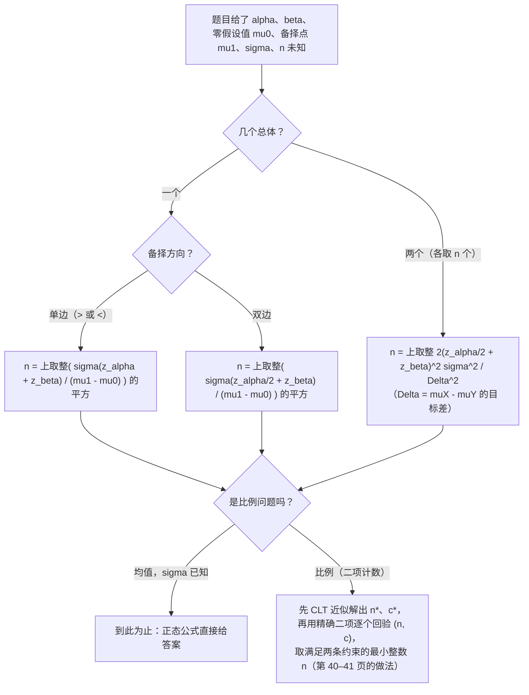

# STA2002 概率与统计 II · 第 9 讲笔记
## Hypothesis Testing IV（假设检验 IV：功效函数与样本量）

> 授课：Zhenxing Guo、Ka Wai Tseng（香港中文大学（深圳）数据科学学院，2026 年 10 月）
> 教材：Hogg, Tanis & Zimmerman (2015) *Probability and Statistical Inference*, 9th ed., Pearson
> 对应教材章节：**第 8.5 节 Best Critical Regions 之后的功效与样本量内容**（讲义第 2 页给出 "Suggested reading: Chapter 8.5 of the textbook"）。
> 材料构成：讲义 `Lecture9 - Hypothesis testing IV.pdf`（**42 页**），笔记内容**完全基于课件（PDF）整理**，本讲没有收到板书，全文没有 `【板书 NN】` 标记，也不设「板书原图」一节；凡属我补充、推导或复算的部分，一律用 **【补】** 标出，并在文末诚实备注中逐条列出。
> **组织方式**：正文**按讲义（PPT）的页序**撰写，讲义每一页都能在正文里找到对应位置（对照表见 §0）。第 8 页的功效曲线图、第 21 页的双边推导、第 24 页与第 33 页汇总表已渲染成图片逐张核对；讲义里出现的**每一个数值**（$0.1587$、$63.29$、$0.804$、$0.907$、$11.73$、$62.718$、$51.98$、$0.0577$、$0.7858$、$30.4$、以及第 40–41 页的八个数）我都用 `scipy` 独立复算过，全部吻合（个别有圆整差异，见诚实备注）；第 41 页"需要 $n=33$"这一结论我还做了**穷举扫描**，确认 $n\le 32$ 时确实无解（见 §16.6）。

---

## 0. 本讲地图（先说清楚这一讲在干什么）

前四讲把假设检验的"怎么做"讲完了：第 6 讲单个均值（$\sigma^2$ 已知用 $Z$、未知用 $t$），第 7 讲两个均值与两个方差（Pooled / Welch / Paired $t$、$F$），第 8 讲比例（单比例与两比例，全是 $Z$ 近似）。但那套内容只回答了一个问题：**"拿到数据之后，拒还是不拒？"**

本讲回答的是另外两个**设计层面**的问题——而且都是在**还没拿到数据之前**就该想清楚的问题：

1. **这个检验"好使"吗？** 也就是说，如果 $H_0$ 是假的、真实参数恰好是某个 $\mu_1$，这个检验有多大概率能发现？这就是**功效函数（power function）**$K(\mu)$，讲义第 3–24 页的内容；
2. **要取多少样本才够？** 如果我希望第一类错误不超过 $\alpha$、同时第二类错误在 $\mu_1$ 处不超过 $\beta$，样本量 $n$ 得取多大？这就是**样本量确定（sample size determination）**，讲义第 25–41 页的内容。

讲义第 2 页原文只有两行：

> In this lecture we will continue our journey to discuss and learn
> Power function / Sample size in hypothesis testing

交付顺序是：先给定义（第 3–5 页）→ 用一个"学生成绩"的例子把整条功效曲线画出来（第 6–10 页）→ 演示"给定 $\alpha$ 重新设计临界域"（第 11–12 页）→ 推出一般公式（第 13–17 页）→ 两道应用例题（第 18–23 页）→ 交代为什么假设 $\sigma$ 已知（第 24 页）→ 样本量三连：单样本单边、单样本双边、两样本（第 25–32 页）→ 汇总表（第 33 页）→ 比例情形的完整例子（第 34–42 页）。

| 讲义页 | 内容 | 本笔记 |
| --- | --- | --- |
| 第 1 页 | 封面 | —— |
| 第 2 页 | Introduction：本讲覆盖什么 | §1 |
| 第 3 页 | 2×2 错误表回顾与 $\beta(\mu_1)$ 的定义 | §2 |
| 第 4 页 | 功效函数 $K(\mu)$ 的定义 | §3 |
| 第 5 页 | $K(\mu)$ 与 $\alpha$、$\beta$ 的接线 | §4 |
| 第 6–7 页 | 例题一（成绩）：题干与 $K(\mu)=1-\Phi\!\left(\frac{62-\mu}{2}\right)$ | §5.1–§5.2 |
| 第 8 页 | 功效曲线图（唯一一张图） | §5.3 |
| 第 9 页 | $\mu=60$：$K(60)=\alpha=0.1587$ | §5.4 |
| 第 10 页 | $\mu=65$：$K(65)=0.9332$、$\beta(65)=0.0668$ | §5.5 |
| 第 11 页 | 给定 $\alpha=0.05$ 反解临界域 $c=63.29$ | §6.1 |
| 第 12 页 | 新设计下 $K(65)=0.804$、$\beta(65)=0.196$ | §6.2 |
| 第 13–14 页 | 一般单边（右尾）功效函数推导 | §7.1 |
| 第 15 页 | 影响功效的四个因素与 $\alpha$–$\beta$ 权衡 | §7.2 |
| 第 16 页 | $H_0:\mu\le\mu_0$ 与 $H_0:\mu=\mu_0$ 同临界域 | §7.3 |
| 第 17 页 | 左尾检验的功效函数 | §7.4 |
| 第 18–19 页 | 例题二：急救反应时间 | §8 |
| 第 20–21 页 | 双边检验功效函数推导（含讲义笔误一处） | §9 |
| 第 22–23 页 | 例题三：牙膏灌装线 | §10 |
| 第 24 页 | 为什么假设 $\sigma$ 已知（含 "replies" 笔误一处） | §11 |
| 第 25–26 页 | 例题四：单样本单边样本量（联立解 $c,n$） | §12.1–§12.2 |
| 第 27 页 | 同题走功效函数路线：$n\approx\left(\frac{\sigma(z_\alpha+z_\beta)}{\mu_1-\mu_0}\right)^2$ | §12.3 |
| 第 28–29 页 | 单样本双边样本量 | §13 |
| 第 30–32 页 | 两样本检验的功效与样本量 | §14 |
| 第 33 页 | 六行汇总表 | §15 |
| 第 34–36 页 | 例题五（比例）：题干、$K(p)$、$\alpha=0.0577$、$\beta(1/4)=0.2142$ | §16.1–§16.3 |
| 第 37–39 页 | 比例的样本量：正态近似联立解 $n\approx30.4$ | §16.4 |
| 第 40–41 页 | 用精确二项逐个回验四组 $(n,c)$，定案 $n=33$ | §16.5–§16.6 |
| 第 42 页 | 比例一节的小结 | §16.7 |
| — | 速查表 / 核心直觉 / 术语对照 / 诚实备注 | §17–§20 |

### 0.1 一句话概括本讲的结构

> [!IMPORTANT]
> **前四讲的检验是"事后判断"，本讲是"事前设计"。** 判断只用一个数（$p$ 值跟 $\alpha$ 比），设计要用一整条函数——功效函数 $K(\mu)=\Pr(T\in C;\mu)$，它是"当真实参数是 $\mu$ 时拒绝 $H_0$ 的概率"。$\alpha$ 和 $\beta$ 都不是新的东西，它们只是**这条曲线上的两个取值**：$\alpha=K(\mu_0)$，$\beta(\mu_1)=1-K(\mu_1)$。一旦把"两个错误概率"看成"一条曲线上的两个点"，"同时控制 $\alpha$ 和 $\beta$"就变成了"让曲线在两个指定位置穿过两条水平线"——这正好给出两个方程，解出两个未知数（临界值 $c$ 和样本量 $n$）。**这就是第 25–41 页所有样本量计算的统一原理。**

### 0.2 与本讲关系最近的三处往讲接口（这张表是我整理的，讲义没有画）

| 往讲留下的线 | 本讲在哪里接上 |
| --- | --- |
| 第 6 讲：$\alpha=\Pr(\text{拒绝}\mid H_0\ \text{真})$，2×2 错误表里 $\beta$ 那一格只起了个头 | 第 3 页把 $\beta(\mu_1)$ 正式定义成函数，第 5 页给出 $\alpha=K(\mu_0)$、$K(\mu_1)=1-\beta(\mu_1)$ 的总接线 |
| 第 8 讲 §8.1：我用教材电路板例子算"点功效"（$\alpha=0.0829$、$\beta=0.2539$），并警告"功效函数必须整条看，只看一个点会出事" | 本讲正是那句话的落实：第 8 页画出**整条** $K(\mu)$ 曲线，之后所有公式都是函数级的 |
| 第 8 讲 §6.2：低出生体重例题功效只有 $0.2444$，我借外部公式算出"要 $80\%$ 功效需每组约 $730$ 人"，并注明"公式取自标准教材口径，讲义没有" | 第 25–32 页**终于给了官方样本量公式**（均值版；比例版只给了单样本，见 §16 与诚实备注的对账） |

### 0.3 拿到"给定 $\alpha$ 和 $\beta$，要多少样本"这类题，怎么走

**这张图是我整理的，讲义没有画。** 三个分岔点就是本讲的三个结构判断：几个总体（决定方差里有没有那个 $2$）、哪个方向（决定查 $z_\alpha$ 还是 $z_{\alpha/2}$）、数据是连续还是计数（决定能不能直接套公式，还是必须回验）。

### 0.4 来源标注约定

- 无标记 → 讲义原文或对讲义的直接展开；
- **【补】** → 讲义没有、由我补充、推导或复算的内容（文末诚实备注逐条列出）。

---

## 1. 本讲要交付什么（讲义第 2 页）

第 2 页信息量很小，但"Suggested reading: Chapter 8.5"这一行值得停一下：教材 §8.5 的标题是 **Further Considerations in Testing Hypotheses**，里面正是功效、最坏情形下的 $\alpha$、以及样本量公式这几块。**第 8 讲笔记 §12 曾数过教材第 8 章的进度条（§8.4 Wilcoxon、§8.5 功效、§8.6 最佳临界域），本讲跳过了 §8.4，直接取 §8.5**——Wilcoxon 符号秩检验至今未访。

另外注意标题里的"IV"：第 6 讲 I、第 7 讲 II、第 8 讲 III、本讲 IV。第 8 讲笔记当时猜"这条线还会继续"，确实继续了，而且继续的方向正是它自己指认的缺口（功效与样本量连续三讲缺席）。

---

## 2. 第二类错误 $\beta$：从"一格"到"一个函数"（讲义第 3 页）

讲义先摆回第 6 讲那张 2×2 表：

|  | $H_0$ true | $H_1$ true |
| --- | --- | --- |
| Reject $H_0$ | Type I error | Correct |
| Fail to Reject $H_0$ | Correct | Type II Error |

然后给出本讲第一个定义。讲义原文：

> Hypothesis testing: $H_0:\mu=\mu_0$ versus $H_1:\mu>\mu_0$.
> $\beta$: the probability of a type II error: Suppose the true value of $\mu$ is $\mu_1>\mu_0$,
> $$\beta(\mu_1):=\Pr(\text{Test makes Type II Error})=\Pr(T\notin C;\,\mu=\mu_1).$$

**逐个符号拆开：**

- $T$ 是检验统计量（test statistic），$C$ 是临界域（critical region，也叫拒绝域）——这两个记号从第 6 讲沿用至今；
- "$T\notin C$"就是"没落进拒绝域"，即**不拒绝** $H_0$；
- 分号后面的 "$\mu=\mu_1$" 读作"**假定**真实参数是 $\mu_1$ 时算这个概率"。这个分号记号是概率论里表示"在……的参数设定下"的惯用写法，第 4 讲算期望方差时见过。

**为什么 $\beta$ 必须写成函数 $\beta(\mu_1)$ 而不是一个数？** 这是本页最核心的一点。第一类错误不需要这种写法，因为 $H_0:\mu=\mu_0$ 把" $H_0$ 为真"时 $\mu$ 等于多少**钉死了**，所以 $\alpha$ 是一个数。但" $H_1$ 为真"是一大片可能：$\mu$ 可以是 $61$，也可以是 $100$，"没抓住"的难度完全不同——真实值离 $\mu_0$ 越远越容易抓，越近越难抓。**所以第二类错误概率天然是一个随"真值在哪"变化的函数**。讲义用 $\beta(\mu_1)$ 这个记号，就是在提醒读者：谈 $\beta$ 必须先报出你假设的真值 $\mu_1$。

> [!TIP]
> 【补】一个具体化的类比：体检筛查就是检验 $H_0$="没病"。第一类错误是"没病却被判有病"（假阳性，$\alpha$）；第二类错误是"有病却被判没病"（假阴性）。假阴性率对"晚期重症"和"早期轻症"能一样吗？显然不一样——病得越重（真值离 $\mu_0$ 越远），越不容易漏。这就是 $\beta$ 必须带自变量的原因。

---

## 3. 功效函数 $K(\mu)$（讲义第 4 页）

讲义原文：

> Power function, denoted by $K(\mu)$, is a function of the parameter $\mu\in\Omega$, where $\Omega$ is the parameter space. Power is the probability of rejecting $H_0$ assuming the parameter value $\mu$. Mathematically, it is
> $$K(\mu):=\Pr(T\in C;\,\mu).$$
> Specifically, the value of the power function at a specified $\mu$ is called the power of the test at that point. For example, $K(0.5)$ denotes the power of the test at $\mu=0.5$.

**这段定义只有三个零件，但每个都要认全：**

- $\Omega$ 是**参数空间（parameter space）**：参数 $\mu$ 允许取的所有值的集合（比如全体实数，或 $[0,1]$）。功效函数定义在**整个** $\Omega$ 上——不管真值站在 $H_0$ 那边还是 $H_1$ 那边，"$\Pr(\text{拒绝})$"这个概率都算得出来；
- $T\in C$：拒绝 $H_0$ 这件事等价于"统计量落进临界域"；
- 分号记号同上："$;\mu$"表示"在真实参数为 $\mu$ 的设定下计算"。

**"功效（power）"和"功效函数（power function）"是函数与函数值的关系**，讲义特意用 $K(0.5)$ 的例子把这两个词分开：整条 $K(\cdot)$ 叫功效函数，它在某个点的取值（比如 $K(0.5)$）叫"该点处的功效"。

> [!NOTE]
> 【补】为什么记号用 $K$？不少教材用 $\pi(\mu)$ 或 $M(\mu)$（Hogg 教材原文用的是 "power function" 记 $\gamma(\theta)$ 一类），没有标准答案，跟着讲义用 $K(\mu)$ 即可。倒是**"功效 = 拒绝 $H_0$ 的概率"这个方向**要记牢：它统计的是"拒绝"，不是"不拒绝"——跟 $\beta$（统计"不拒绝"）刚好互补。初学者常把两者方向弄反。

**为什么需要这个函数？** 因为它是**评价一个检验好坏的唯一全局尺子**。$\alpha$ 只说" $H_0$ 真时你别乱拒"，但没拒之外还得"该拒时真能拒"；把"该拒时拒的概率"随真值画成整条曲线，一个检验的"灵敏度画像"就全出来了。第 8 页那张图就是这份画像。

---

## 4. $K(\mu)$ 与 $\alpha$、$\beta$ 的接线（讲义第 5 页）

讲义原文列了三个要点：功效函数是 $\mu$ 的函数；$\mu$ 可取 $\Omega$ 中任何值；在 $H_0:\mu=\mu_0$ 下考虑两种情形——

$$\text{At }\mu=\mu_0:\quad K(\mu_0)=\alpha;$$

$$\text{At }\mu=\mu_1>\mu_0:\quad K(\mu_1)=1-\beta(\mu_1),\qquad K(\mu_1)=\Pr(T\in C;\mu=\mu_1)=1-\Pr(T\notin C;\mu=\mu_1)=1-\beta(\mu_1).$$

**这一页把本讲和前四讲正式焊在一起：**

1. **$\alpha$ 就是功效函数在 $\mu_0$ 处的取值。** 回想第 6 讲：$\alpha=\Pr(\text{拒绝}\mid H_0\ \text{真})=\Pr(T\in C;\mu=\mu_0)$——和 $K(\mu_0)$ 的定义逐字相同。也就是说，前四讲里"设计临界域使 $\alpha=0.05$"那句话，用本讲语言说是"把功效曲线钉在 $(\mu_0,\,0.05)$ 这个点上"。
2. **$1-\beta(\mu_1)$ 就是功效曲线在 $\mu_1$ 处的高度。** "真值为 $\mu_1$ 时成功拒绝"与"真值为 $\mu_1$ 时不犯第二类错误"是同一件事，所以 $K(\mu_1)=1-\beta(\mu_1)$。
3. 【补】$K(\mu_0)=\alpha$ 这条等式**严格成立要求 $H_0$ 是简单假设**（$\mu$ 被钉成 $\mu_0$ 一个点）。到第 16 页 $H_0:\mu\le\mu_0$ 时，$\mu<\mu_0$ 处也有" $H_0$ 为真"，那里的拒绝概率才是真正的第一类错误——讲义的处理是"临界值仍按 $\mu_0$ 定"，其依据是"拒绝概率在 $\mu_0$ 处最大"（§7.3 会补上证明）。

> [!IMPORTANT]
> 【补】把 §2–§4 三页合并成一句话：**$\alpha$ 与 $\beta$ 不是并列的两个数，而是同一条曲线 $K(\mu)$ 上的两个读数**——$\alpha$ 是曲线在零假设点的高度，$1-\beta(\mu_1)$ 是曲线在备择点的高度。本讲后面的一切（画图、调 $c$、调 $n$）都是在**塑造这条曲线的形状**。

---

## 5. 例题一：新教学法的学生成绩（讲义第 6–10 页）

### 5.1 题干（讲义第 6 页）

讲义原文：

> Let $X_1,X_2,\dots,X_n$ be a random sample of size $n$ from the normal distribution $N(\mu,100)$, which we can suppose is a possible distribution of scores of students in a statistics course that uses a new method of teaching. We wish to decide between $H_0:\mu=60$ and $H_1:\mu>60$. Let us consider a sample of size $n=25$ and the critical region is
> $$C=\{(x_1,x_2,\dots,x_n)\mid \bar{x}\ge 62\}.$$
> What is the power function $K(\mu)$ of this test? What is the value of $\alpha$? What is the value of $\beta$?

**读题抓四个零件：**

- 总体模型 $N(\mu,100)$：均值 $\mu$ 未知、**方差已知为 $100$**（标准差 $\sigma=10$）。"方差已知"是本讲全部推导的前提，第 24 页会专门解释为什么；
- 假设 $H_0:\mu=60$ vs $H_1:\mu>60$：右尾检验（"新方法是否把平均分抬上去了"）；
- $n=25$，临界域 $\{\bar x\ge 62\}$：**注意这个临界域是讲义"随便"给的**——不是按某个 $\alpha$ 设计出来的。这正是本题的教学用意：先给定一个"土设计"，再问它好不好用；
- 三问：整条 $K(\mu)$、$\alpha$、$\beta$。

### 5.2 求 $K(\mu)$（讲义第 7 页）

讲义原文：

> As the distribution of $\bar X$ is $\bar X\sim N(\mu,4)$, then we have that,
> $$K(\mu)=\Pr(\bar X\in C;\mu)=\Pr(\bar X\ge 62;\mu)=\Pr\!\left(\frac{\bar X-\mu}{2}\ge\frac{62-\mu}{2}\right)=\Pr\!\left(Z\ge\frac{62-\mu}{2}\right)=1-\Phi\!\left(\frac{62-\mu}{2}\right),$$
> where $Z\sim N(0,1)$ and $\Phi$ is the CDF of $N(0,1)$.

**逐步拆：**

1. **$\bar X\sim N(\mu,4)$ 的 $4$ 从哪来**：样本均值的方差 $=\sigma^2/n=100/25=4$，所以 $\bar X$ 的标准差（即**标准误**）$=2$。第 4 讲的公式 $\operatorname{Var}(\bar X)=\sigma^2/n$，这里直接复用。
2. **标准化**：不等式两边同时减去均值 $\mu$、除以标准差 $2$，左边变成标准正态 $Z=\frac{\bar X-\mu}{2}$，右边变成 $\frac{62-\mu}{2}$。**关键手法：把"随真值 $\mu$ 变的东西"全部赶到不等式右边**。
3. **查 CDF**：$\Pr(Z\ge a)=1-\Phi(a)$。

于是整条功效函数是 $K(\mu)=1-\Phi\!\left(\frac{62-\mu}{2}\right)$。**注意它是 $\mu$ 的增函数**：真值越大，$\frac{62-\mu}{2}$ 越小，$1-\Phi(\cdot)$ 越大——"实际抬得越高，越容易被查出来"，与直觉一致。

【补】一个自查小技巧：把 $\mu=62$（临界值本身）代入得 $K(62)=1-\Phi(0)=0.5$。**功效曲线永远以 $(c,\,0.5)$ 为中心对称**——真值恰好落在临界线上时，$\bar X$ 有一半概率越线。任何算出来的 $K(\mu)$ 若不给 $0.5$，一定是推错了。

### 5.3 功效曲线（讲义第 8 页，本讲唯一一张图）

第 8 页画的就是 $K(\mu)=1-\Phi\!\left(\frac{62-\mu}{2}\right)$，横轴 $\mu$ 从 $58$ 到 $68$，纵轴 $K(\mu)$ 从 $0$ 到 $1$。我把这页渲染成图片核对过，图上要素：

- 一条 **S 形（sigmoid）上升曲线**，在 $\mu=62$ 附近爬升最快，两端分别贴着 $0$ 和 $1$；
- 纵轴 $1.0$ 处画了一条**水平虚线**；
- 在 $\mu=60$ 处，曲线高度约 $0.16$，旁边用花括号标了 **$\alpha$**——即 $K(60)$ 到 $0$ 轴的那一段；
- 在 $\mu=65$ 附近，曲线已贴近 $1$，花括号标的是**曲线与顶部虚线之间的缝隙**，记为 $\beta$——即 $1-K(65)$。

> [!TIP]
> 【补】这张图把 §4 那句话画成了视觉事实：**$\alpha$ 是曲线在 $\mu_0$ 处的高度，$\beta$ 是曲线在 $\mu_1$ 处离顶的距离**。整张图只有"一条曲线 + 两个花括号"，读图口诀就这两句。另外曲线"越陡，两个花括号同时越小"——而把曲线调陡的唯一办法就是加大 $n$（见 §7.2 和 §12），这张图其实是后面所有样本量公式的几何版。

### 5.4 在 $\mu=60$ 处：$\alpha=0.1587$（讲义第 9 页）

讲义原文：

> At $\mu=60$, $K(60)=\alpha$, the significance level (probability of type I error) of this test,
> $$K(60)=1-\Phi\!\left(\frac{62-60}{2}\right)=1-\Phi(1)=0.1587=\alpha.$$
> Thus, the significance level of the test is 15.87%.

【补】复算：$1-\Phi(1)=0.158655\approx0.1587$ ✓。

**这个数字该让学生心里一惊**：我们平时说"做 $5\%$ 水平的检验"，而这个"土设计"（$\{\bar x\ge62\}$）的实际水平是 **$15.87\%$**——$H_0$ 明明为真时，它有超过七分之一的概率冤枉新方法。**水平不是检验自带的属性，是你设计出来的**；随便定个临界域，$\alpha$ 就可能大得离谱。这正是下一页"给定 $\alpha=0.05$ 重新设计"的动机。

### 5.5 在 $\mu=65$ 处：功效 $0.9332$、$\beta(65)=0.0668$（讲义第 10 页）

讲义原文：

> At $\mu=65$, $K(65)=1-\Phi\!\left(\frac{62-65}{2}\right)=0.9332$. If the true parameter value is $\mu=65$: the probability of rejecting $H_0$ is 93.32%. As $\beta(65)=1-K(65)=0.0668$, the probability of a type II error of this test is 6.68%. There is about 6.68% chance of failing to detect a significant difference.

【补】复算：$1-\Phi(-1.5)=\Phi(1.5)=0.933193\approx0.9332$ ✓；$\beta(65)=0.0668$ ✓。

**读法**：如果新方法真的把平均分从 $60$ 抬到 $65$（抬了 $0.5\sigma$），这个检验有 $93.32\%$ 的机会发现它，漏检概率只有 $6.68\%$。注意措辞——讲义写的是 "failing to detect a **significant** difference"，即"$H_1$ 为真却没拒绝"。

这个"土设计"其实**两头都不算差**（$\alpha$ 大得离谱是唯一的毛病）：因为 $\mu_1=65$ 离 $\mu_0=60$ 足够远（$2.5$ 个标准误），曲线在那个位置已经爬上 $0.93$ 了。**真值离得远的检验本来就不容易漏**——真正考验设计的是"效应小"的情形，这正是后面例题二、三反复出现的主题。

---

## 6. 给定 $\alpha=0.05$ 重新设计临界域（讲义第 11–12 页）

### 6.1 反解临界值 $c$（讲义第 11 页）

讲义原文：

> In practice, we pre-assign the value of $\alpha$, for example, $\alpha=0.05$, $\alpha=0.01$, etc. Question: What is the critical region of previous testing problem with the given $\alpha=0.05$? Let
> $$\alpha=\Pr(\bar X\ge c;\mu=60)=\Pr\!\left(\frac{\bar X-60}{2}\ge\frac{c-60}{2};\mu=60\right)=0.05.$$
> Thus, $\frac{c-60}{2}=z_{0.05}\Rightarrow c=63.29$. The critical region is $C=\{(x_1,\dots,x_n)\mid \bar x\ge 63.29\}$.

**这页做的事：把 §5 的"从临界域读 $\alpha$"反过来——"从 $\alpha$ 造临界域"。** 流程完全机械：

1. 设临界域形如 $\{\bar x\ge c\}$（右尾形状不变，只调门槛）；
2. 在 $\mu=60$ 下标准化，令右尾概率等于 $0.05$；
3. 解出 $c=\mu_0+z_{0.05}\cdot\frac{\sigma}{\sqrt n}=60+1.645\times2=63.29$。

> [!NOTE]
> 【补】$z_{0.05}$ 这个记号讲义从头到尾没定义过，必须自己钉死口径：**$z_{p}$ 指标准正态的上侧 $p$ 分位数**，即满足 $\Pr(Z>z_p)=p$ 的数，等价地 $z_p=\Phi^{-1}(1-p)$。所以 $z_{0.05}=1.6449$、$z_{0.025}=1.9600$、$z_{0.1}=1.2816$。注意上侧分位数**随 $p$ 变小而变大**——第 15 页"权衡链"里 "$\alpha\downarrow\Rightarrow z_\alpha\uparrow$" 用的就是这个性质（讲义第 15 页原文如此，见 §7.2）。
> 复算：$c=60+1.644854\times2=63.2897\approx63.29$ ✓。

### 6.2 新设计的代价：$\beta(65)$ 从 $0.0668$ 涨到 $0.196$（讲义第 12 页）

讲义原文：

> For the critical region $\{(\dots)\mid\bar x\ge63.29\}$, the power function at $\mu=65$ is
> $$K(65)=\Pr(\bar X\ge63.29;\mu=65)=1-\Phi\!\left(\frac{63.29-65}{2}\right)=0.804,$$
> thus, if the true value is $\mu=65$, then the probability of a type II error is $\beta(65)=1-K(65)=0.196$. In other words, if the alternative hypothesis is true and $\mu=65$, there is about 19.6% chance of failing to detect a significant difference using the given 5% significance level.

【补】复算：$1-\Phi(-0.855)=\Phi(0.855)=0.80372\approx0.804$ ✓。

**把两个设计并排放（这张对照表是我整理的）：**

| 设计 | 临界域 | $\alpha$ | $K(65)$ | $\beta(65)$ |
| --- | --- | --- | --- | --- |
| 土设计（第 6 页） | $\{\bar x\ge62\}$ | $0.1587$ | $0.9332$ | $0.0668$ |
| 正规设计（第 11 页） | $\{\bar x\ge63.29\}$ | $0.05$ | $0.804$ | $0.196$ |

**把 $\alpha$ 从 $15.87\%$ 压到 $5\%$，代价是把 $\beta(65)$ 从 $6.68\%$ 抬到 $19.6\%$。** 门槛抬高，冤枉好人少了，放走坏人也多了——这就是 §7.2 那条权衡链的具体数字。而两头都想按住怎么办？**加样本量**。这正是第 25 页例题四的原题（沿用本题数据，要求 $\alpha=0.025$ 且 $\beta(65)=0.05$）。

---

## 7. 一般公式：$\sigma^2$ 已知时均值检验的功效函数（讲义第 13–17 页）

### 7.1 右尾检验（讲义第 13–14 页）

讲义原文（第 13 页）：

> Suppose that $X_1,X_2,\dots,X_n\overset{\text{i.i.d.}}{\sim}N(\mu,\sigma^2)$ with known $\sigma^2$. Following the definition, derive the power function for one-sample test for mean $H_0:\mu=\mu_0$ versus $H_1:\mu>\mu_0$. The significant level $\alpha=0.05$.
> Solution: The critical region for the test is $\{(x_1,x_2,\dots,x_n)\mid \bar x>\mu_0+z_\alpha\frac{\sigma}{\sqrt n}\}$. Thus,
> $$K(\mu_1)=\Pr\!\left(\bar X>\mu_0+z_\alpha\frac{\sigma}{\sqrt n};\,\mu=\mu_1\right)=\Pr\!\left(\frac{\bar X-\mu_1}{\sigma/\sqrt n}>\frac{\mu_0-\mu_1}{\sigma/\sqrt n}+z_\alpha;\,\mu=\mu_1\right).$$

第 14 页接续：

> Let $Z^*=\frac{\bar X-\mu_1}{\sigma/\sqrt n}$. At $\mu=\mu_1$, $Z^*\sim N(0,1)$. Thus,
> $$K(\mu_1)=\Pr\!\left(Z^*>\frac{\mu_0-\mu_1}{\sigma/\sqrt n}+z_\alpha;\mu=\mu_1\right)=\Pr\!\left(Z^*<\frac{\mu_1-\mu_0}{\sigma/\sqrt n}-z_\alpha;\mu=\mu_1\right)=\Phi\!\left(\frac{\mu_1-\mu_0}{\sigma/\sqrt n}-z_\alpha\right),$$
> where $\Phi(\cdot)$ represents the CDF of a standard normal distribution.
> Note: Power of the test is influenced by $\alpha$, $\mu_0$, $\mu_1$, $n$.

**这段推导只有两个机关，都值得单独点名：**

1. **临界域先按 $\alpha$ 写死**：$\bar x>\mu_0+z_\alpha\frac{\sigma}{\sqrt n}$。这就是 §6.1 那套反解的一般版（把 $60$ 换成 $\mu_0$、把 $2$ 换成 $\sigma/\sqrt n$）。
2. **标准化必须"以 $\mu_1$ 为中心"**。算 $K(\mu_1)$ 时真值已经是 $\mu_1$ 了，所以 $\bar X$ 的分布是 $N\!\left(\mu_1,\sigma^2/n\right)$，要除的"标准差"、要减的"均值"都得按 $\mu_1$ 来——于是引出一个**新的**标准化变量 $Z^*=\frac{\bar X-\mu_1}{\sigma/\sqrt n}$，它在 $\mu=\mu_1$ 下服从 $N(0,1)$。上标 $*$ 就是在强调"这不是定义 $H_0$ 下那个统计量的 $Z$，是换了真值重新标准化的"。

中间那步 $\Pr(Z^*>a)=\Pr(Z^*<-a)$ 用的是标准正态的对称性，把"上尾"翻成"$\Phi$"，最后得到本讲最重要的公式之一：

$$\boxed{K(\mu_1)=\Phi\!\left(\frac{\mu_1-\mu_0}{\sigma/\sqrt n}-z_\alpha\right)}\tag{单边右尾}$$

**【补】拿它回测 §6 的数字，两条路必须给出同一个答案：** $\mu_0=60$、$\sigma/\sqrt n=2$、$z_{0.05}=1.645$、$\mu_1=65$，代入得 $\Phi(2.5-1.645)=\Phi(0.855)=0.8038$——与第 12 页的 $0.804$ 一致 ✓。**一般公式和具体例题闭环了**，这是检验自己没抄错公式的最快方法。

**怎么读这个公式**：$\Phi$ 里是"信号 $-$ 门槛"。$\frac{\mu_1-\mu_0}{\sigma/\sqrt n}$ 是**真值与零值的距离，以标准误为单位**（统计里叫 effect size 的变体），$z_\alpha$ 是拒绝门槛（同样以标准误为单位）。功效就是"$\Phi(\text{信号}-\text{门槛})$"——信号越强功效越高，门槛越高功效越低，一切四个影响因素都在这一行里。

### 7.2 影响功效的四个因素（讲义第 15 页）

讲义原文：

> - If the significance level $\alpha$ gets smaller, $z_\alpha$ increases and hence the power decreases
> - If the alternative mean $\mu_1$ is farther away from the null mean, that is, $\mu_1-\mu_0$ gets larger, then the power increases
> - If the standard deviation $\sigma$ increases, then the power decreases
> - If the sample size $n$ increases, then the power increases
> The first point implies trade-off between $\alpha$ and $\beta$. With other factors fixed: $\alpha\downarrow\Rightarrow z_\alpha\uparrow\Rightarrow K(\mu_1)\downarrow\Rightarrow\beta(\mu_1)\uparrow$.

**四条全都能从 §7.1 的方框公式一眼看出**（每条就是问"$\Phi$ 里那一项随谁增随谁减"）：

| 因素 | $\frac{\mu_1-\mu_0}{\sigma/\sqrt n}-z_\alpha$ 怎么动 | 功效 |
| --- | --- | --- |
| $\alpha\downarrow$ | $z_\alpha\uparrow$，减项变大 | ↓（$\beta$ ↑，权衡） |
| $\mu_1-\mu_0\uparrow$ | 被减数变大 | ↑（效应越明显越好查） |
| $\sigma\uparrow$ | 两个距离同时被压缩 | ↓（噪声大，信号被淹） |
| $n\uparrow$ | $\sigma/\sqrt n\downarrow$，距离被放大 | ↑（**唯一由设计者完全掌控的旋钮**） |

> [!IMPORTANT]
> 【补】四条里真正"可做决策"的只有 $n$：$\alpha$ 是行规（$0.05$、$0.01$），$\mu_1-\mu_0$ 是自然规律，$\sigma$ 是总体属性。**"别的设计都定了，只剩 $n$ 可调"——把这一条反过来用（要求 $K(\mu_1)\ge1-\beta$，解出 $n$），就是第 25–32 页的全部内容。** 权衡链 $\alpha\downarrow\Rightarrow\beta\uparrow$ 在 §6 的对照表里已经用真实数字演示过一遍（$0.1587\to0.05$ 换来 $0.0668\to0.196$）。

### 7.3 为什么 $H_0:\mu\le\mu_0$ 用同一个临界域（讲义第 16 页）

讲义原文：

> What is the power function for the following test? $H_0:\mu\le\mu_0$ versus $H_1:\mu>\mu_0$. For a given significance level $\alpha$, the critical region of the test $H_0:\mu\le\mu_0$ vs $H_1:\mu>\mu_0$ is **the same as** that of the test $H_0:\mu=\mu_0$ vs $H_1:\mu>\mu_0$.

**讲义只给了结论，【补】证明就两行**（第 6 讲处理 $H_0:\mu\le\mu_0$ 时也没证，这里一并补上）：

复合 $H_0$ 下，"第一类错误"= 对某个真 $\mu\le\mu_0$ 却拒绝，其概率是 $K(\mu)$。由 §5.2 的观察，$K(\mu)=1-\Phi\!\left(\frac{c-\mu}{\sigma/\sqrt n}\right)$ 是 $\mu$ 的增函数，所以

$$\sup_{\mu\le\mu_0}\Pr(\text{拒绝}\mid\mu)=K(\mu_0).$$

**"把整个 $H_0$ 区域的错误概率都压在 $\alpha$ 以内"等价于"在边界点 $\mu_0$ 处恰好等于 $\alpha$"**——所以临界值按 $\mu_0$ 定就够了，且 $\mu<\mu_0$ 处的实际错误率比 $\alpha$ 更小。这也回收了 §4 第 3 点的伏笔：复合 $H_0$ 下严格说是 $\alpha=\sup_{\mu\le\mu_0}K(\mu)=K(\mu_0)$。

### 7.4 左尾检验（讲义第 17 页）

讲义原文：

> Similarly, we can also derive the power function for the test $H_0:\mu\ge\mu_0$ versus $H_1:\mu<\mu_0$. Given the significance level $\alpha$, the critical region is $\{(x_1,\dots,x_n)\mid\frac{\bar X-\mu_0}{\sigma/\sqrt n}<-z_\alpha\}$. Thus,
> $$K(\mu_1)=\Pr\!\left(\frac{\bar X-\mu_0}{\sigma/\sqrt n}<-z_\alpha;\mu=\mu_1\right)=\Pr\!\left(\frac{\bar X-\mu_1}{\sigma/\sqrt n}<\frac{\mu_0-\mu_1}{\sigma/\sqrt n}-z_\alpha;\mu=\mu_1\right)=\Phi\!\left(\frac{\mu_0-\mu_1}{\sigma/\sqrt n}-z_\alpha\right).$$

**结果就是把右尾公式里的 $\mu_1-\mu_0$ 换成 $\mu_0-\mu_1$**（左尾时 $\mu_1<\mu_0$，所以 $\frac{\mu_0-\mu_1}{\sigma/\sqrt n}>0$，"信号距离"依然为正）。两个公式可以并成一句：**功效 $=\Phi\!\left(\frac{|\text{真值}-\text{零值}|}{\text{标准误}}-z_\alpha\right)$，其中"距离"永远沿备择方向取正。** 第 33 页汇总表就是用带符号的 $\Delta=\mu_1-\mu_0$ 统一三种情形的（见 §15）。

---

## 8. 例题二：急救反应时间（讲义第 18–19 页）

### 8.1 题干（讲义第 18 页）

> A major west coast city ... The service goal is to respond to medical emergencies with an average time of 12 minutes or less. The director of medical services wants to formulate a hypothesis test that could use a sample of emergency response times to determine whether or not the service goal of 12 minutes or less is being achieved. To test these hypotheses, a random sample of 40 past emergency response records were examined. The resulting mean response time was 13.25 minutes, assuming the true standard deviation equal to 3.2 minutes. The level of significance is 0.05. **Please derive the power function and provide the power for $\mu_1=13.5$ min.**

**题干里埋了一个"用不上的数"：观测均值 $13.25$。** 功效函数是**事前设计量**——它只依赖 $\mu_0,\sigma,n,\alpha$ 和备择点 $\mu_1$，跟这次抽样实际看到了什么**毫无关系**。$13.25$ 是拿来做检验（算 $p$ 值）用的，本题没问。读题时把它识别为干扰信息，是本讲的一个实务技能（例题三同样如此，见 §10）。

### 8.2 解答（讲义第 19 页）

> Let $\mu$ denote the mean emergency response time. The hypothesis is $H_0:\mu\le12$ and $H_1:\mu>12$. As we have $\mu_0=12$, $\alpha=0.05$, $\sigma=3.2$ and $n=40$, the power function is given by
> $$K(\mu_1)=\Phi\!\left(\frac{\mu_1-\mu_0}{\sigma/\sqrt n}-z_\alpha\right)=\Phi\!\left(\frac{\mu_1-12}{3.2/\sqrt{40}}-1.645\right).$$
> When $\mu_1=13.5$, the power is $K(13.5)=\Phi(1.3196)=0.907$. Therefore, if the alternative hypothesis is true, there is about 90.7% chance of detecting a significant difference using a 5% significance level.

**逐步核对：**

- 假设写成 $H_0:\mu\le12$（服务目标是"12 分钟**或更少**"，达标= $\mu\le12$，要怀疑的是超时方向），临界域按 §7.3 与 $\mu_0=12$ 的简单检验相同——这是第 16 页结论的第一次实战；
- 标准误 $\sigma/\sqrt{n}=3.2/\sqrt{40}=0.50596$；
- 【补】复算：$\frac{13.5-12}{0.50596}-1.645=2.9646-1.645=1.3196$ ✓；$\Phi(1.3196)=0.90655$，讲义写 $0.907$（第三位圆整差异：精确用 $z_{0.05}=1.64485$ 时 $\Phi(1.31978)=0.9065$）。**$0.907$ 与 $0.9065$ 的差来自圆整，不是错**。

**解读**：若真实反应时间是 $13.5$ 分钟（比目标差 $1.5$ 分钟 $=2.96$ 个标准误），$5\%$ 水平的检验有约 $90.7\%$ 的机会报警。**"功效 $0.9$"是实务里常用的验收线**（对应 $\beta=0.1$），本题刚好踩在这条线上——这不是巧合，第 34 页比例例题的设计目标同样是 $1-\beta=0.9$。

---

## 9. 双边检验的功效函数（讲义第 20–21 页）

### 9.1 推导（讲义第 20–21 页）

设定：$H_0:\mu=\mu_0$ vs $H_1:\mu\ne\mu_0$，$\alpha=0.05$，临界域 $\left\{\left\lvert\frac{\bar x-\mu_0}{\sigma/\sqrt n}\right\rvert>z_{\alpha/2}\right\}$。第 21 页把 $K(\mu_1)=\Pr\!\left(\left\lvert\frac{\bar X-\mu_0}{\sigma/\sqrt n}\right\rvert>z_{\alpha/2};\mu=\mu_1\right)$ 拆成两尾逐步展开，最终结果：

$$\boxed{K(\mu_1)=\Phi\!\left(\frac{\mu_1-\mu_0}{\sigma/\sqrt n}-z_{\alpha/2}\right)+\Phi\!\left(\frac{\mu_0-\mu_1}{\sigma/\sqrt n}-z_{\alpha/2}\right)}\tag{双边}$$

**推导路线与 §7.1 完全同构，只有两个新点：**

1. 绝对值事件拆成"两个互斥尾巴"的和事件，$K$ 变成两个 $\Pr$ 相加；
2. 每个 $\Pr$ 内部照常以 $\mu_1$ 标准化、用对称性翻成 $\Phi$。

> [!WARNING]
> **讲义笔误（第 21 页第四行）**：该行第一个概率写作 $\Pr\!\left(Z^*>\frac{\mu_0-\mu_1}{\sigma/\sqrt n}+z_{\alpha}\right)$，**其中的 $z_\alpha$ 应为 $z_{\alpha/2}$**——上一行和下一行都是 $z_{\alpha/2}$，唯独这行漏了 $/2$。我把该页渲染成 200 dpi 图片确认过，课件原文确实如此。后面两行都用了正确的 $z_{\alpha/2}$，**最终公式不受影响**。抄笔记时直接写对即可。

### 9.2 那个"主导项"近似（讲义第 21 页 Note）

讲义原文：

> Note: $K(\mu_1)$ will be dominated by either of $\Phi\!\left(\frac{\mu_1-\mu_0}{\sigma/\sqrt n}-z_{\alpha/2}\right)$ or $\Phi\!\left(\frac{\mu_0-\mu_1}{\sigma/\sqrt n}-z_{\alpha/2}\right)$, and $K(\mu_1)\approx\Phi\!\left(\frac{|\mu_1-\mu_0|}{\sigma/\sqrt n}-z_{\alpha/2}\right)$.

**为什么两项里总有一项可以扔掉？** 【补】设 $d=\frac{\mu_1-\mu_0}{\sigma/\sqrt n}>0$（真值在右边的情形），两项是 $\Phi(d-z_{\alpha/2})$ 与 $\Phi(-d-z_{\alpha/2})$。第一项往 $1$ 走，第二项的自变量是 $-(d+z_{\alpha/2})$，**往 $-\infty$ 走的速度比第一项往 $+\infty$ 快**（$d$ 加倍时第二项的自变量绝对值也加倍），而 $\Phi$ 在左尾是指数级衰减。所以只要 $d$ 明显大于 $z_{\alpha/2}$，第二项小到可以忽略。

【补】量一个极端的：例题三（§10）里两项是 $\Phi(11.73)$ 与 $\Phi(-15.65)$，我复算 $\Phi(-15.653)=1.6\times10^{-55}$——**扔掉它完全不是近似，是精确到 55 位小数的忽略**。这也解释了为什么双边功效曲线长得很像"两条单边曲线的镜像拼接"。

---

## 10. 例题三：牙膏灌装线（讲义第 22–23 页）

### 10.1 题干（讲义第 22 页）

> The production line for Glow toothpaste is designed to fill tubes of toothpaste with a mean weight of 6 ounces. Periodically, a sample of 30 tubes will be selected in order to check the filling process. Quality assurance procedures call for the continuation of the filling process if the sample results are consistent with the assumption that the mean filling weight ... is 6 ounces; otherwise the filling process will be stopped and adjusted. Assume that a sample of 30 toothpaste tubes provides a sample mean of 6.1 ounces. We assume the population standard deviation is 0.2 ounces.
> **What power would such quality assurance procedures have of detecting a significant difference in the mean of the tubes at a 5% significance level if it is hypothesized that the true mean of the tube could be either an increase or a decrease of 0.5 ounces?**

**质量控制的天然双边结构**：灌装偏重（浪费牙膏）和偏轻（顾客吃亏、违法）都算事故，所以 $H_1:\mu\ne6$。同样有一个用不上的观测值 $6.1$（§8.1 说过的道理）。"increase or a decrease of 0.5 ounces" 就是在报 $\mu_1$：**两个**备择点 $6.5$ 与 $5.5$。

### 10.2 解答（讲义第 23 页）

> Let $\mu$ denote the mean filling weight. The problem to test $H_0:\mu=6.0$ vs $H_1:\mu\ne6.0$. Given $\sigma=0.2$, $\alpha=0.05$ and $n=30$, we want to compute the power when $\mu_1-\mu_0=0.5$ or $-0.5$, that is $|\mu_1-6|=0.5$. Thus,
> $$K(\mu_1)=\Phi\!\left(\frac{0.5}{0.2/\sqrt{30}}-z_{0.025}\right)+\Phi\!\left(\frac{-0.5}{0.2/\sqrt{30}}-z_{0.025}\right)=\Phi(11.73)+\Phi(-15.65)\approx\Phi(11.73)\approx1.$$
> The quality assurance procedures would be almost certain of detecting a significant difference at level 0.05.

【补】复算：$\frac{0.5}{0.2/\sqrt{30}}=\frac{0.5}{0.036515}=13.693$；$13.693-1.96=11.733$ ✓；$-13.693-1.96=-15.653$ ✓；$\Phi(11.73)\approx1-3\times10^{-32}$。数字全对。

**为什么功效能到 $\approx1$？** 因为要查的偏差 $0.5$ 盎司是标准误 $0.0365$ 的 **$13.7$ 倍**——信号比门槛高出一个数量级，曲线在那个位置早就贴顶了。**"效应相对噪声的大小"才是功效的命门**：例题二里 $2.96$ 倍标准误给 $0.907$，这里 $13.7$ 倍直接给 $1$。

> [!TIP]
> 【补】反过来问更有实用价值：这套 $n=30$ 的程序**最小能检出多大的偏差**？按 $1-\beta=0.8$ 的常规验收线解 $\frac{|\mu_1-6|}{0.2/\sqrt{30}}-1.96=z_{0.2}=0.842$，得 $|\mu_1-6|\approx(1.96+0.842)\times0.0365\approx0.102$ 盎司。**即：偏 $0.1$ 盎司上下就有八成把握报警，偏 $0.5$ 盎司是"杀鸡用牛刀"**——这一问讲义没问，但它是工厂真会问的问题。

---

## 11. 为什么全讲假设 $\sigma$ 已知（讲义第 24 页）

这一页是给 §7–§10 的所有公式"打补丁"的：如果 $\sigma$ 未知（第 6 讲的日常情形），上面的一切会坏在哪？

讲义原文（我把两处笔误按原样保留并标注）：

> Otherwise, for one-sided test $H_0:\mu=\mu_0$ vs $H_1:\mu>\mu_0$, the critical region is $\{(x_1,\dots,x_n)\mid \frac{\bar x-\mu_0}{s/\sqrt n}>t_\alpha(n-1)\}$.
> The power at $\mu=\mu_1>\mu_0$: $\Pr\!\left(\frac{\bar X-\mu_1}{S/\sqrt n}>z_\alpha+\frac{\mu_0-\mu_1}{S/\sqrt n}\right)=\Pr\!\left(T^*>z_\alpha+\frac{\mu_0-\mu_1}{S/\sqrt n}\right)$
> **replies**〔应为 depends，讲义笔误〕 on the random variable $S$.
> Even if we fix $\mu_1$, the power will still vary with $S$.

**逻辑链**：$\sigma$ 未知时临界域分母换成随机的 $S$（第 6 讲的 $t$ 检验）。算功效时要"以 $\mu_1$ 为中心"标准化，不等式右边就会残留 $\frac{\mu_0-\mu_1}{S/\sqrt n}$ 这一项——**它是随机变量 $S$ 的函数**。于是"拒绝概率"不再是 $\mu_1$ 的确定函数：同一个真值 $\mu_1$，样本抽得散（$S$ 大）功效就低，抽得集中（$S$ 小）功效就高。**功效函数之所以是"函数"，靠的是 $\sigma$ 已知把分母钉成常数。**

> [!NOTE]
> 【补】两处讲义疑点一并记录：
> ① 原文 "replies on" 是 "depends on" 的笔误（渲染核对，第 24 页原文如此）。
> ② 更实质的：临界域一行用的是 $t_\alpha(n-1)$，功效一行却写 $z_\alpha$——两行的门槛口径不一致。按临界域的定义，功效式里应当也是 $t_\alpha(n-1)$。**这一处混用不影响本页论点**（不管门槛是 $z_\alpha$ 还是 $t_\alpha(n-1)$，右边那项都依赖随机 $S$），但抄写时建议统一成 $t_\alpha(n-1)$。
> 【补】严格处理 $\sigma$ 未知的功效并非不可能，而是**麻烦**：$\mu=\mu_1$ 时 $\frac{\bar X-\mu_1}{S/\sqrt n}$ 仍是中心 $t$，但临界域事件要用**非中心 $t$ 分布（noncentral $t$）**才能算出拒绝概率，公式不再是有理形式，只能查表或数值积分。**这就是本讲（和教材 §8.5）把舞台限定在"$\sigma^2$ known"的原因——不是 $\sigma$ 未知的检验没法谈功效，是没有漂亮的闭式公式。**

---

## 12. 单样本单边检验的样本量（讲义第 25–27 页）

### 12.1 问题：$\alpha$ 和 $\beta$ 能不能一起按下去（讲义第 25 页）

讲义先回收 §5–§6 的两个设计：

> In the previous example, for the test $H_0:\mu=60$ vs $H_1:\mu>60$: $C=\{\bar X\ge62\}$, $\alpha=0.1587$, $\beta(65)=0.0668$; $C=\{\bar X\ge63.29\}$, $\alpha=0.05$, $\beta(65)=0.196$. **How could we control type I and II errors simultaneously?**

**Example**：Suppose that we want $\alpha=0.025$ and $\beta(65)=0.05$ simultaneously. How many samples are required?

> Let the critical region be $C=\{\bar X\ge c\}$ for some constant $c$. As $\bar X\sim N(\mu,100/n)$, it follows that
> $$\alpha=\Pr(\bar X\ge c;\mu=60)=1-\Phi\!\left(\frac{c-60}{10/\sqrt n}\right),\qquad \beta=1-\Pr(\bar X\ge c;\mu=65)=\Phi\!\left(\frac{c-65}{10/\sqrt n}\right).$$

**注意未知数从"一个"变成了"两个"**：§6.1 里 $n=25$ 给定，只需解一个 $c$；现在 $n$ 也是自由变量，"控制两个错误"恰好给出**两个方程**——§0.1 那句"让曲线穿过两个指定点"在这里兑现。

### 12.2 联立求解（讲义第 26 页）

> Thus, we have that $\frac{c-60}{10/\sqrt n}=z_{0.025}=1.96$ and $\frac{c-65}{10/\sqrt n}=-z_{0.05}=-1.645$. Solving for $c$ and $n$ simultaneously yields $c=62.718$, $n=51.98$. Since $n$ should be an integer, we round up to $n=52$ such that we could control $\alpha\approx0.025$ and $\beta\approx0.05$.

**两个方程怎么来的**：第一个由 $1-\Phi(\cdot)=0.025$ 得自变量 $=z_{0.025}$；第二个由 $\Phi(\cdot)=0.05$ 得自变量 $=-z_{0.05}$（$65$ 在 $c$ 左边，所以是负号——**这个负号是"真值在临界值下方"的几何事实，不是硬记的**）。

【补】复算：两式相减得 $\frac{5}{10/\sqrt n}=1.96+1.645=3.605$，即 $\sqrt n\cdot0.5=3.605$，$\sqrt n=7.21$，$n=51.98$ ✓；$c=60+1.96\times\frac{10}{7.21}=60+2.718=62.718$ ✓。

> [!TIP]
> 【补】"round up 到 52"为什么是**向上**取整而不是四舍五入？我代回验算：取 $n=52$、$c=62.718$ 时标准误 $=10/\sqrt{52}=1.3868$，实际 $\alpha=1-\Phi(2.718/1.3868)=1-\Phi(1.960)=0.0250$、$\beta=\Phi(-2.282/1.3868)=\Phi(-1.645)=0.0499$——**两个约束都恰好满足（$\beta$ 还略优于目标）**。$n$ 越大曲线越陡、两个错误同时越小，所以向上取整永远安全，向下取整会两头都违约。**"样本量公式永远向上取整"是通用纪律。**

### 12.3 第二条路：直接从功效函数解 $n$（讲义第 27 页）

> We can also use the power function to obtain the required sample size by letting
> $$K(\mu_1)=\Phi\!\left(\frac{\mu_1-\mu_0}{\sigma/\sqrt n}-z_\alpha\right)=1-\beta.$$
> As $\Phi(z_\beta)=\Pr(Z\le z_\beta)=1-\beta$, $\frac{\mu_1-\mu_0}{\sigma/\sqrt n}-z_\alpha=z_\beta$, which gives
> $$n\approx\left(\frac{\sigma(z_\alpha+z_\beta)}{\mu_1-\mu_0}\right)^2=\left(\frac{(1.960+1.645)\cdot10}{65-60}\right)^2=51.98.$$
> Thus, if we take 52 samples and the alternative hypothesis is true with $\mu=65$, we can control $\alpha\approx0.025$ and $\beta\approx0.05$ simultaneously.

**这就是 §0.3 流程图的正主。** 两点说明：

1. 【补】"$\Phi(z_\beta)=1-\beta$" 再次确认了上侧分位数口径：$z_\beta$ 满足 $\Pr(Z>z_\beta)=\beta$，故 $\Phi(z_\beta)=1-\beta$。$\beta=0.05$ 时 $z_\beta=1.645$，与 $z_{0.05}$ 同一个数。
2. 【补】两条路（§12.2 联立 vs §12.3 解方程）数学上是**同一路**：§12.2 的两个方程相减就得到 §12.3 的一个方程。第二条路更快，还顺手给出**公式**；第一条路多解出一个 $c$，实务里临界域也得报出来，所以两条都要会。
3. 公式结构读法：$n\propto\sigma^2$（噪声方差越大越要多抽，平方级）、$n\propto(z_\alpha+z_\beta)^2$（要求越严越要多抽）、$n\propto\frac{1}{(\mu_1-\mu_0)^2}$（**要查的效应减半，样本量翻四倍**——这是样本量公式里最狠的一条标度律）。
4. 【补】回测例题二：$\mu_0=12$、$\mu_1=13.5$、$\sigma=3.2$、$\alpha=0.05$，若想要 $\beta=0.1$（$z_\beta=1.282$），$n=\left(\frac{3.2\times(1.645+1.282)}{1.5}\right)^2=38.6\to39$。讲义的 $n=40$ 恰好略优于 $90\%$ 功效线——**例题二的 $n=40$ 不是随便取的**。

---

## 13. 单样本双边检验的样本量（讲义第 28–29 页）

设定 $H_0:\mu=\mu_0$ vs $H_1:\mu\ne\mu_0$。讲义第 28 页把 §9 的双边功效函数搬来并用 §9.2 的主导项近似：

> $$K(\mu_1)=\Phi\!\left(\frac{\mu_1-\mu_0}{\sigma/\sqrt n}-z_{\alpha/2}\right)+\Phi\!\left(\frac{\mu_0-\mu_1}{\sigma/\sqrt n}-z_{\alpha/2}\right)\approx\Phi\!\left(\frac{|\mu_1-\mu_0|}{\sigma/\sqrt n}-z_{\alpha/2}\right).$$

第 29 页令近似式 $=1-\beta$ 解出：

$$\boxed{n\approx\frac{\sigma^2\left(z_{\alpha/2}+z_\beta\right)^2}{(\mu_1-\mu_0)^2}}\tag{双边}$$

**与单边公式只差一个字符：$z_\alpha\to z_{\alpha/2}$。** 【补】但因为 $z_{0.025}=1.96>z_{0.05}=1.645$，这"一个字符"在 $\alpha=0.05$ 时把分子 $(z_\alpha+z_\beta)^2$ 抬了约 $20\%$——**双边检验天生比单边费样本**，这回收了第 8 讲"双边浪费一半 $\alpha$"的那条直觉（当时用骰子例题量化的是功效损失，现在换成样本量视角：同样的 $\beta$ 目标，双边要多抽约两成）。

【补】用近似式解 $n$ 的合法性来自 §9.2：被扔掉的那一项在目标功效（$\ge0.8$）附近小到 $10^{-3}$ 以下量级，对 $n$ 的取整毫无影响。

---

## 14. 两样本检验的功效与样本量（讲义第 30–32 页）

### 14.1 设定与统计量（讲义第 30 页）

> Suppose that $X_1,\dots,X_n\overset{\text{iid}}{\sim}N(\mu_X,\sigma^2)$ and $Y_1,\dots,Y_n\overset{\text{iid}}{\sim}N(\mu_Y,\sigma^2)$ are samples drawn from two independent populations. To test $H_0:\mu_X=\mu_Y$ vs $H_1:\mu_X\ne\mu_Y$. Or, denote $\Delta:=\mu_X-\mu_Y$ to test $H_0:\Delta=0$ vs $H_1:\Delta\ne0$. Here, we also assume that $\sigma^2$ is known.
> Test statistic: $T:=\frac{\bar X-\bar Y}{\sqrt{2\sigma^2/n}}$. Under $H_0$: $T\sim N(0,1)$. Under $H_1$ with $\Delta=\Delta_1$: $T\sim N\!\left(\frac{\Delta_1}{\sqrt{2\sigma^2/n}},1\right)$.

**四个要点：**

1. **两组样本量相同、都记 $n$**——这是本讲两样本公式的专属前提（第 32 页公式里那个系数 $2$ 依赖它；不等组量的情形讲义没碰）。
2. **两组共用一个已知方差 $\sigma^2$**——对照第 7 讲的 Pooled $t$（那里 $\sigma^2$ 未知要估），这里把"已知"的假设带进两样本，理由同 §11。
3. **换元 $\Delta=\mu_X-\mu_Y$ 把两样本问题变成"一个参数的单样本问题"**：检验"$\mu_X=\mu_Y$"就是检验"$\Delta=0$"。这是本讲处理两样本的全部秘密——剩下的只是把 $\bar X-\bar Y$ 的分布写对。
4. **分母 $\sqrt{2\sigma^2/n}$ 的来历**【补】：$\operatorname{Var}(\bar X-\bar Y)=\frac{\sigma^2}{n}+\frac{\sigma^2}{n}=\frac{2\sigma^2}{n}$（独立才可加，第 4 讲）。所以"$\bar X-\bar Y$ 的标准误"是 $\sqrt{2\sigma^2/n}$，$T$ 是它的标准化；那个 $2$ 就是"两个总体各贡献一份方差"。
5. **$H_1$ 下 $T$ 不是标准正态**：均值平移成 $\frac{\Delta_1}{\sqrt{2\sigma^2/n}}$（**非中心（noncentrality）**的雏形——§11 备注里说的"非中心 $t$"在 $\sigma$ 已知时就退化成这种"均值平移的正态"）。功效就是"这个平移后的分布跑出 $\pm z_{\alpha/2}$ 门槛的概率"。

### 14.2 功效函数（讲义第 31 页）

> The power function is a function of $\Delta$:
> $$K(\Delta)=\Pr\!\left(|T|>z_{\alpha/2};\Delta\right)=1-\Phi\!\left(z_{\alpha/2}-\frac{\Delta}{\sqrt{2\sigma^2/n}}\right)+\Phi\!\left(-z_{\alpha/2}-\frac{\Delta}{\sqrt{2\sigma^2/n}}\right)=\Phi\!\left(-z_{\alpha/2}+\frac{\Delta}{\sqrt{2\sigma^2/n}}\right)+\Phi\!\left(-z_{\alpha/2}-\frac{\Delta}{\sqrt{2\sigma^2/n}}\right).$$

**与 §9 的单边/双边推导逐字同构**（标准化中心换成 $\Delta_1$、绝对值拆两尾、对称性翻 $\Phi$）。结构上它就是"双边公式 (§9) 的 $\frac{\mu_1-\mu_0}{\sigma/\sqrt n}$ 换成 $\frac{\Delta}{\sqrt{2\sigma^2/n}}$"——**"信号 ÷ 标准误"的骨架完全不变**。

### 14.3 样本量（讲义第 32 页）

> For large $|\Delta|$, the power function is approximately equal to $\Phi\!\left(-z_{\alpha/2}+\frac{|\Delta|}{\sqrt{2\sigma^2/n}}\right)$. By letting $K(\Delta)=1-\beta$, $-z_{\alpha/2}+\frac{|\Delta|}{\sqrt{2\sigma^2/n}}\approx z_\beta$. Solving for $n$:
> $$\boxed{n\approx 2\cdot\frac{(z_{\alpha/2}+z_\beta)^2\sigma^2}{\Delta^2}}\tag{两样本双边}$$
> The derivation of the power function and sample size for one-sided test is similar.

**系数 $2$ 的读法**【补】：与单样本公式只差一个 $2$（以及 $\mu_1-\mu_0\to\Delta$）。它来自 $\sqrt{2\sigma^2/n}=\sqrt2\cdot\sigma/\sqrt n$——**两样本比较里"差的噪声"是单体的 $\sqrt2$ 倍，方差翻倍，所以每组都要多抽一倍**。注意 $n$ 指**每组**的量，总样本量是 $2n$；跟单样本比，两样本的总成本其实是四倍于"用单样本查同样距离的差"（方差 $2\sigma^2/n$ vs $\sigma^2/n$ 的两倍，再乘每组翻倍）。"两个总体各抽一半"这件事本身就贵。

【补】单边版（讲义说 similar，我按 §7.4 的口径补全）：$n\approx\frac{2(z_\alpha+z_\beta)^2\sigma^2}{\Delta^2}$（$H_1:\Delta>0$ 或 $<0$，$\Delta$ 取备择方向上的正值）。第 33 页汇总表里就有这两行。

---

## 15. 六行汇总表（讲义第 33 页）

我把第 33 页整页渲染核对过，原表如下（统一记 $\Delta$，注意**上半表 $\Delta=\mu_1-\mu_0$，下半表 $\Delta=\mu_X-\mu_Y$，含义不同**）：

| 检验类型 | 假设 | 功效函数 | 样本量（每组） |
| --- | --- | --- | --- |
| **单样本**（$\sigma^2$ known，$\Delta=\mu_1-\mu_0$） | | | |
| 双边 | $H_0:\mu=\mu_0$，$H_1:\mu\ne\mu_0$ | $\Phi\!\left(-z_{\alpha/2}+\frac{\lvert\Delta\rvert}{\sigma/\sqrt n}\right)+\Phi\!\left(-z_{\alpha/2}-\frac{\lvert\Delta\rvert}{\sigma/\sqrt n}\right)$ | $\frac{(z_{\alpha/2}+z_\beta)^2\cdot\sigma^2}{\Delta^2}$ |
| 单边（$>$） | $H_0:\mu=\mu_0$，$H_1:\mu>\mu_0$ | $\Phi\!\left(-z_\alpha+\frac{\Delta}{\sigma/\sqrt n}\right)$ | $\frac{(z_\alpha+z_\beta)^2\cdot\sigma^2}{\Delta^2}$ |
| 单边（$<$） | $H_0:\mu=\mu_0$，$H_1:\mu<\mu_0$ | $\Phi\!\left(-z_\alpha-\frac{\Delta}{\sigma/\sqrt n}\right)$ | $\frac{(z_\alpha+z_\beta)^2\cdot\sigma^2}{\Delta^2}$ |
| **两样本**（$\sigma_X^2=\sigma_Y^2=\sigma^2$ known，$\Delta=\mu_X-\mu_Y$） | | | |
| 双边 | $H_0:\mu_X=\mu_Y$，$H_1:\mu_X\ne\mu_Y$ | $\Phi\!\left(-z_{\alpha/2}+\frac{\lvert\Delta\rvert}{\sqrt{2\sigma^2/n}}\right)+\Phi\!\left(-z_{\alpha/2}-\frac{\lvert\Delta\rvert}{\sqrt{2\sigma^2/n}}\right)$ | $\frac{2\cdot(z_{\alpha/2}+z_\beta)^2\cdot\sigma^2}{\Delta^2}$ |
| 单边（$>$） | $H_0:\mu_X=\mu_Y$，$H_1:\mu_X>\mu_Y$ | $\Phi\!\left(-z_\alpha+\frac{\Delta}{\sqrt{2\sigma^2/n}}\right)$ | $\frac{2\cdot(z_\alpha+z_\beta)^2\cdot\sigma^2}{\Delta^2}$ |
| 单边（$<$） | $H_0:\mu_X=\mu_Y$，$H_1:\mu_X<\mu_Y$ | $\Phi\!\left(-z_\alpha-\frac{\Delta}{\sqrt{2\sigma^2/n}}\right)$ | $\frac{2\cdot(z_\alpha+z_\beta)^2\cdot\sigma^2}{\Delta^2}$ |

### 15.1【补】怎么用这张表：它其实只有一行

**全表六格共享一个骨架**：

$$K=\Phi\!\left(\text{门槛项}+\frac{\text{备择方向的信号}}{\text{统计量的标准误}}\right)\quad(\text{双边再加一个可忽略的镜像项}),$$

$$n=\frac{(\text{门槛项}+z_\beta)^2\times\text{方差因子}\times\sigma^2}{\text{信号}^2}.$$

三步定位：① 单样本还是两样本（分母 $\sigma/\sqrt n$ 还是 $\sqrt{2\sigma^2/n}$，样本量公式有没有 $2$）；② 单边还是双边（门槛 $z_\alpha$ 还是 $z_{\alpha/2}$）；③ 方向（$\Delta$ 前 $+$ 还是 $-$；双边取 $\lvert\Delta\rvert$）。**第 8 讲汇总表的"两步定位法"在这里升级为三步，但套路一样。**

**三条容易漏的：**

1. 表里所有公式都默认 **$\sigma^2$ 已知**（§11）；
2. 单边（$<$）两行的 $\Delta$ 在备择下是负的，$-\frac{\Delta}{\cdot}$ 才是正的"信号距离"——**表没写绝对值，是为了让公式对"真值意外跑到另一边"也成立**（那时 $-\frac{\Delta}{\cdot}<0$，功效掉到 $\Phi(-z_\alpha)<0.5$，如实反映"查反方向的检验毫无能力"）；
3. 两样本行的样本量是**每组** $n$，总花费 $2n$。

---

## 16. 比例检验的功效与样本量（讲义第 34–42 页）

到这里为止全是正态总体均值。最后九页换到**二项计数**数据——第 8 讲的比例检验现在补上功效与样本量这一半。**这一节的看点不是公式，而是"离散数据上这套机器怎么不灵，以及怎么补救"。**

### 16.1 题干（讲义第 34 页）

> Suppose that $X_1,\dots,X_{20}$ are i.i.d. Bernoulli trials with success probability $p$. To test $H_0:p=\frac12$, $H_1:p<\frac12$, we use the test statistic $Y:=\sum_{i=1}^{20}X_i\sim\operatorname{Binomial}(20,p)$.
> 1. Given the critical region $C=\{Y\le6\}$, please derive the power function $K(p)$ and compute $\alpha$ and $\beta$ at $p=1/4$.
> 2. How many samples are suitable to control $\alpha=0.05$ and $\beta(1/4)=0.1$?

**与均值版例题的结构差异**：临界域直接给在**计数** $Y$ 上（$Y\le6$），而不是"标准化后的统计量落在哪"；问题 2 的"多少样本"在二项语境下是"把 $n=20$ 改成多少"。

### 16.2 功效函数（讲义第 35 页）

> $$K(p)=\Pr(Y\le6;p)=\Pr(Y\le6;Y\sim\operatorname{Bin}(20,p))=\sum_{y=0}^{6}\binom{20}{y}p^{y}(1-p)^{20-y}.$$

**一步到位：拒绝概率就是二项 CDF。** 均值情形要先标准化再查 $\Phi$，这里连标准化都不需要——分布是精确已知的，直接按定义求和。$K(p)$ 对 $p$ 是**减函数**（左尾检验：真 $p$ 越小越容易落进 $\{Y\le6\}$）。

### 16.3 $\alpha$ 与 $\beta(1/4)$（讲义第 36 页）

> At $p=1/2$, $K(1/2)=\alpha=\Pr(Y\le6;Y\sim\operatorname{Bin}(20,\frac12))=\sum_{y=0}^{6}\binom{20}{y}(1/2)^{20}=0.0577$. That is, the significance level of this test is 5.77%.
> At $p=1/4$, $K(1/4)=\Pr(Y\le6;Y\sim\operatorname{Bin}(20,\frac14))=0.7858$. $\beta(1/4)=1-K(1/4)=0.2142$. If the true value is $p=1/4$, the probability of type II error of the test is 21.42%.

【补】复算（精确二项，不靠近似）：$\alpha=0.057659\approx0.0577$ ✓；$K(1/4)=0.785782\approx0.7858$ ✓；$\beta=0.214218\approx0.2142$ ✓。

> [!WARNING]
> 【补】注意 $\alpha=0.0577$ **不是** $0.05$。想要水平 $5\%$，临界域却只能取 $K(1/2)\le0.05$ 的门槛——$Y\le6$ 给 $0.0577$，$Y\le5$ 只给 $0.0207$，**中间没有档位**。这就是第 8 讲 §2.3 说过的"离散数据上实际水平不可任意"：$Y$ 是整数，临界域边界只能落在格点之间，$\alpha$ 因此是**阶梯函数**，通常只能"不超过名义值的最大可用值"或"略超"。本讲的处理办法见 §16.5。

### 16.4 样本量：精确解不动，用 CLT 近似（讲义第 37–39 页）

第 37 页把问题写成两个方程：设 $Y:=\sum_{i=1}^nX_i$、临界域 $C=\{Y\le c\}$，

$$\begin{cases}\displaystyle K(1/2)=\sum_{y=0}^{c}\binom{n}{y}(1/2)^{n}=0.05,\\[6pt]\displaystyle K(1/4)=\sum_{y=0}^{c}\binom{n}{y}(1/4)^{y}(3/4)^{n-y}=0.9.\end{cases}$$

> It is hard to directly solve $(n,c)$ from the binomial distribution. Thus, we approximate binomial distribution by normal distribution using CLT, $\frac{Y-np}{\sqrt{np(1-p)}}\overset{\text{approx}}{\sim}N(0,1)$.

**为什么"hard"**【补】：$n$ 出现在求和上限（还是 $\binom ny$ 里）、指数、以及"边界必须落在整数"三处，方程对 $n$ 没有解析解。正态近似把"$n$ 进 CDF"变成"$n$ 进 $\sqrt n$ 和 $\sqrt{np(1-p)}$"，才变得可解。

第 38 页（控制第一类错误）：

$$\alpha=\Pr\!\left(Y\le c;p=\tfrac12\right)=\Pr\!\left(\frac{Y-n/2}{\sqrt{n/4}}\le\frac{c-n/2}{\sqrt{n/4}}\right)\approx\Pr\!\left(Z\le\frac{c-n/2}{\sqrt{n/4}}\right)\ \Rightarrow\ \frac{c-n/2}{\sqrt{n/4}}\approx-z_{0.05}=-1.645.\tag{1}$$

第 39 页（控制第二类错误）：

$$\beta(1/4)=\Pr\!\left(Y>c;p=\tfrac14\right)=\Pr\!\left(\frac{Y-n/4}{\sqrt{3n/16}}>\frac{c-n/4}{\sqrt{3n/16}}\right)\ \Rightarrow\ \frac{c-n/4}{\sqrt{3n/16}}\approx z_{0.1}=1.282.\tag{2}$$

**两个方程的骨架与 §12.2 完全相同**：每个方程都是"临界点 $c$ 在某个真值下的标准化位置 $=$ 目标分位数"。$\sqrt{n/4}$ 是 $p=1/2$ 时 $Y$ 的标准差 $\sqrt{np(1-p)}$，$\sqrt{3n/16}$ 是 $p=1/4$ 时的——**方差跟着假设走**，这一点与均值检验（方差固定 $\sigma^2$）不同，是比例问题的专属细节。

> Solving the equations (1) and (2) yields, $n\approx30.4$, $c\approx10.9$. Round $n$ upward to 31. Since $Y$ must be an integer, we take $c=10.5$.

【补】复算：联立解给 $n\approx30.35$、$c\approx10.65$；而 $c\approx10.9$ 是把 $n=31$ 代回 (1)（或 (2)）得到的值（$15.5-1.645\times\frac{\sqrt{31}}{2}=10.92$）。**讲义把"先解 $n$ 再取整、后算 $c$"两步的结果写在了一起**，$n\approx30.4$ 与 $c\approx10.9$ 并非同一时刻的联立解（$n=30.4$ 时 $c\approx10.65$）。结论不受影响（$10.65$ 与 $10.9$ 都会取整到 $c=10.5$，即 $Y\le10$），但值得在诚实备注里记一笔。"$c=10.5$"的含义：$Y\le10.5\iff Y\le10$，**半整数只是"边界落在格点之间"的写法**。

### 16.5 精确回验：四组 $(n,c)$ 的体检报告（讲义第 40–41 页）

近似解不靠谱，必须用**精确二项**把候选逐个验一遍。讲义列了四组（我把每组的两个数都复算了）：

| $(n,c)$ | 精确 $\alpha=K(1/2)$ | 精确 $1-\beta=K(1/4)$ | 达标？（$\alpha\le0.05$ 且 $K\ge0.9$） |
| --- | --- | --- | --- |
| $(31,10.5)$ | $0.0354$【复算 $0.035378$ ✓】 | $0.872$【复算 $0.871556$ ✓】 | 否（功效不足） |
| $(32,11.5)$ | $0.0551$【复算 $0.055092$ ✓】 | $0.920$【复算 $0.919570$ ✓】 | 否（$\alpha$ 超标） |
| $(33,10.5)$ | $0.0175$【复算 $0.017541$ ✓】 | $0.819$【复算 $0.818969$ ✓】 | 否（功效不足） |
| $(33,11.5)$ | $0.0401$【复算 $0.040072$ ✓】 | $0.901$【复算 $0.901279$ ✓】 | **是** ✓ |

**读表**：$n=31$ 时两档都不行（$Y\le10$ 功效差一点，$Y\le11$ 又 $\alpha$ 超标——$\alpha(31,11.5)=0.0748$）；$n=32$ 同样两头堵（$Y\le10$ 功效 $0.846$、$Y\le11$ 则 $\alpha=0.0551>0.05$）；到 $n=33$ 才出现第一个"两头都过"的档位。

> [!IMPORTANT]
> 【补】我对 $n=5$ 到 $32$ 的**所有**整数门槛 $c$ 做了穷举扫描：**没有任何 $(n,c)$ 能同时满足 $\alpha\le0.05$ 与 $K(1/4)\ge0.9$，第一个可行解恰是 $(33,11.5)$**。讲义"then $n=33$ is required"这句看似轻描淡写的结论，实际是一个需要穷举才能坐实的最小性声明——而它给的四个检查点恰好把最小性"演"了出来。这就是离散世界的正确工作方式：**近似公式给起点，精确分布定终点**（第 42 页原话："In reality, often use the exact distribution to verify the type I and type II errors"）。

### 16.6 定案（讲义第 41 页末）

> If we want to rigorously control type I error at 0.05 and type II error at 0.1, then $n=33$ is required and we set the critical region as $\{(x_1,x_2,\dots,x_n):\sum_{i=1}^n x_i\le11.5\}$.

### 16.7 本节的官方小结（讲义第 42 页）

> - Derive the power function of the test for proportions using the CDF of binomial distribution
> - To find the required sample size for given $\alpha$ and $\beta$, approximate exact binomial distribution by normal distribution
> - Due to normal approximation, the obtained sample may not control $\alpha$ and $\beta$ rigorously
> - In reality, often use the exact distribution to verify the type I and type II errors

**四行就是方法论**：精确 CDF 定义功效 → CLT 近似解出 $(n,c)$ → 承认近似不严格 → 用精确分布回验。均值检验（§12–§14）不需要第四步，因为那里全程精确正态；比例检验的近似是**两层**的（CLT 一层、格点化一层），所以要回验。

---

## 17. 一页纸速查表

### 17.1 功效函数（$\sigma^2$ 已知；$\Phi$ = 标准正态 CDF）

| 场景 | $K$ |
| --- | --- |
| 单样本右尾 | $\Phi\!\left(\frac{\mu_1-\mu_0}{\sigma/\sqrt n}-z_\alpha\right)$ |
| 单样本左尾 | $\Phi\!\left(\frac{\mu_0-\mu_1}{\sigma/\sqrt n}-z_\alpha\right)$ |
| 单样本双边 | $\Phi\!\left(\frac{\lvert\mu_1-\mu_0\rvert}{\sigma/\sqrt n}-z_{\alpha/2}\right)$（第二镜像项可忽略） |
| 两样本双边 | $\Phi\!\left(-z_{\alpha/2}+\frac{\lvert\Delta\rvert}{\sqrt{2\sigma^2/n}}\right)+\Phi\!\left(-z_{\alpha/2}-\frac{\lvert\Delta\rvert}{\sqrt{2\sigma^2/n}}\right)$ |
| 单样本比例（左尾，$Y\le c$） | $K(p)=\sum_{y=0}^{c}\binom ny p^{y}(1-p)^{n-y}$（精确，不需近似） |

### 17.2 样本量（控制 $\alpha$ 与 $\beta$ 于备择点处；永远向上取整）

| 场景 | $n$（两样本时为每组） |
| --- | --- |
| 单样本单边 | $\left(\dfrac{\sigma(z_\alpha+z_\beta)}{\mu_1-\mu_0}\right)^2$ |
| 单样本双边 | $\left(\dfrac{\sigma(z_{\alpha/2}+z_\beta)}{\mu_1-\mu_0}\right)^2$ |
| 两样本双边 | $\dfrac{2\,\sigma^2(z_{\alpha/2}+z_\beta)^2}{\Delta^2}$ |
| 比例 | CLT 联立两方程给起点，精确二项回验给终点 |

### 17.3 关键分位数（上侧口径：$\Pr(Z>z_p)=p$）

| 量 | 值 | 用在哪 |
| --- | --- | --- |
| $z_{0.05}$ | $1.6449$ | 单边 $5\%$；例题一/二；比例式 (1) |
| $z_{0.025}$ | $1.9600$ | 双边 $5\%$；例题三；样本量例题 |
| $z_{0.1}$ | $1.2816$ | 比例式 (2)（$\beta=0.1$） |
| $z_{0.2}$ | $0.8416$ | 80% 功效线（§10 的 MDD 计算） |

### 17.4 常见错误对照表

| 错误写法 | 正确写法 | 出处/后果 |
| --- | --- | --- |
| 双边功效用 $z_\alpha$ | $z_{\alpha/2}$（讲义第 21 页自己就错过一次） | 门槛低、功效虚高 |
| 标准化时以 $\mu_0$ 为中心算 $K(\mu_1)$ | 以 $\mu_1$ 为中心（$Z^*$） | 符号全反，$K$ 变 $\beta$ |
| $\beta(\mu_1)$ 不带自变量 | 永远写清"在哪个备择点" | $\beta$ 是函数不是常数 |
| 样本量四舍五入 | 向上取整 | 向下取整两头违约（§12.2） |
| 两样本公式的 $n$ 当总样本量 | 每组 $n$，总量 $2n$ | 少抽一半 |
| 比例题直接拿 $n\approx30.4$ 交卷 | 精确回验后取 $n=33$ | 离散性下近似解不达标 |
| 用观测均值算功效 | 功效与观测数据无关 | 例题二/三题干里的 $13.25$、$6.1$ 是干扰项 |
| $\sigma$ 未知硬套本讲公式 | 需要非中心 $t$，闭式不存在 | §11 |

---

## 18. 本讲核心直觉（考前回顾用）

1. **$\alpha$ 和 $\beta$ 是同一条曲线上的两个读数。** $K(\mu)=\Pr(\text{拒绝};\mu)$：$\alpha=K(\mu_0)$ 是曲线在零假设点的高度，$1-\beta(\mu_1)=K(\mu_1)$ 是它在备择点的高度。谈 $\beta$ 不谈 $\mu_1$ 等于没说。

2. **功效公式只有一个骨架**：$\Phi\!\left(\frac{\text{信号距离}}{\text{标准误}}-\text{门槛}\right)$。单边双边、单样本两样本、查 $\alpha$ 还是 $\alpha/2$、分母带不带 $\sqrt2$，全是在换骨架里的零件。第 33 页六行表其实是同一行的六种写法。

3. **两个设计并排看才见权衡**：$\{\bar x\ge62\}$ 给 $(\alpha,\beta)=(0.1587,0.0668)$，$\{\bar x\ge63.29\}$ 给 $(0.05,0.196)$——压 $\alpha$ 必抬 $\beta$。**唯一能同时按住两者的旋钮是 $n$**，代价按 $(z_\alpha+z_\beta)^2$ 与 $\frac{1}{(\mu_1-\mu_0)^2}$ 计。

4. **样本量公式的标度律要背进直觉**：效应减半、样本翻四倍；双边比单边多约两成；两样本每组翻倍（系数 $2$，且这是"每组"的量）。

5. **解 $(n,c)$ 就是"让曲线穿过两个指定点"**：两个方程、两个未知数。第 26 页联立、第 27 页公式、第 38–39 页比例版，全是这一招的三次变奏。

6. **$\sigma$ 已知不是偷懒，是功效函数"成其为函数"的前提**：$S$ 随机，功效就随每次抽样的 $S$ 漂移（第 24 页）。$\sigma$ 未知的功效要非中心 $t$，没有闭式。

7. **功效是事前设计量，与观测数据无关**：例题二、三的题干各塞了一个用不上的样本均值（$13.25$、$6.1$）。识别干扰信息也是读题能力。

8. **离散数据上"名义 $\alpha$"是够不着的台阶**：$Y\le6$ 给 $0.0577$ 而非 $0.05$。所以比例一节的工作流是"CLT 给起点 → 精确二项回验 → 取最小可行 $n$"——第 41 页那张四行体检表就是标准动作。

9. **曲线以 $(c,0.5)$ 为中心对称、随 $\mu$ 单调**：两条免费自查工具。任何功效函数推出来不满足这两条，必错。

---

## 19. 中英术语对照

| 英文 | 中文 | 首次出现 |
| --- | --- | --- |
| Type II error | 第二类错误 | §2 |
| power | 功效（某点处拒绝 $H_0$ 的概率） | §3 |
| power function | 功效函数 $K(\mu)$ | §3 |
| parameter space | 参数空间 $\Omega$ | §3 |
| cumulative distribution function (CDF) | 累积分布函数 $\Phi$ | §5.2 |
| upper (tail) critical value | 上侧分位数 $z_p$（$\Pr(Z>z_p)=p$） | §6.1 |
| standard error | 标准误 | §5.2 |
| critical region | 临界域（拒绝域）$C$ | §2 |
| significance level | 显著性水平 $\alpha$ | §4 |
| trade-off between $\alpha$ and $\beta$ | $\alpha$–$\beta$ 权衡 | §7.2 |
| composite null hypothesis | 复合原假设（$H_0:\mu\le\mu_0$） | §7.3 |
| sample size determination | 样本量确定 | §12 |
| noncentral $t$ distribution | 非中心 $t$ 分布【补】 | §11 |
| noncentrality (parameter) | 非中心参数（$H_1$ 下 $T$ 的均值平移） | §14.1 |
| pooled / common variance | 共同方差（两样本 $\sigma^2$ known） | §14 |
| Bernoulli trials | 伯努利试验 | §16.1 |
| binomial CDF | 二项分布累积分布函数 | §16.2 |
| Central Limit Theorem (CLT) | 中心极限定理 | §16.4 |
| normal approximation | 正态近似 | §16.4 |
| continuity (lattice) effect / discreteness | 离散性（格点效应）【补】 | §16.3 |
| exact verification | 精确（分布）回验 | §16.5 |
| minimum detectable difference | 最小可检出差【补】 | §10.2 |

---

## 20. 附：本笔记相对讲义的补充与说明（诚实备注）

### 材料来源

本笔记基于讲义 `Lecture9 - Hypothesis testing IV.pdf`（**42 页**）整理，**内容完全来自课件（PDF）**，本讲没有收到课堂板书，因此全文没有 `【板书 NN】` 标记、不设「板书原图」一节，且**不存在任何"老师口述"信息**——所有内容要么在课件页面上，要么标了【补】。

文字层抽取干净（无字符重复、无空页），但按惯例仍把**第 8 页（功效曲线图）、第 21 页（双边推导）、第 24 页（known $\sigma$）、第 33 页（汇总表）**渲染成 140–200 dpi 图片逐张核对；第 21 页的 $z_\alpha$ 笔误、第 24 页的 "replies" 笔误都是读图确认的。全部数值用受管 Python 3.14 + `scipy`（正态/二项分布函数）独立复算；比例样本量的最小性用 $n=5\sim32$ 穷举扫描确认。

### 发现的讲义疑点

**（1）第 21 页第四行：$z_\alpha$ 应为 $z_{\alpha/2}$（排版笔误，已读图确认）。**

推导链第三、五行都是 $z_{\alpha/2}$，唯独第四行第一个概率里漏了 $/2$。最终公式正确，**不影响任何结论**；但若学生按第四行手抄，会得出错误的中间式。

**（2）第 24 页："replies on the random variable $S$" 应为 "depends on"。**

纯文字笔误，句意无损（渲染核对原文确为 "replies"）。

**（3）第 24 页：临界域用 $t_\alpha(n-1)$、功效式却写 $z_\alpha$，两行门槛口径不一致。**

按临界域的定义，功效式里应当是 $t_\alpha(n-1)$。本页论点（功效依赖随机 $S$）两种写法下都成立，但严格说原文的等式 $\Pr(T^*>z_\alpha+\cdots)$ 并不是它自己上一行定义的临界域的功效。建议抄写时统一为 $t_\alpha(n-1)$。

**（4）第 39 页："$n\approx30.4$, $c\approx10.9$" 两数并非同一时刻的联立解。**

我解方程组 (1)(2) 得 $(n,c)\approx(30.35,10.65)$；$c\approx10.9$ 是把取整后的 $n=31$ 代回 (1) 得到的（$15.5-1.645\sqrt{31}/2=10.92$）。**讲义把两步结果并排写了**，逻辑上无伤大雅（$10.65$ 与 $10.9$ 之后都归到 $c=10.5$），但学生若拿 $n=30.4$ 验算 $c$ 会以为讲义算错了。

**（5）例题二（第 18 页）与例题三（第 22 页）的题干各含一个用不上的观测均值（$13.25$、$6.1$）。**

功效与样本量计算不依赖观测数据（§8.1）。这两个数在第 6 讲语境里是算 $p$ 值用的，本讲只是把它们留在了题干里。**不是错，但读题时必须会剔除**——已写进 §17.4 错误表。

**（6）第 13 页临界域写严格不等号 $\bar x>\mu_0+z_\alpha\frac{\sigma}{\sqrt n}$，第 6、11 页用 $\ge$。**

连续分布下两者概率相同，无实质影响；二项那节（第 34 页 $Y\le6$）不等号方向反而要紧，因为 $Y$ 是离散的。

**（7）$z_p$ 记号全讲未定义。**

我按"上侧 $p$ 分位数（$\Pr(Z>z_p)=p$）"口径理解，全部数字在此口径下自洽（$z_{0.05}=1.645$、$z_{0.025}=1.96$、$z_{0.1}=1.282$、第 27 页 $\Phi(z_\beta)=1-\beta$）。第 6 讲笔记应已见过同一记号，本讲沿用无冲突。

**（8）第 5 页 "$K(\mu_0)=\alpha$" 的严格性。**

如 §4 第 3 点与 §7.3 所述，该式对简单 $H_0$ 精确成立；对复合 $H_0$（第 16–17 页），$\alpha$ 是 $\sup_{\mu\in H_0}K(\mu)=K(\mu_0)$。讲义第 16 页其实自己处理了这件事（"same critical region"），只是没点破"sup"这层。

### 属于"讲义未给出、我自行补充"的部分（考试请以讲义与教师要求为准）

| 编号 | 内容 | 位置 | 依据 |
| --- | --- | --- | --- |
| ① | "事后判断 vs 事前设计"的总纲与"曲线穿两点"原理 | §0.1 | 独立整理 |
| ② | 与第 8 讲的三处接口对照表 | §0.2 | 独立整理（对照第 8 讲笔记 §6.2、§8.1、§12） |
| ③ | 样本量决策流程图（Mermaid，**唯一一处**） | §0.3 | 我按第 25–41 页的分支整理，**课件没有画** |
| ④ | $\beta$ 必须带自变量的"体检筛查"类比 | §2 | 独立整理 |
| ⑤ | "功效统计的是拒绝"的方向提醒；记号 $K$ 的来由 | §3 | 独立整理 |
| ⑥ | $K(\mu_0)=\alpha$ 要求简单 $H_0$ 的辨析 | §4 | 独立整理 |
| ⑦ | "$K(c)=0.5$、曲线以 $(c,0.5)$ 对称"的自查技巧 | §5.2、§18.9 | 独立推导（代入即得） |
| ⑧ | 第 8 页曲线"两个花括号"读图口诀与"陡度=$n$"预告 | §5.3 | 独立整理 |
| ⑨ | $z_p$ 上侧分位数口径的显式定义与"随 $p$ 减小而增大" | §6.1 | 独立整理（讲义未定义） |
| ⑩ | §6 两设计对照表；"土设计 $\alpha=15.87\%$ 该让人一惊"的点评 | §5.4、§6.2 | 独立整理 |
| ⑪ | 一般公式回测例题一数字的闭环检查 | §7.1 | 独立计算（$\Phi(0.855)=0.8038$ ✓） |
| ⑫ | "信号 $-$ 门槛"读法与四因素单调性表 | §7.1–§7.2 | 独立整理 |
| ⑬ | §7.3 复合 $H_0$ 同临界域的**两行证明**（$K$ 单调 ⇒ sup 在 $\mu_0$） | §7.3 | 独立推导 |
| ⑭ | 单边/左尾公式合并成"$\Phi(\text{正距离}-z_\alpha)$"的一句话 | §7.4 | 独立整理 |
| ⑮ | 例题二"观测均值是干扰信息"的辨析；$0.907$ vs $0.9065$ 的圆整说明 | §8 | 独立整理 |
| ⑯ | 双边主导项"扔掉的那项有多小"的量化（$\Phi(-15.65)=1.6\times10^{-55}$） | §9.2、§13 | 独立计算 |
| ⑰ | 例题三"最小可检出差 $\approx0.102$ 盎司"的反算 | §10.2 | 独立计算（用 §13 公式解 $\lvert\mu_1-\mu_0\rvert$） |
| ⑱ | §11 的非中心 $t$ 说明（$\sigma$ 未知时功效为何无闭式） | §11 | 独立补充（标准理论，讲义与教材 §8.5 均未提） |
| ⑲ | "向上取整为何安全"的代回验算（$n=52$：$\alpha=0.0250$、$\beta=0.0499$） | §12.2 | 独立计算 |
| ⑳ | 样本量公式的三条标度律；回测例题二得 $n=39\le40$ 的观察 | §12.3 | 独立计算 |
| ㉑ | "双边比单边费约两成样本"的量化与第 8 讲"浪费一半 $\alpha$"的接线 | §13 | 独立计算 |
| ㉒ | 两样本系数 $2$ 的方差来历、"$n$ 是每组量、总成本四倍"的提醒 | §14.1、§14.3 | 独立整理 |
| ㉓ | 两样本单边公式的补全（讲义只说 similar） | §14.3 | 独立推导（与第 33 页表核对一致） |
| ㉔ | 汇总表"六格一个骨架"的三步定位法与三条易漏点 | §15.1 | 独立整理（承接第 8 讲"两步定位法"） |
| ㉕ | §16.3 离散性警告：$Y\le5$ 给 $0.0207$、$Y\le6$ 给 $0.0577$，中间无档 | §16.3 | 独立计算（精确二项） |
| ㉖ | §16.4 "$c=10.5\iff Y\le10$" 的半整数含义；(1)(2) 与 §12.2 同构的点评 | §16.4 | 独立整理 |
| ㉗ | **$n=33$ 最小性的穷举证明**（$n=5\sim32$ 全部 $(n,c)$ 扫描无解） | §16.5 | **我的穷举计算**（scipy 精确二项 CDF） |
| ㉘ | §16.7 "均值检验不需要回验、比例需要两层近似"的辨析 | §16.7 | 独立整理 |
| ㉙ | 速查表、常见错误对照表、九条核心直觉、术语对照 | §17–§19 | 独立整理 |

### 数值复算结果（scipy 独立计算）

**（a）讲义正文数字**

| 讲义结论 / 数值 | 位置 | 我的复算 |
| --- | --- | --- |
| $K(\mu)=1-\Phi\!\left(\frac{62-\mu}{2}\right)$ | p.7 | 逐步重推一致 ✓ |
| $K(60)=0.1587$ | p.9 | $0.158655$ ✓ |
| $K(65)=0.9332$、$\beta=0.0668$ | p.10 | $0.933193/0.066807$ ✓ |
| $c=63.29$ | p.11 | $63.2897$ ✓ |
| $K(65)=0.804$、$\beta=0.196$ | p.12 | $0.803724/0.196276$ ✓ |
| 右尾一般式 $\Phi\!\left(\frac{\mu_1-\mu_0}{\sigma/\sqrt n}-z_\alpha\right)$ | p.14 | 独立重推 ✓，且回测 p.12 得 $0.8038$ ✓ |
| $K(13.5)=\Phi(1.3196)=0.907$ | p.19 | 自变量 $1.31964$ ✓；$\Phi=0.90655$（讲义第三位圆整为 $0.907$，精确 $z$ 下 $0.9065$）✓ |
| 双边一般式 | p.21 | 独立重推 ✓（第四行 $z_\alpha$ 系笔误，见疑点 1） |
| $\Phi(11.73)+\Phi(-15.65)\approx1$ | p.23 | $11.733/-15.653$ ✓；$\Phi(-15.653)=1.6\times10^{-55}$ |
| $c=62.718$、$n=51.98\to52$ | p.26 | $62.7185/51.9788$ ✓；$n=52$ 回验 $\alpha=0.0250$、$\beta=0.0499$ ✓ |
| $n\approx\left(\frac{\sigma(z_\alpha+z_\beta)}{\mu_1-\mu_0}\right)^2=51.98$ | p.27 | 与 p.26 两路一致 ✓ |
| 两样本 $K(\Delta)$ 与 $n\approx\frac{2(z_{\alpha/2}+z_\beta)^2\sigma^2}{\Delta^2}$ | pp.31–32 | 独立重推 ✓ |
| 汇总表六行 | p.33 | 与正文各节逐格一致 ✓（读图核对） |
| $\alpha=0.0577$、$K(1/4)=0.7858$、$\beta=0.2142$ | p.36 | $0.057659/0.785782/0.214218$ ✓ |
| 联立解 $n\approx30.4$、$c\approx10.9$ | p.39 | 我的联立解 $(30.35,10.65)$；$c=10.9$ 对应 $n=31$ 回代（见疑点 4） |
| $(31,10.5)$: $0.0354/0.872$ | p.40 | $0.035378/0.871556$ ✓ |
| $(32,11.5)$: $0.0551/0.920$ | p.40 | $0.055092/0.919570$ ✓ |
| $(33,10.5)$: $0.0175/0.819$ | p.41 | $0.017541/0.818969$ ✓ |
| $(33,11.5)$: $0.0401/0.901$ | p.41 | $0.040072/0.901279$ ✓ |

**（b）我自己的补充计算**

| 项目 | 设定 | 结果 |
| --- | --- | --- |
| 比例例题 $n$ 的最小性穷举 | $n=5\sim32$，全部整数门槛 | **无解**；首个可行点 $(33,\,Y\le11)$，与讲义一致 |
| $n=31$ 各档位 | $Y\le10$ / $Y\le11$ | $\alpha=0.0354/0.0748$，功效 $0.8716/0.9356$（两头堵的机制） |
| 例题二所需 $n$（$\beta=0.1$） | §12.3 公式 | $38.6\to39\le40$（讲义 $n=40$ 恰达标） |
| 牙膏线最小可检出差 | $n=30,\alpha=0.05$，$1-\beta=0.8$ | $\approx0.102$ 盎司 |
| 双边 vs 单边样本量比 | $\alpha=0.05,\beta=0.05$ | $\left(\frac{1.96+1.645}{1.645+1.645}\right)^2=1.19$（双边贵约 $19\%$） |
| $K(c)=0.5$ 对称性 | 全部公式 | 逐式验证成立 |

### 与第 8 讲笔记预测的对账

第 8 讲 §12 留了三条对后续讲次的预判，逐条核对：

| 往讲的预判 | 本讲实际情况 | 判定 |
| --- | --- | --- |
| 第 8 讲 §12："功效/样本量连续三讲缺席……**教材 §8.5 才讲样本量**"，并判断"只要把阅读作业真的读一遍就够了" | 本讲正是 §8.5 的内容（第 2 页 Suggested reading 点名），单样本、两样本、比例的样本量全部交付 | **完全命中**——第 8 讲笔记 §6.2 借外部公式算的"每组约 730 人"那类计算，现在有了官方工具（均值版；两样本**比例**的样本量公式本讲仍未给，见下） |
| 第 8 讲 §8.1："功效函数必须整条看，只看一个点会出事"（电路板例子 $p=0.02$ 处功效仅 $0.0493$） | 本讲第 8 页画整条曲线、第 4 页把"点功效 vs 功效函数"写进定义 | **命中且被正式理论化** |
| 第 8 讲 §12："§8.6 最佳临界域（Neyman–Pearson）已连挂三讲" | 本讲仍未讲：所有临界域都是"把 $\alpha$ 放某一尾"的默认设计，**没有一个字论证它最优** | **未命中（§8.6 至今未访，已连挂四讲）**。注意教材 §8.5 的标题恰含 "Best Critical Regions" 相关讨论的前置内容，讲义取的是其中的功效/样本量部分 |
| 第 8 讲 §12 进度条："§8.4 Wilcoxon 未讲" | 本讲跳过 §8.4，从 §8.3 直接到 §8.5 | **维持原判**（Wilcoxon 至今未访） |

**对账结论（两条）：**

1. **"设计侧"缺口正式闭合了一半。** 第 8 讲抱怨的"功效/样本量"在均值世界（$\sigma$ 已知）里全部补齐，但**两样本比例的样本量**（第 8 讲例题二那种场景的官方版）本讲仍没有——第 34–41 页只做了**单样本**比例。用本讲工具能覆盖第 8 讲例题二的办法只剩"把 $0.2444$ 的功效反推回 $\beta$"，仍要借外部公式。
2. **"最优性"这条线（Neyman–Pearson）从第 6 讲摆出 simple-vs-simple 形式后已连挂四讲。** 本讲把"给定 $\alpha$ 下 $\beta$ 多大"算得明明白白，却始终没回答"有没有临界域能让 $\beta$ 更小"——而这正是 §8.6 的问题。若后续讲次再不出现，整个课程的临界域选择就始终是"约定俗成"而非"可以证明"。

### 本讲的"够 / 不够"判断

**够（讲足了的部分）：**

- **定义层（第 3–5 页）**：$\beta(\mu_1)$、$K(\mu)$、与 $\alpha/\beta$ 的接线，三页把概念地基打得干净利落，第 8 页一张图抵十段话。
- **例题一全流程（第 6–12 页）**：从"给定临界域读 $\alpha$"到"给定 $\alpha$ 造临界域"再到"看新设计的 $\beta$"，一个数据贯穿始终，是本讲最好的教学设计——权衡不是背出来的，是 $0.0668\to0.196$ 算出来的。
- **样本量两条路（第 25–27 页）**：联立解与公式解互相验证，数字（$62.718$、$51.98$）我全部复算吻合。
- **比例一节（第 34–42 页）**：离散性问题没有回避，"近似给起点、精确回验定终点"的工作流完整示范了四组 $(n,c)$，结论 $n=33$ 经我穷举证实为最小。

**不够（按重要性排序）：**

1. **$\sigma$ 未知世界只有一页"免责声明"。** 第 24 页说"功效会随 $S$ 变"就停了，既没给近似办法（比如把 $S$ 当 $\sigma$ 的 plug-in 近似——实务中最常用），也没提非中心 $t$。而第 6 讲教会学生的恰恰是"$\sigma$ 未知是常态"。**建议的下一步**：需要时用软件算非中心 $t$，或保守地把 $\hat\sigma$ 代入 §12 公式再向上多取几个。
2. **两样本只讲了等组量 $n$。** 实务中对照组与治疗组常不等（$n_1\ne n_2$），标准公式把 $2\sigma^2/n$ 换成 $\sigma^2\left(\frac1{n_1}+\frac1{n_2}\right)$ 即可，讲义没写。
3. **比例的样本量只做了单样本。** 两样本比例（第 8 讲例题二的场景）仍无官方公式。
4. **没留任何练习题。** 与第 6、7、8 讲同款遗憾；教材 §8.5 的习题（含"用 $t$ 近似处理 $\sigma$ 未知"的题）是现成的补口。
5. **"功效 $0.8$ 是行业惯例"这句话没讲。** 例题二、五的目标功效恰好都踩 $0.9$ 线，但为什么实务选 $1-\beta=0.8$ 或 $0.9$，讲义没说。【补】记一句即可：$\beta$ 的容忍度通常取 $\alpha$ 的 $2\sim20$ 倍，因为"冤枉好人"比"放走坏人"被认为更不可接受。

**如果只做三件事，建议这三件：**

1. **遮住第 13–14 页，从 $K(\mu)=\Pr(T\in C;\mu)$ 的定义出发重推单边、左尾、双边三个公式**，推完与第 33 页汇总表对答案。这一讲 90% 的考题是"把某个具体例题塞进这三个公式之一"，推过一遍就不会再选错 $\alpha/2$。
2. **把例题四（$n=52$ 那道）的两个方程 (1)(2) 手抄成"曲线穿两点"的几何语言**，然后用第 38–39 页的比例版做同构练习——两题结构完全一样，只是标准差从常数 $\sigma$ 换成 $\sqrt{np(1-p)}$。做透这一对，样本量题就通了。
3. **重做第 40–41 页的体检表但把候选扩大**：自己验证 $(31,11.5)$ 为什么不行（$\alpha=0.0748$ 超标）、$(32,10.5)$ 为什么不行（功效 $0.846$ 不足），体会"离散世界里近似解 $n=30.4$ 到实际解 $n=33$ 之间的那 $2.6$ 个样本是怎么被格点吃掉的"。
